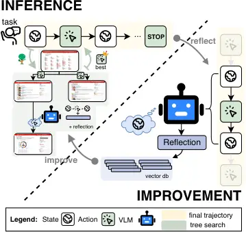
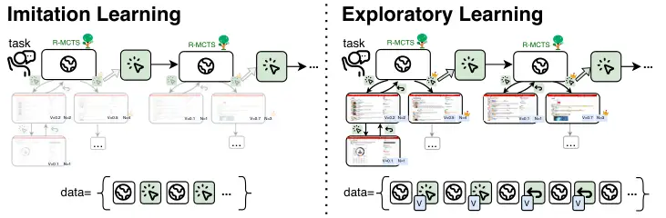
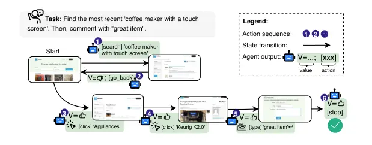
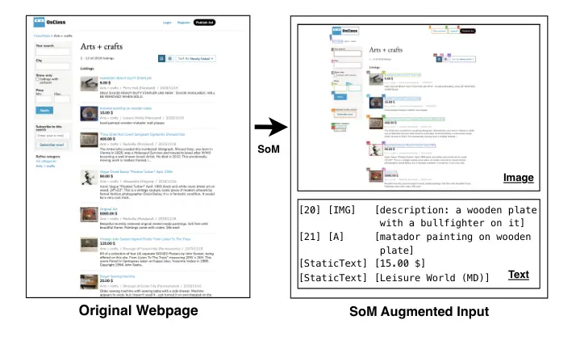

# ExAct: Teaching AI Agents to Explore with Reflective-MCTS and Exploratory Learning

Xiao Yu Affiliation: Columbia University, NY   
Email: [xy2437@columbia.edu](mailto:)    Baolin Peng
Email: [zy2461@columbia.edu](mailto:)    Vineeth Vajipey
Affiliation: Columbia University, NY   
Email: [baolinpeng@microsoft.com](mailto:)    Hao Cheng
Affiliation: Microsoft Research, Redmond
Email: [jfgao@microsoft.com](mailto:)    Michel Galley
Affiliation: Microsoft Research, Redmond    Jianfeng Gao & Zhou Yu
^(†)^(†)thanks: Equal Advisory Contribution; ^(†) Project Lead
Affiliation: Columbia University, NY   

###### Abstract

Autonomous agents have demonstrated significant potential in automating
complex multistep decision-making tasks. However, even state-of-the-art
vision-language models (VLMs), such as GPT-4o, still fall short of
human-level performance, particularly in intricate web environments and
long-horizon tasks. To address these limitations, we present ExAct, an
approach to combine test-time search and self-learning to build o1-like
models for agentic applications. We first introduce Reflective Monte
Carlo Tree Search (R-MCTS), a novel test-time algorithm designed to
enhance AI agents’ ability to explore decision space on the fly. R-MCTS
extends traditional MCTS by 1) incorporating contrastive reflection,
allowing agents to learn from past interactions and dynamically improve
their search efficiency; and 2) using multi-agent debate to provide
reliable state evaluation. Next, we introduce Exploratory Learning, a
novel learning strategy to teach agents to search at inference time
without relying on any external search algorithms. On the challenging
VisualWebArena benchmark, our GPT-4o-based R-MCTS agent achieves a 6% to
30% relative improvement across various tasks compared to the previous
state-of-the-art. Additionally, we show that the knowledge and
experience gained from test-time search can be effectively transferred
back to GPT-4o via fine-tuning. After Exploratory Learning, GPT-4o 1)
demonstrates the ability to explore the environment, evaluate a state,
and backtrack to viable ones when it detects that the current state
cannot lead to success, and 2) matches 87% of R-MCTS’s performance while
using significantly less compute. Notably, our work demonstrates the
compute scaling properties in both training - data collection with
R-MCTS - and testing time. These results suggest a promising research
direction to enhance VLMs’ reasoning and planning capabilities for
agentic applications via test-time search and self-learning.¹¹ 1 Code
and data can be found at [https://aka.ms/ExACT](https://aka.ms/ExACT).

|     |
| --- |
|     |

(a)

(b)

Figure 1: Our work yields compute scaling of GPT-4o with R-MCTS (left)
and fine-tuned GPT-4o (right), for both training and testing,
respectively. Left is evaluated on all 234 tasks from Classifieds in
VisualWebArena, and right is evaluated on 169 unseen tasks from
Classifieds.

## 1 Introduction

Visual-Language Models (VLMs) have seen significant advancements,
becoming increasingly powerful at processing and generating multimodal
content. High-capacity models such as GPT-4o (OpenAI, 2024a), Gemini
(Gemini, 2024), Phi-3 (Abdin et al., 2024), and Opus (Anthropic, 2024)
have demonstrated promising understanding and reasoning abilities,
paving the way for building VLM-based agents that can automate computer
tasks such as software engineering (Yang et al., 2024; Wang et al.,
2024), web navigation (Zhou et al., 2024b; Koh et al., 2024a) and mobile
device control (Rawles et al., 2023; Rawles et al., 2024). As many
computer tasks require agents to interact with complex environments for
long-term objectives, one critical challenge is to reason over extended
periods and dynamically explore a large decision space. Current models
often struggle at accessing a wide range of potential actions in these
environments, and balancing exploration and exploitation in long-horizon
tasks. Even GPT-4o-based agents significantly underperform humans,
achieving success rates less than 20% compared to human performance of
89% (Koh et al., 2024a).

As demonstrated by OpenAI’s o1 (OpenAI, 2024b) and Snell et al. (2024),
increasing the number of thinking tokens as chain of thoughts at test
time improves accuracy on tasks that require long-horizon planning and
reasoning, such as math and coding. This naturally raises the question:
Can we scale test-time computation to improve VLMs’ decision-making
capabilities in multistep planning and reasoning for _agentic_ tasks? An
intuitive strategy for agentic tasks, such as web navigation, is search.
By exploring different actions and evaluating their consequences, models
can gain a better understanding of the environment, reason about correct
actions, and plan more effectively for long-term objectives. Recent work
in this direction includes Tree of Thought (Yao et al., 2023a) and
Search Agent (Koh et al., 2024b), which rely on best-first search in the
form of BFS/DFS and A\* search, respectively, to augment the VLM’s
decision-making process. However, these methods suffer from 1) a lack of
balance between exploration and exploitation, which is crucial for
handling complex tasks, and 2) an inability to learn from past
interactions to improve future searches, which humans naturally do. More
importantly, these works focus primarily on prompt-based methods and do
not address how to _transfer_ knowledge from search back into the model.
This results in agents with high inference costs for complex tasks, as
it requires the use of VLMs with search algorithms.

In this work, we explore how to effectively scale test-time compute to
improve VLM agents, and efficiently transfer knowledge and experience
acquired from search back to the model to enhance its reasoning and
planning abilities. We present ExAct, an approach to combine test-time
search and self-learning to build o1-like models for agentic
applications. First, we introduce our Reflective Monte Carlo Tree Search
(R-MCTS) agent. Our method extends the classic MCTS with two
innovations: _contrastive reflection_ to improve search quality in real
time using high-quality reflections obtained from past experiences,
inspired by conceptual models of human learning (Marton, 2014); and a
_multi-agent debate_ technique for reliable state evaluation, inspired
by collaborative and iterative human evaluation approaches (van der Lee
et al., 2019). Second, we propose Exploratory Learning, a method to
teach agents to search at inference time _without_ relying on any
external search algorithms. In contrast to traditional Imitation
Learning which trains the model with the optimal, final actions returned
from the search process, Exploratory Learning teaches the models to
explore the environment, evaluate a state, and backtrack to viable ones
using search tree _traversals_.

Experiments on the challenging VisualWebArena (Koh et al., 2024a) show
that our GPT-4o-based R-MCTS agent achieves a new state-of-the-art
performance, with a 6% to 30% relative improvement across various
environments compared to the previous state-of-the-art. Additionally, we
find GPT-4o trained with  Exploratory Learning demonstrates the ability
to 1) explore, evaluate, and backtrack without any search augmentation;
and 2) recover 87% of the search performance while reducing the
inference cost by 2.7x. This represents an important step towards
improving VLM’s planning and reasoning capabilities for agentic
applications by leveraging test-time search and self-learning.

## 2 Background

### 2.1 Navigating the Web

Decision making in a complex environment is typically formulated as a
Partially Observable Markov Decision Process (POMDP) of
$`(\mathcal{S},\mathcal{A},\Omega,\mathcal{T})`$, which consists of sets
of states, actions, observations, and a transition function. In the
context of web navigation, a _state_ $`s\in\mathcal{S}`$ represents the
entire environment’s state including the current webpage and database
states; an _action_ $`a\in\mathcal{A}`$ is an action the agent can
express in natural language and execute in the environment (see
Table 1); an _observation_ is a textual or visual representation of the
current webpage; and the _transition function_
$`\mathcal{T}(s,a)\to(s^{\prime},o^{\prime})`$ executes an action $`a`$
in the environment and returns the next state and observation. For more
details, we refer the reader to Zhou et al. (2024b); Koh et al. (2024a).

| Action Type $`a`$                                | Description                                    |
| ------------------------------------------------ | ---------------------------------------------- |
| click \[$`\mathtt{elem}`$\]                      | Click on $`\mathtt{elem}`$.                    |
| hover \[$`\mathtt{elem}`$\]                      | Hover over $`\mathtt{elem}`$.                  |
| type \[$`\mathtt{elem}`$\] \[$`\mathtt{text}`$\] | Type $`\mathtt{text}`$ into $`\mathtt{elem}`$. |
| press \[$`\mathtt{key\_comb}`$\]                 | Press a key combo.                             |
| new_tab                                          | Open a new tab.                                |
| tab_focus \[$`\mathtt{index}`$\]                 | Focus on the i-th tab.                         |
| tab_close                                        | Close current tab.                             |
| goto \[$`\mathtt{url}`$\]                        | Go to $`\mathtt{url}`$.                        |
| go_back                                          | Click back.                                    |
| go_forward                                       | Click forward.                                 |
| scroll \[$`\mathtt{up/down}`$\]                  | Scroll up or down.                             |
| stop \[$`\mathtt{answer}`$\]                     | End with an output.                            |

Table 1: Action space for web navigation defined in VisualWebArena (Koh
et al., 2024a).

### 2.2 Monte Carlo Tree Search

In long-horizon tasks with a large action space, Monte Carlo Tree Search
(MCTS) (Silver et al., 2017; Świechowski et al., 2022) is a popular
method to improve decision making. MCTS explores multiple actions,
evaluates their consequences, and returns the best action for execution
after conducting a large number of simulations. We briefly describe the
MCTS algorithm here and refer to Section A.1 for more details. Given a
state to search from, MCTS iteratively constructs a tree by: 1)
_selecting_ an action $`a`$ to explore/exploit using Upper Confidence
Tree Bound (UCT) (Kocsis & Szepesvári, 2006; Rosin, 2011); 2) _expanding
and evaluating_ the selected action by simulating the next state
$`\mathcal{T}(s,a)\to(s^{\prime},o^{\prime})`$ and evaluating current
progress; 3) _backpropagating_ the evaluation to update the tree’s value
estimates of quality of the executed action. This search process is
repeated until the search budget is exhausted, and the most-visited
(Silver et al., 2017) or the highest-value action (Kocsis & Szepesvári, 2006) is returned.

### 2.3 Setup

We now present the setup commonly used by VLMs for agentic tasks, e.g.,
that of VisualWebArena (Koh et al., 2024a). A web agent begins by
receiving a task $`g`$ in natural language (and images) and starting
webpage $`o_{0}`$. Then, at each time step $`t`$: 1) the agent generates
an action $`a_{t}\in\mathcal{A}`$ based on the last state $`s_{t}`$,
which encodes information from past actions and observations; and 2)
$`a_{t}`$ is executed, transiting to a new state
$`\mathcal{T}(s_{t},a_{t})\to(s_{t+1},o_{t+1})`$, and observation
$`o_{t+1}`$ is returned to the agent. This agent-environment interaction
continues until either the maximum number of steps $`T`$ is reached, or
the agent issues a `STOP` action to terminate the episode. Finally, a
terminal reward $`r_{T}\in\{0,1\}`$ is returned based on the final
answer or the last environment state $`s_{T}`$.

In practice, visual agents are often implemented using a large
vision-language model (VLM) such as GPT-4o (OpenAI, 2024a). Common
approaches include directly prompting the VLM as a policy function to
generate an action $`\pi(\cdot)\to a`$ given a task and previous actions
and observations (Yao et al., 2023b; Koh et al., 2024a); or to
additionally construct value functions $`V(\cdot)`$ and conduct
simulation-based searches before returning an action (Yao et al., 2023a;
Zhou et al., 2024a; Koh et al., 2024b). We detail these methods below.

#### VLM as a Policy Function

Given a task $`g`$ and an trajectory
$`\tau=\{o_{0},a_{0},\ldots,...,a_{t-1},o_{t}\}`$, a policy
$`\pi(g,\tau)\to a_{t}`$ returns the next action $`a_{t}`$ to execute.
Popular methods such as ReACT (Yao et al., 2023b) use a VLM as policy by
directly prompting it for an action, after optionally generating a
reasoning step. Then, the environment executes action $`a_{t}`$ and
returns a new observation $`o_{t+1}`$. This process repeats until a
`STOP` action is issued or the maximum number of steps is reached.

#### VLM as a Value Function

To augment an agent’s decision-making process, many recent works
implement a value function $`V(\cdot)`$ to guide the VLM to predict
better actions. Given a trajectory $`\tau`$, a value function estimates
the expected success rate given the current state $`s_{t}`$. However,
since state $`s_{t}`$ of the environment (e.g., including database
information) may not always be accessible to the agent, value functions
are often implemented using the current _observed_ trajectory $`\tau`$
and the task description $`g`$ instead: $`V(g,\tau)\to[0,1]`$. In this
work, we consider two value functions. A _single-agent_ value function
(Yao et al., 2023a; Koh et al., 2024b) directly prompts a VLM with all
inputs (task $`g`$, trajectory $`\tau`$) to generate a value estimate
$`v_{\texttt{SA}}`$:

```math
v_{\texttt{SA}}=\text{VLM}\left(g,\tau\right)\in[0,1],
```

and a value function based on multi-agent debate, which we describe in
the next section.

## 3 Method

We propose ExAct, an approach to teach AI agents to explore via
test-time search (Section 3.1) and self-learning (Section 3.2).

### 3.1 Reflective MCTS

Web tasks are highly diverse as different websites have different
layouts and functionalities (e.g., Amazon versus Reddit), and almost
every webpage is unique. Although search-augmented agents have shown
promising results in web navigation tasks, their performance is limited
by the complexity of web environments and their inability to quickly
adapt to unseen environments.



Figure 2: Overview of an R-MCTS Agent. We omit value function reflection
for brevity.

We propose Reflective Monte Carlo Tree Search (R-MCTS), an extension of
classic MCTS that improves the agent’s decision making process on the
fly by incorporating reflection over its past task executions, and state
estimations using multi-agent-debate. We present a high-level overview
of an R-MCTS agent in Figure 2, and a pseudo-code description in
Section A.2. Similarly to classic MCTS, an R-MCTS agent during inference
predicts an action $`a_{t}`$ by iteratively building a search tree that
explores the current decision space (i.e., looping over selection,
expansion, simulation, and back-propagation steps). Unlike classic MCTS,
R-MCTS also iteratively improves the search process by 1) using
contrastive reflection to identifying past mistakes/successes; and 2)
updating the agent’s policy and value functions (in-context) to improve
its future task executions during inference. This improvement step helps
R-MCTS to avoid repeating the same mistakes and to explore more
promising actions when faced with similar situations in the future. For
clarity, we describe this improvement process in the context of _policy_
reflection, since value reflection is highly similar²² 2 For value
reflection, we reflect on states for erroneous state estimations instead
of actions. Then, we prompt the VLM to predict the expected future
actions, and generate a reflection contrasting the agent’s actual
actions. .

#### Contrastive Reflection

Policy (or value) function consists of three steps: 1) error
attribution; 2) constrastive learning; and 3) memorization of
reflection. Given a (long-horizon) trajectory $`\tau`$, this process
intuitively corresponds to first identifying the most ‘erroneous’
action, then analyzing the error by comparing what the agent _expects_
to achieve with what _actually happens_, and finally storing this
knowledge by remembering the task and state where the error occurs. This
process is inspired by human cognitive learning (Marton, 2014), where
contrasting our mental model of the world with the reality is an
effective way to obtain new knowledge.

Formally, given a task $`g`$ and trajectory $`\tau`$, we first identify
$`n_{\pi}`$ most erroneous actions (and $`n_{V}`$ value estimates for
value reflection) for reflection, based on the difference between the
VLM’s _predicted_ future success $`V`$ and the search-tree’s _simulated_
future success $`Q`$:

```math
\text{error}_{\pi}(a_{t}|\tau)=|V(o_{t+1})-Q(o_{t},a_{t})|,\quad\text{error}_{V}(o_{t}|\tau)=|V(o_{t})-Q(o_{t-1},a_{t-1})|.
```

Note that this form of comparing value function $`V`$ and action-value
function $`Q`$ is similar to Temporal Difference Error used in
reinforcement learning (Sutton & Barto, 2018). For each of the erroneous
actions $`\{\tilde{a}_{1},...,\tilde{a}_{n_{\pi}}\}`$, we then prompt
the VLM to identify reasoning mistakes and gain understanding of
navigating in the specific environment. We achieve this by contrastive
learning³³ 3 For simplicity, we use the accessibility tree
representation of $`o`$ in text modality throughout this process. : we
first 1) prompt the VLM to predict the expected transition
$`\hat{o}_{t+1}`$ after executing $`\tilde{a}_{t}`$, and 2) prompt the
VLM to generate a reflection by contrasting the current
$`o_{t},\tilde{a}_{t}`$, the expected $`\hat{o}_{t+1}`$ and real
$`o_{t+1}`$:

```math
\hat{o}_{t+1}=\text{VLM}_{\text{simulate}}(g,\{o_{0},a_{0},...,o_{t},\tilde{a}_{t}\}),\quad\text{reflect}(\tilde{a}_{t}|g,\tau)=\text{VLM}_{\text{reflect}}(g,o_{t},\tilde{a}_{t},\{o_{t+1},\hat{o}_{t+1}\}).
```

Finally, to help the agent memorize this reflection at test-time, we
embed the reflection using the current task and state $`(g,o_{t})`$ and
store it in a vector database.

#### Improvement

Then, given a new task and a new observation
$`(g^{\mathrm{new}},o_{t}^{\mathrm{new}})`$ to perform inference, we
improve the policy (and value) function by 1) retrieving the most
relevant reflections using cosine similarity of their embeddings⁴⁴ 4 For
simplicity, we directly concatenate
$`(g^{\mathrm{new}},o_{t}^{\mathrm{new}})`$ into a single string and
feed into an embedding model (text-ada-003-small, OpenAI (2024c)). , and 2) appending them into the agent’s current context. For clarity, we also
illustrate this reflection and improvement process in Figure 6
(Section A.2).

#### Multi-Agent Value Function

In addition to the reflection-improvement loop, we also experiment with
using multi-agent value function to provide more reliable state
estimates. Intuitively, this method offers 1) a more holistic view of
the current state to mitigate mistakes caused by oversights; and 2)
stronger reasoning elicited by collaborative/adversarial incentives
(Bowman et al., 2022).

Formally, a _multi-agent_ value function prompts multiple VLMs to each
generate a value estimate $`v^{i}`$, and then aggregate all estimates
$`\{v^{1},v^{2},...\}`$ to produce a final estimate $`v_{\texttt{MA}}`$:

```math
v^{i}=\text{VLM}_{i}\left(g,\tau\right)\in[0,1]\quad\text{and}\quad v_{\texttt{MA}}=\text{aggregate}(g,\tau,\{v^{1},v^{2},...\})\in[0,1].
```

In this study, we implement the multi-agent value function using
_multi-agent-debate_ (MAD). Given a task $`g`$ and a trajectory
$`\tau`$, MAD prompts two VLMs to generate two opposing arguments for
the current value estimate (i.e., why the current state is promising/not
promising), and then aggregates the two arguments using another VLM to
obtain a final judgement:

```math
\text{aggregate}(g,\tau,\{v^{1},v^{2},...\})=\text{VLM}_{\text{judge}}\left(g,\tau,\{v^{1},v^{2},...\}\right).
```

For the prompts used by contrastive reflection, improvement, and MAD,
please refer to Section D.2.



Figure 3: Given a trajectory from R-MCTS, _Imitation Learning_ removes
intermediate search trees and directly trains GPT-4o to learn from the
final executed actions; _Exploratory Learning_ flattens tree traversals
into a single trajectory and trains GPT-4o to explore, evaluate, and
backtrack.

### 3.2 Exploratory Learning

Search-augmented agents such as R-MCTS improve performance at the
expense of increased test-time computation. Using GPT-4o powered R-MCTS
as an example, we explore how to teach agents to search and explore at
inference time without relying on any external search algorithms. We
propose Exploratory Learning (EL), a learning strategy to teach GPT-4o
to explore, evaluate, and backtrackon using all tree traversals that
happened during search. This is contrast to the traditional Imitation
Learning (IL) approach, which directly fine-tunes GPT-4o on the actions
returned by the search algorithm. We illustrate these two methods in
Figure 3.

Given a task $`g`$, a trajectory $`\tau=\{o_{0},a_{0},...,a_{T}\}`$, and
all search trees $`\mathrm{Tree}(o_{0}),..,\mathrm{Tree}(o_{T})`$
obtained during R-MCTS, Imitation Learning trains GPT-4o to learn an
improved policy by directly fine-tuning on the actions executed in
$`\tau`$ (i.e., best actions selected by search). This method is simple,
but relies on the model itself to learn the implicit reasoning process.
Exploratory Learning improves GPT-4o’s decision making ability by using
both $`\tau`$ and tree traversals
$`\mathrm{Tree}(o_{0}),..,\mathrm{Tree}(o_{T})`$. Specifically, given a
tree $`\mathrm{Tree}(o_{i})`$, we 1) replay the tree search process⁵⁵ 5
This replay stops at the first time when the search process reached the
best action. to obtain observations $`o`$, actions explored or
backtracked $`a`$, and the estimated values $`v`$; 2) combine value
estimation and action into a single action $`a\leftarrow(v,a)`$, and 3)
append them to form a single trajectory $`\tau^{\prime}_{i}`$. We then
repeat this for all trees, and obtain a single trajectory
$`\tau^{\prime}=\{\tau^{\prime}_{0},...,\tau^{\prime}_{T}\}`$ used to
train GPT-4o.

## 4 Experiments

We primarily experiment on VisualWebArena (VWA), a benchmark designed to
evaluate multimodal agents performance on across a wide range of web
navigation tasks and environments. To further measure the
generalizability of our method, we also evaluate on other popular
benchmarks such as OSWorld and relevant domains from WebArena. We
describe the experimental setup, baselines, and other relevant
implementation details below.

#### Benchmarks

VisualWebArena (Koh et al., 2024a) is a large-scale benchmark consisting
of 910 tasks across three different web environments: Classifieds,
Reddit, and Shopping. All tasks in VWA require visual understanding of
webpage content to solve effectively, and 25.2% of the tasks also
include images as input (e.g., help me make a post selling this item +
an image of a phone). We host all web environments locally and evaluate
on all 910 tasks, unless otherwise specified. We follow (Koh et al.,
2024a; Koh et al., 2024b) and use Set-of-Mark (Yang et al., 2023b)
augmented web screenshots as the agent’s input. An example is presented
in Section D.1.

Beyond VWA, we also consider OSWorld (Xie et al., 2024), an diverse
benchmark consisting of 369 open-ended computer tasks that involves real
web and desktop apps in open domains, OS file I/O, and workflows
spanning multiple applications; and relevant domains (i.e., GitHub) from
WebArena (Zhou et al., 2024b) to further enhance our evaluation.

#### Baselines

We mainly compare R-MCTS against direct prompting methods as well as
search-augmented agents backed by various algorithms. For direct
prompting methods, we consider ReAct (Yao et al., 2023b), which prompts
a VLM to generate the reasoning step before generating the action. For
search, we consider Tree of Thought (Tot, Yao et al. (2023a), which uses
BFS or DFS to explore the decision space and returns the best action
found according to $`V`$; Search Agent (Koh et al., 2024b), which is a
best-first method inspired by A\* search; and MCTS (Silver et al., 2017;
Zhou et al., 2024a; Yu et al., 2023), which uses MCTS to determine the
best action to take.

For evaluations on OSWorld, we directly compare against existing best
methods from the official leaderboard. This includes Agent-S (Agashe
et al., 2024), a prompt-based framework that augments agents with online
web search and an experience-augmented hierarchical planning module;
AgentStore (Jia et al., 2024) a method that uses multiple (over 20)
specialized agents as well as finetuning methods such as self-instruct
to improve performance; and Learn-by-Interact (Anonymous, 2024), a
data-centric framework using synthetic data (manually created based on
related documentations and agent-environment interaction histories) to
improve performance by either in-context learning or further training.
In general, these methods rely on using additional resources such as
online web search, task-specific models, or performs model training to
improve performance.

#### Policy and Value Implementation

Search methods require a policy that can generate up to $`b`$ actions
for exploration, and a value function that returns a value between 0
and 1. We follow Koh et al. (2024b) to implement such a policy by 1)
sampling up to 20 responses from the VLM with a temperature of 1.0 and a
top-$`p`$ of 0.95, using nucleus sampling (Holtzman et al., 2020); 2)
aggregating the counts of each unique action; and 3) returning the
top-$`b`$ actions with the highest counts. We implement the single-agent
value function $`V_{\texttt{SA}}`$ by 1) prompting the VLM with a
multiple-choice based prompt; 2) sampling 20 responses with temperature
of 1.0 and top-$`p`$ of 0.95; 3) converting the selected choices into a
numeric value; and 4) returning the average value of all responses. We
implement the multi-agent value function $`V_{\texttt{MA}}`$ by 1)
prompting the VLM twice to generate reasons why the current state is
promising/unpromising; 2) prompt the VLM again to generate a final
judgement with a multiple-choice-based prompt; and 3) converting the
selected choice into a numeric value. We use GPT-4o (2024-05-13)
(OpenAI, 2024a) as the VLM for all methods as it has been widely used in
the development of state-of-the-art agents (Koh et al., 2024b; Wang
et al., 2024)

#### Search Parameters

On VisualWebArena, we follow Koh et al. (2024b) to compare all search
methods with a breadth $`b`$ and depth $`d`$ limit of 5 per tree, and to
stop task execution after a maximum of 5 actions. Since different
algorithms behave differently _during_ search, we also set a maximum
search time of 5 minutes per state. For MCTS-based algorithms, we use a
UCT bound with $`c_{p}=1.0`$ for action selection, and use the
most-visited child for selecting the best action (Silver et al., 2017).
On OSWorld, we follow other official results and stop task execution
after a maximum 15 steps. Since this is significantly longer than the
evaluation on VWA, we set a max node limit of 60, and set $`b=10`$ to be
decaying exponentially per depth when running R-MCTS.

### 4.1 R-MCTS Results

|                          |       |                   |         |              |         |                |         |             |         |
| ------------------------ | ----- | ----------------- | ------- | ------------ | ------- | -------------- | ------- | ----------- | ------- |
| Search                   | Value | Classifieds (VWA) |         | Reddit (VWA) |         | Shopping (VWA) |         | GitLab (WA) |         |
|                          |       | Tokens            | Success | Tokens       | Success | Tokens         | Success | Tokens      | Success |
| ✗  (ReAct)               | \-    | 1x                | 28.6%   | 1x           | 13.8%   | 1x             | 23.2%   | 1x          | 11.3%   |
| Tot$`{}_{\texttt{BFS}}`$ | SA    | 3.2x              | 30.7%   | 4.7x         | 19.5%   | 4.3x           | 29.2%   | 4.6x        | 14.1%   |
| Tot$`{}_{\texttt{DFS}}`$ | SA    | 3.1x              | 30.3%   | 4.2x         | 16.7%   | 4.0x           | 28.3%   | 4.3x        | 14.1%   |
| Search Agent             | SA    | 4.2x              | 33.8%   | 5.4x         | 21.9%   | 5.1x           | 30.3%   | 3.0x        | 13.8%   |
| MCTS                     | SA    | 7.2x              | 37.6%   | 9.5x         | 23.8%   | 8.9x           | 29.4%   | 5.7x        | 19.9%   |
| R-MCTS                   | SA    | 7.3x              | 40.2%   | 7.3x         | 25.2%   | 7.6x           | 31.9%   | 6.0x        | 20.9%   |
| R-MCTS                   | MAD   | 7.4x              | 41.0%   | 9.7x         | 28.7%   | 10.1x          | 32.3%   | 8.8x        | 23.5%   |

Table 2: Comparing different agent’s token consumption and performance
on VisualWebArena (VWA). For more domain diversity, we also evaluate
GitLab tasks from WebArena (WA). We show average token used per task
using ReAct as a baseline.

| Method          | Model        | Training | OS      | Office  | Daily   | Profess. | Workflow | Overall |
| --------------- | ------------ | -------- | ------- | ------- | ------- | -------- | -------- | ------- |
|                 |              |          | Success | Success | Success | Success  | Success  | Success |
| ReAct           | GPT-4o       | ✗        | 41.67%  | 6.16%   | 12.33%  | 14.29%   | 7.46%    | 11.21%  |
| Agent-S         | GPT-4o + Web | ✗        | 45.83%  | 13.83%  | 30.46%  | 36.73%   | 10.53%   | 20.58%  |
| AgentStore(ICL) | Hybrid       | ✗        | -       | 1.71%   | 32.05%  | 22.44%   | -        | 13.55%  |
| AgentStore(FT)  | Hybrid       | ✓        | -       | 15.38%  | 37.18%  | 12.20%   | -        | 17.34%  |
| AgentStore(AT)  | Hybrid       | ✓        | -       | 28.20%  | 37.18%  | 23.93%   | -        | 23.85%  |
| R-MCTS          | GPT-4o       | ✗        | 45.83%  | 15.56%  | 25.27%  | 22.44%   | 11.52%   | 19.39%  |

Table 3: Comparing different agent’s performance on OSWorld, using
screenshot + accessibility tree as input. For Agent-Sand AgentStore, we
use results reported by the respective authors. “Training” indicates
whether the method finetuned the agent model. Results with gray
backgrounds uses either additional resources (e.g., web search), models,
or performs training.

We summarize the performance of R-MCTS and other search-augmented agents
evaluated on VisualWebArena (VWA) in Table 2. We observe that all
search-based methods deliver significant improvements across the VWA
environments, albeit with increased test-time compute measured by the
number of tokens. Among these methods, MCTS consistently outperforms its
counterparts. This is likely due to MCTS’s ability to balance
exploration and exploitation through UCT, whereas other methods
primarily rely on $`V`$ to guide the search. Additionally, our R-MCTS
agent sets a new state-of-the-art performance benchmark across all VWA
environments, with relative improvements ranging from 6% to 30% over the
previous best-performing method, Search Agent. When using a single-agent
value function, R-MCTS improves upon MCTS by an average of 2.2 points.
Furthermore, with the integration of multi-agent debate, R-MCTS achieves
an additional 1.6-point improvement on average. These findings highlight
a promising approach to scaling test-time compute in agentic
applications by integrating search, reflection, and multi-agent debate
strategies. The comprehensive leaderboard for VisualWebArena can be
found in Appendix Table 8.

| Method            | Model                   | Training | OS      | Office  | Daily   | Profess. | Workflow | Overall |
| ----------------- | ----------------------- | -------- | ------- | ------- | ------- | -------- | -------- | ------- |
|                   |                         |          | Success | Success | Success | Success  | Success  | Success |
| ReAct             | GPT-4o                  | ✗        | 20.83%  | 6.99%   | 16.81%  | 16.33%   | 7.56%    | 11.4%   |
| Learn-by-Interact | Gemini-1.5-pro + RAG    | ✗        | -       | -       | -       | -        | -        | 10.3%   |
|                   | Claude-3.5-sonnet + RAG | ✗        | -       | -       | -       | -        | -        | 22.5%   |
| R-MCTS            | GPT-4o                  | ✗        | 37.50%  | 10.41%  | 21.82%  | 24.49%   | 10.87%   | 16.6%   |

Table 4: Comparing different agent’s performance on OSWorld, using
accessibility tree as input. Results with gray backgrounds uses either
additional resources (e.g., RAG with a manually populated database) or
different models.

We also extend our R-MCTS agent on OSWorld, and directly compare R-MCTS
performance against other methods on the leaderboard. We summarize the
results evaluated using “screenshot + accessibility tree” input modality
in Table 3, and also using “accessibility tree” only in Table 4. We find
that R-MCTS shows competitive performance compared other
state-of-the-art methods, despite only using on a single model with a
search algorithm.

### 4.2 Learning Results

Next, we evaluate ExAct: teaching GPT-4o to explore and improve its
performance using knowledge and experience gained from R-MCTS. Since
GPT-4o fine-tuning does not support images⁶⁶ 6 At the time of the study,
GPT-4o vision-finetuning was not yet supported., we evaluate all methods
with a text-only modality from VWA. We mainly consider training and
evaluating on 234 tasks from the Classifieds environment, as GPT-4o
finetuning is costly. For simplicity, we refer to R-MCTS with a
multi-agent-debate value function $`V_{\texttt{MAD}}`$ as
R-MCTS$`{}_{\texttt{MAD}}`$. Note that ExAct and ReAct use similar
prompts, with slight modifications in the system prompts to encourage
exploration

#### Training Data

We first run R-MCTS$`{}_{\texttt{MAD}}`$ on Classifieds, and then
sampled 65 trajectories for Imitation Learning according to the
estimated values of final success. However, since search tree traversals
are typically long, we further remove trajectory that results in more
than 20 actions, producing 35 trajectories. We format these data into
multi-turn chats, and use OpenAI finetuning API for training.

|        |              |                             |           |          |          |         |        |         |
| ------ | ------------ | --------------------------- | --------- | -------- | -------- | ------- | ------ | ------- |
| Method | Model        | Search                      | Max Steps | Training | Tokens   | Success |        |         |
|        |              |                             |           |          |          | Seen    | Unseen | Overall |
| ReAct  | GPT-4o-mini  | ✗                           | 20        | ✗        | 1.0x     | \-      | \-     | 20.9%   |
| ReAct  | o1-mini      | ✗                           | 20        | ✗        | 1.0x^(†) | \-      | \-     | 23.9%   |
| ReAct  | GPT-4o       | ✗                           | 5         | ✗        | 1.0x     | \-      | \-     | 22.2%   |
| ReAct  | GPT-4o       | ✗                           | 20        | ✗        | 2.4x     | \-      | \-     | 22.2%   |
| ExAct  | GPT-4o       | R-MCTS$`{}_{\texttt{MAD}}`$ | 20        | ✗        | 9.6x     | \-      | \-     | 32.1%   |
| ExAct  | GPT-4o w/ IL | ✗                           | 20        | 65       | 2.5x     | 80.0%   | 12.4%  | 31.2%   |
| ExAct  | GPT-4o w/ EL | ✗                           | 20        | 35       | 3.6x     | 80.0%   | 18.6%  | 27.8%   |

Table 5: Comparing different model’s performance evaluated in the
Classifieds environment. All non-search methods are based on direct
prompting. ^(†)While total token consumption is similar, o1-mini used
20x more output tokens (reasoning + output) than GPT-4o-mini’s output
tokens (output).

#### Quantitative Results

We present the comparison results with ReAct in Table 5. Our findings
indicate that both ExAct, trained with Imitation Learning and
Exploratory Learning, outperform ReAct (based on the untrained GPT-4o)
by a considerable margin, even without utilizing any search algorithm.
Compared to R-MCTS$`{}_{\texttt{MAD}}`$, both methods achieved over 85%
of the performance while reducing token usage by up to 4x. In addition,
ExAct with EL achieves a significantly higher success rate on unseen
tasks, demonstrating the effectiveness of exploratory learning. These
results suggest that even powerful models like GPT-4o can benefit
greatly from training with agentic data.



Figure 4: After Exploratory Learning, GPT-4o demonstrates the ability to
explore, evaluate, and backtrack without augmenting with search
algorithms.

#### Qualitative Results

With Exploratory Learning, we find that GPT-4o is able to perform better
on unseen tasks by performing exploration, state evaluation, and
backtracking without relying on any search algorithm. We illustrate an
example in Figure 4: after attempting to directly search for “coffee
maker with a touch screen”, the Exploratory Learning trained-GPT-4o
finds that the search function in Classifieds may be unreliable (top
search result is a sofa) and backtracked to use category filters
instead.

### 4.3 Compute Scaling Results

We explore whether R-MCTS$`{}_{\texttt{MAD}}`$ _and_ the fine-tuned
model after the self-learning stage has the property of test-time
computing scaling, i.e., whether performance can increase when more
test-time computes, such search tokens, are allocated. To study this, we
follow the same experiment setup in our main results in Section 4.1, but
vary the search budget to allow R-MCTS$`{}_{\texttt{MAD}}`$ for
$`\{2,5,10,15\}`$ nodes per search tree. We then compare performance
(_Success Rate_) and token consumption per task compared to ReAct
(_Tokens_) in Figure 1a. Since searching with more nodes significantly
increases time and cost, we report results by testing on all 234 tasks
in the Classifieds environment.

As shown in Figure 1, our proposed R-MCTS and Exploratory Learning
exhibit strong scaling properties for both train-time and test-time
compute. Particularly, in Figure 1 left, we find that
R-MCTS$`{}_{\texttt{MAD}}`$ significantly improves performance when
allocated with more test-time compute: using 15 nodes per tree,
R-MCTS$`{}_{\texttt{MAD}}`$ achieves a relative improvement of 66%
compared to ReAct. Furthermore, Figure 1 right also illustrates that
_without_ search, both Imitation Learning and Exploratory Learning
substantially boost the performance of an untrained GPT-4o when allowed
more actions per task. Notably, Exploratory Learning demonstrates a more
favorable scaling trend in test-time compute compared to Imitation
Learning, as it is trained to learn to search. These results highlight
the potential for self-improvement via reflective search and
self-learning in agentic applications.

## 5 Analysis

### 5.1 Success Rate Breakdown

|                             |       |        |       |
| --------------------------- | ----- | ------ | ----- |
| Search                      | Easy  | Medium | Hard  |
| ✗  (ReAct)                  | 42.4% | 20.9%  | 11.6% |
| ToT$`{}_{\textrm{BFS}}`$    | 46.4% | 28.0%  | 14.7% |
| ToT$`{}_{\textrm{DFS}}`$    | 46.8% | 26.5%  | 12.8% |
| Search Agent                | 45.9% | 29.6%  | 18.4% |
| MCTS                        | 47.8% | 32.5%  | 16.5% |
| R-MCTS                      | 50.7% | 33.6%  | 19.9% |
| R-MCTS$`{}_{\texttt{MAD}}`$ | 49.3% | 34.1%  | 23.6% |

Table 6: VWA performance by difficulty.

In addition to having tasks in different environments, VWA labels these
task for _action difficulty_. These are labeled by estimating the number
of steps an average human would take to complete the task: easy (1-3
steps), medium (4-9 steps), and hard (10 steps or more). We evaluate all
methods using the same setup as in our main results in Section 4.1. We
present the results in Table 6.

#### R-MCTS improves performance across difficulties

Compared to prior best, we find R-MCTS agent improved performance by an
avearge of 2.5% absolute across all difficulties. This shows that the
search and improvement loop in the R-MCTS agent not only benefits
planning in long-horizon tasks, but also enhances robustness in solving
easier tasks.

#### Multi-Agent-Debate benefits difficult tasks

When using a multi-agent value function (R-MCTS$`{}_{\texttt{MAD}}`$),
performance is further improved in medium and hard tasks. We believe
this is because multi-agent debate encourages a more critical view of
the current state, and making it less error-prone in long horizon tasks.
However, in easier tasks, we find such method can suffer from
“over-thinking” by trying to avoid non-existent issues, which can
slightly reduce performance.

### 5.2 Ablation Studies

| Method                      | Overall |         |
| --------------------------- | ------- | ------- |
|                             | Token   | Success |
| R-MCTS$`{}_{\texttt{MAD}}`$ | 9.3x    | 33.7%   |
| \- Value refl.              | 9.0x    | 32.9%   |
| \- Policy refl.             | 8.6x    | 30.2%   |
| \- Search                   | 1.0x    | 21.9%   |

Table 7: Ablation studies on VWA.

We perform ablation studies for each of component in
R-MCTS$`{}_{\texttt{MAD}}`$ to understand their contributions to the
overall performance. In Table 7, we report the overall performance
across all 910 tasks in VWA when removing 1) reflection from value
function; 2) reflection from policy; and 3) the search algorithm. We
find that reflections for policy improvement are more crucial than
reflections for value function, and that search is essential for
competitive performance.

### 5.3 Qualitative Analysis

To better understand the search process in R-MCTS$`{}_{\texttt{MAD}}`$,
we manually inspect 80 randomly sampled trajectories and their
corresponding search trees. We compare against trajectories generated by
Search Agent and analyze errors made by our method.

Figure 5: R-MCTS$`{}_{\texttt{MAD}}`$ error analysis. Sub-error types
are omitted for brevity (see Section C.1).

#### Exploration and Reflection improves action quality

Amongst the 80 samples, we find that R-MCTS$`{}_{\texttt{MAD}}`$
outperforms Search Agent in 12.5% of the tasks. We find that this is
primarily due to R-MCTS$`{}_{\texttt{MAD}}`$’s ability to improve its
policy (60%) using the reflection-improvement process (Section 3.1); and
its ability to balance exploration-exploitation (30%) using UCT instead
of best-first.

#### GPT-4o still lacks finegrained image and web understanding

In Figure 5, we categorize all errors made by
R-MCTS$`{}_{\texttt{MAD}}`$ during its search process by 1. failing to
correctly format the final answer (_answer formatting error_); 2. errors
caused by the agent-environment interaction (_environmental error_); 3.
errors caused by GPT-4o’s inability to perform fine-grained image
understanding (_model image understanding_); and 4. errors caused by
GPT-4o’s limited web understanding/reasoning ability (_model web
understanding_). For a more detailed categorization, we refer the reader
to Section C.1. Our analysis reveals that most of the errors are caused
by the backbone VLM’s inability to understand the provided webpage
screenshot/product images. Examples include failing to correctly
identify the item on _$`a`$-th row and $`b`$-th column_ on a shopping
page; and misunderstanding that the cheapest product shown on the
_current page_ (sorted by most recently listed) is the cheapest product
available _on the entire site_. We believe these model issues are
fundamental to many current agents that rely on prompting and suggest
that model training (alike Section 3.2) is essential to further improve
agent’s performance.

## 6 Related Work

#### Language-Guided Agents

Advances in large language models (LLMs) have motivated many recent
works to re-purpose LLMs for automating agentic tasks (Nakano et al.,
2022; Kim et al., 2023; Xi et al., 2023). These methods include
prompting LLM directly as a policy (Hong et al., 2023; Yao et al.,
2023b; Sridhar et al., 2023; Yang et al., 2023a), as a component of a
manually designed agentic framework (Park et al., 2023; Sumers et al.,
2024), combined with manually crafted heuristics/prompt designs to
improve performance (Fu et al., 2024; Sodhi et al., 2024), or combined
with tool uses for question answering/code generation (Yang et al.,
2024; Xia et al., 2024). For tasks that requires visual understanding,
many recent work have thus swapped the prompting LLMs to prompting
visual language models (VLMs) such as GPT-4o (Zheng et al., 2024; Koh
et al., 2024a). However, these methods typically suffer in long-horizon
tasks that requires planning and error recovery. Our work thus augments
VLMs agents with search algorithms such as MCTS (Silver et al., 2017) to
complete tasks in complex and realistic web environments.

#### Augmenting Agent with Search/Reflection

Using LLMs or VLMs to solve long-horizon tasks such as web navigation is
a highly challenging task (Liu et al., 2023; Zhou et al., 2024b; Koh
et al., 2024a). Many recent work thus also explored various strategies
to improve agent’s decision making process, such as: iteratively
prompting the model to improve its own output (Madaan et al., 2023; Yu
et al., 2024; Shinn et al., 2023); and augmenting agent’s decision
process using search algorithms such as BFS/DFS (Yao et al., 2023a),
best-first search (Koh et al., 2024b), and MCTS (Yu et al., 2023; Zhou
et al., 2024a). However, many of these methods primarily focus on
text-based environments such as question answering and programming, and
do not involve substantial interaction with a complex environment. In
contrast, our work focuses on 1) conducting MCTS in long-horizon,
agentic tasks in a realistic web environment; 2) incorporating
multi-agent-debate value function to improve state evaluation; and 3)
using contrastive reflection to learn from past successes and failures
in long execution trajectories.

#### Training Agents

Besides improving agent’s performance at test-time, many works also
explored methods to train the backbone LLM/VLM. Examples include
Mind2Web (Deng et al., 2023), FireACT Chen et al. (2023), AgentInstruct
(Zeng et al., 2023), WebGum (Furuta et al., 2024), AutoWebGLM (Lai
et al., 2024), and more (Zhang et al., 2024b; Liu et al., 2024; Zhang
et al., 2024a). These methods rely on collecting human or machine
generated trajectories based on direct prompting, and perform supervised
training to improve model’s performance. To our knowledge, we are the
first to train GPT-4o using trajectories produced by MCTS, and to teach
GPT-4o to explore, evaluate, and backtrack in complex web environments
through training on MCTS tree traversal.

## 7 Conclusion

In this work, we first introduced R-MCTS agent, a search-augmented agent
powered by 1) MCTS to explore, evaluate, and backtrack in complex and
realistic web environments; 2) a multi-agent-debate value function for
reliable state evaluation; and 3) contrastive reflection to learn from
past successes and failures in long execution trajectories. Then, we
proposed methods to transfer knowledge acquired from search back to
GPT-4o by 1) training on best actions returned by tree search (Imitation
Learning); and 2) training on the entire MCTS tree traversal
(Exploratory Learning). Experiments on the challenging VisualWebArena
benchmark show that R-MCTS achieves a new state of the art, and that our
finetuned GPT-4o agent begins to display test-time compute scaling
properties similar to search algorithms. We believe our work presents a
promising direction to combine test-time search and model self-learning
to develop the next-generation autonomous agents.

## 8 Limitations

#### High cost of scaling test-time compute

Although MCTS-based agents achieve strong performance on benchmarks such
as VWA, they consume nearly 10x more tokens compared to ReAct. This
presents a clear trade-off between performance and cost/time, and may
limit the practicality of deploying such agents in real-world
applications. However, these search-augmented agents can be used to
_curate training data_ for VLMs without human labels, which can in turn
help develop stronger VLMs. Our work presents a promising step in this
direction using Imitation Learning and Exploratory Learning, and we
believe such a self-learning loop is crucial to build stronger agents.

#### Long trajectories from tree traversal

In long-horizon tasks, R-MCTS agents require a large amount of
simulation to identify optimal actions, resulting in long tree
traversals. Training on these long traversals can be costly, and may be
difficult for models to learn from. Nevertheless, we believe this issue
can be iteratively mitigated by using self-learning to improve model
capability, and by conducting search using the improved policy/value
functions. We leave explorations for future work.

## References

- Abdin et al. (2024) Marah Abdin, Sam Ade Jacobs, Ammar Ahmad Awan,
  Jyoti Aneja, Ahmed Awadallah, Hany Awadalla, Nguyen Bach, Amit Bahree,
  Arash Bakhtiari, Harkirat Behl, et al. Phi-3 technical report: A
  highly capable language model locally on your phone. _arXiv preprint
  arXiv:2404.14219_, 2024.
- Agashe et al. (2024) Saaket Agashe, Jiuzhou Han, Shuyu Gan, Jiachen
  Yang, Ang Li, and Xin Eric Wang. Agent s: An open agentic framework
  that uses computers like a human, 2024. URL
  [https://arxiv.org/abs/2410.08164](https://arxiv.org/abs/2410.08164).
- Anonymous (2024) Anonymous. Learn-by-interact: A data-centric
  framework for self-adaptive agents in realistic environments. In
  _Submitted to The Thirteenth International Conference on Learning
  Representations_, 2024. URL
  [https://openreview.net/forum?id=3UKOzGWCVY](https://openreview.net/forum?id=3UKOzGWCVY).
  under review.
- Anthropic (2024) Anthropic. The claude 3 model family: Opus, sonnet,
  haiku.
  [https://www-cdn.anthropic.com/de8ba9b01c9ab7cbabf5c33b80b7bbc618857627/Model_Card_Claude_3.pdf](https://www-cdn.anthropic.com/de8ba9b01c9ab7cbabf5c33b80b7bbc618857627/Model_Card_Claude_3.pdf), 2024.
- Bowman et al. (2022) Samuel R. Bowman, Jeeyoon Hyun, Ethan Perez,
  Edwin Chen, Craig Pettit, Scott Heiner, Kamilė Lukošiūtė, Amanda
  Askell, Andy Jones, Anna Chen, Anna Goldie, Azalia Mirhoseini, Cameron
  McKinnon, Christopher Olah, Daniela Amodei, Dario Amodei, Dawn Drain,
  Dustin Li, Eli Tran-Johnson, Jackson Kernion, Jamie Kerr, Jared
  Mueller, Jeffrey Ladish, Joshua Landau, Kamal Ndousse, Liane Lovitt,
  Nelson Elhage, Nicholas Schiefer, Nicholas Joseph, Noemí Mercado, Nova
  DasSarma, Robin Larson, Sam McCandlish, Sandipan Kundu, Scott
  Johnston, Shauna Kravec, Sheer El Showk, Stanislav Fort, Timothy
  Telleen-Lawton, Tom Brown, Tom Henighan, Tristan Hume, Yuntao Bai, Zac
  Hatfield-Dodds, Ben Mann, and Jared Kaplan. Measuring progress on
  scalable oversight for large language models, 2022. URL
  [https://arxiv.org/abs/2211.03540](https://arxiv.org/abs/2211.03540).
- Chen et al. (2023) Baian Chen, Chang Shu, Ehsan Shareghi, Nigel
  Collier, Karthik Narasimhan, and Shunyu Yao. Fireact: Toward language
  agent fine-tuning, 2023. URL
  [https://arxiv.org/abs/2310.05915](https://arxiv.org/abs/2310.05915).
- Deng et al. (2023) Xiang Deng, Yu Gu, Boyuan Zheng, Shijie Chen,
  Samuel Stevens, Boshi Wang, Huan Sun, and Yu Su. Mind2web: Towards a
  generalist agent for the web, 2023. URL
  [https://arxiv.org/abs/2306.06070](https://arxiv.org/abs/2306.06070).
- Fu et al. (2024) Yao Fu, Dong-Ki Kim, Jaekyeom Kim, Sungryull Sohn,
  Lajanugen Logeswaran, Kyunghoon Bae, and Honglak Lee. Autoguide:
  Automated generation and selection of state-aware guidelines for large
  language model agents, 2024. URL
  [https://arxiv.org/abs/2403.08978](https://arxiv.org/abs/2403.08978).
- Furuta et al. (2024) Hiroki Furuta, Kuang-Huei Lee, Ofir Nachum,
  Yutaka Matsuo, Aleksandra Faust, Shixiang Shane Gu, and Izzeddin Gur.
  Multimodal web navigation with instruction-finetuned foundation
  models, 2024. URL
  [https://arxiv.org/abs/2305.11854](https://arxiv.org/abs/2305.11854).
- Gemini (2024) Gemini. Gemini: A family of highly capable multimodal
  models, 2024. URL
  [https://arxiv.org/abs/2312.11805](https://arxiv.org/abs/2312.11805).
- Holtzman et al. (2020) Ari Holtzman, Jan Buys, Li Du, Maxwell Forbes,
  and Yejin Choi. The curious case of neural text degeneration, 2020.
  URL
  [https://arxiv.org/abs/1904.09751](https://arxiv.org/abs/1904.09751).
- Hong et al. (2023) Sirui Hong, Mingchen Zhuge, Jonathan Chen, Xiawu
  Zheng, Yuheng Cheng, Ceyao Zhang, Jinlin Wang, Zili Wang, Steven
  Ka Shing Yau, Zijuan Lin, Liyang Zhou, Chenyu Ran, Lingfeng Xiao,
  Chenglin Wu, and Jürgen Schmidhuber. Metagpt: Meta programming for a
  multi-agent collaborative framework, 2023. URL
  [https://arxiv.org/abs/2308.00352](https://arxiv.org/abs/2308.00352).
- Jia et al. (2024) Chengyou Jia, Minnan Luo, Zhuohang Dang, Qiushi Sun,
  Fangzhi Xu, Junlin Hu, Tianbao Xie, and Zhiyong Wu. Agentstore:
  Scalable integration of heterogeneous agents as specialized generalist
  computer assistant, 2024. URL
  [https://arxiv.org/abs/2410.18603](https://arxiv.org/abs/2410.18603).
- Kim et al. (2023) Geunwoo Kim, Pierre Baldi, and Stephen McAleer.
  Language models can solve computer tasks, 2023. URL
  [https://arxiv.org/abs/2303.17491](https://arxiv.org/abs/2303.17491).
- Kocsis & Szepesvári (2006) Levente Kocsis and Csaba Szepesvári. Bandit
  based monte-carlo planning. In _Proceedings of the 17th European
  Conference on Machine Learning_, ECML’06, pp. 282–293, Berlin,
  Heidelberg, 2006. Springer-Verlag. ISBN 354045375X. doi:
  10.1007/11871842_29. URL
  [https://doi.org/10.1007/11871842_29](https://doi.org/10.1007/11871842_29).
- Koh et al. (2024a) Jing Yu Koh, Robert Lo, Lawrence Jang, Vikram
  Duvvur, Ming Chong Lim, Po-Yu Huang, Graham Neubig, Shuyan Zhou,
  Ruslan Salakhutdinov, and Daniel Fried. Visualwebarena: Evaluating
  multimodal agents on realistic visual web tasks, 2024a. URL
  [https://arxiv.org/abs/2401.13649](https://arxiv.org/abs/2401.13649).
- Koh et al. (2024b) Jing Yu Koh, Stephen McAleer, Daniel Fried, and
  Ruslan Salakhutdinov. Tree search for language model agents, 2024b.
  URL
  [https://arxiv.org/abs/2407.01476](https://arxiv.org/abs/2407.01476).
- Lai et al. (2024) Hanyu Lai, Xiao Liu, Iat Long Iong, Shuntian Yao,
  Yuxuan Chen, Pengbo Shen, Hao Yu, Hanchen Zhang, Xiaohan Zhang, Yuxiao
  Dong, and Jie Tang. Autowebglm: Bootstrap and reinforce a large
  language model-based web navigating agent, 2024. URL
  [https://arxiv.org/abs/2404.03648](https://arxiv.org/abs/2404.03648).
- Liu et al. (2023) Xiao Liu, Hao Yu, Hanchen Zhang, Yifan Xu, Xuanyu
  Lei, Hanyu Lai, Yu Gu, Hangliang Ding, Kaiwen Men, Kejuan Yang, Shudan
  Zhang, Xiang Deng, Aohan Zeng, Zhengxiao Du, Chenhui Zhang, Sheng
  Shen, Tianjun Zhang, Yu Su, Huan Sun, Minlie Huang, Yuxiao Dong, and
  Jie Tang. Agentbench: Evaluating llms as agents, 2023. URL
  [https://arxiv.org/abs/2308.03688](https://arxiv.org/abs/2308.03688).
- Liu et al. (2024) Zuxin Liu, Thai Hoang, Jianguo Zhang, Ming Zhu, Tian
  Lan, Shirley Kokane, Juntao Tan, Weiran Yao, Zhiwei Liu, Yihao Feng,
  et al. Apigen: Automated pipeline for generating verifiable and
  diverse function-calling datasets. _arXiv preprint
  arXiv:2406.18518_, 2024.
- Madaan et al. (2023) Aman Madaan, Niket Tandon, Prakhar Gupta, Skyler
  Hallinan, Luyu Gao, Sarah Wiegreffe, Uri Alon, Nouha Dziri, Shrimai
  Prabhumoye, Yiming Yang, Shashank Gupta, Bodhisattwa Prasad Majumder,
  Katherine Hermann, Sean Welleck, Amir Yazdanbakhsh, and Peter Clark.
  Self-refine: Iterative refinement with self-feedback, 2023. URL
  [https://arxiv.org/abs/2303.17651](https://arxiv.org/abs/2303.17651).
- Marton (2014) Ference Marton. _Necessary Conditions of Learning_.
  Routledge, 1st edition, 2014. doi: 10.4324/9781315816876. URL
  [https://doi.org/10.4324/9781315816876](https://doi.org/10.4324/9781315816876).
- Nakano et al. (2022) Reiichiro Nakano, Jacob Hilton, Suchir Balaji,
  Jeff Wu, Long Ouyang, Christina Kim, Christopher Hesse, Shantanu Jain,
  Vineet Kosaraju, William Saunders, Xu Jiang, Karl Cobbe, Tyna
  Eloundou, Gretchen Krueger, Kevin Button, Matthew Knight, Benjamin
  Chess, and John Schulman. Webgpt: Browser-assisted question-answering
  with human feedback, 2022. URL
  [https://arxiv.org/abs/2112.09332](https://arxiv.org/abs/2112.09332).
- OpenAI (2024a) OpenAI. Hello GPT-4o.
  [https://openai.com/index/hello-gpt-4o/](https://openai.com/index/hello-gpt-4o/),
  2024a. Accessed: 2024-09-28.
- OpenAI (2024b) OpenAI. Introducing OpenAI o1.
  [https://openai.com/o1/](https://openai.com/o1/), 2024b. Accessed:
  2024-09-29.
- OpenAI (2024c) OpenAI. New embedding models and api updates.
  [https://openai.com/index/new-embedding-models-and-api-updates/](https://openai.com/index/new-embedding-models-and-api-updates/),
  2024c. Accessed: 2024-09-28.
- Park et al. (2023) Joon Sung Park, Joseph C. O’Brien, Carrie J. Cai,
  Meredith Ringel Morris, Percy Liang, and Michael S. Bernstein.
  Generative agents: Interactive simulacra of human behavior, 2023. URL
  [https://arxiv.org/abs/2304.03442](https://arxiv.org/abs/2304.03442).
- Rawles et al. (2023) Christopher Rawles, Alice Li, Daniel Rodriguez,
  Oriana Riva, and Timothy Lillicrap. Android in the wild: A large-scale
  dataset for android device control, 2023. URL
  [https://arxiv.org/abs/2307.10088](https://arxiv.org/abs/2307.10088).
- Rawles et al. (2024) Christopher Rawles, Sarah Clinckemaillie, Yifan
  Chang, Jonathan Waltz, Gabrielle Lau, Marybeth Fair, Alice Li, William
  Bishop, Wei Li, Folawiyo Campbell-Ajala, Daniel Toyama, Robert Berry,
  Divya Tyamagundlu, Timothy Lillicrap, and Oriana Riva. Androidworld: A
  dynamic benchmarking environment for autonomous agents, 2024. URL
  [https://arxiv.org/abs/2405.14573](https://arxiv.org/abs/2405.14573).
- Rosin (2011) Christopher D. Rosin. Multi-armed bandits with episode
  context. _Annals of Mathematics and Artificial Intelligence_,
  61(3):203–230, March 2011. ISSN 1012-2443. doi:
  10.1007/s10472-011-9258-6. URL
  [https://doi.org/10.1007/s10472-011-9258-6](https://doi.org/10.1007/s10472-011-9258-6).
- Shinn et al. (2023) Noah Shinn, Federico Cassano, Edward Berman,
  Ashwin Gopinath, Karthik Narasimhan, and Shunyu Yao. Reflexion:
  Language agents with verbal reinforcement learning, 2023. URL
  [https://arxiv.org/abs/2303.11366](https://arxiv.org/abs/2303.11366).
- Silver et al. (2017) David Silver, Thomas Hubert, Julian
  Schrittwieser, Ioannis Antonoglou, Matthew Lai, Arthur Guez, Marc
  Lanctot, Laurent Sifre, Dharshan Kumaran, Thore Graepel, Timothy
  Lillicrap, Karen Simonyan, and Demis Hassabis. Mastering chess and
  shogi by self-play with a general reinforcement learning
  algorithm, 2017. URL
  [https://arxiv.org/abs/1712.01815](https://arxiv.org/abs/1712.01815).
- Snell et al. (2024) Charlie Snell, Jaehoon Lee, Kelvin Xu, and Aviral
  Kumar. Scaling llm test-time compute optimally can be more effective
  than scaling model parameters, 2024. URL
  [https://arxiv.org/abs/2408.03314](https://arxiv.org/abs/2408.03314).
- Sodhi et al. (2024) Paloma Sodhi, S. R. K. Branavan, Yoav Artzi, and
  Ryan McDonald. Step: Stacked llm policies for web actions, 2024. URL
  [https://arxiv.org/abs/2310.03720](https://arxiv.org/abs/2310.03720).
- Sridhar et al. (2023) Abishek Sridhar, Robert Lo, Frank F. Xu, Hao
  Zhu, and Shuyan Zhou. Hierarchical prompting assists large language
  model on web navigation, 2023. URL
  [https://arxiv.org/abs/2305.14257](https://arxiv.org/abs/2305.14257).
- Sumers et al. (2024) Theodore R. Sumers, Shunyu Yao, Karthik
  Narasimhan, and Thomas L. Griffiths. Cognitive architectures for
  language agents, 2024. URL
  [https://arxiv.org/abs/2309.02427](https://arxiv.org/abs/2309.02427).
- Sutton & Barto (2018) Richard S. Sutton and Andrew G. Barto.
  _Reinforcement Learning: An Introduction_. The MIT Press, second
  edition, 2018. URL
  [http://incompleteideas.net/book/the-book-2nd.html](http://incompleteideas.net/book/the-book-2nd.html).
- van der Lee et al. (2019) Chris van der Lee, Albert Gatt, Emiel van
  Miltenburg, Sander Wubben, and Emiel Krahmer. Best practices for the
  human evaluation of automatically generated text. In Kees van Deemter,
  Chenghua Lin, and Hiroya Takamura (eds.), _Proceedings of the 12th
  International Conference on Natural Language Generation_, pp. 355–368,
  Tokyo, Japan, October–November 2019. Association for Computational
  Linguistics. doi: 10.18653/v1/W19-8643. URL
  [https://aclanthology.org/W19-8643](https://aclanthology.org/W19-8643).
- Wang et al. (2024) Xingyao Wang, Boxuan Li, Yufan Song, Frank F. Xu,
  Xiangru Tang, Mingchen Zhuge, Jiayi Pan, Yueqi Song, Bowen Li,
  Jaskirat Singh, Hoang H. Tran, Fuqiang Li, Ren Ma, Mingzhang Zheng,
  Bill Qian, Yanjun Shao, Niklas Muennighoff, Yizhe Zhang, Binyuan Hui,
  Junyang Lin, Robert Brennan, Hao Peng, Heng Ji, and Graham Neubig.
  Opendevin: An open platform for ai software developers as generalist
  agents, 2024. URL
  [https://arxiv.org/abs/2407.16741](https://arxiv.org/abs/2407.16741).
- Xi et al. (2023) Zhiheng Xi, Wenxiang Chen, Xin Guo, Wei He, Yiwen
  Ding, Boyang Hong, Ming Zhang, Junzhe Wang, Senjie Jin, Enyu Zhou, Rui
  Zheng, Xiaoran Fan, Xiao Wang, Limao Xiong, Yuhao Zhou, Weiran Wang,
  Changhao Jiang, Yicheng Zou, Xiangyang Liu, Zhangyue Yin, Shihan Dou,
  Rongxiang Weng, Wensen Cheng, Qi Zhang, Wenjuan Qin, Yongyan Zheng,
  Xipeng Qiu, Xuanjing Huang, and Tao Gui. The rise and potential of
  large language model based agents: A survey, 2023. URL
  [https://arxiv.org/abs/2309.07864](https://arxiv.org/abs/2309.07864).
- Xia et al. (2024) Chunqiu Steven Xia, Yinlin Deng, Soren Dunn, and
  Lingming Zhang. Agentless: Demystifying llm-based software engineering
  agents, 2024. URL
  [https://arxiv.org/abs/2407.01489](https://arxiv.org/abs/2407.01489).
- Xie et al. (2024) Tianbao Xie, Danyang Zhang, Jixuan Chen, Xiaochuan
  Li, Siheng Zhao, Ruisheng Cao, Toh Jing Hua, Zhoujun Cheng, Dongchan
  Shin, Fangyu Lei, Yitao Liu, Yiheng Xu, Shuyan Zhou, Silvio Savarese,
  Caiming Xiong, Victor Zhong, and Tao Yu. Osworld: Benchmarking
  multimodal agents for open-ended tasks in real computer
  environments, 2024. URL
  [https://arxiv.org/abs/2404.07972](https://arxiv.org/abs/2404.07972).
- Yang et al. (2023a) Hui Yang, Sifu Yue, and Yunzhong He. Auto-gpt for
  online decision making: Benchmarks and additional opinions, 2023a. URL
  [https://arxiv.org/abs/2306.02224](https://arxiv.org/abs/2306.02224).
- Yang et al. (2023b) Jianwei Yang, Hao Zhang, Feng Li, Xueyan Zou,
  Chunyuan Li, and Jianfeng Gao. Set-of-mark prompting unleashes
  extraordinary visual grounding in gpt-4v, 2023b. URL
  [https://arxiv.org/abs/2310.11441](https://arxiv.org/abs/2310.11441).
- Yang et al. (2024) John Yang, Carlos E. Jimenez, Alexander Wettig,
  Kilian Lieret, Shunyu Yao, Karthik Narasimhan, and Ofir Press.
  Swe-agent: Agent-computer interfaces enable automated software
  engineering, 2024. URL
  [https://arxiv.org/abs/2405.15793](https://arxiv.org/abs/2405.15793).
- Yao et al. (2023a) Shunyu Yao, Dian Yu, Jeffrey Zhao, Izhak Shafran,
  Thomas L. Griffiths, Yuan Cao, and Karthik Narasimhan. Tree of
  thoughts: Deliberate problem solving with large language models,
  2023a. URL
  [https://arxiv.org/abs/2305.10601](https://arxiv.org/abs/2305.10601).
- Yao et al. (2023b) Shunyu Yao, Jeffrey Zhao, Dian Yu, Nan Du, Izhak
  Shafran, Karthik Narasimhan, and Yuan Cao. React: Synergizing
  reasoning and acting in language models, 2023b. URL
  [https://arxiv.org/abs/2210.03629](https://arxiv.org/abs/2210.03629).
- Yu et al. (2023) Xiao Yu, Maximillian Chen, and Zhou Yu. Prompt-based
  monte-carlo tree search for goal-oriented dialogue policy
  planning, 2023. URL
  [https://arxiv.org/abs/2305.13660](https://arxiv.org/abs/2305.13660).
- Yu et al. (2024) Xiao Yu, Baolin Peng, Michel Galley, Jianfeng Gao,
  and Zhou Yu. Teaching language models to self-improve through
  interactive demonstrations, 2024. URL
  [https://arxiv.org/abs/2310.13522](https://arxiv.org/abs/2310.13522).
- Zeng et al. (2023) Aohan Zeng, Mingdao Liu, Rui Lu, Bowen Wang, Xiao
  Liu, Yuxiao Dong, and Jie Tang. Agenttuning: Enabling generalized
  agent abilities for llms, 2023. URL
  [https://arxiv.org/abs/2310.12823](https://arxiv.org/abs/2310.12823).
- Zhang et al. (2024a) Jianguo Zhang, Tian Lan, Rithesh Murthy, Zhiwei
  Liu, Weiran Yao, Juntao Tan, Thai Hoang, Liangwei Yang, Yihao Feng,
  Zuxin Liu, et al. Agentohana: Design unified data and training
  pipeline for effective agent learning. _arXiv preprint
  arXiv:2402.15506_, 2024a.
- Zhang et al. (2024b) Jianguo Zhang, Tian Lan, Ming Zhu, Zuxin Liu,
  Thai Hoang, Shirley Kokane, Weiran Yao, Juntao Tan, Akshara Prabhakar,
  Haolin Chen, Zhiwei Liu, Yihao Feng, Tulika Awalgaonkar, Rithesh
  Murthy, Eric Hu, Zeyuan Chen, Ran Xu, Juan Carlos Niebles, Shelby
  Heinecke, Huan Wang, Silvio Savarese, and Caiming Xiong. xlam: A
  family of large action models to empower ai agent systems. _arXiv_,
  2024b. URL
  [https://arxiv.org/abs/2409.03215](https://arxiv.org/abs/2409.03215).
- Zheng et al. (2024) Boyuan Zheng, Boyu Gou, Jihyung Kil, Huan Sun, and
  Yu Su. Gpt-4v(ision) is a generalist web agent, if grounded, 2024. URL
  [https://arxiv.org/abs/2401.01614](https://arxiv.org/abs/2401.01614).
- Zhou et al. (2024a) Andy Zhou, Kai Yan, Michal Shlapentokh-Rothman,
  Haohan Wang, and Yu-Xiong Wang. Language agent tree search unifies
  reasoning acting and planning in language models, 2024a. URL
  [https://arxiv.org/abs/2310.04406](https://arxiv.org/abs/2310.04406).
- Zhou et al. (2024b) Shuyan Zhou, Frank F. Xu, Hao Zhu, Xuhui Zhou,
  Robert Lo, Abishek Sridhar, Xianyi Cheng, Tianyue Ou, Yonatan Bisk,
  Daniel Fried, Uri Alon, and Graham Neubig. Webarena: A realistic web
  environment for building autonomous agents, 2024b. URL
  [https://arxiv.org/abs/2307.13854](https://arxiv.org/abs/2307.13854).
- Świechowski et al. (2022) Maciej Świechowski, Konrad Godlewski,
  Bartosz Sawicki, and Jacek Mańdziuk. Monte carlo tree search: a review
  of recent modifications and applications. _Artificial Intelligence
  Review_, 56(3):2497–2562, July 2022. ISSN 1573-7462. doi:
  10.1007/s10462-022-10228-y. URL
  [http://dx.doi.org/10.1007/s10462-022-10228-y](http://dx.doi.org/10.1007/s10462-022-10228-y).

## Appendix A Additional Implementation Details

### A.1 Monte Carlo Tree Search

We describe the Monte Carlo Tree Search (MCTS) algorithm used in our
work in Algorithm 1. We use the same MCTS search implementation for all
relevant methods (MCTS, R-MCTS, and R-MCTS$`{}_{\texttt{MAD}}`$ agent).
For clarity, we abuse the notation $`s`$ to represent _observations_ in
this section, in order to comply with notations used in other works
(Świechowski et al., 2022).

1: VLM policy $`\pi(g,\tau)`$

2: VLM value $`V(g,\tau)`$

3: environment $`\mathcal{T}`$

4: goal $`g`$ and current observation $`s`$

5: actual trajectory so far $`\tau`$ (before $`s`$)

6: while search budget is not exhausted do

7:   $`s_{\mathrm{curr}}\leftarrow s`$

8:   $`\tau_{\mathrm{curr}}\leftarrow\tau\cup s`$

9:   *// selection*

10:   while $`s_{\mathrm{curr}}`$ is not a leaf node do

11:
   $`a\leftarrow\argmax_{a}Q(s_{\mathrm{curr}},a)+U(s_{\mathrm{curr}},a)`$

12:    $`s_{\mathrm{curr}}\leftarrow\mathcal{T}(s_{\mathrm{curr}},a)`$

13:
   $`\tau_{\mathrm{curr}}\leftarrow\tau_{\mathrm{curr}}\cup\{a,s_{\mathrm{curr}}\}`$

14:   end while

15:   *// expansion*

16:   $`\{a^{1},a^{2},...,a^{N}\}\leftarrow\pi(g,\tau_{\mathrm{curr}})`$

17:   *// evaluation*

18:   $`v\leftarrow V(g,\tau_{\mathrm{curr}})`$

19:   *// back-propagation*

20:   while $`s_{\mathrm{curr}}\neq s`$ do

21:    $`s_{\mathrm{curr}}\leftarrow`$
parent($`s_{\mathrm{curr}},a_{\mathrm{curr}}`$)

22:    update $`Q,N`$ using $`v`$ with Equation 2

23:   end while

24: end while

25: _// prediction_

26: $`a^{*}\leftarrow\arg\max_{a}N(s,a)`$

27: return $`a^{*}`$

Algorithm 1 MCTS

During selection, we follow Silver et al. (2017) and use a variant of
PUCT (Rosin, 2011) to balance exploration and exploitation:

```math
U(s,a)=c_{p}\cdot P(a|s)\cdot\frac{\sqrt{\sum_{b}N(s,b)}}{1+N(s,a)} \tag{1}
```

where $`c_{p}`$ is a hyperparameter controlling the exploration rate,
$`P(a|s)`$ is the VLM’s prior probability of generating action $`a`$ in
state $`s`$, and $`N(s,a)`$ is the state visit count. We use $`c_{p}`$ =
$`1.0`$ in our experiments.

During evaluation, we prompt the VLM as a value function using the
process described in Section 2.3. During back-propagation, we update the
search tree’s action-value estimate $`Q`$ and visitation count $`N`$
using running average:

```math
Q(s,a)\leftarrow Q(s,a)+\frac{v-Q(s,a)}{N(s,a)};\quad N(s,a)\leftarrow N(s,a)+1. \tag{2}
```

1: VLM policy $`\pi(g,\tau)`$

2: VLM value $`V(g,\tau)`$

3: environment $`\mathcal{T}`$

4: list of tasks to complete $`G`$

5: for task $`g`$ in $`G`$ do

6:   *// inference loop*

7:   $`\tau\leftarrow\{s_{0}\}`$

8:   $`\text{tree}\leftarrow\{s_{0}\}`$

9:   while task not terminated do

10:    while search budget not exhausted do

11:      *// selection*

12:      $`s_{t}\leftarrow`$ selection(tree)

13:      *// expansion*

14:      reflections*(π) $`\leftarrow`$ retrieve(db*(π), $`g,s_{t}`$)

15:
     $`{a_{t}^{1},...,a_{t}^{k}}\leftarrow\pi(g,\tau,\text{reflections}_{\pi})`$

16:      *// simulation*

17:      $`s_{t+1}\leftarrow\mathcal{T}(s_{t},a_{t})`$

18:      reflections*(V) $`\leftarrow`$ retrieve(db*(V), $`g,s_{t+1}`$)

19:
     $`v\leftarrow V(g,\{s_{0},a_{0},...,s_{t+1}\},\text{reflections}_{V})`$

20:      *// back-propagation*

21:      $`\text{tree}\leftarrow\text{update}(\text{tree},s_{t+1},v)`$

22:    end while

23:    $`a_{t}\leftarrow\text{best\_action}(\text{tree})`$

24:    $`s_{t+1}\leftarrow\mathcal{T}(s_{t},a_{t})`$

25:    $`\tau\leftarrow\tau\cup\{a_{t},s_{t+1}\}`$

26:    $`\text{tree}\leftarrow\{s_{t+1}\}`$

27:   end while

28:   $`r\leftarrow`$ task success/failure

29:   *// improvement loop*

30:   reflections*(π), reflections*(V) $`\leftarrow`$ reflect(VLM,
$`g,\tau`$)

31:   db*(π) $`\leftarrow`$ update(reflections*(π))

32:   db*(V) $`\leftarrow`$ update(reflections*(V))

33: end for

Algorithm 2 R-MCTS Agent

1: VLM used during search

2: Terminated task $`g`$ and trajectory $`\tau`$

3: Search tree statistics $`Q,V`$

4: Vector database db

5: _// error attribution_

6: $`\tilde{a}_{t}\leftarrow\arg\max_{a}\text{error}(a|g,\tau)`$

7: _// contrastive reflection_

8: $`\hat{o}_{t+1}\leftarrow`$
VLM($`g,\{o_{0},a_{0},...,o_{t},\tilde{a}_{t}\}`$)

9: reflection $`\leftarrow`$
VLM($`g,o_{t},\tilde{a}_{t},\{o_{t+1},\hat{o}_{t+1}\}`$)

10: _// memorization_

11: key $`\leftarrow`$ embedding($`g,o_{t}`$)

12: db $`\leftarrow`$ add(key, reflection)

13: return

Algorithm 3 Policy Reflection

1: VLM used during search

2: Terminated task $`g`$ and trajectory $`\tau`$

3: Search tree statistics $`Q,V`$

4: Vector database db

5: _// error attribution_

6: $`\tilde{o}_{t}\leftarrow\arg\max_{o}\text{error}(o|g,\tau)`$

7: _// contrastive reflection_

8: $`\hat{a}_{t}\leftarrow`$
VLM($`g,\{o_{0},a_{0},...,\tilde{o}_{t}\}`$)

9: reflection $`\leftarrow`$
VLM($`g,a_{t-1},\tilde{o}_{t},\{a_{t},\hat{a}_{t}\}`$)

10: _// memorization_

11: key $`\leftarrow`$ embedding($`g,o_{t}`$)

12: db $`\leftarrow`$ add(key, reflection)

13: return

Algorithm 4 Value Reflection

### A.2 R-MCTS Pseudo Code

#### Overall Algorithm

We describe our R-MCTS agent in Algorithm 2. For clarity, we also abuse
the notation $`s`$ to represent _observations_ in this section, in order
to comply with notations used in other works (Świechowski et al., 2022).
We omitted details about action selection, expansion, simulation, and
back-propagation as they are described in Section A.1. We present the
main loop in R-MCTS which consists of 1) an inference loop where the
agent conducts tree search to find the best action for a given state;
and 2) an improvement loop where the agent reflects on its past actions,
and updates its policy and value function in-context using retrieval for
future tasks. We detail the reflection and update process below.

#### Contrastive Reflection

We present the pseudo code for both policy contrastive reflection and
value contrastive reflection in Algorithm 3 and Algorithm 4,
respectively, and illustrate the reflection-update process in Figure 6.
This reflection process is repeated for $`n_{\pi}`$ times per trajectory
for the top-$`n_{\pi}`$ erroneous actions during policy reflection, and
$`n_{V}`$ times for value function reflection. We use $`n_{\pi}=3`$ and
$`n_{V}=1`$ in our experiments. We use text-ada-003-small (OpenAI,
2024c) as the embedding model. For clarity, we repeat the error
attribution equations in Section 3.1 below:

```math
\text{error}_{\pi}(a_{t}|\tau)=|V(o_{t+1})-Q(o_{t},a_{t})|,\quad\text{error}_{V}(o_{t}|\tau)=|V(o_{t})-Q(o_{t-1},a_{t-1})|. \tag{3}
```

#### Improvement

Given a new task $`g`$ and trajectory
$`\tau=\{o_{0},a_{0},...,o_{t}\}`$, we retrieve the $`m=2`$ most
relevant reflections from the database, and use them to improve the
policy and value function by appending them into the existing context
(see Section D.2 for the prompt template). The retrieval process is done
by computing the cosine similarity between the current task and
observation $`\text{embedding}(g,o_{t})`$ and the keys stored in the
vector database. Since many tasks/webpages are unique, we also set a
minimum similarity threshold of 0.25 to only use relevant reflections.

Figure 6: In-context reflection-improvement loop for an R-MCTS agent.
For brevity, we only present policy reflection, as value reflection is
similar. Left: after a complete episode, the agent 1) uses search tree
statistics to select the most erroneous action $`\tilde{a}_{t}`$ from
$`\tau`$ to reflect on; 2) prompts the VLM to generate a reflection by
contrasting what it _expects_ to achieve $`\hat{o}_{t+1}`$ and what
_actually_ happens $`o_{t+1}`$; 3) embeds the reflection in a vector
database. Right: to generate an action in a new task, the agent 1)
retrieves $`m`$ most relevant reflections from the database; 2) improves
its policy (and value function) using in-context learning.

## Appendix B Additional Details about VWA

### B.1 Web Browser

Search-augmented agents require frequent backtracking to explore new
actions. As a result, we find prior implementations of the _web browser_
is inefficient and error prone: 1) all processing is done in a single
thread sequentially; 2) every (backtracked) page is re-processed from
scratch; and 3) can frequently cause action _element id mismatch_ errors
since backtracked page may not always be the same as before (e.g.,
_search history_ is stored in the website’s database and cannot be
reset).

We thus modified the existing web browser used in Koh et al. (2024b),
and used the same modified browser for _all methods_ in our experiments.
Our modifications include:

1.  1.  use `asyncio` to parallelize webpage processing (_Asyncio_);
2.  2.  implement a caching mechanism to store and retrieve SoM processing
        output when the same webpage is encountered (_Caching_);
3.  3.  when SoM element ids changed after backtracking, we implement a
        simple heuristic (word overlap of some metadata associated with the
        element) to re-map the VLM generated action id back to the correct
        element id (_Action Re-mapping_).

We present a quantitative study of these changes in Table 9.

### B.2 VWA Evaluation

One common error we find with GPT-4o based agents (e.g., using ReAct) is
to directly return the (correct) item’s name and description from
(e.g.,) the search result page, while VWA evaluates these tasks by
checking if the _final state’s URL_ is the desired item’s URL. However,
we believe this is due to ambiguously phrased task intent, such as “Find
me the cheapest blue kayak on this site”, and “Find the most expensive
car from Virginia that is neon green”, which does not explicitly
mention/require navigating to the item’s page to complete.

To this end, we updated these task instructions by appending the
sentence: “Finish the task by navigating to that item’s page and
returning me the url link(s)” to these tasks for clarity. This change
affected 93 instances in the Classifieds environment, 0 instance in the
Reddit environment, and 34 instances in the Shopping environment. We
present a quantitative study of this change in Table 10, and find that
all methods/VLMs significantly improved by simply aligning the task
intent with the evaluation metric. Unless otherwise specified, we use
these updated task intents for all methods and experiments in this work.
The comprehensive leaderboard for VisualWebArena can be found in
Table 8.

| Model                                        | Inputs                   | Success Rate (%) |
| -------------------------------------------- | ------------------------ | ---------------- |
| ExAct (GPT-4o + R-MCTS$`{}_{\texttt{MAD}}`$) | SoM + Caption + Image    | 33.74            |
| ExAct (GPT-4o + R-MCTS$`{}_{\texttt{SA}}`$)  | SoM + Caption + Image    | 32.53            |
| GPT-4o + MCTS                                | SoM + Caption + Image    | 30.22            |
| GPT-4o + Search                              | SoM + Caption + Image    | 26.40            |
| GPT-4o + ICAL                                | SoM + Caption + Image    | 23.40            |
| GPT-4o                                       | SoM + Caption + Image    | 19.78            |
| Llama-3-70B + Search                         | AxTree + Caption         | 16.70            |
| GPT-4V                                       | SoM + Caption + Image    | 16.37            |
| GPT-4 + BLIP-2-T5XL                          | AxTree + Caption + Image | 15.05            |
| GPT-4                                        | AxTree + Caption         | 12.75            |
| Gemini-Pro-1.5                               | SoM + Caption + Image    | 11.98            |
| Llama-3-70B-Instruct + BLIP-2-T5XL           | AxTree + Caption         | 9.78             |
| GPT-4                                        | AXTree                   | 7.25             |
| Gemini-Flash-1.5                             | SoM + Caption + Image    | 6.59             |
| Gemini-Pro                                   | SoM + Caption + Image    | 6.04             |
| Gemini-Pro                                   | SoM + Caption + Image    | 5.71             |
| Gemini-Pro + BLIP-2-T5XL                     | AxTree + Caption         | 3.85             |
| GPT-3.5 + BLIP-2-T5XL                        | AxTree + Caption         | 2.97             |
| GPT-3.5 + LLaVa-7B                           | AxTree + Caption         | 2.75             |
| GPT-3.5                                      | AXTree                   | 2.20             |
| Gemini-Pro                                   | AXTree                   | 2.20             |
| Mixtral-8x7b + BLIP-2-T5XL                   | AxTree + Caption         | 1.87             |
| Mixtral-8x7b                                 | AXTree                   | 1.76             |
| Llama-2-70B                                  | AXTree                   | 1.10             |
| IDEFICS-80B-Instruct                         | SoM + Caption + Image    | 0.99             |
| IDEFICS-80B-Instruct                         | AXTree + Caption + Image | 0.77             |
| Llama-2-70B + BLIP-2-T5XL                    | AxTree + Caption         | 0.66             |
| CogVLM                                       | SoM + Caption + Image    | 0.33             |
| CogVLM                                       | AXTree + Caption + Image | 0.33             |

Table 8: VisualWebArena Leaderboard

| Method             | Task Affected by ID Error | Avg. Time per Task | Success Rate |
| ------------------ | ------------------------- | ------------------ | ------------ |
| Koh et al. (2024b) | 40.00%                    | 33.47 min          | 45.00%       |
| +Asyncio           | 40.00%                    | 14.65 min          | 35.00%       |
| +Caching           | 35.00%                    | 10.03 min          | 40.00%       |
| +Action Re-mapping | 10.00%                    | 10.10 min          | 45.00%       |

Table 9: Ablation studies of our modified browser implementation.
Results are evaluated using Search Agent over 20 randomly sampled task
in the Classifieds environment.

| Method       | Model       | Success Rate Before | Success Rate After |
| ------------ | ----------- | ------------------- | ------------------ |
| ReAct        | GPT-4o-mini | 10.67%              | 14.67%             |
| Search Agent | GPT-4o-mini | 18.67%              | 22.67%             |
| ReAct        | GPT-4o      | 14.67%              | 27.27%             |
| Search Agent | GPT-4o      | 26.67%              | 38.57%             |

Table 10: Performance comparison after updating task intents in VWA. We
measure the task success before and after the updates for 75 randomly
sampled tasks in the Classifieds environment.

Figure 7: Error analysis for R-MCTS$`{}_{\texttt{MAD}}`$ after manually
inspecting the search trees for 80 randomly sampled tasks from the
Classfieds environment.

## Appendix C Additional Analysis Details

### C.1 Error Annotation Scheme

We label errors made by our R-MCTS agent into 4 primary categories
(answer formatting error, environmental error, model text understanding,
and model image understanding). We find these categories covered most of
the error cases. We further sub-divided these categories into 8
sub-error types for a more detailed analysis, and present the result in
Figure 7. We detail the error types below.

#### Answer Formatting

Answer formatting errors include: 1) returning the item’s
name/description instead of its URL used for evaluation, or failing to
format a range of prices into the instructed format (_URL/product detail
formatting error_).

#### Environmental Errors

Environmental errors include: 1) incompatibility issues with certain
website functionality (e.g., dropdown menu) with SoM augmentation
(_environment/representation error_); and 2) ambiguous task intents
leading to more than one potentially correct answer, one of which the
model returned (_potential evaluation error_).

#### Model Image Understanding

Model image understanding errors include: 1) failing to correctly
identify certain properties (e.g., color, pattern, material, etc.) from
an image (_image details_); 2) failing to identify product on the i-th
row and/or j-th column (_image position_); and 3) generating an action
with element ID not present on the current observation (_selected wrong
SoM id_).

#### Model Web Understanding

Model web understanding errors include: 1) forgetting to sort search
results and misunderstands the most expensive/cheapest item on the
current page is also the most expensive/cheapest item on the entire
website (_forgot to sort search results_); and 2) other errors
potentially caused by a lack web common-sense knowledge, such as trying
to filter for price ranges by typing in the _search bar_ instead of
using price filters, and returning related items on other pages when
specifically instructed to find it on the _current_ page (_significant
web common-sense error_).

## Appendix D Additional Prompting Details

### D.1 Set-of-Mark Augmentation

We follow Koh et al. (2024a); Koh et al. (2024b) and represent visual
webpages using Set-of-Mark (SoM) (Yang et al., 2023b) augmentation. SoM
augments a webpage by 1) creating bounding boxes around each interactive
element on the page; and 2) adding a unique identifier to each element.
We present an example in Figure 8.



Figure 8: Example Set-of-Mark augmented webpage used as inputs for VLM
agents.

### D.2 Prompts for R-MCTS Agent

[TABLE]

Table 11: Prompts used to generate the expected state transition.
_image_url_ is the base64 encoded SoM augmented web screenshot.
Multimodal input in highlighted in orange. Generated response is
highlighted in blue.

[TABLE]

Table 12: Prompt used to generate contrastive reflections given an
expected observation highlighted in teal. _image_url_ is the base64
encoded SoM augmented web screenshot. Multimodal input in highlighted in
orange. Generated response is highlighted in blue.

[TABLE]

Table 13: Prompt used to generate an action given retrieved reflections,
which is highlighted in teal. _image_url_ is the base64 encoded SoM
augmented web screenshot. Multimodal input in highlighted in orange.
Generated response is highlighted in blue. For brevity, we present
prompts for trajectories with only one action executed so far.

[TABLE]

Table 14: Prompts used to generate opposing arguments for value
estimation. _image_url_ is the base64 encoded SoM augmented web
screenshot. Multimodal input in highlighted in orange. Generated
response is highlighted in blue. For brevity, we present prompts for
trajectories with only one action executed so far.

[TABLE]

Table 15: Prompts used to generate the final judgement for value
estimation, given opposing arguments highlighted in teal. _image_url_ is
the base64 encoded SoM augmented web screenshot. Multimodal input in
highlighted in orange. Generated response is highlighted in blue. For
brevity, we present prompts for trajectories with only one action
executed so far.

#### Prompts for Contrastive Reflection

We present the prompts to generate an expected observation given a
previous state an action in Table 11. We then generate a reflection
using use the prompts in Table 12.

#### Prompts for Improvement

We present the prompts used to format the relevant reflections retrieved
from the vector database back into model’s current context in Table 13.

#### Prompts for Multi-Agent-Debate

We present the prompts to perform multi-agent-debate in Table 14, and
Table 15. For simplicity, we present prompts to generate opposing
arguments for value estimation Table 14, since prompts to generate
supporting arguments is highly similar.
