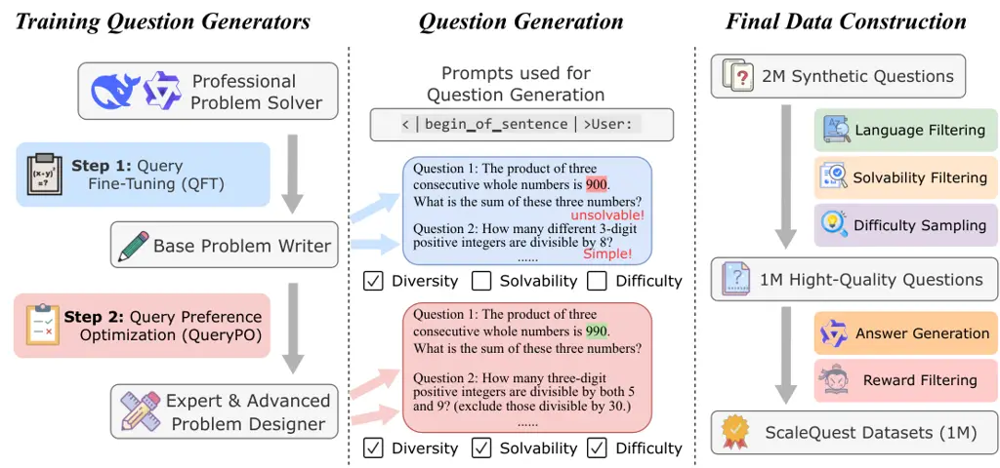
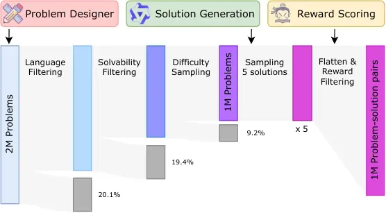

# Unleashing LLM Reasoning Capability via Scalable Question Synthesis from Scratch

Yuyang Ding Affiliation: Soochow University  
Email: [yyding23@stu.suda.edu.cn](mailto:)    Xinyu Shi
Affiliation: Soochow University  
Email: [xyshi02@stu.suda.edu.cn](mailto:)    Xiaobo Liang
Affiliation: Soochow University   Email: [xbliang@suda.edu.cn](mailto:)
   Juntao Li ^(†)^(†)thanks:  Corresponding author Affiliation: Soochow
University   Email: [ljt@suda.edu.cn](mailto:)    Zhaopeng Tu
Affiliation: Tencent AI Lab Email: [qmzhu@suda.edu.cn](mailto:)   
Qiaoming Zhu Affiliation: Soochow University  
Email: [minzhang@suda.edu.cn](mailto:)    Min Zhang Affiliation: Soochow
University   Email: [zptu@tencent.com](mailto:)

###### Abstract

Improving the mathematical reasoning capabilities of Large Language
Models (LLMs) is critical for advancing artificial intelligence.
However, access to extensive, diverse, and high-quality reasoning
datasets remains a significant challenge, particularly for the
open-source community. In this paper, we propose ScaleQuest, a novel,
scalable, and cost-effective data synthesis method that enables the
generation of large-scale mathematical reasoning datasets using
lightweight 7B-scale models. ScaleQuest introduces a two-stage
question-tuning process comprising Question Fine-Tuning (QFT) and
Question Preference Optimization (QPO) to unlock the question generation
capabilities of problem-solving models. By generating diverse questions
from scratch -- without relying on powerful proprietary models or seed
data -- we produce a dataset of 1 million problem-solution pairs. Our
experiments demonstrate that models trained on our data outperform
existing open-source datasets in both in-domain and out-of-domain
evaluations. Furthermore, our approach shows continued performance
improvement as the volume of training data increases, highlighting its
potential for ongoing data scaling. The extensive improvements observed
in code reasoning tasks demonstrate the generalization capabilities of
our proposed method. Our work provides the open-source community with a
practical solution to enhance the mathematical reasoning abilities of
LLMs.¹¹ 1 Project Page:
[https://scalequest.github.io](https://scalequest.github.io).

## 1 Introduction

How to improve the mathematical reasoning capabilities of Large Language
Models (LLMs) has attracted significant attention. The success of recent
advanced models, such as OpenAI o1 and Claude-3.5, heavily depends on
access to extensive, diverse, and high-quality reasoning datasets.
However, the proprietary nature of the data presents a significant
barrier to the open-source community. Recent works have highlighted data
synthesis as a promising approach (Ntoutsi et al., 2020) to address data
scarcity for instruction tuning (Inan et al., 2023). As recent works
have disclosed that crafting the right questions is crucial for
eliciting the reasoning capabilities of LLMs (Yu et al., 2023a; Shah
et al., 2024), the core of reasoning data synthesis lies in creating
large-scale and novel questions.

Figure 1: Results of Llama3-8B-Base fine-tuned on publicly available
datasets in MATH and OlympiadBench. Our approach demonstrates strong
scalability and significant potential for further improvement.

Previous efforts in reasoning data synthesis have demonstrated the
effectiveness of leveraging powerful language models to generate
instructions. We categorize these approaches into two types:
question-driven approaches and knowledge-driven approaches.
Question-driven methods include question rephrasing (Yu et al., 2023a),
evol-instruct (Xu et al., 2023; Luo et al., 2023; Zeng et al., 2024),
question back-translation (Lu et al., 2024), or providing few-shot
examples (Mitra et al., 2024). These methods are limited in data
diversity, as the generated problems closely resemble the seed
questions, with only minor modifications, such as added conditions or
numerical changes. This lack of diversity hampers their potential for
scalability. To improve question diversity, recent knowledge-driven
works (Huang et al., 2024b) scale question synthesis by constructing
knowledge bases (Li et al., 2024b) or concept graphs (Tang et al., 2024)
and sampling key points (Huang et al., 2024a) from them to generate new
questions. Nevertheless, the above two types of approaches rely on
strong models, like GPT-4, to synthesize new questions, but the high API
costs make it impractical to generate large-scale data. Despite these
advancements, the open-source community still lacks high-quality data at
scale and cost-effective synthesis methods.

To meet this requirement, we explore a scalable, low-cost method for
data synthesis. We observe that using problem-solving models to directly
synthesize reasoning questions, as explored in Yu et al. (2023b) and Xu
et al. (2024), falls short in synthesizing reasoning data, as shown in
Figure 1 (see Llama3-8B-Magpie results). Accordingly, we propose a
novel, scalable, and cost-effective data synthesis method, ScaleQuest,
which first introduces a two-stage question-tuning process consisting of
Question Fine-Tuning (QFT) and Question Preference Optimization (QPO) to
unlock the question generation capability of problem-solving models.
Once fine-tuned, these models can then generate diverse questions by
sampling from a broad search space without the need for additional seed
questions or knowledge constraints. The generated questions can be
further refined through a filtering process, focusing on language
clarity, solvability, and appropriate difficulty. Moreover, we introduce
an extra reward-based filtering strategy to select high-quality
responses.

We generate data using lightweight 7B-scale models, producing a final
dataset of 1 million question-answer pairs. As shown in Figure 1,
compared with other publicly available datasets such as MetaMath (Yu
et al., 2023a), DART-Math (Tong et al., 2024), and NuminaMath (Li
et al., 2024c), our approach demonstrates great scalability in both
in-domain and out-of-domain evaluation. In terms of in-domain
evaluation, our method outperforms existing high-quality open-source
datasets, achieving better results with the same amount of data. For
out-of-domain evaluation, the performance of our approach continues to
show promising trends as the volume of training data increases,
indicating significant potential for further improvements through
ongoing data scaling. Additionally, we also extend our approach to long
chain-of-thought and code reasoning tasks, demonstrating its
effectiveness, with details in Appendix C.

## 2 ScaleQuest: Scaling Question Synthesis from Scratch



Figure 2: Overview of our ScaleQuest method.

### 2.1 Question Generation from Scratch

The question generation process involves providing only a few prefix
tokens from an instruction template (e.g.,
“\<\|begin_of_sentence\|\>User:”) to guide the model in question
generation. A fine-tuned causal language model, which has learned to
generate responses based on question-answer pairs (e.g.,
“\<\|begin_of_sentence\|\>User: {Question}. Assistant: {Response}”),
could potentially be leveraged to generate questions directly (Xu
et al., 2024). This is because, during instruction tuning, the model is
trained using a causal mask, where each token only attends to preceding
tokens. This ensures that the hidden states evolve based on past context
without future token influence. However, during instruction tuning, the
actual loss is calculated based on the response, i.e.,

```math
\mathcal{L}=-\log P(y_{i}|X,y_{<i}), \tag{1}
```

where $`X=\{x_{1},x_{2},\ldots,x_{m}\}`$ denotes question and
$`Y=\{y_{1},y_{2},\ldots,y_{n}\}`$ denotes response. Since
$`P(x_{i}|x_{<i})`$ is inherently modeled, we need to activate the
model’s capability for question generation.

### 2.2 Question Fine-Tuning (QFT)

To activate the model’s question generation capability, we first perform
Question Fine-Tuning (QFT), where we train the problem-solving model
using a small set of problems. To ensure that the generator stops after
producing the questions and does not continue generating a response, we
add an end-of-sentence token at the end of each question. We use
approximately 15K problems (without solutions) by mixing the training
set of GSM8K (Cobbe et al., 2021) and MATH (Hendrycks et al., 2021)
datasets as training samples.

The purpose of utilizing these problems is to activate the model’s
question-generation capability rather than to make the model memorize
them. To validate this hypothesis, we train the model separately using
the GSM8K and MATH datasets and compare whether the distribution of the
generated questions matched that of the training data. To evaluate the
question distribution, we use a difficulty classifier, which maps a
question into a difficulty score (details in Section 2.4). We perform
QFT based on Qwen2-Math-7B-Instruct (Yang et al., 2024a), then use the
two QFT models, Qwen2-QFT-GSM8K and Qwen2-QFT-MATH, to synthesize 10K
questions. The difficulty distribution of these four datasets is shown
in Figure 3. We find that the generated questions separately differed
from both GSM8K and MATH, yet they both converged toward the same
distribution. This suggests that the QFT process enhances the model’s
question-generation capabilities without leading to overfitting the
training data.

Figure 3: The difficulty distribution of two real-world datasets and two
synthetic datasets. The difficulty score is calculated based solely on
the problem part.

### 2.3 Question Preference Optimization (QPO)

The model is able to generate meaningful and diverse questions after
QFT, but the quality is still not high enough, as shown in Figure 2.
This is reflected in two aspects: (1) solvability: the math problem
should have appropriate constraints and correct answers, and (2)
difficulty: the model needs to learn from more challenging problems, yet
some of the generated questions are still too simple. To address these
two aspects, we apply Question Preference Optimization (QPO).

We first use the model after QFT to generate 10K questions.
Subsequently, we aim to refine these samples with a primary focus on
solvability and difficulty. We leverage an external LLM for optimization
as an alternative to manual annotation. However, we find that
simultaneously optimizing both poses a challenge for the LLMs.
Therefore, for each sample, we randomly select one of the two
optimization directions, prioritizing either solvability or difficulty
(with optimization prompts in Figure 10 and 11). The optimized
questions, denoted as $`y_{w}`$, are treated as preferred data, while
the original questions, denoted as $`y_{l}`$, are considered
dispreferred data. Inspired by Direct Preference Optimization
(DPO) (Rafailov et al., 2024), we propose QPO for question optimization:

Figure 4: The solvability and difficulty of the raw questions generated
by the QFT model and the optimized ones. We use GPT-4o as a manual
substitute to evaluate the effectiveness of solvability and difficulty
optimization, with evaluation prompt in Figure 12 and 13.

```math
\displaystyle\mathcal{L}_{\text{QPO}}(\pi_{\theta};\pi_{\text{ref}})=-\mathbb{E}_{(y_{w},y_{l})\sim\mathcal{D}}\bigg[ \tag{2}
```

```math
\displaystyle\log\sigma\bigg(\beta\log\frac{\pi_{\theta}(y_{w})}{\pi_{\text{ref}}(y_{w})}-\beta\log\frac{\pi_{\theta}(y_{l})}{\pi_{\text{ref}}(y_{l})}\bigg)\bigg].
```

In terms of model selection, we experiment with three models:
Qwen2-Math-7B-Instruct, GPT-4o-mini, and Llama3.1-70B-Instruct. The
results are shown in Figure 4. In terms of solvability,
Qwen2-Math-7B-Instruct proves inadequate for this task, as the optimized
questions result in decreased solvability. A possible reason for this is
the model’s insufficient ability to follow instructions accurately,
resulting in many answers that fail to meet the specified optimization
constraints.

### 2.4 Question Filtering

After the QFT and QPO phases, we obtain the question generators
Qwen2-Math-QGen. There are still some minor issues in the generated
questions, primarily related to language, solvability, and difficulty.
To address these challenges, we apply the filtering steps:

#### Language Filtering

The question generator models still produce a substantial number of math
questions in other languages, accounting for approximately 20%. Since
our focus is on English math questions, we remove non-English questions
by identifying questions containing non-English characters and filtering
out those samples.

#### Solvability Filtering

Although QPO effectively enhances the solvability of generated
questions, some questions remain nonsensical. To filter out such
samples, we use Qwen2-Math-7B-Instruct to evaluate whether the question
is meaningful and whether the conditions are sufficient, with filtering
prompts provided in Figure 12.

#### Difficulty Sampling

We measure the difficulty of a question using the fail rate (Tong
et al., 2024) — the proportion of incorrect responses when sampling
$`n`$ responses for a given question. This metric aligns with the
intuition that harder questions tend to result in fewer correct
responses. Following Tong et al. (2024), we use DeepSeekMath-7B-RL as
the sampling model to evaluate the difficulty of each question in the
training sets of GSM8K and MATH, obtaining the fail rate for each
question as its difficulty score. We then use this data to train a
difficulty scorer based on DeepSeekMath-7B-Base with mean squared error
(MSE) loss. We then use the scorer to predict the difficulty of each
synthetic question. A portion of overly simple questions is then
filtered out, which is empirically determined based on the difficulty
distribution of the questions.

### 2.5 Response Generation

We use the reward model score as a metric for evaluating the quality of
responses. For each question, we generate 5 solutions and select the
solution with the highest reward model scores as the preferred solution.
In our experiments, we use InternLM2-7B-Reward (Cai et al., 2024) as our
reward model. This choice is primarily guided by the model’s performance
on the reasoning subset of the Reward Bench (Lambert et al., 2024).

## 3 Experiment

|                                                                                                     |                                                                                                |       |      |              |                |         |
| --------------------------------------------------------------------------------------------------- | ---------------------------------------------------------------------------------------------- | ----- | ---- | ------------ | -------------- | ------- |
| Model                                                                                               | Synthesis Model                                                                                | GSM8K | MATH | College Math | Olympiad Bench | Average |
| Teacher Models in Data Synthesis                                                                    |                                                                                                |       |      |              |                |         |
|  GPT-4-0314                                 | \-                                                                                             | 94.7  | 52.6 | 24.4         | \-             | \-      |
|  GPT-4-Turbo-24-04-09                       | \-                                                                                             | 94.5  | 73.4 | \-           | \-             | \-      |
|  GPT-4o-2024-08-06                          | \-                                                                                             | 92.9  | 81.1 | 50.2         | 43.3           | 66.9    |
| ![[Uncaptioned image]](arxiv-2410-18693--eff2daa245a1.figures/figure-2.webp) DeepSeekMath-7B-RL     | \-                                                                                             | 88.2  | 52.4 | 41.4         | 19.0           | 49.3    |
| ![[Uncaptioned image]](arxiv-2410-18693--eff2daa245a1.figures/figure-3.webp) Qwen2-Math-7B-Instruct | \-                                                                                             | 89.5  | 73.1 | 50.5         | 37.8           | 62.7    |
| General Base Model                                                                                  |                                                                                                |       |      |              |                |         |
| Mistral-7B-WizardMath                                                                               |  GPT-4                                 | 81.9  | 33.3 | 21.5         | 8.6            | 36.3    |
| Mistral-7B-MetaMath                                                                                 |  GPT-3.5                               | 77.7  | 28.2 | 19.1         | 5.8            | 32.7    |
| Mistral-7B-MMIQC                                                                                    |  GPT-4                                 | 75.7  | 36.3 | 24.8         | 10.8           | 36.9    |
| Mistral-7B-MathScale                                                                                |  GPT-3.5                               | 74.8  | 35.2 | 21.8         | \-             | \-      |
| Mistral-7B-KPMath                                                                                   |  GPT-4                                 | 82.1  | 46.8 | \-           | \-             | \-      |
| Mistral-7B-DART-Math                                                                                | ![[Uncaptioned image]](arxiv-2410-18693--eff2daa245a1.figures/figure-2.webp) DSMath-7B-RL      | 81.1  | 45.5 | 29.4         | 14.7           | 42.7    |
| Mistral-7B-NuminaMath                                                                               |  GPT-4o                                | 82.1  | 49.4 | 33.8         | 19.4           | 46.2    |
| Mistral-7B-ScaleQuest                                                                               | ![[Uncaptioned image]](arxiv-2410-18693--eff2daa245a1.figures/figure-3.webp) Qwen2-Math-7B-Ins | 88.5  | 62.9 | 43.5         | 26.8           | 55.4    |
| Llama3-8B-MetaMath                                                                                  |  GPT-3.5                              | 77.3  | 32.5 | 20.6         | 5.5            | 34.0    |
| Llama3-8B-MMIQC                                                                                     |  GPT-4                                | 77.6  | 39.5 | 29.5         | 9.6            | 39.1    |
| Llama3-8B-DART-Math                                                                                 | ![[Uncaptioned image]](arxiv-2410-18693--eff2daa245a1.figures/figure-2.webp) DSMath-7B-RL      | 81.1  | 46.6 | 28.8         | 14.5           | 42.8    |
| Llama3-8B-NuminaMath                                                                                |  GPT-4o                               | 77.2  | 50.7 | 33.2         | 17.8           | 44.7    |
| Llama3-8B-ScaleQuest                                                                                | ![[Uncaptioned image]](arxiv-2410-18693--eff2daa245a1.figures/figure-3.webp) Qwen2-Math-7B-Ins | 87.9  | 64.4 | 42.8         | 25.3           | 55.1    |
| Math-Specialized Base Model                                                                         |                                                                                                |       |      |              |                |         |
| DeepSeekMath-7B-Instruct                                                                            | \-                                                                                             | 82.7  | 46.9 | 37.1         | 14.2           | 45.2    |
| DeepSeekMath-7B-MMIQC                                                                               |  GPT-4                                | 79.0  | 45.3 | 35.3         | 13.0           | 43.2    |
| DeepSeekMath-7B-KPMath-Plus                                                                         |  GPT-4                                | 83.9  | 48.8 | \-           | \-             | \-      |
| DeepSeekMath-7B-DART-Math                                                                           | ![[Uncaptioned image]](arxiv-2410-18693--eff2daa245a1.figures/figure-2.webp) DSMath-7B-RL      | 86.8  | 53.6 | 40.7         | 21.7           | 50.7    |
| DeepSeekMath-7B-Numina-Math                                                                         |  GPT-4o                               | 75.4  | 55.2 | 36.9         | 19.9           | 46.9    |
| DeepSeekMath-7B-ScaleQuest                                                                          | ![[Uncaptioned image]](arxiv-2410-18693--eff2daa245a1.figures/figure-3.webp) Qwen2-Math-7B-Ins | 89.5  | 66.6 | 47.7         | 29.9           | 58.4    |
| Qwen2-Math-7B-MetaMath                                                                              |  GPT-3.5                              | 83.9  | 49.5 | 39.9         | 17.9           | 47.8    |
| Qwen2-Math-7B-DART-Math                                                                             | ![[Uncaptioned image]](arxiv-2410-18693--eff2daa245a1.figures/figure-2.webp) DSMath-7B-RL      | 88.6  | 58.8 | 45.4         | 23.1           | 54.0    |
| Qwen2-Math-7B-Numina-Math                                                                           |  GPT-4o                               | 84.6  | 65.6 | 45.5         | 33.6           | 57.3    |
| Qwen2-Math-7B-ScaleQuest                                                                            | ![[Uncaptioned image]](arxiv-2410-18693--eff2daa245a1.figures/figure-3.webp) Qwen2-Math-7B-Ins | 89.7  | 73.4 | 50.0         | 38.5           | 62.9    |

Table 1: Main results on four mathematical reasoning benchmarks. Bold
means the best score with the same base model. The baselines use
different synthesis models for both question synthesis and response
generation, such as GPT-3.5, GPT-4, and GPT-4o. For our approach,
DSMath-7B-QGen and Qwen2-Math-7B-QGen are utilized for question
synthesis, with Qwen2-Math-7B-Instruct used for response generation. If
multiple models are used, only the latest released one is marked. More
details about these datasets are shown in Table 7.

### 3.1 Experimental Setup

#### Training Problem Designers

In addition to Qwen2-Math-QGen, we also train another question generator
based on DeepSeekMath-7B-RL. We find that combining questions
synthesized by multiple generators enhances data diversity, leading to
improved final performance, as further discussed in section 3.3. In this
process of the overall data synthesis, many models are mentioned in the
context of QFT and QPO. We explain the inherent insights behind the
model selection in Appendix D.

#### Question & Response Generation

The two question generation models are then utilized to generate a total
of 2 million questions, with 1 million from each model. For difficulty
filtering, we filter out a portion of overly simple questions generated
by DeepSeekMath-QGen and keep the questions generated by Qwen2-Math-QGen
as the difficulty distribution is more balanced. Based on the problems,
we synthesize responses (section 2.5) using Qwen2-Math-7B-Instruct (Yang
et al., 2024a). For each problem, we sample 5 solutions and select the
one with the highest reward score as the final response. The final
dataset consists of 1 million problem-solution pairs. A detailed
analysis of our constructed dataset is provided in Appendix B.

#### Instruction Tuning

We conduct instruction tuning on the synthetic problems and solutions
using two general base models, Mistral-7B (Jiang et al., 2023) and
Llama3-8B (Dubey et al., 2024), as well as two math-specialized base
models, DeepSeekMath-7B (Shao et al., 2024) and Qwen2-Math-7B (Yang
et al., 2024a). More hyperparameters in the process are provided in
Appendix A.

#### Evaluation and Metrics

We assess the fine-tuned models’ performance across four datasets of
increasing difficulty. Along with the widely used GSM8K (elementary
level) and MATH (competition level), we include two more challenging
benchmarks: College Math (Tang et al., 2024) (college level) and
Olympiad Bench (He et al., 2024) (Olympiad level). For evaluation, we
employ the script from Tong et al. (2024) to extract final answers and
determine correctness by comparing answer equivalency. The generated
outputs are all in the form of natural language Chain-of-Thought (CoT)
reasoning (Wei et al., 2022) through greedy decoding, with no tool
integration, and we report zero-shot pass@1 accuracy. We also conduct
more comprehensive evaluation, with details shown in Appendix E. We also
extend our approach to the long cot and code reasoning task, with
details and experiments provided in Appendix C.

#### Compared Baselines

We mainly compare with data synthesis methods, including question-driven
approach such as WizardMath (Luo et al., 2023), MetaMath (Yu et al.,
2023a), MMIQC (Liu and Yao, 2024), Orca-Math (Mitra et al., 2024) and
knowledge-driven approach such as KPMath (Huang et al., 2024a),
MathScale (Tang et al., 2024). In addition to this, we also involve
other large math corpus like DART-Math (Tong et al., 2024) and
Numina-Math (Li et al., 2024c). More details of these datasets are shown
in Table 7.

### 3.2 Main Results

#### ScaleQuest significantly outperforms other baselines

Table 1 presents the results. ScaleQuest significantly outperforms
previous synthetic methods, with average performance improvements
ranging from 5.6% to 11.5% over the prior state-of-the-art (SoTA) on
both general base models and math-specialized foundation models.
Qwen2-Math-7B-ScaleQuest achieve a zero-shot pass@1 accuracy of 73.4 on
the MATH benchmark, matching the performance of GPT-4-Turbo. For
out-of-domain tasks, Qwen2-Math-7B-ScaleQuest outperform its teacher
model, Qwen2-Math-7B-Instruct, with scores of 89.7 on the GSM8K
benchmark, 73.4 on the MATH benchmark, and 38.5 on the Olympiad
benchmark. In this experiment, we do not strictly control for identical
training data volumes due to practical constraints (i.e., some datasets
are not publicly available). To address this, we compare the results
with publicly available datasets under equal data volumes in
Appendix E.2. It’s important to highlight that Qwen2-Math-7B-Instruct
has undergone preference alignment, utilizing the powerful reward model
Qwen2-Math-RM-72B (Yang et al., 2024a), while our model is only an
instruction tuning version.

#### ScaleQuest scales well with increasing data

We also compare the scalability of our dataset with other publicly
available datasets, including MetaMath (Yu et al., 2023a),
DART-Math (Tong et al., 2024), and Numina-Math (Li et al., 2024c). We
train Llama3-8B on these datasets and compare their performance changes
with increased data size. The results are presented in Figure 1. For the
in-domain evaluation (MATH), our method demonstrates high data
efficiency, achieving superior results with the same amount of data. In
out-of-domain evaluations (Olympiad Bench), it also shows strong
scalability, continuing to improve even as other datasets reach their
limits. A limited question set leads to constrained improvements in
model performance, as demonstrated by the results of DART-Math, which
relies on a small number of questions and generates numerous correct
answers through rejection sampling. Our results further demonstrate that
diverse questions support sustained performance growth, emphasizing the
need for broader and more varied question generation.

### 3.3 Ablation study

Figure 5: A comparison of the synthetic dataset generated by the raw
instruct model, the model after QFT, the model after QPO, and the final
dataset after applying reward filtering. Left: The solvable ratio and
difficulty score of the generated questions. The solvable ratio refers
to the proportion of generated questions that are judged as “solvable”,
while the difficulty score represents the average difficulty rating
assigned to each generated question. For difficulty evaluation, we
calculate the dataset’s average difficulty score based on ratings for
each question: “very easy” is rated as 20 points, “easy” as 40 points,
“medium” as 60 points, “hard” as 80 points, and “very hard” as 100
points. Right: The instruction tuning effectiveness on Llama3-8B-Base.

#### Each sub-method contributes to the final performance

To validate the effectiveness of each of our sub-methods, including QFT,
QPO, and reward filtering, we conduct an ablation study. We evaluate the
quality of the questions generated by the models across three
dimensions: solvability, difficulty, and performance in instruction
tuning. For solvability and difficulty, we use the same evaluation
process as stated in section 2.3.

The results are shown in Figure 5. The “raw model” refers to using the
instruct model to directly generate instructions and responses, as done
in Xu et al. (2024). To ensure fairness, we also generate 1M
question-response pairs using their method based on
Qwen2-Math-7B-Instruct, which are used to train Llama3-8B-Base. After
applying QFT and QPO, the model’s performance improves across all three
evaluation dimensions, demonstrating the effectiveness of each
sub-method.

|                 |       |      |      |      |      |
| --------------- | ----- | ---- | ---- | ---- | ---- |
| Question Source | GSM8K | MATH | CM   | OB   | Avg  |
| MetaMath        | 84.5  | 53.8 | 40.1 | 22.1 | 50.1 |
| OrcaMath        | 84.2  | 53.7 | 40.5 | 23.7 | 50.5 |
| NuminaMath      | 86.0  | 65.9 | 46.1 | 30.2 | 57.1 |
| ScaleQuest      | 89.5  | 66.6 | 47.7 | 29.9 | 58.4 |

Table 2: Comparison of question quality across different datasets. To
ensure consistency, all responses are generated using
Qwen2-Math-7B-Instruct with the same reward filtering process. CM and OB
refer to College Math and Olympiad Bench, respectively. Additional
results based on the other three backbone models are shown in
Appendix E.4.

#### Comparison of question quality

To directly compare the question quality of our constructed data with
other open-source datasets, we use the same model,
Qwen2-Math-7B-Instruct, to generate responses. We then fine-tune
DeepSeekMath-7B-Base using these synthetic datasets. As shown in
Table 2, our model outperforms other synthetic datasets like MetaMath
and OrcaMath, highlighting the high quality of our questions. NuminaMath
also demonstrates competitive performance, largely due to the fact that
many of its questions are drawn from real-world scenarios. This
highlights the importance of question quality for synthetic data.

|                                                                                        |       |      |      |      |      |
| -------------------------------------------------------------------------------------- | ----- | ---- | ---- | ---- | ---- |
| Dataset                                                                                | GSM8K | MATH | CM   | OB   | Avg  |
| ![[Uncaptioned image]](arxiv-2410-18693--eff2daa245a1.figures/figure-2.webp) SQ-DSMath | 87.6  | 52.2 | 39.8 | 19.4 | 49.8 |
| ![[Uncaptioned image]](arxiv-2410-18693--eff2daa245a1.figures/figure-3.webp) SQ-Qwen2  | 86.8  | 56.1 | 39.6 | 18.7 | 50.3 |
| Mixed                                                                                  | 87.8  | 58.0 | 40.1 | 22.2 | 52.0 |

Table 3: The performance of Mistral-7B fine-tuned on ScaleQuest-DSMath,
ScaleQuest-Qwen2, and a mix of both. We fix the training data size at
400K and find that the mixed data results in the largest improvement.

|                                                    |                                |       |                |           |           |
| -------------------------------------------------- | ------------------------------ | ----- | -------------- | --------- | --------- |
| Phase                                              |                                | Type  | \# Samples     | GPU hours | Cost (\$) |
| QFT                                                | Training DSMath-QFT            | Train | 15K            | 2.0       | 2.6       |
|                                                    | Training Qwen2-Math-QFT        | Train | 15K            | 1.9       | 2.5       |
| QPO                                                | Generate Questions             | Infer | 10K$`\times`$2 | 0.4       | 0.5       |
|                                                    | Construct Preference Data      | API   | 10K$`\times`$2 | \-        | 6.2       |
|                                                    | QPO Training                   | Train | 10K$`\times`$2 | 6.6       | 8.5       |
| Data Synthesis                                     | Question Generation            | Infer | 2M             | 38.4      | 49.5      |
|                                                    | solvability & difficulty check | Infer | 2M             | 110.6     | 142.7     |
|                                                    | Response Generation            | Infer | 1M$`\times`$5  | 251.0     | 323.8     |
|                                                    | Reward Scoring                 | Infer | 1M$`\times`$5  | 112.0     | 144.5     |
| Total                                              |                                |       | 1M             | 522.9     | 680.8     |
| GPT-4 cost (generating the same number of tokens)  |                                |       | \-             | \-        | 24,939.5  |
| GPT-4o cost (generating the same number of tokens) |                                |       | \-             | \-        | 6,115.9   |

Table 4: Cost analysis of the entire data synthesis process. We also
estimate the cost of generating the same number of tokens using
proprietary models GPT-4 and GPT-4o for comparison.

#### Multiple question generators enhance data diversity

We use two models as question generators: DSMath-QGen and
Qwen2-Math-QGen, which are based on DeepSeekMath (Shao et al., 2024) and
Qwen2-Math (Yang et al., 2024a), respectively. To explore the impact of
using multiple question generators, we compare the effects of using data
synthesized by a single generator versus a mix of data from both. As
shown in Table 3, we find that the mixed data outperforms the data
generated by either single generator. A possible explanation for this
improvement is the increased data diversity. In fact, we observe that
DSMath-QGen tends to generate simpler, more real-world-oriented
questions, while Qwen2-Math-QGen produces more challenging,
theory-driven ones.

### 3.4 Human Evaluation Results

We conduct a human evaluation of the generated data, focusing on three
aspects: clarity, reasonableness, and real-world relevance. For
reference, we also include two high-quality, human-curated datasets,
GSM8K and MATH. A total of 40 examples are sampled from each dataset and
evaluated based on clarity, coherence, and real-world relevance, with
scores ranging from 1 to 5. The results are presented in Table 5. In
terms of clarity and reasonableness, our synthetic data surpasses
NuminaMath but still falls short of the high-quality, real-world
datasets like the training sets of GSM8K and MATH. Regarding real-world
relevance, GSM8K leans toward practical, real-life scenarios, while MATH
focuses more on theoretical mathematical derivations. Our generated data
can be seen as a balance between the two.

|            |         |                |                      |
| ---------- | ------- | -------------- | -------------------- |
| Dataset    | Clarity | Reasonableness | Real-world relevance |
| GSM8K      | 4.4     | 4.5            | 3.9                  |
| MATH       | 4.1     | 4.3            | 2.4                  |
| NuminaMath | 3.8     | 4.0            | 2.4                  |
| ScaleQuest | 3.9     | 4.0            | 2.8                  |

Table 5: Human Evaluation Results.

### 3.5 Cost Analysis

The data synthesis process is conducted on a server with 8 A100-40G-PCIe
GPUs. We summarize our overall costs in Table 4. Generating 1 million
data samples requires only 522.9 GPU hours (approximately 2.7 days on an
8-GPU server), with an estimated cost of \$680.8 for cloud server
rental.²² 2
[https://lambdalabs.com/service/gpu-cloud](https://lambdalabs.com/service/gpu-cloud)
This is only about 10% of the cost of generating the same data using
GPT-4o, demonstrating the cost-effectiveness of our method.

## 4 Related Work

### 4.1 Mathematical Reasoning

Solving math problems is regarded as a key measure of evaluating the
reasoning ability of LLMs. Recent advancements in mathematical reasoning
for LLMs, including models like OpenAI o1, Claude-3.5, Gemini (Reid
et al., 2024), DeepSeekMath (Shao et al., 2024), InternLM2-Math (Cai
et al., 2024), and Qwen2.5-Math (Yang et al., 2024b), have spurred the
development of various approaches to improve reasoning capabilities of
LLMs on math-related tasks. To strengthen the math reasoning
capabilities of LLMs, researchers have focused on areas such as
prompting techniques (Chia et al., 2023; Chen et al., 2023; Zhang
et al., 2023), data construction for pretraining (Lewkowycz et al.,
2022; Azerbayev et al., 2023; Zhou et al., 2024; Shao et al., 2024) and
instruction tuning (Luo et al., 2023; Yue et al., 2023), tool-integrated
reasoning(Chen et al., 2022; Gao et al., 2023; Gou et al., 2023; Wang
et al., 2023; Yue et al., 2024; Yin et al., 2024; Zhang et al., 2024),
and preference tuning (Ma et al., 2023; Luong et al., 2024; Shao et al.,
2024; Lai et al., 2024). Our work primarily focuses on math data
synthesis for instruction tuning.

### 4.2 Data Synthesis for Instruction Tuning

High-quality reasoning data, particularly well-crafted questions, is in
short supply. Prior efforts have mostly started with a small set of
human-annotated seed instructions and expanded them through few-shot
prompting. We categorize them into two types: question-driven
augmentation (Luo et al., 2023; Yu et al., 2023a; Li et al., 2024a; Liu
and Yao, 2024; Li et al., 2024b) and knowledge-driven
augmentation (Didolkar et al., 2024; Shah et al., 2024; Tang et al.,
2024; Huang et al., 2024a). There are other methods for enhancing
dataset quality as well. DART-Math (Tong et al., 2024) focuses on
enhancing the quality of responses by using difficulty-aware rejection
sampling. In contrast, Numina-Math (Li et al., 2024c) improves its
dataset by collecting more real-world and synthetic data. These
high-quality datasets can be integrated with our constructed dataset,
resulting in an improved data mix for more effective instruction tuning.

## 5 Conclusion

In this work, we propose ScaleQuest, a novel data synthesis framework
that unlocks the ability of lightweight models to independently generate
large-scale, high-quality reasoning data from scratch, at a low cost.
Using this dataset, we fine-tune the model and achieve remarkable
improvements, with gains ranging from 29.2% to 46.4% compared to the
base model, outperforming the strong baselines.

## Limitation

We explore the potential of lightweight open-sourced models to generate
high-quality instruction tuning data. However, the effectiveness on
larger and more powerful models, such as Qwen2.5-Math-72B-Instruct and
Llama3.3-70B-Instruct, remains uncertain. Our future research will focus
on experimenting with these larger models. Additionally, although the
optimizations for solvability and difficulty have shown positive
effects, the model-generated responses still fall short of being fully
satisfactory. Therefore, further improvements in question preference
alignment are crucial and will be an important direction for our future
work.

## Acknowledgements

We want to thank all the anonymous reviewers for their valuable
comments. This work was supported by the National Science Foundation of
China (NSFC No. 62206194), the Natural Science Foundation of Jiangsu
Province, China (Grant No. BK20220488), the Young Elite Scientists
Sponsorship Program by CAST (2023QNRC001), the Priority Academic Program
Development of Jiangsu Higher Education Institutions, and Sponsored by
CCF-Tencent Rhino-Bird Open Research Fund. We also acknowledge MetaStone
Tech. Co. for providing us with the software, optimisation on high
performance computing and computational resources required by this work.

## References

- Austin et al. (2021) Jacob Austin, Augustus Odena, Maxwell Nye,
  Maarten Bosma, Henryk Michalewski, David Dohan, Ellen Jiang, Carrie
  Cai, Michael Terry, Quoc Le, et al. 2021. Program synthesis with large
  language models. _arXiv preprint arXiv:2108.07732_.
- Azerbayev et al. (2023) Zhangir Azerbayev, Hailey Schoelkopf, Keiran
  Paster, Marco Dos Santos, Stephen McAleer, Albert Q Jiang, Jia Deng,
  Stella Biderman, and Sean Welleck. 2023. Llemma: An open language
  model for mathematics. _arXiv preprint arXiv:2310.10631_.
- Brown (2020) Tom B Brown. 2020. Language models are few-shot learners.
  _arXiv preprint arXiv:2005.14165_.
- Cai et al. (2024) Zheng Cai, Maosong Cao, Haojiong Chen, Kai Chen,
  Keyu Chen, Xin Chen, Xun Chen, Zehui Chen, Zhi Chen, Pei Chu,
  et al. 2024. Internlm2 technical report. _arXiv preprint
  arXiv:2403.17297_.
- Chen et al. (2023) Jiaao Chen, Xiaoman Pan, Dian Yu, Kaiqiang Song,
  Xiaoyang Wang, Dong Yu, and Jianshu Chen. 2023. Skills-in-context
  prompting: Unlocking compositionality in large language models. _arXiv
  preprint arXiv:2308.00304_.
- Chen et al. (2021) Mark Chen, Jerry Tworek, Heewoo Jun, Qiming Yuan,
  Henrique Ponde De Oliveira Pinto, Jared Kaplan, Harri Edwards, Yuri
  Burda, Nicholas Joseph, Greg Brockman, et al. 2021. Evaluating large
  language models trained on code. _arXiv preprint arXiv:2107.03374_.
- Chen et al. (2022) Wenhu Chen, Xueguang Ma, Xinyi Wang, and William W
  Cohen. 2022. Program of thoughts prompting: Disentangling computation
  from reasoning for numerical reasoning tasks. _arXiv preprint
  arXiv:2211.12588_.
- Chia et al. (2023) Yew Ken Chia, Guizhen Chen, Luu Anh Tuan, Soujanya
  Poria, and Lidong Bing. 2023. Contrastive chain-of-thought prompting.
  _arXiv preprint arXiv:2311.09277_.
- Cobbe et al. (2021) Karl Cobbe, Vineet Kosaraju, Mohammad Bavarian,
  Mark Chen, Heewoo Jun, Lukasz Kaiser, Matthias Plappert, Jerry Tworek,
  Jacob Hilton, Reiichiro Nakano, et al. 2021. Training verifiers to
  solve math word problems. _arXiv preprint arXiv:2110.14168_.
- Didolkar et al. (2024) Aniket Didolkar, Anirudh Goyal, Nan Rosemary
  Ke, Siyuan Guo, Michal Valko, Timothy Lillicrap, Danilo Rezende,
  Yoshua Bengio, Michael Mozer, and Sanjeev Arora. 2024. Metacognitive
  capabilities of llms: An exploration in mathematical problem solving.
  _arXiv preprint arXiv:2405.12205_.
- Dubey et al. (2024) Abhimanyu Dubey, Abhinav Jauhri, Abhinav Pandey,
  Abhishek Kadian, Ahmad Al-Dahle, Aiesha Letman, Akhil Mathur, Alan
  Schelten, Amy Yang, Angela Fan, et al. 2024. The llama 3 herd of
  models. _arXiv preprint arXiv:2407.21783_.
- Gao et al. (2023) Luyu Gao, Aman Madaan, Shuyan Zhou, Uri Alon,
  Pengfei Liu, Yiming Yang, Jamie Callan, and Graham Neubig. 2023. Pal:
  Program-aided language models. In _International Conference on Machine
  Learning_, pages 10764–10799. PMLR.
- Gou et al. (2023) Zhibin Gou, Zhihong Shao, Yeyun Gong, Yujiu Yang,
  Minlie Huang, Nan Duan, Weizhu Chen, et al. 2023. Tora: A
  tool-integrated reasoning agent for mathematical problem solving.
  _arXiv preprint arXiv:2309.17452_.
- Guo et al. (2025) Daya Guo, Dejian Yang, Haowei Zhang, Junxiao Song,
  Ruoyu Zhang, Runxin Xu, Qihao Zhu, Shirong Ma, Peiyi Wang, Xiao Bi,
  et al. 2025. Deepseek-r1: Incentivizing reasoning capability in llms
  via reinforcement learning. _arXiv preprint arXiv:2501.12948_.
- Guo et al. (2024) Daya Guo, Qihao Zhu, Dejian Yang, Zhenda Xie, Kai
  Dong, Wentao Zhang, Guanting Chen, Xiao Bi, Yu Wu, YK Li, et al. 2024.
  Deepseek-coder: When the large language model meets programming–the
  rise of code intelligence. _arXiv preprint arXiv:2401.14196_.
- He et al. (2024) Chaoqun He, Renjie Luo, Yuzhuo Bai, Shengding Hu,
  Zhen Leng Thai, Junhao Shen, Jinyi Hu, Xu Han, Yujie Huang, Yuxiang
  Zhang, et al. 2024. Olympiadbench: A challenging benchmark for
  promoting agi with olympiad-level bilingual multimodal scientific
  problems. _arXiv preprint arXiv:2402.14008_.
- Hendrycks et al. (2021) Dan Hendrycks, Collin Burns, Saurav Kadavath,
  Akul Arora, Steven Basart, Eric Tang, Dawn Song, and Jacob
  Steinhardt. 2021. Measuring mathematical problem solving with the math
  dataset. _arXiv preprint arXiv:2103.03874_.
- Huang et al. (2024a) Yiming Huang, Xiao Liu, Yeyun Gong, Zhibin Gou,
  Yelong Shen, Nan Duan, and Weizhu Chen. 2024a. Key-point-driven data
  synthesis with its enhancement on mathematical reasoning. _arXiv
  preprint arXiv:2403.02333_.
- Huang et al. (2024b) Yinya Huang, Xiaohan Lin, Zhengying Liu, Qingxing
  Cao, Huajian Xin, Haiming Wang, Zhenguo Li, Linqi Song, and Xiaodan
  Liang. 2024b. Mustard: Mastering uniform synthesis of theorem and
  proof data. _arXiv preprint arXiv:2402.08957_.
- Hui et al. (2024) Binyuan Hui, Jian Yang, Zeyu Cui, Jiaxi Yang,
  Dayiheng Liu, Lei Zhang, Tianyu Liu, Jiajun Zhang, Bowen Yu, Keming
  Lu, et al. 2024. Qwen2. 5-coder technical report. _arXiv preprint
  arXiv:2409.12186_.
- Inan et al. (2023) Hakan Inan, Kartikeya Upasani, Jianfeng Chi, Rashi
  Rungta, Krithika Iyer, Yuning Mao, Michael Tontchev, Qing Hu, Brian
  Fuller, Davide Testuggine, et al. 2023. Llama guard: Llm-based
  input-output safeguard for human-ai conversations. _arXiv preprint
  arXiv:2312.06674_.
- Jiang et al. (2023) Albert Q Jiang, Alexandre Sablayrolles, Arthur
  Mensch, Chris Bamford, Devendra Singh Chaplot, Diego de las Casas,
  Florian Bressand, Gianna Lengyel, Guillaume Lample, Lucile Saulnier,
  et al. 2023. Mistral 7b. _arXiv preprint arXiv:2310.06825_.
- Krell et al. (2021) Mario Michael Krell, Matej Kosec, Sergio P Perez,
  and Andrew Fitzgibbon. 2021. Efficient sequence packing without
  cross-contamination: Accelerating large language models without
  impacting performance. _arXiv preprint arXiv:2107.02027_.
- Kwon et al. (2023) Woosuk Kwon, Zhuohan Li, Siyuan Zhuang, Ying Sheng,
  Lianmin Zheng, Cody Hao Yu, Joseph E. Gonzalez, Hao Zhang, and Ion
  Stoica. 2023. Efficient memory management for large language model
  serving with pagedattention. In _Proceedings of the ACM SIGOPS 29th
  Symposium on Operating Systems Principles_.
- Lai et al. (2024) Xin Lai, Zhuotao Tian, Yukang Chen, Senqiao Yang,
  Xiangru Peng, and Jiaya Jia. 2024. Step-dpo: Step-wise preference
  optimization for long-chain reasoning of llms. _arXiv preprint
  arXiv:2406.18629_.
- Lambert et al. (2024) Nathan Lambert, Valentina Pyatkin, Jacob
  Morrison, LJ Miranda, Bill Yuchen Lin, Khyathi Chandu, Nouha Dziri,
  Sachin Kumar, Tom Zick, Yejin Choi, et al. 2024. Rewardbench:
  Evaluating reward models for language modeling. _arXiv preprint
  arXiv:2403.13787_.
- Lewkowycz et al. (2022) Aitor Lewkowycz, Anders Andreassen, David
  Dohan, Ethan Dyer, Henryk Michalewski, Vinay Ramasesh, Ambrose Slone,
  Cem Anil, Imanol Schlag, Theo Gutman-Solo, et al. 2022. Solving
  quantitative reasoning problems with language models. _Advances in
  Neural Information Processing Systems_, 35:3843–3857.
- Li et al. (2024a) Chen Li, Weiqi Wang, Jingcheng Hu, Yixuan Wei,
  Nanning Zheng, Han Hu, Zheng Zhang, and Houwen Peng. 2024a. Common 7b
  language models already possess strong math capabilities. _arXiv
  preprint arXiv:2403.04706_.
- Li et al. (2024b) Haoran Li, Qingxiu Dong, Zhengyang Tang, Chaojun
  Wang, Xingxing Zhang, Haoyang Huang, Shaohan Huang, Xiaolong Huang,
  Zeqiang Huang, Dongdong Zhang, et al. 2024b. Synthetic data (almost)
  from scratch: Generalized instruction tuning for language models.
  _arXiv preprint arXiv:2402.13064_.
- Li et al. (2024c) Jia Li, Edward Beeching, Lewis Tunstall, Ben Lipkin,
  Roman Soletskyi, Shengyi Huang, Kashif Rasul, Longhui Yu, Albert Q
  Jiang, Ziju Shen, et al. 2024c. Numinamath: The largest public dataset
  in ai4maths with 860k pairs of competition math problems and
  solutions. _Hugging Face repository_.
- Liang et al. (2024) Zhenwen Liang, Dian Yu, Wenhao Yu, Wenlin Yao,
  Zhihan Zhang, Xiangliang Zhang, and Dong Yu. 2024. Mathchat:
  Benchmarking mathematical reasoning and instruction following in
  multi-turn interactions. _arXiv preprint arXiv:2405.19444_.
- Liu and Yao (2024) Haoxiong Liu and Andrew Chi-Chih Yao. 2024.
  Augmenting math word problems via iterative question composing. _arXiv
  preprint arXiv:2401.09003_.
- Lu et al. (2024) Zimu Lu, Aojun Zhou, Houxing Ren, Ke Wang, Weikang
  Shi, Junting Pan, Mingjie Zhan, and Hongsheng Li. 2024. Mathgenie:
  Generating synthetic data with question back-translation for enhancing
  mathematical reasoning of llms. _arXiv preprint arXiv:2402.16352_.
- Luo et al. (2023) Haipeng Luo, Qingfeng Sun, Can Xu, Pu Zhao,
  Jianguang Lou, Chongyang Tao, Xiubo Geng, Qingwei Lin, Shifeng Chen,
  and Dongmei Zhang. 2023. Wizardmath: Empowering mathematical reasoning
  for large language models via reinforced evol-instruct. _arXiv
  preprint arXiv:2308.09583_.
- Luong et al. (2024) Trung Quoc Luong, Xinbo Zhang, Zhanming Jie, Peng
  Sun, Xiaoran Jin, and Hang Li. 2024. Reft: Reasoning with reinforced
  fine-tuning. _arXiv preprint arXiv:2401.08967_.
- Ma et al. (2023) Qianli Ma, Haotian Zhou, Tingkai Liu, Jianbo Yuan,
  Pengfei Liu, Yang You, and Hongxia Yang. 2023. Let’s reward step by
  step: Step-level reward model as the navigators for reasoning. _arXiv
  preprint arXiv:2310.10080_.
- Mitra et al. (2024) Arindam Mitra, Hamed Khanpour, Corby Rosset, and
  Ahmed Awadallah. 2024. Orca-math: Unlocking the potential of slms in
  grade school math. _arXiv preprint arXiv:2402.14830_.
- Moritz et al. (2018) Philipp Moritz, Robert Nishihara, Stephanie Wang,
  Alexey Tumanov, Richard Liaw, Eric Liang, Melih Elibol, Zongheng Yang,
  William Paul, Michael I Jordan, et al. 2018. Ray: A distributed
  framework for emerging $`\{`$AI$`\}`$ applications. In _13th USENIX
  symposium on operating systems design and implementation (OSDI 18)_,
  pages 561–577.
- Ntoutsi et al. (2020) Eirini Ntoutsi, Pavlos Fafalios, Ujwal Gadiraju,
  Vasileios Iosifidis, Wolfgang Nejdl, Maria-Esther Vidal, Salvatore
  Ruggieri, Franco Turini, Symeon Papadopoulos, Emmanouil Krasanakis,
  et al. 2020. Bias in data-driven artificial intelligence systems—an
  introductory survey. _Wiley Interdisciplinary Reviews: Data Mining and
  Knowledge Discovery_, 10(3):e1356.
- Rafailov et al. (2024) Rafael Rafailov, Archit Sharma, Eric Mitchell,
  Christopher D Manning, Stefano Ermon, and Chelsea Finn. 2024. Direct
  preference optimization: Your language model is secretly a reward
  model. _Advances in Neural Information Processing Systems_, 36.
- Reid et al. (2024) Machel Reid, Nikolay Savinov, Denis Teplyashin,
  Dmitry Lepikhin, Timothy Lillicrap, Jean-baptiste Alayrac, Radu
  Soricut, Angeliki Lazaridou, Orhan Firat, Julian Schrittwieser,
  et al. 2024. Gemini 1.5: Unlocking multimodal understanding across
  millions of tokens of context. _arXiv preprint arXiv:2403.05530_.
- Shah et al. (2024) Vedant Shah, Dingli Yu, Kaifeng Lyu, Simon Park,
  Nan Rosemary Ke, Michael Mozer, Yoshua Bengio, Sanjeev Arora, and
  Anirudh Goyal. 2024. Ai-assisted generation of difficult math
  questions. _arXiv preprint arXiv:2407.21009_.
- Shao et al. (2024) Zhihong Shao, Peiyi Wang, Qihao Zhu, Runxin Xu,
  Junxiao Song, Mingchuan Zhang, YK Li, Yu Wu, and Daya Guo. 2024.
  Deepseekmath: Pushing the limits of mathematical reasoning in open
  language models. _arXiv preprint arXiv:2402.03300_.
- Tang et al. (2024) Zhengyang Tang, Xingxing Zhang, Benyou Wan, and
  Furu Wei. 2024. Mathscale: Scaling instruction tuning for mathematical
  reasoning. _arXiv preprint arXiv:2403.02884_.
- Tong et al. (2024) Yuxuan Tong, Xiwen Zhang, Rui Wang, Ruidong Wu, and
  Junxian He. 2024. Dart-math: Difficulty-aware rejection tuning for
  mathematical problem-solving. _arXiv preprint arXiv:2407.13690_.
- Van der Maaten and Hinton (2008) Laurens Van der Maaten and Geoffrey
  Hinton. 2008. Visualizing data using t-sne. _Journal of machine
  learning research_, 9(11).
- Wang et al. (2023) Ke Wang, Houxing Ren, Aojun Zhou, Zimu Lu, Sichun
  Luo, Weikang Shi, Renrui Zhang, Linqi Song, Mingjie Zhan, and
  Hongsheng Li. 2023. Mathcoder: Seamless code integration in llms for
  enhanced mathematical reasoning. _arXiv preprint arXiv:2310.03731_.
- Wei et al. (2021) Jason Wei, Maarten Bosma, Vincent Y Zhao, Kelvin
  Guu, Adams Wei Yu, Brian Lester, Nan Du, Andrew M Dai, and Quoc V
  Le. 2021. Finetuned language models are zero-shot learners. _arXiv
  preprint arXiv:2109.01652_.
- Wei et al. (2022) Jason Wei, Xuezhi Wang, Dale Schuurmans, Maarten
  Bosma, Fei Xia, Ed Chi, Quoc V Le, Denny Zhou, et al. 2022.
  Chain-of-thought prompting elicits reasoning in large language models.
  _Advances in neural information processing systems_, 35:24824–24837.
- Xu et al. (2023) Can Xu, Qingfeng Sun, Kai Zheng, Xiubo Geng, Pu Zhao,
  Jiazhan Feng, Chongyang Tao, and Daxin Jiang. 2023. Wizardlm:
  Empowering large language models to follow complex instructions.
  _arXiv preprint arXiv:2304.12244_.
- Xu et al. (2024) Zhangchen Xu, Fengqing Jiang, Luyao Niu, Yuntian
  Deng, Radha Poovendran, Yejin Choi, and Bill Yuchen Lin. 2024. Magpie:
  Alignment data synthesis from scratch by prompting aligned llms with
  nothing. _arXiv preprint arXiv:2406.08464_.
- Yang et al. (2024a) An Yang, Baosong Yang, Binyuan Hui, Bo Zheng,
  Bowen Yu, Chang Zhou, Chengpeng Li, Chengyuan Li, Dayiheng Liu, Fei
  Huang, et al. 2024a. Qwen2 technical report. _arXiv preprint
  arXiv:2407.10671_.
- Yang et al. (2024b) An Yang, Beichen Zhang, Binyuan Hui, Bofei Gao,
  Bowen Yu, Chengpeng Li, Dayiheng Liu, Jianhong Tu, Jingren Zhou,
  Junyang Lin, et al. 2024b. Qwen2. 5-math technical report: Toward
  mathematical expert model via self-improvement. _arXiv preprint
  arXiv:2409.12122_.
- Yin et al. (2024) Shuo Yin, Weihao You, Zhilong Ji, Guoqiang Zhong,
  and Jinfeng Bai. 2024. Mumath-code: Combining tool-use large language
  models with multi-perspective data augmentation for mathematical
  reasoning. _arXiv preprint arXiv:2405.07551_.
- Yu et al. (2023a) Longhui Yu, Weisen Jiang, Han Shi, Jincheng Yu,
  Zhengying Liu, Yu Zhang, James T Kwok, Zhenguo Li, Adrian Weller, and
  Weiyang Liu. 2023a. Metamath: Bootstrap your own mathematical
  questions for large language models. _arXiv preprint
  arXiv:2309.12284_.
- Yu et al. (2023b) Weichen Yu, Tianyu Pang, Qian Liu, Chao Du, Bingyi
  Kang, Yan Huang, Min Lin, and Shuicheng Yan. 2023b. Bag of tricks for
  training data extraction from language models. In _International
  Conference on Machine Learning_, pages 40306–40320. PMLR.
- Yue et al. (2023) Xiang Yue, Xingwei Qu, Ge Zhang, Yao Fu, Wenhao
  Huang, Huan Sun, Yu Su, and Wenhu Chen. 2023. Mammoth: Building math
  generalist models through hybrid instruction tuning. _arXiv preprint
  arXiv:2309.05653_.
- Yue et al. (2024) Xiang Yue, Tuney Zheng, Ge Zhang, and Wenhu
  Chen. 2024. Mammoth2: Scaling instructions from the web. _arXiv
  preprint arXiv:2405.03548_.
- Zeng et al. (2024) Weihao Zeng, Can Xu, Yingxiu Zhao, Jian-Guang Lou,
  and Weizhu Chen. 2024. Automatic instruction evolving for large
  language models. _arXiv preprint arXiv:2406.00770_.
- Zhang et al. (2024) Beichen Zhang, Kun Zhou, Xilin Wei, Xin Zhao, Jing
  Sha, Shijin Wang, and Ji-Rong Wen. 2024. Evaluating and improving
  tool-augmented computation-intensive math reasoning. _Advances in
  Neural Information Processing Systems_, 36.
- Zhang et al. (2023) Yifan Zhang, Jingqin Yang, Yang Yuan, and Andrew
  Chi-Chih Yao. 2023. Cumulative reasoning with large language models.
  _arXiv preprint arXiv:2308.04371_.
- Zhao et al. (2024) Wenting Zhao, Xiang Ren, Jack Hessel, Claire
  Cardie, Yejin Choi, and Yuntian Deng. 2024. Wildchat: 1m chatgpt
  interaction logs in the wild. _arXiv preprint arXiv:2405.01470_.
- Zheng et al. (2024) Tianyu Zheng, Ge Zhang, Tianhao Shen, Xueling Liu,
  Bill Yuchen Lin, Jie Fu, Wenhu Chen, and Xiang Yue. 2024.
  Opencodeinterpreter: Integrating code generation with execution and
  refinement. _arXiv preprint arXiv:2402.14658_.
- Zhou et al. (2024) Kun Zhou, Beichen Zhang, Jiapeng Wang, Zhipeng
  Chen, Wayne Xin Zhao, Jing Sha, Zhichao Sheng, Shijin Wang, and
  Ji-Rong Wen. 2024. Jiuzhang3. 0: Efficiently improving mathematical
  reasoning by training small data synthesis models. _arXiv preprint
  arXiv:2405.14365_.
- Zhuo et al. (2024) Terry Yue Zhuo, Minh Chien Vu, Jenny Chim, Han Hu,
  Wenhao Yu, Ratnadira Widyasari, Imam Nur Bani Yusuf, Haolan Zhan,
  Junda He, Indraneil Paul, et al. 2024. Bigcodebench: Benchmarking code
  generation with diverse function calls and complex instructions.
  _arXiv preprint arXiv:2406.15877_.

## Appendix A Hyper-parameters settings

#### Training Problem Designers

During the QFT stage, both models are trained on a mixed training subset
of GSM8K and MATH problems, containing a total of 15K problems. We train
for only 1 epoch, considering that training for more epochs might cause
the models to overfit the training problems and negatively impact the
diversity of generated questions. We also use sequence packing (Krell
et al., 2021) to accelerate training. In the QPO stage, we use 10K
preference data for training, with a learning rate of 5e-7 and a batch
size of 128.

#### Question Generation

During this process, we set the maximum generation length to 512, a
temperature of 1.0, and a top-p value of 0.99. To ensure quality, we
apply a question filtering pipeline (section 2.4) that involves language
filtering, solvability filtering, and difficulty sampling. This process
refines the dataset, leaving approximately 1M questions, 400K from
DeepSeek-QGen and 600K from Qwen2-Math-QGen.

#### Response Generation

In the process, we set the maximum generation length to 2048, with a
temperature of 0.7 and top-p of 0.95. We use chain-of-thought
prompt (Wei et al., 2022) to synthesize solutions. We use vLLM (Kwon
et al., 2023) to accelerate the generation and Ray (Moritz et al., 2018)
to deploy distributed inference.

#### Instruction Tuning

All models are fine-tuned for 3 epochs in our experiments unless
specified otherwise. We use a linear learning rate schedule with a 3%
warm-up ratio, reaching a peak of 5e-5 for Llama3 and DeepSeekMath and
1e-5 for the other models, followed by cosine decay to zero.

## Appendix B Additional Data Statistics

#### Filtering process

The entire data generation process is illustrated in Figure 6. After
using the two question generators to produce 2 million questions from
scratch, we perform a filtering process, including language filtering,
solvability checks, and difficulty sampling. These steps filter out
20.1%, 19.4%, and 9.2% of the samples, respectively, resulting in a
final question set of 1 million questions. In the subsequent response
generation process, we filter out responses without answers by checking
for key phrases such as “The answer is” or “\boxed{}”. This step
eliminates a negligible portion of the samples, as most of the filter
questions are solvable and did not pose any confusion for the response
generation model.



Figure 6: Overview of our filtering process.

#### Dataset Coverage

We analyze the dataset coverage through two aspects: (1) Problem Topic
Coverage, such as algebra and geometry. Following Huang et al. (2024a),
we use GPT-4o to categorize the topics of the given questions, with
prompt illustrated in Figure 14. Figure 8 presents the results. We find
that the topics cover the major areas of mathematics, such as
arithmetic, algebra, geometry, and others. (2) Embedding space analysis.
Following Zhao et al. (2024) and Xu et al. (2024), we first compute the
input embeddings of the questions and then project them into a
two-dimensional space using t-SNE (Van der Maaten and Hinton, 2008). We
include only real-world datasets, such as GSM8K (Cobbe et al., 2021),
MATH (Hendrycks et al., 2021), and NuminaMath (Li et al., 2024c) (which
contains a small portion of synthetic questions). As shown in Figure 8,
our synthetic data closely resembles the real-world questions.

Figure 7: Topic distribution of our generated dataset.

Figure 8: t-SNE plot of our dataset, with GSM8K, MATH, and NuminaMath.

#### Data Leakage Analysis

We conduct an n-gram similarity analysis between the generated questions
and all test sets from both our dataset and other baseline datasets.
Based on prior empirical analysis (Brown, 2020; Wei et al., 2021), we
set n=13 to prevent spurious collisions and calculate how much the test
sets overlap with training data to assess data contamination. Table 6
shows the clean ratio of our dataset and other baseline datasets. The
results demonstrate that our dataset achieves a relatively high level of
data cleanliness compared to other datasets, suggesting that our method
generates novel questions instead of memorizing existing ones.

|            |       |      |       |      |      |
| ---------- | ----- | ---- | ----- | ---- | ---- |
| Dataset    | GSM8K | MATH | CM    | OB   | Avg  |
| MetaMath   | 99.8  | 92.2 | 100   | 99.7 | 97.9 |
| NuminaMath | 99.8  | 89.8 | 99.9  | 86.8 | 94.1 |
| DART-Math  | 99.8  | 91.5 | 100.0 | 99.6 | 97.7 |
| MMIQC      | 99.8  | 88.0 | 98.9  | 97.9 | 96.2 |
| SQ (Ours)  | 99.9  | 92.8 | 99.8  | 97.2 | 97.4 |

Table 6: Overlap statistics for the datasets used. We report the clean
ratio of the test set, representing the percentage of test samples that
have no matching n-grams with samples in the training set.

#### Safety Analysis

We use Llama3-8B-Guard (Inan et al., 2023) as a discriminator model to
detect any unsafe elements in the data. After sampling 10K instances
from the 1 million samples, we find that only 0.1% are flagged as
unsafe.

#### Generated Examples

We sample several generated examples from our datasets, as shown in
Figure 17, 18 and 19. The generated math problems are of high quality,
driving effective learning.

|                                   |       |                               |        |
| --------------------------------- | ----- | ----------------------------- | ------ |
| Dataset                           | Size  | Synthesis Model               | Public |
| WizardMath (Luo et al., 2023)     | 96K   | GPT-4                         | ✗      |
| MetaMath (Yu et al., 2023a)       | 395K  | GPT-3.5-Turbo                 | ✓      |
| MMIQC (Liu and Yao, 2024)         | 2294K | GPT-4 & GPT-3.5-Turbo & Human | ✓      |
| Orca-Math (Mitra et al., 2024)    | 200K  | GPT-4-Turbo                   | ✓      |
| Xwin-Math (Li et al., 2024a)      | 1440K | GPT-4-Turbo                   | ✗      |
| KPMath-Plus (Huang et al., 2024a) | 1576K | GPT-4                         | ✗      |
| MathsScale (Tang et al., 2024)    | 2021K | GPT-3.5 & Human               | ✗      |
| DART-Math (Tong et al., 2024)     | 585K  | DeepSeekMath-7B-RL            | ✓      |
| Numina-Math (Li et al., 2024c)    | 860K  | GPT-4 & GPT-4o                | ✓      |
| ScaleQuest                        | 1000K | DeepSeekMath-7B-RL            | ✓      |
|                                   |       | Qwen2-Math-7B-Instruct        |        |

Table 7: Comparison between our constructed dataset and previous
datasets.

## Appendix C ScaleQuest for Broader tasks

### C.1 Long Chain-of-Thought Mathematical Reasoning

DeepSeek-R1 (Guo et al., 2025) demonstrated the effectiveness of Long
Chain-of-Thought (CoT) reasoning in tackling challenging mathematical
reasoning tasks. In this part, we further investigate the capability of
ScaleQuest to generate high-quality long CoT data.

#### Settings

We utilize the latest Qwen2.5-Math-7B model (Yang et al., 2024b) for
question fine-tuning and preference optimization. To construct long CoT
data, we select DeepSeek-R1-Distill-Qwen-7B as the response generator.
The rest of the pipeline remains unchanged from prior work. In total, we
synthesized 150K Long Chain-of-Thought training samples.

#### Results

We then fine-tuned DeepSeek-R1-Distill-Qwen-7B on this dataset, which
also serves as the teacher model during data synthesis. Table 8 presents
the results, showing that the fine-tuned model outperforms its teacher,
demonstrating a strong potential for self-improvement.

|                                  |       |         |        |       |         |
| -------------------------------- | ----- | ------- | ------ | ----- | ------- |
| Model                            | GSM8k | MATH500 | AIME24 | AMC25 | Average |
| DS-R1-Distill-Qwen-7B            | 91.5  | 90.2    | 43.3   | 75.0  | 75.0    |
| DS-R1-Distill-Qwen-7B-ScaleQuest | 93.0  | 91.0    | 53.3   | 90.0  | 81.8    |

Table 8: Results of ScaleQuest-LongCoT.

### C.2 Code Reasoning

We also extend our ScaleQuest method to the Code Reasoning Task as a
simple validation. We made the following modifications to adapt to the
code reasoning task:

#### Settings

We choose DeepSeek-Coder-7B-Instruct (Guo et al., 2024) and
Qwen2.5-Coder-7B-Instruct (Hui et al., 2024) as two problem-solving
models to perform question fine-tuning on 20K questions randomly sampled
from CodeFeedBack (Zheng et al., 2024). For Question Preference
Optimization, we also focus on solvability and difficulty, making slight
modifications to the prompts based on the code reasoning task. Our
evaluation cover HumanEval (Chen et al., 2021), MBPP (Austin et al.,
2021), and BigCodeBench (Zhuo et al., 2024), using the same evaluation
script as Qwen2.5-Coder. We report pass@1 results using greedy search.

|                          |                |           |      |              |         |
| ------------------------ | -------------- | --------- | ---- | ------------ | ------- |
| Model                    | \# Samples (K) | HumanEval | MBPP | BigCodeBench | Average |
| Qwen2.5-Coder-CFB        | 156            | 79.3      | 77.2 | 35.6         | 64.0    |
| Qwen2.5-Coder-CFB-Aug    | 156            | 84.1      | 84.7 | 39.0         | 69.3    |
| Qwen2.5-Coder-ScaleQuest | 156            | 86.6      | 83.1 | 40.0         | 69.9    |

Table 9: Results of ScaleQuest in Code Reasoning Task. All results are
based on Qwen2.5-Coder-7B-Base. CFB refers to the CodeFeedBack-Filtered
Dataset. We augment the responses for the problems in
CodeFeedback-Filtered using Qwen2.5-Coder-7B-Instruct with reward
filtering, creating a new dataset referred to as CFB-Aug.

#### Results

The results are presented in Table 9. Compared to the widely used
refined version of CodeFeedback, namely CodeFeedback-Filtered, our
generated data outperforms it, with an average improvement of 5.9 across
the three baselines. Additionally, we enhance the Response portion of
CodeFeedback-Filtered using Qwen2.5-Coder-7B-Instruct, and the results
indicate that our generated questions are of higher quality. This
further demonstrates the effectiveness of the ScaleQuest method.

## Appendix D Insights behind model selection

In our works, we use multiple models, e.g., DSMath-7B-RL,
Qwen2-Math-7B-Ins, GPT-4o-mini, and DSMath-7B-Base, which may cause
confusion for model selection. In response, we also supplement our
approach with a simpler setup. We use Qwen2-Math-7B-Ins for training
question generators, constructing optimization data for QPO, and
performing solvability & difficulty filtering, as well as for response
generation. For reward filtering, InternLM-7B-Reward remained unchanged.
The results, as shown in Figure 11 (ScaleQuest-Simple result), indicate
that our approach continues to demonstrate superior performance compared
to existing datasets. Additionally, we summarize these insights on model
selection for domain adaptation:

- •
  Selection of base model for training question generator: The
  self-synthesis generation paradigm heavily relies on the inherent
  knowledge of the problem-solving model itself (Xu et al., 2024).
  Therefore, a domain-specific model is essential. For example,
  Qwen2-Math-Ins is suitable for mathematical reasoning, while
  Qwen2.5-Coder-Ins fits well for code reasoning. Furthermore, using
  multiple question generators often leads to more diverse and
  higher-quality questions (as discussed in section 3.3).
- •
  Selection of model for constructing optimization data: Well-aligned,
  general-purpose models, such as Llama3.1-70B and GPT-4o-mini, tend to
  perform better than domain-specific models, as illustrated in
  Figure 4.
- •
  Selection of Response Generation Model & Reward Model: These can be
  selected based on their performance on the corresponding mathematical
  tasks.

We believe that the methodology and the experience in selecting models
are always more critical than the chosen models themselves. With the
continuous advancements in the open-source community, we are confident
that stronger models will undoubtedly produce even better datasets when
applying our approach.

## Appendix E Additional Experiments

### E.1 Evaluation Results on More Out-of-Domain (OOD) Benchmarks

In addition to College Math and Olympiad Bench, we include two
additional OOD benchmarks: GSM-Hard (Gao et al., 2023) and
MathChat (Liang et al., 2024). GSM-Hard is constructed by modifying the
questions in GSM8K, replacing the numbers with larger, less common ones.
From MathChat, we select two problem-solving tasks: follow-up QA and
error correction. The results are summarized in Table 10. In more
fine-grained OOD evaluations, our model continues to perform on par with
Qwen2-Math-7B-Ins, further demonstrating our ScaleQuest Model’s
generalization capability and highlighting the generated data’s
robustness.

|                          |          |              |      |      |                  |         |
| ------------------------ | -------- | ------------ | ---- | ---- | ---------------- | ------- |
| Model                    | GSM-Hard | Follow-up QA |      |      | Error Correction | Average |
|                          |          | R1           | R2   | R3   |                  |         |
| Qwen2-Math-7B-Instruct   | 68.3     | 89.5         | 62.4 | 53.5 | 89.9             | 72.7    |
| Qwen2-Math-7B-ScaleQuest | 66.3     | 89.7         | 61.7 | 53.5 | 91.1             | 72.5    |

Table 10: The comparison between Qwen2-Math-7B-Ins and the ScaleQuest
Model on GSM-Hard and MathChat. We choose Follow-up QA and Error
Correction from MathChat for evaluation in problem-solving. R1, R2, and
R3 represent different rounds in Follow-up QA.

### E.2 Comparison Under Equal Training Data Volume

In the right panel of Figure 1, we plot the scaling trends of model
performance with increasing data volume, showcasing the superiority of
the ScaleQuest method when using the same amount of data. To further
ensure a fair comparison, we randomly sample the same number of training
examples from open-source datasets for training. Specifically, we sample
400K examples from MetaMath, DART-Math, NuminaMath, and our dataset (for
MetaMath, which contains 395K examples in total, all samples are used).
The results are presented in Table 11. We observe that with the same
amount of training data, our dataset demonstrates significantly higher
instruction tuning effectiveness compared to other datasets.

|                                 |                |       |      |              |                |         |
| ------------------------------- | -------------- | ----- | ---- | ------------ | -------------- | ------- |
| Model                           | \# Samples (K) | GSM8K | MATH | College Math | Olympiad Bench | Average |
| Qwen2-Math-7B-MetaMath          | 395            | 84.3  | 48.6 | 40.5         | 15.6           | 47.3    |
| Qwen2-Math-7B-DART-Math         | 400            | 88.6  | 58.2 | 45.2         | 22.8           | 53.7    |
| Qwen2-Math-7B-NuminaMath        | 400            | 82.0  | 65.8 | 44.9         | 29.2           | 55.5    |
| Qwen2-Math-7B-ScaleQuest        | 400            | 90.6  | 71.6 | 50.2         | 36.2           | 62.1    |
| Qwen2-Math-7B-ScaleQuest-Simple | 400            | 89.4  | 69.9 | 48.8         | 33.6           | 60.4    |

Table 11: Results on four mathematical reasoning benchmarks. All results
are based on Qwen2-Math-7B-Base. ScaleQuest-Simple is a simplified
version that only utilizes Qwen2-Math-7B-Ins for QFT, QPO, and question
filtering, and InternLM-7B-Reward for reward filtering.

|                            |       |      |              |                |         |
| -------------------------- | ----- | ---- | ------------ | -------------- | ------- |
| Model                      | GSM8K | MATH | College Math | Olympiad Bench | Average |
| Mistral-7B-MetaMath-Aug    | 77.0  | 34.1 | 18.6         | 8.6            | 34.6    |
| Mistral-7B-OrcaMath-Aug    | 84.4  | 31.6 | 20.9         | 8.2            | 36.3    |
| Mistral-7B-NumiMath-Aug    | 79.5  | 62.8 | 40.4         | 30.4           | 53.3    |
| Mistral-7B-ScaleQuest      | 88.5  | 62.9 | 43.5         | 28.8           | 55.9    |
| Llama3-8B-MetaMath-Aug     | 77.6  | 33.1 | 20.6         | 9.2            | 35.1    |
| Llama3-8B-OrcaMath-Aug     | 83.2  | 32.6 | 19.4         | 8.6            | 36.0    |
| Llama3-8B-NumiMath-Aug     | 79.1  | 62.9 | 39.3         | 25.4           | 51.7    |
| Llama3-8B-ScaleQuest       | 87.9  | 64.4 | 42.8         | 25.3           | 55.1    |
| Qwen2-Math-7B-MetaMath-Aug | 88.5  | 68.5 | 47.1         | 33.0           | 59.3    |
| Qwen2-Math-7B-OrcaMath-Aug | 89.3  | 68.3 | 46.6         | 31.9           | 59.0    |
| Qwen2-Math-7B-NumiMath-Aug | 89.5  | 72.6 | 49.5         | 36.3           | 62.0    |
| Qwen2-Math-7B-ScaleQuest   | 89.7  | 73.4 | 50.0         | 38.5           | 62.9    |

Table 12: Additional results of Table 2 on the other base models. All
responses are generated using Qwen2-Math-7B-Instruct with the same
reward filtering process. For baseline datasets, “-Aug” indicates that
the responses have been enhanced.

### E.3 Training Data Volume on QPO

QPO is designed to enhance the solvability and difficulty of the
question generator. We investigate the impact of training data volume by
using GPT-4o-mini as the optimization model. The training data volume is
controlled at 5K, 10K, 15K, 20K, and 40K, with Qwen2-Math-7B-QFT serving
as the base model. We evaluate the performance of the trained question
generator in terms of solvability and difficulty. The results are shown
in Figure 9. As the amount of training data increases, both the solvable
rate and difficulty of the questions generated by the question generator
improve, gradually converging around 20K training examples. We believe
that maintaining the training data at approximately 10K represents a
more suitable balance between training cost and model performance.

Figure 9: Performance of QPO in different training data volume. The
evaluation covers the solvable ratio and difficulty score, following the
same evaluation procedure as in Figure 5.

### E.4 Additional Results Based on Different Base Models

We have supplemented Table 2 with the results for the other three base
models, as shown in Table 12. Under the same response generation
process, our approach consistently outperforms existing datasets across
all four base models, further demonstrating the superiority of our
method.

## Appendix F Prompt Template


Figure 10: Prompts used to optimize the solvability of questions for QPO
Training.


Figure 11: Prompts used to optimize the difficulty of questions for QPO
Training.


Figure 12: Prompts used to check the solvability of questions.


Figure 13: The prompts used to judge the difficulty level of questions.


Figure 14: The prompts used for topic classification.


Figure 15: Three examples for solvability optimization by GPT-4o-mini.


Figure 16: Three examples for difficulty optimization by GPT-4o-mini.


Figure 17: An example from our constructed dataset.


Figure 18: An example from our constructed dataset.


Figure 19: An example from our constructed dataset.
