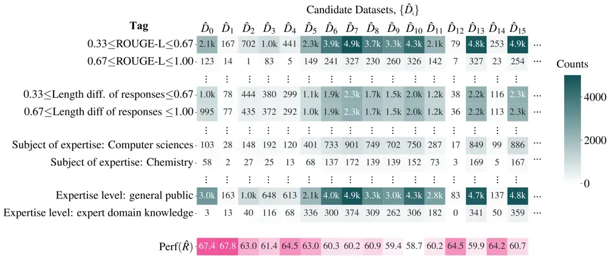
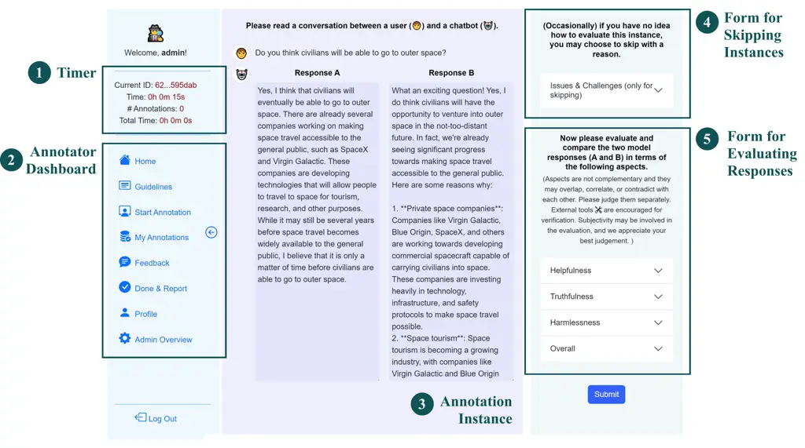

# Hybrid Preferences: Learning to Route Instances for Human vs. AI Feedback

Lester James V. Miranda ^(†)^(†)thanks: Equal contributions and
corresponding authors: {ljm,yizhongw}@allenai.org Affiliation: Allen
Institute for AI    Yizhong Wang^(†)^(†)footnotemark: Affiliation: Allen
Institute for AI Affiliation: University of Washington    Yanai Elazar
Affiliation: Allen Institute for AI Affiliation: University of
Washington   

Sachin Kumar

Affiliation: Allen Institute for AI

Affiliation: The Ohio State University

  Dataset [hf.co/datasets/allenai/multipref](https://huggingface.co/datasets/allenai/multipref)

  Code [github.com/allenai/hybrid-preferences](https://github.com/allenai/hybrid-preferences)
   Valentina Pyatkin Affiliation: Allen Institute for AI
Affiliation: University of Washington    Faeze Brahman
Affiliation: Allen Institute for AI Affiliation: University of
Washington    Noah A. Smith Affiliation: Allen Institute for AI
Affiliation: University of Washington    Hannaneh Hajishirzi
Affiliation: Allen Institute for AI Affiliation: University of
Washington    Pradeep Dasigi Affiliation: Allen Institute for AI

###### Abstract

Learning from human feedback has enabled the alignment of language
models (LMs) with human preferences. However, collecting human
preferences is expensive and time-consuming, with highly variable
annotation quality. An appealing alternative is to distill preferences
from LMs as a source of synthetic annotations, offering a cost-effective
and scalable alternative, albeit susceptible to other biases and errors.
In this work, we introduce HyPER, a Hybrid Preference routER that
assigns an annotation to either humans or LMs, achieving better
annotation quality while reducing the cost of human-only annotation. We
formulate this as an optimization problem: given a preference dataset
and an evaluation metric, we (1) train a performance prediction model
(PPM) to predict a reward model’s (RM) performance on an arbitrary
combination of human and LM annotations and (2) employ a routing
strategy that selects a combination that maximizes predicted
performance. We train the PPM on MultiPref, a new preference dataset
with 10K instances paired with human and LM labels. We show that the
selected hybrid mixture of synthetic and direct human preferences using
HyPER achieves better RM performance compared to using either one
exclusively by 7–13% on RewardBench and generalizes across unseen
preference datasets and other base models. We also observe the same
trend in other benchmarks using Best-of-N reranking, where the hybrid
mix has 2–3% better performance. Finally, we analyze features from HyPER
and find that prompts with moderate safety concerns or complexity
benefit the most from human feedback.

## 1 Introduction

Reinforcement learning from human feedback (Christiano et al., 2017) has
been integral to the alignment of large language models (LMs) with human
objectives and values (Ouyang et al., 2022; Bai et al., 2022a, inter
alia). Central to this process are preference datasets, i.e., input
instances to language models paired with candidate model outputs and
human judgment annotations indicating the preferred output. Collecting
preference data involves several key design decisions, and one important
consideration is determining the source of preference annotations (Kirk
et al., 2023; Kirk et al., 2024). This choice impacts not only the cost
and effort required to procure these annotations, but also the
performance of models trained on them.

There are two major approaches to obtain preference annotations. One
approach is to solicit preferences directly from humans. Although this
setup leads to generally high-quality data (Wang et al., 2024c), the
annotation process itself is expensive and time-consuming. Moreover,
human annotators can make mistakes, especially when faced with complex
examples or when the content extends beyond their expertise (Jiang and
de Marneffe, 2022; Sandri et al., 2023). Preference annotations can also
be obtained indirectly from humans by querying an off-the-shelf LM
trained on human preferences (Bai et al., 2022b; Lee et al., 2023; Cui
et al., 2023), leading to a set of synthetic preferences. Although this
approach is more scalable, LMs do not always reflect the nuances of
human annotators and can be prone to certain biases or errors in
judgment (Singhal et al., 2023; Wang et al., 2024a). Hence, we posit
that obtaining high-quality and cost-efficient preference data involves
finding the right combination of direct human and synthetic preferences
from LMs.

Figure 1: Overview of HyPER. Our proposed method consists of a
performance prediction model (PPM) and a routing strategy based on that
model. We train the PPM to predict the performance of a dataset based on
the statistics of the subset routed to human annotators. Then, we use
the PPM to score many simulations of candidate datasets, and recommend
the potentially best-performing routing configuration.

We present HyPER, a Hybrid Preference routER that allocates preference
instances to human or LM annotators, resulting in a set of hybrid
annotations (§2). The crux of our approach is to identify specific
instances that will benefit from direct human annotations, while the
rest are routed to the LM. We ground this decision in the performance of
RMs trained on the resulting preference datasets, measured by
RewardBench (Lambert et al., 2024). HyPER consists of a performance
prediction model (PPM, §2.2) and a routing strategy (§2.3) as
illustrated in Figure 1. The PPM learns to predict the performance of a
model trained on a preference dataset based on the statistics of the
subset being routed to human annotators. We then use the PPM to predict
the performance of arbitrary simulated hybrid datasets in order to
recommend the potentially best-performing one. To put HyPER into
practice, we construct MultiPref, a preference dataset containing 10k
instances paired with both human and LM preference annotations that
follow the same carefully designed annotation guidelines (§3). Then, we
train the PPM on this dataset and use the routing strategy to obtain
hybrid annotations from either LMs or humans.

Our experiments show that hybrid annotations constructed from HyPER’s
predictions result in better RMs than those trained (a) entirely on
direct human preferences, (b) entirely on synthetic preferences, and (c)
a random combination of direct human and synthetic preferences given the
same human annotation budget (§4), supporting our hypothesis that there
exist optimal combinations of annotations that are neither exclusively
human nor synthetic. Our results generalize across other existing
preference datasets (§4.2), base models (§4.3), and common LM benchmarks
through best-of-N reranking (§4.4). The resulting hybrid preference
datasets outperform the corresponding original ones by a large margin,
with 7–13% (absolute) improvement on RewardBench and up to 3% (absolute)
improvement on downstream evaluations on average, demonstrating HyPER’s
generalization capabilities. We then present an analysis of factors that
render a preference instance to benefit from direct human annotations
(§5).

We publicly release all data, code, and models associated with this
work. We hope that this work contributes to a more cost-effective
approach to preference data collection while providing actionable,
data-centric insights on preference learning.

## 2 HyPER Formulation and Methodology

### 2.1 Problem Formulation

We first formulate the preference routing problem. Let
$`\mathcal{D}=\{\langle x^{(i)},y_{1}^{(i)},y_{2}^{(i)}\rangle\}_{i=1}^{n}`$
be a dataset of $`n`$ unlabeled preference instances containing prompts
$`x`$ and pairwise responses $`y_{1}`$ and $`y_{2}`$, where each
instance can be assigned a label from either of the two sources: one
provided by a human annotator, or one generated by an LM. We introduce a
binary decision variable $`z_{i}\in\{0,1\}`$ for each instance, where
$`z_{i}=0`$ corresponds to selecting the human-provided label and
$`z_{i}=1`$ corresponds to selecting the LM-generated label. Note that
$`z_{i}`$ denotes the source of the labels, and not the identity of the
labels—when the humans and the LM agree, the chosen label is the same
irrespective of $`z_{i}`$.

The goal for routing is to optimize the selection of binary decision
variables $`z_{i}`$ for the dataset in order to maximize a performance
metric. This optimization problem can be expressed as:

```math
\max_{z\in\{0,1\}^{n}}\textsc{Perf}(R(\mathcal{D}(z))), \tag{1}
```

where $`\textsc{Perf}(R(\mathcal{D}(z)))`$ is the performance of a
reward model $`R`$ trained on dataset $`\mathcal{D}(z)`$. Here,
$`z=\{z_{1},z_{2},\dots,z_{n}\}`$ is the routing configuration,
representing the vector of binary label choices for all instances.
Maximizing Equation 1 is difficult as there is no closed-form solution.
In addition, finding the best routing configuration is computationally
heavy, as brute force search would entail training and evaluating a
reward model for $`2^{n}`$ configurations. Instead, we convert the
problem into a learning objective, where we train a model to predict the
reward performance of a given routing configuration. We construct
candidate labeled datasets $`\hat{\mathcal{D}}(z)`$ with different
routing configurations $`z`$ which we use to train reward models,
denoted $`\hat{R}(\hat{\mathcal{D}}(z))`$.¹¹ 1 For the rest of this
paper, we will ignore the $`z`$ variable for simplicity and denote the
candidate labeled dataset as $`\mathcal{\hat{D}}`$. We use these
candidates to train a performance prediction model that approximates
$`\textsc{Perf}(\hat{R}(*))`$ (§2.2). After training the model, we use a
simulation-based routing strategy that aims to find the optimal $`z`$ to
maximize the predicted performance (§2.3).

### 2.2 Performance Prediction Model (PPM)

The PPM is a regression model that provides an estimate of the
performance of a reward model trained on a candidate preference dataset
$`\hat{\mathcal{D}}`$. The PPM takes as input a feature vector
representing the routing configuration of $`\hat{\mathcal{D}}`$ and
outputs a scalar value as the predicted performance. Training the PPM
requires a seed preference dataset $`\mathcal{D}`$ with both human and
LM labels to build multiple samples of candidate datasets
$`\{\hat{\mathcal{D}_{i}}\}`$ with different routing configurations and
their evaluation performance.

#### Step 1: Defining a Feature Vector.

Instead of directly operating on individual preference instances, we
define a feature space for the PPM so that we can make routing decisions
about groups of instances that share features, allowing our routing
procedure to generalize to other datasets where these features might be
present. We construct a feature space of tags $`T`$—textual and
descriptive features of an instance’s prompt-response triples:

- •
  Textual tags characterize textual information such as the cosine
  similarity of the encoded representation²² 2 We use the
  all-distilroberta-v1 embedding model from sentence-transformers
  (Reimers and Gurevych, 2019). of the responses $`y_{1}`$ and
  $`y_{2}`$, the length of the prompt $`x`$, or the token length
  difference between two responses. We discretize the textual tags to
  convert them into categorical bins.
- •
  Descriptive tags include metadata about the prompt or instruction such
  as the subject of expertise needed to answer the prompt, or the
  complexity of user intent in the prompt based on the number of goals
  or requirements among many others. We obtain these descriptors from a
  multilabel classifier trained on a human-validated dataset of
  instructions and their corresponding tags (see Appendix for more
  details).

We then represent each candidate dataset as a vector
$`v=\{C_{t_{j},\text{~human}}\mid t_{j}\in T\}`$, where
$`C_{t_{j},\text{~human}}`$ denotes the count of instances routed to
human annotations with the $`j`$th tag. The full list of tags can be
found in Appendix .

1: Unrouted dataset $`\mathcal{D}=\{d_{1},d_{2},\dots,d_{N}\}`$, mapping
between tags $`t`$ and instances with that tag,
$`M=\{t_{i}\mapsto\{d_{j}\in\mathcal{D}\mid d_{j}\text{ has tag }t_{i}\}\mid i=1,2,\dots,N\}`$

2: Budget $`b`$ $`\sim`$ Uniform(1, $`|\mathcal{D}|-1`$)
$`\triangleright`$ Sample a random budget

3: $`S_{\text{~human}}`$ $`\leftarrow`$ {} $`\triangleright`$ Initialize
subset that will use human annotations

4: $`M\leftarrow`$ Shuffle($`M`$) $`\triangleright`$ Shuffle order of
feats.

5: while $`|S_{\text{~human}}|<b`$ do

6:   for $`m`$ in $`M`$ do

7:    $`S_{\text{human}}\leftarrow m`$ $`\triangleright`$ Add instances
associated with tag $`m`$ to $`S_{\text{~human}}`$

8:   end for

9: end while

10:
$`z\leftarrow\{0\text{ if }d_{i}\in S_{\text{human}}\text{ else }1\mid d_{i}\in\mathcal{D}\}`$

11: $`\mathcal{\hat{D}}`$ $`\leftarrow`$ $`\mathcal{D}(z)`$

12: return $`\mathcal{\hat{D}}`$

Algorithm 1 Generating a candidate dataset $`\mathcal{\hat{D}}`$

#### Step 2: Constructing Candidate Datasets and Measuring their Performance.

We generate candidate datasets $`\{\hat{\mathcal{D}}_{i}\}`$ from the
original unrouted dataset $`\mathcal{D}`$ by sampling different routing
configurations $`z`$ as shown in Algorithm 1. At a high level, this
algorithm generates a candidate dataset by randomly selecting the number
of instances $`b`$ to be annotated by humans or LM. Then, it iteratively
adds instances associated with each tag to a subset until $`b`$ is met,
and assigns binary labels based on the subset to create the candidates.
Some tags might get ignored once the number of instances reaches $`b`$,
so we shuffle their order to ensure that the tags are well represented
between candidates.

We also include candidates where all preference labels are from humans
($`|S_{\text{human}}|=|D|`$) and all labels are from LMs
($`|S_{\text{human}}|=0`$). Our sampling algorithm attempts to cover
many human annotation budgets and different types of instances assigned
to them. For each candidate dataset, we train a reward model $`\hat{R}`$
and evaluate its performance $`\textsc{Perf}(\hat{R})`$ on an evaluation
metric, in this case, RewardBench. This process leads to a PPM training
dataset with the tag counts as features and the RM performance as the
target as shown in Figure 2.

#### Step 3: Training the Performance Prediction Model.

We fit a regression model to predict the RewardBench performance of a
candidate dataset. We use the feature vector $`v`$ as the features and
the reward model performance on RewardBench $`\textsc{Perf}(\hat{R})`$
as the target. In practice, we collected 200 candidates
$`\hat{\mathcal{D}}`$ and their performance from MultiPref for training
the PPM.



Figure 2: Feature representation of candidate datasets and their actual
reward modeling performance as the training data for PPM. We use the
count of instances that belong to the human annotation subset
$`S_{\text{~human}}`$ as the feature value for each tag, and the
RewardBench overall accuracy as the target. This heatmap shows the
features derived from MultiPref.

### 2.3 Routing Strategy Based on the PPM

Given a preference dataset $`\mathcal{D}`$, we also simulate candidates
$`\{\mathcal{\hat{D}}(z)\}`$ using Algorithm 1 and predict their
performance using the PPM from the previous stage (§2.2). We can
simulate candidates with either a fixed human annotation budget, which
is common in practice, or a range of random budgets to identify the
optimal hybrid mix. Since the PPM estimates the expected performance of
any $`\mathcal{\hat{D}}_{i}`$, we can simulate a large number of
candidates and estimate their performance without training any RM.

For inference, our goal is to find the best routing configuration
$`z^{*}=\{z_{1},z_{2},\dots,z_{n}\}`$ that will maximize RM performance
$`\textsc{Perf}(R(\mathcal{\hat{D}}(z^{*})))`$. This configuration
specifies which preference instances should be routed to humans or LMs
that will result in the highest RewardBench score. To obtain $`z^{*}`$,
we take the candidate with the highest predicted RM performance and use
its configuration $`z`$ for routing. For each preference instance
$`d_{i}`$ in $`\mathcal{D}`$, we take the decision $`z_{i}`$ and route
the instance to humans if $`z_{i}=0`$ and to LMs if $`z_{i}=1`$. In
practice, we generate 500 candidates from which we select the best
routing configuration.

#### Routing Strategy for a Single Instance.

To make routing decisions at the level of a single instance, we compute
the expected performance gain due to a human annotating the instance. We
calculate it by computing the difference between a (1) routing
configuration where the instance is routed to human annotators and a (2)
routing configuration where no instances are routed to human annotators
(i.e., 100% synthetic annotations):
$`\Delta=\text{PPM}(v_{n})-\text{PPM}(v_{0})`$. We then route a
preference instance to human annotators if $`\Delta>0`$ and to LMs
otherwise.

## 3 MultiPref: A New Pref. Dataset

|                                      |        |
| ------------------------------------ | ------ |
| Dataset statistics                   |        |
| \# unique prompts                    | 5,323  |
| \# models for generation             | 6      |
| \# model pairs                       | 21     |
| \# comparisons                       | 10,461 |
| \# annotations                       | 41,844 |
| \# annotation per instance           | 4      |
| Annotator statistics                 |        |
| Total \# of crowdworkers             | 289    |
| Average qualification test pass rate | 34.8%  |

Table 1: MultiPref dataset statistics.

We introduce MultiPref, a new preference dataset containing 10,461
instances with both human and GPT-4 annotations. We use MultiPref to
train HyPER’s PPM. We collect prompts from datasets such as ShareGPT
(Chiang et al., 2023), WildChat (Zhao et al., 2024), HH-RLHF (Bai
et al., 2022a), and ChatArena (Chiang et al., 2024). Then, we generate
model responses using a variety of models, including Llama-2-Chat 70B
(Touvron et al., 2023), Llama-3-Instruct 70B (Dubey et al., 2024),
Tülu-2 7B and 70B (Ivison et al., 2023), GPT-3.5, and GPT-4 (Achiam
et al., 2023).³³ 3 We use model versions gpt-3.5-turbo-0125 and
gpt-4-turbo-2024-04-09 for GPT-3.5 and GPT-4, respectively.

MultiPref is then annotated carefully to control for annotation quality,
while working with crowdworkers on a fair wage (\$15--20 USD per hour
based on expertise-level). We recruit annotators from Prolific,⁴⁴ 4
[https://www.prolific.com/](https://www.prolific.com/) a crowdsourcing
platform. We screened workers using a qualification test that filtered
out 65% of the initial workers. Prolific implements various checks to
avoid annotators using bots during the annotation. Each instance in
MultiPref is annotated by four (4) crowdworkers. We aggregate these
labels via majority vote to mitigate noise in annotation. We also
collect LM annotations using GPT4 and include in its prompt the same
guidelines we presented to human annotators. Since we allow ties during
annotation, we filter instances that are labeled as a “Tie” by either
human or GPT4, ending up with 7,531 non-tie preference instances that
can be used for model training. Appendix C shows additional information
on the data collection process. Table 1 summarizes dataset statistics of
MultiPref.

## 4 Experiments

We first intrinsically evaluate how well the PPM fits on a domain it was
trained on (§4.1), then we assess how well the same PPM generalizes to
other preference datasets (§4.2) and models (§4.3) on the same target
evaluation metric (RewardBench). Finally, we test how well HyPER
generalizes to other LM benchmarks on various preference datasets
(§4.4).

### 4.1 Performance Prediction Model Details

#### Testing the PPM’s fit.

In order to test whether the PPM can accurately predict the performance
of a preference dataset on RewardBench, we perform 10-fold
cross-validation on 250 candidates from MultiPref (225 instances for
training and 25 instances for validation). For each fold, we train a
regressor to predict the performance of the held-out set and evaluate it
with the actual RewardBench score. We evaluate the regression models
using root-mean-square error (RMSE) and Spearman $`\rho`$ correlation.
We train three types of regressors: linear, quadratic, and tree-based
via LightGBM (Ke et al., 2017). Table 2 shows that the quadratic model
fits the data the best. Hence, we use it as our PPM for subsequent
experiments.

|            |                                |                     |
| ---------- | ------------------------------ | ------------------- |
| Model type | Spearman $`\rho`$ $`\uparrow`$ | RMSE $`\downarrow`$ |
| Linear     | 0.408 $`\pm`$ 0.056            | 0.311 $`\pm`$ 0.044 |
| LightGBM   | 0.127 $`\pm`$ 0.009            | 0.425 $`\pm`$ 0.010 |
| Quadratic  | 0.610 $`\pm`$ 0.042            | 0.266 $`\pm`$ 0.054 |

Table 2: Using 10-fold cross validation on 250 candidate datasets, we
report the average Spearman $`\rho`$ of predicted vs. actual ranks and
RMSE of predicted vs. actual RewardBench performance.

#### Simulation sample size selection.

The PPM’s prediction time is significantly faster than conducting actual
RM evaluations. As such, we can explore a large candidate dataset
combination. To find out the optimal size of simulated candidates we
evaluate the performance of PPM using
$`n\in\{128,256,512,1024,2048,4096\}`$ different candidates. This
experiment suggests that performance plateaus around 1024 candidates
(see Figure 3), achieving a score of 72.3%, indicating diminishing
returns from larger candidate pools. Although the trend plateaus around
1024 candidates, we choose to balance between performance and run time
and use 500 candidates in subsequent experiments.

Figure 3: Actual RewardBench performance of the best configuration found
given $`n`$ simulated candidates.

### 4.2 Generalization to Unseen Datasets

Figure 4: Comparison between HyPER and random selection given different
annotation budgets on various preference datasets. The optimal budget
and its corresponding performance is marked by a star ($`\bigstar`$). We
report the average of the RewardBench score across three runs.

We next test whether the PPM trained on MultiPref generalizes to other
unseen preference datasets. To do so, we apply the same routing strategy
as described in §2.3. Instead of training separate PPMs for each unseen
preference dataset, we only use a single PPM trained on MultiPref.

#### Datasets

We use datasets with existing human preference annotations and augment
them with LM annotations from GPT-4 (gpt-4-turbo-2024-04-09) to simulate
scenarios of routing a preference instance to a human annotator. These
datasets include: Helpsteer2 (Wang et al., 2024c), AlpacaFarm Human
Preferences (Dubois et al., 2023), and Chatbot Arena Conversations
(Zheng et al., 2023). Further information on these datasets can be found
in Appendix B. To control the effect of dataset size when comparing
across datasets, we limit each preference mix to 7K instances after
removing ties, the same size as MultiPref.

#### Baselines

For each dataset, we use the following preference mixes to compare
against our hybrid annotations: 100% Synthetic preference containing
purely synthetic preferences obtained from an LLM (see Appendix for more
details on prompting GPT-4), 100% Direct Human Preference with the human
annotations of the dataset, and 25%, 50%, 75% Direct Human Preference
mixes (see in Appendix ) where we randomly swap a percentage of
instances with human annotations while the rest are LM annotations. We
train reward models based on the Tülu 2 13B (Ivison et al., 2023) model
on each of these mixes, and evaluate their performance on RewardBench.

|                |                                       |         |           |         |           |                                       |         |           |         |           |
| -------------- | ------------------------------------- | ------- | --------- | ------- | --------- | ------------------------------------- | ------- | --------- | ------- | --------- |
|                | RewardBench Performance               |         |           |         |           |                                       |         |           |         |           |
| Preference Mix | MultiPref (Appendix C)                |         |           |         |           | Helpsteer2 (Wang et al., 2024c)       |         |           |         |           |
|                | % Direct Human for Best Hybrid: 37.4% |         |           |         |           | % Direct Human for Best Hybrid: 69.6% |         |           |         |           |
|                | Overall                               | Chat    | Chat-Hard | Safety  | Reasoning | Overall                               | Chat    | Chat-Hard | Safety  | Reasoning |
| 100% Human     | 60.4                                  | 89.1    | ​​ 37.8   | 71.6    | 42.9      | 72.4                                  | ​​ 90.6 | 60.7      | 68.0    | 76.7      |
| 100% Synth.    | 66.5                                  | 90.2    | 34.6      | 69.7    | 71.3      | 65.8                                  | 71.6    | 64.0      | 45.2    | 82.7      |
| Best Hybrid    | ​​ 70.6                               | ​​ 94.4 | 35.1      | ​​ 74.8 | ​​ 78.2   | ​​ 79.7                               | 89.9    | ​​ 64.9   | ​​ 77.0 | ​​ 87.0   |
| Preference Mix | AlpacaFarm (Dubois et al., 2023)      |         |           |         |           | ChatArena (Zheng et al., 2023)        |         |           |         |           |
|                | % Direct Human for Best Hybrid: 67.2% |         |           |         |           | % Direct Human for Best Hybrid: 23.0% |         |           |         |           |
|                | Overall                               | Chat    | Chat-Hard | Safety  | Reasoning | Overall                               | Chat    | Chat-Hard | Safety  | Reasoning |
| 100% Human     | 55.0                                  | 85.5    | 44.5      | 38.5    | 51.6      | 59.0                                  | 90.6    | 50.4      | 36.3    | 58.8      |
| 100% Synth.    | 60.9                                  | 87.2    | 41.4      | 56.1    | 58.5      | 71.6                                  | 93.5    | 50.2      | ​​ 69.4 | 73.2      |
| Best Hybrid    | ​​ 66.8                               | ​​ 94.5 | ​​ 50.8   | ​​ 58.1 | ​​ 63.8   | ​​ 72.2                               | ​​ 94.7 | ​​ 51.3   | 67.6    | ​​ 75.1   |

Table 3: Comparison of full direct human preferences and synthetic
preferences and the best hybrid preference mix given unlimited budget on
RewardBench. Reporting the average of three runs.

#### Results

Figure 4 shows the RewardBench score for each dataset on different human
annotation budgets across four preference datasets. Results show that in
the majority of annotation budgets, hybrid annotations from HyPER
outperform that of random sampling. This suggests that combining
annotations is expected to result in RMs that perform better than
relying solely on annotations from a single source (human or LM), and
the performance can improve with a better routing strategy. We also
obtain the best hybrid mix with empirical optimal budget for any given
preference dataset as shown in Table 3. We observe that the best hybrid
mix requires 20–70% of direct human annotations in order to outperform a
more costly 100% direct human annotation setup, depending on the
dataset. Our best hybrid preference mix outperforms using 100% synthetic
annotations, suggesting that collecting human annotations is still
valuable as long as the preference instances routed to humans benefit
from their annotations.

Furthermore, we observe that in general, RMs trained on full synthetic
preference annotations tend to perform better on RewardBench than 100%
human annotations, except for the Helpsteer2 dataset. We hypothesize
this is due to the higher annotation quality by Helpsteer2’s data vendor
(ScaleAI) and their aggressive data quality control where the authors
filtered-out preference instances with low inter-annotator agreement and
with noisy preference ratings. Nevertheless, our results in Figure 4
suggest that HyPER can still push this performance further by using just
70% human annotations. We also train a PPM using candidates generated
from Helpsteer2, and observed similar trends when using routed
annotations on other datasets (see Appendix ).

### 4.3 Generalization to Other Base Models

|                |                                       |      |           |        |           |                                                  |      |           |        |           |
| -------------- | ------------------------------------- | ---- | --------- | ------ | --------- | ------------------------------------------------ | ---- | --------- | ------ | --------- |
|                | RewardBench Performance on Helpsteer2 |      |           |        |           |                                                  |      |           |        |           |
| Preference Mix | Llama 3.1 8B (Dubey et al., 2024)     |      |           |        |           | Qwen 2.5 7B (Yang et al., 2024; Qwen Team, 2024) |      |           |        |           |
|                | Overall                               | Chat | Chat-Hard | Safety | Reasoning | Overall                                          | Chat | Chat-Hard | Safety | Reasoning |
| 100% Human     | 64.7                                  | 91.1 | 51.0      | 39.2   | 78.7      | 71.8                                             | 87.7 | 54.5      | 60.6   | 84.0      |
| 100% Synth.    | 60.6                                  | 90.5 | 33.8      | 48.8   | 69.4      | 69.7                                             | 89.1 | 54.8      | 56.9   | 82.2      |
| Best Hybrid    | 72.4                                  | 94.7 | 47.6      | 71.4   | 76.2      | 72.4                                             | 87.4 | 55.6      | 63.1   | 83.6      |

Table 4: Comparison of full direct human preferences and synthetic
preferences on the best hybrid preference mix given unlimited budget on
RewardBench and different base models of Helpsteer2 (Wang et al.,
2024c). Reporting the average of three runs.

|             |                                       |         |         |         |         |            |                                       |         |         |         |         |            |
| ----------- | ------------------------------------- | ------- | ------- | ------- | ------- | ---------- | ------------------------------------- | ------- | ------- | ------- | ------- | ---------- |
|             | Best-of-N Evaluation Performance      |         |         |         |         |            |                                       |         |         |         |         |            |
| Pref. Mix   | MultiPref (Appendix C)                |         |         |         |         |            | Helpsteer2 (Wang et al., 2024c)       |         |         |         |         |            |
|             | % Direct Human for Best Hybrid: 37.4% |         |         |         |         |            | % Direct Human for Best Hybrid: 69.6% |         |         |         |         |            |
|             | Avg.                                  | GSM8K   | BBH     | IFEval  | Codex   | AlpacaEval | Avg.                                  | GSM8K   | BBH     | IFEval  | Codex   | AlpacaEval |
| 100% Human  | 48.3                                  | 38.0    | 47.3    | 43.1    | ​​ 24.4 | ​​ 88.6    | 52.6                                  | ​​ 52.3 | 51.0    | 45.8    | 26.2    | ​​ 87.7    |
| 100% Synth. | 49.4                                  | 41.7    | 49.0    | ​​ 44.9 | 23.2    | 88.3       | 51.0                                  | 48.6    | ​​ 52.0 | 47.0    | 24.4    | 83.1       |
| Best Hybrid | ​​ 50.5                               | ​​ 48.1 | ​​ 50.2 | 44.7    | 21.3    | 88.1       | ​​ 52.8                               | 51.7    | 49.9    | ​​ 48.1 | ​​ 29.3 | 85.1       |
| Pref. Mix   | AlpacaFarm (Dubois et al., 2023)      |         |         |         |         |            | ChatArena (Zheng et al., 2023)        |         |         |         |         |            |
|             | % Direct Human for Best Hybrid: 67.2% |         |         |         |         |            | % Direct Human for Best Hybrid: 23.0% |         |         |         |         |            |
|             | Avg.                                  | GSM8K   | BBH     | IFEval  | Codex   | AlpacaEval | Avg.                                  | GSM8K   | BBH     | IFEval  | Codex   | AlpacaEval |
| 100% Human  | 50.4                                  | 48.2    | 50.7    | 42.7    | 23.8    | 86.6       | ​​ 53.9                               | 52.3    | ​​ 52.4 | ​​ 44.9 | ​​ 28.7 | ​​ 91.4    |
| 100% Synth. | 53.1                                  | 52.3    | 52.6    | 44.7    | ​​ 26.2 | 89.6       | 53.7                                  | ​​ 54.0 | 52.3    | 44.5    | 26.8    | 90.9       |
| Best Hybrid | ​​ 53.3                               | ​​ 53.5 | ​​ 52.7 | ​​ 45.5 | 23.8    | ​​ 91.0    | 52.8                                  | 51.9    | 51.8    | 44.5    | 25.0    | 90.8       |

Table 5: Comparison of full direct human preferences and synthetic
preferences on the best hybrid preference mix given unlimited budget
using Best-of-N evaluation.

|                                            |                         |                                                         |                         |
| ------------------------------------------ | ----------------------- | ------------------------------------------------------- | ----------------------- |
| Tag                                        | Gain $`\times 10^{-3}`$ | Tag                                                     | Gain $`\times 10^{-3}`$ |
| BERTScore $`\in[0.33,0.67]`$               | 0.19                    | Subject Of Expertise: Materials Science and Engineering | -0.00                   |
| Subject Of Expertise: Chemical Engineering | 0.11                    | Subject Of Expertise: Library and Museum Studies        | -0.10                   |
| Subject Of Expertise: Religion             | 0.09                    | Subject Of Expertise: Media Studies and Communicatino   | -0.10                   |
| Safety Concern: Moderate                   | 0.09                    | Subject of Expertise: Military Sciences                 | -0.10                   |
| Subject Of Expertise: Anthropology         | 0.06                    | Subject Of Expertise: Family And Consumer Science       | -0.63                   |

Table 6: Average gain in MultiPref’s performance when routing 100 random
preference instances to a human annotator for each tag. Showing top- and
bottom-five tags (See the full list in Appendix ).

We also test whether the hybrid mix retains its competitive performance
when trained on different models other than Tülu 2 13B.

#### Setup

To test model generalization, we train RMs using Llama 3.1 8B (Dubey
et al., 2024) and Qwen 2.5 7B (Yang et al., 2024; Qwen Team, 2024) on
hybrid mixes of the Helpsteer2 dataset and evaluate the resulting model
on RewardBench. Similar to §4.2, these mixes were identified by a PPM
trained on MultiPref’s features.

#### Results

Table 4 shows that the hybrid annotations from HyPER outperform 100%
direct and 100% synthetic human preferences, consistent with our
findings in §4.2. These results suggest that the preference annotations
routed by HyPER are model-agnostic, as demonstrated by our experiments
with models other than Tülu 2 13B.

### 4.4 Generalization to other Evaluation Tasks

To test whether HyPER generalizes to new tasks other than RewardBench,
we evaluate the models trained on hybrid datasets on other benchmarks.

#### Setup

We follow the practice of Ivison et al. (2024) to convert several LM
benchmarks into a “Best-of-N” reranking format for evaluating RMs: we
sample 16 generations from the Tülu-2 13B SFT model, score them using
the testing reward models, and then use the top-scoring generation as
the final output to compute the metrics. We evaluate on the following
datasets: GSM8K (Cobbe et al., 2021) for math, BIG-Bench Hard (BBH;
Suzgun et al., 2022) for reasoning, IFEval (Zhou et al., 2023) for
precise instruction following, Codex HumanEval (Chen et al., 2021) for
coding, and AlpacaEval (Li et al., 2023b) for general chat capabilities.
Further information on the dataset setup can be found in Appendix .

#### Results

Table 5 shows the Best-of-N evaluation performance of the best hybrid
mix found by our method. Our hybrid mix outperforms using either human
or synthetic labels alone by 2–3% on three out of the four preference
datasets. On Helpsteer2, 100% human labels perform better than 100%
synthetic, while MultiPref and AlpacaFarm show the opposite trend,
reflecting varying human annotation quality—our method demonstrates
improvement in three cases despite this variation. ChatArena is the
exception, where our method does not improve upon the original dataset.
The trend in ChatArena’s Best-of-N performance differs from RewardBench,
and we suspect that its due to its reliance on Internet volunteers with
underspecified annotation guidelines. Further investigation of this
discrepancy is left for future work.

## 5 Analysis: When are Human Annotations Helpful?

We investigate the features learned by the PPM to understand
characteristics that render a preference instance a better fit for
direct human annotation. To quantify the effect of routing an instance
to human annotators, we compute its expected performance gain as
described in \$2.3. This analysis makes three key assumptions: (1) the
performance gain from human annotation is linear; (2) samples are
independent of each other, and (3) the PPM fits the data well. While the
first two assumptions may not hold in general, they provide a tractable
framework for analyzing the relative importance of human annotation for
different instances.

To estimate the performance gain of each tag $`t\in T`$, we route $`n`$
instances that satisfy the tag’s condition (e.g., “BERTScore between two
responses is $`\in[0.33,0.67]`$”) and compute the gain $`\Delta`$
normalized on the count of instances with that tag. Table 6 shows the
top- and bottom-five tags based on the performance gain. This list
reveals that instances with moderate semantic similarity between
responses (measured by BERTScore), moderate safety concern, and moderate
complexity of intents tend to benefit more from direct human
annotations. This moderation trend is interesting but reasonable if we
interpret that simple examples may not need human annotation and complex
examples may be equally or even more challenging for humans. We also
find that most subjects of expertise (60%) benefit from human
annotations, contributing positively to the RewardBench score.
Preferences with prompts that require expert domain knowledge
($`\Delta`$: 6.438E-6) to answer also benefit from human annotations as
opposed to prompts requiring basic domain knowledge ($`\Delta`$:
–0.095E-6) or answerable by the general public ($`\Delta`$: –0.050E-6).

## 6 Conclusion

We introduce HyPER, a framework that routes preference instances to
either human annotators or to an LM that aims to maximize performance of
an RM trained on such hybrid-annotated data. Our results demonstrate
that the hybrid mix from HyPER outperforms all baseline annotation
combinations on RewardBench, and that this trend generalizes to other
models, benchmarks (via Best-of-N reranking), and unseen preference
datasets. HyPER also outperforms random sampling for a given set of
human annotation budgets. Our analyses reveal that human annotations are
most beneficial for instances with moderate response similarity and
prompts in specific subject domains, among others. We hope HyPER
contributes to data-centric approaches in understanding human
preferences and to more efficient preference collection methods in the
future.

## Limitations

#### Grounding of preference feedback quality.

Quality control is critical for human data annotation, especially in the
modern era of building LMs. Typically, researchers use agreement as a
metric for quality. However, for preference annotation, early works all
ended up with relatively low agreement between annotators or even
between annotators and researchers (Bai et al., 2022a; Touvron et al.,
2023; Dubois et al., 2023). This is largely due to the complexity of the
tasks (e.g., many facts to verify, the expertise required, etc.), as
well as the subjectivity in many cases (e.g., style preference,
sensitive topics, safety threshold, etc.). This poses challenges for the
data annotation process, as there is no ground truth for measuring the
quality. In this work, we decide to ground the data quality into the
model training performance (i.e., the utility of the data), and our
framework can optimize towards this goal. Future work can explore other
downstream utility metrics for optimization.

#### Scaling the size of preference annotation.

Although we show the successful generalization of our router when
applying it to other preference datasets (§4.2), this set of experiments
is done at the same size (7K after removing ties). It remains unclear
how well our performance prediction model can extrapolate beyond the
training data size and predict what instances can add performance gain
after 7K, so that we can keep growing our preference data to a larger
size. We believe our current results and the patterns we find (§5) can
provide insights on how to save human efforts, but a systematic scaling
of our framework may require further work.

#### Feedback beyond pairwise comparisons.

We focus on pairwise preferences which compare overall model responses.
However, several formulations of preference feedback exist such as
fine-grained preferences (Wu et al., 2024), aspect-based preferences
(Wang et al., 2023b; Wang et al., 2024c, also available in MultiPref)
and preferences for process-reward models (Lightman et al., 2023; Uesato
et al., 2022). These annotations are more time consuming, hence, even
more expensive, thus providing more room for leveraging LM annotation
when possible. We leave this exploration for future work.

#### Generalization to downstream DPO / policy model performance.

While hybrid preference annotations improve direct RM evaluation
performance, it’s unclear if these gains extend to downstream tasks when
training a DPO model or a policy model using PPO with the reward models.
Ivison et al. (2024) found that improvements in reward models do not
necessarily translate to improved downstream performance in PPO, as
there are many confounding factors (e.g., the unlabeled prompts in PPO,
the KL penalty, etc) that impact the PPO training. We tried testing the
preference datasets using DPO (Appendix ) but only found small
differences when switching datasets or the preference mixes. We
hypothesize that downstream task performance is hard to measure (and
still is an open research problem), and requires data collection at a
larger scale to see significant effects.

#### Intra-group variability of annotators.

One of our key assumptions is that there is no variability in
intra-group annotators for both humans and LMs. When HyPER decides to
route a preference instance to a human or an LM, we don’t make
fine-grained decisions as to what type of human annotator (or which LM)
should annotate. However, we believe that MultiPref can enable this type
of analyses especially for direct human feedback, as the dataset
disambiguates between normal and expert crowdworker annotations. We
leave this exploration for future work.

## Ethics Statement

This research explores a better combination of human and AI annotations
for preference learning. Throughout the human annotation process, we
ensured that all human participants were fully informed about the
annotation task, and their annotations would be used to develop AI
models. Participants provided explicit consent prior to their
involvement, and all data collected was anonymized to protect individual
privacy. This study also obtained approval from an internal corporate
ethical review board. We acknowledge the potential societal impacts of
replacing human laborers with AI models, even partially as this study,
and we still emphasize the importance of maintaining human oversight in
AI-assisted decision-making processes. Finally, the datasets we used may
contain offensive prompts and responses, and we advise users to exercise
caution when viewing individual preference instances.

## Acknowledgements

This research is supported by Cloud TPUs from Google’s TPU Research
Cloud (TRC). We also acknowledge the National Artificial Intelligence
Research Resource (NAIRR) Pilot and Microsoft Azure for contributing to
the results in this work. The authors would also like to thank Bowen
Zhao from the University of Washington (UW) for sharing data for
building the early version of the meta analyzer. In addition, we would
like to acknowledge the Prolific annotators, together with Tom Rodenby,
Brock Sorenson, and Jag Singh, for their dedication and support for
obtaining annotations for MultiPref. Finally, we thank Pang Wei Koh for
suggestions on the performance prediction model, and many colleagues at
Ai2 and UW for helpful feedback.

## References

- Achiam et al. (2023) Josh Achiam, Steven Adler, Sandhini Agarwal, Lama
  Ahmad, Ilge Akkaya, Florencia Leoni Aleman, Diogo Almeida, Janko
  Altenschmidt, Sam Altman, Shyamal Anadkat, et al. 2023. GPT-4
  Technical Report. _arXiv preprint arXiv:2303.08774_.
- Albalak et al. (2024) Alon Albalak, Yanai Elazar, Sang Michael Xie,
  Shayne Longpre, Nathan Lambert, Xinyi Wang, Niklas Muennighoff, Bairu
  Hou, Liangming Pan, Haewon Jeong, et al. 2024. A survey on data
  selection for language models. _arXiv preprint arXiv:2402.16827_.
- Bai et al. (2022a) Yuntao Bai, Andy Jones, Kamal Ndousse, Amanda
  Askell, Anna Chen, Nova DasSarma, Dawn Drain, Stanislav Fort, Deep
  Ganguli, Tom Henighan, Nicholas Joseph, Saurav Kadavath, Jackson
  Kernion, Tom Conerly, Sheer El-Showk, Nelson Elhage, Zac
  Hatfield-Dodds, Danny Hernandez, Tristan Hume, Scott Johnston, Shauna
  Kravec, Liane Lovitt, Neel Nanda, Catherine Olsson, Dario Amodei, Tom
  Brown, Jack Clark, Sam McCandlish, Chris Olah, Ben Mann, and Jared
  Kaplan. 2022a. Training a helpful and harmless assistant with
  reinforcement learning from human feedback. _arXiv preprint
  arXiv:2204.05862_.
- Bai et al. (2022b) Yuntao Bai, Saurav Kadavath, Sandipan Kundu, Amanda
  Askell, Jackson Kernion, Andy Jones, Anna Chen, Anna Goldie, Azalia
  Mirhoseini, Cameron McKinnon, Carol Chen, Catherine Olsson,
  Christopher Olah, Danny Hernandez, Dawn Drain, Deep Ganguli, Dustin
  Li, Eli Tran-Johnson, Ethan Perez, Jamie Kerr, Jared Mueller, Jeffrey
  Ladish, Joshua Landau, Kamal Ndousse, Kamile Lukosuite, Liane Lovitt,
  Michael Sellitto, Nelson Elhage, Nicholas Schiefer, Noemi Mercado,
  Nova DasSarma, Robert Lasenby, Robin Larson, Sam Ringer, Scott
  Johnston, Shauna Kravec, Sheer El Showk, Stanislav Fort, Tamera
  Lanham, Timothy Telleen-Lawton, Tom Conerly, Tom Henighan, Tristan
  Hume, Samuel R. Bowman, Zac Hatfield-Dodds, Ben Mann, Dario Amodei,
  Nicholas Joseph, Sam McCandlish, Tom Brown, and Jared Kaplan. 2022b.
  Constitutional AI: Harmlessness from AI Feedback.
- Birch et al. (2008) Alexandra Birch, Miles Osborne, and Philipp
  Koehn. 2008. Predicting success in machine translation. In
  _Proceedings of the 2008 Conference on Empirical Methods in Natural
  Language Processing_, pages 745–754.
- Chen et al. (2021) Mark Chen, Jerry Tworek, Heewoo Jun, Qiming Yuan,
  Henrique Ponde De Oliveira Pinto, Jared Kaplan, Harri Edwards, Yuri
  Burda, Nicholas Joseph, Greg Brockman, et al. 2021. Evaluating large
  language models trained on code. _arXiv preprint arXiv:2107.03374_.
- Chiang et al. (2023) Wei-Lin Chiang, Zhuohan Li, Zi Lin, Ying Sheng,
  Zhanghao Wu, Hao Zhang, Lianmin Zheng, Siyuan Zhuang, Yonghao Zhuang,
  Joseph E. Gonzalez, Ion Stoica, and Eric P. Xing. 2023. [Vicuna: An
  Open-Source Chatbot Impressing GPT-4 with 90%\* ChatGPT
  Quality](https://lmsys.org/blog/2023-03-30-vicuna/).
- Chiang et al. (2024) Wei-Lin Chiang, Lianmin Zheng, Ying Sheng,
  Anastasios Nikolas Angelopoulos, Tianle Li, Dacheng Li, Hao Zhang,
  Banghua Zhu, Michael Jordan, Joseph E. Gonzalez, and Ion Stoica. 2024.
  [Chatbot arena: An open platform for evaluating llms by human
  preference](https://arxiv.org/abs/2403.04132). _Preprint_,
  arXiv:2403.04132.
- Christiano et al. (2017) Paul F Christiano, Jan Leike, Tom Brown,
  Miljan Martic, Shane Legg, and Dario Amodei. 2017. Deep reinforcement
  learning from human preferences. In _Advances in Neural Information
  Processing Systems_, volume 30.
- Cobbe et al. (2021) Karl Cobbe, Vineet Kosaraju, Mohammad Bavarian,
  Mark Chen, Heewoo Jun, Lukasz Kaiser, Matthias Plappert, Jerry Tworek,
  Jacob Hilton, Reiichiro Nakano, et al. 2021. Training verifiers to
  solve math word problems. _arXiv preprint arXiv:2110.14168_.
- Cohn et al. (1994) David Cohn, Les Atlas, and Richard Ladner. 1994.
  Improving generalization with active learning. _Machine learning_,
  15:201–221.
- Cui et al. (2023) Ganqu Cui, Lifan Yuan, Ning Ding, Guanming Yao, Wei
  Zhu, Yuan Ni, Guotong Xie, Zhiyuan Liu, and Maosong Sun. 2023.
  Ultrafeedback: Boosting language models with high-quality feedback.
  _arXiv preprint arXiv:2310.01377_.
- Dubey et al. (2024) Abhimanyu Dubey, Abhinav Jauhri, Abhinav Pandey,
  Abhishek Kadian, Ahmad Al-Dahle, Aiesha Letman, Akhil Mathur, Alan
  Schelten, Amy Yang, Angela Fan, et al. 2024. The llama 3 herd of
  models. _arXiv preprint arXiv:2407.21783_.
- Dubois et al. (2023) Yann Dubois, Chen Xuechen Li, Rohan Taori, Tianyi
  Zhang, Ishaan Gulrajani, Jimmy Ba, Carlos Guestrin, Percy S Liang, and
  Tatsunori B Hashimoto. 2023. AlpacaFarm: A Simulation Framework for
  Methods that Learn from Human Feedback. In _Advances in Neural
  Information Processing Systems_, volume 36, pages 30039–30069.
- Engstrom et al. (2024) Logan Engstrom, Axel Feldmann, and Aleksander
  Madry. 2024. DsDm: Model-aware dataset selection with datamodels.
  _arXiv preprint arXiv:2401.12926_.
- Ilyas et al. (2022) Andrew Ilyas, Sung Min Park, Logan Engstrom,
  Guillaume Leclerc, and Aleksander Madry. 2022. Datamodels: Predicting
  predictions from training data. _arXiv preprint arXiv:2202.00622_.
- Ivison et al. (2024) Hamish Ivison, Yizhong Wang, Jiacheng Liu, Zeqiu
  Wu, Valentina Pyatkin, Nathan Lambert, Noah A Smith, Yejin Choi, and
  Hannaneh Hajishirzi. 2024. Unpacking dpo and ppo: Disentangling best
  practices for learning from preference feedback. _arXiv preprint
  arXiv:2406.09279_.
- Ivison et al. (2023) Hamish Ivison, Yizhong Wang, Valentina Pyatkin,
  Nathan Lambert, Matthew Peters, Pradeep Dasigi, Joel Jang, David
  Wadden, Noah A Smith, Iz Beltagy, et al. 2023. Camels in a changing
  climate: Enhancing LM adaptation with Tulu 2. _arXiv preprint
  arXiv:2311.10702_.
- Jiang and de Marneffe (2022) Nan-Jiang Jiang and Marie-Catherine
  de Marneffe. 2022. [Investigating reasons for disagreement in natural
  language inference](https://doi.org/10.1162/tacl_a_00523).
  _Transactions of the Association for Computational Linguistics_,
  10:1357–1374.
- Ke et al. (2017) Guolin Ke, Qi Meng, Thomas Finley, Taifeng Wang, Wei
  Chen, Weidong Ma, Qiwei Ye, and Tie-Yan Liu. 2017. Lightgbm: A highly
  efficient gradient boosting decision tree. In _Neural Information
  Processing Systems_.
- Kirk et al. (2023) Hannah Kirk, Andrew Bean, Bertie Vidgen, Paul
  Rottger, and Scott Hale. 2023. [The past, present and better future of
  feedback learning in large language models for subjective human
  preferences and
  values](https://doi.org/10.18653/v1/2023.emnlp-main.148). In
  _Proceedings of the 2023 Conference on Empirical Methods in Natural
  Language Processing_, pages 2409–2430, Singapore. Association for
  Computational Linguistics.
- Kirk et al. (2024) Hannah Rose Kirk, Alexander Whitefield, Paul
  Röttger, Andrew Bean, Katerina Margatina, Juan Ciro, Rafael Mosquera,
  Adina Williams, He He, Bertie Vidgen, and Scott Hale. 2024. The PRISM
  Alignment Project: What Participatory, Representative and
  Individualised Human Feedback Reveals About the Subjective and
  Multicultural Alignment of Large Language Models. _arXiv preprint
  arXiv:2404.16019_.
- Lambert et al. (2024) Nathan Lambert, Valentina Pyatkin, Jacob
  Morrison, LJ Miranda, Bill Yuchen Lin, Khyathi Chandu, Nouha Dziri,
  Sachin Kumar, Tom Zick, Yejin Choi, et al. 2024. Rewardbench:
  Evaluating reward models for language modeling. _arXiv preprint
  arXiv:2403.13787_.
- Lee et al. (2023) Harrison Lee, Samrat Phatale, Hassan Mansoor, Thomas
  Mesnard, Johan Ferret, Kellie Lu, Colton Bishop, Ethan Hall, Victor
  Carbune, Abhinav Rastogi, and Sushant Prakash. 2023. RLAIF: Scaling
  Reinforcement Learning from Human Feedback with AI Feedback. _arXiv
  preprint arXiv: 2309.00267_.
- Li et al. (2023a) Minzhi Li, Taiwei Shi, Caleb Ziems, Min-Yen Kan,
  Nancy Chen, Zhengyuan Liu, and Diyi Yang. 2023a. [CoAnnotating:
  Uncertainty-guided work allocation between human and large language
  models for data
  annotation](https://doi.org/10.18653/v1/2023.emnlp-main.92). In
  _Proceedings of the 2023 Conference on Empirical Methods in Natural
  Language Processing_, pages 1487–1505, Singapore. Association for
  Computational Linguistics.
- Li et al. (2023b) Xuechen Li, Tianyi Zhang, Yann Dubois, Rohan Taori,
  Ishaan Gulrajani, Carlos Guestrin, Percy Liang, and Tatsunori B.
  Hashimoto. 2023b. Alpacaeval: An automatic evaluator of
  instruction-following models.
  [https://github.com/tatsu-lab/alpaca_eval](https://github.com/tatsu-lab/alpaca_eval).
- Li et al. (2023c) Xuechen Li, Tianyi Zhang, Yann Dubois, Rohan Taori,
  Ishaan Gulrajani, Carlos Guestrin, Percy Liang, and Tatsunori B.
  Hashimoto. 2023c. Alpacaeval: An automatic evaluator of
  instruction-following models.
  [https://github.com/tatsu-lab/alpaca_eval](https://github.com/tatsu-lab/alpaca_eval).
- Lightman et al. (2023) Hunter Lightman, Vineet Kosaraju, Yura Burda,
  Harri Edwards, Bowen Baker, Teddy Lee, Jan Leike, John Schulman, Ilya
  Sutskever, and Karl Cobbe. 2023. Let’s verify step by step. _arXiv
  preprint arXiv:2305.20050_.
- Lin (2004) Chin-Yew Lin. 2004. [ROUGE: A package for automatic
  evaluation of summaries](https://aclanthology.org/W04-1013). In _Text
  Summarization Branches Out_, pages 74–81, Barcelona, Spain.
  Association for Computational Linguistics.
- Liu et al. (2024) Qian Liu, Xiaosen Zheng, Niklas Muennighoff,
  Guangtao Zeng, Longxu Dou, Tianyu Pang, Jing Jiang, and Min Lin. 2024.
  Regmix: Data mixture as regression for language model pre-training.
  _arXiv preprint arXiv:2407.01492_.
- Lu et al. (2023) Keming Lu, Hongyi Yuan, Zheng Yuan, Runji Lin,
  Junyang Lin, Chuanqi Tan, and Chang Zhou. 2023. \# instag: Instruction
  tagging for diversity and complexity analysis. _arXiv preprint
  arXiv:2308.07074_.
- McHugh (2012) Mary L McHugh. 2012. Interrater reliability: the kappa
  statistic. _Biochemia medica_, 22(3):276–282.
- Ouyang et al. (2022) Long Ouyang, Jeffrey Wu, Xu Jiang, Diogo Almeida,
  Carroll Wainwright, Pamela Mishkin, Chong Zhang, Sandhini Agarwal,
  Katarina Slama, Alex Ray, et al. 2022. Training language models to
  follow instructions with human feedback. _Advances in Neural
  Information Processing Systems_, 35:27730–27744.
- Qwen Team (2024) Qwen Team. 2024. [Qwen2.5: A party of foundation
  models](https://qwenlm.github.io/blog/qwen2.5/).
- Rafailov et al. (2023) Rafael Rafailov, Archit Sharma, Eric Mitchell,
  Christopher D Manning, Stefano Ermon, and Chelsea Finn. 2023. Direct
  Preference Optimization: Your Language Model is Secretly a Reward
  Model. In _Advances in Neural Information Processing Systems_,
  volume 36, pages 53728–53741.
- Reimers and Gurevych (2019) Nils Reimers and Iryna Gurevych. 2019.
  [Sentence-bert: Sentence embeddings using siamese
  bert-networks](http://arxiv.org/abs/1908.10084). In _Proceedings of
  the 2019 Conference on Empirical Methods in Natural Language
  Processing_. Association for Computational Linguistics.
- Sandri et al. (2023) Marta Sandri, Elisa Leonardelli, Sara Tonelli,
  and Elisabetta Jezek. 2023. [Why don’t you do it right? analysing
  annotators’ disagreement in subjective
  tasks](https://doi.org/10.18653/v1/2023.eacl-main.178). In
  _Proceedings of the 17th Conference of the European Chapter of the
  Association for Computational Linguistics_, pages 2428–2441,
  Dubrovnik, Croatia. Association for Computational Linguistics.
- Schulman et al. (2017) John Schulman, Filip Wolski, Prafulla Dhariwal,
  Alec Radford, and Oleg Klimov. 2017. Proximal policy optimization
  algorithms. _arXiv preprint arXiv:1707.06347_.
- Settles (2009) Burr Settles. 2009. Active learning literature survey.
- Singhal et al. (2023) Prasann Singhal, Tanya Goyal, Jiacheng Xu, and
  Greg Durrett. 2023. A long way to go: Investigating length
  correlations in RLHF. _arXiv preprint arXiv:2310.03716_.
- Suzgun et al. (2022) Mirac Suzgun, Nathan Scales, Nathanael Schärli,
  Sebastian Gehrmann, Yi Tay, Hyung Won Chung, Aakanksha Chowdhery,
  Quoc V Le, Ed H Chi, Denny Zhou, et al. 2022. Challenging big-bench
  tasks and whether chain-of-thought can solve them. _arXiv preprint
  arXiv:2210.09261_.
- Touvron et al. (2023) Hugo Touvron, Louis Martin, Kevin Stone, Peter
  Albert, Amjad Almahairi, Yasmine Babaei, Nikolay Bashlykov, Soumya
  Batra, Prajjwal Bhargava, Shruti Bhosale, et al. 2023. Llama 2: Open
  foundation and fine-tuned chat models. _arXiv preprint
  arXiv:2307.09288_.
- Uesato et al. (2022) Jonathan Uesato, Nate Kushman, Ramana Kumar,
  Francis Song, Noah Siegel, Lisa Wang, Antonia Creswell, Geoffrey
  Irving, and Irina Higgins. 2022. Solving math word problems with
  process-and outcome-based feedback. _arXiv preprint arXiv:2211.14275_.
- Wang et al. (2024a) Peiyi Wang, Lei Li, Liang Chen, Zefan Cai, Dawei
  Zhu, Binghuai Lin, Yunbo Cao, Qi Liu, Tianyu Liu, and Zhifang Sui.
  2024a. [Large language models are not fair
  evaluators](https://aclanthology.org/2024.acl-long.511). In
  _Proceedings of the 62nd Annual Meeting of the Association for
  Computational Linguistics_. Association for Computational Linguistics.
- Wang et al. (2023a) Yizhong Wang, Hamish Ivison, Pradeep Dasigi, Jack
  Hessel, Tushar Khot, Khyathi Chandu, David Wadden, Kelsey MacMillan,
  Noah A Smith, Iz Beltagy, and Hannaneh Hajishirzi. 2023a. How Far Can
  Camels Go? Exploring the State of Instruction Tuning on Open
  Resources. In _Advances in Neural Information Processing Systems_,
  volume 36, pages 74764–74786.
- Wang et al. (2024b) Zhilin Wang, Alexander Bukharin, Olivier
  Delalleau, Daniel Egert, Gerald Shen, Jiaqi Zeng, Oleksii Kuchaiev,
  and Yi Dong. 2024b. Helpsteer2-preference: Complementing ratings with
  preferences. _arXiv preprint arXiv:2410.01257_.
- Wang et al. (2024c) Zhilin Wang, Yi Dong, Olivier Delalleau, Jiaqi
  Zeng, Gerald Shen, Daniel Egert, Jimmy J Zhang, Makesh Narsimhan
  Sreedhar, and Oleksii Kuchaiev. 2024c. Helpsteer2: Open-source dataset
  for training top-performing reward models. _arXiv preprint
  arXiv:2406.08673_.
- Wang et al. (2023b) Zhilin Wang, Yi Dong, Jiaqi Zeng, Virginia Adams,
  Makesh Narsimhan Sreedhar, Daniel Egert, Olivier Delalleau, Jane Polak
  Scowcroft, Neel Kant, Aidan Swope, and Oleksii Kuchaiev. 2023b.
  HelpSteer: Multi-attribute Helpfulness Dataset for SteerLM. _arXiv
  preprint arXiv:2311.09528_.
- Wu et al. (2024) Zeqiu Wu, Yushi Hu, Weijia Shi, Nouha Dziri, Alane
  Suhr, Prithviraj Ammanabrolu, Noah A Smith, Mari Ostendorf, and
  Hannaneh Hajishirzi. 2024. Fine-grained human feedback gives better
  rewards for language model training. _Advances in Neural Information
  Processing Systems_, 36.
- Xia et al. (2020) Mengzhou Xia, Antonios Anastasopoulos, Ruochen Xu,
  Yiming Yang, and Graham Neubig. 2020. Predicting performance for
  natural language processing tasks. In _Proceedings of the 58th Annual
  Meeting of the Association for Computational Linguistics_, pages
  8625–8646.
- Xia et al. (2024) Mengzhou Xia, Sadhika Malladi, Suchin Gururangan,
  Sanjeev Arora, and Danqi Chen. 2024. Less: Selecting influential data
  for targeted instruction tuning. _arXiv preprint arXiv:2402.04333_.
- Xie et al. (2024) Sang Michael Xie, Hieu Pham, Xuanyi Dong, Nan Du,
  Hanxiao Liu, Yifeng Lu, Percy S Liang, Quoc V Le, Tengyu Ma, and
  Adams Wei Yu. 2024. Doremi: Optimizing data mixtures speeds up
  language model pretraining. _Advances in Neural Information Processing
  Systems_, 36.
- Yang et al. (2024) An Yang, Baosong Yang, Binyuan Hui, Bo Zheng, Bowen
  Yu, Chang Zhou, Chengpeng Li, Chengyuan Li, Dayiheng Liu, Fei Huang,
  Guanting Dong, Haoran Wei, Huan Lin, Jialong Tang, Jialin Wang, Jian
  Yang, Jianhong Tu, Jianwei Zhang, Jianxin Ma, Jin Xu, Jingren Zhou,
  Jinze Bai, Jinzheng He, Junyang Lin, Kai Dang, Keming Lu, Keqin Chen,
  Kexin Yang, Mei Li, Mingfeng Xue, Na Ni, Pei Zhang, Peng Wang,
  Ru Peng, Rui Men, Ruize Gao, Runji Lin, Shijie Wang, Shuai Bai, Sinan
  Tan, Tianhang Zhu, Tianhao Li, Tianyu Liu, Wenbin Ge, Xiaodong Deng,
  Xiaohuan Zhou, Xingzhang Ren, Xinyu Zhang, Xipin Wei, Xuancheng Ren,
  Yang Fan, Yang Yao, Yichang Zhang, Yu Wan, Yunfei Chu, Yuqiong Liu,
  Zeyu Cui, Zhenru Zhang, and Zhihao Fan. 2024. Qwen2 technical report.
  _arXiv preprint arXiv:2407.10671_.
- Ye et al. (2021) Zihuiwen Ye, Pengfei Liu, Jinlan Fu, and Graham
  Neubig. 2021. Towards more fine-grained and reliable nlp performance
  prediction. In _Proceedings of the 16th Conference of the European
  Chapter of the Association for Computational Linguistics: Main
  Volume_, pages 3703–3714.
- Zhang et al. (2019) Tianyi Zhang, Varsha Kishore, Felix Wu, Kilian Q
  Weinberger, and Yoav Artzi. 2019. BERTScore: Evaluating text
  generation with BERT. _arXiv preprint arXiv:1904.09675_.
- Zhao et al. (2024) Wenting Zhao, Xiang Ren, Jack Hessel, Claire
  Cardie, Yejin Choi, and Yuntian Deng. 2024. [(InThe)WildChat: 570K
  ChatGPT Interaction Logs In The
  Wild](https://openreview.net/forum?id=Bl8u7ZRlbM). In _The Twelfth
  International Conference on Learning Representations_.
- Zheng et al. (2023) Lianmin Zheng, Wei-Lin Chiang, Ying Sheng, Siyuan
  Zhuang, Zhanghao Wu, Yonghao Zhuang, Zi Lin, Zhuohan Li, Dacheng Li,
  Eric Xing, Hao Zhang, Joseph E Gonzalez, and Ion Stoica. 2023. Judging
  LLM-as-a-Judge with MT-Bench and Chatbot Arena. In _Advances in Neural
  Information Processing Systems_, volume 36, pages 46595–46623.
- Zhou et al. (2023) Jeffrey Zhou, Tianjian Lu, Swaroop Mishra,
  Siddhartha Brahma, Sujoy Basu, Yi Luan, Denny Zhou, and Le Hou. 2023.
  Instruction-following evaluation for large language models. _arXiv
  preprint arXiv:2311.07911_.

## Appendix

######

1.  1 Introduction
2.  2 HyPER Formulation and Methodology
    1.  2.1 Problem Formulation
    2.  2.2 Performance Prediction Model (PPM)
    3.  2.3 Routing Strategy Based on the PPM
3.  3 MultiPref: A New Pref. Dataset
4.  4 Experiments
    1.  4.1 Performance Prediction Model Details
    2.  4.2 Generalization to Unseen Datasets
    3.  4.3 Generalization to Other Base Models
    4.  4.4 Generalization to other Evaluation Tasks
5.  5 Analysis: When are Human Annotations Helpful?
6.  6 Conclusion
7.  References
8.  A Extended Related Work
    1.  A.1 Preference feedback for model training
    2.  A.2 Data mixing and selection in LM training.
    3.  A.3 Performance Prediction
9.  B Dataset Details
10. C Construction of MultiPref
11. D Qualification Test for MultiPref Annotators

## Appendix A Extended Related Work

### A.1 Preference feedback for model training

Modern LMs go through an RLHF (Reinforcement Learning from Human
Feedback) training stage before deployment (Ouyang et al., 2022; Bai
et al., 2022a, inter alia). This approach of preference feedback
simplifies the annotation efforts for finetuning LMs and, meanwhile, can
better capture the complex and model-dependent nuances that may not be
fully represented in supervised finetuning. Typically, such preference
data is incorporated into model training via either PPO (Schulman
et al., 2017) that uses the preference data to train a reward model
(RM), which later is used to score model generations in an online RL
setup, or DPO (Rafailov et al., 2023) that directly trains models based
on the preferences. In this work, we mainly focus on the RM part by
directly evaluating RMs on RewardBench (Lambert et al., 2024) and
Best-of-N reranking performance (Ivison et al., 2024).

### A.2 Data mixing and selection in LM training.

Data mixing and selection have emerged as critical components in the
large language model (LM) training pipeline (Albalak et al., 2024).
Various studies have addressed these challenges in different stages of
the LM training process, particularly in pretraining (Xie et al., 2024;
Liu et al., 2024, inter alia) and supervised fine-tuning (Wang et al.,
2023a; Lu et al., 2023; Xia et al., 2024, inter alia). A notable
contribution by Ivison et al. (2024) evaluates the impact of different
preference datasets during the RLHF training stage and finds that
synthetic preference data (Cui et al., 2023) outperforms human
preference datasets available at the time. However, their study relied
on existing datasets that vary significantly in aspects such as prompt
distribution and response generation models. Our work, HyPER, is a novel
routing framework aimed at optimizing in the preference label space,
featuring an automated algorithm to select the appropriate annotation
source, utilizing human input only when necessary. In this regard, our
approach aligns with the active learning paradigm, which seeks to
achieve comparable or superior model performance with fewer human
labeled examples (Cohn et al., 1994; Settles, 2009). In relation to this
paradigm, another framework called CoAnnotating (Li et al., 2023a), uses
uncertainty measurements such as entropy and an LM’s self-evaluation in
order to decide whether an annotation instance will be allocated to
humans or LMs. However, their work focuses on downstream NLP tasks such
as topic classification, semantic similarity, and nuanced comprehension
whereas our framework is for preference annotation.

### A.3 Performance Prediction

HyPER relies on a performance prediction model (PPM) to predict the
performance metric given a dataset. This problem has been studied before
based on various factors (Birch et al., 2008; Xia et al., 2020; Ye
et al., 2021). Our work has a special focus on the data perspective,
particularly in the label space. Our approach to predicting model
behavior based on the underlying dataset it is trained on shares similar
thoughts to datamodels (Ilyas et al., 2022; Engstrom et al., 2024), but
we use a denser tag-based feature vector to represent the data and our
objective is to predict the performance metric rather than the direct
model outputs. Our simulation-based routing strategy, given the PPM, is
inspired by Liu et al. (2024), which studies domain mixing in the
pretraining stage.

## Appendix B Dataset Details

In this section, we outline the preference datasets (aside from
MultiPref) we used in the study and how we processed them:

- •
  Helpsteer2 (Wang et al., 2024c) is a multi-aspect human preference
  dataset containing 10k instances, with annotations from ScaleAI; we
  convert the ratings into binarized preferences using the same weights
  the authors used for training a 70B reward model.
- •
  ChatArena Conversations (Zheng et al., 2023) contains 33k
  conversations with pairwise preferences from Chatbot Arena users
  (Chiang et al., 2024) from April to June 2023; we filter-out prompts
  that aren’t tagged as single-turn or in English.
- •
  AlpacaFarm Human Preferences (Dubois et al., 2023) contains 9.69k
  pairwise preferences from human annotators. We combine the instruction
  and the input column (if it exists) into a single prompt.

## Appendix C Construction of MultiPref

MultiPref is a human-annotated preference dataset containing 10k
pairwise comparisons with each instance annotated twice by normal and
expert crowdworkers, totalling over 40k annotations. We recruit
annotators from Prolific, a data annotation platform. Figure 5 outlines
the three main stages of its construction: data preparation, response
generation, and human annotation.

#### Data preparation

We source prompts from a variety of open resources such as Anthropic’s
Helpful and Harmless dataset (Bai et al., 2022b), WildChat (Zhao et al.,
2024), Chatbot Arena Conversations (Zheng et al., 2023), and ShareGPT
(Chiang et al., 2023). Table 7 shows the number of prompts from each
source.

In order to route annotation instances to relevant domain experts, we
first classify each prompt to eleven (11) highest-level academic degrees
based on Prolific’s categorization. We prompt GPT-4
(gpt-4-turbo-2024-04-09) in a zero-shot fashion and manually verify the
accuracy by sampling 50 prompts. Table 8 shows the number of prompts
belonging in a given domain.

#### Response generation

For each prompt, we generate two responses from six different models:
Tülu 2 7B and 70B (Wang et al., 2023a; Ivison et al., 2023), Llama 2 and
3 70B (Touvron et al., 2023; Dubey et al., 2024), GPT-3.5 (Ouyang
et al., 2022), and GPT-4 (Achiam et al., 2023).

![[Uncaptioned
image]](arxiv-2410-19133--d2c12a3c72ea.figures/figure-2.webp)

Figure 5: Construction of MultiPref involves three stages: data
preparation, response generation, and human annotation. Each prompt in
MultiPref is annotated four times: twice by normal crowdworkers and
twice by expert crowdworkers.

Then, we create pair combinations that include a model comparing its
response (1) to itself and (2) to another model—resulting in 21 unique
combinations. Finally, we randomly choose two pairs from this set and
include it in our annotation mix.

#### Human annotation

We recruit normal crowdworkers from Prolific with at least 99% approval
rate, fluent in English, and have completed a Bachelor’s degree. Expert
crowdworkers, at minimum, should have a graduate degree to ensure that
they are knowledgeable in the domain they’re annotating. Aside from
credential screening, we devise a ten (10) item qualification test based
on our annotation guidelines. Participants must score at least 90% to be
included in the study (Table 8).

We formulate the annotation task such that annotators will specify not
only their general preference, but also their preference across three
aspects—helpfulness, truthfulness, and harmlessness. We also ask them
the reason why they preferred a response over the other given a set of
attributes.

|                                      |               |
| ------------------------------------ | ------------- |
| Prompt Source                        | \# of prompts |
| Anthropic Help. (Bai et al., 2022a)  | 1,516         |
| ChatArena Conv. (Zheng et al., 2023) | 1,100         |
| ShareGPT (Chiang et al., 2023)       | 1,031         |
| Anthropic Harm. (Bai et al., 2022a)  | 856           |
| WildChat (Zhao et al., 2024)         | 820           |

Table 7: Number of prompts in MultiPref taken from each source.


Figure 6: Template for classifying the domain of a prompt.

|                                              |               |           |            |
| -------------------------------------------- | ------------- | --------- | ---------- |
| Domain                                       | \# Annotators | Pass Rate | \# Prompts |
| Administration & Law                         | 16            | 36.5%     | 341        |
| Arts & Humanities                            | 32            | 43.0%     | 1,147      |
| Education                                    | 17            | 32.0%     | 353        |
| Engineering, manufacturing, and construction | 14            | 27.0%     | 315        |
| Health and Welfare                           | 22            | 23.0%     | 768        |
| History                                      | 11            | 44.0%     | 161        |
| Information and Communication Technologies   | 24            | 24.0%     | 668        |
| Journalism & Information Business            | 10            | 33.0%     | 222        |
| Mathematics and statistics                   | 13            | 32.5%     | 278        |
| Natural sciences                             | 17            | 41.5%     | 384        |
| Social Sciences                              | 23            | 27.1%     | 686        |
| Expert Crowdworkers (Total)                  | 199           | 33.0%     |            |
| Normal Crowdworkers                          | 90            | 36.5%     |            |

Table 8: Qualification results for normal and expert crowdworkers, and
the number of prompts per domain.



Figure 7: Screenshot of our annotation platform

## Appendix D Qualification Test for MultiPref Annotators

The purpose of the qualification test in is to find annotators who read
and understand our annotation guidelines. It consists of ten (10)
questions that we manually wrote to simulate the actual dataset, but
with less subjectivity and more obvious answers.

|                        |              |              |
| ---------------------- | ------------ | ------------ |
| Prompt                 | Completion A | Completion B |
| \endfirsthead   Prompt | Completion A | Completion B |
