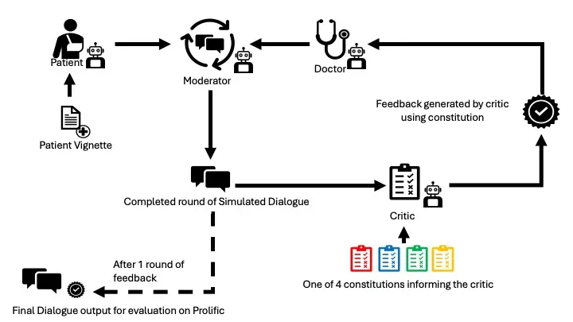
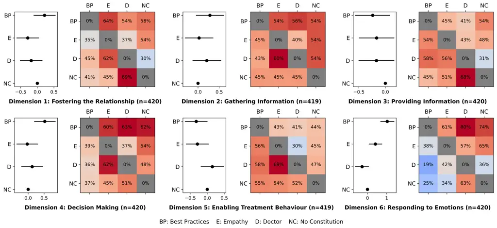
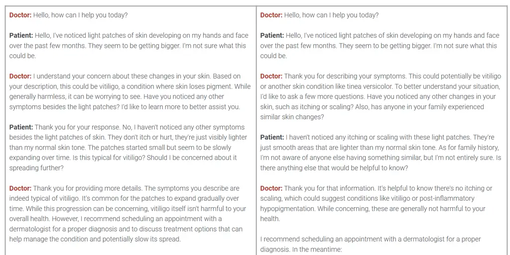
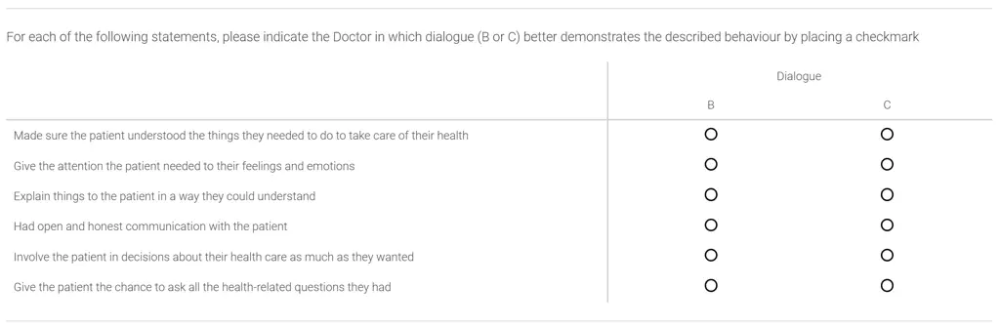

# Evaluating the role of ‘Constitutions’ for learning from AI feedback

Saskia Redgate Affiliation:  Affiliation: University of Oxford
Email: [saskia.redgate@gmail.com](mailto:)    Andrew M. Bean
Affiliation:  Affiliation: University of Oxford
Email: [andrew.bean@oii.ox.ac.uk](mailto:)    Adam Mahdi Affiliation: 
Affiliation: University of Oxford
Email: [adam.mahdi@oii.ox.ac.uk](mailto:)

###### Abstract

The growing capabilities of large language models (LLMs) have led to
their use as substitutes for human feedback for training and assessing
other LLMs. These methods often rely on ‘constitutions’, written
guidelines which a critic model uses to provide feedback and improve
generations. We investigate how the choice of constitution affects
feedback quality by using four different constitutions to improve
patient-centered communication in medical interviews. In pairwise
comparisons conducted by 215 human raters, we found that detailed
constitutions led to better results regarding emotive qualities.
However, none of the constitutions outperformed the baseline in learning
more practically-oriented skills related to information gathering and
provision. Our findings indicate that while detailed constitutions
should be prioritised, there are possible limitations to the
effectiveness of AI feedback as a reward signal in certain areas.  
![[Uncaptioned
image]](arxiv-2411-10168--7d9217e96a1d.figures/figure-1.webp) Code:
[github.com/saskia-rr/Evaluating-Constitutions](https://github.com/saskia-rr/Evaluating-Constitutions)

## 1 Introduction

In current practice, pre-trained large language models (LLMs) are
adapted with feedback learning to encode specific desirable abilities,
especially conversational behaviours and safety alignment \[1, 2\].
Learning from human feedback (e.g. RLHF) has been generally seen as the
gold standard \[3\], but this method can be prohibitively expensive,
leading to the use of synthetic feedback paradigms such as ‘LLM as a
Judge’ \[4\] and ‘Constitutional AI’ \[2\].

Using LLM-generated feedback involves asking a model to self-critique
and generate revisions of previous work it has produced, typically based
on a set of rules or ‘constitution’ \[2\]. Since these constitutions
replace human interpretations of complex concepts and behaviours, it is
important to consider how the content of the constitution impacts the
results of the method. While previous work has shown that more specific
constitutions are only marginally better than high-level goals in the
case of broad values like ‘helpfulness/harmlessness’ \[5\], we are
additionally interested how well constitutions can shape specific
socio-communicative behaviours. We draw on the case of medical practice,
where principles for ‘patient-centered communication’ \[6\] have been
operationalised with detailed frameworks for the training and assessment
of medical practitioners.

Medical uses of LLMs are an active area of study \[7, 8, 9, 10, 11\],
including the AIME model \[12\], which incorporates an AI feedback
learning approach to train social behaviours such as communication. We
expand upon this work by exploring how different constitutions effect
the ultimate quality of model generations. We compare four different
test scenarios based on two different established clinical guidelines,
broad role descriptions, and feedback in the absence of a constitution.
We use iterative in-context learning to guide model generations based
upon these constitutions, and then rate the quality of the final outputs
in comparisons judged by humans. We find that using a more detailed
constitution is more effective for improving patient-centered
communication skills along emotive dimensions, but find no difference or
worse performance along the more practically-oriented dimensions. With
the increasing use of LLMs to replace human feedback and assessment, our
results provide evidence for the effectiveness of these methods in many
cases when used with detailed constitutions, but also indicate that AI
feedback may be better suited to improving certain types of behaviours
than others.

## 2 Methods

### 2.1 In-context Learning with AI Feedback

The core element of reinforcement learning with AI feedback is an
iterative process of in-context learning, through which
constitution-based feedback is used to create preferred model outputs
\[2, 12\]. These outputs are subsequently used for fine-tuning, and the
process can be repeated, but the primary impact of the constitutions
takes place through this in-context learning. As such, we focus
exclusively on the improvement of dialogues via in-context learning,
with the expectation that better results in this portion of training
would extend to better overall results. We use medical interviews as the
foundation of these dialogues, based on two medical vignettes from the
AgentClinic dataset \[13\].

To perform in-context learning, we create an iterative loop using four
different LLM agents, modelled after \[14\], \[12\] and \[2\]. Each
agent is an instance of Claude 3.5 Sonnet, queried via API. These roles
(see Figure 1) include: Patient, acting as a patient based on an
AgentClinic vignette \[13\] in the system prompt which contains
information about the symptoms and demographics of a patient
‘character’; Doctor, who collects information and reaches a diagnosis
for the ‘patient’; Moderator, responsible for determining when the
conversation between Doctor and Patient agent has ended; and Critic, who
provides feedback to the Doctor agent based on a chosen constitution.

After the critic agent has given one round of feedback, and the patient
and doctor have completed two conversations, we record the final
conversation as the output to be assessed. We use this process to
generate one complete conversation per constitution for each of the two
vignettes. For fairness between constitutions, we excluded and replaced
conversations where the patient model failed to follow the vignette by
hallucinating symptoms or not acting as a patient. Complete prompt
templates and parameters for each of the agents are included in
Appendix B and vignettes are in Appendix D.

Figure 1: Dialogue generation with in-context learning. The Patient
model is given a vignette which is used to create a dialogue with a
Doctor model. A Moderator model observes the conversation and intervenes
when it sees a conversational indication that the interaction has ended.
The conversation is then given to a Critic model, which provides
feedback based on one of the four different constitutions (Sec. 2.2),
and returns the feedback to the Doctor. This process is repeated for
each vignette. The final conversations are collected and evaluated by
215 human raters recruited via Prolific (Sec. 2.4).

### 2.2 Constitutions

We compare four constitutions, as described below (for the full text,
see Appendix A). 1) Best Practices, based on the widely-used
‘Patient-Centered Communication’ framework established by \[6\], is
highly detailed and aligns with the criteria used to evaluate the final
conversations. 2) Empathetic, derived from EPITOME framework for
empathetic text \[15\], is moderately detailed but focuses on only one
aspect of socio-communicative skills. 3) Doctor, inspired by \[5\],
specifies only that the output should be in line with a good doctor,
relying on the Critic for interpretation. 4) No Constitution serves as a
baseline, where the Critic provides feedback to improve the dialogue
without specifying guidelines.

### 2.3 Evaluation Framework

The final conversations are compared according to the six categories of
the ‘Patient-Centered Communication’ framework \[6\], with the relevant
questions adapted from \[16\] and \[17\]. The categories are shown in
Table 1.

| Dimension                                        | Question                                                                                   |
| ------------------------------------------------ | ------------------------------------------------------------------------------------------ |
| Fostering the Relationship                       | Had open and honest communication with the patient                                         |
| Gathering Information                            | Give the patient the chance to ask all the health-related questions they had               |
| Providing Information                            | Explain things to the patient in a way they could understand                               |
| Decision Making                                  | Involve the patient in decisions about their health care as much as they wanted            |
| Enabling disease and treatment-related behaviour | Made sure the patient understood the things they needed to do to take care of their health |
| Responding to emotions                           | Give the attention the patient needed to their feelings and emotions                       |

Table 1: Dimensions of Patient-Centered Communication. Each dimension of
Patient-Centered Communication (PCC) Best Practices \[6\] and the
corresponding evaluation question.

For each dimension, we collect pairwise ratings between the generated
conversations. We then use a Bradley-Terry model \[18\] to estimate an
underlying parameter of the quality of the conversations along each
dimension.

### 2.4 Human Evaluation

To evaluate the final conversations, we recruited 215 human raters from
Prolific. Each participant is presented with two randomly selected
conversations based on different constitutions, and asked to make
comparisons between them according to the ‘Patient-Centered
Communication’ framework as well as providing a holistic preference.
Participants repeat this twice, seeing one conversation for each
constitution, but not all six possible pairings. Participants are paid
£2.75 for an average of 13 minutes of time. Due to the length of the
conversations being compared, we required participants to answer one
comprehension check question per conversation, and we excluded 2
participants who failed more than once. We did not exclude participants
who skipped other questions, leading to slight imbalances between the
number of ratings per question and pair. We excluded 16 participants who
started but did not complete the survey, an attrition rate of 7%. This
research was pre-approved and carried out in line with institutional
ethics approval (reference number OII_C1A_24_203).

## 3 Results

In Figure 2, we show the rate at which the conversations generated
according to each constitution are preferred to the others for each
dimension of evaluation, alongside the estimated parameters for a
Bradley-Terry model.

Figure 2: Preferred Constitutions. In each subplot, we show the
percentage of respondents preferring each conversation as a heatmap,
alongside the estimated values from a Bradley-Terry model. We set the
‘No Constitution’ group as a reference point. Error bars represent a 95%
confidence interval, not adjusted for multiple comparisons.

The Best Practices constitution is preferred to the other constitutions
for ‘Fostering the Relationship’, ‘Decision Making’, and ‘Responding to
Emotions’. There is not a clear difference between the constitutions for
‘Gathering’ and ‘Providing Information’. For ‘Enabling treatment
behaviour’, the Best Practices constitution leads to worse results than
the non-specific doctor constitution and the empty constitution. When
holistically selecting a most-preferred constitution, there was not a
clear pattern across participants, though many participants indicated a
dislike of verbose or overly emotive responses even when rating them as
more ‘empathetic’.

## 4 Discussion

For the emotionally-oriented dimensions (Fostering the Relationship,
Decision Making, and Responding to Emotions) of patient-centered
communication, we found that the most specific constitution led to the
most human-preferred dialogues. This is consistent with previous work
comparing constitutions in the case of ‘harmlessness’ \[5\], and
indicates that efforts to create detailed constitutions are likely to
improve the outcomes of AI feedback methods. This is also supported by
the poor performance of the generic “Doctor” constitution, which is
indistinguishable from the “No constitution” treatment in all six
dimensions, and the success of the ‘Empathy’ constitution in ‘Responding
to Emotions’, but not the other categories.

We do not see the same improvements for the more practically-oriented
dimensions, where the LLM needs to manage information exchange with the
patient. These type of behaviours may be more difficult for language
models to judge and learn, as they involve planning and theory of mind,
while emotional signals may be imitated by adding sensitive-sounding
phrases \[7\].

We also note that qualitative feedback from participants who did not
like the verbosity of the models reveals that aspects of the reward
function such as sentence length may be intuitive to humans but not LLMs
\[12\], and that human preferences remain difficult to measure well.

In this study, we focused on comparing four specific constitutions in
the case of patient-centered communication in medicine. For each
constitution, we used only two dialogues, limiting the generalisability.
This is partially compensated by having six different axes of
comparison, showing that the dialogues are improved in several, but not
all cases. While we argue that in-context learning is the key mechanism
for RLAIF, fine-tuning based on a collection of examples would allow a
model to learn behaviours which are not present in every example. As
such, a wide range of small improvements may be aggregated to achieve
better results than what we observe in a single interaction with
in-context learning.

## References

- \[1\] Long Ouyang et al. “Training Language Models to Follow
  Instructions with Human Feedback” In _Proceedings of the 36th
  International Conference on Neural Information Processing Systems_,
  NeurIPS ’22 Red Hook, NY, USA: Curran Associates Inc., 2022, pp.
  27730–27744
- \[2\] Yuntao Bai et al. “Constitutional AI: Harmlessness from AI
  Feedback” In _arXiv:2212.08073_, 2022
- \[3\] Hannah Kirk, Andrew Bean, Bertie Vidgen, Paul Rottger and Scott
  Hale “The Past, Present and Better Future of Feedback Learning in
  Large Language Models for Subjective Human Preferences and Values” In
  _Proceedings of the 2023 Conference on Empirical Methods in Natural
  Language Processing_ Singapore: Association for Computational
  Linguistics, 2023, pp. 2409–2430
- \[4\] Cheng-Han Chiang and Hung-yi Lee “Can Large Language Models Be
  an Alternative to Human Evaluations?” In _Proceedings of the 61st
  Annual Meeting of the Association for Computational Linguistics
  (Volume 1: Long Papers)_ Toronto, Canada: Association for
  Computational Linguistics, 2023, pp. 15607–15631 DOI:
  [10.18653/v1/2023.acl-long.870](https://dx.doi.org/10.18653/v1/2023.acl-long.870)
- \[5\] Sandipan Kundu et al. “Specific versus General Principles for
  Constitutional AI” In _arXiv:2310.13798_ arXiv, 2023
- \[6\] Ann King and Ruth. Hoppe ““Best Practice” for Patient-Centered
  Communication: A Narrative Review” In _Journal of Graduate Medical
  Education_ 5.3, 2013, pp. 385–393 URL:
  [https://www.ncbi.nlm.nih.gov/pmc/articles/PMC3771166/](https://www.ncbi.nlm.nih.gov/pmc/articles/PMC3771166/)
- \[7\] John. Ayers et al. “Comparing Physician and Artificial
  Intelligence Chatbot Responses to Patient Questions Posted to a Public
  Social Media Forum” In _JAMA internal medicine_ 183.6, 2023, pp.
  589–596
- \[8\] Tessa Han, Aounon Kumar, Chirag Agarwal and Himabindu Lakkaraju
  “Towards Safe Large Language Models for Medicine” In _ICML 2024
  Workshop on Foundation Models in the Wild._, 2024 eprint:2403.03744
- \[9\] Khaled Saab et al. “Capabilities of Gemini Models in Medicine”
  In _arXiv:2404.18416_, 2024
- \[10\] Andrew Bean, Karolina Korgul, Felix Krones, Robert McCraith and
  Adam Mahdi “Do Large Language Models have Shared Weaknesses in Medical
  Question Answering?” In _NeurIPS 2024 Workhop on Advancements in
  Medical Foundation Models_, 2024
- \[11\] Yushi Yang, Andrew Bean, Robert McCraith and Adam Mahdi
  “Fine-tuning Large Language Models with Human-inspired Learning
  Strategies in Medical Question Answering” In _NeurIPS 2024 Workhop on
  Fine-Tuning in Modern Machine Learning: Principles and Scalability
  (FITML)_, 2024
- \[12\] Tao Tu et al. “Towards Conversational Diagnostic AI” In
  _arXiv:2401.05654_, 2024
- \[13\] Samuel Schmidgall et al. “AgentClinic: a multimodal agent
  benchmark to evaluate AI in simulated clinical environments” In
  _arXiv:2405.07960_, 2024
- \[14\] Yao Fu, Hao Peng, Tushar Khot and Mirella Lapata “Improving
  Language Model Negotiation with Self-Play and In-Context Learning from
  AI Feedback” arXiv:2305.10142 arXiv, 2023 DOI:
  [10.48550/arXiv.2305.10142](https://dx.doi.org/10.48550/arXiv.2305.10142)
- \[15\] Ashish Sharma, Adam Miner, David Atkins and Tim Althoff “A
  Computational Approach to Understanding Empathy Expressed in
  Text-Based Mental Health Support” In _Proceedings of the 2020
  Conference on Empirical Methods in Natural Language Processing
  (EMNLP)_ Online: Association for Computational Linguistics, 2020, pp.
  5263–5276 DOI:
  [10.18653/v1/2020.emnlp-main.425](https://dx.doi.org/10.18653/v1/2020.emnlp-main.425)
- \[16\] Bryce. Reeve et al. “Psychometric evaluation and design of
  patient-centered communication measures for cancer care settings” In
  _Patient Education and Counseling_ 100.7, 2017, pp. 1322–1328 DOI:
  [10.1016/j.pec.2017.02.011](https://dx.doi.org/10.1016/j.pec.2017.02.011)
- \[17\] Richard. Moser et al. “Patient-Centered Communication (PCC)
  scale: Psychometric analysis and validation of a health survey
  measure” In _PloS One_ 17.12, 2022, pp. e0279725 DOI:
  [10.1371/journal.pone.0279725](https://dx.doi.org/10.1371/journal.pone.0279725)
- \[18\] Wei-Lin Chiang et al. “Chatbot Arena: An Open Platform for
  Evaluating LLMs by Human Preference” In _arXiv:2403.04132_, 2024

## Appendix A Constitutions

We provide the full text of the four constitutions.

Constitution 1: Best Practices You are an AI critic providing feedback
to a doctor after they have completed a conversation with a patient. All
of the previous conversation is the completed conversation. Provide
feedback based on the following guidelines:

#### 1. Fostering the relationship

##### Roles:

• Build rapport and connection • Appear open and honest • Discuss mutual
roles and responsibilities • Respect patient statements, privacy, and
autonomy • Engage in partnership building • Express caring and
commitment • Acknowledge and express sorrow for mistakes

##### Skills:

• Greet patient appropriately • Use appropriate language • Encourage
patient participation • Show interest in the patient as a person

#### 2. Gathering information

##### Roles:

• Attempt to understand the patient’s needs for the encounter • Elicit
full description of major reason for visit from biologic and
psychosocial perspectives • Elicit patient’s full set of concerns •
Elicit patient’s perspective on the problem/illness • Explore full
effect of the illness

##### Skills:

• Ask open-ended questions • Allow patient to complete responses •
Listen actively • Clarify and summarize information • Inquire about
additional concerns

#### 3. Providing information

##### Roles:

• Seek to understand patient’s informational needs • Share information •
Overcome barriers to patient understanding (language, health literacy,
hearing, numeracy) • Facilitate understanding • Provide information
resources and help patient evaluate and use them

Constitution 1: Best Practices (continued)

##### Skills:

• Explain nature of problem and approach to diagnosis and treatment •
Give uncomplicated explanations and instructions • Avoid jargon and
complexity • Encourage questions and check understanding • Emphasize key
messages

#### 4. Decision making

##### Roles:

• Prepare patient for deliberation and enable decision making • Outline
collaborative action plan • Encourage patient to participate in decision
making

##### Skills:

• Outline choices • Explore patient’s preferences and understanding •
Reach agreement • Identify and enlist resources and support • Discuss
follow-up and plan for unexpected outcomes

#### 5. Enabling disease- and treatment-related behavior

##### Roles:

• Assess patient’s interest in and capacity for self-management •
Provide advice (information needs, coping skills, strategies for
success) • Agree on next steps • Assist patient to optimize autonomy and
self-management of his or her problem • Arrange for needed support •
Advocate for and assist patient with health system

##### Skills:

• Assess patient’s readiness to change health behaviors • Elicit
patient’s goals, ideas, and decisions

#### 6. Responding to emotions

##### Roles:

• Facilitate patient expression of emotional consequences of illness •
Acknowledge and explore emotions • Express empathy, sympathy, and
reassurance • Provide help in dealing with emotions

##### Skills:

• Assess psychological distress Your feedback will only be seen by the
doctor. Give your feedback in 100 words or less.

Constitution 2: Empathetic You are an AI critic providing feedback to a
peer. All of the previous conversation is the completed conversation.
Provide feedback based on the following guidelines: • Emotional
Reactions: Expressing emotions such as warmth, compassion, and concern,
experienced by peer supporter after reading seeker’s post •
Interpretations: Communicating an understanding of feelings and
experiences inferred from seeker’s response • Explorations: Improving
understanding of the seeker by exploring the feelings and experiences
not stated in the reply. Showing an active interest in what the seeker
is experiencing and feeling and probing gently Your feedback will only
be seen by the peer. Give your feedback in 100 words or less.

Constitution 3: Doctor You are an AI critic providing feedback to a
doctor after they have completed a conversation with a patient. Give
feedback as you see fit. Your feedback will only be seen by the doctor.
Give your feedback in 100 words or less.

Constitution 4: No Constitution You are an AI critic providing feedback.
Give feedback as you see fit. Give your feedback in 100 words or less.

## Appendix B Model Agent Specifications

All models used in this study were copies of the Claude 3.5 Sonnet
model, accessed via API. Temperature was set to 1.0. The total inference
cost was \$60.

We prompted each of the agents using the following templates, based on
\[12\]. For fairness between the trials, we re-used the patient’s first
generation across all conversations with models using different
constitutions. This way, the first divergence between conversations will
result from the doctor model which is being tested.

Patient You are a patient chatting with a doctor over an online chat
interface. The doctor has never met you before. This is your profile:
Demographics: … Overview: … Primary Symptoms: … Secondary Symptoms: …
Medical History: … Social History: … Key Review of Vitals: …  
Using the profile you should answer as the patient. Do not reveal you
are an AI chatbot. Give your responses in 60 words or less.

Doctor You are a Doctor speaking to a patient over an online chat
interface. You know nothing about the patient in advance. Respond in
single-turn responses to understand their symptoms and find a diagnosis.
You should provide a diagnosis to the patient. You are the healthcare
provider. Do not tell the patient to see a healthcare provider. Do not
reveal you are an AI bot. Give your responses in 50 words or less.

Moderator You are a helpful AI agent which is monitoring a simulated
conversation between a Doctor and a Patient. You should stop the
conversation when you feel a natural conclusion has been reached. Do not
terminate the conversation if there are any open questions left
unanswered.

Critic You are an AI critic providing feedback {INSERT CONSTITUTION}
Give your feedback in 100 words or less.

To make sure the feedback has been acknowledged by the Doctor,
additional leading text is added to the critic feedback and the next
turns in conversation are forced such that in the Doctors context the
feedback has been received. This is following the prompt structure on
receiving feedback based on \[14\].

USER “Here is feedback on your previous interaction with the patient:
{CRITIC FEEDBACK} Incorporate this feedback into your responses in the
next turn of conversation” ASSISTANT (DOCTOR) “I understand and have
acknowledged the feedback. I will incorporate it into the next turn of
the conversation.” USER “The next round of conversation is about to
start.” ASSISTANT (DOCTOR) “Hello, how can I help you today?”

## Appendix C Platform Screenshots

Below are screenshots of the experimental platform where human feedback
was collected. Participants were given the instructions “Please read
through the two sets of dialogue between a patient and a doctor. After
reading, please answer the questions below.” The dialogues were shown
side-by-side as seen in Figure 3.

Figure 3: Side-by-side dialogues. The pairs of dialogues to be compared
are presented side by side. The doctor is highlighted in red for visual
clarity.

After reading the dialogues, participants were further instructed: “Once
you have finished reading the two sets of dialogue, please answer the
questions below. You will be asked 4 questions in total.

The first 2 questions will check you have read both pieces of dialogue
thoroughly.

The next 2 will ask for your opinion of the Doctor in the 2 pieces of
text. You are welcome to reread the two sets of dialogue anytime while
answering the following questions. ”

The comprehension checks are given as multiple choice questions based on
the content of the passage. Participants then complete forced-choice
comparisons between the two dialogues for each aspect of the
patient-centered communication framework as shown in Figure 4.

Figure 4: Preference ratings. Participants choose which dialogue they
preferred for each aspect of the patient-centered communication
framework.

## Appendix D Vignettes

We used two vignettes in this study, taken from the AgentClinic dataset
\[13\]. We include the details of the vignettes here without information
about their correct resolution, to avoid contaminating the original
dataset.

Vignette 1:

Demographics: 19-year-old Caucasian male  
Overview : The patient reports noticing gradually developing patches of
lighter skin on his hands and face over the past few months. These
patches seem to be expanding in size. He denies any pain, itching, or
other discomfort in the areas. No recent illnesses, medication changes,
or significant sunburns.  
Primary Symptoms: Hypopigmented skin patches  
Secondary Symptoms: No discomfort in the affected areas, Gradual
increase in size of the patches  
Medical History: No significant past medical history. The patient is
otherwise healthy with no chronic conditions.  
Social History: Full-time university student, non-smoker, and occasional
alcohol use.  
Key Review of Vitals: Denies recent flu-like symptoms, fever, weight
loss, changes in vision, hair loss, or history of skin cancer in the
family.

Vignette 2:

Demographics: 45-year-old female  
Overview: The patient reports a 2-week history of rectal bleeding
occurring daily with bowel movements. She denies any pain with
defecation and does not present with any other complaints.  
Primary Symptoms: Rectal bleeding daily with bowel movements  
Secondary Symptoms: No pain with defecation Medical History: The
patient’s past medical history is unremarkable except for 5 normal
vaginal deliveries.  
Social History: Information not specified.  
Key Review of Vitals: The patient denies any changes in bowel habits,
abdominal pain, weight loss, or other systemic symptoms.
