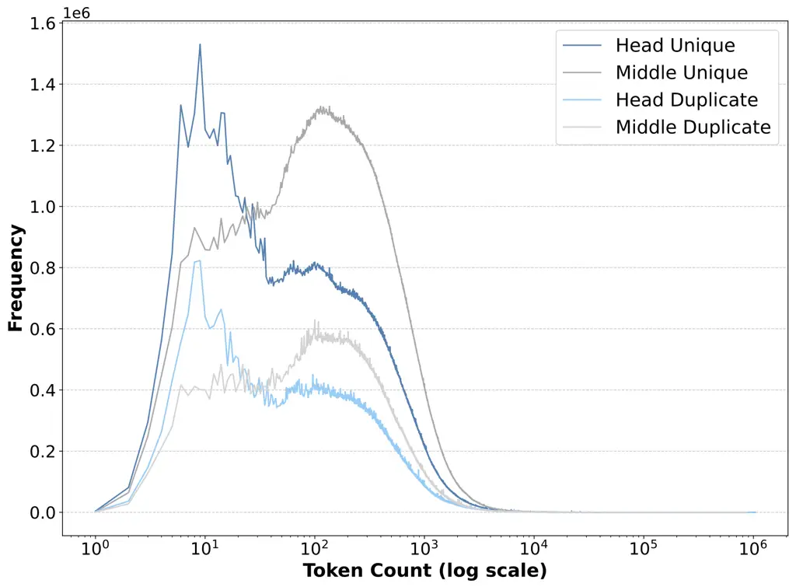
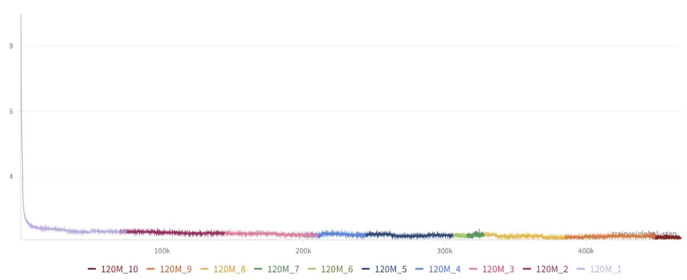
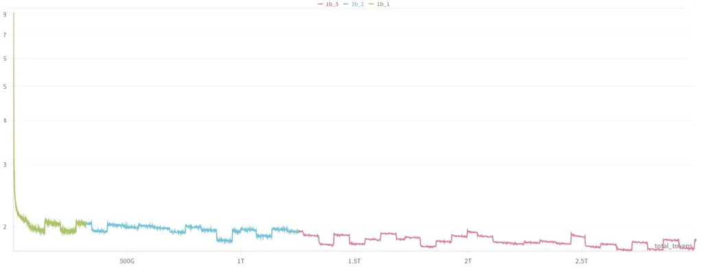

# LLäMmlein ![[Uncaptioned image]](arxiv-2411-11171--c715fa67f126.figures/figure-1.webp): Transparent, Compact and Competitive German-Only Language Models from Scratch

Jan Pfister Email: [lastname@informatik.uni-wuerzburg.de](mailto:)   
Julia Wunderle    Andreas HothoData Science ChairCenter for Artificial
Intelligence and Data Science (CAIDAS)Julius-Maximilians-Universität
Würzburg (JMU)

###### Abstract

We transparently create two German-only decoder models, LLäMmlein 120M
and 1B¹¹ 1 After submission we also released a new 7B model, from
scratch and publish them, along with training data, for the (German) NLP
research community to use²² 2
[https://professor-x.de/lm/LLaMmlein](https://professor-x.de/lm/LLaMmlein)
. The model training involved several key steps, including data
preprocessing/filtering, the creation of a German tokenizer, the
training itself, as well as the evaluation of the final models on
various benchmarks, also against existing models. Throughout the
training process, multiple checkpoints were saved in equal intervals and
analyzed using the German SuperGLEBer benchmark to gain insights into
the models’ learning process.

Compared to state-of-the-art models on the SuperGLEBer benchmark, both
LLäMmlein models performed competitively, consistently matching or
surpassing models with similar parameter sizes. The results show that
the models’ quality scales with size as expected, but performance
improvements on some tasks plateaued early during training, offering
valuable insights into resource allocation for future models.

⁰⁰footnotetext: ![[Uncaptioned
image]](arxiv-2411-11171--c715fa67f126.figures/figure-1.webp) These
authors contributed equally to this work.

## 1 Introduction

Large Language Models (LLMs) have achieved remarkable success, yet this
progress is predominantly centered on English. Other languages,
including German, lag behind due to limited competition, reduced
investment, and a lack of transparency in training data, code, and
detailed results (also see Pfister and Hotho, 2024). While smaller
German-only models do exist, such as BERTs or smaller GPTs Chan et al.
(2020); Scheible et al. (2020), or the contemporaneous effort by Idahl
(2024), many are closed or undocumented, and few robust, openly
accessible German LLMs have been built from scratch with full
transparency. Most German-capable LLMs are either multilingual models
(e.g., mGPT Shliazhko et al. (2024)) or English models adapted to German
(e.g., LeoLM Plüster (2023b), BübleLM Delobelle et al. (2024), or
bloom-clp Ostendorff and Rehm (2023)). Others, like Mistral Jiang et al.
(2023), share little about their (German) training data, making it
difficult to understand which resources and pretraining strategies are
most suitable for developing strong German LLMs from scratch. This lack
of traceability hampers the community’s ability to identify, curate, and
refine German data, and to examine how corpus and training choices
affect model quality. Subtle issues – such as performance deteriorations
on non-English downstream tasks Virtanen et al. (2019) or poor handling
of German’s complex grammar and morphology (Mielke et al. (2019), also
Appendix A) – remain common, even in state-of-the-art models like Llama
3 Dubey et al. (2024), which can revert to English despite a German
context, or sometimes sound like machine-translated from English³³ 3
[https://www.reddit.com/r/LocalLLaMA/comments/1bfce18/still_didnt_found_a_better_small_german_llm_anyone/](https://www.reddit.com/r/LocalLLaMA/comments/1bfce18/still_didnt_found_a_better_small_german_llm_anyone/).

We present _LLäMmlein_, the first German-only LLM family trained
entirely from scratch with full transparency, providing a foundation for
systematically analyzing the relationship between training data and
model outputs. To this end, we share the model, code, and dataset to
foster reproducibility and collaboration. Although our evaluation is
primarily illustrative, it offers insights into the model’s German
capabilities and enables further research and development. We accompany
training with iterative benchmark evaluations, tracking the learning
progress of our 120M and 1B model to illuminate scaling effects and
guide future research.

To achieve this, we: (1) clean and filter a large German dataset derived
from RedPajama V2 Weber et al. (2024), ensuring high-quality input, (2)
construct a dedicated German tokenizer (32k tokens) fitted on varying
data amounts to compare against existing German tokenizers, (3) pretrain
two exclusively German autoregressive LLMs (120M and 1B) and release
incremental checkpoints, inspired by Biderman et al. (2023), to inform
efficient stopping criteria and shed light on learning dynamics, and (4)
evaluate the models on a range of tasks (SuperGLEBer Pfister and Hotho
(2024), lm-evaluation-harness-de Plüster (2023a); Gao et al. (2021)) to
benchmark performance against existing models.

In doing so, we directly demonstrate and address the pressing need for
dedicated German-centric LLM research, establishing a transparent
foundation for understanding, improving, and expanding the German LLM
ecosystem.

## 2 Methodology

Pretraining and evaluating a German LLM from scratch, end-to-end
involves several steps, including dataset preprocessing (section 2.1.2),
tokenizer fitting (section 3.1), model pretraining (section 2.2), model
evaluation using a comprehensive German benchmark, as well as multiple
translated prompt-based few-shot QA tasks (section 2.3), and exemplary
downstream adaptations (section 2.4).

### 2.1 Dataset

RedPajama V2 is an open⁴⁴ 4
[https://commoncrawl.org/terms-of-use](https://commoncrawl.org/terms-of-use),
multilingual dataset designed for training large language models Weber
et al. (2024). It consists of over 100 billion text documents collected
from 84 CommonCrawl snapshots between 2014 and 2023 and encompasses
multiple languages, including English, German, French, Italian, and
Spanish. The dataset was originally preprocessed using the CCNet
pipeline Wenzek et al. (2020) leading to about 30 billion overall
documents further enriched with quality signals and duplicate
indicators. Using perplexity of a language model, the RedPajama dataset
was divided into three quality categories, in descending order of
quality: head, middle, and tail. Following a manual inspection of a
randomly selected subset, the head and middle partitions were deemed to
contain sufficiently high-quality German texts suitable for continued
use. In contrast, the tail partition exhibited inconsistent quality and
was consequently excluded from further training.

#### 2.1.1 Dataset Analysis

The aim of the following preliminary dataset analysis is to gain a
deeper understanding of the German portion of the dataset used. The
“official” estimate of the size of the German segment within the
RedPajamaV2 dataset, derived through extrapolation from a smaller sample
analyzed with Mistral-7B, is approximately 3 trillion German
tokens Weber et al. (2024). Following, we first perform an exploratory
analysis of the dataset to gain a clearer understanding of the actual
amount of German data it contains, alongside its domain distribution and
the most prevalent data sources.

Figure 1: Token count distribution for each partition separately: head
unique, middle unique, head duplicate and middle duplicate based on
gbert-large tokenizer

##### Statistics

Our own count using the gbert-large tokenizer, led to a token count of
2.7 trillion German tokens for head and middle combined, before
document-level deduplication.

Figure 1 breaks down the distribution of each partition, i.e. head
unique, middle unique, head duplicate and middle duplicate separately.
The first occurence of a document is considered unique, while all
subsequent appearances are marked as duplicates. The middle unique
partition contains the largest amount of data, with approximately 1.2
billion samples, which corresponds to 45% of the full dataset. The head
unique partition, by comparison, includes around 400 million fewer
samples.

Overall, most samples are unique (1.9 billion samples) and only
significantly less are marked as duplicates, appearing a second or more
times (777 million samples) across the entire dataset. The most common
token-per-document count can be found at nine, with approximately 3.6
million occurrences in the dataset. A second peak (most prominent for
the unique split) occurs at around 100 tokens per document. In total,
the 2.7 trillion German tokens are distributed across samples with
lengths ranging from 1 to $`1\,034\,799`$ tokens, averaging
approximately $`1000`$ tokens per sample.

Figure 2: Top 20 most frequent domains across the full dataset in gray
with frequencies in head and middle partitions separately.

##### Domain Analysis

The dataset contains content crawled from various domain names. Figure 2
displays the top 20 sources from which the data was collected, with the
overall count illustrated as gray bars and separate plots for the head
(pink) and middle (blue) unique splits.

Wikipedia clearly stands out as the largest contributor, with a combined
total of over 11.5 million samples. Among these, about 10 million
entries belong to the head category, while about 1.45 million stem from
the middle partition. This distribution aligns with the fact that the
split into head, middle and tail was created using a perplexity score
criterion based on a language model trained on Wikipedia Weber et al.
(2024) – consequently, texts closer in style to Wikipedia tend to be
ranked higher. Besides Wikipedia, it is evident that news websites also
constitute a significant portion of the dataset. For the middle split,
“welt.de” emerges as the most frequent domain, contributing around 2.47
million samples. With the exception of domains like eBay, hotels and
Perlentaucher, the list is largely dominated by general news outlets.

#### 2.1.2 Further Dataset Preprocessing

To remove common web boilerplate, such as EU-specific “General Data
Protection Regulation” (GDPR) notices or similar repetitive content, we
utilize a paragraph-level deduplication scheme powered by Dolma – a
framework that enables efficient deduplication through a Rust-based
Bloom filter Soldaini et al. (2024). A Bloom filter is a probabilistic
method that works similarly to a hash table, determining whether an
element has already been previously encountered or not. This ensures
that highly redundant text is filtered out, improving the overall
quality and diversity of the dataset. This approach may inadvertently
over-remove valid and relevant content, such as short texts mistakenly
treated as entire paragraphs being removed across the dataset. To
mitigate this, and to preserve meaningful short text sections – such as
lists or frequently occurring itemized phrases that are contextually
significant – we excluded paragraphs containing fewer than three words
from the deduplication process.

Despite these efforts, we found that some unusual artifacts, such as
long sequences of guitar chords, remained, as they scored low perplexity
(41.2) compared to the average perplexity of 206.35 in the respective
snapshot (2014_52) and were therefore not removed by the preliminary
quality filter. To address this, we built a token-to-word ratio filter.
Here, we compared the word count (whitespace separated) with the token
count using the German GPT-2 tokenizer Schweter (2020). According to our
intuition, a usual ratio between the two counts indicates abnormal or
low-quality text, whereas a close match suggests valid German content. A
simple example illustrates this clearly: The phrase “Der Himmel ist
blau” consists of 4 words and 4 tokens, so it is not removed by our
filter. In contrast, “/de/c/trebic-unesco” counts as 1 word but 11
tokens, and should therefore be excluded by this token-to-word ratio
filter.

Preliminary examinations and manual review suggested a ratio of tokens
to words of eight as a valid threshold. Thus, paragraphs exceeding this
threshold were excluded from the dataset.

### 2.2 Model Pretraining Framework

While there are several existing resources and repositories for training
an LLM from scratch⁵⁵ 5 a small subset:
[https://github.com/Hannibal046/Awesome-LLM#llm-training-frameworks](https://github.com/Hannibal046/Awesome-LLM#llm-training-frameworks),
we chose the TinyLlama GitHub repository as the backbone of our
project Zhang et al. (2024). It was used to pretrain the 1B English
Llama 2-based Touvron et al. (2023) TinyLlama model from scratch before
and builds upon the lit-gpt repository AI (2023), which provides robust
tooling for data preparation, fine-tuning, pretraining, and deploying
LLMs using PyTorch Lightning.

It includes all key features such as multi-GPU and multi-node
distributed training with FSDP as well as FlashAttention-2 Dao (2024).
In addition, it provides scripts to convert the models into HuggingFace
format for easier use and distribution.

We modified the codebase⁶⁶ 6
[https://github.com/LSX-UniWue/LLaMmlein](https://github.com/LSX-UniWue/LLaMmlein)
for our requirements: 1. We significantly improved the data loader
speed by adding various layers of caching. 2. We enable training
directly from a directory of jsonl-files, without any prior
preprocessing. 3. Most importantly, inspired by our reviewers’ feedback,
we retrained our models logging exact datapoints as they enter the
model. This allows us to correlate the training data and its order for
each of our published (intermediate) checkpoints⁷⁷ 7 Since the
performance of the original model (without data logging) and the new
model (with data logging) did not differ significantly, we kept the
original scores throughout the paper..

### 2.3 Model Evaluation Setup

#### 2.3.1 Intermediate Checkpoint Evaluation

To get a better understanding of the training, we monitor the progress
and regularly evaluate intermediate checkpoints on six representative
SuperGLEBer tasks Pfister and Hotho (2024) following a finetuning to the
task from the respective checkpoint. These tasks were selected to
encompass a range of problem types to assess our model’s performance.
Within classification, (1) Natural Language Inference(NLI) Conneau
et al. (2018) requires determining whether a hypothesis is entailed,
neutral, or contradictory to a premise; (2) FactClaiming Comments Risch
et al. (2021) involves binary classification of fact-checkable claims;
(3) DB Aspect Wojatzki et al. (2017) addresses multi-label
categorization and polarity detection in input sentences; and (4)
WebCAGe Henrich et al. (2012) tests if a given word’s sense aligns
across two contexts. For sequence tagging, (5) EuroParl Faruqui and Padó
(2010) evaluates Named Entity Recognition on European Parliament data.
Finally, in the sentence similarity domain, (6) PAWSX Liang et al.
(2020) challenges the model to detect paraphrases via vector
representations.

#### 2.3.2 Final Model Evaluation

To assess general knowledge and abilities, we evaluated our final models
on the full SuperGLEBer benchmark (29 tasks across classification,
sequence tagging, question answering, and sentence similarity) Pfister
and Hotho (2024), as well as machine-translated, prompt-based, few-shot
QA tasks using the lm-evaluation-harness-de by Plüster (2023a) (if not
stated otherwise, they are evaluated measuring unnormalized and
Byte-length normalized accuracy Gao et al. (2021)): (1) ARC-Challenge-DE
Clark et al. (2018): Grade-school science questions ($`1471`$ samples).
Few-shot evaluation with 25 samples. (2) MMLU-DE Hendrycks et al.
(2021): $`6829`$ multiple-choice questions across 57 topics (e.g., math,
medicine, law). Few-shot evaluation with five samples. (3) HellaSwag-DE
Zellers et al. (2019): Commonsense reasoning dataset with $`11\,000`$
translated samples, featuring incomplete sentences with multiple-choice
completions. Few-shot evaluation with ten samples. (4) TruthfulQA-DE Lin
et al. (2022): 817 questions across 38 categories designed to evaluate
model truthfulness, particularly in handling misconceptions in a
zero-shot evaluation setting. Performance here is measured using MC1
(Single-true): accuracy in selecting a single correct answer and MC2
(Multi-true): the normalized probability assigned to all correct answers
Gao et al. (2021).

To assess the impact of checkpoint averaging on model
performance Vaswani et al. (2017); Dubey et al. (2024), we also evaluate
averaged checkpoints on the SuperGLEBer benchmark.

### 2.4 Exemplary Downstream Adaptations

As examples of downstream adaptation, we finetune our model with LoRA Hu
et al. (2022) in two settings: instruct-tuning (adapting the model to
respond to user prompts) and for demonstration purposes on Bavarian and
Swiss in Appendix H.

## 3 Experiments

### 3.1 Tokenizer

We follow the TinyLlama setup and fit an Llama 2 Byte-Pair Encoding
(BPE) tokenizer with a $`32\,000`$-token vocabulary Touvron et al.
(2023). We trained three tokenizers on different amounts of data:

(1) 1TB: Spans backward from the most recent data until 1TB of data is
processed (2) 2023-2021: Includes all splits of the high quality data
split from years 2023 to 2021 (847GB) (3) 2023_14: Consists of the most
recent 2023_14 split (67GB)

### 3.2 Model Pretraining

We trained two models, LLäMmlein 120M and LLäMmlein 1B, using filtered
subsets of our preprocessed dataset (section 2.1). Detailed
configurations for both models are provided in Table 6, and Figures 3
and 4 display the model’s loss curve, where each training resume is
distinguished by a unique color.

#### 3.2.1 LLäMmlein 120M

LLäMmlein 120M was trained on the filtered head unique partition,
comprising 1T pretraining tokens (2 epochs). The training setup included
a maximum learning rate of 6e-4, grouped query attention of 4, a
sequence length of $`2048`$, and a global batch size of 1024. We
employed the full-shard FSDP strategy across 32 L40 GPUs on 16 nodes,
completing training in approximately $`10\,000`$ GPU hours.

#### 3.2.2 LLäMmlein 1B

LLäMmlein 1B was trained on the filtered, head and middle unique
partitions, resulting in a dataset of 1.3T unique tokens, and 3T overall
tokens seen during training. The training setup featured a maximum
learning rate of 6e-4, a global batch size of 1024 (per device batch
size of 16), and was executed on 64 A100 80GB GPUs across 8 nodes over
32 days ($`50\,000`$ GPU hours).

### 3.3 Downstream Adaptations

For instruct-tuning, we use LoRA Hu et al. (2022) with supervised
finetuning, PEFT Mangrulkar et al. (2022) and default hyperparameters
for three epochs on the following datasets from huggingface:
“LSX-UniWue/Guanako”, “FreedomIntelligence/alpaca-gpt4-deutsch”,
“FreedomIntelligence/evol-instruct-deutsch”, and
“FreedomIntelligence/sharegpt-deutsch”. We train and publish a separate
adapter for each dataset, and also a combined model across all datasets.

## 4 Evaluation

### 4.1 Tokenizer

We evaluate our custom Llama2-based tokenizers by measuring their
fertility on random samples and training splits, comparing them to two
established German tokenizers: german-gpt2 (vocab size: $`50\,266`$) and
gbert-large (vocab size: $`31\,102`$). Fertility measures how many
subwords represent a single original word, with a value of 1 indicating
perfect segmentation Rust et al. (2021); Ali et al. (2024). Although
differing vocabulary sizes complicate direct comparisons, the results
still provide relative performance insights.

|                |                  |                  |
| -------------- | ---------------- | ---------------- |
| Tokenizer      | Head             | Middle           |
| word count     | $`46\,509\,357`$ | $`80\,782\,685`$ |
| german-gpt2    | 1.68             | 1.72             |
| gbert-large    | 1.72             | 1.74             |
| ours 1TB       | 2.27             | 2.27             |
| ours 2023-2021 | 2.07             | 2.10             |
| ours 2023_14   | 1.76             | 1.80             |

Table 1: Fertility of our three tokenizers with different training data
sizes in comparison to other German tokenizers on two unseen training
data samples: one from head and one from middle partition.

Table 1 shows the fertility of all tokenizers on two unseen dataset
snapshots. Both german-gpt2 and gbert-large achieve the lowest
fertility. Notably, among our own tokenizers, the one trained on the
smallest dataset (2023_14) produces fewer tokens on average than those
trained on larger datasets. This suggests that a smaller dataset may
enable more efficient tokenization by concentrating on the most frequent
tokens, while larger datasets introduce greater variability and less
efficient segmentation. As seen in Table 5, the tokenizer trained on
less data also appears to yield more meaningful subword segments.
Consequently, we selected the tokenizer trained on the 2023_14 snapshot.

To validate this finding, we repeated the experiment using a variety of
disjoint training datasets and different test sets, including snapshots
from different time periods as well as random internet texts.
Interestingly, we consistently observed the same outcome across all
variations.

### 4.2 Pretraining Process

During training, we regularly saved and evaluated checkpoints to monitor
the training process (section 2.3.1). Intermediate checkpoints will be
published to enable further analysis and comparison with other models .

#### 4.2.1 LLäMmlein 120M

|                |         |        |       |       |         |         |
| -------------- | ------- | ------ | ----- | ----- | ------- | ------- |
| Model          | FactCl. | EUParl | PAWSX | NLI   | DB Asp. | WebCAGe |
| $`10\,000`$    | 0.711   | 0.531  | 0.427 | 0.549 | 0.454   | 0.689   |
| $`100\,000`$   | 0.708   | 0.532  | 0.464 | 0.559 | 0.479   | 0.700   |
| $`200\,000`$   | 0.705   | 0.497  | 0.497 | 0.575 | 0.464   | 0.703   |
| $`300\,000`$   | 0.712   | 0.525  | 0.497 | 0.615 | 0.498   | 0.682   |
| $`400\,000`$   | 0.713   | 0.522  | 0.488 | 0.627 | 0.511   | 0.695   |
| $`466\,509`$   | 0.711   | 0.538  | 0.489 | 0.629 | 0.517   | 0.687   |
| german-gpt2    | 0.707   | 0.533  | 0.394 | 0.479 | 0.429   | 0.645   |
| gbert-base     | 0.751   | 0.616  | 0.561 | 0.436 | 0.478   | 0.693   |
| bert-ger-cased | 0.721   | 0.607  | 0.537 | 0.490 | 0.480   | 0.679   |

Table 2: Results of LLäMmlein 120M checkpoints on six SuperGLEBer tasks
compared to similarly sized german-gpt2, gbert-base and
bert-base-german-cased

We evaluated LLäMmlein 120M against german-gpt2, gbert-base, and
bert-base-german-cased. While it consistently outperformed the
decoder-only german-gpt2 model, BERT-based models excelled in the first
three tasks (FactClaiming, EuroParl, PAWSX), reflecting known
limitations of autoregressive architectures in tasks like sequence
tagging and sentence similarity Pfister and Hotho (2024). However,
LLäMmlein 120M demonstrated superiority in complex classification tasks,
outperforming all models in NLI from checkpoint $`10\,000`$ onward, with
its best checkpoint exceeding bert-base-german-cased by 14%. It also
closely matches the top scores for DB Aspect and WebCAGe classification.

Performance trends during pretraining varied by task. We calculate the
Spearman correlation coefficient $`r`$ to measure the strength and
direction of the relationship between pretraining steps and task
performance, and the corresponding $`p`$-value to assess the statistical
significance of the correlation. FactClaiming and EuroParl showed
minimal variation, but PAWSX ($`r`$ = 0.607, $`p`$ = 0.04), NLI ($`r`$ =
0.947, $`p`$ \< 0.0001), and DB Aspect ($`r`$ = 0.909, $`p`$ \< 0.0001)
displayed significant linear improvements.

Despite this, an Analysis of Variance (ANOVA) across all 29 SuperGLEBer
benchmark tasks revealed no statistically significant performance
improvements beyond the $`300\,000`$ training checkpoint (Figure 5). In
particular, average performance at checkpoints $`300\,000`$ (0.693) and
$`466\,509`$ (0.699) only demonstrated small gains of 0.06 (Figure 5),
despite additional $`166\,509`$ training steps ($`\approx`$349 billion
tokens). These findings problematize the marginal returns of extended
training on downstream tasks, suggesting potential early convergence or
benchmark limitations in capturing nuanced model improvements on average
across tasks. While LLäMmlein quickly reached a plateau for certain
tasks, i.e. those that might require more basic structure recognition
(FactClaiming/EuroParl), it continued to learn and improve on some more
complex tasks. Interestingly, contrary to the “curse of monolingual
models” posited by Kydlíček et al. (2024), which suggests monolingual
models excel at LM but lack reasoning, our model demonstrates strong
performance on deeper semantic tasks such as NLI and WebCAGe.

#### 4.2.2 LLäMmlein 1B

|                  |         |        |       |       |         |         |
| ---------------- | ------- | ------ | ----- | ----- | ------- | ------- |
| Model            | FactCl. | EUParl | PAWSX | NLI   | DB Asp. | WebCAGe |
| $`10\,000`$      | 0.735   | 0.708  | 0.461 | 0.642 | 0.563   | 0.677   |
| $`100\,000`$     | 0.734   | 0.662  | 0.511 | 0.709 | 0.607   | 0.699   |
| $`500\,000`$     | 0.733   | 0.712  | 0.539 | 0.734 | 0.613   | 0.720   |
| $`1\,000\,000`$  | 0.750   | 0.697  | 0.540 | 0.740 | 0.629   | 0.756   |
| $`1\,430\,512`$  | 0.736   | 0.713  | 0.526 | 0.749 | 0.623   | 0.765   |
| Llama 3.2. 1B    | 0.665   | 0.537  | 0.551 | 0.603 | 0.557   | 0.689   |
| EuroLLM-1.7B     | 0.724   | 0.654  | 0.585 | 0.529 | 0.587   | 0.662   |
| gbert-base       | 0.751   | 0.616  | 0.561 | 0.436 | 0.478   | 0.693   |
| mbart-large-50   | 0.723   | 0.727  | 0.358 | 0.336 | 0.471   | 0.651   |
| gbert-large      | 0.747   | 0.636  | 0.654 | 0.736 | 0.550   | 0.716   |
| leo-mistral-7b   | 0.741   | 0.649  | \-    | 0.807 | 0.664   | \-      |
| leo-hessianai-7b | 0.747   | \-     | \-    | \-    | 0.669   | 0.781   |

Table 3: Results of LLäMmlein 1B across multiple training checkpoints on
six SuperGLEBer tasks, in comparison to the best-performing models and
models with similar parameter size. Following SuperGLEBer, results of
models that experienced out-of-memory (OOM) errors on an A100 80 GB are
indicated with a “-”.

We compared LLäMmlein 1B’s performance on the SuperGLEBer benchmark to
the best-performing models for each task and similarly sized models
(Table 3). All models and checkpoints are evaluated after a
task-specific finetuning, following SuperGLEBer evaluation protocol.
While not always securing the top spot, it remains competitive across
tasks, even against much larger models. As with the 120M model,
LLäMmlein 1B trails in sentence similarity tasks like PAWSX. However, it
achieves competitive results for EuroParl. Examining task progress over
time reveals noticeable improvements across all tasks, except for
FactClaiming. Compared to the LLäMmlein 120M model, Spearman correlation
analysis indicated significant positive relationships between training
time and performance for all remaining tasks. In particular, also for
EuroParl ($`r`$ = 0.431, $`p`$ = 0.009) and WebCAGe ($`r`$ = 0.92, $`p`$
\< 0.0001), suggesting that LLäMmlein 1B continues to benefit from
extended training. Nevertheless, across all SuperGLEBer tasks, the
advantage of extended pretraining diminished after roughly 30% of the
pretraining data was processed. From this state, despite a slow decline
in loss, no significant improvements were observed across the 29
downstream tasks (Figure 6). To investigate further, we evaluated the
checkpoint where SuperGLEBer performance plateaued, along with its
instruction-tuned variants on generative tasks Plüster (2023a).
Interestingly, while SuperGLEBer performance stagnated, generative
benchmark results (Table 9) continued to improve on average, likely due
to enhanced autoregressive language modeling capabilities.

### 4.3 Final Model Evaluation

Detailed results for all SuperGLEBer tasks can be found in Table 7, and
on the official website
[https://lsx-uniwue.github.io/SuperGLEBer-site/leaderboard_v1](https://lsx-uniwue.github.io/SuperGLEBer-site/leaderboard_v1).

#### 4.3.1 LLäMmlein 120M

After evaluating LLäMmlein’s performance across pretraining, we compared
its final results against other models on the full SuperGLEBer
benchmark, including pairwise t-tests to compare results with other
models on the SuperGLEBer benchmark. As shown in Tables 2 and 7(a), the
final checkpoint of LLäMmlein significantly outperforms german-gpt2,
establishing itself as the leading German decoder model in this size
range. Against BERT-based models (gbert-base and bert-german-cased), no
significant differences were found (Tables 2, 7(b) and 7(c)), despite
BERT’s known strengths in sequence tagging and similarity tasks Pfister
and Hotho (2024). This highlights LLäMmlein’s ability to compete
effectively with established BERT models, even with their architectural
advantages.

We further evaluated our results on the lm-evaluation-harness-de
evaluation benchmark for autoregressive models against german-gpt2, the
only other German-only decoder model available at this parameter size
(Table 4), and find that we outperform or closely match this model for
all tasks, except for TruthfulQA.

#### 4.3.2 LLäMmlein 1B

|                           |          |           |           |       |
| ------------------------- | -------- | --------- | --------- | ----- |
| Model                     | Truth.QA | ARC-Chal. | HellaSwag | MMLU  |
| german-gpt2               | 0.432    | 0.236     | 0.268     | 0.238 |
| ours 120M                 | 0.404    | 0.238     | 0.320     | 0.245 |
| Llama 3.2 1B              | 0.407    | 0.310     | 0.412     | 0.284 |
| Llama 3.2 1B Inst.        | 0.440    | 0.296     | 0.411     | 0.343 |
| ours 1B                   | 0.365    | 0.311     | 0.483     | 0.253 |
| ours 1B Guanako           | 0.375    | 0.313     | 0.502     | 0.258 |
| ours 1B Alpaka            | 0.397    | 0.323     | 0.499     | 0.258 |
| Llama 2 7b                | 0.422    | 0.381     | 0.513     | 0.400 |
| leo-hessianai-7b-chat     | 0.452    | 0.442     | 0.624     | 0.401 |
| Disco-Llama3-Ger-8B Inst. | 0.530    | 0.538     | 0.664     | 0.559 |
| em-german-7b-v01          | 0.427    | 0.233     | 0.276     | 0.241 |

Table 4: Performance of our (instruction tuned) models on the
lm-evaluation-harness-de, with TruthfulQA (mc2), ARC-Challenge
(acc_norm), HellaSwag (acc_norm), MMLU (acc). Short version of Table 8.

We evaluated LLäMmlein 1B against similarly sized and larger models.
Compared to Llama 3.2 (1B) and EuroLLM (1.7B), LLäMmlein 1B consistently
outperformed both (Figures 8(a) and 8(b)). Leo-hessianai-7b , showed
superior performance, reaffirming the size advantage of 7B models
(Tables 4 and 8(c)). Interestingly, LLäMmlein 1B showed no significant
difference in performance compared to other, larger models like the
Disco-Llama3-German (8B), Llama 3.1 (8B), and gbert-large (Tables 4,
8(d), 8(e) and 8(f)), highlighting its efficiency and competitiveness.

Table 4 compares LLäMmlein 1B and its instruction-tuned variants with
Llama 3.2 1B and larger models. Notably, the German-finetuned
Disco-Llama 3 (8B) instruct model achieved the highest scores overall,
showing the benefit of increased size and instruction tuning. However,
this model had no significant advantage over LLäMmlein 1B on
SuperGLEBer, suggesting that on average model size matters more for
generative tasks than for this benchmark.

For smaller models, Llama 3.2 (1B) achieved the best TruthfulQA score.
However, in completion tasks like ARC-Challenge and HellaSwag, LLäMmlein
1B Instruct models consistently outperformed both the base LLäMmlein
model and Llama 3.2 1B, indicating that instruct-tuning enhances
performance on structured completion tasks. Conversely, Llama 3.2 1B
Instruct excelled in the broader knowledge-focused MMLU benchmark.
Interestingly, instruct-tuning improved LLäMmlein scores across all
tasks, a trend not observed for the Llama 3.2 model.

Task-specific results highlighted structural differences. While
ARC-Challenge and HellaSwag focus on commonsense reasoning, TruthfulQA
and MMLU emphasize factual understanding. Smaller models, even when
finetuned, struggle more with question-answering tasks. Comparing the
120M and 1B versions, the latter consistently outperformed the smaller
model by  10%, except for MMLU and TruthfulQA. Interestingly, the 120M
model outperforms the 1B model on TruthfulQA, aligning with Lin et al.
(2022), who found smaller models often beat their larger counterparts.

We observed that scaling from 120M to 1B parameters yields only marginal
improvements in sentence similarity and question answering tasks
(GermanQuAD and MLQA), with performance differences below 2% and 4%,
respectively (Table 7). This contrasts with SuperGLEBer, where these
tasks showed more significant scaling benefits.

### 4.4 Checkpoint Averaging

Checkpoint averaging did not improve – or even change – downstream task
performance on SuperGLEBer for either the 120M or 1B model (see Figure 9
for the 1B model). This was unexpected, but we hypothesize the
checkpoints being too far apart, as Vaswani et al. (2017) averaged
checkpoints written every 10 minutes near the end of training, while our
checkpoints are about 6-8 hours apart.

## 5 Related Work

### 5.1 German LLMs and Their Limitations

While several language models include German, relatively few have been
trained exclusively on German data, and even fewer have transparently
documented the process and model capabilities.

##### German-only Models

Early German-focused models were predominantly encoder-based (e.g., BERT
variants) trained on corpora up to 163.4GB Chan et al. (2020). A GPT-2
style German model was trained on 16GB of mixed-domain data Schweter
(2020). Contemporaneous to our work, DOSMo Idahl (2024) introduced a
Mistral-7B model trained on 1T tokens of German text from a variety of
sources. However, little details about DOSMo’s training process, data
filtering, and evaluation is publicly known. Furthermore, after
acceptance two ModernBERT models have been trained using our dataset
Ehrmanntraut et al. (2025).

##### Multi-/Crosslingual Models Including German

Several multilingual models incorporate German data, including
Büble Delobelle et al. (2024), bloom-6b4-clp-german Ostendorff and Rehm
(2023), GerPT2 Minixhofer (2020), Disco-Llama3-German-8B DiscoResearch
and Occiglot (2024), EuroLLM-1.7B Martins et al. (2024), and
leo-hessianai-7b Plüster (2023b), as well as mGPT Shliazhko et al.
(2024), a multilingual variant of GPT-2. While these models demonstrate
the feasibility of German (transfer) language modeling, they typically
offer limited transparency in German data preprocessing, training
conditions, and systematic evaluation. In contrast, our work is the
first to (1) train a German-only LLM fully from scratch, (2) provide a
detailed, transparent description of the training pipeline and data
sources, and (3) rigorously evaluate the resulting model’s German
capabilities.

### 5.2 Comparable Efforts in Other Languages

Transparent training and comprehensive evaluation have become more
common in other language contexts. Pythia Biderman et al. (2023), for
example, released a suite of English models with detailed training logs,
and Latxa Etxaniz et al. (2024) continued pretraining Llama 2 models on
Basque data (4.2B tokens), thus significantly improving the models’
Basque language modelling capabilities, while openly documenting its
setup and performance. Furthermore, Virtanen et al. (2019) show that
explicitly pretraining models monolingually on Finnish is able to
outperform multilingually trained models. Our approach extends this
ethos of openness and thorough evaluation to the German language,
advancing both model quality and reproducibility.

## 6 Conclusion

We developed two German-only decoder models, LLäMmlein 120M and 1B,
trained from scratch with tailored tokenization and preprocessing.
Throughout training, we evaluated intermediate checkpoints to analyze
task-specific learning dynamics, noting varied speeds of improvement and
early plateaus for some tasks.

On the SuperGLEBer benchmark, LLäMmlein 1B consistently matched or
outperformed comparable models, including multilingual Llama 3.2 1B,
highlighting the potential benefits of monolingual training for
language-specific tasks. While generative question answering revealed
limitations of smaller models, our 1B model performed comparably to
larger models in most tasks.

Future work includes deeper analysis of training dynamics using our
published checkpoints and data, creating high-quality German instruct
datasets, and exploring domain-specific fine-tuning for further
improvement.

## 7 Limitations

While the LLäMmlein models represent a significant contribution to
German NLP research, several limitations remain: 1. Limited
Capabilities on some domainsDue to the scarcity of high-quality German
resources for e.g. coding, we found the models perform poorly on such
tasks. 2. Monolingual FocusWhile being considered a strength in the
context of this setup, LLäMmlein lacks the ability to leverage
multilingual contexts or perform cross-lingual tasks, which could limit
usability in certain scenarios. 3. Evaluation ScopeWhile evaluated
extensively on the SuperGLEBer benchmark and lm-evaluation-harness,
other domains such as literature, spoken language, or dialects were not
tested, leaving gaps in the understanding of model capabilities. 4.
Long-Context HandlingThe models were trained with a maximum sequence
length of 2048 tokens, which limits their applicability to tasks
requiring extended contexts, such as processing long documents or legal
texts.

## Acknowledgments

The authors gratefully acknowledge the scientific support and HPC
resources provided by the Erlangen National High Performance Computing
Center (NHR@FAU) of the Friedrich Alexander-Universität
Erlangen-Nürnberg (FAU) under the NHR project b185cb. NHR funding is
provided by federal and Bavarian state authorities. NHR@FAU hardware is
partially funded by the German Research Foundation (DFG) – 440719683.
Furthermore, we gratefully acknowledge the HPC resources provided by the
JuliaV2 cluster at the Universität Würzburg (JMU), which was funded as
DFG project as “Forschungsgroßgerät nach Art 91b GG” under INST
93/1145-1 FUGG. The project staff is partially funded by the DFG – 529659926. The data science chair is part of the CAIDAS, the Center for
Artificial Intelligence and Data Science, and is supported by the
Bavarian High-Tech Agenda, which made this research possible. We would
also like to thank Anton Vlasjuk for his valuable contributions and
insights, particularly for his efforts in integrating Flash Attention.

## References

- AI (2023) Lightning AI. 2023.
  [Lit-gpt](https://github.com/Lightning-AI/lit-gpt).
- Ali et al. (2024) Mehdi Ali, Michael Fromm, Klaudia Thellmann, Richard
  Rutmann, Max Lübbering, Johannes Leveling, Katrin Klug, Jan Ebert,
  Niclas Doll, Jasper Buschhoff, Charvi Jain, Alexander Weber, Lena
  Jurkschat, Hammam Abdelwahab, Chelsea John, Pedro Ortiz Suarez, Malte
  Ostendorff, Samuel Weinbach, Rafet Sifa, Stefan Kesselheim, and
  Nicolas Flores-Herr. 2024. [Tokenizer choice for LLM training:
  Negligible or
  crucial?](https://doi.org/10.18653/v1/2024.findings-naacl.247) In
  _Findings of the Association for Computational Linguistics: NAACL
  2024_, pages 3907–3924, Mexico City, Mexico. Association for
  Computational Linguistics.
- Biderman et al. (2023) Stella Biderman, Hailey Schoelkopf, Quentin
  Anthony, Herbie Bradley, Kyle O’Brien, Eric Hallahan, Mohammad Aflah
  Khan, Shivanshu Purohit, USVSN Sai Prashanth, Edward Raff, Aviya
  Skowron, Lintang Sutawika, and Oskar Van Der Wal. 2023. Pythia: a
  suite for analyzing large language models across training and scaling.
  In _Proceedings of the 40th International Conference on Machine
  Learning_, ICML’23. JMLR.org.
- Chan et al. (2020) Branden Chan, Stefan Schweter, and Timo
  Möller. 2020. [German’s next language
  model](https://doi.org/10.18653/v1/2020.coling-main.598). In
  _Proceedings of the 28th International Conference on Computational
  Linguistics_, pages 6788–6796, Barcelona, Spain (Online).
  International Committee on Computational Linguistics.
- Clark et al. (2018) Peter Clark, Isaac Cowhey, Oren Etzioni, Tushar
  Khot, Ashish Sabharwal, Carissa Schoenick, and Oyvind Tafjord. 2018.
  [Think you have solved question answering? try arc, the ai2 reasoning
  challenge](https://api.semanticscholar.org/CorpusID:3922816). _ArXiv_,
  abs/1803.05457.
- Conneau et al. (2018) Alexis Conneau, Ruty Rinott, Guillaume Lample,
  Adina Williams, Samuel Bowman, Holger Schwenk, and Veselin
  Stoyanov. 2018. [XNLI: Evaluating cross-lingual sentence
  representations](https://doi.org/10.18653/v1/D18-1269). In
  _Proceedings of the 2018 Conference on Empirical Methods in Natural
  Language Processing_, pages 2475–2485, Brussels, Belgium. Association
  for Computational Linguistics.
- Dao (2024) Tri Dao. 2024. FlashAttention-2: Faster attention with
  better parallelism and work partitioning. In _International Conference
  on Learning Representations (ICLR)_.
- Delobelle et al. (2024) Pieter Delobelle, Alan Akbik, et al. 2024.
  [BübleLM: A small German
  LM](https://huggingface.co/flair/bueble-lm-2b).
- DiscoResearch and Occiglot (2024) DiscoResearch and Occiglot. 2024.
  [Llama3-discoleo-instruct-8b-v0.1](https://huggingface.co/DiscoResearch/Llama3-DiscoLeo-Instruct-8B-v0.1).
  Instruction-tuned German language model developed with support from
  DFKI and hessian.AI.
- Dubey et al. (2024) Abhimanyu Dubey, Abhinav Jauhri, Abhinav Pandey,
  Abhishek Kadian, Ahmad Al-Dahle, Aiesha Letman, Akhil Mathur, Alan
  Schelten, Amy Yang, Angela Fan, Anirudh Goyal, Anthony Hartshorn, Aobo
  Yang, Archi Mitra, Archie Sravankumar, Artem Korenev, Arthur Hinsvark,
  Arun Rao, Aston Zhang, Aurelien Rodriguez, Austen Gregerson, Ava
  Spataru, Baptiste Roziere, Bethany Biron, Binh Tang, Bobbie Chern,
  Charlotte Caucheteux, Chaya Nayak, Chloe Bi, Chris Marra, Chris
  McConnell, Christian Keller, Christophe Touret, Chunyang Wu, Corinne
  Wong, Cristian Canton Ferrer, Cyrus Nikolaidis, Damien Allonsius,
  Daniel Song, Danielle Pintz, Danny Livshits, David Esiobu, Dhruv
  Choudhary, Dhruv Mahajan, Diego Garcia-Olano, Diego Perino, Dieuwke
  Hupkes, Egor Lakomkin, Ehab AlBadawy, Elina Lobanova, Emily Dinan,
  Eric Michael Smith, Filip Radenovic, Frank Zhang, Gabriel Synnaeve,
  Gabrielle Lee, Georgia Lewis Anderson, Graeme Nail, Gregoire Mialon,
  Guan Pang, Guillem Cucurell, Hailey Nguyen, Hannah Korevaar, Hu Xu,
  Hugo Touvron, Iliyan Zarov, Imanol Arrieta Ibarra, Isabel Kloumann,
  Ishan Misra, Ivan Evtimov, Jade Copet, Jaewon Lee, Jan Geffert, Jana
  Vranes, Jason Park, Jay Mahadeokar, Jeet Shah, Jelmer van der Linde,
  Jennifer Billock, Jenny Hong, Jenya Lee, Jeremy Fu, Jianfeng Chi,
  Jianyu Huang, Jiawen Liu, Jie Wang, Jiecao Yu, Joanna Bitton, Joe
  Spisak, Jongsoo Park, Joseph Rocca, Joshua Johnstun, Joshua Saxe,
  Junteng Jia, Kalyan Vasuden Alwala, Kartikeya Upasani, Kate Plawiak,
  Ke Li, Kenneth Heafield, Kevin Stone, Khalid El-Arini, Krithika Iyer,
  Kshitiz Malik, Kuenley Chiu, Kunal Bhalla, Lauren Rantala-Yeary,
  Laurens van der Maaten, Lawrence Chen, Liang Tan, Liz Jenkins, Louis
  Martin, Lovish Madaan, Lubo Malo, Lukas Blecher, Lukas Landzaat, Luke
  de Oliveira, Madeline Muzzi, Mahesh Pasupuleti, Mannat Singh, Manohar
  Paluri, Marcin Kardas, Mathew Oldham, Mathieu Rita, Maya Pavlova,
  Melanie Kambadur, Mike Lewis, Min Si, Mitesh Kumar Singh, Mona Hassan,
  Naman Goyal, Narjes Torabi, Nikolay Bashlykov, Nikolay Bogoychev,
  Niladri Chatterji, Olivier Duchenne, Onur Çelebi, Patrick Alrassy,
  Pengchuan Zhang, Pengwei Li, Petar Vasic, Peter Weng, Prajjwal
  Bhargava, Pratik Dubal, Praveen Krishnan, Punit Singh Koura, Puxin Xu,
  Qing He, Qingxiao Dong, Ragavan Srinivasan, Raj Ganapathy, Ramon
  Calderer, Ricardo Silveira Cabral, Robert Stojnic, Roberta Raileanu,
  Rohit Girdhar, Rohit Patel, Romain Sauvestre, Ronnie Polidoro, Roshan
  Sumbaly, Ross Taylor, Ruan Silva, Rui Hou, Rui Wang, Saghar Hosseini,
  Sahana Chennabasappa, Sanjay Singh, Sean Bell, Seohyun Sonia Kim,
  Sergey Edunov, Shaoliang Nie, Sharan Narang, Sharath Raparthy, Sheng
  Shen, Shengye Wan, Shruti Bhosale, Shun Zhang, Simon Vandenhende,
  Soumya Batra, Spencer Whitman, Sten Sootla, Stephane Collot, Suchin
  Gururangan, Sydney Borodinsky, Tamar Herman, Tara Fowler, Tarek
  Sheasha, Thomas Georgiou, Thomas Scialom, Tobias Speckbacher, Todor
  Mihaylov, Tong Xiao, Ujjwal Karn, Vedanuj Goswami, Vibhor Gupta,
  Vignesh Ramanathan, Viktor Kerkez, Vincent Gonguet, Virginie Do, Vish
  Vogeti, Vladan Petrovic, Weiwei Chu, Wenhan Xiong, Wenyin Fu, Whitney
  Meers, Xavier Martinet, Xiaodong Wang, Xiaoqing Ellen Tan, Xinfeng
  Xie, Xuchao Jia, Xuewei Wang, Yaelle Goldschlag, Yashesh Gaur, Yasmine
  Babaei, Yi Wen, Yiwen Song, Yuchen Zhang, Yue Li, Yuning Mao,
  Zacharie Delpierre Coudert, Zheng Yan, Zhengxing Chen, Zoe Papakipos,
  Aaditya Singh, Aaron Grattafiori, Abha Jain, Adam Kelsey, Adam
  Shajnfeld, Adithya Gangidi, Adolfo Victoria, Ahuva Goldstand, Ajay
  Menon, Ajay Sharma, Alex Boesenberg, Alex Vaughan, Alexei Baevski,
  Allie Feinstein, Amanda Kallet, Amit Sangani, Anam Yunus, Andrei Lupu,
  Andres Alvarado, Andrew Caples, Andrew Gu, Andrew Ho, Andrew Poulton,
  Andrew Ryan, Ankit Ramchandani, Annie Franco, Aparajita Saraf,
  Arkabandhu Chowdhury, Ashley Gabriel, Ashwin Bharambe, Assaf Eisenman,
  Azadeh Yazdan, Beau James, Ben Maurer, Benjamin Leonhardi, Bernie
  Huang, Beth Loyd, Beto De Paola, Bhargavi Paranjape, Bing Liu, Bo Wu,
  Boyu Ni, Braden Hancock, Bram Wasti, Brandon Spence, Brani Stojkovic,
  Brian Gamido, Britt Montalvo, Carl Parker, Carly Burton, Catalina
  Mejia, Changhan Wang, Changkyu Kim, Chao Zhou, Chester Hu,
  Ching-Hsiang Chu, Chris Cai, Chris Tindal, Christoph Feichtenhofer,
  Damon Civin, Dana Beaty, Daniel Kreymer, Daniel Li, Danny Wyatt, David
  Adkins, David Xu, Davide Testuggine, Delia David, Devi Parikh, Diana
  Liskovich, Didem Foss, Dingkang Wang, Duc Le, Dustin Holland, Edward
  Dowling, Eissa Jamil, Elaine Montgomery, Eleonora Presani, Emily Hahn,
  Emily Wood, Erik Brinkman, Esteban Arcaute, Evan Dunbar, Evan
  Smothers, Fei Sun, Felix Kreuk, Feng Tian, Firat Ozgenel, Francesco
  Caggioni, Francisco Guzmán, Frank Kanayet, Frank Seide,
  Gabriela Medina Florez, Gabriella Schwarz, Gada Badeer, Georgia Swee,
  Gil Halpern, Govind Thattai, Grant Herman, Grigory Sizov, Guangyi,
  Zhang, Guna Lakshminarayanan, Hamid Shojanazeri, Han Zou, Hannah Wang,
  Hanwen Zha, Haroun Habeeb, Harrison Rudolph, Helen Suk, Henry
  Aspegren, Hunter Goldman, Ibrahim Damlaj, Igor Molybog, Igor Tufanov,
  Irina-Elena Veliche, Itai Gat, Jake Weissman, James Geboski, James
  Kohli, Japhet Asher, Jean-Baptiste Gaya, Jeff Marcus, Jeff Tang,
  Jennifer Chan, Jenny Zhen, Jeremy Reizenstein, Jeremy Teboul, Jessica
  Zhong, Jian Jin, Jingyi Yang, Joe Cummings, Jon Carvill, Jon Shepard,
  Jonathan McPhie, Jonathan Torres, Josh Ginsburg, Junjie Wang, Kai Wu,
  Kam Hou U, Karan Saxena, Karthik Prasad, Kartikay Khandelwal, Katayoun
  Zand, Kathy Matosich, Kaushik Veeraraghavan, Kelly Michelena, Keqian
  Li, Kun Huang, Kunal Chawla, Kushal Lakhotia, Kyle Huang, Lailin Chen,
  Lakshya Garg, Lavender A, Leandro Silva, Lee Bell, Lei Zhang,
  Liangpeng Guo, Licheng Yu, Liron Moshkovich, Luca Wehrstedt, Madian
  Khabsa, Manav Avalani, Manish Bhatt, Maria Tsimpoukelli, Martynas
  Mankus, Matan Hasson, Matthew Lennie, Matthias Reso, Maxim Groshev,
  Maxim Naumov, Maya Lathi, Meghan Keneally, Michael L. Seltzer, Michal
  Valko, Michelle Restrepo, Mihir Patel, Mik Vyatskov, Mikayel
  Samvelyan, Mike Clark, Mike Macey, Mike Wang, Miquel Jubert Hermoso,
  Mo Metanat, Mohammad Rastegari, Munish Bansal, Nandhini Santhanam,
  Natascha Parks, Natasha White, Navyata Bawa, Nayan Singhal, Nick
  Egebo, Nicolas Usunier, Nikolay Pavlovich Laptev, Ning Dong, Ning
  Zhang, Norman Cheng, Oleg Chernoguz, Olivia Hart, Omkar Salpekar,
  Ozlem Kalinli, Parkin Kent, Parth Parekh, Paul Saab, Pavan Balaji,
  Pedro Rittner, Philip Bontrager, Pierre Roux, Piotr Dollar, Polina
  Zvyagina, Prashant Ratanchandani, Pritish Yuvraj, Qian Liang, Rachad
  Alao, Rachel Rodriguez, Rafi Ayub, Raghotham Murthy, Raghu Nayani,
  Rahul Mitra, Raymond Li, Rebekkah Hogan, Robin Battey, Rocky Wang,
  Rohan Maheswari, Russ Howes, Ruty Rinott, Sai Jayesh Bondu, Samyak
  Datta, Sara Chugh, Sara Hunt, Sargun Dhillon, Sasha Sidorov, Satadru
  Pan, Saurabh Verma, Seiji Yamamoto, Sharadh Ramaswamy, Shaun Lindsay,
  Shaun Lindsay, Sheng Feng, Shenghao Lin, Shengxin Cindy Zha, Shiva
  Shankar, Shuqiang Zhang, Shuqiang Zhang, Sinong Wang, Sneha Agarwal,
  Soji Sajuyigbe, Soumith Chintala, Stephanie Max, Stephen Chen, Steve
  Kehoe, Steve Satterfield, Sudarshan Govindaprasad, Sumit Gupta,
  Sungmin Cho, Sunny Virk, Suraj Subramanian, Sy Choudhury, Sydney
  Goldman, Tal Remez, Tamar Glaser, Tamara Best, Thilo Kohler, Thomas
  Robinson, Tianhe Li, Tianjun Zhang, Tim Matthews, Timothy Chou, Tzook
  Shaked, Varun Vontimitta, Victoria Ajayi, Victoria Montanez, Vijai
  Mohan, Vinay Satish Kumar, Vishal Mangla, Vítor Albiero, Vlad Ionescu,
  Vlad Poenaru, Vlad Tiberiu Mihailescu, Vladimir Ivanov, Wei Li,
  Wenchen Wang, Wenwen Jiang, Wes Bouaziz, Will Constable, Xiaocheng
  Tang, Xiaofang Wang, Xiaojian Wu, Xiaolan Wang, Xide Xia, Xilun Wu,
  Xinbo Gao, Yanjun Chen, Ye Hu, Ye Jia, Ye Qi, Yenda Li, Yilin Zhang,
  Ying Zhang, Yossi Adi, Youngjin Nam, Yu, Wang, Yuchen Hao, Yundi Qian,
  Yuzi He, Zach Rait, Zachary DeVito, Zef Rosnbrick, Zhaoduo Wen, Zhenyu
  Yang, and Zhiwei Zhao. 2024. [The llama 3 herd of
  models](https://arxiv.org/abs/2407.21783). _Preprint_,
  arXiv:2407.21783.
- Ehrmanntraut et al. (2025) Anton Ehrmanntraut, Julia Wunderle, Jan
  Pfister, Fotis Jannidis, and Andreas Hotho. 2025. [ModernGBERT:
  German-only 1B Encoder Model Trained from
  Scratch](https://arxiv.org/abs/2505.13136). _Preprint_,
  arXiv:2505.13136.
- Etxaniz et al. (2024) Julen Etxaniz, Oscar Sainz, Naiara Miguel,
  Itziar Aldabe, German Rigau, Eneko Agirre, Aitor Ormazabal, Mikel
  Artetxe, and Aitor Soroa. 2024. [Latxa: An open language model and
  evaluation suite for
  Basque](https://doi.org/10.18653/v1/2024.acl-long.799). In
  _Proceedings of the 62nd Annual Meeting of the Association for
  Computational Linguistics (Volume 1: Long Papers)_, pages 14952–14972,
  Bangkok, Thailand. Association for Computational Linguistics.
- Faruqui and Padó (2010) Manaal Faruqui and Sebastian Padó. 2010.
  [Training and evaluating a german named entity recognizer with
  semantic
  generalization](https://api.semanticscholar.org/CorpusID:7938791). In
  _Conference on Natural Language Processing_.
- Gao et al. (2021) Leo Gao, Jonathan Tow, Stella Biderman, Sid Black,
  Anthony DiPofi, Charles Foster, Laurence Golding, Jeffrey Hsu, Kyle
  McDonell, Niklas Muennighoff, Jason Phang, Laria Reynolds, Eric Tang,
  Anish Thite, Ben Wang, Kevin Wang, and Andy Zou. 2021. [A framework
  for few-shot language model
  evaluation](https://doi.org/10.5281/zenodo.5371628).
- Hendrycks et al. (2021) Dan Hendrycks, Collin Burns, Steven Basart,
  Andy Zou, Mantas Mazeika, Dawn Song, and Jacob Steinhardt. 2021.
  Measuring massive multitask language understanding. _Proceedings of
  the International Conference on Learning Representations (ICLR)_.
- Henrich et al. (2012) Verena Henrich, Erhard Hinrichs, and Tatiana
  Vodolazova. 2012. [WebCAGe – a web-harvested corpus annotated with
  GermaNet senses](https://aclanthology.org/E12-1039). In _Proceedings
  of the 13th Conference of the European Chapter of the Association for
  Computational Linguistics_, pages 387–396, Avignon, France.
  Association for Computational Linguistics.
- Hu et al. (2022) Edward J Hu, yelong shen, Phillip Wallis, Zeyuan
  Allen-Zhu, Yuanzhi Li, Shean Wang, Lu Wang, and Weizhu Chen. 2022.
  [LoRA: Low-rank adaptation of large language
  models](https://openreview.net/forum?id=nZeVKeeFYf9). In
  _International Conference on Learning Representations_.
- Idahl (2024) Maximilian Idahl. 2024. [DOSMo-7B: A Large Language Model
  Trained Exclusively on German
  Text](https://events.gwdg.de/event/615/contributions/2278/). In
  _Proceedings of the Konferenz der deutschen KI-Servicezentren 2024
  (KonKIS 24)_. Accessed: 2024-12-10.
- Jiang et al. (2023) Albert Q. Jiang, Alexandre Sablayrolles, Arthur
  Mensch, Chris Bamford, Devendra Singh Chaplot, Diego de las Casas,
  Florian Bressand, Gianna Lengyel, Guillaume Lample, Lucile Saulnier,
  Lélio Renard Lavaud, Marie-Anne Lachaux, Pierre Stock, Teven Le Scao,
  Thibaut Lavril, Thomas Wang, Timothée Lacroix, and William El
  Sayed. 2023. [Mistral 7b](https://arxiv.org/abs/2310.06825).
  _Preprint_, arXiv:2310.06825.
- Kydlíček et al. (2024) Hynek Kydlíček, Guilherme Penedo, Clémentine
  Fourier, Nathan Habib, and Thomas Wolf. 2024. [Finetasks: Finding
  signal in a haystack of 200+ multilingual
  tasks](https://huggingface.co/spaces/HuggingFaceFW/blogpost-fine-tasks).
- Liang et al. (2020) Yaobo Liang, Nan Duan, Yeyun Gong, Ning Wu, Fenfei
  Guo, Weizhen Qi, Ming Gong, Linjun Shou, Daxin Jiang, Guihong Cao,
  Xiaodong Fan, Ruofei Zhang, Rahul Agrawal, Edward Cui, Sining Wei,
  Taroon Bharti, Ying Qiao, Jiun-Hung Chen, Winnie Wu, Shuguang Liu, Fan
  Yang, Daniel Campos, Rangan Majumder, and Ming Zhou. 2020. [XGLUE: A
  new benchmark dataset for cross-lingual pre-training, understanding
  and generation](https://doi.org/10.18653/v1/2020.emnlp-main.484). In
  _Proceedings of the 2020 Conference on Empirical Methods in Natural
  Language Processing (EMNLP)_, pages 6008–6018, Online. Association for
  Computational Linguistics.
- Lin et al. (2022) Stephanie Lin, Jacob Hilton, and Owain Evans. 2022.
  [TruthfulQA: Measuring how models mimic human
  falsehoods](https://doi.org/10.18653/v1/2022.acl-long.229). In
  _Proceedings of the 60th Annual Meeting of the Association for
  Computational Linguistics (Volume 1: Long Papers)_, pages 3214–3252,
  Dublin, Ireland. Association for Computational Linguistics.
- Mangrulkar et al. (2022) Sourab Mangrulkar, Sylvain Gugger, Lysandre
  Debut, Younes Belkada, Sayak Paul, and Benjamin Bossan. 2022. Peft:
  State-of-the-art parameter-efficient fine-tuning methods.
  [https://github.com/huggingface/peft](https://github.com/huggingface/peft).
- Martins et al. (2024) Pedro Henrique Martins, Patrick Fernandes, João
  Alves, Nuno M. Guerreiro, Ricardo Rei, Duarte M. Alves, José Pombal,
  Amin Farajian, Manuel Faysse, Mateusz Klimaszewski, Pierre Colombo,
  Barry Haddow, José G. C. de Souza, Alexandra Birch, and André F. T.
  Martins. 2024. [Eurollm: Multilingual language models for
  europe](https://arxiv.org/abs/2409.16235). _Preprint_,
  arXiv:2409.16235.
- Mielke et al. (2019) Sabrina J. Mielke, Ryan Cotterell, Kyle Gorman,
  Brian Roark, and Jason Eisner. 2019. [What kind of language is hard to
  language-model?](https://doi.org/10.18653/v1/P19-1491) In _Proceedings
  of the 57th Annual Meeting of the Association for Computational
  Linguistics_, pages 4975–4989, Florence, Italy. Association for
  Computational Linguistics.
- Minixhofer (2020) Benjamin Minixhofer. 2020. [GerPT2: German large and
  small versions of GPT2](https://doi.org/10.5281/zenodo.5509984).
- Ostendorff and Rehm (2023) Malte Ostendorff and Georg Rehm. 2023.
  [Efficient language model training through cross-lingual and
  progressive transfer
  learning](https://doi.org/10.48550/ARXIV.2301.09626). _arXiv
  preprint_.
- Pfister and Hotho (2024) Jan Pfister and Andreas Hotho. 2024.
  [SuperGLEBer: German language understanding evaluation
  benchmark](https://doi.org/10.18653/v1/2024.naacl-long.438). In
  _Proceedings of the 2024 Conference of the North American Chapter of
  the Association for Computational Linguistics: Human Language
  Technologies (Volume 1: Long Papers)_, pages 7904–7923, Mexico City,
  Mexico. Association for Computational Linguistics.
- Plüster (2023a) Björn Plüster. 2023a. [German benchmark datasets -
  translating popular llm benchmarks to
  german](https://github.com/bjoernpl/GermanBenchmark?tab=readme-ov-file).
- Plüster (2023b) Björn Plüster. 2023b. [LeoLM: Igniting German-Language
  LLM Research](https://laion.ai/blog/leo-lm/). Accessed: 2024-11-15.
- Risch et al. (2021) Julian Risch, Anke Stoll, Lena Wilms, and Michael
  Wiegand, editors. 2021. [_Proceedings of the GermEval 2021 Shared Task
  on the Identification of Toxic, Engaging, and Fact-Claiming
  Comments_](https://aclanthology.org/2021.germeval-1.0). Association
  for Computational Linguistics, Duesseldorf, Germany.
- Rust et al. (2021) Phillip Rust, Jonas Pfeiffer, Ivan Vulić, Sebastian
  Ruder, and Iryna Gurevych. 2021. [How good is your tokenizer? on the
  monolingual performance of multilingual language
  models](https://doi.org/10.18653/v1/2021.acl-long.243). In
  _Proceedings of the 59th Annual Meeting of the Association for
  Computational Linguistics and the 11th International Joint Conference
  on Natural Language Processing (Volume 1: Long Papers)_, pages
  3118–3135, Online. Association for Computational Linguistics.
- Scheible et al. (2020) Raphael Scheible, Fabian Thomczyk, Patric
  Tippmann, Victor Jaravine, and Martin Boeker. 2020. [Gottbert: a pure
  german language
  model](https://api.semanticscholar.org/CorpusID:227255526). _ArXiv_,
  abs/2012.02110.
- Schweter (2020) Stefan Schweter. 2020. [German gpt-2
  model](https://doi.org/10.5281/zenodo.4275046).
- Shliazhko et al. (2024) Oleh Shliazhko, Alena Fenogenova, Maria
  Tikhonova, Anastasia Kozlova, Vladislav Mikhailov, and Tatiana
  Shavrina. 2024. [mGPT: Few-shot learners go
  multilingual](https://doi.org/10.1162/tacl_a_00633). _Transactions of
  the Association for Computational Linguistics_, 12:58–79.
- Soldaini et al. (2024) Luca Soldaini, Rodney Kinney, Akshita Bhagia,
  Dustin Schwenk, David Atkinson, Russell Authur, Ben Bogin, Khyathi
  Chandu, Jennifer Dumas, Yanai Elazar, Valentin Hofmann, Ananya Jha,
  Sachin Kumar, Li Lucy, Xinxi Lyu, Nathan Lambert, Ian Magnusson, Jacob
  Morrison, Niklas Muennighoff, Aakanksha Naik, Crystal Nam, Matthew
  Peters, Abhilasha Ravichander, Kyle Richardson, Zejiang Shen, Emma
  Strubell, Nishant Subramani, Oyvind Tafjord, Evan Walsh, Luke
  Zettlemoyer, Noah Smith, Hannaneh Hajishirzi, Iz Beltagy, Dirk
  Groeneveld, Jesse Dodge, and Kyle Lo. 2024. [Dolma: an open corpus of
  three trillion tokens for language model pretraining
  research](https://doi.org/10.18653/v1/2024.acl-long.840). In
  _Proceedings of the 62nd Annual Meeting of the Association for
  Computational Linguistics (Volume 1: Long Papers)_, pages 15725–15788,
  Bangkok, Thailand. Association for Computational Linguistics.
- Touvron et al. (2023) Hugo Touvron, Louis Martin, Kevin Stone, Peter
  Albert, Amjad Almahairi, Yasmine Babaei, Nikolay Bashlykov, Soumya
  Batra, Prajjwal Bhargava, Shruti Bhosale, Dan Bikel, Lukas Blecher,
  Cristian Canton Ferrer, Moya Chen, Guillem Cucurull, David Esiobu,
  Jude Fernandes, Jeremy Fu, Wenyin Fu, Brian Fuller, Cynthia Gao,
  Vedanuj Goswami, Naman Goyal, Anthony Hartshorn, Saghar Hosseini, Rui
  Hou, Hakan Inan, Marcin Kardas, Viktor Kerkez, Madian Khabsa, Isabel
  Kloumann, Artem Korenev, Punit Singh Koura, Marie-Anne Lachaux,
  Thibaut Lavril, Jenya Lee, Diana Liskovich, Yinghai Lu, Yuning Mao,
  Xavier Martinet, Todor Mihaylov, Pushkar Mishra, Igor Molybog, Yixin
  Nie, Andrew Poulton, Jeremy Reizenstein, Rashi Rungta, Kalyan Saladi,
  Alan Schelten, Ruan Silva, Eric Michael Smith, Ranjan Subramanian,
  Xiaoqing Ellen Tan, Binh Tang, Ross Taylor, Adina Williams, Jian Xiang
  Kuan, Puxin Xu, Zheng Yan, Iliyan Zarov, Yuchen Zhang, Angela Fan,
  Melanie Kambadur, Sharan Narang, Aurelien Rodriguez, Robert Stojnic,
  Sergey Edunov, and Thomas Scialom. 2023. [Llama 2: Open foundation and
  fine-tuned chat models](https://arxiv.org/abs/2307.09288). _Preprint_,
  arXiv:2307.09288.
- Vaswani et al. (2017) Ashish Vaswani, Noam Shazeer, Niki Parmar, Jakob
  Uszkoreit, Llion Jones, Aidan N Gomez, Ł ukasz Kaiser, and Illia
  Polosukhin. 2017. [Attention is all you
  need](https://proceedings.neurips.cc/paper_files/paper/2017/file/3f5ee243547dee91fbd053c1c4a845aa-Paper.pdf).
  In _Advances in Neural Information Processing Systems_, volume 30.
  Curran Associates, Inc.
- Virtanen et al. (2019) Antti Virtanen, Jenna Kanerva, Rami Ilo, Jouni
  Luoma, Juhani Luotolahti, Tapio Salakoski, Filip Ginter, and Sampo
  Pyysalo. 2019. [Multilingual is not enough: Bert for
  finnish](https://arxiv.org/abs/1912.07076). _Preprint_,
  arXiv:1912.07076.
- Weber et al. (2024) Maurice Weber, Daniel Y. Fu, Quentin Anthony,
  Yonatan Oren, Shane Adams, Anton Alexandrov, Xiaozhong Lyu, Huu
  Nguyen, Xiaozhe Yao, Virginia Adams, Ben Athiwaratkun, Rahul
  Chalamala, Kezhen Chen, Max Ryabinin, Tri Dao, Percy Liang,
  Christopher Ré, Irina Rish, and Ce Zhang. 2024. Redpajama: an open
  dataset for training large language models. _NeurIPS Datasets and
  Benchmarks Track_.
- Wenzek et al. (2020) Guillaume Wenzek, Marie-Anne Lachaux, Alexis
  Conneau, Vishrav Chaudhary, Francisco Guzmán, Armand Joulin, and
  Edouard Grave. 2020. [CCNet: Extracting high quality monolingual
  datasets from web crawl
  data](https://aclanthology.org/2020.lrec-1.494). In _Proceedings of
  the Twelfth Language Resources and Evaluation Conference_, pages
  4003–4012, Marseille, France. European Language Resources Association.
- Wojatzki et al. (2017) Michael Wojatzki, Eugen Ruppert, Sarah
  Holschneider, Torsten Zesch, and Chris Biemann. 2017. [Germeval 2017:
  Shared task on aspect-based sentiment in social media customer
  feedback](https://api.semanticscholar.org/CorpusID:43976474).
- Zellers et al. (2019) Rowan Zellers, Ari Holtzman, Yonatan Bisk, Ali
  Farhadi, and Yejin Choi. 2019. Hellaswag: Can a machine really finish
  your sentence? In _Proceedings of the 57th Annual Meeting of the
  Association for Computational Linguistics_.
- Zhang et al. (2024) Peiyuan Zhang, Guangtao Zeng, Tianduo Wang, and
  Wei Lu. 2024. [Tinyllama: An open-source small language
  model](https://arxiv.org/abs/2401.02385). _Preprint_,
  arXiv:2401.02385.

## Appendix A Exemplary Shortcoming of Current Multilingual Models in German

> Llama 3.1 8B:
>
> Was haben David Hasselhoff und Markus Söder gemein?  
> Die beiden haben in den 1980er Jahren die Fernsehserie "Miami Vice"
> gemeinsam gespielt. Hasselhoff spielte Kraftedurch die Figur von
> Ricardo Montalban, der Cobrai im Film "Zorba the Greek" gespielt hat;
> Söder war Lieutenant Vincent Lopiano und wurde während des
> Drehprozesses an einen Verletzung erkrankt.
>
> Issues:
>
> - •
>   Kraftedurch: This name is nonsensical and seems like a verbatim
>   translation of two English words.
> - •
>   Cobrai: Like Kraftedurch a nonsensical name.
> - •
>   wurde während des Drehprozesses an einen Verletzung erkrankt:
>   Grammatically incorrect, mixing verb forms and incorrect article
>   use.

> Ours 1B chat_selected:
>
> Was haben David Hasselhoff und Markus Söder gemein?  
> Sowohl David Hasselhoff als auch Markus Söder sind zwei berühmte
> deutsche Persönlichkeiten, die sich in der Unterhaltungs- und
> Politikwelt einen Namen gemacht haben. Sie teilen einige gemeinsame
> Merkmale wie ihren Erfolg bei den Fans, ihre Popularität und ihren
> Sinn für Humor.

Ignoring the possibly absurd content of this query, the responses
highlight underlying issues with the German language of existing
multilingual open-source LLMs. The response from Llama 3.1 8B contains
glaring grammatical errors and nonsensical phrases, such as
‘‘Kraftedurch’’ (a meaningless word) and ‘‘wurde während des
Drehprozesses an einen Verletzung erkrankt’’ (grammatically incoherent),
which highlight a lack of robust German language training. These issues,
which required minimal effort to uncover, exemplarily show the
inadequacy of current large-scale LLMs for German⁸⁸ 8
[https://www.reddit.com/r/LocalLLaMA/comments/1bfce18/still_didnt_found_a_better_small_german_llm_anyone/](https://www.reddit.com/r/LocalLLaMA/comments/1bfce18/still_didnt_found_a_better_small_german_llm_anyone/),
where even basic grammatical rules are frequently violated. This
demonstrates the critical importance of dedicated, large-scale German
LLM pretraining to address these shortcomings.

## Appendix B Removed Datapoints…

To improve the overall quality and diversity of the dataset, we applied
additional paragraph-level deduplication, to remove repetitive and
redundant boilerplate texts (Section B.1) and a token-to-word ratio
filter (Section B.2), to further exclude low-quality content. For
instance, the following paragraphs were removed by our additional
preprocessing steps:

### B.1 …from deduplication

{ "raw_content": …Die Nutzung der im Rahmen des Impressums oder
vergleichbarer Angaben veroeffentlichten Kontaktdaten wie
Postanschriften, Telefon- und Faxnummern sowie Emailadressen durch
Dritte zur Uebersendung von nicht ausdruecklich angeforderten
Informationen ist nicht gestattet…, …}

{"raw_content": …5) Datenverarbeitung bei Eröffnung eines Kundenkontos
Gemäß Art. 6 Abs. 1 lit. b DSGVO werden personenbezogene Daten im
jeweils erforderlichen Umfang weiterhin erhoben und verarbeitet, wenn
Sie uns diese bei der Eröffnung eines Kundenkontos mitteilen. Welche
Daten für die Kontoeröffnung erforderlich sind, entnehmen Sie der
Eingabemaske des entsprechenden Formulars auf unserer Website. … }

### B.2 …from tokenizer filtering

{"raw_content": "Home \> B \> Bamboo \> Masaya 1Masaya 1 Guitar Tabs
Masaya 1 Guitar Tabs Bamboo Do you like Masaya 1? Share with your
friends now Bass TabsBass Tabs v2ChordsChords v2Chords v3Chords
v4TabsTabs v2Ukulele Artist/band: Bamboo
e\|—-3—3—3—3—3—3-3-3—0-0—0-0-0-0-0-0-0-0-0-0-0-0-0-0-0————-\|
B\|—-3—3—3—3—3—3-3-3—0-0—1-1-1-3-3-3-3-p1-1-1-3-3-3-3-3————\|G\|————————–0-0-0—0-0—2-2-2-2-2-2-2-2-2-2-2-2-2-2————-\|…,
"doc_id": "2014-52/0086/de_head.json.gz/84", "quality_signals":
{"ccnet_perplexity": 41.2, …}}

{"raw_content": DogsTootsie You are not logged in: Owner:
merrier_with_a_terrierBreed: Wire Fox Terrier Gender: Female Jun 20,
2008twolfgirl66 Cute little girl!!!!!!!!!!!!!!!!!!!!!!! Jun 20, 2008
ttontosmommy aaaaaaaaaaaaaaaaaaaaaaaaaaaaaaaaaaa
aaaaaaaaaaaaaaaaaaaaaaaaaaaaaaaaaaaaaaaaaaa
aaaaaaaaaaaaaaaaaaaaaaaaaaaaa aaaaaaaaaaaaaaaaaaaaaaaaaaaaaaaaaaa
aaaaaaaaaaaaaawwwwwwwwwwwwwww wwwwwwwwwwwwwwwwwww wwwwwwwwwwwwwwwwww
wwwwwwwwwwwwww wwwwwwwwwwwwwwwwwwwwww…,
"doc_id":2014-52/0058/de_head.json.gz/309, …}

## Appendix C Tokenizer

To investigate the performance differences of our three trokenizer
variants trained on different amounts of data, we analyzed the most
frequently used tokens and the total number of unique subwords produced
by each tokenizer on the head snapshot of 2014_15 (Table 5). As
expected, all tokenizers shared common punctuation tokens (e.g., “.” and
“,”) among their most frequent entries. However, notable distinctions
emerged in how frequently used German words were tokenized. The 2023_14
tokenizer captures frequent German words like “der” and “und”, whereas
2023-2021 and 1TB, exhibited a higher frequency of single-character
tokens (e.g., “e”, “r”). This pattern supports the hypothesis that the
smaller dataset allows for a more efficient representation of frequently
used tokens, while the larger datasets introduce more variability,
leading to tokenization into smaller subunits. Remarkably, the frequent
tokens of 2023_14 closely resembled those of german-gpt2 (vocab size
($`50\,266`$), reinforcing its alignment with established baselines in
capturing essential German vocabulary. Notably, the 2023_14 tokenizer
utilized nearly its entire vocabulary ($`31\,959`$ out of $`32\,000`$
tokens) when processing the unseen data, suggesting an effective
distribution.

|        |         |           |           |           |        |           |             |           |
| ------ | ------- | --------- | --------- | --------- | ------ | --------- | ----------- | --------- |
|        | 2023_14 |           | 2023-2021 |           | 1TB    |           | german-gpt2 |           |
| Rank   | Token   | Frequency | Token     | Frequency | Token  | Frequency | Token       | Frequency |
| 1\.    | .       | 2.967.221 | Ġ         | 3.520.850 | e      | 6.129.204 | .           | 2.964.871 |
| 2\.    | ,       | 2.535.194 | .         | 2.967.544 | Ġd     | 4.474.530 | ,           | 2.538.127 |
| 3\.    | Ċ       | 1.941.957 | e         | 2.736.916 | n      | 3.586.091 | Ċ           | 1.941.957 |
| 4\.    | Ġder    | 1.510.132 | ,         | 2.535.765 | .      | 2.967.544 | Ġder        | 1.509.384 |
| 5\.    | Ġund    | 1.247.787 | r         | 2.256.061 | i      | 2.926.354 | Ġund        | 1.247.544 |
| 6\.    | Ġdie    | 1.140.601 | Ċ         | 1.941.957 | r      | 2.724.928 | Ġdie        | 1.140.601 |
| 7\.    | \-      | 1.017.930 | in        | 1.808.081 | ,      | 2.535.904 | \-          | 1.022.213 |
| 8\.    | Ġin     | 826.190   | Ġde       | 1.547.525 | Ġ      | 2.061.515 | Ġin         | 822.906   |
| 9\.    | Ġ(      | 600.305   | nd        | 1.281.432 | Ċ      | 1.941.957 | Ġ(          | 599.928   |
| 10\.   | Ġvon    | 588.567   | Ġu        | 1.264.085 | s      | 1.791.900 | Ġvon        | 588.567   |
| unique | 31.959  |           | 31.568    |           | 31.328 |           | 49.723      |           |

Table 5: Comparison of the most frequently used tokens on the “2014_52”
head snapshot. “Unique” gives the count of distinct tokens used to
encode the unseen data.

## Appendix D Training

|                |                   |                      |
| -------------- | ----------------- | -------------------- |
|                | LLäMmlein 120M    | LLäMmlein 1B         |
| Parameters     | $`124\,668\,672`$ | $`1\,035\,638\,784`$ |
| Heads          | 12                | 32                   |
| Layer          | 12                | 22                   |
| Tokens         | 1T                | 3T                   |
| Training steps | $`466\,509`$      | $`1\,430\,512`$      |
| Learning rate  | 6e-4              | 6e-4                 |
| Batch size     | 1024              | 1024                 |
| Context length | 2048              | 2048                 |

Table 6: Architectural and training details of LLäMmlein models

Architectural and training details for both LLäMmlein models can be
found in Table 6. In addition, we provide the loss curves for both
models in Figures 3 and 4.

Figure 3: Loss curve of LLäMmlein 120M model. Each color indicates a
run, resumed after a training interruption.

Figure 4: Loss curve of LLäMmlein 1B model. Each color indicates a run,
resumed after an interruption. The visible jumps correspond to different
chunks of training data, each sampled from a distinct part of the
dataset.

For LLäMmlein-120M overall, ten restarts were necessary: Due to cluster
settings, training was resumed at least every two days, and
additionally, training had to be restarted a few times to address GPU
and NCCL errors. Before starting the training run for LLäMmlein-1B, we
preliminary attempted to estimate the runtime for replicating the
original TinyLlama training settings on our hardware as a sanity check.
Based on our extrapolations, the process would have taken over 200 days
using 16 A100 GPUs, compared to the 90 days reported for TinyLlama on
the same hardware. After suspecting sharding configuration issues, we
adapted the Fully Sharded Data Parallel (FSDP) strategy to a hybrid
sharding approach. This reduced the extrapolated runtime to
approximately 100 days, which we deemed satisfactory. Next, we scaled
our training to the final 64 GPUs, bringing the extrapolated runtime
down to 36 days. Early in the training run, we identified further
inefficiencies related to improper use of the available InfiniBand. We
halted the training, corrected the configuration, switched back to full
sharding, and implemented dataset pre-caching in RAM on each node. After
these optimizations, we restarted the training, achieving a final
overall runtime of 32 days (already including a few slower initial days
before the final configuration change (green in Figure 4)), with a total
of two restarts, illustrated in different colors in Figure 4. We will
publish the code including all mentioned fixes/adaptations upon
publication.

## Appendix E Evaluation on SuperGLEBer

Figure 5: Statistical analysis of performance progress of 120M LLäMmlein
over several checkpoints evaluated on the full SuperGLEBer dataset.
Although all pairwise comparisons were calculate, non-significant
connections (ns) were excluded for clarity.

Figure 6: Statistical analysis of performance progress of 1B LLäMmlein
over several checkpoints evaluated on the full SuperGLEBer dataset.

To investigate the influence of training steps on the model performance,
we performed an Analysis of Variance (ANOVA) across multiple checkpoints
that we evaluated on all 29 benchmark tasks. For the 120M model no
significant improvements were observable after the $`300\,000`$
checkpoint (Figure 5), while average performance plateaued after the
$`500\,000`$ checkpoint for the 1B model (Figure 6), raising questions
whether training could have been concluded earlier, or if further
training still provides improvements uncaptured by the benchmark.

Table 7 depicts concrete numbers for the SuperGLEBer benchmark comparing
the reported encoder and decoder models with our final LLäMmlein 120M
and 1B models, as well as their respective saturated variants. LLäMmlein
is competitive with models of the same parameter size and particularly
excels in classification tasks, where the 1B model achieves the highest
average score. Notably, there is no significant difference observed
between our models and its saturated counterparts. Comparing the 120M
and 1B model it is noticeable that the 1B LLäMmlein model shows clear
superiority for classification and sequence tagging tasks compared to
the 120M version. However, this performance gap is smaller for question
answering and sentence similarity tasks.

[TABLE]

Table 7: SuperGLEBer results, averaged at varying levels of granularity,
following Pfister and Hotho (2024). The columns reading “avg” have been
averaged across the averages of the respective task types, in order to
not overweight any task type for which more datasets exist, i.e. all
“NER” tasks have been averaged into a single value before averaging
across all tagging tasks. The second row gives the type of metric used
for the respective task type. Here “mixed” means that at least two kind
of metrics have been averaged together. The results marked with
$`\dagger`$ have been averaged over tasks for which a “Cuda OOM” error
occured on an A100 80GB GPU as well at all averages this affects
transitively. All missing values have been treated as a 0.0 when
calculating the average. “saturated” indicates our models at a
checkpoint from which no more significant improvement on SuperGLEBer
could be measured (Sections 4.2.1, 4.2.2, 5 and 6.

### E.1 120M vs. other models

Figure 7 illustrates comparisons (incl. t-tests) of our model against
existing models of the same size on the SuperGLEBer benchmark. LLäMmlein
clearly outperforms german-gpt2, confirming its superiority among German
decoder models of similar size. When comparing LLäMmlein with the two
BERT models – gbert-base and bert-base-german-cased – no statistically
significant differences were found, which makes our 120M model the first
to match the average performance of a similarly sized encoder on the
SuperGLEBer benchmark.

(a)

(b)

(c)

Figure 7: Comparison of LLäMmlein 120M across the full SuperGLEBer
benchmark with: (7(a)) german-gpt2, (7(b)) gbert-base and (7(c))
bert-base-german-cased. The asterisks indicate the level of statistical
significance: “ns” denotes not significant ($`p>0.05`$), while
increasing significance is represented as follows: \* ($`p\leq 0.05`$),
\*\* ($`p\leq 0.01`$), \*\*\* ($`p\leq 0.001`$), and \*\*\*\*
($`p\leq 0.0001`$).

### E.2 1B vs. other Models

Figure 8 compares our 1B model against models (using t-tests) of similar
sizes and larger on the SuperGLEBer benchmark. To ensure comparability,
we excluded tasks in pairwise analysis, where one model lacked a score
due to CUDA out-of-memory errors. Among models with similar parameter
sizes, we compare LLäMmlein 1B to Llama 3.2 with 1B parameters and
EuroLLM with 1.7B parameters and significantly outperform them both.
While we were (expectedly) outperfomed by the seven times larger
leo-hessianai-7b model, no significant performance differences were
found between LLäMmlein 1B and other much larger models, such as the
German-finetuned Diso-Llama 3 with 8B parameters, Llama3.1 8B and
gbert-large.

(a)

(b)

(c)

(d)

(e)

(f)

Figure 8: Performance comparison of LLäMmlein 1B accross the full
SuperGLEBer benchmark with: (8(a)) Llama 3.2 1B, (8(b)) EuroLLM-1.7B,
(8(c)) leo-hessianai-7b, (8(d)) on German-finetuned Disco-Llama 3 8B,
(8(e)) Llama 3.1 8B and (8(f)) gbert-large. The asterisks indicate the
level of statistical significance: “ns” denotes not significant
($`p>0.05`$), while increasing significance is represented as follows: \* ($`p\leq 0.05`$), \*\* ($`p\leq 0.01`$), \*\*\* ($`p\leq 0.001`$),
and \*\*\*\* ($`p\leq 0.0001`$). For consistency, we entirely excluded
tasks from the pairwise t-tests, where a larger model lacked a score due
to a cuda out of memory error.

## Appendix F lm-evaluation-harness-de

As decoder-only models are effective for generative tasks we further
evaluated our models on the lm-evaluation-harness-de (Table 8).

|                           |              |               |              |              |
| ------------------------- | ------------ | ------------- | ------------ | ------------ |
| Model                     | TruthfulQA   | ARC-Challenge | HellaSwag    | MMLU         |
| german-gpt2               | 0.261\|0.432 | 0.195\|0.236  | 0.262\|0.268 | 0.238\|0.263 |
| ours 120M                 | 0.247\|0.404 | 0.194\|0.238  | 0.291\|0.320 | 0.245\|0.276 |
| Llama 3.2 1B              | 0.280\|0.407 | 0.265\|0.310  | 0.339\|0.412 | 0.284\|0.302 |
| Llama 3.2 1B Instruct     | 0.279\|0.440 | 0.259\|0.296  | 0.340\|0.411 | 0.343\|0.343 |
| ours 1B                   | 0.239\|0.365 | 0.266\|0.311  | 0.390\|0.483 | 0.253\|0.270 |
| ours 1B full              | 0.257\|0.388 | 0.282\|0.318  | 0.395\|0.499 | 0.254\|0.273 |
| ours 1B Alpaka            | 0.268\|0.397 | 0.279\|0.323  | 0.399\|0.499 | 0.258\|0.273 |
| ours 1B Evol              | 0.255\|0.378 | 0.284\|0.323  | 0.397\|0.498 | 0.250\|0.268 |
| ours 1B Guanako           | 0.257\|0.385 | 0.280\|0.314  | 0.394\|0.498 | 0.260\|0.275 |
| ours 1B Sharegpt          | 0.242\|0.371 | 0.275\|0.317  | 0.398\|0.504 | 0.250\|0.270 |
| Llama 2 7b                | 0.268\|0.422 | 0.333\|0.381  | 0.396\|0.513 | 0.400\|0.396 |
| leo-hessianai-7b-chat     | 0.301\|0.452 | 0.405\|0.442  | 0.485\|0.624 | 0.401\|0.401 |
| Disco-Llama3-Ger-8B       | 0.331\|0.495 | 0.456\|0.497  | 0.491\|0.654 | 0.545\|0.529 |
| Disco-Llama3-Ger-8B Inst. | 0.364\|0.530 | 0.506\|0.538  | 0.515\|0.664 | 0.559\|0.555 |
| em-german-7b-v01          | 0.225\|0.427 | 0.197\|0.233  | 0.258\|0.276 | 0.241\|0.263 |

Table 8: Performance comparison of (instruction tuned) LLäMmlein
variants as well as similar sized and various larger models on the
lm-evaluation-harness-de including the: TruthfulQA (mc1\|mc2),
ARC-Challenge (acc\|acc_norm), HellaSwag (acc\|acc_norm) and MMLU
(acc\|acc_norm). This is the full table of Table 4, including all
metrics and all trained instruct adapters.

During analysis of the training process, we found no siginificant
average performance improvement on the SuperGLEBer benchmark for the 1B
model starting from the $`500\,000`$ checkpoint. To further investigate,
we evaluated this checkpoint on the lm-eval-harness as well (Tables 9
and 4.2.2).

|                       |              |               |              |              |
| --------------------- | ------------ | ------------- | ------------ | ------------ |
| Model                 | TruthfulQA   | ARC-Challenge | HellaSwag    | MMLU         |
| ours 1B_sat. full     | 0.256\|0.495 | 0.205\|0.247  | 0.252\|0.258 | 0.227\|0.250 |
| ours 1B_sat. Alpaka   | 0.273\|0.494 | 0.213\|0.255  | 0.253\|0.259 | 0.229\|0.251 |
| ours 1B_sat. Evol     | 0.261\|0.501 | 0.211\|0.249  | 0.254\|0.256 | 0.229\|0.253 |
| ours 1B_sat. Guanako  | 0.264\|0.501 | 0.224\|0.246  | 0.251\|0.261 | 0.231\|0.255 |
| ours 1B_sat. Sharegpt | 0.262\|0.495 | 0.202\|0.243  | 0.255\|0.261 | 0.230\|0.249 |

Table 9: Performance comparison of “saturated” LLäMmlein 1B instruction
tuned variants from checkpoint $`500\,000`$, from which no significant
improvement was noticeable on the SuperGLEBer benchmark (has to be
compared to Table 8).

A finding of the translated lm-evaluation-harness-de: During testing, we
identified several instances of residual English text. For example, in
the "high_school_computer_science" section:

{’question’: ’In Python 3, which of the following function convert a
string to an int in python?’, ’choices’: \[’int(x \[,base\])’, ’long(x
\[,base\] )’, ’float(x)’, ’str(x)’\], ’answer’: 0, ’question_de’: ’In
Python 3, which of the following function convert a string to an int in
python?’, ’choices_de’: \[’int(x \[,base\])’, ’long(x \[,base\] )’,
’float(x)’, ’str(x)’\], …}

and in the "machine_learning" section:

{’question’: ’\_ refers to a model that can neither model the training
data nor generalize to new data.’, ’choices’: \[’good fitting’,
’overfitting’, ’underfitting’, ’all of the above’\], ’answer’: 2,
’question_de’: ’\_\_\_\_\_\_\_ refers to a model that can neither model
the training data nor generalize to new data.’, ’choices_de’: \[’gute
Anpassung’, ’Überanpassung’, ’Unteranpassung’, ’alle oben genannten’\],
…}’}

Thus, the results and their information value about German language
capabilities may not be completely accurate.

|            |          |                                                                                                                                                                           |
| ---------- | -------- | ------------------------------------------------------------------------------------------------------------------------------------------------------------------------- |
| Prompt     | Variant  | Output                                                                                                                                                                    |
| In Berlin… | German   | In Berlin-Mitte ist ein Mann mit einem Messer angegriffen und schwer verletzt worden.                                                                                     |
|            | Bavarian | In Berlin is a Stod in da Bundesstod Berlin.                                                                                                                              |
|            | Swiss    | In Berlin ist es heute Nacht zu einem Brand gekommen.                                                                                                                     |
| In Minga…  | German   | In Minga, der Stadt der Münchner, gibt es viele Sehenswürdigkeiten, die man sich anschauen kann.                                                                          |
|            | Bavarian | In Minga is a Gmoa in Bayern.                                                                                                                                             |
|            | Swiss    | In Minga Minga (\[\textipamIŋga\]) isch en Begriff, wo im südliche Afrika, in de südliche Sahara und in de südliche Halbinse, wo in de Sahelzone liegt, gebräuchlig isch. |
| In Züri…   | German   | In Züri West, dem neuen Album von Züri West.                                                                                                                              |
|            | Bavarian | In Züri is a Stod in der Schweiz.                                                                                                                                         |
|            | Swiss    | In Züri isch es nid so heiss wie in Basel.                                                                                                                                |

Table 10: Example outputs in German, Bavarian, and Swiss dialects for
the base model and two adapter variants, when being asked about the
“regional captial”, showcasing linguistic adaptability across regional
varieties. The outputs demonstrate varying levels of accuracy in
adapting to the target dialects. While some results capture the
linguistic characteristics effectively, others fall short, highlighting
the challenges of fine-tuning models for nuanced regional variations.
The tendency of the Bavarian adapter to adhere to the Wikipedia style is
pronounced as it starts with a short descriptive sentence every time.

## Appendix G Checkpoint Averaging

Figure 9: Comparison of results for the LLäMmlein 1B model and its five
and ten checkpoints-averaged versions.

Aiming to boost our performance, we experimented with checkpoint
averaging (Section 4.4). However, no significant differences were
observable when comparing the final 1B LLäMmlein model with averaged
checkpoints from the last five or ten checkpoints on the SuperGLEBer
benchmark (Figure 9). A possible reason for this could be, that the
checkpoints were saved with too large intervals between them, as we
recorded approximately three checkpoints per day. In contrast, in the
transformer paper Vaswani et al. (2017), where this technique was
successfully used, checkpoints were saved every ten minutes.

## Appendix H Exemplarily Dialectic Analysis

To showcase the model’s versatility, we finetuned adapters on specific
dialectal data. For Bavarian, we used approximately $`25\,700`$
Wikipedia pages from the Bavarian column of the
“cis-lmu/bavarian_to_english” dataset on HuggingFace. For Swiss German,
we finetuned an adapter on $`206\,047`$ documents from the
“HuggingFaceFW/fineweb-2” dataset. Following the setup in Section 3.3,
these experiments, though not quantitatively evaluated, highlight the
model’s adaptability and potential, as illustrated in Table 10.
