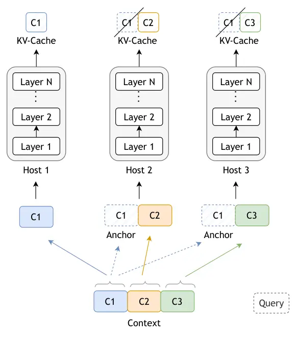
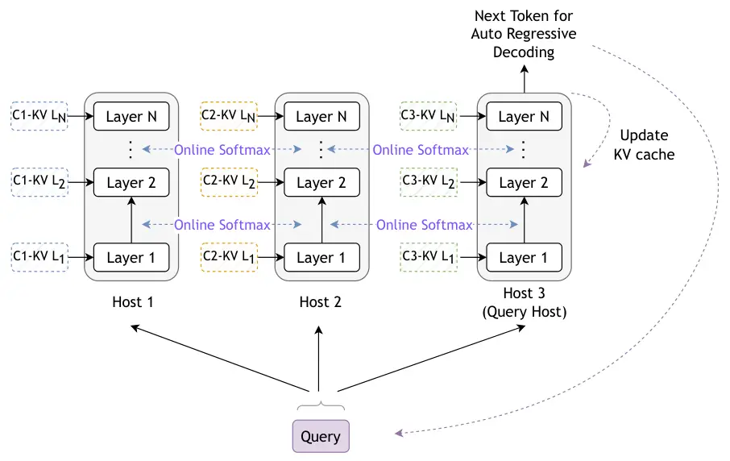

# Star Attention: Efficient LLM Inference over Long Sequences

Shantanu Acharya Affiliation: NVIDIA Correspondence to:
<shantanua@nvidia.com>    Fei Jia Affiliation: NVIDIA Correspondence to:
<fjia@nvidia.com>    Boris Ginsburg Affiliation: NVIDIA

###### Abstract

Inference with Transformer-based Large Language Models (LLMs) on long
sequences is both costly and slow due to the quadratic complexity of the
self-attention mechanism. We introduce Star Attention, a two-phase
block-sparse approximation that improves computational efficiency by
sharding attention across multiple hosts while minimizing communication
overhead. In the first phase, the context is processed using
blockwise-local attention across hosts, in parallel. In the second
phase, query and response tokens attend to all prior cached tokens
through sequence-global attention. Star Attention integrates seamlessly
with most Transformer-based LLMs trained with global attention, reducing
memory requirements and inference time by up to 11x while preserving
97-100% of accuracy.

###### Keywords: 

Large Language Models, Transformers, Attention Mechanisms, Sparse
Attention, Inference Optimization, Distributed Systems, Long Context,
Long Context Inference, Efficient Inference, Machine Learning, ICML



(a) Phase 1: Local Context Encoding with Anchor Blocks.



(b) Phase 2: Query Encoding and Output Generation with Global Attention.

Figure 1: Star Attention inference flow across two phases. (a) Context
Encoding: The input context is partitioned into blocks and distributed
across hosts, where each block (except the first) is prefixed with the
anchor block ($`c_{1}`$). Each host processes its assigned block and
stores the non-anchor portion of the KV cache. (b) Query Encoding and
Token Generation: The query is broadcast to all hosts, which compute
local attention using cached KVs. A designated “query” host then
aggregates softmax normalization statistics to compute global attention
and generates the next token.

## 1 Introduction

Recent Large Language Models (LLMs) can support contexts up to millions
of tokens in length (Gemini-Team, 2024; Anthropic, 2024; Meta-AI, 2024;
Qwen, 2025), unlocking applications such as repository-level code
analysis, multi-document summarization, and large corpus retrieval.
However, processing such long sequences with LLMs requires substantial
computational and memory resources due to the quadratic complexity of
the self-attention mechanism.

The importance of long-context capabilities has driven substantial
research into addressing the computational challenges of self-attention.
Some approaches focus on reducing the need to fully materialize the
attention matrix (Milakov & Gimelshein, 2018), leading to blockwise
processing techniques (Dao et al., 2022; Dao, 2024; Liu & Abbeel, 2023)
and further optimization through distributed computation across multiple
compute units (Liu et al., 2024a). While these methods improve training
efficiency, autoregressive decoding during inference still requires the
model to attend to every previous token, resulting in high computational
costs for long-context sequences. Other approaches attempt to optimize
inference by segmenting long inputs into chunks, encoding them
separately, and attending to these encoded chunks using the user query
(Beltagy et al., 2020; Russak et al., 2024; Liao et al., 2024). However,
these methods often require fine-tuning the model or introducing
additional components that necessitate further training, limiting their
out-of-the-box applicability.

We introduce Star Attention¹¹ 1 Code:
https://github.com/NVIDIA/Star-Attention, a novel algorithm for
efficient LLM long-context inference. This method is based on the
observation that LLM inference usually has two stages: (1) prompt
encoding, where the model processes input and stores KV vectors in the
cache and (2) token generation, where model attends to the KV cache and
autoregressively generates new tokens while updating the cache with the
new KV vectors. In many long-context tasks, the input consists of a long
context followed by a short query and a short answer. The information
needed for answering the query is often localized within small parts of
the context, meaning context tokens need only attend to nearby tokens,
while query tokens need to attend to all prior tokens. Based on this
observation, Star Attention utilizes a two-phase approach shown in
Figure 1:

1.  1.  Context Encoding: The context is divided into contiguous blocks and
        distributed across “context” hosts, with each host also receiving a
        copy of the first block (an “anchor block”). Hosts compute
        self-attention only for their assigned blocks, without communicating
        with each other, reducing attention complexity from quadratic to
        linear with respect to context length. This distributed processing
        is similar to Ring Attention (Liu et al., 2024a) but without the
        “ring” communication during context encoding (Figure 1(a)).
2.  2.  Query Encoding and Token Generation: The query is replicated across
        all hosts where it initially attends to the KV cache on each host.
        Global attention is then computed by aggregating the results at a
        designated “query” host by efficiently communicating a single vector
        and scalar per token from each context host. Only the query host
        updates its KV cache during this stage (Figure 1(b)).

Star Attention enables the context length to scale linearly with the
number of hosts by distributing the context processing across multiple
hosts. Star Attention is compatible with most Transformer-based LLMs
trained with global attention, operating seamlessly out-of-the-box
without additional model fine-tuning. Furthermore, we combine Star
Attention with Flash Attention, allowing for additional speedup
enhancements. We evaluate Star Attention for Llama3.1-8B and
Llama3.1-70B (Meta-AI, 2024) on several long-context benchmarks. Star
Attention achieves up to 11 times faster inference while maintaining
97-100% of the baseline accuracy.

| $`c_{1}`$ |
| --------- |
| $`c_{2}`$ |
| $`c_{3}`$ |
| $`c_{4}`$ |
| $`c_{5}`$ |
| $`q`$     |

Figure 2: Block sparsity pattern in Star Attention for a sequence
partitioned into 5 context blocks $`c_{i}`$ and a query block $`q`$.
Each context block attends only to itself and the “anchor block” whereas
the query attends to the entire input.

(a) Global Attention

(b) Blockwise Encoding

(c) Blockwise Encoding w/ Anchor Block

Figure 3: Attention distribution across the sequence during context
encoding under different strategies in Phase 1. (a) Global attention
exhibits a single attention sink at the sequence start. (b) Without
anchor blocks, blockwise context encoding creates multiple attention
sinks at the start of each block. (c) With anchor blocks, attention
sinks shift to anchor tokens, yielding a distribution that closely
approximates global attention. The sequence is 4K tokens long and
partitioned into 512-token chunks.

## 2 Star Attention Algorithm

Star Attention operates in two phases: (1) Context Encoding, where the
long context is divided into contiguous blocks and is processed with
local blockwise attention, and (2) Query Encoding and Token Generation,
where the query is processed, and answer tokens are generated using
global attention. Below, we detail each phase of the algorithm.

### 2.1 Phase 1: Context Encoding

Given an input sequence comprising a context $`c`$ followed by a query
$`q`$, the context $`c`$ is divided into $`n`$ contiguous blocks:
$`c=[c_{1},c_{2},\ldots,c_{n}]`$, where each block $`c_{i}`$ contains
$`b`$ tokens. We introduce an anchor block mechanism, in which, each
block—except the first—is prefixed with the first block $`c_{1}`$ of the
sequence, referred to as the anchor block. This concatenation forms an
augmented context $`c^{\prime}`$:

```math
c^{\prime}=[c_{1},(c_{1}\>c_{2}),(c_{1}\>c_{3}),\ldots,(c_{1}\>c_{n})]
```

where each augmented block $`c^{\prime}_{i}`$ contains $`2b`$ tokens:
$`b`$ tokens from the anchor block $`c_{1}`$ followed by $`b`$ tokens
from the current block $`c_{i}`$ (Figure  2). The positional indices of
$`c_{1}`$ are preserved, ensuring that its tokens retain their original
position indices $`[0,1,\ldots,b-1]`$. The augmented blocks are
distributed across compute hosts, where each host computes attention
over the $`2b`$ tokens from its assigned block $`c_{i}^{\prime}`$ and
generates the corresponding key-value (KV) vectors. While KVs for the
anchor block $`c_{1}`$ are discarded, the KVs for the current block
$`c_{i}`$ are retained in the cache.

We observe that, without anchor blocks—i.e., applying blockwise
attention only to the original context $`c`$—the model fails to generate
correct outputs. We conjecture this failure is due to the incorrect
approximation to the attention patterns observed during phase 2
(Figure 3(b)), where multiple attention spikes, known as attention sinks
(Xiao et al., 2024b), are distributed across the sequence. These spikes
occur because each block is processed independently, creating an
attention sink at the start of each block. As a result, the model
struggles to effectively focus on relevant parts of the context. To
address this issue, we prefix the blocks with the anchor block
$`c_{1}`$, shifting the attention sinks to the anchor tokens. By
discarding the KVs of the anchor tokens the intermediate attention sinks
are removed ensuring the attention distribution of block-local attention
(Figure 3(c)) closely approximates global attention (Figure 3(a)) while
maintaining the computational efficiency of blockwise processing.

|                                        |           |            |           |                 |                    |
| -------------------------------------- | --------- | ---------- | --------- | --------------- | ------------------ |
| Model                                  | Seq. Len. | Block Size | Ring-Attn | Star-Attn       |                    |
|                                        | \(K\)     | \(K\)      | Acc.(%)   | $`\Delta`$ Acc. | $`\Delta`$ Speedup |
|                                        | 16        | 4          | 92.22     | -0.94%          | 1.1x               |
|                                        | 32        | 8          | 87.53     | +1.17%          | 1.2x               |
|                                        | 64        | 16         | 84.79     | -1.42%          | 1.8x               |
| Llama-3.1-8B-Instruct (Meta-AI, 2024)  | 128       | 32         | 76.31     | -1.90%          | 2.7x               |
|                                        | 16        | 4          | 95.09     | -2.71%          | 1.7x               |
|                                        | 32        | 8          | 94.61     | -2.55%          | 2.0x               |
| Llama-3.1-70B-Instruct (Meta-AI, 2024) | 64        | 16         | 88.54     | -1.44%          | 4.7x               |

Table 1: Accuracy and relative inference speedup of Star Attention
compared to Ring Attention on RULER across sequence lengths from 16K to
128K. Accuracy is reported as the absolute difference from Ring
Attention and speedup reflects relative improvements in inference
efficiency. Star Attention significantly accelerates inference with
minimal accuracy loss.

### 2.2 Phase 2: Query Encoding and Token Generation

In phase 2, global attention is employed to encode the query and
generate output tokens by using a distributed softmax algorithm that
eliminates the need to transfer KV cache between hosts (Figure 1(b)). A
designated query-host $`h_{q}`$ coordinates this computation. The query
is broadcast to all hosts and transformed into the sequence
$`Q\in\mathbb{R}^{l_{q}\times d}`$, where $`l_{q}`$ is the query length,
and $`d`$ is the attention head dimension. Each host $`h`$ computes the
local attention output $`A_{h}`$ for the query $`Q`$ using its local
key-value pairs $`K_{h},V_{h}\in\mathbb{R}^{l_{k}\times d}`$, where
$`l_{k}`$ is the sequence length of the KV cache. The local attention is
computed as:

```math
A_{h}=\left(\frac{\exp\left(\frac{QK_{h}^{\top}}{\sqrt{d}}\right)}{\sum_{k=1}^{l_{k}}\exp\left(\frac{QK_{h,k}^{\top}}{\sqrt{d}}\right)}\right)V_{h} \tag{1}
```

In addition to $`A_{h}`$, each host also stores the sum of the exponents
$`s_{h}`$ from the the local softmax operation (the denominator from
Equation 1):

```math
s_{h}=\sum_{k=1}^{l_{k}}\exp\left(\frac{QK_{h,k}^{\top}}{\sqrt{d}}\right) \tag{2}
```

The query-host $`h_{q}`$ gathers the local attention $`A_{h}`$ and the
sums of exponents $`s_{h}`$ from all hosts:

```math
A=[A_{1},A_{2},\ldots,A_{H}]
```

```math
s=[s_{1},s_{2},\ldots,s_{H}]
```

The global softmax denominator, $`s_{\text{global}}`$, is then computed
as the sum of all local exponents:

```math
s_{\text{global}}=\sum_{h=1}^{H}s_{h} \tag{3}
```

The query-host uses $`s_{\text{global}}`$ to aggregate the local
attentions to compute the global attention:

```math
A_{\text{global}}=\sum_{h=1}^{H}\frac{s_{h}}{s_{\text{global}}}A_{h} \tag{4}
```

This method ensures that the global attention scores are normalized
correctly across all hosts. It requires the communication of only a
single scalar $`s_{h}`$ (the local sum of exponents) and a vector
$`A_{h}`$ (the local attention) per token.

The above formulations provide a simplified conceptual overview. In
practice, for efficient inference, we use Flash Attention (Dao, 2024) to
attend to the KV cache on each host and apply the log-sum-exp trick from
online softmax (Milakov & Gimelshein, 2018) to ensure numerical
stability during global attention aggregation.

Output generation and cache update. After computing the global attention
output, the query-host $`h_{q}`$ generates the next token and its KV
cache is updated with the key and value vectors of the new token. This
process is repeated for each generated token.

This two-phase mechanism—local context encoding with anchor blocks in
Phase 1 followed by global query encoding with token generation in Phase
2—gives significant improvements in inference speed, while keeping the
accuracy close to the global attention.

## 3 Experiments

We empirically evaluate Star Attention using several Llama-based models
across multiple long-context benchmarks with sequence lengths ranging
from 16K to 1M tokens, assessing both its accuracy and inference speedup
relative to established baselines. We also investigate the
accuracy-speed trade-offs as a function of block size and provide a
granular breakdown of Star Attention’s effectiveness across different
domains. Our results demonstrate that Star Attention consistently
achieves near-parity with full global attention in accuracy while
delivering substantial speedups, especially on large models and
long-context tasks.

Figure 4: Accuracy comparison of Star Attention and Global Attention on
RULER and BABILong from 16K to 128K sequence lengths using various
models. All runs use a block and anchor block size set to one-quarter of
the total sequence length. Star Attention maintains 97-100% of the
accuracy of global attention, and in some cases, even outperform it.

### 3.1 Setup

Models. We conduct experiments using both the base and instruct variants
of Llama-3.1 8B which support context lengths up to 128K tokens
(Meta-AI, 2024). To evaluate scalability beyond this range, we use
gradientai-Llama-3-8B-Instruct-262K and
gradientai-Llama-3-8B-Instruct-1048K that extend Llama-3-8B’s context to
256K and 1M tokens respectively (Gradient.ai, 2024). We further assess
the impact of model scale using Llama-3.1-70B-Instruct. Across all
configurations, Star Attention demonstrates increasing speedup benefits
with larger models and longer sequences.

Baseline. We compare Star Attention against three strong baselines: (i)
Ring Attention (Liu et al., 2024a), a distributed attention mechanism
that computes global block-wise attention by circulating each host’s KV
cache in a ring pattern across all the hosts; (ii) StreamingLLM (Xiao
et al., 2024b), a sparse attention method that combines global sink
tokens with sliding window attention. We use a configuration having 1000
global sink tokens along with a sliding window of 8000 tokens; and (iii)
MInference (Jiang et al., 2024), which utilizes three distinct sparse
attention patterns, dynamically selecting the optimal pattern per head
in an offline search setting. Among these, only Ring Attention is a
distributed algorithm designed to scale inference across multiple GPUs.
Since Star Attention also targets distributed efficiency, we report
speedup metrics relative to Ring Attention, while accuracy comparisons
are provided for all three baselines.

Configuration. We implement Star Attention in both HuggingFace
Transformers library (Wolf et al., 2020) and NVIDIA’s TRT-LLM framework
(NVIDIA, 2023). All experiments are conducted on NVIDIA A100 GPUs with
bfloat16 precision. Optimization techniques such as Flash Attention are
applied uniformly across Star and Ring Attention implementations to
ensure a fair comparison. Reported results are based on the HuggingFace
implementation, with similar relative trends observed across TRT-LLM.
Additional details regarding our experimental setup can be found in
Appendix B.

Evaluation Benchmarks. We evaluate our method on three benchmarks, each
testing unique aspects of long context understanding: (i) RULER (Hsieh
et al., 2024): a synthetic benchmark with 13 tasks categorized into 4
domains: Needle-in-a-Haystack (Retrieval), Multi-Hop Tracing,
Aggregation, and Question Answering. (ii) BABILong (Kuratov et al.,
2024): a benchmark of 5 tasks requiring reasoning over multiple
supporting facts encoded in the context to generate accurate answers.
(iii) InfiniteBench (Zhang et al., 2024): a diverse collection of 10
real-world and synthetic tasks spanning summarization, multilingual QA,
code debugging, and retrieval. Further details on the benchmarks and
specific tasks can be found in Appendix C.

### 3.2 Results

Table 1 presents the accuracy and relative speedup of Star Attention
compared to Ring Attention (representing full global attention in a
distributed setting) on RULER, across sequence lengths from 16K to 128K
tokens. In each setting, the context and the anchor block size are set
to one-quarter of the total sequence length. Star Attention maintains
high accuracy, typically within 0-3% of global attention, while
delivering significant speedups, ranging from 1.1$`\times`$ to
4.7$`\times`$, depending on the model size and sequence length. The
speedup becomes more pronounced for larger models. For instance, the
Llama-3.1-70B-Instruct model exhibits a 4.7$`\times`$ acceleration at
64K tokens with minimal accuracy drop. This highlights Star Attention’s
suitability for high-throughput inference and its ability to preserve
model’s accuracy even with a significantly reduced context window.

To evaluate generalization beyond RULER, we benchmark Star Attention on
BABILong using Llama-3.1-8B-Base, gradientai-Llama-3-8B-Instruct-262K,
and gradientai-Llama-3-8B-Instruct-1048K. As shown in Figure 4, Star
Attention consistently achieves near-parity with full attention across
all tasks up to 128K sequence length, with an accuracy drop typically
below 3%. However, we observe anomalies for the Llama-3.1-8B base model
on BABILong, likely due to format-specific generation requirements that
challenge non-instruction-tuned models, particularly at longer sequence
lengths.

| Methods        | 16K   | 32K   | 64K   | 128K  | Average |
| -------------- | ----- | ----- | ----- | ----- | ------- |
| Full Attn.     | 92.22 | 87.53 | 84.79 | 76.31 | 85.21   |
| StreamingLLM   | 74.76 | 48.56 | 26.2  | 30.77 | 45.07   |
| MInference     | 93.27 | 86.54 | 84.86 | 58.17 | 80.71   |
| Star Attention | 91.27 | 88.70 | 83.37 | 74.41 | 84.44   |

Table 2: Accuracy comparison of different methods on RULER from 16K to
128K sequence length using Llama-3.1-8B-Instruct. Star Attention
performs closest to Full Attention and outperforms others at longer
sequences.

|                |       |       |       |      |       |       |       |         |       |       |       |
| -------------- | ----- | ----- | ----- | ---- | ----- | ----- | ----- | ------- | ----- | ----- | ----- |
| Methods        | En.   | En.   | En.   | En.  | Zh.   | Code. | Math. | Retr.   | Retr. | Retr. | Avg.  |
|                | Sum   | QA    | MC    | Dia  | QA    | Debug | Find  | PassKey | Num   | KV    |       |
| Full Attn.     | 31.91 | 25.92 | 69.43 | 21.5 | 31.95 | 16.75 | 24.29 | 99.15   | 99.66 | 60    | 48.06 |
| StreamingLLM   | 30.15 | 10.15 | 41.05 | 8.5  | 22.38 | 8.63  | 17.71 | 2.71    | 5.93  | 0     | 14.72 |
| MInference     | 31.04 | 22    | 63.76 | 14.5 | 28.7  | 5.33  | 27.43 | 56.78   | 77.12 | 14    | 34.07 |
| Star Attention | 31.85 | 25.92 | 69    | 22   | 30.37 | 24.37 | 26.29 | 93.22   | 96.27 | 45.8  | 46.51 |

Table 3: Accuracy comparison of different methods on InfiniteBench using
Llama-3.1-8B-Instruct. Star Attention performs closest to Full Attention
and outperforms others across all the diverse tasks.

(a) Accuracy vs. Context Block Size

(b) Accuracy vs. Anchor Block Size

Figure 5: Impact of context and anchor block sizes on the accuracy of
Star Attention at 128K sequence length with Llama-3.1-8B Instruct. (a)
Accuracy as a function of context block size, with anchor block size
matched to it. (b) Accuracy as a function of anchor block size, with
context block size fixed at 32K. Larger block sizes yield consistent
accuracy improvements, highlighting the benefit of broader receptive
fields for long-context understanding.

Figure 6: Accuracy vs speed trade-off for Star Attention on RULER with
Llama3-8B-Instruct-1048K as sequence length increases from 128K to 1M
with block size fixed at 32K. Star Attention achieves up to
16.9$`\times`$ speedup with modest accuracy degradation.

### 3.3 Comparison with Other Sparse Attention Methods

While our primary comparison focuses on Ring Attention (Liu et al.,
2024a) due to its distributed design, we also evaluate Star Attention
against two strong non-distributed sparse attention baselines:
StreamingLLM (Xiao et al., 2024b) and MInference (Jiang et al., 2024).
These methods represent alternative strategies for long-context
efficiency under constrained compute budgets and provide complementary
perspectives on accuracy trade-offs.

Table 2 reports accuracy on RULER using Llama-3.1-8B-Instruct across
sequence lengths from 16K to 128K tokens. Star Attention outperforms
both the methods, with the performance gap widening at longer context
lengths. Notably, Star Attention maintains accuracy closest to the
baseline (full attention) across all settings, demonstrating its
robustness in extended-context reasoning.

To assess generalization beyond synthetic tasks, we further evaluate all
methods on InfiniteBench. As shown in Table 3, Star Attention achieves
the highest average accuracy across 10 diverse tasks spanning
summarization, multilingual QA, code debugging, and retrieval. It excels
especially in retrieval-heavy tasks such as PassKey, NumRetr, and KVRetr
while also delivering competitive results across other categories. These
findings highlight Star Attention’s ability to generalize beyond
synthetic benchmarks and handle real-world, instruction-heavy tasks with
long-range dependencies.

### 3.4 Trade-off between accuracy and speed

Figure 5(a) illustrates the effect of varying block size during context
encoding, with the sequence length fixed at 128K tokens. Larger block
sizes lead to improved accuracy, highlighting the benefits of increased
receptive fields for long-context comprehension.

Empirically, setting the block size to approximately one-quarter of the
total sequence length strikes an effective trade-off between accuracy
and speed. For sequence lengths exceeding 128K, we fix the block size at
32K tokens to prioritize inference speed. As shown in Figure 6, this
configuration allows Star Attention to achieve substantial speedups over
Ring Attention while incurring only modest accuracy degradation. For
instance, on the RULER benchmark with Llama-3-8B-Instruct-1048K, Star
Attention achieves up to 11$`\times`$ speedup while retaining accuracy
comparable to Ring Attention. At 1M tokens, the speedup increases to
16.9$`\times`$ with an accuracy drop of just 5.32%.

These findings demonstrate that Star Attention offers flexible control
over the accuracy-efficiency trade-off. Larger block sizes allow
performance to approach that of global attention, while smaller blocks
enable higher throughput for latency-sensitive applications. The
appropriate configuration can thus be tuned based on available resources
and task requirements. Additional experimental details are provided in
Appendix B.

### 3.5 In-Depth Analysis on RULER Task Categories

To better understand the strengths and limitations of Star Attention, we
analyze its performance across different task categories within the
RULER benchmark. RULER comprises five categories: Single-NIAH,
Multi-NIAH, Multi-Hop Tracing, Aggregation, and Question Answering (QA).
Figure 7 reports category-wise accuracy using the Llama-3.1-8B-Instruct
model at a sequence length of 32K and a block size of 8K. We observe
consistent trends across all sequence lengths, as detailed in Appendix
D.

Star Attention performs comparably to global attention in the
Single-NIAH, Multi-NIAH, and QA categories. These tasks typically
involve localized retrieval or reasoning, where attention primarily
operates within or near a single context block. In contrast, Multi-Hop
Tracing presents a greater challenge. It requires propagating
information across multiple hops within the sequence, demanding
effective inter-block communication. Since Star Attention restricts
KV-cache access to the local block during context encoding, the model
lacks a mechanism for long-range token-to-token aggregation in this
phase. Consequently, performance degrades relative to global attention.

Interestingly, Star Attention shows substantial gains in Aggregation
tasks, especially those involving frequency analysis or summarization
over distributed spans. Its chunk-wise encoding facilitates local
aggregation within blocks, which is later synthesized during the global
query phase. This two-phase process proves advantageous in capturing
common patterns without needing full global context at once. This
analysis suggests that Star Attention is especially well-suited for
retrieval and aggregation tasks, while highlighting opportunities for
future work on cross-block communication.

Figure 7: Accuracy of Star Attention compared to Global Attention across
five RULER task categories using Llama-3.1-8B-Instruct at 32K sequence
length with 8K block size. Star Attention matches or improves upon the
baseline in most tasks, with significant gains in aggregation.

## 4 Ablation Study

The ablation experiments focus on the Needle-in-a-Haystack (NIAH) task,
which tests a model’s ability to answer queries based on a small,
relevant piece of information (“needle”) embedded within a large context
(“haystack”). To increase the task’s complexity, we explore three
variations from the RULER benchmark (Hsieh et al., 2024): Single-NIAH,
Multi-key NIAH, and Multi-query NIAH.

|                                               |                |               |       |                |
| --------------------------------------------- | -------------- | ------------- | ----- | -------------- |
| Experiments                                   | RULER-NIAH (%) |               |       |                |
|                                               | 64K            | $`\Delta`$64k | 128k  | $`\Delta`$128k |
| Global attention                              | 99.50          | \-            | 98.49 | \-             |
| No anchor block                               | 60.11          | -39.59%       | 73.75 | -25.12%        |
| Content set to first-block, position IDs are: |                |               |       |                |
|    randomly sampled from \[0, current_block)  | 96.79          | -2.72%        | 97.16 | -1.35%         |
|    same as previous block                     | 97.35          | -2.16%        | 96.80 | -1.71%         |
|    same as first block                        | 97.61          | -1.90%        | 97.54 | -0.96%         |
| Position IDs set to first-block, content is:  |                |               |       |                |
|    constant token (ex: ‘ ’ or ‘ the’ or ‘.’ ) | 0.00           | -100.00%      | 0     | -100.00%       |
|    random tokens                              | 90.55          | -8.99%        | 82.63 | -10.15%        |
|    shuffled first block tokens                | 92.96          | -6.57%        | 90.76 | -3.26%         |
|    first block tokens                         | 97.61          | -1.90%        | 94.94 | -0.96%         |
| Previous-block used as anchor                 | 94.20          | -5.33%        | 96.13 | -2.40%         |

Table 4: Impact of anchor block position and content on Star Attention
accuracy using Llama-3.1-8B-Instruct on RULER-NIAH at 64K and 128K
sequence lengths. Each configuration has the anchor block size equal to
the context block. The $`\Delta`$ values indicate absolute accuracy
degradation relative to global attention. Results show that anchor
content is critical, while position IDs haveminor effect. Missing or
poorly constructed anchors lead to significant degradation.

### 4.1 Position and Content of Anchor Block

In this section, we explore the role of anchor blocks during Phase 1
that enables Star Attention to approximate global attention behavior. As
outlined in Section 2.1, anchor blocks are crucial in managing the
attention spikes generated at the start of each context block, helping
Star Attention approximate global attention (see Table 4 ) Drawing from
the hypotheses on sink tokens in Xiao et al. (2024b), we consider two
potential explanations for the effectiveness of anchor blocks: (1) the
model may develop a bias toward the absolute position of the anchor
block, or (2) the semantic content of the anchor block is essential for
maintaining performance. To better understand how anchor blocks enable
Star Attention to approximate global attention distribution, we test
both the hypotheses. We conduct experiments on the Llama-3.1-8B-Instruct
model, varying both the position and content of the anchor block. We
evaluate two configurations: a block size of 16K for sequences of length
64K, and a block size of 32K for sequences of length 128K, in both the
cases, with anchor block size matching the context block size.

Position of anchor block: Here, we fix the content of the anchor block
to the first context block and vary its position IDs. We test three
scenarios : (1) the position IDs are randomly sampled from the range
\[0, starting position of the current block\] (e.g., for a block
starting at position 32K, position IDs are sampled from \[0, 32K\] );
(2) the position IDs are derived from the previous block (e.g., for a
block of size 16K starting at position 32K, position IDs are sampled
from \[16K, 32K\] ); (3) the position IDs are fixed to the first block
(our proposed approach). As shown in Table 4, varying the position of
the anchor block has minimal impact on accuracy.

Content of anchor block: We fix the position IDs of the anchor block to
that of the first block but vary its content. We explore several
configurations (as shown in Table 4): (i) a single repeated token (e.g.,
‘ ’, ‘ the’, or ‘.’); (ii) random tokens; (iii) shuffling the tokens of
the first block; and (iv) using the original first block content (the
proposed approach). Our results show that the content of the anchor
block significantly impacts performance, with the original first block
content yielding the best results. This outcome suggests that since
global attention is performed during Phase 2, it is important for the
local context blocks to attend to anchor blocks whose content reflects
what the model would see during global attention.

Previous block as anchor block: To examine the roles of both position
and content, we experiment with using the previous block as the anchor
block. For example, for a block of size 16K starting at position 32K,
the anchor block would be the block with position IDs from 16K to 32K.
This configuration has lower accuracy comparing to using the first block
as the anchor(Table 4).

In summary, we found that while the positional placement of the anchor
block is not important , its content is critical for optimal
performance.

### 4.2 Size of Anchor block

As discussed in Section 3.4, larger block sizes improve the accuracy of
Star Attention. In this section, we analyze the impact of varying anchor
block size while maintaining a fixed block size of 32K for a sequence
length of 128K. As illustrated in Figure 5(b), increasing the anchor
block size enhances model accuracy, with the best performance observed
when the anchor block size equals the context block size. Although
Figure 3(b) demonstrates that attention spikes predominantly occur in
the first few tokens, reducing the number of tokens in the anchor block
leads to a substantial drop in performance. This suggests that a larger
anchor block is critical for maintaining model accuracy, despite
attention spikes being concentrated at the beginning of the sequence.
This observation implies that the anchor block’s effectiveness is not
solely due to its role in managing attention sinks but may involve other
underlying factors. These findings remain consistent across both base
and instruct models, as well as for all sequence lengths. Further
investigation into why the anchor block size must be equivalent to the
context block size is left for future work.

## 5 Related Work

To address the computational challenges of long-context inference in
LLMs, various techniques have emerged to mitigate memory usage and
enhance inference speed.

Blockwise and Distributed Attention Computation: Flash Attention (Dao
et al., 2022; Dao, 2024) introduces a blockwise GPU-efficient
implementation of exact attention, reducing both memory footprint and
runtime. Building on this, distributed approaches such as Liu et al.
(2024a) and Shyam et al. (2024) partition the computation of
self-attention and feed-forward networks across multiple devices,
employing sophisticated communication-computation overlap to improve
scalability. General distributed strategies (Shoeybi et al., 2019; Huang
et al., 2019; Li et al., 2023; Meta-AI, 2021) provide frameworks for
dividing the computational load effectively across multiple
accelerators. These methods, however, still compute dense global
attention, which becomes prohibitively expensive at longer sequence
lengths. Star Attention leverages the distributed nature of these
approaches but reduces attention complexity through a two-phase
block-sparse approximation that avoids computing the full attention
matrix.

Sparse Attention: Sparse attention methods reduce the quadratic
complexity of self-attention through structured or learned sparsity
patterns (Zhang et al., 2023; Tang et al., 2024; Child et al., 2019),
achieving linear or log-linear scaling in sequence length (Dai et al.,
2019; Qin et al., 2024). Beltagy et al. (2020) introduced sliding window
attention combined with global tokens, which was adapted by Xiao et al.
(2024b) for streaming generation via attention sinks. Jiang et al.
(2024) focuses on identifying and leveraging dynamic sparse patterns,
particularly to accelerate the pre-filling stage. More recently, Titans
(Behrouz et al., 2024) augment LLMs with neural memory modules for
long-horizon reasoning. Star Attention’s first phase is conceptually
similar to streaming methods, but differs by utilizing global attention
during decoding—preserving compatibility with pretrained models without
retraining.

Memory Optimization: Maintaining the KV cache during autoregressive
decoding is a major memory bottleneck. KV cache compression (Ge et al.,
2024; Munkhdalai et al., 2024; Sun et al., 2024; Liu et al., 2024b; Wu
et al., 2024) and low-rank approximation methods (Hu et al., 2022) have
been proposed to trade precision for reduced memory. Recent systems
explore eviction-based memory management strategies that allow LLMs to
operate over virtually infinite contexts (Zhao et al., 2024; Han et al.,
2024; Xiao et al., 2024a), often requiring architecture changes or
specialized runtime support. Star Attention is orthogonal to these
methods and can be integrated with them to further enhance inference
efficiency.

## 6 Conclusion

In this paper, we introduced Star Attention, a novel block-sparse
attention mechanism designed to enable efficient inference on long
sequences in transformer-based LLMs. The method operates in two phases:
(1) context tokens are processed using blockwise-local attention, with
the context segmented into blocks where each block is prefixed with an
anchor block; and (2) then the query and response tokens attend to all
prior cached tokens through sequence-global attention. Star Attention
delivers up to 11x speedup over Ring Attention while maintaining 97-100%
accuracy, significantly enhancing both memory efficiency and inference
speed. Despite these advances, several open questions remain. The role
and optimal size of anchor blocks relative to context blocks require
further exploration. Additionally, while Star Attention performs
effectively with block sizes set to one-quarter of the sequence length,
accuracy degrades when using smaller blocks on longer sequences. Future
work will focus on refining the anchor block mechanism and improving
performance on more complex long-context tasks to enhance the
scalability and robustness of Star Attention.

## Acknowledgements

We thank Kefeng Duan, Santiago Akle, Vahid Noroozi, Somshubra Majumdar,
Jocelyn Huang, Zhiyuan Jerry Lin and NVIDIA Long Context team for
helpful discussion and feedback.

## Impact Statement

This paper presents work whose goal is to advance the field of Machine
Learning. There are many potential societal consequences of our work,
none which we feel must be specifically highlighted here.

## References

- Anthropic (2024) Anthropic. The Claude 3 model family: Opus, Sonnet,
  Haiku, 2024. URL
  [https://www-cdn.anthropic.com/de8ba9b01c9ab7cbabf5c33b80b7bbc618857627/Model_Card_Claude_3.pdf](https://www-cdn.anthropic.com/de8ba9b01c9ab7cbabf5c33b80b7bbc618857627/Model_Card_Claude_3.pdf).
- Behrouz et al. (2024) Behrouz, A., Zhong, P., and Mirrokni, V. Titans:
  Learning to memorize at test time. _arXiv preprint
  arXiv:2501.00663_, 2024.
- Beltagy et al. (2020) Beltagy, I., Peters, M. E., and Cohan, A.
  Longformer: The long-document Transformer. _arXiv preprint
  arXiv:2004.05150_, 2020.
- Child et al. (2019) Child, R., Gray, S., Radford, A., and
  Sutskever, I. Generating long sequences with sparse transformers.
  _arXiv preprint arXiv:1904.10509_, 2019.
- Dai et al. (2019) Dai, Z., Yang, Z., Yang, Y., Carbonell, J., Le, Q.,
  and Salakhutdinov, R. Transformer-XL: Attentive language models beyond
  a fixed-length context. In _Proceedings of the 57th Annual Meeting of
  the Association for Computational Linguistics (ACL)_, 2019.
- Dao (2024) Dao, T. FlashAttention-2: Faster attention with better
  parallelism and work partitioning. In _International Conference on
  Learning Representations (ICLR)_, 2024.
- Dao et al. (2022) Dao, T., Fu, D. Y., Ermon, S., Rudra, A., and Ré, C.
  FlashAttention: Fast and memory-efficient exact attention with
  IO-awareness. In _Advances in Neural Information Processing Systems
  (NeurIPS)_, 2022.
- Ge et al. (2024) Ge, S., Zhang, Y., Liu, L., Zhang, M., Han, J., and
  Gao, J. Model tells you what to discard: Adaptive kv cache compression
  for llms. In _International Conference on Learning Representations
  (ICLR)_, 2024.
- Gemini-Team (2024) Gemini-Team. Gemini 1.5: Unlocking multimodal
  understanding across millions of tokens of context. _arXiv preprint
  arXiv:2403.05530_, 2024.
- Gradient.ai (2024) Gradient.ai. RULER vs. Gradient’s 1M context length
  Llama-3-70B, 2024. URL
  [https://gradient.ai/blog/ruler-vs-gradient-s-1m-context-length-llama-3-70b](https://gradient.ai/blog/ruler-vs-gradient-s-1m-context-length-llama-3-70b).
- Han et al. (2024) Han, C., Wang, Q., Peng, H., Xiong, W., Chen, Y.,
  Ji, H., and Wang, S. Lm-infinite: Zero-shot extreme length
  generalization for large language models. In _Proceedings of the 2024
  Conference of the North American Chapter of the Association for
  Computational Linguistics: Human Language Technologies (Volume 1: Long
  Papers)_, 2024.
- Hsieh et al. (2024) Hsieh, C.-P., Sun, S., Kriman, S., Acharya, S.,
  Rekesh, D., Jia, F., and Ginsburg, B. RULER: What’s the real context
  size of your long-context language models? In _First Conference on
  Language Modeling (COLM)_, 2024.
- Hu et al. (2022) Hu, E. J., Shen, Y., Wallis, P., Allen-Zhu, Z., Li,
  Y., Wang, S., Wang, L., and Chen, W. LoRA: Low-rank adaptation of
  large language models. In _International Conference on Learning
  Representations (ICLR)_, 2022.
- Huang et al. (2019) Huang, Y., Cheng, Y., Bapna, A., Firat, O., Chen,
  D., Chen, M., Lee, H., Ngiam, J., Le, Q. V., Wu, Y., et al. GPipe:
  Efficient training of giant neural networks using pipeline
  parallelism. In _Advances in Neural Information Processing
  Systems_, 2019.
- Jiang et al. (2024) Jiang, H., Li, Y., Zhang, C., Wu, Q., Luo, X.,
  Ahn, S., Han, Z., Abdi, A. H., Li, D., Lin, C.-Y., Yang, Y., and
  Qiu, L. MInference 1.0: Accelerating pre-filling for long-context LLMs
  via dynamic sparse attention. In _The Thirty-eighth Annual Conference
  on Neural Information Processing Systems_, 2024.
- Kuratov et al. (2024) Kuratov, Y., Bulatov, A., Anokhin, P., Rodkin,
  I., Sorokin, D., Sorokin, A., and Burtsev, M. BABILong: Testing the
  Limits of LLMs with Long Context Reasoning-in-a-Haystack. _arXiv
  preprint arXiv:2406.10149_, 2024.
- Li et al. (2023) Li, S., Xue, F., Baranwal, C., Li, Y., and You, Y.
  Sequence parallelism: Long sequence training from system perspective.
  In _Proceedings of the 61st Annual Meeting of the Association for
  Computational Linguistics (Volume 1: Long Papers)_, 2023.
- Liao et al. (2024) Liao, Z., Wang, J., Yu, H., Wei, L., Li, J., Wang,
  J., and Zhang, W. E2llm: Encoder elongated large language models for
  long-context understanding and reasoning. _arXiv preprint
  arXiv:2409.06679_, 2024.
- Liu & Abbeel (2023) Liu, H. and Abbeel, P. Blockwise parallel
  transformers for large context models. In _Thirty-seventh Conference
  on Neural Information Processing Systems_, 2023.
- Liu et al. (2024a) Liu, H., Zaharia, M., and Abbeel, P. Ringattention
  with blockwise transformers for near-infinite context. In
  _International Conference on Learning Representations (ICLR)_, 2024a.
- Liu et al. (2024b) Liu, Z., Yuan, J., Jin, H., Zhong, S., Xu, Z.,
  Braverman, V., Chen, B., and Hu, X. KIVI: A tuning-free asymmetric
  2bit quantization for KV cache. In _The Twelfth International
  Conference on Learning Representations (ICML)_, 2024b.
- Meta-AI (2021) Meta-AI. Fully sharded data parallel: faster AI
  training with fewer GPUs, 2021. URL
  [https://engineering.fb.com/2021/07/15/open-source/fsdp/](https://engineering.fb.com/2021/07/15/open-source/fsdp/).
- Meta-AI (2024) Meta-AI. Introducing Llama 3.1: Our most capable models
  to date, 2024. URL
  [https://ai.meta.com/blog/meta-llama-3-1](https://ai.meta.com/blog/meta-llama-3-1).
- Milakov & Gimelshein (2018) Milakov, M. and Gimelshein, N. Online
  normalizer calculation for softmax. _arXiv preprint
  arXiv:1805.02867_, 2018.
- Munkhdalai et al. (2024) Munkhdalai, T., Faruqui, M., and Gopal, S.
  Leave no context behind: Efficient infinite context Transformers with
  infini-attention. _arXiv preprint arXiv:2404.07143_, 2024.
- NVIDIA (2023) NVIDIA. Tensorrt-llm: An optimized library for large
  language models, 2023. URL
  [https://github.com/NVIDIA/TensorRT-LLM](https://github.com/NVIDIA/TensorRT-LLM).
- Qin et al. (2024) Qin, Z., Sun, W., Li, D., Shen, X., Sun, W., and
  Zhong, Y. Lightning attention-2: A free lunch for handling unlimited
  sequence lengths in large language models. _arXiv preprint
  arXiv:2401.04658_, 2024.
- Qwen (2025) Qwen. Qwen2.5 technical report. _arXiv preprint
  arXiv:2412.15115_, 2025.
- Russak et al. (2024) Russak, M., Jamil, U., Bryant, C., Kamble, K.,
  Magnuson, A., Russak, M., and AlShikh, W. Writing in the margins:
  Better inference pattern for long context retrieval. _arXiv preprint
  arXiv:2408.14906_, 2024.
- Shoeybi et al. (2019) Shoeybi, M., Patwary, M., Puri, R., LeGresley,
  P., Casper, J., and Catanzaro, B. Megatron-LM: Training multi-billion
  parameter language models using model parallelism. _arXiv preprint
  arXiv:1909.08053_, 2019.
- Shyam et al. (2024) Shyam, V., Pilault, J., Shepperd, E., Anthony, Q.,
  and Millidge, B. Tree attention: Topology-aware decoding for
  long-context attention on gpu clusters. _arXiv preprint
  arXiv:2408.04093_, 2024.
- Sun et al. (2024) Sun, Y., Dong, L., Zhu, Y., Huang, S., Wang, W., Ma,
  S., Zhang, Q., Wang, J., and Wei, F. You only cache once:
  Decoder-decoder architectures for language models. _arXiv preprint
  arXiv:2405.05254_, 2024.
- Tang et al. (2024) Tang, J., Zhao, Y., Zhu, K., Xiao, G., Kasikci, B.,
  and Han, S. Quest: query-aware sparsity for efficient long-context llm
  inference. In _The Twelfth International Conference on Learning
  Representations (ICML)_, 2024.
- Wolf et al. (2020) Wolf, T., Debut, L., Sanh, V., et al. Transformers:
  State-of-the-art natural language processing. In _Proceedings of the
  2020 Conference on Empirical Methods in Natural Language Processing:
  System Demonstrations_, 2020.
- Wu et al. (2024) Wu, J., Wang, Z., Zhang, L., Lai, Y., He, Y., and
  Zhou, D. Scope: Optimizing key-value cache compression in long-context
  generation. _arXiv preprint arXiv:2412.13649_, 2024.
- Xiao et al. (2024a) Xiao, C., Zhang, P., Han, X., Xiao, G., Lin, Y.,
  Zhang, Z., Liu, Z., and Sun, M. Infllm: Training-free long-context
  extrapolation for llms with an efficient context memory. _arXiv
  preprint arXiv:2402.04617_, 2024a.
- Xiao et al. (2024b) Xiao, G., Tian, Y., Chen, B., Han, S., and
  Lewis, M. Efficient streaming language models with attention sinks. In
  _The Twelfth International Conference on Learning Representations
  (ICML)_, 2024b.
- Zhang et al. (2024) Zhang, X., Chen, Y., Hu, S., Xu, Z., Chen, J.,
  Hao, M., Han, X., Thai, Z., Wang, S., Liu, Z., and Sun, M.
  $`\infty`$Bench: Extending long context evaluation beyond 100K tokens.
  In _Proceedings of the 62nd Annual Meeting of the Association for
  Computational Linguistics (Volume 1: Long Papers)_, 2024.
- Zhang et al. (2023) Zhang, Z., Sheng, Y., Zhou, T., Chen, T., Zheng,
  L., Cai, R., Song, Z., Tian, Y., Re, C., Barrett, C., Wang, Z., and
  Chen, B. H2o: Heavy-hitter oracle for efficient generative inference
  of large language models. In _Advances in Neural Information
  Processing Systems (NeurIPS)_, 2023.
- Zhao et al. (2024) Zhao, Y., Wu, D., and Wang, J. Alisa: Accelerating
  large language model inference via sparsity-aware kv caching. In _51st
  Annual International Symposium on Computer Architecture (ISCA)_, 2024.

## Appendix A Star Attention Pseudo-code

0:  Context $`c`$, Block size $`b`$

1:  $`L\leftarrow\text{length}(c)`$

2:  Split $`c`$ into $`n=\lceil L/b\rceil`$ blocks, such that
$`c=[c_{1},c_{2},\dots,c_{n}]`$

3:  for $`i=2`$ to $`n`$ do

4:   $`c^{\prime}_{i}\leftarrow(c_{1},c_{i})`$

5:  end for

6:  for each host concurrently do

7:   Initialize an empty list $`kv`$

8:  end for

9:  Distribute augmented blocks
$`[c^{\prime}_{1},c^{\prime}_{2},\dots,c^{\prime}_{n}]`$ across all
hosts

10:  for each host concurrently do

11:   for each assigned block $`c^{\prime}_{i}`$ do

12:    Compute attention over $`2b`$ tokens in $`c^{\prime}_{i}`$

13:    Generate KV cache for $`c^{\prime}_{i}`$

14:    Discard KV cache for anchor block $`c_{1}`$

15:    Append remaining KV cache (for $`c_{i}`$) to $`kv`$

16:   end for

17:  end for

Algorithm 1 Star Attention - Phase 1: Context Encoding

0:  Query tokens $`q`$, number of output tokens $`n_{o}`$, KV cache
$`kv_{h}`$ of each host from Phase 1

1:  Designate one host as the query-host $`h_{q}`$

2:  Broadcast query tokens $`q`$ to all hosts

3:  Initialize $`input\_tokens\leftarrow q`$

4:  Initialize $`output\_tokens\leftarrow[]`$

5:  for $`i=1`$ to $`n_{o}`$ do

6:   for each transformer layer do

7:    for each host $`h`$ concurrently do

8:     Compute query, key, and value vectors $`(Q,K,V)`$ using
$`input\_tokens`$

9:     if $`h=h_{q}`$ then

10:      Append the new $`K`$ and $`V`$ vectors to $`kv_{h_{q}}`$

11:     end if

12:     Compute local attention scores $`A_{h}`$ for query $`Q`$ using
the local KV cache $`kv_{h}`$

13:     Compute local log-sum-exp $`s_{h}`$ (logarithm of the softmax
denominator)

14:    end for

15:    Gather all $`A_{h}`$ and $`s_{h}`$ from hosts:
$`s=[s_{1},s_{2},\ldots,s_{H}],\quad A=[A_{1},A_{2},\ldots,A_{H}]`$

16:    Initialize $`s_{\text{global}}\leftarrow s_{1}`$,
$`A_{\text{global}}\leftarrow A_{1}`$

17:    for $`h=2`$ to $`H`$ do

18:     Update global log-sum-exp $`s_{\text{global}}`$ using online
softmax:

```math
s_{\text{global}}\leftarrow s_{\text{global}}+\log\left(1+\exp(s_{h}-s_{\text{global}})\right)
```

19:     Update global attention scores:

```math
A_{\text{global}}\leftarrow\exp(s_{h}-s_{\text{global}})\cdot A_{\text{global}}+\exp(A_{h}-s_{\text{global}})\cdot A_{h}
```

20:    end for

21:   end for

22:   Generate the next output token and append it to $`output\_tokens`$

23:   Set $`input\_tokens\leftarrow[\text{new output token}]`$

24:  end for

25:  return $`output\_tokens`$

Algorithm 2 Star Attention - Phase 2: Query Encoding and Token
Generation

|                                               |           |            |           |                 |                    |
| --------------------------------------------- | --------- | ---------- | --------- | --------------- | ------------------ |
| Model                                         | Seq. Len. | Block Size | Ring-Attn | Star-Attn       |                    |
|                                               | \(K\)     | \(K\)      | Acc. (%)  | $`\Delta`$ Acc. | $`\Delta`$ Speedup |
|                                               | 128       | 32         | 77.39     | +0.96%          | 2.7x               |
|                                               | 256       | 32         | 74.44     | -0.77%          | 10.8x              |
|                                               | 512       | 32         | 69.30     | -6.73%          | 16.2x              |
| Llama3-8B-Instruct, 1048K (Gradient.ai, 2024) | 1024      | 32         | 63.70     | -5.32%          | 16.9x              |
|                                               | 64        | 16         | 88.54     | -1.44%          | 4.7x               |
| Llama-3.1-70B-Instruct, 128K (Meta-AI, 2024)  | 128       | 16         | 65.29     | -7.47%          | 8.7x               |

Table 5: Accuracy versus speed trade-off for Star Attention compared to
Ring Attention on RULER. The $`\Delta`$ for star attention shows the
absolute accuracy degradation and the relative speedup compared to the
baseline. When the block size remains fixed and the sequence length
increases, Star Attention achieves exponential speedup over Ring
Attention at the cost of slightly more accuracy degradation.

|             |                     |      |      |
| ----------- | ------------------- | ---- | ---- |
| Seq. Length | Time Per Sample (s) |      |      |
| \(K\)       | Vanilla             | Ring | Star |
| 16          | 7                   | 10   | 9    |
| 32          | 10                  | 12   | 10   |
| 64          | 18                  | 22   | 12   |
| 128         | OOM                 | 53   | 20   |

Table 6: Time per sample (seconds) for Llama3.1-8B-Instruct model with
dense, ring, and star attention, using 8 A100 GPUs. Vanilla
autoregressive generation encounters out-of-memory (OOM) at 128K
sequence length. It performs best in short context scenarios (i.e.
sequences upto 32K tokens) but in long context scenarios, star attention
demonstrates significant speedup.

## Appendix B Experiment Details

### B.1 Baseline Comparison

Our implementation utilizes the HuggingFace Transformers library (Wolf
et al., 2020), which currently lacks support for multi-node inference.
As a result, when performing inference with the Llama-3.1 8B model using
standard causal autoregressive generation on sequences exceeding 64K
tokens with bfloat16 precision across 8 A100 GPUs, we encounter
out-of-memory (OOM) errors. Given these limitations, we adopt Ring
Attention as a practical and relevant baseline for evaluating Star
Attention’s performance on sequences up to 1 million tokens in length.

Table 5 shows speedup obtained by Star Attention over the baseline on
sequences over 128K tokens. For such long sequences, we freeze the block
size to 32K sequences to optimize for speed. This setting shows upto
16.9x inference speedup with just 5.32% accuracy degradation compared to
the baseline. Table 6 presents the time per sample for vanilla
autoregressive generation, Ring Attention, and Star Attention across
sequence lengths ranging from 16K to 128K. The results indicate that
both Ring and Star Attention can process sequences up to 128K tokens on
8 A100 GPUs, whereas vanilla autoregressive inference encounters OOM
issues beyond 64K tokens. For sequence lengths below 32K, vanilla
inference is faster than the distributed attention mechanisms, primarily
due to the GPU communication overhead incurred in the distributed
setups. However, in long context scenarios i.e. on sequence lengths
exceeding 32K tokens, Star Attention begins to demonstrate clear
performance advantages. As demonstrated in Table 5, the speedup achieved
by Star Attention increases significantly with longer sequence lengths.

### B.2 Hardware for Inference Speed

We use A100 GPUs to run all our inference speedup experiments. Table 7
describes the number of GPUs and the number of parallel workers used to
obtain the inference speed numbers for Ring Attention and Star Attention
for each sequence length. In all these experiments, the anchor block
size in Star Attention was kept same as the context block size.

### B.3 Prompt Templates

Prompt template for base models:

1 {context}{query}{answer_prefix}

Prompt template used for Llama-3 and Llama-3.1 Instruct models:

1
\<\|begin_of_text\|\>\<\|start_header_id\|\>system\<\|end_header_id\|\>

2

3 You are a helpful
assistant.\<\|eot_id\|\>\<\|start_header_id\|\>user\<\|end_header_id\|\>

4

5
{context}{query}\<\|eot_id\|\>\<\|start_header_id\|\>assistant\<\|end_header_id\|\>

6

7 {answer_prefix}

The portion in blue is processed during Phase 1 for blockwise context
encoding, while the remaining text in gray is processed in Phase 2 for
query encoding and token generation. The {context} and
{query}{answer_prefix} denote the context and the query portion of the
input prompt, respectively. The {answer_prefix} is only relevant for the
RULER benchmark.

| Model Size | Seq. Length | \# GPUs | \# Workers |
| ---------- | ----------- | ------- | ---------- |
| 8B         | 16K - 128K  | 8       | 4          |
|            | 256K - 512K | 16      | 8          |
|            | 1M          | 32      | 16         |
| 70B        | 16K - 32K   | 8       | 4          |
|            | 64K         | 16      | 4          |
|            | 128K        | 32      | 8          |

Table 7: Resources used for the speedup experiments

## Appendix C Evaluation Benchmarks

RULER: This benchmark comprises 13 tasks covering domains such as
Needle-in-a-Haystack (Retrieval), Multi-Hop Tracing, Aggregation, and
Question Answering. Each task comprises 500 samples. For the ablations,
we choose four Needle-In-A-Haystack (NIAH) tasks where Paul Graham
essays serve as the distractor text (haystack): Single 2, Single 3,
MultiKey 1, and MultiQuery. In these tasks, a key-value pair is
concealed within a long context, and the model must identify the value
corresponding to the key based on the provided input query. Table 8
presents the configurations of all the tasks in RULER.

BABILong: In BABILong, we choose 5 tasks (shown in Table 9), each
containing a 1000 samples. These tasks are generated by simulating a set
of characters and objects engaged in various movements and interactions
across multiple locations. Each interaction is represented by a factual
statement, and the objective is to answer questions based on the facts
derived from the current simulation.

InfiniteBench: This benchmark comprises 10 real-world and synthetic
tasks, each crafted to assess different aspects of language processing
and comprehension in extended contexts. Details of each task is shown in
10

[TABLE]

Table 8: Configuration of RULER tasks

| Task | Name                   | \# Facts per task |
| ---- | ---------------------- | ----------------- |
| qa1  | single supporting fact | 2 - 10            |
| qa2  | two supporting facts   | 2 - 68            |
| qa3  | three supporting facts | 4 - 32            |
| qa4  | two arg relations      | 2                 |
| qa5  | three arg relations    | 2 - 126           |

Table 9: Configuration of tasks in BABILong

|                  |               |            |            |             |
| ---------------- | ------------- | ---------- | ---------- | ----------- |
|                  |               |            | Avg. input | Avg. output |
| Task name        | Context       | \# samples | tokens     | tokens      |
| En.Sum           | Fake Book     | 103        | 171.5k     | 1.1k        |
| En.QA            | Fake Book     | 351        | 192.6k     | 4.8         |
| En.MC            | Fake Book     | 229        | 184.4k     | 5.3         |
| En.Dia           | Script        | 200        | 103.6k     | 3.4         |
| Zh.QA            | New Book      | 175        | 2068.6k    | 6.3         |
| Code.Debug       | Code Document | 394        | 114.7k     | 4.8         |
| Code.Run         | Synthetic     | 400        | 75.2k      | 1.3         |
| Math.Calc        | Synthetic     | 50         | 43.9k      | 43.9k       |
| Math.Find        | Synthetic     | 350        | 87.9k      | 1.3         |
| Retrieve.PassKey | Synthetic     | 590        | 122.4k     | 2.0         |
| Retrieve.Number  | Synthetic     | 590        | 122.4k     | 4.0         |
| Retrieve.KV      | Synthetic     | 500        | 89.9k      | 22.7        |

Table 10: Configuration of tasks in InfiniteBench

## Appendix D RULER Analysis

Figure 8: Accuracy of Star Attention using Llama-3.1-8B-Instruct on the
5 categories of tasks in RULER on sequence lengths of 16K, 32K, 64K, and
128K. In all experiments, the block size and anchor block size are set
to one-quarter of the total sequence length. For the NIAH and QA tasks,
Star Attention retains upto 97-100% accuracy of the baseline. The
Multi-Hop Tracing task is notably challenging because it requires
inter-block communication, which leads to expected performance
degradation. Interestingly, Star Attention performs better with sequence
lengths of 128k on this task, but this may be due to noise given the
suboptimal baseline. In aggregation tasks, Star Attention show
significant improvement as distributed local attention helps the model
in such summarization tasks.
