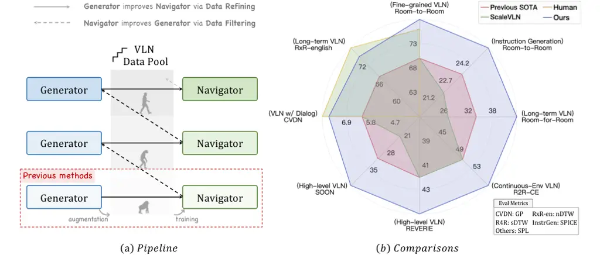
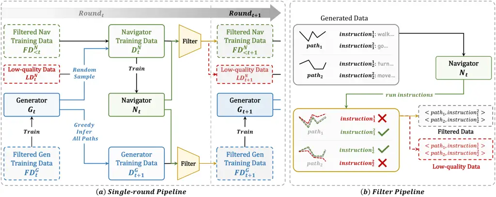
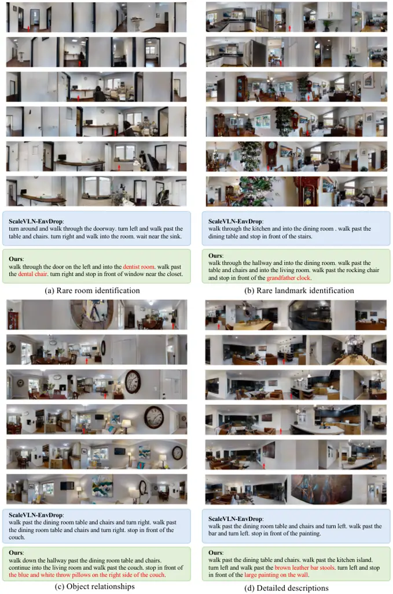
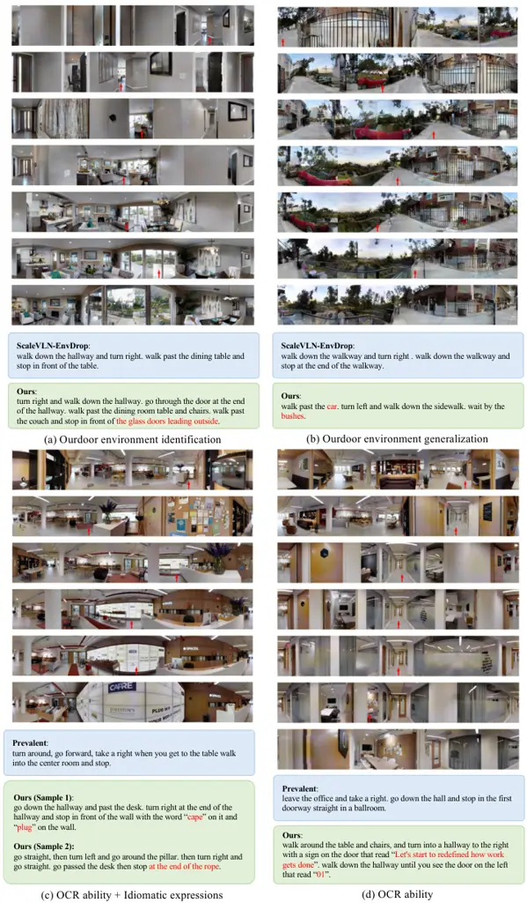

# Bootstrapping Language-Guided Navigation Learning with Self-Refining Data Flywheel

Zun Wang Affiliation: Shanghai AI Laboratory    Jialu Li
Affiliation: UNC Chapel Hill    Yicong Hong Affiliation: Adobe Research
   Songze Li Affiliation: Shanghai AI Laboratory    Kunchang Li
Affiliation: Shanghai AI Laboratory    Shoubin Yu Affiliation: UNC
Chapel Hill    Yi Wang Affiliation: Shanghai AI Laboratory    Yu Qiao
Affiliation: Shanghai AI Laboratory    Yali Wang Affiliation: Shanghai
AI Laboratory    Mohit Bansal Affiliation: UNC Chapel Hill    Limin Wang
Affiliation: Shanghai AI Laboratory Affiliation: Nanjing
University{zunwang, jialuli, mbansal}@cs.unc.edu, wanglimin@pjlab.org.cn

###### Abstract

Creating high-quality data for training robust language-instructed
agents is a long-lasting challenge in embodied AI. In this paper, we
introduce a Self-Refining Data Flywheel (SRDF) that generates
high-quality and large-scale navigational instruction-trajectory pairs
by iteratively refining the data pool through the collaboration between
two models, the instruction generator and the navigator, without any
human-in-the-loop annotation. Specifically, SRDF starts with using a
base generator to create an initial data pool for training a base
navigator, followed by applying the trained navigator to filter the data
pool. This leads to higher-fidelity data to train a better generator,
which can, in turn, produce higher-quality data for training the
next-round navigator. Such a flywheel establishes a data self-refining
process, yielding a continuously improved and highly effective dataset
for large-scale language-guided navigation learning. Our experiments
demonstrate that after several flywheel rounds, the navigator elevates
the performance boundary from 70% to 78% SPL on the classic R2R test
set, surpassing human performance (76%) for the first time. Meanwhile,
this process results in a superior generator, evidenced by a SPICE
increase from 23.5 to 26.2, better than all previous VLN instruction
generation methods. Finally, we demonstrate the scalability of our
method through increasing environment and instruction diversity, and the
generalization ability of our pre-trained navigator across various
downstream navigation tasks, surpassing state-of-the-art methods by a
large margin in all cases.¹¹ 1 Code and data are available at
[https://github.com/wz0919/VLN-SRDF](https://github.com/wz0919/VLN-SRDF).  
  ^(∗)Interned at Shanghai AI Laboratory.

|     |
| --- |
|     |

Figure 1: (a) Our Pipeline: After using the (instruction) generator to
label paths for data augmentation in navigator training, we leverage the
trained navigator to filter high-quality data to train a better
generator, and the improved generator refines the data pool to train a
stronger navigator, iteratively running on the flywheel. (b) Comparison
with state-of-the-art (SoTA) methods: Our approach significantly
outperforms SoTA on all tasks. It also surpasses human performance on
R2R and approaches human-level results on RxR-English and CVDN (for
other tasks, human performance is not reported in their paper). The R2R
result is from the test set, while others are from val unseen.

## 1 Introduction

The lack of high-quality data is one of the main bottlenecks in training
embodied agents to complete real-world human activities. Unlike many
other discriminative or generative learning problems, where the data
itself naturally formulates a self-supervised learning
objective (Devlin, 2018; He et al., 2022) or the data labeling can be
facilitated by existing models (Ros et al., 2016; Tian et al., 2024) ,
training embodied agents usually requires expensive human annotation on
complex vision-linguistic contents and physical interactions. In the
essential embodied AI problem of Vision-and-Language Navigation
(VLN) (Zhang et al., 2024b), one widely considered solution is to first
train a trajectory-to-instruction generator (Fried et al., 2018; Tan
et al., 2019; Chen et al., 2022c) using a small amount of
human-annotated data and then use the generator to caption large-scale
trajectories sampled from interactive environments (Hao et al., 2020;
Chen et al., 2022c; Wang et al., 2023e). Among them, Hao et al. (2020)
demonstrates the effectiveness of scaling the synthetic
instruction-trajectory pairs in the existing training environments,
while Chen et al. (2022c); Wang et al. (2023e); Li & Bansal (2023)
emphasizes the importance of scaling training environments for better
generalization ability of agents. However, the quality of the synthetic
data, especially the language fidelity, is highly under-investigated. We
find that training solely with the large-scale synthetic data
(352$`{\times}`$larger in instruction-trajectory pairs, and
13$`\times`$more diverse in environments) yields worse results compared
to training with a small human-annotated dataset (see  Table 1), which
indicates the need for high-quality instructions beside simply scaling
the data and environments.

Though many methods have been proposed for improving data quality in
multi-modal understanding and generation tasks (Fang et al., 2023; Li
et al., 2024a; Betker et al., ; Fang et al., 2024; Li et al., 2024b;
Nguyen et al., 2024b), improving synthetic instruction-trajectory pairs
for language-guided navigation has several distinct challenges. First,
the most straightforward approach is to build a strong instruction
generator, but the limited amount of high-quality training data (e.g.,
R2R (Anderson et al., 2018b) train split has only 14K human-labeled
data) makes it challenging to train a robust generator capable of
producing high-fidelity instructions for diverse trajectories.
Additionally, manually correcting instructions by humans is
resource-intensive and costly.

|               |        |        |                |                 |
| ------------- | ------ | ------ | -------------- | --------------- |
| Training Data | \#data | \#Env. | SR$`\uparrow`$ | SPL$`\uparrow`$ |
| R2R           | 14K    | 61     | 65.9           | 55.9            |
| Prevalent     | 1.0M   | 60     | 67.1           | 54.8            |
| ScaleVLN      | 4.9M   | 800    | 63.9           | 50.1            |

Table 1: Performance (on R2R validation unseen split) on different
datasets solely. Directly training with R2R yields the best SPL compared
to training with other augmentation datasets.

Moreover, the alignment of instruction-trajectory pairs in VLN is hard
to evaluate, as the instructions not only contain semantic information
(e.g., ‘Walk past the table’) but also have rich directional information
(e.g., ‘Turn left’) to match with the corresponding trajectory. Besides,
the visual elements mentioned in the instructions are also temporally
aligned to panoramas in multiple scenes. As a result, traditional
metrics like CLIP score (Radford et al., 2021) struggle to evaluate such
multi-scene directional and semantic alignment, as they only capture
single-scene semantic relationships.

In this work, we propose a Self-Refining Data Flywheel, SRDF, that
automatically evaluates and improves the quality of the generated
instructions at scale, through an iterative collaboration between the
navigator and the instruction generator. As shown in Figure 1 (a), our
first step is similar to ScaleVLN’s process (Wang et al., 2023e), which
trains an instruction generator using the original human-labeled data,
then generates instructions for unlabeled paths sampled from 800 HM3D
training environments and trains a strong navigator using the generated
data. Then, for evaluating the generated instructions, we propose to use
the trained navigator’s path-fidelity score (nDTW (Ilharco et al., 2019)
and SPL (Anderson et al., 2018a), measuring how closely the navigator’s
followed path matches the original trajectory) as the similarity score.
Since the trained navigator is strong enough (achieves human-level
performance in Wang et al. (2023e)) and has already learned to connect
visual landmarks and directional cues to actions effectively, its
fidelity in following the instructions can naturally reflect how well
the instruction-trajectory pairs are aligned. It also avoids manually
setting vague thresholds when using CLIP-score-like metrics for
filtering. In our case, SPL=1 yields a perfect trajectory match. After
using the navigator as a filter to obtain a high-quality subset of the
generated data, this subset of data will be used to train a better
instruction generator in the next iteration. The improved instruction
generator re-generates instructions for bad samples to produce better
datasets, which is used to train a stronger navigator. The process
iterates, with the navigator improving the instruction generator via
data filtering, and the instruction generator improving the navigator
via data refining, ultimately producing both a highly capable navigator
and instruction generator, along with a substantially high-quality
synthetic VLN dataset.

We build our flywheel upon the R2R dataset (Anderson et al., 2018b) and
provide detailed analysis. Empirically, we show that our navigator and
instruction generator can iteratively improve each other with our SRDF.
We also demonstrate the scalability of our method: the instruction
generator consistently improves with additional environments and data,
and the navigator benefits more from increased instruction diversity
when trained with our high-quality instructions compared to with
low-quality datasets. On the R2R dataset, our approach surpasses
previous state-of-the-art results by a wide margin in both instruction
following and generation, and notably, for the first time, we
significantly surpass human performance (76% SPL) in instruction
following, demonstrating the effectiveness of our SRDF to improve data
quality. Furthermore, we evaluate the transferability of our pre-trained
navigator across various downstream navigation tasks, including VLN with
dialogue-based instructions (CVDN (Thomason et al., 2020)), long-term
VLN (RxR-English (Ku et al., 2020), R4R (Zhu et al., 2020)), high-level
VLN (SOON (Zhu et al., 2021), REVERIE (Qi et al., 2020)), and even VLN
in continuous environments (R2R-CE (Krantz et al., 2020)). As shown in
Figure 1 (b), we achieve state-of-the-art performance on all the tasks,
while approaching human performance for RxR-English and CVDN,
underscoring the superior quality of our generated data and the robust
transferability of our pre-trained navigator.

## 2 Related Work

#### Vision-and-Language Navigation.

VLN requires an agent to navigate in unseen environments based on
natural language instructions. Numerous datasets have been proposed for
this task (Anderson et al., 2018b; Ku et al., 2020; Qi et al., 2020;
Shridhar et al., 2020; Thomason et al., 2020; Padmakumar et al., 2022;
Nguyen & Daumé III, 2019; Chen et al., 2019; Kim et al., 2021), spanning
both indoor and outdoor environments with varied levels of instruction
detail. The limited availability of human-annotated data for training
generalizable VLN agents to achieve near-human performance is a key
challenge due to the high cost of collecting instruction-trajectory
pairs. To address this, various data augmentation approaches have been
explored. Some focus on scaling environments by editing existing
ones (Li et al., 2022; Liu et al., 2021b) or generating new ones with
text-to-image models (Li & Bansal, 2023). Others scale instruction data
by training instruction generators to generate instructions for
unannotated paths (Hao et al., 2020; Zhang & Kordjamshidi, 2023; Zhang
et al., 2024a), or by leveraging large sets of rendered environments
from simulators (e.g., HM3D (Ramakrishnan et al., 2021), Gibson (Xia
et al., 2018)) (Wang et al., 2023e; Kamath et al., 2022; Chen et al.,
2022c). While data scaling has been effective for VLN, the quality of
the data, particularly the alignment between instructions and
trajectories, remains under-explored. In this paper, we investigate the
impact of data quality on VLN and propose a data flywheel that
iteratively refines itself through collaboration between the navigator
and the generator.

#### High-Quality Multimodal Dataset Curation.

Many multimodal studies show that improving data quality can
significantly enhance model performance, either through advanced dataset
filtering (Fang et al., 2023; Li et al., 2024a; Gadre et al., 2024; Sun
et al., 2023) or refining captions with strong models (Betker et al., ;
Fang et al., 2024; Li et al., 2024b; Nguyen et al., 2024b; Wang et al.,
2024c; Tan et al., 2024). Recently, Segment Anything (SAM) (Kirillov
et al., 2023) demonstrated how data and models can improve each other
through a data flywheel with a human-in-the-loop process, evolving from
model-assisted to fully automated annotation. Our data flywheel
similarly integrates filtering and re-captioning data via navigator
verification and generator refinement, operating in a data-model loop
like SAM, but without any human intervention.

#### Self-Improving Language Models.

Studies show that Large Language Models (LLMs) can improve themselves by
training on their own generated outputs across tasks like
programming (Haluptzok et al., 2022), summarization (Patil et al.,
2024), question-answering (Lee et al., 2024; Yu et al., 2024),
reasoning (Prasad et al., 2024), and others (Li et al., 2023a; Madaan
et al., 2024; Zhou et al., 2024c), where the quality of the
self-generated data is ensured via human (Ouyang et al., 2022; Bai
et al., 2022a), off-the-shelf verifiers/reward models (Ni et al., 2023;
Wang et al., 2019; Dou et al., 2024; Bai et al., 2022b; Lee et al.,
2023; Nguyen et al., 2024a) or model’s self feedback (Yuan et al., 2024;
Wu et al., 2024; Wang et al., 2024d). In our pipeline, the instruction
generator iteratively self-improves using its own generated data. Unlike
prior work, our approach establishes a fully automated, multi-round,
two-model mutual improvement process, enabling the navigator, the
generator, and the dataset to evolve concurrently through continuous
model-driven feedback.

## 3 Methodology

### 3.1 Background

VLN data typically consists of instruction-trajectory pairs, where a
trajectory represents a path in a 3D environment, and the corresponding
instruction guides the agent to follow it. This data can be used for
training either instruction-to-action navigators or
trajectory-to-instruction generators. Since manually annotating
trajectories is costly, a common approach is to first train a generator
on limited human-annotated data and then use it to generate instructions
for paths in unlabeled environments, which are subsequently used to
augment navigator training.

While this method helps increase the data amount, it poses challenges
regarding the quality and fidelity of the generated instructions. These
challenges imply two essential problems – how to generate better data
and evaluate the data quality, which we aim to address in the following
sections.

Figure 2: (a) Our (instruction) generator refines low-quality data
filtered in the previous round via sampling to train the next-round
navigator, and greedily generates high-confidence instructions as
candidates to train next-round generator. Then the navigator filters the
data for further use. (b) In filtering, the navigator re-runs
instructions to compute the path-path similarity score (nDTW & SPL).
High-fidelity data is kept for training while low-quality data will be
refined.

### 3.2 SRDF: Self-Refining Data Flywheel

In this section, we introduce the Self-Refining Data Flywheel (SRDF) to
tackle the challenge of evaluating and improving VLN data to bootstrap
its learning. Broadly, our system comprises a navigator, $`N`$, and an
instruction generator, $`G`$, shown in Figure 1 (a). We use $`N`$ to
assist $`G`$ by optimizing G using the data filtered by $`N`$, while
$`G`$ enhances $`N`$ by refining the low-quality data. This iterative
process is repeated multiple times, consistently enhancing both $`G`$
and $`N`$’s performance.

#### Main Components.

Our SRDF requires the following resources at the beginning: (1) seed
data $`D_{Seed}`$, typically human-annotated, for training a base $`G`$
and $`N`$ (2) unlabeled trajectory pool, $`D_{Traj}`$, usually collected
from large-scale environment datasets for generating new training data.

#### Training Base Instruction Generator.

Most previous works (Fried et al., 2018; Tan et al., 2019; Dou & Peng, 2022) train instruction generators from scratch, which limits their
ability to generalize text effectively. Some recent approaches leverage
pretrained vision-and-language models but neglect critical directional
information during trajectory encoding (Li & Bansal, 2023; Kong et al.,
2024), leading to instructions with inconsistent or incorrect
directional cues.

We hypothesize that an effective instruction generator should be capable
of understanding both multi-image inputs and interleaved image-text
inputs. Multi-image understanding is crucial for accurately encoding
multi-panorama trajectories and interleaved image-text comprehension
helps encode directional images within the raw text space, enabling
simple yet effective visual prompting of trajectories. To achieve this,
we utilize Mantis (Jiang et al., 2024), an interleaved multi-image
multimodal large language model (MLLM), which includes a SigLIP vision
encoder (Zhai et al., 2023), a multimodal projector, and a LLaMA-3
language model backbone (Dubey et al., 2024), pretrained on a curated
corpus of interleaved image-text pairs. We use our designed template
(see Appendix 3, 13 for details) to convert the instruction-trajectory
pairs from $`D_{Seed}`$ into supervised fine-tuning (SFT) data, and then
LoRA-fine-tune the language backbone using this converted data. This
results in a robust instruction generator $`G_{1}`$, which serves as the
foundation for our data generation process.

#### Generating Base Training Data.

Once the base instruction generator, $`G_{1}`$, is trained, it is used
to generate two types of data from the unlabeled trajectories,
$`D_{Traj}`$: one for training the navigator and another for improving
the round-2 instruction generator. For data training the instruction
generator, we use greedy decoding to generate the most reliable
instruction for each trajectory to form $`D^{G}_{2}`$. For data used to
train the navigator, we prioritize diversity by generating multiple
instructions via random sampling to form $`D^{N}_{1}`$. The data
generation step aims to provide sufficient training data for both
improving the navigator and the instruction generator in subsequent
iterations.

#### Training Base Navigator.

We employ the DUET model (Chen et al., 2022b) as our navigator. The
model is pre-trained using $`D^{N}_{1}`$ and subsequently fine-tuned on
$`D_{Seed}`$. This results in a highly capable navigator $`N_{1}`$,
which will be used to evaluate the quality of the generated data.

#### Evaluating and Filtering the Generated Data.

We propose using the trained navigator $`N_{1}`$ to self-evaluate the
generated data $`D^{N}_{1}`$. Intuitively, if the navigator successfully
follows the generated instruction and navigates along the original path,
it suggests that the instruction is well-aligned with the trajectory and
the strong performance of this navigator (Could achieve near-human
performance in previous work (Wang et al., 2023e)) further ensures its
reliability. Such self-consistency transforms the challenging task of
computing instruction-trajectory similarity into the simpler problem of
computing trajectory-trajectory similarity.

We run the navigator on the generated instructions and compute
trajectory-trajectory similarity scores. We filter high-quality data
$`FD^{G}_{2}`$ for the round-2 instruction generator training by
selecting instances from $`D^{G}_{2}`$ with SPL=1 (indicating the
navigator perfectly follows the path). For $`D^{N}_{1}`$ (navigator
training data), we filter with nDTW$`\geq`$0.9 (indicating very close
alignment between trajectories) to get $`FD^{N}_{<2}`$, to use in the
round-2 training, as shown in Figure 2. This filtered-out high-quality
data will be kept in the follow-up round, and we only re-generate
low-quality data $`LD^{N}_{2}`$ filtered by nDTW$`<`$0.9. This filtering
step ensures that only reliable data is used for subsequent iterations
of training, reducing data noise and increasing alignment quality.

#### Iterative Self-Refining.

The core of SRDF is its iterative loop between the instruction generator
and the navigator, where each model contributes to improving the other
by providing data feedback. Specifically, at each iteration $`t`$, we
first train the generator $`G_{t}`$ using the filtered high-quality data
$`FD^{G}_{t}`$. Then we use $`G_{t}`$ to generate new
navigation-training data, $`ND^{N}_{t}`$, for previously bad samples,
$`LD^{N}_{t}`$, and new generator training data, $`D^{G}_{t+1}`$, for
$`D_{Traj}`$, following the same details in generating base training
data. Then we Combine $`ND^{N}_{t}`$ with previously filtered navigation
data, $`FD^{N}_{<t}`$, to form the complete dataset, $`D^{N}_{t}`$, for
training the navigator. Note that the whole data size won’t change as we
are only refining base samples. After training the navigator $`N_{t}`$
using $`D^{N}_{t}`$, we use $`N_{t}`$ to filter high-quality data
subsets, resulting in $`FD^{G}_{t+1}`$ filtered from $`D^{G}_{t+1}`$ and
$`FND^{N}_{t}`$ from $`ND^{N}_{t}`$. Finally, we combine the newly
filtered navigation data, $`FND^{N}_{t}`$, to form $`FD^{N}_{<t+1}`$ for
the next-round training. This looping mechanism ensures that the data
quality continually improves through a self-refining process. Each
iteration benefits from the enhanced quality of both the instruction
generator and the navigator, ultimately yielding a high-quality dataset
and highly capable models. To summarize, the pseudocodes of the SRDF are
detailed in Appendix Alg. 1.

### 3.3 Final Dataset

We build our flywheel upon the R2R dataset (Anderson et al., 2018b) as
$`D_{Seed}`$, containing 14,039 human-annotated training data, along
with the 178,270 and 2,890,267 unlabelled trajectories from MP3D (Chang
et al., 2017) and HM3D (Wang et al., 2023e) environments, respectively,
as $`D_{Traj}`$. We run the flywheel for three rounds to create the
final dataset, named SRDF-20M. This dataset consists of 19.5 million
pre-training examples $`D^{N}_{3}`$, with 6 instructions generated for
each HM3D path (via top-3 sampling) and 12 instructions (6 top-3 and 6
top-5 sampling) for each MP3D path, and 0.9M greedy-decoded filtered
data $`FD^{G}_{4}`$ (which will be used to fine-tune the pretrained
navigator and the third-round generator here). Overall, we generated 20M
instructions across 860 environments for navigator training.

#### Comparison to Previous VLN Datasets.

Table 2 presents detailed statistics of our dataset and previous VLN
datasets. A common issue in existing augmentation datasets is the lack
of vocabulary diversity. For instance, prior datasets like
Prevalent (Hao et al., 2020), despite being significantly larger than
R2R, possess only 1/3 of R2R’s vocabulary size, even with 76 times more
instructions. This issue is even more pronounced in ScaleVLN (Wang
et al., 2023e), which suffers from a highly limited vocabulary. In
contrast, our dataset contains over 10,000 unique words and 20 million
instructions— three times the vocabulary diversity and 1,454 times the
instruction count compared to the original R2R dataset — surpassing all
previous human-labeled and synthetic VLN datasets in both vocabulary
richness and instruction quantity. Importantly, this substantial
increase in size and diversity is achieved without compromising quality,
due to the robustness of our instruction generator and the
high-precision filtering process guided by our strong navigator. We also
provide some visualization examples of our generated instructions in
Appendix Figure 4 and 5.

|                               |                   |        |            |          |               |
| ----------------------------- | ----------------- | ------ | ---------- | -------- | ------------- |
| Dataset                       | Instruction       | \#Env. | \#Instr.   | \#Vocab. | Instr. Length |
| R2R (Anderson et al., 2018b)  | Manually Labelled | 61     | 14,039     | 3,063    | 26.33         |
| RxR-en (Ku et al., 2020)      |                   | 60     | 26,464     | 7,249    | 102.13        |
| REVERIE (Qi et al., 2020)     |                   | 60     | 10,466     | 1,140    | 18.64         |
| CVDN (Thomason et al., 2020)  |                   | 57     | 4,742      | 2,068    | 53.21         |
| SOON (Zhu et al., 2021)       |                   | 34     | 2,780      | 735      | 44.09         |
| R4R (Zhu et al., 2020)        |                   | 59     | 233,532    | 3,004    | 52.25         |
| Prevalent (Hao et al., 2020)  | Generated         | 60     | 1,069,620  | 993      | 24.23         |
| Marky (Wang et al., 2022b)    |                   | 60     | 333,777    | 2,231    | 99.45         |
| AutoVLN (Chen et al., 2022c)  |                   | 900    | 217,703    | 1,696    | 20.52         |
| ScaleVLN (Wang et al., 2023e) |                   | 1289   | 4,941,710  | 172      | 21.61         |
| SRDF-20M (Ours)               |                   | 860    | 20,417,874 | 10,363   | 24.05         |

Table 2: Statistics of training data on different VLN datasets.

## 4 Experiments

### 4.1 Experimental Setup

#### Datasets and Evaluation Metrics.

We establish our data flywheel and perform ablation studies primarily on
the R2R dataset, while also assessing the transferability of our
pre-trained navigator on a range of downstream tasks. These include
fine-grained VLN (R2R, RxR-English), VLN with dialog history (CVDN),
high-level VLN (REVERIE, SOON), long-term VLN (R4R), and VLN in
continuous environments (R2R-CE). Each dataset is split into training,
val_seen, and val_unseen sets, with R2R, CVDN, REVERIE, SOON, and R2R-CE
also containing test splits. The statistics for the training splits are
summarized in Table 2 (manually-labeled datasets), and further details
can be found in the Appendix.

We evaluate our navigator using the standard path-fidelity metrics
including Success Rate (SR), Success Rate Weighted by Path Length
(SPL) (Anderson et al., 2018a), Goal Progress (GP) (Thomason et al.,
2020), Navigation Error (NE), normalized Dynamic Time Warping
(nDTW) (Ilharco et al., 2019) and Success Rate Weighted by Dynamic Time
Warping (sDTW) (Ilharco et al., 2019). We leave the details of these
metrics to Appendix.

Although REVERIE and SOON include object grounding tasks, we focus on
evaluating navigation performance, as our generated dataset is
specifically designed to enhance navigation tasks. We use SPL as the
primary metric for R2R, REVERIE, SOON, and R2R-CE, nDTW for RxR-English,
sDTW for R4R, and GP for CVDN.

For evaluating our instruction generator, we assess the linguistic
quality of the generated instructions using standard text similarity
metrics such as BLEU (Papineni et al., 2002), Meteor (Banerjee & Lavie,
2005), and Rouge (Lin, 2004), along with commonly used image captioning
metrics, including SPICE (Anderson et al., 2016) and CIDEr (Vedantam
et al., 2015). Additionally, we consider SPICE-D (Zeng et al., 2023), a
directional-aware variant of SPICE tailored for VLN instruction
evaluation. We adopt SPICE as our primary metric.

#### Implementation.

We utilize InternViT (Chen et al., 2024), a powerful ViT with 6B
parameters, as the visual encoder in our instruction-following
experiments unless otherwise specified. For continuous environments, we
employ CLIP-B/16 (Radford et al., 2021) as the visual backbone.

In our data flywheel, we pre-train the DUET navigator from scratch for
45,000 iterations using a batch size of 1024 and a learning rate of
$`5\times 10^{-5}`$ on 8 NVIDIA Tesla A100 GPUs. Multiple checkpoints
are fine-tuned to select the best pre-training model. The selected model
is then fine-tuned for 6K iterations with a batch size of 16 on a single
GPU using only the R2R dataset. For the instruction generator, we
fine-tune Mantis-8B-SigLIP (Jiang et al., 2024) using LoRA, applying it
to the query and value layers in each transformer block. Initially, both
the navigator and instruction generator are trained from random weights,
while subsequent rounds use previous-round weights.

After final-round navigator pre-training, we fine-tune the navigator for
various downstream tasks, using PanoGen (Li & Bansal, 2023) for
MP3D-level environment augmentation. For augmentation, we use round-3
filtered data $`FD^{G}_{4}`$ for R2R, ScaleVLN(REVERIE) (Wang et al.,
2023e) for REVERIE, and marky-English (Wang et al., 2022b) for
RxR-English, and no augmentation for other tasks. For R2R-CE, we
fine-tune our pre-trained navigator on ETPNav (An et al., 2023b) with a
waypoint predictor (Hong et al., 2022; An et al., 2022). Modules not
pre-trained, such as the object grounding module in REVERIE and the
depth-image embedding module in ETPNav, are randomly initialized and
trained from scratch. We also use $`FD^{G}_{4}`$ to fine-tune the
3rd-round generator to build the final instruction generator. This
process can also be viewed as the fourth round of generator training.

|                |                       |                 |                |                 |                        |                     |                    |                    |                   |                    |                   |
| -------------- | --------------------- | --------------- | -------------- | --------------- | ---------------------- | ------------------- | ------------------ | ------------------ | ----------------- | ------------------ | ----------------- |
| Method         | Instruction Following |                 |                |                 | Instruction Generation |                     |                    |                    |                   |                    |                   |
|                | NE$`\downarrow`$      | OSR$`\uparrow`$ | SR$`\uparrow`$ | SPL$`\uparrow`$ | SPICE$`\uparrow`$      | SPICE-D$`\uparrow`$ | Bleu-1$`\uparrow`$ | Bleu-4$`\uparrow`$ | CIDEr$`\uparrow`$ | Meteor$`\uparrow`$ | Rouge$`\uparrow`$ |
| Baseline       | 2.37                  | 85.5            | 78.6           | 69.9            | 21.8                   | 28.0                | 72.5               | 27.7               | 42.2              | 23.6               | 49.0              |
| Ours (round 1) | 1.95                  | 87.1            | 82.4           | 75.9            | 23.7                   | 28.4                | 71.4               | 29.5               | 46.5              | 23.1               | 50.2              |
| Ours (round 2) | 1.81                  | 88.5            | 83.6           | 77.3            | 25.2                   | 29.9                | 73.7               | 31.0               | 50.7              | 24.2               | 51.3              |
| Ours (round 3) | 1.76                  | 89.6            | 84.4           | 77.6            | 25.7                   | 30.4                | 74.5               | 30.8               | 49.7              | 24.5               | 51.3              |

Table 3: Navigator and instruction generator results in different rounds
in R2R val unseen split.

### 4.2 Flywheel Running Results

Table 3 presents the results for both the instruction generator and
navigator across all rounds. We follow ScaleVLN (Wang et al., 2023e) to
train the navigator with ScaleVLN-HM3D and Prevalent data for
augmentation, while we use InternViT (Chen et al., 2024) features for
fair comparison. The instruction generator for ScaleVLN is EnvDrop (Tan
et al., 2019). In round 1, our new instruction generator, fine-tuned on
R2R with LoRA using the pre-trained Mantis, significantly surpasses
EnvDrop. This results in a substantial SR boost for the navigator from
78.6% to 82.4%.

#### Navigator and Instruction Generator Improve Each Other.

At each round, we use the navigator to filter high-quality data
$`FD^{G}_{t}`$ to re-train the instruction generator, and use the
improved instruction generator to refine low-quality instructions
$`LD^{N}_{t}`$ to re-train the navigator. Despite the strong performance
of the round 1 baseline, the generator is further improved by
incorporating navigator-filtered data in round 2. The high-quality data
filtered by the navigator leads to +1.5 SPICE and +4.2 CIDEr. This trend
continues in round 3, where SPICE reaches 25.7, while other metrics
remain stable, demonstrating the crucial role of the navigator in
enhancing the instruction generator via data filtering. For the
navigator, the data-refining process leads to continuous improvements in
navigation performance with +1.2% SR in round 2, and +0.8% SR in round
3, underscoring the importance of the generator data refinement in
enhancing the navigator, as well as the effectiveness of iterative
navigator-generator collaboration to build an effective self-refining
flywheel.

### 4.3 Analysis

#### Comparison of Different Scoring Functions.

We analyzed classical filtering methods will likely fail to capture
complex path-instruction similarity in the previous discussion. In Table
4, we further verify the importance of our navigator-filtering compared
to other filtering baselines. Using our round 1 instruction generator,
we produce instructions for 783 trajectories from the validation unseen
split, rank them based on various scoring functions, and filter the top
400 to assess their similarity to GT instructions. ‘No filter’ refers to
the average score of all 783 instructions, and intuitively, more similar
instructions should yield higher NLP metric scores.

We compare our navigator’s nDTW-score with CLIP-Sim (Radford et al., 2021) and Mantis score (Jiang et al., 2024). CLIP-Sim is computed by
averaging image-instruction similarities across all observations in the
trajectory, while Mantis-score is produced by inputting the path as
interleaved image-text pairs and asking Mantis to provide a similarity
score. Results show that the Mantis score fails to improve over the
baseline, likely due to the trajectories is too complex to understand
for the MLLM. CLIP-Sim provides a slight SPICE improvement, possibly
because it can capture some landmark-level similarities between the
trajectory images and the instructions, but does not improve SPICE-D as
it lacks directional understanding. In contrast, our Navigator-nDTW
similarity filtering method successfully identifies high-quality
instructions, leading to a substantial improvement, demonstrating our
navigator-nDTW captures path-instruction similarities much better than
others.

|                |                   |                     |                   |
| -------------- | ----------------- | ------------------- | ----------------- |
| Filter         | SPICE$`\uparrow`$ | SPICE-D$`\uparrow`$ | CIDEr$`\uparrow`$ |
| No Filter      | 23.7              | 28.4                | 46.5              |
| CLIP-Sim       | 24.4              | 28.7                | 45.8              |
| Mantis-Score   | 23.6              | 28.2                | 48.3              |
| Navigator-nDTW | 25.4              | 30.6                | 53.9              |

Table 4: Effects of Scoring Functions.

|                                              |                  |                |                 |
| -------------------------------------------- | ---------------- | -------------- | --------------- |
| Aug Data                                     | NE$`\downarrow`$ | SR$`\uparrow`$ | SPL$`\uparrow`$ |
| $`\text{Prev}_{\text{\emph{\ \#Instr=}1}}`$  | 3.21             | 71.86          | 61.04           |
| $`\text{Ours}_{\text{\emph{\ \#Instr=}1}}`$  | 2.97             | 73.86          | 63.58           |
| $`\text{Prev}_{\text{\emph{\ \#Instr=}3}}`$  | 3.12             | 72.67          | 62.53           |
| $`\text{Ours}_{\text{\emph{\ \#Instr=}3}}`$  | 2.81             | 75.21          | 64.56           |
| $`\text{Prev}_{\text{\emph{\ \#Instr=}6}}`$  | 3.07             | 72.84          | 63.12           |
| $`\text{Ours}_{\text{\emph{\ \#Instr=}6}}`$  | 2.55             | 76.93          | 66.89           |
| $`\text{Ours}_{\text{\emph{\ \#Instr=}12}}`$ | 2.59             | 77.05          | 66.53           |

Table 5: Results of instruction diversity (#instr. per path) in
navigator training in val unseen split.

|                            |                   |                    |                   |                   |
| -------------------------- | ----------------- | ------------------ | ----------------- | ----------------- |
| Additional Data            | SPICE$`\uparrow`$ | Bleu-4$`\uparrow`$ | CIDEr$`\uparrow`$ | Rouge$`\uparrow`$ |
| \-                         | 23.7              | 29.5               | 46.5              | 50.2              |
| ScaleVLN Data              | 23.5              | 29.0               | 46.1              | 49.8              |
| Prevalent Data             | 23.6              | 29.3               | 46.7              | 50.1              |
| 100-HM3D-Env Ours          | 23.9              | 29.8               | 47.8              | 50.0              |
| 200-HM3D-Env Ours          | 24.2              | 30.1               | 49.1              | 50.3              |
| 400-HM3D-Env Ours          | 24.6              | 30.3               | 48.9              | 50.7              |
| 800-HM3D-Env Ours          | 25.2              | 31.0               | 50.7              | 51.3              |
| 800-HM3D-Env Ours (Sample) | 24.8              | 30.3               | 48.3              | 51.0              |

Table 6: Results of different additional augmentation data in
instruction generator training in val unseen split.

#### Effect of Instruction Diversity in Navigator Training

We assess the impact of instruction diversity by training the navigator
with different numbers of instructions per path ($`\#instr=`$ 1, 3, 6, 12) on the MP3D environments, as shown in Table 6. We use CLIP-B/16 as
the visual feature to establish a well-known baseline (Li & Bansal,
2023; Wang et al., 2023e) with the Prevalent dataset, while “Our” uses
instructions generated by our round 2 instruction generator. Compared to
Prevalent, our instructions consistently achieve stronger downstream
results at each $`\#instr`$ level, emphasizing the importance of
instruction quality. Our navigator also benefits significantly when
increasing $`\#instr`$ from 1 to 3 and 3 to 6, while Prevalent’s
performance saturates after 3, demonstrating that scaling instruction
diversity will be more effective when instruction quality is higher.
Increasing $`\#instr`$ to 12 yields similar results to 6, suggesting
that $`\#instr=6`$ is an optimal balance for training.

#### Effect of Additional Data in Instruction Generator Training.

In Table 6, we examine the importance of high-quality data in
instruction generator training, and the potential scalability of our
pipelines by evaluating the influence of environment numbers. The
round-1 generator without supplementary data serves as the baseline.
Adding the ScaleVLN dataset does not improve performance, likely due to
its low diversity, which limits generalization in text generation tasks.

When training with the Prevalent dataset, which has greater diversity,
performance gains remain minimal, possibly because of the data noise, as
it also shows low quality in Table 1. In contrast, adding data from ours
with increased environments (we split $`FD^{G}_{2}`$ by environments)
consistently enhances performance. This improvement is likely due to
both the diversity and quality of our data, which are carefully
maintained throughout the process, boosting the SPICE from 23.7 to 25.2.

We also experimented with training using sampled versus greedy-decoded
instructions. Sampled instructions resulted in slightly lower
performance, suggesting they may introduce noise, whereas greedy-decoded
instructions, produced with higher confidence, are more reliable. These
results show the strong extensibility of our pipeline, and the critical
role of high-quality data, both in instruction generator training.

[TABLE]

Table 7: Comparison of single-run performance on R2R and R2R-CE
datasets. Best results are marked in bold blue and second best in bold.

|                                        |                |                  |                |                  |                |                |                |                 |                |                 |                |                 |                |                 |
| -------------------------------------- | -------------- | ---------------- | -------------- | ---------------- | -------------- | -------------- | -------------- | --------------- | -------------- | --------------- | -------------- | --------------- | -------------- | --------------- |
| Methods                                | RxR-english    |                  | R4R            |                  | CVDN           |                | REVERIE        |                 |                |                 | SOON           |                 |                |                 |
|                                        | Val unseen     |                  | Val unseen     |                  | Val            | Test           | Val unseen     |                 | Test unseen    |                 | Val unseen     |                 | Test unseen    |                 |
|                                        | SR$`\uparrow`$ | nDTW$`\uparrow`$ | SR$`\uparrow`$ | sDTW$`\uparrow`$ | GP$`\uparrow`$ | GP$`\uparrow`$ | SR$`\uparrow`$ | SPL$`\uparrow`$ | SR$`\uparrow`$ | SPL$`\uparrow`$ | SR$`\uparrow`$ | SPL$`\uparrow`$ | SR$`\uparrow`$ | SPL$`\uparrow`$ |
| HAMT† (Chen et al., 2021)              | 56.4           | 63.0             | 44.6           | 31.8             | 5.13           | 5.58           | 33.0           | 30.2            | 30.4           | 26.7            | \-             | \-              | \-             | \-              |
| MARVAL (Kamath et al., 2022)           | 64.7           | 70.4             | \-             | \-               | \-             | \-             | \-             | \-              | \-             | \-              | \-             | \-              | \-             | \-              |
| DUET (Chen et al., 2022b)              | \-             | \-               | \-             | \-               | \-             | \-             | 47.0           | 33.7            | 52.5           | 36.1            | 36.3           | 22.6            | 33.4           | 21.4            |
| AutoVLN (Chen et al., 2022c)           | \-             | \-               | \-             | \-               | \-             | \-             | 55.9           | 40.9            | 55.2           | 38.9            | 41.0           | 30.7            | 40.4           | 27.9            |
| RREx-Bot^(⋆) (Sigurdsson et al., 2023) | \-             | \-               | \-             | \-               | \-             | \-             | 61.0           | 58.8            | 65.9           | 62.0            | 49.2           | 48.6            | 47.5           | 47.1            |
| BEVBert† (An et al., 2023a)            | 66.7           | 69.6             | \-             | \-               | \-             | \-             | 51.8           | 36.4            | 52.8           | 36.4            | \-             | \-              | \-             | \-              |
| KERM (Li et al., 2023b)                | \-             | \-               | \-             | \-               | \-             | \-             | 50.4           | 35.4            | 52.4           | 39.2            | 38.1           | 23.2            | \-             | \-              |
| ScaleVLN (Wang et al., 2023e)          | \-             | \-               | \-             | \-               | 6.12           | 6.97           | 57.0           | 41.9            | 56.1           | 39.5            | \-             | \-              | \-             | \-              |
| PanoGen (Li & Bansal, 2023)            | \-             | \-               | 47.8           | \-               | 5.93           | 7.17           | \-             | \-              | \-             | \-              | \-             | \-              | \-             | \-              |
| BSG (Liu et al., 2023)                 | \-             | \-               | 47.0           | 34.0             | \-             | \-             | 52.1           | 35.6            | 56.5           | 38.7            | \-             | \-              | \-             | \-              |
| MiC (Qiao et al., 2023b)               | \-             | \-               | \-             | \-               | \-             | \-             | 57.0           | 43.6            | 55.7           | 42.0            | \-             | \-              | \-             | \-              |
| NaviLLM (Zheng et al., 2024)           | \-             | \-               | \-             | \-               | 6.16           | 7.90           | 44.6           | 36.6            | 43.5           | 34.5            | 38.3           | 29.2            | 35.0           | 26.2            |
| VER (Liu et al., 2024)                 | \-             | \-               | 47.0           | 33.0             | \-             | \-             | 56.0           | 39.7            | 56.8           | 38.8            | \-             | \-              | \-             | \-              |
| PRET† (Lu et al., 2024)                | 71.0           | 70.9             | \-             | \-               | \-             | \-             | \-             | \-              | \-             | \-              | \-             | \-              | \-             | \-              |
| MAGIC-L (Wang et al., 2024b)           | 72.9           | 68.1             | \-             | \-               | \-             | \-             | \-             | \-              | \-             | \-              | \-             | \-              | \-             | \-              |
| VLN-Copilot (Qiao et al., 2024)        | \-             | \-               | \-             | \-               | \-             | \-             | 57.4           | 43.6            | 57.8           | 42.3            | \-             | \-              | \-             | \-              |
| GOAT (Wang et al., 2024a)              | 68.2           | 66.8             | \-             | \-               | \-             | \-             | 53.4           | 36.7            | 57.7           | 40.5            | 40.4           | 28.1            | 40.5           | 25.2            |
| SRDF (Ours)                            | 78.8           | 74.4             | 64.4           | 44.6             | 7.67           | 8.19           | 60.4           | 45.4            | 61.4           | 47.7            | 50.3           | 41.7            | 46.6           | 37.9            |

Table 8: Comparison with previous methods on various downstream tasks.
$`{\dagger}`$ indicates the RxR-en results are reproduced using their
officially released checkpoints. $`\star`$ means pre-exploration
methods. Best results are marked in bold blue and second best in bold.

|                                                   |                       |                     |                    |                    |                   |                    |                   |
| ------------------------------------------------- | --------------------- | ------------------- | ------------------ | ------------------ | ----------------- | ------------------ | ----------------- |
| Methods                                           | R2R Validation Unseen |                     |                    |                    |                   |                    |                   |
|                                                   | SPICE$`\uparrow`$     | SPICE-D$`\uparrow`$ | Bleu-1$`\uparrow`$ | Bleu-4$`\uparrow`$ | CIDEr$`\uparrow`$ | Meteor$`\uparrow`$ | Rouge$`\uparrow`$ |
| BT-speaker (Fried et al., 2018)                   | 18.9                  | 25.1                | 68.2               | 26.3               | 37.9              | 21.7               | 48.0              |
| LandmarkSelect (Agarwal et al., 2019)             | 19.7                  | \-                  | 54.8               | 15.9               | 13.2              | 23.1               | 35.7              |
| EnvDrop (Tan et al., 2019)                        | 21.8                  | 28.0                | 72.3               | 27.1               | 41.7              | 23.6               | 49.0              |
| CCC (Wang et al., 2022a)                          | 21.4                  | 27.8                | 70.8               | 27.2               | 46.1              | 23.1               | 47.7              |
| FOAM$`{\dagger}`$ (Dou & Peng, 2022)              | 21.7                  | 28.1                | 72.5               | 27.3               | 42.4              | 23.4               | 49.2              |
| KEFA (Zeng et al., 2023)                          | 23.4                  | 29.3                | 73.8               | 28.3               | 42.7              | 24.4               | 50.3              |
| LANA (Wang et al., 2023b)                         | 22.6                  | \-                  | 73.6               | 28.9               | 45.7              | 23.7               | 49.8              |
| LANA+ (Wang et al., 2023c)                        | 22.8                  | \-                  | 73.2               | 29.5               | 46.0              | 24.1               | 49.6              |
| C-Instructor (Kong et al., 2024)                  | 21.2                  | \-                  | 71.3               | 26.6               | 44.7              | 23.9               | 47.3              |
| BEVInsructor (Fan et al., 2024)                   | 20.8                  | \-                  | 69.9               | 26.4               | 44.9              | 23.0               | 46.7              |
| SRDF (Ours, round 2)                              | 25.2                  | 29.9                | 73.7               | 31.0               | 50.7              | 24.2               | 51.3              |
| SRDF (Ours, round 3)                              | 25.7                  | 30.4                | 74.5               | 30.8               | 49.7              | 24.5               | 51.3              |
| SRDF (Ours, round 3 fine-tuned w/ $`FD^{G}_{4}`$) | 26.2                  | 30.9                | 75.3               | 31.1               | 49.2              | 25.0               | 51.4              |

Table 9: Performance of different instruction generators on R2R.
$`{\dagger}`$ means reproduced results. Best results are marked in bold
blue, second best in bold, and third best in underlined.

### 4.4 Comparision with State of the Arts

#### R2R and R2R-CE.

Table 7 compares agent performance on the R2R and R2R-CE datasets. The
DUET navigator, trained on our high-quality datasets, improves SoTA SPL
(ScaleVLN (Wang et al., 2023e)) by 8% on the R2R test set, demonstrating
our data’s strong instruction-trajectory alignment that allows effective
decision-making learning. Additionally, The gap between oracle success
and success is reduced to 4%, compared to the previous best of 6%,
highlighting that our data provides stronger clues for the agent to
learn when to stop. Notably, our data-centric approach yields greater
improvements compared to most model design modifications, highlighting
the importance of building high-quality data to boost model performance.
For R2R-CE, despite ETPNav using in-domain pre-training with
Habitat-rendered RGBD images (Savva et al., 2019), our model, using
no-rendered images from MP3D and ScaleVLN’s HM3D without depth-image
pre-training, achieves an absolute gain of +8% in SR and SPL,
demonstrating the strong transferability of our pre-trained navigator.

#### REVERIE and SOON.

For high-level navigation tasks, as shown in Table 8, our method
achieves notable improvements on the val unseen split for REVERIE and
SOON, with +3.5% SPL over ScaleVLN and +10.0% SPL over AutoVLN (Chen
et al., 2022c), respectively. These gains are especially impressive
given that both AutoVLN and ScaleVLN (Wang et al., 2023e) used in-domain
pre-training data, while ours comes from the out-of-domain R2R-style
dataset. This demonstrates that our high-quality data not only improves
fine-grained instruction-following but also enhances goal-finding,
likely due to diverse stopping guidance. Surprisingly, our model
achieves results comparable to the pre-exploration agent
RREX-Bot (Sigurdsson et al., 2023) on REVERIE (-0.6% SR), and even
surpasses it on SOON (+1.4% SR), showing our model’s robust goal-finding
ability.

#### CVDN.

Our method also improves the previous best on the val unseen set of CVDN
by a large margin (+1.51 meters) in Table 8, showing that our model can
be generalized to different instruction styles, likely due to learning
strong landmark alignment ability, which can be shared across tasks.

#### RxR-English and R4R.

For long-horizon (and fine-grained) VLN tasks including RxR-en and R4R,
our navigator also shows strong results on the val unseen split,
surpassing previous SoTAs by a large margin shown in Table 8. It’s worth
noting that our results on R4R provide a very strong improvement of
+16.6% SR. This shows our highly aligned data facilitates learning
step-by-step instruction following even with very long trajectories.

#### R2R Instruction Generation.

We also compare our instruction generator with previous SoTAs for
path-to-instruction generation task on R2R val unseen split in Table 9.
Thanks to our navigator-filtered high-quality data, our round 2
generator has already beat the previous SoTA significantly, with + 1.8
SPICE and + 4.6 CIDEr. The stronger data generated in the third round
results in an additional +0.5 SPICE improvement while keeping other
scores comparable or better. This substantial strong performance can
even be further enhanced by incorporating $`FD^{G}_{4}`$ for
fine-tuning, leading to a +0.5 improvement in SPICE and better results
across five additional metrics, indicating the importance of
high-quality data in instruction generator training.

## 5 Conclusion

In this work, we introduce a fully automatic self-refining data flywheel
to construct a substantially high-quality VLN dataset for augmentation.
We propose to iteratively refine the data with the navigator and
instruction generator working in tandem—the navigator filtering
high-quality data to train a better instruction generator and the
instruction generator regenerating better instructions to train a better
navigator, ultimately producing both a strong navigator, instruction
generator and a high-quality VLN dataset. We thoroughly analyzed the
impact of each component in the flywheel, demonstrating that our
approach significantly surpasses state-of-the-art methods across
multiple VLN benchmarks, covering various instruction styles (R2R, CVDN,
REVERIE, SOON), trajectory lengths (R4R, RxR-English), and control
spaces (R2R-CE), as well as instruction generation task on R2R. Our
self-refining flywheel provides a novel, scalable solution to the data
bottleneck in VLN, highlighting the crucial role of instruction quality
and alignment in training embodied agents. This method has the potential
to drive future advancements in embodied navigation models and paves the
way for exploring more sophisticated tasks that rely on high-quality,
dynamic, and scalable data.

## 6 Acknowlegement

This work is partially supported by the National Key R&D Program of
China (NO. 2022ZD0160100). We warmly thank Hao Tan, Archiki Prasad,
Zhaoyang Wang, and Yiyang Zhou for their helpful suggestions and
feedback on the paper.

## References

- Agarwal et al. (2019) Sanyam Agarwal, Devi Parikh, Dhruv Batra, Peter
  Anderson, and Stefan Lee. Visual landmark selection for generating
  grounded and interpretable navigation instructions. In _CVPR
  Workshop_, volume 3, pp.  7, 2019.
- An et al. (2021) Dong An, Yuankai Qi, Yan Huang, Qi Wu, Liang Wang,
  and Tieniu Tan. Neighbor-view enhanced model for vision and language
  navigation. In _Proceedings of the 29th ACM International Conference
  on Multimedia_, pp. 5101–5109, 2021.
- An et al. (2022) Dong An, Zun Wang, Yangguang Li, Yi Wang, Yicong
  Hong, Yan Huang, Liang Wang, and Jing Shao. 1st place solutions for
  rxr-habitat vision-and-language navigation competition (cvpr 2022).
  _arXiv preprint arXiv:2206.11610_, 2022.
- An et al. (2023a) Dong An, Yuankai Qi, Yangguang Li, Yan Huang, Liang
  Wang, Tieniu Tan, and Jing Shao. Bevbert: Multimodal map pre-training
  for language-guided navigation. In _Proceedings of the IEEE/CVF
  International Conference on Computer Vision_, pp. 2737–2748, 2023a.
- An et al. (2023b) Dong An, Hanqing Wang, Wenguan Wang, Zun Wang, Yan
  Huang, Keji He, and Liang Wang. Etpnav: Evolving topological planning
  for vision-language navigation in continuous environments. _arXiv
  preprint arXiv:2304.03047_, 2023b.
- Anderson et al. (2016) Peter Anderson, Basura Fernando, Mark Johnson,
  and Stephen Gould. Spice: Semantic propositional image caption
  evaluation. In _Computer Vision–ECCV 2016: 14th European Conference,
  Amsterdam, The Netherlands, October 11-14, 2016, Proceedings, Part V
  14_, pp. 382–398. Springer, 2016.
- Anderson et al. (2018a) Peter Anderson, Angel Chang, Devendra Singh
  Chaplot, Alexey Dosovitskiy, Saurabh Gupta, Vladlen Koltun, Jana
  Kosecka, Jitendra Malik, Roozbeh Mottaghi, Manolis Savva, et al. On
  evaluation of embodied navigation agents. _arXiv preprint
  arXiv:1807.06757_, 2018a.
- Anderson et al. (2018b) Peter Anderson, Qi Wu, Damien Teney, Jake
  Bruce, Mark Johnson, Niko Sünderhauf, Ian Reid, Stephen Gould, and
  Anton van den Hengel. Vision-and-language navigation: Interpreting
  visually-grounded navigation instructions in real environments. In
  _Proceedings of the IEEE Conference on Computer Vision and Pattern
  Recognition_, pp. 3674–3683, 2018b.
- Bai et al. (2022a) Yuntao Bai, Andy Jones, Kamal Ndousse, Amanda
  Askell, Anna Chen, Nova Dassarma, Dawn Drain, Stanislav Fort, Deep
  Ganguli, Tom Henighan, Nicholas Joseph, Saurav Kadavath, John Kernion,
  Tom Conerly, Sheer El-Showk, Nelson Elhage, Zac Hatfield-Dodds, Danny
  Hernandez, Tristan Hume, Scott Johnston, Shauna Kravec, Liane Lovitt,
  Neel Nanda, Catherine Olsson, Dario Amodei, Tom B. Brown, Jack Clark,
  Sam McCandlish, Christopher Olah, Benjamin Mann, and Jared Kaplan.
  Training a helpful and harmless assistant with reinforcement learning
  from human feedback. _ArXiv_, abs/2204.05862, 2022a.
- Bai et al. (2022b) Yuntao Bai, Saurav Kadavath, Sandipan Kundu, Amanda
  Askell, John Kernion, Andy Jones, Anna Chen, Anna Goldie, Azalia
  Mirhoseini, Cameron McKinnon, Carol Chen, Catherine Olsson,
  Christopher Olah, Danny Hernandez, Dawn Drain, Deep Ganguli, Dustin
  Li, Eli Tran-Johnson, E Perez, Jamie Kerr, Jared Mueller, Jeff Ladish,
  J Landau, Kamal Ndousse, Kamilė Lukovsiūtė, Liane Lovitt, Michael
  Sellitto, Nelson Elhage, Nicholas Schiefer, Noem’i Mercado, Nova
  Dassarma, Robert Lasenby, Robin Larson, Sam Ringer, Scott Johnston,
  Shauna Kravec, Sheer El Showk, Stanislav Fort, Tamera Lanham, Timothy
  Telleen-Lawton, Tom Conerly, Tom Henighan, Tristan Hume, Sam Bowman,
  Zac Hatfield-Dodds, Benjamin Mann, Dario Amodei, Nicholas Joseph, Sam
  McCandlish, Tom B. Brown, and Jared Kaplan. Constitutional ai:
  Harmlessness from ai feedback. _ArXiv_, abs/2212.08073, 2022b.
- Banerjee & Lavie (2005) Satanjeev Banerjee and Alon Lavie. Meteor: An
  automatic metric for mt evaluation with improved correlation with
  human judgments. In _Proceedings of the acl workshop on intrinsic and
  extrinsic evaluation measures for machine translation and/or
  summarization_, pp. 65–72, 2005.
- (12) James Betker, Gabriel Goh, Li Jing, TimBrooks, Jianfeng Wang,
  Linjie Li, LongOuyang, JuntangZhuang, JoyceLee, YufeiGuo,
  WesamManassra, PrafullaDhariwal, CaseyChu, YunxinJiao, and Aditya
  Ramesh. Improving image generation with better captions.
- Chang et al. (2017) Angel Chang, Angela Dai, Thomas Funkhouser, Maciej
  Halber, Matthias Niebner, Manolis Savva, Shuran Song, Andy Zeng, and
  Yinda Zhang. Matterport3d: Learning from rgb-d data in indoor
  environments. In _2017 International Conference on 3D Vision (3DV)_,
  pp. 667–676. IEEE, 2017.
- Chen et al. (2019) Howard Chen, Alane Suhr, Dipendra Misra, Noah
  Snavely, and Yoav Artzi. Touchdown: Natural language navigation and
  spatial reasoning in visual street environments. In _Proceedings of
  the IEEE/CVF Conference on Computer Vision and Pattern Recognition_,
  pp. 12538–12547, 2019.
- Chen et al. (2022a) Jinyu Chen, Chen Gao, Erli Meng, Qiong Zhang, and
  Si Liu. Reinforced structured state-evolution for vision-language
  navigation. In _Proceedings of the IEEE/CVF Conference on Computer
  Vision and Pattern Recognition_, pp. 15450–15459, 2022a.
- Chen et al. (2021) Shizhe Chen, Pierre-Louis Guhur, Cordelia Schmid,
  and Ivan Laptev. History aware multimodal transformer for
  vision-and-language navigation. _Advances in Neural Information
  Processing Systems_, 34:5834–5847, 2021.
- Chen et al. (2022b) Shizhe Chen, Pierre-Louis Guhur, Makarand Tapaswi,
  Cordelia Schmid, and Ivan Laptev. Think global, act local: Dual-scale
  graph transformer for vision-and-language navigation. In _Proceedings
  of the IEEE/CVF Conference on Computer Vision and Pattern
  Recognition_, pp. 16537–16547, 2022b.
- Chen et al. (2022c) Shizhe Chen, Pierre-Louis Guhur, Makarand Tapaswi,
  Cordelia Schmid, and Ivan Laptev. Learning from unlabeled 3d
  environments for vision-and-language navigation. In _European
  Conference on Computer Vision_, pp. 638–655. Springer, 2022c.
- Chen et al. (2024) Zhe Chen, Jiannan Wu, Wenhai Wang, Weijie Su, Guo
  Chen, Sen Xing, Muyan Zhong, Qinglong Zhang, Xizhou Zhu, Lewei Lu,
  et al. Internvl: Scaling up vision foundation models and aligning for
  generic visual-linguistic tasks. In _Proceedings of the IEEE/CVF
  Conference on Computer Vision and Pattern Recognition_, pp.
  24185–24198, 2024.
- Devlin (2018) Jacob Devlin. Bert: Pre-training of deep bidirectional
  transformers for language understanding. _arXiv preprint
  arXiv:1810.04805_, 2018.
- Dou & Peng (2022) Zi-Yi Dou and Nanyun Peng. Foam: A follower-aware
  speaker model for vision-and-language navigation. _arXiv preprint
  arXiv:2206.04294_, 2022.
- Dou et al. (2024) Zi-Yi Dou, Cheng-Fu Yang, Xueqing Wu, Kai-Wei Chang,
  and Nanyun Peng. Reflection-reinforced self-training for language
  agents. _arXiv preprint arXiv:2406.01495_, 2024.
- Dubey et al. (2024) Abhimanyu Dubey, Abhinav Jauhri, Abhinav Pandey,
  Abhishek Kadian, Ahmad Al-Dahle, Aiesha Letman, Akhil Mathur, Alan
  Schelten, Amy Yang, Angela Fan, et al. The llama 3 herd of models.
  _arXiv preprint arXiv:2407.21783_, 2024.
- Fan et al. (2024) Sheng Fan, Rui Liu, Wenguan Wang, and Yi Yang.
  Navigation instruction generation with bev perception and large
  language models. _arXiv preprint arXiv:2407.15087_, 2024.
- Fang et al. (2023) Alex Fang, Albin Madappally Jose, Amit Jain, Ludwig
  Schmidt, Alexander Toshev, and Vaishaal Shankar. Data filtering
  networks. _arXiv preprint arXiv:2309.17425_, 2023.
- Fang et al. (2024) Yunhao Fang, Ligeng Zhu, Yao Lu, Yan Wang, Pavlo
  Molchanov, Jang Hyun Cho, Marco Pavone, Song Han, and Hongxu Yin.
  Vila2: Vila augmented vila. _arXiv preprint arXiv:2407.17453_, 2024.
- Fried et al. (2018) Daniel Fried, Ronghang Hu, Volkan Cirik, Anna
  Rohrbach, Jacob Andreas, Louis-Philippe Morency, Taylor
  Berg-Kirkpatrick, Kate Saenko, Dan Klein, and Trevor Darrell.
  Speaker-follower models for vision-and-language navigation. In
  _Advances in Neural Information Processing Systems_, pp.
  3314–3325, 2018.
- Gadre et al. (2024) Samir Yitzhak Gadre, Gabriel Ilharco, Alex Fang,
  Jonathan Hayase, Georgios Smyrnis, Thao Nguyen, Ryan Marten, Mitchell
  Wortsman, Dhruba Ghosh, Jieyu Zhang, et al. Datacomp: In search of the
  next generation of multimodal datasets. _Advances in Neural
  Information Processing Systems_, 36, 2024.
- Guhur et al. (2021) Pierre-Louis Guhur, Makarand Tapaswi, Shizhe Chen,
  Ivan Laptev, and Cordelia Schmid. Airbert: In-domain pretraining for
  vision-and-language navigation. In _Proceedings of the IEEE/CVF
  International Conference on Computer Vision_, pp. 1634–1643, 2021.
- Haluptzok et al. (2022) Patrick Haluptzok, Matthew Bowers, and
  Adam Tauman Kalai. Language models can teach themselves to program
  better. _arXiv preprint arXiv:2207.14502_, 2022.
- Hao et al. (2020) Weituo Hao, Chunyuan Li, Xiujun Li, Lawrence Carin,
  and Jianfeng Gao. Towards learning a generic agent for
  vision-and-language navigation via pre-training. In _Proceedings of
  the IEEE/CVF Conference on Computer Vision and Pattern Recognition_,
  pp. 13137–13146, 2020.
- He et al. (2022) Kaiming He, Xinlei Chen, Saining Xie, Yanghao Li,
  Piotr Dollár, and Ross Girshick. Masked autoencoders are scalable
  vision learners. In _Proceedings of the IEEE/CVF conference on
  computer vision and pattern recognition_, pp. 16000–16009, 2022.
- He et al. (2021) Keji He, Yan Huang, Qi Wu, Jianhua Yang, Dong An,
  Shuanglin Sima, and Liang Wang. Landmark-rxr: Solving
  vision-and-language navigation with fine-grained alignment
  supervision. In _Conference on Neural Information Processing Systems_,
  volume 34, pp. 652–663, 2021.
- Hong et al. (2020) Yicong Hong, Cristian Rodriguez, Yuankai Qi, Qi Wu,
  and Stephen Gould. Language and visual entity relationship graph for
  agent navigation. _Advances in Neural Information Processing Systems_,
  33, 2020.
- Hong et al. (2021) Yicong Hong, Qi Wu, Yuankai Qi, Cristian
  Rodriguez-Opazo, and Stephen Gould. A recurrent vision-and-language
  bert for navigation. In _Proceedings of the IEEE/CVF Conference on
  Computer Vision and Pattern Recognition (CVPR)_, pp. 1643–1653,
  June 2021.
- Hong et al. (2022) Yicong Hong, Zun Wang, Qi Wu, and Stephen Gould.
  Bridging the gap between learning in discrete and continuous
  environments for vision-and-language navigation. In _Proceedings of
  the IEEE/CVF Conference on Computer Vision and Pattern Recognition_,
  pp. 15439–15449, 2022.
- Ilharco et al. (2019) Gabriel Ilharco, Vihan Jain, Alexander Ku,
  Eugene Ie, and Jason Baldridge. General evaluation for instruction
  conditioned navigation using dynamic time warping. _arXiv preprint
  arXiv:1907.05446_, 2019.
- Jiang et al. (2024) Dongfu Jiang, Xuan He, Huaye Zeng, Cong Wei,
  Max W.F. Ku, Qian Liu, and Wenhu Chen. Mantis: Interleaved multi-image
  instruction tuning. arXiv2405.01483, 2024.
- Kamath et al. (2022) Aishwarya Kamath, Peter Anderson, Su Wang,
  Jing Yu Koh, Alexander Ku, Austin Waters, Yinfei Yang, Jason
  Baldridge, and Zarana Parekh. A new path: Scaling vision-and-language
  navigation with synthetic instructions and imitation learning. _arXiv
  preprint arXiv:2210.03112_, 2022.
- Kim et al. (2021) Hyounghun Kim, Jialu Li, and Mohit Bansal. NDH-full:
  Learning and evaluating navigational agents on full-length dialogue.
  In Marie-Francine Moens, Xuanjing Huang, Lucia Specia, and Scott
  Wen-tau Yih (eds.), _Proceedings of the 2021 Conference on Empirical
  Methods in Natural Language Processing_, pp. 6432–6442, Online and
  Punta Cana, Dominican Republic, November 2021. Association for
  Computational Linguistics. doi: 10.18653/v1/2021.emnlp-main.518.
- Kirillov et al. (2023) Alexander Kirillov, Eric Mintun, Nikhila Ravi,
  Hanzi Mao, Chloe Rolland, Laura Gustafson, Tete Xiao, Spencer
  Whitehead, Alexander C Berg, Wan-Yen Lo, et al. Segment anything. In
  _Proceedings of the IEEE/CVF International Conference on Computer
  Vision_, pp. 4015–4026, 2023.
- Kong et al. (2024) Xianghao Kong, Jinyu Chen, Wenguan Wang, Hang Su,
  Xiaolin Hu, Yi Yang, and Si Liu. Controllable navigation instruction
  generation with chain of thought prompting. _arXiv preprint
  arXiv:2407.07433_, 2024.
- Krantz et al. (2020) Jacob Krantz, Erik Wijmans, Arjun Majumdar, Dhruv
  Batra, and Stefan Lee. Beyond the nav-graph: Vision-and-language
  navigation in continuous environments. In _Computer Vision–ECCV 2020:
  16th European Conference, Glasgow, UK, August 23–28, 2020,
  Proceedings, Part XXVIII 16_, pp. 104–120. Springer, 2020.
- Ku et al. (2020) Alexander Ku, Peter Anderson, Roma Patel, Eugene Ie,
  and Jason Baldridge. Room-across-room: Multilingual
  vision-and-language navigation with dense spatiotemporal grounding. In
  _Proceedings of the 2020 Conference on Empirical Methods in Natural
  Language Processing (EMNLP)_, pp. 4392–4412, 2020.
- Lee et al. (2023) Harrison Lee, Samrat Phatale, Hassan Mansoor, Kellie
  Lu, Thomas Mesnard, Colton Bishop, Victor Carbune, and Abhinav
  Rastogi. Rlaif vs. rlhf: Scaling reinforcement learning from human
  feedback with ai feedback. In _International Conference on Machine
  Learning_, 2023.
- Lee et al. (2024) Nicholas Lee, Thanakul Wattanawong, Sehoon Kim,
  Karttikeya Mangalam, Sheng Shen, Gopala Anumanchipali, Michael W
  Mahoney, Kurt Keutzer, and Amir Gholami. Llm2llm: Boosting llms with
  novel iterative data enhancement. _arXiv preprint
  arXiv:2403.15042_, 2024.
- Li et al. (2024a) Jeffrey Li, Alex Fang, Georgios Smyrnis, Maor Ivgi,
  Matt Jordan, Samir Gadre, Hritik Bansal, Etash Guha, Sedrick Keh,
  Kushal Arora, et al. Datacomp-lm: In search of the next generation of
  training sets for language models. _arXiv preprint arXiv:2406.11794_,
  2024a.
- Li & Bansal (2023) Jialu Li and Mohit Bansal. Panogen:
  Text-conditioned panoramic environment generation for
  vision-and-language navigation. _arXiv preprint
  arXiv:2305.19195_, 2023.
- Li et al. (2022) Jialu Li, Hao Tan, and Mohit Bansal. Envedit:
  Environment editing for vision-and-language navigation. In
  _Proceedings of the IEEE/CVF Conference on Computer Vision and Pattern
  Recognition_, pp. 15407–15417, 2022.
- Li et al. (2023a) Xian Li, Ping Yu, Chunting Zhou, Timo Schick, Omer
  Levy, Luke Zettlemoyer, Jason Weston, and Mike Lewis. Self-alignment
  with instruction backtranslation. _arXiv preprint arXiv:2308.06259_,
  2023a.
- Li et al. (2023b) Xiangyang Li, Zihan Wang, Jiahao Yang, Yaowei Wang,
  and Shuqiang Jiang. Kerm: Knowledge enhanced reasoning for
  vision-and-language navigation. In _Proceedings of the IEEE/CVF
  Conference on Computer Vision and Pattern Recognition_, pp. 2583–2592,
  2023b.
- Li et al. (2024b) Xianhang Li, Haoqin Tu, Mude Hui, Zeyu Wang,
  Bingchen Zhao, Junfei Xiao, Sucheng Ren, Jieru Mei, Qing Liu, Huangjie
  Zheng, et al. What if we recaption billions of web images with
  llama-3? _arXiv preprint arXiv:2406.08478_, 2024b.
- Lin (2004) Chin-Yew Lin. Rouge: A package for automatic evaluation of
  summaries. In _Text summarization branches out_, pp. 74–81, 2004.
- Lin et al. (2023) Kunyang Lin, Peihao Chen, Diwei Huang, Thomas H Li,
  Mingkui Tan, and Chuang Gan. Learning vision-and-language navigation
  from youtube videos. In _Proceedings of the IEEE/CVF International
  Conference on Computer Vision_, pp. 8317–8326, 2023.
- Liu et al. (2021a) Chong Liu, Fengda Zhu, Xiaojun Chang, Xiaodan
  Liang, Zongyuan Ge, and Yi-Dong Shen. Vision-language navigation with
  random environmental mixup. In _Proceedings of the IEEE/CVF
  International Conference on Computer Vision_, pp. 1644–1654, 2021a.
- Liu et al. (2021b) Chong Liu, Fengda Zhu, Xiaojun Chang, Xiaodan
  Liang, Zongyuan Ge, and Yi-Dong Shen. Vision-language navigation with
  random environmental mixup. In _Proceedings of the IEEE/CVF
  International Conference on Computer Vision_, pp. 1644–1654, 2021b.
- Liu et al. (2023) Rui Liu, Xiaohan Wang, Wenguan Wang, and Yi Yang.
  Bird’s-eye-view scene graph for vision-language navigation. In
  _Proceedings of the IEEE/CVF International Conference on Computer
  Vision_, pp. 10968–10980, 2023.
- Liu et al. (2024) Rui Liu, Wenguan Wang, and Yi Yang. Volumetric
  environment representation for vision-language navigation. In
  _Proceedings of the IEEE/CVF Conference on Computer Vision and Pattern
  Recognition_, pp. 16317–16328, 2024.
- Lu et al. (2024) Renjie Lu, Jingke Meng, and Wei-Shi Zheng. Pret:
  Planning with directed fidelity trajectory for vision and language
  navigation. _arXiv preprint arXiv:2407.11487_, 2024.
- Madaan et al. (2024) Aman Madaan, Niket Tandon, Prakhar Gupta, Skyler
  Hallinan, Luyu Gao, Sarah Wiegreffe, Uri Alon, Nouha Dziri, Shrimai
  Prabhumoye, Yiming Yang, et al. Self-refine: Iterative refinement with
  self-feedback. _Advances in Neural Information Processing Systems_,
  36, 2024.
- Nguyen et al. (2024a) Duy Nguyen, Archiki Prasad, Elias Stengel-Eskin,
  and Mohit Bansal. Laser: Learning to adaptively select reward models
  with multi-armed bandits. _arXiv preprint arXiv:2410.01735_, 2024a.
- Nguyen & Daumé III (2019) Khanh Nguyen and Hal Daumé III. Help, anna!
  visual navigation with natural multimodal assistance via retrospective
  curiosity-encouraging imitation learning. _arXiv preprint
  arXiv:1909.01871_, 2019.
- Nguyen et al. (2024b) Thao Nguyen, Samir Yitzhak Gadre, Gabriel
  Ilharco, Sewoong Oh, and Ludwig Schmidt. Improving multimodal datasets
  with image captioning. _Advances in Neural Information Processing
  Systems_, 36, 2024b.
- Ni et al. (2023) Ansong Ni, Srini Iyer, Dragomir Radev, Veselin
  Stoyanov, Wen-tau Yih, Sida Wang, and Xi Victoria Lin. Lever: Learning
  to verify language-to-code generation with execution. In
  _International Conference on Machine Learning_, pp. 26106–26128.
  PMLR, 2023.
- Ouyang et al. (2022) Long Ouyang, Jeff Wu, Xu Jiang, Diogo Almeida,
  Carroll L. Wainwright, Pamela Mishkin, Chong Zhang, Sandhini Agarwal,
  Katarina Slama, Alex Ray, John Schulman, Jacob Hilton, Fraser Kelton,
  Luke E. Miller, Maddie Simens, Amanda Askell, Peter Welinder,
  Paul Francis Christiano, Jan Leike, and Ryan J. Lowe. Training
  language models to follow instructions with human feedback. _ArXiv_,
  abs/2203.02155, 2022.
- Padmakumar et al. (2022) Aishwarya Padmakumar, Jesse Thomason, Ayush
  Shrivastava, Patrick Lange, Anjali Narayan-Chen, Spandana Gella,
  Robinson Piramuthu, Gokhan Tur, and Dilek Hakkani-Tur. Teach:
  Task-driven embodied agents that chat. In _Proceedings of the AAAI
  Conference on Artificial Intelligence_, volume 36, pp.
  2017–2025, 2022.
- Papineni et al. (2002) Kishore Papineni, Salim Roukos, Todd Ward, and
  Wei-Jing Zhu. Bleu: a method for automatic evaluation of machine
  translation. In _Proceedings of the 40th annual meeting of the
  Association for Computational Linguistics_, pp. 311–318, 2002.
- Patil et al. (2024) Vaidehi Patil, Leonardo Ribeiro, Mengwen Liu,
  Mohit Bansal, and Markus Dreyer. Refinesumm: Self-refining mllm for
  generating a multimodal summarization dataset. In _Proceedings of the
  62nd Annual Meeting of the Association for Computational Linguistics
  (Volume 1: Long Papers)_, pp. 13773–13786, 2024.
- Prasad et al. (2024) Archiki Prasad, Weizhe Yuan, Richard Yuanzhe
  Pang, Jing Xu, Maryam Fazel-Zarandi, Mohit Bansal, Sainbayar
  Sukhbaatar, Jason Weston, and Jane Yu. Self-consistency preference
  optimization. _arXiv preprint arXiv:2411.04109_, 2024.
- Qi et al. (2020) Yuankai Qi, Qi Wu, Peter Anderson, Xin Wang,
  William Yang Wang, Chunhua Shen, and Anton van den Hengel. Reverie:
  Remote embodied visual referring expression in real indoor
  environments. In _Proceedings of the IEEE/CVF Conference on Computer
  Vision and Pattern Recognition_, pp. 9982–9991, 2020.
- Qiao et al. (2022) Yanyuan Qiao, Yuankai Qi, Yicong Hong, Zheng Yu,
  Peng Wang, and Qi Wu. Hop: History-and-order aware pre-training for
  vision-and-language navigation. In _Proceedings of the IEEE/CVF
  Conference on Computer Vision and Pattern Recognition_, pp.
  15418–15427, 2022.
- Qiao et al. (2023a) Yanyuan Qiao, Yuankai Qi, Yicong Hong, Zheng Yu,
  Peng Wang, and Qi Wu. Hop+: History-enhanced and order-aware
  pre-training for vision-and-language navigation. _IEEE Transactions on
  Pattern Analysis and Machine Intelligence_, 2023a.
- Qiao et al. (2023b) Yanyuan Qiao, Yuankai Qi, Zheng Yu, Jing Liu, and
  Qi Wu. March in chat: Interactive prompting for remote embodied
  referring expression. In _Proceedings of the IEEE/CVF International
  Conference on Computer Vision_, pp. 15758–15767, 2023b.
- Qiao et al. (2024) Yanyuan Qiao, Qianyi Liu, Jiajun Liu, Jing Liu, and
  Qi Wu. Llm as copilot for coarse-grained vision-and-language
  navigation. In _European Conference on Computer Vision_, pp.
  459–476, 2024.
- Qin et al. (2021) Wenda Qin, Teruhisa Misu, and Derry Wijaya. Explore
  the potential performance of vision-and-language navigation model: a
  snapshot ensemble method. _arXiv preprint arXiv:2111.14267_, 2021.
- Radford et al. (2021) Alec Radford, Jong Wook Kim, Chris Hallacy,
  Aditya Ramesh, Gabriel Goh, Sandhini Agarwal, Girish Sastry, Amanda
  Askell, Pamela Mishkin, Jack Clark, et al. Learning transferable
  visual models from natural language supervision. In _International
  Conference on Machine Learning_, pp. 8748–8763. PMLR, 2021.
- Ramakrishnan et al. (2021) Santhosh Kumar Ramakrishnan, Aaron
  Gokaslan, Erik Wijmans, Oleksandr Maksymets, Alexander Clegg, John M
  Turner, Eric Undersander, Wojciech Galuba, Andrew Westbury, Angel X
  Chang, et al. Habitat-matterport 3d dataset (hm3d): 1000 large-scale
  3d environments for embodied ai. In _Thirty-fifth Conference on Neural
  Information Processing Systems Datasets and Benchmarks Track (Round 2)_, 2021.
- Ros et al. (2016) German Ros, Laura Sellart, Joanna Materzynska, David
  Vazquez, and Antonio M Lopez. The synthia dataset: A large collection
  of synthetic images for semantic segmentation of urban scenes. In
  _Proceedings of the IEEE conference on computer vision and pattern
  recognition_, pp. 3234–3243, 2016.
- Savva et al. (2019) Manolis Savva, Abhishek Kadian, Oleksandr
  Maksymets, Yili Zhao, Erik Wijmans, Bhavana Jain, Julian Straub, Jia
  Liu, Vladlen Koltun, Jitendra Malik, et al. Habitat: A platform for
  embodied ai research. In _Proceedings of the IEEE/CVF International
  Conference on Computer Vision_, pp. 9339–9347, 2019.
- Shridhar et al. (2020) Mohit Shridhar, Jesse Thomason, Daniel Gordon,
  Yonatan Bisk, Winson Han, Roozbeh Mottaghi, Luke Zettlemoyer, and
  Dieter Fox. Alfred: A benchmark for interpreting grounded instructions
  for everyday tasks. In _Proceedings of the IEEE/CVF conference on
  computer vision and pattern recognition_, pp. 10740–10749, 2020.
- Sigurdsson et al. (2023) Gunnar A Sigurdsson, Jesse Thomason, Gaurav S
  Sukhatme, and Robinson Piramuthu. Rrex-bot: Remote referring
  expressions with a bag of tricks. In _2023 IEEE/RSJ International
  Conference on Intelligent Robots and Systems (IROS)_, pp. 5203–5210.
  IEEE, 2023.
- Sun et al. (2023) Jiao Sun, Deqing Fu, Yushi Hu, Su Wang, Royi Rassin,
  Da-Cheng Juan, Dana Alon, Charles Herrmann, Sjoerd van Steenkiste,
  Ranjay Krishna, et al. Dreamsync: Aligning text-to-image generation
  with image understanding feedback. In _Synthetic Data for Computer
  Vision Workshop@ CVPR 2024_, 2023.
- Tan & Bansal (2019) Hao Tan and Mohit Bansal. Lxmert: Learning
  cross-modality encoder representations from transformers. In
  _Proceedings of the 2019 Conference on Empirical Methods in Natural
  Language Processing_, 2019.
- Tan et al. (2019) Hao Tan, Licheng Yu, and Mohit Bansal. Learning to
  navigate unseen environments: Back translation with environmental
  dropout. In _Proceedings of NAACL-HLT_, pp. 2610–2621, 2019.
- Tan et al. (2024) Zhen Tan, Dawei Li, Song Wang, Alimohammad Beigi,
  Bohan Jiang, Amrita Bhattacharjee, Mansooreh Karami, Jundong Li,
  Lu Cheng, and Huan Liu. Large language models for data annotation and
  synthesis: A survey. _arXiv preprint arXiv:2402.13446_, 2024.
- Thomason et al. (2020) Jesse Thomason, Michael Murray, Maya Cakmak,
  and Luke Zettlemoyer. Vision-and-dialog navigation. In _Conference on
  Robot Learning_, pp. 394–406, 2020.
- Tian et al. (2024) Yonglong Tian, Lijie Fan, Phillip Isola, Huiwen
  Chang, and Dilip Krishnan. Stablerep: Synthetic images from
  text-to-image models make strong visual representation learners.
  _Advances in Neural Information Processing Systems_, 36, 2024.
- Vedantam et al. (2015) Ramakrishna Vedantam, C Lawrence Zitnick, and
  Devi Parikh. Cider: Consensus-based image description evaluation. In
  _Proceedings of the IEEE conference on computer vision and pattern
  recognition_, pp. 4566–4575, 2015.
- Wang et al. (2021) Hanqing Wang, Wenguan Wang, Wei Liang, Caiming
  Xiong, and Jianbing Shen. Structured scene memory for vision-language
  navigation. In _Proceedings of the IEEE/CVF Conference on Computer
  Vision and Pattern Recognition_, pp. 8455–8464, 2021.
- Wang et al. (2022a) Hanqing Wang, Wei Liang, Jianbing Shen, Luc
  Van Gool, and Wenguan Wang. Counterfactual cycle-consistent learning
  for instruction following and generation in vision-language
  navigation. In _Proceedings of the IEEE/CVF conference on computer
  vision and pattern recognition_, pp. 15471–15481, 2022a.
- Wang et al. (2023a) Hanqing Wang, Wei Liang, Luc Van Gool, and Wenguan
  Wang. Dreamwalker: Mental planning for continuous vision-language
  navigation. In _Proceedings of the IEEE/CVF International Conference
  on Computer Vision_, pp. 10873–10883, 2023a.
- Wang et al. (2024a) Liuyi Wang, Zongtao He, Ronghao Dang, Mengjiao
  Shen, Chengju Liu, and Qijun Chen. Vision-and-language navigation via
  causal learning. In _The IEEE/CVF Conference on Computer Vision and
  Pattern Recognition (CVPR)_, 2024a.
- Wang et al. (2024b) Liuyi Wang, Zongtao He, Mengjiao Shen, Jingwei
  Yang, Chengju Liu, and Qijun Chen. Magic: Meta-ability guided
  interactive chain-of-distillation for effective-and-efficient
  vision-and-language navigation. _arXiv preprint arXiv:2406.17960_,
  2024b.
- Wang et al. (2022b) Su Wang, Ceslee Montgomery, Jordi Orbay, Vighnesh
  Birodkar, Aleksandra Faust, Izzeddin Gur, Natasha Jaques, Austin
  Waters, Jason Baldridge, and Peter Anderson. Less is more: Generating
  grounded navigation instructions from landmarks. In _Proceedings of
  the IEEE/CVF Conference on Computer Vision and Pattern Recognition_,
  pp. 15428–15438, 2022b.
- Wang et al. (2023b) Xiaohan Wang, Wenguan Wang, Jiayi Shao, and
  Yi Yang. Lana: A language-capable navigator for instruction following
  and generation. In _Proceedings of the IEEE/CVF Conference on Computer
  Vision and Pattern Recognition_, pp. 19048–19058, 2023b.
- Wang et al. (2023c) Xiaohan Wang, Wenguan Wang, Jiayi Shao, and
  Yi Yang. Learning to follow and generate instructions for
  language-capable navigation. _IEEE Transactions on Pattern Analysis
  and Machine Intelligence_, 2023c.
- Wang et al. (2019) Xin Wang, Qiuyuan Huang, Asli Celikyilmaz, Jianfeng
  Gao, Dinghan Shen, Yuan-Fang Wang, William Yang Wang, and Lei Zhang.
  Reinforced cross-modal matching and self-supervised imitation learning
  for vision-language navigation. In _Proceedings of the IEEE Conference
  on Computer Vision and Pattern Recognition_, pp. 6629–6638, 2019.
- Wang et al. (2024c) Yi Wang, Kunchang Li, Xinhao Li, Jiashuo Yu, Yinan
  He, Guo Chen, Baoqi Pei, Rongkun Zheng, Jilan Xu, Zun Wang, et al.
  Internvideo2: Scaling video foundation models for multimodal video
  understanding. _arXiv preprint arXiv:2403.15377_, 2024c.
- Wang et al. (2024d) Zhaoyang Wang, Weilei He, Zhiyuan Liang, Xuchao
  Zhang, Chetan Bansal, Ying Wei, Weitong Zhang, and Huaxiu Yao. Cream:
  Consistency regularized self-rewarding language models. _arXiv
  preprint arXiv:2410.12735_, 2024d.
- Wang et al. (2023d) Zihan Wang, Xiangyang Li, Jiahao Yang, Yeqi Liu,
  and Shuqiang Jiang. Gridmm: Grid memory map for vision-and-language
  navigation. In _Proceedings of the IEEE/CVF International Conference
  on Computer Vision_, pp. 15625–15636, 2023d.
- Wang et al. (2024e) Zihan Wang, Xiangyang Li, Jiahao Yang, Yeqi Liu,
  Junjie Hu, Ming Jiang, and Shuqiang Jiang. Lookahead exploration with
  neural radiance representation for continuous vision-language
  navigation. In _Proceedings of the IEEE/CVF Conference on Computer
  Vision and Pattern Recognition_, pp. 13753–13762, 2024e.
- Wang et al. (2023e) Zun Wang, Jialu Li, Yicong Hong, Yi Wang, Qi Wu,
  Mohit Bansal, Stephen Gould, Hao Tan, and Yu Qiao. Scaling data
  generation in vision-and-language navigation. In _Proceedings of the
  IEEE/CVF International Conference on Computer Vision (ICCV)_, pp.
  12009–12020, October 2023e.
- Wu et al. (2024) Tianhao Wu, Weizhe Yuan, Olga Golovneva, Jing Xu,
  Yuandong Tian, Jiantao Jiao, Jason Weston, and Sainbayar Sukhbaatar.
  Meta-rewarding language models: Self-improving alignment with
  llm-as-a-meta-judge. _arXiv preprint arXiv:2407.19594_, 2024.
- Xia et al. (2018) Fei Xia, Amir R Zamir, Zhiyang He, Alexander Sax,
  Jitendra Malik, and Silvio Savarese. Gibson env: Real-world perception
  for embodied agents. In _Proceedings of the IEEE Conference on
  Computer Vision and Pattern Recognition_, pp. 9068–9079, 2018.
- Ye et al. (2023) Qinghao Ye, Haiyang Xu, Guohai Xu, Jiabo Ye, Ming
  Yan, Yiyang Zhou, Junyang Wang, Anwen Hu, Pengcheng Shi, Yaya Shi,
  et al. mplug-owl: Modularization empowers large language models with
  multimodality. _arXiv preprint arXiv:2304.14178_, 2023.
- Yu et al. (2024) Shoubin Yu, Jaemin Cho, Prateek Yadav, and Mohit
  Bansal. Self-chained image-language model for video localization and
  question answering. _Advances in Neural Information Processing
  Systems_, 36, 2024.
- Yuan et al. (2024) Weizhe Yuan, Richard Yuanzhe Pang, Kyunghyun Cho,
  Sainbayar Sukhbaatar, Jing Xu, and Jason Weston. Self-rewarding
  language models. _arXiv preprint arXiv:2401.10020_, 2024.
- Zeng et al. (2023) Haitian Zeng, Xiaohan Wang, Wenguan Wang, and
  Yi Yang. Kefa: A knowledge enhanced and fine-grained aligned speaker
  for navigation instruction generation. _arXiv preprint
  arXiv:2307.13368_, 2023.
- Zhai et al. (2023) Xiaohua Zhai, Basil Mustafa, Alexander Kolesnikov,
  and Lucas Beyer. Sigmoid loss for language image pre-training. In
  _Proceedings of the IEEE/CVF International Conference on Computer
  Vision_, pp. 11975–11986, 2023.
- Zhang & Kordjamshidi (2022a) Yue Zhang and Parisa Kordjamshidi.
  Explicit object relation alignment for vision and language navigation.
  In _Proceedings of the 60th Annual Meeting of the Association for
  Computational Linguistics: Student Research Workshop_, pp. 322–331,
  2022a.
- Zhang & Kordjamshidi (2022b) Yue Zhang and Parisa Kordjamshidi. Lovis:
  Learning orientation and visual signals for vision and language
  navigation. In _Proceedings of the 29th International Conference on
  Computational Linguistics_, pp. 5745–5754, 2022b.
- Zhang & Kordjamshidi (2023) Yue Zhang and Parisa Kordjamshidi.
  Vln-trans: Translator for the vision and language navigation agent.
  _arXiv preprint arXiv:2302.09230_, 2023.
- Zhang & Kordjamshidi (2024) Yue Zhang and Parisa Kordjamshidi.
  Narrowing the gap between vision and action in navigation. In
  _Proceedings of the 32nd ACM International Conference on Multimedia_,
  pp. 856–865, 2024.
- Zhang et al. (2024a) Yue Zhang, Quan Guo, and Parisa Kordjamshidi.
  Navhint: Vision and language navigation agent with a hint generator.
  _arXiv preprint arXiv:2402.02559_, 2024a.
- Zhang et al. (2024b) Yue Zhang, Ziqiao Ma, Jialu Li, Yanyuan Qiao, Zun
  Wang, Joyce Chai, Qi Wu, Mohit Bansal, and Parisa Kordjamshidi.
  Vision-and-language navigation today and tomorrow: A survey in the era
  of foundation models. _arXiv preprint arXiv:2407.07035_, 2024b.
- Zhao et al. (2022) Yusheng Zhao, Jinyu Chen, Chen Gao, Wenguan Wang,
  Lirong Yang, Haibing Ren, Huaxia Xia, and Si Liu. Target-driven
  structured transformer planner for vision-language navigation. In
  _Proceedings of the 30th ACM International Conference on Multimedia_,
  pp. 4194–4203, 2022.
- Zheng et al. (2024) Duo Zheng, Shijia Huang, Lin Zhao, Yiwu Zhong, and
  Liwei Wang. Towards learning a generalist model for embodied
  navigation. In _Proceedings of the IEEE/CVF Conference on Computer
  Vision and Pattern Recognition_, pp. 13624–13634, 2024.
- Zhou et al. (2024a) Gengze Zhou, Yicong Hong, Zun Wang, Xin Eric Wang,
  and Qi Wu. Navgpt-2: Unleashing navigational reasoning capability for
  large vision-language models. In _European Conference on Computer
  Vision_, pp. 260–278, 2024a.
- Zhou et al. (2024b) Gengze Zhou, Yicong Hong, Zun Wang, Chongyang
  Zhao, Mohit Bansal, and Qi Wu. Same: Learning generic language-guided
  visual navigation with state-adaptive mixture of experts. _arXiv
  preprint arXiv:2412.05552_, 2024b.
- Zhou et al. (2024c) Yiyang Zhou, Zhiyuan Fan, Dongjie Cheng, Sihan
  Yang, Zhaorun Chen, Chenhang Cui, Xiyao Wang, Yun Li, Linjun Zhang,
  and Huaxiu Yao. Calibrated self-rewarding vision language models.
  _arXiv preprint arXiv:2405.14622_, 2024c.
- Zhu et al. (2021) Fengda Zhu, Xiwen Liang, Yi Zhu, Qizhi Yu, Xiaojun
  Chang, and Xiaodan Liang. Soon: Scenario oriented object navigation
  with graph-based exploration. In _Proceedings of the IEEE/CVF
  Conference on Computer Vision and Pattern Recognition_, pp.
  12689–12699, 2021.
- Zhu et al. (2020) Wang Zhu, Hexiang Hu, Jiacheng Chen, Zhiwei Deng,
  Vihan Jain, Eugene Ie, and Fei Sha. Babywalk: Going farther in
  vision-and-language navigation by taking baby steps. _arXiv preprint
  arXiv:2005.04625_, 2020.

## Appendix A Appendix

We first present additional implementation details of our experiments in
Section A.1, including specifics of the generator, navigator model, and
training procedures. Section A.2 illustrates the SRDF pipeline with
pseudo code, while Section A.4 provides further details and experiments
regarding our trajectory-encoding template design. Details of datasets
and evaluation metrics are provided in Section A.5, with more
comprehensive downstream results shown in Section A.6. Finally, Section
A.7 presents detailed examples of our generated instructions in
comparison with other baselines.

### A.1 Additional Implementation details

#### Navigator.

We use DUET model (Chen et al., 2022b) as our navigator, which
integrates global and local information through a dual-scale graph
transformer architecture. This architecture processes both high-level
scene representations as well as detailed local features simultaneously,
enhancing the model’s capability to interpret language instructions in
complex visual contexts. By constructing a topological map in the
meanwhile, DUET extends the navigational action space from the current
viewpoint to all navigable directions encountered, thus improving
planning and error correction. The model employs attention mechanisms to
balance global scene contexts with local observations, significantly
improving navigation accuracy towards targets based on natural language
commands.

#### Generator.

We use Mantis (Jiang et al., 2024) as our base model for instruction
generation. Mantis comprises a SigLIP vision encoder (Zhai et al.,
2023), a multimodal projector, and a LLaMA-3-8B-Instruct language model
backbone (Dubey et al., 2024). It is first pre-trained on multimodal
projector data using LLaVa pre-training, followed by fine-tuning on the
multi-image interleaved Mantis-Instruct dataset.For our task, we
initialize the instruction-tuned model, Mantis-8B-siglip-llama3, and
apply updates only to the added LoRA layers in the language backbone.

#### Training Details.

The navigator is trained using similar objectives as in  (Wang et al.,
2023e), including Masked Language Modeling and Single Action Prediction.
We initialize our model with LXMERT (Tan & Bansal, 2019) for the first
and second rounds, and with our round-2 pre-trained model for the third
round. During generator training, all parameters except the injected
LoRA layers are frozen, and only the LoRA layers are fine-tuned. For
navigator training, we initialize the instruction generator with Mantis
in the first and second rounds and use the round-2 trained generator
directly for round 3. Additionally, for downstream task supervisions, we
encourage the model to go back to the viewpoint on the GT path yielding
best nDTW to the current progress for R4R and RxR-English as their
trajectories are not shortest-path, while we use shortest-path
supervision as teacher action for other tasks.

### A.2 Pseudo Code of SRDF

Alg. 1 provides detailed pseudo code for our Self-Refining Data Flywheel
(SRDF), illustrating the process described in Section 3.2. Specifically,
the pipeline starts with training an initial instruction generator using
seed data. The generator creates training data for the navigator, which
is then used to train a base navigator. The navigator, in turn, filters
high-quality data to further improve both itself and the generator in
subsequent rounds. This iterative process continues for $`T`$
iterations, refining data quality and improving model robustness with
each cycle.

1: Seed data $`D_{Seed}`$ (Human-annotated), Unlabelled trajectories
$`D_{Traj}`$, Total iterations $`T`$.

2: Train base instruction generator $`G_{1}`$ with $`D_{Seed}`$.

3: Use $`G_{1}`$ to generate nav-training data $`D^{N}_{1}`$ and
gen-training data $`D^{G}_{2}`$ for $`D_{Traj}`$.

4: /\* $`D^{N}_{1}`$ is generated via random sampling while
$`D^{G}_{1}`$ via greedy decoding

5: Train base navigator $`N_{1}`$ with $`D^{N}_{1}`$.

6: Use $`N_{1}`$ to filter high-quality subsets $`FD^{G}_{2}`$ from
$`D^{G}_{2}`$ and $`FD^{N}_{<2}`$ from $`D^{N}_{1}`$.

7: for each iteration $`t\ (1<t\leq T)`$ do

8:   /\* Note: Seed data $`D_{Seed}`$ is used in training stages of both
$`G_{t}`$ and $`N_{t}`$ but omitted for simplicity

9:   Train generator $`G_{t}`$ with $`FD^{G}_{t}`$.

10:   Use $`G_{t}`$ to generate nav-training data $`ND^{N}_{t}`$ for
$`LD^{N}_{t}`$ and gen-training data $`D^{G}_{t+1}`$ for $`D_{Traj}`$.

11:   /\* $`ND^{N}_{t}`$ is generated via random sampling while
$`D^{G}_{t+1}`$ via greedy decoding

12:   Combine $`ND^{N}_{t}`$ and $`FD^{N}_{<t}`$ to form $`D^{N}_{t}`$.

13:   Train navigator $`N_{t}`$ with $`D^{N}_{t}`$.

14:   Use $`N_{t}`$ to filter high-quality subsets $`FD^{G}_{t+1}`$ from
$`D^{G}_{t+1}`$ and $`FND^{N}_{t}`$ from $`ND^{N}_{t}`$.

15:   Combine $`FND^{N}_{t}`$ and $`FD^{N}_{<t}`$ to form
$`FD^{N}_{<t+1}`$.

16: end for

Algorithm 1 Pipeline of Self-Refining Data Flywheel (SRDF)

Figure 3: Interleaved trajectory prompt and expected response for
training our instruction generator. The LLM’s response is the
corresponding instruction of this path.

### A.3 SFT Data Template

We use the template shown in Figure 3 to construct our SFT data for
fine-tuning the instruction generator, which encodes a trajectory into
an interleave image-action sequence. At each viewpoint, we include key
views, such as the view when arriving at the viewpoint and the view when
leaving it. For each view, we also append the corresponding action in
raw text after the image tokens, creating a multi-image interleaved
format to effectively encode the trajectories. The output is the
corresponding instruction of the input trajectory.

### A.4 Addtional Experiments

#### Fourth-Round Generator-Training.

Our method demonstrates the potential for continued performance
improvement with additional refinement rounds. To illustrate this, we
conducted a fourth-round generator training experiment (which is
equivalent to the “round 3 w/ $`FD^{G}_{4}`$” results in Table 9)
Following a similar procedure, we generated $`FD^{G}_{4}`$, trained the
generator using this data, and observed consistent performance gains
over the third round. Results in Table  10 show a new state-of-the-art
(SoTA) SPICE score of 26.2, marking an improvement of +2.8 over the
previous SoTA (as shown in Table 9). These results highlight the
scalability and effectiveness of our approach, indicating that with
sufficient computational resources and time, further rounds of
improvement can be sustained.

#### Effect of Different Scoring Metrics in Generator Training.

We conducted additional experiments to demonstrate that classical
methods for language model self-improvement face limitations in the VLN
context without reliable feedback from the navigator. Specifically, we
evaluated two approaches: (1) self-score, a self-rewarding method where
the language model scores its own outputs, and (2) CLIP-score, which
uses an external tool (CLIP) to provide similarity scores. In these
experiments, conducted during round 1, instructions were scored and the
top 300K instructions filtered using either (1) or (2) were used to
train the instruction generator in round 2. The results in Table 11
showed that neither self-scores nor CLIP scores yielded significant
improvement over the round 1 baseline. In contrast, our
navigator-filtering method using nDTW demonstrated substantial gains,
highlighting the challenges of providing effective feedback and
emphasizing the effectiveness of our approach.

|                |        |         |         |        |         |        |
| -------------- | ------ | ------- | ------- | ------ | ------- | ------ |
| Method         | SPICE↑ | Bleu-1↑ | Bleu-4↑ | CIDEr↑ | Meteor↑ | Rouge↑ |
| Baseline       | 21.8   | 72.5    | 27.7    | 42.2   | 23.6    | 49.0   |
| Ours (round 1) | 23.7   | 71.4    | 29.5    | 46.5   | 23.1    | 50.2   |
| Ours (round 2) | 25.2   | 73.7    | 31.0    | 50.7   | 24.2    | 51.3   |
| Ours (round 3) | 25.7   | 74.5    | 30.8    | 49.7   | 24.5    | 51.3   |
| Ours (round 4) | 26.2   | 75.3    | 31.1    | 49.2   | 25.0    | 51.4   |

Table 10: Generator results in the additional fourth round.

|         |                |        |         |         |        |         |        |
| ------- | -------------- | ------ | ------- | ------- | ------ | ------- | ------ |
| round   | scorer         | SPICE↑ | Bleu-1↑ | Bleu-4↑ | CIDEr↑ | Meteor↑ | Rouge↑ |
| round 1 | \-             | 23.7   | 71.4    | 29.5    | 46.5   | 23.1    | 50.2   |
| round 2 | Self-score     | 23.6   | 71.3    | 29.4    | 46.4   | 23.5    | 50.3   |
| round 2 | CLIP-score     | 23.9   | 70.6    | 30.0    | 48.6   | 23.1    | 50.4   |
| round 2 | navigator-nDTW | 25.2   | 73.7    | 31.0    | 50.7   | 24.2    | 51.3   |

Table 11: Second-round generator performance with different scorers.

|                     |        |         |         |        |         |        |
| ------------------- | ------ | ------- | ------- | ------ | ------- | ------ |
| Method              | SPICE↑ | Bleu-1↑ | Bleu-4↑ | CIDEr↑ | Meteor↑ | Rouge↑ |
| Baseline            | 21.8   | 72.5    | 27.7    | 42.2   | 23.6    | 49.0   |
| mPLUG-owl (round 1) | 22.7   | 70.3    | 28.0    | 44.4   | 23.0    | 49.1   |
| mPLUG-owl (round 2) | 24.3   | 72.2    | 29.1    | 45.2   | 23.7    | 50.0   |

Table 12: Two-round generator performance with mPLUG-Owl.

#### Effect of Different MLLM

To demonstrate that our model-boosting process is not reliant on
Mantis (Jiang et al., 2024), we conducted additional experiments with a
weaker multimodal large language model (MLLM), mPLUG-Owl-7B (Ye et al.,
2023). Using the same methodology, we applied the flywheel process and
completed the first two rounds of generator training. In Table 12, we
observed a significant improvement in the round 2 generator’s
performance when trained on its data filtered by the navigator,
highlighting the navigator’s critical role in enhancing the generator.
Given that the reciprocal improvement of the navigator by the generator
has been validated in prior work using the Speaker-Follower framework,
these results strongly support our assertion that the model-boosting
process is robust and not tied to a specific MLLM.

#### Effect of Different Encoding Formats.

In our previous discussion, we hypothesized that the interleaved
image-text understanding ability is crucial for training instructor
generator based on pre-trained MLLMs. Some prior works (Li & Bansal,
2023; Kong et al., 2024) use only image information to build an image
sequence for fine-tuning the VLM, but we argue that this approach loses
important directional clues. Additionally, if action information is
added without an interleaved format (i.e., an action sequence followed
by an image sequence), the model may struggle to reason effectively
between the two sequences.

We verify this hypothesis in Table 13, using two baselines: (1) an
image-only sequence (Figure 3 without action descriptions) and (2) an
action sequence followed by an image sequence (Figure 3 with actions
listed after the image sequence). Our results show that using only an
image sequence leads to much lower performance, primarily because the
model finds it difficult to infer actions between key frames. For the
image-sequence + action-sequence format, it still underperforms compared
to our interleaved image-text sequence template, likely due to
challenges in reasoning across separate sequences. In contrast, the
Interleaved Image-Action Sequence performs best, demonstrating its
effectiveness in trajectory encoding, which is used in our experiments.

|                              |                       |                     |                    |                    |                   |                    |                   |
| ---------------------------- | --------------------- | ------------------- | ------------------ | ------------------ | ----------------- | ------------------ | ----------------- |
| Templates                    | R2R Validation Unseen |                     |                    |                    |                   |                    |                   |
|                              | SPICE$`\uparrow`$     | SPICE-D$`\uparrow`$ | Bleu-1$`\uparrow`$ | Bleu-4$`\uparrow`$ | CIDEr$`\uparrow`$ | Meteor$`\uparrow`$ | Rouge$`\uparrow`$ |
| Image Seq.                   | 21.8                  | 24.4                | 68.7               | 25.7               | 46.5              | 21.9               | 48.3              |
| Image Seq. + Action Seq.     | 22.9                  | 27.1                | 70.4               | 29.1               | 46.5              | 22.9               | 50.2              |
| Interleave Image-Action Seq. | 23.7                  | 28.4                | 71.4               | 29.5               | 46.5              | 23.1               | 50.2              |

Table 13: Effect of different trajectory-encoding templates.

### A.5 Details of Datasets and Evaluation Metrics

#### Datasets.

We conduct our downstream experiments on 7 datasets listed below.

- •
  R2R: Consists of 22k human-annotated navigational instructions, each
  describing a trajectory that traverses multiple rooms in MP3D. On
  average, an instruction contains 32 words, and each ground-truth path
  is formed by seven nodes with a total length of 10 meters.
- •
  REVERIE: Inherits the trajectories in R2R but provides high-level
  instructions that describe a target object. The task for an agent is
  first to find the object and then localize it in the observation.
- •
  SOON: Provides instructions describing target rooms and objects. The
  average length of instructions is 47 words. SOON does not provide
  object bounding boxes and requires the agent to predict object center
  locations in the panorama. We use an automatic object detector to
  obtain candidate object boxes. The length of expert paths ranges from
  2 to 21 steps, with an average of 9.5 steps.
- •
  CVDN: Provides dialogues between a navigator who tries to find a
  target by asking for guidance and an oracle with a privileged view of
  the best next step. The agent must find the way by interpreting the
  dialogue history.
- •
  R2R-CE: Transfers the discrete trajectories in R2R to continuous 3D
  scans rendered by the Habitat simulator, where an agent can freely
  travel in the open space and interact with obstacles. The dataset
  contains 16k instruction-trajectory pairs after removing
  non-transferable paths.
- •
  RxR: An extension of R2R that addresses shortest path biases and
  includes more object references. We use the English segment of RxR,
  which consists of 42,002 instructions, averaging 108 words per
  instruction.
- •
  R4R: Created by concatenating adjacent paths in the Room-to-Room
  dataset. The ground-truth path is not the shortest path, encouraging
  the agent to follow the instructions to reach the target rather than
  exploit environment bias to navigate the shortest route.

#### Detailed Evaluation Metrics.

\(1\) Success Rate (SR), which measures whether the agent stops within 3
meters of the target; (2) Success Rate Weighted by Path Length (SPL),
which penalizes inefficient, longer paths; (3) Goal Progress (GP), which
calculates the agent’s progress toward the target; (4) Navigation Error
(NE), which is the average distance between the agent’s final position
and the target in meters; (5) normalized Dynamic Time Warping (nDTW),
which measures step-wise alignment between the ground truth and the
agent-predicted path; (6) Success Rate Weighted by Dynamic Time Warping
(sDTW); (7) Coverage weighted by Length Score (CLS); (8) Remote
Grounding Success (RGS), the proportion of successfully executed
instructions; and (9) RGS Penalized by Path Length (RGSPL). Metrics (7)
to (9) are used only in the detailed results provided in the appendix,
with (8) and (9) specifically evaluating object grounding in REVERIE and
SOON.

### A.6 Detailed Results

In this section, we present detailed results for our downstream
navigators, across multiple datasets: R2R (Table 18), R4R(Table 14),
RxR-English (Table 15), REVERIE (Table 17), and SOON datasets
(Table 16). Specifically, on the R2R dataset, our model not only
demonstrates improved generalizability to unseen environments but also
achieves higher success rates and SPL in seen environments, surpassing
previous state-of-the-art (SoTA) approaches by over 3% in SR and 4% in
SPL. Our method achieved more than a 10% improvement in both SR and sDTW
on the R4R dataset. Besides, on the RxR English dataset, our approach
significantly enhances SPL and sDTW in addition to SR and nDTW,
elevating the state-of-the-art SPL to 69.2% and sDTW to 66.3%. Lastly,
on REVERIE and SOON datasets, our navigator not only enhances the
agents’ navigation performance significantly but also substantially
improves their grounding capabilities, improving RGSPL by 0.4% on
REVERIE test set, and 1.7% on SOON test set compared with previous SoTA
approaches. Notably, our navigator relies solely on pretraining with
Masked Language Modeling (MLM), and Single Action Prediction (SAP)
objectives on R2R datasets and the augmentation dataset collected with
our data flywheel. This is in contrast to other approaches that
additionally employ an Object Grounding (OG) objective. The superior
performance indicates the strong instruction-trajectory alignment in our
high-quality data, which is crucial for effectively learning object
grounding from scratch during fine-tuning.

|                                        |                   |                |                 |                  |                  |
| -------------------------------------- | ----------------- | -------------- | --------------- | ---------------- | ---------------- |
| Methods                                | Validation Unseen |                |                 |                  |                  |
|                                        | NE$`\downarrow`$  | SR$`\uparrow`$ | CLS$`\uparrow`$ | nDTW$`\uparrow`$ | sDTW$`\uparrow`$ |
| HAMT (Chen et al., 2021)               | 6.09              | 44.6           | 57.7            | 50.3             | 31.8             |
| LOVIS (Zhang & Kordjamshidi, 2022b)    | 6.07              | 45.0           | 45.0            | 43.0             | 23.0             |
| VLN-Trans (Zhang & Kordjamshidi, 2023) | 5.87              | 46.0           | 45.0            | \-               | 25.0             |
| PanoGen (Li & Bansal, 2023)            | 6.02              | 47.8           | \-              | \-               | \-               |
| BSG (Liu et al., 2023)                 | 6.12              | 47.0           | 59.0            | 53.0             | 34.0             |
| NavHint (Zhang et al., 2024a)          | 6.04              | 46.0           | 45.0            | \-               | 25.0             |
| VER (Liu et al., 2024)                 | 6.10              | 47.0           | 61.0            | 54.0             | 33.0             |
| SRDF (Ours)                            | 4.21              | 64.4           | 61.0            | 56.5             | 44.6             |

Table 14: Comparison of single-run performance on R4R dataset.

|                                         |                  |                |                 |                  |                  |                   |                |                 |                  |                  |
| --------------------------------------- | ---------------- | -------------- | --------------- | ---------------- | ---------------- | ----------------- | -------------- | --------------- | ---------------- | ---------------- |
| Methods                                 | Validation Seen  |                |                 |                  |                  | Validation Unseen |                |                 |                  |                  |
|                                         | NE$`\downarrow`$ | SR$`\uparrow`$ | SPL$`\uparrow`$ | sDTW$`\uparrow`$ | nDTW$`\uparrow`$ | NE$`\downarrow`$  | SR$`\uparrow`$ | SPL$`\uparrow`$ | sDTW$`\uparrow`$ | nDTW$`\uparrow`$ |
| Landmark-RxR (He et al., 2021)          | \-               | 64.1           | \-              | 53.1             | 63.4             | \-                | 40.1           | \-              | 27.5             | 40.3             |
| HAMT$`{\dagger}`$ (Chen et al., 2021)   | \-               | 59.4           | \-              | 50.9             | 65.3             | \-                | 56.5           | \-              | 48.3             | 63.1             |
| MARVAL (Kamath et al., 2022)            | 3.31             | 74.0           | \-              | 66.7             | 77.5             | 4.47              | 64.7           | \-              | 57.1             | 70.5             |
| PRET$`{\dagger}`$ (Lu et al., 2024)     | 2.68             | 77.1           | 71.8            | 67.1             | 77.5             | 3.36              | 71.0           | 63.6            | 63.5             | 70.9             |
| MAGIC-L (Wang et al., 2024b)            | \-               | 81.3           | 77.5            | 69.2             | 76.6             | \-                | 72.9           | 65.4            | 58.7             | 68.1             |
| BEVBert$`{\dagger}`$ (An et al., 2023a) | \-               | \-             | \-              | \-               | \-               | 4.2               | 66.7           | 61.1            | 57.0             | 68.6             |
| GOAT (Wang et al., 2024a)               | \-               | 74.1           | 68.1            | 61.4             | 71.0             | \-                | 68.2           | 61.7            | 56.6             | 67.1             |
| SRDF (Ours)                             | 1.95             | 82.9           | 77.7            | 75.6             | 83.4             | 2.61              | 78.8           | 69.2            | 66.3             | 74.4             |

Table 15: Comparison of single-run performance on RxR English dataset.
$`{\dagger}`$ indicates the results are reproduced using their
officially released checkpoints.

Methods Validation Unseen Test Unseen Navigation Grounding Navigation
Grounding OSR$`\uparrow`$ SR$`\uparrow`$ SPL$`\uparrow`$
RGSPL$`\uparrow`$ OSR$`\uparrow`$ SR$`\uparrow`$ SPL$`\uparrow`$
RGSPL$`\uparrow`$ DUET (Chen et al., 2022b) 50.9 36.3 22.6 3.8 43.0 33.4
21.4 4.2 AutoVLN (Chen et al., 2022c) 53.2 41.0 30.7 4.1 48.7 40.4 27.8
5.1 KERM (Li et al., 2023b) 51.6 38.1 23.2 4.0 - - - - NaviLLM (Zheng
et al., 2024) - 38.3 29.2 - - 35.0 26.3 - GOAT (Wang et al., 2024a) 54.7
40.4 28.1 5.9 50.6 40.5 25.2 6.1 SRDF (Ours) 59.6 50.3 41.7 5.1 51.6
46.6 37.9 8.4

Table 16: Comparison of single-run performance on SOON dataset.

|                                 |                   |                |                 |                 |                   |                 |                |                 |                 |                   |
| ------------------------------- | ----------------- | -------------- | --------------- | --------------- | ----------------- | --------------- | -------------- | --------------- | --------------- | ----------------- |
| Methods                         | Validation Unseen |                |                 |                 |                   | Test Unseen     |                |                 |                 |                   |
|                                 | Navigation        |                |                 | Grounding       |                   | Navigation      |                |                 | Grounding       |                   |
|                                 | OSR$`\uparrow`$   | SR$`\uparrow`$ | SPL$`\uparrow`$ | RGS$`\uparrow`$ | RGSPL$`\uparrow`$ | OSR$`\uparrow`$ | SR$`\uparrow`$ | SPL$`\uparrow`$ | RGS$`\uparrow`$ | RGSPL$`\uparrow`$ |
| HAMT (Chen et al., 2021)        | 36.8              | 33.0           | 30.2            | 18.9            | 17.3              | 33.4            | 30.4           | 26.7            | 14.9            | 13.1              |
| DUET (Chen et al., 2022b)       | 51.1              | 47.0           | 33.7            | 32.2            | 23.0              | 56.9            | 52.5           | 36.1            | 31.9            | 22.1              |
| BEVBert (An et al., 2023a)      | 56.4              | 51.8           | 36.4            | 34.7            | 24.4              | 57.3            | 52.8           | 36.4            | 32.1            | 22.1              |
| AutoVLN (Chen et al., 2022c)    | 62.1              | 55.9           | 40.9            | 36.6            | 26.8              | \-              | \-             | \-              | \-              | \-                |
| KERM (Li et al., 2023b)         | 55.2              | 50.4           | 35.4            | 34.5            | 24.5              | 57.6            | 52.4           | 39.2            | 32.4            | 23.6              |
| BSG (Liu et al., 2023)          | 58.1              | 52.1           | 35.6            | 35.4            | 24.2              | 62.8            | 56.5           | 38.7            | 33.2            | 22.3              |
| ScaleVLN (Wang et al., 2023e)   | 63.9              | 57.0           | 41.8            | \-              | \-                | 62.7            | 56.1           | 39.5            | \-              | \-                |
| MiC (Qiao et al., 2023b)        | 62.4              | 57.0           | 43.6            | 37.5            | 28.7              | 62.4            | 55.7           | 42.0            | 35.3            | 26.2              |
| NaviLLM (Zheng et al., 2024)    | 53.7              | 44.6           | 36.6            | \-              | \-                | 56.2            | 43.5           | 34.4            | \-              | \-                |
| VER (Liu et al., 2024)          | 61.1              | 56.0           | 39.7            | 33.7            | 23.7              | 62.2            | 56.8           | 38.8            | 33.9            | 23.2              |
| GOAT (Wang et al., 2024a)       | \-                | 53.4           | 36.7            | 38.4            | 26.1              | \-              | 57.7           | 40.5            | 38.3            | 26.7              |
| VLN-Colipot (Qiao et al., 2024) | 62.6              | 57.4           | 43.6            | 38.9            | 29.8              | 63.3            | 57.8           | 42.3            | 36.6            | 26.6              |
| SRDF (Ours)                     | 72.2              | 60.4           | 45.4            | 37.3            | 27.8              | 66.2            | 61.4           | 47.7            | 35.6            | 27.1              |

Table 17: Comparison of single-run performance on REVERIE datasets.

[TABLE]

Table 18: Comparison of single-run performance on R2R dataset.

### A.7 Qualitative Case Study of Generated Instructions

In Figure 4 and 5, we visualized some examples of our generated
instructions, and compare them with Prevalent (Hao et al., 2020) and
ScaleVLN (Wang et al., 2023e) baselines. All the example trajectories in
Figure 4, and Figure 5 (a), (b) are collected using recovered
environment images from ScaleVLN (Wang et al., 2023e), while Figure 5
(c), (d) are from MP3D environments.

#### Rare-Room/Landmark Recognition Ability.

Figure 4 demonstrates the strong image-text understanding capability of
our instruction generator. Specifically, our generator can recognize
rare objects, such as dentist chair/room or a grandfather clock, thanks
to our interleaved image-action trajectory-encoding design. This design
preserves the original abilities of the pretrained MLLM while
effectively encoding trajectories to generate instructions with rich and
accurate landmarks. In contrast, the baseline instruction generator
fails to capture these rare concepts due to its from-scratch training
paradigm. Instead, it only generates some general landmarks with weak
clues.

#### Detailed Object-Describing Ability.

Figures 4 (c) and (d) illustrate that our instruction generator can
describe key objects along the path with greater detail. For instance,
while the baseline mentions the bar and the painting successfully, our
generator provides more specifics, such as brown leather bar stool and
large painting on the wall. Such detailed descriptions are crucial for
helping the navigator learn richer visual cues. Additionally, in Figure
4 (d), our generator performs slight spatial reasoning between objects,
resulting in more precise stopping guidance – the blue and white throw
pillows on the right side of the couch.

#### Generalization to Outdoor Environments.

In Figure 5 (a), (b), we demonstrate the ability of our generator to
produce some useful instructions for outdoor environments, even though
the model is training using instructions from indoor environments. For
instance, in (a), our generated instruction identifies the glass doors
leading outside, which is more distinct the ScaleVLN’s table – still a
general landmark without a strong viewpoint-specific clue. In (b), the
generator successfully identifies outdoor landmarks including the car
and the buches, while the baseline only knows walkway.

#### OCR Ability.

Surprisingly, our instruction generator demonstrates interesting OCR
capabilities, as shown in Figures 5 (c) and (d). In example (c), the
generator successfully identifies the words cape and plug on the wall,
while in example (d), it even identifies a full sentence—Let’s start to
redefine how work gets done. This OCR ability is likely inherited from
the pre-trained MLLM, and our fine-tuning approach effectively retains
this capability, resulting in highly detailed and accurate guidance in
the generated instructions.

#### Idiomatic Expressions.

Our generator sometimes uses idiomatic expressions in its instructions.
An example is shown in Figure 5 (c), Sample 2, where the generator says,
go past the desk then stop at the end of the rope. The phrase at the end
of the rope usually means that someone has reached the limit of their
patience or endurance. In this context, however, it refers to reaching
the farthest point that the navigator can proceed—likely the wall. This
ability adds diversity to the instructing style, making the generated
instructions more varied and engaging.

Figure 4: Visualization of generated instructions.

Figure 5: Visualization of generated instructions.
