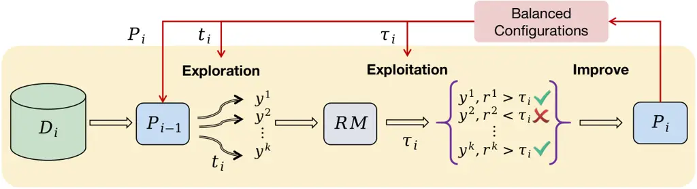
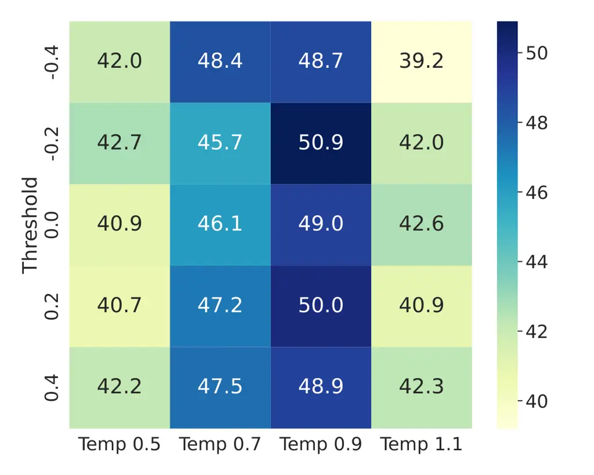
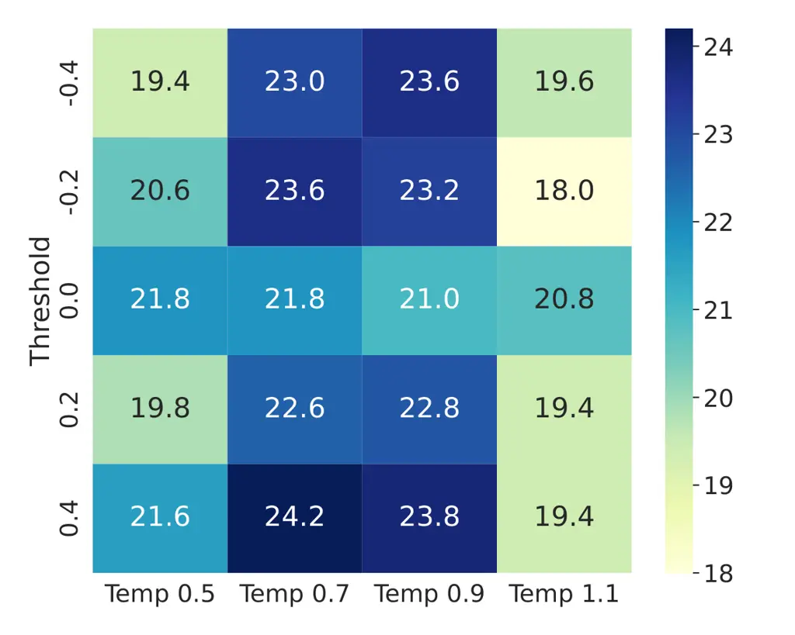

# B-STaR: Monitoring and Balancing Exploration and Exploitation in Self-Taught Reasoners

Weihao Zeng ^(†)^(†)thanks: Equal Contribution.
Email: [wzengak@cse.ust.hk](mailto:)    Yuzhen Huang
Email: [yhuanghj@cse.ust.hk](mailto:)    Lulu Zhao Affiliation: BAAI
Email: [junxianh@cse.ust.hk](mailto:)    Yijun Wang Affiliation: Tencent
   Zifei Shan Affiliation: Tencent    Junxian He Affiliation: 
Affiliation: The Hong Kong University of Science and Technology

###### Abstract

In the absence of extensive human-annotated data for complex reasoning
tasks, self-improvement – where models are trained on their own outputs
– has emerged as a primary method for enhancing performance. Recently,
the approach to self-improvement has shifted toward a more dynamic,
online fashion through iterative training. However, the critical factors
underlying the mechanism of these iterative self-improving methods
remain poorly understood, such as under what conditions self-improvement
is effective, and what are the bottlenecks in the current iterations. In
this work, we identify and propose methods to monitor two pivotal
factors in this iterative process: (1) the model’s ability to generate
sufficiently diverse responses (_exploration_); and (2) the
effectiveness of external rewards in distinguishing high-quality
candidates from lower-quality ones (_exploitation_). These factors are
inherently dynamic throughout the iterative process, yet prior research
rarely discusses their evolution – leaving unclear why models often
stagnate after only a few iterations. Using mathematical reasoning as a
case study, we begin with a quantitative analysis to track the dynamics
of exploration and exploitation, discovering that a model’s exploratory
capabilities rapidly deteriorate over iterations, and the effectiveness
of exploiting external rewards diminishes as well. Motivated by these
findings, we introduce B-STaR, a Self-Taught Reasoning framework that
autonomously adjusts configurations across iterations to Balance
exploration and exploitation, thereby optimizing the self-improving
effectiveness based on the current policy model and available rewards.
Our experiments on mathematical reasoning, coding, and commonsense
reasoning demonstrate that B-STaR not only enhances the model’s
exploratory capabilities throughout training but also achieves a more
effective balance between exploration and exploitation, leading to
superior performance. Crucially, this work deconstructs the opaque
nature of self-training algorithms, providing interpretable insights
into their dynamics and highlighting current limitations to guide future
research.¹¹ 1 We open-source our code at
[https://github.com/hkust-nlp/B-STaR](https://github.com/hkust-nlp/B-STaR).

|     |
| --- |
|     |

## 1 Introduction

Large language models possess advanced reasoning capabilities such as
mathematical problem-solving (Cobbe et al., 2021), coding
challenges (Chen et al., 2021) or commonsense reasoning  (Clark et al.,
2018). However, the challenge of acquiring extensive, high-quality
human-curated datasets remains a significant barrier to further
enhancing these reasoning abilities. As tasks grow in complexity, the
reliance on human-generated data becomes increasingly unsustainable,
necessitating alternative approaches to training.

To tackle this issue, methods rooted in the concept of
“self-improvement” (Huang et al., 2022), such as STaR (Zelikman et al.,
2022), RFT (Yuan et al., 2023), and ReST (Gulcehre et al., 2023; Singh
et al., 2023), provide more cost-effective and scalable solutions.
Self-improvement follows an iterative process where the model generates
responses, from which the better are selected to create higher-quality
data for further refinement (Hosseini et al., 2024). This continuous
loop allows the model to improve its performance over time, reducing the
need for large amounts of human-generated data. Ultimately, this
approach enhances the model’s ability to handle complex reasoning tasks,
pushing the limits of its capabilities (Havrilla et al., 2024).

Despite significant advancements, we still lack a deep understanding of
the key factors that drive successful self-improvement and the internal
optimization mechanisms remain largely opaque. Understanding the
critical components and bottlenecks of these self-improving methods is
particularly important given that performance of current self-improving
approaches does not scale well with increased compute and saturates very
quickly after merely 3 to 5 iterations (Singh et al., 2023; Wu et al.,
2024). In this paper, we address the following questions: (1) What key
factors play a decisive role in the self-improvement process? (2) How
can these factors be used to analyze the limitations of current
self-improvement methods from a unified perspective? and (3) How can we
leverage these factors to guide the self-improvement process, ultimately
maximizing performance gains?

(a) GSM8K

(b) MATH

(c) APPS

(d) ARC-C

Figure 1: Pass@1 accuracy over training steps on GSM8K, MATH, APPS, and
ARC-Challenge. The GSM8K, MATH, and ARC-C results are from Mistral-7B,
while the APPS scores are obtained based on Llama3-8B. We compare
multiple baselines, including SFT, Online RFT, STaR/ReST-EM, and
Iterative RFT, against our proposed B-STaR. For further details on the
experimental settings, please refer to §4.1.

To this end, we identify two crucial capabilities of the model during
its self-improvement process: (1) Exploration – the model’s ability to
generate correct and diverse responses among multiple generated
candidates (Singh et al., 2023; Wang et al., 2024a), and (2)
Exploitation – the effectiveness of external rewards (e.g., a reward
model or final answer supervision) in selecting high-quality solutions
from these candidates (Wang et al., 2024b; Sun et al., 2024).
Intuitively, these two factors are dynamic, evolving throughout the
training process, a phenomenon that remains underexplored despite its
critical importance. In this work, we first conduct empirical analysis
to quantitatively monitor the dynamics of exploration and exploitation
during iterative training processes. We observe that both capabilities
may stagnate or even decline, and imbalances between them can hinder the
model’s ongoing improvement.

Motivated by these insights, we propose a novel approach for
self-improvement that automatically monitors and balances these dynamic
factors to optimize the use of the current policy and reward. This
involves adjusting configurations that influence exploration and
exploitation, such as sampling temperature and reward thresholds. These
configurations are adaptively modified throughout training in terms of
our proposed metric, _balance score_. This new metric assesses the
potential of a query based on the current model’s exploration and
exploitation capabilities, and our method automatically balances
exploration and exploitation behaviors to maximize the average balance
scores. We refer to this method as B-STaR, a Balanced Self-Taught
Reasoner.

The experimental results from mathematical problem-solving, coding
challenges and commonsense reasoning demonstrate that B-STaR
significantly surpasses other self-improvement methods through balanced
exploration and exploitation. For instance, B-STaR achieves a
significant improvement in Pass@1 on both GSM8K and MATH, surpassing
various self-improving variants while maintaining a steady upward
trajectory, as depicted in Figure 1. Furthermore, we demonstrate that
exploration-related metrics, such as Pass@32, are continuously improving
without any notable degradation.



Figure 2: Illustration of the B-STaR approach. In each iteration, we
first identify the configurations – temperature $`t_{i}`$ and reward
threshold $`\tau_{i}`$ – that maximize the average balance scores using
a small subset of training queries. Next, we apply the optimal
temperature and threshold to generate and reward the full set of
training queries. Finally, we update the model based on the selected
data.

## 2 Monitoring Exploration and Exploitation in Self-Improvement

### 2.1 Background: Self-Improvement

Given a pre-trained model $`P_{0}`$ and a training set
$`D={(x_{i},y_{i})}_{i=1}^{N}`$, where $`x_{i}`$ denotes the training
query and $`y_{i}`$ represents the response, the goal of
self-improvement is to iteratively generate high-quality responses from
the current model and update the model with these self-generated data.
Let $`T`$ represent the total number of iterations, with the model at
the start of the $`t`$-th iteration denoted as $`P_{t-1}`$. In the first
iteration, $`P_{0}`$ is typically fine-tuned on the initial dataset
$`D`$, then each subsequent iteration involves three critical steps
generally  (Yuan et al., 2023; Gulcehre et al., 2023):

\(1\) Generating (Sampling): For each query $`x_{i}`$, the model
$`P_{t-1}`$ generates $`K`$ candidate responses, forming a new,
self-generated dataset.

\(2\) Rewarding (Verifying): A reward function $`r(x,y)`$ is applied to
score and select the high-quality responses from the self-generated
dataset. This reward can be binary and utilize additional supervision,
for example, in problem-solving tasks in the math and code domains, it
is common to use the final answer matching or the result of passing unit
tests as binary feedback (Yuan et al., 2023; Chen et al., 2022). In a
more sophisticated case, $`r(x,y)`$ can be parameterized by a reward
model outputting continuous scores, using outcome-based reward models
(ORMs)  (Li et al., 2022) or process-based reward models (PRMs) (Uesato
et al., 2022; Lightman et al., 2023; Havrilla et al., 2024).

\(3\) Improving: The selected dataset is used to update $`P_{t-1}`$,
producing $`P_{t}`$. To differentiate the generation model $`M`$ from
the reward model, $`M`$ is also referred to as the policy model
following RL literature. In reasoning tasks that we are going to focus
on, SFT loss is commonly used in the Improving step due to its
robustness and scalability (Pang et al., 2024; Dubey et al., 2024), as
more sophisticated RL losses can be unstable to optimize and scale up.
When SFT loss is adopted, the Rewarding step aims to reject low-quality
responses and use remaining high-quality data for training, thus this
process is also referred to as rejection fine-tuning (RFT, Yuan et al.
(2023)). In Appendix C, we provide detailed explanations of
self-improvement, including reward functions and RFT.

#### Discussion on Online Learning.

The iterative procedure described above can be contextualized within the
reinforcement learning framework (Singh et al., 2023), and the iterative
design shifts the vanilla offline training towards a more dynamic online
variant – when iteration intervals are short and the optimizer is
inherited between iterations, the training essentially transforms into a
fully online learning algorithm. Iterative RFT implementations in
previous works typically adopt long iteration intervals where each
iteration processes all available queries (Zelikman et al., 2022; Sun
et al., 2024). Sometimes, these implementations opted to restart the
training from the initial checkpoint rather than from the last saved
model (Zelikman et al., 2022; Singh et al., 2023). However, we argue
that always starting from the beginning is not scalable for large
datasets, particularly in a streaming setting, instead, a continuous
training approach more aligned with RL principles is preferable.
Transitioning from offline to online training, online RFT (Shao et al., 2024) has demonstrated its superiority over traditional offline RFT
methods by switching iterations more frequently, ensuring that the
synthetic data remains on-policy. In this study, we explore online RFT
as our primary framework.

### 2.2 The Critical Factors – Exploration and Exploitation

To maximize the gains from self-improvement training and fundamentally
enhance the model’s ability using its own outputs, the key is to achieve
scalable self-improvement training, where the model’s performance scales
with increased computational investment in the training algorithm.
However, all previous works show quick saturation after merely 3-5
self-improvement iterations (Singh et al., 2023; Wu et al., 2024),
hypothesizing that the model’s own outputs can only lead to limited
gains. In this work, we seek to dive deeper into the currently opaque
process of self-improvement, to understand the critical factors that
determine whether self-improvement succeeds or fails.

Intuitively, for a certain iteration of training, we argue that two
high-level conditions must be met for the model to make progresses: (1)
_Diverse Exploration for High-Quality Responses:_ When multiple
candidates are sampled from the model, a portion of them must be
high-quality responses. This is particularly important for queries where
the model fails to produce satisfactory outputs using greedy decoding.
Such diversity enables the discovery of responses that cannot be reached
through greedy decoding. (2) _Effective Reward Function Discrimination:_
The reward function $`r(x,y)`$ must reliably distinguish high-quality
candidates from lower-quality ones. We refer to the two conditions as
_exploration_ and _exploitation_ respectively, and we provide their
analogies to RL in Appendix G. If either of these conditions is unmet –
such as when the model produces responses overly similar (i.e. lack of
diversity), or when the reward function fails to identify high-quality
responses – the self-improvement will be limited on the gains.

#### Exploration and Exploitation are Moving Targets.

Both exploration and exploitation are dynamically influenced by the
policy model during the self-improvement process. On one hand, after
multiple iterations, the policy model may overfit the task, failing to
explore diverse responses and instead generating highly similar outputs
(i.e., a lack of exploration). Training on these highly similar
responses is unlikely to yield significant improvements. On the other
hand, if the model generates excessively diverse responses, resulting in
a distribution that deviates significantly from the training data
distribution of the reward model, it becomes challenging for the reward
model to reliably distinguish high-quality responses (i.e., a lack of
exploitation). Thus, maintaining a dynamic balance between exploration
and exploitation is essential throughout the self-improving process.
However, such dynamics are rarely discussed in prior research, Next, we
propose methods to quantify exploration and exploitation, enabling us to
monitor their dynamics during training and deepen our understanding of
the mechanisms underlying self-improvement.

#### Quantifying Exploration and Exploitation.

In this work, we mainly focus on complex problem-solving tasks such as
math and coding domains, where the correctness of the responses can be
easily verified on labeled datasets.²² 2 Strictly speaking, the response
may contain incorrect steps even though the final answer is correct, we
do not further distinguish this difference following others (Zelikman
et al., 2022) as it is not the focus of this work. This property
facilitates the quantification of exploration and exploitation, for
which we detail the metrics below:

- •
  _Exploration:_ Pass@K, which measures whether there is at least one
  correct response during K sampled candidates, is a straightforward
  metric for assessing exploration, as it directly reflects whether the
  model is able to explore correct solutions. However, Pass@K can be
  noisy, as it only counts a single correct response, while it is
  desirable to assess whether the model can explore multiple correct
  response as well. To this end, we propose to track Pass@K-S as well,
  which measures whether there are at least S unique correct responses
  among K sampled candidates. Pass@K-S serves as a more stable proxy to
  exploration than Pass@K. Pass@K is essentially Pass@K-1 following such
  a definition. Besides Pass@K and Pass@K-S, we also track diversity of
  the generations using Distinct Equations proposed by Wu et al. (2024),
  which measures the proportion of unique equations among all correct
  generated responses.
- •
  _Exploitation:_ Best-of-K accuracy measures whether the top one
  response ranked by the reward function is correct, directly reflecting
  how well the reward can potentially select a good response. Since it
  is typically required to select multiple responses rather than one in
  self-improving training, we are interested in the reward’s
  exploitation to select multiple responses as well. To this end, we
  come up with the Reward@K-S metric, which measures whether the top S
  candidates ranked by the reward are all correct or not. Best-of-K
  accuracy is a special case of Reward@K-S when S is equal to 1. One
  might think that Reward@K-S would be equivalent to Pass@K-S if only
  the final answer is used to select responses, potentially making
  Reward@K-S less useful in such cases. However, we emphasize that the
  exploitation metrics are mainly used to measure the effectiveness when
  additional reward models are integrated, as we will show next in §2.3
  that our reward function combines final answer supervision and a
  reward model.

Next, we conduct a case study to dive into self-improving training
through tracking these metrics.

(a) Pass@1 on MATH

(b) Diversity on MATH

(c) Pass@K-S on MATH

(d) Reward@K-S MATH

Figure 3: Pass@1, Diversity, Pass@K-S and Reward@K-S over training steps
on MATH. SFT refers to direct fine-tuning using the original dataset,
"Answer" indicates matching against the ground-truth final answer, and
"Answer + PRM" combines ground-truth final answer matching with PRM
reward.

### 2.3 Dynamics of Exploration and Exploitation – A Case Study in Mathematical Problem Solving

In this section, we perform a case study to analyze the dynamics of
exploration and exploitation in a mathematical reasoning task.
Specifically, we follow Singh et al. (2023) to adopt MATH  (Hendrycks
et al., 2021) training set as the training data, evaluating on the test
split of MATH. We also conduct evaluation on the test split of GSM8K,
with experimental results shown in the Appendix A.2.

#### Setup.

As introduced in §2.1, we adopt the online RFT training framework in our
implementation. We use Mistral-7B (Jiang et al., 2023) as our base
model. We run the SFT baseline on MATH for 3 epochs, and use the
checkpoint at the first epoch as the initial checkpoint to run
self-improving training. We experiment with two different types of
reward functions:

- •
  _Answer:_ we just match the predicted answer with the ground-truth
  final answer and keep the responses with correct answers,
  following (Singh et al., 2023):

  ```math
  r=\mathds{1}(\hat{a}=a^{*}), \tag{1}
  ```

- •
  _Answer + PRM:_ we train a process reward model (PRM) using the
  approach in  Wang et al. (2024b) based on Mistral-7B. Then we combine
  the final answer reward and the PRM reward as:

  ```math
  r=\mathds{1}(\hat{a}=a^{*})+r_{prm}(x,\hat{y}), \tag{2}
  ```

  where $`\hat{a},a^{*}`$ are the predicted answer and the ground-truth
  answer respectively, $`\mathds{1}(\cdot)`$ is the indicator function,
  $`\hat{y}`$ is the predicted solution. $`r_{prm}(\cdot)`$ is the PRM
  score. Since PRM is designed to score every step of the solution, we
  choose the minimal score across all steps as the score for the entire
  solution, following Lightman et al. (2023). We only keep responses
  with $`r>\tau`$ to train the model, and $`\tau`$ is a threshold. We
  found $`\tau=0`$ is a good hyperparameter in our early trials with
  different thresholds, thus we keep $`\tau=0`$ in all the experiments
  on dynamics analysis.

We train all methods for 4500 training steps. For our online RFT, we
adopt an iteration interval of 500 steps, resulting in a total of 9
iterations – significantly higher than the typical 3–5 iterations
reported in prior work (Singh et al., 2023). We sample 32 candidate
solutions per query during training with a temperature of 1.0. We
include the SFT baselines, which are trained for 3 epochs on MATH.
Please see Appendix A.1 for more setup details.

#### Observation 1: Exploration decreases over training, and PRM helps retain the exploration ability.

As demonstrated in Figure 3(a), the self-improvement method
significantly outperforms SFT in enhancing the model’s ability to
generate accurate responses through greedy decoding. However, for both
methods, the performance improvements diminish over time as the number
of iterations increases. From Figure 3(b), the diversity metric
decreases dramatically, a similar phenomenon is observed in Wu et al.
(2024). Notably, the Answer+PRM reward is able to overcome the declining
trend and retain exploration. We hypothesize that filtering responses
solely based on answer correctness often results in homogeneous
reasoning paths, whereas the fine-grained reward strategy encourages the
selection of high-quality paths, thereby preserving diversity. Examining
the Pass@K-S metrics in Figure 3(c), Pass@K-S initially increases,
indicating an improvement in model exploration. However, Pass@K-S
subsequently declines, with Pass@K-1 accuracy falling close to the SFT
baseline. The plateau pattern of exploration is not a good sign, as it
suggests that the model may not learn new things to explore better.
Since the reward model remains fixed during training, the model’s
ability stagnates once exploration halts.

Observation 2: Exploitation keeps improving on MATH. As shown in
Figure 3(d), we observe Reward@K-S continues to improve on MATH,
potentially because we are training with the MATH dataset. Since our our
reward remains fixed during training, the exploitation performance is
closely related to exploration of the policy model, which is a moving
target as discussed in §2.2. However, as shown in our previous analysis,
the model’s exploration does not continually improve in all cases. We
hypothesize that this is the key factor that bottlenecks self-improving
training. Exploration is related to configurations such as how we sample
responses from the model, how many samples to draw. Similarly,
exploitation depends on how we utilize the reward to select responses.
While all previous works have treated these configurations as static
during training, as far as we know, the question arises: Can we adjust
them dynamically to better align exploration and exploitation? We
investigate this question next.

## 3 B-STaR – Balanced Self-Taught Reasoners

In this section, we firstly introduce a metric to evaluate the interplay
effect between exploration and exploitation. Next, we analyze its
relationship with different configurations. Finally, we present our
complete algorithm, which automatically adjusts the exploration and
exploitation abilities.

### 3.1 Balance Score

§2 highlights the importance of a model’s exploration and exploitation
capabilities for self-improvement, emphasizing their continuous
evolution during training. Now we seek a metric that could capture the
interplay of these two factors. Intuitively, we hope the model can
explore a diverse range of high-quality responses and with the reward
function distinguishing between them. Specifically, given a query, two
conditions to be satisfied for the selected responses to effectively
contribute to training: (1) a substantial absolute number of
high-quality responses, and (2) a high proportion of high-quality
responses among the selected ones. The first condition ensures there is
a sufficient quantity of high-quality data for training, while the
second prioritizes maintaining a high proportion of good responses to
prevent contamination of the training set with low-quality data. For
example, selecting only two correct responses may result in a perfect
100% quality ratio but provide insufficient data for training.
Conversely, selecting all 64 candidates – of which 16 are correct –
yields a higher absolute number of high-quality responses but lowers the
quality ratio to 25%, introducing too many incorrect responses into the
training process. Therefore, these two capture different aspects of the
data. Following these two intuitions, we propose a metric, _balance
score_, to measure the balance effect – or in other words, the overall
contribution of the synthetic data – given the exploration- and
exploitation-related configurations. We detail it below.

For each query $`x_{i}`$, let $`n_{i}`$ represent the total number of
selected responses for it, and $`n_{i}^{\prime}`$ denote the number of
unique, correct responses among them, then the balance score is defined
as follows:

```math
bs_{i}=\min\left(\frac{n_{i}^{\prime}}{n^{\star}},\ 1\right)\cdot\frac{n_{i}^{\prime}}{n_{i}}, \tag{3}
```

where $`(\frac{n_{i}^{\prime}}{n^{\star}},\ 1)`$ is a discount factor
that encourages the number of correct solutions to be larger than a
pre-specified parameter $`n^{\star}`$ – there is no discount when we
have more than $`n^{\star}`$ correct responses. We impose a cap of 1,
rather than encouraging $`n_{i}^{\prime}`$ to be as large as possible,
because otherwise the number of responses among queries will be severely
imbalanced (Tong et al., 2024), where the easy queries will occupy most
of the correct responses to maximize the average balance score. The
second term, $`n_{i}^{\prime}/n_{i}`$, is the ratio of the correct
responses. We note that this ratio is always 100% if only the
final-answer reward is used. $`n^{\star}`$ is the only hyperparameter in
this metric, and it roughly implies the number of correct responses that
we aim to have per query. Suppose we aim to select $`N`$ samples per
iteration, and each iteration we feed in $`M`$ queries where $`N>M`$,
then we simply decide $`n^{\star}=\left\lceil\frac{N}{M}\right\rceil`$.
As $`N`$ and $`M`$ are just general training hyperparameters related to
data loader, we never tune them in the paper and just set them as
reasonable numbers as we will describe later. This means, _the balance
score does not introduce additional hyperparameters for us to tune_.

Intuitively, the exploration and exploitation are desired to be
controlled to maximize the average balance score – the max value of
$`bs_{i}`$ is 1 and the average balance score is maximized when all the
selected responses are correct and there are at least $`n^{\star}`$
correct responses for each query. Controlling exploration and
exploitation is non-trivial and there could be different approaches, in
this work we focus on a simple method – where we manipulate the balance
through certain hyperparameter configurations such as the sampling
temperature and reward threshold, which we discuss next.

(a) Best Temperature

(b) Best Threshold

(c) Sample Size

Figure 4: Left: the best sampling temperature to achieve the max average
balance scores at different training steps; Middle: the best reward
threshold to achieve the max average balance scores at different
training steps; Right: the average balance scores on 600 MATH training
queries at different training steps, varying the number of samples to
draw per query; Every 500 steps corresponds to one iteration - for
example, step 500 corresponds to the 1 st iteration, while step 1500
corresponds to the 3 rd iteration.

### 3.2 Dynamic or Static – On the Configurations of Exploration and Exploitation

The balance score provides a straightforward signal on how we should
manipulate exploration and exploitation to be optimal. In this work, we
mainly focus on adjusting some hyperparameter configurations to control
exploration and exploitation. Here, we conduct a preliminary analysis to
investigate whether the optimal configurations – which maximize the
averaged balance score – are static or should be dynamically changing.
Specifically, we obtain the policy model checkpoints and reward model
checkpoints from different iterations of online RFT with the final
Answer + PRM reward run, with 500 steps between each iteration. We then
apply different configurations to these checkpoints, and compute the
average balance scores on 600 randomly sampled MATH training queries.
Below we detail the configurations we study.

#### Exploration – temperature.

Sampling temperature, an important configuration influencing
exploration, is first examined for its impact on balance score. With the
reward threshold fixed at 0.0 and a sample size of 32, we adjust the
sampling temperature to 0.5, 0.7, 0.9, and 1.1. In Figure 4(a) we show
the optimal temperature we obtained that maximizes the average balance
score at different iterations (training steps). In this particular
setting, lower temperatures are preferred in the beginning while higher
temperatures are better later on. This phenomenon can be explained by
the model’s shifting limitations during training. In the early stages,
the model’s ability to generate correct solutions is limited, so lower
temperatures help sample more accurately (Yang et al., 2023). As
training advances, the challenge shifts to preserving diversity in the
generated solutions, requiring higher temperatures to ensure broader
sampling.

Exploitation – threshold. We investigate the impact of reward thresholds
on balance score, which determines how the reward exploits the
responses. A high reward threshold indicates that the reward model
strictly exploits responses, whereas a low threshold suggests more
relaxed selection criteria. In our experiments, we fix the sampling
temperature at 1.0 and the sample size at 32, while varying the reward
threshold and selecting responses that exceed the threshold. Figure 4(b)
presents the optimal threshold that maximizes the average balance score.
It indicates that a higher threshold is preferred in the beginning, but
it may need to decrease as training progresses. Intuitively, this
suggests that more rigorous filtering should be applied in the
beginning, when the model is weaker, and the threshold should be relaxed
slightly as the model becomes stronger.

### 3.3 B-STaR

Building on the findings from §3.2 that the optimal configurations to
maximize balance score is dynamically changing, we propose B-STaR, short
for Balanced Self-Taught Reasoners, a method that maximizes the average
balance score by dynamically adjusting configurations to balance
exploration and exploitation. We also include related work on
dynamically adjusting configurations in the Appendix F. Specifically, we
adjust temperature and threshold automatically at every iteration, to
maximize the average balance score. Notably, we only need to compute the
balance score on a small subset of training queries to decide the
balanced configurations, thus incurring negligible additional costs
compared to the baselines. For example, we only use 600 MATH queries in
our experiments. Our B-STaR algorithm is illustrated in Figure 2 and
summarized in Algorithm 1. There are other configurations affecting
balance score, such as the number of responses drawn per query (sample
size) that will influence the exploration. In our preliminary trials in
Figure 4(c), larger sample size tends to be generally helpful.
Therefore, we just use the maximum sample size according to our
computing budget and fix it, and mainly focus on dynamic adjustments of
temperature and threshold.

| Methods                | GSM 8K |      |        | MATH |      |        | APPS |      |        | ARC-C |
| ---------------------- | ------ | ---- | ------ | ---- | ---- | ------ | ---- | ---- | ------ | ----- |
|                        | P@1    | P@32 | P@32-4 | P@1  | P@32 | P@32-4 | P@1  | P@32 | P@32-4 | P@1   |
| SFT                    | 36.6   | 88.5 | 62.2   | 17.0 | 60.8 | 31.2   | 9.3  | 43.5 | 25.5   | —     |
| Rest-EM (w/o RM)       | 40.5   | 89.9 | 69.8   | 22.8 | 60.0 | 33.6   | 14.5 | 43.9 | 28.2   | 70.7  |
| Rest-EM (w/ RM)        | 46.3   | 90.7 | 72.2   | 24.2 | 62.8 | 37.4   | —    | —    | —      | —     |
| Iterative RFT (w/o RM) | 42.8   | 88.9 | 71.3   | 24.2 | 63.4 | 38.2   | 15.2 | 44.3 | 28.0   | 70.3  |
| Iterative RFT (w/ RM)  | 46.6   | 90.2 | 74.9   | 24.4 | 62.6 | 39.0   | —    | —    | —      | —     |
| Online RFT (w/o RM)    | 44.0   | 88.1 | 69.7   | 23.0 | 57.2 | 38.2   | 17.3 | 45.8 | 27.8   | 71.2  |
| Online RFT (w/ RM)     | 46.8   | 91.4 | 76.5   | 23.2 | 62.6 | 39.2   | —    | —    | —      | —     |
| B-STaR                 | 53.8   | 93.6 | 81.0   | 27.8 | 67.2 | 42.2   | 19.6 | 49.3 | 30.7   | 73.0  |

Table 1: Comparison of self-improvement methods across MATH, GSM8K, APPS
and ARC-Challenge. Methods include variants with and without a reward
model ("w/ RM" and "w/o RM"). The results are based on the Mistral-7B
model except for APPS that is from Llama-3-8B.

## 4 Main Experiments

### 4.1 Setup

We evaluate B-STaR’s effectiveness in enhancing self-improvement for
mathematical problem-solving, coding challenges and commonsense
reasoning. Our evaluation compares several baseline methods:
STaR/ResT-EM  (Zelikman et al., 2022; Singh et al., 2023), Iterative
RFT, and Online RFT (Shao et al., 2024). Additionally, we implement
these methods with two types of reward function: "without RM" (Answer)
and "with RM" (Answer+PRM), as described in §2.3. We also provide
detailed baseline methods and experimental setup in Appendix  B.

(a) GSM8K

(b) MATH

(c) APPS

Figure 5: Pass@K-S over training steps on GSM8K, MATH and APPS. For
ARC-Challenge, due to the limited response space of multiple-choice
questions, Pass@K and Pass@K-S metrics (where $`K>1`$) provide no
additional insights and are therefore excluded.

(a) GSM8K

(b) MATH

(c) Balance Score

Figure 6: Reward@K-S over training steps on GSM8K (left), MATH (middle).
For coding challenges and commonsense reasoning, we do not use a reward
model, but instead use unit tests and ground truth answers respectively
as binary rewards, so we do not report Reward@K-S. Balance Score over
training steps (right).

### 4.2 Results

Main Results. Table 1 provides a comprehensive comparison of B-STaR with
various self-improvement methods, including Rest-EM, Iterative RFT,
online RFT, and their reward model variants in mathematical
problem-solving, coding challenges and commonsense reasoning. The
results show that B-STAR consistently achieves higher Pass@1 scores
across all scenarios, highlighting its ability to effectively steer the
model toward correct responses via greedy decoding. Moreover, B-STaR
demonstrates significantly better Pass@K-S values, reflecting an
enhanced exploration capacity that facilitates the generation of a wider
range of high-quality responses. Notably, online RFT outperforms
predominantly offline methods like Rest-EM, illustrating that dynamic,
on-policy approaches strike a more effective balance between learning
efficiency and performance gains.

As shown in Figure 1, all the self-improvement methods exhibit
significant performance improvement after the first iteration. However,
as the number of iterations increases, the growth trends of other
baseline methods slows down and eventually stagnate. In contrast, B-STaR
maintains a substantial growth rate and consistently outperforms other
baselines. This suggests that balancing exploration and exploitation is
crucial for achieving stable and efficient self-improvement.

Moreover, in Figures 5 and 6, we present the dynamic evolution of B-STaR
and Online RFT throughout the self-improvement process in mathematical
problem-solving. Figure 6(c) highlights B-STaR’s effectiveness in
balancing exploration and exploitation-related configurations, resulting
in a markedly higher balance score. This optimal balance drives the
consistently higher Pass@K-S and Reward@K-S scores observed in Figures 5
and 6 across both datasets. These results suggest that B-STaR not only
encourages the model to generate a diverse range of accurate responses
but also efficiently incorporates feedback from the reward model.

| Step             | 500   | 1000  | 1500  | 2000  | 2500  | 3000  | 3500  | 4000  | 4500  |
| ---------------- | ----- | ----- | ----- | ----- | ----- | ----- | ----- | ----- | ----- |
| Temperature      | 0.5   | 0.8   | 0.9   | 1     | 1.1   | 1.1   | 0.9   | 1.1   | 1.1   |
| Reward threshold | 0     | -0.1  | -0.1  | -0.1  | -0.1  | -0.1  | -0.1  | -0.1  | -0.1  |
| Balance Score    | 0.470 | 0.538 | 0.589 | 0.621 | 0.646 | 0.660 | 0.673 | 0.678 | 0.679 |

Table 2: Dynamic configuration adjustments by B-STaR in mathematical
problem-solving. The temperature increment and reward threshold
increment are both set to 0.1. Additionally, finer-grained increments
for these parameters are explored in detail in Appendix D and summarized
in Table 5.

Dynamic Configuration Adjustments by B-STaR. Table 2 presents the
configurations automatically adjusted by B-STaR at various training
stages, along with the resulting balance scores. Early in training,
B-STaR employs a lower sampling temperature, typically around 0.5, which
gradually increases as training advances. This gradual increase promotes
cautious exploration during the initial phases, allowing the model to
stabilize before expanding to broader sampling in later stages.
Concurrently, B-STaR enforces stricter reward thresholds at the start,
relaxing them as the model becomes more proficient. These strategies, as
discussed in Section 3.2, enable B-STaR to maintain an effective balance
between exploration and exploitation throughout the training process.

### 4.3 Ablation Study and Additional Results

| Methods                                   | GSM 8K | MATH |
| ----------------------------------------- | ------ | ---- |
| Online RFT                                | 46.8   | 23.2 |
| B-STaR (Temperature Adjustment Only)      | 53.1   | 25.0 |
| B-STaR (Reward Threshold Adjustment Only) | 49.1   | 24.6 |
| B-STaR (Temperature + Reward Threshold)   | 53.8   | 27.8 |

Table 3: Ablation study on dynamic adjustment in mathematical
problem-solving, including temperature adjustment only and reward
threshold adjustment only.

| Methods              | GSM8K | MATH | APPS | ARC-C |
| -------------------- | ----- | ---- | ---- | ----- |
| SFT                  | 49.4  | 18.8 | 15.6 | 78.8  |
| Rest-EM (w/RM)       | 60.2  | 28.2 | 16.4 | 85.5  |
| Iterative RFT (w/RM) | 55.3  | 27.2 | 17.1 | 85.2  |
| Online RFT (w/RM)    | 59.7  | 27.8 | 16.9 | 85.2  |
| B-STaR               | 61.6  | 29.2 | 18.1 | 86.3  |

Table 4: A comparison of self-improvement methods trained on
Llama-3.1-8B across MATH, GSM8K, APPS, and ARC-Challenge, showing the
highest Pass@1 results. For ARC-Challenge, we start from
Llama-3.1-8B-Instruct and omit the SFT stage due to the absence of CoT
data for this dataset.

#### Ablation on Dynamic Adjustments.

Table 1 and Table 2 illustrate the impact of dynamically adjusting both
the temperature and reward threshold on balance score and overall
performance. To emphasize the importance of each configuration, we
perform experiments where one configuration remains at the default
settings of online RFT while the other adjusts dynamically. As shown in
Table 3, dynamic adjustments to both configurations are critical, with
performance significantly deteriorating when either configuration is
fixed individually. To demonstrate that B-STaR’s improvements stem from
dynamic configuration adjustments rather than from suboptimal
configuration settings, we compare B-STaR with online RFT using various
fixed configuration combinations in the Appendix E. Even the best fixed
configurations from grid search underperform compared to B-STaR,
underscoring the crucial role of dynamic adjustments.

#### Generalizing to More Powerful Models.

To assess the generalization capability of B-STaR on more powerful
models, we train the model using Llama-3.1-8b and evaluate its
performance across MATH, GSM8K, APPS and ARC-Challenge. Due to
computational resource constraints, we set the sample size for math
reasoning to 48, and the sample size for APPS and ARC-Challenge to 32,
while keeping all other parameters consistent with the§4.2. The results
in Table 4 show that B-STaR successfully generalizes to more powerful
models.

## 5 Discussion

In this paper, we reveal the importance of the balance between
exploration and exploitation in self-improving training, and we propose
B-STaR, a novel algorithm to strike a better balance and achieve
superior performance on reasoning and coding tasks. While we adopt a
simple method that manipulates exploration and exploitation through
hyperparameter configurations, we expect more flexible control of these
two factors can be achieved in the future to strike a better balance,
such as advanced decoding approaches to directly control the exploration
of the generated data, and reward model update to improve exploitation.

## References

- Bai & Cheng (2024) Hui Bai and Ran Cheng. Generalized population-based
  training for hyperparameter optimization in reinforcement learning.
  _IEEE Transactions on Emerging Topics in Computational
  Intelligence_, 2024.
- Baik et al. (2020) Sungyong Baik, Myungsub Choi, Janghoon Choi, Heewon
  Kim, and Kyoung Mu Lee. Meta-learning with adaptive hyperparameters.
  _Advances in neural information processing systems_,
  33:20755–20765, 2020.
- Baydin et al. (2017) Atilim Gunes Baydin, Robert Cornish,
  David Martinez Rubio, Mark Schmidt, and Frank Wood. Online learning
  rate adaptation with hypergradient descent. _arXiv preprint
  arXiv:1703.04782_, 2017.
- Chen et al. (2022) Bei Chen, Fengji Zhang, Anh Nguyen, Daoguang Zan,
  Zeqi Lin, Jian-Guang Lou, and Weizhu Chen. Codet: Code generation with
  generated tests. _arXiv preprint arXiv:2207.10397_, 2022.
- Chen et al. (2021) Mark Chen, Jerry Tworek, Heewoo Jun, Qiming Yuan,
  Henrique Ponde De Oliveira Pinto, Jared Kaplan, Harri Edwards, Yuri
  Burda, Nicholas Joseph, Greg Brockman, et al. Evaluating large
  language models trained on code. _arXiv preprint
  arXiv:2107.03374_, 2021.
- Clark et al. (2018) Peter Clark, Isaac Cowhey, Oren Etzioni, Tushar
  Khot, Ashish Sabharwal, Carissa Schoenick, and Oyvind Tafjord. Think
  you have solved question answering? try arc, the ai2 reasoning
  challenge. _arXiv preprint arXiv:1803.05457_, 2018.
- Cobbe et al. (2021) Karl Cobbe, Vineet Kosaraju, Mohammad Bavarian,
  Mark Chen, Heewoo Jun, Lukasz Kaiser, Matthias Plappert, Jerry Tworek,
  Jacob Hilton, Reiichiro Nakano, et al. Training verifiers to solve
  math word problems. _arXiv preprint arXiv:2110.14168_, 2021.
- Dubey et al. (2024) Abhimanyu Dubey, Abhinav Jauhri, Abhinav Pandey,
  Abhishek Kadian, Ahmad Al-Dahle, Aiesha Letman, Akhil Mathur, Alan
  Schelten, Amy Yang, Angela Fan, et al. The llama 3 herd of models.
  _arXiv preprint arXiv:2407.21783_, 2024.
- Franke et al. (2020) Jörg KH Franke, Gregor Köhler, André Biedenkapp,
  and Frank Hutter. Sample-efficient automated deep reinforcement
  learning. _arXiv preprint arXiv:2009.01555_, 2020.
- Gulcehre et al. (2023) Caglar Gulcehre, Tom Le Paine, Srivatsan
  Srinivasan, Ksenia Konyushkova, Lotte Weerts, Abhishek Sharma, Aditya
  Siddhant, Alex Ahern, Miaosen Wang, Chenjie Gu, et al. Reinforced
  self-training (rest) for language modeling. _arXiv preprint
  arXiv:2308.08998_, 2023.
- Havrilla et al. (2024) Alex Havrilla, Yuqing Du, Sharath Chandra
  Raparthy, Christoforos Nalmpantis, Jane Dwivedi-Yu, Maksym
  Zhuravinskyi, Eric Hambro, Sainbayar Sukhbaatar, and Roberta Raileanu.
  Teaching large language models to reason with reinforcement learning.
  _arXiv preprint arXiv:2403.04642_, 2024.
- Hendrycks et al. (2021) Dan Hendrycks, Collin Burns, Saurav Kadavath,
  Akul Arora, Steven Basart, Eric Tang, Dawn Song, and Jacob Steinhardt.
  Measuring mathematical problem solving with the math dataset. _arXiv
  preprint arXiv:2103.03874_, 2021.
- Hosseini et al. (2024) Arian Hosseini, Xingdi Yuan, Nikolay Malkin,
  Aaron Courville, Alessandro Sordoni, and Rishabh Agarwal. V-star:
  Training verifiers for self-taught reasoners. _arXiv preprint
  arXiv:2402.06457_, 2024.
- Huang et al. (2022) Jiaxin Huang, Shixiang Shane Gu, Le Hou, Yuexin
  Wu, Xuezhi Wang, Hongkun Yu, and Jiawei Han. Large language models can
  self-improve. _arXiv preprint arXiv:2210.11610_, 2022.
- Jaderberg et al. (2017) Max Jaderberg, Valentin Dalibard, Simon
  Osindero, Wojciech M Czarnecki, Jeff Donahue, Ali Razavi, Oriol
  Vinyals, Tim Green, Iain Dunning, Karen Simonyan, et al. Population
  based training of neural networks. _arXiv preprint
  arXiv:1711.09846_, 2017.
- Jiang et al. (2023) Albert Q Jiang, Alexandre Sablayrolles, Arthur
  Mensch, Chris Bamford, Devendra Singh Chaplot, Diego de las Casas,
  Florian Bressand, Gianna Lengyel, Guillaume Lample, Lucile Saulnier,
  et al. Mistral 7b. _arXiv preprint arXiv:2310.06825_, 2023.
- Jomaa et al. (2019) Hadi S Jomaa, Josif Grabocka, and Lars
  Schmidt-Thieme. Hyp-rl: Hyperparameter optimization by reinforcement
  learning. _arXiv preprint arXiv:1906.11527_, 2019.
- Kiran & Ozyildirim (2022) Mariam Kiran and Melis Ozyildirim.
  Hyperparameter tuning for deep reinforcement learning applications.
  _arXiv preprint arXiv:2201.11182_, 2022.
- Li et al. (2022) Yifei Li, Zeqi Lin, Shizhuo Zhang, Qiang Fu, Bei
  Chen, Jian-Guang Lou, and Weizhu Chen. Making large language models
  better reasoners with step-aware verifier. _arXiv preprint
  arXiv:2206.02336_, 2022.
- Lightman et al. (2023) Hunter Lightman, Vineet Kosaraju, Yura Burda,
  Harri Edwards, Bowen Baker, Teddy Lee, Jan Leike, John Schulman, Ilya
  Sutskever, and Karl Cobbe. Let’s verify step by step. _arXiv preprint
  arXiv:2305.20050_, 2023.
- Loshchilov & Hutter (2016) Ilya Loshchilov and Frank Hutter. Sgdr:
  Stochastic gradient descent with warm restarts. _arXiv preprint
  arXiv:1608.03983_, 2016.
- Mohan et al. (2023) Aditya Mohan, Carolin Benjamins, Konrad Wienecke,
  Alexander Dockhorn, and Marius Lindauer. Autorl hyperparameter
  landscapes. _arXiv preprint arXiv:2304.02396_, 2023.
- Pang et al. (2024) Richard Yuanzhe Pang, Weizhe Yuan, Kyunghyun Cho,
  He He, Sainbayar Sukhbaatar, and Jason Weston. Iterative reasoning
  preference optimization. _arXiv preprint arXiv:2404.19733_, 2024.
- Shao et al. (2024) Zhihong Shao, Peiyi Wang, Qihao Zhu, Runxin Xu,
  Junxiao Song, Mingchuan Zhang, YK Li, Yu Wu, and Daya Guo.
  Deepseekmath: Pushing the limits of mathematical reasoning in open
  language models. _arXiv preprint arXiv:2402.03300_, 2024.
- Şimşek & Barto (2006) Özgür Şimşek and Andrew G Barto. An intrinsic
  reward mechanism for efficient exploration. In _Proceedings of the
  23rd international conference on Machine learning_, pp. 833–840, 2006.
- Singh et al. (2023) Avi Singh, John D Co-Reyes, Rishabh Agarwal,
  Ankesh Anand, Piyush Patil, Peter J Liu, James Harrison, Jaehoon Lee,
  Kelvin Xu, Aaron Parisi, et al. Beyond human data: Scaling
  self-training for problem-solving with language models. _arXiv
  preprint arXiv:2312.06585_, 2023.
- Smith (2018) Leslie N Smith. A disciplined approach to neural network
  hyper-parameters: Part 1–learning rate, batch size, momentum, and
  weight decay. _arXiv preprint arXiv:1803.09820_, 2018.
- Sun et al. (2024) Zhiqing Sun, Longhui Yu, Yikang Shen, Weiyang Liu,
  Yiming Yang, Sean Welleck, and Chuang Gan. Easy-to-hard
  generalization: Scalable alignment beyond human supervision. _arXiv
  preprint arXiv:2403.09472_, 2024.
- Sutton & Barto (2018) Richard S Sutton and Andrew G Barto.
  _Reinforcement learning: An introduction_. MIT press, 2018.
- Tong et al. (2024) Yuxuan Tong, Xiwen Zhang, Rui Wang, Ruidong Wu, and
  Junxian He. Dart-math: Difficulty-aware rejection tuning for
  mathematical problem-solving. _arXiv preprint arXiv:2407.13690_, 2024.
- Uesato et al. (2022) Jonathan Uesato, Nate Kushman, Ramana Kumar,
  Francis Song, Noah Siegel, Lisa Wang, Antonia Creswell, Geoffrey
  Irving, and Irina Higgins. Solving math word problems with process-and
  outcome-based feedback. _arXiv preprint arXiv:2211.14275_, 2022.
- Wang et al. (2024a) Evan Wang, Federico Cassano, Catherine Wu, Yunfeng
  Bai, Will Song, Vaskar Nath, Ziwen Han, Sean Hendryx, Summer Yue, and
  Hugh Zhang. Planning in natural language improves llm search for code
  generation. _arXiv preprint arXiv:2409.03733_, 2024a.
- Wang et al. (2024b) Peiyi Wang, Lei Li, Zhihong Shao, Runxin Xu, Damai
  Dai, Yifei Li, Deli Chen, Yu Wu, and Zhifang Sui. Math-shepherd:
  Verify and reinforce llms step-by-step without human annotations. In
  _Proceedings of the 62nd Annual Meeting of the Association for
  Computational Linguistics (Volume 1: Long Papers)_, pp. 9426–9439,
  2024b.
- Weng (2018) Lilian Weng. The multi-armed bandit problem and its
  solutions. _lilianweng.github.io_, 2018. URL
  [https://lilianweng.github.io/posts/2018-01-23-multi-armed-bandit/](https://lilianweng.github.io/posts/2018-01-23-multi-armed-bandit/).
- Wikipedia contributors (2024) Wikipedia contributors.
  Exploration-exploitation dilemma — Wikipedia, the free
  encyclopedia, 2024. URL
  [https://en.wikipedia.org/w/index.php?title=Exploration-exploitation_dilemma&oldid=1247645791](https://en.wikipedia.org/w/index.php?title=Exploration-exploitation_dilemma&oldid=1247645791).
  \[Online; accessed 26-November-2024\].
- Wu et al. (2024) Ting Wu, Xuefeng Li, and Pengfei Liu. Progress or
  regress? self-improvement reversal in post-training. _arXiv preprint
  arXiv:2407.05013_, 2024.
- Yang et al. (2023) Chengrun Yang, Xuezhi Wang, Yifeng Lu, Hanxiao Liu,
  Quoc V Le, Denny Zhou, and Xinyun Chen. Large language models as
  optimizers. _arXiv preprint arXiv:2309.03409_, 2023.
- Yuan et al. (2023) Zheng Yuan, Hongyi Yuan, Chengpeng Li, Guanting
  Dong, Keming Lu, Chuanqi Tan, Chang Zhou, and Jingren Zhou. Scaling
  relationship on learning mathematical reasoning with large language
  models. _arXiv preprint arXiv:2308.01825_, 2023.
- Zelikman et al. (2022) Eric Zelikman, Yuhuai Wu, Jesse Mu, and Noah
  Goodman. Star: Bootstrapping reasoning with reasoning. _Advances in
  Neural Information Processing Systems_, 35:15476–15488, 2022.

## Appendix A Experiments for the Case Study

### A.1 Experiment Setup

Datasets We use the MATH dataset for training and validate the model’s
mathematical reasoning ability using test sets from both the
MATH (Hendrycks et al., 2021) and GSM 8K (Cobbe et al., 2021) datasets.
For the MATH dataset, we follow previous settings (Lightman et al.,
2023; Wang et al., 2024b; Sun et al., 2024) by using a subset of 500
representative problems (MATH500) as our test data. We uniformly sample
an additional 500 problems for validation and use the remaining 4,000
problems from the MATH test set along with the original 7,500 training
problems as our training data.

Implementation details For SFT, we use Mistral-7B (Jiang et al., 2023)
as the base model with a learning rate of 5e-6, a batch size of 128, and
train for 3 epochs. After the first epoch, the model (denoted as
$`P_{0}`$) is used as the starting point for self-improvement. We then
proceed with 9 iterations, where each iteration consists of 500 training
steps with a batch size of 128. At the beginning of each iteration, we
sample 32 candidate responses for each query, using a temperature of
1.0.

For the Process Reward Model (PRM), we automatically generate process
annotations following the MATH-Shepherd approach (Wang et al., 2024b).
Using the SFT model trained for 1 epoch, we sample 15 responses for each
query in the training set. The SFT model trained for 3 epochs serves as
the completer, decoding 8 solutions per step to annotate the sampled
data. This process results in approximately 270 K process reward
annotations. We train the reward model using the Mistral-7B base, with a
learning rate of 2e-6, for 2 epochs. During rewarding, we use the lowest
step score in the solution as the PRM Reward, normalize it to a range of
\[-1, 1\] and combine it with a sparse reward to form the final reward
score. We set the reward threshold to 0.0, selecting only those
responses with final reward scores exceeding this threshold.

### A.2 Results on GSM8K

In Figure 7, we present the changes in Pass@1, Diversity, Pass@K-S, and
Reward@K-S metrics on GSM8K. Our results indicate that incorporating
PRMs leads to additional improvements on GSM8K. However, these
improvements are less pronounced on MATH. We hypothesize that this is
due to the difficulty of MATH problems, which may exceed the
discriminative capabilities of the 7B reward model.

(a) Pass@1 on GSM8K

(b) Diversity on GSM8K

(c) Pass@K-S on GSM8K

(d) Reward@K-S GSM8K

Figure 7: Pass@1, Diversity, Pass@K-S and Reward@K-S over training steps
on GSM8K. SFT refers to direct fine-tuning using the original dataset,
"Answer" indicates matching against the ground-truth final answer, and
"Answer + PRM" combines ground-truth final answer matching with PRM
reward.

| Step              | 500   | 1000  | 1500  | 2000  | 2500  | 3000  | 3500  | 4000  | 4500  |
| ----------------- | ----- | ----- | ----- | ----- | ----- | ----- | ----- | ----- | ----- |
| Temperature       | 0.65  | 0.75  | 1.05  | 0.95  | 1.05  | 0.85  | 1.05  | 1.15  | 1.05  |
| Reward Thresholds | -0.02 | -0.04 | -0.09 | -0.09 | -0.14 | -0.14 | -0.14 | -0.15 | -0.06 |
| Balance Score     | 0.500 | 0.557 | 0.591 | 0.626 | 0.652 | 0.665 | 0.679 | 0.682 | 0.684 |

Table 5: Finer-grained dynamic configuration adjustments by B-STaR in
mathematical problem-solving.

0:  # Iterations $`I`$, initial policy $`P_{0}`$, reward model $`RM`$,
dataset $`\mathcal{D}`$, temperature $`t\in\mathcal{T}`$, sample size
$`k`$, threshold $`\tau\in\Theta`$, optimizer $`\mathcal{O}_{0}`$,
scheduler $`\mathcal{L}_{0}`$.

0:  Final updated model $`P_{I}`$.

1:  for $`i=1`$ to $`I`$ do

2:   // Step 1: Balance Exploration & Exploitation

3:   // $`\mathrm{BS}(\cdot)`$: the average balance score (§3.1)

4:
  $`t_{i},\tau_{i}=\arg\max_{t\in\mathcal{T},\tau\in\Theta}\mathrm{BS}(t,\tau)`$

5:   // Step 2: Generate Candidates

6:   Draw $`M`$ queries $`\{x_{j}\}_{j=1}^{M}\subseteq\mathcal{D}`$

7:   for $`j=1`$ to $`M`$ do

8:    for $`m=1`$ to $`k`$ do

9:     $`y_{j,m}\sim P_{i-1}(\cdot\mid x_{j};t_{i})`$

10:    end for

11:   end for

12:   // Step 3: Evaluate via Reward Model

13:
  $`\mathcal{D}_{i}=\{(x_{j},y_{j,m})\};\quad r_{j,m}=RM(x_{j},y_{j,m})`$

14:
  $`\mathcal{D}_{i}^{\prime}=\{(x_{j},y_{j,m})\mid r_{j,m}>\tau_{i}\}`$

15:   // Step 4: Improve Policy Model

16:
  $`P_{i}=\text{Update}(P_{i-1},\mathcal{D}_{i}^{\prime},\mathcal{O}_{i-1},\mathcal{L}_{i-1})`$

17:   // Step 5: Inherit Optimizer & Scheduler

18:
  $`\mathcal{O}_{i}\leftarrow\mathcal{O}_{i-1},\;\mathcal{L}_{i}\leftarrow\mathcal{L}_{i-1}`$

19:  end for

Algorithm 1 B-STaR

## Appendix B Experiment Setup for Main Experiments

### B.1 Baseline

Our evaluation compares several baseline methods: STaR/ResT-EM
 (Zelikman et al., 2022; Singh et al., 2023), Iterative RFT, and Online
RFT (Shao et al., 2024). The STaR/ResT-EM approach involves multiple
iterations, where each iteration samples from the latest policy model
but resets and retrains the model from scratch. In contrast, Iterative
RFT builds on each previous iteration by inheriting the checkpoint and
resuming training from that point. Online RFT goes a step further by not
only inheriting the checkpoint but also the optimizer state and learning
rate schedule, ensuring a smoother transition across iterations.

### B.2 mathematical problem-solving

For mathematical problem-solving, we largely maintain the experimental
setup from §2.3. We use the Mistral-7B model as our base and conduct SFT
on the MATH training dataset for three epochs. The first epoch serves as
the starting point for the model’s self-improvement phase. We set the
number of samples per iteration ($`N`$) to 67,500 and feed 11,500 MATH
training queries ($`M`$) per iteration. We set sample size to 64 for all
methods. We vary temperature from 0.5 to 1.2 in 0.1 increments and
reward threshold from -1.0 to 1.0 in 0.1 increment. Additionally, finer
increments for both the temperature and reward threshold are explored in
Appendix D. Throughout the self-improvement process, we use Pass@1,
Pass@K-S, and Reward@K-S metrics to track changes in the performance and
model’s exploration and exploitation capabilities.

### B.3 Coding Challenges

On coding challenges, we follow  Singh et al. (2023) and adopt the
APPS (Hendrycks et al., 2021) dataset for both training and testing. To
balance the number of responses per question, we sample 5 responses per
question from the original APPS training set forming a dataset with 13K
examples. We use Llama-3-8B (Dubey et al., 2024) as our base model,³³ 3
We do not use Mistral-7B as in the math domain because we found it
performs poorly on coding tasks. keeping the rest of the settings
consistent with those of the math domain. For baselines, we uniformly
sample 32 candidate responses per query with a temperature of 0.4. For
B-STaR, we explore temperatures 0.4 to 1.1 in 0.1 increment to determine
the optimal configuration. We set the number of samples per iteration
($`N`$) to 13,500 and feed 2627 APPS training queries ($`M`$) per
iteration. We do not apply reward models to the coding task and instead
use unit tests as the binary reward, which means only the sampling
temperature is automatically adjusted in B-STaR.

### B.4 commonsense reasoning

For commonsense reasoning, following Pang et al. (2024), we conduct
experiments on ARC-Challenge (Clark et al., 2018), a dataset consisting
of multiple-choice science questions designed to evaluate commonsense
reasoning beyond mathematics and coding challenges. We start with the
Mistral-7b-instruct model and omit the SFT stage due to the absence of
the CoT data for this dataset. Other configurations, such as sample size
and temperature, are the same as those used in the coding tasks. The
ground-truth answer serves as the binary reward, and we report only
Pass@1 results for the ARC-Challenge dataset. Given the constrained
response space inherent to multiple-choice questions, Pass@K and
Pass@K-S metrics (where $`K>1`$) yield no additional insights and are
therefore excluded.

## Appendix C Details of Self-Improvement

Fixed Reward Function  
A fixed reward function $`r(x,y)`$ is a predefined, static function that
does not adapt based on the training process or model parameters. For
instance, binary feedback (e.g., whether a math problem is solved
correctly or a unit test passes) is an example of a fixed reward
function.  
The fixed reward function can be represented as:

```math
r(x,y)=\begin{cases}1,&\text{if }y\text{ satisfies a predefined condition (e.g., test passes)},\\
0,&\text{otherwise.}\end{cases} \tag{4}
```

Reward Model  
A trained reward function $`r(x,y;\phi)`$ is parameterized by $`\phi`$
and adapts based on the training process. These reward functions (such
as output-based reward models (ORMs) or process-based reward models
(PRMs)) are learned from data, where the model learns to assign
continuous scores based on supervision signals.  
The trained reward model can be represented as:

```math
r(x,y;\phi)=f(x,y;\phi) \tag{5}
```

where $`f(x,y;\phi)`$ is a learned function (e.g., a neural network)
that maps the input $`x`$ and the response $`y`$ to a continuous reward
score.

Rejection Sampling Fine-tuning  
Rejection Sampling Fine-tuning (RFT) first samples multiple outputs from
the supervised fine-tuned LLMs for each query and then trains LLMs on
the sampled responses with the correct answer. Formally, the objective
of RFT is to maximize the following objectives:

```math
\mathcal{L}_{\text{RFT}}(\theta)=\mathbb{E}_{x\sim\mathcal{D}}\left[\mathbb{I}(y)\log p(y\mid x;\theta)\right] \tag{6}
```

The indicator function $`\mathbb{I}(y)`$ is defined as:

```math
\mathbb{I}(y)=\begin{cases}1,&\text{if the answer of }y\text{ is correct},\\
0,&\text{if the answer of }y\text{ is incorrect}.\end{cases} \tag{7}
```

Our evaluation compares several baseline methods: STaR/ResT-EM,
Iterative RFT, and Online RFT. The STaR/ResT-EM approach involves
multiple iterations, where each iteration samples from the latest policy
model but resets and retrains the model from scratch. In contrast,
Iterative RFT builds on each previous iteration by inheriting the
checkpoint and resuming training from that point. Online RFT goes a step
further by not only inheriting the checkpoint but also the optimizer
state and learning rate schedule, ensuring a smoother transition across
iterations. Additionally, we evaluate two variants: "without RM"
(Answer) and "with RM" (Answer+PRM), as described in Section § 2.3.

## Appendix D More Fine-Grained Configuration Adjustments

In Section 4.1, we initially set the increments for both the temperature
and reward threshold to 0.1. To explore the effects of using
finer-grained increments on B-STaR, we further conduct finer-grained
hyper-parameters search with the granularity of 0.05 for temperature and
0.01 for reward threshold in mathematical problem-solving setting. Table
5 illustrates how B-STaR dynamically adjusts its configuration and the
resulting impact on balance score. A comparison of Table 2 and Table 5
reveals that finer-grained configuration adjustments introduce more
dynamic changes to temperature and reward thresholds throughout the
training process, resulting in significantly higher balance score.

## Appendix E Impact of Fixed Configuration Combinations

To confirm that the improvements achieved by B-STaR are due to its
dynamic configuration adjustments rather than suboptimal configuration
settings, we conduct a grid search to evaluate different configuration
combinations for online RFT. The temperature values are selected from
the set \[0.5,0.7,0.9,1.1\] and the reward thresholds are chosen from
\[-0.4,-0.2,0.0,0.2,0.4\]. For comparison, we also include two specific
configurations: the default combination from our paper, (1.0,0.0), and
the parameters obtained from B-STaR’s final iteration, (1.1,-0.1).

Figure 8 and Table 6 illustrate that while grid search-based
configuration combinations offer some performance improvements for
online RFT, they remain less effective compared to the dynamic
configuration adjustments enabled by B-STaR. This further emphasizes the
critical need for dynamically balancing exploration and exploitation
throughout the training process.



(a) GSM 8K



(b) MATH

Figure 8: Performance of online RFT using different configuration
combinations, where the horizontal axis represents changes in
temperature and the vertical axis represents changes in reward
threshold. B-STaR’s GSM8K accuracy is 53.1%, while its MATH accuracy is
27.8%.

| Configuration                | GSM 8K | MATH |
| ---------------------------- | ------ | ---- |
| Temp = 1.0; Threshold = 0.0  | 46.8   | 23.2 |
| Temp = 1.1; Threshold = -0.1 | 40.4   | 18.2 |
| B-STaR                       | 53.1   | 27.8 |

Table 6: Comparison of Online RFT using specific configurations and
B-STaR Performance. This table reports the results with the stable
hyperparameter combinations we found in our B-STaR experiments
(Temperature = 1.1, Reward thresholds = -0.1) (Table 2).

## Appendix F Related Work of Dynamic Hyperparameter Adjustment

Dynamic hyperparameter optimization addresses the shortcomings of static
configurations, which cannot adapt to the evolving dynamics of machine
learning. Early work by  Loshchilov & Hutter (2016) introduced the use
of a cosine function to modulate learning rates, ensuring smoother
convergence. Building on this,  Baydin et al. (2017) proposed
gradient-based methods to dynamically adjust learning rates in real-time
by analyzing gradient trends, significantly accelerating convergence.
Expanding the scope,  Smith (2018) introduced a systematic approach to
setting hyperparameters, such as learning rate, batch size, momentum,
and weight decay, while highlighting their interdependence to improve
training efficiency. Subsequently,  Jaderberg et al. (2017) integrated
model and hyperparameter optimization by asynchronously evolving a
population of models through performance-based selection and mutation.
 Jomaa et al. (2019) framed hyperparameter tuning as a sequential
decision-making problem, leveraging reinforcement learning to learn a
policy for efficient hyperparameter selection. More recently,  Baik
et al. (2020) adopted a meta-learning framework to dynamically generate
task- and step-specific hyperparameters, improving inner-loop
optimization in few-shot learning tasks. Inspired by these innovations,
our approach focuses on dynamically monitoring and balancing
configurations between exploration and exploitation, optimizing the
synergy between current policies and reward mechanisms to drive further
performance gains.

Dynamic adjustment of hyperparameters has also proven to be crucial in
pure reinforcement learning (RL) settings. For instance,  Kiran &
Ozyildirim (2022) highlights how adapting hyperparameters can
significantly influence both the learning process and processing times
in deep RL problems. Similarily,  Franke et al. (2020) proposes a
population-based automated RL framework that concurrently optimizes
hyperparameters and neural architectures during agent training.
Furthermore,  Mohan et al. (2023) examines the dynamic nature of
hyperparameter landscapes in RL, offering empirical evidence that these
landscapes evolve over time, varying across algorithms and environments.
To enhance adaptability,  Bai & Cheng (2024) introduces a refined
framework that emphasizes granularity and flexibility in hyperparameter
adjustments, incorporating a Pairwise Learning approach to provide
comprehensive guidance for improving the performance of underperforming
agents.

## Appendix G Theoretical Justification for Exploration and Exploitation

The objective of self-improvement can be expressed in the framework of
reinforcement learning as follows:

```math
\pi_{\theta}^{t+1}=\arg\max_{\pi_{\theta}^{t}}\mathbb{E}_{x,y^{*}\sim\mathcal{D},\hat{y}\sim\pi_{\theta}^{t}[\cdot|x]}\left[R(\hat{y},y^{*})\right] \tag{8}
```

where $`\mathcal{D}`$ represents the dataset, $`x`$ and $`y^{*}`$ denote
the sampled input and its corresponding ground-truth answer,
respectively, and $`\hat{y}`$ is the sampled response. Here,
$`\pi_{\theta}^{t}`$ corresponds to the language model in the $`t`$-th
iteration. $`R`$ is the reward function. According to the policy
gradient algorithm:

```math
\nabla_{\theta}\mathbb{E}_{x,y^{*}\sim\mathcal{D},\hat{y}\sim\pi_{\theta}^{t}[\cdot|x]}\left[R(\hat{y},y^{*})\right]=\mathbb{E}_{x,y^{*}\sim\mathcal{D},\hat{y}\sim\pi_{\theta}^{t}[\cdot|x]}\nabla_{\theta}R(\hat{y},y^{*})\log\pi_{\theta}^{t}[\hat{y}|x] \tag{9}
```

When $`R(\hat{y},y^{*})`$ is binary, the above equation turns to be
simple data selection and supervised training loss that is exactly what
we are doing. Thus, self-improvement can be viewed as a form of
reinforcement learning, where maintaining a balance between exploration
and exploitation is crucial and has been studied for years  (Şimşek &
Barto, 2006; Sutton & Barto, 2018; Weng, 2018; Wikipedia contributors,
2024). Conceptually in classic RL, exploration involves exploring the
environment (analogous to reasoning tasks in our paper) by trying random
actions (corresponding to sampling multiple candidates in our work) to
gather more information about the environment. Exploitation, on the
other hand, involves utilizing the known information to maximize the
reward (similar to how we use the reward function to select data
samples). Insufficient exploration may cause the training process to
stagnate, while insufficient exploitation can lead to instability and
large variance during training.
