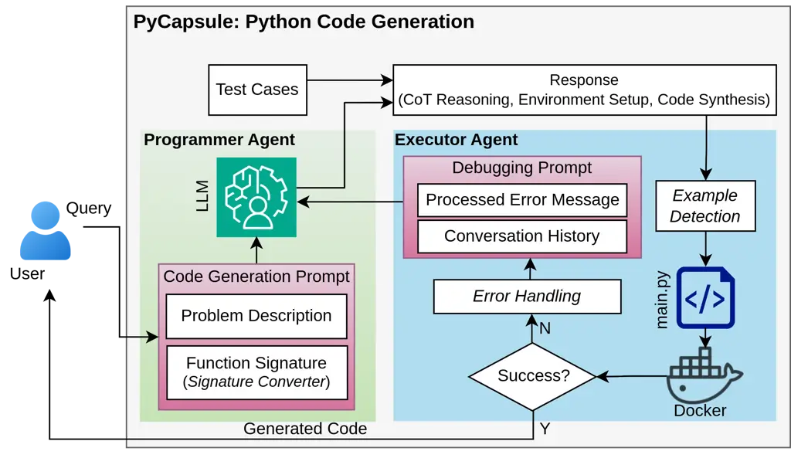
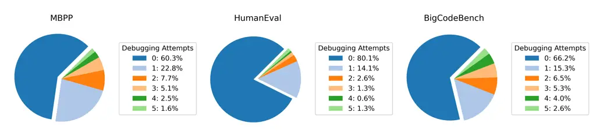
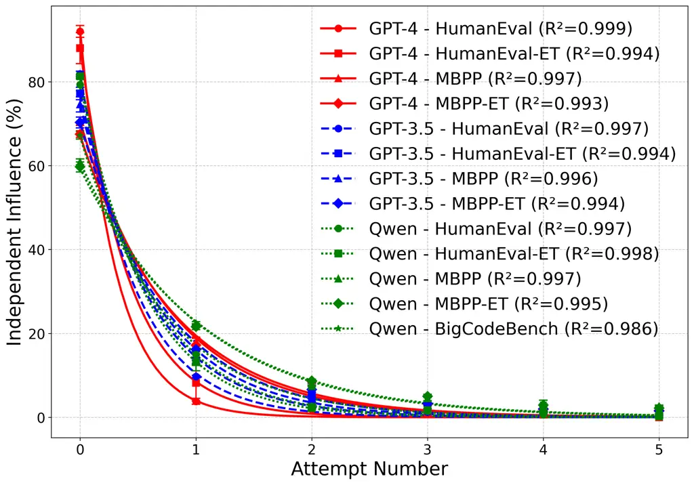

# Large Language Model Guided Self-Debugging Code Generation Thanks: This work is funded under the agreement with the ACT Government, Future Jobs Fund - Open Source Institute(OpenSI) - R01553; and NetApp Technology Alliance Agreement with OpenSI - R01657. Additionally, this research was supported by the Australian Government through the Department of Education’s National Industry PhD Program (project 36337). The views expressed herein are those of the authors and are not necessarily those of the Australian Government or the Department of Education.

Muntasir Adnan¹     Zhiwei Xu²     Carlos C. N. Kuhn¹ ^(†)^(†)thanks:
¹Open Source Institute, Faculty of Science and Technology, University of
Canberra, Canberra, Australia.^(†)^(†)thanks: ²School of Computing and
Information Systems, The University of Melbourne,
Australia.^(†)^(†)thanks: Corresponding author: Muntasir Adnan
(Adnan.adnan@canberra.edu.au).

###### Abstract

Automated code generation is gaining significant importance in
intelligent computer programming and system deployment. However, current
approaches often face challenges in computational efficiency and lack
robust mechanisms for code parsing and error correction. In this work,
we propose a novel framework, PyCapsule, with a simple yet effective
two-agent pipeline and efficient self-debugging modules for Python code
generation. PyCapsule features sophisticated prompt inference, iterative
error handling, and case testing, ensuring high generation stability,
safety, and correctness. Empirically, PyCapsule achieves up to 5.7%
improvement of success rate on HumanEval, 14.6% on HumanEval-ET, and up
to 24.5% on BigCodeBench compared to state-of-the-art methods. Notably,
PyCapsule enables the open-source Qwen2.5-Coder-Instruct 7B model to
surpass the standalone performance of GPT-4 and GPT-3.5 on HumanEval and
MBPP while requiring an average of fewer than 2 API calls per problem
compared to up to 17 in competing frameworks. PyCapsule demonstrates
broader impacts on advancing lightweight and efficient code generation,
making competitive automated programming attainable with cost-effective,
locally deployable open-source models.

###### Index Terms: 

Artificial Intelligence Agent, Automated Code Generation, Large Language
Model, Open-source Language Models, Efficient Self-debugging

^(†)^(†)impactstatement: Automated code generation is an increasingly
vital capability in modern software development, reducing the burden on
human developers and accelerating deployment across industry and
research. However, existing frameworks often demand substantial
computational resources, limiting accessibility for organisations
without large-scale infrastructure. PyCapsule addresses this directly
through a lightweight two-agent architecture that delivers
state-of-the-art performance while requiring an average of fewer than
two API calls per problem, compared to up to seventeen in competing
frameworks. By enabling an open-source 7-billion-parameter model to
surpass the standalone performance of much larger proprietary systems
such as GPT-4 on standard benchmarks, PyCapsule demonstrates that
high-quality automated programming is achievable without
resource-intensive infrastructure. As organisations increasingly turn to
open-source models to control costs and retain governance over
proprietary code, PyCapsule offers a practical route to competitive code
generation that runs on accessible, locally deployable infrastructure.

## I Introduction

The evolution of generative artificial intelligence has profoundly
influenced multiple domains, notably in automated code generation. In
particular, Large Language Models (LLMs) have demonstrated remarkable
proficiency in code generation from natural language prompts,
streamlining software development processes and enhancing
productivity \[1, 2, 3\]. This transformative potential has sparked
significant research in this field \[4, 5, 6\]. However, several
critical challenges emerge as these systems scale to handle increasingly
complex programming tasks. Ensuring reliability, accuracy, and autonomy
in code generation remains critical but challenging, particularly in
error detection and debugging \[7, 8, 9\]. Recent studies have
introduced frameworks consisting of multiple LLM-based agents to emulate
human problem-solving approaches in code generation. For instance,
MapCoder  \[4\], Debugging Decay Index \[5\], and LDB  \[10\] employ
agents dedicated to retrieval, planning, coding, and debugging to
enhance code quality. While these approaches have shown remarkable
improvements, they often require substantial computational resources and
complex agent coordination. This poses challenges for real-world
deployment and scalability. Moreover, many high-performing
frameworks \[4, 11\] rely on large proprietary models, raising concerns
around cost, control, and data privacy, and contributing to the growing
interest in locally deployable open-source solutions for code
generation.

To address these concerns, we propose a novel framework, PyCapsule, that
enhances the efficiency and accuracy of LLM-based Python code generation
through a two-agent architecture, demonstrating that locally deployed
open-source models can approach and often exceed the performance of
frameworks relying on large proprietary systems. This simple yet
effective two-agent architecture maintains a clear separation of
responsibilities without the overhead of additional agents, thereby
minimising computational consumption. PyCapsule employs a programmer
agent responsible for code generation and debugging, interacting with an
executor agent that handles code validation, case testing, and error
analysis. The framework’s effectiveness is enhanced by three specialised
modules: an error handler that refines the debugging feedback, an
example call detector that prevents runtime issues, and a function
signature converter that provides a uniform template for the function
description. This structure enables PyCapsule to achieve high
performance on widely used datasets, including HumanEval \[12\],
HumanEval-ET \[13\], Mostly Basic Python Programming (MBPP) \[14\],
MBPP-ET \[13\], and BigCodeBench \[15\] with a high computational
efficiency. The main contributions of our work are summarised as follows
—

- •
  Our two-agent architecture implemented in PyCapsule demonstrates that
  complex coordination between multiple agents can be replaced by
  well-structured language prompts and specialised modules without
  sacrificing accuracy, requiring fewer computational resources compared
  to other self-debugging frameworks.
- •
  We introduce an efficient self-debugging mechanism by combining the
  programmer agent and executor agent with three specialised modules: an
  error handler, an example call detector, and a function signature
  converter. These achieve up to 5.7% accuracy improvement on HumanEval,
  14.6% on HumanEval-ET, and up to 24.5% on BigCodeBench, while enabling
  the open-source Qwen2.5-Coder-Instruct 7B model to surpass the
  standalone performance of GPT-3.5 and GPT-4 on HumanEval.
- •
  Through an ablation study and comprehensive evaluation across multiple
  datasets and models, we validate the independent contribution of each
  module in PyCapsule’s architecture, and corroborate the exponential
  decay in iterative debugging effectiveness \[5\] as a consistent
  phenomenon across model families and scales.

## II Background

Automated high-quality code generation has evolved in several key
directions related to prompt engineering \[16, 17\], multi-agent
systems \[11, 18, 19\], and iterative debugging with runtime feedback
mechanisms \[20, 10, 21, 4, 22\]. While LLM has demonstrated increasing
capability in code generation, the code quality and correctness can be
further enhanced by using intelligent debugging strategies. Previous
works in self-debugging \[23, 21\] show their capability in Automated
Program Repair (APR) by identifying and fixing significant code flaws
and bugs. Researchers have shown that “large language models of
code” \[23\] often struggle to directly fix bugs due to the lack of
task-specific fine-tuning. While fine-tuned models can often outperform
state-of-the-art (SOTA) APR tools \[24, 25, 26\], they still suffer from
loss of pre-trained knowledge \[27\], inferior long-sequence handling
ability, high resource constraints, long-tail problems, and multi-hunk
error fixing \[23\].

MapCoder \[4\] presents a multi-agent framework designed to emulate
human-like programming practices. It employs four agents for retrieval,
planning, coding, and debugging to perform iterative code generation and
debugging. MetaGPT \[11\] introduces a meta-programming framework that
encodes Standardised Operating Procedures (SOPs) into prompt sequences,
assigning distinct roles such as product manager, architect, and
engineer to separate agents in an assembly-line paradigm. The “Debug
Like a Human” framework \[10\] introduces Large Language Model Debugger
(LDB), which enhances the code quality by leveraging runtime execution
information. LDB iteratively segments code, tracks intermediate variable
states, and performs step-by-step verification like breakpoints.

Some approaches have employed prompt engineering to improve the quality
of code generation and debugging. For instance, CodeCoT \[28\] leverages
iterative refinement through Chain of Thought (CoT) \[17\] and logical
reasoning. However, its capability is limited to refining syntax errors.

While these approaches have advanced automated code generation, they
share several notable limitations. Frameworks such as MapCoder, MetaGPT,
and LDB incur substantial computational overhead, requiring complex
agent coordination and high token consumption, which scales poorly with
problem complexity. Additionally, they often struggle to fully leverage
error messages, which impairs their adaptability in nuanced debugging
scenarios and can result in suboptimal code-generation performance.
Beyond this, relying on complementary test case generation to compensate
for evaluation gaps further increases computational demands and may
reduce reliability \[22, 29\], potentially necessitating more
sophisticated agent architectures.

To address these challenges, we introduce PyCapsule as a streamlined,
modular architecture with robust and optimised supporting modules. This
substantially reduces framework complexity while facilitating more
efficient, reliable and accurate code generation.

## III Methodology

PyCapsule employs two distinct types of agents, as defined in the
agent-based computing literature \[30, 31\] — smart agents and
collaborative agents. The system includes two such agents — a programmer
agent and an executor agent, that embody these types respectively.
Following the agent typology in \[30\], these agents are classified
based on their emphasis on three key attributes: autonomy, cooperation,
and learning.



Fig. 1: PyCapsule framework for Python code generation. The framework
comprises iterative code generation, debugging, error handling, and code
execution within a Docker container.

### III-A Programmer and Executor Agents

The programmer agent functions as a smart agent, emphasising all three
attributes through its LLM-based reasoning — autonomous code-generation
decisions, cooperative debugging interactions, and performance
improvements across debugging iterations.

The executor agent operates as a collaborative agent. While implemented
with a Docker container and supporting modules rather than an LLM, it
meets the essential criteria of autonomy (operating without direct human
intervention) and cooperation (communicating execution results and
coordinating with the programmer agent). The executor agent acts as an
autonomous validator that continuously monitors and responds to code
execution outcomes, makes independent decisions about success or
failure, and cooperates with the programmer agent by providing
structured feedback to facilitate debugging. When execution succeeds, it
forwards the validated code to the user; otherwise, it generates
detailed diagnostic reports and initiates a real-time feedback loop with
the programmer agent for self-debugging. This interaction exemplifies
the social ability identified in \[31, 11\] as necessary for agent
cooperation.

The programmer agent employs tailored system prompts with two
programming modes — generation mode and fix mode. These prompts,
detailed in Appendix -A, define the programmer agent’s persona \[32\],
provide task-specific background, and simplify code extraction \[33\].
In the generation mode, the programmer agent uses CoT \[17\] to analyse
the problem description and devise a structured plan to generate
executable code. In the fix mode, the programmer agent attempts to debug
code using refined error information from the previous execution
attempt. This fix-mode prompt is supported by two key information
elements: conversation history and error messages processed by the
error-handling module. For conversation history management, we retain
only the most recent problem-solution pair, consisting of the original
problem description and the prior solution attempt. This single pair
defines the context for the current debugging attempt. The choice to
retain only the most recent aligns with Markov Decision Process (MDP),
where the agent’s decision depends only on the current state \[34\].
Furthermore, this design addresses a known challenge in LLM performance
degradation as context length increases, attributed to attention
dilution and information retrieval difficulties in longer
contexts \[33\]. Empirical validation of this design choice is provided
in Section V.

The Docker container of the executor agent uses a predefined shell
script as its entry point, which facilitates environment setup and code
execution. While this static script is fixed as a part of the executor
agent, the programmer agent generates the solution code and any required
dependency specifications for each problem. This separation allows for a
consistent execution environment while enabling problem-specific
implementations. Upon executing the generated solution, the container
returns either a success or a failure status. The success status
indicates that the generated code has passed all test cases.
Alternatively, the failure status triggers the error-handling module to
relay diagnostics to the programmer agent, which then enters into fix
mode for iterative self-debugging.

### III-B Supportive Modules

Existing approaches like MapCoder \[4\] and LDB \[10\] rely heavily on
LLM agents for code generation and validation. However, this requires a
high resource consumption. In contrast, PyCapsule employs three
specialised modules to handle each task deterministically — a signature
converter, an example call detector, and an error-handling module.

The signature converter enhances code generation stability by extracting
structured function signatures from problem descriptions. This module
generates a function name, a robust signature, and an example call using
the first available test case for a given problem without revealing the
test results, thereby avoiding extra LLM calls for function signature
generation.

The example call detector ensures the safety of code execution by
removing any internal example function calls embedded in the generated
code, which would otherwise execute unintentionally during test case
evaluation. This can result in unintended side effects, including
infinite loops that exceed the maximum runtime limit and bypass runtime
safety mechanisms. This deterministic module eliminates the need for a
dedicated LLM agent to perform code-execution safety checks, reducing
computational overhead.

The error-handling module refines error messages returned by the
executor agent, producing concise and contextually relevant natural
language feedback. It identifies the error type, filters out irrelevant
traceback information, and resolves critical issues, such as verbose
recursion errors that can exceed the programmer agent’s context length.
This systematic approach reduces token consumption during self-debugging
iterations compared to passing raw, unprocessed error messages directly
to the programmer agent.

These modules collectively enhance the code generation stability,
safety, and self-debugging efficiency while reducing the computational
overhead.

### III-C Code Generation Workflow

PyCapsule consists of three phases: code generation, execution, and
self-debugging, shown in Figure 1. This pipeline integrates the
programmer and executor agents with the self-debugging mechanism to
ensure reliable, efficient, and accurate code generation.

The workflow starts with the programmer agent receiving a problem
description, typically supplemented by a function signature from the
dataset or the signature converter module. Subsequently, the agent
generates a response comprising CoT reasoning, synthesised code and
environment setup instructions. This response is parsed to extract the
synthesised code and environment setup instructions, the latter of which
are used to automatically produce a requirements.txt file containing all
required Python libraries. The extracted code is further processed
through the example call detector module to remove unintended example
calls. The final processed code is saved in main.py, alongside the
dataset test cases, which are appended solely for evaluation purposes
and are never exposed to the programmer agent. To ensure execution
safety, a maximum runtime timer is enforced to terminate any
non-terminating execution, including infinite loops and blocking
operations such as server initialisation within test functions, and to
raise a timeout error if the execution limit is exceeded.

At the execution phase, the executor agent sets the Python environment
using the requirements from requirements.txt and runs main.py in the
Docker container. The resulting execution status, either success or
failure, determines whether the programmer agent’s fix mode is invoked.
If execution fails, error messages returned by the executor agent are
refined by the error-handling module and passed to the programmer agent,
which enters fix-mode for iterative code correction. Building on the
exponential decay in debugging effectiveness established in prior
work \[5\] and further corroborated by our own analysis (see
Section IV-B), the programmer agent is limited to a maximum of five
self-debugging attempts, beyond which returns are negligible. Each
self-debugging attempt is informed by the execution feedback from the
previous iteration. The pseudo-code for the pipeline is provided in
Appendix -B.

## IV Experiments

All experiments involving locally deployed models were conducted on a
single NVIDIA GeForce RTX 3090 (24 GB), while API-based models were
accessed via their respective inference endpoints. We evaluate
performance using success rate, defined as the ratio of correctly
resolved problems to the total number of problems. Our code will be
released upon publication.

### IV-A Dataset Overview

We used five benchmark datasets to evaluate PyCapsule —
HumanEval \[12\], HumanEval-ET \[13\], MBPP \[14\], MBPP-ET \[13\], and
BigCodeBench \[15\], where the “ET” variants provide more test cases and
enriched problem descriptions. These datasets encompass diverse
programming challenges.

HumanEval \[12\] consists of 164 human-curated programming problems
covering string manipulation, arithmetic, and basic data structures,
each comprising a natural language description, a function signature,
and test cases. MBPP \[14\] includes 974 programming problems spanning
algorithms, data structures, and general-purpose tasks, providing
natural language descriptions and test cases, which poses an additional
challenge for code generation stability. BigCodeBench \[15\] includes
two difficulty splits — full (1,140 problems) and hard, covering diverse
programming tasks involving complex function calls, library usage, and
real-world programming scenarios. The benchmark provides two prompt
styles: an instruct split presenting each problem as a concise natural
language instruction, and a complete split providing a detailed function
signature and docstring. We evaluate PyCapsule on the full set,
constructing a unified prompt by combining the natural language
instruction from the instruct split with the function signature from the
complete split, ensuring consistent input formatting across all
problems.

### IV-B Results and Analysis

\tablefont

|                                                                                                                                                                                                                                                    |                |                |                |                |
| -------------------------------------------------------------------------------------------------------------------------------------------------------------------------------------------------------------------------------------------------- | -------------- | -------------- | -------------- | -------------- |
| Method                                                                                                                                                                                                                                             | HumanEval      | HumanEval-ET   | MBPP           | MBPP-ET        |
| GPT-4-Preview-1106                                                                                                                                                                                                                                 |                |                |                |                |
| Direct \[35\]                                                                                                                                                                                                                                      | 78.86          | 70.73          | 81.1 \[4\]     | 51.52          |
| CoT \[4\]                                                                                                                                                                                                                                          | 89.0           | –              | 82.4           | –              |
| Self-Planning \[4\]                                                                                                                                                                                                                                | 85.4           | –              | 75.8           | –              |
| MetaGPT \[11\]                                                                                                                                                                                                                                     | 85.9           | –              | 87.7           | –              |
| MapCoder \[4\]                                                                                                                                                                                                                                     | 93.9           | 82.9           | 82.1           | 57.7           |
| PyCapsule (ours)                                                                                                                                                                                                                                   | 96.5$`\pm`$0.7 | 96.3$`\pm`$1.2 | 88.2$`\pm`$0.3 | 73.0$`\pm`$0.8 |
| GPT-3.5-Turbo-1106                                                                                                                                                                                                                                 |                |                |                |                |
| Direct \[36\]                                                                                                                                                                                                                                      | 64.4$`\pm`$3.7 | 49.8$`\pm`$3.0 | 77.5$`\pm`$0.8 | 53.9$`\pm`$0.7 |
| CoT \[4\]                                                                                                                                                                                                                                          | 68.9           | –              | 54.5           | –              |
| Self-Planning \[37\]                                                                                                                                                                                                                               | 60.3           | –              | 55.7           | –              |
| Reflexion \[37\]                                                                                                                                                                                                                                   | 67.1           | –              | 73.0           | –              |
| LDB \[10\]                                                                                                                                                                                                                                         | 82.9           | –              | 76.0           | –              |
| MapCoder \[4\]                                                                                                                                                                                                                                     | 80.5           | 70.1           | 78.3           | 54.4           |
| PyCapsule (ours)                                                                                                                                                                                                                                   | 85.2$`\pm`$0.7 | 84.7$`\pm`$0.6 | 78.5$`\pm`$1.2 | 62.4$`\pm`$0.6 |
| Qwen2.5-Coder-7B-Instruct                                                                                                                                                                                                                          |                |                |                |                |
| Direct \[38\]                                                                                                                                                                                                                                      | 88.4           | 84.1           | 83.5^(a)       | 71.7^(a)       |
| PyCapsule (ours)                                                                                                                                                                                                                                   | 94.1$`\pm`$1.3 | 93.3$`\pm`$0.6 | 80.7$`\pm`$0.9 | 63.6$`\pm`$0.6 |
| ^(a)Qwen2.5 employed 3-shot prompting for MBPP evaluation to mitigate dataset instability, as documented in their methodology. This represents a different experimental setting compared to the zero-shot approach used by us and other baselines. |                |                |                |                |

TABLE I: Success Rate Comparison on Three LLMs. Mean and standard
deviation for PyCapsule are reported over three independent runs.
Results for all other methods are taken from their official reports.
“Direct” refers to the zero-shot setting.

\tablefont

| Model                             | Direct(%) | PyCapsule(%) | $`\boldsymbol{\Delta}`$ |
| --------------------------------- | --------- | ------------ | ----------------------- |
| Qwen2.5-7B \[38\]                 | 45.8      | 57.28        | +11.48                  |
| Qwen2.5-Coder-Instruct-7B \[38\]  | 41.0      | 60.18        | +19.18                  |
| Qwen2.5-Coder-Instruct-14B \[38\] | 48.4      | 70.09        | +21.69                  |
| Qwen2.5-Coder-Instruct-32B \[38\] | 49.6      | 74.12        | +24.52                  |
| Phi-4-14B \[15\]                  | 50.5      | 68.07        | +17.57                  |

TABLE II: PyCapsule Success Rate on BigCodeBench Compared to Direct
Zero-Shot Baselines. $`\Delta`$ denotes the absolute improvement over
the direct baseline.

Table I presents a systematic comparison of PyCapsule against
established baselines across HumanEval, HumanEval-ET, MBPP, and MBPP-ET.
PyCapsule achieves SOTA results on HumanEval and HumanEval-ET across all
three model configurations, and competitive performance on MBPP and
MBPP-ET. The sole exception arises in the Qwen2.5-Coder-Instruct
configuration on MBPP variants, where the reported direct baseline
employs three-shot prompting, a fundamentally different experimental
setting from the zero-shot approach used consistently across all
PyCapsule evaluations. To ensure comparability and reproducibility, we
maintain zero-shot prompting throughout, employing the signature
converter module to supply structured function signatures in place of
few-shot exemplars. Within this consistent setting, PyCapsule with
Qwen2.5-Coder-Instruct-7B achieves a 94.1% success rate on HumanEval,
surpassing not only the standalone zero-shot performance of the 32B
variant but also the direct baseline of proprietary models such as GPT-4
at 78.86% – a result that motivates a broader evaluation across more
demanding benchmarks.

Table II extends this analysis to BigCodeBench, a significantly more
challenging benchmark encompassing diverse real-world programming tasks
involving complex function calls and library usage. PyCapsule delivers
substantial gains over direct zero-shot baselines regardless of model
size or family. Notably, PyCapsule with Qwen2.5-Coder-Instruct-7B
surpasses the standalone performance of the Qwen2.5-Coder-Instruct-32B
model, a result that carries particular weight given that both models
were released concurrently and trained on closely aligned data, making
parameter count the principal differentiating factor. This demonstrates
that PyCapsule can bridge a performance gap that would otherwise require
a model more than four times the size, with direct implications for
deployment in resource-constrained environments. The gains observed
across the Qwen2.5-Coder family further suggest that PyCapsule’s
self-debugging mechanism scales effectively with model capacity.

Taken together, the consistent improvements across HumanEval and
BigCodeBench – benchmarks that differ substantially in problem
complexity, domain coverage, and evaluation methodology demonstrate that
PyCapsule generalises effectively across task distributions. The
comparatively modest MBPP result, attributable to the methodological
asymmetry discussed above, should be interpreted within that broader
context rather than as a limitation of the framework.

### IV-C Influence of Self-debugging Attempts



Fig. 2: Distribution of relative success ratios along the self-debugging
attempts. The relative success ratio refers to the number of successful
test cases with given attempts over the total number of successful test
cases, measured by unit %. Results on all the datasets consistently show
an exponential decrease in the relative success ratio as the number of
attempts increases.

To evaluate the contribution of each self-debugging attempt to the
overall success rate, we analyse the normalised independent influence of
each incremental attempt across GPT-4-1106-preview, GPT-3.5-Turbo-1106,
and Qwen-2.5-Coder-Instruct 7B. Given $`N`$ problems, the number of
problems successfully solved at attempt zero is denoted as $`S_{0}`$,
with the remaining $`N_{1}=N-S_{0}`$ unsolved problems proceeding to the
next debugging attempt. The number of problems solved at attempt
$`i\geq 1`$ is denoted as $`S_{i}`$, and $`N_{i+1}=N_{i}-S_{i}`$
represents the residual unsolved set. The independent influence is
defined as –

```math
I_{i}=\frac{S_{i}}{N_{i}},\text{where }N_{i}=N-\sum_{j=0}^{i-1}S_{j}
```

This metric isolates the contribution of each attempt, independent of
cumulative progress. Fitting the influence data to an exponential decay
function yields $`R^{2}`$ values close to 1 across all models and
datasets, confirming that debugging effectiveness decays exponentially
with successive attempts. This pattern is consistent with prior findings
on debugging effectiveness decay \[5\] and is here corroborated across
multiple model families and scales. Notably, the rate of decay varies
with model capability: GPT-4-Preview-1106 approaches negligible returns
by the third attempt, whereas Qwen2.5-Coder-Instruct-7B sustains
meaningful contributions through the fifth. This suggests that more
capable models resolve residual errors more decisively in early
attempts, leaving fewer tractable problems for later iterations.
Accordingly, five debugging attempts were adopted as the architectural
maximum, capturing the full extent of recoverable gains across all
evaluated models whilst avoiding unnecessary computational overhead.



Fig. 3: The plot illustrates the exponential decay in the normalised
independent influence of self-debugging attempts across models. It shows
the mean effectiveness of each debugging attempt, fitted to the
exponential decay function $`I(x)=a\cdot e^{-bx}`$. The excellent fit of
this function serves as an ideal guide for estimating the influence of
successive attempts and can be used as a metric to compare the
performance of different models.

## V Ablation Study

To assess the independent contribution of each supporting module, we
conduct an ablation study using Qwen2.5-Coder-7B-Instruct across
HumanEval, MBPP, and BigCodeBench. This model was selected for three
reasons. First, as a locally deployable open-source model, it enables
fully reproducible ablation experiments that are not subject to the
versioning uncertainty inherent in proprietary API-based systems.
Second, being the smallest model in our evaluation, it is the most
sensitive to the presence or absence of individual modules. A more
capable model may partially compensate for missing scaffolding,
potentially obscuring the true contribution of each component. Third,
repeated full-dataset runs are computationally feasible without
incurring API costs, enabling the controlled, isolated evaluation that a
rigorous ablation requires.

The signature converter is employed exclusively for MBPP and MBPP-ET,
where problem descriptions provide no structured function signature. To
evaluate its contribution, we ran the full MBPP dataset without the
module, yielding a success rate of 17.3% compared to 80.7% with the
module active – a difference of 63.4%. Manual inspection of failure
cases revealed a consistent and systematic failure mode. In the absence
of a structured signature, the programmer agent generated functions with
arbitrary names that did not match the identifiers expected by the test
cases. Since MBPP test cases are expressed as assert statements that
invoke a specific function name, any mismatch results in immediate
failure regardless of the correctness of the underlying logic. This
finding confirms that the signature converter is not merely a
convenience feature but a prerequisite for stable code generation on
datasets that lack structured function specifications.

The example call detector addresses a distinct class of failure that
does not manifest as a performance degradation in standard metrics but
poses a meaningful risk to execution safety. In our experiments,
embedded example function calls were identified in 21 of 164 HumanEval
problems and 44 of 344 MBPP problems when using GPT-3.5-Turbo-1106,
despite explicit system prompts instructing the model to avoid them.
These calls execute automatically during test case evaluation, bypassing
the runtime safety mechanisms and producing uncontrolled side effects.
In all flagged cases, the module successfully identified and removed the
offending calls prior to execution, preventing runtime failures. On
BigCodeBench, the module proved particularly critical: problems
involving web application initialisation consistently triggered blocking
operations, such as server startup routines embedded within generated
code that caused execution to hang indefinitely until the maximum
runtime limit was reached. The deterministic nature of this module
ensures that such cases are handled reliably without requiring an
additional LLM call for safety verification, which would substantially
increase computational overhead.

To evaluate the contribution of the error-handling module, we ran the
full evaluation pipeline without it, passing raw executor output
directly to the programmer agent. On HumanEval and MBPP, success rates
declined by 9% and 12% respectively. On BigCodeBench, the decline was
more modest at 4%. This divergence is directly attributable to
differences in error reporting structure across datasets. HumanEval and
MBPP test cases are implemented as bare assert statements, which, upon
failure, produce minimal diagnostic output – typically a plain
AssertionError with no contextual information. In this setting, the
error handler’s role in producing concise, contextually enriched natural
language feedback is critical to guiding the programmer agent toward a
meaningful fix. BigCodeBench, by contrast, employs structured Python
unit tests with dedicated test classes and descriptive test method
names, so the raw error output already carries sufficient diagnostic
signal for the programmer agent to act on. The error handler, therefore,
provides a smaller marginal gain on BigCodeBench, not because it is less
effective, but because the baseline quality of unprocessed error
messages is substantially higher in that setting. Taken together, these
results confirm that the error handler provides substantial value when
execution feedback lacks sufficient diagnostic information. By
transforming sparse and often uninformative error messages into concise,
contextually rich explanations, it enables the programmer agent to
identify and correct failures more effectively. While the benefits are
most pronounced in HumanEval and MBPP, where raw feedback is limited,
the error handler remains beneficial across all benchmarks by improving
the clarity and actionability of execution feedback.

## VI Discussion and Future Work

### VI-A Prompt Engineering and First-Attempt Performance

Figure 2 and Figure 3 reveal that PyCapsule achieves substantially
higher first-attempt accuracy than competing frameworks across all model
configurations, even before self-debugging is applied. This establishes
that PyCapsule’s gains are not solely attributable to iterative
correction but reflect a more fundamental advantage in code generation
quality from the outset. The structured system prompts employed in
generation mode, which define a clear programmer persona, enforce
chain-of-thought reasoning, and provide explicit output formatting
constraints reduce the likelihood of syntactically malformed or
semantically misaligned responses at the first attempt. Prior work has
demonstrated that prompt design critically affects model
performance \[17, 39, 40\], and our results corroborate this at scale
across multiple model families. The subsequent self-debugging mechanism
then compounds this advantage, as a higher-quality initial solution
requires fewer corrective iterations to reach correctness, consistent
with the exponential decay in debugging effectiveness reported in
Section IV-B.

### VI-B Computational Efficiency

A central design objective of PyCapsule is to achieve high accuracy
without incurring the computational overhead characteristic of
multi-agent frameworks. Existing frameworks such as MapCoder require up
to 17 API calls per problem on HumanEval and 12 on MBPP, scaling at
$`k\times t`$ where $`k`$ is the number of retrieved exemplars and $`t`$
is the number of debugging attempts. PyCapsule eliminates retrieval
entirely and consolidates planning and code generation into a single API
call, capping the maximum at 6 calls per problem. In practice, the
empirical average is substantially lower: 2.09, 1.38, and 1.55 API calls
per problem on HumanEval for GPT-3.5-Turbo-1106, GPT-4-Preview-1106, and
Qwen2.5-Coder-Instruct-7B respectively.

Table III provides a detailed breakdown of token consumption and average
debugging attempts across all model and dataset configurations. Average
attempt counts range from 1.35 to 3.31, remaining well below the
architectural maximum. It should be noted that token counting
methodologies vary across frameworks, making direct numerical comparison
with external systems inadvisable; the figures reported here are
intended to characterise PyCapsule’s internal resource consumption.

\tablefont

|                           |              |                      |                        |
| ------------------------- | ------------ | -------------------- | ---------------------- |
| Dataset                   | Total Tokens | Avg. Tokens/ Problem | Avg. Attempts/ Problem |
| GPT-3.5-Turbo-1106        |              |                      |                        |
| HumanEval                 | 69,502       | 423.79               | 2.05                   |
| HumanEval-ET              | 75,263       | 458.92               | 2.10                   |
| MBPP                      | 432,144      | 443.68               | 2.46                   |
| MBPP-ET                   | 671,316      | 689.24               | 3.22                   |
| GPT-4-Preview-1106        |              |                      |                        |
| HumanEval                 | 79,342       | 483.80               | 1.35                   |
| HumanEval-ET              | 82,214       | 501.30               | 1.37                   |
| MBPP                      | 779,440      | 800.25               | 2.03                   |
| MBPP-ET                   | 1,044,909    | 1,072.80             | 2.79                   |
| Qwen2.5-Coder-7B-Instruct |              |                      |                        |
| HumanEval                 | 70,868       | 432.13               | 1.60                   |
| HumanEval-ET              | 74,151       | 452.14               | 1.61                   |
| MBPP                      | 646,635      | 663.90               | 2.54                   |
| MBPP-ET                   | 832,728      | 854.96               | 3.31                   |
| BigCodeBench              | 1,960,864    | 1,720.06             | 3.15                   |

TABLE III: Token Usage and Debugging Attempt Analysis Across GPT-3.5,
GPT-4, and Qwen2.5-Coder-Instruct on Standard Code Generation
Benchmarks. Token counts for GPT models were obtained using OpenAI’s
tiktoken library, and for Qwen2.5-Coder-Instruct using its native
tokeniser.

### VI-C Limitations

Whilst PyCapsule demonstrates strong generalisation across benchmark
datasets, several limitations warrant consideration. First, as evidenced
by the ablation study, certain modules are necessitated by structural
properties of specific datasets rather than general characteristics of
code generation tasks. Deploying PyCapsule on a new task distribution
may require analogous dataset-specific interventions, introducing an
engineering overhead that a more general-purpose signature inference
mechanism could address in future work. Second, the benchmark datasets
used in this evaluation — HumanEval, MBPP, and BigCodeBench feature
well-defined function boundaries, deterministic test cases, and
controlled problem scopes. Real-world software development tasks rarely
conform to these conditions, involving ambiguous requirements, stateful
systems, cross-file dependencies, and potentially incomplete test
suites. PyCapsule’s self-debugging mechanism relies on executable test
feedback as its primary correction signal; in settings where such
feedback is unavailable or unreliable, its iterative correction
capability would be substantially diminished.

### VI-D Future Work

Several directions present themselves for extending this work. First,
developing a generalised signature inference mechanism that operates
without dataset-specific configuration would substantially improve
PyCapsule’s applicability to novel task distributions. Second,
evaluating PyCapsule on real-world software engineering tasks, such as
repository-level code completion or issue resolution would provide a
more direct assessment of its practical utility beyond curated
benchmarks. Finally, extending PyCapsule to support multi-language code
generation would broaden its applicability, given the current
Python-only focus of the framework.

## VII Conclusion

We propose PyCapsule for significantly advancing reliable and automated
code generation by integrating two AI agents with high-efficiency
self-debugging modules. Its two-agent architecture effectively balances
code generation automation and control while reducing resource
consumption. Experimental results show that PyCapsule achieves high
performance across multiple datasets, surpassing existing
debugging-based approaches. Notably, PyCapsule enhances accuracy while
using smaller language models and fewer API calls, offering a
cost-effective alternative without compromising its performance. The
iterative self-debugging feedback and dynamic prompt augmentation
contribute to its robustness and improvements.

## References

- \[1\] S. Rasnayaka, G. Wang, R. Shariffdeen, and G. N. Iyer, “An
  empirical study on usage and perceptions of llms in a software
  engineering project,” in _Proceedings of the 1st International
  Workshop on Large Language Models for Code_, ser. LLM4Code ’24. New
  York, NY, USA: Association for Computing Machinery, 2024, p. 111–118.
  \[Online\]. Available:
  [https://doi.org/10.1145/3643795.3648379](https://doi.org/10.1145/3643795.3648379)
- \[2\] M. Liu, J. Wang, T. Lin, Q. Ma, Z. Fang, and Y. Wu, “An
  empirical study of the code generation of safety-critical software
  using llms,” _Applied Sciences_, vol. 14, no. 3, 2024. \[Online\].
  Available:
  [https://www.mdpi.com/2076-3417/14/3/1046](https://www.mdpi.com/2076-3417/14/3/1046)
- \[3\] A. Chowdhery, S. Narang, J. Devlin, M. Bosma, G. Mishra,
  A. Roberts, P. Barham, H. W. Chung, C. Sutton, S. Gehrmann, P. Schuh,
  K. Shi, S. Tsvyashchenko, J. Maynez, A. Rao, P. Barnes, Y. Tay,
  N. Shazeer, V. Prabhakaran, E. Reif, N. Du, B. Hutchinson, R. Pope,
  J. Bradbury, J. Austin, M. Isard, G. Gur-Ari, P. Yin, T. Duke,
  A. Levskaya, S. Ghemawat, S. Dev, H. Michalewski, X. Garcia, V. Misra,
  K. Robinson, L. Fedus, D. Zhou, D. Ippolito, D. Luan, H. Lim, B. Zoph,
  A. Spiridonov, R. Sepassi, D. Dohan, S. Agrawal, M. Omernick, A. M.
  Dai, T. S. Pillai, M. Pellat, A. Lewkowycz, E. Moreira, R. Child,
  O. Polozov, K. Lee, Z. Zhou, X. Wang, B. Saeta, M. Diaz, O. Firat,
  M. Catasta, J. Wei, K. Meier-Hellstern, D. Eck, J. Dean, S. Petrov,
  and N. Fiedel, “PaLM: scaling language modeling with pathways,” in
  _Journal of Machine Learning Research_, 2024.
- \[4\] M. A. Islam, M. E. Ali, and M. R. Parvez, “MapCoder: Multi-agent
  code generation for competitive problem solving,” in _Proceedings of
  the 62nd Annual Meeting of the Association for Computational
  Linguistics (Volume 1: Long Papers)_, L.-W. Ku, A. Martins, and
  V. Srikumar, Eds. Bangkok, Thailand: Association for Computational
  Linguistics, Aug. 2024, pp. 4912–4944. \[Online\]. Available:
  [https://aclanthology.org/2024.acl-long.269/](https://aclanthology.org/2024.acl-long.269/)
- \[5\] M. Adnan and C. C. Kuhn, “Measuring and mitigating debugging
  effectiveness decay in code language models,” _Scientific Reports_,
  vol. 15, no. 1, p. 44120, 2025.
- \[6\] M. Adnan and C. C. N. Kuhn, “Adaptive hierarchical evaluation of
  llms and sast tools for cwe prediction in python,” in _2026
  International Conference on Advances in Artificial Intelligence and
  Machine Learning (AAIML)_, 2026, pp. 193–200.
- \[7\] A. Fan, B. Gokkaya, M. Harman, M. Lyubarskiy, S. Sengupta,
  S. Yoo, and J. M. Zhang, “Large language models for software
  engineering: Survey and open problems,” in _2023 IEEE/ACM
  International Conference on Software Engineering: Future of Software
  Engineering (ICSE-FoSE)_, 2023, pp. 31–53.
- \[8\] S. Dou, H. Jia, S. Wu, H. Zheng, W. Zhou, M. Wu, M. Chai,
  J. Fan, C. Huang, Y. Tao, Y. Liu, E. Zhou, M. Zhang, Y. Zhou, Y. Wu,
  R. Zheng, M. Wen, R. Weng, J. Wang, X. Cai, T. Gui, X. Qiu, Q. Zhang,
  and X. Huang, “What’s wrong with your code generated by large language
  models? an extensive study,” _Science China Information
  Sciences_, 2025.
- \[9\] X. Lian, S. Wang, J. Ma, X. Tan, F. Liu, L. Shi, C. Gao, and
  L. Zhang, “Imperfect code generation: Uncovering weaknesses in
  automatic code generation by large language models,” ser.
  ICSE-Companion ’24. New York, NY, USA: Association for Computing
  Machinery, 2024, p. 422–423. \[Online\]. Available:
  [https://doi.org/10.1145/3639478.3643081](https://doi.org/10.1145/3639478.3643081)
- \[10\] L. Zhong, Z. Wang, and J. Shang, “Debug like a human: A large
  language model debugger via verifying runtime execution step by step,”
  in _Findings of the Association for Computational Linguistics ACL
  2024_, 2024, pp. 851–870.
- \[11\] S. Hong, M. Zhuge, J. Chen, X. Zheng, Y. Cheng, J. Wang,
  C. Zhang, S. Yau, Z. Lin, L. Zhou _et al._, “Metagpt: Meta programming
  for a multi-agent collaborative framework,” in _International
  Conference on Learning Representations_, vol. 2024, 2024, pp.
  23 247–23 275.
- \[12\] M. Chen, J. Tworek, H. Jun, Q. Yuan _et al._, “Evaluating large
  language models trained on code,” _arXiv preprint
  arXiv:2107.03374_, 2021.
- \[13\] Y. Dong, J. Ding, X. Jiang, G. Li, Z. Li, and Z. Jin,
  “Codescore: Evaluating code generation by learning code execution,”
  _ACM Trans. Softw. Eng. Methodol._, vol. 34, no. 3, Feb. 2025.
  \[Online\]. Available:
  [https://doi.org/10.1145/3695991](https://doi.org/10.1145/3695991)
- \[14\] J. Austin, A. Odena, M. Nye, M. Bosma, H. Michalewski,
  D. Dohan, E. Jiang, C. Cai, M. Terry, Q. Le _et al._, “Program
  synthesis with large language models,” _arXiv preprint
  arXiv:2108.07732_, 2021.
- \[15\] T. Y. Zhuo, M. C. Vu, J. Chim, H. Hu, W. Yu, R. Widyasari,
  I. N. B. Yusuf, H. Zhan, J. He, I. Paul _et al._, “Bigcodebench:
  Benchmarking code generation with diverse function calls and complex
  instructions,” _arXiv preprint arXiv:2406.15877_, 2024.
- \[16\] N. Knoth, A. Tolzin, A. Janson, and J. M. Leimeister, “Ai
  literacy and its implications for prompt engineering strategies,”
  _Computers and Education: Artificial Intelligence_, 2024.
- \[17\] J. Wei, X. Wang, D. Schuurmans, M. Bosma, B. Ichter, F. Xia,
  E. H. Chi, Q. V. Le, and D. Zhou, “Chain-of-thought prompting elicits
  reasoning in large language models,” in _Proceedings of the 36th
  International Conference on Neural Information Processing Systems_,
  ser. NIPS ’22. Red Hook, NY, USA: Curran Associates Inc., 2022.
- \[18\] M. Wooldridge and N. R. Jennings, “Intelligent agents: Theory
  and practice,” _The knowledge engineering review_, vol. 10, no. 2, pp.
  115–152, 1995.
- \[19\] M. Burgin and G. Dodig Crnkovic, “A systematic approach to
  artificial agents,” 03 2009.
- \[20\] J. S. Park, J. O’Brien, C. J. Cai, M. R. Morris, P. Liang, and
  M. S. Bernstein, “Generative agents: Interactive simulacra of human
  behavior,” in _Proceedings of the 36th Annual ACM Symposium on User
  Interface Software and Technology_, ser. UIST ’23. New York, NY, USA:
  Association for Computing Machinery, 2023. \[Online\]. Available:
  [https://doi.org/10.1145/3586183.3606763](https://doi.org/10.1145/3586183.3606763)
- \[21\] X. Chen, M. Lin, N. Schärli, and D. Zhou, “Teaching large
  language models to self-debug,” in _The Twelfth International
  Conference on Learning Representations_, 2024. \[Online\]. Available:
  [https://openreview.net/forum?id=KuPixIqPiq](https://openreview.net/forum?id=KuPixIqPiq)
- \[22\] Y. Li, P. Liu, H. Wang, J. Chu, and W. E. Wong, “Evaluating
  large language models for software testing,” _Computer Standards &
  Interfaces_, vol. 93, p. 103942, 2025. \[Online\]. Available:
  [https://www.sciencedirect.com/science/article/pii/S0920548924001119](https://www.sciencedirect.com/science/article/pii/S0920548924001119)
- \[23\] K. Huang, X. Meng, J. Zhang, Y. Liu, W. Wang, S. Li, and
  Y. Zhang, “An empirical study on fine-tuning large language models of
  code for automated program repair,” _2023 38th IEEE/ACM International
  Conference on Automated Software Engineering (ASE)_, pp.
  1162–1174, 2023. \[Online\]. Available:
  [https://api.semanticscholar.org/CorpusID:265054960](https://api.semanticscholar.org/CorpusID:265054960)
- \[24\] C. S. Xia and L. Zhang, “Less training, more repairing please:
  revisiting automated program repair via zero-shot learning,” in
  _Proceedings of the 30th ACM Joint European Software Engineering
  Conference and Symposium on the Foundations of Software Engineering_,
  ser. ESEC/FSE 2022. New York, NY, USA: Association for Computing
  Machinery, 2022, p. 959–971. \[Online\]. Available:
  [https://doi.org/10.1145/3540250.3549101](https://doi.org/10.1145/3540250.3549101)
- \[25\] M. Fu, C. Tantithamthavorn, T. Le, V. Nguyen, and D. Phung,
  “Vulrepair: a t5-based automated software vulnerability repair,” in
  _Proceedings of the 30th ACM Joint European Software Engineering
  Conference and Symposium on the Foundations of Software Engineering_,
  ser. ESEC/FSE 2022. New York, NY, USA: Association for Computing
  Machinery, 2022, p. 935–947. \[Online\]. Available:
  [https://doi.org/10.1145/3540250.3549098](https://doi.org/10.1145/3540250.3549098)
- \[26\] H. Joshi, J. C. Sanchez, S. Gulwani, V. Le, I. Radiček, and
  G. Verbruggen, “Repair is nearly generation: multilingual program
  repair with llms,” in _Proceedings of the Thirty-Seventh AAAI
  Conference on Artificial Intelligence and Thirty-Fifth Conference on
  Innovative Applications of Artificial Intelligence and Thirteenth
  Symposium on Educational Advances in Artificial Intelligence_, ser.
  AAAI’23/IAAI’23/EAAI’23. AAAI Press, 2023. \[Online\]. Available:
  [https://doi.org/10.1609/aaai.v37i4.25642](https://doi.org/10.1609/aaai.v37i4.25642)
- \[27\] C. Xia and L. Zhang, “Less training, more repairing please:
  revisiting automated program repair via zero-shot learning,”
  _Proceedings of the 30th ACM Joint European Software Engineering
  Conference and Symposium on the Foundations of Software
  Engineering_, 2022. \[Online\]. Available:
  [https://api.semanticscholar.org/CorpusID:250627519](https://api.semanticscholar.org/CorpusID:250627519)
- \[28\] D. Huang, Q. Bu, Y. Qing, and H. Cui, “Codecot: Tackling code
  syntax errors in cot reasoning for code generation,” 2024. \[Online\].
  Available:
  [https://arxiv.org/abs/2308.08784](https://arxiv.org/abs/2308.08784)
- \[29\] K. Li and Y. Yuan, “Large language models as test case
  generators: Performance evaluation and enhancement,” 2024. \[Online\].
  Available:
  [https://arxiv.org/abs/2404.13340](https://arxiv.org/abs/2404.13340)
- \[30\] H. S. Nwana, “Software agents: an overview,” _The Knowledge
  Engineering Review_, vol. 11, no. 3, p. 205–244, 1996.
- \[31\] N. Jennings, K. Sycara, and M. Wooldridge, “A roadmap of agent
  research and development,” _Autonomous Agents and Multi-Agent
  Systems_, vol. 1, pp. 7–38, 03 1998.
- \[32\] M. Shanahan, K. McDonell, and L. Reynolds, “Role play with
  large language models,” _Nature_, vol. 623, 11 2023.
- \[33\] T. Li, G. Zhang, Q. D. Do, X. Yue, and W. Chen, “Long-context
  LLMs struggle with long in-context learning,” _Transactions on Machine
  Learning Research_, 2025. \[Online\]. Available:
  [https://openreview.net/forum?id=Cw2xlg0e46](https://openreview.net/forum?id=Cw2xlg0e46)
- \[34\] R. S. Sutton and A. G. Barto, _Reinforcement Learning: An
  Introduction_, 2nd ed. The MIT Press, 2018.
- \[35\] F. Mu, L. Shi, S. Wang, Z. Yu, B. Zhang, C. Wang, S. Liu, and
  Q. Wang, “Clarifygpt: A framework for enhancing llm-based code
  generation via requirements clarification,” _Proc. ACM Softw. Eng._,
  vol. 1, no. FSE, Jul. 2024. \[Online\]. Available:
  [https://doi.org/10.1145/3660810](https://doi.org/10.1145/3660810)
- \[36\] F. Lin, D. J. Kim, and T.-H. P. Chen, “Soen-101: Code
  generation by emulating software process models using large language
  model agents,” ser. ICSE ’25. IEEE Press, 2025, p. 1527–1539.
  \[Online\]. Available:
  [https://doi.org/10.1109/ICSE55347.2025.00140](https://doi.org/10.1109/ICSE55347.2025.00140)
- \[37\] N. Shinn, F. Cassano, A. Gopinath, K. Narasimhan, and S. Yao,
  “Reflexion: language agents with verbal reinforcement learning,” in
  _Proceedings of the 37th International Conference on Neural
  Information Processing Systems_, ser. NIPS ’23. Red Hook, NY, USA:
  Curran Associates Inc., 2023.
- \[38\] B. Hui, J. Yang, Z. Cui, J. Yang, D. Liu, L. Zhang, T. Liu,
  J. Zhang, B. Yu, K. Lu, K. Dang, Y. Fan, Y. Zhang, A. Yang, R. Men,
  F. Huang, B. Zheng, Y. Miao, S. Quan, Y. Feng, X. Ren, X. Ren,
  J. Zhou, and J. Lin, “Qwen2.5-coder technical report,” 2024.
  \[Online\]. Available:
  [https://arxiv.org/abs/2409.12186](https://arxiv.org/abs/2409.12186)
- \[39\] X. Chen, X. Deng, H. Wen, M. You, W. Liu, Q. Li, and J. Li,
  “Prompt engineering in consistency and reliability with the
  evidence-based guideline for llms,” _npj Digital Medicine_, vol. 7,
  02 2024.
- \[40\] D. Patel, G. Raut, E. Zimlichman, S. Cheetirala, G. Nadkarni,
  B. Glicksberg, D. Apakama, E. Bell, R. Freeman, P. Timsina, and
  E. Klang, “Evaluating prompt engineering on gpt-3.5’s performance in
  usmle-style medical calculations and clinical scenarios generated by
  gpt-4,” _Scientific Reports_, vol. 14, 07 2024.

### -A System Prompts

#### -A1 Code Generation Mode

You are an experienced Python developer. Your task is to complete the
function based on the provided function signature and description.

- •
  Analyse the description and provide a step-by-step reasoning on how to
  solve the problem.
- •
  Maintain the function signature: Do not alter/modify the function
  signature.
- •
  Avoid example calls. Do not include any example call in your response.
- •
  If external libraries are needed, add a ’### Requirements’ Section
  listing them separated by ’,’. e.g. pandas, python-dotenv. If no
  external libraries are needed, add ’None’.
- •
  Import all required libraries and complete the function in a ’###
  Code’ Section, enclosed with triple backticks.

Example Response Structure-  
\### Step-by-step reasoning  
\$reasoning

\### Requirements  
\$external_libraries

\### Code  
\$code

#### -A2 Fix Mode

You are an experienced Python developer.

- •
  Your previous solution resulted an error.
- •
  Error message from a python compiler and Conversation history has been
  added for your reference.
- •
  Analyse the description and provide a step-by-step reasoning on how to
  solve the problem.
- •
  Maintain the function signature: Do not alter/modify the function
  signature.
- •
  Avoid example calls: Do not include any example call in your response.
- •
  If external libraries are needed, add a ’### Requirements’ Section
  listing them separated by ’,’. e.g. pandas, python-dotenv. If no
  external libraries are needed, add ’None’.
- •
  Import all required libraries and complete the function in a ’###
  Code’ Section, enclosed with triple backticks.

Example Response Structure-  
\### Step-by-step reasoning  
\$reasoning

\### Requirements  
\$external_libraries

\### Code  
\$code

### -B Pseudo-code of PyCapsule

Input: A user-defined query $`\mathcal{Q}`$ for code generation with a
problem description, test cases, and the maximum number of
self-debugging attempts $`N=5`$.  
Output: A generated code satisfying the request in the problem
description if all test cases passed, otherwise a failed status
message.  
Procedure:

1: Set and initialise a self-debugging attempt counter $`i=0`$.

2: Set an initial system prompt for generating code, a buffer
$`\mathcal{B}`$ for storing conversation history, and a user prompt
initialised by $`\mathcal{Q}`$.

3: Use $`\mathcal{Q}`$ and the LLM in PyCapsule to generate the function
signature required by case testing.

4: Step 1: Generate code (“Generation Mode”).

5: Generate a prompt by integrating the system prompt and user prompt.

6: Use the prompt and the same LLM to generate a response for code
generation.

7: Extract the required code, that is the function implementation, from
the response.

8: Create a Python container with the required packages installed. If it
exists, skip this step.

9: Test all the cases in the container using the extract code, and
return the code execute status.

10: if all the test cases passed then

11:   Return the extracted code as the optimal generated code.

12: else if $`i>N`$ then

13:   Return the failed message extracted from the code execute status.

14: else

15:   Step 2: Code Debugging (“Fix Mode”).

16:   Extract the error message from the code execute status and add it
to $`\mathcal{B}`$.

17:   Generate an error-handling prompt using the error-handling module.

18:   Update the system prompt for code debugging.

19:   Update the user prompt by integrating the error-handling prompt
and messages in $`\mathcal{B}`$.

20:   Update $`n=n+1`$.

21:   Repeat Step 1.

22: end if

Algorithm 1 Pseudo-code of PyCapsule
