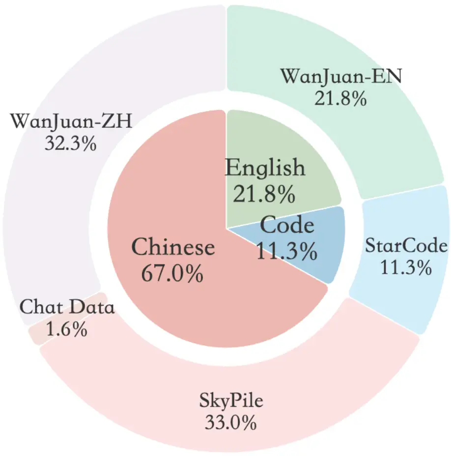

# Steel-LLM: From Scratch to Open Source – A Personal Journey in Building a Chinese-Centric LLM

###### Abstract

Steel-LLM is a Chinese-centric language model developed from scratch
with the goal of creating a high-quality open-source model despite
limited computational resources. Launched in March 2024, the project
aimed to train a 1-billion-parameter model on a large-scale dataset,
prioritizing transparency and the sharing of practical insights to
assist others in the community. The training process primarily focused
on Chinese data, with a small proportion of English data included,
addressing gaps in existing open-source LLMs by providing a more
detailed and practical account of the model-building journey. Steel-LLM
has demonstrated competitive performance on benchmarks such as CEVAL and
CMMLU, outperforming early models from larger institutions. This paper
provides a comprehensive summary of the project’s key contributions,
including data collection, model design, training methodologies, and the
challenges encountered along the way, offering a valuable resource for
researchers and practitioners looking to develop their own LLMs. The
model checkpoints and the training script are available at
[https://github.com/zhanshijinwat/Steel-LLM](https://github.com/zhanshijinwat/Steel-LLM).

Qingshui Gu

Tsinghua University

gqs19@tsinghua.org.cn

Tianyu Zheng

Beijing University of Posts  
and Telecommunications

zhengtianyu@bupt.edu.cn

Shu Li

Tsinghua University

lishu14@tsinghua.org.cn

Zhaoxiang Zhang

Institute of Automation,  
Chinese Academy of Sciences

zhaoxiang.zhang@ia.ac.cn

[https://github.com/zhanshijinwat/Steel-LLM](https://github.com/zhanshijinwat/Steel-LLM)

## 1 Introduction

The rapid advancements in open-source large language models (LLMs) have
led to significant achievements in natural language processing (NLP),
enabling applications ranging from conversational agents to code
generation. However, despite these advances, challenges remain in the
transparency, accessibility, and resource efficiency of LLM development.
Many prominent LLMs, such as the Qwen series (Bai et al., 2023a; Yang
et al., 2024), Llama (Touvron et al., 2023b), and Deepseek (DeepSeek-AI
et al., 2024a), provide only the final model weights while withholding
essential details such as training data, code, and intermediate
checkpoints. This limited openness creates obstacles to reproducibility
and prevents the broader research community from building upon these
models effectively.

Several initiatives, such as LLM360’s Amber (Liu et al., 2023; Tan
et al., 2024), M-A-P’s Neo (Zhang et al., 2024b), and AI2’s OLMO
series (Groeneveld et al., 2024a; OLMo et al., 2024; Muennighoff et al.,
2024), have addressed these limitations by releasing complete training
pipelines, datasets, and intermediate checkpoints. While these
contributions are invaluable, their development typically requires
extensive computational resources, making them inaccessible to smaller
research teams or individual practitioners. This creates a significant
gap for fully transparent and resource-efficient LLMs tailored for
smaller-scale research efforts, particularly in non-English languages
such as Chinese.

This paper introduces Steel-LLM, a small, fully open-source,
Chinese-centric LLM developed with limited computational resources.
Launched in March 2024, the project aimed to train a 1-billion-parameter
model on a large-scale dataset, prioritizing transparency and the
sharing of practical insights to assist others in the community. Unlike
many large-scale projects, Steel-LLM demonstrates that high-quality LLMs
can be developed efficiently while maintaining transparency. This work
focuses on the Chinese language, with a small proportion of English
data, addressing gaps in existing open-source LLMs by providing a more
detailed and practical account of the model-building journey.

Steel-LLM achieves competitive performance on benchmarks such as CEVAL
and CMMLU, outperforming early models from larger institutions. The
model architecture incorporates innovative features such as Soft Mixture
of Experts (Soft MoE) and an enhanced Feed-Forward Network, optimizing
performance within resource constraints. Our training framework,
modified from TinyLlama (Zhang et al., 2024c), includes several
optimizations for efficiency and usability, such as improved model
loading, restoration of training progress, and the ability to append
data during the training process.

The contributions of this work are as follows:

- •
  Resource-Efficient Model Development: We present a 1-billion-parameter
  model trained primarily on Chinese data, with a small proportion of
  English, addressing the need for more diverse language representation
  in open-source LLMs. By leveraging limited computational resources (8
  GPUs), we demonstrate that high-quality LLMs can be developed without
  access to large-scale infrastructure.
- •
  Complete Transparency: We offer complete transparency in our
  development process, including the release of our training pipeline,
  dataset, model architecture, and intermediate checkpoints. This
  facilitates reproducibility and allows for further research by the
  broader community.
- •
  Practical Guidance for Small-Scale Research: We provide detailed
  insights into our model architecture, training framework, and data
  preparation process, offering practical guidance for researchers and
  practitioners with limited resources. This includes optimizations for
  training efficiency, such as mixed-precision training, FlashAttention,
  and operator fusion.
- •
  Benchmark Performance: Steel-LLM achieves competitive performance on
  Chinese benchmarks such as CEVAL and CMMLU, outperforming some early
  models from larger institutions. This demonstrates the effectiveness
  of our approach in developing a high-quality Chinese-centric LLM with
  limited resources.

By prioritizing resource efficiency, openness, and practical
applicability, this work contributes to the broader LLM research
community, offering a valuable resource for replicating or extending
similar efforts with fewer computational constraints. All model
checkpoints, training scripts, and related resources are fully
open-sourced, further promoting transparency and collaboration in the
field of LLM development.

## 2 Related Works

Recent developments in open source LLM have varied widely in terms of
transparency and accessibility. Many models, such as Qwen (Bai et al.,
2023a; Yang et al., 2024), Llama (Touvron et al., 2023b),
Deepseek (DeepSeek-AI et al., 2024a), Gemma  (Team et al., 2024),
InternLM  (Cai et al., 2024), Mixtral  (Jiang et al., 2023), Yi  (AI
et al., 2024), GLM  (GLM et al., 2024), have been released with only the
final model checkpoints and weights, while withholding crucial details
such as training data, codes, and intermediate checkpoints. This limited
transparency hinders reproducibility and makes it difficult for the
broader research community to fully understand or build upon these
models.

In response to these challenges, several initiatives have adopted a more
open approach by releasing complete training pipelines, datasets, and
intermediate checkpoints. Notable examples include LLM360’s Amber (Liu
et al., 2023; Tan et al., 2024), M-A-P’s MAP-Neo (Zhang et al., 2024b),
and AI2’s OLMO series (Groeneveld et al., 2024a; OLMo et al., 2024;
Muennighoff et al., 2024), all of which offer comprehensive resources,
including training code, model weights, and intermediate checkpoints.
While these contributions are invaluable to the field, the large-scale
nature of these models necessitates significant computational resources,
which may render them inaccessible to smaller research teams or
individual practitioners. Consequently, there remains a gap for
open-source LLMs that are both fully transparent and feasible for
smaller teams to develop and deploy.

This paper addresses this need by presenting a small, fully open-source,
Chinese-centric LLM. Designed to minimize resource requirements, our
model offers a complete end-to-end solution for researchers with limited
computational access. By sharing the full training pipeline, dataset,
and model architecture, we aim to make the development of high-quality
LLMs more accessible. This work emphasizes transparency and practical
guidance, providing a valuable resource for those seeking to replicate
or extend the model with fewer computational constraints.

## 3 Architecture

The model structure of Steel-LLM is adapted from Qwen(Bai et al.
(2023a)).A Transformer block can be roughly divided into self-attention
and Feed-Forward Network (FFN). An efficient implementation of
self-attention is Flash Attention(Dao et al. (2022)), which is widely
utilized. Flash Attention not only improves the efficiency of model
training and inference but also saves GPU memory. Steel-LLM reuses Flash
Attention and only makes improvements to the FFN layer. In the FFN
layer, we adopts Soft Mixture of Experts (Soft MoE, Puigcerver et al.
(2024)) and enhances the second layer of the MLP. The architecture of
Steel-LLM’s Transformer block is illustrated in Figure 1.

Figure 1: The architecture of Steel-LLM Transformer block

### 3.1 Soft MoE

Mixture of Experts (MoE) (Jacobs et al., 1991) was first proposed in
1991 and is widely used in the field of recommendation systems  (Ma
et al., 2018). In the architecture of large language models, sparse MoE
is commonly employed, such as in deepSeekMoE(Dai et al. (2024)),
Qwen-MoE(Team (2024c)), etc. A typical practice to construct an MoE
language model usually replaces FFNs in a Transformer with MoE
layers(Lepikhin et al. (2021);Zoph (2022);Fedus et al. (2022)). An MoE
layer consists of multiple experts, and each expert is a FFN. A gating
network calculates scores to assign each token to a small subset of
experts. Under the condition of the same parameter scale, the sparse MoE
model activates fewer parameters than a dense model, thus reducing the
number of FLOPs.

Steel-LLM is trained using only 8 GPUs with limited GPU memory. For a
model featuring sparse MoE structure, all parameters must be loaded into
the GPU memory. Owing to the sparse nature of expert selection, in
contrast to a dense model, the FFN parameters of the sparse MoE model
cannot be fully trained. Steel-LLM is a small-scale language model with
1 billion parameters, leading to a relatively low computational load.
Meanwhile, our objective is to fully train each parameter and leverage
the advantages of the MoE structure to enhance model performance.
Consequently, we ultimately opt for the soft MoE(Puigcerver et al.
(2024)) structure. Soft MoE is fully differentiable. Therefore, there is
no need to consider problems such as expert imbalance that exist in
sparse MoE.

We denote the input tokens for a single sequence as
$`\mathbf{X}\in\mathbb{R}^{m\times d}`$, where $`m`$ represents the
number of tokens and $`d`$ denotes their dimensions. In the soft MoE
layer, each expert processes $`p`$ slots, and each slot has a
corresponding d-dimensional learnable parameter matrix
$`\Phi\in\mathbb{R}^{d\times(n\cdot p)}`$. The number of slots is a
crucial hyperparameter for adjusting the time complexity of the soft MoE
layer. The input slots
$`\tilde{\mathbf{X}}\in\mathbb{R}^{(n\cdot p)\times d}`$ are obtained
through convex combinations of all the $`m`$ input tokens, which can be
computed as follows:

```math
\mathbf{D}_{ij}=\frac{\exp((\mathbf{X}\bm{\Phi})_{ij})}{\sum_{i^{\prime}=1}^{m}\exp((\mathbf{X}\bm{\Phi})_{i^{\prime}j})},\quad\tilde{\mathbf{X}}=\mathbf{D}^{\top}\mathbf{X}
```

We denote $`D`$ as the dispatch weight matrix. It is obtained by
applying the softmax function column-wise to the matrix
$`\mathbf{X}\mathbf{\Phi}`$. Then, the corresponding expert function is
applied to each slot (i.e., on rows of $`\tilde{\mathbf{X}}`$) to obtain
the output slots
$`\tilde{\mathbf{Y}}_{i}=f_{\lfloor i/p\rfloor}(\tilde{\mathbf{X}}_{i})`$.
The combination process is then carried out as follows:

```math
\mathbf{C}_{ij}=\frac{\exp((\mathbf{X}\bm{\Phi})_{ij})}{\sum_{j^{\prime}=1}^{n\cdot p}\exp((\mathbf{X}\bm{\Phi})_{ij^{\prime}})},\quad\mathrm{~}\mathbf{Y}=\mathbf{C}\tilde{\mathbf{Y}}
```

We refer to $`C`$ as the combine weights, which is the result of
applying the softmax function row-wise to the matrix
$`\mathbf{X}\mathbf{\Phi}`$. The output tokens $`Y`$ are computed as a
convex combination of all $`(n\cdot p)`$ output slots.

### 3.2 Enhanced Feed-Forward Network

Since Steel-LLM employs the soft MoE approach, within this framework,
the Feed-Forward Network (FFN) effectively represents an expert. In a
vanilla Transformer, The FFN comprises two layers of Multi-Layer
Perceptrons (MLPs). In the architecture of large language models, a
prevalent strategy is to enhance the first layer of the MLP using the
SwiGLU(Shazeer (2020)) activation function(Bai et al. (2023a);Touvron
et al. (2023a);DeepSeek-AI et al. (2024b)). The SwiGLU activation
function enhances the model’s non-linear representational capabilities,
thereby improving its performance. Additionally, we extended the
application of the SwiGLU activation function to the second layer of the
MLP within the FFN.

Regarding other architectural elements, Steel-LLM adopts the
modifications made by Qwen(Bai et al. (2023a)) to the transformer block.
These modifications are widely used in open-source models such as LLama,
Mixtral, and Deepseek.

|                   |         |
| ----------------- | ------- |
| Parameters        | Value   |
| Layers            | 18      |
| Heads             | 32      |
| KV heads          | 32      |
| Num_experts       | 6       |
| Slots_per_expert  | 1       |
| Hidden size       | 1,792   |
| Intermediate size | 1,792   |
| Vocab size        | 151,936 |

Table 1: Key model parameters.

• Positional embedding.We intend to use the Rotary Position Embedding
(RoPE)(Su et al. (2023)) for Steel-LLM. RoPE is a relative position
encoding technique. Its core idea is to encode absolute position
information into a rotation matrix, thereby representing the relative
position relationships among tokens. During the training process, we
adopt a global training precision of BF16, while for RoPE, we employ
local FP32 precision.

• Bias. Most layers of Steel-LLM have no bias, except for the QKV
layer(Chowdhery et al. (2022)).

• Pre-Norm & RMSNorm. Pre-normalization improves training stability
compared to post-normalization. We normalize the inputs of
self-attention layers and FFN layers with RMSNorm(Zhang & Sennrich
(2019)).

The hyperparameters of Steel-LLM are presented in Table 1. We employ the
Qwen1.5 tokenizer (Team (2024b)), which utilizes byte pair encoding
(BPE).

## 4 Training Framework

Steel-LLM is trained using only 8 NVIDIA A100/H800 GPUs, so it is
essential to maximize the training speed. Moreover, considering the
potential reuse of our training code by others, we have made some
usability optimizations.

Our pretraining framework, which is modified from TinyLlama(Zhang et al.
(2024c)), has undergone the following optimizations.

• Model loading. In the open-source community, the file format of LLM
usually follows the standards of the Transformers(Wolf et al. (2020))
library and it can be easily loaded through the
AutoModelForCausalLM.from_pretrained function. To enhance usability and
facilitate model loading for different architectures, our framework
supports the Transformer library’s model loading method. The original
framework, by contrast, was designed for training standard Llama
architecture.

• Training Progress Restoration. In the training process, we are
required to save not only the checkpoints of both the model and the
optimizer but also the training progress of the data. The original
framework’s method of saving the training step is the simplest for
recording data progress, provided that there is no data change (no
addition or deletion). This limitation restricts the flexibility of data
organization during the training process. We choose to serialize the
entire data management class PackedDatasetIterator using the pickle
library and then save it. This includes the file names of all training
data, the index of each data piece, etc.

• Appending Data During the Training Process. Training LLMs typically
spans dozens of days. During this training, appending new data is a
common practice. The simplest implementation approach is to train the
newly added data at the end. Nevertheless, to safeguard against the
significant distributional disparities between new and old data that
could impact the model’s training performance, we have devised a method
for re-shuffling the indices of both the newly appended data and the
hitherto untrained data from the old dataset. Additionally, to avert the
inadvertent repeated addition of data files to the training process,
Steel-LLM has incorporated a function that utilizes a hash value,
specifically the MD5(Rivest (1992)) hash algorithm, to detect data
content duplication.

To improve training speed and conserve GPU memory, during the training
process, we utilized techniques such as bfloat16
mixed-precision(Kalamkar et al. (2019)), Fully Sharded Data Parallel
(FSDP, Zhao et al. (2023)), and FlashAttention(Dao et al. (2022)).
Operator fusion represents an additional training optimization approach.
By integrating multiple computational steps, it reduces intermediate
activations and memory access, and can be implemented via CUDA or
Triton. Specifically, during training, we adopted the CUDA-based version
of Rotary Position Embedding (RoPE,Su et al. (2023)) and the
Triton-based(Tillet et al. (2019)) cross entropy loss function. We then
conducted an ablation study using a micro-batch size of 8 and a
1.8-billion-parameter model on NVIDIA A100 GPU to analyze the impact of
these techniques on training efficiency and GPU memory usage, as
presented in Table 2. Employing all training acceleration techniques,
the training speed can be enhanced by approximately 50%.

|                        |                |                |                |                |                |                |                |                |
| ---------------------- | -------------- | -------------- | -------------- | -------------- | -------------- | -------------- | -------------- | -------------- |
|                        | Exp 1          | Exp 2          | Exp 3          | Exp 4          | Exp 5          | Exp 6          | Exp 7          | Exp 8          |
| FlashAttention         | $`\checkmark`$ | $`\checkmark`$ | $`\times`$     | $`\checkmark`$ | $`\checkmark`$ | $`\checkmark`$ | $`\checkmark`$ | $`\times`$     |
| SelfAttention(PyTorch) | $`\times`$     | $`\times`$     | $`\checkmark`$ | $`\times`$     | $`\times`$     | $`\times`$     | $`\times`$     | $`\checkmark`$ |
| RoPE(CUDA)             | $`\checkmark`$ | $`\times`$     | $`\checkmark`$ | $`\checkmark`$ | $`\checkmark`$ | $`\checkmark`$ | $`\checkmark`$ | $`\times`$     |
| RoPE(PyTorch)          | $`\times`$     | $`\checkmark`$ | $`\times`$     | $`\times`$     | $`\times`$     | $`\times`$     | $`\times`$     | $`\checkmark`$ |
| RMSNorm(CUDA)          | $`\times`$     | $`\times`$     | $`\times`$     | $`\times`$     | $`\checkmark`$ | $`\times`$     | $`\checkmark`$ | $`\times`$     |
| RMSNorm(PyTorch)       | $`\checkmark`$ | $`\checkmark`$ | $`\checkmark`$ | $`\checkmark`$ | $`\times`$     | $`\checkmark`$ | $`\times`$     | $`\checkmark`$ |
| Loss Function(Triton)  | $`\checkmark`$ | $`\checkmark`$ | $`\checkmark`$ | $`\checkmark`$ | $`\checkmark`$ | $`\times`$     | $`\checkmark`$ | $`\times`$     |
| Loss Function(PyTorch) | $`\times`$     | $`\times`$     | $`\times`$     | $`\times`$     | $`\times`$     | $`\checkmark`$ | $`\times`$     | $`\checkmark`$ |
| FSDP                   | $`\checkmark`$ | $`\checkmark`$ | $`\checkmark`$ | $`\times`$     | $`\checkmark`$ | $`\checkmark`$ | $`\times`$     | $`\checkmark`$ |
| FSDP(no share param)   | $`\times`$     | $`\times`$     | $`\times`$     | $`\checkmark`$ | $`\times`$     | $`\times`$     | $`\checkmark`$ | $`\times`$     |
| Speed(tokens/s/gpu)    | 13400          | 12500          | 10600          | 13800          | 14600          | 13000          | 15000          | 10500          |
| GPU Memory(GB)         | 65             | 65             | 69             | 69             | 61             | 75             | 66             | 75             |

Table 2: Comparison of different training configurations.

## 5 Pretraining

The pretraining corpus employed in our study predominantly consists of
Chinese texts and is entirely derived from open-source datasets. It
includes prominent datasets such as SkyPile-150B  (Wei et al., 2023),
Wanjuan1.0 (He et al., 2023), Wikipedia-cn, as well as diverse chat data
from multiple sources and Starcode. Further details of these datasets
are provided in Appendix A.



Figure 2: Pretraining Data Distribution

To ensure consistency across the data, we initially standardized all
datasets into a uniform format. Subsequently, we utilized Alibaba’s
open-source tool, Data-Juicer, to meticulously filter and transcribe
both the text and code data. We utilized a total of 21 text processing
operators, as described in Appendix C, and 13 code processing operators,
as listed in Appendix D. The final step involved employing the tokenizer
from Qwen1.5. This tokenizer was instrumental in converting the entire
corpus into token-ids, which were then merged and segmented into
manageable chunks. The distribution of the pretraining data across
different domains is illustrated in Figure 2. Despite these efforts, our
data preprocessing workflow still exhibits certain limitations,
particularly the lack of balance in the proportion of texts from
different domains within the pre-training corpus.

Over a span of 30 days, Steel-LLM was trained through 1.07 million
steps. The initial 200,000 steps utilized NVIDIA 8 A100-80G GPUs for
training, while the remaining steps employed 8 H800-80G GPUs. The loss
curve is shown in Appendix E. We set the maximum sequence length to
2048, the batch size to 8, and the number of gradient accumulation steps
to 8. Consequently, Steel-LLM was trained on approximately one trillion
tokens. We employ the AdamW optimizer (Kingma & Ba (2017)) with
hyper-parameters set to $`\beta_{1}`$= 0.9, $`\beta_{2}`$= 0.95, and
weight_decay = 0.05. The maximum learning rate is set to
$`3\times 10^{-4}`$, and the gradient clipping norm is set to 1.0. We
employed a cosine-annealing learning rate schedule with 2,000 warmup
steps, such that the final learning rate is 0.

## 6 Post training

### 6.1 Supervised Finetuning

There has been substantial discussion and some debate among researchers
regarding the volume of datasets required for supervised fine-tuning.
For instance, Zhou et al. (2023) advocates for selecting a few hundred
to a few thousand high-quality data points for fine-tuning, while Ji
et al. (2023) suggests that using a significantly larger amount of data
can yield better results. Given the capabilities of our base model, we
determined that augmenting the fine-tuning phase with additional data
was necessary. This strategy not only aids the model in mastering
conversational techniques but also enriches it with supplementary
knowledge. Consequently, We curated the following fine-tuning datasets:
Infinity-Instruct Chinese data (BAAI, 2024) (approximately 700,000
entries, with all English data removed), multiple-choice questions from
the Wanjuan-cn dataset (He et al., 2023) which tested in both CoT and
non-CoT formats, Ruozhiba data (Ruozhiba, 2024), self-awareness data
with template modified from (Team, 2024a), and three English datasets:
Code-Feedback (Zheng et al., 2025), WebInstructSub (Yue et al., 2024)
and OpenHermes-2.5 (Teknium, 2023). Further details are listed in
Appendix B.

We fine-tuned the pre-trained Steel-LLM for approximately 4 epochs using
the SFT dataset. The global batch size was set to 256, the maximum
learning rate was set to $`2\times 10^{-5}`$, and a cosine-annealing
learning rate schedule was employed. The loss curve is shown in
Appendix F. Below, we present a series of ablation studies and
evaluations to analyze the impact of different fine-tuning strategies on
model performance.

### 6.2 Ablation Studies and Evaluation

To systematically evaluate the effectiveness of our fine-tuning
approach, we conducted several experiments with varying data
compositions and formats. The results are summarized in Table 3, and the
key findings are discussed below.

|                                              |            |            |           |
| -------------------------------------------- | ---------- | ---------- | --------- |
| Experiment                                   | CEVAL Acc. | CMMLU Acc. | MMLU Acc. |
| Full Infinity-Instruct + Wanjuan MCQ         | 32.35      | 26.32      | 25.50     |
| 700K Chinese Infinity-Instruct + Wanjuan MCQ | 38.57      | 33.48      | 23.26     |
| Chinese + 100% English Data                  | 39.21      | 33.20      | 26.73     |
| Chinese + 20% English Data (Balanced)        | 40.43      | 35.86      | 26.75     |
| Chinese + 20% English + English MCQ          | 41.90      | 36.08      | 30.82     |

Table 3: Performance of different fine-tuning strategies.

#### Experiment 1: Full Infinity-Instruct + Wanjuan MCQ

In this experiment, we fine-tuned the model using the entire
Infinity-Instruct dataset (approximately 7,000,000 entries) and the full
Wanjuan multiple-choice dataset. While the model’s performance on CEVAL
improved with increasing fine-tuning steps, the accuracy plateaued at
around 32% after 18,000 steps. This suggests that even though the
Wanjuan data was included in the pretraining phase, the model still
benefited from additional fine-tuning, likely due to its relatively
small size.

#### Experiment 2: 700K Chinese Infinity-Instruct + Wanjuan MCQ

To address the issue of language mismatch, we filtered out the English
data from Infinity-Instruct and retained only the 700,000 Chinese
entries. This adjustment significantly improved the model’s performance,
achieving 38% accuracy on CEVAL and 33% on CMMLU. This result highlights
the importance of aligning the fine-tuning data distribution with the
pretraining phase.

#### Experiment 3: Chinese + 100% English Data

To explore the impact of English data on the model’s multilingual
capabilities, we fine-tuned the model using a balanced mix of Chinese
and English data (340,000 entries each). While the model’s performance
on Chinese benchmarks remained stable, its performance on MMLU improved
slightly, indicating that English data can complement the model’s
existing knowledge without degrading its Chinese capabilities.

#### Experiment 4: Chinese + 20% English Data (Balanced)

In this experiment, we fine-tuned the model with a data distribution
that closely matched the pretraining phase (80% Chinese and 20%
English). This approach not only improved the model’s performance on
Chinese benchmarks (CEVAL: 39.21% → 40.43%; CMMLU: 33.2% → 35.86%) but
also maintained its performance on MMLU. This suggests that maintaining
a balanced data distribution during fine-tuning is crucial for
preserving the model’s multilingual capabilities.

#### Experiment 5: Chinese + 20% English + English MCQ

To further enhance the model’s reasoning abilities, we introduced
additional English multiple-choice questions from datasets such as
OpenBookQA, AI2 ARC, and LogiQA. This experiment resulted in a
noticeable improvement in MMLU accuracy (26.75% → 30.82%), while the
performance on Chinese benchmarks remained stable. This indicates that
incorporating domain-specific question-answering data can enhance the
model’s reasoning capabilities without compromising its existing
knowledge.

### 6.3 Learning from Human Preferences

To align Steel-LLM with human preferences, we employ the Direct
Preference Optimization (DPO)Rafailov et al. (2024) algorithm and sorted
response pairs for model optimization.

In the preference dataset, the ratio of Chinese to English stands at
4:1, consistent with that in the pre-training phase. The Chinese dataset
is derived from ultrafeedback-chinese¹¹ 1
[https://huggingface.co/datasets/opencsg/UltraFeedback-chinese/](https://huggingface.co/datasets/opencsg/UltraFeedback-chinese/),
and the English dataset is derived from
ultrafeedback-binarized-preferences²² 2
[https://huggingface.co/datasets/argilla/ultrafeedback-binarized-preferences](https://huggingface.co/datasets/argilla/ultrafeedback-binarized-preferences).
Both the reference model and the objective model of the DPO algorithm
are initialized with the SFT version of Steel-LLM. We conducted training
on the data for 3 epochs. The global batch size was set to 128, the
maximum learning rate was set to $`5\times 10^{-6}`$, the pref_beta set
to 0.1, and a cosine-annealing learning rate schedule was employed. The
loss curve is shown in Appendix G.

### 6.4 Discussion

Our ablation studies reveal several key insights:

- •
  Data Distribution Matters: Fine-tuning with a data distribution that
  closely matches the pretraining phase leads to better performance on
  both Chinese and English benchmarks.
- •
  Small Models Benefit from Additional Data: Even for small models,
  fine-tuning with a larger dataset can improve performance,
  particularly when the pretraining data is limited.
- •
  Balanced Multilingual Fine-Tuning: Incorporating a small proportion of
  English data during fine-tuning can enhance the model’s multilingual
  capabilities without degrading its performance on Chinese tasks.
- •
  Exam-Style Data Enhances Performance: Including domain-specific
  question-answering data, such as multiple-choice questions, can
  improve the model’s reasoning abilities and overall benchmark
  performance.

To contextualize the performance of Steel-LLM, we compare it with
several state-of-the-art models on the CEVAL and CMMLU benchmarks, as
shown in Table 4. Our best-performing model, Steel-LLM-Chat, achieves
competitive results, outperforming models of similar scale such as
Tiny-Llama-1.1B and Gemma-2b-it, and approaching the performance of
larger models like CT-LLM-SFT-2B. While Steel-LLM-Chat does not yet
match the performance of significantly larger models like
Qwen1.5-1.8B-Chat or Qwen-7B, its results demonstrate the effectiveness
of our resource-efficient approach, particularly given the limited
computational resources used for training.

|                                       |       |       |
| ------------------------------------- | ----- | ----- |
| Model                                 | CEVAL | CMMLU |
| Tiny-Llama-1.1B (Zhang et al., 2024c) | 25.02 | 24.03 |
| MiniCPM-1.2B (min, 2024)              | 49.14 | 46.81 |
| Qwen1.5-1.8B-Chat (Bai et al., 2023b) | 56.84 | 54.11 |
| Phi2(2B)(Abdin et al., 2023)          | 23.37 | 24.18 |
| Gemma-2b-it (Gemma Team et al., 2024) | 32.30 | 33.07 |
| CT-LLM-SFT-2B (Du et al., 2024)       | 41.54 | 41.48 |
| ChatGLM-6B (GLM et al., 2024)         | 38.90 | 37.48 |
| Llama2-7B Touvron et al. (2023b)      | 32.42 | 31.11 |
| OLMo-7B (Groeneveld et al., 2024b)    | 35.18 | 35.55 |
| Gemma-7B (Gemma Team et al., 2024)    | 42.57 | 44.20 |
| MAP-Neo-7B (Zhang et al., 2024a)      | 56.97 | 55.01 |
| Llama2-13B Touvron et al. (2023b)     | 37.32 | 37.06 |
| Steel-LLM-1B-Chat                     | 41.90 | 36.08 |
| Steel-LLM-1B-Chat-DPO                 | 42.04 | 36.04 |

Table 4: Performance comparison of models on CEVAL and CMMLU benchmarks.

In conclusion, our fine-tuning approach demonstrates that careful
dataset selection and composition can significantly enhance the
performance of small language models like Steel-LLM. By balancing the
inclusion of diverse data types and maintaining alignment with the
pretraining distribution, we achieved competitive results on both
Chinese and English benchmarks, positioning Steel-LLM as a strong
contender among resource-efficient LLMs.

## 7 Conclusion

This paper introduces Steel-LLM, a fully open-source Chinese-centric
language model developed with limited computational resources, achieving
competitive performance on benchmarks such as CEVAL (41.90%) and CMMLU
(36.08%). By leveraging innovative techniques like Soft Mixture of
Experts and enhanced feed-forward networks, along with systematic
training optimizations, we demonstrate that high-quality LLMs can be
built efficiently. Our work provides complete transparency, releasing
the training pipeline, datasets, and intermediate checkpoints, offering
practical guidance for small-scale LLM development. All resources are
made publicly available to foster collaboration and advance accessible
language technologies.

## References

- min (2024) Minicpm: Unveiling the potential of end-side large language
  models. In _OpenBMB Blog_, 2024.
- Abdin et al. (2023) Marah Abdin, Jyoti Aneja, Sebastien Bubeck, Caio
  César Teodoro Mendes, Weizhu Chen, Allie Del Giorno, Ronen Eldan,
  Sivakanth Gopi, Suriya Gunasekar, Mojan Javaheripi, Piero Kauffmann,
  Yin Tat Lee, Yuanzhi Li, Anh Nguyen, Gustavo de Rosa, Olli Saarikivi,
  Adil Salim, Shital Shah, Michael Santacroce, Harkirat Singh Behl,
  Adam Taumann Kalai, Xin Wang, Rachel Ward, Philipp Witte, Cyril Zhang,
  and Yi Zhang. Phi-2: The surprising power of small language models.
  [https://www.microsoft.com/en-us/research/blog/phi-2-the-surprising-power-of-small-language-models/](https://www.microsoft.com/en-us/research/blog/phi-2-the-surprising-power-of-small-language-models/), 2023.
- AI et al. (2024) 01. AI, :, Alex Young, Bei Chen, Chao Li, Chengen
  Huang, Ge Zhang, Guanwei Zhang, Heng Li, Jiangcheng Zhu, Jianqun Chen,
  Jing Chang, Kaidong Yu, Peng Liu, Qiang Liu, Shawn Yue, Senbin Yang,
  Shiming Yang, Tao Yu, Wen Xie, Wenhao Huang, Xiaohui Hu, Xiaoyi Ren,
  Xinyao Niu, Pengcheng Nie, Yuchi Xu, Yudong Liu, Yue Wang, Yuxuan Cai,
  Zhenyu Gu, Zhiyuan Liu, and Zonghong Dai. Yi: Open foundation models
  by 01.ai, 2024. URL
  [https://arxiv.org/abs/2403.04652](https://arxiv.org/abs/2403.04652).
- BAAI (2024) BAAI. Infinity instruct. _arXiv preprint_,
  arXiv:2406.XXXX, 2024.
- Bai et al. (2023a) Jinze Bai, Shuai Bai, Yunfei Chu, Zeyu Cui, Kai
  Dang, Xiaodong Deng, Yang Fan, Wenbin Ge, Yu Han, Fei Huang, Binyuan
  Hui, Luo Ji, Mei Li, Junyang Lin, Runji Lin, Dayiheng Liu, Gao Liu,
  Chengqiang Lu, Keming Lu, Jianxin Ma, Rui Men, Xingzhang Ren,
  Xuancheng Ren, Chuanqi Tan, Sinan Tan, Jianhong Tu, Peng Wang, Shijie
  Wang, Wei Wang, Shengguang Wu, Benfeng Xu, Jin Xu, An Yang, Hao Yang,
  Jian Yang, Shusheng Yang, Yang Yao, Bowen Yu, Hongyi Yuan, Zheng Yuan,
  Jianwei Zhang, Xingxuan Zhang, Yichang Zhang, Zhenru Zhang, Chang
  Zhou, Jingren Zhou, Xiaohuan Zhou, and Tianhang Zhu. Qwen technical
  report, 2023a. URL
  [https://arxiv.org/abs/2309.16609](https://arxiv.org/abs/2309.16609).
- Bai et al. (2023b) Jinze Bai, Shuai Bai, Yunfei Chu, Zeyu Cui, Kai
  Dang, Xiaodong Deng, Yang Fan, Wenbin Ge, Yu Han, Fei Huang, Binyuan
  Hui, Luo Ji, Mei Li, Junyang Lin, Runji Lin, Dayiheng Liu, Gao Liu,
  Chengqiang Lu, Keming Lu, Jianxin Ma, Rui Men, Xingzhang Ren,
  Xuancheng Ren, Chuanqi Tan, Sinan Tan, Jianhong Tu, Peng Wang, Shijie
  Wang, Wei Wang, Shengguang Wu, Benfeng Xu, Jin Xu, An Yang, Hao Yang,
  Jian Yang, Shusheng Yang, Yang Yao, Bowen Yu, Hongyi Yuan, Zheng Yuan,
  Jianwei Zhang, Xingxuan Zhang, Yichang Zhang, Zhenru Zhang, Chang
  Zhou, Jingren Zhou, Xiaohuan Zhou, and Tianhang Zhu. Qwen technical
  report. _arXiv preprint arXiv:2309.16609_, 2023b.
- BELLEGroup (2023) BELLEGroup. Belle: Be everyone’s large language
  model engine.
  [https://github.com/LianjiaTech/BELLE](https://github.com/LianjiaTech/BELLE), 2023.
- Cai et al. (2024) Zheng Cai, Maosong Cao, Haojiong Chen, Kai Chen,
  Keyu Chen, Xin Chen, Xun Chen, Zehui Chen, Zhi Chen, Pei Chu, Xiaoyi
  Dong, Haodong Duan, Qi Fan, Zhaoye Fei, Yang Gao, Jiaye Ge, Chenya Gu,
  Yuzhe Gu, Tao Gui, Aijia Guo, Qipeng Guo, Conghui He, Yingfan Hu, Ting
  Huang, Tao Jiang, Penglong Jiao, Zhenjiang Jin, Zhikai Lei, Jiaxing
  Li, Jingwen Li, Linyang Li, Shuaibin Li, Wei Li, Yining Li, Hongwei
  Liu, Jiangning Liu, Jiawei Hong, Kaiwen Liu, Kuikun Liu, Xiaoran Liu,
  Chengqi Lv, Haijun Lv, Kai Lv, Li Ma, Runyuan Ma, Zerun Ma, Wenchang
  Ning, Linke Ouyang, Jiantao Qiu, Yuan Qu, Fukai Shang, Yunfan Shao,
  Demin Song, Zifan Song, Zhihao Sui, Peng Sun, Yu Sun, Huanze Tang, Bin
  Wang, Guoteng Wang, Jiaqi Wang, Jiayu Wang, Rui Wang, Yudong Wang,
  Ziyi Wang, Xingjian Wei, Qizhen Weng, Fan Wu, Yingtong Xiong, Chao Xu,
  Ruiliang Xu, Hang Yan, Yirong Yan, Xiaogui Yang, Haochen Ye, Huaiyuan
  Ying, Jia Yu, Jing Yu, Yuhang Zang, Chuyu Zhang, Li Zhang, Pan Zhang,
  Peng Zhang, Ruijie Zhang, Shuo Zhang, Songyang Zhang, Wenjian Zhang,
  Wenwei Zhang, Xingcheng Zhang, Xinyue Zhang, Hui Zhao, Qian Zhao,
  Xiaomeng Zhao, Fengzhe Zhou, Zaida Zhou, Jingming Zhuo, Yicheng Zou,
  Xipeng Qiu, Yu Qiao, and Dahua Lin. Internlm2 technical report, 2024.
- Chowdhery et al. (2022) Aakanksha Chowdhery, Sharan Narang, Jacob
  Devlin, Maarten Bosma, Gaurav Mishra, Adam Roberts, Paul Barham,
  Hyung Won Chung, Charles Sutton, Sebastian Gehrmann, Parker Schuh,
  Kensen Shi, Sasha Tsvyashchenko, Joshua Maynez, Abhishek Rao, Parker
  Barnes, Yi Tay, Noam Shazeer, Vinodkumar Prabhakaran, Emily Reif, Nan
  Du, Ben Hutchinson, Reiner Pope, James Bradbury, Jacob Austin, Michael
  Isard, Guy Gur-Ari, Pengcheng Yin, Toju Duke, Anselm Levskaya, Sanjay
  Ghemawat, Sunipa Dev, Henryk Michalewski, Xavier Garcia, Vedant Misra,
  Kevin Robinson, Liam Fedus, Denny Zhou, Daphne Ippolito, David Luan,
  Hyeontaek Lim, Barret Zoph, Alexander Spiridonov, Ryan Sepassi, David
  Dohan, Shivani Agrawal, Mark Omernick, Andrew M. Dai,
  Thanumalayan Sankaranarayana Pillai, Marie Pellat, Aitor Lewkowycz,
  Erica Moreira, Rewon Child, Oleksandr Polozov, Katherine Lee, Zongwei
  Zhou, Xuezhi Wang, Brennan Saeta, Mark Diaz, Orhan Firat, Michele
  Catasta, Jason Wei, Kathy Meier-Hellstern, Douglas Eck, Jeff Dean,
  Slav Petrov, and Noah Fiedel. Palm: Scaling language modeling with
  pathways, 2022. URL
  [https://arxiv.org/abs/2204.02311](https://arxiv.org/abs/2204.02311).
- Dai et al. (2024) Damai Dai, Chengqi Deng, Chenggang Zhao, R. X. Xu,
  Huazuo Gao, Deli Chen, Jiashi Li, Wangding Zeng, Xingkai Yu, Y. Wu,
  Zhenda Xie, Y. K. Li, Panpan Huang, Fuli Luo, Chong Ruan, Zhifang Sui,
  and Wenfeng Liang. Deepseekmoe: Towards ultimate expert specialization
  in mixture-of-experts language models, 2024. URL
  [https://arxiv.org/abs/2401.06066](https://arxiv.org/abs/2401.06066).
- Dao et al. (2022) Tri Dao, Daniel Y. Fu, Stefano Ermon, Atri Rudra,
  and Christopher Ré. Flashattention: Fast and memory-efficient exact
  attention with io-awareness, 2022. URL
  [https://arxiv.org/abs/2205.14135](https://arxiv.org/abs/2205.14135).
- DeepSeek-AI et al. (2024a) DeepSeek-AI, :, Xiao Bi, Deli Chen,
  Guanting Chen, Shanhuang Chen, Damai Dai, Chengqi Deng, Honghui Ding,
  Kai Dong, Qiushi Du, Zhe Fu, Huazuo Gao, Kaige Gao, Wenjun Gao, Ruiqi
  Ge, Kang Guan, Daya Guo, Jianzhong Guo, Guangbo Hao, Zhewen Hao, Ying
  He, Wenjie Hu, Panpan Huang, Erhang Li, Guowei Li, Jiashi Li, Yao Li,
  Y. K. Li, Wenfeng Liang, Fangyun Lin, A. X. Liu, Bo Liu, Wen Liu,
  Xiaodong Liu, Xin Liu, Yiyuan Liu, Haoyu Lu, Shanghao Lu, Fuli Luo,
  Shirong Ma, Xiaotao Nie, Tian Pei, Yishi Piao, Junjie Qiu, Hui Qu,
  Tongzheng Ren, Zehui Ren, Chong Ruan, Zhangli Sha, Zhihong Shao,
  Junxiao Song, Xuecheng Su, Jingxiang Sun, Yaofeng Sun, Minghui Tang,
  Bingxuan Wang, Peiyi Wang, Shiyu Wang, Yaohui Wang, Yongji Wang, Tong
  Wu, Y. Wu, Xin Xie, Zhenda Xie, Ziwei Xie, Yiliang Xiong, Hanwei Xu,
  R. X. Xu, Yanhong Xu, Dejian Yang, Yuxiang You, Shuiping Yu, Xingkai
  Yu, B. Zhang, Haowei Zhang, Lecong Zhang, Liyue Zhang, Mingchuan
  Zhang, Minghua Zhang, Wentao Zhang, Yichao Zhang, Chenggang Zhao, Yao
  Zhao, Shangyan Zhou, Shunfeng Zhou, Qihao Zhu, and Yuheng Zou.
  Deepseek llm: Scaling open-source language models with longtermism,
  2024a.
- DeepSeek-AI et al. (2024b) DeepSeek-AI, Aixin Liu, Bei Feng, Bin Wang,
  Bingxuan Wang, Bo Liu, Chenggang Zhao, Chengqi Dengr, Chong Ruan,
  Damai Dai, Daya Guo, Dejian Yang, Deli Chen, Dongjie Ji, Erhang Li,
  Fangyun Lin, Fuli Luo, Guangbo Hao, Guanting Chen, Guowei Li,
  H. Zhang, Hanwei Xu, Hao Yang, Haowei Zhang, Honghui Ding, Huajian
  Xin, Huazuo Gao, Hui Li, Hui Qu, J. L. Cai, Jian Liang, Jianzhong Guo,
  Jiaqi Ni, Jiashi Li, Jin Chen, Jingyang Yuan, Junjie Qiu, Junxiao
  Song, Kai Dong, Kaige Gao, Kang Guan, Lean Wang, Lecong Zhang, Lei Xu,
  Leyi Xia, Liang Zhao, Liyue Zhang, Meng Li, Miaojun Wang, Mingchuan
  Zhang, Minghua Zhang, Minghui Tang, Mingming Li, Ning Tian, Panpan
  Huang, Peiyi Wang, Peng Zhang, Qihao Zhu, Qinyu Chen, Qiushi Du, R. J.
  Chen, R. L. Jin, Ruiqi Ge, Ruizhe Pan, Runxin Xu, Ruyi Chen, S. S. Li,
  Shanghao Lu, Shangyan Zhou, Shanhuang Chen, Shaoqing Wu, Shengfeng Ye,
  Shirong Ma, Shiyu Wang, Shuang Zhou, Shuiping Yu, Shunfeng Zhou, Size
  Zheng, T. Wang, Tian Pei, Tian Yuan, Tianyu Sun, W. L. Xiao, Wangding
  Zeng, Wei An, Wen Liu, Wenfeng Liang, Wenjun Gao, Wentao Zhang, X. Q.
  Li, Xiangyue Jin, Xianzu Wang, Xiao Bi, Xiaodong Liu, Xiaohan Wang,
  Xiaojin Shen, Xiaokang Chen, Xiaosha Chen, Xiaotao Nie, Xiaowen Sun,
  Xiaoxiang Wang, Xin Liu, Xin Xie, Xingkai Yu, Xinnan Song, Xinyi Zhou,
  Xinyu Yang, Xuan Lu, Xuecheng Su, Y. Wu, Y. K. Li, Y. X. Wei, Y. X.
  Zhu, Yanhong Xu, Yanping Huang, Yao Li, Yao Zhao, Yaofeng Sun, Yaohui
  Li, Yaohui Wang, Yi Zheng, Yichao Zhang, Yiliang Xiong, Yilong Zhao,
  Ying He, Ying Tang, Yishi Piao, Yixin Dong, Yixuan Tan, Yiyuan Liu,
  Yongji Wang, Yongqiang Guo, Yuchen Zhu, Yuduan Wang, Yuheng Zou, Yukun
  Zha, Yunxian Ma, Yuting Yan, Yuxiang You, Yuxuan Liu, Z. Z. Ren, Zehui
  Ren, Zhangli Sha, Zhe Fu, Zhen Huang, Zhen Zhang, Zhenda Xie, Zhewen
  Hao, Zhihong Shao, Zhiniu Wen, Zhipeng Xu, Zhongyu Zhang, Zhuoshu Li,
  Zihan Wang, Zihui Gu, Zilin Li, and Ziwei Xie. Deepseek-v2: A strong,
  economical, and efficient mixture-of-experts language model, 2024b.
  URL
  [https://arxiv.org/abs/2405.04434](https://arxiv.org/abs/2405.04434).
- Du et al. (2024) Xinrun Du, Zhouliang Yu, Songyang Gao, Ding Pan,
  Yuyang Cheng, Ziyang Ma, Ruibin Yuan, Xingwei Qu, Jiaheng Liu, Tianyu
  Zheng, Xinchen Luo, Guorui Zhou, Binhang Yuan, Wenhu Chen, Jie Fu, and
  Ge Zhang. Chinese tiny llm: Pretraining a chinese-centric large
  language model. _ArXiv_, abs/2404.04167, 2024. URL
  [https://api.semanticscholar.org/CorpusID:268987532](https://api.semanticscholar.org/CorpusID:268987532).
- Fedus et al. (2022) William Fedus, Barret Zoph, and Noam Shazeer.
  Switch transformers: Scaling to trillion parameter models with simple
  and efficient sparsity, 2022. URL
  [https://arxiv.org/abs/2101.03961](https://arxiv.org/abs/2101.03961).
- Gemma Team et al. (2024) Thomas Mesnard Gemma Team, Cassidy Hardin,
  Robert Dadashi, Surya Bhupatiraju, Laurent Sifre, Morgane Rivière,
  Mihir Sanjay Kale, Juliette Love, Pouya Tafti, Léonard Hussenot, and
  et al. Gemma. 2024. doi: 10.34740/KAGGLE/M/3301. URL
  [https://www.kaggle.com/m/3301](https://www.kaggle.com/m/3301).
- GLM et al. (2024) Team GLM, Aohan Zeng, Bin Xu, Bowen Wang, Chenhui
  Zhang, Da Yin, Diego Rojas, Guanyu Feng, Hanlin Zhao, Hanyu Lai, Hao
  Yu, Hongning Wang, Jiadai Sun, Jiajie Zhang, Jiale Cheng, Jiayi Gui,
  Jie Tang, Jing Zhang, Juanzi Li, Lei Zhao, Lindong Wu, Lucen Zhong,
  Mingdao Liu, Minlie Huang, Peng Zhang, Qinkai Zheng, Rui Lu, Shuaiqi
  Duan, Shudan Zhang, Shulin Cao, Shuxun Yang, Weng Lam Tam, Wenyi Zhao,
  Xiao Liu, Xiao Xia, Xiaohan Zhang, Xiaotao Gu, Xin Lv, Xinghan Liu,
  Xinyi Liu, Xinyue Yang, Xixuan Song, Xunkai Zhang, Yifan An, Yifan Xu,
  Yilin Niu, Yuantao Yang, Yueyan Li, Yushi Bai, Yuxiao Dong, Zehan Qi,
  Zhaoyu Wang, Zhen Yang, Zhengxiao Du, Zhenyu Hou, and Zihan Wang.
  Chatglm: A family of large language models from glm-130b to glm-4 all
  tools, 2024.
- Groeneveld et al. (2024a) Dirk Groeneveld, Iz Beltagy, Pete Walsh,
  Akshita Bhagia, Rodney Kinney, Oyvind Tafjord, A. Jha, Hamish Ivison,
  Ian Magnusson, Yizhong Wang, Shane Arora, David Atkinson, Russell
  Authur, Khyathi Raghavi Chandu, Arman Cohan, Jennifer Dumas, Yanai
  Elazar, Yuling Gu, Jack Hessel, Tushar Khot, William Merrill,
  Jacob Daniel Morrison, Niklas Muennighoff, Aakanksha Naik, Crystal
  Nam, Matthew E. Peters, Valentina Pyatkin, Abhilasha Ravichander,
  Dustin Schwenk, Saurabh Shah, Will Smith, Emma Strubell, Nishant
  Subramani, Mitchell Wortsman, Pradeep Dasigi, Nathan Lambert, Kyle
  Richardson, Luke Zettlemoyer, Jesse Dodge, Kyle Lo, Luca Soldaini,
  Noah A. Smith, and Hanna Hajishirzi. Olmo: Accelerating the science of
  language models. _arXiv preprint_, 2024a. URL
  [https://api.semanticscholar.org/CorpusID:267365485](https://api.semanticscholar.org/CorpusID:267365485).
- Groeneveld et al. (2024b) Dirk Groeneveld, Iz Beltagy, Pete Walsh,
  Akshita Bhagia, Rodney Kinney, Oyvind Tafjord, Ananya Harsh Jha,
  Hamish Ivison, Ian Magnusson, Yizhong Wang, Shane Arora, David
  Atkinson, Russell Authur, Khyathi Chandu, Arman Cohan, Jennifer Dumas,
  Yanai Elazar, Yuling Gu, Jack Hessel, Tushar Khot, William Merrill,
  Jacob Morrison, Niklas Muennighoff, Aakanksha Naik, Crystal Nam,
  Matthew E. Peters, Valentina Pyatkin, Abhilasha Ravichander, Dustin
  Schwenk, Saurabh Shah, Will Smith, Nishant Subramani, Mitchell
  Wortsman, Pradeep Dasigi, Nathan Lambert, Kyle Richardson, Jesse
  Dodge, Kyle Lo, Luca Soldaini, Noah A. Smith, and Hannaneh Hajishirzi.
  Olmo: Accelerating the science of language models. _Preprint_, 2024b.
- He et al. (2023) Conghui He, Zhenjiang Jin, Chao Xu, Jiantao Qiu, Bin
  Wang, Wei Li, Hang Yan, Jiaqi Wang, and Dahua Lin. Wanjuan: A
  comprehensive multimodal dataset for advancing english and chinese
  large models, 2023.
- Jacobs et al. (1991) Robert A. Jacobs, Michael I. Jordan, Steven J.
  Nowlan, and Geoffrey E. Hinton. Adaptive mixtures of local experts.
  _Neural Computation_, 3(1):79–87, 1991. doi: 10.1162/neco.1991.3.1.79.
- Ji et al. (2023) Yunjie Ji, Yong Deng, Yan Gong, Yiping Peng, Qiang
  Niu, Lei Zhang, Baochang Ma, and Xiangang Li. Exploring the impact of
  instruction data scaling on large language models: An empirical study
  on real-world use cases, 2023. URL
  [https://arxiv.org/abs/2303.14742](https://arxiv.org/abs/2303.14742).
- Jiang et al. (2023) Albert Q. Jiang, Alexandre Sablayrolles, Arthur
  Mensch, Chris Bamford, Devendra Singh Chaplot, Diego de las Casas,
  Florian Bressand, Gianna Lengyel, Guillaume Lample, Lucile Saulnier,
  Lélio Renard Lavaud, Marie-Anne Lachaux, Pierre Stock, Teven Le Scao,
  Thibaut Lavril, Thomas Wang, Timothée Lacroix, and William El Sayed.
  Mistral 7b, 2023.
- Kalamkar et al. (2019) Dhiraj Kalamkar, Dheevatsa Mudigere, Naveen
  Mellempudi, Dipankar Das, Kunal Banerjee, Sasikanth Avancha,
  Dharma Teja Vooturi, Nataraj Jammalamadaka, Jianyu Huang, Hector Yuen,
  Jiyan Yang, Jongsoo Park, Alexander Heinecke, Evangelos Georganas,
  Sudarshan Srinivasan, Abhisek Kundu, Misha Smelyanskiy, Bharat Kaul,
  and Pradeep Dubey. A study of bfloat16 for deep learning
  training, 2019. URL
  [https://arxiv.org/abs/1905.12322](https://arxiv.org/abs/1905.12322).
- Kingma & Ba (2017) Diederik P. Kingma and Jimmy Ba. Adam: A method for
  stochastic optimization, 2017. URL
  [https://arxiv.org/abs/1412.6980](https://arxiv.org/abs/1412.6980).
- Lepikhin et al. (2021) Dmitry Lepikhin, HyoukJoong Lee, Yuanzhong Xu,
  Dehao Chen, Orhan Firat, Yanping Huang, Maxim Krikun, Noam Shazeer,
  and Zhifeng Chen. {GS}hard: Scaling giant models with conditional
  computation and automatic sharding. In _International Conference on
  Learning Representations_, 2021. URL
  [https://openreview.net/forum?id=qrwe7XHTmYb](https://openreview.net/forum?id=qrwe7XHTmYb).
- Li et al. (2023) Raymond Li, Loubna Ben Allal, Yangtian Zi, Niklas
  Muennighoff, Denis Kocetkov, Chenghao Mou, Marc Marone, Christopher
  Akiki, Jia Li, Jenny Chim, Qian Liu, Evgenii Zheltonozhskii, Terry Yue
  Zhuo, Thomas Wang, Olivier Dehaene, Mishig Davaadorj, Joel
  Lamy-Poirier, João Monteiro, Oleh Shliazhko, Nicolas Gontier, Nicholas
  Meade, Armel Zebaze, Ming-Ho Yee, Logesh Kumar Umapathi, Jian Zhu,
  Benjamin Lipkin, Muhtasham Oblokulov, Zhiruo Wang, Rudra Murthy, Jason
  Stillerman, Siva Sankalp Patel, Dmitry Abulkhanov, Marco Zocca, Manan
  Dey, Zhihan Zhang, Nour Fahmy, Urvashi Bhattacharyya, Wenhao Yu,
  Swayam Singh, Sasha Luccioni, Paulo Villegas, Maxim Kunakov, Fedor
  Zhdanov, Manuel Romero, Tony Lee, Nadav Timor, Jennifer Ding, Claire
  Schlesinger, Hailey Schoelkopf, Jan Ebert, Tri Dao, Mayank Mishra,
  Alex Gu, Jennifer Robinson, Carolyn Jane Anderson, Brendan
  Dolan-Gavitt, Danish Contractor, Siva Reddy, Daniel Fried, Dzmitry
  Bahdanau, Yacine Jernite, Carlos Muñoz Ferrandis, Sean Hughes, Thomas
  Wolf, Arjun Guha, Leandro von Werra, and Harm de Vries. Starcoder: may
  the source be with you! 2023.
- Liu et al. (2023) Zhengzhong Liu, Aurick Qiao, Willie Neiswanger,
  Hongyi Wang, Bowen Tan, Tianhua Tao, Junbo Li, Yuqi Wang, Suqi Sun,
  Omkar Pangarkar, et al. Llm360: Towards fully transparent open-source
  llms. _arXiv preprint arXiv:2312.06550_, 2023.
- Ma et al. (2018) Jiaqi Ma, Zhe Zhao, Xinyang Yi, Jilin Chen, Lichan
  Hong, and Ed H Chi. Modeling task relationships in multi-task learning
  with multi-gate mixture-of-experts. In _Proceedings of the 24th ACM
  SIGKDD international conference on knowledge discovery & data mining_,
  pp. 1930–1939, 2018.
- Muennighoff et al. (2024) Niklas Muennighoff, Luca Soldaini, Dirk
  Groeneveld, Kyle Lo, Jacob Morrison, Sewon Min, Weijia Shi, Pete
  Walsh, Oyvind Tafjord, Nathan Lambert, et al. Olmoe: Open
  mixture-of-experts language models. _arXiv preprint
  arXiv:2409.02060_, 2024.
- OLMo et al. (2024) Team OLMo, Pete Walsh, Luca Soldaini, Dirk
  Groeneveld, Kyle Lo, Shane Arora, Akshita Bhagia, Yuling Gu, Shengyi
  Huang, Matt Jordan, et al. 2 olmo 2 furious. _arXiv preprint
  arXiv:2501.00656_, 2024.
- Puigcerver et al. (2024) Joan Puigcerver, Carlos Riquelme, Basil
  Mustafa, and Neil Houlsby. From sparse to soft mixtures of
  experts, 2024. URL
  [https://arxiv.org/abs/2308.00951](https://arxiv.org/abs/2308.00951).
- Rafailov et al. (2024) Rafael Rafailov, Archit Sharma, Eric Mitchell,
  Stefano Ermon, Christopher D. Manning, and Chelsea Finn. Direct
  preference optimization: Your language model is secretly a reward
  model, 2024. URL
  [https://arxiv.org/abs/2305.18290](https://arxiv.org/abs/2305.18290).
- Rivest (1992) R. Rivest. The md5 message-digest algorithm. RFC 1321,
  4 1992.
- Ruozhiba (2024) Misdirection Ruozhiba, FunnySaltyFish. Better
  ruozhiba.
  [https://github.com/FunnySaltyFish/Better-Ruozhiba](https://github.com/FunnySaltyFish/Better-Ruozhiba), 2024.
- Shazeer (2020) Noam Shazeer. Glu variants improve transformer, 2020.
  URL
  [https://arxiv.org/abs/2002.05202](https://arxiv.org/abs/2002.05202).
- Su et al. (2023) Jianlin Su, Yu Lu, Shengfeng Pan, Ahmed Murtadha,
  Bo Wen, and Yunfeng Liu. Roformer: Enhanced transformer with rotary
  position embedding, 2023. URL
  [https://arxiv.org/abs/2104.09864](https://arxiv.org/abs/2104.09864).
- Sun et al. (2024) Tianxiang Sun, Xiaotian Zhang, Zhengfu He, Peng Li,
  Qinyuan Cheng, Xiangyang Liu, Hang Yan, Yunfan Shao, Qiong Tang,
  Shiduo Zhang, Xingjian Zhao, Ke Chen, Yining Zheng, Zhejian Zhou,
  Ruixiao Li, Jun Zhan, Yunhua Zhou, Linyang Li, Xiaogui Yang, Lingling
  Wu, Zhangyue Yin, Xuanjing Huang, Yu-Gang Jiang, and Xipeng Qiu. Moss:
  An open conversational large language model. _Machine Intelligence
  Research_, 2024. ISSN 2731-5398. URL
  [https://github.com/OpenMOSS/MOSS](https://github.com/OpenMOSS/MOSS).
- Tan et al. (2024) Bowen Tan, Hongyi Wang37, Willie Neiswanger, Tianhua
  Tao, Haonan Li, Fajri Koto, Yuqi Wang, Suqi Sun, Omkar Pangarkar,
  Richard Fan, et al. Llm360 k2-65b: Scaling up fully transparent
  open-source llms. 2024.
- Team (2024a) EmoLLM Team. Emollm: Reinventing mental health support
  with large language models.
  [https://github.com/SmartFlowAI/EmoLLM](https://github.com/SmartFlowAI/EmoLLM),
  2024a.
- Team et al. (2024) Gemma Team, Thomas Mesnard, Cassidy Hardin, Robert
  Dadashi, Surya Bhupatiraju, Shreya Pathak, Laurent Sifre, Morgane
  Rivière, Mihir Sanjay Kale, Juliette Love, Pouya Tafti, Léonard
  Hussenot, Pier Giuseppe Sessa, Aakanksha Chowdhery, Adam Roberts,
  Aditya Barua, Alex Botev, Alex Castro-Ros, Ambrose Slone, Amélie
  Héliou, Andrea Tacchetti, Anna Bulanova, Antonia Paterson, Beth Tsai,
  Bobak Shahriari, Charline Le Lan, Christopher A. Choquette-Choo,
  Clément Crepy, Daniel Cer, Daphne Ippolito, David Reid, Elena
  Buchatskaya, Eric Ni, Eric Noland, Geng Yan, George Tucker,
  George-Christian Muraru, Grigory Rozhdestvenskiy, Henryk Michalewski,
  Ian Tenney, Ivan Grishchenko, Jacob Austin, James Keeling, Jane
  Labanowski, Jean-Baptiste Lespiau, Jeff Stanway, Jenny Brennan, Jeremy
  Chen, Johan Ferret, Justin Chiu, Justin Mao-Jones, Katherine Lee,
  Kathy Yu, Katie Millican, Lars Lowe Sjoesund, Lisa Lee, Lucas Dixon,
  Machel Reid, Maciej Mikuła, Mateo Wirth, Michael Sharman, Nikolai
  Chinaev, Nithum Thain, Olivier Bachem, Oscar Chang, Oscar Wahltinez,
  Paige Bailey, Paul Michel, Petko Yotov, Rahma Chaabouni, Ramona
  Comanescu, Reena Jana, Rohan Anil, Ross McIlroy, Ruibo Liu, Ryan
  Mullins, Samuel L Smith, Sebastian Borgeaud, Sertan Girgin, Sholto
  Douglas, Shree Pandya, Siamak Shakeri, Soham De, Ted Klimenko, Tom
  Hennigan, Vlad Feinberg, Wojciech Stokowiec, Yu hui Chen, Zafarali
  Ahmed, Zhitao Gong, Tris Warkentin, Ludovic Peran, Minh Giang, Clément
  Farabet, Oriol Vinyals, Jeff Dean, Koray Kavukcuoglu, Demis Hassabis,
  Zoubin Ghahramani, Douglas Eck, Joelle Barral, Fernando Pereira, Eli
  Collins, Armand Joulin, Noah Fiedel, Evan Senter, Alek Andreev, and
  Kathleen Kenealy. Gemma: Open models based on gemini research and
  technology, 2024. URL
  [https://arxiv.org/abs/2403.08295](https://arxiv.org/abs/2403.08295).
- Team (2024b) Qwen Team. Introducing qwen1.5, February 2024b. URL
  [https://qwenlm.github.io/blog/qwen1.5/](https://qwenlm.github.io/blog/qwen1.5/).
- Team (2024c) Qwen Team. Qwen1.5-moe: Matching 7b model performance
  with 1/3 activated parameters”, February 2024c. URL
  [https://qwenlm.github.io/blog/qwen-moe/](https://qwenlm.github.io/blog/qwen-moe/).
- Teknium (2023) Teknium. Openhermes 2.5: An open dataset of synthetic
  data for generalist llm assistants, 2023. URL
  [https://huggingface.co/datasets/teknium/OpenHermes-2.5](https://huggingface.co/datasets/teknium/OpenHermes-2.5).
- Tillet et al. (2019) Philippe Tillet, H. T. Kung, and David Cox.
  Triton: an intermediate language and compiler for tiled neural network
  computations. In _Proceedings of the 3rd ACM SIGPLAN International
  Workshop on Machine Learning and Programming Languages_, MAPL 2019,
  pp. 10–19, New York, NY, USA, 2019. Association for Computing
  Machinery. ISBN 9781450367196. doi: 10.1145/3315508.3329973. URL
  [https://doi.org/10.1145/3315508.3329973](https://doi.org/10.1145/3315508.3329973).
- Touvron et al. (2023a) Hugo Touvron, Thibaut Lavril, Gautier Izacard,
  Xavier Martinet, Marie-Anne Lachaux, Timothée Lacroix, Baptiste
  Rozière, Naman Goyal, Eric Hambro, Faisal Azhar, Aurelien Rodriguez,
  Armand Joulin, Edouard Grave, and Guillaume Lample. Llama: Open and
  efficient foundation language models, 2023a. URL
  [https://arxiv.org/abs/2302.13971](https://arxiv.org/abs/2302.13971).
- Touvron et al. (2023b) Hugo Touvron, Louis Martin, Kevin Stone, Peter
  Albert, Amjad Almahairi, Yasmine Babaei, Nikolay Bashlykov, Soumya
  Batra, Prajjwal Bhargava, Shruti Bhosale, Dan Bikel, Lukas Blecher,
  Cristian Canton Ferrer, Moya Chen, Guillem Cucurull, David Esiobu,
  Jude Fernandes, Jeremy Fu, Wenyin Fu, Brian Fuller, Cynthia Gao,
  Vedanuj Goswami, Naman Goyal, Anthony Hartshorn, Saghar Hosseini, Rui
  Hou, Hakan Inan, Marcin Kardas, Viktor Kerkez, Madian Khabsa, Isabel
  Kloumann, Artem Korenev, Punit Singh Koura, Marie-Anne Lachaux,
  Thibaut Lavril, Jenya Lee, Diana Liskovich, Yinghai Lu, Yuning Mao,
  Xavier Martinet, Todor Mihaylov, Pushkar Mishra, Igor Molybog, Yixin
  Nie, Andrew Poulton, Jeremy Reizenstein, Rashi Rungta, Kalyan Saladi,
  Alan Schelten, Ruan Silva, Eric Michael Smith, Ranjan Subramanian,
  Xiaoqing Ellen Tan, Binh Tang, Ross Taylor, Adina Williams, Jian Xiang
  Kuan, Puxin Xu, Zheng Yan, Iliyan Zarov, Yuchen Zhang, Angela Fan,
  Melanie Kambadur, Sharan Narang, Aurelien Rodriguez, Robert Stojnic,
  Sergey Edunov, and Thomas Scialom. Llama 2: Open foundation and
  fine-tuned chat models, 2023b. URL
  [https://arxiv.org/abs/2307.09288](https://arxiv.org/abs/2307.09288).
- Wei et al. (2023) Tianwen Wei, Liang Zhao, Lichang Zhang, Bo Zhu,
  Lijie Wang, Haihua Yang, Biye Li, Cheng Cheng, Weiwei Lü, Rui Hu,
  Chenxia Li, Liu Yang, Xilin Luo, Xuejie Wu, Lunan Liu, Wenjun Cheng,
  Peng Cheng, Jianhao Zhang, Xiaoyu Zhang, Lei Lin, Xiaokun Wang, Yutuan
  Ma, Chuanhai Dong, Yanqi Sun, Yifu Chen, Yongyi Peng, Xiaojuan Liang,
  Shuicheng Yan, Han Fang, and Yahui Zhou. Skywork: A more open
  bilingual foundation model, 2023.
- Wolf et al. (2020) Thomas Wolf, Lysandre Debut, Victor Sanh, Julien
  Chaumond, Clement Delangue, Anthony Moi, Pierric Cistac, Tim Rault,
  Remi Louf, Morgan Funtowicz, Joe Davison, Sam Shleifer, Patrick von
  Platen, Clara Ma, Yacine Jernite, Julien Plu, Canwen Xu, Teven
  Le Scao, Sylvain Gugger, Mariama Drame, Quentin Lhoest, and Alexander
  Rush. Transformers: State-of-the-art natural language processing. In
  Qun Liu and David Schlangen (eds.), _Proceedings of the 2020
  Conference on Empirical Methods in Natural Language Processing: System
  Demonstrations_, pp. 38–45, Online, October 2020. Association for
  Computational Linguistics. doi: 10.18653/v1/2020.emnlp-demos.6. URL
  [https://aclanthology.org/2020.emnlp-demos.6/](https://aclanthology.org/2020.emnlp-demos.6/).
- Yang et al. (2024) An Yang, Baosong Yang, Beichen Zhang, Binyuan Hui,
  Bo Zheng, Bowen Yu, Chengyuan Li, Dayiheng Liu, Fei Huang, Haoran Wei,
  et al. Qwen2. 5 technical report. _arXiv preprint
  arXiv:2412.15115_, 2024.
- Yang (2023) Jianxin Yang. Firefly (flowing fireflies): Chinese
  conversational large language model.
  [https://github.com/yangjianxin1/Firefly](https://github.com/yangjianxin1/Firefly), 2023.
- Yue et al. (2024) Xiang Yue, Tuney Zheng, Ge Zhang, and Wenhu Chen.
  Mammoth2: Scaling instructions from the web. _Advances in Neural
  Information Processing Systems_, 2024.
- Zhang & Sennrich (2019) Biao Zhang and Rico Sennrich. Root mean square
  layer normalization, 2019. URL
  [https://arxiv.org/abs/1910.07467](https://arxiv.org/abs/1910.07467).
- Zhang et al. (2024a) Ge Zhang, Scott Qu, Jiaheng Liu, Chenchen Zhang,
  Chenghua Lin, Chou Leuang Yu, Danny Pan, Esther Cheng, Jie Liu, Qunshu
  Lin, Raven Yuan, Tuney Zheng, Wei Pang, Xinrun Du, Yiming Liang,
  Yinghao Ma, Yizhi Li, Ziyang Ma, Bill Lin, Emmanouil Benetos, Huan
  Yang, Junting Zhou, Kaijing Ma, Minghao Liu, Morry Niu, Noah Wang,
  Quehry Que, Ruibo Liu, Sine Liu, Shawn Guo, Soren Gao, Wangchunshu
  Zhou, Xinyue Zhang, Yizhi Zhou, Yubo Wang, Yuelin Bai, Yuhan Zhang,
  Yuxiang Zhang, Zenith Wang, Zhenzhu Yang, Zijian Zhao, Jiajun Zhang,
  Wanli Ouyang, Wenhao Huang, and Wenhu Chen. Map-neo: Highly capable
  and transparent bilingual large language model series. _arXiv preprint
  arXiv: 2405.19327_, 2024a.
- Zhang et al. (2024b) Ge Zhang, Scott Qu, Jiaheng Liu, Chenchen Zhang,
  Chenghua Lin, Chou Leuang Yu, Danny Pan, Esther Cheng, Jie Liu, Qunshu
  Lin, et al. Map-neo: Highly capable and transparent bilingual large
  language model series. _arXiv preprint arXiv:2405.19327_, 2024b.
- Zhang et al. (2024c) Peiyuan Zhang, Guangtao Zeng, Tianduo Wang, and
  Wei Lu. Tinyllama: An open-source small language model, 2024c. URL
  [https://arxiv.org/abs/2401.02385](https://arxiv.org/abs/2401.02385).
- Zhao et al. (2023) Yanli Zhao, Andrew Gu, Rohan Varma, Liang Luo,
  Chien-Chin Huang, Min Xu, Less Wright, Hamid Shojanazeri, Myle Ott,
  Sam Shleifer, Alban Desmaison, Can Balioglu, Pritam Damania, Bernard
  Nguyen, Geeta Chauhan, Yuchen Hao, Ajit Mathews, and Shen Li. Pytorch
  fsdp: Experiences on scaling fully sharded data parallel, 2023. URL
  [https://arxiv.org/abs/2304.11277](https://arxiv.org/abs/2304.11277).
- Zheng et al. (2025) Tianyu Zheng, Ge Zhang, Tianhao Shen, Xueling Liu,
  Bill Yuchen Lin, Jie Fu, Wenhu Chen, and Xiang Yue.
  Opencodeinterpreter: Integrating code generation with execution and
  refinement, 2025. URL
  [https://arxiv.org/abs/2402.14658](https://arxiv.org/abs/2402.14658).
- Zhou et al. (2023) Chunting Zhou, Pengfei Liu, Puxin Xu, Srini Iyer,
  Jiao Sun, Yuning Mao, Xuezhe Ma, Avia Efrat, Ping Yu, Lili Yu, Susan
  Zhang, Gargi Ghosh, Mike Lewis, Luke Zettlemoyer, and Omer Levy. Lima:
  Less is more for alignment, 2023. URL
  [https://arxiv.org/abs/2305.11206](https://arxiv.org/abs/2305.11206).
- Zoph (2022) Barret Zoph. Designing effective sparse expert models. In
  _2022 IEEE International Parallel and Distributed Processing Symposium
  Workshops (IPDPSW)_, pp. 1044–1044, 2022. doi:
  10.1109/IPDPSW55747.2022.00171.

## Appendix A Pretraining Data Detailed Description

|                                                                                                        |                                                                                                                                                                                                                                                                                                                                                            |
| ------------------------------------------------------------------------------------------------------ | ---------------------------------------------------------------------------------------------------------------------------------------------------------------------------------------------------------------------------------------------------------------------------------------------------------------------------------------------------------- |
| Dataset                                                                                                | Description                                                                                                                                                                                                                                                                                                                                                |
| [SkyPile-150B](https://huggingface.co/datasets/Skywork/SkyPile-150B/tree/main/data) (Wei et al., 2023) | Consisting of approximately 150 billion tokens and 620 gigabytes of cleaned text data from 233 million web pages, with rigorous filtering and deduplication to ensure quality and mitigate sensitive and biased information.                                                                                                                               |
| [Wanjuan1.0](https://opendatalab.org.cn/OpenDataLab/WanJuan1_dot_0?source=Q1NETg) (He et al., 2023)    | Composed of processed data from various sources, including web pages, encyclopedias, books, patents, textbooks, and exam questions, with a total volume of data exceeding 500 million documents, amounting to over 1TB (roughly split equally between Chinese and English data) and has undergone meticulous cleaning, deduplication, and value alignment. |
| [Wikipedia-cn](https://huggingface.co/datasets/pleisto/wikipedia-cn-20230720-filtered)                 | Based on the July 20th, 2023 Chinese Wikipedia dump, retains 254,574 high-quality entries after filtering out special types, low-quality, sensitive, and controversial content, and includes conversions between simplified and traditional Chinese.                                                                                                       |
| [Baidu Baike](https://huggingface.co/datasets/xuqinyang/BaiduBaike-5.63M)                              | Consisting of 5,630,000 uncleaned entries from Baidu Baike, with a total size of approximately 17GB.                                                                                                                                                                                                                                                       |
| [Baidu QA](https://aistudio.baidu.com/datasetdetail/107726)                                            | Including 1.5 million high-quality encyclopedia questions and answers, spanning 492 categories, with 434 categories occurring at least 10 times, suitable for training intelligent Q&A systems                                                                                                                                                             |
| [Zhihu QA](https://huggingface.co/datasets/wangrui6/Zhihu-KOL)                                         | Including 1 million entries of questions and answers, with 1.5GB in size.                                                                                                                                                                                                                                                                                  |
| [BELLE](https://github.com/LianjiaTech/BELLE/tree/main/data/10M) (BELLEGroup, 2023)                    | Including train_2M_CN and train_3.5M_CN, which are generated by ChatGPT, containing 2 million and 3.5 million dialogue entries respectively, and both used in this project. Note that these datasets are unverified and may contain errors.                                                                                                                |
| [Moss](https://hf-mirror.com/datasets/YeungNLP/moss-003-sft-data) (Sun et al., 2024)                   | Containing 1.1 million Chinese and English multi-turn dialogue entries.                                                                                                                                                                                                                                                                                    |
| [Firefly](https://hf-mirror.com/datasets/YeungNLP/firefly-train-1.1M) (Yang, 2023)                     | Comprising 1.15 million entries which cover 23 common Chinese NLP tasks and include culturally relevant data such as couplets, poetry, classical Chinese translations, prose, and Jin Yong’s novels, resulting in a total of 1.15 million entries.                                                                                                         |
| [Starcode](https://hf-mirror.com/datasets/bigcode/starcoderdata) (Li et al., 2023)                     | Including 783GB of code across 86 programming languages, with 54GB of GitHub Issues, 13GB of Jupyter notebooks, and 32GB of GitHub commits. Our project used only the C++, Python, and Java data.                                                                                                                                                          |

Table 5: Pretraining Data Detailed Description

## Appendix B Supervised Finetuning Data Detailed Description

|                                                                                                        |                                                                                                                                                                               |
| ------------------------------------------------------------------------------------------------------ | ----------------------------------------------------------------------------------------------------------------------------------------------------------------------------- |
| Dataset                                                                                                | Description                                                                                                                                                                   |
| [Infinity-Instruct-7M](https://huggingface.co/datasets/BAAI/Infinity-Instruct) (BAAI, 2024)            | A large-scale, high-quality instruction dataset with only 0.7M of Chinese data used in this project.                                                                          |
| [Wanjuan1.0](https://zhida.zhihu.com/search/3645185472052319285?zhida_source=entity) (He et al., 2023) | Consistent with the one used during the pre-training stage, but with the Chinese choice question data repurposed for fine-tuning.                                             |
| [Ruozhiba](https://github.com/FunnySaltyFish/Better-Ruozhiba) (Ruozhiba, 2024)                         | Questions from Baidu Tieba “Ruozhiba” were answered by GPT-4, then manually reviewed and edited for formatting errors and improved responses.                                 |
| [Self-awareness Dataset](https://github.com/SmartFlowAI/EmoLLM/tree/main) (Team, 2024a)                | Consisting of various “Who are you?” questions from the EmoLLM project templates.                                                                                             |
| [Code-Feedback](https://huggingface.co/datasets/m-a-p/Code-Feedback) (Zheng et al., 2025)              | A code SFT dataset consists of 66,000 entries from various open-source code datasets and LeetCode, after undergoing a series of filtering and selection processes.            |
| [WebInstructSub](https://huggingface.co/datasets/TIGER-Lab/WebInstructSub) (Yue et al., 2024)          | Containing 2.33 million SFT entries across fields such as mathematics, physics, biology, chemistry, and computer science.                                                     |
| [OpenHermes-2.5](https://huggingface.co/datasets/teknium/OpenHermes-2.5) (Teknium, 2023)               | Consisting of samples synthesized by large models and chat data, filtered from open-source data like Airoboros, ChatBot Arena, and Evol Instruct, totaling 1 million entries. |

Table 6: Supervised Finetuning Data Detailed Description

## Appendix C Data Juicer Operators Used for Text Processing

|                                  |                                                                                           |                                                                                     |
| -------------------------------- | ----------------------------------------------------------------------------------------- | ----------------------------------------------------------------------------------- |
| Operator                         | Description                                                                               | Note                                                                                |
| chinese_convert_mapper           | Converts Chinese between Traditional Chinese, Simplified Chinese and Japanese Kanji       | Mode: t2s (tradition to simple)                                                     |
| clean_email_mapper               | Removes email information                                                                 | -                                                                                   |
| clean_html_mapper                | Removes HTML tags and returns plain text of all the nodes                                 | -                                                                                   |
| clean_ip_mapper                  | Removes IP addresses                                                                      | -                                                                                   |
| clean_links_mapper               | Removes links, such as those starting with http or ftp                                    | -                                                                                   |
| clean_copyright_mapper           | Removes copyright notice at the beginning of code files (must contain the word copyright) | -                                                                                   |
| expand_macro_mapper              | Expands macros usually defined at the top of TeX documents                                | -                                                                                   |
| fix_unicode_mapper               | Fixes broken Unicodes                                                                     | -                                                                                   |
| punctuation_normalization_mapper | Normalizes various Unicode punctuations to their ASCII equivalents                        | -                                                                                   |
| remove_repeat_sentences_mapper   | Remove repeat sentences in text samples                                                   | Ignore special char- acter and sentences shorter than 2 will not be deduplicated    |
| remove_specific_chars_mapper     | Removes any user-specified characters or substrings                                       | -                                                                                   |
| whitespace_normalization_mapper  | Normalizes various Unicode whitespaces to the normal ASCII space (U+0020)                 | -                                                                                   |
| alphanumeric_filter              | Keeps samples with alphanumeric ratio within the specified range                          | \[0.0, 0.9\]                                                                        |
| average_line_length_filter       | Keeps samples with average line length within the specified range                         | \[10, 150\]                                                                         |
| character_repetition_filter      | Keeps samples with char-level n-gram repetition ratio within the specified range          | \[0.0, 0.4\]                                                                        |
| maximum_line_length_filter       | Keeps samples with maximum line length within the specified range                         | 1000                                                                                |
| perplexity_filter                | Keeps samples with perplexity score below the specified threshold                         | 1500                                                                                |
| special_characters_filter        | Keeps samples with special-char ratio within the specified range                          | \[0.0, 0.25\]                                                                       |
| text_length_filter               | Keeps samples with total text length within the specified range                           | \[10, 100000\]                                                                      |
| word_repetition_filter           | Keeps samples with word-level n-gram repetition ratio within the specified range          | \[0.0, 0.5\]                                                                        |
| document_simhash_deduplicator    | Deduplicates samples at document-level using SimHash                                      | Tokenization:space; window_size:6; num_blocks:6; hamming_distance:4; lowercase:true |

Table 7: Data Juicer Operators Used for Text Processing

## Appendix D Data Juicer Operators Used for Code Processing

|                                  |                                                                                           |                                                                                     |
| -------------------------------- | ----------------------------------------------------------------------------------------- | ----------------------------------------------------------------------------------- |
| Operator                         | Description                                                                               | Note                                                                                |
| clean_copyright_mapper           | Removes copyright notice at the beginning of code files (must contain the word copyright) | -                                                                                   |
| clean_email_mapper               | Removes email information                                                                 | -                                                                                   |
| clean_links_mapper               | Removes links, such as those starting with http or ftp                                    | -                                                                                   |
| fix_unicode_mapper               | Fixes broken Unicodes                                                                     | -                                                                                   |
| punctuation_normalization_mapper | Normalizes various Unicode punctuations to their ASCII equivalents                        | -                                                                                   |
| alphanumeric_filter              | Keeps samples with alphanumeric ratio within the specified range                          | \[0.546, 3.65\]                                                                     |
| average_line_length_filter       | Keeps samples with average line length within the specified range                         | \[10, 150\]                                                                         |
| character_repetition_filter      | Keeps samples with char-level n-gram repetition ratio within the specified range          | 0.36                                                                                |
| maximum_line_length_filter       | Keeps samples with maximum line length within the specified range                         | 1000                                                                                |
| text_length_filter               | Keeps samples with total text length within the specified range                           | 96714                                                                               |
| words_num_filter                 | Keeps samples with word count within the specified range                                  | \[20,6640\]                                                                         |
| word_repetition_filter           | Keeps samples with word-level n-gram repetition ratio within the specified range          | \[10, 0.357\]                                                                       |
| document_simhash_deduplicator    | Deduplicates samples at document-level using SimHash                                      | Tokenization:space; window_size:6; num_blocks:6; hamming_distance:4; lowercase:true |

Table 8: Data Juicer Operators Used for Code Processing

## Appendix E Pre-training Loss Curve

The loss curve during the pre-training stage is shown in Figure 3. The
initial 200,000 steps utilized NVIDIA 8 A100-80G GPUs for training,
while the remaining steps employed 8 H800-80G GPUs.

Figure 3: Pre-training loss curve for Steel-LLM

## Appendix F Supervised Finetuning Loss Curve

Figure 4: Supervised Fine-tuning loss curve for Steel-LLM

## Appendix G Direct Preference Optimization Loss Curve

Figure 5: Direct Preference Optimization loss curve for Steel-LLM
