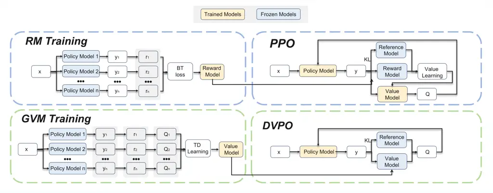
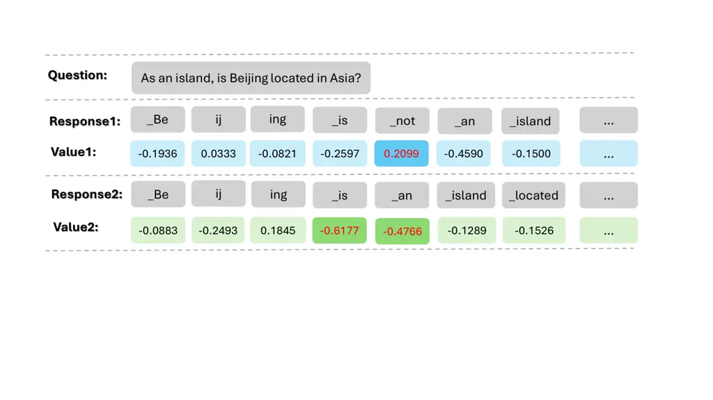

# Pretrain Value, Not Reward: Decoupled Value Policy Optimization

Chenghua Huang ^(†)^(†)thanks: Work is done during an internship at
Microsoft Affiliation: School of Computer Science, Fudan University
Email: [huangch22@m.fudan.edu.cn](mailto:)    Lu Wang
Email: [wlu@microsoft.com](mailto:)    Fangkai Yang
Affiliation: Microsoft Email: [fangkaiyang@microsoft.com](mailto:)    Pu
Zhao Affiliation: Microsoft Email: [puzhao@microsoft.com](mailto:)   
Qingwei Lin,Dongmei Zhang,Saravan Rajmohan Affiliation: Microsoft
Email: [dongmeiz@microsoft.com](mailto:)
Email: [saravar@microsoft.com](mailto:)

###### Abstract

In this paper, we explore how directly pretraining a value model
simplifies and stabilizes reinforcement learning from human feedback
(RLHF). In reinforcement learning, value estimation is the key to policy
optimization, distinct from reward supervision. The value function
predicts the _return-to-go_ of a partial answer, that is, how promising
the partial answer is if it were continued to completion. In RLHF,
however, the standard pipeline first pretrains a reward model and then
learns a value function online, even though no new reward signals are
available once preference data is collected. This makes critic learning
redundant, as the process of training a reward model and then deriving a
value model is informationally equivalent to directly pretraining a
value model. Importantly, this requires no additional supervision, and
our value model is trained on exactly the same data used for reward
modeling. Building on this insight, we introduce _Decoupled Value Policy
Optimization_ (DVPO), a framework that pretrains a _Global Value Model_
(GVM) offline and freezes it as a universal critic for policy learning.
The GVM provides stable, fine-grained credit assignment without critic
drift or trajectory sampling. Experiments across MT-Bench, Alpaca-Eval,
and Arena-Hard demonstrate that DVPO matches or surpasses
state-of-the-art RLHF methods. These results highlight RLHF can be
reframed as policy-only optimization guided by a single pretrained value
model. The implementation code for our method is available in
[https://github.com/microsoft/DKI_LLM/tree/main/dvpo](https://github.com/microsoft/DKI_LLM/tree/main/dvpo)

|     |
| --- |
|     |

## 1 Introduction

¹¹footnotetext: Corresponding author.

The alignment of large language models (LLMs) with human preferences has
become one of the core challenges of modern natural language processing.
While scaling up LLMs has led to remarkable gains in performance and
generality Achiam et al. (2023); Bubeck et al. (2023), scale alone does
not ensure that models behave in ways users actually desire, especially
in complex reasoning, summarization, or dialogue tasks. Reinforcement
Learning from Human Feedback (RLHF) Christiano et al. (2017); Bai et al.
(2022b); Song et al. (2024) has emerged as a critical step in shaping
model behavior, enabling systems that are safer, more accurate, and more
useful (Bai et al., 2022a; Ganguli et al., 2022).

A central component of RLHF is reinforcement learning (RL), where
policies are optimized with respect to _value estimates_ of
return-to-go. Existing RLHF frameworks, however, have taken a circuitous
path toward value estimation. First, because LLMs lack an interactive
environment that provides ground-truth rewards, the community trains a
_reward model_ (RM) from preference data (Ziegler et al., 2019; Ouyang
et al., 2022; Wang et al., 2024). Second, this reward model is used to
supervise either an online-trained critic (as in PPO (Schulman et al., 2017) and its variants) or to indirectly estimate values through
trajectory sampling (as in DPO (Rafailov et al., 2024), ReMax (Li et
al., 2023), and GRPO (Shao et al., 2024)). Both approaches are costly
and unstable: critics drift during joint training, while sampling-based
methods discard token-level credit assignment and suffer from high
variance.  (Yao et al., 2023; Huang et al., 2024)

This work explores a simpler and more direct alternative, motivated by
two ideas. First, if no new ground-truth rewards are available during
policy training, then learning a value model online from a fixed reward
model adds no fundamentally new information. Pretraining a reward model
followed by critic training is therefore informationally equivalent to
directly pretraining a value model. Second, in open-ended tasks, rewards
are largely policy-invariant: whether policy A or policy B produces a
solution, the return is determined by correctness or preference, not by
policy-specific stochasticity. This opens the door to amortizing value
estimation into a _Global Value Model_ (GVM), pretrained once on diverse
trajectories and reused as a frozen critic across policies.

We call this approach Decoupled Value Policy Optimization (DVPO). DVPO
eliminates online critic training entirely: the GVM is pretrained
offline to predict token-level return-to-go, frozen, and then used to
guide policy optimization via a standard RL objective. Crucially, the
GVM is trained on exactly the same preference data that would ordinarily
be used to pretrain a reward model, requiring no additional supervision
or annotations. This design avoids critic drift, reduces compute and
memory overhead, and provides fine-grained interpretability through
token-level attributions.

We present empirical evaluations across standard RLHF benchmarks,
including MT-Bench Zheng et al. (2023), Alpaca-Eval Dubois et al.
(2024), and Arena-Hard Li et al. (2024). Our results show that DVPO
achieves performance on par with or surpassing state-of-the-art RLHF
methods while reducing GPU memory usage by 30-40% and training time by
30-45%. This indicates that rather than repeatedly retraining unstable
actor–critic pairs or discarding value functions altogether, a single
offline-pretrained value model can serve as a stable, scalable, and
generalizable critic for RLHF.

## 2 Related Work

Reinforcement Learning in Language Model Optimization. Reinforcement
learning has emerged as a prevalent method for fine-tuning large
language models (LLMs), with Proximal Policy Optimization (Schulman et
al., 2017) and its variations (Ramamurthy et al., 2022; Wu et al., 2023)
being the most prevalent methods. These techniques largely adhere to the
actor-critic paradigm (Sutton, 2018), This approach alternates between
training a value estimator for the current policy and leveraging it to
enhance policy performance. This bilevel process may result in a
suboptimal policy, as demonstrated by empirical studies (Gao et al.,
2023). Moreover, the alternating optimization of the policy and critic
models, along with the use of rewards provided by the reward model as
environmental feedback, necessitates loading four models (including the
reference model) simultaneously during training. This significantly
increases training complexity and computational resource
consumption (Yao et al., 2023; Hu et al., 2024).

Efficiency RLHF. Many recent studies have sought to mitigate the
computational complexity and resource consumption of the reinforcement
learning (RL) step in RLHF. Methods such as DPO (Rafailov et al., 2024)
and its variants (Meng et al., 2024; Ethayarajh et al., 2024; Hong et
al., 2024) bypass reward modeling and the actor-critic learning
framework by directly learning from preferences. However, existing
research indicates that due to their offline nature, these approaches
exhibit a performance gap compared to online RL (Xu et al., 2024). Some
recent works have proposed a reward-only approach to reduce the training
cost of the RL phase (Li et al., 2023; Gunter et al., 2024; Shao et al.,
2024; Ahmadian et al., 2024; Yu et al., 2025). However, this method
lacks value estimation and assigns the same reward score to each token,
leading to high variance and instability during training (Hu, 2025).
Unlike these approaches, our method pre-trains a global value model
(GVM) and leverages it to guide RL training, providing token-level
supervision signals. This not only reduces training resource consumption
but also stabilizes the training process, achieving performance
comparable to the original PPO.

Some recent works have attempted to learn a value function and use it to
guide the decoding phase of LLMs, thereby bypassing the RL optimization
stage (Han et al., 2024; Kong et al., 2024; Mao et al., 2024). However,
this approach significantly increases inference complexity and raises
inference costs. Some studies (Yuan et al., 2025) also leverage
pre-trained value models to guide policy optimization; however, they
still employ an actor–critic architecture, incurring substantial
computational overhead. In contrast, we leverage the learned value model
to guide RL training, where the pre-trained value model helps the policy
model converge more stably (Noukhovitch et al., 2024).

## 3 Method

We propose DVPO for RLHF in which a GVM is trained once and then fixed
to guide policy updates. This approach removes the need for joint
policy–value training and mitigates the associated computational
overhead and instability. As shown in Figure 1, our method comprises two
primary stages: (1) Train GVM: Use offline trajectories (states,
actions, returns, and policy-specific data) to learn a
policy-conditioned action-value function $`Q_{\phi}`$. Notably, returns
can be derived from either preference data—commonly used in standard
RLHF settings—or a pretrained reward model. For a detailed comparison of
these sources, see Appendix G. (2) Decoupled Value Policy Optimization:
Freeze $`Q_{\phi}`$ and optimize a policy using a standard RL objective
(e.g., PPO), taking advantage estimates from the fixed GVM.



Figure 1: Overview of DVPO. PPO requires a pre-trained reward model to
provide environmental feedback. It combines this reward signal with a
learned value function to estimate the action–value $`Q(s,a)`$. In
contrast, DVPO trains a Global Value Model (GVM) on the same offline
data to produce fine-grained value estimates. This design removes the
need for additional ground-truth rewards during policy training and
decouples policy learning from value learning.

### 3.1 Problem Setting

We model the sequence generation task in NLP as a Markov Decision
Process (MDP). The response consists of $`T`$ tokens, denoted by
$`y=y^{<T+1}\coloneqq[y^{1},y^{2},\dots,y^{T}]`$, where
$`y^{t}\in\mathcal{Y}`$ and $`\mathcal{Y}`$ is the vocabulary. We assume
$`y^{<1}=[\ ]`$, indicating an empty prefix. Given a prompt $`x`$ and
the first $`t-1`$ tokens $`y^{<t}`$, the language model (LM) predicts
the probability distribution for the next token as:
$`\pi_{\theta}(\cdot\mid[x,y^{<t}]).`$

In this MDP formulation, the state is defined as $`s_{t}=[x,y^{<t}]`$,
representing the prompt (i.e., $`x`$) and the generated response up to
step $`t`$. The action is the next generated token $`a_{t}=y^{t}`$. The
ground-truth reward at the sentence level, denoted by $`r(x,y)`$, is
provided by human feedback. To transform the sentence-level reward into
token-level rewards $`r(s_{t},a_{t})`$, we apply a simplified form of
temporal difference (TD) learning. Specifically, we assign a reward of 0
to each intermediate step and use the final step’s reward as the
sentence-level reward value.

By this definition, the cumulative return from step $`t`$ onwards is
expressed as: $`G_{t}=\sum_{k=t}^{T}\gamma^{k-t}r(s_{k},a_{k}),`$ which
simplifies to $`G_{t}=\gamma^{T-t}r(x,y)`$ when all intermediate rewards
are zero. In RLHF, we rely on offline data $`\mathcal{D}`$, which
contains state–action trajectories, returns, and policy behaviors. The
dataset is defined as:
$`\mathcal{D}=\bigl\{(\tau_{i},s^{i}_{t},a^{i}_{t},G^{i}_{t})\bigr\}_{i=1}^{N},`$
where $`\tau_{i}`$ represents the $`i`$-th policy behavior, typically
expressed as a sequence of question–answer pairs,
$`(s^{i}_{t},a^{i}_{t})`$ is a state–action pair sampled under that
policy. Note that $`\tau_{i}`$ and $`(s^{i}_{t},a^{i}_{t})`$ may refer
to different or identical question–answer pairs under the same policy.
No additional ground-truth rewards are collected during training.

### 3.2 Training a Global Value Model (GVM)

Our key insight is to learn a _policy-conditioned_ action-value function
$`Q_{\phi}(\tau,s,a)`$ from offline data, where $`\tau`$ represents a
sampled trajectory capturing _how the policy behaves_ in unrelated
contexts. This conditioning approximates how well a particular policy,
embodied by $`\tau`$, would perform when taking action $`a`$ in state
$`s`$.

##### Policy Conditioning via Trajectories.

Traditional actor–critic methods require online adaptation of the value
function to the actor’s evolving behavior. In contrast, we aim for a
single, _global_ $`Q_{\phi}`$ that generalizes across different
policies, thus avoiding iterative re-learning. Instead of conditioning
on explicit policy parameters, we leverage _trajectories_ $`\tau`$
randomly sampled from the policy in question. Each $`\tau`$ is a
sequence of question–answer pairs (in LLM tasks) or other interactions
that reveal distinct policy traits (e.g., stylistic tendencies,
correctness, domain expertise).

Formally, we parametrize:
$`Q_{\phi}(\tau,s,a)\;\approx\;\mathbb{E}\!\Bigl[\sum_{t=0}^{\infty}\gamma^{t}\,r(s_{t},a_{t})\;\Bigm|\;s_{0}=s,\;a_{0}=a,\;\tau\Bigr],`$
where $`\tau`$ implicitly determines which policy $`\pi(\cdot\mid s)`$
we are approximating. In practice, we train the global value model
$`Q_{\phi}(\tau,s,a)`$ using Temporal Difference (TD) learning. The
target return $`G_{i}`$ is estimated based on future rewards and value
predictions. Specifically, $`G_{i}`$ is computed as:

```math
G_{t}=r(s_{t},a_{t})+\gamma Q_{\phi}(\tau,s_{t+1},a_{t+1}),
```

where $`r(s_{t},a_{t})`$ is the reward for taking action $`a_{t}`$ in
state $`s_{t}`$, and $`Q_{\phi}(\tau,s_{t+1},a_{t+1})`$ is the predicted
value of the next state-action pair.

The training objective for the global value model is to minimize the TD
loss:

```math
\begin{split}\mathcal{L}_{\text{GVM}}(\phi)\;=\;\mathbb{E}_{(\tau_{t},s_{t},a_{t},r_{t},s_{t+1},a_{t+1})\in\mathcal{D}}\bigl[\bigl(r_{t}+\gamma Q_{\phi}(\tau,s_{t+1},a_{t+1})-Q_{\phi}(\tau,s_{t},a_{t})\bigr)^{2}\bigr],\end{split} \tag{1}
```

This TD-based loss drives $`Q_{\phi}`$ to iteratively adjust its
estimates of the expected return, ensuring that the value function
accurately reflects both immediate and future rewards. This approach is
particularly suitable for offline RLHF scenarios, as it can handle
sequences with deterministic state transitions.

### 3.3 Decoupled-Value Policy Optimization

In traditional actor–critic methods, both the policy (actor) and value
(critic) are trained simultaneously, which introduces instability due to
their interdependence. This issue is exacerbated in offline RLHF
settings, where no new environment rewards can be collected to correct
misaligned updates. To address these challenges, we propose a
decoupled-value policy optimization approach: the global value model
$`Q_{\phi}`$ is trained and fixed before policy optimization, decoupling
the learning dynamics of the actor and critic.

##### Policy Optimization Objective.

Once the global value model $`Q_{\phi}`$ converges, we _fix_ its
parameters and use it to guide policy updates. Let
$`\pi_{\theta}(a\mid s)`$ be the policy to be optimized. We adopt a
clipped PPO objective, which stabilizes policy updates by limiting the
impact of large policy changes:

```math
\mathcal{L}_{\text{PPO}}(\theta)\;=\;\mathbb{E}\Bigl[\min\bigl(r_{t}(\theta)\hat{A}_{t},\operatorname{clip}\bigl(r_{t}(\theta),1-\epsilon,1+\epsilon\bigr)\hat{A}_{t}\bigr)\Bigr], \tag{2}
```

where
$`r_{t}(\theta)=\tfrac{\pi_{\theta}(a_{t}\mid s_{t})}{\pi_{\theta_{\text{old}}}(a_{t}\mid s_{t})}`$
is the importance sampling ratio, and $`\epsilon`$ is a clipping
parameter to prevent overly large updates.

The advantage function measures the relative quality of an action
compared to the expected value of the state. We define the advantage
using the fixed value model:

```math
\hat{A}_{t}=\widetilde{Q}_{\phi}(\tau,s_{t},a_{t}),
```

where $`\widetilde{Q}_{\phi}`$ is the value estimate computed during the
GVM training stage (see §3.2). In offline RLHF, this static advantage
definition provides a reliable signal for policy improvement without
requiring dynamic value updates.

Our decoupled-value approach offers two key advantages: (1) By fixing
$`Q_{\phi}`$, we eliminate the “moving target” problem inherent in
actor–critic methods, leading to more stable and predictable policy
updates. (2) Since no additional environment rewards can be collected,
the static $`Q_{\phi}`$ provides all necessary supervisory information,
enabling efficient reuse of the offline dataset for policy optimization.

In addition, DVPO does not require stronger assumptions than standard
PPO-style RLHF. Because the GVM is pretrained once and fixed, policy
optimization proceeds with stable guidance and avoids critic drift. We
provide empirical evidence of this stability in Appendix F, where DVPO
exhibits smooth and reliable training curves compared to PPO.

### 3.4 Equivalence of reward–critic training and value pretraining

In RLHF with fixed feedback, we first train a reward model $`R_{\phi}`$
on a preference dataset $`\mathcal{D}`$. Existing pipelines then
_estimate values from this trained reward_—either by learning an online
critic from $`R_{\phi}`$ (PPO-style) or by sampling many outputs and
normalizing $`R_{\phi}`$ scores  ( ) . Crucially, both routes consume no
supervision beyond $`\mathcal{D}`$: the value signal is entirely derived
from the already-trained $`R_{\phi}`$. Therefore, the two-stage
procedure _(reward training) + (value estimation from the trained
reward)_ is informationally equivalent to _directly pretraining a value
model_ $`Q_{\psi}`$ on the same $`\mathcal{D}`$. This is the equivalence
we claim: not that rewards and values are identical, but that _deriving
a value signal from a fixed, pretrained reward adds no new information
compared to pretraining the value model directly_. DVPO leverages this
by pretraining a Global Value Model once and discarding the redundant
estimation stage.

#### 3.4.1 Preliminaries

Let $`r(s,a)`$ denote the unknown ground-truth reward function, and let
$`\gamma\in[0,1]`$ be the discount factor. We assume access to an
offline dataset $`\mathcal{D}`$, from which we pretrain the following
models. (1) Reward Model $`R_{\phi}(s,a)`$, which approximates
$`r(s,a)`$ with error bounded by $`\epsilon_{R}`$. (2) Global Value
Model $`Q_{\psi}(s,a)`$, which approximates the action-value function
$`Q^{\pi}(s,a)=\mathbb{E}_{\pi}\left[\sum_{t=0}^{\infty}\gamma^{t}r(s_{t},a_{t})\mid s_{0}=s,a_{0}=a\right],`$
with approximation error bounded by $`\epsilon_{Q}`$.

We merge any explicit conditioning (e.g., trajectory $`\tau`$) into the
state definition to simplify notation. Since no new rewards are observed
post-deployment, both $`R_{\phi}`$ and $`Q_{\psi}`$ serve as static
supervision signals throughout training.

Let $`\pi_{\theta}(a\mid s)`$ be the trainable policy. We define the
policy gradient objectives under each supervision signal as:

```math
\nabla_{\theta}\mathcal{J}_{R}(\pi_{\theta})=\mathbb{E}_{s\sim d^{\pi_{\theta}},a\sim\pi_{\theta}}\left[\nabla_{\theta}\log\pi_{\theta}(a\mid s)\cdot\hat{A}_{R}(s,a)\right],
```

```math
\nabla_{\theta}\mathcal{J}_{Q}(\pi_{\theta})=\mathbb{E}_{s\sim d^{\pi_{\theta}},a\sim\pi_{\theta}}\left[\nabla_{\theta}\log\pi_{\theta}(a\mid s)\cdot\hat{A}_{Q}(s,a)\right],
```

where $`d^{\pi_{\theta}}`$ is the stationary distribution under policy
$`\pi_{\theta}`$, and the advantage functions are defined as:

```math
\hat{A}_{R}(s,a)=\widetilde{Q}_{\phi}^{R}(s,a)-b(s),\quad\hat{A}_{Q}(s,a)=Q_{\psi}(s,a)-b(s),
```

with $`b(s)`$ as a baseline (e.g., state value function $`V(s)`$) to
reduce variance. The estimate $`\widetilde{Q}_{\phi}^{R}(s,a)`$ is
computed by solving the Bellman equation using $`R_{\phi}`$, following
standard value iteration procedures. This structure parallels typical
actor-critic methods, as discussed in (Sutton, 2018). In contrast,
$`Q_{\psi}(s,a)`$ is a _fixed global value model_ pretrained offline.
This is a key distinction: unlike standard actor-critic methods (e.g.,
PPO), where the value function is updated alongside the policy at each
training step.

#### 3.4.2 Equivalence Lemma.

We formalize the observation that, under fixed preference data, (reward
pretraining + value estimation) provides no additional information
beyond direct value pretraining.

###### Lemma 3.1 (Equivalence under fixed feedback).

Let $`\mathcal{D}`$ be a fixed preference dataset and let $`R_{\phi}`$
be a reward model trained on $`\mathcal{D}`$. Assume: 1. For all
$`(s,a)`$ in $`\mathcal{D}`$,
$`|R_{\phi}(s,a)-r(s,a)|\leq\epsilon_{R}`$. 2. For the same
distribution, both the reward-induced value $`\widetilde{Q}_{\phi}^{R}`$
and the pretrained GVM $`Q_{\psi}`$ satisfy

```math
\big|\widetilde{Q}_{\phi}^{R}(s,a)-Q^{\pi}(s,a)\big|\leq\epsilon_{Q},\qquad\big|Q_{\psi}(s,a)-Q^{\pi}(s,a)\big|\leq\epsilon_{Q}.
```

3. (Fixed feedback) No new rewards are observed during training. Then
   the induced policy gradients satisfy

```math
\left\|\nabla_{\theta}\mathcal{J}_{\widetilde{Q}_{\phi}^{R}}(\pi_{\theta})-\nabla_{\theta}\mathcal{J}_{Q_{\psi}}(\pi_{\theta})\right\|\;\leq\;\kappa(\epsilon_{R},\epsilon_{Q}),
```

with $`\kappa(\epsilon_{R},\epsilon_{Q})\!\to\!0`$ as
$`\epsilon_{R},\epsilon_{Q}\!\to\!0`$. Thus, reward–critic training and
direct value pretraining are _informationally equivalent_ on
$`\mathcal{D}`$.

The complete proof, including Bellman-based derivations and bounding
arguments, is provided in Appendix B.

##### Convergence Corollary.

Building on Lemma 3.1, we now consider DVPO policy updates. If policy
updates are regularized (e.g., KL-clipped as in PPO) and the GVM
approximation error is bounded, then DVPO inherits the same monotonic
improvement guarantee as PPO. In other words, replacing the online
critic with a fixed pretrained GVM does not weaken PPO’s local
convergence properties, while eliminating critic drift in practice.

## 4 Experiment

### 4.1 Training datasets

Stage1: We collected offline trajectories data to train GVM.
Specifically, we selected the _UltraFeedback_ dataset(Cui et al., 2023),
in which, for a given prompt, multiple models generate responses that
are annotated with scalar scores. Training instances for GVM take the
form $`\{\text{prompt},\,\text{response}_{i},\,\text{reward}_{i}\}`$. We
also explored training directly from pairwise preferences by assigning a
score of $`1`$ to the chosen response and $`-1`$ to the rejected
response. The resulting performance was comparable to training with
scalar rewards, highlighting GVM’s compatibility with different
supervision formats; see the Appendix G for details. Stage2: To prevent
data leakage, we conduct RL training on the 10K prompts retained from
the previous step, with GVM providing training feedback.

### 4.2 Training settings

Base setting. We fine-tune a base model (LLaMA3-8B-Base and
LLaMA3.2-3B-Base) to obtain an SFT model. The data are split into three
disjoint parts: SFT, reward-model training, and RL. We then apply
reinforcement learning to the SFT model. This setup follows the standard
RL stage and is transparent and reproducible.

Instruction setting. We select an off-the-shelf instruction-tuned model
as the SFT model. To facilitate comparison with related work(Li et al.,
2023; Rafailov et al., 2024), we choose the Mistral-7B-Instruct-v0.2 and
LlaMA3-8B-Instruct. These models have undergone extensive instruction
fine-tuning processes based on the base model, resulting in stronger
capabilities compared to the SFT model in the Base setting. For more
training details, please refer to Appendix C

### 4.3 Baseline and Evaluation

Baseline. For GVM, we compare it with scalarRM trained on the same data.
We also compare it with the value model in PPO training. In PPO,
scalarRM provides the supervision signal. For the policy model, we
compare it with the backbone model and with other RL algorithms,
including PPO, GRPO, DPO, and ReMax. In all these baselines, scalarRM
provides the supervision signal.

Evaluation. To evaluate GVM, we use a held-out test set and
reward-related benchmarks (e.g., RewardBench). Because GVM produces
token-level estimates for each response, we recover a response-level
reward by applying a Bellman-style backup. We discuss our choice of
evaluation metrics in the Appendix. We evaluate the response quality of
the policy models using the most popular benchmarks: MT-Bench(Zheng et
al., 2023), Arena-Hard(Li et al., 2024), and Alpaca-Eval(Dubois et al.,
2024). Additionally, we compare the LLM-as-a-judge win rate on the
held-out test set.

## 5 Experiment results

### 5.1 DVPO on Base setting

As mentioned earlier, to clearly evaluate the feasibility of DVPO
compared to existing methods, we conducted experiments on publicly
available datasets. The datasets were split proportionally for
supervised fine-tuning (SFT) and reward learning (value learning).
Subsequently, the resulting reward model (value model) was used to guide
the policy optimization for preference learning. Given the relatively
small amount of data at each stage (with the RL phase accounting for
approximately 20% of the entire dataset), our focus in the Base setting
is on relative improvement rather than absolute performance metrics. The
results are presented in Table 1.

DVPO demonstrates superior optimization performance. In experiments
conducted on LLaMA3-3B and LLaMA3-8B, DVPO consistently outperforms SFT
significantly. Specifically, under the Base setting of LLaMA3-8B, DVPO
achieves improvements of 0.2 on MT-Bench, 1.5 on Arena-Hard, and 1.74 on
Alpaca-Eval compared to the SFT model. The improvements are even more
pronounced with LLaMA3-3B, where DVPO achieves a 0.51 increase on
MT-Bench, a 5-point increase on Arena-Hard, and a 4.14-point increase on
Alpaca-Eval. Similarly, as shown in Figure 2, on the held-out test set,
DVPO achieves a higher win rate compared to the SFT model. These results
validate the robustness and effectiveness of DVPO.

The pre-trained value model can provide a sufficiently high performance
ceiling. According to the experimental results in the Base setting, the
final convergence performance of DVPO is very close to that of standard
PPO (and in some cases, slightly exceeds it), indicating that the
supervision signals provided by the pre-trained value model can support
a sufficiently high performance ceiling. As an actor-critic method, PPO
trains the policy model and value model simultaneously, with the reward
model providing environmental feedback. The value model, as a bridge
between immediate rewards (sentence-level) and long-term returns, offers
finer-grained supervision signals (token-level) compared to immediate
rewards alone. In DVPO, the global value model(GVM) is pre-trained on
responses from different policies, enabling it to provide supervision
feedback to various policies during the RL phase. The experimental
results demonstrate that the fine-grained environmental feedback
provided by DVPO can achieve a performance ceiling comparable to that of
the actor-critic framework while significantly reducing training
complexity and instability.

| Model      | Llama3.2-3B-Base |            |             | Llama3-8B-Base |            |             |
| ---------- | ---------------- | ---------- | ----------- | -------------- | ---------- | ----------- |
|            | Mtbench          | Arena hard | AlpacaEval2 | Mtbench        | Arena hard | AlpacaEval2 |
| SFT        | 5.22             | 10.4       | 8.19        | 4.87           | 10.3       | 9.79        |
| PPO        | 5.33             | 13.5       | 11.54       | 4.98           | 11.7       | 11.14       |
| Remax      | 5.23             | 12.2       | 12.02       | 4.94           | 8.9        | 9.62        |
| GRPO       | 5.46             | 13.4       | 10.86       | 4.91           | 10.4       | 10.27       |
| DVPO       | 5.73             | 15.1       | 12.33       | 5.01           | 11.8       | 11.33       |
| $`\Delta`$ | +5.1%            | +4.70%     | +4.14%      | +1.40%         | +1.50%     | +1.54%      |

Table 1: Result of Base setting. Both methods were initialized from SFT
and optimized. DVPO achieved the best benchmark scores across models
with different parameter sizes. MT-Bench scores range from 0–10.

### 5.2 DVPO on Instruction setting

To evaluate the effectiveness of DVPO in most RLHF scenarios
(optimization starting from a pre-aligned model), we selected
Mistral-7B-Instruct-v0.2 and LlaMA3-8B-Instruct as the SFT model. An
existing UltraRM reward model was used to collect labeled data for
training the value model, value model also initialized from SFT model.
The trained value model then guided the preference optimization of the
SFT model. The results are presented in Table 2. Experimental findings
demonstrate that our method exhibits significant advantages over other
approaches. Our main findings are as follows:

DVPO significantly enhances the performance of instruction models.
Compared to the original Mistral-7B-Instruct-v0.2, DVPO consistently
demonstrates performance improvements across all benchmarks.
Specifically, it achieves a 0.19 improvement on MT-Bench and increases
the win rate by 12.1% on Arena-Hard. Additionally, it enhances the
length-controlled win rate by 10.32% on Alpaca-Eval. Furthermore,
compared to DPO, DVPO also exhibits notable advantages, on the Mistral
setting, outperforming 8.4% in Arena-Hard and 0.49 in MT-Bench. On the
Llama setting, outperforming 0.71 in MT-Bench. These results indicate
that the pre-trained value model can effectively and reliably guide the
optimization of policy models.

Finer-grained feedback signals lead to superior performance. Compared to
reward-only methods such as ReMax and GRPO, DVPO demonstrates
significant performance advantages on Mt-Bench, Arena-hard and
Alpaca-Eval. In ReMax and GRPO, the feedback signal is at the sentence
level from the reward model, assigning a single reward score to the
entire sentence and treating all tokens as equally contributing to the
overall score. This design prevents the policy model from learning
fine-grained preferences during the RL phase, resulting in suboptimal
performance. In contrast, the GVM—trained with TD-learning over
prefixes—assigns different values to different parts of a response; as
shown in Figure 3, decisive reasoning tokens receive high values while
misleading continuations receive low values. By assigning a return value
to each token, GVM facilitates more effective training of the policy
model. In addition to providing fine-grained returns, DVPO retains the
on-policy characteristics of the original PPO, enabling a larger
exploration space and offering a higher performance ceiling.

| Method      | Mistral 7B |            |             | Llama3 8B |            |             |
| ----------- | ---------- | ---------- | ----------- | --------- | ---------- | ----------- |
|             | Mtbench    | Arena hard | AlpacaEval2 | Mtbench   | Arena hard | AlpacaEval2 |
| Instruction | 6.60\*     | 12.6\*     | 17.11\*     | 6.90\*    | 20.6\*     | 34.38\*     |
| ReMax       | 6.67\*     | 21.9\*     | 20.55\*     | 7.62      | 30.8       | 36.04       |
| DPO         | 6.30       | 16.3       | 26.80       | 7.01      | 32.6       | 40.32       |
| GRPO        | 6.31       | 21.8       | 27.19       | 7.53      | 34.1       | 35.17       |
| PPO         | 6.55       | 19.4       | 19.62       | 7.55      | 36.3       | 34.98       |
| DVPO        | 6.79       | 24.7       | 27.43       | 7.72      | 39.2       | 42.59       |
| $`\Delta`$  | +1.90%     | +12.1%     | +10.32%     | +8.20%    | +18.6%     | +8.21%      |

Table 2: Result of Instruction setting. Instruction refers to
Mistral-7B-Instruct-v0.2 and LlaMA3-8B-Instruct. All methods are
initialized from their respective instruction models. Results marked
with an (\*) are sourced from the original paper or inference from the
open-source release.

## 6 Analysis

### 6.1 Comparsion of Scalar RM in Reward Bench

To verify that GVM can effectively learn state-value estimates from
offline trajectories, we aggregate its token-level values into a final,
outcome-level reward and evaluate on reward-related benchmarks. We also
compare against scalar reward models (ScalarRM) trained on the same
data. As shown in Table 3, the average RewardBench (Lambert et al., 2024) scores of GVM and ScalarRM are comparable overall, but their
performance profiles differ. On the Chat (easy) subset, ScalarRM
consistently outperforms GVM, suggesting that sequence-level prediction
with a pairwise Bradley–Terry (BT) loss readily captures global
objectives and models overall preference on easier cases. In contrast,
on the Chat-Hard subsets, GVM—trained with Bellman/temporal-difference
(TD) learning for token-level value estimation—generalizes better to
more complex problems. In sum, given identical data, GVM and ScalarRM
achieve similar aggregate performance, but GVM provides finer-grained
and more accurate supervision at the token level; relative to
distributing a single sequence-level reward down to tokens, these direct
value signals improve policy learning. Additionally, we provide
illustrative GVM case studies in Appendix D.

| Model      | Method  | Chat | Chat-Hard | Safety | Reason. |
| ---------- | ------- | ---- | --------- | ------ | ------- |
| Llama3 8B  | GVM     | 88.3 | 67.5      | 66.8   | 79.2    |
|            | SclarRM | 95.5 | 58.5      | 73.9   | 65.4    |
| Mistral 7B | GVM     | 75.4 | 61.4      | 66.7   | 64.4    |
|            | SclarRM | 93.8 | 52.4      | 64.1   | 60.3    |

Table 3: In the RewardBench results, GVM and ScalarRM are trained on the
same data.

| Method | Llama3 8B | Mistral 7B |
| ------ | --------- | ---------- |
| GVM    | 68.1      | 64.5       |
| A/C    | 60.6      | 57.6       |

Table 4: Result of Ultrafeedback testset. A/C denotes the PPO critic
(value model), evaluated at PPO training convergence.

### 6.2 Comparsion of Actor-critic Value model

Beyond our comparison with ScalarRM, we also analyze the value model in
the actor–critic paradigm. As shown in Table 4, on in-distribution data
GVM significantly outperforms the A/C value model, indicating that a
value model pretrained directly from preference data more effectively
estimates response state values than the critic jointly trained with
PPO. Moreover, this advantage transfers across different base (backbone)
models. A/C value model is trained to fit returns under the current
policy. It is tightly coupled to the policy, and its data distribution
shifts during training, so it best predicts returns for outputs likely
under that policy. In contrast, GVM learns from large-scale preferences
which state transitions increase or decrease reward. It is
policy-agnostic and therefore yields more accurate value estimates.In
this sense, our value model is “global” in that (i) it is
policy-agnostic rather than coupled to a single behavior policy, and
(ii) it evaluates each action from a trajectory-level perspective by
considering how the entire trajectory contributes to the final outcome.

| Method | Llama3 8B | Mistral 7B |
| ------ | --------- | ---------- |
| GVM    | 63.3      | 60.8       |
| A/C    | 57.5      | 53.8       |

Table 5: Result of HH-RLHF testset.

To further compare the performance of GVM and A/C under distribution
shifts, we evaluate the GVM and A/C value model from Ultrafeedback
experiment on a new distribution, new prompts in the test split of the
HH-RLHF dataset. The result presented in Tabel 5, We also compute the
accuracy metrics. On the new distribution, both GVM and A/C show lower
performance, but GVM still leads. This indicates that GVM’s pretrained
value estimates remain robust under shift. Pretraining on offline
trajectories helps the value model learn value estimation more
faithfully and improves generalization.

### 6.3 Comparsion of Computation

|                        | ScalarRM               | GVM                    | PPO                            | ReMax                          | GRPO                           | DVPO                           |
| ---------------------- | ---------------------- | ---------------------- | ------------------------------ | ------------------------------ | ------------------------------ | ------------------------------ |
| $`M_{\mathrm{train}}`$ | $`m_{\mathrm{train}}`$ | $`m_{\mathrm{train}}`$ | $`2\times m_{\mathrm{train}}`$ | $`m_{\mathrm{train}}`$         | $`m_{\mathrm{train}}`$         | $`m_{\mathrm{train}}`$         |
| $`m_{\mathrm{infer}}`$ | $`-`$                  | $`-`$                  | $`2\times m_{\mathrm{infer}}`$ | $`2\times m_{\mathrm{infer}}`$ | $`2\times m_{\mathrm{infer}}`$ | $`2\times m_{\mathrm{infer}}`$ |
| $`C_{\mathrm{gene}}`$  | $`-`$                  | $`-`$                  | $`c_{\mathrm{gene}}`$          | $`2\times c_{\mathrm{gene}}`$  | $`n\times c_{\mathrm{gene}}`$  | $`c_{\mathrm{gene}}`$          |
| $`C_{\mathrm{back}}`$  | $`c_{\mathrm{back}}`$  | $`c_{\mathrm{back}}`$  | $`2\times c_{\mathrm{back}}`$  | $`c_{\mathrm{back}}`$          | $`c_{\mathrm{back}}`$          | $`c_{\mathrm{back}}`$          |

Table 6: Memory footprint and computational cost analysis.
$`M_{\mathrm{train}}`$: training-time memory (parameters, optimizer
states, activations); $`M_{\mathrm{infer}}`$: inference-time memory;
$`C_{\mathrm{gene}}`$: computational cost for generating $`n`$
responses; $`C_{\mathrm{back}}`$: computational cost for backpropagation
and optimizer update.

As the Table 6 shows, training GVM and ScalarRM requires nearly the same
GPU memory. Both use the same base model with a single linear head
(hidden size → 1). Their training time is also similar, since each step
performs one backpropagation. Overall, the compute budgets for GVM and
ScalarRM are essentially equivalent. Among RL methods, PPO is the most
resource-intensive because it trains two models in parallel (policy and
value). ReMax, GRPO, and DVPO have comparable memory costs, but
group-based methods such as GRPO must generate multiple responses per
prompt, which increases training time. In sum, DVPO offers the best
balance of memory and time and, with token-level supervision from GVM,
outperforms the other methods. We provide a detailed analysis of
computational resources and the training curves in the Appendix F.

## 7 Discussion

Conclusion. We propose Decoupled Value Policy Optimization (DVPO), a
framework that eliminates joint actor-critic training in RLHF by
leveraging a pretrained global value model (GVM). Our theoretical
analysis proves the functional equivalence of reward and value models
under the constraint of no new reward feedback, justifying the use of a
fixed GVM for efficient and scalable optimization. Empirical results
demonstrate that DVPO achieves comparable or surpasses performance to
state-of-the-art RLHF methods on multiple benchmarks. Future work will
focus on refining the value model’s training process to enhance
estimation performance.

Limitations. DVPO assumes that the offline preference dataset provides
adequate coverage of relevant trajectories and that the Global Value
Model (GVM) can approximate token-level returns within bounded error.
However, the need for sufficiently diverse preference data is inherent
to reward learning, not specific to the GVM. Unlike joint actor–critic
training, DVPO does not adapt the critic as the policy evolves; thus its
guidance is fixed and may fail in highly non-stationary settings. Our
equivalence analysis also holds only under the constraint of no new
reward signals—if additional human or environment feedback becomes
available during training, a static GVM cannot fully exploit it. A
promising future work to mitigate this limitation is to extend DVPO to a
semi-online regime by periodically refreshing the GVM with newly
collected preference data, while carefully controlling the update
frequency to preserve the stability of the training dynamics. Finally,
although DVPO reduces computation and improves stability, it may inherit
biases from the reward-preference data itself, which remain an open
challenge for all RLHF methods.

## Ethics statement

We adhere to the ICLR Code of Ethics. This study did not use personally
identifiable information or sensitive attributes, and involved no direct
interaction with human subjects. Our institution determined that the
work does not constitute human-subjects research (or qualifies for
exemption); therefore, IRB approval was not required. There are no
competing interests or sponsorships that could unduly influence the
results.

## Reproducibility statement

Our study uses open-source datasets; their names and download URLs are
listed in the relevant sections of the paper. Our complete training and
evaluation code is provided in
[https://github.com/chenghuahuang/dvpo](https://github.com/chenghuahuang/dvpo).
The appendix details the full hyperparameter settings and dataset
splits. Where permitted, we release model checkpoints to facilitate
verification of the reported results. A permanent public repository will
be made available upon acceptance.

## References

- Achiam et al. (2023) J. Achiam, S. Adler, S. Agarwal, L. Ahmad, I.
  Akkaya, F. L. Aleman, D. Almeida, J. Altenschmidt, S. Altman, S.
  Anadkat, et al. Gpt-4 technical report. arXiv preprint
  arXiv:2303.08774. Cited by: §1.
- Ahmadian et al. (2024) A. Ahmadian, C. Cremer, M. Gallé, M. Fadaee, J.
  Kreutzer, O. Pietquin, A. Üstün, and S. Hooker Back to basics:
  revisiting reinforce style optimization for learning from human
  feedback in llms. arXiv preprint arXiv:2402.14740. Cited by: §2.
- Bai et al. (2022a) Y. Bai, A. Jones, K. Ndousse, A. Askell, A.
  Chen, N. DasSarma, D. Drain, S. Fort, D. Ganguli, T. Henighan, et al.
  Training a helpful and harmless assistant with reinforcement learning
  from human feedback. arXiv preprint arXiv:2204.05862. Cited by: §1.
- Bai et al. (2022b) Y. Bai, S. Kadavath, S. Kundu, A. Askell, J.
  Kernion, A. Jones, A. Chen, A. Goldie, A. Mirhoseini, C. McKinnon, et
  al. Constitutional ai: harmlessness from ai feedback. arXiv preprint
  arXiv:2212.08073. Cited by: §1.
- Bubeck et al. (2023) S. Bubeck, V. Chandrasekaran, R. Eldan, J.
  Gehrke, E. Horvitz, E. Kamar, P. Lee, Y. T. Lee, Y. Li, S. Lundberg,
  et al. Sparks of artificial general intelligence: early experiments
  with gpt-4. arXiv preprint arXiv:2303.12712. Cited by: §1.
- Christiano et al. (2017) P. F. Christiano, J. Leike, T. Brown, M.
  Martic, S. Legg, and D. Amodei Deep reinforcement learning from human
  preferences. Advances in neural information processing systems 30.
  Cited by: §1.
- Cui et al. (2023) G. Cui, L. Yuan, N. Ding, G. Yao, W. Zhu, Y. Ni, G.
  Xie, Z. Liu, and M. Sun Ultrafeedback: boosting language models with
  high-quality feedback. Cited by: §4.1.
- Dubois et al. (2024) Y. Dubois, B. Galambosi, P. Liang, and T. B.
  Hashimoto Length-controlled alpacaeval: a simple way to debias
  automatic evaluators. arXiv preprint arXiv:2404.04475. Cited by: §1,
  §4.3.
- Ethayarajh et al. (2024) K. Ethayarajh, W. Xu, N. Muennighoff, D.
  Jurafsky, and D. Kiela Kto: model alignment as prospect theoretic
  optimization. arXiv preprint arXiv:2402.01306. Cited by: §2.
- Ganguli et al. (2022) D. Ganguli, L. Lovitt, J. Kernion, A. Askell, Y.
  Bai, S. Kadavath, B. Mann, E. Perez, N. Schiefer, K. Ndousse, et al.
  Red teaming language models to reduce harms: methods, scaling
  behaviors, and lessons learned. arXiv preprint arXiv:2209.07858. Cited
  by: §1.
- Gao et al. (2023) L. Gao, J. Schulman, and J. Hilton Scaling laws for
  reward model overoptimization. In International Conference on Machine
  Learning, pp. 10835–10866. Cited by: §2.
- Gunter et al. (2024) T. Gunter, Z. Wang, C. Wang, R. Pang, A.
  Narayanan, A. Zhang, B. Zhang, C. Chen, C. Chiu, D. Qiu, et al. Apple
  intelligence foundation language models. arXiv preprint
  arXiv:2407.21075. Cited by: §2.
- Han et al. (2024) S. Han, I. Shenfeld, A. Srivastava, Y. Kim, and P.
  Agrawal Value augmented sampling for language model alignment and
  personalization. arXiv preprint arXiv:2405.06639. Cited by: §2.
- Hong et al. (2024) J. Hong, N. Lee, and J. Thorne Orpo: monolithic
  preference optimization without reference model. In Proceedings of the
  2024 Conference on Empirical Methods in Natural Language Processing,
  pp. 11170–11189. Cited by: §2.
- Hu et al. (2024) J. Hu, X. Wu, W. Wang, D. Zhang, Y. Cao, et al.
  OpenRLHF: an easy-to-use, scalable and high-performance rlhf
  framework. arXiv preprint arXiv:2405.11143. Cited by: §2.
- Hu (2025) J. Hu REINFORCE++: a simple and efficient approach for
  aligning large language models. arXiv preprint arXiv:2501.03262. Cited
  by: §2.
- Huang et al. (2024) S. Huang, T. Liu, and L. Von Werra The n
  implementation details of rlhf with ppo. In The Third Blogpost Track
  at ICLR 2024, Cited by: §1.
- Kong et al. (2024) L. Kong, H. Wang, W. Mu, Y. Du, Y. Zhuang, Y.
  Zhou, Y. Song, R. Zhang, K. Wang, and C. Zhang Aligning large language
  models with representation editing: a control perspective. arXiv
  preprint arXiv:2406.05954. Cited by: §2.
- Lambert et al. (2024) N. Lambert, V. Pyatkin, J. Morrison, L.
  Miranda, B. Y. Lin, K. Chandu, N. Dziri, S. Kumar, T. Zick, Y. Choi,
  et al. Rewardbench: evaluating reward models for language modeling.
  arXiv preprint arXiv:2403.13787. Cited by: §6.1.
- Li et al. (2024) T. Li, W. Chiang, E. Frick, L. Dunlap, T. Wu, B.
  Zhu, J. E. Gonzalez, and I. Stoica From crowdsourced data to
  high-quality benchmarks: arena-hard and benchbuilder pipeline. arXiv
  preprint arXiv:2406.11939. Cited by: §1, §4.3.
- Li et al. (2023) Z. Li, T. Xu, Y. Zhang, Y. Yu, R. Sun, and Z. Luo
  Remax: a simple, effective, and efficient method for aligning large
  language models. arXiv preprint arXiv:2310.10505. Cited by: §1, §2,
  §4.2.
- Mao et al. (2024) X. Mao, F. Li, H. Xu, W. Zhang, and A. T. Luu Don’t
  forget your reward values: language model alignment via value-based
  calibration. arXiv preprint arXiv:2402.16030. Cited by: §2.
- Meng et al. (2024) Y. Meng, M. Xia, and D. Chen Simpo: simple
  preference optimization with a reference-free reward. arXiv preprint
  arXiv:2405.14734. Cited by: §2.
- Noukhovitch et al. (2024) M. Noukhovitch, S. Lavoie, F. Strub,
  and A. C. Courville Language model alignment with elastic reset.
  Advances in Neural Information Processing Systems 36. Cited by:
  Appendix F, §2.
- Ouyang et al. (2022) L. Ouyang, J. Wu, X. Jiang, D. Almeida, C.
  Wainwright, P. Mishkin, C. Zhang, S. Agarwal, K. Slama, A. Ray, et al.
  Training language models to follow instructions with human feedback.
  Advances in neural information processing systems 35, pp. 27730–27744.
  Cited by: §1.
- Rafailov et al. (2024) R. Rafailov, A. Sharma, E. Mitchell, C. D.
  Manning, S. Ermon, and C. Finn Direct preference optimization: your
  language model is secretly a reward model. Advances in Neural
  Information Processing Systems 36. Cited by: §1, §2, §4.2.
- Ramamurthy et al. (2022) R. Ramamurthy, P. Ammanabrolu, K.
  Brantley, J. Hessel, R. Sifa, C. Bauckhage, H. Hajishirzi, and Y. Choi
  Is reinforcement learning (not) for natural language processing:
  benchmarks, baselines, and building blocks for natural language policy
  optimization. arXiv preprint arXiv:2210.01241. Cited by: §2.
- Schulman et al. (2017) J. Schulman, F. Wolski, P. Dhariwal, A.
  Radford, and O. Klimov Proximal policy optimization algorithms. arXiv
  preprint arXiv:1707.06347. Cited by: §1, §2.
- Shao et al. (2024) Z. Shao, P. Wang, Q. Zhu, R. Xu, J. Song, X. Bi, H.
  Zhang, M. Zhang, Y. Li, Y. Wu, et al. Deepseekmath: pushing the limits
  of mathematical reasoning in open language models. arXiv preprint
  arXiv:2402.03300. Cited by: §1, §2.
- Song et al. (2024) F. Song, B. Yu, M. Li, H. Yu, F. Huang, Y. Li,
  and H. Wang Preference ranking optimization for human alignment. In
  Proceedings of the AAAI Conference on Artificial Intelligence, Vol.
  38, pp. 18990–18998. Cited by: §1.
- Sutton (2018) R. S. Sutton Reinforcement learning: an introduction. A
  Bradford Book. Cited by: Appendix B, §2, §3.4.1.
- Wang et al. (2024) B. Wang, R. Zheng, L. Chen, Y. Liu, S. Dou, C.
  Huang, W. Shen, S. Jin, E. Zhou, C. Shi, et al. Secrets of rlhf in
  large language models part ii: reward modeling. arXiv preprint
  arXiv:2401.06080. Cited by: §1.
- Wu et al. (2023) T. Wu, B. Zhu, R. Zhang, Z. Wen, K. Ramchandran,
  and J. Jiao Pairwise proximal policy optimization: harnessing relative
  feedback for llm alignment. arXiv preprint arXiv:2310.00212. Cited by:
  §2.
- Xu et al. (2024) S. Xu, W. Fu, J. Gao, W. Ye, W. Liu, Z. Mei, G.
  Wang, C. Yu, and Y. Wu Is dpo superior to ppo for llm alignment? a
  comprehensive study. arXiv preprint arXiv:2404.10719. Cited by: §2.
- Yao et al. (2023) Z. Yao, R. Y. Aminabadi, O. Ruwase, S.
  Rajbhandari, X. Wu, A. A. Awan, J. Rasley, M. Zhang, C. Li, C. Holmes,
  et al. Deepspeed-chat: easy, fast and affordable rlhf training of
  chatgpt-like models at all scales. arXiv preprint arXiv:2308.01320.
  Cited by: §1, §2.
- Yu et al. (2025) Q. Yu, Z. Zhang, R. Zhu, Y. Yuan, X. Zuo, Y. Yue, T.
  Fan, G. Liu, L. Liu, X. Liu, et al. Dapo: an open-source llm
  reinforcement learning system at scale. arXiv preprint
  arXiv:2503.14476. Cited by: §2.
- Yuan et al. (2025) Y. Yuan, Q. Yu, X. Zuo, R. Zhu, W. Xu, J. Chen, C.
  Wang, T. Fan, Z. Du, X. Wei, et al. VAPO: efficient and reliable
  reinforcement learning for advanced reasoning tasks. arXiv preprint
  arXiv:2504.05118. Cited by: §2.
- Zheng et al. (2023) L. Zheng, W. Chiang, Y. Sheng, S. Zhuang, Z.
  Wu, Y. Zhuang, Z. Lin, Z. Li, D. Li, E. Xing, et al. Judging
  llm-as-a-judge with mt-bench and chatbot arena. Advances in Neural
  Information Processing Systems 36, pp. 46595–46623. Cited by: §1,
  §4.3.
- Ziegler et al. (2019) D. M. Ziegler, N. Stiennon, J. Wu, T. B.
  Brown, A. Radford, D. Amodei, P. Christiano, and G. Irving Fine-tuning
  language models from human preferences. arXiv preprint
  arXiv:1909.08593. Cited by: §1.

## Appendix A Use of Large Language Models (LLMs)

We used a large language model solely for sentence-level copyediting
(grammar, clarity, and fluency) of text written by the authors. All LLM
suggestions were reviewed and accepted by the authors, who take full
responsibility for the final content.

## Appendix B Proof

###### Proof.

Converting $`R_{\phi}`$ to a Value Function. Using the pretrained reward
model $`R_{\phi}(s,a)`$, we compute a surrogate action-value function
$`\widetilde{Q}_{\phi}^{R}(s,a)`$ by solving the Bellman equation
offline:

```math
\widetilde{Q}_{\phi}^{R}(s,a)=R_{\phi}(s,a)+\gamma\,\mathbb{E}_{s^{\prime}\sim P}\!\Bigl[\mathbb{E}_{a^{\prime}\sim\pi_{\theta}}[\,\widetilde{Q}_{\phi}^{R}(s^{\prime},a^{\prime})]\Bigr].
```

Under standard offline RL assumptions (including sufficient coverage of
the state-action space), $`\widetilde{Q}_{\phi}^{R}(s,a)`$ converges to
an approximation of $`Q^{\pi}(s,a)`$ with an additional error term
$`\epsilon_{R2Q}`$ that depends on $`\epsilon_{R}`$.

Converting $`Q_{\psi}`$ to an Approximate Reward Signal. Conversely, if
$`Q_{\psi}(s,a)`$ approximates $`Q^{\pi}(s,a)`$, then rearranging the
Bellman equation yields an approximate reward:

```math
\widetilde{R}_{\psi}(s,a)=Q_{\psi}(s,a)-\gamma\,\mathbb{E}_{s^{\prime}\sim P,\,a^{\prime}\sim\pi_{\theta}}\left[Q_{\psi}(s^{\prime},a^{\prime})\right].
```

The error in this reconstruction is bounded by $`\epsilon_{V2R}`$, which
is a function of $`\epsilon_{Q}`$.

Policy Gradient Equivalence. We now explicitly define the two policy
gradient objectives used in our analysis.

The policy gradient with a reward-derived value function, denoted as
$`\nabla_{\theta}\mathcal{J}_{R}(\pi_{\theta})`$, is given by:

```math
\nabla_{\theta}\mathcal{J}_{R}(\pi_{\theta})=\mathbb{E}_{s\sim d^{\pi_{\theta}},\,a\sim\pi_{\theta}}\Bigl[\nabla_{\theta}\log\pi_{\theta}(a\mid s)\cdot A_{R}(s,a)\Bigr],
```

where the advantage is computed using a surrogate value function
$`\widetilde{Q}_{\phi}^{R}(s,a)`$ obtained by solving the Bellman
equation using the pretrained reward model $`R_{\phi}(s,a)`$:

```math
A_{R}(s,a)=\widetilde{Q}_{\phi}^{R}(s,a)-b(s).
```

The policy gradient using a pretrained global value model, denoted as
$`\nabla_{\theta}\mathcal{J}_{Q}(\pi_{\theta})`$, is defined similarly:

```math
\nabla_{\theta}\mathcal{J}_{Q}(\pi_{\theta})=\mathbb{E}_{s\sim d^{\pi_{\theta}},\,a\sim\pi_{\theta}}\Bigl[\nabla_{\theta}\log\pi_{\theta}(a\mid s)\cdot A_{Q}(s,a)\Bigr],
```

where the advantage is:

```math
A_{Q}(s,a)=Q_{\psi}(s,a)-b(s),
```

and $`Q_{\psi}`$ is the pretrained global value model.

In both cases, $`b(s)`$ is a baseline (e.g., state value or Monte Carlo
average) used to reduce variance. This aligns with standard actor-critic
or REINFORCE-style policy gradient frameworks (Sutton, 2018). The
gradients are computed using samples from the current policy
$`\pi_{\theta}`$, and the fixed models $`R_{\phi}`$ and $`Q_{\psi}`$
provide the learning signals.

We assume:

```math
\big|\widetilde{Q}_{\phi}^{R}(s,a)-Q^{\pi}(s,a)\big|\leq\epsilon_{R2Q},\quad\big|Q_{\psi}(s,a)-Q^{\pi}(s,a)\big|\leq\epsilon_{Q},
```

and thus the difference in advantage estimates is bounded:

```math
\|A_{R}(s,a)-A_{Q}(s,a)\|\leq\epsilon_{R2Q}+\epsilon_{Q}.
```

Combining the expressions above, the policy gradients differ by:

```math
\|\nabla_{\theta}\mathcal{J}_{R}(\pi_{\theta})-\nabla_{\theta}\mathcal{J}_{Q}(\pi_{\theta})\|\leq\kappa(\epsilon_{R},\epsilon_{Q}),
```

where $`\kappa`$ is a bounded, non-negative function of the
approximation errors, satisfying
$`\kappa(\epsilon_{R},\epsilon_{Q})\to 0`$ as
$`\epsilon_{R},\epsilon_{Q}\to 0`$.

This formalizes our claim that, under no new reward feedback, the
reward-derived and value-derived gradients converge to the same update
direction.

Static Supervision. Since no additional ground-truth rewards are
collected, both $`R_{\phi}`$ and $`Q_{\psi}`$ remain fixed throughout
policy training. Consequently, their induced gradients remain constant
over time, ensuring that the policy updates they drive are equivalent up
to the bounded error $`\kappa(\epsilon_{R},\epsilon_{Q})`$.

The steps above demonstrate that, under our assumptions, the policy
gradient updates based on the pretrained reward model and the global
value model are equivalent as the approximation errors vanish. This
completes the proof. ∎

Figure 2: Results of the model on the Ultrafeedback held-out testset. We
employed GPT4o as a judge to assess the quality of model-generated
responses. Performance is measured using the win rate, where Left
represents DVPO, and Right represents the baseline model for comparison.

## Appendix C Training Details

SFT training. We use the following hyperparameters for instruction
fine-tuning training. We employ a learning rate of 2e-5 with cosine
decay, 2 warmup steps, and a batch size of 16. We calculate the loss
only for the target tokens rather than the full input sequence, and we
train for 3 epochs on the training data. we conduct the training on 8
NVIDIA A100 80G GPUs.

Reward training. To enable the model to learn the relative ranking among
different responses, we use a pair-wise loss. The task type is sequence
classification. We use a learning rate of 2e-5 with linear decay and the
AdamW optimizer for training over 2 epochs, with a batch size of 4. We
conduct the training on 8 NVIDIA A100 80G GPUs .

DVPO and Baselines training. For PPO training, we use a learning rate of
2e-6 and set the maximum generated sequence length to 1024. We employ a
batch size of 8 and a mini-batch size of 2, with 4 PPO epochs and 2
gradient accumulation steps. The KL coefficient is set to 0.05, and in
Appendix H we conducted an ablation study on the KL coefficient. The
target KL divergence $`\mathrm{KL}_{\text{target}}`$ is set to 0.1. For
a fair comparison, training for DVPO and other baselines was conducted
using the same hyperparameter settings (e.g., batch size, sequence
length, etc.). For GRPO training, we roll out $`5`$ responses for each
prompt.

Global value model training. We initialize the value model from the SFT
checkpoint and optimize a token-level mean-squared error objective with
a discount factor $`\gamma=1`$. The training is conducted with a batch
size of 32, a sequence length of 1024, and a learning rate of 2e-6.

## Appendix D GVM case study

For the same question, "As an island, is Beijing located in Asia?", the
value model provides fine-grained supervisory signals for two different
responses. The GVM assigns specific values to each token in the
responses. These values represent the model’s assessment of the
importance or correctness of each token in the given context.

As shown in Figure 3. For Response 1, the critical token “not" is given
a higher value (0.2099), highlighting its significance in forming the
correct response, "not an island." For Response 2, the GVM assigns lower
values to incorrect tokens, such as “is" (-0.6177) and "an" (-0.4766),
indicating their contribution to the incorrect response, “is an island."
This token-level evaluation demonstrates the GVM’s ability to guide
learning by penalizing incorrect responses and reinforcing critical
tokens in correct responses, thereby enhancing training accuracy and
interpretability.

## Appendix E GVM performance



Figure 3: An example of the supervisory signal provided by a Global
Value Model (GVM). The GVM is capable of providing token-level feedback.
In this example, the GVM assigns a lower value to the incorrect response
(response2: “is an island") and a higher value to the critical token
“not" in the correct response (response1: “not an island").

We evaluate the performance of the GVM from multiple perspectives.
Specifically, we observe that the GVM assigns higher value scores to
good actions and lower value scores to bad actions, as illustrated in
Figure 3. We evaluate the global value model(GVM) on a held-out test
set. For each question, we expect the value model to assign higher
values to good responses compared to bad ones. We calculate the accuracy
under various metrics (mean, P1, etc.) to assess the model’s
performance.

Table 8 presents the performance metrics of the Global Value Model (GVM)
initialized from different size models. The metrics include the mean
value, which indicates the average score assigned by the GVM, and
various percentiles (P1, P5, P10, P90, P95, and P99), representing the
corresponding value distributions. The accuracy metric evaluates the
proportion of cases where the GVM correctly assigns a higher value to a
good response compared to a bad response, thereby reflecting the
effectiveness of the GVM in providing accurate feedback.

As shown in the table, the value model’s performance exhibits a clear
scaling law, with larger models achieving higher accuracy. Moreover,
when trained on the same dataset, it delivers superior optimization
outcomes compared to the reward model. These results demonstrate the
GVM’s ability to provide reliable token-level evaluations.

## Appendix F Analysis of Computation Efficiency

DVPO improves upon RLHF by leveraging a pre-trained value model to
provide environmental feedback, resulting in enhanced computational
efficiency, stability, and convergence speed.

Memory Efficiency. As shown in Table 7, the experimental setup for
standard PPO and DVPO was kept identical. Under standard training
conditions, DVPO achieves approximately a 30-40% reduction in memory
usage. For instance, with LLaMA-3B, we trained using Zero-1 on 8 A100
GPUs with a batch size of 4. Standard PPO requires 41.43 GB of memory
due to the need to simultaneously load 4 models (policy model, critic
model, reference model, and reward model), with two models (policy model
and critic model) requiring activation. In contrast, DVPO only requires
27.5 GB of memory, as it only loads the policy model, global value
model, and reference model, with only the policy model being activated
during training. For LLaMA-8B, we used DeepSpeed Zero-3 with a batch
size of 4. Even under this configuration, DVPO effectively reduces
memory usage, enabling support for larger batch sizes during training.

Time Efficiency. DVPO accelerates the training process, requiring only
half the time per batch compared to standard PPO under the same batch
size. This improvement stems from the fact that, during the generation
phase, DVPO requires outputs from only three models, whereas standard
PPO relies on four. Additionally, during the backpropagation phase, PPO
updates both the policy and value models, while DVPO updates only the
policy model. Overall, under identical settings (batch size), DVPO
achieves a 1.76x speedup in training ($`1.76\approx 23/13`$). By
employing the GVM for advantage estimation, DVPO requires fewer
generated samples during the rollout phase and thus achieves faster
training compared to other memory-efficient RL algorithms (e.g., ReMax
and GRPO).

Training Step. We observe that using a pre-trained value model to
provide token-level fine-grained environmental feedback enables faster
model convergence, which aligns with the findings in (Noukhovitch et
al., 2024). Specifically, under identical experimental settings (same
batch size, experience replay count, etc.), DVPO requires only
approximately $`3/4`$ of the interaction steps to converge. As shown in
Figure 4, in the LLaMA3-8B experiment, the reward curve of PPO reaches
its peak at 1250 steps, whereas DVPO achieves optimal performance around
800 steps. Similarly, in LLaMA3-3B, PPO reaches its peak at 600 steps,
while DVPO converges in 350 steps. Since DVPO provides token-level
supervision feedback and is pre-trained in advance, it can be considered
a form of warm-starting, thereby accelerating policy convergence.

| Method | Llama3-8B-Base |                | Llama3.2-3B-Base |                |
| ------ | -------------- | -------------- | ---------------- | -------------- |
|        | Mem (GB)       | Time (s)       | Mem (GB)         | Time (s)       |
| PPO    | 78.96          | 70.24          | 41.43            | 23.00          |
| ReMax  | 61.23          | 65.96          | 26.87            | 44.13          |
| GRPO   | 64.35          | 57.93          | 28.20            | 22.17          |
| DVPO   | 60.49 (-23.4%) | 48.00 (-31.7%) | 27.50 (-33.6%)   | 13.00 (-43.5%) |

Table 7: Computational results under the Base setting. For the 3B model,
we used Deepspeed Zero-1 strategy; for the 8B model, due to OOM issues
with Zero-1, we used Zero-3. We report GPU memory consumption per GPU
(GB) and time per step (s) on an 8 × A100 setup.

Figure 4: Learning curve of the policy model during the RL stage under
the Base setting. DVPO demonstrates faster and more stable convergence
compared to other methods.

## Appendix G Analysis of Rewards Assigned

We compared two distinct reward distribution schemes, and the resulting
training performance is shown in the Table 9.

From Reward Model For scenarios in which a reward model is available
(used for a fair comparison to PPO), we first leverage preference data
(e.g., tuples of the form (Q, $`A_{1}`$,$`A_{2}`$)) to obtain scalar
scores $`S_{1}`$ and $`S_{2}`$ for $`A_{1}`$ and $`A_{2}`$ via the
reward model. Each tuple (Q, A, S) is then treated as a trajectory, with
S serving as the scalar return, and the GVM is trained on this
token-level data using temporal-difference learning.

From Preference Data. For scenarios without a reward model (for broader
applicability), we learn the value model directly from preference data.
Specifically, we assign +1 to the preferred response and –1 to the less
preferred one; these labels are treated as scalar returns to supervise
the GVM directly, obviating the need for any reward model.

With the same data and base model, the value model from reward model
accuracy is 0.64, and the value model from preference data is 0.67. The
two training approaches produce virtually identical outcomes,
demonstrating the GVM’s tolerance for disparate data formats and its
ability to be trained for varying application scenarios.

| Metric     | Llama3 8B | Llama2 13B | Llama3 3B | Mistral 7B |
| ---------- | --------- | ---------- | --------- | ---------- |
| Mean Value | 68.05     | 70.55      | 63.61     | 64.51      |
| P1 Value   | 57.15     | 63.80      | 55.00     | 56.02      |
| P5 Value   | 60.24     | 65.90      | 57.15     | 58.46      |
| P10 Value  | 62.50     | 67.70      | 58.45     | 59.83      |
| P90 Value  | 66.23     | 69.05      | 64.40     | 61.47      |
| P95 Value  | 67.95     | 67.55      | 62.55     | 60.30      |
| P99 Value  | 66.3      | 64.75      | 56.99     | 59.94      |

Table 8: Value model performance in different size models.Mean Value is
the mean of the value scores over the trajectory. P$`k`$ Value denotes
the $`k`$-th percentile of the value distribution in trajectory.

| Accuracy   | From Reward | From Preference |
| ---------- | ----------- | --------------- |
| Mean Value | 64.51       | 67.85           |
| P1 Value   | 56.02       | 58.60           |
| P5 Value   | 58.46       | 62.80           |
| P10 Value  | 59.83       | 63.95           |
| P90 Value  | 61.47       | 65.85           |
| P95 Value  | 60.30       | 65.80           |
| P99 Value  | 59.94       | 64.05           |

Table 9: Comparison of learning value models from reward data and
preference data

## Appendix H Ablation on the KL Coefficient

To search the suitable KL coefficient, we performing a grid search in
the range $`\{0.01,0.05,0.10\}`$. For each setting, we evaluate the
resulting policy on MT-Bench, Arena-Hard, and AlpacaEval2. As shown in
Table 10, DVPO achieves consistently strong performance across all three
values, and remains superior to the baseline under every tested KL
coefficient. We adopt $`0.05`$ as the default value in our main
experiments, which is aligned with common practice in prior RLHF work.

| KL   | MT-Bench | Arena-Hard | AlpacaEval |
| ---- | -------- | ---------- | ---------- |
| 0.01 | 8.50     | 37.50      | 41.66      |
| 0.05 | 7.72     | 39.20      | 42.59      |
| 0.10 | 7.73     | 38.60      | 40.96      |

Table 10: Ablation on the KL coefficient for DVPO.

## Appendix I GPT4 evaluation Prompt

A crucial element of our experimental framework is the evaluation of win
rates using GPT-4. In this section, we provide the prompts utilized to
generate win rates for held-out test set in Ultrafeedback dataset. All
experiments were conducted using the gpt-4o-20240806 model. The sequence
of responses was randomized for each evaluation to ensure unbiased
results.

GPT-4 as judge system prompt:

Review the user’s question and the corresponding response using the
additive 5-pointscoring system described below. Points are accumulated
based on the satisfaction of each criterion:

\- Add 1 point if the response is relevant and provides some information
related to the user’s inquiry, even if it is incomplete or contains some
irrelevant content.

\- Add another point if the response addresses a substantial portion of
the user’s question, but does not completely resolve the query or
provide a direct answer.

\- Award a third point if the response answers the basic elements of the
user’s question in a useful way, regardless of whether it seems to have
been written by an Al Assistant or if it has elements typically found in
blogs or search results.

\- Grant a fourth point if the response is clearly written from an Al
Assistant’s perspective, addressing the user’s question directly and
comprehensively, and is well-organized and helpful, even if there is
slight room for improvement in clarity, conciseness or focus.

\- Bestow a fifth point for a response that is impeccably tailored to
the user’s question by an AI Assistant, without extraneous information,
refecting expert knowledge, and demonstrating a high-quality, engaging,
and insightful answer.

After examining the user’s instruction and the response, please first
give the total score. Then provide a brief explanation of your total
score, up to 100 words. Output with the following format: Score: \<total
score\> Evaluation evidence: \<your brief explanation here\>

Remember to assess from the Al Assistant perspective, utilizing web
search knowledge as necessary. To evaluate the response in alignment
with this additive scoring model, we’ll systematically attribute points
based on the outlined criteria.

User input prompt:

\<Question\>: {question}  
\<response\>: {answer}

| Input         | Compare and contrast Harry Potter with Percy Jackson series.                                                                                                                                                                                                                                                                                                                                                                                                                                                                                                                                                                                                                                                                                                                                                                                                                                                                                                                                                                                                                                                                                                                                                                                                                                                                                                                                                                                                                                                                                                                                                                                                                                                                                                                                                                                                                                                                                                                                         |
| ------------- | ---------------------------------------------------------------------------------------------------------------------------------------------------------------------------------------------------------------------------------------------------------------------------------------------------------------------------------------------------------------------------------------------------------------------------------------------------------------------------------------------------------------------------------------------------------------------------------------------------------------------------------------------------------------------------------------------------------------------------------------------------------------------------------------------------------------------------------------------------------------------------------------------------------------------------------------------------------------------------------------------------------------------------------------------------------------------------------------------------------------------------------------------------------------------------------------------------------------------------------------------------------------------------------------------------------------------------------------------------------------------------------------------------------------------------------------------------------------------------------------------------------------------------------------------------------------------------------------------------------------------------------------------------------------------------------------------------------------------------------------------------------------------------------------------------------------------------------------------------------------------------------------------------------------------------------------------------------------------------------------------------- |
| Llama3 8B SFT | Sure, I’d be happy to help you compare and contrast the Harry Potter and Percy Jackson series!Both Harry Potter and Percy Jackson are popular fantasy series that have captured the hearts of readers around the world. Here are some key similarities and differences between the two:Similarities:1. Magical elements: Both series feature a magical aspect, with Hogwarts School of Witchcraft and Wizardry being the setting for Harry Potter and Camp Half-Blood for Percy Jackson.2. Mythological references: Both series draw heavily on Greek mythology, with Percy Jackson’s stories being based on the Labors of Hercules and other Greek myths.3. Relatable protagonists: Both Harry and Percy are relatable and charming protagonists that readers can connect with.Differences:1. Setting: While both series take place in magical worlds, the settings are quite different. Harry Potter’s stories take place in a more traditional school setting, while Percy Jackson’s stories take place in a summer camp atmosphere.2. Tone: Harry Potter is a more lighthearted and comedic series, while Percy Jackson takes a darker and more serious tone, exploring themes of mortality and responsibility.3. Plot structure: Harry Potter has a more linear plot structure, with each book building on the previous one’s events. Percy Jackson, on the other hand, has a more episodic structure, with each book focusing on a different adventure or challenge for the characters.4. Themes: While both series explore themes of good and evil, Harry Potter focuses more on the importance of friendship and loyalty, while Percy Jackson delves into the consequences of power and responsibility.In conclusion, while both Harry Potter and Percy Jackson share many similarities, their differences in setting, tone, plot structure, and themes offer unique reading experiences for readers. Both series are highly recommended for anyone looking for a magical and engaging read! |
| GPT4-as-Judge | Score: 3 Evaluation evidence: The response provides a relevant comparison of the Harry Potter and Percy Jackson series, highlighting key similarities and differences in magical elements, settings, tone, plot structure, and themes. It addresses the user’s question by outlining basic elements and offering a useful comparison. However, the answer contains inaccuracies, such as misrepresenting the tone of both series and the nature of mythological references in Percy Jackson. Additionally, the response could be more precise and direct, as some points are not entirely accurate or comprehensive. Thus, it meets the criteria for a basic, useful response but lacks thoroughness and precision for a higher score.                                                                                                                                                                                                                                                                                                                                                                                                                                                                                                                                                                                                                                                                                                                                                                                                                                                                                                                                                                                                                                                                                                                                                                                                                                                               |

Table 11: A case study for GPT4 evaluation: LLama3 8B SFT

| Input         | Compare and contrast Harry Potter with Percy Jackson series.                                                                                                                                                                                                                                                                                                                                                                                                                                                                                                                                                                                                                                                                                                                                                                                                                                                                                                                                                                                                                                                                                                                                                                                                                                                                                                                                                                                                                                                                                                                                                                                                                                                                                                                                                                                                                                                                                                                                                                                                                                                                                                                                                                                                                                                                                                                                                                                                                                                                                                                                                                                                                                                                                                                                                                                                                                                        |
| ------------- | ------------------------------------------------------------------------------------------------------------------------------------------------------------------------------------------------------------------------------------------------------------------------------------------------------------------------------------------------------------------------------------------------------------------------------------------------------------------------------------------------------------------------------------------------------------------------------------------------------------------------------------------------------------------------------------------------------------------------------------------------------------------------------------------------------------------------------------------------------------------------------------------------------------------------------------------------------------------------------------------------------------------------------------------------------------------------------------------------------------------------------------------------------------------------------------------------------------------------------------------------------------------------------------------------------------------------------------------------------------------------------------------------------------------------------------------------------------------------------------------------------------------------------------------------------------------------------------------------------------------------------------------------------------------------------------------------------------------------------------------------------------------------------------------------------------------------------------------------------------------------------------------------------------------------------------------------------------------------------------------------------------------------------------------------------------------------------------------------------------------------------------------------------------------------------------------------------------------------------------------------------------------------------------------------------------------------------------------------------------------------------------------------------------------------------------------------------------------------------------------------------------------------------------------------------------------------------------------------------------------------------------------------------------------------------------------------------------------------------------------------------------------------------------------------------------------------------------------------------------------------------------------------------------------- |
| Llama3 8B PPO | Sure, I’d be happy to help you compare and contrast the Harry Potter and Percy Jackson series!Both Harry Potter and Percy Jackson are popular fantasy series that have captured the hearts of readers around the world. Here are some key similarities and differences between the two:Similarities:1. Magical elements: Both series feature a magical aspect, with Hogwarts School of Witchcraft and Wizardry being the setting for Harry Potter and Camp Half-Blood being the setting for Percy Jackson.2. Teenage protagonists: The main characters in both series are teenagers, navigating their way through adolescence while also facing epic challenges and learning valuable life lessons.3. Epic adventures: Both series involve the protagonists on thrilling quests, battling mythical creatures, and uncovering secrets that could change the course of history.4. Portal to another world: In both series, there is a gateway to another world (Harry’s cupboard under the stairs and the portal at Camp Half-Blood) that allows the protagonists access to a realm filled with magical creatures and unparalleled adventure.Differences:1. Setting: While both series take place in magical worlds, the settings are quite different. Harry Potter is set in a medieval-style world with castles and magical creatures, while Percy Jackson is set in a modern-day world with technology and urban landscapes.2. Tone: The tone of the two series is quite different. Harry Potter is lighthearted and comedic, while Percy Jackson is darker and more serious, with themes of mortality and morality.3. Mythological references: While both series draw on mythological references, the specific myths and legends used are different. Harry Potter relies more on European and British myths, while Percy Jackson draws on Greek and Roman mythology.4. Magic systems: The magic systems in the two series are also different. Harry Potter uses a spell-based magic system, while Percy Jackson uses a more physical, athletic approach to magic.5. Protagonists: The protagonists in the two series are quite different. Harry Potter is a boy wizard who discovers his true identity and heritage, while Percy Jackson is a demigod who must navigate the complexities of his divine heritage and mortal life.6. Plots: The plots of the two series are distinct. Harry Potter focuses on the battle between good and evil, with Harry as the prophesized hero who must face off against Voldemort. Percy Jackson, on the other hand, is about the struggles of the demigods and the impact of their mortal lives on their divine heritage.In conclusion, both Harry Potter and Percy Jackson are captivating fantasy series that share some similarities, but also differ in many ways. While both offer engaging and entertaining reads, they appeal to different audiences and perspectives. |
| GPT4-as-Judge | Score: 3 Evaluation evidence: The response provides a relevant comparison of the Harry Potter and Percy Jackson series, addressing the user’s question with a mix of similarities and differences. It covers key aspects such as magical elements, protagonists, and settings, offering a basic understanding of both series. However, the response contains inaccuracies, particularly in tone descriptions and settings, which detracts from its comprehensiveness and accuracy. While it offers a useful comparison, it does not fully address the user’s question with the depth or precision expected from an AI Assistant, nor does it reflect expert knowledge or exceptional insight.                                                                                                                                                                                                                                                                                                                                                                                                                                                                                                                                                                                                                                                                                                                                                                                                                                                                                                                                                                                                                                                                                                                                                                                                                                                                                                                                                                                                                                                                                                                                                                                                                                                                                                                                                                                                                                                                                                                                                                                                                                                                                                                                                                                                                       |

Table 12: A case study for GPT4 evaluation: LLama3 8B PPO

| Input          | Compare and contrast Harry Potter with Percy Jackson series.                                                                                                                                                                                                                                                                                                                                                                                                                                                                                                                                                                                                                                                                                                                                                                                                                                                                                                                                                                                                                                                                                                                                                                                                                                                                                                                                                                                                                                                                                                                                                                                                                                                                                                                                                                                                                                                                                                                    |
| -------------- | ------------------------------------------------------------------------------------------------------------------------------------------------------------------------------------------------------------------------------------------------------------------------------------------------------------------------------------------------------------------------------------------------------------------------------------------------------------------------------------------------------------------------------------------------------------------------------------------------------------------------------------------------------------------------------------------------------------------------------------------------------------------------------------------------------------------------------------------------------------------------------------------------------------------------------------------------------------------------------------------------------------------------------------------------------------------------------------------------------------------------------------------------------------------------------------------------------------------------------------------------------------------------------------------------------------------------------------------------------------------------------------------------------------------------------------------------------------------------------------------------------------------------------------------------------------------------------------------------------------------------------------------------------------------------------------------------------------------------------------------------------------------------------------------------------------------------------------------------------------------------------------------------------------------------------------------------------------------------------- |
| Llama3 8B DVPO | Sure, I’d be happy to help! Both the Harry Potter and Percy Jackson series are popular and successful book series that have captivated readers worldwide. Here are some key similarities and differences between the two:Similarities:1. Magical elements: Both series feature magical aspects, such as spells, wizards, and fantastical creatures.2. Young protagonists: The main characters in both series are young and face challenges and adventures that come with growing up in a magical world.3. Family themes: Both series emphasize the importance of family and the bonds between family members.4. Friendship: The series also highlight the importance of friendship and the power of having loyal and supportive friends.Differences:1. Genre: While both series can be classified as fantasy, Harry Potter is more traditionally fantasy-oriented, while Percy Jackson is urban fantasy with a contemporary setting.2. Setting: Harry Potter is set in a parallel universe where wizardry and magic are prevalent, while Percy Jackson is set in present-day America and Greece.3. Magic system: The magic systems in each series are different. In Harry Potter, magic is cast using wands and spells, while in Percy Jackson, magic is accessed through the use of magical coins and enchanted items.4. Gods and myths: Harry Potter is based on the idea of witches and wizards living among us, while Percy Jackson is based on Greek mythology and features the gods and goddesses of ancient Greece.5. Tone: Harry Potter is written in a more traditional, epic style, while Percy Jackson is written in a more contemporary, humorous tone.Ultimately, both series offer engaging, imaginative storytelling that captures the hearts and minds of readers. While they both explore similar themes, their unique settings, magic systems, and tones make them distinct from one another. I hope this helps! Let me know if you have any other questions. |
| GPT4-as-Judge  | Score: 5 Evaluation evidence: The response thoroughly addresses the user’s question by comparing and contrasting the Harry Potter and Percy Jackson series. It identifies key similarities, such as magical elements, young protagonists, and themes of family and friendship. The response also effectively highlights differences in genre, setting, magic systems, mythological influences, and tone. The information is well-organized, relevant, and engaging, demonstrating a comprehensive understanding of both series. The response is tailored specifically to the user’s inquiry, providing insightful and expert knowledge without any extraneous information.                                                                                                                                                                                                                                                                                                                                                                                                                                                                                                                                                                                                                                                                                                                                                                                                                                                                                                                                                                                                                                                                                                                                                                                                                                                                                                      |

Table 13: A case study for GPT4 evaluation: LLama3 8B DVPO
