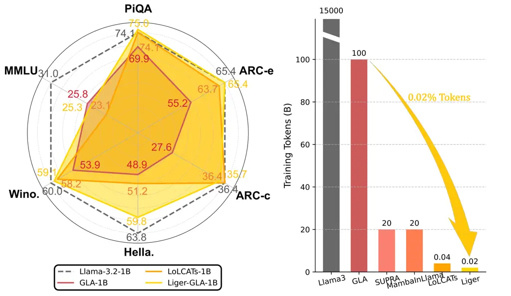
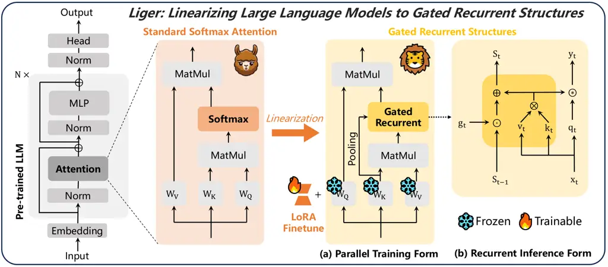

# ![[Uncaptioned image]](arxiv-2503-01496--c0fe0e68bf41.figures/figure-1.webp)     Liger: Linearizing Large Language Models to Gated Recurrent Structures

Disen Lan Affiliation: Shanghai AI Laboratory Affiliation: South China
University of Technology    Weigao Sun Affiliation: Shanghai AI
Laboratory Correspondence to: <sunweigao@outlook.com>    Jiaxi Hu
Affiliation: The Hong Kong University of Science and Technology
(Guangzhou)    Jusen Du Affiliation: Shanghai AI Laboratory
Affiliation: Nanjing University    Yu Cheng Affiliation: The Chinese
University of Hong Kong Correspondence to: <chengyu@cse.cuhk.edu.hk>

###### Abstract

Transformers with linear recurrent modeling offer linear-time training
and constant-memory inference. Despite their demonstrated efficiency and
performance, pretraining such non-standard architectures from scratch
remains costly and risky. The linearization of large language models
(LLMs) transforms pretrained standard models into linear recurrent
structures, enabling more efficient deployment. However, current
linearization methods typically introduce additional feature map modules
that require extensive fine-tuning and overlook the gating mechanisms
used in state-of-the-art linear recurrent models. To address these
issues, this paper presents Liger, short for Linearizing LLMs to gated
recurrent structures. Liger is a novel approach for converting
pretrained LLMs into gated linear recurrent models without adding extra
parameters. It repurposes the pretrained key matrix weights to construct
diverse gating mechanisms, facilitating the formation of various gated
recurrent structures while avoiding the need to train additional
components from scratch. Using lightweight fine-tuning with Low-Rank
Adaptation (LoRA), Liger restores the performance of the linearized
gated recurrent models to match that of the original LLMs. Additionally,
we introduce Liger Attention, an intra-layer hybrid attention mechanism,
which significantly recovers 93% of the Transformer-based LLM at 0.02%
pre-training tokens during the linearization process, achieving
competitive results across multiple benchmarks, as validated on models
ranging from 1B to 8B parameters.

###### Keywords: 

Machine Learning, ICML



Figure 1: Liger Performance and Efficiency. Our proposed Liger recovers
nearly 93% performance of Llama-3.2-1B and outperforms pretrained gated
recurrent models at only 0.02% of the pre-training tokens cost.

## 1 Introduction

Large language models (LLMs) have demonstrated exceptional performance
across various natural language processing tasks (Chintala, 2023; Team,
2023; Zhu et al., 2024; Qu et al., 2024). However, the Transformer-based
architecture (Vaswani et al., 2017) used in modern LLMs, with its
reliance on softmax attention, suffers from quadratic computational
complexity. This inefficiency results in significant speed and memory
challenges, particularly during pretraining on long sequences. During
inference, the Key-Value (KV) cache (Kwon et al., 2023) grows linearly
with the input sequence length, leading to reduced inference speed and
high memory usage, which severely limits the capability of these models
for handling long-sequence tasks (Sun et al., 2024a). In contrast,
models based on linear recurrent modeling (Katharopoulos et al., 2020;
Yang et al., 2023; Qin et al., 2024b; Sun et al., 2025; Du et al., 2025)
provide linear-time training and constant-memory inference, offering
substantial efficiency benefits and positioning themselves as promising
candidates for the next generation of foundational
architectures (MiniMax et al., 2025).

^(†)^(†)footnotetext: The source code is available at
[https://github.com/OpenSparseLLMs/Linearization](https://github.com/OpenSparseLLMs/Linearization)
and the models are available at
[https://huggingface.co/collections/linear-moe-hub](https://huggingface.co/collections/linear-moe-hub).

While pretraining LLMs using architectures based on linear recurrent
modeling reduces costs due to their linear training complexity, the high
expenses of pretraining from scratch associated with large model sizes
and datasets still remain a major obstacle to their adoption and
practical use. This challenge has hindered the advancement of linear
recurrent models. Linearizing pretrained LLMs like SUPRA (Mercat et al.,
2024), MambaInLlama (Wang et al., 2024) and LoLCATs (Zhang et al.,
2024a), as an emerging new direction, allows the transfer of weights
from an existing pretrained model to one with linear recurrent modeling
architectures at a small fraction of the original pretraining cost. The
linearization approach is a promising post-training technique to enable
efficient pretrained model deployment while preserving their
performance. Gating mechanisms (Qin et al., 2024a; Sun et al., 2023)
play a crucial role in linear recurrent models by controlling memory
retention and forgetting, with their effectiveness widely demonstrated
in such architectures. However, incorporating gate modules as additional
components requires both transferring weights from pre-trained LLMs and
training these gating modules from scratch. This process not only
increases the cost of linearization but also creates a larger
architectural divergence from Transformer-based LLMs. This divergence
may hinder the effective approximation of softmax attention, limiting
the performance of gated linear recurrent models (Zhang et al., 2024d).
Moreover, existing linearization methods often overlook the detailed
design considerations of gated linear models, and the newly added
modules fail to leverage the pre-trained weights of LLMs, further
reducing the efficiency of linearization.

In this paper, we present Liger, which stands for Linearizing large
language models to gated recurrent structures, a novel approach for
linearizing LLMs. Liger repurposes the weights from pre-trained
Transformer-based LLMs and introduces a novel method for constructing
crucial gating mechanisms in gated recurrent structures using the key
projection. This approach avoids the complex attention transfer process
found in existing linearization methods. After transforming the weights
and constructing the gating mechanisms, Liger requires only lightweight
fine-tuning of the linearized gated recurrent model parameters through
LoRA autoregressive training. By introducing Liger Attention, this
efficient process restores further improves the model’s performance with
minimal linearization cost, achieving competitive results across a range
of language modeling and understanding benchmarks while benefiting from
the linear-time inference efficiency of the recurrent architecture.

Our contributions can be summarized as follows:

- •
  We introduce Liger, a novel method for adapting pre-trained
  Transformer-based LLMs into gated recurrent structures. This approach
  efficiently repurposes redundant weights from pre-trained models to
  construct gating modules without introducing additional parameters,
  obtaining gated recurrent LLMs with the benefits of constant-memory
  inference.
- •
  We propose Liger Attention, an intra-layer hybrid attention mechanism
  that combines sliding window softmax attention with linear recurrent
  modeling. This simple yet effective design retains the essential
  softmax non-linearity, accelerating the linearization process while
  maintaining the capabilities of pre-trained LLMs and ensuring
  linear-time inference efficiency.
- •
  We apply Liger to linearize the latest Llama-3 series, ranging from 1B
  to 8B parameters. Experimental results show that Liger outperforms
  existing linearization methods (like SUPRA (Mercat et al., 2024),
  MambaInLlama (Wang et al., 2024) and LoLCATs (Zhang et al., 2024a)),
  in terms of both efficiency and its ability to preserve the original
  performance of pre-trained LLMs.

## 2 Preliminary

Transformer with Softmax Attention. Given the input sequence
$`\mathbf{X}=\{\boldsymbol{x_{1}},\boldsymbol{x_{2}},\dots,\boldsymbol{x_{T}}\}\in\mathbb{R}^{T\times D}`$,
with sequence length $`T`$ and dimension $`D`$, vanilla transformer
(Vaswani et al., 2017) adopts standard softmax attention:

```math
\displaystyle\mathbf{Q},\mathbf{K},\mathbf{V} \displaystyle=\mathbf{X}\mathbf{W_{Q}},\mathbf{X}\mathbf{W_{K}},\mathbf{X}\mathbf{W_{V}} \tag{1}
```

```math
\displaystyle\mathbf{O} \displaystyle=\operatorname{Softmax}((\frac{\mathbf{Q}\mathbf{K^{\top}}}{\sqrt{D}})\odot\mathbf{M})\mathbf{V}
```

where $`\mathbf{W_{Q}}`$, $`\mathbf{W_{K}}`$,
$`\mathbf{W_{V}}\in\mathbb{R}^{D\times D}`$ are learnable parameters for
input sequence $`\mathbf{X}`$ projection and
$`\mathbf{M}\in\mathbb{R}^{T\times T}`$ is a mask matrix for causal
modeling by preventing future information leakage in autoregressive
generation task. The above parallel form of softmax attention in Eq.1 is
applied for efficient training and can be rewritten in the following
recurrent form during inference stage:

```math
\displaystyle\boldsymbol{q}_{t},\boldsymbol{k}_{t},\boldsymbol{v}_{t} \displaystyle=\boldsymbol{x}_{t}\mathbf{W_{Q}},\boldsymbol{x}_{t}\mathbf{W_{K}},\boldsymbol{x}_{t}\mathbf{W_{V}} \tag{2}
```

```math
\displaystyle\boldsymbol{o}_{t} \displaystyle=\frac{\sum_{i=1}^{t}\operatorname{exp}(\boldsymbol{q}_{t}\boldsymbol{k}_{i}^{\top}/\sqrt{D})\boldsymbol{v}_{i}}{\sum_{i=1}^{t}\operatorname{exp}(\boldsymbol{q}_{i}\boldsymbol{k}_{i}^{\top}/\sqrt{D})}
```

The standard softmax attention is highly reliant on the growing KV Cache
(Chou et al., 2024b; Wang et al., 2024) to recall the history "memory"
for sequence modeling, which results in quadratic complexity and costly
memory requirements especially in long context setting.

Linear Attention. Linear transformer (Katharopoulos et al., 2020; Qin
et al., 2023) approximates softmax self-attention as the dot product of
the kernel feature mapping and utilizes associative property of matrix
products to calculate the self-attention weights, achieving efficient
linear-time sequence modeling and constant memory consumption.
Concretely, the linear attention can be formulated as follows:

```math
\displaystyle\boldsymbol{o_{t}} \displaystyle=\frac{\sum_{i=1}^{t}\phi(\boldsymbol{q_{t}})\phi(\boldsymbol{k_{i}})^{\top}\boldsymbol{v_{i}}}{\sum_{i=1}^{t}\phi(\boldsymbol{q_{t}})\phi(\boldsymbol{k_{i}})^{\top}} \tag{3}
```

```math
\displaystyle=\frac{\phi(\boldsymbol{q_{t}})\sum_{i=1}^{t}\phi(\boldsymbol{k_{i}})^{\top}\boldsymbol{v_{i}}}{\phi(\boldsymbol{q_{t}})\sum_{i=1}^{t}\phi(\boldsymbol{k_{i}})^{\top}}
```

Let
$`\mathbf{S}_{t}=\sum_{i=1}^{t}\phi(\boldsymbol{k_{i}})^{\top}v_{i}`$
and
$`\boldsymbol{z_{t}}=\sum_{i=1}^{t}\phi(\boldsymbol{k_{i}})^{\top}`$,
the above formulation in Eq. 3 can be rewritten in the recurrent form as
an RNN (Katharopoulos et al., 2020):



Figure 2: Overall Framework of Liger. We linearize the Transformer-based
large language model (LLM) architecture into a gated linear recurrent
model by 1) Replacing Softmax Attention with a Gated Recurrent Memory
module, and 2) Employing LoRA to fine-tune the Liger architecture while
frozen most original weight parameters. The Liger architecture enables
efficient chunk-wise parallel training also enjoying cheap linear
recurrent inference.

```math
\left\{\begin{aligned} \mathbf{S}_{t}&=\mathbf{S}_{t-1}+\phi(\boldsymbol{k_{t}})^{\top}\boldsymbol{v_{t}},\\
\boldsymbol{z_{t}}&=\boldsymbol{z_{t-1}}+\phi(\boldsymbol{k_{t}})^{\top},\end{aligned}\right.\ \ \boldsymbol{o_{t}}=\frac{\phi(\boldsymbol{q_{t}})\mathbf{S_{t}}}{\phi(\boldsymbol{q_{t}})\boldsymbol{z_{t}}} \tag{4}
```

Although linear attention with causal mask matrix cannot use matrix
associativity to reduce the parallel form training complexity from
quadratic to linear, its chunk-wise parallel form allows
hardware-efficient sub-quadratic and partially parallel training (Yang
et al., 2023; Sun et al., 2024a; Sun et al., 2025; Qin et al., 2024a).

Gating Mechanism. While linear attention (or linear recurrent
structures) are widely recognized for their linear-time computational
efficiency, they have historically exhibited a notable performance gap
compared to standard softmax attention. To address this limitation,
recent advances in linear recurrent models have incorporated gating
mechanism, which is a critical architectural component enabling dynamic,
context-aware information retention through input and forget gates. This
mechanism allows models to selectively preserve or discard historical
information, substantially enhancing their expressiveness through
constant memorization capacity. The integration of gating mechanism has
consequently become a prevalent design paradigm in state-of-the-art
linear attention variants (Yang et al., 2023; Peng et al., 2023; Qin
et al., 2024c). A representative implementation, Gated Linear Attention
(GLA) (Yang et al., 2023), demonstrates this principle through its
mathematical formulation:

```math
\displaystyle\mathbf{S}_{t}=\mathbf{G}_{t}\odot\mathbf{S}_{t-1}+\boldsymbol{k}_{t}^{\top}\boldsymbol{v}_{t} \tag{5}
```

At its core, Gated Linear Attention (GLA) fundamentally augments
conventional linear attention through the integration of a gating
mechanism. This modification serves as a generalized framework that can
be systematically extended to diverse linear recurrent architectures by
reparameterizing the gating term $`\mathbf{G}_{t}`$. Specifically,
$`\mathbf{G}_{t}`$ governs the temporal decay dynamics, enabling broad
and flexible adaptation across variant gated linear recurrent
structures.

## 3 Methodology

In this section, we will introduce our proposed Liger for linearizing
large language models to gated recurrent structures. We also design a
simple yet effective hybrid attention form, namely Liger Attention, and
build the Liger architecture based on it, including intra- and
inter-layer hybrid architectures.

### 3.1 Gate Construction by Key Projection

|                                            |                                                             |                                                                                                 |
| ------------------------------------------ | ----------------------------------------------------------- | ----------------------------------------------------------------------------------------------- |
| Model                                      | Gate Parameterization                                       | Pooling for Gate Construction                                                                   |
| Gated Linear Attention (Yang et al., 2023) | $`\mathbf{G}_{t}=\boldsymbol{\alpha}_{t}^{\top}\mathbf{1}`$ | $`\boldsymbol{\alpha}_{t}=\sigma(\operatorname{Pooling}(\boldsymbol{k}_{t}))`$                  |
| Mamba2 (Dao & Gu, 2024)                    | $`\mathbf{G}_{t}=\alpha_{t}\mathbf{1}^{\top}\mathbf{1}`$    | $`\alpha_{t}=\exp(-\operatorname{softplus}(\operatorname{Pooling}(\boldsymbol{k}_{t})))`$       |
| mLSTM (Beck et al., 2024)                  | $`\mathbf{G}_{t}=\alpha_{t}\mathbf{1}^{\top}\mathbf{1}`$    | $`\alpha_{t}=\sigma(\operatorname{Pooling}(\boldsymbol{k}_{t}))`$                               |
| Gated Retention (Sun et al., 2024b)        | $`\mathbf{G}_{t}=\alpha_{t}\mathbf{1}^{\top}\mathbf{1}`$    | $`\alpha_{t}=\sigma(\operatorname{Pooling}(\boldsymbol{k}_{t}))`$                               |
| HGRN2 (Qin et al., 2024c)                  | $`\mathbf{G}_{t}=\boldsymbol{\alpha}_{t}^{\top}\mathbf{1}`$ | $`\boldsymbol{\alpha}_{t}=\gamma+(1-\gamma)\sigma(\operatorname{Pooling}(\boldsymbol{k}_{t}))`$ |
| RWKV6 (Peng et al., 2024)                  | $`\mathbf{G}_{t}=\boldsymbol{\alpha}_{t}^{\top}\mathbf{1}`$ | $`\boldsymbol{\alpha}_{t}=\exp(-\exp(\operatorname{Pooling}(\boldsymbol{k}_{t})))`$             |
| Gated Slot Attention (Zhang et al., 2024c) | $`\mathbf{G}_{t}=\boldsymbol{\alpha}_{t}^{\top}\mathbf{1}`$ | $`\boldsymbol{\alpha}_{t}=\sigma(\operatorname{Pooling}(\boldsymbol{k}_{t}))`$                  |

Table 1: Gated Linear Recurrent Structures with Variations of Gate
$`\mathbf{G}_{t}`$ Parameterization. Gating mechanism can be constructed
through pooling to reuse the key projection of pre-trained LLM.

The parameter space of large language models (LLMs) exhibits intrinsic
structural redundancy (Yu et al., 2024; Aghajanyan et al., 2020), a
phenomenon attributed to the over-parameterization inherent in deep
neural architectures. This redundancy motivates a principled approach to
reformulating LLMs as gated linear recurrent architectures: rather than
introducing new parameters, we strategically repurpose subsets of
pre-trained LLM weights to serve dual roles as gating modules.

Building on the design principle of gated linear recurrent structures
for optimal softmax attention approximation, we propose reallocating the
key projection matrix $`\mathbf{W_{K}}`$ as dual roles to concurrently
perform its canonical linear transformation and gating mechanism.
Formally, the gating mechanism is derived via a transformation of
$`\mathbf{G}_{t}=f(\boldsymbol{k}_{t})=f(\boldsymbol{x}_{t}\mathbf{W}_{K})`$,
where $`f(\cdot)`$ operates on the projected key embeddings. This
parameter-sharing paradigm ensures compatibility with pre-trained
weights while eliminating the need for auxiliary trainable gating
parameters, thereby preserving computational and memory efficiency.

In practical implementations, gating mechanisms can be instantiated
through diverse transformation strategies. Our approach employs a
parameter-free $`\operatorname{Pooling(\cdot)}`$ operation to derive
gate values, circumventing the need for additional trainable parameters.
This design preserves compatibility with pre-trained LLM weights,
enabling direct reuse of existing parameters for gate construction
without architectural modification. Empirical evaluations demonstrate
that this parameter-efficient strategy achieves competitive performance
compared to conventional trainable gating projections (e.g., linear or
nonlinear parametric layers), while maintaining computational efficiency
and reducing optimization complexity.

### 3.2 Liger: Linearizing LLMs to Gated Recurrent Structures

Prior methodologies for linearizing transformer-based large language
models (LLMs) typically rely on auxiliary components, such as feature
mapping layers, to approximate softmax attention mechanisms (Zhang
et al., 2024a). Notably, LoLCATs (Zhang et al., 2024a) propose a
two-stage fine-tuning paradigm to mitigate this limitation: First stage:
Attention Transfer phase trains newly introduced modules (e.g., kernel
approximations) while freezing pre-existing parameters, followed by the
Second stage: employing Low-Rank Adaptation (LoRA) to fine-tune
attention layers. However, previous linearization approaches including
LoLCATs incurs two critical constraints:

- ❶
  Architectural Overhead: The dependency on supplementary feature
  mapping and gating modules to replicate softmax attention outputs
  precludes direct reuse of pre-trained LLM parameters, necessitating
  non-trivial architectural modifications.
- ❷
  Optimization Fragility: The sequential training paradigm introduces
  brittleness, as end-to-end fine-tuning is infeasible due to the
  interdependency between the frozen base model and the auxiliary
  components.

These limitations hinder extensibility to modern linear recurrent
architectures incorporating gated mechanisms, which require seamless
integration with pre-trained weights and end-to-end trainability.

To advance the linearization of pre-trained large language models (LLMs)
into gated recurrent neural architectures, we propose a
parameter-efficient strategy that employs the canonical Softmax
operation for feature mapping. Unlike existing approaches that rely on
trainable modules such as T2R (Mercat et al., 2024) or Hedgehog (Zhang
et al., 2024b) to approximate attention dynamics, our method utilizes
$`\operatorname{Softmax}`$ to inherently normalize query and key
representations. This normalization ensures bounded magnitude in the
query-key product space, a critical property for faithfully replicating
the numerical stability of conventional softmax attention within
linearized frameworks.

By eschewing auxiliary trainable components, our design eliminates
architectural dependencies on attention transfer mechanisms. This
divergence from sequential training paradigms (e.g., frozen base models
with incremental module updates) enables fully end-to-end fine-tuning
without compromising compatibility with pre-trained LLM weights. The
resultant gated recurrent architecture, formulated as:

```math
\displaystyle\boldsymbol{q}_{t} \displaystyle=\boldsymbol{x}_{t}\mathbf{W_{q}},\boldsymbol{k}_{t}=\boldsymbol{x}_{t}\mathbf{W_{k}},\boldsymbol{v}_{t}=\boldsymbol{x}_{t}\mathbf{W_{v}} \tag{6}
```

```math
\displaystyle\mathbf{G}_{t} \displaystyle=\operatorname{Pooling}(\boldsymbol{k}_{t})
```

With the generated gate $`\mathbf{G}_{t}`$, the recurrent update rule
and the followed output computation will be:

```math
\displaystyle\mathbf{S}_{t} \displaystyle=\mathbf{G}_{t}\odot\mathbf{S}_{t-1}+\phi(\boldsymbol{k}_{t}^{\top})\boldsymbol{v}_{t} \tag{7}
```

```math
\displaystyle\boldsymbol{o}_{t} \displaystyle=\phi(\boldsymbol{q}_{t})\mathbf{S}_{t}
```

Here all the trainable parameters
$`\mathbf{W_{Q}},\mathbf{W_{K}},\mathbf{W_{V}}`$ are inherited from the
pre-trained LLM. This method of gating mechanism construction can be
extended to various gated linear recurrent structures, as shown in Table

1. Prior linear recurrent models employ learnable feature mapping
   functions (denoted as $`\phi(\cdot)`$) to compute similarity
   representations between query ($`\boldsymbol{q}_{t}`$) and key
   ($`\boldsymbol{k}_{t}`$) vectors, which introduce superfluous trainable
   parameters while generating output distributions that deviate from the
   canonical $`\operatorname{Softmax}`$ attention distribution inherent in
   pre-trained LLM. Such distributional discrepancies consequently degrade
   the efficacy of linearization by impairing compatibility with the
   original attention mechanisms. We found that feature mapping
   $`\phi(\cdot)`$ can be effectively approximated via a simple
   normalization operation ($`\operatorname{Softmax(\cdot)}`$ in our
   implementation), thereby eliminating the requirement for computationally
   intensive attention transfer or distillation procedures while
   maintaining fidelity to the target attention distribution. Eq. 7
   preserves the expressivity of softmax attention while inheriting the
   computational efficiency of linear recurrent models. This unification of
   architectural simplicity and functional fidelity addresses key
   limitations in prior linearization methods.

Following the initialization of the model with pre-trained LLM weights
and its architectural reconfiguration into a gated linear recurrent
framework, we employ next-token prediction as the fine-tuning objective
to recover performance in the transformed architecture. Formally, we
parameterize the adapted weights as $`\Theta=\Theta_{0}+\Delta\Theta`$,
where $`\Delta\Theta`$ denotes the incremental adjustments required to
align the original transformer-based parameters with the gated linear
recurrent structure. The optimization objective minimizes the
cross-entropy loss $`\mathcal{L}`$ for autoregressive prediction over
input sequences $`x_{1:t-1}`$:

```math
\displaystyle\mathcal{L}=-\sum\log P_{\Theta}(\boldsymbol{x}_{t}|\boldsymbol{x}_{1:t-1}) \tag{8}
```

This approach circumvents the need for auxiliary training stages (e.g.,
attention transfer) by directly optimizing the gated linear recurrent
architecture end-to-end, thereby preserving the computational efficiency
and parameter efficiency inherent to the original LLM.

we apply Low-Rank Adaptation (LoRA) (Hu et al., 2021) specifically to
the linear recurrent layers of large language models (LLMs), focusing on
the fine-tuning of the weight matrices
$`\mathbf{W_{Q}},\mathbf{W_{K}},\mathbf{W_{V}}`$. Instead of training
all model parameters, LoRA decomposes the adaptation term
$`\Delta\Theta`$ into two low-rank matrices $`\mathbf{B}`$ and
$`\mathbf{A}`$, such that $`\Delta\Theta=\mathbf{B}\mathbf{A}`$, where
$`\mathbf{B}\in\mathbb{R}^{D\times r}`$,
$`\mathbf{A}\in\mathbb{R}^{r\times D}`$, and $`r\ll D`$ with $`r`$
typically set to a small value, such as $`8`$. Our empirical results
demonstrate that LoRA consistently outperforms full-rank fine-tuning,
offering a more efficient and effective approach for LLM linearization.

Figure 3: Liger Hybrid Architecture. Liger adopts intra-hybrid Liger
Attention and inter-hybrid model architecture by stacking a layer of
standard attention Transformer blocks every a few (e.g. 7) layers of
Liger Transformer blocks.

|                               |                     |                  |                  |                       |                       |                  |                           |              |                        |
| ----------------------------- | ------------------- | ---------------- | ---------------- | --------------------- | --------------------- | ---------------- | ------------------------- | ------------ | ---------------------- |
| Model                         | Training Tokens (B) | PiQA             | ARC-e            | ARC-c                 | Hella.                | Wino.            | MMLU                      | Avg.         | Avg.                   |
|                               |                     | acc $`\uparrow`$ | acc $`\uparrow`$ | acc_norm $`\uparrow`$ | acc_norm $`\uparrow`$ | acc $`\uparrow`$ | acc (5-shot) $`\uparrow`$ | $`\uparrow`$ | (no MMLU) $`\uparrow`$ |
| Mistral-7B                    | 8000                | 80.6             | 80.7             | 53.9                  | 81.1                  | 74.3             | 62.6                      | 72.2         | 74.1                   |
| SUPRA-Mistral-7B              | 100                 | 80.4             | 75.9             | 45.8                  | 77.1                  | 70.3             | 34.2                      | 64.0         | 69.9                   |
| LoLCATs-Mistral-7B Attn. Trf. | 0.02                | 79.8             | 79.3             | 51.7                  | 48.3                  | 74.2             | 23.0                      | 59.4         | 66.7                   |
| LoLCATs-Mistral-7B LoRA       | 0.02                | 77.3             | 74.9             | 45.1                  | 40.9                  | 67.9             | 23.0                      | 54.8         | 61.2                   |
| LoLCATs-Mistral-7B            | 0.04                | 79.7             | 78.4             | 47.4                  | 58.4                  | 71.0             | 23.7                      | 59.8         | 67.0                   |
| Liger-GLA-Mistral-7B (Ours)   | 0.02                | 80.1             | 78.7             | 49.3                  | 76.3                  | 70.1             | 36.3                      | 65.1         | 70.9                   |
| Llama-3-8B                    | 15000               | 79.4             | 80.1             | 53.2                  | 79.2                  | 72.9             | 65.3                      | 71.7         | 73.0                   |
| SUPRA-Llama-3-8B              | 20                  | 78.9             | 75.1             | 46.5                  | 71.7                  | 65.8             | 40.9                      | 63.2         | 67.6                   |
| Mamba2-Llama-3-8B             | 20                  | 76.8             | 74.1             | 48.0                  | 70.8                  | 58.6             | 43.2                      | 61.9         | 65.6                   |
| Mamba2-Llama-3-8B 50% Attn.   | 20                  | 81.5             | 78.8             | 58.2                  | 79.5                  | 71.5             | 56.7                      | 71.0         | 73.9                   |
| LoLCATs-Llama-3-8B Attn. Trf. | 0.02                | 78.4             | 79.3             | 51.9                  | 51.6                  | 73.4             | 23.5                      | 59.7         | 66.9                   |
| LoLCATs-Llama-3-8B LoRA       | 0.02                | 72.4             | 72.6             | 44.3                  | 34.6                  | 68.0             | 23.0                      | 52.5         | 58.4                   |
| LoLCATs-Llama-3-8B            | 0.04                | 80.1             | 80.4             | 53.5                  | 63.4                  | 72.9             | 42.1                      | 65.4         | 70.0                   |
| Liger-GLA-Llama-3-8B (Ours)   | 0.02                | 80.3             | 81.1             | 52.5                  | 76.3                  | 72.0             | 43.4                      | 67.6         | 72.4                   |

Table 2: Linearized LLMs Comparison. Liger outperforms other
linearization method on language modeling and understanding tasks with
less training tokens across Mistral-7B and Llama-3-8B LLM architectures.

### 3.3 Liger Attention: A Hybrid of Sliding Window Attention and Gated Recurrent Modeling

Building upon previous works that combine softmax attention with linear
attention (Katharopoulos et al., 2020; Arora et al., 2024; MiniMax
et al., 2025), we propose an intra-layer hybrid attention mechanism,
termed Liger Attention. This method integrates a hybrid form of Gated
Recurrent Modeling (GRM) and Sliding Window Attention (SWA) (Beltagy
et al., 2020) with narrow softmax attention window size, by blending
their outputs in a weighted manner. Specifically, the formulation is
given by:

```math
\displaystyle\boldsymbol{o}_{t} \displaystyle=\operatorname{LigerAttn}(\boldsymbol{q}_{t},\boldsymbol{k}_{t},\boldsymbol{v}_{t}) \tag{9}
```

```math
\displaystyle=\alpha\operatorname{GRM}(\boldsymbol{q}_{t},\boldsymbol{k}_{t},\boldsymbol{v}_{t})+\beta\operatorname{SWA}(\boldsymbol{q}_{t},\boldsymbol{k}_{t},\boldsymbol{v}_{t})
```

where $`\operatorname{GRM}`$ denotes Gated Recurrent Modeling (and its
variants) in Eq. 3 and $`\operatorname{SWA}`$ refers to Sliding Window
Attention, which is a variant of softmax attention as expressed in Eq. 1
formulated in Eq. 10. The parameters $`\alpha`$ and $`\beta`$ control
the relative contributions of each attention mechanism. We found that
setting the sum of the two parameters $`\alpha`$ and $`\beta`$ to 1 is
particularly critical for linearization (simply sets to 0.5 each in our
implementation), which can better approximate the original attention
output distribution.

```math
\displaystyle\hat{\boldsymbol{o}}_{t} \displaystyle=\operatorname{SWA}(\boldsymbol{q}_{t},\boldsymbol{k}_{t},\boldsymbol{v}_{t}) \tag{10}
```

```math
\displaystyle=\frac{\sum_{i=t-w+1}^{t}\exp(\boldsymbol{q}_{t}\boldsymbol{k}_{i}^{\top}/\sqrt{D})v_{i}}{\sum_{i=t-w+1}^{t}\exp(\boldsymbol{q}_{t}\boldsymbol{k}_{i}^{\top}/\sqrt{D})}
```

where $`w`$ denotes the window size (set to 64 in our default
implementation) for limiting the length of the lookback window for the
input token. Liger Attention demonstrates strong performance in sequence
modeling tasks while maintaining efficient linear complexity of
$`\mathcal{O}(TWD+TD^{2})`$.

### 3.4 Liger Architecture and Its Hybrid

The overall architecture of our proposed Liger is presented in Fig. 2.
Following the popular LLM architecture like Llama (Dubey et al., 2024),
we retain the Pre-Norm layers and MLP layers with residual connection
(He et al., 2016), only change the softmax attention layers with Liger
attention without introduction of any new trainable modules like feature
mapping. For the each Liger blocks including time mixing layer and token
mixing layer, the forward process can be formulated as:

```math
\displaystyle\mathbf{H} \displaystyle=\operatorname{LigerAttn}(\operatorname{Norm}(\mathbf{X}))+\mathbf{X} \tag{11}
```

```math
\displaystyle\mathbf{O} \displaystyle=\operatorname{MLP}(\operatorname{Norm}(\mathbf{H}))+\mathbf{H}
```

As presented in Fig. 3, we also attempt to add one softmax attention
block after stacking a number of Liger (or gated linear recurrent)
blocks to construct layer-wise hybrid model architecture.

|                               |                     |                  |                 |                       |                       |                  |                           |              |                        |
| ----------------------------- | ------------------- | ---------------- | --------------- | --------------------- | --------------------- | ---------------- | ------------------------- | ------------ | ---------------------- |
| Model                         | Training Tokens (B) | PiQA             | ARC-e           | ARC-c                 | Hella.                | Wino.            | MMLU                      | Avg.         | Avg.                   |
|                               |                     | acc $`\uparrow`$ | acc$`\uparrow`$ | acc_norm $`\uparrow`$ | acc_norm $`\uparrow`$ | acc $`\uparrow`$ | acc (5-shot) $`\uparrow`$ | $`\uparrow`$ | (no MMLU) $`\uparrow`$ |
| (Transformer)                 |                     |                  |                 |                       |                       |                  |                           |              |                        |
| Mistral-7B                    | 8000                | 80.6             | 80.7            | 53.9                  | 81.1                  | 74.3             | 62.6                      | 72.2         | 74.1                   |
| Llama-3-8B                    | 15000               | 79.4             | 80.1            | 53.2                  | 79.2                  | 72.9             | 65.3                      | 71.7         | 73.0                   |
| (Linear/Subquadratic)         |                     |                  |                 |                       |                       |                  |                           |              |                        |
| Mamba-7B                      | 1200                | 81.0             | 77.5            | 46.7                  | 77.9                  | 71.8             | 33.3                      | 64.7         | 71.0                   |
| RWKV-6-World-7B               | 1420                | 78.7             | 76.8            | 46.3                  | 75.1                  | 70.0             | -                         | 69.4         | 69.4                   |
| TransNormerLLM-7B             | 1400                | 80.1             | 75.4            | 44.4                  | 75.2                  | 66.1             | 43.1                      | 64.1         | 68.2                   |
| Hawk-7B                       | 300                 | 80.0             | 74.4            | 45.9                  | 77.6                  | 69.9             | 35.0                      | 63.8         | 69.6                   |
| Griffin-7B                    | 300                 | 81.0             | 75.4            | 47.9                  | 78.6                  | 72.6             | 39.3                      | 65.8         | 71.1                   |
| (Hybrid)                      |                     |                  |                 |                       |                       |                  |                           |              |                        |
| StripedHyena-Nous-7B          | -                   | 78.8             | 77.2            | 40.0                  | 76.4                  | 66.4             | 26.0                      | 60.8         | 67.8                   |
| Zamba-7B                      | 1000                | 81.4             | 74.5            | 46.6                  | 80.2                  | 76.4             | 57.7                      | 69.5         | 71.8                   |
| Zamba2-7B                     | 2100                | 81.0             | 80.3            | 56.4                  | 81.5                  | 77.2             | 64.8                      | 73.5         | 75.3                   |
| (Linearized)                  |                     |                  |                 |                       |                       |                  |                           |              |                        |
| Liger-GLA-Llama-3-8B (Ours)   | 0.02                | 80.3             | 81.1            | 52.5                  | 76.3                  | 72.0             | 43.4                      | 67.6         | 72.4                   |
| Liger-GLA-Llama-3-8B-H (Ours) | 0.02                | 80.6             | 80.7            | 52.7                  | 76.9                  | 71.4             | 44.4                      | 67.8         | 72.5                   |

Table 3: Performance Comparison of Pre-trained and Linearized LLMs on
Common-sense Reasoning and Knowledge Benchmarks.s Results span
Transformer-based (Mistral-7B, Llama-3-8B), linear/subquadratic (Mamba,
RWKV), hybrid (Zamba), and our linearized Liger-GLA variants on language
modeling and understanding tasks. Our Linearized Liger models achieve
competitive performance with only 0.02B training tokens, demonstrating
efficient adaptation to gated linear recurrent architectures.

## 4 Experiments

In this section, we conduct extensive experiments to answer the
following research questions ($`\mathcal{RQ}`$):

1.  $`\mathcal{RQ}`$1:
    Can Liger linearize the pre-trained LLMs and recover performance
    more effectively compared with other linearization methods?
2.  $`\mathcal{RQ}`$2:
    Can Liger serve as a universal and scalable linearization method for
    different LLM architectures?
3.  $`\mathcal{RQ}`$3:
    Does Liger genuinely achieves linear/subquadratic time complexity
    and constant memory inference?
4.  $`\mathcal{RQ}`$4:
    How effective is Liger to its key components?

### 4.1 Experimental Setups

Models and Datasets. We select two popular LLM architectures: Mistral-7B
(Jiang et al., 2023) and Llama-3-8B (Dubey et al., 2024) as base model
for linearization. We opt for GLA (Yang et al., 2023), a general gated
linear recurrent model structure, as the basis of the Liger and its
hybrid architecture for linearization. We use 50,000 high quality
instruction samples of cleaned Alpaca dataset (Taori et al., 2023)
during linearization process to improve instruction-following ability
and recover LLM performance in language modeling tasks.

Implementation Configurations and Details. All experiments are
implemented in PyTorch and conducted on single NVIDIA A800 80GB GPU. We
opt for AdamW optimizer with a learining rate of $`1e^{-3}`$. By
default, the LoRA rank is set to $`8`$ and alpha is set to $`8`$. The
finetuning epochs is 2, which means we only use 100,000 cleaned Alpaca
instruction samples (around 0.02B tokens) for gate reccurrent model
linearization. We pad the input sequence to 1024 tokens with mini batch
size of 1, and set the global batch size to 8 by gradient accumulaltion,
following the settings in LoLCATs (Zhang et al., 2024a).

Figure 4: Decoding Latency Time and GPU Memory Usage of Each 8B Models.
We variate the decoding length from 1K to 32K with fixed batch size of
16 on single A800 80GB GPU to evaluate the models’ efficiency. Liger
enjoys linear-time inference with constant GPU memory usage.

|                             |              |                        |
| --------------------------- | ------------ | ---------------------- |
| Model                       | Avg.         | Avg.                   |
|                             | $`\uparrow`$ | (no MMLU) $`\uparrow`$ |
| Llama-3.2-1B                | 55.1         | 59.9                   |
| GLA-1B                      | 46.9         | 51.1                   |
| LoLCATs-Llama-3.2-1B        | 51.1         | 56.7                   |
| Liger-GLA-Llama-3.2-1B      | 52.9         | 59.0                   |
| Llama-3.2-3B                | 66.1         | 68.1                   |
| GLA-3B                      | 49.1         | 53.8                   |
| LoLCATs-Llama-3.2-3B        | 55.6         | 62.0                   |
| Liger-GLA-Llama-3.2-3B      | 60.7         | 66.5                   |
| Llama-3-8B                  | 71.7         | 73.0                   |
| LoLCATs-Llama-3-8B          | 62.2         | 70.0                   |
| Liger-GLA-Llama-3-8B (Ours) | 67.6         | 72.4                   |

Table 4: Scalability Analysis of Linearized Llama-3 Architectures across
Model Sizes (1B to 8B). Liger demonstrates consistent scaling laws,
outperforming LoLCATs by +6.8–11.5% absolute on average metrics while
preserving 83–98% of base model capabilities with only 0.02B adaptation
tokens.

|                                                                                                                                |                                                                                                                                               |                                                         |                                     |        |        |
| ------------------------------------------------------------------------------------------------------------------------------ | --------------------------------------------------------------------------------------------------------------------------------------------- | ------------------------------------------------------- | ----------------------------------- | ------ | ------ |
| Gated Linear Recurrent Variants                                                                                                | Gated Memory Formulation                                                                                                                      | Output Formulation                                      | Form of Gate $`\mathbf{G}`$         | Avg.   | MMLU   |
|                                                                                                                                |                                                                                                                                               |                                                         |                                     | 0-shot | 5-shot |
| Liger-GLA                                                                                                                      | $`\mathbf{S}_{t}=\mathbf{G}_{t}\odot\mathbf{S}_{t-1}+\boldsymbol{k}_{t}^{\top}\boldsymbol{v}_{t}`$                                            | $`\boldsymbol{o}_{t}=\boldsymbol{q}_{t}\mathbf{S}_{t}`$ | $`\mathbf{G}_{t}\in\mathbb{R}^{D}`$ | 72.4   | 43.4   |
| Liger-HGRN2                                                                                                                    | $`\mathbf{S}_{t}={\mathbf{G}}_{t}\mathbf{S}_{t-1}+(1-{\mathbf{G}}_{t})^{\top}\boldsymbol{v}_{t}`$                                             | $`\boldsymbol{o}_{t}=\boldsymbol{q}_{t}\mathbf{S}_{t}`$ | $`\mathbf{G}_{t}\in\mathbb{R}^{D}`$ | 69.5   | 36.2   |
| Liger-GSA                                                                                                                      | $`\left\{\begin{array}[]{@{}l@{}}\mathbf{\tilde{K}}_{t}=\mathbf{G}_{t}\mathbf{\tilde{K}}_{t-1}+(1-\mathbf{G}_{t})^{\top}\boldsymbol{k}\_{t}\\ |
| \mathbf{\tilde{V}}_{t}=\mathbf{G}_{t}\mathbf{\tilde{V}}_{t-1}+(1-\mathbf{G}_{t})^{\top}\boldsymbol{v}\_{t}\end{array}\right.`$ | $`\boldsymbol{o}_{t}=\mathbf{\tilde{V}}_{t}\operatorname{Softmax}(\mathbf{\tilde{K}}_{t}^{\top}\boldsymbol{q}_{t})`$                          | $`{\mathbf{G}}_{t}\in\mathbb{R}^{M}`$                   | 70.5                                | 41.2   |

Table 5: Gated Linear Recurrent Model Variants with Liger. Liger can be
applied to the efficient linearization of various linear recurrent
structures with gating mechanism and achive high quality performance
recovery.

### 4.2 Main Results: Liger can recover pre-trained LLMs’ performance more effectively ($`\mathcal{RQ}\mathbf{1}`$)

To validate the effectiveness of our proposed method, we conducted
experiments on a series of language modeling and understanding tasks,
including PiQA (Bisk et al., 2020), ARC-easy (ARC-e), ARC-challenge
(ARC-c) (Clark et al., 2018), HellaSwag (Hella.) (Zellers et al., 2019),
WinoGrande (Wino.) (Sakaguchi et al., 2019) and MMLU (Li et al., 2023).
The results are reported in Table 2 and all evaluations were done using
lm-evaluation-harness (Gao et al., 2024). Liger, utilizing only 0.02B
tokens, achieves a linear recurrent model that recovers 90% of Mistral’s
performance and 93% of Llama-3’s performance with only 0.085% model
parameters LoRA finetuning. Our method significantly outperforms other
linearization baselines, incluing SUPRA (Mercat et al., 2024) and Mamba
In Llama (Wang et al., 2024), which still need billions of tokens for
linear recurrent architecture conversion fine-tuning, and LoLCATs’
linearization approach, which requires a two-stage process and twice the
number of training tokens.

We also compared Liger with other pre-trained models, including the
Transformer models Mistral (Jiang et al., 2023) and Llama-3 (Touvron
et al., 2023), linear/subquadratic models such as Mamba (Gu & Dao,
2023), RWKV-6 (Peng et al., 2023), TransNormerLLM (Qin et al., 2023),
Hawk and Griffin (De et al., 2024), as well as hybrid models like
StripedHyena (Poli et al., 2023), Zamba and Zamba2 (Glorioso et al.,
2024). As shown in Table 3, our proposed method outperformed nearly all
of the pre-trained linear/subquadratic models and achieve competitive
performance compared with transformer-based and hybrid LLMs.

### 4.3 Liger is a Efficient and Scalable Hybrid Structure ($`\mathcal{RQ}\mathbf{2}`$ & $`\mathcal{RQ}\mathbf{3}`$)

We conducted experiments to compare efficiency in terms of decoding
latency speed and GPU memory consumption of Llama-3-8B without (w/o.)
Flash-Attention-2 (FA2), Llama-3-8B with (w/.) Flash-Attention-2 (FA2)
and Liger-GLA-8B on single A800 80GB GPU. We set a fixed batch size of
16 and variate the decoding sequence length from 1K to 32K with the
fixed prefix input length of 128. As presented in Fig. 4, we observe
that Liger achieves linear-time decoding complexity while maintaining
constant memory usage.

We evaluate efficiency across three scales of the Llama-3 series (1B,
3B, 8B), comparing vanilla transformers, GLA, LoLCATs, and our
Liger-GLA. As shown in Table 4, Liger consistently outperforms both GLA
and LoLCATs while preserving 93% of the base Llama-3’s performance on
average. Notably, GLA-1B substantially underperforms all methods (46.9%
average), highlighting the necessity of our parameter-efficient
adaptation strategy. The performance gap between Liger and vanilla
Llama-3 narrows with model size ($`\Delta=4.8\%`$ at 1B
$`\rightarrow\Delta=1.8\%`$ at 8B), indicating improved architectural
compatibility at scale.

We conduct experiments on gated linear recurrent structure variations
including GLA (Yang et al., 2023), HGRN2 (Qin et al., 2024c) and GSA
(Zhang et al., 2024d), with the results presented in Table 5,
demonstrating the extensibility of Liger on various gated linear
recurrent structures.

### 4.4 Liger Framework Analysis ($`\mathcal{RQ}\mathbf{4}`$)

To verify the key components of Liger, we conducted ablation studies on
the model structure. Specifically, we experimented with using gates
generated from randomly initialized gate projections (Gate Proj.)
instead of pooling, and adopting pure linear attention without
considering gating mechanism (Pure LA). Additionally, we incorporated
learnable feature map modules (Feat. Map.), similar to Zhang et al.
(2024b). We also evaluated the effects of removing LoRA (w/o LoRA), GLA
(w/o GLA) and SWA (w/o SWA) individually. The results of these
experiments are detailed in Table 6, demonstrating the effectiveness of
proposed components in Liger.

|                |                 |              |                        |
| -------------- | --------------- | ------------ | ---------------------- |
| Model Variants | Validation PPL. | Avg.         | Avg.                   |
|                | $`\downarrow`$  | $`\uparrow`$ | (no MMLU) $`\uparrow`$ |
| Liger-GLA      | 2.96            | 67.6         | 72.4                   |
| - Gate Proj.   | 3.16            | 63.8         | 68.8                   |
| - Feat. Map.   | 9.04            | 43.5         | 40.2                   |
| - Pure LA      | 3.00            | 66.1         | 71.5                   |
| - w/o LoRA     | 3.23            | 61.7         | 68.1                   |
| - w/o SWA      | 3.75            | 54.2         | 60.2                   |
| - w/o GLA      | 3.01            | 66.2         | 72.0                   |

Table 6: Ablation Study of Liger on Gated Linear Attention. We linearize
Llama-3-8B into Gated Linear Attention (GLA) to evaluate the key
components of Liger. We report Validation perplexity (PPL.) on cleaned
alpaca dataset after Liger linearization and the average performance on
language modeling and understanding tasks.

## 5 Related Work

Linear Recurrent Models and their Hybrid. To address the challenges of
quadratic complexity computation cost in standard softmax attention,
many linear recurrent models are proposed to achieve efficient training
and inference. Data-dependent gating/decay has been proved as an
effective mechanism to control the memory changes and improve sequence
modeling expressiveness (Yang et al., 2023; Peng et al., 2024; Qin
et al., 2024c; Zhang et al., 2024c; Du et al., 2025). Recently, some
layer-wise hybrid model architectures have been proposed to compensate
for the lack of memory capacity in the linear recurrent models, such as
StripedHyena-Nous (Poli et al., 2023), Jamba (Lieber et al., 2024),
Zamba (Glorioso et al., 2024), Hymba (Dong et al., 2024), Titans
(Behrouz et al., 2024) and Minimax-01 (MiniMax et al., 2025). Actually,
all of these hybrid attention architectures introduce extra modules
(e.g. feature mapping or gate modules) that need to be trained from
scratch, which increases the complexity of the model architecture design
and may lead to suboptimal softmax attention approximation. In addition,
integration of softmax and linear attention shows great potential as a
new intra-layer hybrid attention paradigm, such as Agent Attention (Han
et al., 2024), Based (Arora et al., 2024), GSA (Zhang et al., 2024c).
However, these inter-layer hybrid attention forms have linear recurrent
modules that only focus on long-term modeling and ignore local
information (Arora et al., 2024), and lack a gating mechanism and the
approximation of the attention output distribution by controlling the
hybrid ratio (or hybrid weights) (Han et al., 2024; Arora et al., 2024),
which is particularly critical in the linearization process.

Linearizing Large Language Models. Linearizing or fine-tuning
(uptraining) transformers to linear-RNNs could significantly reduce the
cost of training a brand-new large-scale linear recurrent model
architecture by distilling knowledge from pre-trained LLMs. Most
linearization methods are proposed to uptrain transformer-based LLMs
into linear-RNNs by introducing extra feature mapping modules (Kasai
et al., 2021; Mercat et al., 2024; Chen et al., 2024) or adding a loss
(Zhang et al., 2024b; Bick et al., 2024; Zhang et al., 2024a) to
approximate softmax attention. However, these methods have to introduce
extra modules that cannot reuse the existing pre-trained LLM weights and
need to be trained from scratch, which may not match the output of the
original attention and increases the complexity of the model
architecture, leading to suboptimal attention approximation.

## 6 Conclusion

This paper introduces Liger, a novel method for linearizing
Transformer-based LLMs into gated linear recurrent structures. By
leveraging the key matrix weights of pretrained standard-structure
models and repurposing them to construct the gating mechanisms, Liger
avoids the need for additional parameters and extensive fine-tuning,
making it a cost-effective and efficient linearization approach. The use
of end-to-end LoRA fine-tuning restores model performance while
minimizing linearization costs. Furthermore, the introduction of Liger
Attention enhances nearly 93% performance recovery with only 0.02%
pre-training tokens, making Liger a competitive solution across a range
of language modeling and understanding tasks. Our results demonstrate
the effectiveness of Liger on models ranging from 1B to 8B parameters,
offering a promising path toward more efficient deployment of
large-scale LLMs with linear-time inference and constant memory usage.

## Acknowledgements

This work is supported by the Shanghai AI Laboratory.

## Impact Statement

This work represents a notable advancement in artificial intelligence
and machine learning, particularly in linearizing the pretrained
Transformer-based models into gated recurrent structures. Liger enables
the processing of much longer sequences compared to existing methods
while significantly accelerating computation, making it highly
beneficial for tasks like natural language understanding, genomic
sequence analysis, and time-series forecasting. However, the enhanced
capabilities and efficiency introduced by Liger also raise ethical and
societal considerations, such as the potential for misuse in generating
persuasive but misleading content or in surveillance applications.
Nevertheless, the contributions of Liger to reducing computational
overhead and energy consumption in training large models may also bring
positive environmental impacts.

## References

- Aghajanyan et al. (2020) Aghajanyan, A., Zettlemoyer, L., and
  Gupta, S. Intrinsic dimensionality explains the effectiveness of
  language model fine-tuning, 2020. URL
  [https://arxiv.org/abs/2012.13255](https://arxiv.org/abs/2012.13255).
- Arora et al. (2024) Arora, S., Eyuboglu, S., Zhang, M., Timalsina, A.,
  Alberti, S., Dylan Zinsley, J. Z., Rudra, A., and Ré, C. Simple linear
  attention language models balance the recall-throughput tradeoff.
  _arXiv preprint arXiv:2402.18668_, 2024.
- Beck et al. (2024) Beck, M., Pöppel, K., Spanring, M., Auer, A.,
  Prudnikova, O., Kopp, M., Klambauer, G., Brandstetter, J., and
  Hochreiter, S. xlstm: Extended long short-term memory, 2024. URL
  [https://arxiv.org/abs/2405.04517](https://arxiv.org/abs/2405.04517).
- Behrouz et al. (2024) Behrouz, A., Zhong, P., and Mirrokni, V. Titans:
  Learning to memorize at test time. _arXiv preprint
  arXiv:2501.00663_, 2024.
- Beltagy et al. (2020) Beltagy, I., Peters, M. E., and Cohan, A.
  Longformer: The long-document transformer, 2020.
- Bick et al. (2024) Bick, A., Li, K. Y., Xing, E. P., Kolter, J. Z.,
  and Gu, A. Transformers to ssms: Distilling quadratic knowledge to
  subquadratic models, 2024. URL
  [https://arxiv.org/abs/2408.10189](https://arxiv.org/abs/2408.10189).
- Bisk et al. (2020) Bisk, Y., Zellers, R., Bras, R. L., Gao, J., and
  Choi, Y. Piqa: Reasoning about physical commonsense in natural
  language. In _Thirty-Fourth AAAI Conference on Artificial
  Intelligence_, 2020.
- Chen et al. (2024) Chen, H., Liu, Z., Wang, X., Tian, Y., and Wang, Y.
  Dijiang: Efficient large language models through compact
  kernelization, 2024. URL
  [https://arxiv.org/abs/2403.19928](https://arxiv.org/abs/2403.19928).
- Chintala (2023) Chintala, S. Gpt-4 moe, June 2023. URL
  [https://x.com/soumithchintala/status/1671267150101721090](https://x.com/soumithchintala/status/1671267150101721090).
- Chou et al. (2024a) Chou, Y., Yao, M., Wang, K., Pan, Y., Zhu, R.,
  Zhong, Y., Qiao, Y., Wu, J., Xu, B., and Li, G. Metala: Unified
  optimal linear approximation to softmax attention map. _arXiv preprint
  arXiv:2411.10741_, 2024a.
- Chou et al. (2024b) Chou, Y., Yao, M., Wang, K., Pan, Y., Zhu, R.,
  Zhong, Y., Qiao, Y., Wu, J., Xu, B., and Li, G. Metala: Unified
  optimal linear approximation to softmax attention map, 2024b. URL
  [https://arxiv.org/abs/2411.10741](https://arxiv.org/abs/2411.10741).
- Clark et al. (2018) Clark, P., Cowhey, I., Etzioni, O., Khot, T.,
  Sabharwal, A., Schoenick, C., and Tafjord, O. Think you have solved
  question answering? try arc, the ai2 reasoning challenge. _ArXiv_,
  abs/1803.05457, 2018.
- Dao & Gu (2024) Dao, T. and Gu, A. Transformers are ssms: Generalized
  models and efficient algorithms through structured state space
  duality. _arXiv preprint arXiv:2405.21060_, 2024.
- De et al. (2024) De, S., Smith, S. L., Fernando, A., Botev, A.,
  Cristian-Muraru, G., Gu, A., Haroun, R., Berrada, L., Chen, Y.,
  Srinivasan, S., Desjardins, G., Doucet, A., Budden, D., Teh, Y. W.,
  Pascanu, R., Freitas, N. D., and Gulcehre, C. Griffin: Mixing gated
  linear recurrences with local attention for efficient language
  models, 2024. URL
  [https://arxiv.org/abs/2402.19427](https://arxiv.org/abs/2402.19427).
- Dong et al. (2024) Dong, X., Fu, Y., Diao, S., Byeon, W., Chen, Z.,
  Mahabaleshwarkar, A. S., Liu, S.-Y., Van Keirsbilck, M., Chen, M.-H.,
  Suhara, Y., et al. Hymba: A hybrid-head architecture for small
  language models. _arXiv preprint arXiv:2411.13676_, 2024.
- Du et al. (2025) Du, J., Sun, W., Lan, D., Hu, J., and Cheng, Y. Mom:
  Linear sequence modeling with mixture-of-memories. _arXiv preprint
  arXiv:2502.13685_, 2025.
- Dubey et al. (2024) Dubey, A., Jauhri, A., Pandey, A., Kadian, A.,
  Al-Dahle, A., Letman, A., Mathur, A., Schelten, A., Yang, A., Fan, A.,
  et al. The llama 3 herd of models. _arXiv preprint
  arXiv:2407.21783_, 2024.
- Gao et al. (2024) Gao, L., Tow, J., Abbasi, B., Biderman, S., Black,
  S., DiPofi, A., Foster, C., Golding, L., Hsu, J., Le Noac’h, A., Li,
  H., McDonell, K., Muennighoff, N., Ociepa, C., Phang, J., Reynolds,
  L., Schoelkopf, H., Skowron, A., Sutawika, L., Tang, E., Thite, A.,
  Wang, B., Wang, K., and Zou, A. A framework for few-shot language
  model evaluation, 07 2024. URL
  [https://zenodo.org/records/12608602](https://zenodo.org/records/12608602).
- Gershman et al. (2025) Gershman, S. J., Fiete, I., and Irie, K.
  Key-value memory in the brain. _arXiv preprint
  arXiv:2501.02950_, 2025.
- Glorioso et al. (2024) Glorioso, P., Anthony, Q., Tokpanov, Y.,
  Whittington, J., Pilault, J., Ibrahim, A., and Millidge, B. Zamba: A
  compact 7b ssm hybrid model, 2024. URL
  [https://arxiv.org/abs/2405.16712](https://arxiv.org/abs/2405.16712).
- Gu & Dao (2023) Gu, A. and Dao, T. Mamba: Linear-time sequence
  modeling with selective state spaces. _arXiv preprint
  arXiv:2312.00752_, 2023.
- Han et al. (2024) Han, D., Ye, T., Han, Y., Xia, Z., Pan, S., Wan, P.,
  Song, S., and Huang, G. Agent attention: On the integration of softmax
  and linear attention, 2024. URL
  [https://arxiv.org/abs/2312.08874](https://arxiv.org/abs/2312.08874).
- He et al. (2016) He, K., Zhang, X., Ren, S., and Sun, J. Deep residual
  learning for image recognition. In _Proceedings of the IEEE conference
  on computer vision and pattern recognition_, pp. 770–778, 2016.
- Hu et al. (2021) Hu, E. J., Shen, Y., Wallis, P., Allen-Zhu, Z., Li,
  Y., Wang, S., Wang, L., and Chen, W. Lora: Low-rank adaptation of
  large language models, 2021. URL
  [https://arxiv.org/abs/2106.09685](https://arxiv.org/abs/2106.09685).
- Jiang et al. (2023) Jiang, A. Q., Sablayrolles, A., Mensch, A.,
  Bamford, C., Chaplot, D. S., de las Casas, D., Bressand, F., Lengyel,
  G., Lample, G., Saulnier, L., Lavaud, L. R., Lachaux, M.-A., Stock,
  P., Scao, T. L., Lavril, T., Wang, T., Lacroix, T., and Sayed, W. E.
  Mistral 7b, 2023. URL
  [https://arxiv.org/abs/2310.06825](https://arxiv.org/abs/2310.06825).
- Kasai et al. (2021) Kasai, J., Peng, H., Zhang, Y., Yogatama, D.,
  Ilharco, G., Pappas, N., Mao, Y., Chen, W., and Smith, N. A.
  Finetuning pretrained transformers into rnns, 2021. URL
  [https://arxiv.org/abs/2103.13076](https://arxiv.org/abs/2103.13076).
- Katharopoulos et al. (2020) Katharopoulos, A., Vyas, A., Pappas, N.,
  and Fleuret, F. Transformers are rnns: Fast autoregressive
  transformers with linear attention. In _International Conference on
  Machine Learning_, pp. 5156–5165. PMLR, 2020.
- Kwon et al. (2023) Kwon, W., Li, Z., Zhuang, S., Sheng, Y., Zheng, L.,
  Yu, C. H., Gonzalez, J., Zhang, H., and Stoica, I. Efficient memory
  management for large language model serving with pagedattention. In
  _Proceedings of the 29th Symposium on Operating Systems Principles_,
  pp. 611–626, 2023.
- Li et al. (2023) Li, H., Zhang, Y., Koto, F., Yang, Y., Zhao, H.,
  Gong, Y., Duan, N., and Baldwin, T. Cmmlu: Measuring massive multitask
  language understanding in chinese, 2023.
- Lieber et al. (2024) Lieber, O., Lenz, B., Bata, H., Cohen, G., Osin,
  J., Dalmedigos, I., Safahi, E., Meirom, S., Belinkov, Y.,
  Shalev-Shwartz, S., et al. Jamba: A hybrid transformer-mamba language
  model. _arXiv preprint arXiv:2403.19887_, 2024.
- Mercat et al. (2024) Mercat, J., Vasiljevic, I., Keh, S., Arora, K.,
  Dave, A., Gaidon, A., and Kollar, T. Linearizing large language
  models, 2024. URL
  [https://arxiv.org/abs/2405.06640](https://arxiv.org/abs/2405.06640).
- MiniMax et al. (2025) MiniMax, Li, A., Gong, B., Yang, B., Shan, B.,
  Liu, C., Zhu, C., Zhang, C., Guo, C., Chen, D., Li, D., Jiao, E., Li,
  G., Zhang, G., Sun, H., Dong, H., Zhu, J., Zhuang, J., Song, J., Zhu,
  J., Han, J., Li, J., Xie, J., Xu, J., Yan, J., Zhang, K., Xiao, K.,
  Kang, K., Han, L., Wang, L., Yu, L., Feng, L., Zheng, L., Chai, L.,
  Xing, L., Ju, M., Chi, M., Zhang, M., Huang, P., Niu, P., Li, P.,
  Zhao, P., Yang, Q., Xu, Q., Wang, Q., Wang, Q., Li, Q., Leng, R., Shi,
  S., Yu, S., Li, S., Zhu, S., Huang, T., Liang, T., Sun, W., Sun, W.,
  Cheng, W., Li, W., Song, X., Su, X., Han, X., Zhang, X., Hou, X., Min,
  X., Zou, X., Shen, X., Gong, Y., Zhu, Y., Zhou, Y., Zhong, Y., Hu, Y.,
  Fan, Y., Yu, Y., Yang, Y., Li, Y., Huang, Y., Li, Y., Huang, Y., Xu,
  Y., Mao, Y., Li, Z., Li, Z., Tao, Z., Ying, Z., Cong, Z., Qin, Z.,
  Fan, Z., Yu, Z., Jiang, Z., and Wu, Z. Minimax-01: Scaling foundation
  models with lightning attention, 2025. URL
  [https://arxiv.org/abs/2501.08313](https://arxiv.org/abs/2501.08313).
- Peng et al. (2023) Peng, B., Alcaide, E., Anthony, Q., Albalak, A.,
  Arcadinho, S., Biderman, S., Cao, H., Cheng, X., Chung, M.,
  Derczynski, L., Du, X., Grella, M., Gv, K., He, X., Hou, H., Kazienko,
  P., Kocon, J., Kong, J., Koptyra, B., Lau, H., Lin, J., Mantri, K.
  S. I., Mom, F., Saito, A., Song, G., Tang, X., Wind, J., Woźniak, S.,
  Zhang, Z., Zhou, Q., Zhu, J., and Zhu, R.-J. RWKV: Reinventing RNNs
  for the transformer era. In Bouamor, H., Pino, J., and Bali, K.
  (eds.), _Findings of the Association for Computational Linguistics:
  EMNLP 2023_, pp. 14048–14077, Singapore, December 2023. Association
  for Computational Linguistics. doi:
  10.18653/v1/2023.findings-emnlp.936. URL
  [https://aclanthology.org/2023.findings-emnlp.936](https://aclanthology.org/2023.findings-emnlp.936).
- Peng et al. (2024) Peng, B., Goldstein, D., Anthony, Q., Albalak, A.,
  Alcaide, E., Biderman, S., Cheah, E., Ferdinan, T., Hou, H., Kazienko,
  P., et al. Eagle and finch: Rwkv with matrix-valued states and dynamic
  recurrence. _arXiv preprint arXiv:2404.05892_, 2024.
- Poli et al. (2023) Poli, M., Wang, J., Massaroli, S., Quesnelle, J.,
  Carlow, R., Nguyen, E., and Thomas, A. Stripedhyena: Moving beyond
  transformers with hybrid signal processing models. _URL
  https://github. com/togethercomputer/stripedhyena_, 2023.
- Qin et al. (2023) Qin, Z., Li, D., Sun, W., Sun, W., Shen, X., Han,
  X., Wei, Y., Lv, B., Luo, X., Qiao, Y., et al. Transnormerllm: A
  faster and better large language model with improved transnormer.
  _arXiv preprint arXiv:2307.14995_, 2023.
- Qin et al. (2024a) Qin, Z., Sun, W., Li, D., Shen, X., Sun, W., and
  Zhong, Y. Lightning attention-2: A free lunch for handling unlimited
  sequence lengths in large language models. _arXiv preprint
  arXiv:2401.04658_, 2024a.
- Qin et al. (2024b) Qin, Z., Sun, W., Li, D., Shen, X., Sun, W., and
  Zhong, Y. Various lengths, constant speed: Efficient language modeling
  with lightning attention. _arXiv preprint arXiv:2405.17381_, 2024b.
- Qin et al. (2024c) Qin, Z., Yang, S., Sun, W., Shen, X., Li, D., Sun,
  W., and Zhong, Y. Hgrn2: Gated linear rnns with state expansion.
  _arXiv preprint arXiv:2404.07904_, 2024c.
- Qu et al. (2024) Qu, X., Dong, D., Hu, X., Zhu, T., Sun, W., and
  Cheng, Y. Llama-moe v2: Exploring sparsity of llama from perspective
  of mixture-of-experts with post-training. _arXiv preprint
  arXiv:2411.15708_, 2024.
- Sakaguchi et al. (2019) Sakaguchi, K., Bras, R. L., Bhagavatula, C.,
  and Choi, Y. Winogrande: An adversarial winograd schema challenge at
  scale. _arXiv preprint arXiv:1907.10641_, 2019.
- Sun et al. (2024a) Sun, W., Qin, Z., Li, D., Shen, X., Qiao, Y., and
  Zhong, Y. Linear attention sequence parallelism. _arXiv preprint
  arXiv:2404.02882_, 2024a.
- Sun et al. (2025) Sun, W., Lan, D., Zhong, Y., Qu, X., and Cheng, Y.
  Lasp-2: Rethinking sequence parallelism for linear attention and its
  hybrid. _arXiv preprint arXiv:2502.07563_, 2025.
- Sun et al. (2023) Sun, Y., Dong, L., Huang, S., Ma, S., Xia, Y., Xue,
  J., Wang, J., and Wei, F. Retentive network: A successor to
  transformer for large language models. _arXiv preprint
  arXiv:2307.08621_, 2023.
- Sun et al. (2024b) Sun, Y., Dong, L., Zhu, Y., Huang, S., Wang, W.,
  Ma, S., Zhang, Q., Wang, J., and Wei, F. You only cache once:
  Decoder-decoder architectures for language models, 2024b. URL
  [https://arxiv.org/abs/2405.05254](https://arxiv.org/abs/2405.05254).
- Taori et al. (2023) Taori, R., Gulrajani, I., Zhang, T., Dubois, Y.,
  Li, X., Guestrin, C., Liang, P., and Hashimoto, T. B. Stanford alpaca:
  An instruction-following llama model.
  [https://github.com/tatsu-lab/stanford_alpaca](https://github.com/tatsu-lab/stanford_alpaca), 2023.
- Team (2023) Team, I. Internlm: A multilingual language model with
  progressively enhanced capabilities, 2023.
- Touvron et al. (2023) Touvron, H., Lavril, T., Izacard, G., Martinet,
  X., Lachaux, M.-A., Lacroix, T., Rozière, B., Goyal, N., Hambro, E.,
  Azhar, F., Rodriguez, A., Joulin, A., Grave, E., and Lample, G. Llama:
  Open and efficient foundation language models. _arXiv preprint
  arXiv:2302.13971_, 2023.
- Vaswani et al. (2017) Vaswani, A., Shazeer, N., Parmar, N., Uszkoreit,
  J., Jones, L., Gomez, A. N., Kaiser, Ł., and Polosukhin, I. Attention
  is all you need. _Advances in neural information processing systems_,
  30, 2017.
- Wang et al. (2024) Wang, J., Paliotta, D., May, A., Rush, A. M., and
  Dao, T. The mamba in the llama: Distilling and accelerating hybrid
  models, 2024. URL
  [https://arxiv.org/abs/2408.15237](https://arxiv.org/abs/2408.15237).
- Yang et al. (2023) Yang, S., Wang, B., Shen, Y., Panda, R., and
  Kim, Y. Gated linear attention transformers with hardware-efficient
  training. _arXiv preprint arXiv:2312.06635_, 2023.
- Yu et al. (2024) Yu, L., Yu, B., Yu, H., Huang, F., and Li, Y.
  Language models are super mario: Absorbing abilities from homologous
  models as a free lunch. In _Forty-first International Conference on
  Machine Learning_, 2024. URL
  [https://openreview.net/forum?id=fq0NaiU8Ex](https://openreview.net/forum?id=fq0NaiU8Ex).
- Zellers et al. (2019) Zellers, R., Holtzman, A., Bisk, Y., Farhadi,
  A., and Choi, Y. Hellaswag: Can a machine really finish your sentence?
  In _Proceedings of the 57th Annual Meeting of the Association for
  Computational Linguistics_, 2019.
- Zhang et al. (2024a) Zhang, M., Arora, S., Chalamala, R., Wu, A.,
  Spector, B., Singhal, A., Ramesh, K., and Ré, C. Lolcats: On low-rank
  linearizing of large language models, 2024a. URL
  [https://arxiv.org/abs/2410.10254](https://arxiv.org/abs/2410.10254).
- Zhang et al. (2024b) Zhang, M., Bhatia, K., Kumbong, H., and Ré, C.
  The hedgehog & the porcupine: Expressive linear attentions with
  softmax mimicry, 2024b. URL
  [https://arxiv.org/abs/2402.04347](https://arxiv.org/abs/2402.04347).
- Zhang et al. (2024c) Zhang, Y., Yang, S., Zhu, R., Zhang, Y., Cui, L.,
  Wang, Y., Wang, B., Freda Shi, Bailin Wang, W. B., Zhou, P., and
  Fu, G. Gated slot attention for efficient linear-time sequence
  modeling. _arXiv preprint arXiv:2409.07146_, 2024c.
- Zhang et al. (2024d) Zhang, Y., Yang, S., Zhu, R., Zhang, Y., Cui, L.,
  Wang, Y., Wang, B., Shi, F., Wang, B., Bi, W., et al. Gated slot
  attention for efficient linear-time sequence modeling. _arXiv preprint
  arXiv:2409.07146_, 2024d.
- Zhu et al. (2024) Zhu, T., Qu, X., Dong, D., Ruan, J., Tong, J., He,
  C., and Cheng, Y. Llama-moe: Building mixture-of-experts from llama
  with continual pre-training. In _Proceedings of the 2024 Conference on
  Empirical Methods in Natural Language Processing_, pp.
  15913–15923, 2024.

## Appendix A Datasets and Benchmarks

We linearize Liger on Cleaned Alpaca dataset (Taori et al., 2023) and
evaluate on downstream language tasks using lm-evaluation-harness (Gao
et al., 2024).

- •
  Cleaned Alpaca (Taori et al., 2023): The cleaned Alpaca dataset is a
  structured dataset designed for instruction-tuning of language models,
  containing 52,000 instructions and corresponding outputs generated by
  OpenAI’s text-davinci-003 engine. Each entry in the dataset includes
  an "instruction" field that specifies the task for the model, an
  optional "input" field providing context or additional information,
  and an "output" field with the model’s response. The dataset is
  formatted in JSON and is intended to enhance the ability of language
  models to follow instructions effectively.
- •
  PiQA (Bisk et al., 2020): The PiQA (Physical Interaction: Question
  Answering) dataset is designed to assess physical commonsense
  reasoning, containing 3,084 samples for testing. Each instance
  includes a "goal" field representing the question, two "solution"
  fields with potential answers, and a "label" indicating the correct
  solution. The dataset focuses on everyday situations requiring
  physical commonsense.
- •
  ARC-Easy & ARC-Challenge (Clark et al., 2018): The ARC (AI2 Reasoning
  Challenge) dataset is a collection of 7,787 genuine grade-school level
  multiple-choice science questions. It is divided into two subsets:
  ARC-Easy and ARC-Challenge. The ARC-Easy subset contains relatively
  straightforward questions that test basic knowledge, while the
  ARC-Challenge subset includes more complex and difficult questions
  that require advanced reasoning abilities
- •
  HellaSwag (Zellers et al., 2019): The HellaSwag dataset is a
  comprehensive collection of narrative reasoning tasks designed to
  evaluate a model’s ability to predict the next event in a sequence. It
  consists of 10,125 examples, each containing a context and four
  possible endings, with one correct and three incorrect options. The
  dataset is derived from the ActivityNet Captions corpus and is
  structured to test the model’s understanding of narrative coherence
  and common-sense reasoning based on the given context.
- •
  WinoGrande (Sakaguchi et al., 2019): The WinoGrande dataset is a
  large-scale collection of 44,000 problems designed to evaluate
  commonsense reasoning, inspired by the Winograd Schema Challenge but
  enhanced in scale and difficulty. Each problem is structured as a
  fill-in-the-blank task with two options, requiring models to choose
  the correct answer based on contextual understanding. WinoGrande is
  significantly more challenging than the original Winograd Schema
  Challenge, with state-of-the-art models achieving lower accuracy,
  highlighting its effectiveness in testing true commonsense
  understanding.
- •
  MMLU (Li et al., 2023): The MMLU (Massive Multitask Language
  Understanding) dataset is a comprehensive benchmark designed to
  evaluate AI models’ general knowledge across a wide range of subjects
  and languages. It comprises 57 distinct categories, spanning
  elementary-level knowledge to advanced professional topics such as
  law, physics, history, and computer science. The dataset has been
  translated into 14 languages using professional human translators,
  ensuring high-quality and accurate translations. This multilingual
  approach aims to improve the inclusivity and effectiveness of AI
  models across different linguistic communities.

## Appendix B Experiment Details

Our 8B model linearization experiments are conducted on single NVIDIA
A800 80G GPU. With batch size 1 and gradient accumulation over 8
batches, Liger method takes around 4 hours and 27GB GPU memory usage for
2 epochs end-to-end linearization, instead of any multi-stage training.
All our experiments were conducted and evaluated using a fixed random
seed of 0 to ensure reproducibility.

|                                          |          |          |
| ---------------------------------------- | -------- | -------- |
|                                          | LoLCATs  | Liger    |
| $`\parallel\Delta W\parallel_{1}`$       | 3.68e+06 | 2.91e+06 |
| $`{\parallel\Delta W\parallel_{1}}/{W}`$ | 4.82%    | 3.85%    |
| $`\parallel\Delta W\parallel_{2}`$       | 3.93e+04 | 1.27e+03 |
| $`{\parallel\Delta W\parallel_{2}}/{W}`$ | 179.29%  | 7.63%    |

Table 7: Model Weight Changes after Linearization. Liger has a smaller
number of changing model weights than LoLCATs.

## Appendix C Model Weight Changes

We analyze the model weight changes after model architecture
linearization. Let $`W`$ be the sum of each weight parameter of LLM, we
calculate the model weight changes $`\Delta W`$ in Liger compared with
LoLCATs. As presented in Table 7, we observe that Liger has a smaller
number of changing parameters than LoLCATs, which mitigates catastrophic
forgetting of pretrained knowledge during linearization process, thereby
enhancing both training efficiency and model effectiveness.

## Appendix D Gate Construction from Different Components

We consider constructing gating mechanisms from different components of
the model. We compare the Liger-GLA-8B’s performance of gate module
obtained by pooling from query (Q), key (K) and value (V) matrices, and
the results are shown in Table 8. We observed that the gate construction
from key matrix outperforms than others. The key matrix usually serves
as memory indexing in transformer or linear model (Gershman et al.,
2025), which is similar to the gate that determines which part of the
memory should be retrieved or forgotten. In this view, it is intuitive
to choose Key for gate construction. MetaLA (Chou et al., 2024a) also
points out that the linear recurrent model needs to meet the "least
parameter approximation" condition to achieve the optimal linear
attention design. In this case, the parameters of key matrix are
redundant and can be used to construct the gate, which also provides
motivation and theoretical support for gate derived from Key.

|                        |                  |                  |                       |                       |                  |                           |              |                        |
| ---------------------- | ---------------- | ---------------- | --------------------- | --------------------- | ---------------- | ------------------------- | ------------ | ---------------------- |
| Model                  | PiQA             | ARC-e            | ARC-c                 | Hella.                | Wino.            | MMLU                      | Avg.         | Avg.                   |
|                        | acc $`\uparrow`$ | acc $`\uparrow`$ | acc_norm $`\uparrow`$ | acc_norm $`\uparrow`$ | acc $`\uparrow`$ | acc (5-shot) $`\uparrow`$ | $`\uparrow`$ | (no MMLU) $`\uparrow`$ |
| Liger-GLA-8B-Q-Pooling | 80.2             | 78.6             | 51.6                  | 76.7                  | 71.6             | 41.7                      | 66.7         | 71.7                   |
| Liger-GLA-8B-K-Pooling | 80.3             | 81.1             | 52.5                  | 76.3                  | 72.0             | 43.4                      | 67.6         | 72.4                   |
| Liger-GLA-8B-V-Pooling | 80.7             | 77.4             | 50.6                  | 76.4                  | 70.4             | 43.7                      | 66.5         | 71.1                   |

Table 8: Results on Gate Construction from Different Components. We
compare the Liger-GLA-8B’s performance of gate module obtained by
pooling from query (Q), key (K) and value (V) matrices, the gate
construction from key matrix outperforms than others.

## Appendix E Full Results

|                 |                    |        |                   |        |          |        |
| --------------- | ------------------ | ------ | ----------------- | ------ | -------- | ------ |
| Sequence Length | Llama-3-8B w/o FA2 |        | Llama-3-8B w/ FA2 |        | Liger-8B |        |
|                 | Time               | Memory | Time              | Memory | Time     | Memory |
| 1K              | 37.92              | 17.50  | 29.36             | 17.26  | 47.83    | 16.37  |
| 2K              | 102.54             | 19.75  | 62.52             | 19.29  | 94.41    | 16.37  |
| 4K              | 312.98             | 24.25  | 151.51            | 23.35  | 185.79   | 16.37  |
| 8K              | 1062.65            | 33.26  | 436.04            | 31.48  | 367.78   | 16.37  |
| 16K             | 3882.36            | 51.26  | 1449.20           | 47.73  | 734.91   | 16.37  |
| 32K             | -                  | OOM    | -                 | OOM    | 1465.52  | 16.37  |

Table 9: Detailed Results on Inference Efficiency in terms of Decoding
Latency Time and GPU Memory Usage. We present the decoding latency time
(seconds) and the GPU memory usage (GB) during inference stage compared
with Llama-3-8B without (w/o), with (w/) Flash-Attention-2 (FA2) and
Liger-8B. OOM denotes out of memory.

|             |                  |                  |                       |                       |                  |                           |              |                        |
| ----------- | ---------------- | ---------------- | --------------------- | --------------------- | ---------------- | ------------------------- | ------------ | ---------------------- |
| Model       | PiQA             | ARC-e            | ARC-c                 | Hella.                | Wino.            | MMLU                      | Avg.         | Avg.                   |
|             | acc $`\uparrow`$ | acc $`\uparrow`$ | acc_norm $`\uparrow`$ | acc_norm $`\uparrow`$ | acc $`\uparrow`$ | acc (5-shot) $`\uparrow`$ | $`\uparrow`$ | (no MMLU) $`\uparrow`$ |
| Liger-GLA   | 80.3             | 81.1             | 52.5                  | 76.3                  | 72.0             | 43.4                      | 67.6         | 72.4                   |
| Liger-HGRN2 | 79.2             | 76.8             | 48.5                  | 74.4                  | 68.8             | 36.2                      | 64.0         | 69.5                   |
| Liger-GSA   | 79.5             | 78.5             | 49.4                  | 74.5                  | 70.5             | 41.2                      | 65.6         | 70.5                   |

Table 10: Full Results on Different Gated Linear Recurrent Model
Variants with Liger. Liger can be applied to the efficient linearization
of various linear recurrent structures with gating mechanism and achieve
high quality performance recovery.

|                             |                  |                  |                       |                       |                  |                           |              |                        |
| --------------------------- | ---------------- | ---------------- | --------------------- | --------------------- | ---------------- | ------------------------- | ------------ | ---------------------- |
| Model                       | PiQA             | ARC-e            | ARC-c                 | Hella.                | Wino.            | MMLU                      | Avg.         | Avg.                   |
|                             | acc $`\uparrow`$ | acc $`\uparrow`$ | acc_norm $`\uparrow`$ | acc_norm $`\uparrow`$ | acc $`\uparrow`$ | acc (5-shot) $`\uparrow`$ | $`\uparrow`$ | (no MMLU) $`\uparrow`$ |
| Llama-3.2-1B                | 74.1             | 65.4             | 36.4                  | 63.8                  | 60.0             | 31.0                      | 55.1         | 59.9                   |
| GLA-1B                      | 69.9             | 55.2             | 27.6                  | 48.9                  | 53.9             | 25.9                      | 46.9         | 51.1                   |
| LoLCATs-Llama-3.2-1B        | 74.1             | 63.7             | 36.4                  | 51.2                  | 58.2             | 23.1                      | 51.1         | 56.7                   |
| Liger-GLA-Llama-3.2-1B      | 75.0             | 65.4             | 35.7                  | 59.8                  | 59.1             | 22.4                      | 52.9         | 59.0                   |
| Llama-3.2-3B                | 76.4             | 74.7             | 46.0                  | 73.6                  | 69.9             | 56.2                      | 66.1         | 68.1                   |
| GLA-3B                      | 71.5             | 59.2             | 30.0                  | 53.0                  | 55.3             | 25.6                      | 49.1         | 53.8                   |
| LoLCATs-Llama-3.2-3B        | 76.7             | 72.0             | 42.3                  | 51.9                  | 66.9             | 23.6                      | 55.6         | 62.0                   |
| Liger-GLA-Llama-3.2-3B      | 77.9             | 74.0             | 43.9                  | 70.3                  | 66.3             | 32.1                      | 60.7         | 66.5                   |
| Llama-3-8B                  | 79.4             | 80.1             | 53.2                  | 79.2                  | 72.9             | 65.3                      | 71.7         | 73.0                   |
| LoLCATs-Llama-3-8B          | 80.1             | 80.4             | 53.5                  | 63.4                  | 72.9             | 42.8                      | 65.5         | 70.0                   |
| Liger-GLA-Llama-3-8B (Ours) | 80.3             | 81.1             | 52.5                  | 76.3                  | 72.0             | 43.4                      | 67.6         | 72.4                   |

Table 11: Full Results on Scalability Analysis of Linearized Llama-3
Architectures across Model Sizes (1B to 8B). Performance comparisons
between vanilla Llama-3, GLA, LoLCATs, and our Liger-GLA variants on
language modeling and reasoning tasks. Liger demonstrates consistent
scaling laws, outperforming LoLCATs by +6.8–11.5% absolute on average
metrics while preserving 83–98% of base model capabilities with only
0.02B adaptation tokens.

|              |                 |                  |                  |                       |                       |                  |                           |              |                        |
| ------------ | --------------- | ---------------- | ---------------- | --------------------- | --------------------- | ---------------- | ------------------------- | ------------ | ---------------------- |
| Model        | Validation PPL. | PiQA             | ARC-e            | ARC-c                 | Hella.                | Wino.            | MMLU                      | Avg.         | Avg.                   |
|              | $`\downarrow`$  | acc $`\uparrow`$ | acc $`\uparrow`$ | acc_norm $`\uparrow`$ | acc_norm $`\uparrow`$ | acc $`\uparrow`$ | acc (5-shot) $`\uparrow`$ | $`\uparrow`$ | (no MMLU) $`\uparrow`$ |
| Liger-GLA    | 2.96            | 80.3             | 81.1             | 52.5                  | 76.3                  | 72.0             | 43.4                      | 67.6         | 72.4                   |
| - Gate Proj. | 3.16            | 79.1             | 75.9             | 49.6                  | 71.8                  | 67.3             | 39.2                      | 63.8         | 68.8                   |
| - Feat. Map. | 9.04            | 63.1             | 46.3             | 24.2                  | 33.7                  | 50.4             | 23.8                      | 40.2         | 43.5                   |
| - Pure LA    | 3.00            | 79.9             | 79.8             | 52.0                  | 75.3                  | 70.6             | 38.8                      | 66.1         | 71.5                   |
| - w/o LoRA   | 3.23            | 78.7             | 75.6             | 47.4                  | 74.0                  | 64.8             | 29.5                      | 61.7         | 68.1                   |
| - w/o SWA    | 3.75            | 75.0             | 68.3             | 39.1                  | 63.4                  | 55.3             | 26.4                      | 54.2         | 60.2                   |
| - w/o GLA    | 3.01            | 79.8             | 80.5             | 52.4                  | 76.3                  | 72.4             | 37.0                      | 66.2         | 72.0                   |

Table 12: Full Results on Ablation Study. We linearize Llama-3-8B to
Gated Linear Attention (GLA) to evaluate the key components of Liger. We
report Validation perplexity (PPL.) on cleaned alpaca dataset after
Liger linearization and the average performance on language modeling and
under-standing tasks.
