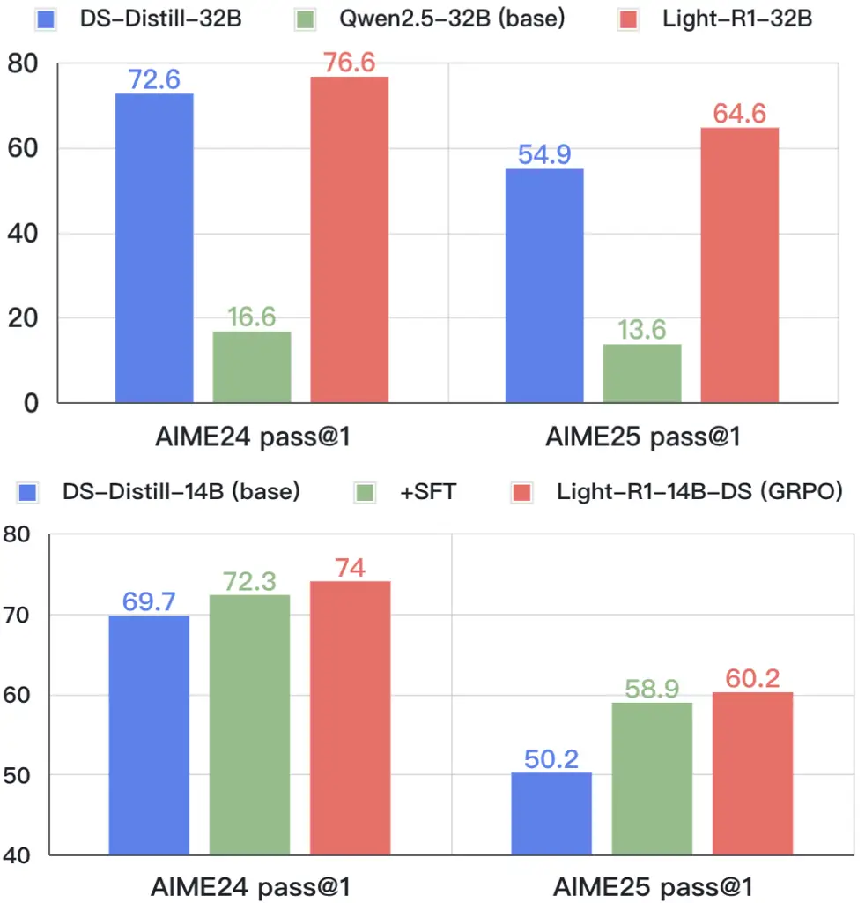
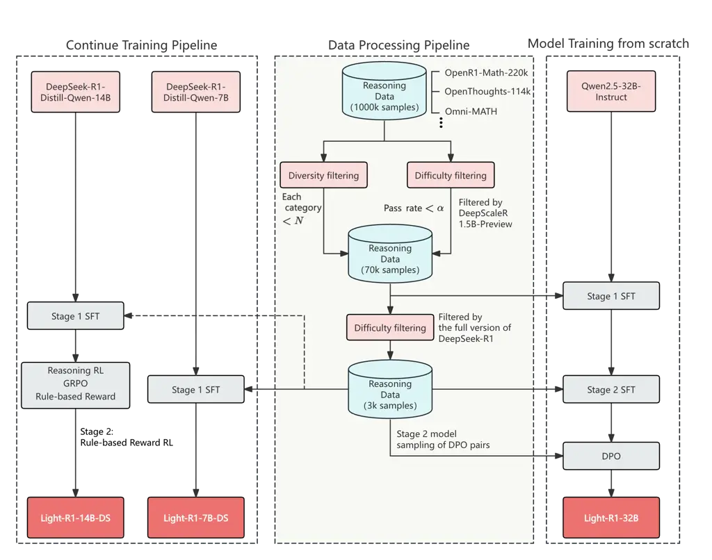

# Light-R1: Curriculum SFT, DPO and RL for Long COT from Scratch and Beyond

Liang Wen Affiliation: Qiyuan Tech
Email: [zhangxiangzheng@360.cn](mailto:)    Yunke Cai
Affiliation: Qiyuan Tech    Fenrui Xiao Affiliation: Qiyuan Tech    Xin
He Affiliation: Qiyuan Tech    Qi An Affiliation: Qiyuan Tech    Zhenyu
Duan Affiliation: Qiyuan Tech    Yimin Du Affiliation: Qiyuan Tech   
Junchen Liu Affiliation: Qiyuan Tech    Lifu Tang Affiliation: Qiyuan
Tech    Xiaowei Lv Affiliation: Qiyuan Tech Affiliation: Renmin
University    Haosheng Zou Affiliation: Qiyuan Tech    Yongchao Deng
Affiliation: Qiyuan Tech    Shousheng Jia Affiliation: Qiyuan Tech   
Xiangzheng Zhang Affiliation: Qiyuan Tech

###### Abstract

This paper introduces Light-R1, an open-source suite for training long
reasoning models using reproducible and cost-effective methodology.
Given the proprietary nature of data used in the DeepSeek-R1 series, we
develop an alternative approach leveraging exclusively public data and
models. Our curriculum training progressively increases data difficulty,
combined with multi-staged post-training. Our Light-R1-32B model,
trained from Qwen2.5-32B-Instruct, outperforms
DeepSeek-R1-Distill-Qwen-32B in math reasoning. Experimental results
show that this curriculum approach becomes more effective when distinct,
diverse datasets are available for different training stages:
fine-tuning DeepSeek-R1-Distilled models (pre-tuned by DeepSeek team on
proprietary data) with 3,000 challenging examples from our curriculum
dataset yielded state-of-the-art 7B and 14B models, while the 32B model,
Light-R1-32B-DS performed comparably to QwQ-32B and DeepSeek-R1.
Furthermore, we extend our work by applying GRPO on long reasoning
models. Our final Light-R1-14B-DS achieves SOTA performance among 14B
models in math, with AIME24 & 25 scores of 74.0 and 60.2 respectively,
surpassing many 32B models and DeepSeek-R1-Distill-Llama-70B. Despite
math-focused training, Light-R1-14B-DS demonstrates strong cross-domain
generalization. Light-R1 represents a significant advancement in making
sophisticated reasoning models more accessible and implementable in
real-world applications. Our models, training data and code have been
made available at
[https://github.com/Qihoo360/Light-R1](https://github.com/Qihoo360/Light-R1).

Figure 1: Reproducible state-of-the-art long COT models (top) developed
from scratch (=short-COT base), (bottom) derived from
DeepSeek-R1-Distill models (=long-COT base), via curriculum learning
strategy.

## 1 Introduction

Since the release of DeepSeek-R1 (DeepSeek-AI, 2025), long
chain-of-thought (OpenAI, 2024; Wei et al., 2022; Kimi, 2025; Lightman
et al., 2023) reasoning has gained widespread popularity in both
foundational AI models and various industrial AI applications. However,
deploying full-capacity R1-level models (typically 70B+ parameters,
DeepSeek-R1 with 671B parameters) incurs prohibitive computational costs
(DeepSeek-AI, 2025; Qwen, 2025). The resource barrier of training and
deploying the giant models makes them impractical for edge devices and
real-time applications. This limitation has sparked growing interest in
developing compact yet capable models under a few 10B parameters that
can perform extended long COT - a critical requirement for mathematical
problem solving, algorithmic planning, and scientific analysis. To
address this challenge, we present our work on the Light-R1 series.

As a foundation for our research, we first established robust and
reproducible evaluation protocols that rigorously reproduce the
evaluation results reported in DeepSeek-AI (2025). Building upon this
reliable framework, our research systematically addresses three
fundamental challenges through innovative algorithmic and engineering
advancements.

The first challenge involves curating an efficient dataset for
Post-Training, a critical factor for long-COT optimization (Ye et al.,
2025; Muennighoff et al., 2025; Li et al., 2025). We collected diverse
open-source reasoning data covering mathematical reasoning, logical
deduction, and algorithmic problem-solving. After preprocessing to
remove duplicates and standardize formatting, we implemented a two-stage
difficulty filtering methodology using DeepScaleR-1.5B-Preview (Luo
et al., 2025b) and DeepSeek-R1-Distill-Qwen-32B models to quantify
difficulty based on pass rates.

The second challenge then emerges as how to optimize the utilization of
this dataset. While conventional approaches typically employ a single
SFT stage (DeepSeek-AI, 2025; Xu et al., 2025; Labs, 2025; Yu et al.,
2024), our preliminary experiments with our 32B model revealed
significant limitations—approximately 20% of training data still
exhibited pass rates below 50% across 10 runs, indicating insufficient
knowledge assimilation from heterogeneous difficulty datasets. To
address this, we implemented a multi-staged curriculum training strategy
comprising two consecutive SFT stages with progressively increasing
difficulty, followed by a DPO stage (Rafailov et al., 2023). Although
recent work has explored different curriculum strategies for long-COT
training Luo et al. (2025a); Min et al. (2024); Xi et al. (2024); Yuan
et al. (2025a), our approach demonstrates superior performance: our
Light-R1-32B model, trained from Qwen2.5-32B-Instruct (Qwen, 2024),
outperforms DeepSeek-R1-Distill-Qwen-32B in mathematical reasoning.

The third challenge arises from implementing the final component of
Post-Training — Reinforcement Learning (Shao et al., 2024; Wang et al.,
2024; Ouyang et al., 2022; Schulman et al., 2017; Schulman et al., 2015)
— to further enhance model performance. We are excited to report our
successful reinforcement learning training of Light-R1-14B-DS. While
recent research has shown success in training base models (Zeng et al.,
2025; Hu et al., 2025; Liu et al., 2025), smaller models (Zeng et al.,
2025; Luo et al., 2025b), or larger models with intensive computational
resources (Qwen, 2025), our long-COT RL Post-Training represents the
first demonstration of simultaneous increases in both response length
and reward scores on long-COT 14B models without the initial length
reduction typically observed. This breakthrough demonstrates that
carefully designed curriculum strategies can overcome the previously
documented scalability limitations of RL in smaller models Gao et al.
(2023).

The key contributions of this work include:

- •
  A detailed, fully open-source Curriculum Post-Training approach to
  train long-COT models from scratch. The multi-stage curriculum
  training incrementally builds reasoning capacity through
  difficulty-progressive data exposure, requiring only \$1000 training
  cost (6 hours on 12×H800 GPUs). This approach is validated on
  Qwen2.5-32B-Instruct and could be easily migrated to 7B and 14B
  models.
- •
  A well established SFT stage 2 dataset of 3k mostly math questions
  that could significantly improve not only SFT stage 1 but also all
  DeepSeek-R1-Distill models, resulting in our SOTA 7B model
  Light-R1-7B-DS.
- •
  First demonstration of RL effectiveness on 14B models for mathematical
  reasoning, achieving around 2% absolute improvement compared with
  before-RL, resulting in our SOTA 14B model Light-R1-14B-DS.

|                |       |      |
| -------------- | ----- | ---- |
| Model          | Paper | Ours |
| DS-distill-32B | 72.6  | 72.3 |
| DS-distill-14B | 69.7  | 69.3 |
| DS-distill-7B  | 55.5  | 54.0 |
| QWQ-32B        | 79.5  | 78.5 |

Table 1: Reproduction of DeepSeek-AI (2025) and Qwen (2025) evaluation
results on AIME24 (MAA, 2024) pass@1 averaged over 64 runs.

## 2 The Origin of Everything: Stable and Trustworthy Evaluation of Long-COT Models

Following DeepSeek-AI (2025), long-COT models are commonly deployed with
sampling temperature 0.6. While long-COT models generally perform better
with sampling than with greedy decoding, it brings more burden for model
evaluation as multiple samples for each question may be required,
contrary to previous viable approaches of greedy decoding for evaluation
(Song et al., 2024).

DeepSeek-AI (2025) generates 64 responses per query to estimate pass@1.
We have verified this choice, witnessing large deviation of over 3
points using 16 responses or fewer across different runs of the same
model. Such randomness is unacceptable to compare model performances.

For stable and trustworthy evaluation, we adapted Luo et al. (2025b)’s
evaluation code for all our evaluation runs. Our evaluation code and
logs are all released.

We can reproduce all DeepSeek-R1-Distill models’ and QwQ’s scores as
reported in DeepSeek-AI (2025); Qwen (2025) as shown in Tab. 1 with 64
samples per query, with deviation around 1 point.

## 3 Light-R1-32B: Long-COT from Scratch with Curriculum SFT & DPO

While numerous studies (Ye et al., 2025; Muennighoff et al., 2025;
OpenThoughts, 2025; OpenR1, 2025) have open-sourced efforts to replicate
DeepSeek-R1 using models of various sizes, ranging from 1.5B to 32B,
none has reached similar performance on the challenging mathematics
competitions AIME24 & 25, where DeepSeek-R1-Distill-Qwen-32B scored at
72.6 & 54.9.

We present our data processing and Post-Training pipeline in this
section as illustrated by Fig. 2.

Figure 2: Overview of training pipeline of Light-R1 series.

### 3.1 Data Preparation

The whole data preparation process spans data collection, data
decontamination and data generation, detailed as follows.

#### 3.1.1 Data Collection

We began by collecting various sources of math questions with
groundtruth answers. Iterating over all possible sources by the time, we
collected around 1000k math questions as the seed set. See Appendix B
for more details about the data sources.

All data are aggregated together to form around 1000k math questions as
the seed set. Within this 1000k data, we kept only math questions with
groundtruth answers. Questions without groundtruth answers could be used
as synthetic data by letting multiple strong LLMs vote for groundtruths
but we left it for future work.

The data is then filtered for diversity, where we tagged each question
with an in-house tagging system and downsample categories with excessive
data.

#### 3.1.2 Data Decontamination

We evaluated data contamination in several open-sourced datasets. Our
analysis revealed that MATH-500 (Hendrycks et al., 2021a) contains tens
of compromised questions that are either identical or differ only in
numerical values. AIME 24 and 25 remain uncontaminated, though caution
is needed when incorporating AIME data through 2023. Further details are
provided in Appendix C.

Light-R1 underwent comprehensive decontamination using exact matching
(excluding digits to filter questions with only numerical changes) and
N-gram (N=32) matching against AIME24&25, MATH-500, and GPQA (Rein
et al., 2023).

#### 3.1.3 Data Generation

With a diverse and clean dataset, we generate comprehensive
chain-of-thought (COT) responses for supervised fine-tuning (SFT).
However, not all data points are equally valuable for training, and
distilling DeepSeek-R1 can be resource-intensive whether through API
queries or local deployment. We therefore implemented difficulty-based
filtering on the dataset to retain only sufficiently challenging
questions, inspired by recent advances in training long reasoning models
(Luo et al., 2025b; Ye et al., 2025; Muennighoff et al., 2025).

We initially employ Luo et al. (2025b)’s DeepScaleR-1.5B-Preview model
to generate responses for each question, as this model offers a good
balance of efficiency and capability. Only questions with a pass rate
$`<\alpha`$ were selected for DeepSeek-R1 queries, resulting in
approximately 76k data points. After obtaining DeepSeek-R1 responses, we
retained only questions with correct long-COT answers. For questions
with multiple correct responses, we randomly selected one long-COT
answer for SFT. Through this process, we constructed an SFT dataset
exceeding 70k examples, featuring prompts filtered for both diversity
and difficulty, with long-COT responses generated by DeepSeek-R1 and
validated against ground truth.

However, direct training on this dataset alone did not yield
satisfactory results regardless of the number of training epochs. Upon
analyzing the trained model’s performance across different question
types, we discovered the need for additional training on more
challenging problems. Consequently, we implemented a second stage of
difficulty filtering using the full version of DeepSeek-R1 instead of
DeepScaleR-1.5B-Preview. This stage retained only questions with pass
rate $`<\alpha`$ and questions where DeepSeek-R1’s sampled responses
were neither uniformly correct nor uniformly incorrect, resulting in a
Stage 2 SFT dataset of approximately 3k examples. Notably, this refined
dataset demonstrated such high quality that training exclusively on it
produced performance improvements across all DeepSeek-R1-Distill models,
as we will discuss in Section 3.4.

### 3.2 Curriculum Post-Training

Our approach consists of three stages, detailed hyperparameters can be
found in Appendix D.:

1.  1.  SFT Stage 1: Training on 76k filtered mathematical problems
2.  2.  SFT Stage 2: Fine-tuning on 3k most challenging problems
3.  3.  DPO Optimization: Preference-based optimization using verified
        response pairs

SFT stages are trained with the curriculum data strategy as discussed in
Sec. 3.1.3. For DPO, we implemented a semi-on-policy approach using the
NCA loss (Chen et al., 2024). Rejected responses were sampled from our
SFT-stage-2 model with verified incorrect answers. Since some rejected
responses reached lengths of 32k tokens or more, we utilized the DPO
implementation with sequence parallelism from 360-LLaMA-Factory (Zou
et al., 2024). For chosen responses, we used verified correct answers
from DeepSeek-R1. While we had previously employed fully on-policy DPO
extensively, we discovered that for challenging mathematical problems,
using chosen responses from significantly stronger models yielded better
results.

### 3.3 Results

We observe consistent improvements across our curriculum SFT & DPO
post-training stages (Tab. 3). Following DPO, we use the TIES-merging
(Yadav et al., 2023) method from the Goddard et al. (2024) toolkit to
merged models from SFT-stage2, DPO, and another DPO variant (AIME24
score: 74.7) that had special tokens inadvertently removed from rejected
responses, the resulting merged model demonstrates additional
performance gains. Although our mathematics-focused training led to some
forgetting on untrained GPQA scientific questions, Light-R1-32B still
demonstrates strong generalization capabilities.

|                 |        |        |      |      |
| --------------- | ------ | ------ | ---- | ---- |
| Stage           | AIME24 | AIME25 | GPQA | LCB  |
| Instruct (base) | 16.6   | 13.6   | 48.8 | 24.6 |
| +SFT-stage1     | 69.0   | 57.4   | 64.3 | 42.9 |
| +SFT-stage2     | 73.0   | 64.3   | 60.6 | 42.0 |
| +DPO            | 75.8   | 63.4   | 61.8 | N/A  |
| +Model Merging  | 76.6   | 64.6   | 61.8 | 44.7 |
| Light-R1-32B    | 76.6   | 64.6   | 61.8 | 44.7 |

Table 2: Stage-wise performance improvement of our Light-R1-32B. We
observe a decrease in GPQA (Science QA) scores beginning from
STF-stage2, indicating a partial degradation of the model’s
generalization capabilities during extensive math-focused training.
However, Light-R1-32B still demonstrates strong generalization compared
to the base model.

|                  |        |        |      |      |
| ---------------- | ------ | ------ | ---- | ---- |
| Model            | AIME24 | AIME25 | GPQA | LCB  |
| DS-distill-7B    | 55.5   | 39.2   | 49.1 | 34.6 |
| Light-R1-7B-DS   | 59.1   | 44.3   | 49.4 | 38.4 |
| DS-distill-14B   | 69.7   | 50.2   | 59.1 | 52.9 |
| Light-R1-14B-DS’ | 72.3   | 58.9   | 60.3 | 55.9 |
| DS-distill-32B   | 72.6   | 54.9   | 62.1 | 58.8 |
| Light-R1-32B-DS  | 78.1   | 65.9   | 68.0 | 66.1 |

Table 3: Effectiveness of the 3k data from SFT stage2. Fine-tuning on
stronger base models, which presumably utilize datasets orthogonal to
ours, consistently enhances performance across all model sizes. The
notation Light-R1-14B-DS’ refers to the SFT-only version of our final
Light-R1-14B-DS model, which subsequently undergoes an additional stage
of GRPO RL training.

### 3.4 High-Quality Data is All You Need

Considering DeepSeek-R1-Distill-Qwen models as a stronger version of our
SFT stage 1, we performed SFT stage 2 with the 3k stage 2 data on top of
DeepSeek-R1-Distill-Qwen models.

Surprisingly as Tab. 3, we could achieve universal improvement on
DeepSeek-R1-Distill-Qwen models with this 3k data alone, demonstrating
the high quality of the stage 2 data. It may also be because this 3k
data is to some extent orthogonal to DeepSeek-R1-Distill-Qwen models’
800k SFT data, hence such easy improvement.

GPQA performance is unexpectedly high for Light-R1-32B-DS, despite the
absence of domain-specific training in science and code domains,
suggesting that stronger base models may benefit from stronger
generalization capacities. In contrast, Light-R1-7B-DS, while trained on
identical data curriculum, exhibits improvements confined solely to
in-domain tasks.

## 4 Light-R1-14B-DS: Reinforcement Learning from Long-COT Models

Figure 3: RL Learning curves of response length and train-reward,
smoothed with Savitzky-Golay filter.

|                               |        |        |      |      |
| ----------------------------- | ------ | ------ | ---- | ---- |
| Model                         | AIME24 | AIME25 | GPQA | LCB  |
| DS-distill-14B                | 69.7   | 50.2   | 59.1 | 52.9 |
| + SFT                         | 72.3   | 58.9   | 60.3 | 55.9 |
| + GRPO epoch1                 | 72.3   | 57.8   | N/A  | 56.6 |
| + GRPO epoch2                 | 73.4   | 60.5   | N/A  | 56.5 |
| Light-R1-14B-DS (GRPO epoch3) | 74.0   | 60.2   | 61.7 | 56.0 |
| GRPO dataset-v2               | 75.0   | 65.0   | 62.6 | 57.9 |

Table 4: RL performance improvement of Light-R1-14B-DS. Notably, we
observe out-of-domain improvement in GPQA, indicating that reinforcement
learning on mathematics-focused datasets potentially facilitates
generalization across diverse domains.

We conduct our reinforcement learning experiments on
DeepSeek-R1-Distill-Qwen-14B. To the best of our knowledge, this is the
first publicly documented work demonstrating significant improvement in
performance through RL on already long-COT 14B models.

Previous studies by DeepSeek-AI (2025), Yuan et al. (2025b), and Zhang
et al. (2025) have shown that smaller models (with 32 billion parameters
or fewer) can reach high performance levels through distillation from
larger reasoning models. However, further improvement via RL
(Reinforcement Learning) on already long-COT finetuned models is not yet
widely reached by the community and is not as easily reachable as _zero_
RL (Sec. 1). While Luo et al. (2025b) successfully demonstrated
promising RL training on a smaller model DeepSeek-R1-Distill-Qwen-1.5B,
we encountered challenges in replicating similar results with the larger
DeepSeek-R1-Distill-Qwen-14B model using the same recipe.

After weeks of investigation, we arrived at our final RL solution
consisting of a two-pass process, drawing inspiration from our effective
curriculum SFT attempt and Cui et al. (2025). The process is as follows:

1.  1.  Offline Data Selection: Use Light-R1-7B-DS to sample results of RL
        training prompts. Keep only the prompts whose pass rate is between
        0.25 and 0.625.
2.  2.  Online Reinforcement Learning: Apply GRPO on the filtered dataset.

In our observation, offline data selection plays a critical role. It
filters out prompts that are too easy or too hard and ensures that the
training data aligns with our rule-based answer verifier. When manually
checking data with a pass rate of 0, we found that over half of the
prompt answers are either unverifiable (due to containing text or
complex conditional expressions) or incorrect. We utilize Light-R1-7B-DS
as the difficulty estimation model because it is more efficient and
demonstrates similar performance to larger models in terms of pass@64.
Additionally, we use a model verifier to re-check data with a pass rate
of 0. By filtering out the mis-verified data, we can successfully
identify difficult prompts for future curriculum reinforcement learning.

We choose GRPO (Shao et al., 2024) as the optimization algorithm and
implement it based on verl (Sheng et al., 2024). We also employ two
techniques to stabilize the RL training process: modified version of
length reward (Yeo et al., 2025) with weaker preference for short
correct answers and importance sampling weight clipping (MiniMax, 2025).

For length control, we adopt a modified version of the approach proposed
by Yeo et al. (2025). Specifically, we clip the shortening reward when
answers are correct to prevent initial length collapse. This technique
helps maintain a reasonable answer length during training, ensuring that
the model does not overly shorten its responses at the beginning of the
learning process.

Regarding importance sampling weight clipping, we implement a broader
two-sided clipping mechanism. Our observations have shown that
occasional large positive policy ratios combined with negative
advantages can lead to loss spikes, disrupting policy optimization. This
two-sided clipping technique was also implemented in our previous
experiments, in parallel with the findings reported by MiniMax (2025).
By clipping the importance sampling weights, we can limit the influence
of extreme values and make the training process more stable.

We use a rule-based reward and the de-duplicated version of the Big-Math
dataset (Albalak et al. (2025)). The experiments are conducted on a
cluster of 16 \* 8 A100 GPUs. The offline data selection process takes 4
hours, while the online reinforcement learning takes 26 hours to
complete 140 steps and 42 hours to complete 220 steps.

As can be seen from Fig. 3, our RL training demonstrates expected
behavior: simultaneous increase in response length and reward score. No
interesting length dropping in the beginning. We evaluated RL epochs 1
and 2 after we finished training 3 epochs. As shown in Tab. 4, although
first two epochs seem to bring not much improvement, the healthy RL
training curves offer us confidence to continue training.
Light-R1-14B-DS is finally RL trained for around 3 epochs, or 220 steps.

## 5 Conclusion

Our Light-R1 series addresses the challenge of training long reasoning
models under resource constraints. We successfully train a long-COT
model from scratch through our curriculum training strategy. Our
carefully curated 3K dataset demonstrates remarkable transferability
across various model sizes, significantly enhancing DeepSeek-R1-Distill
models and establishing new performance benchmarks for models with 7B,
14B, and 32B parameters. Additionally, we investigate the efficacy of
reinforcement learning when applied to a strong multi-stage finetuned
base model, achieving superior performance while maintaining stable
response length growth throughout the training process.

These advancements not only democratize access to R1-level reasoning
capabilities but also provide valuable insights into curriculum design,
data efficiency, and RL scalability for long reasoning models. Our
open-source models, datasets, and code aim to accelerate research in
developing compact yet powerful reasoning systems, particularly for
resource-constrained applications. Future work will explore the
integration of enhanced generalization capabilities for long reasoning
models and further optimization of RL training efficiency.

## References

- Albalak et al. (2025) Alon Albalak, Duy Phung, Nathan Lile, Rafael
  Rafailov, Kanishk Gandhi, Louis Castricato, Anikait Singh, Chase
  Blagden, Violet Xiang, Dakota Mahan, and Nick Haber. 2025. [Big-math:
  A large-scale, high-quality math dataset for reinforcement learning in
  language models](https://arxiv.org/abs/2502.17387). _Preprint_,
  arXiv:2502.17387.
- Chen et al. (2024) Huayu Chen, Guande He, Hang Su, and Jun Zhu. 2024.
  Noise contrastive alignment of language models with explicit rewards.
  _arXiv preprint arXiv:2402.05369_.
- Cui et al. (2025) Ganqu Cui, Lifan Yuan, Zefan Wang, Hanbin Wang,
  Wendi Li, Bingxiang He, Yuchen Fan, Tianyu Yu, Qixin Xu, Weize Chen,
  Jiarui Yuan, Huayu Chen, Kaiyan Zhang, Xingtai Lv, Shuo Wang, Yuan
  Yao, Xu Han, Hao Peng, Yu Cheng, Zhiyuan Liu, Maosong Sun, Bowen Zhou,
  and Ning Ding. 2025. [Process Reinforcement through Implicit
  Rewards](https://doi.org/10.48550/arXiv.2502.01456). _Preprint_,
  arXiv:2502.01456.
- DeepSeek-AI (2025) DeepSeek-AI. 2025. [Deepseek-r1: Incentivizing
  reasoning capability in llms via reinforcement
  learning](https://arxiv.org/abs/2501.12948). _Preprint_,
  arXiv:2501.12948.
- Gao et al. (2024) Bofei Gao, Feifan Song, Zhe Yang, Zefan Cai, Yibo
  Miao, Qingxiu Dong, Lei Li, Chenghao Ma, Liang Chen, Runxin Xu,
  Zhengyang Tang, Benyou Wang, Daoguang Zan, Shanghaoran Quan, Ge Zhang,
  Lei Sha, Yichang Zhang, Xuancheng Ren, Tianyu Liu, and Baobao
  Chang. 2024. [Omni-math: A universal olympiad level mathematic
  benchmark for large language
  models](https://arxiv.org/abs/2410.07985). _Preprint_,
  arXiv:2410.07985.
- Gao et al. (2023) Leo Gao, John Schulman, and Jacob Hilton. 2023.
  Scaling laws for reward model overoptimization. In _International
  Conference on Machine Learning_, pages 10835–10866. PMLR.
- Goddard et al. (2024) Charles Goddard, Shamane Siriwardhana, Malikeh
  Ehghaghi, Luke Meyers, Vladimir Karpukhin, Brian Benedict, Mark
  McQuade, and Jacob Solawetz. 2024. [Arcee’s MergeKit: A toolkit for
  merging large language
  models](https://doi.org/10.18653/v1/2024.emnlp-industry.36). In
  _Proceedings of the 2024 Conference on Empirical Methods in Natural
  Language Processing: Industry Track_, pages 477–485, Miami, Florida,
  US. Association for Computational Linguistics.
- Hendrycks et al. (2021a) Dan Hendrycks, Collin Burns, Saurav Kadavath,
  Akul Arora, Steven Basart, Eric Tang, Dawn Song, and Jacob Steinhardt.
  2021a. [Measuring mathematical problem solving with the math
  dataset](https://arxiv.org/abs/2103.03874). _Preprint_,
  arXiv:2103.03874.
- Hendrycks et al. (2021b) Dan Hendrycks, Collin Burns, Saurav Kadavath,
  Akul Arora, Steven Basart, Eric Tang, Dawn Song, and Jacob Steinhardt.
  2021b. Measuring mathematical problem solving with the math dataset.
  _NeurIPS_.
- Hu et al. (2025) Jingcheng Hu, Yinmin Zhang, Qi Han, Daxin Jiang, and
  Heung-Yeung Shum Xiangyu Zhang. 2025. Open-reasoner-zero: An open
  source approach to scaling reinforcement learning on the base model.
  [https://github.com/Open-Reasoner-Zero/Open-Reasoner-Zero](https://github.com/Open-Reasoner-Zero/Open-Reasoner-Zero).
- Kimi (2025) Kimi. 2025. [Kimi k1.5: Scaling reinforcement learning
  with llms](https://arxiv.org/abs/2501.12599). _Preprint_,
  arXiv:2501.12599.
- Labs (2025) Bespoke Labs. 2025. [Bespoke-stratos: The unreasonable
  effectiveness of reasoning
  distillation](https://hf.co/bespokelabs/Bespoke-Stratos-32B).
  Accessed: 2025-01-22.
- Li et al. (2025) Xuefeng Li, Haoyang Zou, and Pengfei Liu. 2025.
  [Limr: Less is more for rl scaling](https://arxiv.org/abs/2502.11886).
  _Preprint_, arXiv:2502.11886.
- Lightman et al. (2023) Hunter Lightman, Vineet Kosaraju, Yura Burda,
  Harri Edwards, Bowen Baker, Teddy Lee, Jan Leike, John Schulman, Ilya
  Sutskever, and Karl Cobbe. 2023. [Let’s verify step by
  step](https://arxiv.org/abs/2305.20050). _Preprint_, arXiv:2305.20050.
- Liu et al. (2025) Zichen Liu, Changyu Chen, Wenjun Li, Tianyu Pang,
  Chao Du, and Min Lin. 2025. There may not be aha moment in
  r1-zero-like training — a pilot study.
  [https://oatllm.notion.site/oat-zero](https://oatllm.notion.site/oat-zero).
  Notion Blog.
- Luo et al. (2025a) Haipeng Luo, Qingfeng Sun, Can Xu, Pu Zhao,
  Jianguang Lou, Chongyang Tao, Xiubo Geng, Qingwei Lin, Shifeng Chen,
  Yansong Tang, and Dongmei Zhang. 2025a. [Wizardmath: Empowering
  mathematical reasoning for large language models via reinforced
  evol-instruct](https://arxiv.org/abs/2308.09583). _Preprint_,
  arXiv:2308.09583.
- Luo et al. (2025b) Michael Luo, Sijun Tan, Justin Wong, Xiaoxiang Shi,
  William Y. Tang, Manan Roongta, Colin Cai, Jeffrey Luo, Tianjun Zhang,
  Li Erran Li, Raluca Ada Popa, and Ion Stoica. 2025b. Deepscaler:
  Surpassing o1-preview with a 1.5b model by scaling rl. Notion Blog.
- MAA (2024) MAA. 2024. [American invitational mathematics examination -
  aime](https://maa.org/math-competitions/american-invitational-mathematics-examination-aime).
  In _American Invitational Mathematics Examination - AIME 2024_.
- Min et al. (2024) Yingqian Min, Zhipeng Chen, Jinhao Jiang, Jie Chen,
  Jia Deng, Yiwen Hu, Yiru Tang, Jiapeng Wang, Xiaoxue Cheng, Huatong
  Song, Wayne Xin Zhao, Zheng Liu, Zhongyuan Wang, and Ji-Rong
  Wen. 2024. [Imitate, explore, and self-improve: A reproduction report
  on slow-thinking reasoning systems](https://arxiv.org/abs/2412.09413).
  _Preprint_, arXiv:2412.09413.
- MiniMax (2025) MiniMax. 2025. [MiniMax-01: Scaling Foundation Models
  with Lightning Attention](https://doi.org/10.48550/arXiv.2501.08313).
  _Preprint_, arXiv:2501.08313.
- Muennighoff et al. (2025) Niklas Muennighoff, Zitong Yang, Weijia Shi,
  Xiang Lisa Li, Li Fei-Fei, Hannaneh Hajishirzi, Luke Zettlemoyer,
  Percy Liang, Emmanuel Candès, and Tatsunori Hashimoto. 2025. [s1:
  Simple test-time scaling](https://arxiv.org/abs/2501.19393). _arXiv
  preprint arXiv:2501.19393_.
- OpenAI (2024) OpenAI. 2024. [Learning to reason with
  llms](https://openai.com/index/learning-to-reason-with-llms/).
- OpenR1 (2025) OpenR1. 2025. [Open r1: A fully open reproduction of
  deepseek-r1](https://github.com/huggingface/open-r1).
- OpenThoughts (2025) OpenThoughts. 2025. Open Thoughts.
  https://open-thoughts.ai.
- Ouyang et al. (2022) Long Ouyang, Jeffrey Wu, Xu Jiang, Diogo Almeida,
  Carroll Wainwright, Pamela Mishkin, Chong Zhang, Sandhini Agarwal,
  Katarina Slama, Alex Ray, et al. 2022. Training language models to
  follow instructions with human feedback. _Advances in neural
  information processing systems_, 35:27730–27744.
- Qwen (2024) Qwen. 2024. [Qwen2.5: A party of foundation
  models](https://qwenlm.github.io/blog/qwen2.5/).
- Qwen (2025) Qwen. 2025. [Qwq-32b: Embracing the power of reinforcement
  learning](https://qwenlm.github.io/blog/qwq-32b/).
- Rafailov et al. (2023) Rafael Rafailov, Archit Sharma, Eric Mitchell,
  Stefano Ermon, Christopher D. Manning, and Chelsea Finn. 2023. [Direct
  preference optimization: Your language model is secretly a reward
  model](https://arxiv.org/abs/2305.18290). _Preprint_,
  arXiv:2305.18290.
- Rein et al. (2023) David Rein, Betty Li Hou, Asa Cooper Stickland,
  Jackson Petty, Richard Yuanzhe Pang, Julien Dirani, Julian Michael,
  and Samuel R. Bowman. 2023. [Gpqa: A graduate-level google-proof q&a
  benchmark](https://arxiv.org/abs/2311.12022). _Preprint_,
  arXiv:2311.12022.
- Schulman et al. (2015) John Schulman, Philipp Moritz, Sergey Levine,
  Michael Jordan, and Pieter Abbeel. 2015. [High-dimensional continuous
  control using generalized advantage
  estimation](https://arxiv.org/abs/1506.02438). _Preprint_,
  arXiv:1506.02438.
- Schulman et al. (2017) John Schulman, Filip Wolski, Prafulla Dhariwal,
  Alec Radford, and Oleg Klimov. 2017. [Proximal policy optimization
  algorithms](https://arxiv.org/abs/1707.06347). _Preprint_,
  arXiv:1707.06347.
- Shao et al. (2024) Zhihong Shao, Peiyi Wang, Qihao Zhu, Runxin Xu,
  Junxiao Song, Xiao Bi, Haowei Zhang, Mingchuan Zhang, Y. K. Li, Y. Wu,
  and Daya Guo. 2024. [DeepSeekMath: Pushing the Limits of Mathematical
  Reasoning in Open Language
  Models](https://doi.org/10.48550/arXiv.2402.03300). _Preprint_,
  arXiv:2402.03300.
- Sheng et al. (2024) Guangming Sheng, Chi Zhang, Zilingfeng Ye, Xibin
  Wu, Wang Zhang, Ru Zhang, Yanghua Peng, Haibin Lin, and Chuan
  Wu. 2024. Hybridflow: A flexible and efficient rlhf framework. _arXiv
  preprint arXiv: 2409.19256_.
- Song et al. (2024) Yifan Song, Guoyin Wang, Sujian Li, and Bill Yuchen
  Lin. 2024. The good, the bad, and the greedy: Evaluation of llms
  should not ignore non-determinism. _arXiv preprint arXiv:2407.10457_.
- Toshniwal et al. (2024) Shubham Toshniwal, Wei Du, Ivan Moshkov,
  Branislav Kisacanin, Alexan Ayrapetyan, and Igor Gitman. 2024.
  Openmathinstruct-2: Accelerating ai for math with massive open-source
  instruction data. _arXiv preprint arXiv:2410.01560_.
- Wang et al. (2024) Peiyi Wang, Lei Li, Zhihong Shao, R. X. Xu, Damai
  Dai, Yifei Li, Deli Chen, Y. Wu, and Zhifang Sui. 2024.
  [Math-shepherd: Verify and reinforce llms step-by-step without human
  annotations](https://arxiv.org/abs/2312.08935). _Preprint_,
  arXiv:2312.08935.
- Wei et al. (2022) Jason Wei, Xuezhi Wang, Dale Schuurmans, Maarten
  Bosma, Brian Ichter, Fei Xia, Ed H. Chi, Quoc V. Le, and Denny
  Zhou. 2022. [Chain-of-thought prompting elicits reasoning in large
  language
  models](http://papers.nips.cc/paper_files/paper/2022/hash/9d5609613524ecf4f15af0f7b31abca4-Abstract-Conference.html).
  In _NeurIPS_.
- Xi et al. (2024) Zhiheng Xi, Wenxiang Chen, Boyang Hong, Senjie Jin,
  Rui Zheng, Wei He, Yiwen Ding, Shichun Liu, Xin Guo, Junzhe Wang,
  Honglin Guo, Wei Shen, Xiaoran Fan, Yuhao Zhou, Shihan Dou, Xiao Wang,
  Xinbo Zhang, Peng Sun, Tao Gui, Qi Zhang, and Xuanjing Huang. 2024.
  [Training large language models for reasoning through reverse
  curriculum reinforcement learning](https://arxiv.org/abs/2402.05808).
  _Preprint_, arXiv:2402.05808.
- Xu et al. (2025) Haotian Xu, Xing Wu, Weinong Wang, Zhongzhi Li,
  Da Zheng, Boyuan Chen, Yi Hu, Shijia Kang, Jiaming Ji, Yingying Zhang,
  Zhijiang Guo, Yaodong Yang, Muhan Zhang, and Debing Zhang. 2025.
  [Redstar: Does scaling long-cot data unlock better slow-reasoning
  systems?](https://arxiv.org/abs/2501.11284) _Preprint_,
  arXiv:2501.11284.
- Yadav et al. (2023) Prateek Yadav, Derek Tam, Leshem Choshen, Colin
  Raffel, and Mohit Bansal. 2023. [Ties-merging: Resolving interference
  when merging models](https://arxiv.org/abs/2306.01708). _Preprint_,
  arXiv:2306.01708.
- Ye et al. (2025) Yixin Ye, Zhen Huang, Yang Xiao, Ethan Chern, Shijie
  Xia, and Pengfei Liu. 2025. [Limo: Less is more for
  reasoning](https://arxiv.org/abs/2502.03387). _Preprint_,
  arXiv:2502.03387.
- Yeo et al. (2025) Edward Yeo, Yuxuan Tong, Morry Niu, Graham Neubig,
  and Xiang Yue. 2025. [Demystifying Long Chain-of-Thought Reasoning in
  LLMs](https://doi.org/10.48550/arXiv.2502.03373). _Preprint_,
  arXiv:2502.03373.
- Yu et al. (2024) Longhui Yu, Weisen Jiang, Han Shi, Jincheng Yu,
  Zhengying Liu, Yu Zhang, James T. Kwok, Zhenguo Li, Adrian Weller, and
  Weiyang Liu. 2024. [Metamath: Bootstrap your own mathematical
  questions for large language
  models](https://arxiv.org/abs/2309.12284). _Preprint_,
  arXiv:2309.12284.
- Yuan et al. (2025a) Siyu Yuan, Zehui Chen, Zhiheng Xi, Junjie Ye,
  Zhengyin Du, and Jiecao Chen. 2025a. [Agent-r: Training language model
  agents to reflect via iterative
  self-training](https://arxiv.org/abs/2501.11425). _Preprint_,
  arXiv:2501.11425.
- Yuan et al. (2025b) Yufeng Yuan, Yu Yue, Ruofei Zhu, Tiantian Fan, and
  Lin Yan. 2025b. [What’s Behind PPO’s Collapse in Long-CoT? Value
  Optimization Holds the
  Secret](https://doi.org/10.48550/arXiv.2503.01491). _Preprint_,
  arXiv:2503.01491.
- Zeng et al. (2025) Weihao Zeng, Yuzhen Huang, Wei Liu, Keqing He, Qian
  Liu, Zejun Ma, and Junxian He. 2025. 7b model and 8k examples:
  Emerging reasoning with reinforcement learning is both effective and
  efficient.
  [https://hkust-nlp.notion.site/simplerl-reason](https://hkust-nlp.notion.site/simplerl-reason).
  Notion Blog.
- Zhang et al. (2025) Hanning Zhang, Jiarui Yao, Chenlu Ye, Wei Xiong,
  and Tong Zhang. 2025. Online-dpo-r1: Unlocking effective reasoning
  without the ppo overhead. Notion Blog.
- Zou et al. (2024) Haosheng Zou, Xiaowei Lv, Shousheng Jia, and
  Xiangzheng Zhang. 2024.
  [360-llama-factory](https://github.com/Qihoo360/360-LLaMA-Factory).

## Appendix A Light-R1 Series of Models

|                 |        |        |      |      |                    |
| --------------- | ------ | ------ | ---- | ---- | ------------------ |
| Model           | AIME24 | AIME25 | GPQA | LCB  | Training Recipe    |
| Light-R1-32B    | 76.6   | 64.6   | 61.8 | 44.7 | SFT stage1&2 + DPO |
| Light-R1-7B-DS  | 59.1   | 44.3   | 49.4 | tbd  | SFT stage2         |
| Light-R1-14B-DS | 74.0   | 60.2   | 61.7 | 56.0 | SFT stage2 + GRPO  |
| Light-R1-32B-DS | 78.1   | 65.9   | 68.0 | 66.1 | SFT stage2         |

Table 5: Light-R1 models. “-DS” = from DeepSeek-R1-Distill, otherwise
from Qwen-Instruct.

## Appendix B Dataset composition for full 59K questions

|                                             |                                                                                                                                                                                             |           |
| ------------------------------------------- | ------------------------------------------------------------------------------------------------------------------------------------------------------------------------------------------- | --------- |
| Source                                      | Description                                                                                                                                                                                 | \#Samples |
| OpenR1-Math-220k (OpenR1, 2025)             | Math problems with two to four reasoning traces generated by DeepSeek R1 for problems from NuminaMath 1.5.                                                                                  | 58224     |
| OpenThoughts-114k (OpenThoughts, 2025)      | Open synthetic reasoning dataset with 114k high-quality examples covering math, science, code, and puzzles                                                                                  | 14214     |
| OpenMathInstruct-2 (Toshniwal et al., 2024) | Math instruction tuning dataset generated using the Llama3.1-405B-Instruct model by Nvidea                                                                                                  | 1786      |
| OmniMath (Gao et al., 2024)                 | Math problems from competitions                                                                                                                                                             | 567       |
| s1K-1.1 (Muennighoff et al., 2025)          | Diverse, high-quality & difficult questions with distilled reasoning traces & solutions from DeepSeek-R1                                                                                    | 346       |
| LIMO (Ye et al., 2025)                      | Three-stage filtered data from the LIMO paper                                                                                                                                               | 246       |
| hendrycks-math (Hendrycks et al., 2021b)    | 12,500 challenging competition mathematics problems. Each problem in MATH has a full step-by-step solution which can be used to teach models to generate answer derivations and explanation | 179       |
| Ours                                        | In-house math dataset                                                                                                                                                                       | 3877      |
| Total                                       | Composite of the above datasets with reasoning traces and solutions                                                                                                                         | 79439     |

Table 6: Composition of the released data. Here we summarize the data
composition after the first stage diversity and difficulty filtering.
Different sources may contain overlapping examples, we use
OpenR1-Math-220k as our initial seed dataset, which explains why this
source contributes the largest portion of our data.

## Appendix C Data Decontamination

|                                     |           |          |              |
| ----------------------------------- | --------- | -------- | ------------ |
| Dataset                             | AIME24+25 | MATH-500 | GPQA Diamond |
| OpenThoughts-114k                   | 0         | 100      | 0            |
| Open-R1-Math-220k                   | 0         | 10       | 0            |
| DeepScaleR-Preview-Dataset          | 0         | 196      | 0            |
| LIMO                                | 0         | 0        | 0            |
| Bespoke-Stratos-17k                 | 0         | 125      | 0            |
| Open-Reasoner-Zero                  | 0         | 325      | 0            |
| simplescaling/data_ablation_full59K | 0         | 244      | 1            |
| simplescaling/s1K-1.1               | 0         | 3        | 1            |
| ours                                | 0         | 0        | 0            |

Table 7: Number of matched prompts in open-source datasets against
benchmarks.

## Appendix D Training hyperparameters for Light-R1 series

|                         |                       |            |            |
| ----------------------- | --------------------- | ---------- | ---------- |
| Model Names             | Learning Rate         | Batch Size | Seq Length |
| Light-R1-32B SFT Stage1 | $`5.0\times 10^{-5}`$ | 96         | 20k        |
| Light-R1-32B SFT Stage2 | $`1.0\times 10^{-5}`$ | 32         | 20k        |
| Light-R1-32B DPO        | $`5.0\times 10^{-7}`$ | 16         | 32k        |
| Light-R1-7B-DS          | $`5.0\times 10^{-6}`$ | 32         | 20k        |
| Light-R1-14B-DS-SFT     | $`5.0\times 10^{-6}`$ | 32         | 20k        |
| Light-R1-14B-DS (GRPO)  | $`1.0\times 10^{-6}`$ | 128        | 24k        |
| Light-R1-32B-DS         | $`5.0\times 10^{-6}`$ | 32         | 20k        |

Table 8: Training hyperparameters for Light-R1 series. Sequence length
is determined by training data characteristics, except for GRPO where it
balances multiple factors: minimizing roll-out computational costs,
reducing inference cut-off ratio, and optimizing 32k context evaluation
performance. To overcome the limitation of GPU memory for training DPO
with 32k context length, we utilize the DPO implementation with sequence
parallelism from 360-LLaMA-Factory (Zou et al., 2024). Models with the
"-DS" suffix derive from the DeepSeek-R1-Distill-Qwen series, while
others from Qwen2.5-32B-Instruct.
