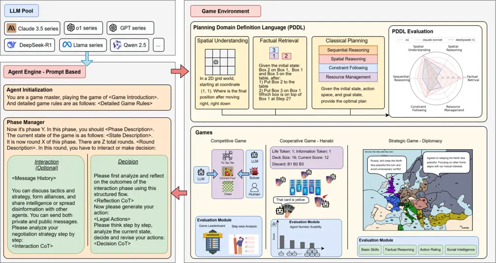
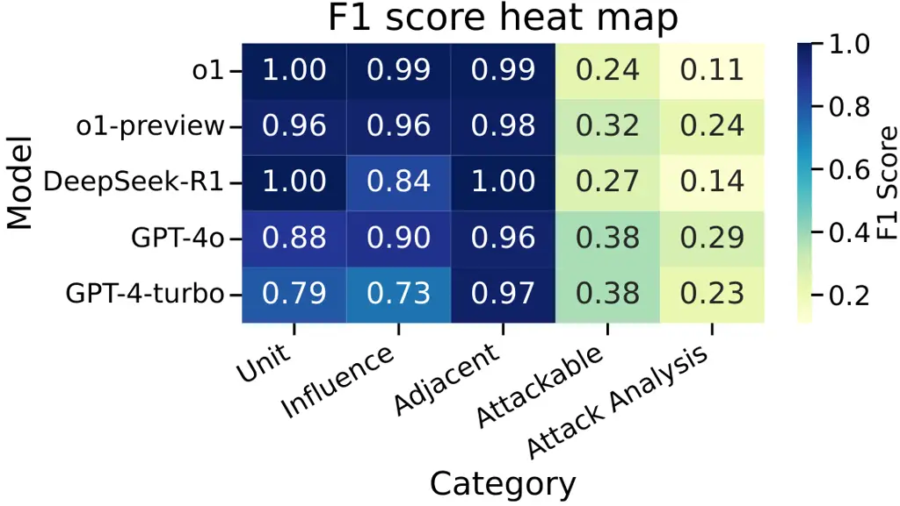
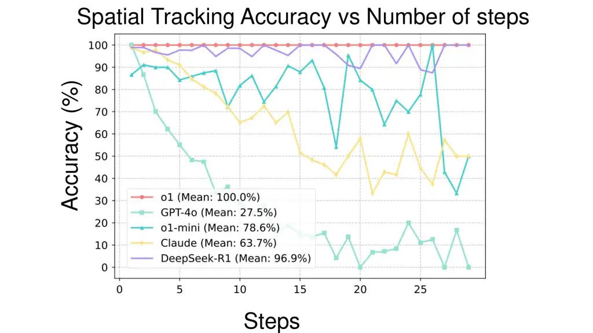
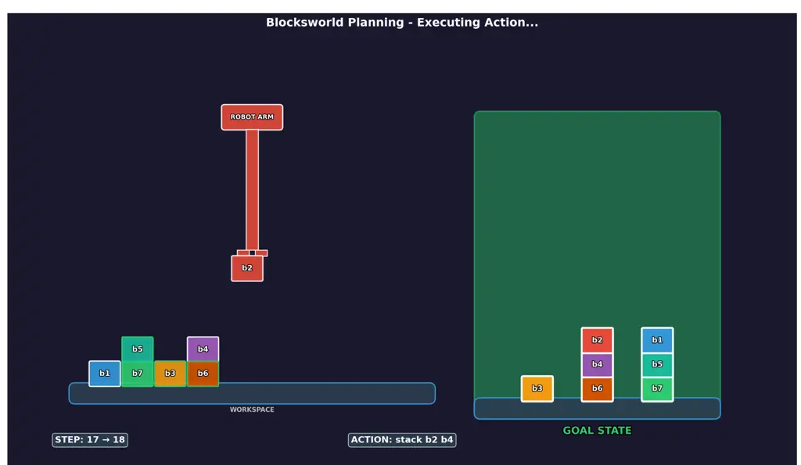
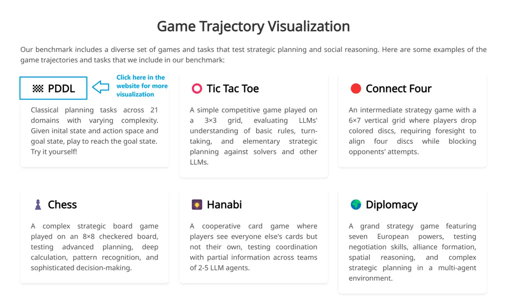

# SPIN-Bench: How Well Do LLMs Plan Strategically and Reason Socially?

Jianzhu Yao ^(†)^(†)thanks: Equal contribution Affiliation: Princeton
University    Kevin Wang¹¹footnotemark: 1 Affiliation: The University of
Texas at Austin    Ryan Hsieh Affiliation: The University of Texas at
Austin    Haisu Zhou Affiliation: The University of Texas at Austin   
Tianqing Zou Affiliation: The University of Texas at Austin    Zerui
Cheng Affiliation: Princeton University    Zhangyang Wang
Affiliation: The University of Texas at Austin    Pramod Viswanath
Affiliation: Princeton University Affiliation: Sentient
Foundation{jy0246, pramodv}@princeton.edu, {kevinwang.1839,
atlaswang}@utexas.edu

###### Abstract

Reasoning and strategic behavior in _social interactions_ is a hallmark
of intelligence. This form of reasoning is significantly more
sophisticated than isolated planning or reasoning tasks in static
settings (e.g., math problem solving). In this paper, we present
Strategic Planning, Interaction, and Negotiation (SPIN-Bench)¹¹ 1
Project page:
[https://spinbench.github.io/](https://spinbench.github.io/). Code:
[https://github.com/spinbench/spinbench](https://github.com/spinbench/spinbench),
a new multi-domain evaluation designed to measure the intelligence of
_strategic planning_ and _social reasoning_. While many existing
benchmarks focus on narrow planning or single-agent reasoning,
SPIN-Bench combines planning domain definition language (PDDL) tasks,
competitive board games, cooperative card games, and multi-agent
negotiation scenarios in one unified framework. The framework includes
both a benchmark as well as an arena to simulate and evaluate the
variety of social settings to test reasoning and strategic behavior of
AI agents. We formulate the benchmark SPIN-Bench by systematically
varying action spaces, state complexity, and the number of interacting
agents to simulate a variety of social settings where success depends on
not only methodical and step-wise decision making, but also _conceptual
inference_ of other (adversarial or cooperative) participants. Our
experiments reveal that while contemporary LLMs handle _basic fact
retrieval_ and _short-range planning_ reasonably well, they encounter
significant performance bottlenecks in tasks requiring _deep multi-hop
reasoning_ over large state spaces and _socially adept_ coordination
under uncertainty. We envision SPIN-Bench as a catalyst for future
research on robust multi-agent planning, social reasoning, and human–AI
teaming.

## 1 Introduction

Large Language Models (LLMs) have recently demonstrated remarkable
proficiency in generating coherent text, contextual understanding, and a
variety of agentic tasks (Schick et al., 2023; DataBassGit, 2023). This
progress has opened numerous avenues for deploying LLM-based agents in
real-world applications such as digital assistance, complex
decision-making support, and collaborative human–AI systems (Liu et al.,
2023; Mialon et al., 2024). Yet, many tasks in these domains demand more
than simple question-answering or short-range inference: they hinge on
_strategic planning_, where large action/state spaces and multi-step
goal formulations require sophisticated _long-horizon_ thinking (Sawada
et al., 2024; Duan et al., 2024b).

Beyond step-wise decision-making, modern AI systems increasingly need
_social intelligence_: the ability to negotiate, cooperate, and reason
about other agents’ hidden goals and beliefs (Hou et al., 2024; Cross
et al., 2024). Environments such as Diplomacy (Meta Fundamental AI
Research Diplomacy Team et al.(2022)Meta Fundamental AI Research
Diplomacy Team (FAIR), Bakhtin, Brown, Dinan, Farina, Flaherty, Fried,
Goff, Gray, Hu, et al., FAIR), Avalon (Light et al., 2023), Werewolf (Xu
et al., 2023), and various negotiation-based games (Liang et al., 2023;
Abdelnabi et al., 2023; Hua et al., 2024) require not just logical
strategies but also alliance formation, perspective-taking, and the
capacity to handle incomplete or uncertain information.



Figure 1: Overview of the Strategic Planning, Interaction, and
Negotiation (SPIN-Bench) framework, highlighting its two core
components: (1) the Game Agent, which encompasses the LLMs and their
adaptive prompting, and (2) the Environment and Evaluation subsystem,
which manage game logic, track interactions, and quantify performance.

Taken together, these abilities can be seen as both methodical,
step-wise planning (executing sequences of actions in a possibly large
search space) and conceptual inference (reasoning about hidden states,
other players’ intentions, and partial observability). Successful
multi-agent collaboration or competition arises when an AI system
integrates both these aspects, adapting its plan based on the changing
behavior of other agents.

However, few existing benchmarks provide a comprehensive, unified
setting to rigorously test how LLMs balance these two intertwined
requirements—strategic long-horizon planning and multi-agent social
reasoning. To address these gaps, we introduce Strategic Planning,
Interaction, and Negotiation (SPIN-Bench), a new evaluation framework
specifically designed to capture both:

1.  1.  _Strategic planning_ across single-agent formal tasks (PDDL) and
        highly interactive board games with large action and state spaces.
2.  2.  _Social intelligence_ in multi-agent scenarios requiring
        negotiation, cooperation, or competition, as exemplified by Hanabi
        and Diplomacy.

Crucially, SPIN-Bench integrates a rich array of tasks that
systematically scale up the complexity of the environment, thus exposing
where and how LLMs’ planning or social reasoning falls short. We
evaluate a broad spectrum of popular open-source and state-of-the-art
closed-source models, revealing significant performance bottlenecks as
tasks become more intricate and agent interactions intensify.

Our key findings are two fold. First, although models such as o1 exhibit
competitive performance in certain long-horizon planning scenarios, they
still falter in _deep multi-hop reasoning_ once the action and state
spaces expand substantially. Second, despite their advanced language
generation capabilities, most current LLMs underperform in cooperative
and negotiation tasks, suggesting a deficiency in _social intelligence_
under complex strategic conditions. Intriguingly, we observe that
large-scale social interaction can _negatively affect_ the
chain-of-thought coherence in otherwise strong planning models like
o1—an interplay that has not been scrutinized in simpler benchmarks.

In summary, our work makes the following contributions:

1.  1.  A Unified Evaluation: We introduce a single framework that spans
        formal planning (PDDL), board and card games, and negotiation-based
        scenarios, bridging previously siloed areas of research.
2.  2.  Systematic Strategic Reasoning Analysis: We expose fundamental
        limitations in how LLMs handle increasing action/state complexity,
        thus identifying future directions for improving long-horizon
        planning.
3.  3.  Social Intelligence Assessment: By testing multi-agent negotiation,
        cooperation, and alliance-building, we highlight critical gaps
        between LLM performance and human baselines in strategic social
        contexts.

Altogether, SPIN-Bench underscores current insufficiencies of LLMs in
_long-horizon, multi-agent_ tasks. We hope that our benchmark will
motivate deeper research into _strategic planning_ and _social
reasoning_, paving the way for more capable human–AI partnerships and
progress toward broader AI goals.

## 2 Related work

Evaluation of LLM in Planning LLMs show promise in methodical, step-wise
planning but still face notable limitations. Early work revealed
fundamental reasoning failures in PDDL-based tasks (Hao et al., 2023;
Valmeekam et al., 2023; Valmeekam et al., 2024a; Wang et al., 2024).
Recent improvements in test-time scaling have enabled models to achieve
over 95% accuracy on discrete PDDL benchmarks (Valmeekam et al., 2024b;
Wang et al., 2024). However, these evaluations do not capture the deeper
challenges of long-horizon planning. As outlined in Ghallab et al.
(2004), planning involves understanding, reasoning, and execution; we
further investigate at which stage each component begins to falter.

LLMs for gaming and social intelligence Games offer an appealing testbed
for LLMs because they often demand multi-step reasoning, strategic
planning, and multi-agent interaction. Recent work on single-game
evaluations has explored domains such as Minecraft (Gong et al., 2024),
Avalon (Light et al., 2023), and Werewolf (Xu et al., 2023), but these
narrow settings limit generalizability. Broader benchmarks incorporate
multiple game types (Paglieri et al., 2024; Ruoss et al., 2024; Zhang
et al., 2024; Duan et al., 2024b; Duan et al., 2024a; Costarelli et al.,
2024), and multi-agent frameworks emphasizing coordination or
competition (Huang et al., 2024; Cross et al., 2024; Agashe et al.,
2024), yet critical dimensions—like _open-ended negotiation_, evolving
cooperation versus conflict, and richer social dynamics—remain
underexplored. Existing work builds a social AI data infrastructure (Li
et al., 2024), and raises several core technical challenges to advance
social intelligence (Mathur et al., 2024), while other lines of research
delve deeper into social intelligence in game-based contexts,
investigating theory of mind (Cross et al., 2024; Hou et al., 2024;
Sclar et al., ), game-theoretic decision-making (Chen et al., 2023;
Akata et al., 2023; Abdelnabi et al., 2023), and dialogue-driven
challenges (Qiao et al., 2023; Chen et al., 2024; Duan et al., 2024b;
Abdulhai et al., 2023; Zhou et al., 2024), but often within constrained
strategies or limited forms of social dynamics. In contrast, our
SPIN-Bench unifies strategic planning and social intelligence in a
single testbed - combining formal PDDL analysis, multi-agent cooperation
and competition, open-ended dialogues, and direct comparisons against
optimal solvers and human baselines-to uncover richer insights into the
interplay between _step-wise action selection_ and _conceptual
inference_ in extended-horizon gaming environments.

## 3 SPIN-Bench: evaluating game-planning competency in LLMs

We now present SPIN-Bench, a comprehensive benchmark designed to
evaluate how well LLMs integrate _methodical, step-wise planning_ with
_conceptual social reasoning_ across a diverse range of tasks. As
depicted in Figure 1, SPIN-Bench encompasses four major components—_PDDL
Tasks, Competitive Games, Cooperative Games_, and _Strategic Games_—each
reflecting increasingly intricate environments and forms of multi-agent
interaction. In this section, we first formalize the _problem settings_
underlying these tasks (Section 3.1), then introduce the specific game
environments (Section 3.2) and describe our _benchmark construction_ and
_evaluation metrics_ (Sections 3.3–3.4).

### 3.1 Problem definition: three settings for action sequence generation

SPIN-Bench organizes automated action selection into three progressively
complex frameworks — classical (single-agent, deterministic) planning,
multi-agent (cooperative or competitive) games, and strategic games
featuring dynamic alliances and negotiation. Each setting incrementally
increases demands on an LLM’s planning and social reasoning abilities.
Formal definitions, task formulations, and illustrative examples for all
three settings appear in Appendix B.1. By exploring these three
categories in tandem, SPIN-Bench systematically illuminates how LLMs
grow from simpler single-agent planners into more complex negotiators
and alliance builders, testing both _mechanical planning_ skills and
_social inference_ in dynamic, multi-turn environments.

### 3.2 Game taxonomy and environments

Figure 1 overviews how these _three settings_ map onto specific
SPIN-Bench tasks. In total, we integrate PDDL-based planning,
competitive board games, cooperative card games, and negotiation-focused
strategic games:

##### PDDL.

Within SPIN-Bench, classical planning tasks offer a controlled
environment to rigorously test core reasoning skills. We employ three
subcategories: _(i)_ _factual retrieval_ in domains like elevator, grid,
and floortile with progressively expanding state spaces; _(ii)_ _spatial
reasoning_ in a modified floortile scenario that challenges models to
track agent location from relative instructions; _(iii)_ _full classical
planning_ tasks spread across 21 domains (1,280 tasks), each involving
sequential decisions, resource management, and constraint handling.
Appendix B.2 provides domain-specific details. By starting with simpler
tasks and escalating to complex multi-step planning, SPIN-Bench
pinpoints whether an LLM’s failures arise from inadequate state
tracking, partial-order reasoning, or chain-of-thought breakdowns.

##### Competitive games.

To evaluate adversarial reasoning, we include three widely studied
turn-based board games of escalating complexity: Tic-tac-toe, Connect
Four, and Chess. Each underscores a key facet of competitive strategy:
from short-range lookahead and forcing moves to deeper multi-step
tactics. Game introduction is shown in Appendix B.3. These games also
enable direct comparisons against established AI solvers (Minimax (von
Neumann, 1928) or Stockfish (The Stockfish developers, 2025)) and
against human-level baselines, providing a clear gauge of how far LLMs
are from optimal or near-optimal play.

##### Cooperative game (Hanabi).

For multi-agent collaboration under imperfect information, SPIN-Bench
leverages the cooperative card game Hanabi. Here, each player observes
others’ cards but not their own, and must communicate implicitly to play
cards in the correct order. This format demands not just straightforward
planning but also trust-building, reasoning about other agents’ beliefs
and intentions, and coordinated actions — essential for more advanced
cooperative planning. Previous work (Bard et al., 2020) demonstrated
that Hanabi requires advanced theory of mind reasoning, making it
well-suited for evaluating social intelligence in collaborative
settings. More details about how to play Hanabi are shown in
Appendix B.4.

##### Strategic game (Diplomacy).

Finally, SPIN-Bench incorporates Diplomacy (Meta Fundamental AI Research
Diplomacy Team et al.(2022)Meta Fundamental AI Research Diplomacy Team
(FAIR), Bakhtin, Brown, Dinan, Farina, Flaherty, Fried, Goff, Gray, Hu,
et al., FAIR), a complex multi-player board game in which negotiation,
dynamic alliances, and strategic betrayal are integral. Players exchange
messages to coordinate or mislead, while simultaneously issuing movement
orders to capture territories. Game introduction and tutorial are shown
in Appendix B.5. Because negotiation is central, LLMs are tested on both
_long-horizon planning_ and _social intelligence_—managing alliances,
inferring hidden intentions, and adapting their strategies in response
to evolving alliances. This setting is especially suited for evaluating
how chain-of-thought reasoning coexists with dynamic social interaction
under partial cooperation and partial competition. It captures a broader
spectrum of _realistic multi-agent behavior_ that blends both
cooperation and competition within the same session.

### 3.3 Benchmark construction

##### Classical planning data generation.

SPIN-Bench-Classical is built by adapting established PDDL competition
benchmarks (Seipp et al., 2022) and designing additional domains to
target specific LLM capabilities (factual retrieval, spatial updates,
etc.). Problem instances are generated via a systematic randomization
pipeline and validated with Fast Downward (Helmert, 2006) or
SMTPlan (Cashmore et al., 2016). The VAL system (Planning, 2019) ensures
solution feasibility. This tiered approach captures how LLMs transition
from simpler factual tasks to multi-step planning under growing
constraints.

##### LLM game agent interface.

We implement a unified interface that supplies each model with the
current state, relevant history, and a list of legal actions, alongside
game-specific Chain-of-Thought (Wei et al., 2022) prompts. In Diplomacy,
we integrate the Diplomacy game engine (Paquette et al., 2020) and
include both public and private messages. Models may retry illegal moves
up to ten times before incurring an automatic loss. Full details on
engine integration, prompt templates and domain rules, appear in
Appendix B, E.

### 3.4 Evaluation metrics

##### Rule-based metrics.

For classical planning tasks, we measure both _accuracy_ and _N-Step
Look Ahead_ (see Appendix B.2 for the formula). In _competitive games_,
we compare LLM moves against solver-generated top-$`k`$ actions and
track head-to-head outcomes against the solver. We also maintain a
leaderboard of _internal Elo_ ratings (do not directly reflect
performance among humans). This helps us gauge the "skill gap" among
different LLMs and compare them against human baselines. For _Hanabi_,
we use the final score to assess cooperative efficiency. Meanwhile,
_Diplomacy_ performance is evaluated through factual consistency,
order-level success rates, and final game outcomes (see Appendix B.5 for
details).

##### LLM-assisted negotiation metrics.

In negotiation-heavy settings like Diplomacy, we use six fine-grained,
_LLM-assisted_ metrics: _(1)_ alignment of messages with stated
negotiation strategies, _(2)_ proposal acceptance rate, _(3)_ mutual vs.
one-sided benefit of proposed deals, _(4)_ peace vs. conflict
inclination, _(5)_ evidence of perspective-taking, and _(6)_ conditional
negotiation. We then prompt Claude 3.7 Sonnet to annotate chat logs
along these dimensions, enabling a deeper look into each LLM’s social
intelligence, strategic coherence, and ability to balance persuasion
with deception. Metric details appear in Appendix B.5.2. We also conduct
human annotation experiments to verify the accuracy of LLM annotations
in Appendix C.3.3.

## 4 Experiments on SPIN-Bench

In this section, we provide a comprehensive evaluation of how well Large
Language Models (LLMs) handle the range of SPIN-Bench tasks introduced
in Section 3. Specifically, we investigate whether current LLMs:

1.  1.  Manage _core planning competencies_, such as spatial reasoning,
        factual retrieval, and constraint following.
2.  2.  Cope with _rising action complexity_ and larger multi-agent
        interactions, comparing their performance to both optimal solvers
        and human baselines.
3.  3.  Demonstrate _social intelligence_ in negotiation and cooperative
        settings.

In what follows, we first outline the overall experimental setup
(Section 4.1). Next, we detail results on core planning skills
(Section 4.2), examine the impact of action complexity and agent scaling
(Section 4.3) and evaluate social intelligence and negotiation behaviors
(Section 4.4). The reproducibility statement of all our evaluations is
in Appendix A. Our trajectory [viewer](https://spinbench.github.io/)
present game trajectories and examples in all benchmark settings.

### 4.1 Model and configurations

We evaluate a suite of popular LLMs that encompasses both closed-source
commercial and open-source systems. The closed-source models include
GPT-4o (Hurst et al., 2024), GPT-4o mini (OpenAI, 2024a), o1 (Jaech
et al., 2024), o1-preview (OpenAI, 2024c), o1-mini (OpenAI, 2024b),
o3-mini (OpenAI, 2025), o4-mini (OpenAI, 2025), GPT-4-turbo,
GPT-3.5-turbo, Claude 3.5 Sonnet (Anthropic, 2024a), and Claude 3.5
Haiku (Anthropic, 2024b). Our open-source models include
DeepSeek-R1 (Guo et al., 2025), Llama4 Maverick (MetaAI, 2025),
Llama3-70b, Llama3.1-70b, Llama3.2-3b, Llama3.3-70b (MetaAI, 2024a; AI,
2024; MetaAI, 2024b; MetaAI, 2024c), Qwen2.5-72b (Team, 2024), and
Mistral-7b (Jiang et al., 2023). Since Diplomacy exhibits the largest
branching factor in our benchmark, we first conducted a basic skill
evaluation to identify which models should advance to the full Diplomacy
task. Detailed results for the basic skill evaluation are provided in
Appendix C.3.1. We excluded Diplomacy from the benchmark average score
in Table 1 as few models play it well.

|                   | Classical Planning    |                    | Competitive Games                 |                                  |                                  |                                  |                                  | Collaborative: Hanabi |                |                |                | Avg.              |
| ----------------- | --------------------- | ------------------ | --------------------------------- | -------------------------------- | -------------------------------- | -------------------------------- | -------------------------------- | --------------------- | -------------- | -------------- | -------------- | ----------------- |
| Model             | Plan Acc $`\uparrow`$ | N-Step$`\uparrow`$ | TTT$`{}_{\text{DR}}`$$`\uparrow`$ | C4$`{}_{\text{DR}}`$$`\uparrow`$ | CH$`{}_{\text{DR}}`$$`\uparrow`$ | C4$`{}_{\text{T3}}`$$`\uparrow`$ | CH$`{}_{\text{T3}}`$$`\uparrow`$ | 2P$`\uparrow`$        | 3P$`\uparrow`$ | 4P$`\uparrow`$ | 5P$`\uparrow`$ | Score$`\uparrow`$ |
| o1                | 58.59                 | 16.09              | 70.0                              | 0.0                              | 0.0                              | 83.1                             | 45.9                             | 16.4                  | 14.8           | 14.8           | 14.2           | 49.8              |
| o4-mini           | 46.79                 | 11.52              | 80.0                              | 0.0                              | 0.0                              | 81.1                             | 50.5                             | 12.8                  | 11.0           | 12.6           | 13.2           | 45.6              |
| o1-mini           | 13.20                 | 1.95               | 50.0                              | 0.0                              | 0.0                              | 87.0                             | 36.5                             | 6.8                   | 7.4            | 11.4           | 10.2           | 33.0              |
| o3-mini           | 51.25                 | 13.04              | 20.0                              | 0.0                              | 0.0                              | 74.2                             | 52.8                             | 8.8                   | 7.6            | 8.8            | 8.0            | 33.1              |
| GPT-4o            | 8.75                  | 0.60               | 0.0                               | 0.0                              | 0.0                              | 84.1                             | 32.2                             | 6.6                   | 4.8            | 4.8            | 4.6            | 20.8              |
| GPT-4-turbo       | 5.62                  | 0.13               | 60.0                              | 0.0                              | 0.0                              | 83.8                             | 38.7                             | 5.2                   | 5.6            | 5.0            | 6.0            | 27.5              |
| Claude 3.5 Sonnet | 20.55                 | 4.44               | 60.0                              | 0.0                              | 0.0                              | 78.9                             | 49.5                             | 8.2                   | 9.4            | 7.4            | 8.4            | 34.3              |
| Claude 3.5 Haiku  | 4.22                  | 0.30               | 50.0                              | 0.0                              | 0.0                              | 69.6                             | 35.9                             | 2.4                   | 4.0            | 2.8            | 2.8            | 20.8              |
| DeepSeek R1       | 44.30                 | 10.71              | 10.0                              | 0.0                              | 0.0                              | 78.9                             | 47.8                             | 6.0                   | 16.0           | 11.3           | 13.0           | 36.6              |
| Llama4 Maverick   | 13.05                 | 1.69               | 0.0                               | 0.0                              | 0.0                              | 75.4                             | 51.3                             | 3.0                   | 4.2            | 4.4            | 5.6            | 20.8              |
| Llama-3.3-70b     | 5.78                  | 0.32               | 0.0                               | 0.0                              | 0.0                              | 79.5                             | 25.4                             | 2.4                   | 0.8            | 0.6            | 1.4            | 13.1              |

Table 1: Results for Classical Planning, Competitive Games, and
Collaborative Game (Hanabi). TTT, C4, CH: Tic Tac Toe, Connect Four and
Chess. DR shows LLMs’ draw rate (%) against solvers(for chess, we use
stockfish-20). T3 shows the top-3 moves percentages among all games
against the solver. Hanabi reports average score for player counts 2–5.
Avg Score is calculated as the average of Plan Acc and all game metrics,
with Hanabi scores normalized to percentages (divided by full score 25).

### 4.2 Core planning competencies: factual retrieval,spatial reasoning and constraint following

We first examine _why_ LLMs might falter on long-horizon planning by
isolating two crucial facets: (_i_) factual retrieval and (_ii_) spatial
reasoning. In addition, we perform an error analysis that highlights
common failure modes.

##### Factual retrieval.



Figure 2: Heatmap displaying the F1 scores across evaluation categories
in Diplomacy.

In Diplomacy, we design and categorize several factual queries into
_one-hop_ (e.g., "Which locations does Russia control?") vs. _multi-hop_
(e.g., "Which territories can France attack, and how many units of
support are needed at least?") to further check models’ factual
retrieval in a highly strategic environment. As summarized in Figure 2,
nearly all LLMs do well on basic location or adjacency checks but
degrade by a large margin on "Attackable" and "Attack Analysis," which
demand deeper, multi-hop inference. Again, o1 and o1-preview lead but
still exhibit significant drops compared to simpler tasks. We also
examined the factual retrieval performance of models within the
classical planning task in Appendix C.1. Our evaluation indicates that
recent reasoning models can achieve accuracy exceeding 90%, while other
models exhibit significant performance degradation as problem complexity
increases.

##### Spatial reasoning.

To investigate whether LLMs’ planning deficits stem from weaker spatial
understanding, we designed tasks based on PDDL format that require each
model to track positions across sequences of relative movements. In
these tasks, the LLM is given an initial spatial coordinate (e.g.,
(2,2)) along with a series of movements(up, down, left, right), and is
tasked with computing the final coordinate. We evaluated all models on
90 scenes, each with a varying number of steps, to assess their spatial
reasoning capabilities. Figure 3(c) plots the accuracy of each model
against the length of the movement trajectory. Notably, o1-mini and
GPT-4o exhibit declining performance as the number of steps increases,
whereas o1 sustains _perfect_ accuracy (100%) up to 29 steps.

##### Error analysis.

In classical planning, we categorized the errors into three distinct
types: (1) _Breaking Constraints (BC)_ includes execution failures, type
mismatches, and structural issues, high BC reflecting difficulty in
executing the reasoning; (2) _Goal Not Satisfied (GS)_ refers to plans
that satisfy all constraints yet fail to achieve the goal state; and (3)
_Others_ encompasses parsing errors, format inconsistencies, and
miscellaneous validation issues. The results reveal a striking contrast:
while Claude 3.5 Sonnet achieves a relatively low BC error (28.59%), it
suffers from an exceptionally high GS error (44.77%). In contrast,
DeepSeek R1—employing reinforcement learning–based training—drastically
cuts the GS error to just 3.65%. This highlight that RL-based training
LLM is particularly effective at reasoning, but failed in execution. The
detailed quantitative breakdown is provided in Table 2.

| Model             | BC (%)$`\downarrow`$ | GS (%)$`\downarrow`$ | Other (%)$`\downarrow`$ |
| ----------------- | -------------------- | -------------------- | ----------------------- |
| o1                | 17.97                | 17.89                | 5.55                    |
| o1-mini           | 68.91                | 5.94                 | 11.95                   |
| GPT-4o            | 81.56                | 3.59                 | 6.09                    |
| Claude 3.5 Sonnet | 28.59                | 44.77                | 6.09                    |
| Claude 3.5 Haiku  | 72.03                | 15.23                | 1.76                    |
| DeepSeek R1       | 48.28                | 3.65                 | 1.87                    |

Table 2: Error breakdown by model for the total of 1,280 problems.

In competitive board games, illegal-move rates scale sharply with
complexity: minimal in Tic-Tac-Toe, moderate in Connect Four, and
highest in Chess (Appendix C.2), underscoring that rule compliance
becomes a critical bottleneck as branching factors grow. In Diplomacy,
o1 achieves the highest basic order success rate—20–30% above other
models—but all models’ performance deteriorates on multi-step and
multi-agent actions (e.g., support moves), revealing new failure modes
rooted in deeper strategic and alliance reasoning (Table 3).

|                  |                                   |                    |                |                |                |                |                                          |                     |        |      |                    |                   |
| ---------------- | --------------------------------- | ------------------ | -------------- | -------------- | -------------- | -------------- | ---------------------------------------- | ------------------- | ------ | ---- | ------------------ | ----------------- |
|                  | 4 Agents (w/o vs. w. Negotiation) |                    |                |                |                |                | Negotiation Metrics: Social Intelligence |                     |        |      |                    |                   |
| Model            | Move$`\uparrow`$                  | Attack$`\uparrow`$ | SS$`\uparrow`$ | SO$`\uparrow`$ | SC$`\uparrow`$ | CR$`\uparrow`$ | AlignR$`\uparrow`$                       | AcceptR$`\uparrow`$ | Mut:1S | P:C  | Persp.$`\uparrow`$ | Cond.$`\uparrow`$ |
| o1               | 0.70/0.85                         | 0.44/0.83          | 0.45/0.46      | 0.00/0.00      | 17/10          | 37/18          | 1.000                                    | 0.673               | 100.0  | 9.26 | 0.33               | 0.36              |
| GPT-4o           | 0.55/0.62                         | 0.33/0.37          | 0.30/0.29      | 0.25/0.40      | 15/17          | 28/29          | 0.994                                    | 0.373               | 36.6   | 3.16 | 0.33               | 0.04              |
| GPT-4-turbo      | 0.47/0.66                         | 0.14/0.36          | 0.23/0.30      | 0.00/0.43      | 7/8            | 14/19          | 0.995                                    | 0.437               | 166.0  | 2.76 | 0.45               | 0.03              |
| DeepSeek-R1      | 0.64/0.65                         | 0.47/0.47          | 0.35/0.43      | 0.00/0.67      | 16/16          | 22/27          | 0.982                                    | 0.416               | 5.6    | 0.95 | 0.21               | 0.51              |
| o1-preview       | 0.82/0.87                         | 0.69/0.67          | 0.46/0.40      | 0.00/0.17      | 15/11          | 38/26          | 0.994                                    | 0.479               | 27.3   | 2.04 | 0.44               | 0.15              |
| Claude 3.5 Haiku | 0.48/0.37                         | 0.23/0.20          | 0.38/0.07      | 0.00/0.00      | 0/5            | 1/7            | 0.996                                    | 0.409               | 43.0   | 0.83 | 0.47               | 0.07              |

Table 3: Diplomacy results for the 4-agent setting, showing (without
negotiation / with negotiation (x/y)) success rates for 4 types of
orders, as well as the number of Supply Centers (SC) and Controlled
Regions (CR) when game finished. More results for multi-agent settings
are shown in Table 10. On the right side are negotiation metrics from
left to right: Alignment Ratio, Acceptance Rate, Mutual:1Side,
Peace:Conflict, Perspective, and Conditional Negotiation.

### 4.3 Impact of action complexity and multi-agent scale on planning performance

\(a\)

\(b\)



\(c\)

Figure 3: Relationship between accuracy and action space complexity. (a)
Accuracy versus average number of legal actions for o1 model. (b)
Accuracy versus grounded actions for o1 model. (c) Spatial reasoning
accuracy across different models, where Claude refers to Claude 3.5
Sonnet.

#### 4.3.1 Complex or expansive action spaces

##### PDDL domains.

We further examine the results of 10 domains in classical planning tasks
by analyzing two key measures: the average number of legal actions
available at each step and the total state–action space, defined as the
complete set of possible state–action pairs given an initial state and
action space. To evaluate their impact on model performance, we
calculate the correlation between accuracy and these two metrics. As
illustrated in Figure 3(a) and (b), accuracy demonstrates a stronger
negative correlation with the total state–action space compared to the
average number of legal actions. This implies that cognitively, the
model "carries" the burden of large future branching factors, even if
only a few choices are valid at each step.

##### Competitive board games.

Across all three games, solver-level engines never lose, and LLMs fall
short of optimal play (Table 1; full results in Appendix 8). In
Tic-Tac-Toe, advanced models (e.g., o1, GPT-4-turbo, Claude 3.5 Sonnet)
occasionally force a draw, but even here they underperform the perfect
solver.

| Model             | TTT  | C4   | CH   |
| ----------------- | ---- | ---- | ---- |
| Human             | 1415 | 1692 | -    |
| o1-preview        | 1263 | 1377 | 1395 |
| o1-mini           | 1205 | 1083 | 1247 |
| Claude 3.5 Sonnet | 1138 | 942  | 1196 |
| GPT-4o            | 1025 | 980  | 1255 |
| Claude 3.5 Haiku  | 983  | 907  | 1041 |
| Qwen2.5:72b       | 944  | 877  | 1150 |
| Llama3.3          | 944  | 878  | 1146 |
| Llama3.1:70b      | 936  | 829  | 1164 |
| GPT-4o-mini       | 912  | 925  | 842  |
| GPT-4-turbo       | 857  | 1007 | 1265 |
| Llama3:70b        | 856  | 993  | 1155 |
| Mistral:7b        | 855  | 800  | 243  |
| Llama3.2:3b       | 836  | 821  | 421  |
| GPT-3.5-turbo     | 829  | 890  | 480  |

Table 4: Internal Elo Ratings of LLMs (Initial Elo: 1000)

In Connect Four and Chess, every LLM lost $`100\%`$ of matches against
solver-level engines. Top k action percentage analysis in
Appendix(Figure 7) shows that while LLMs sometimes pick optimal moves in
Connect Four, their accuracy drops drastically in Chess, underscoring
how deeper tactics and branching expansions are beyond current LLMs’
capacity. Internal Elo ratings(Table 4) rank o1-preview and o1-mini
highest, demonstrating strongest strategic planning capabilities,
further indicating the advantages of test time scaling in strategic
games. Additionally, Claude 3.5 Sonnet and GPT-4o follows, indicating a
superior ability to handle complex strategies compared to their
counterparts, yet all remain faw below solver or human-expert
performance. These results highlight a significant gap in strategic
reasoning and search depth, underscoring current LLM limitations in
planning over large action spaces.

#### 4.3.2 Scaling number of agents

In Hanabi, we vary the number of players from $`2`$ to $`5`$ and track
final scores. Table 1 indicates that o1 remains the top performer, but
its average score still declines from 16.4 (2-player) to 14.2
(5-player). This dip suggests that coordinating beliefs and actions
among more agents still strains strong LLMs’ capacity to maintain
consistent strategies over multiple incomplete information channels.
However, models such as o1-mini and DeepSeek-R1 display erratic
performance. Their high variance and relatively low average scores
suggest insufficient strategic reasoning capabilities for effective
Hanabi play. In Diplomacy, we vary the agent number from $`2`$ to $`5`$.
Detailed results of more multi-agent settings are shown in
Appendix C.3.2. As the agent count grows (beyond 2-3 test seats for
LLMs), we observe decreasing order accuracy, fewer successful attacks,
and minimal supply-center gains once multi-party negotiations and hidden
alliances come into play. Ultimately, LLMs lose traction in highly
interactive scenarios, underscoring how partial observability and
shifting alliances further intensify the multi-agent complexity.

### 4.4 Social intelligence and negotiation performance

While the preceding sections highlight LLMs’ challenges in purely
_strategic_ or _planning-centric_ domains, complex multi-agent settings
further demand social intelligence—the ability to navigate cooperative,
adversarial, and negotiated alliances. In this part of our evaluation,
we compare LLM performance to human baselines and introduce explicit
negotiation phases to assess whether social interactions degrade or
enhance model behavior.

#### 4.4.1 Cooperative scenarios vs. human baselines in Hanabi

Figure 4: Hanabi score distribution by player count (54,977 games)

We collected $`54{,}977`$ human-played Hanabi games from
[BoardGameGeek](https://boardgamegeek.com/), spanning 2- to 5-player
settings. Figure 4 plots the human score distribution, highlighting
quartiles (Q1–Q4) around a typical range of 15–25 points. While some
LLMs do show patterns of declining performance with more agents (cf.
Table 1), none approach even the first quartile of human scores. This
underscores the _significant gap_ in cooperative planning under
hidden-information constraints—despite Hanabi’s narrower branching
factor relative to some competitive games. The results suggest a
pervasive deficiency in _social intelligence_ when LLMs must coordinate
multiple incomplete information channels and track teammates’ evolving
knowledge states.

#### 4.4.2 Negotiation in Diplomacy

##### Overall impact on strategic play.

Negotiation phases in Diplomacy, which theoretically enable players to
form or dissolve alliances, often produce counterintuitive effects on
strong planners like o1, o1-preview. As shown in Table 3 and Table 10,
o1’s all kinds of order numbers drop when negotiation is introduced,
whereas other models sometimes stay the same or even improve slightly.
And final game scores Supply Centers and Controlled Regions for o1,
o1-preview also dropped by a large margin when enabling the negotiation,
compared to other models. This result suggests that _intense social
interaction_ can disrupt planning coherence in otherwise capable LLMs,
pointing to a tension between _extended chain-of-thought reasoning_ and
the cognitive overhead of real-time alliance-building, deception, or
persuasion. In DeepSeek-R1, enabling negotiation features did not result
in a significant performance decline. We attribute this to the model’s
inherent tendency to propose one-sided solutions and provoke conflict
during interactions (see the next section).

##### Negotiation message analysis.

We probe each model’s negotiation style in greater depth by prompting
Claude 3.7 Sonnet to annotate $`1{,}864`$ messages across six-agent
Diplomacy settings using six _LLM-assisted_ metrics (see Appendix B.5.2
for details of the metrics; see Appendix C.3.3 for our human validation
experiment of LLM annotation.). The results (see Table 3) enable the
following key observations:

1.  1.  _High Strategy Alignment:_ All models display alignment ratios above
        $`0.98`$, implying that their negotiation messages largely match
        stated objectives.
2.  2.  _Persuasiveness:_ o1 exhibits the highest acceptance rate
        ($`\approx 0.67`$), whereas GPT-4o is less effective
        ($`\approx 0.37`$).
3.  3.  _Mutual vs. One-Sided Benefits:_ Models mostly propose mutually
        beneficial deals; GPT-4-turbo in particular tends not to push
        overtly one-sided offers.
4.  4.  _Peace vs. Conflict Messaging:_ DeepSeek-R1 and Claude 3.5 Haiku
        demonstrate a relatively low peace ratio ($`0.95`$ and $`0.83`$),
        showing their tendency to provoke conflicts, whereas o1 strongly
        prefers peaceful approaches ($`9.26`$).
5.  5.  _Perspective-Taking and Conditional Plans:_ Although moderate across
        the board, Claude 3.5 Haiku leads in referencing other agents’
        intentions ($`\approx 0.47`$), while DeepSeek-R1 uses conditional
        tactics most frequently ($`\approx 0.51`$).

Despite these varied negotiation styles, most LLMs—o1 included—lack
_flexibility_ and _adaptivity_ akin to skilled human negotiators. Rather
than shifting strategies in response to betrayals or emergent alliances,
models often cling to simplistic patterns of communication, or in o1’s
case, become overwhelmed by large volumes of social exchange. These
observations reinforce that contemporary LLMs exhibit only nascent
social intelligence in scenarios where partial cooperation and deception
can dramatically alter long-horizon outcomes.

## 5 Limitations.

A primary limitation of this work lies in the use of _pre-defined prompt
templates_. While we conducted detailed ablation studies on prompt
design effects in our most complex environment Diplomacy (Appendix E.3),
the static nature of these templates may not fully elicit models’ latent
social reasoning capabilities. Additionally, despite SPIN-Bench’s
breadth across multiple game-theoretic environments, it cannot
exhaustively capture the complete spectrum of real-world strategic and
social interactions. Our analytical scope deliberately focuses on two
core dimensions of social intelligence (Goleman, 2006): Theory of Mind,
which corresponds to social awareness, and negotiation, which
exemplifies social facility. This targeted approach, while enabling deep
analysis of these critical components, necessarily excludes other
fundamental aspects of social intelligence, including primal empathy,
social attunement, persuasion dynamics, and self-presentation
strategies. Consequently, the generalizability of our findings to
broader social reasoning contexts remains bounded. Future work should
explore adaptive prompt generation techniques that dynamically adjust to
model capabilities, expand SPIN-Bench to encompass additional social
intelligence facets, and investigate longitudinal multi-round
interactions that better approximate the temporal dynamics of real-world
social intelligence.

## 6 Conclusion

In this paper, we introduced SPIN-Bench, a comprehensive benchmark
designed to assess _strategic planning_ and _social intelligence_ in
Large Language Models (LLMs) across multiple game environments of
escalating complexity. Our experiments encompassed formal PDDL-based
planning, competitive board games, cooperative incomplete-information
scenarios, and negotiation-intensive strategic settings. By
systematically varying action and state-space size, interaction
modalities, and the number of agents, SPIN-Bench exposes critical
limitations in today’s LLMs. Despite recent improvements—particularly in
short-range planning and factual recall—our findings reveal that most
LLMs struggle with _long-horizon_ tasks involving large branching
factors and intricate multi-agent coordination. We also observe that
_negotiation_ and _social interplay_ often degrade an LLM’s
chain-of-thought coherence, suggesting a tension between pure strategic
reasoning and the cognitive overhead of dynamic alliances and potential
deception. Overall, our work highlights pressing gaps in both _deep,
multi-hop reasoning_ and _robust social interaction_, pointing toward
the need for novel architectural innovations, integrated planning
modules, and more advanced training methodologies. We hope SPIN-Bench
will serve as a foundation and catalyst for continued progress in
developing LLMs that are more _strategically competent_, _socially
adept_.

## Acknowledgments

We gratefully acknowledge the Sentient Foundation for sponsoring compute
credits, and we thank the technical staff at Sentient for their valuable
discussions during this work.

## References

- Abdelnabi et al. (2023) Sahar Abdelnabi, Amr Gomaa, Sarath Sivaprasad,
  Lea Schönherr, and Mario Fritz. Llm-deliberation: Evaluating llms with
  interactive multi-agent negotiation games. 2023.
- Abdulhai et al. (2023) Marwa Abdulhai, Isadora White, Charlie Snell,
  Charles Sun, Joey Hong, Yuexiang Zhai, Kelvin Xu, and Sergey Levine.
  Lmrl gym: Benchmarks for multi-turn reinforcement learning with
  language models. _arXiv preprint arXiv:2311.18232_, 2023.
- Agashe et al. (2024) S Agashe, Y Fan, A Reyna, and XE Wang.
  Llm-coordination: evaluating and analyzing multi-agent coordination
  abilities in large language models. _arXiv preprint
  arXiv:2310.03903_, 2024.
- AI (2024) Meta AI. Meta llama 3.1, 2024. URL
  [https://ai.meta.com/blog/meta-llama-3-1/](https://ai.meta.com/blog/meta-llama-3-1/).
  Accessed: 2024-01-30.
- Akata et al. (2023) Elif Akata, Lion Schulz, Julian Coda-Forno,
  Seong Joon Oh, Matthias Bethge, and Eric Schulz. Playing repeated
  games with large language models. _arXiv preprint
  arXiv:2305.16867_, 2023.
- Anthropic (2024a) Anthropic. Claude 3.5 sonnet, 2024a. URL
  [https://www.anthropic.com/news/claude-3-5-sonnet](https://www.anthropic.com/news/claude-3-5-sonnet).
  Accessed: 2024-01-30.
- Anthropic (2024b) Anthropic. Claude haiku, 2024b. URL
  [https://www.anthropic.com/claude/haiku](https://www.anthropic.com/claude/haiku).
  Accessed: 2024-01-30.
- Bard et al. (2020) Nolan Bard, Jakob N Foerster, Sarath Chandar
  Anbil Parthipan, Neil Burch, Marc Lanctot, H Francis Song, Emilio
  Parisotto, Vincent Dumoulin, Subhodeep Moitra, Edward Hughes, et al.
  The hanabi challenge: A new frontier for ai research. _Artificial
  Intelligence_, 280, 2020.
- Cashmore et al. (2016) Michael Cashmore, Maria Fox, Derek Long, and
  Daniele Magazzeni. A compilation of the full pddl+ language into smt.
  In _Proceedings of the international conference on automated planning
  and scheduling_, volume 26, pp. 79–87, 2016.
- Chen et al. (2023) Jiangjie Chen, Siyu Yuan, Rong Ye,
  Bodhisattwa Prasad Majumder, and Kyle Richardson. Put your money where
  your mouth is: Evaluating strategic planning and execution of llm
  agents in an auction arena. _arXiv preprint arXiv:2310.05746_, 2023.
- Chen et al. (2024) Junzhe Chen, Xuming Hu, Shuodi Liu, Shiyu Huang,
  Wei-Wei Tu, Zhaofeng He, and Lijie Wen. Llmarena: Assessing
  capabilities of large language models in dynamic multi-agent
  environments. _arXiv preprint arXiv:2402.16499_, 2024.
- Costarelli et al. (2024) Anthony Costarelli, Mat Allen, Roman
  Hauksson, Grace Sodunke, Suhas Hariharan, Carlson Cheng, Wenjie Li,
  Joshua Clymer, and Arjun Yadav. Gamebench: Evaluating strategic
  reasoning abilities of llm agents. _arXiv preprint
  arXiv:2406.06613_, 2024.
- Cross et al. (2024) Logan Cross, Violet Xiang, Agam Bhatia, Daniel LK
  Yamins, and Nick Haber. Hypothetical minds: Scaffolding theory of mind
  for multi-agent tasks with large language models. _arXiv preprint
  arXiv:2407.07086_, 2024.
- DataBassGit (2023) DataBassGit. Auto-gpt: An autonomous gpt-4
  experiment, 2023. URL
  [https://github.com/DataBassGit/Auto-GPT](https://github.com/DataBassGit/Auto-GPT).
  Accessed: 2025-01-30.
- Duan et al. (2024a) Jinhao Duan, Shiqi Wang, James Diffenderfer,
  Lichao Sun, Tianlong Chen, Bhavya Kailkhura, and Kaidi Xu. Reta:
  Recursively thinking ahead to improve the strategic reasoning of large
  language models. In _Proceedings of the 2024 Conference of the North
  American Chapter of the Association for Computational Linguistics:
  Human Language Technologies (Volume 1: Long Papers)_, pp. 2232–2246,
  2024a.
- Duan et al. (2024b) Jinhao Duan, Renming Zhang, James Diffenderfer,
  Bhavya Kailkhura, Lichao Sun, Elias Stengel-Eskin, Mohit Bansal,
  Tianlong Chen, and Kaidi Xu. Gtbench: Uncovering the strategic
  reasoning limitations of llms via game-theoretic evaluations. _arXiv
  preprint arXiv:2402.12348_, 2024b.
- Ghallab et al. (2004) Malik Ghallab, Dana Nau, and Paolo Traverso.
  _Automated Planning: theory and practice_. Elsevier, 2004.
- Goleman (2006) Daniel Goleman. _Social intelligence: The new science
  of human relationships_. Bantam, 2006.
- Gong et al. (2024) Ran Gong, Qiuyuan Huang, Xiaojian Ma, Yusuke Noda,
  Zane Durante, Zilong Zheng, Demetri Terzopoulos, Li Fei-Fei, Jianfeng
  Gao, and Hoi Vo. Mindagent: Emergent gaming interaction. In _Findings
  of the Association for Computational Linguistics: NAACL 2024_, pp.
  3154–3183, 2024.
- Guo et al. (2025) Daya Guo, Dejian Yang, Haowei Zhang, Junxiao Song,
  Ruoyu Zhang, Runxin Xu, Qihao Zhu, Shirong Ma, Peiyi Wang, Xiao Bi,
  et al. Deepseek-r1: Incentivizing reasoning capability in llms via
  reinforcement learning. _arXiv preprint arXiv:2501.12948_, 2025.
- Hao et al. (2023) Shibo Hao, Yi Gu, Haodi Ma, Joshua Jiahua Hong, Zhen
  Wang, Daisy Zhe Wang, and Zhiting Hu. Reasoning with language model is
  planning with world model. _arXiv preprint arXiv:2305.14992_, 2023.
- Helmert (2006) Malte Helmert. The fast downward planning system.
  _Journal of Artificial Intelligence Research_, 26:191–246, 2006.
- Hou et al. (2024) Guiyang Hou, Wenqi Zhang, Yongliang Shen, Zeqi Tan,
  Sihao Shen, and Weiming Lu. Entering real social world! benchmarking
  the theory of mind and socialization capabilities of llms from a
  first-person perspective. _arXiv preprint arXiv:2410.06195_, 2024.
- Hua et al. (2024) Wenyue Hua, Ollie Liu, Lingyao Li, Alfonso
  Amayuelas, Julie Chen, Lucas Jiang, Mingyu Jin, Lizhou Fan, Fei Sun,
  William Wang, et al. Game-theoretic llm: Agent workflow for
  negotiation games. _arXiv preprint arXiv:2411.05990_, 2024.
- Huang et al. (2024) Jen-tse Huang, Eric John Li, Man Ho Lam, Tian
  Liang, Wenxuan Wang, Youliang Yuan, Wenxiang Jiao, Xing Wang, Zhaopeng
  Tu, and Michael R Lyu. How far are we on the decision-making of llms?
  evaluating llms’ gaming ability in multi-agent environments. _arXiv
  preprint arXiv:2403.11807_, 2024.
- Hurst et al. (2024) Aaron Hurst, Adam Lerer, Adam P Goucher, Adam
  Perelman, Aditya Ramesh, Aidan Clark, AJ Ostrow, Akila Welihinda, Alan
  Hayes, Alec Radford, et al. Gpt-4o system card. _arXiv preprint
  arXiv:2410.21276_, 2024.
- Jaech et al. (2024) Aaron Jaech, Adam Kalai, Adam Lerer, Adam
  Richardson, Ahmed El-Kishky, Aiden Low, Alec Helyar, Aleksander Madry,
  Alex Beutel, Alex Carney, et al. Openai o1 system card. _arXiv
  preprint arXiv:2412.16720_, 2024.
- Jiang et al. (2023) Albert Q Jiang, Alexandre Sablayrolles, Arthur
  Mensch, Chris Bamford, Devendra Singh Chaplot, Diego de las Casas,
  Florian Bressand, Gianna Lengyel, Guillaume Lample, Lucile Saulnier,
  et al. Mistral 7b. _arXiv preprint arXiv:2310.06825_, 2023.
- Li et al. (2024) Minzhi Li, Weiyan Shi, Caleb Ziems, and Diyi Yang.
  Social intelligence data infrastructure: Structuring the present and
  navigating the future. Association for Computational
  Linguistics, 2024.
- Liang et al. (2023) Tian Liang, Zhiwei He, Wenxiang Jiao, Xing Wang,
  Yan Wang, Rui Wang, Yujiu Yang, Shuming Shi, and Zhaopeng Tu.
  Encouraging divergent thinking in large language models through
  multi-agent debate. _arXiv preprint arXiv:2305.19118_, 2023.
- Light et al. (2023) Jonathan Light, Min Cai, Sheng Shen, and Ziniu Hu.
  Avalonbench: Evaluating llms playing the game of avalon. In _NeurIPS
  2023 Foundation Models for Decision Making Workshop_, 2023.
- Liu et al. (2023) Xiao Liu, Hao Yu, Hanchen Zhang, Yifan Xu, Xuanyu
  Lei, Hanyu Lai, Yu Gu, Hangliang Ding, Kaiwen Men, Kejuan Yang, et al.
  Agentbench: Evaluating llms as agents. _arXiv preprint
  arXiv:2308.03688_, 2023.
- Mathur et al. (2024) Leena Mathur, Paul Pu Liang, and Louis-Philippe
  Morency. Advancing social intelligence in ai agents: Technical
  challenges and open questions. In _Proceedings of the 2024 Conference
  on Empirical Methods in Natural Language Processing_, pp.
  20541–20560, 2024.
- Meta Fundamental AI Research Diplomacy Team et al.(2022)Meta
  Fundamental AI Research Diplomacy Team (FAIR), Bakhtin, Brown, Dinan,
  Farina, Flaherty, Fried, Goff, Gray, Hu, et al. (FAIR) Meta
  Fundamental AI Research Diplomacy Team (FAIR), Anton Bakhtin, Noam
  Brown, Emily Dinan, Gabriele Farina, Colin Flaherty, Daniel Fried,
  Andrew Goff, Jonathan Gray, Hengyuan Hu, et al. Human-level play in
  the game of diplomacy by combining language models with strategic
  reasoning. _Science_, 378(6624):1067–1074, 2022.
- MetaAI (2024a) MetaAI. Meta llama 3, 2024a. URL
  [https://ai.meta.com/blog/meta-llama-3/](https://ai.meta.com/blog/meta-llama-3/).
  Accessed: 2024-01-30.
- MetaAI (2024b) MetaAI. Llama 3.2: Connect 2024 vision and edge mobile
  devices, 2024b. URL
  [https://ai.meta.com/blog/llama-3-2-connect-2024-vision-edge-mobile-devices/](https://ai.meta.com/blog/llama-3-2-connect-2024-vision-edge-mobile-devices/).
  Accessed: 2024-01-30.
- MetaAI (2024c) MetaAI. Llama 3.3 70b instruct, 2024c. URL
  [https://huggingface.co/meta-llama/Llama-3.3-70B-Instruct](https://huggingface.co/meta-llama/Llama-3.3-70B-Instruct).
  Accessed: 2024-01-30.
- MetaAI (2025) MetaAI. Llama 4: Multimodal intelligence. AI at Meta
  Blog, April 2025. URL
  [https://ai.meta.com/blog/llama-4-multimodal-intelligence/](https://ai.meta.com/blog/llama-4-multimodal-intelligence/).
  Accessed: 2025-08-07.
- Mialon et al. (2024) Grégoire Mialon, Clémentine Fourrier, Thomas
  Wolf, Yann LeCun, and Thomas Scialom. GAIA: a benchmark for general AI
  assistants. In _The Twelfth International Conference on Learning
  Representations_, 2024. URL
  [https://openreview.net/forum?id=fibxvahvs3](https://openreview.net/forum?id=fibxvahvs3).
- OpenAI (2024a) OpenAI. Gpt-4o mini: Advancing cost-efficient
  intelligence, 2024a. URL
  [https://openai.com/index/gpt-4o-mini-advancing-cost-efficient-intelligence/](https://openai.com/index/gpt-4o-mini-advancing-cost-efficient-intelligence/).
  Accessed: 2024-01-30.
- OpenAI (2024b) OpenAI. Openai o1 mini: Advancing cost-efficient
  reasoning, 2024b. URL
  [https://openai.com/index/openai-o1-mini-advancing-cost-efficient-reasoning/](https://openai.com/index/openai-o1-mini-advancing-cost-efficient-reasoning/).
  Accessed: 2024-01-30.
- OpenAI (2024c) OpenAI. Introducing openai o1 preview, 2024c. URL
  [https://openai.com/index/introducing-openai-o1-preview/](https://openai.com/index/introducing-openai-o1-preview/).
  Accessed: 2024-01-30.
- OpenAI (2025) OpenAI. Openai o3-mini: Pushing the frontier of
  cost-effective reasoning, January 2025. URL
  [https://openai.com/index/openai-o3-mini/](https://openai.com/index/openai-o3-mini/).
  Accessed: 23 February 2025.
- OpenAI (2025) OpenAI. Introducing openai o3 and o4-mini. OpenAI Blog,
  April 2025. URL
  [https://openai.com/index/introducing-o3-and-o4-mini/](https://openai.com/index/introducing-o3-and-o4-mini/).
  Accessed: 2025-08-07.
- Paglieri et al. (2024) Davide Paglieri, Bartłomiej Cupiał, Samuel
  Coward, Ulyana Piterbarg, Maciej Wolczyk, Akbir Khan, Eduardo
  Pignatelli, Łukasz Kuciński, Lerrel Pinto, Rob Fergus, et al. Balrog:
  Benchmarking agentic llm and vlm reasoning on games. _arXiv preprint
  arXiv:2411.13543_, 2024.
- Paquette et al. (2020) Philip Paquette et al. Diplomacy:
  Datc-compliant game engine with web interface.
  [https://github.com/diplomacy/diplomacy](https://github.com/diplomacy/diplomacy), 2020.
  Accessed: 2025-01-31.
- Planning (2019) KCL Planning. Val: Validation and checking for pddl
  models. GitHub repository, 2019. Available at
  [https://github.com/KCL-Planning/VAL](https://github.com/KCL-Planning/VAL).
- Pons (2023) Pascal Pons. Connect4, 2023. URL
  [https://github.com/PascalPons/connect4](https://github.com/PascalPons/connect4).
  Accessed: 2025-01-29.
- Qiao et al. (2023) Dan Qiao, Chenfei Wu, Yaobo Liang, Juntao Li, and
  Nan Duan. Gameeval: Evaluating llms on conversational games. _arXiv
  preprint arXiv:2308.10032_, 2023.
- Ruoss et al. (2024) Anian Ruoss, Fabio Pardo, Harris Chan, Bonnie Li,
  Volodymyr Mnih, and Tim Genewein. Lmact: A benchmark for in-context
  imitation learning with long multimodal demonstrations. _arXiv
  preprint arXiv:2412.01441_, 2024.
- Sawada et al. (2024) Tomohiro Sawada, Daniel Paleka, Alexander
  Havrilla, Pranav Tadepalli, Paula Vidas, Alexander Perikles Kranias,
  John J Nay, Kshitij Gupta, and Aran Komatsuzaki. ARB: Advanced
  reasoning benchmark for large language models, 2024. URL
  [https://openreview.net/forum?id=gsZAtAdzkY](https://openreview.net/forum?id=gsZAtAdzkY).
- Schick et al. (2023) Timo Schick, Jane Dwivedi-Yu, Roberto Dessì,
  Roberta Raileanu, Maria Lomeli, Eric Hambro, Luke Zettlemoyer, Nicola
  Cancedda, and Thomas Scialom. Toolformer: Language models can teach
  themselves to use tools. _Advances in Neural Information Processing
  Systems_, 36:68539–68551, 2023.
- (53) Melanie Sclar, Jane Dwivedi-Yu, Maryam Fazel-Zarandi, Yulia
  Tsvetkov, Yonatan Bisk, Yejin Choi, and Asli Celikyilmaz. Explore
  theory of mind: program-guided adversarial data generation for theory
  of mind reasoning. In _The Thirteenth International Conference on
  Learning Representations_.
- Seipp et al. (2022) Jendrik Seipp, Álvaro Torralba, and Jörg Hoffmann.
  PDDL generators.
  [https://doi.org/10.5281/zenodo.6382173](https://doi.org/10.5281/zenodo.6382173), 2022.
- Team (2024) Qwen Team. Qwen2.5: A party of foundation models,
  September 2024. URL
  [https://qwenlm.github.io/blog/qwen2.5/](https://qwenlm.github.io/blog/qwen2.5/).
- The Stockfish developers (2025) The Stockfish developers.
  Stockfish, 2025. URL
  [https://github.com/official-stockfish/Stockfish](https://github.com/official-stockfish/Stockfish).
  See
  authors [https://github.com/official-stockfish/Stockfish/blob/master/AUTHORS](https://github.com/official-stockfish/Stockfish/blob/master/AUTHORS)
  file for full list of contributors.
- Valmeekam et al. (2023) Karthik Valmeekam, Matthew Marquez, Sarath
  Sreedharan, and Subbarao Kambhampati. On the planning abilities of
  large language models-a critical investigation. _Advances in Neural
  Information Processing Systems_, 36:75993–76005, 2023.
- Valmeekam et al. (2024a) Karthik Valmeekam, Matthew Marquez, Alberto
  Olmo, Sarath Sreedharan, and Subbarao Kambhampati. Planbench: An
  extensible benchmark for evaluating large language models on planning
  and reasoning about change. _Advances in Neural Information Processing
  Systems_, 36, 2024a.
- Valmeekam et al. (2024b) Karthik Valmeekam, Kaya Stechly, and Subbarao
  Kambhampati. Llms still can’t plan; can lrms? a preliminary evaluation
  of openai’s o1 on planbench. _arXiv preprint arXiv:2409.13373_, 2024b.
- von Neumann (1928) John von Neumann. Zur theorie der
  gesellschaftsspiele. _Mathematische Annalen_, 100(1):295–320, 1928.
- Wang et al. (2024) Kevin Wang, Junbo Li, Neel P Bhatt, Yihan Xi, Qiang
  Liu, Ufuk Topcu, and Zhangyang Wang. On the planning abilities of
  openai’s o1 models: Feasibility, optimality, and generalizability.
  _arXiv preprint arXiv:2409.19924_, 2024.
- Wei et al. (2022) Jason Wei, Xuezhi Wang, Dale Schuurmans, Maarten
  Bosma, Fei Xia, Ed Chi, Quoc V Le, Denny Zhou, et al. Chain-of-thought
  prompting elicits reasoning in large language models. _Advances in
  neural information processing systems_, 35:24824–24837, 2022.
- Xu et al. (2023) Yuzhuang Xu, Shuo Wang, Peng Li, Fuwen Luo, Xiaolong
  Wang, Weidong Liu, and Yang Liu. Exploring large language models for
  communication games: An empirical study on werewolf. _arXiv preprint
  arXiv:2309.04658_, 2023.
- Zhang et al. (2024) Yadong Zhang, Shaoguang Mao, Tao Ge, Xun Wang,
  Adrian de Wynter, Yan Xia, Wenshan Wu, Ting Song, Man Lan, and Furu
  Wei. Llm as a mastermind: A survey of strategic reasoning with large
  language models. _arXiv preprint arXiv:2404.01230_, 2024.
- Zhou et al. (2024) Xuhui Zhou, Hao Zhu, Leena Mathur, Ruohong Zhang,
  Haofei Yu, Zhengyang Qi, Louis-Philippe Morency, Yonatan Bisk, Daniel
  Fried, Graham Neubig, et al. Sotopia: Interactive evaluation for
  social intelligence in language agents. The Twelfth International
  Conference on Learning Representations, 2024.

Within this supplementary material, we elaborate on the following
points:

- •
  Appendix A: Reproducibility statement
- •
  Appendix B: Experiment settings for each game
- •
  Appendix C: Supplementary experiments
- •
  Appendix D: Prompt design and interaction flow

## Appendix A Reproducibility statement

We include a comprehensive setup and model specification in our
code—scheduled for future release—to enable precise reproduction of our
experimental results. But we also provide simple programs to run Tic Tac
Toe, Connect Four, Chess, Hanabi and PDDL in our supplementary
materials. Our package features scripts for running game engines, game
solvers, the agent framework, and the entire benchmark arena. For
commercial LLMs (e.g., Claude models), users can supply their own API
keys. Additionally, to integrate new models into SPIN-Bench, we provide
a generated PDDL dataset, solver scripts for three competitive games,
multi-agent Diplomacy experiment settings, and all necessary interaction
scripts.

##### Compute.

We conducted all evaluations on an Ubuntu 22.04 Linux machine equipped
with 64 cores, 1024 GB of RAM, and 8 NVIDIA RTX 6000 GPUs (each with
50GB VRAM). For LLMs accessible only via endpoints—such as OpenAI and
Claude—we utilized their commercial endpoints, thereby eliminating the
need for local GPU resources. Additionally, we performed a detailed
analysis of token usage across the various benchmark tasks. All results
will be released alongside our code.

## Appendix B Experiment settings

### B.1 Problem definition: three settings for action sequence generation





Figure 5: Sample visualization from our PDDL visualizer.

To aid rule understanding, we’ve included animations for PDDL and
interactive games. Try them here::
[https://spinbench.github.io/tools/pddl/tra.html](https://spinbench.github.io/tools/pddl/tra.html)

##### 1. Classical Planning (Single-Agent, Deterministic).

A classical planning problem is typically defined by the tuple
$`\langle\mathcal{S},s_{\text{init}},\mathcal{S}_{G},\mathcal{A},f\rangle`$,
where:

- •
  $`\mathcal{S}`$ is the set of all possible states of the environment,
- •
  $`s_{\text{init}}\in\mathcal{S}`$ is the known initial state,
- •
  $`\mathcal{S}_{G}\subseteq\mathcal{S}`$ denotes the goal region or
  goal states,
- •
  $`\mathcal{A}`$ is the set of actions the agent can take,
- •
  $`f:\mathcal{S}\times\mathcal{A}\rightarrow\mathcal{S}`$ is a
  deterministic transition function.

A valid plan is a finite sequence of actions
$`\pi=\langle a_{1},a_{2},\ldots,a_{n}\rangle`$ that transforms
$`s_{\text{init}}`$ into some goal state $`s_{g}\in\mathcal{S}_{G}`$. By
design, this setting involves _one_ decision-maker in a _fully
observable_, _deterministic_ environment, thereby providing the most
controlled context for probing an LLM’s fundamental step-wise planning
capabilities.

##### 2. Multi-Agent Games (Cooperative or Competitive).

Multi-agent games generalize single-agent planning to multiple
decision-makers $`\{1,2,\ldots,n\}`$, each potentially with distinct or
overlapping goals.

Formally, such a game can be written as

```math
G=\langle\mathcal{S},s_{\text{init}},\{\mathcal{S}_{G_{i}}\}_{i=1}^{n},\{\mathcal{A}_{i}\}_{i=1}^{n},f\rangle,
```

where each agent $`i`$ has its own goal set $`\mathcal{S}_{G_{i}}`$ and
action space $`\mathcal{A}_{i}`$. The transition function $`f`$ depends
on the _joint_ action of all agents. Games can be:

- •
  _Competitive:_ if
  $`\mathcal{S}_{G_{i}}\cap\mathcal{S}_{G_{j}}=\emptyset`$ for
  $`i\neq j`$, as in zero-sum formulations like Chess, requiring
  adversarial reasoning or minimax strategies.
- •
  _Cooperative:_ if all $`\mathcal{S}_{G_{i}}`$ coincide, thus
  encouraging agents to engage in joint planning under a shared
  objective (e.g., ).

##### 3. Strategic Games (Mixed Cooperation, Competition, and Negotiation).

Strategic games extend multi-agent scenarios by introducing _dynamic
alliances, partial cooperation_, and _negotiation_. Here, the
environment state may include past communication logs or partially
hidden objectives, allowing agents to form or break alliances,
re-evaluate shared goals, and even negotiate mid-game. This richer
structure captures a broader spectrum of _realistic multi-agent
behavior_ that blends both cooperation and competition within the same
session—Diplomacy (Meta Fundamental AI Research Diplomacy Team
et al.(2022)Meta Fundamental AI Research Diplomacy Team (FAIR), Bakhtin,
Brown, Dinan, Farina, Flaherty, Fried, Goff, Gray, Hu, et al., FAIR)
being a prominent example.

### B.2 Classification and description of PDDL domains

Unlike existing LLM-based planning benchmarks, which typically focus on
discrete-state PDDL problems, SPIN-Bench extends coverage to include
numerical PDDL tasks with optimization goals. In these numeric domains,
the objective is no longer simply to reach a discrete state but to
achieve a specified numeric threshold or maximize/minimize a particular
quantity. For example, in the _markettrader_ domain, the goal is to
accrue at least \$100. LLMs perform worse on these numeric tasks than on
standard discrete-state PDDL tasks, likely due to the combinatorial
explosion and broader goal-state space inherent to numeric domains. A
selection of the PDDL tasks is provided in the supplementary materials.

- •
  Spatial Domains
  - –
    _drone_: Focuses on controlling a drone across a map, planning
    flight paths and possibly collecting items or information.
  - –
    _floortile_: Involves moving an agent over a grid of tiles to mark
    or paint them, ensuring proper coverage or pattern completion.
  - –
    _grid_: Classic grid-navigation domain where an agent moves between
    cells to reach designated locations or achieve tasks.
  - –
    _depots_ (also resource management): Combines transportation and
    hoist operations to move crates between trucks and warehouses,
    requiring both navigation and efficient resource allocation.
  - –
    _logistics_: Centers on delivering packages between locations using
    trucks and airplanes, emphasizing route planning and scheduling.
  - –
    _rovers_ (also resource management): Involves planetary rovers
    navigating terrain, collecting samples, and managing limited
    resources like fuel or battery power.
  - –
    _sokoban_: Puzzle-based domain where an agent pushes crates in a
    warehouse grid, aiming to position them in specific target cells.
  - –
    _termes_: Models autonomous robots constructing structures in a grid
    by navigating, carrying blocks, and cooperating on building tasks.

- •
  Sequential Domains
  - –
    _assembly_: Entails sequentially combining parts to form a final
    product, highlighting the order of assembly steps.
  - –
    _blocksworld_: Iconic stacking puzzle where blocks must be ordered
    and stacked under tight move constraints.
  - –
    _briefcaseworld_: Tasks an agent with moving objects via a briefcase
    between locations, planning the order of loading/unloading.
  - –
    _Multi_Agent_coordination_: Focuses on collaboration among multiple
    gripper agents, they need to cooperate to achieve the goal.
  - –
    _cooperate_sequential_gripper_ (also resource management): Multiple
    agents with limited grippers must coordinate object pickups,
    balancing the sequence of actions with shared resources.
  - –
    _elevator_ (also spatial): Handles transporting passengers or goods
    through building floors, requiring efficient elevator movements and
    scheduling.
  - –
    _barman_: Bartender scenario where limited glasses and ingredients
    must be managed to prepare ordered drinks.

- •
  Resource Management Domains
  - –
    _counters_: Involves manipulating numerical counters under
    constraints to reach target values or states.
  - –
    _markettrader_: A financial trading scenario requiring buying,
    selling, and resource (capital) management to achieve profit goals.
  - –
    _satellite_: Space-based operations where satellites manage
    instruments, energy, and data storage to fulfill observation tasks.
  - –
    _freecell_: Card puzzle variant with limited "free cells," each used
    as a temporary resource to reshuffle the card configuration.
  - –
    _rovers_ (also spatial): Rovers must navigate and handle tasks while
    managing finite consumables such as fuel or batteries.
  - –
    _settlersnumeric_: Inspired by resource collection and expansion
    strategies, requiring numeric resource management to meet specified
    targets.
  - –
    _sugar_: Involves transforming sugar among various states (solid,
    dissolved, etc.), requiring careful handling of processes and
    resource constraints.

##### Metric: N Step Look Ahead

```math
\text{N Step Look Ahead}\;=\;\frac{\sum_{i=1}^{N}(C_{i}\times S_{i})}{N},
```

where $`N`$ is the total number of tasks, $`C_{i}`$ indicates
correctness (0 or 1), and $`S_{i}`$ is the required number of steps for
task $`i`$. This weighted measure highlights performance gaps on more
complex problems.

### B.3 Two-player competitive games

##### Game Introduction

| Game         | Game Tree Complexity | Branching Factor    | State Space Complexity |
| ------------ | -------------------- | ------------------- | ---------------------- |
|              | (as log to base 10)  | (as log to base 10) | (as log to base 10)    |
| Tic Tac Toe  | 5                    | 4                   | 3                      |
| Connect Four | 21                   | 4                   | 13                     |
| Chess        | 123                  | 35                  | 44                     |

Table 5: Game complexity statistics. Source: Wikipedia

Tic Tac Toe is a classic and simple two-player game played on a 3x3
grid. Each player takes turns marking a space on the grid, with one
player using "X" and the other "O." The objective is to be the first to
align three of your marks horizontally, vertically, or diagonally.
Despite its straightforward rules, the game challenges players to think
strategically, anticipate their opponent’s moves, and block potential
winning combinations. Tic Tac Toe is widely popular because it is easy
to learn, quick to play, and requires minimal setup. So in our paper, we
use Tic Tac Toe as the simplest setting testing LLMs’ ability to
understand basic rules and strategy.

Connect Four is a two-player strategy game played on a vertical grid
with six rows and seven columns. Players take turns dropping colored
discs into the grid, with the goal of being the first to align four of
their discs horizontally, vertically, or diagonally. The game combines
elements of planning and foresight, as players must both create winning
opportunities and block their opponent’s moves. Connect Four is known
for its simple rules and engaging game-play. It is a little harder than
Tic Tac Toe, so we include it to evaluate LLMs’ capacity for
intermediate-level strategic reasoning.

Chess is a timeless two-player strategy game played on an 8x8 checkered
board. Each player controls an army of 16 pieces, including a king,
queen, rooks, bishops, knights, and pawns, each with unique movements
and abilities. The objective is to checkmate the opponent’s king,
putting it in a position where it cannot escape capture. Chess
challenges players to think several moves ahead, employing tactics,
strategy, and creativity. Revered as a game of intellect, it offers
endless possibilities and rich complexities, making it an ideal test for
LLMs’ advanced planning and decision-making skills.

##### Game Setting

We have two settings for the two player competitive games, one is
LLM-vs-Solver, and the other is LLM-vs-LLM.

For the LLM-vs-Solver setting, we make LLMs play against the most
powerful game engines. For Tic Tac Toe, we implemented a solver using
the Minimax algorithm to determine optimal moves by recursively
evaluating all possible game states. It first checks if the game has
ended in a win or draw. If not, it explores all legal moves, simulating
each outcome by alternating between maximizing ’X”s score and minimizing
’O”s score. The best move is randomly chosen from the moves with highest
values. This approach guarantees perfect play, and the solver’s winning
rate can be used as a strong benchmark for evaluating LLMs. For Connect
Four, we use the Connect 4 solverPons (2023) implementation. For Chess,
we use the well-known Stockfish engine, with different skill levels: 0,
5, 10, 15, 20 to compete with LLMs. Although chess engine Stockfish has
external Elo ratings anchored to the [CCLR Blitz
Elos](https://github.com/official-stockfish/Stockfish/commit/a08b8d4),
since all LLMs are losing every game with even the lowest level of
Stockfish, we didn’t report the external elo rating for chess.

For the LLM-vs-LLM setting, we investigate different LLMs’ performance
in a competitive game setting. For each game, we tested 14 models in
total, and every two models forming a pair, while introducing 91 game
pairs. For each pair, we conduct 10 repetitive games for Tic Tac Toe and
Connect Four, and 4 repetitive games for Chess. Players switch their
positions after half of the pair competition. To provide a baseline on
how average or expert humans perform against LLMs, especially in simpler
games like Tic Tac Toe and Connect Four, we also include human
performance in the leaderboard, with multiple game rounds between
different LLMs and human to update the Elo rating.

In the leaderboard, we report internal Elo ratings (relative Elo between
members of the population) for Tic Tac Toe, Connect Four and Chess. Elo
rating is a well-established method widely used in chess and other
competitive games, updated incrementally based on match outcomes and
opponents’ ratings. This metric effectively captures the skill gap
between different LLMs playing these games, providing a quantitative
measure of their relative performance.

For the step-wise evaluation metrics, we use the scores given by the
solver and Stockfish, among all the trajectories in LLM-vs-Solver
setting. For Tic Tac Toe and Connect Four, use the solver to generate
scores for each move of LLM at each state. For Chess, we use Stockfish
level 20 as the rating machine for step-wise analysis, on each step in
the game between LLMs and Stockfish level 0. We use "centipawns" as a
measurement of the advantage of a chess board. A centipawn is equal to
1/100 of a pawn. These values are essentials in computer chess to
evaluate positions. For each pair of the game, we conduct 4 repetitive
experiments.

### B.4 Multi-player cooperative game - Hanabi

##### Game Introduction

(Note: The following game introduction is excerpted from the [Hanabi
Wikipedia Page](<https://en.wikipedia.org/wiki/Hanabi_(card_game)>))

Hanabi is a cooperative card game where players work together to create
a series of fireworks by playing cards in ascending numerical order
starting from 1. Each player holds their cards facing outward so that
all players can see everyone else’s cards but not their own. The
objective is to play cards in sequence (1 through 5) for each color
without making mistakes. There are 5 different colors and each color has
cards numbered 1 to 5. The game begins with 8 available information
tokens and 3 life/fuse tokens.

Play proceeds around the table; each turn, a player must take one of the
following actions:

1.  1.  Give Information: The player points out the cards of either a given
        number or a given color in the hand of another player (examples:
        "This card is your only red card," "These two cards are your only
        3s"). The information given must be complete and correct. Giving
        information consumes one information token.
2.  2.  Discard a Card: The player chooses a card from their hand and adds
        it to the discard pile, then draws a card to replace it. The
        discarded card is out of the game and can no longer be played.
        Discarding a card replenishes one information token.
3.  3.  Play a Card: The player chooses a card from their hand and attempts
        to add it to the cards already played. This is successful if the
        card is a 1 in a color that has not yet been played, or if it is the
        next number sequentially in a color that has been played. Otherwise
        a life/fuse token is consumed and the misplayed card is discarded.
        Successfully playing a 5 of any color replenishes one information
        token. Whether the play was successful or not, the player draws a
        replacement card.

The game ends immediately when either all life/fuse tokens are used up,
resulting in a game loss, or all 5s have been played successfully,
leading to a game win. Otherwise, play continues until the deck runs
out, and for one full round after that. At the end of the game, the
values of the highest cards in each color are summed, resulting in a
total score out of a possible 25 points.

##### Experiment Setting

In our Hanabi experiment, we tested 9 LLMs in total: o1, o1-mini,
o3-mini, GPT-4o, GPT-4-turbo, Claude 3.5 Sonnet, Claude 3.5 Haiku,
DeepSeek R1, Llama-3.3-70b. For each model, we have four settings:
allowing the player number to range from 2 to 5. For example, model o1
with a player number of 3 means there are 3 separate o1 models playing
the game. And we use the final score when the game ends as the score of
each game setting.

### B.5 Strategic game - Diplomacy

#### B.5.1 Game introduction

(Note: The following game introduction is excerpted from the [Diplomacy
(game) Wikipedia Page](<https://en.wikipedia.org/wiki/Diplomacy_(game)>))

Diplomacy is a 7-player turn based game, where players can use
negotiation and strategy to control the most supply centers on the map.
The players can move their units to different locations on the map, and
can support other players’ units to help them succeed. The game is
played on a map of Europe, divided into territories and sea zones. The
players can issue orders to their units to move, support, hold, or
convoy. The game ends when one player controls 18 supply centers. 34 of
the land provinces are supply centers. Possession of these supply
centers allows the powers who control them to raise and maintain armies
and fleets. As they are also a central part of the game’s victory
conditions, they are the focus of much of the game’s activity.

Each player is given three (save for Russia, which has four) home supply
centers. These spaces are the starting point for their owning power’s
initial forces. The players can then build new units at these home
supply centers as they capture further supply centers. New units can
only be built on a power’s home supply centers. If a power loses all of
its home supply centers it may continue to play; however, it may not
build new units until it has recaptured at least one of its home supply
centers.

In Diplomacy, there are two types of units: Armies and Fleets. An army
can travel in land spaces and coastal land spaces, and a fleet can
travel in sea spaces and coastal land spaces. All units in Diplomacy
move only one space at a time and only one unit may occupy any space at
any time. The exception to this rule comes in the form of a successful
convoy, where a convoyed army may travel multiple spaces depending on
the length of the chain created by the convoying fleets. A convoyed army
must embark from a coastal land province and land at a coastal land
province.

Diplomacy proceeds by seasons, beginning in the year 1901, with each
year divided into two main seasons: the "Spring" and "Fall" (Autumn)
moves. Each season is further divided into negotiation and movement
phases, followed by "retreat" or "disband" adjustments and an
end-of-the-year Winter phase of new builds or removals following the
Fall adjustments.

##### Negotiation Phase

In the negotiation phase, players discuss tactics and strategy, form
alliances, and share intelligence or spread disinformation. Negotiations
may be made public or kept private. Players are not bound to anything
they say or promise, and no agreements are enforceable. Communication
and trust are highly important; players must forge alliances with others
and observe their actions to evaluate their trustworthiness. At the same
time, they must convince others of their own trustworthiness while
making plans to turn against their allies when least expected. A
well-timed betrayal can be just as profitable as an enduring, reliable
alliance.

##### Movement Phase

After the negotiation period, players write secret orders for each unit;
these orders are revealed and executed simultaneously. A unit can move
from its location to an adjacent space, support an adjacent unit to hold
an area in the event of an attack, support another unit to attack a
space into which it could move itself, or hold defensively. In addition,
fleets may transport armies from one coast space to another when in a
chain called a "convoy". Only one unit may occupy each region. If
multiple units are ordered to move to the same region, only the unit
with the most support moves there. If two or more units have the same
highest support, a standoff occurs and no units ordered to that region
move. A unit ordered to give support that is attacked has those orders
canceled and is forced to hold, except in the case that support is being
given to a unit invading the region from which the attack originated (in
which case the unit that had been ordered to give support must retreat
from, rather than hold, its position). Certain spaces on the board have
two coasts and here a player must specify which one they want their
fleet to occupy. A fleet can only move to coasts and oceans that border
the coast that it is on. For example, a fleet occupying the southern
coast of Bulgaria cannot move into Romania or the Black Sea, but a fleet
on the east coast could.

##### End-of-year

After each Fall move, newly acquired supply centers become owned by the
occupying player, and each power’s supply center total is recalculated;
players with fewer supply centers than units on the board must disband
units, while players with more supply centers than units on the board
are entitled to build units in their open (unoccupied) Home centers
(supply centers controlled at the start of the game). Players who have
lost all of their Home centers may not build new units, while players
controlling no supply centers are eliminated from the game. If a player
controls 18 or more (being more than half) of the 34 supply centers at
the end of a year, they are the winner. Players who remain may also
agree to a draw – around half of all games will end in a draw.

#### B.5.2 Evaluation metrics

##### Basic Skill Evaluation

Diplomacy is a highly intricate strategy game, so to effectively assess
the basic proficiency of LLMs in playing it, we designed this basic
skill(BS) evaluation. In this experiment, a single LLM is assigned the
role of France, while the remaining six major powers - England, Germany,
Italy, Austria, Russia, and Turkey are controlled by neutral agents.
These neutral powers adopt a passive stance, not doing movement or
building, while only disbanding their units when necessary. We also
disable the negotiation part in each movement phase, to check whether
LLM has the ability to play Diplomacy. We use this “all-neutral”
configuration purely in our first-round evaluation to isolate each
model’s basic game proficiency. By setting all other powers "neutral"
will make the game super simple and easy. If a player can understand the
game rules and basic actions, they can win the game easily. Once we
identify models that demonstrate reliable core mechanics under these
simplified conditions, we advance them to a second evaluation stage
involving full multiplayer scenarios where social reasoning, negotiation
dynamics, and long-term planning become critical.

##### Multi-agent Experiment Settings

To evaluate the performance of large language models (LLMs) in the
Diplomacy game, we conducted multi-agent experiments with varying
numbers of agents controlling the game’s powers. The Diplomacy version
we used supports 1 to 7 players; however, our experiments focused on
settings with 2 to 5 agents. In each setting, powers were distributed
approximately equally among the agents, ensuring no neutral powers were
present. For every configuration, two experiments were performed: one
including the negotiation phase and another where the negotiation phase
was skipped.

Details of the agent assignment in Table 10 are shown as follows:

| Number of Agents | Agent            | Powers Controlled                 |
| ---------------- | ---------------- | --------------------------------- |
| 2                | GPT-4o           | Austria, England, France, Germany |
|                  | Tested Agent     | Italy, Russia, Turkey             |
| 3                | GPT-4-turbo      | Germany, Italy                    |
|                  | Tested Agent     | Russia, Turkey                    |
|                  | GPT-4o           | Austria, England, France          |
| 4                | GPT-4-turbo      | Austria, England                  |
|                  | Claude 3.5 Haiku | France, Germany                   |
|                  | GPT-4o           | Italy, Turkey                     |
|                  | Tested Agent     | Russia                            |
| 5                | GPT-4o           | Austria, England                  |
|                  | Claude 3.5 Haiku | Italy, Turkey                     |
|                  | o1-preview       | France                            |
|                  | GPT-4-turbo      | Russia                            |
|                  | Tested Agent     | Germany                           |

Table 6: Agent Assignments for Multi-Agent Experiment Settings

Table 6 details the distribution of powers among agents for each
experimental setting. The Tested Agent varies across experiments and
includes models such as GPT-4o, GPT-4-turbo and o1. This variability
allows us to assess the performance and strategic capabilities of
different LLMs within the same game environment.

This structured distribution ensures a balanced evaluation across
different agent configurations, allowing us to comprehensively assess
the strategic and negotiation capabilities of various LLMs. By varying
the Tested Agent across different models, we can compare performance
metrics and understand the strengths and limitations of each model.

##### Evaluation Metrics

In Table 3 and Table 10, we have two result-oriented metrics and four
action-wise metrics for each model in each setting.

The two result-oriented metrics are the number of supply centers and the
number of controlled regions(influence locations) at the end of game for
each player. These two metrics provide a comprehensive assessment of the
model’s strategic planning capability for Diplomacy.

Action-wise Metrics

The action-wise metrics are computed in a complete game.

1.  1.  Move Orders: Move orders are the orders the agent issue to move its
        units to other locations. We have three metrics for the move orders
        issued by the agent: Successful move count, Total move count, and
        Successful move rate. This metric evaluates model’s ability to move
        its unit to other locations, demonstrating the model’s understanding
        of the basic knowledge to play Diplomacy.
2.  2.  Attack Orders: Attack orders are the orders the agent issue to move
        its units to other location occupied by other power’s units. We have
        three metrics for the attack orders issued by the agent: Successful
        attack count, Total attack count, and Successful attack rate. This
        metric evaluates model’s ability to attack other powers and take
        more supply centers, showing the model’s aggression and high-level
        planning capability.
3.  3.  Support-Self Orders(SS): Support-Self orders are the orders the
        agent issue to make its unit to support its own unit’s attacking
        other power’s unit. We have three metrics for the support-self
        orders issued by the agent: Successful support-self count, Total
        support-self count, and Successful support-self rate. This metric
        evaluates model’s multi-step reasoning ability and the
        planning-action consistency. It is the key to a successful attack
        order.
4.  4.  Support-Others Orders(SO): Support-Other orders are the orders the
        agent issue to make its unit to support other’s unit’s attacking
        another power’s unit. Supporting others means helping others, which
        is a highly strategic action in a such competitive game setting. We
        have three metrics for the support-others orders issued by the
        agent: Successful support-others count, Total support-others count,
        and Successful support-others rate. This metric evaluates model’s
        social intelligence, theory of mind, and its strategic reasoning on
        building breakable but profitable relationships with its opponents.

##### Negotiation Metrics

As shown in Table 3, we designed six LLM-assisted metrics for each
model. The metrics are only applied when the negotiation is enabled. The
definition of each metric is as follows:

(1) Reasoning and Negotiation Alignment: During the negotiation,
together with model’s messages, we prompted the model to generate a
“Negotiation Strategy” showing its strategy for each negotiation round,
outlining its goals or intended approach. We then examine each outgoing
message (e.g., Russia $`\to`$ Germany) to see if it aligns with that
declared strategy. If so, we label it 1; otherwise 0. A high ratio of 1s
to total messages indicates that the agent’s communicated proposals
match its own declared plan. For example, if the agent states “I will
avoid any moves against Germany” in its strategy, but later messages
propose attacking Germany, we label that mismatch as 0.

(2) Proposal Acceptance Rate: We define a “proposal” as a direct request
to the recipient, for example: _“Let’s demilitarize Silesia,” “Support
me into Munich,”_ or _“Agree to a truce”_. A proposal is “accepted” if
the recipient’s subsequent message indicates compliance (e.g., the
opponent confirms or does not contest it). We compute the ratio:

```math
\text{Acceptance Rate}\;=\;\frac{\text{Number of Accepted Proposals}}{\text{Total Proposals}}
```

As an illustration, if Russia says, _“Please hold in Munich; do not move
south,”_ and the opponent’s response shows the agreement and final order
does indeed _Hold in Munich_, we mark that proposal as accepted. A high
proposal acceptance rate indicates the model has a strong persuasive
capability.

(3) Mutual Benefit or Exploitative Proposal Nature: We label each
proposal as mutual_benefit: both sides clearly benefit from the proposal
or one_sided: mostly the proposer benefits. For example, _“Let’s swap
Munich and Berlin so we both gain positions”_ is often mutual benefit,
whereas _“Support me into Belgium and I’ll ’maybe’ repay you”_ might be
more one-sided if there’s no guarantee or advantage for the recipient.
This metric demonstrates model’s strategic thinking and personality in
the social interaction.

(4) Peace or Conflict Messaging: For each negotiation round, we mark an
agent’s messages to a specific power as either:

- •
  promote_peace: urging DMZs or non-aggression,
- •
  provoke_conflict: pushing for an attack or hostility,
- •
  neutral: no clear push for peace or conflict (e.g., purely factual
  statements).

For instance, _“I will help you attack Austria now”_ is a
conflict-provoking message, whereas _“Let’s sign a pact of
non-aggression”_ is a peace-promoting one. Then we compute the ratio of
peace to conflict.

(5) Perspective Taking or Empathy: Here we label whether the message
demonstrates an explicit acknowledgment of the other party’s viewpoint
or needs. We mark 1 if the agent references or empathizes with the
recipient’s perspective (e.g., _“I understand you’re concerned about
Italy in the Mediterranean”_), or 0 if it does not. High values of
perspective taking can show advanced “theory of mind” capabilities. It
is an unambiguous, observable signal that the agent is actively modeling
the other party’s mental state. Explicit perspective-taking often leads
to more persuasive proposals in negotiation, which reflects a deeper
level of social intelligence. In the metric, we compute the ratio of the
perspective taking messages to the total number of messages.

(6) Conditional Plans: We check each negotiation round for if-then or
conditional statements, like _“If you move to Tyrolia, I’ll support you
into Vienna”_, or _“I’ll only demilitarize if you do as well”_. We label
each round as 1 if there are such conditional statements, otherwise 0.
This can show more sophisticated strategic depth, and advanced
negotiation social skills of LLMs.

For the game configuration, we set up 6 models (o1, o1-preview, Claude
3.5 Haiku, GPT-4o, GPT-4-turbo and DeepSeek R1) playing 7 powers in
total, and let them compete with each other for a maximum of 20 years.
After the game ends, we collect and clean all the negotiation messages
throughout the game and use LLM-as-a-judge to generate the annotation
for above metrics.

For each negotiation phase in a complete game trajectory (20 years), we
provide the annotation prompt to Claude 3.7 Sonnet model, gathering all
the results from its analysis, and compute the statistics. An example of
how to annotate one message and LLM’s annotation is shown in
Appendix E.3.

## Appendix C Supplementary experiments

### C.1 PDDL

Figure 6: Evaluation of LLM performance in retrieving specific states
from full-information trajectories. Each dot indicates the average
accuracy for an individual task setting, computed over trajectories with
lengths ranging from 1 to 50.

##### Factual Retrieval in Classical Planning.

Here, we investigate whether LLMs can reliably retrieve key facts from a
planning trajectory. For each task, we provide the model with the
initial state ($`s_{\text{ini}}`$), the goal state ($`S_{G}`$), and
trajectories that explicitly detail the actions along with their
corresponding state transitions. We control the number of mutable
properties; for example, in a task involving moving balls, the ball
location is considered mutable, whereas ball color might also be a
property—but if no action can alter this property, we do not count it as
mutable. We then prompt the model to report the state at a specified
step. Figure 6 illustrates how retrieval accuracy varies with trajectory
length. Notably, o1 performs most consistently, confirming that it
"reads" multi-step expansions more accurately than either GPT-4o or
o1-mini.

### C.2 Two-player competitive games

##### Complete results of the top k moves distribution

Figure 7: Frequency distribution of top move indices for different
models in Connect Four (top) and Chess (bottom). The x-axis represents
the rank of top moves selected by the models, while the y-axis shows the
frequency. Results are averaged across all analyzed games against solver
(Connect Four) and Stockfish level 0 (Chess).

Figure 7 presents the complete frequency distribution of top move
selections for various models in Connect Four (top) and Chess (bottom).
Through this figure, Claude 3.5 Sonnet, o1-preview and DeepSeek R1 are
strong Chess players compared to other models, while still have a low
top-1 move accuracy compared to basic level Stockfish engine. Llama3:70b
model even has half of its actions outside the top 10 moves in Chess.

##### Illegal Move Analysis

To evaluate the propensity of various models to generate illegal moves
during gameplay, and its ability to follow game constraint, an analysis
was conducted across three distinct games: Tic Tac Toe, Connect Four,
and Chess. The evaluation employs two primary metrics:

- •
  Illegal Move Lost Rate (IML) (%): The ratio of games lost due to
  illegal moves to the total number of rounds played.
- •
  Illegal Moves per Total Turns (IMT) (%): The ratio of illegal moves to
  the total number of turns taken by the model.

A game is considered lost by a model if it consecutively generates ten
illegal moves within a single turn. To ensure that the model is aware of
what constitutes a legal move, we provide the complete list of available
legal moves at each of the three game turns.

The following tables present the results of this analysis for each game:

| Model               | Tic Tac Toe           | Connect Four          |                       | Chess                 |                       |
| ------------------- | --------------------- | --------------------- | --------------------- | --------------------- | --------------------- |
|                     | IMT (%)$`\downarrow`$ | IML (%)$`\downarrow`$ | IMT (%)$`\downarrow`$ | IML (%)$`\downarrow`$ | IMT (%)$`\downarrow`$ |
| Mistral             | 0.385                 | 0.008                 | 0.200                 | 0.962                 | 0.632                 |
| Llama3.2:3b         | 0.471                 | 0.000                 | 0.078                 | 0.904                 | 0.503                 |
| GPT-3.5-turbo       | 0.081                 | 0.000                 | 0.039                 | 0.857                 | 0.371                 |
| GPT-4o-mini         | 0.128                 | 0.000                 | 0.110                 | 0.389                 | 0.172                 |
| Qwen2.5:72b         | 0.049                 | 0.000                 | 0.018                 | 0.069                 | 0.265                 |
| Claude-3-5-haiku    | 0.223                 | 0.000                 | 0.114                 | 0.053                 | 0.017                 |
| GPT-4o              | 0.011                 | 0.000                 | 0.003                 | 0.053                 | 0.027                 |
| Llama3.1:70b        | 0.091                 | 0.000                 | 0.041                 | 0.015                 | 0.081                 |
| Llama3:70b-instruct | 0.406                 | 0.000                 | 0.264                 | 0.000                 | 0.045                 |
| GPT-4-turbo         | 0.088                 | 0.000                 | 0.024                 | 0.000                 | 0.024                 |
| Llama3.3            | 0.002                 | 0.000                 | 0.001                 | 0.000                 | 0.016                 |
| o1-mini             | 0.020                 | 0.000                 | 0.000                 | 0.000                 | 0.001                 |
| Claude-3-5-sonnet   | 0.002                 | 0.000                 | 0.000                 | 0.000                 | 0.001                 |
| o1-preview          | 0.023                 | 0.000                 | 0.000                 | 0.000                 | 0.000                 |

Table 7: Illegal Move Metrics Across Tic Tac Toe, Connect Four, and
Chess

Table 7 provides a comprehensive overview of the illegal move metrics
observed across the three games. The analysis reveals distinct patterns
in the performance of various models with respect to their tendency to
generate illegal moves, measured by three key metrics. Notably, the IML
column is omitted for Tic Tac Toe, as all models exhibit a 0% rate in
this metric.

Both Tic Tac Toe and Connect Four demonstrate relatively lower
probabilities of IMT and IML, likely due to their simplicity and limited
move options. Nearly no models lose the game due to 10 times of
consecutive illegal moves. However, certain models display higher IMT
values for Tic Tac Toe compared to Connect Four. We hypothesize that
this discrepancy arises from the dimensionality of the action space: Tic
Tac Toe employs a two-dimensional action space, whereas Connect Four
operates in a one-dimensional space. This suggests that LLMs struggle
more as the dimensionality of the action space increases.

For Chess, which features a two-dimensional action space coupled with
significantly more complex game constraints, a larger number of models
tend to lose due to illegal moves, and IMT values are generally higher.
This underscores the observation that as the action space expands and
gameplay constraints become more intricate, models are increasingly
prone to generating illegal moves. Furthermore, a high IMT combined with
a low IML indicates that a model is adept at self-correcting after an
illegal move, thereby avoiding loss.

Overall, Mixtral, GPT-3.5-turbo and Llama3.2:3b demonstrate weak
constraint following abilities, while o1-preview and o1-mini behave
perfectly in Connect Four and Chess, outperforming all the other models.

The analysis underscores a clear correlation between the complexity of
the game and the prevalence of illegal moves among different models.
Simpler games like Tic Tac Toe present minimal challenges, resulting in
perfect compliance with game rules across all models in terms of losing
games. However, the additional metric IMT reveals varying degrees of
rule adherence during gameplay, highlighting nuances in model behavior
beyond just game outcomes.

As the complexity of the game increases, evidenced by Connect Four and
Chess, models exhibit a higher tendency to generate illegal moves, both
in terms of losing games and during move generation. This suggests that
more sophisticated strategic planning and rule comprehension are
required to excel in complex games.

Future research should focus on refining model training processes to
better handle rule-based constraints and strategic complexities,
particularly in highly intricate games like Chess. Incorporating
feedback mechanisms that penalize illegal moves during training could
further enhance models’ adherence to game rules. Additionally, exploring
hybrid models that combine planning and execution phases may yield
improvements in rule compliance and strategic depth.

| LLM               | Tic Tac Toe (%)$`\uparrow`$ | Connect Four (%)$`\uparrow`$ | Chess (%)$`\uparrow`$ |
| ----------------- | --------------------------- | ---------------------------- | --------------------- |
| o1-preview        | 90.0                        | 0.0                          | 0.0                   |
| o1                | 70.0                        | 0.0                          | 0.0                   |
| GPT-4-turbo       | 60.0                        | 0.0                          | 0.0                   |
| Claude 3.5 Sonnet | 60.0                        | 0.0                          | 0.0                   |
| o1-mini           | 50.0                        | 0.0                          | 0.0                   |
| Claude 3.5 Haiku  | 50.0                        | 0.0                          | 0.0                   |
| Llama3:70b        | 20.0                        | 0.0                          | 0.0                   |
| GPT-4o-mini       | 20.0                        | 0.0                          | 0.0                   |
| Llama3.1:70b      | 20.0                        | 0.0                          | 0.0                   |
| o3-mini           | 20.0                        | 0.0                          | 0.0                   |
| Qwen2.5:72b       | 10.0                        | 0.0                          | 0.0                   |
| Llama3.2:3b       | 10.0                        | 0.0                          | 0.0                   |
| GPT-3.5-turbo     | 10.0                        | 0.0                          | 0.0                   |
| DeepSeek-R1       | 10.0                        | 0.0                          | 0.0                   |
| Llama3.3:70b      | 0.0                         | 0.0                          | 0.0                   |
| GPT-4o            | 0.0                         | 0.0                          | 0.0                   |

Table 8: The Complete Result of draw rates of LLMs playing against
solvers in Tic Tac Toe, Connect Four, and Chess. Solvers win or draw all
the time, without losing any single match.

### C.3 Diplomacy

#### C.3.1 Basic skill evaluation

| Agent             | Years to Win | Supply Centers |
| ----------------- | ------------ | -------------- |
| o1-preview        | 7            | 20             |
| human             | 8            | 20             |
| o1                | 10           | 18             |
| GPT-4o            | 16           | 19             |
| DeepSeek-R1       | -            | 16             |
| GPT-4-turbo       | -            | 14             |
| o3-mini           | -            | 13             |
| Claude 3.5 haiku  | -            | 11             |
| Claude 3.5 sonnet | -            | 9              |
| o1-mini           | -            | 8              |
| GPT-4o-mini       | -            | 6              |

Table 9: Performance of LLMs and human in the single-player setting of
Diplomacy. "-" means that game was forcibly terminated after 20 years in
the game, indicating that model can not win the game in that time.

Table 9 demonstrates the results in basic skill Evaluation,
corresponding to the BS column in Table 3. Surprisingly, only
o1-preview, o1 and GPT-4o can finish the game in the minimal Diplomacy
setting. Other models can’t even complete the game with extremely loose
constraints, with DeepSeek-R1 obtaining 16 supply centers, GPT-4-turbo
obtaining 14 supply centers falling behind. Some strong models like
o1-mini even can’t attack other powers’ units to take more supply
centers. Such evidence shows Diplomacy acts as a strong strategic
planning environment for current large language models. Thus, we choose
o1, GPT-4o, and GPT-4-turbo as the independent variables in multi-agent
experiments, and choose o1-preview, Claude 3.5 Haiku as other powers’
agent as described in Table 6.

#### C.3.2 Multi-agent experiment

Table 10 shows the full results for multi-agent Diplomacy experiments.

|                                                                           |         |         |        |       |              |         |                |     |       |       |
| ------------------------------------------------------------------------- | ------- | ------- | ------ | ----- | ------------ | ------- | -------------- | --- | ----- | ----- |
|                                                                           | Move    |         | Attack |       | Support-Self |         | Support-Others |     | SC    | CR    |
|                                                                           | S       | T       | S      | T     | S            | T       | S              | T   |       |       |
| 2 agents: X playing with GPT-4o                                           |         |         |        |       |              |         |                |     |       |       |
| o1                                                                        | 90/72   | 105/84  | 12/12  | 20/16 | 21/21        | 46/43   | 0/0            | 0/1 | 27/15 | 54/31 |
| GPT-4o                                                                    | 204/128 | 371/231 | 25/24  | 70/57 | 48/84        | 209/397 | 0/0            | 3/9 | 22/18 | 50/36 |
| GPT-4-turbo                                                               | 135/118 | 239/233 | 13/9   | 32/41 | 35/29        | 152/133 | 1/1            | 4/3 | 16/15 | 32/30 |
| 3 agents: X playing with GPT-4-turbo and GPT-4o                           |         |         |        |       |              |         |                |     |       |       |
| o1                                                                        | 51/43   | 69/51   | 13/5   | 23/5  | 19/18        | 42/37   | 0/1            | 0/1 | 20/10 | 37/21 |
| GPT-4o                                                                    | 137/137 | 249/246 | 10/18  | 57/63 | 44/56        | 191/244 | 1/1            | 5/8 | 15/18 | 30/31 |
| GPT-4-turbo                                                               | 57/65   | 165/117 | 5/10   | 28/24 | 26/40        | 95/154  | 0/0            | 1/2 | 6/13  | 13/21 |
| 4 agents:X playing with GPT-4o, Claude 3.5 Haiku, GPT-4-turbo             |         |         |        |       |              |         |                |     |       |       |
| o1                                                                        | 112/64  | 161/75  | 28/10  | 64/12 | 40/18        | 88/39   | 0/0            | 0/1 | 17/10 | 37/18 |
| GPT-4o                                                                    | 108/102 | 195/165 | 25/24  | 75/65 | 36/57        | 120/205 | 1/2            | 4/5 | 15/17 | 28/29 |
| GPT-4-turbo                                                               | 53/51   | 113/77  | 4/9    | 28/25 | 23/26        | 102/87  | 0/3            | 4/7 | 7/8   | 14/19 |
| 5 agents:X playing with GPT-4o, Claude 3.5 Haiku, GPT-4-turbo, o1-preview |         |         |        |       |              |         |                |     |       |       |
| o1                                                                        | 87/48   | 116/57  | 21/9   | 34/12 | 27/22        | 62/47   | 0/1            | 0/1 | 15/4  | 36/8  |
| GPT-4o                                                                    | 17/6    | 47/10   | 5/1    | 27/4  | 4/1          | 14/7    | 0/0            | 0/1 | 1/6   | 3/8   |
| GPT-4-turbo                                                               | 26/18   | 61/28   | 9/5    | 35/12 | 15/8         | 77/31   | 2/0            | 5/3 | 0/1   | 3/3   |

Table 10: Performance indicators for three models (o1, GPT-4o,
GPT-4-turbo) across various agent settings in Diplomacy (2/3/4/5
agents), presented as without negotiation / with negotiation (x/y). Each
row shows: (_Move Order_) success number / total number, (_Attack
Order_) success number / total number, (_Support-Self Order_) success
number / total number, (_Support-Others Order_) success number / total
number, then the number of supply centers(SC), and controlled
regions(CR) at the end of game. Success rates are omitted to save space.

#### C.3.3 Human Validation of LLM Annotations

To validate the reliability of our LLM-assisted metrics, we conducted a
rigorous human evaluation experiment. We randomly sampled 5% of all
negotiation messages from our Diplomacy dataset and employed a
message-level annotation approach designed to simplify the annotation
process. Three trained human annotators, all members of our research
team, independently labeled each sampled message across six binary
classification metrics (defined in Appendix B.5.2). To ensure
consistency between human and LLM annotations, annotators were provided
with the same contextual information utilized by the LLM, including
negotiation message content, identities of sender and recipient, current
game state (map locations of supply centers, units, and controlled
regions), all powers’ issued orders from the preceding negotiation
phase, and the message sender’s private negotiation strategy.

## Appendix D Discussion/limitation

### D.1 Limited complixty on "social Intelligence"

Social intelligence encompasses a broad set of abilities, spanning both
social awareness social facility ( ) . Within this framework, SPIN-Bench
is intentionally scoped to address one key aspect from each of Goleman’s
broad categories: Theory of Mind, which aligns with ’social awareness’,
and negotiation, which falls under ’social facility’.

### D.2 Theory of Mind: Explicit vs. Implicit Perspective-Taking

Theory of Mind capabilities represent a critical aspect of social
intelligence. In our study, we mainly examined explicity ToM. For each
metric, we used a simple majority vote among annotators to derive the
ground-truth human labels. Inter-annotator agreement, measured as the
percentage of cases where all three annotators assigned identical binary
labels, was 87%, indicating robust consistency for this classification
task. Subsequently, we compared these majority-vote human labels to
annotations generated by Claude 3.7 Sonnet. The agreement between
Claude’s annotations and human annotators ranged from 91.67% to 100%
across different metrics, demonstrating strong concordance. Table 11
provides a detailed breakdown of these agreement rates. This high level
of alignment between human and LLM annotations affirms the reliability
and effectiveness of our LLM-based annotation methodology for evaluating
negotiation behaviors in Diplomacy.

| Negotiation Metric                             | Agreement Rate (%) |
| ---------------------------------------------- | ------------------ |
| Reasoning and Negotiation Alignment            | 98.51              |
| Mutual Benefit or Exploitative Proposal Nature | 97.01              |
| Peace or Conflict Messaging                    | 100.00             |
| Perspective Taking or Empathy                  | 91.04              |
| Conditional Plans                              | 97.01              |
| Proposal Acceptance Rate                       | 95.31              |

Table 11: Agreement rates between human and LLM annotations across
negotiation metrics

## Appendix E Prompt design and interaction flow

### E.1 PDDL

Solve this planning problem:

Domain PDDL:

‘‘‘

(define (domain blocksworld-4ops)

(:requirements :strips)

(:predicates (clear ?x)

(on-table ?x)

(arm-empty)

(holding ?x)

(on ?x ?y))

(:action pickup

:parameters (?ob)

:precondition (and (clear ?ob) (on-table ?ob) (arm-empty))

:effect (and (holding ?ob) (not (clear ?ob)) (not (on-table ?ob))

(not (arm-empty))))

(:action putdown

:parameters (?ob)

:precondition (holding ?ob)

:effect (and (clear ?ob) (arm-empty) (on-table ?ob)

(not (holding ?ob))))

(:action stack

:parameters (?ob ?underob)

:precondition (and (clear ?underob) (holding ?ob))

:effect (and (arm-empty) (clear ?ob) (on ?ob ?underob)

(not (clear ?underob)) (not (holding ?ob))))

(:action unstack

:parameters (?ob ?underob)

:precondition (and (on ?ob ?underob) (clear ?ob) (arm-empty))

:effect (and (holding ?ob) (clear ?underob)

(not (on ?ob ?underob)) (not (clear ?ob)) (not (arm-empty)))))

‘‘‘

Task PDDL:

‘‘‘

(define (problem BW-rand-12)

(:domain blocksworld-4ops)

(:objects b1 b2 b3 b4 b5 b6 b7 b8 b9 b10 b11 b12 )

(:init

(arm-empty)

(on b1 b8)

(on b2 b1)

(on-table b3)

(on-table b4)

(on b5 b12)

(on b6 b9)

(on-table b7)

(on b8 b10)

(on b9 b7)

(on b10 b3)

(on b11 b4)

(on b12 b11)

(clear b2)

(clear b5)

(clear b6)

)

(:goal

(and

(on b1 b10)

(on b2 b5)

(on b3 b8)

(on b5 b6)

(on b6 b9)

(on b9 b12)

(on b10 b7)

(on b11 b4)

(on b12 b1))

)

)

‘‘‘

Please solve this PDDL planning problem using the following systematic
approach:

1. Initial State Analysis:

- List all objects and their initial states

- Identify available actions and their preconditions

2. Goal State Analysis:

- List all goal conditions

- Identify the gap between initial and goal states

3. Plan Generation:

- Build the plan step by step

- For each action, explain:

\* Why this action is chosen

\* What preconditions are satisfied

\* What effects it produces

4. Plan Verification:

- Simulate the plan execution from initial state

- Verify each action’s preconditions are met

- Confirm the goal state is achieved

5. Solution Output:

After completing the analysis, provide the final solution in this exact
format:

Reasoning:

\[Your step-by-step reasoning following the above structure\]

\$\$

{

plan: (action1)\\n(action2)\\n(action3)...

}

\$\$

Requirements:

- Each action in the plan must be valid PDDL syntax

- Actions must be separated by ’\\n’

- The JSON must contain only the ’plan’ key

- The solution must be enclosed in \$\$ markers

- Verify that each action in the final plan is executable given the
  previous state

### E.2 Cooperative game: Hanabi

We provide an example of the prompt for LLM playing Hanabi as follows:
(in a 3 agents setting)

Below is the current detailed state information. There are 3 players in
the game.

Game State:

There are 3 life tokens and 8 info tokens remaining.

The fireworks progress: R stack is at 0, Y stack is at 0, G stack is at
0, W stack is at 0, B stack is at 0.

Your hand contains the following cards:

Card 1:

- Hidden info: ’XX’. This represents what you cannot see about this
  card. It means you have no direct knowledge about the card’s identity
  from your perspective.

- Known info: ’XX’. No hints about this card’s color or rank have been
  given yet.

- Possible identities: ’RYGWB12345’. This list represents the set of
  all cards that could possibly be in this position, given the hints
  received and the remaining cards in the deck.

Card 2:

- Hidden info: ’XX’. This represents what you cannot see about this
  card. It means you have no direct knowledge about the card’s identity
  from your perspective.

- Known info: ’XX’. No hints about this card’s color or rank have been
  given yet.

- Possible identities: ’RYGWB12345’. This list represents the set of
  all cards that could possibly be in this position, given the hints
  received and the remaining cards in the deck.

Card 3:

- Hidden info: ’XX’. This represents what you cannot see about this
  card. It means you have no direct knowledge about the card’s identity
  from your perspective.

- Known info: ’XX’. No hints about this card’s color or rank have been
  given yet.

- Possible identities: ’RYGWB12345’. This list represents the set of
  all cards that could possibly be in this position, given the hints
  received and the remaining cards in the deck.

Card 4:

- Hidden info: ’XX’. This represents what you cannot see about this
  card. It means you have no direct knowledge about the card’s identity
  from your perspective.

- Known info: ’XX’. No hints about this card’s color or rank have been
  given yet.

- Possible identities: ’RYGWB12345’. This list represents the set of
  all cards that could possibly be in this position, given the hints
  received and the remaining cards in the deck.

Card 5:

- Hidden info: ’XX’. This represents what you cannot see about this
  card. It means you have no direct knowledge about the card’s identity
  from your perspective.

- Known info: ’XX’. No hints about this card’s color or rank have been
  given yet.

- Possible identities: ’RYGWB12345’. This list represents the set of
  all cards that could possibly be in this position, given the hints
  received and the remaining cards in the deck.

From your perspective, you can see the other players’ hands clearly.
Here’s what you observe:

Player +1’s hand:

- A card: You can see the card: ’B3’, This player has no specific hints
  about the card’s identity, This player knows the card could be one of
  the following: RYGWB12345.

- A card: You can see the card: ’W4’, This player has no specific hints
  about the card’s identity, This player knows the card could be one of
  the following: RYGWB12345.

- A card: You can see the card: ’B1’, This player has no specific hints
  about the card’s identity, This player knows the card could be one of
  the following: RYGWB12345.

- A card: You can see the card: ’Y5’, This player has no specific hints
  about the card’s identity, This player knows the card could be one of
  the following: RYGWB12345.

- A card: You can see the card: ’R4’, This player has no specific hints
  about the card’s identity, This player knows the card could be one of
  the following: RYGWB12345.

Player +2’s hand:

- A card: You can see the card: ’G2’, This player has no specific hints
  about the card’s identity, This player knows the card could be one of
  the following: RYGWB12345.

- A card: You can see the card: ’R2’, This player has no specific hints
  about the card’s identity, This player knows the card could be one of
  the following: RYGWB12345.

- A card: You can see the card: ’Y4’, This player has no specific hints
  about the card’s identity, This player knows the card could be one of
  the following: RYGWB12345.

- A card: You can see the card: ’G5’, This player has no specific hints
  about the card’s identity, This player knows the card could be one of
  the following: RYGWB12345.

- A card: You can see the card: ’Y3’, This player has no specific hints
  about the card’s identity, This player knows the card could be one of
  the following: RYGWB12345.

There are 35 cards remaining in the deck. The discard pile is currently
empty.

Please think step by step based on the current state

\# Think step by step

\## Evaluate Playable Cards in Hand

Look at each card in your hand.

Cross-reference with the current game state to see if any card can be
immediately played to complete or extend a firework stack.

Consider hints you have received about each card (color/rank
information) to determine if it might be safe to play.

If a card can be played without risk, prioritize playing it to score a
point.

\## Consider Teammates’ Hands and Hint Opportunities

Analyze the visible cards in your teammates’ hands.

Identify if any of their cards can now be played based on the current
firework stacks or previous hints.

If you notice a teammate holds a card that can be played but they may
not realize it, think about what hints you could give them.

Use hints to communicate critical information, such as color or rank, to
help them make the right play.

Choose the hint that maximizes the chance for a correct play while
considering the limited hint tokens.

\## Assess Discard Options to Gain Info Tokens

Look for cards in your hand that are least likely to be playable or
helpful in the near future.

Consider the remaining deck composition and cards already
played/discarded to predict the value of each card.

Discard a card that you believe to be least useful to gain an Info
token, especially if no immediate playable or hint options are
available.

Ensure that discarding this card won’t permanently remove a critical
card needed to complete any firework stack.

Now it’s your turn. You can choose from the following legal actions:

The legal actions are provided in a mapping of action identifiers to
their descriptions:

{5: ’(Play 0)’, 6: ’(Play 1)’, 7: ’(Play 2)’, 8: ’(Play 3)’, 9: ’(Play
4)’, 10: ’(Reveal player +1 color R)’, 11: ’(Reveal player +1 color Y)’,
13: ’(Reveal player +1 color W)’, 14: ’(Reveal player +1 color B)’, 15:
’(Reveal player +2 color R)’, 16: ’(Reveal player +2 color Y)’, 17:
’(Reveal player +2 color G)’, 20: ’(Reveal player +1 rank 1)’, 22:
’(Reveal player +1 rank 3)’, 23: ’(Reveal player +1 rank 4)’, 24:
’(Reveal player +1 rank 5)’, 26: ’(Reveal player +2 rank 2)’, 27:
’(Reveal player +2 rank 3)’, 28: ’(Reveal player +2 rank 4)’, 29:
’(Reveal player +2 rank 5)’}

(Reveal player +N color C): Give a hint about color C to the player who
is N positions ahead of you.

(Reveal player +N rank R): Give a hint about rank R to the player who is
N positions ahead.

(Play X): Play the card in position X from your hand.

(Discard X): Discard the card in position X from your hand.

Based on the annotated state and the list of legal actions, decide on
the most appropriate move to make. Consider factors like current tokens,
firework progress, and information available in hands. Then, output one
of the legal action descriptions as your chosen action.

Your output should be in this format:

{reason: string, action: int} And the action should be one of the legal
actions provided above.

You can only use json valid characters. When you write json, all the
elements (including all the keys and values) should be enclosed in
double quotes!!!

To win, you need to play the cards in the correct sequence and maximize
the total score of the fireworks. Good luck!

To evaluate the performance of LLM agents in playing Hanabi in a
multi-player setting, we designed a comprehensive prompt that guides the
model through the game’s decision-making process. The prompt begins by
providing detailed description of the current game state, including life
tokens, information tokens, fireworks progress, current player’s
cards(with hidden information, known information, and possible
identities), and the visible hands of other players. The natural
language prompt ensures that the LLM has all necessary data to make
decisions.

Then, the prompt employs a step-by-step reasoning framework to emulate
the strategy thought process required in Hanabi: evaluating playable
cards, considering teammates’ hands and hint opportunities, and
assessing discard options to gain more information tokens. We explicitly
encourages the LLM agent to engage in logical and strategic thinking,
mirroring the deliberative processes human players use during gameplay.

At last, we provide all the possible legal actions available to the
player, normally including playing, revealing colors or ranks, and
discarding specific cards. The required output format for the model is a
JSON object containing a reason for the chosen action and the
corresponding action index.

An example of model’s response:

{

reason: Card 5 in your hand is known to be B2, which is exactly the next
playable card for the blue stack (currently at B1). Playing it will
advance the blue firework without risk.,

action: 9

}

### E.3 Strategic game: Diplomacy

##### Prompt Design: State Description

The following is the state description prompt, which includes all the
public information from the Diplomacy board that players need to be
aware of.

The current state of the game is as follows:

Note: No notes are provided for this state.

Phase Name: The current game phase is ’W1901A’.

Units: Stores the location of the units currently controlled by each
player on the map:

AUSTRIA: A VIE, F TRI, A GAL

ENGLAND: F ENG, A WAL, F BEL

FRANCE: A SPA, A PIC, F POR

GERMANY: A BER, F DEN, A TYR

ITALY: A VEN, F ION, A PIE

RUSSIA: A UKR, F RUM, A FIN, F SWE

TURKEY: F BLA, A CON, A GRE

Retreats: If a unit is defeated but not destroyed and it needs to
retreat to a neighboring empty province. The units that need to retreat
are as follows:

AUSTRIA: No retreats needed.

ENGLAND: No retreats needed.

FRANCE: No retreats needed.

GERMANY: No retreats needed.

ITALY: No retreats needed.

RUSSIA: No retreats needed.

TURKEY: No retreats needed.

Supply Centers: The supply centers controlled by each player are:

AUSTRIA: BUD, TRI, VIE

ENGLAND: EDI, LON, LVP, BEL

FRANCE: BRE, MAR, PAR, POR, SPA

GERMANY: BER, KIE, MUN, DEN

ITALY: NAP, ROM, VEN

RUSSIA: MOS, SEV, STP, WAR, RUM, SWE

TURKEY: ANK, CON, SMY, GRE

Home Centers: Each player’s initial or home supply centers are:

AUSTRIA: BUD, TRI, VIE

ENGLAND: EDI, LON, LVP

FRANCE: BRE, MAR, PAR

GERMANY: BER, KIE, MUN

ITALY: NAP, ROM, VEN

RUSSIA: MOS, SEV, STP, WAR

TURKEY: ANK, CON, SMY

Influence: The regions influenced or controlled by each player are:

AUSTRIA: BUD, VIE, TRI, GAL

ENGLAND: EDI, LON, LVP, NTH, ENG, WAL, BEL

FRANCE: BRE, MAR, PAR, MAO, SPA, PIC, POR

GERMANY: KIE, BER, MUN, DEN, TYR

ITALY: NAP, ROM, VEN, ION, TUS, PIE

RUSSIA: WAR, MOS, SEV, UKR, STP, RUM, BOT, FIN, SWE

TURKEY: ANK, SMY, BUL, BLA, CON, GRE

Civil Disorder: Status of players under civil disorder (1 for yes, 0 for
no):

AUSTRIA: No civil disorder

ENGLAND: No civil disorder

FRANCE: No civil disorder

GERMANY: No civil disorder

ITALY: No civil disorder

RUSSIA: No civil disorder

TURKEY: No civil disorder

Builds: Each player’s allowable builds or disbands are:

AUSTRIA: 0 builds allowed. Homes available for builds: No specific build
locations

ENGLAND: 1 builds allowed. Homes available for builds: EDI, LON, LVP

FRANCE: 2 builds allowed. Homes available for builds: BRE, MAR, PAR

GERMANY: 1 builds allowed. Homes available for builds: KIE, MUN

ITALY: 0 builds allowed. Homes available for builds: No specific build
locations

RUSSIA: 2 builds allowed. Homes available for builds: MOS, SEV, STP, WAR

TURKEY: 1 builds allowed. Homes available for builds: ANK, SMY

There are no neutral powers in this game.

There is several important information in the state description: current
game phase, every player’s units, retreat information, supply centers,
home centers, influence, builds, and neutral power information. All the
information is critical for agents to make decisions in each phase.

##### Prompt Design: Negotiation Phase

In the negotiation phase, the agent is provided with the current game
state, and the following negotiation prompt:

It is now round 2 of the negotiation phase.

There are 3 total negotiation rounds.

After these, you must decide your actions.

You are playing as \[’RUSSIA’, ’TURKEY’\]. The other powers are:
AUSTRIA, ENGLAND, FRANCE, GERMANY, ITALY.

The last round’s messages are:

FRANCE to all players: Attention all powers, I suggest a mutual
ceasefire this turn to stabilize our regions and focus on strategic
planning.

GERMANY to RUSSIA: Discuss possible strategies against Austria; would
appreciate insight on your intentions towards the Balkans.

ITALY to TURKEY: Exploring potential cooperation in the Balkans. What
are your views on Austria this year?

Now you must analyze the negotiation phase step by step, then provide
your final messages in a JSON object.

\## Think step by step

1. \*\*Recap & Trust Analysis:\*\*

1.1. Recap each message from the last round, identifying who said what.

1.2. Assess their intentions and whether they might be truthful or
deceptive.

1.3. Discuss how much you trust each power’s statements based on their
track record or alignment with your interests.

2. \*\*Current State and Strategic Analysis:\*\*

2.1. Summarize your current strategic position (units, supply centers,
alliances, conflicts).

2.2. Summarize your opponents’ positions (who seems strong, who seems
weak, who might be desperate).

2.3. Identify any immediate threats or opportunities for alliances,
betrayals, or beneficial deals.

3. \*\*Goal Setting:\*\*

3.1. Reiterate your ultimate objective (gain more supply centers,
dominate the map).

3.2. Decide how to approach each power: ally, remain neutral, or plan to
attack soon.

4. \*\*Negotiation Strategy:\*\*

4.1. Determine which powers you want to communicate with this round and
why.

4.2. Decide whether to propose alliances, coordinate attacks,
request/demand support, or spread disinformation.

4.3. Consider carefully any promises you might make (remember they are
not binding).

5. \*\*Message Drafting:\*\*

5.1. Outline the content of each message to each recipient.

5.2. Make sure your messages are concrete: specify regions, proposed
moves, or conditions for cooperation.

5.3. Keep in mind the possibility of someone sharing your messages (lack
of enforceability).

6. \*\*Review & Finalize:\*\*

6.1. Verify if your negotiation plan is consistent with your overall
strategy.

6.2. Finalize the messages you will send out.

After you finish your step-by-step reasoning, provide the result as a
JSON object with the following format:

{

"phase": "negotiation_phase1",

"trust_analysis": \[

{

"power": "ENGLAND",

"trust_level": "low/medium/high",

"analysis": "explanation of why"

},

...

\],

"negotiation_strategy": "In-depth explanation of how you’re approaching
each power (alliance, deception, etc.)",

"messages": {

"FRANCE": {

"recipients": \["GERMANY", "GLOBAL"\],

"messages": \[

"Hello Germany, I’d like your support in Burgundy.",

"Greetings everyone, I propose a mutual ceasefire this turn."

\]

},

"TURKEY": {

"recipients": \["RUSSIA"\],

"messages": \[

"I propose we coordinate against Austria in the Black Sea."

\]

},

...

}

}

\### Explanation of Fields:

- \*\*phase:\*\* Always set this to "negotiation_phase1" for this round
  of negotiation phase.

- \*\*trust_analysis:\*\*

- A list of dictionaries analyzing how much you trust each other power.

- For each entry, note the power, your trust level, and a brief
  explanation of why.

- \*\*negotiation_strategy:\*\*

- Describe your overarching plan for dealing with the other powers,
  including proposals, alliances, or sabotage.

- \*\*messages\*\*: A dictionary where each key is one of the powers
  that you control. You don’t need to send a message to neutral countries
  or yourself.

- For each key (e.g. "FRANCE"), the value is another dictionary:

- "recipients":

- A list of strings representing who you are sending messages to.

- Valid recipients: AUSTRIA, ENGLAND, FRANCE, GERMANY, ITALY

- You can also include "GLOBAL" to broadcast a message to all powers
  simultaneously.

- "messages": a list of strings, each corresponding to a message
  directed to the recipients in the same order.

- If you list two recipients, the first message is intended for the
  first recipient, the second message for the second recipient, and so on.

Use only standard double quotes in your JSON. Do not include
Python-style triple-quoted strings or comments inside the JSON output.

There are no neutral powers in this game.

Happy negotiating - analyze carefully and craft your messages with
purpose!

To facilitate LLMs in handling the negotiation phase of Diplomacy, we
meticulously designed a negotiation prompt that guides the model through
a structured reasoning process. This design ensures that the LLM
systematically analyzes the game state, assesses the intentions of other
powers, and formulates strategic messages. The negotiation prompt is
divided into six key stages: Recap & Trust Analysis, Current State and
Strategic Analysis, Goal Setting, Negotiation Strategy, Message
Drafting, and Review & Finalize. This framework ensures that the LLM
thoroughly analyzes previous communications, assesses the
trustworthiness of other powers, evaluates the current strategic
landscape, sets clear objectives, formulates a coherent negotiation
strategy, drafts precise messages, and verifies the alignment of its
actions with overall goals.

The final output from the LLM is structured in a standardized JSON
format. It includes all the messages intended for transmission,
specifies the corresponding agent power to send each message, and
incorporates the meta information outlined in the prompt. The model is
also asked to generate its negotiation strategy in its output. That
strategy is for evaluating the negotiation consistency of the model.

An example of model’s response:

{

"phase": "negotiation_phase1",

"trust_analysis": \[

{

"power": "AUSTRIA",

"trust_level": "low",

"analysis": "They border our regions in the Balkans and could quickly
become hostile if we weaken our defenses, so we remain cautious."

},

{

"power": "ENGLAND",

"trust_level": "medium",

"analysis": "They are likely preoccupied with Western Europe and
Scandinavia, but could pose a threat if they expand eastward."

},

{

"power": "FRANCE",

"trust_level": "medium",

"analysis": "They propose a ceasefire, which may indicate a focus on
their western or southern fronts. We suspect they are genuine for now
but remain watchful."

},

{

"power": "GERMANY",

"trust_level": "medium",

"analysis": "They express interest in a peaceful arrangement with
Russia, which might be sincere, though we must be alert if their western
front stabilizes."

},

{

"power": "ITALY",

"trust_level": "low",

"analysis": "Italian fleets in the Mediterranean can quickly disrupt
Turkey’s plans; unclear whether they want conflict or just safe
expansion."

}

\],

"negotiation_strategy": "We wish to maintain and strengthen the
Russia-Turkey axis. Russia may accept Germany’s overture for peace in
the north if it frees us to focus south. Turkey will keep an eye on
Austria while seeking to avoid a direct clash with Italy for now. We are
open to France’s ceasefire proposal but will remain vigilant in case
they shift focus to the east.",

"messages": {

"RUSSIA": {

"recipients": \["GERMANY", "FRANCE"\],

"messages": \[

"Greetings Germany. I welcome discussions of a peaceful arrangement.
Let’s consider a demilitarized zone around the Baltic to ensure mutual
non-aggression, while we each focus on other potential threats.",

"France, thank you for offering a ceasefire. I have no immediate
conflict with you, so I’m open to refraining from aggressive moves
toward the west as long as we remain mutually respectful of each other’s
territories."

\]

},

"TURKEY": {

"recipients": \["RUSSIA", "ITALY"\],

"messages": \[

"Russia, I mentioned targeting Germany, but we should be flexible. If
Germany grants you security in the north, focusing on Austria might be
more profitable for both of us. Let’s coordinate to see which path
yields the greatest gain.",

"Hello Italy. I’d like to keep the Eastern Med stable. If you refrain
from moving fleets aggressively into the Aegean or Eastern waters, I’ll
avoid sending forces westward. Let’s keep lines of communication open."

\]

}

}

}

##### Prompt Design: Movement Phase

In the movement phase, the agent is provided with the current game
state, and the following movement prompt:

Now it’s your turn to issue orders, and you are playing as \[’RUSSIA’,
’TURKEY’\].

The current state of the game is as follows:

\[GAME STATE\]

The adjacent regions of your orderable regions are as follows:

\<adjacent_regions\>

\[ADJACENT INFORMATION\]

\</adjacent_regions\>

First please think step by step given my instructions, do some self
verification and revise on your orders:

\## Think step by step

0. You should recap all the information in the previous negotiation
   phase, remember the agreements, promises, and threats made by each
   power. Analyze the outcomes of the negotiation phase and how they
   influence your next actions on the board.

1. Please analyze the current state of the game and your position. Which
   regions are you controlling? How many supply centers do you have? Where
   are your units? Please make detailed state analysis about you and other
   powers.

2. The goal of the game is to take control as many supply centers as
   possible. Analyze your current state, and plan how to take more supply
   centers later. For example, among the regions which are not your
   location, which location do you want to attack? You should think if you
   will have enough support to win each attack. You should also check all
   your adjcent regions and make sure you can move to them, based on
   \<adjacent_regions\> information.

3. For each of your units, analyze the possible orders. I will give you
   all the possible orders enclosed in \<possible_orders\> for each of your
   unit. Please consider and tell me your reasoning for each the following
   points:

3.1. Whether you should move into other regions to expand or take more
supply centers?

3.2. Whether you should move into other power’s unit to attack?

3.3. If you don’t have enough unit to attack some region, do you want to
move your other unit to the adjacent region to prepare for the attack in
the next round?

3.4. When you choose your attack target, don’t set it as your controlled
region. Iterate over your planned attack targets, and tell me whether
that target is among your controlled region. If you find a target as
your attack target, please make sure that target is other power’s
location, not your own location. Moving into your unit is not considered
an attack!

3.5. A unit may not move into a province held by another unit unless it
has support, and the attacking unit must have more support than the
defending unit if the attack is to be successful. If you want to attack
other power’s unit, do you have other units support this move?

3.6. A unit can only move to its adjacent region. Please iterate over
your unit’s adjacent regions, and make sure that your move target is
among its adjacent regions.

3.7. The support unit can only support the adjacent region, and the
attack target should also be its adjacent region. Please iterate over
your unit’s adjacent regions, and make sure that your support target is
among its adjacent regions. If the unit can’t support attacking the
target because it’s too far, you should choose another supporter or move
it closer and plan to attack later.

3.8. If you want to support unit X attacking some region, you should
make sure X is actually attacking the target region. If not, it is
invalid.

4. Make the order decision based on your analysis. Check your decision
   about whether you set a wrong attack target, move into your controlled
   region is not an attack!!!

5. For each intended order, please revise and verify your move target
   and the reason against the definitions, game rules, and your goal. For
   example,

5.1. Moving your unit into your own region is not considered an attack.
You should move into other power’s unit location.

5.2. You should take control more and more supply centers

5.3. Ensure that your attacks are supported sufficiently to overcome any
defenses.

5.4. Iterate over your planned attack targets, and tell me whether that
target is among your controlled region. If so, you should start from the
beginning and think again.

5.5. IIterate over your planned attack targets, and compute how many
other power’s units are in that target location. Next, determine how
many of your own units and how much support you need to succeed in the
attack. You cannot attack with fewer supports than the defending unit.
Verify that the total of your supports plus one is greater than the
defending unit’s strength. If this condition is not met, return to the
beginning and think again.

If your orders can’t pass the verification, please start from the
beginning and think again by the above steps.

Once you are confident, please finalize your plan, and give me a JSON
object in the following format:

{

"phase": "current_phase",

"step_by_step_reasoning": "Your step by step reasoning here",

"reason": "Your strategic reasoning here",

"my_location": \["PAR", ...\],

"my_unit": \["BER", ...\],

"adjacent": \[{"PAR": \["BUR", "GAS"\]}, ...\],

"other_power_location": \["MUN", ...\],

"move_to_our_region_mask": \[0, 1, ...\],

"attackable": \["MUN", ...\],

"attack_analysis": \[{"MUN": 2}, ...\],

"support_given": \[{"supporter": "BUR", "supported": "PAR", "target":
"PIC"}, ...\],

"attack_mask": {

"FRANCE": \[1, 0, ...\],

...

}

"orders": {

"FRANCE": \["F BRE - MID", "A PAR - BUR", ...\],

...

}

}

\### Instructions for the JSON object:

1. \*\*Reason:\*\*

- Provide your strategic reasoning summary in the "reason" field.

2. \*\*Additional Fields:\*\*

- \*\*step_by_step_reasoning:\*\*

- Provide your above step by step reasoning details in the
  "step_by_step_reasoning" field.

- \*\*my_location:\*\*

- A list of strings.

- Each element corresponds to a location where you have the influence
  or control (Please refer to the game state).

- Example: \["MUN", ...\]

- \*\*my_unit:\*\*

- A list of strings.

- Each element corresponds to a location where you have a unit.

- Example: \["BER", ...\]

- \*\*adjacent:\*\*

- A list of dictionary.

- Each element is a dictionary with your location as the key and a list
  of all the adjacent locations as the value. Please refer to
  \<adjacent_regions\>

- Example: \[{"MUN": \["TYR", "BOH"\]}, ...\]

- \*\*other_power_location:\*\*

- A list of strings.

- Each element corresponds to a location that is other power’s
  location.

- Example: \["MUN", ...\]

- \*\*move_to_our_region_mask:\*\*

- A list of integers (0 or 1).

- Each element corresponds to an order in the "orders" list.

- 1 indicates that the order involves moving to your influenced or
  controlled region. (Please refer to the game state)

- 0 indicates that the order does not involve moving to your influenced
  or controlled region.

- Example: \[0, 1, 0\]

- \*\*attackable:\*\*

- A list of locations.

- Each location is a region that is other power’s location and you can
  move into to attack in this turn.

- You should NOTICE, you usually made mistakes here! The locations in
  my_location and my_unit should not be included in this list. You can
  only choose from adjacent locations.

- Example: \["MUN", ...\]

- \*\*attack_analysis:\*\*

- A list of dictionaries.

- Each dictionary contains key: the location string you want to attack
  in this round. value: the number of units anyone needs to win the
  attack. A unit may not move into a province held by another unit unless
  it has support. As units may be supported either in attacking a province
  or in holding a province, the attacking unit must have more support than
  the defending unit if the attack is to be successful. If the attack is
  not successful, the attacking unit does not move anywhere. I already
  gave you other powers’ unit locations above. Only an estimate is needed
  here. Because you don’t know whether other powers will support or not.

- Example: \[{"MUN": 2}, {"RUH": 1} ...\]

- \*\*support_given:\*\*

- A list of dictionaries.

- Each dictionary contains the supported unit’s location and the
  location of the unit being supported. And the target location. (based on
  the order you want to issue)

- Example: \[{"supporter": "BOH", "supported": "MUN", "target": "TYR"},
  ...\]

- \*\*attack_mask:\*\*

- A dictionary of lists of integers (0 or 1). The same length as the
  "orders" list.

- Each element corresponds to an order in the "orders" list. If the
  target is in my_location, it is not considered an attack. Attack is
  moving into other power’s unit location.

- 1 indicates that the order is an attack.

- 0 indicates that the order is not an attack.

- Example: {"FRANCE": \[1, 0, ...\], ...}

3. \*\*Orders:\*\*

- The "orders" field should be a dictionary where the key is the power
  name and the value is a list of strings chosen from the possible orders.

- For each location, you can only issue one order.

- The number of orders should match the number of locations you can
  issue orders for.

- Each string represents an order for a unit.

- If possible_orders is empty for a power, just leave the "orders"
  field empty for that power.

4. \*\*JSON Formatting Guidelines:\*\*

- Use standard straight double quotes (").

- Do not include special characters like

, , etc.

- Do not add comments inside the JSON output.

\### \*\*Possible Orders:\*\*

All the possible orders that you can issue are as follows (key is the
location, value is the list of possible orders at that location):

\<possible_orders\>

\[POSSIBLE ORDERS\]

\</possible_orders\>

\### \*\*Your Objective:\*\*

Your ultimate goal is absolute domination, seize every supply center and
crush your opposition to win! Build and expand relentlessly, taking
control of regions by launching bold, decisive attacks, control as many
supply center as you can. Strike hard, strike fast, and let nothing
stand in your way. Victory belongs to the bold, go conquer it!

Now please think step by step in your response, and provide the JSON
object with your strategic reasoning and orders.

Field Explanation:

1.  1.  Adjacent Information: While the agent can inherently determine which
        locations are proximate to its own units, we provide all adjacent
        locations for ease of access. Adjacent information is crucial as it
        enables the agent to decide potential movement destinations or
        identify units to support during maneuvers. Combined with the
        opponents’ unit information from the game state, the agent can
        anticipate possible collaborations or conflicts. This data is
        structured as a list, where each element is a dictionary formatted
        as {’MOS’: \[’LVN’, ’SEV’, ’STP’, ’UKR’, ’WAR’\]}. Here, the key
        represents the location, and the values are the adjacent locations
        to that key.
2.  2.  Possible Orders: Diplomacy features an extensive action space with
        numerous legal orders available in each phase. To reduce the
        complexity for the agent in adhering to constraints, we supply all
        legal orders for each of the agent’s units. These orders are
        presented as a list, with each element being a dictionary in the
        following format: {"TURKEY": \[{’SMY’: \[’F SMY - SYR’, ’F SMY S A
        CON’, …\]}, …\]}. In this structure, the key denotes the power being
        controlled by that agent, and the value is a list of orderable units
        along with their corresponding possible orders.

Component Explanation:

The prompt comprises three primary components: the current state
description, the chain of thought prompt, and the factual knowledge
checker.

1.  1.  State Description: Detailed information is provided in the sections
        above.
2.  2.  Chain of Thought Prompt: Diplomacy is a complex strategic game that
        requires multi-step reasoning and strategic planning. Through our
        experiments, we determined the necessity of crafting explicit and
        detailed prompts to facilitate the LLM’s thought process.
        Consequently, we meticulously designed chain of thought templates
        tailored for both the negotiation and movement phases of the game.
3.  3.  Factual Knowledge Checker: To evaluate the agent’s factual
        understanding, we prompt the model to generate factual information
        based on the provided state description. This includes details such
        as controlled units, influence locations, adjacent locations, other
        powers’ positions, attackable locations, attack analyses, and
        support statistics. Each field is thoroughly explained within the
        prompt. Although the state description already includes controlled
        units, locations, and adjacent locations, the factual knowledge
        checker serves to verify the agent’s accurate comprehension of the
        game state.

The final output from the LLM is structured in a standardized JSON
format, which includes fields described in the factual knowledge checker
and the final issued orders.

We conducted an ablation study to assess the necessity of the Chain of
Thought (CoT) prompt and the Factual Knowledge Checker (FC) in our
Diplomacy game setup. Using the GPT-4o model playing as France, with the
other powers set as neutral (negotiation disabled), we established a
baseline where both CoT and FC were included in the prompt during the
movement phase. Two comparison experiments were performed: (1) removing
CoT, while keeping the FC in the prompt (2) removing both CoT and FC.
The game was run for a maximum of 20 years with a token threshold of
10,000,000. The winning condition was controlling more than 18 supply
centers. After the simulations, we compared the number of supply centers
acquired by the agent:

- •
  Baseline (CoT + FC): GPT-4o won in 16 years by taking over 19 supply
  centers.
- •
  Without CoT (only FC): The agent did not win, securing 17 supply
  centers in 20 years.
- •
  Without CoT and FC: The agent also failed to win, capturing only 15
  supply centers in 20 years.

These results demonstrate that both the Chain of Thought and the Factual
Knowledge Checker are essential for the model’s effective strategic
decision-making and overall performance in player the game Diplomacy.

An example of the agent’s response:

{

"phase": "S1903M",

"step_by_step_reasoning": "1) Considering the Juggernaut alliance,
Russia and Turkey aim to press Austria. 2) Russia plans to seize key
Austrian territories around Galicia and Budapest. 3) Turkey advances
into the Balkans (Serbia, Bulgaria) to expand and pressure Austria. 4)
In the north, Russia holds or shifts position minimally to respect the
English DMZ. 5) This coordinated push preserves the Russo-Turkish
pact.",

"reason": "We focus on Austria as our primary target, using concentrated
force around Galicia and Budapest (Russia) and occupying Serbia/Bulgaria
(Turkey). Our northern units hold or reposition without provoking
England or Germany, continuing the agreed DMZ.",

"my_location": \[

"WAR",

"MOS",

...

\],

"my_unit": \[

"MOS",

...

\],

"adjacent": \[

{

"MOS": \["LVN", "SEV", "STP", "UKR", "WAR"\]

},

...

\],

"other_power_location": \[

"VIE",

"TRI",

...

\],

"move_to_our_region_mask": {

"RUSSIA": \[0, 0, 0, 0, 0, 0, 0\],

"TURKEY": \[0, 1, 0, 0\]

},

"attackable": \["BUD", "GAL"\],

"attack_analysis": \[

{

"BUD": 1

},

{

"GAL": 2

}

\],

"support_given": \[

{

"supporter": "UKR",

"supported": "WAR",

"target": "GAL"

}

\],

"attack_mask": {

"RUSSIA": \[0, 0, 1, 0, 1, 0, 0\],

"TURKEY": \[0, 0, 0, 0\]

},

"orders": {

"RUSSIA": \[

"A MOS H",

"A NWY - FIN",

"F RUM - BUD",

"F SWE H",

"A WAR - GAL",

"F STP/NC H",

"A UKR S A WAR - GAL"

\],

"TURKEY": \[

"F BLA H",

"A CON - BUL",

"A GRE - SER",

"F SMY - AEG"

\]

}

}

##### Prompt Design: Retreat Phase and Winter Adjustment

In the retreat phase and the winter adjustment phase, the agent is
provided with the current game state, and the following prompt:

Retreat Phase:

Now it’s the retreat phase, and you are playing \[’AUSTRIA’, ’ENGLAND’,
’FRANCE’\]. It is now your turn to play.

The current state of the game is as follows:

\[GAME STATE\]

This is the retreat phase. You must retreat your units that have been
dislodged. If you do not retreat a unit, it will be disbanded.

Please respond with a JSON object like:

{

"reason": "Your strategic reasoning here",

"orders": {

"FRANCE": \["A MAR R SPA", ...\],

...

}

}

Where "orders" is a dictionary where the key is the power name and the
value is a list of each location’s decision. For each location, you can
only issue one order. The length of the list of each power should match
the number of locations for which you can issue orders.

The string should be able to be parsed to json str. So don’t use special
characters like \\n, \\t, etc. Generate the text with standard straight
double quotes. Do not add comments inside the output!

The possible orders you can issue are as follows:

{’AUSTRIA’: {’TRI’: \[’A TRI R ALB’, ’A TRI D’\]}, ’ENGLAND’: {},
’FRANCE’: {}}

An example of the agent’s response:

{

"reason": "The Austrian army in Trieste has been dislodged and must
retreat. The only available retreat option is to move the army to
Albania, which keeps the unit on the board and in a position to continue
influencing nearby regions.",

"orders": {

"AUSTRIA": \["A TRI R ALB"\],

"ENGLAND": \[\],

"FRANCE": \[\]

}

}

Winter Adjustment:

Now it’s winter adjustment phase, and you are playing \[’RUSSIA’,
’TURKEY’\]. It is now your turn to play.

The current state of the game is as follows:

\[GAME STATE\]

This is the build/disband phase. You can build new units in your home
centers, or disband units if you have too many. Remember, you need to
control enough supply centers to win.

Please respond with a JSON object like:

{

"reason": "Your strategic reasoning here",

"orders": {

"FRANCE": \["F BRE B", "A PAR B", ...\],

...

}

}

Where "orders" is a dictionary where the key is the power name and the
value is a list of each location’s decision. For each location, you can
only issue one order. The length of the list of each power should match
the number of locations for which you can issue orders.

The string should be able to be parsed to json str. So don’t use special
characters like \\n, \\t, etc. Generate the text with standard straight
double quotes. Do not add comments inside the output!

The possible orders you can issue are as follows:

{’RUSSIA’: {’MOS’: \[’WAIVE’, ’A MOS B’\], ’SEV’: \[’WAIVE’, ’A SEV B’,
’F SEV B’\]}, ’TURKEY’: {}}

Remember, you need to reach the configured number of supply centers
(build more and more supply centers) to win.

An example of the agent’s response:

{

"reason": "Russia has one free build and needs to strengthen the land
front against potential threats in the west or south. Building an army
in Moscow offers greater strategic flexibility than a fleet in
Sevastopol. Turkey has no builds this phase.",

"orders": {

"RUSSIA": \["A MOS B"\],

"TURKEY": \[\]

}

}

##### Prompt Design: LLM-assisted Negotiation Metrics

Prompt for the LLM Annotator:

Prompts for strategy alignment, mutual vs. one-sided benefits, peace vs.
conflict messaging, perspective-taking and conditional plans:

You are an expert in the game of Diplomacy. You are asked to evaluate
the negotiation messages and the orders issued by the players in the
game. This is the message you have to annotate. Please provide your
evaluation of the message. You have to tell me 1. whether the message
aligns with the negotiation strategy provided. 2. Are there any
proposals in this message? If there is, are those proposals for
mutual_benefit or only for one_sided? 3. Is this message promoting peace
or provoking conflict? 4. Whether this message explicitly acknowledges
or summarizes another power’s viewpoint/needs? (perspective taking) 5.
Whether this message uses conditional thinking/planning (for example,
it’s using if-then format)?

In your response, please provide a json object with the following keys:

- "alignment": 0 or 1 // 0 for not aligned, 1 for aligned

- "proposals": \[

{

"proposal_text": "proposal_text", // the content of the proposal

"label": "mutual_benefit" or "one_sided" // "mutual_benefit" for mutual
benefit, "one_sided" for one-sided benefit

},

\]

- "peace_or_conflict": "peace" or "conflict" // "peace" for promoting
  peace, "conflict" for provoking conflict

- "perspective_taking": 0 or 1 // 0 for not acknowledging or summarizing
  another power’s viewpoint/needs, 1 for acknowledging or summarizing
  another power’s viewpoint/needs

- "conditional_thinking": 0 or 1 // 0 for not using conditional
  thinking/planning, 1 for using conditional thinking/planning

Now please evaluate the following data:

{’negotiation_strategy’: "I aim to secure my borders through alliances
with Germany and possibly France while maintaining a neutral stance with
Russia to minimize threats from the east. I plan to counter any Italian
aggression and monitor Turkey’s movements closely.", ’recipient’:
’GERMANY’, ’message’: ’Hello Germany, I propose we coordinate our moves
to ensure peace between our nations. Could you secure the northern front
while I focus on the south?’}

Prompts for proposal acceptance:

You are an expert in the game of Diplomacy. You are asked to evaluate
the negotiation messages and the orders issued by the players in the
game.

The interaction between AUSTRIA and GERMANY in S1901M negotiation round
0:

\[’AUSTRIA to GERMANY: Hello Germany, I propose we coordinate our moves
to ensure peace between our nations. Could you secure the northern front
while I focus on the south?’, ’GERMANY to AUSTRIA: Russia’s F SEV and F
STP threaten us both. If you support my A BER to SIL, I will help
contain their expansion. Coordinate?’\]

The interaction between AUSTRIA and GERMANY in S1901M negotiation round
1:

\["AUSTRIA to GERMANY: Germany, I accept your offer. Let’s coordinate to
ensure mutual protection against Russia. I’ll support your move into
SIL."\]

The interaction between AUSTRIA and GERMANY in S1901M negotiation round
2:

\[\]

The orders issued by AUSTRIA after the negotiation:

\[’A BUD - GAL’, ’F TRI H’, ’A VIE - TYR’\]

The orders issued by GERMANY after the negotiation:

\[’F KIE - DEN’, ’A BER S F KIE’, ’A MUN - BUR’\]

Now please tell me for each proposal, whether it is accepted by the
recipient or not. Please also provide the reason.

Your response should be in json format with the following key:

- "answer": \[

{

"proposal_text": "proposal_text", // the content of the proposal

"accepted": 0 or 1, // 0 for not accepted, 1 for accepted

"reason": "reason" // the reason why the proposal is accepted or not

},

\] // the order of the proposals should be the same as the order of the
proposals in the previous response

Those are the proposals AUSTRIA is sending to GERMANY in S1901M
negotiation round 0:

\[’I propose we coordinate our moves to ensure peace between our
nations. Could you secure the northern front while I focus on the
south?’\]

Your answer must be of the same length as the number of proposals.

Example Annotation by Claude 3.7 Sonnet:

{’alignment’: 1, ’proposals’: \[{’proposal_text’: ’I propose we
coordinate our moves to ensure peace between our nations. Could you
secure the northern front while I focus on the south?’, ’label’:
’mutual_benefit’}\], ’peace_or_conflict’: ’peace’, ’perspective_taking’:
0, ’conditional_thinking’: 0}

{’answer’: \[{’proposal_text’: ’I propose we coordinate our moves to
ensure peace between our nations. Could you secure the northern front
while I focus on the south?’, ’accepted’: 0, ’reason’: "While Germany
initially responds with a counterproposal about containing Russia and
requests Austria’s support for A BER to SIL, the actual orders show that
Germany did not follow this plan. Germany ordered F KIE - DEN, A BER S F
KIE, and A MUN - BUR, which focuses on the western and northern fronts
rather than moving against Russia as discussed. Austria agreed to
support Germany’s move into SIL, but Germany never attempted this move.
This indicates Germany did not truly accept Austria’s initial proposal
about coordinating their moves with Germany securing the north while
Austria focuses on the south."}\]}
