\code

[https://github.com/facebookresearch/sweet_rl](https://github.com/facebookresearch/sweet_rl)
\data[https://huggingface.co/datasets/facebook/collaborative_agent_bench](https://huggingface.co/datasets/facebook/collaborative_agent_bench)

# SWEET-RL: Training Multi-Turn LLM Agents on Collaborative Reasoning Tasks

Yifei Zhou Affiliation: FAIR at Meta Affiliation: UC Berkeley Work done
at Meta    Song Jiang Affiliation: FAIR at Meta    Yuandong Tian
Affiliation: FAIR at Meta    Jason Weston Affiliation: FAIR at Meta   
Sergey Levine Affiliation: UC Berkeley    Sainbayar Sukhbaatar
Affiliation: FAIR at Meta Equal advising    Xian Li Affiliation: FAIR at
Meta Equal advising

###### Abstract

Large language model (LLM) agents need to perform multi-turn
interactions in real-world tasks. However, existing multi-turn RL
algorithms for optimizing LLM agents fail to perform effective credit
assignment over multiple turns while leveraging the generalization
capabilities of LLMs and it remains unclear how to develop such
algorithms. To study this, we first introduce a new benchmark, ColBench,
where an LLM agent interacts with a human collaborator over multiple
turns to solve realistic tasks in backend programming and frontend
design. Building on this benchmark, we propose a novel RL algorithm,
SWEET-RL (RL with Step-WisE Evaluation from Training-time information),
that uses a carefully designed optimization objective to train a critic
model with access to additional training-time information. The critic
provides step-level rewards for improving the policy model. Our
experiments demonstrate that SWEET-RL achieves a 6% absolute improvement
in success and win rates on ColBench compared to other state-of-the-art
multi-turn RL algorithms, enabling Llama-3.1-8B to match or exceed the
performance of GPT4-o in realistic collaborative content creation.

^(†)^(†)date: August 24, 2026^(†)^(†)correspondence: Yifei Zhou at
[yifei_zhou@berkeley](mailto:yifei_zhou@berkeley)

## 1 Introduction

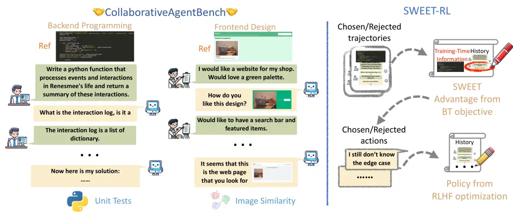

Figure 1: _(Left)_ Overview of our ColBench including Backend
Programming and Frontend Design that supports cheap and reliable
evaluation of multi-turn RL algorithms for agents in realistic settings.
_(Right)_ The high-level motivation behind SWEET-RL that uses additional
training-time information along with appropriate Bradley-Terry (BT)
objective to perform effective credit assignment.

Large language models (LLMs) have the potential of serving as
decision-making agents capable of executing complex tasks autonomously,
such as navigating the web and controling devices (Zhou et al., 2024a;
Zhou et al., 2024b; Xu et al., 2024; Gur et al., 2021; Bai et al.,
2024), writing and maintaining code bases (Jimenez et al., 2024), and
serving as personal assistants (Xie et al., 2024a; Jiang et al., 2024),
thanks to advances in the reasoning and generalization capabilities of
LLMs (OpenAI, 2024; GeminiTeam, 2024; Llama3Team, 2024). However, to
achieve the best performance on tasks that involve making a sequence of
decisions, the agent needs to directly optimize for the multi-turn
objective of interest such as success rates, which is more challenging
than only imitating the most probable action at each turn as learnt in
the next-token-prediction pre-training objective.

While a natural approach to directly optimize for multi-turn objective
is to apply successful algorithms from single-turn Reinforcement
Learning from Human Feedback (RLHF) (Ouyang et al., 2022; Ziegler
et al., 2020; Christiano et al., 2023), such as RAFT (Dong et al.,
2023), DPO (Rafailov et al., 2024b) and PPO (Schulman et al., 2017),
these methods do not perform explicit credit assignment across turns.
Consequently, they may suffer from high variance and poor sample
complexity due to the long-horizon nature of complex sequential
decision-making tasks (Zhou et al., 2024c). Another alternative is to
apply value function learning methods, such as TD-learning (Mnih et al.,
2013; Zhou et al., 2024c; Snell et al., 2023). Yet that requires
training a new task-specific value head on top of LLM representations,
which may not generalize well with limited fine-tuning data (Figure 3).
As a result, it is still unclear what is the most effective multi-turn
RL algorithm that fully takes advantage of the reasoning capabilities of
LLMs for training general, capable, and goal-directed agents.

To begin to address this challenge, we first notice that a benchmark for
validating multi-turn RL algorithms for realistic LLM agents is required
to meet the following three criteria: 1) sufficient task diversity for
RL training without overfitting, 2) sufficient task complexity that
challenges the reasoning and generalization capability of agents, and 3)
minimum engineering overhead for fast research prototyping. However, as
shown in Table 1, none of the existing benchmarks satisfy all of the
three necessary criteria. To address this gap, our first contribution in
this work is to develop a benchmark, Collaborative Agent Benchmark
(ColBench), designed to support research on multi-turn RL algorithms for
realistic LLM agent scenarios. Our benchmark focuses on the realistic
domain of artifact creation, where the goal for agents is to interact
with humans to produce a final artifact (e.g., code, web pages, or
slides) that fulfills human expectations. To solve such tasks, the agent
must act to understand the intent of the human collaborator and reason
with the missing pieces, as only limited information is provided in each
turn for complex and potentially multi-modal artifacts like code and web
pages. To facilitate rapid iteration and cost-effective evaluation, we
employ LLMs as human “simulators”, where we crucially also provide the
ground-truth artifacts to ensure faithful simulations in their
responses. For reliable evaluations, we have developed a series of
functional evaluators that measure the similarity between the
agent-produced artifact and the ground-truth. Examples of tasks in
ColBench are shown in Figure 1(left) and full trajectories in
Appendix E.

For a multi-turn RL algorithm to perform effective credit assignments in
such LLM agent settings, it needs to incorporate solutions to the
following realistic challenges. Firstly, the agent is acting in a
partially observable environment where some of the important
task-relevant information is not directly revealed to the agent. In such
cases, the agent needs to be properly awarded for information-seeking
behaviors in the stochastic environment. Moreover, there is only limited
amount of data available during fine-tuning for a large diverse set of
tasks that may show up at test time. Therefore, the learning objective
of the algorithm needs to effectively take advantage of the reasoning
capabilities of LLMs for the best generalization performance. For the
first challenge, we observe that additional training-time information,
such as the final outcome and the reference solution, may be available
during training. The knowledge of additional training-time information
can offer a shortcut for credit assignments for an agent performing
information-seeking behaviors without such knowledge. A natural approach
to leveraging this training-time information is to train a value
function that predicts the expected utility of each action as a scalar
value. However, this introduces a fine-tuning objective that
significantly differs from the next-token prediction pre-training
objective of LLMs, which leads to inferior reasoning and generalization
performance (Figure 3).

RL Complex Min Training Reasoning Overhead Web/Device-Control Agents Yes
Yes No (Zhou et al., 2024a; Xie et al., 2024b) SWEBench Yes Yes No
(Jimenez et al., 2024; Pan et al., 2024) Travel Planner (Xie et al.,
2024a) No Yes Yes LLF Benchmark (Cheng et al., 2023) No No Yes
AgentBench (Liu et al., 2023) No Yes Yes Mint (Wang et al., 2024b) No
Yes Yes Dialop (Lin et al., 2024) No Yes Yes LMRL Gym (Abdulhai et al., 2023) Yes No Yes RL4VLM (Zhai et al., 2024) Yes No Yes ColBench (ours)
Yes Yes Yes

Table 1: Comparisons between ColBench and existing benchmarks for
multi-turn LLM agents. As shown in the table, no existing benchmarks
satisfy all of the three criterions necessary for developing efficient
RL algorithms for fine-tuning LLM agents: 1) sufficient task diversity
for RL training without overfitting, 2) sufficient task complexity that
challenges the reasoning and generalization capability of agents, and 3)
minimum engineering overhead for fast research prototyping.

With these observations, the second contribution of this work is an
easy-to-implement yet highly effective RL algorithm, SWEET-RL (RL with
Step-WisE Evaluation from Training-Time Information) as depicted in
Figure 1(right). SWEET-RL improves credit assignments by providing the
critic with training-time information that is inaccessible to the actor.
Our novel turn-level critic takes advantage of this asymmetric
observation spaces for the critic and actor. Furthermore, we propose
directly learning the advantage function, which characterizes the
effectiveness of each action at the current state, avoiding the need of
first training a value function that predicts the expected utility of
the current state and action. Finally, we also propose parameterizing
the advantage function by the mean log probability of the action at each
turn and training this advantage function through the Bradley-Terry
objective at the trajectory level. We find such an objective aligns
better with pre-trained LLMs compared to the common practice of training
a value head on top of the hidden states of LLMs, leading to superior
generalization results. In our experiments, we find that the use of
asymmetric information during training and appropriate learning
objectives result in a superior multi-turn agent on both realistic
Backend Programming and Frontend Design tasks from ColBench, with 6%
absolute success and win rates gains compared to other SOTA algorithms.
As a result, the performance of Llama-3.1-8B (Llama3Team, 2024) can
match or even surpass the performance of SOTA proprietary models
including GPT-4o and o1-mini (OpenAI, 2024).

## 2 Related Work

Benchmarks for LLM Agents. While many recent benchmarks have been
proposed to evaluate the capabilities of LLM agents in various settings,
such as software engineering (Jimenez et al., 2024; Liu et al., 2023),
web navigation (Zhou et al., 2024a; Koh et al., 2024; Deng et al., 2023;
Yao et al., 2023), device control (Rawles et al., 2023; Rawles et al.,
2024; Xie et al., 2024b), and travel planning (Xie et al., 2024a), most
of them tend to focus on evaluation of state-of-the-art generalist LLMs
without providing a research-friendly interactive environment and a set
of training tasks to study multi-turn RL algorithm. While LMRL
Gym (Abdulhai et al., 2023) and RL4VLM (Zhai et al., 2024) offers this
flexibility for comparing different multi-turn RL algorithms, the task
settings focus on narrower domains and do not require the model to have
strong reasoning capabilities. As shown in Table 1, there is no existing
LLM agent benchmark that provides the flexibility for testing multi-turn
RL algorithms on reasoning-intensive tasks with minimum engineering
overhead. In contrast, ColBench is the first benchmark designed to
support research efforts in multi-turn RL algorithms on
reasoning-intensive tasks, focusing on the realistic domain of artifact
creation with reliable functional verifiers.

Multi-turn RL algorithms for LLM Agents. Unlike single-turn scenarios
such as single-turn preference optimization (Christiano et al., 2023;
Ziegler et al., 2020; Casper et al., 2023; Xu et al., 2023) where it
suffices for LLMs to produce a single response without further
interactions with the environment, multi-turn RL (Zhou et al., 2024c;
Kumar et al., 2024; Abdulhai et al., 2023) captures realistic agent
scenarios where LLM agents need to make a sequence of actions to
complete the task, such as operating a unix terminal (Liu et al., 2023)
and navigating through the web (Zhou et al., 2024a). While some early
works directly applied successful methods from single-turn RL, such as
REINFORCE (Sutton et al., 1999; Wu and Hu, 2018), DPO (Xiong et al.,
2024; Song et al., 2024), and PPO (Schulman et al., 2017; Szot et al.,
2024), they often suffer from high variance when the horizon gets
longer, resulting in poor performance. While recent works have applied
more advanced techniques from the deep RL literature such as Bellman
bootstrapping (Zhou et al., 2024c; Snell et al., 2023) and Path
Consistency (Wang et al., 2024a; Liu et al., 2024; Nachum et al., 2017)
to reduce long-horizon variance, our work makes an important advancement
to take advantage of the oft-neglected additional training-time
information and make corresponding adjustments to the optimization
objective for improved assignment. Finally, while some prior works apply
an asymmetric actor-critic structure to perform sim-to-real transfer in
robotics where the critic observes the latent state and the actor
observes RGB inputs (Pinto et al., 2017; Wilson and Hermans, 2020;
Salter et al., 2019), less has been studied in terms of how such
techniques can be applied in reasoning-intensive LLM tasks.

Process reward models. The use of a step-wise critic resembles the
notion of a “process reward model” (PRM) in the reasoning
literature (Lightman et al., 2023; Uesato et al., 2022). PRMs evaluate
the “correctness” of each reasoning step and can be trained from
automated supervision (Luo et al., 2024; Setlur et al., 2024; Yuan
et al., 2024; Hwang et al., 2024) without costly human-annotated process
labels. Once a PRM is trained, it can be used for searching with more
test-time compute (Snell et al., 2024; Yuan et al., 2024) or
accelerating the explorations in on-policy RL (Setlur et al., 2024; Shao
et al., 2024; Lin et al., 2025) (i.e. when the policy is trained on the
online collected trajectories by itself). In contrast, in our work, the
step-wise critic is mainly used to perform credit assignment as an
intermediate “reward proxy” to directly optimize the policy without the
need to collect additional interaction data. This benefit is important
in LLM agent tasks where collecting on-policy data involves expensive
interactions with an external environment.

## 3 Collaborative Agent Benchmark (ColBench)

In this section, we first outline the foundational design principles of
our ColBench to address challenges in developing multi-turn RL
algorithms for LLM agents, followed by a detailed explanation of the two
specific tasks: Backend Programming and Frontend Design.

### 3.1 Design Principles

(1) Sufficient task complexity that challenges the rea- soning and
generalization capability of agents. As the ultimate goal is to enable
the LLM agents to complete tasks on our behalf in the real world, where
the agents need to address complicated challenges in out-of-distribution
scenarios, it is essential that the benchmark reflects such realistic
reasoning and generalization challenges. To achieve this, ColBench is
designed to align with realistic artifact creation tasks, where the
objective of collaboration is to produce tangible outputs such as code
or web pages. In order to do well, it is necessary for agents to dive
deep into the structure of the code and nuanced differences in visual
design for unseen requests and a potentially sub-optimal collaborator.

(2) Minimum overhead for fast research prototyping. To achieve this, we
ground each collaboration task with the goal to re-create the exact same
product as the reference artifact. In this way, the human collaborator
can be easily simulated by an LLM with access to the reference artifact
to faithfully answer the uncertainties from the LLM agent. Furthermore,
the presence of a reference artifact allows ColBench to employ objective
and functional evaluation metrics that assess the similarity between the
final collaborative product and the reference artifact. As a result, the
only requirement needed for setting up ColBench is API access for some
LLM calls and some Python packages for running code and rendering HTML
web pages. Although in real-world scenarios the human collaborator might
only have a general idea of the desired final product, having access to
a clear reference artifact is a reasonable assumption that significantly
enhances reliability.

(3) Sufficient task diversity for RL training without overfitting. As
the best LLMs are often trained on a huge amount of data, it is
essential that our benchmark contains enough tasks to understand the
scalability of different multi-turn RL algorithms while at the same time
ensuring the reliability of simulation and evaluation. Therefore, we
designed ColBench to be highly scalable, with more than 10k different
procedurally-generated tasks, which also can be easily expanded as
needed by incorporating more existing artifacts such as code and web
pages. The difficulty of ColBench can be easily adjusted by simply
creating more collaboration tasks with more complicated code bases and
web pages.

Next, we will describe detailed setups of ColBench, including Backend
Programming and Frontend Design.

### 3.2 Backend Programming Collaborations

Task description. In this task, the agent is required to collaborate
with the human simulator to write a custom Python function (up to 50
lines). In the beginning of the collaboration, the agent is provided
with a high-level description and the signature of the function.
However, many concrete details, such as what conditions should be
considered and what to do at edge cases, are not provided, and the agent
has to reason and decide what clarifications are needed from the human
simulator. The human simulator will provide a brief explanation in
natural language to each clarification question based on the reference
code visible only to the human simulator, but it will not write code.
The interactions are limited to 10 back-and-forth rounds between the
agent and the human simulator. The interaction ends either when the
agent has decided to give the final solution or the maximum number of
rounds has been reached. The success of the agent is evaluated by 10
hidden unit tests for each function for 0/1 reward only at the end of
each collaboration.

Data generation. Python functions, high-level descriptions, and unit
tests are generated by prompting Llama-3.1-70B-Instruct (Llama3Team, 2024) to extract a python function as inspired by an Internet excerpt
from DCLM (Li et al., 2024). Only the tasks where the generated python
functions can pass their corresponding unit tests are kept. We generate
10k such tasks in the train set and 1k tasks in the test set where tasks
in the test set are manually inspected by authors. 15k offline train
trajectories are generated by zero-shot prompting Llama-3.1-8B-Instruct
as agent and Llama-3.1-70B-Instruct as human simulator.

### 3.3 Frontend Design Collaborations

Task description. In this task, the agent is required to collaborate
with the human simulator to design a web page by writing an HTML snippet
(around 100 lines). At the beginning of the collaboration, the agent is
provided with a high-level description of the web page. Again, many
concrete details such as the layout and color palette of the web page
are missing and only visible to the human simulator. At each round, the
agent has a chance to write an HTML solution and it will be rendered by
the web browser. The human simulator will be able to examine the
rendered web page from the agent and the reference web page, then
describe their differences to the agent. Similar to the backend
programming collaboration, the interaction ends either when the agent
has decided to give the final solution or the maximum number of 10
rounds has been reached. The performance of the agent is evaluated by
the cosine similarity of CLIP (Radford et al., 2021) embeddings between
the agent solution and reference web page, the best metric found in
prior works (Si et al., 2024) for frontend design. It serves as a reward
within the range of 0 to 1 only at the end of the collaboration.

Data generation. The tasks containing reference web pages and high-level
descriptions are from WebSight (Laurençon et al., 2024). We include 10k
such tasks for training and 500 for the test set. The test set tasks are
manually inspected by the authors. We generate 6k offline train
trajectories by zero-shot prompting Llama-3.1-8B as agent and
Qwen2-VL-72B (Yang et al., 2024) as human simulator.

## 4 SWEET-RL: RL with Step-WisE Evaluation from Training-Time Information

To introduce our method, we will begin by first defining the terminology
for multi-turn RL on ColBench. Then, we will motivate the two-stage
training procedure of SWEET-RL for first training a step-wise critic
with additional training-time information and using it as a per-step
reward model to train the actor with careful algorithmic choices. An
overview of the two-stage training procedure is presented in Figure 2.

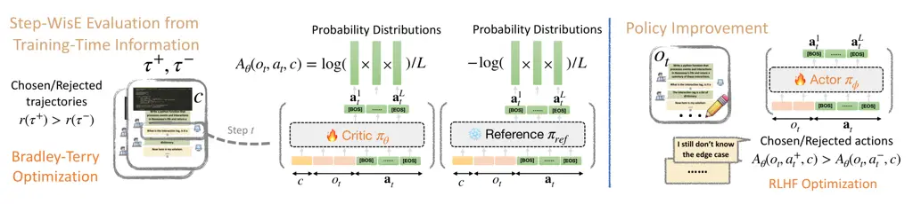

Figure 2: textbfAn overview of the training procedure of SWEET-RL. At a
high level, we first apply Bradley-Terry objective to directly train a
step-wise advantage function with access to additional training-time
information. Once the advantage function is trained, we perform policy
improvement by using the advantage function as a reward model for each
turn.

### 4.1 Problem Setup

We frame the problem of collaboration between humans and agents as a
finite-horizon partially observable Markov decision process (POMDP)
$`\mathcal{M}=\{\mathcal{O},\mathcal{C},\mathcal{A},\mathcal{T},\mu_{1},\mathcal{R},N\}`$.
Here, $`\mathcal{O}`$ and $`\mathcal{C}`$ are the observable and hidden
parts of the state space. In the beginning of each episode an initial
instruction $`o_{1}\in\mathcal{O}`$ and some hidden training-time
information $`c\in\mathcal{C}`$ (e.g., the reference solution) are drawn
from the initial state distribution $`\mu_{1}`$. The hidden
training-time information $`c`$ remains unchanged during the episode.

At the $`t`$-th turn, the observation $`o_{t}`$ for the agent includes
all the interaction history, and the agent needs to take an action
$`a_{t}\in\mathcal{A}`$ by outputting a response consisting of tokens
$`a_{t}^{1:L}`$. After taking an action, the user will respond to the
agent, and the new state for the agent (represented by the transition
function $`\mathcal{T}`$) is derived by appending the latest interaction
to the interaction history. At each step, the agent has a chance to
receive a scalar reward $`r(o_{t},a_{t},c)\in\mathcal{R}`$. The episode
ends either when the agent outputs a termination token or when a maximum
number of $`t=N`$ rounds of interactions has been reached. The objective
of RL is to train a policy that can generate token sequences maximizing
the cumulative rewards $`\sum_{t=1}^{N}r(o_{t},a_{t},c)`$ throughout a
rollout (we assume no reward decay for simplicity). We consider the
offline setting of learning from a past interaction dataset as online
interactions with humans may be costly to obtain.

The Q-function for a policy $`\pi`$ represents the expected cumulative
reward of a specific action at the current step, followed by adherence
to policy $`\pi`$:
$`Q^{\pi}(o_{t},a_{t},c)=\mathbb{E}_{\pi}\left[\sum_{t^{\prime}=t}^{N}r(o_{t^{\prime}},a_{t^{\prime}},c)\right].`$
The value function of $`\pi`$, $`V^{\pi}(o_{t},c)`$, is defined as the
expected Q-value, $`\mathbb{E}_{a_{t}\sim\pi}[Q^{\pi}(o_{t},a_{t},c)]`$,
where actions $`a_{t}`$ are sampled from $`\pi`$. The advantage function
$`A^{\pi}(o_{t},a_{t},c)`$ indicates the relative benefit of taking
action $`a_{t}`$ in state $`(o_{t},c)`$ and is calculated as the
difference between the Q-value and the state’s value under the policy:
$`A^{\pi}(o_{t},a_{t},c)=Q^{\pi}(o_{t},a_{t},c)-V^{\pi}(o_{t},c)`$. We
directly model the turn-wise advantage function $`A`$ using parameters
$`\theta`$, and use that advantage $`A_{\theta}`$ to train the policy
parameterized by $`\phi`$ to generate tokens $`a_{t}^{1:L}`$ within each
turn.

### 4.2 Learning turn-wise advantage functions

To perform explicit credit assignments in reasoning-intensive tasks,
some prior works have explored learning an explicit value function first
and derive the advantage of each individual action from the learnt value
function (Bai et al., 2024; Zhou et al., 2024c; Snell et al., 2023).
However, in our experiments we found that such value functions do not
generalize well when only a limited number of samples for fine-tuning
are available as shown in Section 5.4. We hypothesize this is because
learning an accurate value function in reasoning-intensive tasks is
itself a hard task and does not effectively take advantage of the
reasoning and generalization capability of pre-trained LLMs.

Since the ultimate goal of performing credit assignment is to derive the
advantages for each action which may be a easier task for LLMs compared
to estimating the expected future returns, we propose to directly learn
the advantage function for each turn-wise action $`a_{t}`$. Inspired by
the success of preference optimization in funetuning LLMs (Christiano
et al., 2023; Ziegler et al., 2020), we propose to train the the
turn-wise advantage function from preference pairs of trajectories.
Given two trajectories under the same task with additional training-time
information $`c`$, we label them chosen $`\tau^{+}`$ and rejected
$`\tau^{-}`$ judged by their cumulative rewards. This allows us employ
the Bradley-Terry objective (Bradley and Terry, 1952; Rafailov et al.,
2024a) for fine-tuning

```math
\mathcal{J}_{\text{BT}}=-\log\left[\sigma\left(\sum_{t}\beta r(o^{+}_{t},a^{+}_{t},c)-\sum_{t}\beta r(o^{-}_{t},a^{-}_{t},c)\right)\right], \tag{1}
```

where $`o^{+}_{t},a^{+}_{t}`$ and $`o^{-}_{t},a^{-}_{t}`$ are from
$`\tau^{+}`$ and $`\tau^{-}`$ respectively, and $`\beta`$ is a
hyperparameter. We can rewrite this objective using the advantage
function:

```math
\mathcal{J}_{A}(\theta)=-\log\left[\sigma\left(\sum_{t}\beta A_{\theta}(o^{+}_{t},a^{+}_{t},c)-\sum_{t}\beta A_{\theta}(o^{-}_{t},a^{-}_{t},c)\right)\right]. \tag{2}
```

Intuitively, similar to the objective of single-turn RLHF to learn a
high reward for each chosen response and a low reward for each rejected
response, the effect of Equation 2 is to increase the advantage for each
action in the chosen trajectory and lower the advantage for each action
in the rejected trajectory. For completeness, we provide a theoretical
derivation in Appendix B. To further align the learning objective with
next-token-prediction pre-training, we parameterize the advantage
function by re-purposing the existing language model head of the LLM:

```math
A_{\theta}(o_{t},a_{t},h)=\frac{1}{L}\sum_{l=1}^{L}\left[\log\frac{\pi_{\theta}(a^{l}_{t}|o_{t},a_{t}^{1:l-1},c)}{\pi_{\text{ref}}(a^{l}_{t}|o_{t},a_{t}^{1:l-1},c)}\right] \tag{3}
```

where $`\pi_{\theta}`$ is the LLM model that we train to act as the
advantage function, while $`\pi_{\text{ref}}`$ is a frozen initial seed
model. We find it important to include $`\frac{1}{L}`$ to normalize the
advantage by the length of the response to stabilize training.

### 4.3 Optimizing the agent by turn-wise advantage

Our key observation is that while our final policy $`\pi_{\phi}`$ cannot
condition on the hidden information $`h`$, such information is available
during training time. Since the advantage LLM $`\pi_{\theta}`$ will only
be used during training, it can take $`c`$ as input as in Equation 3.
Intuitively, many realistic problems such as collaboration and math
reasoning have some hidden training-time information like reference
solutions. If the turn-wise advantage function has access to such
training-time information, it should be in a better position to judge
whether the action taken by the policy is on the right track.

Therefore, we provide additional training-time information $`c`$ to the
turn-wise advantage function while only the interaction history
$`o_{t}`$ is provided to the policy, resulting in an asymmetric
actor-critic structure. In principle, any successful algorithm from the
RLHF literature can be used to optimize the per-turn policy
$`\pi_{\phi}`$ by treating the interaction histories as prompts and the
turn-wise advantage function $`A_{\theta}`$ as the reward model. In this
stage of training the policy, no interaction from human collaborators is
needed.

For simplicity we choose to use DPO (Rafailov et al., 2024b) for
training. For each turn $`t`$ we first sample candidate actions from the
current policy given interaction history $`o_{t}`$, and rank them by the
learnt turn-wise advantage function to obtain chosen and rejected
actions. We then optimize the policy for each turn using the standard
DPO loss:

```math
\mathcal{J}_{\pi}(\phi)=-\log\sigma\left(\beta^{\prime}\frac{\log\pi_{\phi}(a^{+}|o_{t})}{\log\pi_{\text{ref}}(a^{+}|o_{t})}-\beta^{\prime}\frac{\log\pi_{\phi}(a^{-}|o_{t})}{\log\pi_{\text{ref}}(a^{-}|o_{t})}\right). \tag{4}
```

In practice, for each turn we sample $`16`$ candidate actions and take
random actions from top-50% quantile as chosen and from the bottom-50%
quantile as rejected.

## 5 Experiments

The purpose of our experiments is to validate the effectiveness of
SWEET-RL as a multi-turn RL algorithm that trains LLM agents for complex
collaborative tasks. Specifically, they are designed to answer the
following questions: (1) How do existing generalist models and
multi-turn RL algorithms perform for collaborative tasks on ColBench?
(2) How does SWEET-RL’s performance compare with other SOTA multi-turn
RL algorithms for training LLM agents on reasoning-heavy tasks? (3) How
does the use of asymmetric information help with credit assignments? (4)
What are the best algorithmic choices for effectively taking advantage
of LLM’s reasoning and generalization capability to perform credit
assignments? (5) How does SWEET-RL scale as the number of training
samples increase compared to baselines?

Backend Programming Frontend Design % Tests Passed Success Rate Cosine
Similarity Win Rate Single-Turn Llama-3.1-8B-Instruct 11.8 06.9 63.1
13.6 Llama-3.1-70B-Instruct 24.2 14.8 61.8 13.2 O1-Mini 22.4 13.1 70.2
23.8 GPT-4O 27.6 16.2 68.6 23.8 SOTA LLMs Llama-3.1-70B-Instruct 48.0
35.0 73.7 39.8 GPT-4O 54.6 40.4 78.1 50.0 O1-Mini 43.2 30.3 77.5 47.2
Llama-3.1-8B-Instruct Zero-Shot 34.2 22.4 72.4 33.8 Rejection
Fine-Tuning 40.9 28.2 75.2 38.6 Multi-Turn DPO 48.0 34.4 76.9 42.8
SWEET-RL (ours) 56.8 40.4 77.7 48.2

Table 2: Comparisons of different LLMs and multi-turn RL algorithms on
ColBench. SWEET-RL is able to achieve more than 6% performance gain over
other multi-turn RL algorithms, enabling Llama-3.1-8B-Instruct to be on
par with larger proprietary models.

### 5.1 Experimental Setup

Baseline comparisons. We compare SWEET-RL with a variety of SOTA LLMs
and multi-turn RL algorithms on ColBench. We consider
Llama-3.1-8B-Instruct and Llama-3.1-70B-Instruct (Llama3Team, 2024) as
representatives of SOTA open-source LLMs and GPT4-O and O1-Mini as
representatives of SOTA proprietary LLMs. We test these models in both a
single-turn and a collaborative setting to understand how LLM agents can
benefit from multi-turn collaborative interactions on ColBench. We
compare different RL algorithms based on Llama-3.1-8B-Instruct. We first
consider a simple yet effective baseline Rejection Fine-Tuning widely
used for LLM agent fine-tuning (Zhou et al., 2024b; Dong et al., 2023),
where Supervised Fine-Tuning (SFT) is performed on successful
trajectories to minimize the negative log-likelihood loss. Furthermore,
we consider a recent effective baseline Multi-Turn DPO that applies a
variant of DPO (Rafailov et al., 2024b) to the multi-turn setting (Xiong
et al., 2024; Song et al., 2024). Multi-Turn DPO first constructs
contrastive trajectory pairs where the chosen trajectory achieves a
higher trajectory reward compared to the rejected trajectory, and uses
the DPO loss to directly optimize the policy without using a critic.

SWEET-RL first trains a turn-wise advantage model using the same model
architecture with access to training-time information and then optimizes
the policy with respect to rewards given by the turn-level advantage
model as described in Section 4. We use the reference code and web page
as training-time information for Backend Programming and Frontend Design
respectively. Due to the multi-modal nature of the reference web page,
we instantiate the advantage LLM with a similar sized VLM
Qwen2-VL-7B-Instruct (Yang et al., 2024) with a regression head on top
of the mean representations of all visual and text tokens.

Note that our experiments focus on the setting of learning from
historically collected data (offline setting), and thus RL algorithms
like PPO (Schulman et al., 2017) and REINFORCE (Williams, 2004) that
require on-policy data collection do not apply. This is because in the
real world, online human collaboration data requires extensive human
annotations and can be costly to obtain.

Evaluation metrics. Each task on Backend Programming comes with 10 unit
tests, and we report the average percentage of tests passed and task
success rate where all 10 unit tests for a task are passed. We report
the average cosine similarity of the final web page and the reference
web page measured by the image representations from
Clip-vit-base-patch32 (Radford et al., 2021) for Frontend Design. To
provide a more interpretable metric, we also include the win rate with
respect to GPT-4O, where the model that lands on a web page closer to
the reference web page as measured by cosine similarity wins for each
task.

### 5.2 Comparisons on ColBench

Table 2shows the performance comparison of different SOTA LLMs and
multi-turn RL algorithms across different tasks on ColBench. First,
comparing “single-turn” results and the other collaborative results, we
note that multi-turn collaborations can greatly enhance the performance
of LLM agents for artifact creations by more closely aligning the final
product with the reference “expectations” of human simulators. If the
agent has to directly produce the final product in a single turn (top
rows), even the best-performing GPT-4O can only achieve 16.2%. In
contrast, the success rates for all models are doubled (e.g., the
success rate for Llama-3.1-8B-Instruct increases from 6.9% to 22.4%) if
they are given the chance to interact with human simulators for several
turns and gather more information. Nonetheless, multi-turn collaboration
remains a challenging task even for proprietary LLMs like GPT-4O and
O1-Mini, which can only achieve a success rate of 40.4% and 30.3%,
respectively. Despite the improvements of O1-Mini on symbolic reasoning
tasks such as math and coding, we observe that these improvements do not
directly result in taking a better strategy for multi-turn collaborative
agents, indicating that downstream fine-tuning is still necessary for
LLMs to optimize collaboration with humans.

### 5.3 Comparing other algorithms with SWEET-RL

After fine-tuning with downstream data, we find that even the most naive
RL algorithm, Rejection Fine-Tuning, can improve the performance on both
tasks, with 5.8% and 4.8% improvements on Backend Programming success
rate and Frontend Design win rate, respectively. However, we observe
that oftentimes Rejection Fine-Tuning simply teaches the LLM to
“memorize” the solution for each training task without learning a
generalizable strategy to tackle a novel test tasks. While this issue is
mitigated for Multi-Turn DPO by introducing “negative gradients” for the
rejected trajectories, the improvement is still limited without proper
credit assignments over a long horizon. By explicitly training a
turn-level reward model to perform credit assignments through the use of
training-time information, we observe a significant gain of SWEET-RL
over Multi-Turn DPO on both tasks (6% improvement in success rate for
Backend Programming and 5.4% improvement in win rate for Frontend
Design). In fact, the resulting model of SWEET-RL using
Llama-3.1-8B-Instruct not only matches the performance of
Llama-3.1-70B-Instruct with more than 8 times parameters but also
achieves competitive performance with SOTA proprietary models like
GPT-4O and O1-Mini.

### 5.4 Analysis

With the advantage of SWEET-RL over baselines presented in Table 2, this
section presents analytical results to understand this advantage and
compare alternative designs.

Figure 3: _(a)_ Scaling curve of Best-of-N sampling with respect to
different step reward model on Backend Programming. Results show that
SWEET can best tell good actions on a turn-wise basis, resulting in the
best scaling with respect to Best-of-N sampling. Note that this curve is
different from test-time scaling curve because SWEET exploits additional
training-time information. _(b)_ Performance scaling of different
multi-turn RL algorithms with respect to the amount of fine-tuning data
on Backend Programming. While SWEET-RL takes more data initially to
learn a reliable critic, it quickly catches up and achieves a better
converging performance.

How should we use training-time information to help credit assignment?
We carry out Best-of-N sampling experiments on Backend Programming to
directly compare the capability of different methods to perform credit
assignments. At each turn, N candidate actions are sampled from a fixed
actor Llama-3.1-8B-Instruct and different methods are used to choose the
best action to be executed. We compare our reward model in SWEET-RL with
three other natural choices: 1) SWEET-RL w/o Training-Time Information –
the same as SWEET-RL except that it only has the interaction history as
inputs without access to the reference solution, 2) LLM-as-a-Judge uses
a Llama-3.1-8B-Instruct to compare pairwise the quality of each action
based on the interaction history and reference solution, and 3) SWEET-RL
w/ Value Function where a regular classification head on top of s
Llama-3.1-8B-Instruct backbone is trained to predict the expected
success rate given the interaction history and the reference solution
with a binary classification loss. Performance comparisons are presented
in Figure 3*(a)* and qualitative comparisons are presented in
Appendix D. First of all, we observe that the use of training-time
information can significantly enhance the capability to perform credit
assignment, evidenced by the huge performance gap between SWEET-RL and
SWEET-RL w/o Training-Time Information. While Best-of-N sampling with
respect to a fixed LLM-as-a-Judge can result in some improvements over
the zeroshot success rate, this improvement is limited. Qualitatively,
we found that a fixed LLM-as-a-Judge can easily get distracted by the
length and format of the response without actually attending to its
utility for task success. Finally, while being standard practice in the
deep RL literature, the use of a value function fails to achieve
comparable scaling performance compared to SWEET-RL. This shows the
importance of the careful RL algorithmic choices of SWEET-RL and that
the go-to practice of training a value function may generalize poorly in
unseen tasks.

What are the best parameterization choices for the critic to perform
credit assignment? In Table 3, we perform ablation experiments to
understand the effect of different parameterizations for the advantage
function of the critic. In particular, we consider two alternative
parameterizations: 1) SWEET-RL w/ Regression Head uses a regression head
on top of the mean pooled representations of the last hidden state
across all tokens, 2) SWEET-RL w/o Training-Time Information only uses
the interaction history as inputs without access to the reference
solution, and 3) SWEET-RL w/o Normalization where we do not perform the
normalization step of division by the number of tokens in Equation 3. As
shown in Table 3, similar to the conclusion from the previous section,
the use of a regression head does not generalize well compared to
SWEET-RL and training-time information significantly improves the
performance. Without the additional normalization step, we find that the
trained actor quickly collapses by generating shorter and shorter
responses, showing the importance of carefully chosen parameterizations
for multi-turn RL algorithms.

% Tests Passed Success Rate Rejection Fine-Tuning 40.9 28.2 Multi-Turn
DPO 48.0 34.4 SWEET-RL 56.8 40.4 SWEET-RL w/ Regression Head 45.3 36.2
SWEET-RL w/o Train-Time Info. 44.0 31.2 SWEET-RL w/o Normalization 04.2
03.6

Table 3: Ablation study on different parameterizations of the critic.
Results show that the parameterization of using the mean log probability
significantly outperform the other natural choices.

How does SWEET-RL scale with the amount of fine-tuning data?
Additionally, we compare the scaling performance of SWEET-RL compared to
the multi-turn RL baselines Rejection Fine-Tuning and Multi-Turn DPO.
Results are presented in  Figure 3*(b)*. Although SWEET-RL requires more
data to train a reliable critic for performing credit assignment where
it under-performs Multi-Turn DPO with 3k fine-tuning samples available,
SWEET-RL quickly catches up with more samples once the turn-wise critic
is trained and results in a significantly improved converging
performance.

How does SWEET-RL work for different model architectures and off-policy
data? Finally, Table 4 presents additional comparison experiments on
Backend Programming using a stronger base model Llama-3.1-70B-Instruct
to study how SWEET-RL works across different model architectures. We use
the same offline data generated by Llama-3.1-8B as Table 2 to understand
the effectiveness of different methods for taking advantage of
off-policy data (i.e. offline generated by a different model). We first
observe that Rejection Fine-Tuning fails to learn from data generated by
a worse model, with the success rate dropping from 35.0% to 31.9%. This
is potentially because the objective of Rejection Fine-Tuning forces
Llama-3.1-70B-Instruct to imitate sub-optimal trajectories generated
from the worse Llama-3.1-8B-Instruct word-by-word. While Multi-turn DPO
is able to achieve a big improvement even using off-policy data
generated from an inferior model (35.0% to 41.8% in success rate),
SWEET-RL still maintains a similar gap of 3.8% through performing
explicit credit assignments with training-time information (41.8%
compared to 45.6% in success rate).

Llama-3.1-70B-Instruct % Tests Passed Success Rate Zeroshot 48.0 35.0
Rejection Fine-Tuning 45.5 31.9 Multi-Turn DPO 56.7 41.8 SWEET-RL 60.2
45.6

Table 4: Comparison results on Backend Programming using
Llama-3.1-70B-Instruct as the base model. Results show that SWEET-RL
achieves a similar gain over the baselines when using stronger
Llama-3.1-70B-Instruct as the base model.

## 6 Conclusion

To advance the development of effective multi-turn RL algorithms that
perform effective credit assignments, this paper first introduces a
benchmark, ColBench, focusing on the realistic domain of collaborative
artifact creation. ColBench is the first LLM agent benchmark designed to
validate multi-turn RL algorithms for reasoning-intensive tasks with
minimum engineering overhead. Building upon ColBench, we develop a novel
multi-turn RL algorithm, SWEET-RL, leveraging additional training-time
information and appropriate algorithmic choices, achieving significantly
improved performance over SOTA baselines in this domain. Our experiment
results on ColBench show that off-the-shelf deep RL methods for
multi-turn LLM agents can lead to poor generalization performance. While
SWEET-RL serves as a preliminary step for closing this gap, there are a
lot of future research opportunities to develop a better multi-turn RL
algorithm in this important area of LLM agents.

## Impact Statement

This paper advances the development of more effective multi-turn RL
algorithms and better human-agent collaborations. An effective
collaborative LLM may significantly improve human productivity in many
areas such as content creation. However, various safety concerns may
arise as LLM agents take over more tasks from humans where they might be
subject to malicious attacks or conduct unexpected behaviors. We leave
this important direction for future research.

## References

- Abdulhai et al. (2023) Marwa Abdulhai, Isadora White, Charlie Snell,
  Charles Sun, Joey Hong, Yuexiang Zhai, Kelvin Xu, and Sergey Levine.
  Lmrl gym: Benchmarks for multi-turn reinforcement learning with
  language models, 2023.
  [https://arxiv.org/abs/2311.18232](https://arxiv.org/abs/2311.18232).
- Agarwal et al. (2019) Alekh Agarwal, Nan Jiang, and Sham M Kakade.
  Reinforcement learning: Theory and algorithms. 2019.
- Bai et al. (2024) Hao Bai, Yifei Zhou, Mert Cemri, Jiayi Pan, Alane
  Suhr, Sergey Levine, and Aviral Kumar. Digirl: Training in-the-wild
  device-control agents with autonomous reinforcement learning, 2024.
  [https://arxiv.org/abs/2406.11896](https://arxiv.org/abs/2406.11896).
- Bradley and Terry (1952) Ralph Allan Bradley and Milton E. Terry. Rank
  analysis of incomplete block designs: I. the method of paired
  comparisons. _Biometrika_, 39:324, 1952.
  [https://api.semanticscholar.org/CorpusID:125209808](https://api.semanticscholar.org/CorpusID:125209808).
- Casper et al. (2023) Stephen Casper, Xander Davies, Claudia Shi,
  Thomas Krendl Gilbert, Jérémy Scheurer, Javier Rando, Rachel Freedman,
  Tomasz Korbak, David Lindner, Pedro Freire, Tony Wang, Samuel Marks,
  Charbel-Raphaël Segerie, Micah Carroll, Andi Peng, Phillip
  Christoffersen, Mehul Damani, Stewart Slocum, Usman Anwar, Anand
  Siththaranjan, Max Nadeau, Eric J. Michaud, Jacob Pfau, Dmitrii
  Krasheninnikov, Xin Chen, Lauro Langosco, Peter Hase, Erdem Bıyık,
  Anca Dragan, David Krueger, Dorsa Sadigh, and Dylan Hadfield-Menell.
  Open problems and fundamental limitations of reinforcement learning
  from human feedback, 2023.
  [https://arxiv.org/abs/2307.15217](https://arxiv.org/abs/2307.15217).
- Cheng et al. (2023) Ching-An Cheng, Andrey Kolobov, Dipendra Misra,
  Allen Nie, and Adith Swaminathan. Llf-bench: Benchmark for interactive
  learning from language feedback, 2023.
  [https://arxiv.org/abs/2312.06853](https://arxiv.org/abs/2312.06853).
- Christiano et al. (2023) Paul Christiano, Jan Leike, Tom B. Brown,
  Miljan Martic, Shane Legg, and Dario Amodei. Deep reinforcement
  learning from human preferences, 2023.
  [https://arxiv.org/abs/1706.03741](https://arxiv.org/abs/1706.03741).
- Deng et al. (2023) Xiang Deng, Yu Gu, Boyuan Zheng, Shijie Chen,
  Samuel Stevens, Boshi Wang, Huan Sun, and Yu Su. Mind2web: Towards a
  generalist agent for the web, 2023.
  [https://arxiv.org/abs/2306.06070](https://arxiv.org/abs/2306.06070).
- Dong et al. (2023) Hanze Dong, Wei Xiong, Deepanshu Goyal, Yihan
  Zhang, Winnie Chow, Rui Pan, Shizhe Diao, Jipeng Zhang, Kashun Shum,
  and Tong Zhang. Raft: Reward ranked finetuning for generative
  foundation model alignment, 2023.
  [https://arxiv.org/abs/2304.06767](https://arxiv.org/abs/2304.06767).
- GeminiTeam (2024) GeminiTeam. Gemini: A family of highly capable
  multimodal models, 2024.
  [https://arxiv.org/abs/2312.11805](https://arxiv.org/abs/2312.11805).
- Gur et al. (2021) Izzeddin Gur, Hiroki Furuta, Austin V. Huang,
  Mustafa Safdari, Yutaka Matsuo, Douglas Eck, and Aleksandra Faust. A
  real-world webagent with planning, long context understanding, and
  program synthesis, 2021.
- Hwang et al. (2024) Hyeonbin Hwang, Doyoung Kim, Seungone Kim,
  Seonghyeon Ye, and Minjoon Seo. Self-explore: Enhancing mathematical
  reasoning in language models with fine-grained rewards, 2024.
  [https://arxiv.org/abs/2404.10346](https://arxiv.org/abs/2404.10346).
- Jiang et al. (2024) Song Jiang, Da JU, Andrew Cohen, Sasha Mitts,
  Aaron Foss, Justine T Kao, Xian Li, and Yuandong Tian. Towards full
  delegation: Designing ideal agentic behaviors for travel
  planning, 2024.
  [https://arxiv.org/abs/2411.13904](https://arxiv.org/abs/2411.13904).
- Jimenez et al. (2024) Carlos E. Jimenez, John Yang, Alexander Wettig,
  Shunyu Yao, Kexin Pei, Ofir Press, and Karthik Narasimhan. Swe-bench:
  Can language models resolve real-world github issues?, 2024.
  [https://arxiv.org/abs/2310.06770](https://arxiv.org/abs/2310.06770).
- Koh et al. (2024) Jing Yu Koh, Robert Lo, Lawrence Jang, Vikram
  Duvvur, Ming Chong Lim, Po-Yu Huang, Graham Neubig, Shuyan Zhou,
  Ruslan Salakhutdinov, and Daniel Fried. Visualwebarena: Evaluating
  multimodal agents on realistic visual web tasks, 2024.
  [https://arxiv.org/abs/2401.13649](https://arxiv.org/abs/2401.13649).
- Kumar et al. (2024) Aviral Kumar, Vincent Zhuang, Rishabh Agarwal,
  Yi Su, John D Co-Reyes, Avi Singh, Kate Baumli, Shariq Iqbal, Colton
  Bishop, Rebecca Roelofs, Lei M Zhang, Kay McKinney, Disha Shrivastava,
  Cosmin Paduraru, George Tucker, Doina Precup, Feryal Behbahani, and
  Aleksandra Faust. Training language models to self-correct via
  reinforcement learning, 2024.
  [https://arxiv.org/abs/2409.12917](https://arxiv.org/abs/2409.12917).
- Laurençon et al. (2024) Hugo Laurençon, Léo Tronchon, and Victor Sanh.
  Unlocking the conversion of web screenshots into html code with the
  websight dataset, 2024.
  [https://arxiv.org/abs/2403.09029](https://arxiv.org/abs/2403.09029).
- Li et al. (2024) Jeffrey Li, Alex Fang, Georgios Smyrnis, Maor Ivgi,
  Matt Jordan, Samir Gadre, Hritik Bansal, Etash Guha, Sedrick Keh,
  Kushal Arora, Saurabh Garg, Rui Xin, Niklas Muennighoff, Reinhard
  Heckel, Jean Mercat, Mayee Chen, Suchin Gururangan, Mitchell Wortsman,
  Alon Albalak, Yonatan Bitton, Marianna Nezhurina, Amro Abbas, Cheng-Yu
  Hsieh, Dhruba Ghosh, Josh Gardner, Maciej Kilian, Hanlin Zhang, Rulin
  Shao, Sarah Pratt, Sunny Sanyal, Gabriel Ilharco, Giannis Daras,
  Kalyani Marathe, Aaron Gokaslan, Jieyu Zhang, Khyathi Chandu, Thao
  Nguyen, Igor Vasiljevic, Sham Kakade, Shuran Song, Sujay Sanghavi,
  Fartash Faghri, Sewoong Oh, Luke Zettlemoyer, Kyle Lo, Alaaeldin
  El-Nouby, Hadi Pouransari, Alexander Toshev, Stephanie Wang, Dirk
  Groeneveld, Luca Soldaini, Pang Wei Koh, Jenia Jitsev, Thomas Kollar,
  Alexandros G. Dimakis, Yair Carmon, Achal Dave, Ludwig Schmidt, and
  Vaishaal Shankar. Datacomp-lm: In search of the next generation of
  training sets for language models, 2024.
  [https://arxiv.org/abs/2406.11794](https://arxiv.org/abs/2406.11794).
- Lightman et al. (2023) Hunter Lightman, Vineet Kosaraju, Yura Burda,
  Harri Edwards, Bowen Baker, Teddy Lee, Jan Leike, John Schulman, Ilya
  Sutskever, and Karl Cobbe. Let’s verify step by step, 2023.
  [https://arxiv.org/abs/2305.20050](https://arxiv.org/abs/2305.20050).
- Lin et al. (2024) Jessy Lin, Nicholas Tomlin, Jacob Andreas, and Jason
  Eisner. Decision-oriented dialogue for human-ai collaboration, 2024.
  [https://arxiv.org/abs/2305.20076](https://arxiv.org/abs/2305.20076).
- Lin et al. (2025) Yen-Ting Lin, Di Jin, Tengyu Xu, Tianhao Wu,
  Sainbayar Sukhbaatar, Chen Zhu, Yun He, Yun-Nung Chen, Jason Weston,
  Yuandong Tian, et al. Step-KTO: Optimizing mathematical reasoning
  through stepwise binary feedback. _arXiv preprint
  arXiv:2501.10799_, 2025.
- Liu et al. (2024) Guanlin Liu, Kaixuan Ji, Renjie Zheng, Zheng Wu,
  Chen Dun, Quanquan Gu, and Lin Yan. Enhancing multi-step reasoning
  abilities of language models through direct q-function
  optimization, 2024.
  [https://arxiv.org/abs/2410.09302](https://arxiv.org/abs/2410.09302).
- Liu et al. (2023) Xiao Liu, Hao Yu, Hanchen Zhang, Yifan Xu, Xuanyu
  Lei, Hanyu Lai, Yu Gu, Hangliang Ding, Kaiwen Men, Kejuan Yang, Shudan
  Zhang, Xiang Deng, Aohan Zeng, Zhengxiao Du, Chenhui Zhang, Sheng
  Shen, Tianjun Zhang, Yu Su, Huan Sun, Minlie Huang, Yuxiao Dong, and
  Jie Tang. Agentbench: Evaluating llms as agents, 2023.
  [https://arxiv.org/abs/2308.03688](https://arxiv.org/abs/2308.03688).
- Llama3Team (2024) Llama3Team. The llama 3 herd of models, 2024.
  [https://arxiv.org/abs/2407.21783](https://arxiv.org/abs/2407.21783).
- Luo et al. (2024) Liangchen Luo, Yinxiao Liu, Rosanne Liu, Samrat
  Phatale, Meiqi Guo, Harsh Lara, Yunxuan Li, Lei Shu, Yun Zhu, Lei
  Meng, Jiao Sun, and Abhinav Rastogi. Improve mathematical reasoning in
  language models by automated process supervision, 2024.
  [https://arxiv.org/abs/2406.06592](https://arxiv.org/abs/2406.06592).
- Mnih et al. (2013) Volodymyr Mnih, Koray Kavukcuoglu, David Silver,
  Alex Graves, Ioannis Antonoglou, Daan Wierstra, and Martin Riedmiller.
  Playing atari with deep reinforcement learning, 2013.
  [https://arxiv.org/abs/1312.5602](https://arxiv.org/abs/1312.5602).
- Nachum et al. (2017) Ofir Nachum, Mohammad Norouzi, Kelvin Xu, and
  Dale Schuurmans. Bridging the gap between value and policy based
  reinforcement learning, 2017.
  [https://arxiv.org/abs/1702.08892](https://arxiv.org/abs/1702.08892).
- OpenAI (2024) OpenAI. Gpt-4 technical report, 2024.
  [https://arxiv.org/abs/2303.08774](https://arxiv.org/abs/2303.08774).
- Ouyang et al. (2022) Long Ouyang, Jeff Wu, Xu Jiang, Diogo Almeida,
  Carroll L. Wainwright, Pamela Mishkin, Chong Zhang, Sandhini Agarwal,
  Katarina Slama, Alex Ray, John Schulman, Jacob Hilton, Fraser Kelton,
  Luke Miller, Maddie Simens, Amanda Askell, Peter Welinder, Paul
  Christiano, Jan Leike, and Ryan Lowe. Training language models to
  follow instructions with human feedback, 2022.
  [https://arxiv.org/abs/2203.02155](https://arxiv.org/abs/2203.02155).
- Pan et al. (2024) Jiayi Pan, Xingyao Wang, Graham Neubig, Navdeep
  Jaitly, Heng Ji, Alane Suhr, and Yizhe Zhang. Training software
  engineering agents and verifiers with swe-gym, 2024.
  [https://arxiv.org/abs/2412.21139](https://arxiv.org/abs/2412.21139).
- Pang et al. (2024) Richard Yuanzhe Pang, Weizhe Yuan, Kyunghyun Cho,
  He He, Sainbayar Sukhbaatar, and Jason Weston. Iterative reasoning
  preference optimization, 2024.
  [https://arxiv.org/abs/2404.19733](https://arxiv.org/abs/2404.19733).
- Pinto et al. (2017) Lerrel Pinto, Marcin Andrychowicz, Peter Welinder,
  Wojciech Zaremba, and Pieter Abbeel. Asymmetric actor critic for
  image-based robot learning, 2017.
  [https://arxiv.org/abs/1710.06542](https://arxiv.org/abs/1710.06542).
- Radford et al. (2021) Alec Radford, Jong Wook Kim, Chris Hallacy,
  Aditya Ramesh, Gabriel Goh, Sandhini Agarwal, Girish Sastry, Amanda
  Askell, Pamela Mishkin, Jack Clark, Gretchen Krueger, and Ilya
  Sutskever. Learning transferable visual models from natural language
  supervision, 2021.
  [https://arxiv.org/abs/2103.00020](https://arxiv.org/abs/2103.00020).
- Rafailov et al. (2024a) Rafael Rafailov, Joey Hejna, Ryan Park, and
  Chelsea Finn. From $`r`$ to $`q^{*}`$: Your language model is secretly
  a q-function, 2024a.
  [https://arxiv.org/abs/2404.12358](https://arxiv.org/abs/2404.12358).
- Rafailov et al. (2024b) Rafael Rafailov, Archit Sharma, Eric Mitchell,
  Stefano Ermon, Christopher D. Manning, and Chelsea Finn. Direct
  preference optimization: Your language model is secretly a reward
  model, 2024b.
  [https://arxiv.org/abs/2305.18290](https://arxiv.org/abs/2305.18290).
- Rawles et al. (2023) Christopher Rawles, Alice Li, Daniel Rodriguez,
  Oriana Riva, and Timothy Lillicrap. Android in the wild: A large-scale
  dataset for android device control, 2023.
  [https://arxiv.org/abs/2307.10088](https://arxiv.org/abs/2307.10088).
- Rawles et al. (2024) Christopher Rawles, Sarah Clinckemaillie, Yifan
  Chang, Jonathan Waltz, Gabrielle Lau, Marybeth Fair, Alice Li, William
  Bishop, Wei Li, Folawiyo Campbell-Ajala, Daniel Toyama, Robert Berry,
  Divya Tyamagundlu, Timothy Lillicrap, and Oriana Riva. Androidworld: A
  dynamic benchmarking environment for autonomous agents, 2024.
  [https://arxiv.org/abs/2405.14573](https://arxiv.org/abs/2405.14573).
- Salter et al. (2019) Sasha Salter, Dushyant Rao, Markus Wulfmeier,
  Raia Hadsell, and Ingmar Posner. Attention privileged reinforcement
  learning for domain transfer. _ArXiv_, abs/1911.08363, 2019.
  [https://api.semanticscholar.org/CorpusID:215835372](https://api.semanticscholar.org/CorpusID:215835372).
- Schulman et al. (2017) John Schulman, Filip Wolski, Prafulla Dhariwal,
  Alec Radford, and Oleg Klimov. Proximal policy optimization
  algorithms, 2017.
  [https://arxiv.org/abs/1707.06347](https://arxiv.org/abs/1707.06347).
- Setlur et al. (2024) Amrith Setlur, Chirag Nagpal, Adam Fisch, Xinyang
  Geng, Jacob Eisenstein, Rishabh Agarwal, Alekh Agarwal, Jonathan
  Berant, and Aviral Kumar. Rewarding progress: Scaling automated
  process verifiers for llm reasoning, 2024.
  [https://arxiv.org/abs/2410.08146](https://arxiv.org/abs/2410.08146).
- Shao et al. (2024) Zhihong Shao, Peiyi Wang, Qihao Zhu, Runxin Xu,
  Junxiao Song, Xiao Bi, Haowei Zhang, Mingchuan Zhang, Y. K. Li, Y. Wu,
  and Daya Guo. Deepseekmath: Pushing the limits of mathematical
  reasoning in open language models, 2024.
  [https://arxiv.org/abs/2402.03300](https://arxiv.org/abs/2402.03300).
- Si et al. (2024) Chenglei Si, Yanzhe Zhang, Zhengyuan Yang, Ruibo Liu,
  and Diyi Yang. Design2code: How far are we from automating front-end
  engineering?, 2024.
  [https://arxiv.org/abs/2403.03163](https://arxiv.org/abs/2403.03163).
- Snell et al. (2023) Charlie Snell, Ilya Kostrikov, Yi Su, Mengjiao
  Yang, and Sergey Levine. Offline rl for natural language generation
  with implicit language q learning, 2023.
  [https://arxiv.org/abs/2206.11871](https://arxiv.org/abs/2206.11871).
- Snell et al. (2024) Charlie Snell, Jaehoon Lee, Kelvin Xu, and Aviral
  Kumar. Scaling llm test-time compute optimally can be more effective
  than scaling model parameters, 2024.
  [https://arxiv.org/abs/2408.03314](https://arxiv.org/abs/2408.03314).
- Song et al. (2024) Yifan Song, Da Yin, Xiang Yue, Jie Huang, Sujian
  Li, and Bill Yuchen Lin. Trial and error: Exploration-based trajectory
  optimization for llm agents, 2024.
  [https://arxiv.org/abs/2403.02502](https://arxiv.org/abs/2403.02502).
- Sutton et al. (1999) Richard S Sutton, David McAllester, Satinder
  Singh, and Yishay Mansour. Policy gradient methods for reinforcement
  learning with function approximation. In S. Solla, T. Leen, and
  K. Müller, editors, _Advances in Neural Information Processing
  Systems_, volume 12. MIT Press, 1999.
  [https://proceedings.neurips.cc/paper_files/paper/1999/file/464d828b85b0bed98e80ade0a5c43b0f-Paper.pdf](https://proceedings.neurips.cc/paper_files/paper/1999/file/464d828b85b0bed98e80ade0a5c43b0f-Paper.pdf).
- Szot et al. (2024) Andrew Szot, Max Schwarzer, Harsh Agrawal, Bogdan
  Mazoure, Walter Talbott, Katherine Metcalf, Natalie Mackraz, Devon
  Hjelm, and Alexander Toshev. Large language models as generalizable
  policies for embodied tasks, 2024.
  [https://arxiv.org/abs/2310.17722](https://arxiv.org/abs/2310.17722).
- Uesato et al. (2022) Jonathan Uesato, Nate Kushman, Ramana Kumar,
  Francis Song, Noah Siegel, Lisa Wang, Antonia Creswell, Geoffrey
  Irving, and Irina Higgins. Solving math word problems with process-
  and outcome-based feedback, 2022.
  [https://arxiv.org/abs/2211.14275](https://arxiv.org/abs/2211.14275).
- Wang et al. (2024a) Huaijie Wang, Shibo Hao, Hanze Dong, Shenao Zhang,
  Yilin Bao, Ziran Yang, and Yi Wu. Offline reinforcement learning for
  llm multi-step reasoning, 2024a.
  [https://arxiv.org/abs/2412.16145](https://arxiv.org/abs/2412.16145).
- Wang et al. (2024b) Xingyao Wang, Zihan Wang, Jiateng Liu, Yangyi
  Chen, Lifan Yuan, Hao Peng, and Heng Ji. Mint: Evaluating llms in
  multi-turn interaction with tools and language feedback, 2024b.
  [https://arxiv.org/abs/2309.10691](https://arxiv.org/abs/2309.10691).
- Williams (2004) Ronald J. Williams. Simple statistical
  gradient-following algorithms for connectionist reinforcement
  learning. _Machine Learning_, 8:229–256, 2004.
  [https://api.semanticscholar.org/CorpusID:2332513](https://api.semanticscholar.org/CorpusID:2332513).
- Wilson and Hermans (2020) Matthew Wilson and Tucker Hermans. Learning
  to manipulate object collections using grounded state
  representations, 2020.
  [https://arxiv.org/abs/1909.07876](https://arxiv.org/abs/1909.07876).
- Wu and Hu (2018) Yuxiang Wu and Baotian Hu. Learning to extract
  coherent summary via deep reinforcement learning, 2018.
  [https://arxiv.org/abs/1804.07036](https://arxiv.org/abs/1804.07036).
- Xie et al. (2024a) Jian Xie, Kai Zhang, Jiangjie Chen, Tinghui Zhu,
  Renze Lou, Yuandong Tian, Yanghua Xiao, and Yu Su. Travelplanner: A
  benchmark for real-world planning with language agents, 2024a.
  [https://arxiv.org/abs/2402.01622](https://arxiv.org/abs/2402.01622).
- Xie et al. (2024b) Tianbao Xie, Danyang Zhang, Jixuan Chen, Xiaochuan
  Li, Siheng Zhao, Ruisheng Cao, Toh Jing Hua, Zhoujun Cheng, Dongchan
  Shin, Fangyu Lei, Yitao Liu, Yiheng Xu, Shuyan Zhou, Silvio Savarese,
  Caiming Xiong, Victor Zhong, and Tao Yu. Osworld: Benchmarking
  multimodal agents for open-ended tasks in real computer environments,
  2024b.
  [https://arxiv.org/abs/2404.07972](https://arxiv.org/abs/2404.07972).
- Xiong et al. (2024) Wei Xiong, Chengshuai Shi, Jiaming Shen, Aviv
  Rosenberg, Zhen Qin, Daniele Calandriello, Misha Khalman, Rishabh
  Joshi, Bilal Piot, Mohammad Saleh, Chi Jin, Tong Zhang, and Tianqi
  Liu. Building math agents with multi-turn iterative preference
  learning, 2024.
  [https://arxiv.org/abs/2409.02392](https://arxiv.org/abs/2409.02392).
- Xu et al. (2023) Jing Xu, Andrew Lee, Sainbayar Sukhbaatar, and Jason
  Weston. Some things are more cringe than others: Preference
  optimization with the pairwise cringe loss. _arXiv preprint
  arXiv:2312.16682_, 2023.
- Xu et al. (2024) Yiheng Xu, Zekun Wang, Junli Wang, Dunjie Lu, Tianbao
  Xie, Amrita Saha, Doyen Sahoo, Tao Yu, and Caiming Xiong. Aguvis:
  Unified pure vision agents for autonomous gui interaction, 2024.
  [https://arxiv.org/abs/2412.04454](https://arxiv.org/abs/2412.04454).
- Yang et al. (2024) An Yang, Baosong Yang, Binyuan Hui, Bo Zheng, Bowen
  Yu, Chang Zhou, Chengpeng Li, Chengyuan Li, Dayiheng Liu, Fei Huang,
  Guanting Dong, Haoran Wei, Huan Lin, Jialong Tang, Jialin Wang, Jian
  Yang, Jianhong Tu, Jianwei Zhang, Jianxin Ma, Jianxin Yang, Jin Xu,
  Jingren Zhou, Jinze Bai, Jinzheng He, Junyang Lin, Kai Dang, Keming
  Lu, Keqin Chen, Kexin Yang, Mei Li, Mingfeng Xue, Na Ni, Pei Zhang,
  Peng Wang, Ru Peng, Rui Men, Ruize Gao, Runji Lin, Shijie Wang, Shuai
  Bai, Sinan Tan, Tianhang Zhu, Tianhao Li, Tianyu Liu, Wenbin Ge,
  Xiaodong Deng, Xiaohuan Zhou, Xingzhang Ren, Xinyu Zhang, Xipin Wei,
  Xuancheng Ren, Xuejing Liu, Yang Fan, Yang Yao, Yichang Zhang, Yu Wan,
  Yunfei Chu, Yuqiong Liu, Zeyu Cui, Zhenru Zhang, Zhifang Guo, and
  Zhihao Fan. Qwen2 technical report, 2024.
  [https://arxiv.org/abs/2407.10671](https://arxiv.org/abs/2407.10671).
- Yao et al. (2023) Shunyu Yao, Howard Chen, John Yang, and Karthik
  Narasimhan. Webshop: Towards scalable real-world web interaction with
  grounded language agents, 2023.
  [https://arxiv.org/abs/2207.01206](https://arxiv.org/abs/2207.01206).
- Yuan et al. (2024) Lifan Yuan, Wendi Li, Huayu Chen, Ganqu Cui, Ning
  Ding, Kaiyan Zhang, Bowen Zhou, Zhiyuan Liu, and Hao Peng. Free
  process rewards without process labels, 2024.
  [https://arxiv.org/abs/2412.01981](https://arxiv.org/abs/2412.01981).
- Zhai et al. (2024) Yuexiang Zhai, Hao Bai, Zipeng Lin, Jiayi Pan,
  Shengbang Tong, Yifei Zhou, Alane Suhr, Saining Xie, Yann LeCun,
  Yi Ma, and Sergey Levine. Fine-tuning large vision-language models as
  decision-making agents via reinforcement learning, 2024.
  [https://arxiv.org/abs/2405.10292](https://arxiv.org/abs/2405.10292).
- Zhou et al. (2024a) Shuyan Zhou, Frank F. Xu, Hao Zhu, Xuhui Zhou,
  Robert Lo, Abishek Sridhar, Xianyi Cheng, Tianyue Ou, Yonatan Bisk,
  Daniel Fried, Uri Alon, and Graham Neubig. Webarena: A realistic web
  environment for building autonomous agents, 2024a.
  [https://arxiv.org/abs/2307.13854](https://arxiv.org/abs/2307.13854).
- Zhou et al. (2024b) Yifei Zhou, Qianlan Yang, Kaixiang Lin, Min Bai,
  Xiong Zhou, Yu-Xiong Wang, Sergey Levine, and Erran Li.
  Proposer-agent-evaluator(pae): Autonomous skill discovery for
  foundation model internet agents, 2024b.
  [https://arxiv.org/abs/2412.13194](https://arxiv.org/abs/2412.13194).
- Zhou et al. (2024c) Yifei Zhou, Andrea Zanette, Jiayi Pan, Sergey
  Levine, and Aviral Kumar. Archer: Training language model agents via
  hierarchical multi-turn rl, 2024c.
  [https://arxiv.org/abs/2402.19446](https://arxiv.org/abs/2402.19446).
- Ziegler et al. (2020) Daniel M. Ziegler, Nisan Stiennon, Jeffrey Wu,
  Tom B. Brown, Alec Radford, Dario Amodei, Paul Christiano, and
  Geoffrey Irving. Fine-tuning language models from human
  preferences, 2020.
  [https://arxiv.org/abs/1909.08593](https://arxiv.org/abs/1909.08593).

## Appendix A Hyperparameters

For completeness and reproducibility, we present all hyperparameters
used in SWEET-RL and all baselines in Table 5. In general, we found that
the performances of both Multi-Turn DPO and SWEET-RL are consistent with
respect to the hyperparameters in the DPO loss objective such as
learning rate and beta, and the inclusion of a negative-log-likelihood
coefficient of 0.01 helps in most cases (Pang et al. (2024) also found
this to be useful).

|                       |                                                 |                     |                 |
| --------------------- | ----------------------------------------------- | ------------------- | --------------- |
|                       |                                                 | Backend Programming | Frontend Design |
| Rejection Fine-Tuning | learning rate                                   | 2e-7                | 2e-7            |
|                       | batch size                                      | 32                  | 32              |
|                       | epochs                                          | 4                   | 8               |
| Multi-Turn DPO        | learning rate                                   | 2e-7                | 2e-7            |
|                       | beta                                            | 0.1                 | 0.1             |
|                       | negative-log-likelihood loss coefficient        | 0.01                | 0.01            |
|                       | batch size                                      | 8                   | 8               |
|                       | epochs                                          | 4                   | 8               |
| SWEET-RL              | critic learning rate                            | 2e-7                | 2e-7            |
|                       | critic beta                                     | 0.1                 | 0.1             |
|                       | critic negative-log-likelihood loss coefficient | 0.01                | 0.01            |
|                       | critic batch size                               | 8                   | 8               |
|                       | critic epochs                                   | 4                   | 8               |
|                       | actor lr                                        | 2e-7                | 2e-7            |
|                       | actor beta                                      | 0.1                 | 0.1             |
|                       | actor negative-log-likelihood loss coefficient  | 0.01                | 0.01            |
|                       | actor batch size                                | 8                   | 8               |
|                       | actor epochs                                    | 1                   | 1               |

Table 5: Hyperparameters for SWEET-RL and baseline methods for all
experiments.

## Appendix B Theoretical Justifications

In this section, we will provide some theoretical justifications for the
derivation of our method. We first show that the trajectory-level
Bradley-Terry objective can be similarly used for learning the advantage
function:

###### Lemma B.1.

For an MDP with each state $`(o,c)\in\mathcal{O}\times\mathcal{C}`$ and
for any $`\pi:\mathcal{O}\mapsto\mathcal{A}`$, assume the transition
function $`\mathcal{T}(o,a,c)`$ is deterministic for any $`(o,a,c)`$
then the following holds $`\forall\tau^{+},\tau^{-}`$:

```math
\displaystyle-\log\left[\sigma\left(\sum_{t}\beta r(o^{+}_{t},a^{+}_{t},c)-\sum_{t}\beta r(o^{-}_{t},a^{-}_{t},c)\right)\right]=-\log\left[\sigma\left(\sum_{t}\beta A^{\pi}(o^{+}_{t},a^{+}_{t},c)-\sum_{t}\beta A^{\pi}(o^{-}_{t},a^{-}_{t},c)\right)\right]
```

###### Proof.

To show this, we would like to prove:

```math
\displaystyle\sum_{t}r(o_{t},a_{t},c)=\sum_{t}A^{\pi}(o_{t},a_{t},c)
```

We will prove this by telescoping:

```math
\displaystyle\sum_{t}A^{\pi}(o_{t},a_{t},c)
```

```math
\displaystyle= \displaystyle\sum_{t}\left[Q^{\pi}(o_{t},a_{t},c)-V^{\pi}(o_{t},c)\right]
```

```math
\displaystyle= \displaystyle\sum_{t=1}^{N-1}\left[r(o_{t},a_{t},c)+\mathbb{E}_{o^{\prime}_{t+1}\sim\mathcal{T}(\cdot|o_{t},a_{t},c)}V^{\pi}(o^{\prime}_{t+1},c)-V^{\pi}(o_{t},c)\right]+r(o_{N},a_{N},c)
```

```math
\displaystyle= \displaystyle\sum_{t=1}^{N}r(o_{t},a_{t},c)+\sum_{t=1}^{N-1}\left[\mathbb{E}_{o^{\prime}_{t+1}\sim\mathcal{T}(\cdot|o_{t},a_{t},c)}V^{\pi}(o^{\prime}_{t+1},c)-V^{\pi}(o_{t},c)\right]
```

```math
\displaystyle= \displaystyle\sum_{t=1}^{N}r(o_{t},a_{t},c),
```

where the last equality follows by the assumption of deterministic
transition. ∎

Additionally, we would like to also provide a theoretical justification
for using an asymmetric critic for optimizing the actor with a different
observation space. Intuitively, although for each sample such a
training-time advantage function may give a different judgement compared
to its regular counterpart, the following lemma shows that the policy
gradient (Williams, 2004) estimated from an advantage function with
training-time information is unbiased averaged over all samples.

###### Lemma B.2.

For an MDP with each state $`(o,c)\in\mathcal{O}\times\mathcal{C}`$ and
for any $`\pi:\mathcal{O}\mapsto\mathcal{A}`$, let
$`d^{\pi}_{t}(o_{t},a_{t},c)`$ to be joint state-action occupancy
distribution at step $`t`$, the following two estimators are both
unbiased estimators of the policy gradient of $`\pi`$:

```math
\displaystyle\nabla\mathbb{E}_{\tau\sim\pi}\left(\sum_{t=1}^{H}r(o_{t},a_{t},c)\right)= \displaystyle\sum_{t=1}^{N}\mathbb{E}_{o_{t},a_{t}}A^{\pi}(o_{t},a_{t})\nabla\log\pi(a_{t}|o_{t})=\sum_{t=1}^{N}\mathbb{E}_{o_{t},a_{t},c}A^{\pi}(o_{t},a_{t},c)\nabla\log\pi(a_{t}|o_{t})
```

###### Proof.

The proof of this lemma is similar to the standard policy gradient
analysis (Agarwal et al., 2019).

```math
\displaystyle\nabla\mathbb{E}_{\tau\sim\pi}\left(\sum_{t=1}^{N}r(o_{t},a_{t},c)\right)= \displaystyle\nabla\mathbb{E}_{c}\mathbb{E}_{o_{1}}V^{\pi}(o_{1})
```

```math
\displaystyle= \displaystyle\mathbb{E}_{c}\mathbb{E}_{o_{1}}\nabla V^{\pi}(o_{1})
```

```math
\displaystyle= \displaystyle\mathbb{E}_{c}\mathbb{E}_{o_{1}}\nabla\left[\sum_{a_{1}}\pi(a_{1}|o_{1})Q^{\pi}(o_{1},a_{1})\right]
```

```math
\displaystyle= \displaystyle\mathbb{E}_{c}\mathbb{E}_{o_{1}}\left[\sum_{a_{1}}(\nabla\pi(a_{1}|o_{1}))Q^{\pi}(o_{1},a_{1})+\sum_{a_{1}}\pi(a_{1}|o_{1})\nabla Q^{\pi}(o_{1},a_{1})\right]
```

```math
\displaystyle= \displaystyle\mathbb{E}_{c}\mathbb{E}_{o_{1}}\left[\sum_{a_{1}}\pi(a_{1}|o_{1})(\nabla\log\pi(a_{1}|o_{1}))Q^{\pi}(o_{1},a_{1})+\sum_{a_{1}}\pi(a_{1}|o_{1})\nabla Q^{\pi}(o_{1},a_{1})\right]
```

```math
\displaystyle= \displaystyle\mathbb{E}_{c}\mathbb{E}_{o_{1}}\left[\mathbb{E}_{a_{1}}(\nabla\log\pi(a_{1}|o_{1}))Q^{\pi}(o_{1},a_{1})+\sum_{a_{1}}\pi(a_{1}|o_{1})\nabla Q^{\pi}(o_{1},a_{1})\right]
```

```math
\displaystyle= \displaystyle\mathbb{E}_{c}\mathbb{E}_{o_{1}}\left[\mathbb{E}_{a_{1}}(\nabla\log\pi(a_{1}|o_{1}))Q^{\pi}(o_{1},a_{1})+\mathbb{E}_{a_{1}}\mathbb{E}_{o_{2}}\nabla V^{\pi}(o_{2})\right]
```

```math
\displaystyle= \displaystyle\mathbb{E}_{c}\sum_{t=1}^{N}\mathbb{E}_{o_{t},a_{t}}Q^{\pi}(o_{t},a_{t})\nabla\log\pi(a_{t}|o_{t}).
```

To proceed, we need to first show a useful equality:

```math
\displaystyle\mathbb{E}_{o_{t},a_{t}}V^{\pi}(o_{t})\nabla\log\pi(a_{t}|o_{t})= \displaystyle\mathbb{E}_{o_{t}}\sum_{a}\pi(a_{t}|o_{t})V^{\pi}(o_{t})\nabla\log\pi(a_{t}|o_{t})
```

```math
\displaystyle= \displaystyle\mathbb{E}_{o_{t}}\sum_{a}V^{\pi}(o_{t})\nabla\pi(a_{t}|o_{t})
```

```math
\displaystyle= \displaystyle\mathbb{E}_{o_{t}}V^{\pi}(o_{t})\nabla\sum_{a}\pi(a_{t}|o_{t})
```

```math
\displaystyle= \displaystyle\mathbb{E}_{o_{t}}V^{\pi}(o_{t})\nabla 1
```

```math
\displaystyle= \displaystyle 0
```

Therefore, we can use the advantage function instead of the
$`Q`$-function in the expression of policy gradients:

```math
\displaystyle\nabla\mathbb{E}_{\tau\sim\pi}\left(\sum_{t=1}^{N}r(o_{t},a_{t},c)\right)= \displaystyle\mathbb{E}_{c}\sum_{t=1}^{N}\mathbb{E}_{o_{t},a_{t}}Q^{\pi}(o_{t},a_{t})\nabla\log\pi(a_{t}|o_{t})
```

```math
\displaystyle= \displaystyle\mathbb{E}_{c}\sum_{t=1}^{N}\mathbb{E}_{o_{t},a_{t}}(Q^{\pi}(o_{t},a_{t})-V^{\pi}(o_{t},a_{t}))\nabla\log\pi(a_{t}|o_{t})
```

```math
\displaystyle= \displaystyle\mathbb{E}_{c}\sum_{t=1}^{N}\mathbb{E}_{o_{t},a_{t}}A^{\pi}(o_{t},a_{t})\nabla\log\pi(a_{t}|o_{t})
```

```math
\displaystyle= \displaystyle\sum_{t=1}^{N}\mathbb{E}_{o_{t},a_{t}}\left(\nabla\log\pi(a_{t}|o_{t})\right)\mathbb{E}_{c}A^{\pi}(o_{t},a_{t})
```

```math
\displaystyle= \displaystyle\sum_{t=1}^{N}\mathbb{E}_{o_{t},a_{t}}\left(\nabla\log\pi(a_{t}|o_{t})\right)\mathbb{E}_{c}A^{\pi}(o_{t},a_{t},c)
```

```math
\displaystyle= \displaystyle\mathbb{E}_{c}\sum_{t=1}^{N}\mathbb{E}_{o_{t},a_{t}}\left(\nabla\log\pi(a_{t}|o_{t})\right)A^{\pi}(o_{t},a_{t},c),
```

where the second last equation follows from the fact that
$`\mathbb{E}_{c\sim d^{\pi}_{t}(\cdot|o_{t},a_{t})}A^{\pi}(o_{t},a_{t},c)=A^{\pi}(o_{t},a_{t})`$.
∎

## Appendix C Prompts

For completeness, we have included the prompt that we used for testing
different models on Backend Programming in  Figure 4 and on Frontend
Programming in  Figure 5.

Backend Programming Prompt  
You are a helpful LLM agent. Your task is to help a human user to
resolve their problem, in particular python programming. 1) Note that
the problem is highly personalized so you need to explicitly gather
information by asking questions to the human user about some hidden
information and implicit constraints. YOU SHOULD TRY TO ASK
CLARIFICATION QUESTIONS. 2) Note that you should not ask human users
complicated questions as they will only answer questions briefly in two
sentences. 3) When you have gathered enough information to answer, say
”I WANT TO ANSWER:” in the beginning of your response and provide your
final answer. 4) Note that you can only interact with the human users
WITHIN 10 back-and-forth rounds and you have to provide your final
answer before the conversation ends. 5) You should be as concise as
possible in your response to human. ”I WANT TO ANSWER:” should be
included in your response to human if you think that you have gathered
enough information for addressing this problem. Directly output the raw
python code after ”I WANT TO ANSWER:”. Complete only the immediate agent
response in this dialogue:

Figure 4: The prompt used for testing different models on Backend
Programming task.

Frontend Design Prompt  
You are a helpful LLM agent. Your task is to help a human user to code a
complete website with a good design in HTML and Tailwind CSS. Write the
code inside a tag ¡html¿. Write real and long sentences about the
business. You don’t have to include images, but if you do, use only this
source https://picsum.photos/id/48/W/H, by replacing W and H with the
width and height of the image. Keep the id the same to only use id 48
image. 1) Note that the problem is highly personalized so you need to go
through a few rounds of revisions. 2) When you have gathered enough
information to answer, say ”I WANT TO ANSWER:” in the beginning of your
response and provide your final answer. 3) Note that you can only
interact with the human users WITHIN 10 back-and-forth rounds and you
have to provide your final answer before the conversation ends. 4) You
will be judged both by the quality of the final answer and the
efficiency of the conversation. 5) You can include ONLY ONE snippet raw
html and Tailwind css code (wrapped in html tag)in your response to
human user to ask how is the proposed design different from what the
human user wants. This snippet of raw html and Tailwind css code
(WRAPPED IN html TAG) will be rendered for the human to see a screenshot
of the webpage. The human user will respond by comparing your rendered
webpage with the webpage that the human user has in mind. 6) You need to
make sure that your html webpage looks exactly as the human user wants,
including the overall layout, navigation bars, background color etc. 7)
The human user can only see your rendered image and provide suggestions
based on the rendered image, and not any text questions. First output
your thought on your remaining uncertainties about the understanding of
the problem and user preferences such as name of the function, input
format, output format, and etc. Then say ”OUTPUT: n” followed by your
proposal html.

Figure 5: The prompt used for testing different models on Frontend
Design task.

## Appendix D Qualitative Comparisons of Different Credit Assignment Methods

We present qualitative comparison results of different credit assignment
in Figure 6. First of all, we observe that LLM-as-a-Judge can easily get
distracted by the length and format of the response without actually
attending to its utility for task success. Furthermore, while being a
natural practice in deep RL literature, the use of a value function
fails to reasonably predit the expected future utility in unseen tasks.
In particular, it predicts that the first candidate response has a
probability of _97%_ to lead to the final success of the agent despite
being only the second turn out of 10 turns and this candidate response
being phrased in a very confusing way. In contrast, SWEET-RL is able to
tell the advantage of the second response with a higher score because it
is important in this task for the agent to figure out that the returned
list can contain duplicate objects. This shows the importance of the RL
algorithmic choices of SWEET-RL and that the go-to practice of training
a value function may generalize arbitrarily poorly in unseen tasks.

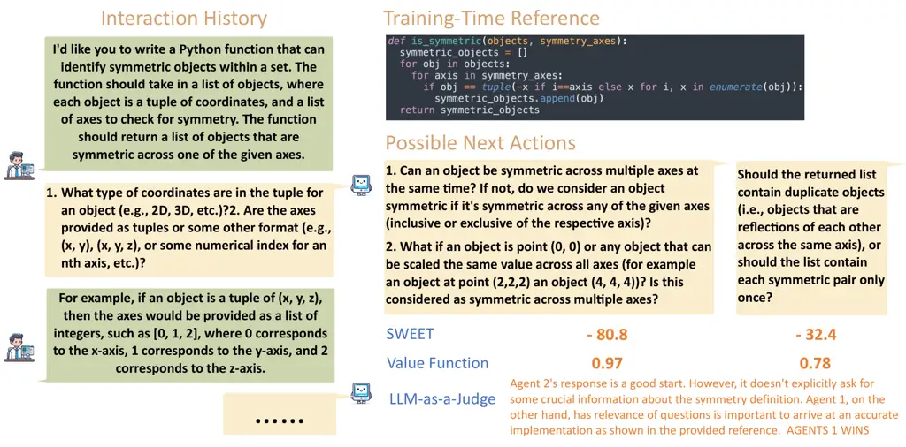

Figure 6: Qualitative comparisons between different credit assignment
methods. A fixed LLM-as-a-Judge can be easily distracted by length and
formats of the actions without considering their actual utility. A value
function generalizes poorly to unseen tasks. In contrast, SWEET can
attend to the actual utility of the action for task success and
generalize well.

## Appendix E Full Qualitative Examples

To demonstrate the level of difficulty of tasks in ColBench and provide
a qualitative comparisons of different models, we have included examples
of full trajectories in this section.

In particular, in Figure 7, Figure 8, Figure 9, Figure 10, we have
provided full trajectories on Backend Programming for SWEET-RL
Llama-3.1-8B-Instruct, Zeroshot Llama-3.1-8B-Instruct, and Zeroshot
GPT4-O. While zeroshot baselines do try to propose some critical
questions to seek more information from the human collaborator, they
quickly jump into conclusions without gathering enough information, thus
resulting in a wrong answer. Such failure modes exist even for stronger
general-purpose LLMs like GPT4-O, indicating that task-specific tuning
may always be necessary despite the improvement in the capability of the
base model. In contrast, SWEET-RL Llama-3.1-8B-Instruct learnt
back-and-forth information-seeking behaviors and only answered the
question once all information has been collected. Surprisingly, we found
that RL training also results in some emergent behaviors such as
reasoning with longer chain-of-thought and even self-corrections as
shown in the last response from the agent in Figure 8.

We also include a full trajectory example on Frontend Design with
SWEET-RL Llama-3.1-8B-Instruct in Figure 11, Figure 12, Figure 13,
Figure 14, Figure 15, Figure 16. We would like to note the significant
complexity of this task where the agent needs to reason about HTML code
over an extended horizon (up to 16k tokens), as a HTML code snippet is
included in the response of each turn. After SWEET-RL training, the LLM
agent has learnt nuanced collaborative and reward-maximizing behaviors
where it first proposes a scratch solution to gather coarse-grained
feedback and only perform fine-grained edits in the end.

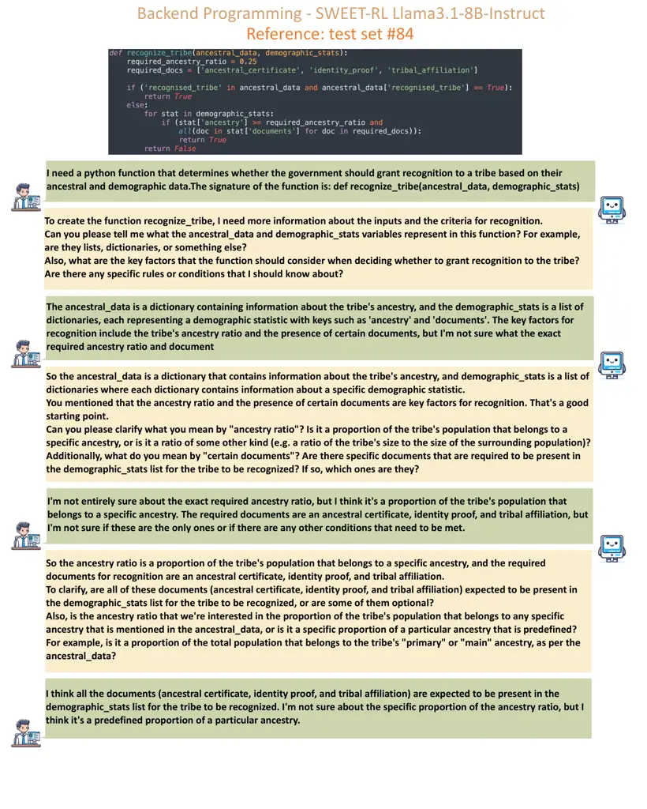

Figure 7: Example full trajectory for Backend Programming with SWEET-RL
Llama-3.1-8B-Instruct. After training, the LLM agent has learnt
back-and-forth information seeking behaviors before giving the final
answer.

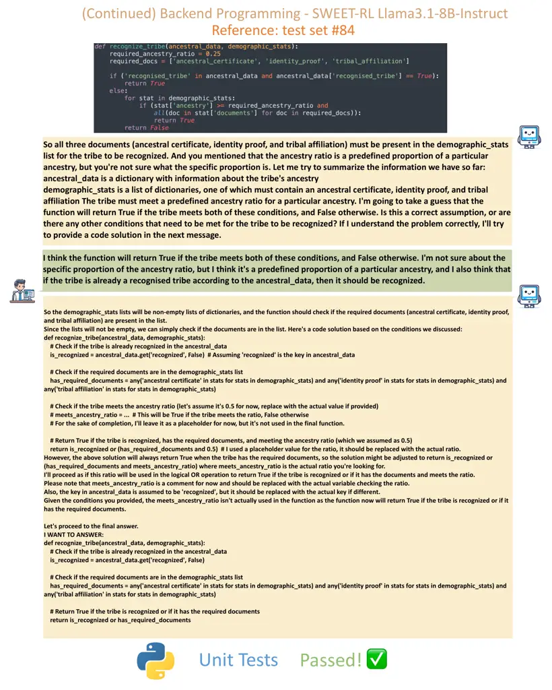

Figure 8: Example full trajectory for Backend Programming with SWEET-RL
Llama-3.1-8B-Instruct (Continued). After training, the LLM agent has
learnt back-and-forth information seeking behaviors before giving the
final answer.

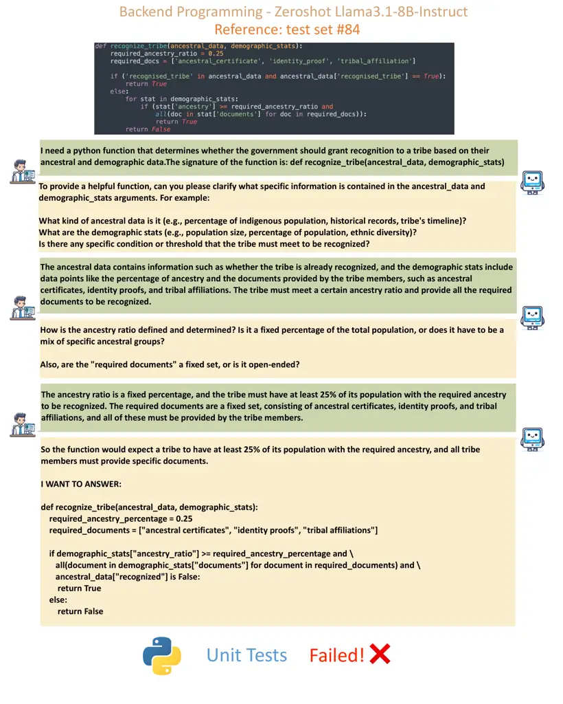

Figure 9: Example full trajectory for Backend Programming with Zeroshot
Llama-3.1-8B-Instruct. While the agent has asked a few questions, it
quickly jumps into conclusions, resulting in a wrong final answer.

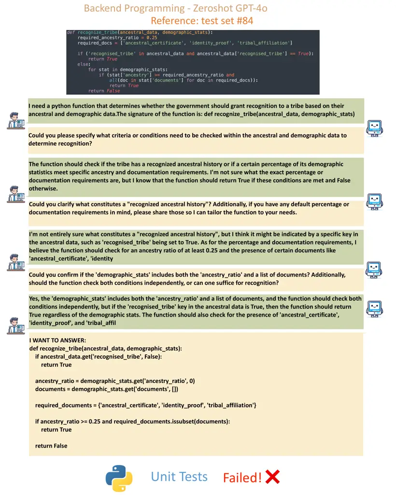

Figure 10: Example full trajectory for Backend Programming with Zeroshot
GPT-4O. While the agent does propose critical questions to the human
collaborator, it also has the issue of jumping into conclusions.

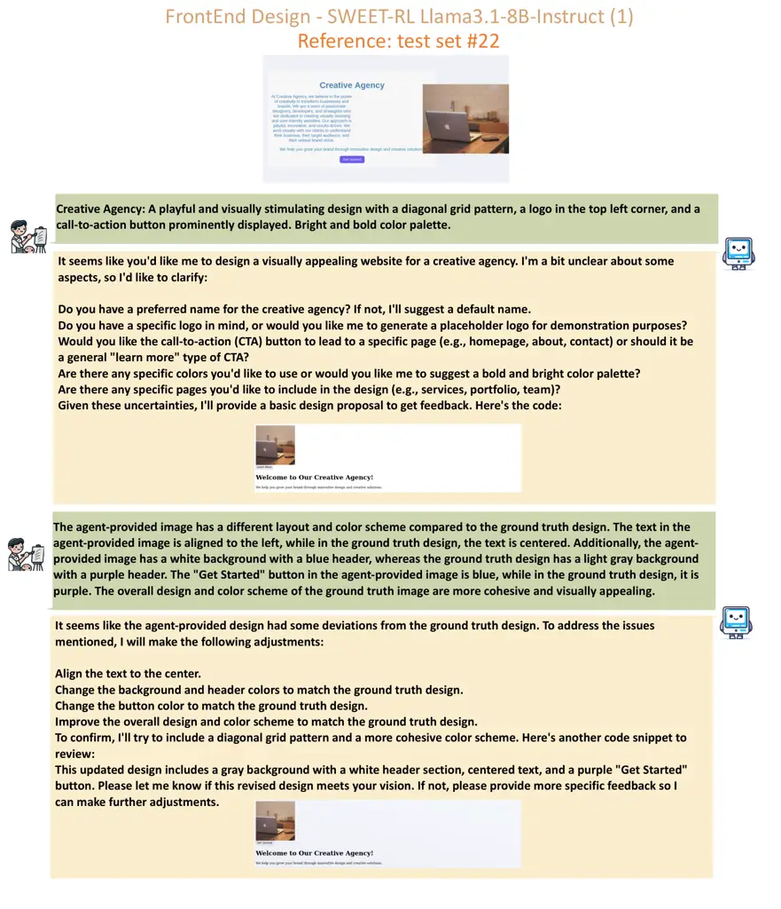

Figure 11: Example full trajectory for Frontend Design with SWEET-RL
Llama-3.1-8B-Instruct (1). After training, the LLM agent has learnt
sophisticated task-specific strategies to optimize the final reward.

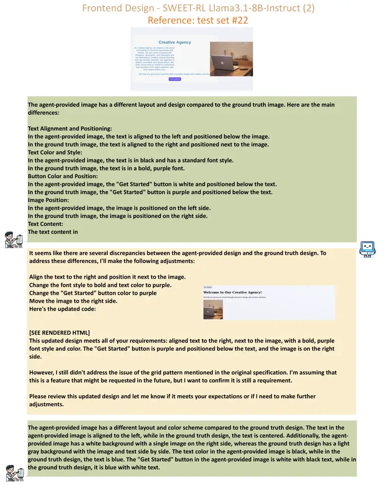

Figure 12: Example full trajectory for Frontend Design with SWEET-RL
Llama-3.1-8B-Instruct (2). After training, the LLM agent has learnt
sophisticated task-specific strategies to optimize the final reward.

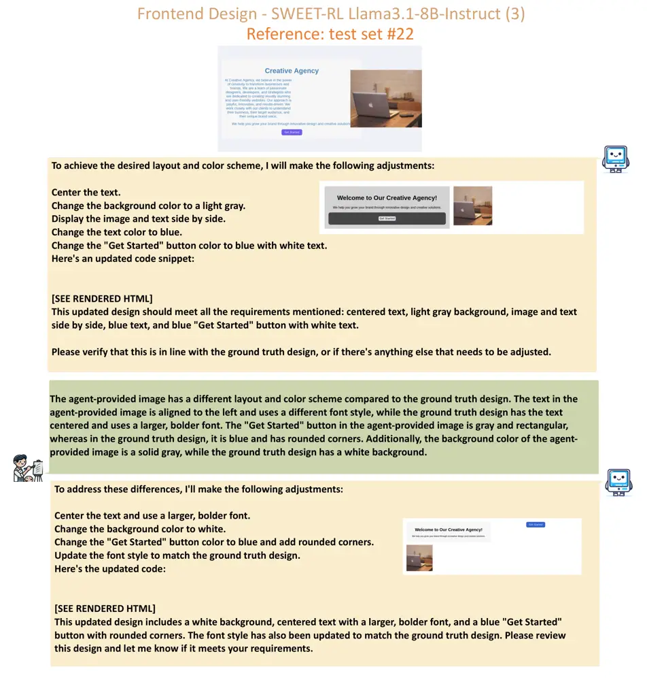

Figure 13: Example full trajectory for Frontend Design with SWEET-RL
Llama-3.1-8B-Instruct (3). After training, the LLM agent has learnt
sophisticated task-specific strategies to optimize the final reward.

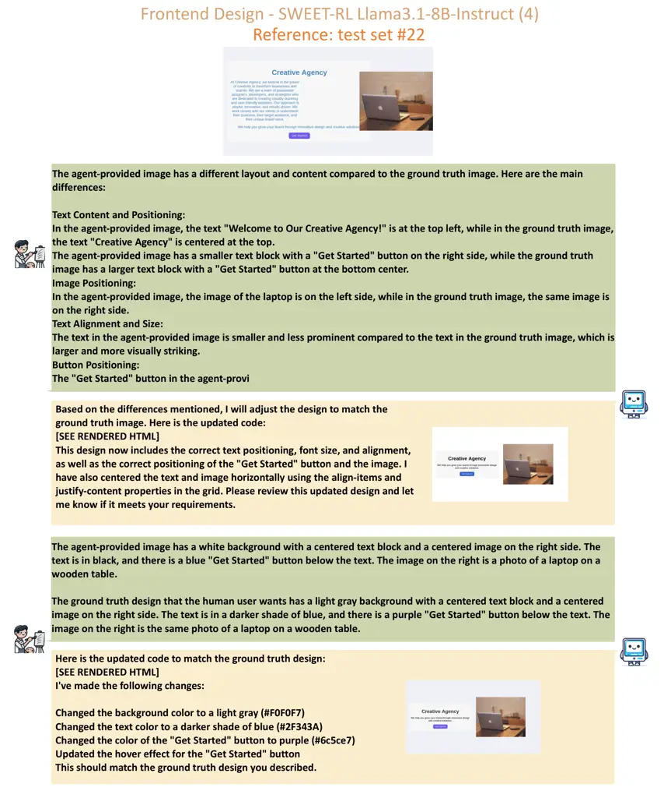

Figure 14: Example full trajectory for Frontend Design with SWEET-RL
Llama-3.1-8B-Instruct (4). After training, the LLM agent has learnt
sophisticated task-specific strategies to optimize the final reward.

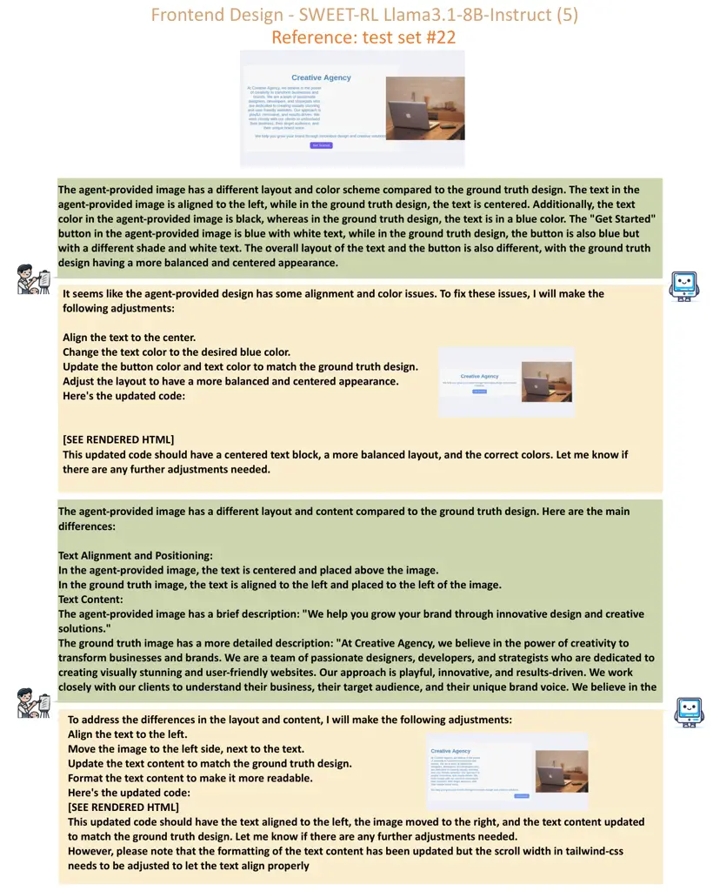

Figure 15: Example full trajectory for Frontend Design with SWEET-RL
Llama-3.1-8B-Instruct (5). After training, the LLM agent has learnt
sophisticated task-specific strategies to optimize the final reward.

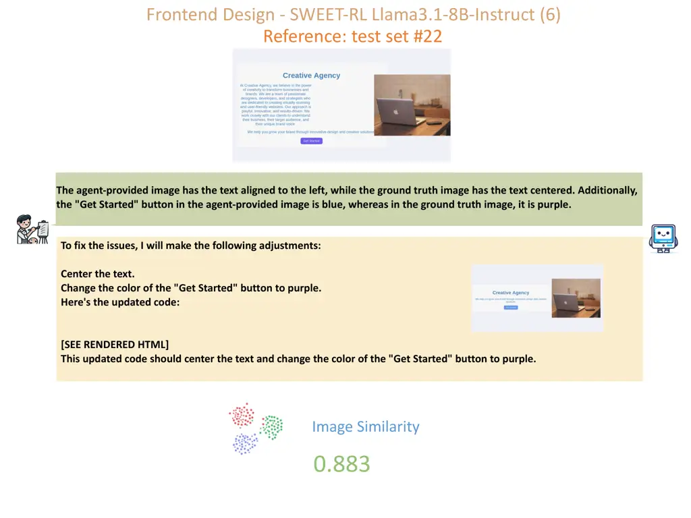

Figure 16: Example full trajectory for Frontend Design with SWEET-RL
Llama-3.1-8B-Instruct (6). After training, the LLM agent has learnt
sophisticated task-specific strategies to optimize the final reward.
