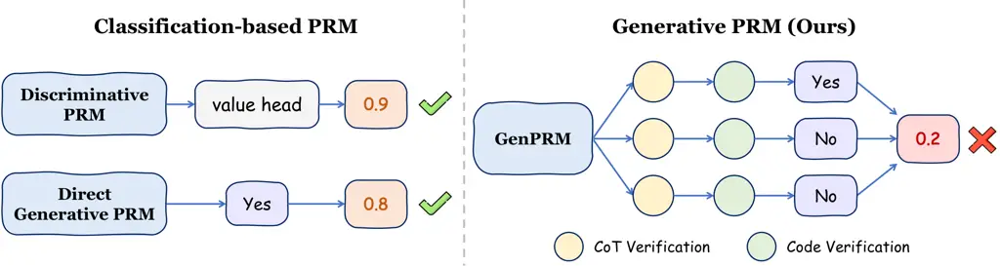
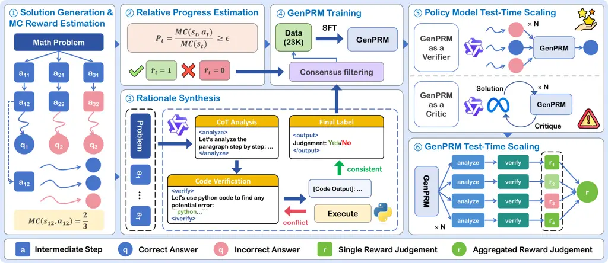

^(†)^(†) ^(∗) Equal contribution^(†)^(†) ^(†) Project lead & Work done
during an internship at Shanghai AI Laboratory^(†)^(†) ^(‡)
Corresponding authors: Biqing Qi (qibiqing@pjlab.org.cn), Xiu Li
(li.xiu@sz.tsinghua.edu.cn), and Bowen Zhou (zhoubowen@tsinghua.edu.cn)

# GenPRM: Scaling Test-Time Compute of Process Reward Models via Generative Reasoning

Jian Zhao Affiliation: Tsinghua University    Runze Liu Affiliation:
Tsinghua University    Kaiyan Zhang Affiliation: Tsinghua University   
Zhimu Zhou Affiliation: BUPT    Junqi Gao Affiliation: Harbin Institute
of Technology    Dong Li Affiliation: Harbin Institute of Technology   
Jiafei Lyu Affiliation: Tsinghua University    Zhouyi Qian Affiliation:
Harbin Institute of Technology    Biqing Qi    Xiu Li    Bowen Zhou
Affiliation: Tsinghua University Affiliation: Shanghai AI Laboratory

###### Abstract

Recent advancements in Large Language Models (LLMs) have shown that it
is promising to utilize Process Reward Models (PRMs) as verifiers to
enhance the performance of LLMs. However, current PRMs face three key
challenges: (1) limited process supervision and generalization
capabilities, (2) dependence on scalar value prediction without
leveraging the generative abilities of LLMs, and (3) inability to scale
the test-time compute of PRMs. In this work, we introduce GenPRM, a
generative process reward model that performs explicit Chain-of-Thought
(CoT) reasoning with code verification before providing judgment for
each reasoning step. To obtain high-quality process supervision labels
and rationale data, we propose Relative Progress Estimation (RPE) and a
rationale synthesis framework that incorporates code verification.
Experimental results on ProcessBench and several mathematical reasoning
tasks show that GenPRM significantly outperforms prior PRMs with only
23K training data from MATH dataset. Through test-time scaling, a 1.5B
GenPRM outperforms GPT-4o, and a 7B GenPRM surpasses
Qwen2.5-Math-PRM-72B on ProcessBench. Additionally, GenPRM demonstrates
strong abilities to serve as a critic model for policy model refinement.
This work establishes a new paradigm for process supervision that
bridges the gap between PRMs and critic models in LLMs. Our code, model,
and data are available in
[https://ryanliu112.github.io/GenPRM](https://ryanliu112.github.io/GenPRM).

Figure 1: GenPRM achieves state-of-the-art performance across multiple
benchmarks in two key roles: (a) As a verifier: GenPRM-7B outperforms
all classification-based PRMs of comparable size and even surpasses
Qwen2.5-Math-PRM-72B via test-time scaling. (b) As a critic: GenPRM-7B
demonstrates superior critique capabilities, achieving 3.4× greater
performance gains than DeepSeek-R1-Distill-Qwen-7B after 3 refinement
iterations.

## 1 Introduction

Large Language Models (LLMs) have shown significant advances in recent
years (OpenAI, 2023; Anthropic, 2023; OpenAI, 2024a; OpenAI, 2024b;
DeepSeek-AI et al., 2025). As OpenAI o1 demonstrates the great
effectiveness of scaling test-time compute (OpenAI, 2024a), an
increasing number of researches focus on Test-Time Scaling (TTS) methods
to improve the reasoning performance of LLMs (Snell et al., 2025; Liu et
al., 2025).

Effective TTS requires high-quality verifiers, such as Process Reward
Models (PRMs) (Liu et al., 2025). However, existing PRMs face several
limitations. They exhibit limited process supervision capabilities and
struggle to generalize across different models and tasks (Zheng et al.,
2024; Zhang et al., 2025c; Liu et al., 2025). Furthermore, most current
approaches train PRMs as classifiers that output scalar values,
neglecting the natural language generation abilities of LLMs, which are
pre-trained on extensive corpora. This classifier-based modeling
inherently prevents PRMs from leveraging test-time scaling methods to
enhance process supervision capabilities. These limitations lead us to
the following research question: How can generative modeling enhance the
process supervision capabilities of PRMs while enabling test-time
scaling?

In this work, we address these challenges through a generative process
reward model, named GenPRM. Specifically, GenPRM differs from
classification-based PRMs in that GenPRM redefines process supervision
as a generative task rather than a discriminative scoring task by
integrating Chain-of-Thought (CoT) (Wei et al., 2022) reasoning and code
verification processes before providing final judgment. To improve
conventional hard label estimation, we propose Relative Progress
Estimation (RPE), which leverages a relative criterion for label
estimation. Additionally, we introduce a rationale synthesis framework
with code verification to obtain high-quality process supervision
reasoning data. A comparison of our method with previous
classification-based methods is presented in Figure 2.

Our contributions can be summarized as follows:

1.  1.  We propose a generative process reward model that performs explicit
        CoT reasoning with code verification and utilizes Relative Progress
        Estimation to obtain accurate PRM labels.
2.  2.  Empirical results on ProcessBench and common mathematical reasoning
        tasks demonstrate that GenPRM outperforms prior classification-based
        PRMs. Additionally, smaller GenPRM models can surpass larger PRMs
        via TTS.
3.  3.  We provide a new perspective on PRMs in this work, fully leveraging
        their TTS capabilities, reshaping their applications, and opening
        new directions for future research in process supervision.



Figure 2: Comparison between GenPRM (right) and previous
classification-based PRMs (left).

## 2 Preliminaries

### 2.1 Markov Decision Process

Following Liu et al. (2025), we formulate the test-time scaling process
with PRMs as a Markov Decision Process (MDP) defined by
$`(\mathcal{S},\mathcal{A},P,r,\gamma)`$, where $`\mathcal{S}`$ is the
state space, $`\mathcal{A}`$ is the action space, $`P`$ represents
transition dynamics,
$`r:\mathcal{S}\times\mathcal{A}\rightarrow\mathbb{R}`$ is the reward
function, and $`\gamma\in[0,1]`$ is the discount factor. Starting with a
prompt set $`\mathcal{X}`$ and an initial state
$`s_{1}=x\sim\mathcal{X}`$, the policy model $`\pi_{\theta}`$ generates
an action $`a_{1}\sim\pi_{\theta}(\cdot\mid s_{1})`$.¹¹ 1 Following
Snell et al. (2025); Liu et al. (2025), we refer to models that generate
solutions as policy models. Unlike traditional RL methods with
stochastic transitions (Liu et al., 2022; Liu et al., 2024), transitions
in LLMs are deterministic, i.e.,
$`s_{t+1}=P(\cdot\mid s_{t},a_{t})=[s_{t},a_{t}]`$, where
$`[\cdot,\cdot]`$ denotes string concatenation. This process continues
until the episode terminates (i.e., generating the \[EOS\] token),
obtaining a trajectory of $`T`$ steps:
$`\tau=\{a_{1},a_{2},\cdots,a_{T}\}`$. The goal is to optimize either
the reward of each step (as in search-based methods) or the reward over
the full response (as in Best-of-N sampling).

### 2.2 Supervised Fine-Tuning

Supervised Fine-Tuning (SFT) trains a model to predict the next token
based on prior context. For a dataset
$`\mathcal{D}_{\text{SFT}}=\{(x^{(i)},y^{(i)})\}_{i=1}^{N}`$, the SFT
loss is:

```math
\mathcal{L}_{\text{SFT}}(\theta)=-\mathbb{E}_{(x,y)\sim\mathcal{D}_{\text{SFT}}}\left[\sum_{t=1}^{|y|}\log\pi_{\theta}(y_{t}\mid x,y_{1:t-1})\right], \tag{1}
```

where $`\pi_{\theta}`$ represents a model with parameters $`\theta`$.

### 2.3 Test-Time Scaling

In this work, we consider two test-time scaling methods, including
majority voting and Best-of-N.

##### Majority Voting.

Majority voting (Wang et al., 2023) selects the answer that appears the
most frequently among all solutions.

##### Best-of-N.

Best-of-N (BoN) (Brown et al., 2024; Snell et al., 2025) selects the
best answer from $`N`$ candidate solutions.



Figure 3: Overall framework of GenPRM. Our framework consists of six key
parts: ① The policy model generates solution steps, with MC scores
estimated from rollout trajectories. ② Our proposed RPE derives accurate
PRM labels. ③ High-quality process supervision data is synthesized
through CoT reasoning augmented with code verification. ④ We apply
consensus filtering followed by SFT to train GenPRM. ⑤ The trained
GenPRM functions as a verifier or critic, enabling enhanced test-time
scaling for policy models. ⑥ The performance of GenPRM further improves
through test-time scaling.

## 3 Method

In this section, we first describe how to develop GenPRM and integrate
the reasoning process with code verification. We then introduce how to
scale test-time compute of policy models using GenPRM and apply TTS for
GenPRM. Last, we present the improved label estimation method and data
generation and filtering framework of GenPRM.

### 3.1 GenPRM and Test-Time Scaling

#### 3.1.1 From Discriminative PRM to Generative PRM

##### Discriminative PRM.

Assume we have a PRM dataset
$`\mathcal{D}_{\text{Disc}}=\{(s_{t},a_{t}),r_{t}\}`$, where
$`r_{t}\in\{0,1\}`$ for PRM labels with hard estimation. The
discriminative PRM $`r_{\psi}`$ is trained via cross-entropy loss
(Skywork o1 Team, 2024; Zhang et al., 2025c):

```math
\mathcal{L}_{\text{CE}}(\psi)=-\mathbb{E}_{(s_{t},a_{t},r_{t})\sim\mathcal{D}_{\text{Disc}}}\left[r_{t}\log r_{\psi}(s_{t},a_{t})+(1-r_{t})\log(1-r_{\psi}(s_{t},a_{t}))\right]. \tag{2}
```

##### Direct Generative PRM.

With a dataset
$`\mathcal{D}_{\text{Direct-Gen}}=\left\{(s_{t},a_{t}),r_{t}\right\}`$,
where $`r_{t}`$ is Yes for a correct step and No otherwise, the direct
generative PRM (Xiong et al., 2024) is trained through SFT to predict
Yes or No for each step. For step $`t`$, we use the probability of the
Yes token as the predicted process reward $`\hat{r}_{t}`$:

```math
\hat{r}_{t}=r_{\psi}(\texttt{Yes}\mid s_{t},a_{t}). \tag{3}
```

##### Generative PRM.

By equipping the direct generative PRM with an explicit reasoning
process like CoT (Wei et al., 2022), we obtain a generative PRM. Let
$`v_{1:t-1}`$ denote the rationale from step $`1`$ to $`t-1`$ and
$`v_{t}`$ denote the rationale for step $`t`$. Assume we have a dataset
$`\mathcal{D}_{\text{Gen}}=\left\{(s_{t},a_{t},v_{1:t-1}),(v_{t},r_{t})\right\}`$.
GenPRM learns to reason and verify each step via SFT on this dataset.
The generative process reward $`\hat{r}_{t}`$ can be obtained via the
following equation:

```math
\hat{r}_{t}=r_{\psi}(\texttt{Yes}\mid s_{t},a_{t},v_{1:t-1},v_{t}),\quad\text{where }v_{t}\sim r_{\psi}(\cdot\mid s_{t},a_{t},v_{1:t-1}) \tag{4}
```

##### Generative PRM with Code Verification.

If we only verify the reasoning step with CoT based on natural language,
the process may lack robustness in certain complex scenarios (Zhu et
al., 2024; Gou et al., 2024). The difference between the generative PRM
and the generative PRM with code verification is that the latter
generates code to verify the reasoning step by executing it and provides
the judgment based on the execution results. At step $`t`$, after
generating the rationale $`v_{t}`$ containing CoT and code, we execute
the code and obtain feedback $`f_{t}`$. Given the current state
$`s_{t}`$, action $`a_{t}`$, previous rationales $`v_{1:t-1}`$, and
previous corresponding execution feedback $`f_{1:t-1}`$, the PRM first
generates the rationale $`v_{t}`$. After execution and obtaining the
feedback $`f_{t}`$, we compute the final generative process reward as
follows:

```math
\hat{r}_{t}=r_{\psi}(\texttt{Yes}\mid s_{t},a_{t},v_{1:t-1},f_{1:t-1},v_{t},f_{t}),\quad\text{where }v_{t}\sim r_{\psi}(\cdot\mid s_{t},a_{t},v_{1:t-1},f_{1:t-1}) \tag{5}
```

In the following sections, we refer to GenPRM as this generative PRM
type with code verification. The effectiveness of CoT and code
verification can be found in Section 4.4.

#### 3.1.2 Test-Time Scaling

##### Policy Model TTS: GenPRM as a Verifier.

To scale the test-time compute of policy models, we can sampling
multiple responses from policy models and then use GenPRM as a verifier
to select the final answer (Snell et al., 2025) in the way of parallel
TTS.

##### Policy Model TTS: GenPRM as a Critic.

By equipping the PRM with generative process supervision abilities,
GenPRM can be naturally used as a critic model to refine the outputs of
policy models and we can scale the refinement process with multiple
turns in a sequential TTS manner.

##### GenPRM TTS.

When evaluating each solution step, we first sample $`N`$ reasoning
verification paths and then use majority voting to obtain the final
prediction by averaging the rewards. For GenPRM without code
verification, the rewards are computed as follows:

```math
\hat{r}_{t}=\frac{1}{N}\sum_{i=1}^{N}r_{\psi}(\texttt{Yes}\mid s_{t},a_{t},v_{1:t-1}^{i},v_{t}^{i}). \tag{6}
```

And we can further incorporate code verification and execution feedback
into this reasoning process:

```math
\hat{r}_{t}=\frac{1}{N}\sum_{i=1}^{N}r_{\psi}(\texttt{Yes}\mid s_{t},a_{t},v_{1:t-1}^{i},f_{1:t-1}^{i},v_{t}^{i},f_{t}^{i}). \tag{7}
```

Then the rewards can be used for ranking the responses of policy models
or be converted into binary labels through a threshold $`0.5`$ for
judging the correctness of the step. The discussion of using code
verification can be found at Table 5.

### 3.2 Synthesizing Data of GenPRM

In this section, we introduce our pipeline for synthesizing training
data of GenPRM. The pipeline consists of three stages: (1) generating
reasoning paths and obtaining PRM labels via Monte Carlo (MC)
estimation; (2) evaluating the progress of each step via Relative
Progress Estimation; and (3) synthesizing rationales with CoT and code
verification, and inferring LLM-as-a-judge labels with consensus
filtering.

#### 3.2.1 Solution Generation and Monte Carlo Estimation

##### Solution Generation with Step Forcing.

We utilize the 7.5K problems from the training set of the MATH dataset
(Hendrycks et al., 2021) as the problem set. For each problem, we use
Qwen2.5-7B-Instruct (Yang et al., 2024a) as the generation model to
collect multiple solutions. Since using “`\n\n`” for step division does
not consider the semantics of each step and may result in overly
fine-grained division, we apply a step forcing approach to generate
solutions. Specifically, we add “Step 1:” as the prefix for the
generation model to complete the response. For a response with $`T`$
reasoning steps, the format is as follows:


The proportion of correct paths versus incorrect paths varies
significantly depending on the difficulty of the problems. To ensure a
sufficient number of correct and incorrect paths, we sample up to
$`2048`$ paths for both hard and easy problems. If no correct or
incorrect paths are found after sampling $`2048`$ responses, we discard
the corresponding problems.

##### Balancing the Precision and Efficiency of MC Estimation.

Following Math-Shepherd (Wang et al., 2024b), we estimate the
probability of correctness for each step using completion-based
sampling. For each reasoning step $`s_{t}`$, we generate $`K`$
completion trajectories using a completion model, specifically
Qwen2.5-Math-7B-Instruct (Yang et al., 2024b), and use MC estimation to
calculate the probability that the current step $`a_{t}`$ is correct
(Wang et al., 2024b; Zhang et al., 2025c):

```math
MC(s_{t},a_{t})=MC(s_{t+1})=\frac{1}{K}\sum_{j=1}^{K}\mathbbm{1}(q_{j}=q^{*}), \tag{8}
```

where $`q_{j}`$ is the answer of the $`j`$-th response, $`q^{*}`$ is the
ground-truth answer, and $`\mathbbm{1}`$ is the indicator function.
However, it is difficult for the completion model to reach the correct
answer for hard problems even when the original step is correct, leading
to incorrect results for MC estimation. To address this and balance the
computation cost, we use a dynamic $`K`$ based on the estimated Pass@1
$`MC(s_{1})`$:

```math
K=\left\{\begin{aligned} &128\quad\ \ \text{if }0\leq MC(s_{1})<0.1,\\
&64\qquad\text{if }0.1\leq MC(s_{1})<0.9,\\
&32\qquad\text{if }0.9\leq MC(s_{1})<1.\end{aligned}\right. \tag{9}
```

#### 3.2.2 Relative Progress Estimation

Previous work has shown that hard label estimation is better than soft
label estimation for PRMs (Zhang et al., 2025c). However, after MC
estimation, we observe that although the MC score of many steps is
greater than 0, the steps are incorrect, as also noted by Zhang et al.
(2025c). On the other hand, we assume that a positive step should be
both correct and beneficial. A reasoning step is considered as a
beneficial one if it is easier to reach the correct answer by adding
this step as the generation prefix. To address these issues, we propose
Relative Progress Estimation (RPE), which shares a similar idea with
relative advantage estimation in GRPO (Shao et al., 2024; DeepSeek-AI et
al., 2025), to improve conventional hard label estimation.

Specifically, the MC score is an empirical estimation of the current
state $`s_{t}`$. To evaluate the quality of the current action
$`a_{t}`$, it is natural to compare the MC score of the next state
$`s_{t+1}`$ with that of the current state $`s_{t}`$, since
$`s_{t+1}=[s_{t},a_{t}]`$. For each response, if the first erroneous
step is step $`t^{\prime}`$ (i.e., $`MC(s_{t^{\prime}})=0`$), we set the
MC score of the following steps to 0. Our RPE $`P_{t}`$ for step $`t`$
is defined as follows:

```math
P_{t}=\frac{MC(s_{t},a_{t})}{MC(s_{t})}, \tag{10}
```

where $`MC(s_{1})`$ is the estimated Pass@1 computed in the solution
generation phase. However, we empirically find that using a strict
criterion where progress is always greater than $`1`$ leads to
unsatisfactory performance, as shown in Table 3. To address this, we
estimate the final reward label $`\hat{r}_{t}`$ by introducing a
threshold $`\epsilon`$:

```math
\hat{r}_{t}=\left\{\begin{aligned} &1\qquad\text{if }P_{t}\geq\epsilon,\\
&0\qquad\text{otherwise.}\end{aligned}\right. \tag{11}
```

We also discuss another form of relative progress
$`P_{t}=MC(s_{t},a_{t})-MC(s_{t})`$ in Table 3 in Section 4.4.

#### 3.2.3 Rationale Generation, Verification and Filtering

To obtain high-quality rationale data, we use QwQ-32B (Qwen Team, 2025)
as the rationale generation model and introduce a three-step pipeline
that automatically generates and verifies the rationale of each
reasoning step. Given a problem $`x`$ with a ground-truth answer
$`q^{*}`$ and candidate steps $`\{a_{1},\cdots,a_{T}\}`$, the generation
and verification proceed as follows:

##### Step 1: Code-Based Rationale Generation.

To evaluate the correctness of $`a_{t}`$, we synthesize step-by-step CoT
analysis. It has been shown that program-based reasoning improves
verification outcomes (Zhu et al., 2024). Based on CoT analysis, we
continue to synthesize code-based rationales to verify $`a_{t}`$ based
on the problem and historical steps $`\{a_{1},\cdots,a_{t-1}\}`$. We
prompt the rationale generation model to surround the CoT with
\<analyze\> and \</analyze\>, and the code with \<verify\> and
\</verify\>. The prompt for rationale generation is shown in Table A.2.

##### Step 2: Code Execution and Verification.

With the generated code, we execute it and obtain the feedback $`f_{t}`$
for step $`t`$. The execution feedback is formatted as \[Code output:
{execution result}\] and is concatenated to the generated CoT and code
as the prefix for the subsequent generation. If the execution result is
inconsistent with the generated CoT verification, we observe that
QwQ-32B performs self-reflection behaviors until reaching a consensus.

##### Step 3: Label Judgment and Consensus Filtering.

After generating and verifying the rationale data of all candidate
steps, the rationale generation model finally outputs an number. If all
steps are inferred to be correct, the number will be -1, otherwise will
be the index of the first erroneous step. For each solution, if there is
at least one process label with RPE is not consistent with the labels
generated by LLM-as-a-judge (Zheng et al., 2023), we discard the entire
solution and only retain the one with all labels consistent. After
consensus filtering, we discard approximately $`51\%`$ of the data and
finally obtain a dataset containing 23K problems with reasoning steps
and rationale data.

## 4 Experiments

In this section, we aim to answer the following questions:

- •
  Q1: How does GenPRM perform compared with previous PRMs? (§4.2, §4.3)
- •
  Q2: How does the performance of GenPRM scale with more test-time
  compute? (§4.2, §4.3)
- •
  Q3: How does GenPRM benefit policy model test-time scaling? (§4.3)
- •
  Q4: How do the components and hyperparameters influence GenPRM? (§4.4)

### 4.1 Setup

##### Benchmarks.

We evaluate GenPRM and baseline methods on ProcessBench (Zheng et al.,
2024), a benchmark designed to assess process supervision capabilities
in mathematical reasoning tasks.²² 2 Our evaluation code is adapted from
[https://github.com/QwenLM/ProcessBench](https://github.com/QwenLM/ProcessBench).
Additionally, we conduct BoN and critic refinement experiments using
MATH (Hendrycks et al., 2021), AMC23 (AI-MO, 2024b), AIME24 (AI-MO,
2024a), and Minerva Math (Lewkowycz et al., 2022). For BoN response
generation, we employ Qwen2.5-Math-7B-Instruct (Yang et al., 2024b) and
Gemma-3-12b-it (Gemma Team and Google DeepMind, 2025) as policy models.
For policy model TTS with GenPRM as the critic, we use Gemma-3-12b-it
(Gemma Team and Google DeepMind, 2025) and Qwen2.5-7B-Instruct (Yang et
al., 2024a) as generators.

##### Baselines.

For ProcessBench and BoN experiments, we compare GenPRM with the
following methods:

- •
  Math-Shepherd-PRM-7B (Wang et al., 2024b): This method trains a PRM
  using hard labels computed based on MC estimation.
- •
  RLHFlow series (Xiong et al., 2024): Includes RLHFlow-PRM-Mistral-8B
  and RLHFlow-PRM-Deepseek-8B.
- •
  Skywork-PRM series (Skywork o1 Team, 2024): Comprises Skywork-PRM-1.5B
  and Skywork-PRM-7B.
- •
  EurusPRM (Cui et al., 2025): EurusPRM-Stage1 and EurusPRM-Stage2 are
  trained as implicit PRMs (Yuan et al., 2024).
- •
  Qwen2.5-Math series (Zheng et al., 2024; Zhang et al., 2025c):
  Qwen2.5-Math-7B-Math-Shepherd and Qwen2.5-Math-7B-PRM800K are trained
  with Math-Shepherd (Wang et al., 2024b) and PRM800K (Lightman et al.,
  2024), respectively. For Qwen2.5-Math-PRM-7B and Qwen2.5-Math-PRM-72B,
  the training data is applied consensus filtering using LLM-as-a-judge
  (Zheng et al., 2023).
- •
  RetrievalPRM-7B (Zhu et al., 2025): The method enhances PRM with
  retrieved questions and corresponding steps.
- •
  Universal-PRM-7B (Tan et al., 2025): The method proposes an automated
  framework using ensemble prompting and reverse verification.
- •
  Dyve-14B (Zhong et al., 2025): This method dynamically applies fast or
  slow verification for each reasoning step.
- •
  Direct Generative PRM-7B: The method trains a direct generative PRM
  with the original language head via SFT using the same data as GenPRM,
  but without CoT and code verification.

For critic experiments, we use the following methods for comparison:

- •
  Self-Refine (Madaan et al., 2023): This method uses the generator to
  self-critique and refine the solution.
- •
  DeepSeek-R1-Distill-Qwen-7B (DeepSeek-AI et al., 2025): This model is
  fine-tuned based on Qwen2.5-Math-7B (Yang et al., 2024a) using
  high-quality reasoning data generated by DeepSeek-R1 (DeepSeek-AI et
  al., 2025).

##### Implementation Details.

For RPE, we set $`\epsilon=0.8`$ across all experiments, with ablation
studies presented in Section 4.4. Rationale data is generated using
QwQ-32B (Qwen Team, 2025) and the prompt template is shown in Table A.2.
Our base models are from the DeepSeek-R1-Distill series (DeepSeek-AI et
al., 2025), specifically the 1.5B, 7B, and 32B parameter variants. The
training configuration for our method uses a batch size of 64 and a
learning rate of $`2.0\times 10^{-6}`$. During evaluation, we employ a
temperature of 0.6. For critique refinement experiments, we extract
content within the \<analyze\>\</analyze\> tags, focusing exclusively on
steps predicted as negative by the policy model. The baseline methods
utilize standardized prompt templates (detailed in Table A.2) to ensure
consistent critique generation formats.

### 4.2 ProcessBench Results

##### GenPRM outperforms classification-based PRMs on ProcessBench.

As shown in Table 1, GenPRM-7B significantly outperforms direct
generative PRM and surpasses all previous PRMs with parameters less than
72B on ProcessBench. Also, GenPRM-1.5B outperforms Skywork-PRM-1.5B by a
large margin. It is noteworthy that GenPRM is trained with merely 23K
data from MATH (Hendrycks et al., 2021) only. By comparing the detailed
results in Table 6, we can find that the performance gain of GenPRM
mainly comes from the stronger abilities of finding erroneous steps and
we provide concrete cases in Appendix C. These results demonstrating the
superiority of generative modeling of PRM.

|                               |              |       |      |                |            |      |
| ----------------------------- | ------------ | ----- | ---- | -------------- | ---------- | ---- |
| Model                         | \# Samples   | GSM8K | MATH | Olympiad Bench | Omni- MATH | Avg. |
| Proprietary LLMs (Critic)     |              |       |      |                |            |      |
| GPT-4o-0806                   | unk          | 79.2  | 63.6 | 51.4           | 53.5       | 61.9 |
| o1-mini                       | unk          | 93.2  | 88.9 | 87.2           | 82.4       | 87.9 |
| PRMs (1.5B)                   |              |       |      |                |            |      |
| Skywork-PRM-1.5B              | unk          | 59.0  | 48.0 | 19.3           | 19.2       | 36.4 |
| GenPRM-1.5B (Pass@1)          | 23K          | 52.8  | 66.6 | 55.1           | 54.5       | 57.3 |
| GenPRM-1.5B (Maj@8)           | 23K          | 51.3  | 74.4 | 65.3           | 62.5       | 63.4 |
| PRMs (7-8B)                   |              |       |      |                |            |      |
| Math-Shepherd-PRM-7B          | 445K         | 47.9  | 29.5 | 24.8           | 23.8       | 31.5 |
| RLHFlow-PRM-Mistral-8B        | 273K         | 50.4  | 33.4 | 13.8           | 15.8       | 28.4 |
| RLHFlow-PRM-Deepseek-8B       | 253K         | 38.8  | 33.8 | 16.9           | 16.9       | 26.6 |
| Skywork-PRM-7B                | unk          | 70.8  | 53.6 | 22.9           | 21.0       | 42.1 |
| EurusPRM-Stage1               | 463K         | 44.3  | 35.6 | 21.7           | 23.1       | 31.2 |
| EurusPRM-Stage2               | 30K          | 47.3  | 35.7 | 21.2           | 20.9       | 31.3 |
| Qwen2.5-Math-7B-Math-Shepherd | 445K         | 62.5  | 31.6 | 13.7           | 7.7        | 28.9 |
| Qwen2.5-Math-7B-PRM800K       | 264K         | 68.2  | 62.6 | 50.7           | 44.3       | 56.5 |
| Qwen2.5-Math-PRM-7B           | $`\sim`$344K | 82.4  | 77.6 | 67.5           | 66.3       | 73.5 |
| RetrievalPRM-7B               | 404K         | 74.6  | 71.1 | 60.2           | 57.3       | 65.8 |
| Universal-PRM-7B              | unk          | 85.8  | 77.7 | 67.6           | 66.4       | 74.3 |
| Direct Generative PRM-7B      | 23K          | 63.9  | 65.8 | 54.5           | 55.9       | 60.0 |
| GenPRM-7B (Pass@1)            | 23K          | 78.7  | 80.3 | 72.2           | 69.8       | 75.2 |
| GenPRM-7B (Maj@8)             | 23K          | 81.0  | 85.7 | 78.4           | 76.8       | 80.5 |
| PRMs (14-72B)                 |              |       |      |                |            |      |
| Dyve-14B                      | 117K         | 68.5  | 58.3 | 49.0           | 47.2       | 55.8 |
| Qwen2.5-Math-PRM-72B          | $`\sim`$344K | 87.3  | 80.6 | 74.3           | 71.1       | 78.3 |
| GenPRM-32B (Pass@1)           | 23K          | 83.1  | 81.7 | 72.8           | 72.8       | 77.6 |
| GenPRM-32B (Maj@8)            | 23K          | 85.1  | 86.3 | 78.9           | 80.1       | 82.6 |

Table 1: ProcessBench results reported with F1 scores. The results of
GenPRM are shaded. For 1.5B PRMs, bold indicates the best Pass@1 or
scores superior to GPT-4o. For 7-8B and 14-72B PRMs, bold denotes the
best Pass@1 or scores superior to Qwen2.5-Math-PRM-72B.

##### GenPRM enables smaller PRMs surpass $`10\times`$ larger PRMs and GPT-4o via TTS.

We also compare the TTS results of GenPRM in Table 1 and find that
GenPRM-1.5B surpasses GPT-4 and GenPRM-7B exceeds Qwen2.5-Math-PRM-72B
on ProcessBench via simply majority voting, showing that scaling
test-time compute is highly effective for GenPRM. We also find that the
performance improvement of scaling the test-time compute on harder
problems is larger than that of easier questions.

### 4.3 Policy Model Test-Time Scaling Results

##### GenPRM as a Verifier.

The results in Figure 4 (a)-(d) show that GenPRM outperforms the
baselines on MATH, AMC23, AIME24, and Minerva Math with
Qwen2.5-Math-7B-Instruct (Yang et al., 2024b) as the generation model.
The advantage of GenPRM becomes larger by scaling the test-time compute
of GenPRM and the generation model. Figure 4 (e)-(h) demonstrates that
GenPRM generalizes well to responses with Gemma-3-12b-it (Gemma Team and
Google DeepMind, 2025) as the generation model.

|     |
| --- |
|     |

|     |     |     |     |
| --- | --- | --- | --- |
|     |     |     |     |

(a) MATH (Qwen)

(b) AMC23 (Qwen)

(c) AIME24 (Qwen)

(d) Minerva Math (Qwen)

|     |     |     |     |
| --- | --- | --- | --- |
|     |     |     |     |

(e) MATH (Gemma)

(f) AMC23 (Gemma)

(g) AIME24 (Gemma)

(h) Minerva Math (Gemma)

Figure 4: BoN results with different generation models on multiple
mathematical benchmarks.

##### GenPRM as a Critic.

We also conduct experiments by using GenPRM as a critic to refine the
outputs of the policy model. The results in Table 2 and Figure 1 (right)
show that GenPRM exhibits strong critique abilities than the baselines,
significantly improving the performance of the policy model and the
performance continues to increase with more refinement based on the
critic feedback.

|                        |                             |        |      |              |      |                                  |        |      |              |      |      |
| ---------------------- | --------------------------- | ------ | ---- | ------------ | ---- | -------------------------------- | ------ | ---- | ------------ | ---- | ---- |
| Critic Model           | Gemma-3-12b-it as Generator |        |      |              |      | Qwen2.5-7B-Instruct as Generator |        |      |              |      | Avg. |
|                        | AMC23                       | AIME24 | MATH | Minerva Math | Avg. | AMC23                            | AIME24 | MATH | Minerva Math | Avg. |      |
| Zero-shot              | 64.1                        | 15.8   | 83.8 | 31.9         | 48.9 | 51.6                             | 7.1    | 76.2 | 34.5         | 42.4 | 45.7 |
| Turn 1                 |                             |        |      |              |      |                                  |        |      |              |      |      |
| Generator              | 66.6                        | 15.8   | 84.7 | 33.3         | 50.1 | 50.6                             | 8.0    | 76.8 | 34.0         | 42.4 | 46.3 |
| DeepSeek-R1-Distill-7B | 69.1                        | 17.9   | 84.6 | 33.0         | 51.2 | 50.6                             | 6.3    | 77.7 | 34.7         | 42.3 | 46.8 |
| GenPRM-7B              | 74.1                        | 19.6   | 86.0 | 35.3         | 53.8 | 57.5                             | 8.3    | 80.6 | 36.5         | 45.7 | 49.8 |
| Turn 2                 |                             |        |      |              |      |                                  |        |      |              |      |      |
| Generator              | 66.6                        | 18.0   | 84.8 | 31.6         | 50.3 | 49.8                             | 8.0    | 76.9 | 31.8         | 41.6 | 46.0 |
| DeepSeek-R1-Distill-7B | 70.9                        | 18.3   | 85.0 | 33.5         | 51.9 | 51.9                             | 7.9    | 78.1 | 32.8         | 42.7 | 47.3 |
| GenPRM-7B              | 75.0                        | 21.3   | 86.9 | 35.6         | 54.7 | 59.4                             | 9.6    | 82.2 | 35.0         | 46.6 | 50.7 |
| Turn 3                 |                             |        |      |              |      |                                  |        |      |              |      |      |
| Generator              | 67.8                        | 18.1   | 85.0 | 32.1         | 50.8 | 49.7                             | 8.1    | 77.1 | 30.8         | 41.4 | 46.1 |
| DeepSeek-R1-Distill-7B | 69.6                        | 18.8   | 85.0 | 33.4         | 51.7 | 51.9                             | 8.3    | 78.2 | 32.7         | 42.7 | 47.2 |
| GenPRM-7B              | 76.2                        | 22.8   | 86.7 | 36.0         | 55.4 | 62.7                             | 9.3    | 82.9 | 34.9         | 47.5 | 51.5 |

Table 2: Results of critique refinement experiments. The results of
GenPRM are shaded. For each refinement turn, the highest values are
bolded.

### 4.4 Analysis

##### Label Estimation Method and Criterion.

To explore how different label estimation influences GenPRM, we conduct
experiments with the following methods: (1) hard label (Wang et al.,
2024b; Zhang et al., 2025c); (2) RPE in (10); and (3) a RPE variant
($`P_{t}=MC(s_{t},a_{t})-MC(s_{t})`$). For the RPE and its variant, we
use different thresholds $`\epsilon`$ for evaluation and set the labels
as correct by checking whether $`P_{t}\geq\epsilon`$. The results in
Table 3 show that RPE and its variant outperforms hard label estimation
and RPE with $`\epsilon=0.8`$ achieves the best result. By scaling
test-time compute with majority voting, the results in Table 4
demonstrate that RPE with $`\epsilon=0.8`$ still reaches the best.

|                                              |                          |       |      |                |            |      |
| -------------------------------------------- | ------------------------ | ----- | ---- | -------------- | ---------- | ---- |
| Estimation Method                            | Positive Label Criterion | GSM8K | MATH | Olympiad Bench | Omni- MATH | Avg. |
| $`P_{t}=MC(s_{t},a_{t})`$ (hard label)       | $`P_{t}>0`$              | 72.9  | 78.9 | 73.2           | 68.0       | 73.2 |
| $`P_{t}=MC(s_{t},a_{t})-MC(s_{t})`$          | $`P_{t}\geq-0.1`$        | 77.3  | 79.9 | 70.8           | 68.5       | 74.1 |
|                                              | $`P_{t}\geq-0.3`$        | 76.8  | 79.6 | 71.1           | 69.0       | 74.1 |
|                                              | $`P_{t}\geq-0.5`$        | 75.8  | 80.2 | 72.8           | 68.6       | 74.3 |
| $`P_{t}=\dfrac{MC(s_{t},a_{t})}{MC(s_{t})}`$ | $`P_{t}\geq 0.1`$        | 74.8  | 78.7 | 71.6           | 68.7       | 73.5 |
|                                              | $`P_{t}\geq 0.5`$        | 75.7  | 79.2 | 70.4           | 68.5       | 73.5 |
|                                              | $`P_{t}\geq 0.8`$        | 78.7  | 80.3 | 72.2           | 69.8       | 75.2 |
|                                              | $`P_{t}\geq 1.0`$        | 76.4  | 77.4 | 68.1           | 67.2       | 72.3 |

Table 3: Results of GenPRM with different label estimation method and
threshold on ProcessBench, reported with Pass@1. The best results are
shown in bold.

|                                              |                          |       |      |                |            |      |
| -------------------------------------------- | ------------------------ | ----- | ---- | -------------- | ---------- | ---- |
| Estimation Method                            | Positive Label Criterion | GSM8K | MATH | Olympiad Bench | Omni- MATH | Avg. |
| $`P_{t}=MC(s_{t},a_{t})`$ (hard label)       | $`P_{t}>0`$              | 75.1  | 83.8 | 80.6           | 74.4       | 78.5 |
| $`P_{t}=MC(s_{t},a_{t})-MC(s_{t})`$          | $`P_{t}\geq-0.1`$        | 79.8  | 85.1 | 78.0           | 74.5       | 79.4 |
|                                              | $`P_{t}\geq-0.3`$        | 80.9  | 86.5 | 78.1           | 75.0       | 80.2 |
|                                              | $`P_{t}\geq-0.5`$        | 78.1  | 85.6 | 79.1           | 73.4       | 79.1 |
| $`P_{t}=\dfrac{MC(s_{t},a_{t})}{MC(s_{t})}`$ | $`P_{t}\geq 0.1`$        | 77.0  | 84.6 | 78.1           | 75.3       | 78.7 |
|                                              | $`P_{t}\geq 0.5`$        | 78.0  | 85.2 | 78.2           | 74.3       | 78.9 |
|                                              | $`P_{t}\geq 0.8`$        | 81.0  | 85.7 | 78.4           | 76.8       | 80.5 |
|                                              | $`P_{t}\geq 1.0`$        | 81.1  | 84.1 | 76.0           | 74.7       | 79.0 |

Table 4: Results of GenPRM with different label estimation method and
threshold on ProcessBench, reported with Maj@8. The best results are
shown in bold.

##### Reasoning Components.

To understand how each reasoning component influence GenPRM, we conduct
experiments by training GenPRM with: (1) CoT data only, (2) code
verification data only, and (3) full data. During inference phase, we
also compare several variants. For example, GenPRM trained with full
data can be used to only verify each step with CoT only by stopping
generation at `</analyze>` token. The results in Table 5 show that: (1)
the improvement of GenPRM mainly comes from CoT reasoning; (2)
generating code and reasoning with code execution result improves the
process verification performance as well.

|          |      |           |      |            |       |      |                |            |      |
| -------- | ---- | --------- | ---- | ---------- | ----- | ---- | -------------- | ---------- | ---- |
| Training |      | Inference |      |            | GSM8K | MATH | Olympiad Bench | Omni- MATH | Avg. |
| CoT      | Code | CoT       | Code | Code Exec. |       |      |                |            |      |
| ✗        | ✗    | ✗         | ✗    | ✗          | 63.9  | 65.8 | 54.5           | 55.9       | 60.0 |
| ✗        | ✓    | ✗         | ✓    | ✗          | 67.0  | 70.8 | 61.6           | 57.4       | 64.2 |
| ✗        | ✓    | ✗         | ✓    | ✓          | 70.6  | 76.6 | 67.3           | 63.9       | 69.6 |
| ✓        | ✗    | ✓         | ✗    | ✗          | 76.4  | 83.0 | 80.5           | 75.4       | 78.8 |
| ✓        | ✓    | ✗         | ✓    | ✗          | 60.1  | 66.7 | 59.9           | 59.2       | 61.5 |
|          |      | ✗         | ✓    | ✓          | 61.3  | 74.7 | 68.1           | 62.0       | 66.5 |
|          |      | ✓         | ✗    | ✗          | 78.8  | 85.1 | 78.7           | 74.9       | 79.3 |
|          |      | ✓         | ✓    | ✗          | 81.0  | 85.1 | 78.1           | 75.5       | 79.9 |
|          |      | ✓         | ✓    | ✓          | 81.0  | 85.7 | 78.4           | 76.8       | 80.5 |

Table 5: Results on ProcessBench of GenPRM with different reasoning
components, reported with Maj@8. The best results are shown in bold.

## 5 Related Work

##### Process Reward Models.

Process reward models have been proved to be effective for providing
step-wise scores and are superior to outcome reward models in
mathematical reasoning tasks (Uesato et al., 2022; Lightman et al.,
2024). However, annotating a process supervision dataset such as PRM800K
(Lightman et al., 2024) requires significant human costs. To mitigate
this cost, prior works utilize Monte Carlo estimation (Wang et al.,
2024b) and binary search (Luo et al., 2024) for automated label
generation. Subsequent research improves PRMs through methods such as
advantage modeling (Setlur et al., 2025), $`Q`$-value rankings (Li and
Li, 2025), implicit entropy regularization (Zhang et al., 2024a),
retrieval-augmented generation (Zhu et al., 2025), and fast-slow
verification (Zhong et al., 2025). Furthermore, the community has
developed high-quality open-source PRMs, including the RLHFlow series
(Xiong et al., 2024), Math-psa (Wang et al., 2024a), Skywork series
(Skywork o1 Team, 2024), and Qwen2.5-Math series (Zheng et al., 2024;
Zhang et al., 2025c). Recently, a line of works focus on extending PRMs
to other tasks, including coding (Zhang et al., 2024b), medical tasks
(Jiang et al., 2025), agentic tasks (Choudhury, 2025), general domain
tasks (Zhang et al., 2025a; Zeng et al., 2025), and multimodal tasks
(Wang et al., 2025). Current studies also focus on benchmarking PRMs
(Zheng et al., 2024; Song et al., 2025) to systematically evaluate their
performance.

##### Large Language Model Test-Time Scaling.

Scaling test-time computation is an effective method for improving
performance during the inference phase (OpenAI, 2024a; OpenAI, 2024b;
DeepSeek-AI et al., 2025). TTS is commonly implemented with external
verifiers (e.g., ORMs and PRMs) or strategies (e.g., beam search and
MCTS) (Wu et al., 2025; Snell et al., 2025; Beeching et al., 2024; Liu
et al., 2025). In this work, we scale the test-time computation of a
generative PRM with an explicit reasoning process and GenPRM can also
serve as a verifier or a critic model in external TTS.

##### Enhancing the Generative Abilities of Reward Models.

Previous research has investigated methods to enhance the generative
capabilities of reward models using CoT reasoning (Ankner et al., 2024;
Zhang et al., 2025b; Mahan et al., 2024). For instance, CLoud reward
models (Ankner et al., 2024) are trained to generate critiques for
responses and predict rewards using an additional reward head. GenRM-CoT
(Zhang et al., 2025b) and GenRM (Mahan et al., 2024) train generative
reward models that perform CoT reasoning before making final predictions
via SFT and preference learning, respectively. CTRL (Xie et al., 2025)
demonstrates that critic models exhibit strong discriminative abilities
when utilized as generative reward models. Prior to these works, GRM
(Yang et al., 2024c) regularizes the hidden states of reward models with
a text generation loss.

## 6 Conclusion

In this work, we propose GenPRM, a generative process reward model that
performs explicit reasoning and code verification for process
supervision and enables scaling the test-time compute of PRMs.
Experimental results on ProcessBench and several mathematical datasets
show GenPRM outperforms prior PRMs. We also demonstrate that the
performance of GenPRM increases via test-time scaling and GenPRM is
effective as a critic model. We believe that this work provides
perspectives on PRMs by demonstrating the strong TTS abilities of PRMs
and extending the applications of PRMs.

##### Limitations.

First, GenPRM provides process supervision by generative reasoning,
which introduces additional computation during inference phase. Future
work will investigate how to prune the reasoning process dynamically
(Zhong et al., 2025). Although GenPRM focuses mainly on mathematical
reasoning tasks, it is worth to explore how to apply generative
reasoning on coding and general reasoning tasks in the future (Zhang et
al., 2025a). Additionally, it would be interesting to leverage RL to
incentivize the generative reasoning abilities of GenPRM.

## References

- AI-MO (2024a) AI-MO. AIME 2024, 2024a. URL
  [https://huggingface.co/datasets/AI-MO/aimo-validation-aime](https://huggingface.co/datasets/AI-MO/aimo-validation-aime).
- AI-MO (2024b) AI-MO. AMC 2023, 2024b. URL
  [https://huggingface.co/datasets/AI-MO/aimo-validation-amc](https://huggingface.co/datasets/AI-MO/aimo-validation-amc).
- Ankner et al. (2024) Zachary Ankner, Mansheej Paul, Brandon Cui,
  Jonathan D Chang, and Prithviraj Ammanabrolu. Critique-out-Loud Reward
  Models. _arXiv preprint arXiv:2408.11791_, 2024.
- Anthropic (2023) Anthropic. Introducing Claude, 2023. URL
  [https://www.anthropic.com/index/introducing-claude/](https://www.anthropic.com/index/introducing-claude/).
- Beeching et al. (2024) Edward Beeching, Lewis Tunstall, and Sasha
  Rush. Scaling Test-Time Compute with Open Models, 2024. URL
  [https://huggingface.co/spaces/HuggingFaceH4/blogpost-scaling-test-time-compute](https://huggingface.co/spaces/HuggingFaceH4/blogpost-scaling-test-time-compute).
- Brown et al. (2024) Bradley Brown, Jordan Juravsky, Ryan Ehrlich,
  Ronald Clark, Quoc V Le, Christopher Ré, and Azalia Mirhoseini. Large
  Language Monkeys: Scaling Inference Compute with Repeated Sampling.
  _arXiv preprint arXiv:2407.21787_, 2024.
- Choudhury (2025) Sanjiban Choudhury. Process Reward Models for LLM
  Agents: Practical Framework and Directions. _arXiv preprint
  arXiv:2502.10325_, 2025.
- Cui et al. (2025) Ganqu Cui, Lifan Yuan, Zefan Wang, Hanbin Wang,
  Wendi Li, Bingxiang He, Yuchen Fan, Tianyu Yu, Qixin Xu, Weize Chen,
  et al. Process Reinforcement through Implicit Rewards. _arXiv preprint
  arXiv:2502.01456_, 2025.
- DeepSeek-AI et al. (2025) DeepSeek-AI, Daya Guo, Dejian Yang, Haowei
  Zhang, Junxiao Song, Ruoyu Zhang, Runxin Xu, Qihao Zhu, Shirong Ma,
  Peiyi Wang, Xiao Bi, Xiaokang Zhang, Xingkai Yu, Yu Wu, Z. F. Wu,
  Zhibin Gou, Zhihong Shao, Zhuoshu Li, Ziyi Gao, Aixin Liu, Bing Xue,
  Bingxuan Wang, Bochao Wu, Bei Feng, Chengda Lu, Chenggang Zhao,
  Chengqi Deng, Chenyu Zhang, Chong Ruan, Damai Dai, Deli Chen, Dongjie
  Ji, Erhang Li, Fangyun Lin, Fucong Dai, Fuli Luo, Guangbo Hao,
  Guanting Chen, Guowei Li, H. Zhang, Han Bao, Hanwei Xu, Haocheng Wang,
  Honghui Ding, Huajian Xin, Huazuo Gao, Hui Qu, Hui Li, Jianzhong Guo,
  Jiashi Li, Jiawei Wang, Jingchang Chen, Jingyang Yuan, Junjie Qiu,
  Junlong Li, J. L. Cai, Jiaqi Ni, Jian Liang, Jin Chen, Kai Dong, Kai
  Hu, Kaige Gao, Kang Guan, Kexin Huang, Kuai Yu, Lean Wang, Lecong
  Zhang, Liang Zhao, Litong Wang, Liyue Zhang, Lei Xu, Leyi Xia,
  Mingchuan Zhang, Minghua Zhang, Minghui Tang, Meng Li, Miaojun Wang,
  Mingming Li, Ning Tian, Panpan Huang, Peng Zhang, Qiancheng Wang,
  Qinyu Chen, Qiushi Du, Ruiqi Ge, Ruisong Zhang, Ruizhe Pan, Runji
  Wang, R. J. Chen, R. L. Jin, Ruyi Chen, Shanghao Lu, Shangyan Zhou,
  Shanhuang Chen, Shengfeng Ye, Shiyu Wang, Shuiping Yu, Shunfeng Zhou,
  Shuting Pan, S. S. Li, Shuang Zhou, Shaoqing Wu, Shengfeng Ye, Tao
  Yun, Tian Pei, Tianyu Sun, T. Wang, Wangding Zeng, Wanjia Zhao, Wen
  Liu, Wenfeng Liang, Wenjun Gao, Wenqin Yu, Wentao Zhang, W. L. Xiao,
  Wei An, Xiaodong Liu, Xiaohan Wang, Xiaokang Chen, Xiaotao Nie, Xin
  Cheng, Xin Liu, Xin Xie, Xingchao Liu, Xinyu Yang, Xinyuan Li,
  Xuecheng Su, Xuheng Lin, X. Q. Li, Xiangyue Jin, Xiaojin Shen, Xiaosha
  Chen, Xiaowen Sun, Xiaoxiang Wang, Xinnan Song, Xinyi Zhou, Xianzu
  Wang, Xinxia Shan, Y. K. Li, Y. Q. Wang, Y. X. Wei, Yang Zhang,
  Yanhong Xu, Yao Li, Yao Zhao, Yaofeng Sun, Yaohui Wang, Yi Yu, Yichao
  Zhang, Yifan Shi, Yiliang Xiong, Ying He, Yishi Piao, Yisong Wang,
  Yixuan Tan, Yiyang Ma, Yiyuan Liu, Yongqiang Guo, Yuan Ou, Yuduan
  Wang, Yue Gong, Yuheng Zou, Yujia He, Yunfan Xiong, Yuxiang Luo,
  Yuxiang You, Yuxuan Liu, Yuyang Zhou, Y. X. Zhu, Yanhong Xu, Yanping
  Huang, Yaohui Li, Yi Zheng, Yuchen Zhu, Yunxian Ma, Ying Tang, Yukun
  Zha, Yuting Yan, Z. Z. Ren, Zehui Ren, Zhangli Sha, Zhe Fu, Zhean Xu,
  Zhenda Xie, Zhengyan Zhang, Zhewen Hao, Zhicheng Ma, Zhigang Yan,
  Zhiyu Wu, Zihui Gu, Zijia Zhu, Zijun Liu, Zilin Li, Ziwei Xie, Ziyang
  Song, Zizheng Pan, Zhen Huang, Zhipeng Xu, Zhongyu Zhang, and Zhen
  Zhang. DeepSeek-R1: Incentivizing Reasoning Capability in LLMs via
  Reinforcement Learning. _arXiv preprint arXiv:2501.12948_, 2025.
- Gemma Team and Google DeepMind (2025) Gemma Team and Google DeepMind.
  Introducing Gemma 3: The most capable model you can run on a single
  GPU or TPU, March 2025. URL
  [https://blog.google/technology/developers/gemma-3](https://blog.google/technology/developers/gemma-3).
- Gou et al. (2024) Zhibin Gou, Zhihong Shao, Yeyun Gong, yelong shen,
  Yujiu Yang, Nan Duan, and Weizhu Chen. CRITIC: Large Language Models
  Can Self-Correct with Tool-Interactive Critiquing. In _International
  Conference on Learning Representations (ICLR)_, 2024. URL
  [https://openreview.net/forum?id=Sx038qxjek](https://openreview.net/forum?id=Sx038qxjek).
- Hendrycks et al. (2021) Dan Hendrycks, Collin Burns, Saurav Kadavath,
  Akul Arora, Steven Basart, Eric Tang, Dawn Song, and Jacob Steinhardt.
  Measuring Mathematical Problem Solving With the MATH Dataset. In
  _Advances in Neural Information Processing Systems Datasets and
  Benchmarks Track (Round 2)_, 2021. URL
  [https://openreview.net/forum?id=7Bywt2mQsCe](https://openreview.net/forum?id=7Bywt2mQsCe).
- Jiang et al. (2025) Shuyang Jiang, Yusheng Liao, Zhe Chen, Ya Zhang,
  Yanfeng Wang, and Yu Wang. MedS³: Towards Medical Small Language
  Models with Self-Evolved Slow Thinking. _arXiv preprint
  arXiv:2501.12051_, 2025.
- Lewkowycz et al. (2022) Aitor Lewkowycz, Anders Andreassen, David
  Dohan, Ethan Dyer, Henryk Michalewski, Vinay Ramasesh, Ambrose Slone,
  Cem Anil, Imanol Schlag, Theo Gutman-Solo, Yuhuai Wu, Behnam
  Neyshabur, Guy Gur-Ari, and Vedant Misra. Solving Quantitative
  Reasoning Problems with Language Models. In S. Koyejo, S. Mohamed, A.
  Agarwal, D. Belgrave, K. Cho, and A. Oh, editors, _Advances in Neural
  Information Processing Systems (NeurIPS)_, volume 35, pages 3843–3857.
  Curran Associates, Inc., 2022. URL
  [https://proceedings.neurips.cc/paper_files/paper/2022/file/18abbeef8cfe9203fdf9053c9c4fe191-Paper-Conference.pdf](https://proceedings.neurips.cc/paper_files/paper/2022/file/18abbeef8cfe9203fdf9053c9c4fe191-Paper-Conference.pdf).
- Li and Li (2025) Wendi Li and Yixuan Li. Process Reward Model with
  Q-value Rankings. In _International Conference on Learning
  Representations (ICLR)_, 2025. URL
  [https://openreview.net/forum?id=wQEdh2cgEk](https://openreview.net/forum?id=wQEdh2cgEk).
- Lightman et al. (2024) Hunter Lightman, Vineet Kosaraju, Yuri Burda,
  Harrison Edwards, Bowen Baker, Teddy Lee, Jan Leike, John Schulman,
  Ilya Sutskever, and Karl Cobbe. Let’s Verify Step by Step. In
  _International Conference on Learning Representations (ICLR)_, 2024.
  URL
  [https://openreview.net/forum?id=v8L0pN6EOi](https://openreview.net/forum?id=v8L0pN6EOi).
- Liu et al. (2022) Runze Liu, Fengshuo Bai, Yali Du, and Yaodong Yang.
  Meta-Reward-Net: Implicitly Differentiable Reward Learning for
  Preference-based Reinforcement Learning. In _Advances in Neural
  Information Processing Systems (NeurIPS)_, volume 35, pages
  22270–22284, 2022.
- Liu et al. (2024) Runze Liu, Yali Du, Fengshuo Bai, Jiafei Lyu, and
  Xiu Li. PEARL: Zero-shot Cross-task Preference Alignment and Robust
  Reward Learning for Robotic Manipulation. In Ruslan Salakhutdinov,
  Zico Kolter, Katherine Heller, Adrian Weller, Nuria Oliver, Jonathan
  Scarlett, and Felix Berkenkamp, editors, _International Conference on
  Machine Learning (ICML)_, volume 235 of _Proceedings of Machine
  Learning Research_, pages 30946–30964. PMLR, 21–27 Jul 2024. URL
  [https://proceedings.mlr.press/v235/liu24o.html](https://proceedings.mlr.press/v235/liu24o.html).
- Liu et al. (2025) Runze Liu, Junqi Gao, Jian Zhao, Kaiyan Zhang, Xiu
  Li, Biqing Qi, Wanli Ouyang, and Bowen Zhou. Can 1B LLM Surpass 405B
  LLM? Rethinking Compute-Optimal Test-Time Scaling. _arXiv preprint
  arXiv:2502.06703_, 2025.
- Luo et al. (2024) Liangchen Luo, Yinxiao Liu, Rosanne Liu, Samrat
  Phatale, Harsh Lara, Yunxuan Li, Lei Shu, Yun Zhu, Lei Meng, Jiao Sun,
  et al. Improve Mathematical Reasoning in Language Models by Automated
  Process Supervision. _arXiv preprint arXiv:2406.06592_, 2024.
- Madaan et al. (2023) Aman Madaan, Niket Tandon, Prakhar Gupta, Skyler
  Hallinan, Luyu Gao, Sarah Wiegreffe, Uri Alon, Nouha Dziri, Shrimai
  Prabhumoye, Yiming Yang, Shashank Gupta, Bodhisattwa Prasad Majumder,
  Katherine Hermann, Sean Welleck, Amir Yazdanbakhsh, and Peter Clark.
  Self-Refine: Iterative Refinement with Self-Feedback. In A. Oh, T.
  Naumann, A. Globerson, K. Saenko, M. Hardt, and S. Levine, editors,
  _Advances in Neural Information Processing Systems (NeurIPS)_, volume
  36, pages 46534–46594. Curran Associates, Inc., 2023. URL
  [https://proceedings.neurips.cc/paper_files/paper/2023/file/91edff07232fb1b55a505a9e9f6c0ff3-Paper-Conference.pdf](https://proceedings.neurips.cc/paper_files/paper/2023/file/91edff07232fb1b55a505a9e9f6c0ff3-Paper-Conference.pdf).
- Mahan et al. (2024) Dakota Mahan, Duy Van Phung, Rafael Rafailov,
  Chase Blagden, Nathan Lile, Louis Castricato, Jan-Philipp Fränken,
  Chelsea Finn, and Alon Albalak. Generative Reward Models. _arXiv
  preprint arXiv:2410.12832_, 2024.
- OpenAI (2023) OpenAI. GPT-4 Technical Report. _arXiv preprint
  arXiv:2303.08774_, 2023.
- OpenAI (2024a) OpenAI. Learning to reason with LLMs, 2024a. URL
  [https://openai.com/index/learning-to-reason-with-llms](https://openai.com/index/learning-to-reason-with-llms).
- OpenAI (2024b) OpenAI. OpenAI o3-mini, 2024b. URL
  [https://openai.com/index/openai-o3-mini](https://openai.com/index/openai-o3-mini).
- Qwen Team (2025) Qwen Team. QwQ-32B: Embracing the Power of
  Reinforcement Learning, March 2025. URL
  [https://qwenlm.github.io/blog/qwq-32b](https://qwenlm.github.io/blog/qwq-32b).
- Setlur et al. (2025) Amrith Setlur, Chirag Nagpal, Adam Fisch, Xinyang
  Geng, Jacob Eisenstein, Rishabh Agarwal, Alekh Agarwal, Jonathan
  Berant, and Aviral Kumar. Rewarding Progress: Scaling Automated
  Process Verifiers for LLM Reasoning. In _International Conference on
  Learning Representations (ICLR)_, 2025. URL
  [https://openreview.net/forum?id=A6Y7AqlzLW](https://openreview.net/forum?id=A6Y7AqlzLW).
- Shao et al. (2024) Zhihong Shao, Peiyi Wang, Qihao Zhu, Runxin Xu,
  Junxiao Song, Xiao Bi, Haowei Zhang, Mingchuan Zhang, YK Li, Y Wu, et
  al. DeepSeekMath: Pushing the Limits of Mathematical Reasoning in Open
  Language Models. _arXiv preprint arXiv:2402.03300_, 2024.
- Skywork o1 Team (2024) Skywork o1 Team. Skywork-o1 Open Series.
  [https://huggingface.co/Skywork](https://huggingface.co/Skywork),
  November 2024. URL
  [https://huggingface.co/Skywork](https://huggingface.co/Skywork).
- Snell et al. (2025) Charlie Victor Snell, Jaehoon Lee, Kelvin Xu, and
  Aviral Kumar. Scaling LLM Test-Time Compute Optimally Can be More
  Effective than Scaling Parameters for Reasoning. In _International
  Conference on Learning Representations (ICLR)_, 2025. URL
  [https://openreview.net/forum?id=4FWAwZtd2n](https://openreview.net/forum?id=4FWAwZtd2n).
- Song et al. (2025) Mingyang Song, Zhaochen Su, Xiaoye Qu, Jiawei Zhou,
  and Yu Cheng. PRMBench: A Fine-grained and Challenging Benchmark for
  Process-Level Reward Models. _arXiv preprint arXiv:2501.03124_, 2025.
- Tan et al. (2025) Xiaoyu Tan, Tianchu Yao, Chao Qu, Bin Li, Minghao
  Yang, Dakuan Lu, Haozhe Wang, Xihe Qiu, Wei Chu, Yinghui Xu, et al.
  AURORA: Automated Training Framework of Universal Process Reward
  Models via Ensemble Prompting and Reverse Verification. _arXiv
  preprint arXiv:2502.11520_, 2025.
- Uesato et al. (2022) Jonathan Uesato, Nate Kushman, Ramana Kumar,
  Francis Song, Noah Siegel, Lisa Wang, Antonia Creswell, Geoffrey
  Irving, and Irina Higgins. Solving math word problems with process-and
  outcome-based feedback. _arXiv preprint arXiv:2211.14275_, 2022.
- Wang et al. (2024a) Jun Wang, Meng Fang, Ziyu Wan, Muning Wen, Jiachen
  Zhu, Anjie Liu, Ziqin Gong, Yan Song, Lei Chen, Lionel M Ni, et al.
  OpenR: An open source framework for advanced reasoning with large
  language models. _arXiv preprint arXiv:2410.09671_, 2024a.
- Wang et al. (2024b) Peiyi Wang, Lei Li, Zhihong Shao, Runxin Xu, Damai
  Dai, Yifei Li, Deli Chen, Yu Wu, and Zhifang Sui. Math-Shepherd:
  Verify and Reinforce LLMs Step-by-step without Human Annotations. In
  _Proceedings of the 62nd Annual Meeting of the Association for
  Computational Linguistics (Volume 1: Long Papers)_, pages 9426–9439,
  2024b.
- Wang et al. (2025) Weiyun Wang, Zhangwei Gao, Lianjie Chen, Chen Zhe,
  Jinguo Zhu, Xiangyu Zhao, Yangzhou Liu, Yue Cao, Shenglong Ye, Xizhou
  Zhu, Lewei Lu, Haodong Duan, Yu Qiao, Jifeng Dai, and Wenhai Wang.
  VisualPRM: An Effective Process Reward Model for Multimodal Reasoning.
  _arXiv preprint arXiv:2503.10291_, 2025.
- Wang et al. (2023) Xuezhi Wang, Jason Wei, Dale Schuurmans, Quoc V Le,
  Ed H. Chi, Sharan Narang, Aakanksha Chowdhery, and Denny Zhou.
  Self-Consistency Improves Chain of Thought Reasoning in Language
  Models. In _International Conference on Learning Representations
  (ICLR)_, 2023. URL
  [https://openreview.net/forum?id=1PL1NIMMrw](https://openreview.net/forum?id=1PL1NIMMrw).
- Wei et al. (2022) Jason Wei, Xuezhi Wang, Dale Schuurmans, Maarten
  Bosma, Fei Xia, Ed Chi, Quoc V Le, Denny Zhou, et al. Chain-of-thought
  prompting elicits reasoning in large language models. In _Advances in
  neural information processing systems (NeurIPS)_, volume 35, pages
  24824–24837, 2022.
- Wu et al. (2025) Yangzhen Wu, Zhiqing Sun, Shanda Li, Sean Welleck,
  and Yiming Yang. Inference Scaling Laws: An Empirical Analysis of
  Compute-Optimal Inference for LLM Problem-Solving. In _International
  Conference on Learning Representations (ICLR)_, 2025. URL
  [https://openreview.net/forum?id=VNckp7JEHn](https://openreview.net/forum?id=VNckp7JEHn).
- Xie et al. (2025) Zhihui Xie, Liyu Chen, Weichao Mao, Jingjing Xu,
  Lingpeng Kong, et al. Teaching Language Models to Critique via
  Reinforcement Learning. _arXiv preprint arXiv:2502.03492_, 2025.
- Xiong et al. (2024) Wei Xiong, Hanning Zhang, Nan Jiang, and Tong
  Zhang. An Implementation of Generative PRM.
  [https://github.com/RLHFlow/RLHF-Reward-Modeling](https://github.com/RLHFlow/RLHF-Reward-Modeling), 2024.
- Yang et al. (2024a) An Yang, Baosong Yang, Beichen Zhang, Binyuan Hui,
  Bo Zheng, Bowen Yu, Chengyuan Li, Dayiheng Liu, Fei Huang, Haoran Wei,
  Huan Lin, Jian Yang, Jianhong Tu, Jianwei Zhang, Jianxin Yang, Jiaxi
  Yang, Jingren Zhou, Junyang Lin, Kai Dang, Keming Lu, Keqin Bao, Kexin
  Yang, Le Yu, Mei Li, Mingfeng Xue, Pei Zhang, Qin Zhu, Rui Men, Runji
  Lin, Tianhao Li, Tingyu Xia, Xingzhang Ren, Xuancheng Ren, Yang Fan,
  Yang Su, Yichang Zhang, Yu Wan, Yuqiong Liu, Zeyu Cui, Zhenru Zhang,
  and Zihan Qiu. Qwen2.5 Technical Report. _arXiv preprint
  arXiv:2412.15115_, 2024a.
- Yang et al. (2024b) An Yang, Beichen Zhang, Binyuan Hui, Bofei Gao,
  Bowen Yu, Chengpeng Li, Dayiheng Liu, Jianhong Tu, Jingren Zhou,
  Junyang Lin, Keming Lu, Mingfeng Xue, Runji Lin, Tianyu Liu, Xingzhang
  Ren, and Zhenru Zhang. Qwen2.5-Math Technical Report: Toward
  Mathematical Expert Model via Self-Improvement. _arXiv preprint
  arXiv:2409.12122_, 2024b.
- Yang et al. (2024c) Rui Yang, Ruomeng Ding, Yong Lin, Huan Zhang, and
  Tong Zhang. Regularizing Hidden States Enables Learning Generalizable
  Reward Model for LLMs. In _Advances in Neural Information Processing
  Systems (NeurIPS)_, 2024c. URL
  [https://openreview.net/forum?id=jwh9MHEfmY](https://openreview.net/forum?id=jwh9MHEfmY).
- Yuan et al. (2024) Lifan Yuan, Wendi Li, Huayu Chen, Ganqu Cui, Ning
  Ding, Kaiyan Zhang, Bowen Zhou, Zhiyuan Liu, and Hao Peng. Free
  Process Rewards without Process Labels. _arXiv preprint
  arXiv:2412.01981_, 2024.
- Zeng et al. (2025) Thomas Zeng, Shuibai Zhang, Shutong Wu, Christian
  Classen, Daewon Chae, Ethan Ewer, Minjae Lee, Heeju Kim, Wonjun Kang,
  Jackson Kunde, et al. VersaPRM: Multi-Domain Process Reward Model via
  Synthetic Reasoning Data. _arXiv preprint arXiv:2502.06737_, 2025.
- Zhang et al. (2024a) Hanning Zhang, Pengcheng Wang, Shizhe Diao, Yong
  Lin, Rui Pan, Hanze Dong, Dylan Zhang, Pavlo Molchanov, and Tong
  Zhang. Entropy-Regularized Process Reward Model. _arXiv preprint
  arXiv:2412.11006_, 2024a.
- Zhang et al. (2025a) Kaiyan Zhang, Jiayuan Zhang, Haoxin Li, Xuekai
  Zhu, Ermo Hua, Xingtai Lv, Ning Ding, Biqing Qi, and Bowen Zhou.
  OpenPRM: Building Open-domain Process-based Reward Models with
  Preference Trees. In _International Conference on Learning
  Representations (ICLR)_, 2025a. URL
  [https://openreview.net/forum?id=fGIqGfmgkW](https://openreview.net/forum?id=fGIqGfmgkW).
- Zhang et al. (2025b) Lunjun Zhang, Arian Hosseini, Hritik Bansal,
  Mehran Kazemi, Aviral Kumar, and Rishabh Agarwal. Generative
  Verifiers: Reward Modeling as Next-Token Prediction. In _International
  Conference on Learning Representations (ICLR)_, 2025b. URL
  [https://openreview.net/forum?id=Ccwp4tFEtE](https://openreview.net/forum?id=Ccwp4tFEtE).
- Zhang et al. (2024b) Yuxiang Zhang, Shangxi Wu, Yuqi Yang, Jiangming
  Shu, Jinlin Xiao, Chao Kong, and Jitao Sang. o1-Coder: an o1
  Replication for Coding. _arXiv preprint arXiv:2412.00154_, 2024b.
- Zhang et al. (2025c) Zhenru Zhang, Chujie Zheng, Yangzhen Wu, Beichen
  Zhang, Runji Lin, Bowen Yu, Dayiheng Liu, Jingren Zhou, and Junyang
  Lin. The Lessons of Developing Process Reward Models in Mathematical
  Reasoning. _arXiv preprint arXiv:2501.07301_, 2025c.
- Zheng et al. (2024) Chujie Zheng, Zhenru Zhang, Beichen Zhang, Runji
  Lin, Keming Lu, Bowen Yu, Dayiheng Liu, Jingren Zhou, and Junyang Lin.
  ProcessBench: Identifying Process Errors in Mathematical Reasoning.
  _arXiv preprint arXiv:2412.06559_, 2024.
- Zheng et al. (2023) Lianmin Zheng, Wei-Lin Chiang, Ying Sheng, Siyuan
  Zhuang, Zhanghao Wu, Yonghao Zhuang, Zi Lin, Zhuohan Li, Dacheng Li,
  Eric Xing, Hao Zhang, Joseph E Gonzalez, and Ion Stoica. Judging
  LLM-as-a-Judge with MT-Bench and Chatbot Arena. In A. Oh, T.
  Naumann, A. Globerson, K. Saenko, M. Hardt, and S. Levine, editors,
  _Advances in Neural Information Processing Systems (NeurIPS)_, volume
  36, pages 46595–46623. Curran Associates, Inc., 2023. URL
  [https://proceedings.neurips.cc/paper_files/paper/2023/file/91f18a1287b398d378ef22505bf41832-Paper-Datasets_and_Benchmarks.pdf](https://proceedings.neurips.cc/paper_files/paper/2023/file/91f18a1287b398d378ef22505bf41832-Paper-Datasets_and_Benchmarks.pdf).
- Zhong et al. (2025) Jianyuan Zhong, Zeju Li, Zhijian Xu, Xiangyu Wen,
  and Qiang Xu. Dyve: Thinking Fast and Slow for Dynamic Process
  Verification. _arXiv preprint arXiv:2502.11157_, 2025.
- Zhu et al. (2025) Jiachen Zhu, Congmin Zheng, Jianghao Lin, Kounianhua
  Du, Ying Wen, Yong Yu, Jun Wang, and Weinan Zhang. Retrieval-Augmented
  Process Reward Model for Generalizable Mathematical Reasoning. _arXiv
  preprint arXiv:2502.14361_, 2025.
- Zhu et al. (2024) Xuekai Zhu, Biqing Qi, Kaiyan Zhang, Xinwei Long,
  Zhouhan Lin, and Bowen Zhou. PaD: Program-aided Distillation Can Teach
  Small Models Reasoning Better than Chain-of-thought Fine-tuning. In
  Kevin Duh, Helena Gomez, and Steven Bethard, editors, _Proceedings of
  the 2024 Conference of the North American Chapter of the Association
  for Computational Linguistics: Human Language Technologies (Volume 1:
  Long Papers)_, pages 2571–2597, Mexico City, Mexico, June 2024.
  Association for Computational Linguistics.
  [10.18653/v1/2024.naacl-long.142](https://doi.org/10.18653/v1/2024.naacl-long.142).
  URL
  [https://aclanthology.org/2024.naacl-long.142/](https://aclanthology.org/2024.naacl-long.142/).

## Appendix A Experimental Details

### A.1 Scoring and Voting Methods

##### PRM-Last.

PRM-Last considers the process reward of the last step of the entire LLM
response as the final score, i.e., $`\operatorname{score}=r_{T}`$.

##### PRM-Avg.

PRM-Avg computes the mean process reward across all steps as the final
score, i.e., $`\operatorname{score}=\frac{1}{T}\sum_{t=1}^{T}r_{t}`$.

##### PRM-Min.

PRM-Min uses the minimum process reward across all steps as the final
score, i.e., $`\operatorname{score}=\min_{r}\{r_{t}\}_{t=1}^{T}`$.

### A.2 Implementation Details

Prompt for CoT and code rationale generation is shown in Table A.2.


Following Zheng et al. (2024); Zhang et al. (2025c), we use the prompt
in Table A.2 to evaluate LLM-as-a-judge methods on ProcessBench (Zheng
et al., 2024).


## Appendix B Additional Results

We provide full results of ProcessBench in Table 6.

|                               |       |       |      |      |       |      |               |       |      |           |       |      |         |
| ----------------------------- | ----- | ----- | ---- | ---- | ----- | ---- | ------------- | ----- | ---- | --------- | ----- | ---- | ------- |
| Model                         | GSM8K |       |      | MATH |       |      | OlympiadBench |       |      | Omni-MATH |       |      | Avg. F1 |
|                               | Err.  | Corr. | F1   | Err. | Corr. | F1   | Err.          | Corr. | F1   | Err.      | Corr. | F1   |         |
| Proprietary LLMs (Critic)     |       |       |      |      |       |      |               |       |      |           |       |      |         |
| GPT-4-0806                    | 70.0  | 91.2  | 79.2 | 54.4 | 76.6  | 63.6 | 45.8          | 58.4  | 51.4 | 45.2      | 65.6  | 53.5 | 61.9    |
| o1-mini                       | 88.9  | 97.9  | 93.2 | 83.5 | 95.1  | 88.9 | 80.2          | 95.6  | 87.2 | 74.8      | 91.7  | 82.4 | 87.9    |
| Open-Source LLMs (Critic)     |       |       |      |      |       |      |               |       |      |           |       |      |         |
| Llama-3-8B-Instruct           | 42.5  | 7.8   | 13.1 | 28.6 | 9.1   | 13.8 | 27.1          | 2.7   | 4.8  | 26.1      | 8.3   | 12.6 | 11.1    |
| Llama-3-70B-Instruct          | 35.7  | 96.9  | 52.2 | 13.0 | 93.3  | 22.8 | 12.0          | 92.0  | 21.2 | 11.2      | 91.7  | 20.0 | 29.1    |
| Llama-3.1-8B-Instruct         | 44.4  | 6.2   | 10.9 | 41.9 | 2.7   | 5.1  | 32.4          | 1.5   | 2.8  | 32.0      | 0.8   | 1.6  | 5.1     |
| Llama-3.1-70B-Instruct        | 64.3  | 89.6  | 74.9 | 35.4 | 75.6  | 48.2 | 35.1          | 69.9  | 46.7 | 30.7      | 61.8  | 41.0 | 52.7    |
| Llama-3.3-70B-Instruct        | 72.5  | 96.9  | 82.9 | 43.3 | 94.6  | 59.4 | 31.0          | 94.1  | 46.7 | 28.2      | 90.5  | 43.0 | 58.0    |
| Qwen2.5-Math-7B-Instruct      | 15.5  | 100.0 | 26.8 | 14.8 | 96.8  | 25.7 | 7.7           | 91.7  | 14.2 | 6.9       | 88.0  | 12.7 | 19.9    |
| Qwen2.5-Math-72B-Instruct     | 49.8  | 96.9  | 65.8 | 36.0 | 94.3  | 52.1 | 19.5          | 97.3  | 32.5 | 19.0      | 96.3  | 31.7 | 45.5    |
| Qwen2.5-Coder-7B-Instruct     | 7.7   | 100.0 | 14.3 | 3.4  | 98.3  | 6.5  | 2.1           | 99.1  | 4.1  | 0.9       | 98.3  | 1.8  | 6.7     |
| Qwen2.5-Coder-14B-Instruct    | 33.8  | 96.4  | 50.1 | 25.4 | 92.4  | 39.9 | 20.7          | 94.1  | 34.0 | 15.9      | 94.2  | 27.3 | 37.8    |
| Qwen2.5-Coder-32B-Instruct    | 54.1  | 94.8  | 68.9 | 44.9 | 90.6  | 60.1 | 33.4          | 91.2  | 48.9 | 31.5      | 87.6  | 46.3 | 56.1    |
| Qwen2-7B-Instruct             | 40.6  | 4.7   | 8.4  | 30.5 | 13.8  | 19.0 | 22.4          | 10.9  | 14.7 | 20.0      | 8.7   | 12.1 | 13.6    |
| Qwen2-72B-Instruct            | 57.0  | 82.9  | 67.6 | 37.7 | 70.9  | 49.2 | 34.0          | 55.2  | 42.1 | 32.3      | 53.1  | 40.2 | 49.8    |
| Qwen2.5-7B-Instruct           | 40.6  | 33.2  | 36.5 | 30.8 | 45.1  | 36.6 | 26.5          | 33.9  | 29.7 | 26.2      | 28.6  | 27.4 | 32.6    |
| Qwen2.5-14B-Instruct          | 54.6  | 94.8  | 69.3 | 38.4 | 87.4  | 53.3 | 31.5          | 78.8  | 45.0 | 28.3      | 76.3  | 41.3 | 52.2    |
| Qwen2.5-32B-Instruct          | 49.3  | 97.9  | 65.6 | 36.7 | 95.8  | 53.1 | 25.3          | 95.9  | 40.0 | 24.1      | 92.5  | 38.3 | 49.3    |
| Qwen2.5-72B-Instruct          | 62.8  | 96.9  | 76.2 | 46.3 | 93.1  | 61.8 | 38.7          | 92.6  | 54.6 | 36.6      | 90.9  | 52.2 | 61.2    |
| QwQ-32B-Preview               | 81.6  | 95.3  | 88.0 | 78.1 | 79.3  | 78.7 | 61.4          | 54.6  | 57.8 | 55.7      | 68.0  | 61.3 | 71.5    |
| PRMs (1.5B)                   |       |       |      |      |       |      |               |       |      |           |       |      |         |
| Skywork-PRM-1.5B              | 50.2  | 71.5  | 59.0 | 37.9 | 65.2  | 48.0 | 15.4          | 26.0  | 19.3 | 13.6      | 32.8  | 19.2 | 36.4    |
| GenPRM-1.5B (Pass@1)          | 37.0  | 92.7  | 52.8 | 57.1 | 80.1  | 66.6 | 47.0          | 66.5  | 55.1 | 45.2      | 68.7  | 54.5 | 57.3    |
| GenPRM-1.5B (Maj@8)           | 34.8  | 97.4  | 51.3 | 64.7 | 87.7  | 74.4 | 57.2          | 76.1  | 65.3 | 51.3      | 80.1  | 62.5 | 63.4    |
| PRMs (7-8B)                   |       |       |      |      |       |      |               |       |      |           |       |      |         |
| Math-Shepherd-PRM-7B          | 32.4  | 91.7  | 47.9 | 18.0 | 82.0  | 29.5 | 15.0          | 71.1  | 24.8 | 14.2      | 73.0  | 23.8 | 31.5    |
| RLHFlow-PRM-Mistral-8B        | 33.8  | 99.0  | 50.4 | 21.7 | 72.2  | 33.4 | 8.2           | 43.1  | 13.8 | 9.6       | 45.2  | 15.8 | 28.4    |
| RLHFlow-PRM-Deepseek-8B       | 24.2  | 98.4  | 38.8 | 21.4 | 80.0  | 33.8 | 10.1          | 51.0  | 16.9 | 10.9      | 51.9  | 16.9 | 26.6    |
| Skywork-PRM-7B                | 61.8  | 82.9  | 70.8 | 43.8 | 62.2  | 53.6 | 17.9          | 31.9  | 22.9 | 14.0      | 41.9  | 21.0 | 42.1    |
| EurusPRM-Stage1               | 46.9  | 42.0  | 44.3 | 33.3 | 38.2  | 35.6 | 23.9          | 19.8  | 21.7 | 21.9      | 24.5  | 23.1 | 31.2    |
| EurusPRM-Stage2               | 51.2  | 44.0  | 47.3 | 36.4 | 35.0  | 35.7 | 25.7          | 18.0  | 21.2 | 23.1      | 19.1  | 20.9 | 31.3    |
| Qwen2.5-Math-7B-Math-Shepherd | 46.4  | 95.9  | 62.5 | 18.9 | 96.6  | 31.6 | 7.4           | 93.8  | 13.7 | 4.0       | 95.0  | 7.7  | 28.9    |
| Qwen2.5-Math-7B-PRM800K       | 53.1  | 95.3  | 68.2 | 48.0 | 90.1  | 62.6 | 35.7          | 87.3  | 50.7 | 29.8      | 86.1  | 44.3 | 56.5    |
| Qwen2.5-Math-PRM-7B           | 72.0  | 96.4  | 82.4 | 68.0 | 90.4  | 77.6 | 55.7          | 85.5  | 67.5 | 55.2      | 83.0  | 66.3 | 73.5    |
| RetrievalPRM-7B               | 64.7  | 88.1  | 74.6 | 67.2 | 75.6  | 71.1 | 56.0          | 65.2  | 60.2 | 52.8      | 62.7  | 57.3 | 65.8    |
| Universal-PRM-7B              | \-    | \-    | 85.8 | \-   | \-    | 77.7 | \-            | \-    | 67.6 | \-        | \-    | 66.4 | 74.3    |
| Direct Generative PRM-7B      | 52.7  | 81.4  | 63.9 | 55.9 | 80.0  | 65.8 | 44.8          | 69.6  | 54.5 | 45.5      | 72.6  | 55.9 | 60.0    |
| GenPRM-7B (Pass@1)            | 67.7  | 94.0  | 78.7 | 74.6 | 87.0  | 80.3 | 68.3          | 76.6  | 72.2 | 63.5      | 77.4  | 69.8 | 75.2    |
| GenPRM-7B (Maj@8)             | 69.6  | 96.9  | 81.0 | 80.5 | 91.6  | 85.7 | 74.0          | 83.5  | 78.4 | 70.0      | 85.1  | 76.8 | 80.5    |
| PRMs (14-72B)                 |       |       |      |      |       |      |               |       |      |           |       |      |         |
| Dyve-14B                      | \-    | \-    | 68.5 | \-   | \-    | 58.3 | \-            | \-    | 49.0 | \-        | \-    | 47.2 | 55.8    |
| Qwen2.5-Math-PRM-72B          | 78.7  | 97.9  | 87.3 | 74.2 | 88.2  | 80.6 | 67.9          | 82.0  | 74.3 | 64.8      | 78.8  | 71.1 | 78.3    |
| GenPRM-32B (Pass@1)           | 73.1  | 96.4  | 83.1 | 79.4 | 84.1  | 81.7 | 73.4          | 72.2  | 72.8 | 70.3      | 75.5  | 72.8 | 77.6    |
| GenPRM-32B (Maj@8)            | 74.9  | 98.5  | 85.1 | 84.0 | 88.7  | 86.3 | 79.0          | 78.8  | 78.9 | 76.3      | 84.2  | 80.1 | 82.6    |

Table 6: Full results of critic models and PRMs on ProcessBench.

##### Model Size.

We investigate the impact of model size on GenPRM by evaluating variants
with 1.5B, 7B, and 32B parameters. As shown in Table 7, scaling the
model from 1.5B to 7B parameters yields substantial performance gains
(57.3 $`\rightarrow`$ 75.2 and 63.4 $`\rightarrow`$ 80.5). However,
further increasing the model size to 32B provides only marginal
improvements, suggesting that the 7B variant offers the best balance
between efficiency and effectiveness.

|            |        |       |      |               |           |      |
| ---------- | ------ | ----- | ---- | ------------- | --------- | ---- |
| Model Size | Metric | GSM8K | MATH | OlympiadBench | Omni-MATH | Avg. |
| 1.5B       | Pass@1 | 52.8  | 66.6 | 55.1          | 54.5      | 57.3 |
|            | Maj@8  | 81.0  | 74.4 | 65.3          | 62.5      | 63.4 |
| 7B         | Pass@1 | 78.7  | 80.3 | 72.2          | 69.8      | 75.2 |
|            | Maj@8  | 81.0  | 85.7 | 78.4          | 76.8      | 80.5 |
| 32B        | Pass@1 | 83.1  | 81.7 | 72.8          | 72.8      | 77.6 |
|            | Maj@8  | 85.1  | 86.3 | 78.9          | 80.1      | 82.6 |

Table 7: Evaluation results of GenPRM with different sizes on
ProcessBench.

##### Data Size.

To assess the influence of training data volume, we train GenPRM on
progressively larger subsets of ProcessBench (25%, 50%, and 100% of the
full dataset). Table 8 demonstrates that Pass@1 F1 scores improve
rapidly with initial data increases, but the growth rate slows
substantially with additional data.

|           |        |       |      |               |           |      |
| --------- | ------ | ----- | ---- | ------------- | --------- | ---- |
| Data Size | Metric | GSM8K | MATH | OlympiadBench | Omni-MATH | Avg. |
| 25%       | Pass@1 | 71.8  | 78.0 | 68.9          | 68.2      | 71.7 |
| 50%       | Pass@1 | 78.1  | 80.6 | 71.5          | 67.6      | 74.5 |
| 100%      | Pass@1 | 78.7  | 80.3 | 72.2          | 69.8      | 75.2 |

Table 8: Evaluation results of GenPRM with different proportions of
training data on ProcessBench.

##### Inference Tokens.

We provide statistics of the reasoning tokens per step and per response
in Table 9.

|          |        |        |        |              |
| -------- | ------ | ------ | ------ | ------------ |
|          | MATH   | AMC23  | AIME24 | Minerva Math |
| Step     | 344.7  | 416.2  | 432.5  | 503.3        |
| Response | 2771.4 | 3200.2 | 4112.9 | 4877.1       |

Table 9: Statistics of the output tokens of GenPRM.

## Appendix C Cases

In this section, we analyze two cases to have a better understanding of
GenPRM. The case in Figure 5 shows that the code execution feedback can
correct the mistakes in CoT and enhance the process supervision
abilities of GenPRM. The case in Figure 6 demonstrates that GenPRM
provides accurate process supervision with CoT reasoning only.

Figure 5: The first case of GenPRM.

Figure 6: The second case of GenPRM.
