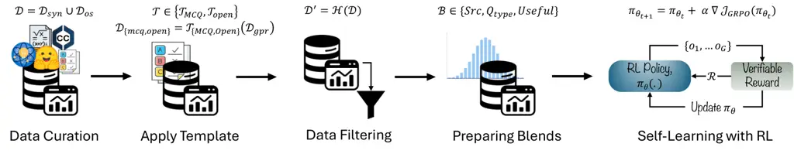

# Nemotron-CrossThink: Scaling Self-Learning beyond Math Reasoning

Syeda Nahida Akter ^(†)^(†)thanks: Work done during internship at NVIDIA
Email: <sakter@andrew.cmu.edu>    Shrimai Prabhumoye
Email: <sprabhumoye@nvidia.com>    Matvei Novikov    Seungju Han    Ying
Lin    Evelina Bakhturina    Eric Nyberg    Yejin Choi    Mostofa
Patwary    Mohammad Shoeybi    Bryan Catanzaro    NVIDIA    Carnegie
Mellon University    Boston University

###### Abstract

Prior work has successfully applied Reinforcement Learning (rl) to
mathematical reasoning—where rules and correctness are well-defined.
Yet, generalizing these methods to broader reasoning domains remains
challenging due to limited data and the lack of verifiable rewards for
unstructured domains. In this work, we propose Nemotron-CrossThink, a
framework that systematically incorporates multi-domain corpora into rl
training to improve generalization across diverse reasoning tasks.
Nemotron-CrossThink addresses key challenges by (1) combining data from
varied sources; (2) applying structured templates to control
answer-space complexity; (3) filtering for verifiable answers; and (4)
optimizing data blending strategies to utilize multi-source data
effectively. This enables scalable and verifiable reward modeling beyond
math and demonstrates improved accuracies on both math (math-500:
+30.1%, amc23: +27.5%) and non-math reasoning benchmarks (mmlu-pro:
+12.8%, gpqa-diamond: +11.3%, agieval: +15.1%, supergpqa: +3.8%).
Moreover, Nemotron-CrossThink exhibits significantly improved response
efficiency—using 28% fewer tokens for correct answers—highlighting more
focused and effective reasoning. Through Nemotron-CrossThink, we
demonstrate that integrating multi-domain, multi-format data in rl leads
to more accurate, efficient, and generalizable llms. All of our datasets
are available on
[HuggingFace](https://huggingface.co/datasets/nvidia/Nemotron-CrossThink).

## 1 Introduction

Large Language Models (llms) have demonstrated remarkable reasoning
abilities across a wide range of tasks, with Reinforcement Learning (rl)
playing a key role in refining their deep thinking abilities (Hu et al.,
2025a; Aggarwal and Welleck, 2025; Luo et al., 2025; DeepSeek-AI, 2025;
Qin et al., 2024; Huang et al., 2025; Team, 2025c). Recent advances in
rl have been particularly successful in mathematical reasoning and
coding, where well-defined rules and verifiable correctness enable
effective reward modeling. Yet, extending these techniques to broader
reasoning domains poses significant challenges, such as—limited training
data for rl due to the difficulty of defining verifiable rewards, and
ensuring generalization across diverse tasks.

Figure 1: Employing self-learning with multi-domain data,
Nemotron-CrossThink outperforms baseline models, including
domain-specific training (Only Math) and Open-Reasoner-Zero (orz-7B),
achieving consistent gains across all reasoning tasks.

Recent works (Hu et al., 2025a; Luo et al., 2025; Cui et al., 2025) have
shown ways to diversify rl training corpora by collecting datasets from
multiple sources. However, they do not evaluate the relative importance
of each source for reasoning or explore optimal data-blending strategies
to maximize performance. Furthermore, prior research has largely focused
on math reasoning, overlooking the role of non-math reasoning domains in
rl training for generalization in out-of-distribution domains. Reasoning
process varies across domains and question types. For instance, math
problem-solving follows a rule-based, structured, and symbolic approach
(Dehaene, 2011), whereas reasoning in fields such as law, physics,
social sciences, and history often relies on narrative structures,
contextual knowledge, and heuristic strategies. Moreover, different
question formats require distinct cognitive approaches—open-ended
questions demand the generation of novel responses, while
multiple-choice questions (mcq) can often be solved by evaluating the
given options and selecting the most appropriate answer. Incorporating a
diverse range of reasoning domains and question types into rl-based
self-learning can enhance the broad reasoning ability of llms by
exposing them to varied cognitive strategies and knowledge structures.

In this work, we propose Nemotron-CrossThink, a systematic way to
incorporate multi-domain corpora for rl training that results in better
generalization across a wide variety of tasks. As outlined in Figure 2,
Nemotron-CrossThink comprises of phases that—(a) curate data from
diverse sources, including synthetic data from web texts and open-source
question-answer (QA) pairs on STEM, humanities, law, and social sciences
(b) apply templates (mcq/Open-Ended) to limit the answer-space (d)
prepare blends to combine multi-domain data efficiently and (e) employ
self-learning with rl to refine reasoning capability in diverse domains.

We evaluate Nemotron-CrossThink along three axes: (1) the effectiveness
of data blending strategies in self-learning (2) whether the blending
impact amplifies by training with more complex data samples (3) the
influence of question-answer templates on downstream accuracies.
Nemotron-CrossThink demonstrates that the integration of multi-domain
data with varied question formats in rl boosts llm’s reasoning across
diverse domains (Figure 1). Notably, models trained with
Nemotron-CrossThink not only achieve higher accuracy but also exhibit
dynamic response strategies—generating concise answers for
general-purpose questions and more detailed responses for math
problems—thereby reducing inference cost while preserving task-specific
rigor. In addition, our approach addresses the challenge of designing
scalable verifiable reward for non-deterministic domains by employing
different templates on the curated data to limit the nuances in the
answer space diversity. Furthermore, we explore a simple yet effective
filtering approach to rank general purpose reasoning (gpr) data based on
complexity and show that training with harder samples further amplifies
the impact of rl across all domains.

In summary, our contributions are as follows:

- •
  We introduce Nemotron-CrossThink, a novel framework for incorporating
  multi-domain corpora into rl training, enhancing generalization across
  diverse reasoning tasks with substantial gains on math (math-500:
  +30.1%, amc23: +27.5%) and non-math (mmlu-pro: +12.8%, gpqa-diamond:
  +11.3%, agieval: +15.1%, and supergpqa: +3.8%) benchmarks.
- •
  We demonstrate that applying question/answer templates to constrain
  output diversity leads to more stable reward modeling. Specifically,
  using a unified open-ended question format improves performance by
  1.21% over mixed-format questions, while short-form answer templates
  outperform long-form ones by 1.20%.
- •
  We show that math-only training is insufficient—blending multi-domain
  data in rl boosts average reasoning accuracy by 1.61% over math-only
  data and improves response efficiency by reducing token usage by 28%.
- •
  We propose a simple yet effective model-driven filtering technique
  that selects harder samples by removing data solvable by smaller
  models. This leads to an additional 2.15% average accuracy gain for
  Qwen-2.5-32B, highlighting the scalability of our approach to larger
  models.
- •
  We release 287.4K high-quality multi-domain data curated for
  verifiable reward modeling to support future research¹¹ 1
  [https://huggingface.co/datasets/nvidia/Nemotron-CrossThink](https://huggingface.co/datasets/nvidia/Nemotron-CrossThink).

Applying Nemotron-CrossThink on different blends yields substantial
improvement over base model (+8.55%-13.36% on average) across seven
diverse gpr and math benchmarks. The most effective blend—2:1 ratio of
gpr to math data—achieves the highest average accuracy with a 13.36%
gain over baseline (Figure 1). Overall, these findings illustrate that
thoughtful choices in data blending, scaling, formatting, and filtering
are critical to the success of rl with language models. We hope that
Nemotron-CrossThink serves as a practical and extensible framework for
leveraging multi-domain data to train more capable, reliable, and
generalizable models under the rl paradigm.

## 2 Nemotron-CrossThink: Scaling Self-Learning Beyond Math



Figure 2: Nemotron-CrossThink. We (a) curate QA pairs from from
CommonCrawl and open-source datasets, categorized into general-purpose
reasoning ($`\mathcal{D}_{gpr}`$) and mathematical reasoning
($`\mathcal{D}_{mr}`$); (b) apply structured templates to convert data
into mcq and open-ended formats, promoting diverse reasoning
trajectories; (c) filter out unverifiable or ill-formatted responses;
(d) deploy rl using Group Relative Policy Optimization (grpo). The final
reward is used to update the policy, iteratively improving the model’s
reasoning capabilities across diverse domains.

While mathematical reasoning benefits from clean, verifiable datasets,
extending rl to general-purpose reasoning is challenging due to the lack
of structured, high-quality supervision. To address this, we leverage
web documents and open-source QA benchmarks to collect general-purpose
reasoning (gpr) data. However, combining structured and unstructured
domains introduces noise and ambiguity—particularly in open-ended
formats—making it difficult to apply rule-based reward reliably. To
mitigate this, we apply task-specific templates to unify formats,
limiting answer space variability and enabling effective verifiable
reward signals. Next, we apply a lightweight data filtering to discard
unverifiable examples for stable and interpretable rl training. Finally,
we explore optimal data blending strategies to investigate how the
inclusion of general-purpose reasoning data complements mathematical
reasoning, ultimately leading to broader and more adaptive
generalization in llms.

##### Data Curation.

As shown in Table 1, we start with curating datasets from multiple
sources to ensure diversity in the training data. Our training data
$`\mathcal{D}`$ comprises of:

```math
\mathcal{D}=\mathcal{D}_{syn}\cup\mathcal{D}_{os}
```

Here, $`\mathcal{D}_{syn}\rightarrow`$ synthetically generated from
CommonCrawl (CC) (Gao et al., 2020) and $`\mathcal{D}_{os}\rightarrow`$
open-source QA datasets. Each source of data further consists of QA
pairs related to gpr and math:

```math
\displaystyle\mathcal{D}_{\text{syn}} \displaystyle\rightarrow\mathcal{D}_{\text{syn\_gpr}}\cup\mathcal{D}_{\text{syn\_mr}}
```

```math
\displaystyle\mathcal{D}_{\text{os}} \displaystyle\rightarrow\mathcal{D}_{\text{os\_gpr}}\cup\mathcal{D}_{\text{os\_mr}}
```

- •
  General Purpose Reasoning, $`\mathcal{D}_{gpr}`$: We collect open
  source QA datasets ($`\mathcal{D}_{os\_gpr}`$)—Natural Reasoning (Yuan
  et al., 2025) and mmlu \[Train\] (Hendrycks et al., 2021a) that span
  domains including STEM, Economics, Social Sciences, and more. To
  enhance diversity, we further synthesize QA pairs from CC documents
  called Nemotron-CrossThink-qa ($`\mathcal{D}_{syn\_gpr}`$).

  ```math
  \mathcal{D}_{gpr}\rightarrow\mathcal{D}_{syn\_gpr}\cup\mathcal{D}_{os\_gpr}
  ```

- •
  Mathematical Reasoning, $`\mathcal{D}_{mr}`$: We combine open-source
  math datasets ($`\mathcal{D}_{os\_mr}`$): MATH (Hendrycks et al.,
  2021b) and Numina-Math (Beeching et al., 2024). We generate additional
  math problems defined as Nemotron-CrossThink-math
  ($`\mathcal{D}_{syn\_mr}`$) to augment reasoning diversity.

  ```math
  \mathcal{D}_{mr}\rightarrow\mathcal{D}_{syn\_mr}\cup\mathcal{D}_{os\_mr}
  ```

##### Applying Templates for Answer Space and Reasoning Diversity.

General purpose reasoning benchmarks are often divided into two
categories: (a) Multiple Choice Questions (Hendrycks et al., 2021a; Wang
et al., 2024) and (b) Open-Ended Questions (Zhong et al., 2023). Prior
works overlooked these variations in the answer space for consistent
reward design for tasks which are predominantly math (Hu et al., 2025a;
Aggarwal and Welleck, 2025; Luo et al., 2025). We hypothesize that each
question type elicits different thinking patterns, leading to diverse
reasoning trajectories in the model. Therefore, we synthesize
$`\mathcal{D}_{gpr}`$ using two templates: $`\mathcal{T}_{MCQ}`$ -
Multiple Choice Questions (mcq), and $`\mathcal{T}_{Open}`$ - Open-Ended
questions. We convert the mcq datasets (mmlu) to open-ended by removing
the options from the questions.

```math
\mathcal{D}_{mcq}=\mathcal{T}_{MCQ}(\mathcal{D}_{gpr}),\quad\mathcal{D}_{open}=\mathcal{T}_{Open}(\mathcal{D}_{gpr})
```

|                          |          |      |         |
| ------------------------ | -------- | ---- | ------- |
| Data Source              | Category | Type | Samples |
| mmlu \[Train\]           | gpr      | mcq  | 99,842  |
| Nemotron-CrossThink-qa   | gpr      | mcq  | 192,930 |
| Natural Reasoning        | gpr      | oe   | 100,000 |
| NuminaMath               | mr       | oe   | 87,350  |
| Nemotron-CrossThink-math | mr       | oe   | 100,000 |
| Math                     | mr       | oe   | 8523    |
| Total                    |          |      | 588,645 |

Table 1: Training data distribution by source and type. oe=Open-Ended;
gpr=General-Purpose Reasoning; mr=Math Reasoning.

Additionally, some mcq questions are incomplete without options (e.g.,
Which of the following ways we can file taxes?). We discard them to
avoid confusion during answer generation. Finally,

```math
\mathcal{D}_{gpr}=\mathcal{D}_{mcq}\cup\mathcal{D}_{open}
```

##### Data Filtering and Formatting.

To obtain high-quality data, we apply a series of filtering and
formatting steps, $`\mathcal{H}`$, to remove samples that are infeasible
to evaluate with rule-based reward. Specifically, for
$`\mathcal{D}_{mcq}`$, we check whether the correct answer appears
within the question text itself. Given a question-answer pair
$`(q,a^{*})`$ with answer choices $`\{a_{1},a_{2},\dots,a_{n}\}`$, we
discard a sample if $`a^{*}\notin\{a_{1},a_{2},\dots,a_{n}\}`$. For
$`\mathcal{D}_{open}`$, we discard samples that are challenging to
evaluate with a rule-based reward function. Formally, we retain samples
where $`|w(a^{*})|\leq 10`$; $`w(a^{*})`$ represents the number of words
in the answer $`a^{*}`$.

Lastly, for $`\mathcal{D}_{mr}`$, we remove entries that lack an
associated answer, ensuring that all retained questions $`q`$ have a
valid response $`a^{*}`$, i.e., we discard samples where
$`a^{*}=\emptyset`$.

```math
\mathcal{D}^{\prime}=\mathcal{H}(\mathcal{D})=\left\{(q,a^{*},\{a_{1},\dots,a_{n}\})\in\mathcal{D}\right.
```

##### Data Blending.

We study the impact of data diversity in three paradigms:

- •
  Data Source: We observe the effect of data
  sources—$`\mathcal{D}_{mr}`$ and $`\mathcal{D}_{gpr}`$—by tuning their
  relative weights in the rl training data.
- •
  Question Types: We investigate the impact of question types in
  downstream tasks.
- •
  Data Usefulness: To analyze the contribution of each data source, we
  run rl using individual data alone and then evaluate them across
  diverse downstream tasks. Based on their performances, we create a new
  blend.

Based on these categories, we construct six blends, summarized in
Table 10, with their corresponding weight distributions detailed in
Table 11.

##### Reinforcement Learning with grpo.

We begin with a pretrained large language model (llm) $`\mathcal{M}`$
and a training blend $`\mathcal{B}`$, where each sample contains only
the input prompt and the final answer which is verifiable. We employ
Group Relative Policy Optimization (grpo) (Shao et al., 2024). More
details can be found in Appendix A.

##### Rule Based Reward Modeling.

To guide the rl training, we employ a rule-based reward designed for
verifiable evaluation. Similar to (DeepSeek-AI, 2025), we define the
total reward function
$`\mathcal{R}=\mathcal{R}_{\text{acc}}\wedge\mathcal{R}_{\text{format}}`$
as the combination of an accuracy reward $`\mathcal{R}_{\text{acc}}`$
and a format reward $`\mathcal{R}_{\text{format}}`$. This implies that
the output will get reward only when both the answer and the format are
correct. Each reward is further detailed in Appendix A

## 3 Data Synthesis

To obtain a balanced high-quality multi-domain data, we synthesize a
high-quality question answering dataset spanning over math
(Nemotron-CrossThink-math) and general purpose reasoning
(Nemotron-CrossThink-qa) domain using publicly available datasets such
as CommonCrawl (Gao et al., 2020). Additional details about the license
can be found in Appendix B.

### 3.1 Nemotron-CrossThink-qa

We synthetically generate a large-scale multiple-choice question-answer
(mcq) dataset following two approaches below:

#### 3.1.1 SDG from Scratch

##### Topic, Subtopic, and Difficulty Definition.

We first define a broad set of topics, such as physics, biology,
chemistry, and others. For each topic, we use
Nemotron-4-340B-Instruct (Nvidia et al., 2024) to generate a list of
popular subtopics. We also define multiple difficulty levels to ensure
diversity and scale of the data.

##### Question Generation.

We initially generate few-shot examples that demonstrate various levels
of difficulty using Nemotron-4-340B-Instruct (Nvidia et al., 2024). We
later prompt Qwen2.5 models (Team, 2024a) along with the few-shot
examples to generate a mcq question based on the specified topic,
subtopic, and difficulty. Each generated question is evaluated to ensure
it follows the required format.

##### Augmentation.

Similarly to the OpenMathInstruct (Toshniwal et al., 2024) pipeline, we
augment generated questions by prompting Qwen2.5 (Team, 2024a) models to
create a question similar to or inspired by the original.

##### Benchmark Decontamination.

We perform decontamination against test sets of popular mcq benchmarks
such as gpqa (Rein et al., 2024), mmlu (Hendrycks et al., 2021a), and
mmlu-pro (Wang et al., 2024), following the approach suggested by Yang
et al. (2023).

##### Solution Generation.

We prompt DeepSeek-R1 (DeepSeek-AI, 2025) to generate multiple reasoning
traces per question. Since there are no ground-truth answers for the
questions generated in earlier stages, we use majority voting over
solutions to determine the most likely correct answer.

#### 3.1.2 SDG from Book

We utilize Qwen2.5-VL-72B-Instruct (Team, 2025b) for extracting text
from textbooks (OpenStax²² 2
[https://openstax.org/](https://openstax.org/) and An Introduction to
Formal Logic³³ 3
[https://forallx.openlogicproject.org/forallxyyc.pdf](https://forallx.openlogicproject.org/forallxyyc.pdf)),
which was then manually checked for transcription accuracy. We employed
Mixtral-8x22B-Instruct-v0.1 (Jiang et al., 2024) and
Qwen2.5-72B-Instruct (Team, 2024a) to synthesize multiple-choice
questions based on sections and key terms extracted from these
textbooks. We prompted the models to generate questions with four
distinct and plausible options, along with the correct answer and a
justification for it. Subsequently, each generated question was
evaluated using another model to ensure that every example is
self-contained and accurate.

### 3.2 Nemotron-CrossThink-math

To construct Nemotron-CrossThink-math, we adopt an approach similar to
Ge et al. (2024). Specifically, we use web documents from Common Crawl
and Qwen2.5-72B-Instruct (Team, 2024a) to generate personas. To promote
diversity, we incorporate math skills introduced in Didolkar et al.
(2024) and condition the Qwen2.5-72B-Instruct model on both the math
skills and the personas. Finally, we use the Qwen2.5-72B-Math-Instruct
Yang et al. (2024) model to generate the solutions. Prompt templates are
shown in Figure 4, 5, and 6.

## 4 Experimental Setup

##### Training Details.

We adopt Qwen2.5-7B and Qwen2.5-32B (Team, 2024a) as $`\mathcal{M}`$,
which demonstrate strong generalization capabilities across various
reasoning tasks. We directly apply grpo on $`\mathcal{M}`$ using the
veRL framework⁴⁴ 4
[https://github.com/volcengine/verl](https://github.com/volcengine/verl).
We train $`\mathcal{M}`$ with key settings including a constant learning
rate of 1e-6, a batch size and PPO mini batch size of 128 and a maximum
context length of 5000 tokens. Each generation step contains 128 unique
prompts sampled from the dataset, and performing 8 rollouts with
temperature and top-p both set to 1.0. We set KL coefficient to 0.001 in
all experiments. We conduct training on 4 8 x NVIDIA-H100-80GB nodes,
and each training takes approximately 48 GPUs hours. To further evaluate
the efficacy of Nemotron-CrossThink across different model architectures
and sizes, we conduct experiments with Nemotron-H, a 8B hybrid
Mamba-Transformer model. The results of these experiments are presented
in Appendix G.

##### Evaluation Metrics.

We evaluate reasoning performance on diverse math and general-purpose
benchmarks: math-500 (Hendrycks et al., 2021b), amc23, test set of mmlu
(Hendrycks et al., 2021a), mmlu-pro (Wang et al., 2024), agieval (Zhong
et al., 2023), gpqa-diamond (Rein et al., 2024) and supergpqa (Team et
al., 2025). Notably, supergpqa is a recent and rigorous benchmark
designed to test the generalizability of llms across 285 graduate-level
disciplines. Unlike existing benchmarks that concentrate on
well-represented domains (e.g., math, law, physics), supergpqa captures
long-tail knowledge and includes a wide range of real-world professional
disciplines, making it a reliable and discriminative frontier for
evaluating generalizability in llms. We employ vllm (Kwon et al., 2023)
as the inference backend, with maximum response length of 5k. For the
primary evaluation, we report accuracy averaged over three independent
runs using greedy decoding. To further verify the robustness of
Nemotron-CrossThink across different decoding strategies, we evaluate
our best-performing models using sampling-based decoding in Table 15.

## 5 Experiments and Results

| Data Source              | mmlu  | mmlu-pro | gpqa-diamond | agieval | supergpqa | math-500 | amc23 | Avg   |
| ------------------------ | ----- | -------- | ------------ | ------- | --------- | -------- | ----- | ----- |
| $`\mathcal{M}`$          | 74.20 | 45.00    | 31.82        | 48.59   | 25.36     | 48.30    | 40.00 | 44.75 |
| mmlu \[Train\]           | 69.76 | 38.50    | 32.83        | 47.66   | 27.69     | 22.00    | 5.00  | 34.78 |
| Nemotron-CrossThink-qa   | 70.45 | 52.41    | 30.81        | 52.10   | 24.57     | 54.20    | 35.00 | 45.65 |
| Natural Reasoning        | 68.89 | 31.33    | 33.33        | 46.65   | 22.44     | 68.60    | 42.50 | 44.82 |
| NuminaMath               | 72.94 | 52.05    | 33.84        | 54.39   | 26.97     | 76.20    | 55.00 | 53.06 |
| Nemotron-CrossThink-math | 53.99 | 28.08    | 18.69        | 45.69   | 16.92     | 77.20    | 50.00 | 41.51 |
| Math                     | 63.30 | 31.64    | 21.72        | 51.95   | 18.31     | 78.40    | 50.00 | 45.04 |

Table 2: Results of Self-Learning on Individual Datasets. Each row shows
the downstream evaluation results after self-learning on a single data
source. Results highlight the varying strengths of individual datasets
across general-purpose and mathematical benchmarks.

##### Analyze the effect of Individual Datasets.

To design an effective multi-source blend, we first assess the impact of
each source on self-learning. This helps prioritize useful sources and
downweight less effective ones. We employ rl using
$`\mathcal{M}`$=Qwen-2.5-7B on each dataset separately with a fixed
training recipe for consistency. Each model is trained for 250 steps and
evaluated on the final checkpoint.

As shown in Table 2, different datasets have varying impacts on
downstream accuracies across reasoning benchmarks. NuminaMath yields the
highest overall average, outperforming the baseline ($`\mathcal{M}`$) by
over 8.30%. While particularly strong on math tasks like math-500 and
amc23, it also generalizes well to broader reasoning benchmarks.
Nemotron-CrossThink-qa demonstrates a $`\sim`$1.0% improvement over
baseline with stronger accuracy in mmlu-pro, agieval and math-500 tasks,
suggesting that synthetically generated instruction-style data can
generalize well when aligned with benchmark distributions. Natural
Reasoning, despite modest scores on language-rich benchmarks, delivers a
strong average, driven by high scores in math-500 and amc23. This
indicates that reasoning-focused datasets, even if less formatted, can
contribute meaningfully in math-adjacent tasks. In contrast,
Nemotron-CrossThink-math performs well on math but generalizes poorly to
other domains. Finally, mmlu \[Train\] underperforms across most tasks,
specifically in math domains, suggesting that self-learning with raw
mmlu \[Train\] data alone is insufficient for generalization. However,
it excels on supergpqa, which spans cross-disciplinary reasoning,
highlighting its potential in capturing broad conceptual knowledge and
supporting transfer to long-tail domains—making it a valuable component
when targeting general-purpose reasoning benchmarks. While preparing
$`\mathcal{B}_{score}`$, we weight datasets based on their average
accuracy—prioritizing sources like Nemotron-CrossThink-qa and
NuminaMath, while downweighting less effective ones like mmlu \[Train\].

##### Analysis across Blends.

To show the distinction between natural distribution and selective
weighting of domains, we prepare $`\mathcal{B}_{nd}`$, which samples
data in proportion to each dataset’s original size. Next, to analyze the
impact of within-domain vs. cross-domain training, we introduce a Single
Source category with two domain-specific blends:
$`\mathcal{B}_{only\_mr}`$ and $`\mathcal{B}_{only\_gpr}`$, using only
$`\mathcal{D}_{mr}`$ and $`\mathcal{D}_{gpr}`$ respectively. We further
compare our approach with a recent math-centric self-learning approach,
Open-Reasoner-Zero (orz) (Hu et al., 2025a)—which achieved strong math
accuracy using combination of math data. For fair comparison, we
evaluate orz-7B using our eval setup.

|                 |                 |                                |       |          |              |         |           |          |       |       |
| --------------- | --------------- | ------------------------------ | ----- | -------- | ------------ | ------- | --------- | -------- | ----- | ----- |
| Model           | Category        | Blend                          | mmlu  | mmlu-pro | gpqa-diamond | agieval | supergpqa | math-500 | amc23 | Avg   |
| $`\mathcal{M}`$ |                 |                                | 74.20 | 45.00    | 31.82        | 48.59   | 25.36     | 48.30    | 40.00 | 44.75 |
| orz             |                 |                                | 73.20 | 48.90    | 29.30        | 63.49   | 27.60     | 81.40    | 62.50 | 55.20 |
| CrossThink^(∗)  |                 | $`\mathcal{B}_{nd}`$           | 73.18 | 54.81    | 38.07        | 59.99   | 26.54     | 77.00    | 60.00 | 55.66 |
|                 | Data Source     | $`\mathcal{B}_{mr\uparrow}`$   | 74.85 | 55.51    | 40.10        | 61.47   | 26.81     | 77.80    | 67.50 | 57.72 |
|                 |                 | $`\mathcal{B}_{gpr\uparrow}`$  | 74.94 | 57.82    | 38.58        | 63.71   | 29.16     | 77.60    | 65.00 | 58.12 |
|                 | Question Types  | $`\mathcal{B}_{mcq\uparrow}`$  | 74.26 | 55.77    | 39.59        | 62.54   | 28.05     | 78.00    | 60.00 | 56.89 |
|                 |                 | $`\mathcal{B}_{open\uparrow}`$ | 74.46 | 55.82    | 43.15        | 61.28   | 26.82     | 78.40    | 62.50 | 57.49 |
|                 | Data Usefulness | $`\mathcal{B}_{score}`$        | 74.70 | 56.16    | 40.10        | 59.80   | 27.37     | 78.00    | 62.50 | 56.95 |
|                 | Single Source   | $`\mathcal{B}_{only\_mr}`$     | 74.24 | 54.26    | 38.58        | 61.39   | 27.69     | 78.60    | 70.00 | 57.82 |
|                 |                 | $`\mathcal{B}_{only\_gpr}`$    | 72.77 | 52.06    | 37.06        | 56.56   | 27.44     | 72.20    | 55.00 | 53.30 |

Table 3: Results of Nemotron-CrossThink-7B across Blends.
$`\mathcal{B}_{gpr\uparrow}`$ achieves the highest overall average
accuracy, outperforming domain-specific and naturally sampled
blends—underscoring the benefit of self-learning with diverse reasoning
data. (\*) Due to the space shortage, we use \*CrossThink to refer
Nemotron-CrossThink.

As shown in Table 3, each blend outperforms $`\mathcal{M}`$ by a
significant margin. $`\mathcal{B}_{nd}`$ yields a 13% average
improvement over $`\mathcal{M}`$, suggesting that simple data
diversity—even without rebalancing—can be beneficial.
$`\mathcal{B}_{gpr\uparrow}`$ achieves the highest overall average, with
the strongest results across most benchmarks (e.g., mmlu-pro: +12.82%,
agieval: +15.12%). Notably, it outperforms orz by $`\sim`$5% on average.
While $`\mathcal{B}_{only\_mr}`$ performs slightly better on math, it
lags $`\sim`$3–4% behind $`\mathcal{B}_{gpr\uparrow}`$ on non-math
reasoning tasks such as agieval, supergpqa, and mmlu-pro. The trend also
holds for orz. Our analysis with sub-category accuracies in Appendix F
reveals that $`\mathcal{B}_{gpr\uparrow}`$ shows large relative gains in
non-math categories while gains in math subcategories are either
negligible or even favor $`\mathcal{B}_{gpr\uparrow}`$ in some tasks.
This highlights that multi-domain data offers strong cross-domain
transfer with minimal compromise on math accuracy, making it more
versatile.

Both $`\mathcal{B}_{mcq\uparrow}`$ and $`\mathcal{B}_{open\uparrow}`$
show consistent gains, with the latter achieving a slight edge (+0.6% on
average) with stronger results on math tasks. Since math problems are
inherently open-ended in structure, highlighting more open-ended domains
aligns with the format and reasoning demands of math tasks—leading to
better generalize to both general purpose reasoning (gpr) and math
tasks. Despite outperforming $`\mathcal{M}`$, $`\mathcal{B}_{score}`$ is
overall worse than $`\mathcal{B}_{mr\uparrow}`$ or
$`\mathcal{B}_{only\_mr}`$. This gap arises because
$`\mathcal{B}_{score}`$ assigns weights based on average scores, without
accounting for task-specific strengths. For example, Math and
Nemotron-CrossThink-math are overrepresented due to math performance,
while datasets like MMLU or Natural Reasoning, which excel in general
reasoning, are underweighted. In contrast, domain-aware blends
selectively prioritize datasets based on their utility within specific
domains, leading to more effective coverage and stronger scores across
both math and gpr tasks.

In Single Source vs. multi-domain analysis, $`\mathcal{B}_{only\_mr}`$
achieves the highest average math score,ranking as the second-best blend
overall in terms of average accuracy. In contrast, while
$`\mathcal{B}_{only\_gpr}`$ outperforms $`\mathcal{M}`$, it
underperforms in math tasks and trails 4.2% on average across non-math
reasoning tasks, despite being tailored for gpr. This counterintuitive
finding suggests that to obtain maximum gain in gpr tasks we need to
include math problems in the training. As discussed earlier,
$`\mathcal{B}_{gpr\uparrow}`$ gets the best average reasoning accuracy
which consists of both math and gpr domains. This confirms that math
data alone is transferable to structured reasoning tasks, whereas gpr
data is less effective when isolated.

## 6 Ablations

##### Nemotron-CrossThink is token efficient in responses.

To further understand the influence of multi-domain data in response
generation, we compare the average token lengths of correct and
incorrect responses between models trained on two blends:
$`\mathcal{B}_{gpr\uparrow}`$ and $`\mathcal{B}_{only\_mr}`$. As shown
in Figure 3, on general-purpose reasoning (gpr) benchmarks,
$`\mathcal{B}_{gpr\uparrow}`$ consistently outperforms
$`\mathcal{B}_{only\_mr}`$ and orz (Hu et al., 2025a), not only in
accuracy (as shown in Table 3) but also in response efficiency—producing
correct answers with significantly fewer tokens⁵⁵ 5 Detailed
categorization per task is shown in Appendix E.. For instance, on mmlu,
the average token count for correct responses is 229 for
$`\mathcal{B}_{gpr\uparrow}`$, compared to 351 for
$`\mathcal{B}_{only\_mr}`$. This demonstrates that exposure to
multi-domain data enables the model to internalize a more efficient
reasoning strategy, leading to both improved performance and reduced
inference cost.

Figure 3: Token efficiency comparison of models trained on
$`\mathcal{B}_{gpr\uparrow}`$ (multi-domain blend) and two single domain
blends ($`\mathcal{B}_{only\_mr}`$ and orz).

In contrast, on math-specific benchmarks, $`\mathcal{B}_{only\_mr}`$ and
orz perform slightly better in accuracy, as expected due to domain
alignment. Interestingly, correct responses are generally longer than
gpr tasks as solving math problems inherently requires detailed,
multi-step derivations, hypothesis exploration, verification and
refinement. Despite this, the $`\mathcal{B}_{gpr\uparrow}`$ shows its
adaptability by generating longer responses for math tasks and shorter
ones for gpr tasks—indicating a dynamic response strategy learned
through multi-domain training. As shown in Table 12,
$`\mathcal{B}_{gpr\uparrow}`$ increases its average tokens by 62% when
generating responses for math tasks (Mean Tokens=622) as opposed to gpr
tasks (Mean Tokens=385). Whereas, $`\mathcal{B}_{only\_mr}`$ increases
by 14% (Mean Tokens=731 for math and Mean Tokens=639 for gpr tasks)
showing a much smaller dynamic range. This trend is also mirrored in orz
which shows an even smaller increase (12%) in average token length
across domains.

This adaptive behavior highlights a key strength of multi-domain
training: it equips the model with the flexibility to tailor its
response style to the nature of the task. By learning from a diverse
range of domains, $`\mathcal{B}_{gpr\uparrow}`$ learns to reason
efficiently—across all tasks, $`\mathcal{B}_{gpr\uparrow}`$ uses on
average 28% fewer tokens for correct responses than
$`\mathcal{B}_{only\_mr}`$—producing compact yet accurate answers where
appropriate, and detailed ones when necessary. Our experiment with a new
model family Nemotron-H also reveal the similar trend
(Table 14)—confirming that the efficiency in thinking traces achieved
through Nemotron-CrossThink is architecture and model-agnostic.

##### Data Format Study: Question and Answer Templates.

To examine the training data formatting effect on model performance, we
conduct two controlled studies focused on question and answer template
design. In Table 3, we observe that $`\mathcal{B}_{open\uparrow}`$
outperforms $`\mathcal{B}_{mcq\uparrow}`$, suggesting that models
trained on more open-ended data generalize better across benchmarks.
This motivated us to investigate whether converting all questions into a
unified open-ended format leads to better performance.

In Question Template Study, we use the natural distribution blend
($`\mathcal{B}_{nd}`$) and only perturb the question template. To
generate the open-ended variant, we remove the answer options from mcqs,
prompting the model to produce an answer without selecting from
predefined choices.

| Question Type   | GPR Avg | Math Avg | Total Avg |
| --------------- | ------- | -------- | --------- |
| mcq +open-ended | 50.52   | 68.50    | 55.66     |
| open-ended      | 51.30   | 70.80    | 56.87     |

Table 4: Impact of Question Format. Converting all questions to
open-ended format improves accuracy across benchmarks, reducing reliance
on option guessing and encouraging deeper reasoning (Appendix C).

From Table 4, the open-ended setting surpasses the mixed-format one on
nearly all tasks, achieving 1.21% higher average score. It yields
notable gains on reasoning-intensive and mcq-formatted benchmarks such
as mmlu, supergpqa, and gpqa-diamond. This result may be attributed to
the inherent structure of mcq questions, where random guessing can yield
an accuracy of approximately 25% in mmlu and gpqa-diamond where we have
four options. In contrast, open-ended questions eliminate this guessing
advantage, compelling the model to rely heavily on reasoning to arrive
at a correct answer. By reducing the likelihood of reward hacking
through random option selection, the open-ended format encourages more
robust reasoning and leads to improved generalization.

In Answer Template Study, we investigate how the format of mcq-style
output labels influences training. We compare two answer templates:
Long - the model is trained to generate both the option label and its
corresponding description (e.g., (A) Sky is blue), and Short - the model
is trained to output only the option label (e.g., A). Here, we use the
$`\mathcal{B}_{only\_gpr}`$ blend, which primarily consists of mcq
datasets (Table 1), making it ideal for analyzing the effects of answer
formatting in this setting.

| Answer Type | GPR Avg | Math Avg | Total Avg |
| ----------- | ------- | -------- | --------- |
| Long        | 49.18   | 63.60    | 53.30     |
| Short       | 50.95   | 63.35    | 54.50     |

Table 5: Impact of Answer Format. Using short-form answers improves
accuracy by reducing output ambiguity and avoiding penalization from
rigid reward functions in rule-based training (Appendix C).

As shown in Table 5, the short answer template outperforms the long-form
variant, with a 1.20% gain in average accuracy. The trend holds for both
gpr and math benchmarks. These results suggest that reducing the
complexity of the output space helps minimize ambiguity and allows the
model to better align its predictions with the structure of the
question. Furthermore, when training with long-form answers using a
rule-based reward (e.g., exact string matching), the model is often
penalized for minor deviations in phrasing, even when the correct option
is selected. This introduces noisy supervision and may hinder learning.
While this issue could be mitigated by designing a more flexible reward
function (e.g., llm-as-a-Judge), we aim to keep our approach simple and
interpretable. As such, we adopt a naive rule-based reward for clarity
and reproducibility, and leave more sophisticated reward designs for
future investigation.

##### Difficulty Filtering.

High-quality data is a key factor in self-learning to ensure efficient
and stable learning. Recent works (Hu et al., 2025a; Luo et al., 2025;
Cui et al., 2025; Zeng et al., 2025a; Fatemi et al., 2025) investigate
data selection based on question complexity, showing that training on
harder questions improves downstream accuracy. However, their approach
relies on datasets with predefined difficulty scores. In this work, we
explore a simple approach to estimate question difficulty for gpr
datasets that do not come with explicit difficulty labels. Specifically,
we label questions as ‘difficult’ if they are answered incorrectly by a
smaller model (Qwen-2.5-7B) in a zero-shot setting and filter out the
‘easy’ questions. The intuition is that questions easily answered by a
base model are likely to be knowledge-based or shallow in reasoning
depth, whereas those it fails on are likely to require deeper reasoning
or broader generalization. We construct two versions of our training
dataset $`\mathcal{B}_{gpr\uparrow}`$—an unfiltered set containing all
questions, and a filtered set ($`\mathcal{B}_{f(gpr)\uparrow}`$) that
retains only the difficult samples—and use them to train separate
instances of a larger $`\mathcal{M}`$ = Qwen-2.5-32B.

| Model                   | Blend                            | GPR Avg | Math Avg | Total Avg |
| ----------------------- | -------------------------------- | ------- | -------- | --------- |
| Qwen-2.5-32B            |                                  | 54.95   | 52.78    | 54.33     |
| Nemotron-CrossThink-32B | $`\mathcal{B}_{gpr\uparrow}`$    | 62.20   | 74.95    | 65.84     |
|                         | $`\mathcal{B}_{f(gpr)\uparrow}`$ | 63.39   | 79.50    | 67.99     |

Table 6: Difficulty-Based Filtering. Filtering
$`\mathcal{B}_{gpr\uparrow}`$ to retain only hard examples
($`\mathcal{B}_{f(gpr)\uparrow}`$) yields consistent gains across all
tasks, highlighting the effectiveness of selective training on
challenging data (Appendix C).

According to Table 6, this filtering approach results in consistent
performance gains across all evaluated benchmarks. While both filtered
and unfiltered models outperform $`\mathcal{M}`$,
$`\mathcal{B}_{f(gpr)\uparrow}`$ achieves the highest accuracy on every
task. The gains are especially prominent in complex benchmarks such as
mmlu-pro, gpqa-diamond, agieval, and amc23, where
$`\mathcal{B}_{f(gpr)\uparrow}`$ improves by up to 2–8% over
$`\mathcal{B}_{gpr\uparrow}`$. On average, filtering boosts overall
accuracy by 2.15%, a notable gain considering that it comes from
training on fewer but harder examples. This suggests that selectively
training on challenging examples can yield more robust and generalizable
models, likely due to stronger gradient signals and a focus on
harder-to-learn reasoning patterns.

## 7 Related Work

##### Reasoning in llm.

Large Language Models have achieved strong performance on various NLP
tasks, with Chain-of-Thought (CoT) prompting (Wei et al., 2022) enabling
multi-step reasoning across domains like math, science, and programming.
Long CoT (OpenAI, 2024) further enhances reasoning by introducing
behaviors such as reflection, verification, and correction, with strong
scaling properties. Models like QwQ (Team, 2024b; Team, 2025c),
DeepSeek-R1 (DeepSeek-AI, 2025), Kimi k1.5 (Team, 2025a), and
InternThinker (Cai and others, 2024) leverage Long CoT with RL to boost
reasoning performance. Smaller models like Open-Reasoner-Zero (Hu et
al., 2025a), Open-R1 (Face, 2025), O1 (Qin et al., 2024; Huang et al.,
2025), s1 (Muennighoff et al., 2025), and LIMO (Ye et al., 2025) also
benefit from Long CoT via distillation.

##### Data Sampling in rl.

Recent work explores mixing data from multiple sources in rl to improve
reasoning diversity and generalization in rl (Hu et al., 2025a; Luo et
al., 2025; Zeng et al., 2025a; Wen et al., 2025). However, they
primarily focus on math due to the ease of designing verifiable rewards.
Sampling strategies often rely on question complexity or algorithmic
verifiability. Xie et al. (2025), uses synthetic puzzles to control
difficulty. However, these methods remain limited to structured domains
like math. Yeo et al. (2025) reports the best mmlu-pro scores by
blending multi-domain Yue et al. (2024) data, though majority of it is
math-focused, leaving unclear the contribution of non-math data. Despite
these efforts, the impact of including non-math domains—like law, social
science, or commonsense reasoning—remains underexplored.
Nemotron-CrossThink is the first systematic framework to incorporate
multi-domain, multi-format data into rl, introducing verifiable rewards
for non-deterministic tasks and demonstrating that diverse blends lead
to llms that reason more broadly, adapt dynamically, and think more
efficiently.

## 8 Conclusion

We present Nemotron-CrossThink, a simple and scalable framework for
improving the generalization abilities of llms through rl with
multi-domain corpora. By combining multi-domain data, structured
templates, and difficulty-aware filtering, Nemotron-CrossThink enables
consistent gains across both general-purpose (+3.8–15.1%) and
mathematical (+27.5–30.1%) benchmarks—using 28% fewer tokens for correct
responses. Importantly, these benefits persist across model scales and
task types, demonstrating that data diversity, not just data volume, is
key to broader reasoning capabilities. Nemotron-CrossThink offers a
practical recipe for building more generalizable, efficient, and
reliable llms under the rl paradigm—paving the way for scalable
self-learning beyond math.

## 9 Limitations

While Nemotron-CrossThink demonstrates strong improvements in reasoning
accuracy, adaptability, and efficiency, there is still room for
improvement. As discussed in Section 6, the reward modeling framework
used in this work is rule-based and relatively simplistic. Specifically,
it relies on exact string matching for correctness and formatting
verification, which can be brittle for open-ended responses. For
example, if the ground truth is (A) Sky is blue, and the model predicts
(A) the sky is generally blue most times, the answer is semantically
correct but still receives a negative reward. This limitation improperly
affects general-purpose reasoning tasks with inherently more diverse and
less deterministic answer spaces. Future work could incorporate more
flexible, semantics-aware reward functions, such as fuzzy matching,
entailment scoring, embedding-based similarity metrics, or
llm-as-a-Judge, to better align reward signals with human judgment.
Additionally, we did not perform extensive hyperparameter tuning for rl
training. All models were trained using fixed schedules and standard
values for learning rate, KL coefficients, and rollout configurations.
Moreover, scaling rl training for longer steps and dataset are
computationally expensive which constrained us to deploy all runs for a
fixed number of steps (650 steps). Recent works (Yu et al., 2025;
Aggarwal and Welleck, 2025; Luo et al., 2025) shows improvement over
naive grpo by adjusting clip ratio, dynamic sampling, number of
rollouts, context length. While our results are strong under fixed
conditions, additional gains may be possible with better-tuned training
regimes by exploiting hyperparameters.

## 10 Ethical Considerations

Reinforcement learning strongly incentivizes the reasoning capabilities
of llms, enabling models to perform better across complex tasks.
However, this process can also inadvertently amplify existing biases
present in the base model or introduced through reward modeling and data
selection. In this work, we primarily focus on scaling and diversifying
reasoning ability across domains and do not explicitly address fairness,
bias mitigation, or value alignment. Future work should systematically
evaluate how reinforcement learning affects the model’s behavior across
sensitive axes such as gender, race, and geopolitical context—especially
in open-ended, non-verifiable tasks.

## References

- Aggarwal and Welleck (2025) P. Aggarwal and S. Welleck L1: controlling
  how long a reasoning model thinks with reinforcement learning.
  External Links: 2503.04697, [Link](https://arxiv.org/abs/2503.04697)
  Cited by: Appendix I, §1, §2, §9.
- Beeching et al. (2024) E. Beeching, S. C. Huang, A. Jiang, J. Li, B.
  Lipkin, Z. Qina, K. Rasul, Z. Shen, R. Soletskyi, and L. Tunstall
  NuminaMath 7b cot. Numina & Hugging Face. Note:
  [https://huggingface.co/AI-MO/NuminaMath-7B-CoT](https://huggingface.co/AI-MO/NuminaMath-7B-CoT)
  Cited by: 2nd item.
- Cai et al. (2024) Z. Cai et al. InternLM2 technical report. External
  Links: 2403.17297, [Link](https://arxiv.org/abs/2403.17297) Cited by:
  §7.
- Chen et al. (2025) H. Chen, H. Tu, F. Wang, H. Liu, X. Tang, X. Du, Y.
  Zhou, and C. Xie Sft or rl? an early investigation into training
  r1-like reasoning large vision-language models. arXiv preprint
  arXiv:2504.11468. Cited by: Appendix H.
- Chu et al. (2025) T. Chu, Y. Zhai, J. Yang, S. Tong, S. Xie, D.
  Schuurmans, Q. V. Le, S. Levine, and Y. Ma SFT memorizes, RL
  generalizes: a comparative study of foundation model post-training. In
  Proceedings of the 42nd International Conference on Machine
  Learning, A. Singh, M. Fazel, D. Hsu, S. Lacoste-Julien, F.
  Berkenkamp, T. Maharaj, K. Wagstaff, and J. Zhu (Eds.), Proceedings of
  Machine Learning Research, Vol. 267, pp. 10818–10838. External Links:
  [Link](https://proceedings.mlr.press/v267/chu25c.html) Cited by:
  Appendix H.
- Cui et al. (2025) G. Cui, L. Yuan, Z. Wang, H. Wang, W. Li, B. He, Y.
  Fan, T. Yu, Q. Xu, W. Chen, et al. Process reinforcement through
  implicit rewards. arXiv preprint arXiv:2502.01456. Cited by: §1, §6.
- DeepSeek-AI (2025) DeepSeek-AI DeepSeek-r1: incentivizing reasoning
  capability in llms via reinforcement learning. External Links:
  2501.12948, [Link](https://arxiv.org/abs/2501.12948) Cited by:
  Appendix H, Appendix I, §1, §2, §3.1.1, §7.
- Dehaene (2011) S. Dehaene The number sense: how the mind creates
  mathematics. OUP USA. Cited by: §1.
- Didolkar et al. (2024) A. Didolkar, A. Goyal, N. R. Ke, S. Guo, M.
  Valko, T. Lillicrap, D. Jimenez Rezende, Y. Bengio, M. C. Mozer,
  and S. Arora Metacognitive capabilities of llms: an exploration in
  mathematical problem solving. Advances in Neural Information
  Processing Systems 37, pp. 19783–19812. Cited by: §3.2.
- Face (2025) H. Face Open r1: a fully open reproduction of deepseek-r1.
  External Links: [Link](https://github.com/huggingface/open-r1) Cited
  by: §7.
- Fatemi et al. (2025) M. Fatemi, B. Rafiee, M. Tang, and K.
  Talamadupula Concise reasoning via reinforcement learning. External
  Links: 2504.05185, [Link](https://arxiv.org/abs/2504.05185) Cited by:
  §6.
- Gao et al. (2020) L. Gao, S. Biderman, S. Black, L. Golding, T.
  Hoppe, C. Foster, J. Phang, H. He, A. Thite, N. Nabeshima, S. Presser,
  and C. Leahy The pile: an 800gb dataset of diverse text for language
  modeling. External Links: 2101.00027,
  [Link](https://arxiv.org/abs/2101.00027) Cited by: §2, §3.
- Ge et al. (2024) T. Ge, X. Chan, X. Wang, D. Yu, H. Mi, and D. Yu
  Scaling synthetic data creation with 1,000,000,000 personas. External
  Links: 2406.20094, [Link](https://arxiv.org/abs/2406.20094) Cited by:
  §3.2.
- Hendrycks et al. (2021a) D. Hendrycks, C. Burns, S. Basart, A. Zou, M.
  Mazeika, D. Song, and J. Steinhardt Measuring massive multitask
  language understanding. Proceedings of the International Conference on
  Learning Representations (ICLR). Cited by: 1st item, §2, §3.1.1, §4.
- Hendrycks et al. (2021b) D. Hendrycks, C. Burns, S. Kadavath, A.
  Arora, S. Basart, E. Tang, D. Song, and J. Steinhardt Measuring
  mathematical problem solving with the math dataset. NeurIPS. Cited by:
  2nd item, §4.
- Hu et al. (2025a) J. Hu, Y. Zhang, Q. Han, D. Jiang, and H. S. Xiangyu
  Zhang Open-reasoner-zero: an open source approach to scaling
  reinforcement learning on the base model. Note:
  [https://github.com/Open-Reasoner-Zero/Open-Reasoner-Zero](https://github.com/Open-Reasoner-Zero/Open-Reasoner-Zero)
  Cited by: Appendix I, §1, §1, §2, §5, §6, §6, §7, §7.
- Hu et al. (2025b) J. Hu, Y. Zhang, Q. Han, D. Jiang, X. Zhang, and H.
  Shum Open-reasoner-zero: an open source approach to scaling up
  reinforcement learning on the base model. External Links: 2503.24290,
  [Link](https://arxiv.org/abs/2503.24290) Cited by: Appendix H.
- Huang et al. (2025) Z. Huang, G. Geng, S. Hua, Z. Huang, H. Zou, S.
  Zhang, P. Liu, and X. Zhang O1 replication journey – part 3:
  inference-time scaling for medical reasoning. arXiv preprint
  arXiv:2501.06458. Cited by: §1, §7.
- Jiang et al. (2024) A. Q. Jiang, A. Sablayrolles, A. Roux, A.
  Mensch, B. Savary, C. Bamford, D. S. Chaplot, D. de las Casas, E. B.
  Hanna, F. Bressand, G. Lengyel, G. Bour, G. Lample, L. R. Lavaud, L.
  Saulnier, M. Lachaux, P. Stock, S. Subramanian, S. Yang, S.
  Antoniak, T. L. Scao, T. Gervet, T. Lavril, T. Wang, T. Lacroix,
  and W. E. Sayed Mixtral of experts. External Links: 2401.04088,
  [Link](https://arxiv.org/abs/2401.04088) Cited by: §3.1.2.
- Kwon et al. (2023) W. Kwon, Z. Li, S. Zhuang, Y. Sheng, L.
  Zheng, C. H. Yu, J. E. Gonzalez, H. Zhang, and I. Stoica Efficient
  memory management for large language model serving with
  pagedattention. External Links: 2309.06180,
  [Link](https://arxiv.org/abs/2309.06180) Cited by: §4.
- Liu et al. (2025) Z. Liu, Z. Yang, Y. Chen, C. Lee, M. Shoeybi, B.
  Catanzaro, and W. Ping AceReason-nemotron 1.1: advancing math and code
  reasoning through sft and rl synergy. External Links: 2506.13284,
  [Link](https://arxiv.org/abs/2506.13284) Cited by: Appendix H.
- Luo et al. (2025) M. Luo, S. Tan, J. Wong, X. Shi, W. Y. Tang, M.
  Roongta, C. Cai, J. Luo, T. Zhang, L. E. Li, R. A. Popa, and I. Stoica
  DeepScaleR: surpassing o1-preview with a 1.5b model by scaling rl.
  Note:
  https://pretty-radio-b75.notion.site/DeepScaleR-Surpassing-O1-Preview-with-a-1-5B-Model-by-Scaling-RLNotion
  Blog Cited by: Appendix E, §1, §1, §2, §6, §7, §9.
- Ma et al. (2025) X. Ma, Q. Liu, D. Jiang, G. Zhang, Z. Ma, and W. Chen
  General-reasoner: advancing llm reasoning across all domains. Note:
  [https://github.com/TIGER-AI-Lab/General-Reasoner/blob/main/General_Reasoner.pdf](https://github.com/TIGER-AI-Lab/General-Reasoner/blob/main/General_Reasoner.pdf)
  Cited by: Appendix I.
- Muennighoff et al. (2025) N. Muennighoff, Z. Yang, W. Shi, X. L.
  Li, L. Fei-Fei, H. Hajishirzi, L. Zettlemoyer, P. Liang, E. Candès,
  and T. Hashimoto S1: simple test-time scaling. External Links:
  2501.19393, [Link](https://arxiv.org/abs/2501.19393) Cited by: §7.
- Nvidia et al. (2024) Nvidia, :, B. Adler, N. Agarwal, A. Aithal, D. H.
  Anh, P. Bhattacharya, A. Brundyn, J. Casper, B. Catanzaro, S. Clay, J.
  Cohen, S. Das, A. Dattagupta, O. Delalleau, L. Derczynski, Y. Dong, D.
  Egert, E. Evans, A. Ficek, D. Fridman, S. Ghosh, B. Ginsburg, I.
  Gitman, T. Grzegorzek, R. Hero, J. Huang, V. Jawa, J. Jennings, A.
  Jhunjhunwala, J. Kamalu, S. Khan, O. Kuchaiev, P. LeGresley, H. Li, J.
  Liu, Z. Liu, E. Long, A. S. Mahabaleshwarkar, S. Majumdar, J. Maki, M.
  Martinez, M. R. de Melo, I. Moshkov, D. Narayanan, S. Narenthiran, J.
  Navarro, P. Nguyen, O. Nitski, V. Noroozi, G. Nutheti, C. Parisien, J.
  Parmar, M. Patwary, K. Pawelec, W. Ping, S. Prabhumoye, R. Roy, T.
  Saar, V. R. N. Sabavat, S. Satheesh, J. P. Scowcroft, J. Sewall, P.
  Shamis, G. Shen, M. Shoeybi, D. Sizer, M. Smelyanskiy, F.
  Soares, M. N. Sreedhar, D. Su, S. Subramanian, S. Sun, S.
  Toshniwal, H. Wang, Z. Wang, J. You, J. Zeng, J. Zhang, J. Zhang, V.
  Zhang, Y. Zhang, and C. Zhu Nemotron-4 340b technical report. External
  Links: 2406.11704, [Link](https://arxiv.org/abs/2406.11704) Cited by:
  §3.1.1, §3.1.1.
- NVIDIA et al. (2025) NVIDIA, :, A. Blakeman, A. Basant, A. Khattar, A.
  Renduchintala, A. Bercovich, A. Ficek, A. Bjorlin, A.
  Taghibakhshi, A. S. Deshmukh, A. S. Mahabaleshwarkar, A. Tao, A.
  Shors, A. Aithal, A. Poojary, A. Dattagupta, B. Buddharaju, B.
  Chen, B. Ginsburg, B. Wang, B. Norick, B. Butterfield, B.
  Catanzaro, C. del Mundo, C. Dong, C. Harvey, C. Parisien, D. Su, D.
  Korzekwa, D. Yin, D. Gitman, D. Mosallanezhad, D. Narayanan, D.
  Fridman, D. Rekesh, D. Ma, D. Pykhtar, D. Ahn, D. Riach, D. Stosic, E.
  Long, E. Segal, E. Evans, E. Chung, E. Galinkin, E. Bakhturina, E.
  Dobrowolska, F. Jia, F. Liu, G. Prasad, G. Shen, G. Liu, G. Chen, H.
  Qian, H. Ngo, H. Liu, H. Li, I. Gitman, I. Karmanov, I. Moshkov, I.
  Golan, J. Kautz, J. P. Scowcroft, J. Casper, J. Seppanen, J. Lu, J.
  Sewall, J. Zeng, J. You, J. Zhang, J. Zhang, J. Huang, J. Xue, J.
  Huang, J. Conway, J. Kamalu, J. Barker, J. Cohen, J. Jennings, J.
  Parmar, K. Sapra, K. Briski, K. Chumachenko, K. Luna, K. Santhanam, K.
  Kong, K. Sivamani, K. Pawelec, K. Anik, K. Li, L. McAfee, L.
  Derczynski, L. Pavao, L. Vega, L. Voegtle, M. Bala, M. R. de
  Melo, M. N. Sreedhar, M. Chochowski, M. Kliegl, M.
  Stepniewska-Dziubinska, M. Le, M. Novikov, M. Samadi, M. Andersch, M.
  Evans, M. Martinez, M. Chrzanowski, M. Ranzinger, M. Blaz, M.
  Smelyanskiy, M. Fawzy, M. Shoeybi, M. Patwary, N. Lee, N.
  Tajbakhsh, N. Xu, O. Rybakov, O. Kuchaiev, O. Delalleau, O. Nitski, P.
  Chadha, P. Shamis, P. Micikevicius, P. Molchanov, P. Dykas, P.
  Fischer, P. Aquilanti, P. Bialecki, P. Varshney, P. Gundecha, P.
  Tredak, R. Karimi, R. Kandu, R. El-Yaniv, R. Joshi, R. Waleffe, R.
  Zhang, S. Kavanaugh, S. Jain, S. Kriman, S. Lym, S. Satheesh, S.
  Muralidharan, S. Narenthiran, S. Anandaraj, S. Bak, S. Kashirsky, S.
  Han, S. Acharya, S. Ghosh, S. T. Sreenivas, S. Clay, S. Thomas, S.
  Prabhumoye, S. Pachori, S. Toshniwal, S. Prayaga, S. Jain, S. Das, S.
  Kierat, S. Majumdar, S. Han, S. Singhal, S. Niverty, S.
  Alborghetti, S. Panguluri, S. Bhendigeri, S. N. Akter, S. Migacz, T.
  Shiri, T. Kong, T. Roman, T. Ronen, T. Saar, T. Konuk, T.
  Rintamaki, T. Poon, U. De, V. Noroozi, V. Singh, V. Korthikanti, V.
  Kurin, W. U. Ahmad, W. Du, W. Ping, W. Dai, W. Byeon, X. Ren, Y.
  Xu, Y. Choi, Y. Zhang, Y. Lin, Y. Suhara, Z. Yu, Z. Li, Z. Li, Z.
  Zhu, Z. Yang, and Z. Chen Nemotron-h: a family of accurate and
  efficient hybrid mamba-transformer models. External Links: 2504.03624,
  [Link](https://arxiv.org/abs/2504.03624) Cited by: Appendix G.
- OpenAI (2024) OpenAI Learning to reason with llms. External Links:
  [Link](https://openai.com/index/learning-to-reason-with-llms/) Cited
  by: §7.
- Qin et al. (2024) Y. Qin, X. Li, H. Zou, Y. Liu, S. Xia, Z. Huang, Y.
  Ye, W. Yuan, H. Liu, Y. Li, et al. O1 replication journey: a strategic
  progress report–part 1. arXiv preprint arXiv:2410.18982. Cited by: §1,
  §7.
- Rein et al. (2024) D. Rein, B. L. Hou, A. C. Stickland, J.
  Petty, R. Y. Pang, J. Dirani, J. Michael, and S. R. Bowman GPQA: a
  graduate-level google-proof q&a benchmark. In First Conference on
  Language Modeling, External Links:
  [Link](https://openreview.net/forum?id=Ti67584b98) Cited by: §3.1.1,
  §4.
- Schulman et al. (2017) J. Schulman, F. Wolski, P. Dhariwal, A.
  Radford, and O. Klimov Proximal policy optimization algorithms.
  External Links: 1707.06347, [Link](https://arxiv.org/abs/1707.06347)
  Cited by: Appendix A.
- Shao et al. (2024) Z. Shao, P. Wang, Q. Zhu, R. Xu, J. Song, M. Zhang,
  Y.K. Li, Y. Wu, and D. Guo DeepSeekMath: pushing the limits of
  mathematical reasoning in open language models. Vol. abs/2402.03300.
  External Links: [Link](https://arxiv.org/abs/2402.03300) Cited by:
  Appendix A, Appendix H, §2.
- Su et al. (2025) Y. Su, D. Yu, L. Song, J. Li, H. Mi, Z. Tu, M. Zhang,
  and D. Yu Crossing the reward bridge: expanding rl with verifiable
  rewards across diverse domains. External Links: 2503.23829,
  [Link](https://arxiv.org/abs/2503.23829) Cited by: Appendix I.
- Team (2025a) K. Team Kimi k1.5: scaling reinforcement learning with
  llms. External Links: 2501.12599,
  [Link](https://arxiv.org/abs/2501.12599) Cited by: §7.
- Team et al. (2025) M. Team, X. Du, Y. Yao, K. Ma, B. Wang, T.
  Zheng, K. Zhu, M. Liu, Y. Liang, X. Jin, Z. Wei, C. Zheng, K. Deng, S.
  Jia, S. Jiang, Y. Liao, R. Li, Q. Li, S. Li, Y. Li, Y. Li, D. Ma, Y.
  Ni, H. Que, Q. Wang, Z. Wen, S. Wu, T. Xing, M. Xu, Z. Yang, Z. M.
  Wang, J. Zhou, Y. Bai, X. Bu, C. Cai, L. Chen, Y. Chen, C. Cheng, T.
  Cheng, K. Ding, S. Huang, Y. Huang, Y. Li, Y. Li, Z. Li, T. Liang, C.
  Lin, H. Lin, Y. Ma, T. Pang, Z. Peng, Z. Peng, Q. Qi, S. Qiu, X.
  Qu, S. Quan, Y. Tan, Z. Wang, C. Wang, H. Wang, Y. Wang, Y. Wang, J.
  Xu, K. Yang, R. Yuan, Y. Yue, T. Zhan, C. Zhang, J. Zhang, X.
  Zhang, X. Zhang, Y. Zhang, Y. Zhao, X. Zheng, C. Zhong, Y. Gao, Z.
  Li, D. Liu, Q. Liu, T. Liu, S. Ni, J. Peng, Y. Qin, W. Su, G. Wang, S.
  Wang, J. Yang, M. Yang, M. Cao, X. Yue, Z. Zhang, W. Zhou, J. Liu, Q.
  Lin, W. Huang, and G. Zhang SuperGPQA: scaling llm evaluation across
  285 graduate disciplines. External Links: 2502.14739,
  [Link](https://arxiv.org/abs/2502.14739) Cited by: §4.
- Team (2024a) Q. Team Qwen2.5: a party of foundation models. External
  Links: [Link](https://qwenlm.github.io/blog/qwen2.5/) Cited by:
  §3.1.1, §3.1.1, §3.1.2, §3.2, §4.
- Team (2024b) Q. Team QwQ: reflect deeply on the boundaries of the
  unknown. External Links:
  [Link](https://qwenlm.github.io/blog/qwq-32b-preview/) Cited by: §7.
- Team (2025b) Q. Team Qwen2.5-vl. External Links:
  [Link](https://qwenlm.github.io/blog/qwen2.5-vl/) Cited by: §3.1.2.
- Team (2025c) Q. Team QwQ-32b: embracing the power of reinforcement
  learning. External Links:
  [Link](https://qwenlm.github.io/blog/qwq-32b/) Cited by: §1, §7.
- Toshniwal et al. (2024) S. Toshniwal, I. Moshkov, S. Narenthiran, D.
  Gitman, F. Jia, and I. Gitman OpenMathInstruct-1: a 1.8 million math
  instruction tuning dataset. External Links: 2402.10176,
  [Link](https://arxiv.org/abs/2402.10176) Cited by: §3.1.1.
- Trung et al. (2024) L. Trung, X. Zhang, Z. Jie, P. Sun, X. Jin, and H.
  Li ReFT: reasoning with reinforced fine-tuning. In Proceedings of the
  62nd Annual Meeting of the Association for Computational Linguistics
  (Volume 1: Long Papers), L. Ku, A. Martins, and V. Srikumar (Eds.),
  Bangkok, Thailand, pp. 7601–7614. External Links:
  [Link](https://aclanthology.org/2024.acl-long.410/),
  [Document](https://dx.doi.org/10.18653/v1/2024.acl-long.410) Cited by:
  Appendix I.
- Wang et al. (2024) Y. Wang, X. Ma, G. Zhang, Y. Ni, A. Chandra, S.
  Guo, W. Ren, A. Arulraj, X. He, Z. Jiang, et al. Mmlu-pro: a more
  robust and challenging multi-task language understanding benchmark.
  arXiv preprint arXiv:2406.01574. Cited by: §2, §3.1.1, §4.
- Wang et al. (2025) Z. Wang, F. Zhou, X. Li, and P. Liu OctoThinker:
  mid-training incentivizes reinforcement learning scaling. arXiv
  preprint arXiv:2506.20512. External Links:
  [Link](https://arxiv.org/abs/2506.20512) Cited by: Appendix H.
- Wei et al. (2022) J. Wei, X. Wang, D. Schuurmans, M. Bosma, F. Xia, E.
  Chi, Q. V. Le, D. Zhou, et al. Chain-of-thought prompting elicits
  reasoning in large language models. Advances in neural information
  processing systems 35, pp. 24824–24837. Cited by: §7.
- Wen et al. (2024) J. Wen, R. Zhong, A. Khan, E. Perez, J.
  Steinhardt, M. Huang, S. R. Bowman, H. He, and S. Feng Language models
  learn to mislead humans via rlhf. External Links: 2409.12822,
  [Link](https://arxiv.org/abs/2409.12822) Cited by: Appendix I.
- Wen et al. (2025) L. Wen, Y. Cai, F. Xiao, X. He, Q. An, Z. Duan, Y.
  Du, J. Liu, L. Tang, X. Lv, H. Zou, Y. Deng, S. Jia, and X. Zhang
  Light-r1: curriculum sft, dpo and rl for long cot from scratch and
  beyond. External Links: 2503.10460,
  [Link](https://arxiv.org/abs/2503.10460) Cited by: §7.
- Weng (2024) L. Weng Reward hacking in reinforcement learning..
  lilianweng.github.io. External Links:
  [Link](https://lilianweng.github.io/posts/2024-11-28-reward-hacking/)
  Cited by: Appendix I.
- Xie et al. (2025) T. Xie, Z. Gao, Q. Ren, H. Luo, Y. Hong, B. Dai, J.
  Zhou, K. Qiu, Z. Wu, and C. Luo Logic-rl: unleashing llm reasoning
  with rule-based reinforcement learning. External Links: 2502.14768,
  [Link](https://arxiv.org/abs/2502.14768) Cited by: §7.
- Yang et al. (2024) A. Yang, B. Zhang, B. Hui, B. Gao, B. Yu, C. Li, D.
  Liu, J. Tu, J. Zhou, J. Lin, K. Lu, M. Xue, R. Lin, T. Liu, X. Ren,
  and Z. Zhang Qwen2.5-math technical report: toward mathematical expert
  model via self-improvement. arXiv preprint arXiv:2409.12122. Cited by:
  §3.2.
- Yang et al. (2023) S. Yang, W. Chiang, L. Zheng, J. E. Gonzalez,
  and I. Stoica Rethinking benchmark and contamination for language
  models with rephrased samples. External Links: 2311.04850,
  [Link](https://arxiv.org/abs/2311.04850) Cited by: §3.1.1.
- Ye et al. (2025) Y. Ye, Z. Huang, Y. Xiao, E. Chern, S. Xia, and P.
  Liu LIMO: less is more for reasoning. External Links: 2502.03387,
  [Link](https://arxiv.org/abs/2502.03387) Cited by: Appendix I, §7.
- Yeo et al. (2025) E. Yeo, Y. Tong, M. Niu, G. Neubig, and X. Yue
  Demystifying long chain-of-thought reasoning in llms. External Links:
  2502.03373, [Link](https://arxiv.org/abs/2502.03373) Cited by: §7.
- Yu et al. (2025) Q. Yu, Z. Zhang, R. Zhu, Y. Yuan, X. Zuo, Y. Yue, T.
  Fan, G. Liu, L. Liu, X. Liu, H. Lin, Z. Lin, B. Ma, G. Sheng, Y.
  Tong, C. Zhang, M. Zhang, W. Zhang, H. Zhu, J. Zhu, J. Chen, J.
  Chen, C. Wang, H. Yu, W. Dai, Y. Song, X. Wei, H. Zhou, J. Liu, W.
  Ma, Y. Zhang, L. Yan, M. Qiao, Y. Wu, and M. Wang DAPO: an open-source
  llm reinforcement learning system at scale. External Links:
  2503.14476, [Link](https://arxiv.org/abs/2503.14476) Cited by: §9.
- Yuan et al. (2025) W. Yuan, J. Yu, S. Jiang, K. Padthe, Y. Li, D.
  Wang, I. Kulikov, K. Cho, Y. Tian, J. E. Weston, and X. Li
  NaturalReasoning: reasoning in the wild with 2.8m challenging
  questions. External Links: 2502.13124,
  [Link](https://arxiv.org/abs/2502.13124) Cited by: 1st item.
- Yue et al. (2024) X. Yue, T. Zheng, G. Zhang, and W. Chen MAmmoTH2:
  scaling instructions from the web. Advances in Neural Information
  Processing Systems. Cited by: §7.
- Zeng et al. (2025a) W. Zeng, Y. Huang, Q. Liu, W. Liu, K. He, Z. Ma,
  and J. He SimpleRL-zoo: investigating and taming zero reinforcement
  learning for open base models in the wild. External Links: 2503.18892,
  [Link](https://arxiv.org/abs/2503.18892) Cited by: Appendix I, §6, §7.
- Zeng et al. (2025b) W. Zeng, Y. Huang, W. Liu, K. He, Q. Liu, Z. Ma,
  and J. He 7B model and 8k examples: emerging reasoning with
  reinforcement learning is both effective and efficient. Note:
  [https://hkust-nlp.notion.site/simplerl-reason](https://hkust-nlp.notion.site/simplerl-reason)Notion
  Blog Cited by: Appendix H.
- Zhong et al. (2023) W. Zhong, R. Cui, Y. Guo, Y. Liang, S. Lu, Y.
  Wang, A. Saied, W. Chen, and N. Duan AGIEval: a human-centric
  benchmark for evaluating foundation models. External Links: 2304.06364
  Cited by: §2, §4.

## Appendix A Reinforcement Learning

We utilize Group Relative Policy Optimization (grpo) (Shao et al., 2024)
as our rl algorithm. Unlike PPO (Schulman et al., 2017), grpo does not
use a separate critic model and instead estimates the baseline from
group scores, improving efficiency and reducing memory. For each
question $`q`$, grpo samples a group of outputs
$`o_{1},o_{2},...,o_{G}`$ from the old policy $`\pi_{\theta_{old}}`$ and
then optimizes the policy model $`\pi_{\theta}`$ by maximizing the
following objective:

```math
\displaystyle x_{i,t}=\frac{\pi_{\theta}(o_{i,t}|q,o_{i,<t})}{\pi_{\theta_{\text{old}}}(o_{i,t}|q,o_{i,<t})}
```

```math
\displaystyle\mathcal{J}_{\text{{grpo} }}(\theta)=\;\mathbb{E}\left[q\sim P(Q),\{o_{i}\}_{i=1}^{G}\sim\pi_{\theta_{\text{old}}}(O|q)\right]
```

```math
\displaystyle\times\frac{1}{G}\sum_{i=1}^{G}\frac{1}{|o_{i}|}\sum_{t=1}^{|o_{i}|}\Bigg[\min\Bigg(x_{i,t}\hat{A}_{i,t},
```

```math
\displaystyle\text{clip}\Bigg(x_{i,t},1-\epsilon,1+\epsilon\Bigg)\hat{A}_{i,t}\Bigg)
```

```math
\displaystyle\quad-\beta D_{\text{KL}}\big(\pi_{\theta}\|\pi_{\text{ref}}\big)\Bigg]
```

```math
\displaystyle D_{\text{KL}}\left[\pi_{\theta}\|\pi_{\text{ref}}\right]=\frac{\pi_{\text{ref}}(o_{i,t}|q,o_{i,<t})}{\pi_{\theta}(o_{i,t}|q,o_{i,<t})}
```

```math
\displaystyle-\log\frac{\pi_{\text{ref}}(o_{i,t}|q,o_{i,<t})}{\pi_{\theta}(o_{i,t}|q,o_{i,<t})}-1.
```

where $`\epsilon`$ and $`\beta`$ are hyperparameters, and
$`\hat{A}_{i,t}`$ is the advantage, computed using a group of rewards
$`\{r_{1},r_{2},...,r_{G}\}`$ corresponding to the outputs within each
group:

```math
\hat{A}_{i,t}=\frac{r_{i}-\text{mean}(\{r_{1},r_{2},...,r_{G}\})}{\text{std}(\{r_{1},r_{2},...,r_{G}\})}
```

##### Defining Rewards.

We combine accuracy reward ($`\mathcal{R}_{\text{acc}}`$) and format
reward ($`\mathcal{R}_{\text{format}}`$) to estimate the final reward:

Accuracy Reward: The accuracy reward evaluates correctness based on
whether the model’s response $`p`$ is similar to the ground truth
solution $`a`$ to satisfy the correctness criteria:

```math
\mathcal{R}_{\text{acc}}(p,a)=\begin{cases}1,&\text{if equal}(p,a),\\
0,&\text{otherwise}.\end{cases}
```

Format Reward: The format reward ensures the response $`a`$ is
structured according to predefined tags, where the reasoning will reside
in ‘\<think\>\</think\>’ tokens and the final answer will be shown
inside \boxed{}:

```math
R_{\text{format}}(a)=\begin{cases}1,&\text{if }F(a),\\
0,&\text{otherwise}.\end{cases}
```

where $`F(a)`$ returns True if $`a`$ is correctly formatted and False
otherwise.

## Appendix B Additional Details on Data Synthesis

Our dataset is intended to be used by the community to deploy
reinforcement learning with llms which is licensed under the Creative
Commons Attribution 4.0 International License (CC BY 4.0)⁶⁶ 6
[https://creativecommons.org/licenses/by/4.0/legalcode](https://creativecommons.org/licenses/by/4.0/legalcode).
The data may be used to train and evaluate. This dataset contains
synthetic data created using Qwen/Qwen2.5-Math-72B,
Qwen2.5-72B-Instruct. If this dataset is used to create, train, fine
tune, or otherwise improve an AI model, which is distributed or made
available, such AI model may be subject to redistribution and use
requirements in the Qwen License Agreement⁷⁷ 7
[https://huggingface.co/Qwen/Qwen2.5-Math-72B/blob/main/LICENSE](https://huggingface.co/Qwen/Qwen2.5-Math-72B/blob/main/LICENSE)
and
[https://huggingface.co/Qwen/Qwen2.5-72B-Instruct/blob/main/LICENSE](https://huggingface.co/Qwen/Qwen2.5-72B-Instruct/blob/main/LICENSE).

Prompt templates are shown in Figure 4, Figure 5, and Figure 6. Given
the raw text from web page, we use Figure 4 to prompt llm for generating
a persona. Next, we expand the persona using the prompt in Figure 5.
Finally with the expanded persona hub, we prompt models to generate a
math problem specific to each persona and skill.


Figure 4: Prompt template for text-to-persona generation.


Figure 5: Prompt template for persona-to-persona generation.


Figure 6: Prompt template for persona and skill to problem generation.

## Appendix C Breakdown of Performance

We further provide a breakdown of the results showing impact of data
formats and filtering in rl training. Table 7 and Table 8 shows the
impact of the question and answer formats across all tasks. In Table 9,
we further extend the results for models trained on unfiltered and
filtered datasets.

| Question Type   | mmlu  | mmlu-pro | gpqa-diamond | agieval | supergpqa | math-500 | amc23 | Avg   |
| --------------- | ----- | -------- | ------------ | ------- | --------- | -------- | ----- | ----- |
| mcq +open-ended | 73.18 | 54.81    | 38.07        | 59.99   | 26.54     | 77.00    | 60.00 | 55.66 |
| open-ended      | 74.61 | 54.36    | 39.09        | 59.30   | 29.16     | 76.60    | 65.00 | 56.87 |

Table 7: Impact of Question Format. Converting all questions to
open-ended format improves accuracy across benchmarks, reducing reliance
on option guessing and encouraging deeper reasoning.

| Answer Type | mmlu  | mmlu-pro | gpqa-diamond | agieval | supergpqa | math-500 | amc23 | Avg   |
| ----------- | ----- | -------- | ------------ | ------- | --------- | -------- | ----- | ----- |
| Long        | 72.77 | 52.06    | 37.06        | 56.56   | 27.44     | 72.20    | 55.00 | 53.30 |
| Short       | 74.22 | 54.56    | 39.59        | 58.01   | 28.39     | 74.20    | 52.50 | 54.50 |

Table 8: Impact of Answer Format. Using short-form answers improves
accuracy by reducing output ambiguity and avoiding penalization from
rigid reward functions in rule-based training.

| Model                   | Blend                            | mmlu  | mmlu-pro | gpqa-diamond | agieval | supergpqa | math-500 | amc23 | Avg   |
| ----------------------- | -------------------------------- | ----- | -------- | ------------ | ------- | --------- | -------- | ----- | ----- |
| Qwen-2.5-32B            |                                  | 83.30 | 55.10    | 40.40        | 62.77   | 33.16     | 60.55    | 45.00 | 54.33 |
| Nemotron-CrossThink-32B | $`\mathcal{B}_{gpr\uparrow}`$    | 83.57 | 68.83    | 46.70        | 73.90   | 37.99     | 82.40    | 67.50 | 65.84 |
|                         | $`\mathcal{B}_{f(gpr)\uparrow}`$ | 83.60 | 69.43    | 49.75        | 75.82   | 38.34     | 84.00    | 75.00 | 67.99 |

Table 9: Difficulty-Based Filtering. Filtering
$`\mathcal{B}_{gpr\uparrow}`$ to retain only hard examples
($`\mathcal{B}_{f(gpr)\uparrow}`$) yields consistent gains across all
tasks, highlighting the effectiveness of selective training on
challenging data.

## Appendix D Data Proportion across Blends

Nemotron-CrossThink has been trained using the datasets shown in
Table 1. To better understand the data composition used in our
reinforcement learning experiments, we report the proportion of each
dataset in the six blending strategies in Table 10, introduced in
Section 2. These proportions reflect how data is distributed across
different sources depending on the specific blending paradigm: data
source, question type, and data usefulness.

|                 |                                |                                |                                                               |
| --------------- | ------------------------------ | ------------------------------ | ------------------------------------------------------------- |
| Category        | Blend Name                     | Symbol                         | Blend Description                                             |
| Data Source     | Natural Distribution           | $`\mathcal{B}_{nd}`$           | Ratio of number of samples in a dataset divided               |
|                 |                                |                                | by the total number of samples in all the datasets.           |
|                 | More Math                      | $`\mathcal{B}_{mr\uparrow}`$   | 2:1 ratio of $`\mathcal{D}_{mr}`$ and $`\mathcal{D}_{gpr}`$   |
|                 | More General Purpose Reasoning | $`\mathcal{B}_{gpr\uparrow}`$  | 2:1 ratio of $`\mathcal{D}_{gpr}`$ and $`\mathcal{D}_{mr}`$   |
| Question Types  | More mcq                       | $`\mathcal{B}_{mcq\uparrow}`$  | 2:1 ratio of $`\mathcal{D}_{mcq}`$ and $`\mathcal{D}_{open}`$ |
|                 | More Open-Ended                | $`\mathcal{B}_{open\uparrow}`$ | 2:1 ratio of $`\mathcal{D}_{open}`$ and $`\mathcal{D}_{mcq}`$ |
| Data Usefulness | Avg. Score                     | $`\mathcal{B}_{score}`$        | Provide weight to each source based                           |
|                 |                                |                                | on their average benchmark performances                       |

Table 10: Overview of Data Blending Strategies. Blends are categorized
by data source, question type, and usefulness—each constructed to assess
the impact of domain diversity, format variation, and task relevance on
RL-based reasoning.

| Data Name                | Type       | $`\mathcal{B}_{nd}`$ | $`\mathcal{B}_{mr\uparrow}`$ | $`\mathcal{B}_{mcq\uparrow}`$ | $`\mathcal{B}_{open\uparrow}`$ | $`\mathcal{B}_{gpr\uparrow}`$ | $`\mathcal{B}_{score}`$ | $`\mathcal{B}_{only\_math}`$ | $`\mathcal{B}_{only\_gpr}`$ |
| ------------------------ | ---------- | -------------------- | ---------------------------- | ----------------------------- | ------------------------------ | ----------------------------- | ----------------------- | ---------------------------- | --------------------------- |
| mmlu                     | MCQ        | 0.1696               | 0.0864                       | 0.2251                        | 0.1159                         | 0.1678                        | 0.1296                  |                              | 0.2542                      |
| Nemotron-CrossThink-qa   | MCQ        | 0.3277               | 0.1670                       | 0.4349                        | 0.2241                         | 0.3242                        | 0.1731                  |                              | 0.4912                      |
| Natural Reasoning        | open-ended | 0.1699               | 0.0866                       | 0.1149                        | 0.2231                         | 0.1680                        | 0.1683                  |                              | 0.2546                      |
| NuminaMath               | open-ended | 0.1484               | 0.2943                       | 0.1004                        | 0.1949                         | 0.1516                        | 0.2020                  | 0.4460                       |                             |
| Nemotron-CrossThink-math | open-ended | 0.1699               | 0.3370                       | 0.1149                        | 0.2231                         | 0.1736                        | 0.1579                  | 0.5105                       |                             |
| math                     | open-ended | 0.0145               | 0.0287                       | 0.0098                        | 0.0190                         | 0.0148                        | 0.1691                  | 0.0435                       |                             |

Table 11: Proportion of each dataset in different blends.

| Task Type | Model                         | Min    | Max      | Mean    |
| --------- | ----------------------------- | ------ | -------- | ------- |
| GPR       | $`\mathcal{B}_{gpr\uparrow}`$ | 83.20  | 2697.80  | 385.41  |
|           | $`\mathcal{B}_{only\_mr}`$    | 159.60 | 9594.00  | 638.57  |
|           | orz                           | 223.00 | 8221.80  | 1114.60 |
| Math      | $`\mathcal{B}_{gpr\uparrow}`$ | 170.25 | 10130.00 | 622.00  |
|           | $`\mathcal{B}_{only\_mr}`$    | 201.75 | 11330.25 | 730.68  |
|           | orz                           | 292.00 | 12917.00 | 1257.00 |

Table 12: Token length statistics (Min, Max, Mean) for correct responses
across task types.

## Appendix E Token Efficiency Analysis

##### Token Efficiency in Correct Responses.

Understanding not only whether a model answers correctly but also how
efficiently it reasons is critical in real-world deployments, especially
for reducing inference cost and latency. To this end, we analyze the
token lengths of correct responses generated by models trained under
different data blending strategies.

Table 12presents the minimum, maximum, and mean number of tokens used in
correct answers across two task types: General Purpose Reasoning (GPR)
and Math. We compare three models: (1) $`\mathcal{B}_{gpr\uparrow}`$
(multi-domain training), (2) $`\mathcal{B}_{only\_math}`$ (math-only
training), and (3) orz (a strong math-centric baseline model).

Across gpr tasks, $`\mathcal{B}_{gpr\uparrow}`$ produces the most
concise correct responses, with a mean of 385 tokens—39.6% fewer than
$`\mathcal{B}_{only\_mr}`$ and 65.4% fewer than orz. This suggests that
training with multi-domain corpora equips the model to reason more
efficiently in less structured tasks, avoiding unnecessarily verbose
responses.

On math benchmarks, where detailed step-by-step derivations are
essential, all models naturally generate longer outputs. However,
$`\mathcal{B}_{gpr\uparrow}`$ still demonstrates adaptability, producing
appropriately longer responses compared to GPR, while keeping the output
concise relative to $`\mathcal{B}_{only\_math}`$ and orz. This behavior
underscores the ability of multi-domain trained models to dynamically
adjust their reasoning strategy and verbosity based on task
requirements.

Interestingly, orz exhibits the longest response lengths across both GPR
and math tasks. While this aligns with its design as a reasoning-heavy
model, it also reflects less efficiency—potentially generating
unnecessarily long chains of thought, particularly in domains outside
its training focus.

In summary, the token efficiency analysis reveals that
$`\mathcal{B}_{gpr\uparrow}`$ achieves a favorable trade-off between
accuracy and brevity, tailoring its reasoning depth to the complexity of
the task. This reinforces the value of diverse, multi-domain training in
promoting adaptable and cost-efficient language models.

Figure 7: Average token lengths of correct and incorrect responses
across general-purpose and math reasoning tasks for models trained on
$`\mathcal{B}_{gpr\uparrow}`$, $`\mathcal{B}_{only\_mr}`$, and orz.

##### Thinking Long vs Thinking Accurate.

Recent studies such as DeepScaler (Luo et al., 2025) have noted that
incorrect answers often exhibit longer trajectories, leading to wasted
computation and less efficient learning. Echoing this observation, we
analyze the average token lengths of correct and incorrect responses for
models trained on different blends: $`\mathcal{B}_{gpr\uparrow}`$,
$`\mathcal{B}_{only\_mr}`$, and orz.

As shown in Figure 7, incorrect responses are consistently and
substantially longer than correct ones—by 3.6$`\times`$ on average. This
pattern holds across both general-purpose and math reasoning tasks,
suggesting that verbose reasoning does not guarantee correctness. In
fact, longer responses often reflect the model’s uncertainty,
overthinking, or repetitive CoT traces, rather than productive
deduction.

## Appendix F Sub-category Accuracy Analysis

To further support our observation that multi-domain training improves
general-purpose reasoning while remaining competitive on math tasks, we
analyze the number of correct responses across sub-categories in
mmlu-pro and agieval. Figure 8 and Figure 9 show the count of correct
answers produced by $`\mathcal{B}_{gpr\uparrow}`$ and
$`\mathcal{B}_{only\_math}`$ across their respective sub-domains.

Figure 8: Sub-category Accuracy Comparison across mmlu-pro Domains. The
$`\mathcal{B}_{gpr\uparrow}`$ blend consistently outperforms
$`\mathcal{B}_{only\_mr}`$ in a wide range of non-math reasoning
categories such as business, law, psychology, and economics.
Surprisingly, it also slightly surpasses the math-specialized blend in
the mmlu-pro math category, highlighting the generalizability and
versatility of multi-domain training.

Figure 9: Sub-category Accuracy Comparison across agieval. While
$`\mathcal{B}_{only\_mr}`$ performs marginally better in the math,
$`\mathcal{B}_{gpr\uparrow}`$ achieves stronger results in non-math
domains.

On mmlu-pro, $`\mathcal{B}_{gpr\uparrow}`$ consistently outperforms
$`\mathcal{B}_{only\_math}`$ across non-math reasoning categories such
as business, law, psychology, chemistry, and economics. Notably, it
achieves relative improvements of +20.58% in law and +13.26% in
business. Surprisingly, $`\mathcal{B}_{gpr\uparrow}`$ also performs
better in the math category (+7.2%), despite not being trained
exclusively on mathematical data. This may be attributed to the nature
of mmlu-pro’s math problems, which are college-level and benefit from a
combination of symbolic and heuristic reasoning—skills reinforced
through exposure to diverse domains.

In contrast, the agieval benchmark (shown in Figure 9) features
Olympiad-level math questions that are more abstract and complex. Here,
$`\mathcal{B}_{only\_math}`$ has a slight edge (+1.8%) in the math
category, which aligns with its domain-specific training. However,
$`\mathcal{B}{gpr\uparrow}`$ demonstrates stronger performance in
symbolic and language-heavy domains, showing +13.06% improvement in Law
and +9.88% in English. Averaged across all non-math reasoning
categories, $`\mathcal{B}_{gpr\uparrow}`$ achieves a +8.6% relative gain
over $`\mathcal{B}_{only\_math}`$, reinforcing its advantage in
general-purpose and real-world reasoning tasks.

Figure 10: Sub-category Accuracy Comparison across supergpqa. The
$`\mathcal{B}_{gpr\uparrow}`$ blend consistently outperforms
$`\mathcal{B}_{only\_mr}`$ in a wide range of non-math reasoning
categories except the science category which consists of fields like
mathematics, physics, astronomy, chemistry etc.—highlighting the
generalizability and versatility of multi-domain training.

A similar trend is observed in the supergpqa sub-category analysis shown
in Figure 10. $`\mathcal{B}_{gpr\uparrow}`$ significantly outperforms
$`\mathcal{B}_{only\_math}`$ across nearly all categories—especially in
engineering, agronomy, economics, education, law, and philosophy. The
only exception is the “Science” category, which includes math-heavy
disciplines like physics, chemistry, and astronomy, where both blends
perform comparably. This further highlights that multi-domain training
with $`\mathcal{B}_{gpr\uparrow}`$ enhances reasoning across a broad
spectrum of fields, achieving strong generalization even in real-world,
professional domains that fall outside traditional math tasks.

## Appendix G Generalizability Across Model Architectures

To verify that the efficacy of Nemotron-CrossThink is not limited to a
single model architecture, we extended our evaluation to the Nemotron-H
(NVIDIA et al., 2025) model family. We conducted a controlled
experiments only for 200 steps using our two best performing data
blends: $`\mathcal{B}_{only\_mr}`$, a domain-specific “Math-Only” blend
and $`\mathcal{B}_{gpr\uparrow}`$, the “CrossThink” mixed-domain blend
(utilizing a 2:1 ratio of general-purpose to math domains).

| Model Blend                   | mmlu  | mmlu-pro | gpqa-diamond | agieval | supergpqa | math-500 | amc23 | Avg   |
| ----------------------------- | ----- | -------- | ------------ | ------- | --------- | -------- | ----- | ----- |
| $`\mathcal{B}_{only\_mr}`$    | 68.48 | 48.58    | 34.01        | 57.94   | 23.10     | 75.36    | 51.50 | 46.42 |
| $`\mathcal{B}_{gpr\uparrow}`$ | 69.94 | 49.66    | 39.09        | 58.23   | 24.60     | 70.88    | 48.17 | 48.30 |

Table 13: Expanding to $`\mathcal{M}`$=Nemotron-H: The relative trend
confirms that Nemotron-CrossThink improves general reasoning (MMLU,
GPQA, etc.) compared to the Math-Only baseline.

As observed in Table 13, the CrossThink blend demonstrates a strong
capacity for transfer learning. While the math-specific scores
(math-500, amc23) are slightly lower than the Math-Only baseline—an
expected outcome given that the CrossThink blend contains fewer math
samples due to the 2:1 mixing ratio—the model significantly gains in
general reasoning capabilities. Specifically, CrossThink outperforms the
baseline on general-purpose reasoning tasks, achieving a 1.88%
improvement in the Reasoning Average. This suggests that mixing domains
helps the model generalize better to unseen reasoning tasks, even within
a new architecture.

Beyond performance metrics, we analyzed the inference efficiency of the
approach on the Nemotron-H architecture. We calculated the average
number of tokens generated for correct responses across seven
benchmarks.

| Task         | $`\mathcal{B}_{only\_mr}`$ | $`\mathcal{B}_{\uparrow gpr}`$ | Reduction |
| ------------ | -------------------------- | ------------------------------ | --------- |
| mmlu         | 387.69                     | 313.39                         | 19.2%     |
| agieval      | 525.10                     | 432.25                         | 17.7%     |
| mmlu-pro     | 772.27                     | 495.56                         | 35.8%     |
| gpqa-diamond | 1124.62                    | 656.15                         | 41.7%     |
| supergpqa    | 421.52                     | 306.13                         | 27.4%     |
| math-500     | 551.96                     | 460.72                         | 16.5%     |
| amc23        | 557.42                     | 438.66                         | 21.3%     |
| Average      | 620.08                     | 443.26                         | 28.5%     |

Table 14: Average token counts for correct responses (Nemotron-H).
Nemotron-CrossThink significantly reduces the verbosity of the model
across all benchmarks, achieving a 28.5% average reduction in token
generation for correct answers.

As shown in Table 14, the Nemotron-CrossThink model generates 28.51%
fewer tokens on average compared to the baseline while maintaining or
improving accuracy on general reasoning tasks. This confirms that the
efficiency gains observed in Qwen-2-7B are architectural-agnostic:
Nemotron-CrossThink consistently encourages more concise reasoning paths
without sacrificing solution correctness.

## Appendix H Additional Discussion

##### Why Nemotron-CrossThink is applied directly on the base model?

In this work, we apply RL directly to pretrained language models rather
than to fine-tuned models. Although RL on SFT models is often considered
more stable due to instruction-following priors and task structure
acquired during supervised training (DeepSeek-AI, 2025), prior findings
show that this choice does not lead to consistent benefits.

Several studies report that SFT can reduce model entropy, which is
important for effective exploration during reinforcement learning (Chu
et al., 2025), and that applying RL methods such as GRPO (Shao et al., 2024) to already aligned or instruction-tuned models can hurt
performance (Chen et al., 2025). Other work observes improvements when
RL is applied after heavy SFT (Liu et al., 2025). These mixed outcomes
indicate high variance in the effectiveness of RL on SFT models, making
it difficult to isolate the contribution of reinforcement learning
itself.

We therefore focus on RL applied to the pretrained base model to study
the emergence of reasoning abilities without strong
instruction-following priors and to avoid confounding effects introduced
by SFT. This choice is further motivated by recent work showing that
self-learning on base models can yield substantial gains in reasoning
capabilities across diverse tasks (Zeng et al., 2025b; Hu et al., 2025b;
Wang et al., 2025).

##### Robustness across Decoding Strategies (Greedy vs. Pass@1\[8\]).

In addition to greedy decoding, we evaluated two of our strongest models
using pass@1\[8\] with stochastic decoding (temperature = 0.6, top_p =
0.95, k = 8). The results are summarized in Table 15.

| Model                         | mmlu  | mmlu-pro | gpqa-diamond | agieval | supergpqa | math-500 | amc23 | aime24 | Avg   |
| ----------------------------- | ----- | -------- | ------------ | ------- | --------- | -------- | ----- | ------ | ----- |
| $`\mathcal{B}_{only\_mr}`$    | 72.26 | 53.40    | 34.54        | 61.62   | 22.35     | 76.88    | 62.00 | 16.68  | 49.97 |
| $`\mathcal{B}_{gpr\uparrow}`$ | 73.82 | 57.01    | 37.86        | 64.00   | 25.14     | 76.03    | 61.11 | 15.27  | 51.28 |

Table 15: Pass@1\[8\] performance with stochastic decoding (temperature
= 0.6, top_p = 0.95, $`k=8`$).

Under pass@1\[8\], the $`\mathcal{B}_{gpr\uparrow}`$ model achieves the
highest overall average score, outperforming the
$`\mathcal{B}_{only\_mr}`$ model. The gains are most pronounced on
general-purpose reasoning benchmarks, including mmlu, mmlu-pro,
gpqa-diamond, etc., where $`\mathcal{B}_{gpr\uparrow}`$ consistently
improves over $`\mathcal{B}_{only\_mr}`$. On math-focused tasks such as
math-500, amc23, and aime24, the two models exhibit comparable
performance, with $`\mathcal{B}_{only\_mr}`$ showing a small advantage
on some benchmarks. These results mirror the trends observed with greedy
decoding and further support that the multi-domain blend improves broad
reasoning performance without sacrificing math capability.

## Appendix I Extended Related Work

##### Self-Learning beyond Math.

High-quality training data are crucial for scalable Reasoner-Zero
training. Most of the recent works emphasize mathematical
benchmark-centric data (AMC, AIME, Math, Olympiads, and AoPS) for
reinforcement learning (Hu et al., 2025a; Aggarwal and Welleck, 2025;
Trung et al., 2024; Ye et al., 2025; Zeng et al., 2025a) as designing
verifiable rewards is much easier for math tasks. They exclude problems
such as multiple choice and proof-oriented problems which reduces the
answer space diversity. mcq type of questions are important for mmlu and
other non-reasoning centric tasks. Recently, Ma et al. (2025); Su et al.
(2025) attempted to address this with a model-based verifier to handle
diversity in the answer space. However, as discussed in previous works,
llm-as-a-Judge may suffer from pitfalls of reward hacking (DeepSeek-AI,
2025; Weng, 2024; Wen et al., 2024) and further diverge the model more
from the correct reasoning processes. Additionally, they do not show any
analysis to estimate the contribution of each domain in the final task
performance. Despite training on diverse domains, Nemotron-CrossThink
offers simple, scalable and robust reward estimation without any
external reward model. For a rule-based reward model, the format of
input data and the final answer is crucial and largely underexplored.
Furthermore, their additional sources of data synthesis approach has no
details making it infeasible to scale for domains other than math. The
kind of data and the ratio of each type of data important for the
overall improvement of llms across multiple benchmarks have yet to be
explored.
