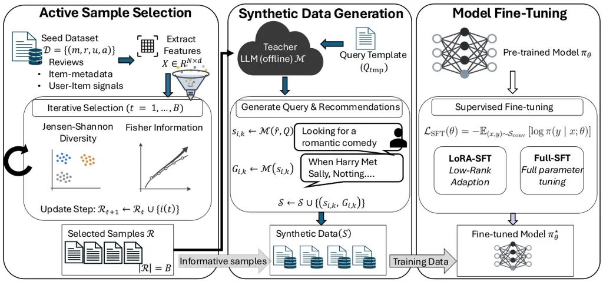

# An Empirical Study on Zero-Data Bootstrapping for Conversational Recommender Systems

Rohan Surana Affiliation: University of California, San Diego
Email: [rsurana@ucsd.edu](mailto:)    Junda Wu Affiliation: University
of California, San Diego Email: [juw069@ucsd.edu](mailto:)    Zhouhang
Xie Affiliation: University of California, San Diego
Email: [zhx022@ucsd.edu](mailto:)    Yu Xia Affiliation: University of
California, San Diego Email: [yux078@ucsd.edu](mailto:)    Nathan Kallus
Affiliation: Netflix Inc. Affiliation: Cornell University
Email: [jmcauley@ucsd.edu](mailto:)    Julian McAuley
Affiliation: University of California, San Diego
Email: [nkallus@netflix.com](mailto:)

###### Abstract

Conversational Recommender Systems (CRS) typically require
domain-specific dialogue data, which is costly, scarce, and often
unavailable in new domains. We conduct a systematic empirical study of
_zero-data CRS bootstrapping_: generating synthetic conversational
supervision from non-conversational signals—item reviews, metadata, and
user-item interactions—without any in-domain dialogue corpus. We compare
two information-theoretic selection strategies, Jensen-Shannon diversity
and Fisher information, across domain signals, model architectures,
datasets, and fine-tuning paradigms. Our results show that
domain-grounded synthetic data consistently outperforms zero-shot
prompting and naïve synthetic baselines; active selection improves data
efficiency over random sampling; metadata and collaborative filtering
signals each improve selection quality; and, in low-resource settings,
synthetic data can outperform scarce real dialogues while further
complementing them. These findings establish non-conversational domain
signals as a viable path toward building CRS without conversational
training data. The code is available at
[https://anonymous.4open.science/r/zero_data_crs/](https://anonymous.4open.science/r/zero_data_crs/).

## 1 Introduction

Figure 1: Three CRS paradigms: (a) traditional CRS requiring
domain-specific conversational data, (b) direct LLM deployment with
inherent limitations, and (c) the zero-data bootstrapping pipeline
studied in this work, which synthesizes conversational data from
non-conversational seed signals.

Conversational Recommender Systems (CRS) aim to deliver personalized
recommendations through dialogue (Sun and Zhang, 2018; Lin et al., 2023;
Wang et al., 2023a; Xi et al., 2024; Zhang et al., 2018). Building
effective CRS has traditionally required large, domain-specific
conversational datasets (Wang et al., 2022; Chen et al., 2019; Zhou
et al., 2020; Li et al., 2018) (Figure 1(a)), which are scarce due to
*high annotation costs* (Soudani et al., 2026; Chen et al., 2023; Aroyo
et al., 2023), *privacy concerns* (Reddit, 2023b; Reddit, 2023a; Reddit,
2024; Chen et al., 2023), and *domain-specific constraints* (Chen
et al., 2019; Zhou et al., 2020; Wang et al., 2022). While Large
Language Models (LLMs) demonstrate promising zero-shot capabilities (He
et al., 2023; Feng et al., 2023; Friedman et al., 2023; Wu et al.,
2024), direct deployment (Figure 1(b)) faces challenges in
*scalability* (Menshawy et al., 2024; Chen et al., 2025), *cost* (Samsi
et al., 2023; Chen et al., 2024a), *interpretability* (Singh et al.,
2024; Kasneci et al., 2023; Wei Jie et al., 2024), and *privacy* (Yao
et al., 2024; Neel and Chang, 2024; Yan et al., 2025; Li et al., 2024b),
leading many practical deployments to prefer smaller, internally managed
models (Jeong, 2024). Yet fine-tuning these models still requires
substantial domain-specific conversational data (Jeong, 2024; Sun
et al., 2024; Nguyen et al., 2024), which remains limited (Soudani
et al., 2026; Wang et al., 2023c; Ruiz and Sell, 2024).

In parallel, LLMs have been increasingly used as data generators,
synthesizing training data for downstream tasks (Zhao et al., 2023;
Mysore et al., 2023; Leszczynski et al., 2023). However, existing
augmentation approaches for CRS operate _on top of_ an existing
conversational corpus (Xu et al., 2025; Liu et al., 2025; Zhao et al., 2023) or require external knowledge graphs (Wang et al., 2022; Chen
et al., 2019; Zhou et al., 2020). Active learning offers principled
sample selection to maximize the value of costly LLM queries (Du et al.,
2025; Liu et al., 2024; Zhang et al., 2024), but its application to CRS
data generation from non-conversational signals has not been studied.

This raises a fundamental question: _can LLMs bootstrap effective CRS
from non-conversational domain signals alone?_ Non-conversational
data—item reviews, metadata, and user-item collaborative interactions—is
readily available in most domains, yet converting such signals into
effective conversational training data involves non-trivial challenges
in sample selection, domain grounding, and data efficiency. No
systematic investigation exists of whether and how this bootstrapping
can work.

In this work, we conduct a comprehensive empirical study addressing this
question. We formalize the _zero-data CRS_ setting (Figure 1(c)), where
no in-domain conversational data is available, and study a three-stage
bootstrapping pipeline: (i) active sample selection from
non-conversational seed data using information-theoretic criteria, (ii)
synthetic conversational data generation via a teacher LLM, and (iii)
fine-tuning a target model on the synthesized corpus. We systematically
vary domain signals, selection strategies, budgets, model architectures,
and fine-tuning paradigms to address four research questions.

#### Contributions.

We summarize our contributions as follows:

- •
  We formalize the _zero-data CRS_ setting and establish a controlled
  experimental framework for studying synthetic data bootstrapping from
  non-conversational domain signals.
- •
  We provide a systematic empirical study of sample selection strategies
  for augmenting CRS data generation, characterizing how different
  selection criteria affect synthetic-data quality and downstream
  recommendation performance.
- •
  We conduct controlled ablations isolating the effects of domain
  signals (item metadata, collaborative filtering) on both selection
  quality and downstream CRS performance across multiple models,
  datasets, and fine-tuning paradigms.

#### Scope.

We focus on the strict setting where neither an in-domain conversational
corpus nor an external knowledge graph is available. The only assumed
resources are non-conversational domain signals such as reviews,
metadata, and user-item interactions. Table 1 contrasts this scope with
representative CRS and augmentation methods.

| Method                      | CRS Data | KG  | Zero-Data |
| --------------------------- | -------- | --- | --------- |
| UniCRS (Wang et al., 2022)  | ✓        | ✓   | ✗         |
| KGSF (Zhou et al., 2020)    | ✓        | ✓   | ✗         |
| KBRD (Chen et al., 2019)    | ✓        | ✓   | ✗         |
| Xu et al. (2025)            | ✓        | ✗   | ✗         |
| NR-CRS (Liu et al., 2025)   | ✓        | ✗   | ✗         |
| LOT-CRS (Zhao et al., 2023) | ✓        | ✗   | ✗         |
| This Study                  | ✗        | ✗   | ✓         |

Table 1: Comparison of CRS methods by data requirements. CRS Data:
requires in-domain conversational corpus. KG: requires external
knowledge graph. Zero-Data: operates without conversational training
data.

## 2 Zero-Data CRS Bootstrapping

We define the zero-data CRS setting and the bootstrapping pipeline
evaluated in this study. Figure 2 provides an overview.



Figure 2: Overview of zero-data CRS bootstrapping. Non-conversational
seed signals are encoded, actively selected, converted into synthetic
conversations by a teacher LLM, and used to fine-tune the target CRS.

### 2.1 Setting: Zero-Data CRS

###### Definition 1 (Zero-Data CRS).

A CRS operates in the _zero-data_ setting when no in-domain
conversational dataset $`\mathcal{S}_{\mathrm{conv}}`$ is available. The
only available resources are non-conversational domain signals: item
reviews $`\{r_{i}\}`$, item metadata $`\{m_{i}\}`$, and user-item
collaborative interactions $`\{u_{i}\}`$.

This setting captures the practical reality of deploying CRS in new or
specialized domains where conversational data has never been collected,
requiring conversational supervision to be derived from
non-conversational signals alone.

### 2.2 Pipeline: Select, Generate, Fine-Tune

To study how non-conversational signals can be converted into effective
CRS training data, we instantiate a three-stage bootstrapping pipeline
(Algorithm 1). Given seed data $`\mathcal{D}`$, target model
$`\pi_{\theta}`$, teacher LLM $`\mathcal{M}`$, and budget $`B`$, the
pipeline selects informative samples $`\mathcal{R}\subset\mathcal{D}`$,
generates synthetic conversations $`\mathcal{S}`$ from $`\mathcal{R}`$,
and fine-tunes $`\pi_{\theta}`$ on $`\mathcal{S}`$ to obtain
$`\pi_{\theta}^{*}`$.

Input : Seed dataset
$`\mathcal{D}=\{(m_{i},r_{i},u_{i},a_{i})\}_{i=1}^{N}`$; Language model
$`\pi_{\theta}`$; Black-box LLM $`\mathcal{M}`$; Query templates
$`\mathcal{Q}_{\mathrm{tmp}}`$; Budget $`B`$

Output : Fine-tuned model $`\pi_{\theta}^{*}`$

1 Initialize: $`\mathcal{S}\leftarrow\emptyset`$;

2 foreach _$`i\in\mathcal{D}`$_ do

    3 $`\mathbf{x}_{i}\leftarrow\texttt{embed}(\pi_{\theta},i)`$

4 end foreach

5
$`\mathcal{R}\leftarrow\texttt{select}(\mathcal{D},\{\mathbf{x}_{i}\},B)`$
$`\triangleright`$ §2.3 6
$`\mathcal{S}\leftarrow\texttt{generate}(\mathcal{R},\mathcal{Q}_{\mathrm{tmp}},\mathcal{M})`$
$`\triangleright`$ Alg. 2 7
$`\pi_{\theta}^{*}\leftarrow\texttt{fine\_tune}(\pi_{\theta},\mathcal{S})`$
$`\triangleright`$ §2.4 8 return _$`\pi\_{\theta}^{_}`$\*

Algorithm 1 Zero-Data CRS Bootstrapping Pipeline

### 2.3 Selection: Informative Seed Samples

Given the seed dataset
$`\mathcal{D}=\{(m_{i},\,r_{i},\,u_{i},\,a_{i})\}_{i=1}^{N}`$ with $`N`$
samples, where $`m_{i}`$ denotes item metadata, $`r_{i}`$ item reviews,
$`u_{i}`$ user features derived from collaborative signals, and
$`a_{i}`$ the item identifier, the goal is to select a subset of size
$`B`$ that maximizes the quality of downstream synthetic data.

We extract dense representations by leveraging $`\pi_{\theta}`$’s last
transformer layer hidden states $`X\in\mathbb{R}^{N\times d}`$,
following prior work on LLM-based embeddings (Tang and Yang, 2024; Wang
et al., 2024; Li and Zhou, 2025; Jiang et al., 2024) to prevent sample
misspecification (Sugiyama, 2005; Fudenberg et al., 2017; Lin et al.,
2025).

Selection precedes generation, so no training targets exist yet and
label-dependent criteria such as uncertainty sampling do not apply. We
therefore build on two label-free principles from active learning,
diversity/coverage and Fisher-information-based optimal design (Sener
and Savarese, 2018; Ash et al., 2021; Mukherjee et al., 2024; Kveton
et al., 2025), instantiated over $`X`$. The two criteria encode
competing hypotheses about what makes a seed sample useful for CRS data
generation: JS diversity prioritizes distributional coverage, while
Fisher information prioritizes parameter-level informativeness under a
last-layer approximation.

###### Definition 2 (JS Diversity Selection).

Let $`p_{i}`$ denote the soft cluster-membership distribution for sample
$`i`$, obtained by clustering the embedding space and applying a softmax
over distances to cluster centroids. Let $`H(p_{i})`$ be its Shannon
entropy. The first sample is initialized as the maximum-entropy item,
after which
$`\bar{p}_{t}=\frac{1}{|\mathcal{R}_{t}|}\sum_{j\in\mathcal{R}_{t}}p_{j}`$
is computed over the non-empty selected set. JS diversity then selects
the next sample by

```math
i^{(t)}=\arg\max_{i\in\mathcal{D}\setminus\mathcal{R}_{t}}\Bigl[H(p_{i})+\lambda\,\operatorname{JS}\!\bigl(p_{i}\,\|\,\bar{p}_{t}\bigr)\Bigr]. \tag{1}
```

The entropy term favors boundary samples, while the JS term promotes
novelty relative to the selected set.

###### Definition 3 (Fisher Information Selection).

Let
$`\Lambda_{t}=\bigl(I_{d}+\sum_{j\in\mathcal{R}_{t}}\mathbf{x}_{j}\mathbf{x}_{j}^{\top}\bigr)^{-1}`$
denote the inverse regularized information matrix for the current
selected set. Under a last-layer linearization of the fine-tuning
objective (Mukherjee et al., 2024; Kveton et al., 2025), Fisher
selection chooses the sample with the largest incremental information
gain:

```math
i^{(t)}=\arg\max_{i\in\mathcal{D}\setminus\mathcal{R}_{t}}\log\!\Bigl(1+\mathbf{x}_{i}^{\top}\Lambda_{t}\mathbf{x}_{i}\Bigr). \tag{2}
```

This greedy log-determinant objective favors samples that add new
parameter-relevant directions beyond those already selected.

Together, the two criteria operationalize complementary notions of
sample utility: distributional representativeness and parameter-aligned
informativeness (Kirsch and Gal, 2022). Fisher selection corresponds to
greedy D-optimal design (Pukelsheim, 2006), while JS selection is
motivated by submodular coverage objectives (Nemhauser et al., 1978).
Both criteria are applied iteratively until $`|\mathcal{R}|=B`$;
construction and update details are provided in Appendix A.

### 2.4 Pipeline: From Domain Signals to CRS Training Data

#### Domain Signal Encoding.

###### Definition 4 (Domain Signals).

We distinguish three types of non-conversational domain signals
available for seed sample representation:

- •
  Semantic signals ($`r_{i}`$): item review text, capturing fine-grained
  user opinions and item characteristics;
- •
  Structural signals ($`m_{i}`$): item metadata including descriptions,
  genres, and categories, providing categorical and descriptive context;
- •
  Relational signals ($`u_{i}`$): user-item collaborative filtering
  features derived from interaction histories, encoding user preference
  patterns.

Each signal type is encoded into the embedding space by concatenating it
with the seed input before extracting representations via
$`\pi_{\theta}`$. This study systematically investigates how each signal
type, and their combinations, affects both selection quality and
downstream CRS performance.

#### Synthetic Conversation Generation.

After active sample selection, the selected samples $`\mathcal{R}`$ are
converted into synthetic conversational data using a teacher LLM. Let
$`\mathcal{Q}_{\mathrm{tmp}}`$ be a collection of style templates
sourced from Reddit movie recommendation discussions, used only to
control the style and tone of generated queries (see Section E.2).

For each selected item $`i\in\mathcal{R}`$, we sample five style
templates $`Q\subset\mathcal{Q}_{\mathrm{tmp}}`$. For each of $`K`$
synthetic queries, we sample three reviews $`\hat{r}\subset r_{i}`$ and
prompt a teacher LLM $`\mathcal{M}`$ to generate a synthetic query
$`s_{i,k}`$ (Section E.2). Following He et al. (2023), we then prompt
the LLM with each query to produce 20 pseudo-target recommendations,
$`G_{i,k}=\{g_{1},\dots,g_{20}\}`$ (Section E.2). Each pair
$`(s_{i,k},G_{i,k})`$ is added to the synthetic dataset $`\mathcal{S}`$
for fine-tuning the target language model $`\pi_{\theta}`$. For $`B`$
selected items and $`K`$ queries per item, this yields $`BK`$ training
pairs at a cost of $`2BK`$ offline teacher calls; selection itself
requires one embedding pass and no additional teacher calls. The full
procedure is detailed in Algorithm 2, with representative examples in
Section E.2.

Input : Selected samples $`\mathcal{R}\subset\mathcal{D}`$; Query
templates $`\mathcal{Q}_{\mathrm{tmp}}`$; Teacher LLM $`\mathcal{M}`$;
Queries per item $`K`$

Output : Synthetic dataset $`\mathcal{S}=\{(s,G)\}`$, where $`G`$
contains pseudo-target recommendations

1 Initialize: $`\mathcal{S}\leftarrow\emptyset`$;

2 foreach _$`i\in\mathcal{R}`$_ do

    3 Sample 5 style templates $`Q\subset\mathcal{Q}_{\mathrm{tmp}}`$;

    4 for _$`k=1`$ to $`K`$_ do

       5 Sample 3 reviews $`\hat{r}\subset r_{i}`$;

       6 $`s_{i,k}\leftarrow\mathcal{M}(\hat{r},Q)`$ $`\triangleright`$
Generate query;

       7 $`G_{i,k}\leftarrow\mathcal{M}(s_{i,k})`$ $`\triangleright`$
Generate 20 recommendation targets;

       8 $`\mathcal{S}\leftarrow\mathcal{S}\cup\{(s_{i,k},G_{i,k})\}`$;

    9 end for

10 end foreach

11 return _$`\mathcal{S}`$_

Algorithm 2 Synthetic conversational data generation from actively
selected non-conversational seed items.

#### Target Model Fine-Tuning.

We adapt $`\pi_{\theta}`$ to the conversational recommendation domain
using supervised fine-tuning on $`\mathcal{S}`$, evaluating both LoRA
and Full-SFT following standard practice (Chen et al., 2024b; Li et al.,
2024a; Dong et al., 2024; Zhang et al., 2026). Training details and
hyperparameters are provided in Section E.1.

## 3 Experimental Setup

### 3.1 Benchmarks and Seed Data

We evaluate on two standard CRS benchmarks of different scales:
ReDial (Li et al., 2018) and INSPIRED (Hayati et al., 2020). This
pairing enables studying bootstrapping effectiveness across both
moderate- and low-resource evaluation settings. Our non-conversational
seed data is drawn from Amazon Reviews ’23 (Hou et al., 2026) (Movies &
TV category). Dataset statistics are reported in Table 2.

|                 | ReDial | INSPIRED |
| --------------- | ------ | -------- |
| Total dialogues | 10,006 | 1,001    |
| Test dialogues  | 2,001  | 200      |

Table 2: Dataset statistics for the ReDial and INSPIRED evaluation
benchmarks.

### 3.2 Backbone and Teacher Models

We study instruction-tuned LLMs as backbone models:
Llama3.2-3B-Instruct (Grattafiori et al., 2024),
Qwen2.5-1.5B-Instruct (Qwen et al., 2025), and Qwen3-4B (Yang et al., 2025) (RQ1 only). This range of model sizes enables studying how model
capacity interacts with synthetic data quality.

For fine-tuning, we consider two paradigms: (1) LoRA (Hu et al., 2022),
parameter-efficient fine-tuning using Low-Rank Adaptation, and (2)
Full-SFT, where all model parameters are optimized. The teacher LLM for
synthetic data generation is GPT-4o (OpenAI et al., 2024).
Implementation details are provided in Section E.1.

### 3.3 Baselines and Selection Conditions

To isolate the effect of domain-grounded synthetic data, we compare
against baselines operating under the same zero-data constraint:

Zero-Shot: Models are directly prompted for conversational
recommendation without fine-tuning. GPT-Generated: Models fine-tuned on
synthetic data generated by naïvely prompting GPT-4o (OpenAI et al., 2024) without domain-specific seed data or active selection. Popularity:
Recommends items based on frequency in the dataset. NBCRS (Xie et al.,
2024): A neighborhood-based CRS evaluated both on raw seed data and on
synthesized conversational data.

Existing CRS augmentation methods (Xu et al., 2025; Liu et al., 2025)
require an in-domain conversational corpus and are therefore not
applicable in the zero-data setting.

For active selection, we compare Random uniform sampling; semantic-only
JS/Fisher selection using review embeddings; JS+Meta/Fisher+Meta, which
add item metadata; and JS+CF/Fisher+CF, which add collaborative
filtering (CF) signals from user interaction histories. We evaluate with
Recall@$`k`$ ($`k\in\{1,5,10,20\}`$) and NDCG@$`k`$ (Appendix C); unless
otherwise stated, RQ1–RQ3 train exclusively on synthetic data, while RQ4
studies combinations of synthetic and in-domain data.

## 4 Main Results

We organize the study around four questions: whether domain-grounded
synthetic data improves zero-data CRS (RQ1), whether active selection
improves data efficiency (RQ2), how metadata and collaborative signals
affect selection (RQ3), and how synthetic data compares with scarce real
dialogues (RQ4).

### 4.1 RQ1: Domain-Grounded Synthetic Data Enables Zero-Data CRS

We first ask whether a CRS can be trained without any in-domain
conversational corpus by converting non-conversational domain signals
into synthetic conversational supervision.

We compare popularity ranking, zero-shot prompting, naïve GPT-generated
training data, and our domain-grounded synthetic data across
Qwen2.5-1.5B, Qwen3-4B, Llama3-3B, and NBCRS. For LLM backbones, we
evaluate both LoRA and Full-SFT when applicable; for NBCRS, we compare
raw seed data against the synthesized conversational data. Table 3
reports Recall@$`k`$ on ReDial and INSPIRED.

|              |               |          |           |           |           |          |           |           |           |
| ------------ | ------------- | -------- | --------- | --------- | --------- | -------- | --------- | --------- | --------- |
| Model        | Setting       | ReDial   |           |           |           | INSPIRED |           |           |           |
|              |               | R@1      | R@5       | R@10      | R@20      | R@1      | R@5       | R@10      | R@20      |
| Popularity   | Seed Dataset  | 0.090.04 | 0.240.06  | 0.330.07  | 0.340.07  | 0.030.03 | 0.030.03  | 0.550.13  | 0.700.15  |
|              | Synth Data    | 0.560.09 | 1.870.16  | 2.460.19  | 3.720.23  | 0.300.10 | 0.850.16  | 1.770.23  | 2.350.26  |
| Qwen2.5-1.5B | Zero-shot     | 2.390.19 | 6.960.31  | 8.150.33  | 9.510.36  | 0.640.14 | 1.430.21  | 2.010.24  | 2.350.26  |
|              | GPT-Generated | 2.560.19 | 7.630.32  | 9.290.35  | 10.710.38 | 0.760.17 | 1.890.26  | 2.340.29  | 3.290.35  |
|              | Synth-LoRA    | 3.390.22 | 9.270.35  | 11.130.38 | 12.830.41 | 1.170.21 | 3.210.34  | 4.430.40  | 5.820.46  |
|              | Synth-SFT     | 3.360.22 | 9.380.36  | 11.400.39 | 13.290.42 | 1.970.27 | 4.580.41  | 6.090.47  | 7.900.52  |
| Qwen3-4B     | Zero-shot     | 7.090.31 | 19.580.48 | 22.700.51 | 26.870.54 | 5.420.40 | 10.200.53 | 12.030.57 | 13.800.60 |
|              | GPT-Generated | 7.450.32 | 22.190.51 | 25.620.53 | 28.740.55 | 5.940.46 | 11.120.61 | 12.860.65 | 14.030.68 |
|              | Synth-LoRA    | 8.390.34 | 23.720.52 | 26.260.54 | 28.790.55 | 5.820.46 | 10.480.60 | 12.070.63 | 12.860.65 |
|              | Synth-SFT     | 7.730.33 | 22.810.51 | 26.320.54 | 29.800.56 | 6.010.46 | 11.350.62 | 13.120.66 | 14.670.69 |
| Llama3-3B    | Zero-shot     | 1.570.15 | 5.560.28  | 9.070.35  | 13.260.41 | 2.040.25 | 5.000.38  | 6.940.44  | 8.890.50  |
|              | GPT-Generated | 1.540.15 | 5.860.29  | 8.960.35  | 13.470.42 | 1.970.27 | 5.030.43  | 7.070.50  | 9.340.57  |
|              | Synth-LoRA    | 1.530.15 | 5.710.28  | 8.790.35  | 13.350.42 | 1.970.27 | 5.070.43  | 7.260.50  | 9.420.57  |
|              | Synth-SFT     | 1.910.17 | 6.540.30  | 9.720.36  | 14.420.43 | 2.610.31 | 5.750.45  | 7.830.52  | 9.980.58  |
| NBCRS        | Seed Dataset  | 0.000.00 | 0.390.28  | 0.780.39  | 1.170.48  | 0.000.00 | 0.000.00  | 0.000.00  | 0.000.00  |
|              | Synth Data    | 2.540.70 | 11.521.41 | 19.531.75 | 27.341.97 | 4.552.23 | 9.093.08  | 13.643.68 | 23.864.57 |

Table 3: RQ1 Recall (%) results on ReDial and INSPIRED. Small gray
values denote standard errors. Shaded entries denote LLM synthetic
fine-tuning variants; bold marks the best Recall in each model block and
dataset.

#### Finding 1: Domain-grounded synthetic data consistently outperforms zero-shot and naïve generation.

Models trained on domain-grounded synthetic data outperform both
zero-shot baselines and models trained on GPT-generated data (produced
without domain-specific seed signals) across backbone architectures and
benchmarks. On INSPIRED with Qwen2.5-1.5B, SFT-tuned models achieve
+207.8% Recall@1 improvement over zero-shot, compared to only +18.8% for
GPT-generated data. This indicates that incorporating domain-specific
signals during synthetic data generation significantly improves
recommendation accuracy beyond what generic LLM generation provides.

#### Finding 2: Smaller models benefit disproportionately from synthetic fine-tuning.

The relative gains from domain-grounded synthetic data are most
pronounced for smaller models. Qwen2.5-1.5B sees Recall@1 improvements
of +41.8% (LoRA) and +40.6% (SFT) on ReDial, while the larger Qwen3-4B
achieves +18.3% and +9.0% respectively, suggesting that smaller models
benefit more from domain-specific fine-tuning data.

#### Finding 3: Full-SFT generally outperforms LoRA, particularly for smaller models.

Across most configurations, Full-SFT yields stronger results than
LoRA-based fine-tuning, with the gap being especially pronounced for
smaller models (e.g., Qwen2.5-1.5B on INSPIRED: +207.8% vs. +82.8% for
Recall@1). For Llama3-3B, LoRA fine-tuning sometimes underperforms
zero-shot, while Full-SFT consistently improves. This suggests that when
training data is synthetically generated, full parameter updates are
often important for adapting the model sufficiently.

#### Finding 4: The bootstrapping pipeline generalizes beyond LLM-based CRS.

NBCRS (Xie et al., 2024), a traditional neighborhood-based CRS, achieves
substantially higher performance when trained on synthesized
conversational data compared to raw seed data (e.g., Recall@5 improves
from 0.39 to 11.52 on ReDial). This confirms that the data
transformation—from non-conversational signals to conversational
format—provides value independent of the downstream model architecture.

#### Synthetic-data quality.

We separately assess the generated corpus itself: human ratings of
sampled query-recommendation pairs average close to 4 on a 1–5 scale
across naturalness, coherence, relevance, and diversity, and both
corpora follow the requested output format. Notably, the naïve corpus
matches the item catalog _more_ often than the grounded corpus while
performing worse downstream, indicating that catalog overlap does not
track the usefulness of the supervision. Full human-evaluation and
title-validity results are reported in Appendix D.

#### Takeaway 1.

The decisive factor is not simply using an LLM to generate more text,
but grounding generation in domain-specific seed signals. This supports
zero-data bootstrapping as a practical alternative when conversational
logs are unavailable.

### 4.2 RQ2: Active Selection Improves Data Efficiency

Synthetic data generation incurs teacher-LLM cost, so the next question
is whether active selection can identify more useful seed items under
fixed generation budgets.

We compare Jensen-Shannon (JS) divergence, Fisher information, random
sampling, and a popularity heuristic that selects items with the highest
review counts. We fine-tune Llama3-3B and Qwen2.5-1.5B on data generated
from each selected subset and evaluate Recall@$`k`$ ($`k\in\{1,5\}`$) on
ReDial and INSPIRED.

Figure 3 and Figure 7 compare performance across budgets.

Figure 3: RQ2: Qwen2.5-1.5B performance across budgets on ReDial and
INSPIRED. Active selection strategies (JS, Fisher) consistently
outperform random sampling and popularity-based selection.

#### Finding 5: Both active strategies outperform random sampling and popularity-based selection, but the margin depends on budget and signal.

JS and Fisher consistently identify more beneficial seed items than
random or popularity-based selection, reducing teacher-LLM calls while
improving performance at similar budgets. Popularity, which prioritizes
high-review-count items, often underperforms even random sampling,
consistent with prior observations that random sampling can be a strong
baseline in text-generation tasks (Perlitz et al., 2023).

#### Finding 6: JS and Fisher exhibit complementary strengths.

JS prioritizes distributional coverage, while Fisher targets
parameter-level information gain aligned with the fine-tuning
objective (Kirsch and Gal, 2022). Their relative advantage varies by
dataset and budget, confirming that they capture different facets of
sample informativeness and that domain popularity alone is not a
reliable proxy. The same ordering holds under NDCG at an equal
teacher-call budget (Appendix C), so active selection improves the rank
position of correct items and not only their presence in the list. We
further analyze the popularity profile and recommendation coverage of
active selection in Appendix B.

#### Takeaway 2.

For zero-data CRS, seed selection should be treated as part of the
data-generation algorithm rather than as a preprocessing detail.
Information-theoretic criteria make teacher queries more efficient than
simple item-frequency heuristics.

### 4.3 RQ3: Domain Signals Improve Active Selection

Non-conversational domains provide multiple signal types. We ask whether
metadata and collaborative filtering signals improve selection beyond
review text alone. We isolate domain-signal effects by comparing
semantic-only strategies (JS, Fisher), metadata-aware strategies
(JS+Meta, Fisher+Meta), collaborative-filtering-aware strategies (JS+CF,
Fisher+CF), and Random. Unless otherwise noted, this analysis uses
Llama3 across budget levels on ReDial and INSPIRED.

#### Metadata Provides Structural Coverage.

Figure 4 shows Recall@$`1`$ and Recall@$`5`$ across budget levels for
both datasets using Llama3.

Figure 4: RQ3: Metadata-aware selection improves Recall@1 and Recall@5
over semantic-only and random selection, especially at larger budgets.

#### Finding 7: Metadata-aware selection consistently improves performance, with gains most pronounced at larger budgets.

Methods incorporating item metadata outperform semantic-only and random
baselines across both datasets. The cumulative advantage grows with
budget, suggesting that metadata enables active selection to sustain
informative sample identification over longer selection horizons. This
confirms that structural domain signals (descriptions, genres,
categories) provide context beyond what review text alone captures.

#### Collaborative Signals Add Preference Structure.

Figure 5 presents results across budget levels for both datasets.

Figure 5: RQ3: Collaborative filtering signals provide complementary
gains to semantic and metadata-based selection.

#### Finding 8: Collaborative filtering signals provide additional gains orthogonal to semantic features.

Collaborative-aware methods consistently demonstrate improved
recommendation accuracy over baselines, with noticeable gains at larger
budgets. This suggests that relational signals, which encode user
preference patterns from interaction histories, enrich the selection
process by emphasizing realistic, user-centric interactions that
complement the content-based information in reviews and metadata.

#### Takeaway 3.

Domain signals should be used not only as prompt context for generation,
but also as selection signals. Metadata offers an easily available
structural signal, while collaborative histories add preference
information when such logs exist.

### 4.4 RQ4: Synthetic Data Complements Scarce Real Data

Finally, we ask whether synthetic data substitutes for or complements
scarce real conversational data. We compare models trained on ReD
(ReDial only), INS (INSPIRED only), Synth (synthetic data only), R+O
(ReDial + our synthetic data), and INS+O (INSPIRED + our synthetic
data). Figure 6 compares these training mixtures.

Figure 6: RQ4: Synthetic data is most beneficial when real
conversational data is scarce and becomes less helpful when in-domain
dialogue coverage is already large.

#### Finding 9: In low-resource settings, synthetic data alone outperforms real in-domain data.

On INSPIRED ($`{\sim}`$1k dialogues), the model trained solely on
synthetic data (Synth) outperforms the model trained on the original
INSPIRED training set (INS), showing that domain-grounded synthetic data
generated from non-conversational signals can surpass actual in-domain
conversational data when the latter is scarce.

#### Finding 10: Combining synthetic and real data yields further gains, confirming complementarity.

On INSPIRED, training with synthetic data alongside scarce or related
real dialogues (INS+O and R+O) substantially improves over INS alone. On
ReDial, ReD remains competitive and R+O slightly reduces performance,
suggesting that synthetic augmentation is most valuable when real
conversational coverage is limited.

#### Takeaway 4.

Synthetic bootstrapping is most useful precisely in the low-resource
setting that motivates zero-data CRS. When real conversational coverage
is already broad, synthetic data should be used more selectively or
filtered more aggressively.

## 5 Related Work

#### Conversational Recommender Systems.

CRS supports interactive recommendation, often with mixed initiative
between user and system (Christakopoulou et al., 2016; Li et al., 2018;
Chen et al., 2019; Lei et al., 2020; He et al., 2022; Zhang et al.,
2022; Xia et al., 2023). Recent work improves CRS by integrating
recommendation and conversation modules, incorporating language models,
or directly prompting and fine-tuning LLMs for recommendation (Wang
et al., 2022; Xie et al., 2024; Friedman et al., 2023; Yang and Chen,
2024; He et al., 2023; Feng et al., 2023; Xi et al., 2024). Our study
targets a stricter setting: fine-tuning LLM-based CRS when _no_
in-domain conversational data is available, using only
non-conversational domain signals.

#### Data Augmentation for CRS.

Data scarcity is a central challenge for CRS, where cold-start issues
are common and large-scale conversational interactions are difficult to
obtain (Chae et al., 2020; Mysore et al., 2023; Leszczynski et al.,
2023; Wang et al., 2023b). Recent augmentation methods use LLMs to
simulate conversations involving long-tail items (Zhao et al., 2023),
generate synthetic narrative queries from user-item histories (Mysore
et al., 2023), synthesize music-domain conversations from item
collections (Leszczynski et al., 2023), or enrich existing dialogues
with retrieved items, hard negatives, and neighboring
conversations (Jandaghi et al., 2024; Xu et al., 2025; Liu et al., 2025;
Wang et al., 2023b). These methods still operate _on top of_ existing
in-domain conversations. LLM-REDIAL (Liang et al., 2024) instead
verbalizes user histories into a large multi-domain synthetic corpus,
complementary to our focus on which non-conversational signals and
selection strategies yield the most useful supervision under a fixed
teacher budget. Our zero-data setting bootstraps conversational training
data entirely from reviews, metadata, and collaborative interactions,
without any pre-existing conversational corpus.

#### Active Learning.

Active learning has been used in recommender systems and NLP to maximize
knowledge transfer from LLMs while minimizing costly queries (Du et al.,
2025; Zhang et al., 2024; Liu et al., 2024; Palo et al., 2024; Li
et al., 2024c; Xia et al., 2025). Prior work selects informative user
sessions for teacher annotation (Du et al., 2025), generates targeted
examples from student errors (Liu et al., 2024), or guides query
selection with model explanations and teacher corrections (Zhang et al.,
2024). We apply established information-theoretic criteria
(Jensen-Shannon divergence and Fisher information) to a different
problem: selecting non-conversational seed instances for synthetic CRS
data generation. Our contribution is not a new active learning
criterion, but a systematic empirical study of how active selection
interacts with CRS-specific domain signals in a zero-data pipeline.

## 6 Conclusion

We presented a systematic empirical study of zero-data CRS
bootstrapping: generating conversational supervision from
non-conversational domain signals via LLMs. Across models, benchmarks,
and fine-tuning paradigms, domain-grounded synthetic data outperforms
zero-shot and naïve synthetic baselines; active selection improves data
efficiency; metadata and collaborative signals strengthen selection; and
synthetic data is especially effective when real dialogues are scarce.
These findings show that non-conversational signals, when systematically
selected and transformed, offer a practical path to building CRS without
any conversational training data.

#### LLM Usage:

We used LLMs solely for grammar refinement and wording edits in drafting
parts of this paper.

## Limitations

We evaluate exclusively on the movie domain. The selection and
bootstrapping mechanics are domain-general, but transfer to domains such
as music or e-commerce would require domain-specific seed corpora,
generation templates, and evaluation benchmarks; establishing
cross-domain generalization is therefore left to future work. The
bootstrapping pipeline relies on LLM-generated synthetic data, which may
contain hallucinations or stylistic artifacts that propagate to
downstream models. Finally, the quality of generated dialogues depends
on prompt design. While recent work on prompt optimization could
potentially improve generation quality, we do not explore this
direction.

## References

- Aroyo et al. (2023) Lora Aroyo, Alex Taylor, Mark Díaz, Christopher
  Homan, Alicia Parrish, Gregory Serapio-García, Vinodkumar Prabhakaran,
  and Ding Wang. 2023. [Dices dataset: Diversity in conversational ai
  evaluation for safety](https://doi.org/10.52202/075280-2321). In
  _Advances in Neural Information Processing Systems_, volume 36, pages
  53330–53342. Curran Associates, Inc.
- Ash et al. (2021) Jordan T. Ash, Surbhi Goel, Akshay Krishnamurthy,
  and Sham Kakade. 2021. [Gone fishing: Neural active learning with
  fisher embeddings](https://arxiv.org/abs/2106.09675). _Preprint_,
  arXiv:2106.09675.
- Chae et al. (2020) Dong-Kyu Chae, Jihoo Kim, Duen Horng Chau, and
  Sang-Wook Kim. 2020. [Ar-cf: Augmenting virtual users and items in
  collaborative filtering for addressing cold-start
  problems](https://doi.org/10.1145/3397271.3401038). In _Proceedings of
  the 43rd International ACM SIGIR Conference on Research and
  Development in Information Retrieval_, SIGIR ’20, page 1251–1260, New
  York, NY, USA. Association for Computing Machinery.
- Chen et al. (2024a) Lingjiao Chen, Matei Zaharia, and James Zou.
  2024a. [FrugalGPT: How to use large language models while reducing
  cost and improving
  performance](https://openreview.net/forum?id=cSimKw5p6R).
  _Transactions on Machine Learning Research_. Featured Certification.
- Chen et al. (2023) Maximillian Chen, Alexandros Papangelis, Chenyang
  Tao, Seokhwan Kim, Andy Rosenbaum, Yang Liu, Zhou Yu, and Dilek
  Hakkani-Tur. 2023. [PLACES: Prompting language models for social
  conversation
  synthesis](https://doi.org/10.18653/v1/2023.findings-eacl.63). In
  _Findings of the Association for Computational Linguistics: EACL
  2023_, pages 844–868, Dubrovnik, Croatia. Association for
  Computational Linguistics.
- Chen et al. (2019) Qibin Chen, Junyang Lin, Yichang Zhang, Ming Ding,
  Yukuo Cen, Hongxia Yang, and Jie Tang. 2019. [Towards knowledge-based
  recommender dialog system](https://doi.org/10.18653/v1/D19-1189). In
  _Proceedings of the 2019 Conference on Empirical Methods in Natural
  Language Processing and the 9th International Joint Conference on
  Natural Language Processing (EMNLP-IJCNLP)_, pages 1803–1813, Hong
  Kong, China. Association for Computational Linguistics.
- Chen et al. (2025) Xiang Chen, Chaoyang Gao, Chunyang Chen, Guangbei
  Zhang, and Yong Liu. 2025. [An empirical study on challenges for llm
  application developers](https://doi.org/10.1145/3715007). _ACM Trans.
  Softw. Eng. Methodol._, 34(7).
- Chen et al. (2024b) Zixiang Chen, Yihe Deng, Huizhuo Yuan, Kaixuan Ji,
  and Quanquan Gu. 2024b. Self-play fine-tuning convertsweak language
  models to strong language models. In _Proceedings of the 41st
  International Conference on Machine Learning_, ICML’24. JMLR.org.
- Christakopoulou et al. (2016) Konstantina Christakopoulou, Filip
  Radlinski, and Katja Hofmann. 2016. [Towards conversational
  recommender systems](https://doi.org/10.1145/2939672.2939746). In
  _Proceedings of the 22nd ACM SIGKDD International Conference on
  Knowledge Discovery and Data Mining_, KDD ’16, page 815–824, New York,
  NY, USA. Association for Computing Machinery.
- Dong et al. (2024) Guanting Dong, Hongyi Yuan, Keming Lu, Chengpeng
  Li, Mingfeng Xue, Dayiheng Liu, Wei Wang, Zheng Yuan, Chang Zhou, and
  Jingren Zhou. 2024. [How abilities in large language models are
  affected by supervised fine-tuning data
  composition](https://doi.org/10.18653/v1/2024.acl-long.12). In
  _Proceedings of the 62nd Annual Meeting of the Association for
  Computational Linguistics (Volume 1: Long Papers)_, pages 177–198,
  Bangkok, Thailand. Association for Computational Linguistics.
- Du et al. (2025) Yingpeng Du, Zhu Sun, Ziyan Wang, Haoyan Chua, Jie
  Zhang, and Yew-Soon Ong. 2025. [Active large language model-based
  knowledge distillation for session-based
  recommendation](https://doi.org/10.1609/aaai.v39i11.33263). In
  _Proceedings of the Thirty-Ninth AAAI Conference on Artificial
  Intelligence and Thirty-Seventh Conference on Innovative Applications
  of Artificial Intelligence and Fifteenth Symposium on Educational
  Advances in Artificial Intelligence_, AAAI’25/IAAI’25/EAAI’25. AAAI
  Press.
- Feng et al. (2023) Yue Feng, Shuchang Liu, Zhenghai Xue, Qingpeng Cai,
  Lantao Hu, Peng Jiang, Kun Gai, and Fei Sun. 2023. [A large language
  model enhanced conversational recommender
  system](https://arxiv.org/abs/2308.06212). _Preprint_,
  arXiv:2308.06212.
- Friedman et al. (2023) Luke Friedman, Sameer Ahuja, David Allen,
  Zhenning Tan, Hakim Sidahmed, Changbo Long, Jun Xie, Gabriel
  Schubiner, Ajay Patel, Harsh Lara, Brian Chu, Zexi Chen, and Manoj
  Tiwari. 2023. [Leveraging large language models in conversational
  recommender systems](https://arxiv.org/abs/2305.07961). _Preprint_,
  arXiv:2305.07961.
- Fudenberg et al. (2017) Drew Fudenberg, Gleb Romanyuk, and Philipp
  Strack. 2017. [Active learning with a misspecified
  prior](https://doi.org/10.3982/TE2480). _Theoretical Economics_,
  12(3):1155–1189.
- Grattafiori et al. (2024) Aaron Grattafiori, Abhimanyu Dubey, Abhinav
  Jauhri, Abhinav Pandey, Abhishek Kadian, Ahmad Al-Dahle, Aiesha
  Letman, Akhil Mathur, Alan Schelten, Alex Vaughan, Amy Yang, Angela
  Fan, Anirudh Goyal, Anthony Hartshorn, Aobo Yang, Archi Mitra, Archie
  Sravankumar, Artem Korenev, Arthur Hinsvark, and 542 others. 2024.
  [The llama 3 herd of models](https://arxiv.org/abs/2407.21783).
  _Preprint_, arXiv:2407.21783.
- Hayati et al. (2020) Shirley Anugrah Hayati, Dongyeop Kang,
  Qingxiaoyang Zhu, Weiyan Shi, and Zhou Yu. 2020. [INSPIRED: Toward
  sociable recommendation dialog
  systems](https://doi.org/10.18653/v1/2020.emnlp-main.654). In
  _Proceedings of the 2020 Conference on Empirical Methods in Natural
  Language Processing (EMNLP)_, pages 8142–8152, Online. Association for
  Computational Linguistics.
- He et al. (2023) Zhankui He, Zhouhang Xie, Rahul Jha, Harald Steck,
  Dawen Liang, Yesu Feng, Bodhisattwa Prasad Majumder, Nathan Kallus,
  and Julian Mcauley. 2023. [Large language models as zero-shot
  conversational recommenders](https://doi.org/10.1145/3583780.3614949).
  In _Proceedings of the 32nd ACM International Conference on
  Information and Knowledge Management_, CIKM ’23, page 720–730, New
  York, NY, USA. Association for Computing Machinery.
- He et al. (2022) Zhankui He, Handong Zhao, Tong Yu, Sungchul Kim, Fan
  Du, and Julian McAuley. 2022. [Bundle mcr: Towards conversational
  bundle recommendation](https://doi.org/10.1145/3523227.3546755). In
  _Proceedings of the 16th ACM Conference on Recommender Systems_,
  RecSys ’22, page 288–298, New York, NY, USA. Association for Computing
  Machinery.
- Hou et al. (2026) Yupeng Hou, Jiacheng Li, Xiangjun Fu, Zhankui He,
  An Yan, Xiusi Chen, and Julian McAuley. 2026. [Bridging language and
  items for retrieval and recommendation: Benchmarking LLMs as semantic
  encoders](https://doi.org/10.18653/v1/2026.acl-long.147). In
  _Proceedings of the 64th Annual Meeting of the Association for
  Computational Linguistics (Volume 1: Long Papers)_, pages 3251–3265,
  San Diego, California, United States. Association for Computational
  Linguistics.
- Hu et al. (2022) Edward J Hu, yelong shen, Phillip Wallis, Zeyuan
  Allen-Zhu, Yuanzhi Li, Shean Wang, Lu Wang, and Weizhu Chen. 2022.
  [LoRA: Low-rank adaptation of large language
  models](https://openreview.net/forum?id=nZeVKeeFYf9). In
  _International Conference on Learning Representations_.
- Ikotun et al. (2023) Abiodun M. Ikotun, Absalom E. Ezugwu, Laith
  Abualigah, Belal Abuhaija, and Jia Heming. 2023. [K-means clustering
  algorithms: A comprehensive review, variants analysis, and advances in
  the era of big data](https://doi.org/10.1016/j.ins.2022.11.139).
  _Information Sciences_, 622:178–210.
- Jandaghi et al. (2024) Pegah Jandaghi, Xianghai Sheng, Xinyi Bai, Jay
  Pujara, and Hakim Sidahmed. 2024. [Faithful persona-based
  conversational dataset generation with large language
  models](https://aclanthology.org/2024.nlp4convai-1.8/). In
  _Proceedings of the 6th Workshop on NLP for Conversational AI
  (NLP4ConvAI 2024)_, pages 114–139, Bangkok, Thailand. Association for
  Computational Linguistics.
- Jeong (2024) Cheonsu Jeong. 2024. Domain-specialized llm: Financial
  fine-tuning and utilization method using mistral 7b. _Journal of
  Intelligence and Information Systems_, 30(1):93–120.
- Jiang et al. (2024) Ting Jiang, Shaohan Huang, Zhongzhi Luan, Deqing
  Wang, and Fuzhen Zhuang. 2024. [Scaling sentence embeddings with large
  language models](https://doi.org/10.18653/v1/2024.findings-emnlp.181).
  In _Findings of the Association for Computational Linguistics: EMNLP
  2024_, pages 3182–3196, Miami, Florida, USA. Association for
  Computational Linguistics.
- Kasneci et al. (2023) Enkelejda Kasneci, Kathrin Sessler, Stefan
  Küchemann, Maria Bannert, Daryna Dementieva, Frank Fischer, Urs
  Gasser, Georg Groh, Stephan Günnemann, Eyke Hüllermeier, Stephan
  Krusche, Gitta Kutyniok, Tilman Michaeli, Claudia Nerdel, Jürgen
  Pfeffer, Oleksandra Poquet, Michael Sailer, Albrecht Schmidt, Tina
  Seidel, and 4 others. 2023. [Chatgpt for good? on opportunities and
  challenges of large language models for
  education](https://doi.org/10.1016/j.lindif.2023.102274). _Learning
  and Individual Differences_, 103:102274.
- Kirsch and Gal (2022) Andreas Kirsch and Yarin Gal. 2022. [Unifying
  approaches in active learning and active sampling via fisher
  information and information-theoretic
  quantities](https://arxiv.org/abs/2208.00549). _Preprint_,
  arXiv:2208.00549.
- Kveton et al. (2025) Branislav Kveton, Xintong Li, Julian McAuley,
  Ryan Rossi, Jingbo Shang, Junda Wu, and Tong Yu. 2025. [Active
  learning for direct preference
  optimization](https://arxiv.org/abs/2503.01076). _Preprint_,
  arXiv:2503.01076.
- Lei et al. (2020) Wenqiang Lei, Xiangnan He, Yisong Miao, Qingyun Wu,
  Richang Hong, Min-Yen Kan, and Tat-Seng Chua. 2020.
  [Estimation-action-reflection: Towards deep interaction between
  conversational and recommender
  systems](https://doi.org/10.1145/3336191.3371769). In _Proceedings of
  the 13th International Conference on Web Search and Data Mining_, WSDM
  ’20, page 304–312, New York, NY, USA. Association for Computing
  Machinery.
- Leszczynski et al. (2023) Megan Leszczynski, Shu Zhang, Ravi Ganti,
  Krisztian Balog, Filip Radlinski, Fernando Pereira, and Arun Tejasvi
  Chaganty. 2023. [Talk the walk: Synthetic data generation for
  conversational music
  recommendation](https://arxiv.org/abs/2301.11489). _Preprint_,
  arXiv:2301.11489.
- Li et al. (2024a) Jiaxiang Li, Siliang Zeng, Hoi To Wai, Chenliang Li,
  Alfredo Garcia, and Mingyi Hong. 2024a. [Getting more juice out of the
  SFT data: Reward learning from human demonstration improves SFT for
  LLM alignment](https://openreview.net/forum?id=xmFHPCU1rY). In _ICML
  2024 Workshop on Theoretical Foundations of Foundation Models_.
- Li et al. (2024b) Qinbin Li, Junyuan Hong, Chulin Xie, Jeffrey Tan,
  Rachel Xin, Junyi Hou, Xavier Yin, Zhun Wang, Dan Hendrycks, Zhangyang
  Wang, Bo Li, Bingsheng He, and Dawn Song. 2024b. [Llm-pbe: Assessing
  data privacy in large language
  models](https://doi.org/10.14778/3681954.3681994). _Proc. VLDB
  Endow._, 17(11):3201–3214.
- Li et al. (2024c) Quan Li, Tianxiang Zhao, Lingwei Chen, Junjie Xu,
  and Suhang Wang. 2024c. [Enhancing graph neural networks with limited
  labeled data by actively distilling knowledge from large language
  models](https://arxiv.org/abs/2407.13989). _Preprint_,
  arXiv:2407.13989.
- Li et al. (2018) Raymond Li, Samira Ebrahimi Kahou, Hannes Schulz,
  Vincent Michalski, Laurent Charlin, and Chris Pal. 2018. [Towards deep
  conversational
  recommendations](https://proceedings.neurips.cc/paper_files/paper/2018/file/800de15c79c8d840f4e78d3af937d4d4-Paper.pdf).
  In _Advances in Neural Information Processing Systems_, volume 31.
  Curran Associates, Inc.
- Li and Zhou (2025) Ziyue Li and Tianyi Zhou. 2025. [Your
  mixture-of-experts LLM is secretly an embedding model for
  free](https://openreview.net/forum?id=eFGQ97z5Cd). In _The Thirteenth
  International Conference on Learning Representations_.
- Liang et al. (2024) Tingting Liang, Chenxin Jin, Lingzhi Wang, Wenqi
  Fan, Congying Xia, Kai Chen, and Yuyu Yin. 2024. [LLM-REDIAL: A
  large-scale dataset for conversational recommender systems created
  from user behaviors with
  LLMs](https://doi.org/10.18653/v1/2024.findings-acl.529). In _Findings
  of the Association for Computational Linguistics: ACL 2024_, pages
  8926–8939, Bangkok, Thailand. Association for Computational
  Linguistics.
- Lin et al. (2023) Allen Lin, Ziwei Zhu, Jianling Wang, and James
  Caverlee. 2023. [Enhancing user personalization in conversational
  recommenders](https://doi.org/10.1145/3543507.3583192). In
  _Proceedings of the ACM Web Conference 2023_, WWW ’23, page 770–778,
  New York, NY, USA. Association for Computing Machinery.
- Lin (1991) J. Lin. 1991. [Divergence measures based on the shannon
  entropy](https://doi.org/10.1109/18.61115). _IEEE Transactions on
  Information Theory_, 37(1):145–151.
- Lin et al. (2025) Yong Lin, Chen Liu, Chenlu Ye, Qing Lian, Yuan Yao,
  and Tong Zhang. 2025. [Optimal sample selection through uncertainty
  estimation and its application in deep
  learning](http://jmlr.org/papers/v26/23-1160.html). _Journal of
  Machine Learning Research_, 26(128):1–47.
- Liu et al. (2024) Chengyuan Liu, Fubang Zhao, Kun Kuang, Yangyang
  Kang, Zhuoren Jiang, Changlong Sun, and Fei Wu. 2024. [Evolving
  knowledge distillation with large language models and active
  learning](https://aclanthology.org/2024.lrec-main.593/). In
  _Proceedings of the 2024 Joint International Conference on
  Computational Linguistics, Language Resources and Evaluation
  (LREC-COLING 2024)_, pages 6717–6731, Torino, Italia. ELRA and ICCL.
- Liu et al. (2025) Yuanxing Liu, Jiahuan Pei, Wei-Nan Zhang, Ming Li,
  Wanxiang Che, and Maarten de Rijke. 2025. [Augmentation with
  neighboring information for conversational
  recommendation](https://doi.org/10.1145/3712588). _ACM Trans. Inf.
  Syst._, 43(3).
- Menshawy et al. (2024) Ahmed Menshawy, Zeeshan Nawaz, and Mahmoud
  Fahmy. 2024. [Navigating challenges and technical debt in large
  language models deployment](https://doi.org/10.1145/3642970.3655840).
  In _Proceedings of the 4th Workshop on Machine Learning and Systems_,
  EuroMLSys ’24, page 192–199, New York, NY, USA. Association for
  Computing Machinery.
- Mukherjee et al. (2024) Subhojyoti Mukherjee, Anusha Lalitha, Kousha
  Kalantari, Aniket Anand Deshmukh, Ge Liu, Yifei Ma, and Branislav
  Kveton. 2024. [Optimal design for human preference
  elicitation](https://openreview.net/forum?id=cCGWj61Ael). In _The
  Thirty-eighth Annual Conference on Neural Information Processing
  Systems_.
- Mysore et al. (2023) Sheshera Mysore, Andrew Mccallum, and Hamed
  Zamani. 2023. [Large language model augmented narrative driven
  recommendations](https://doi.org/10.1145/3604915.3608829). In
  _Proceedings of the 17th ACM Conference on Recommender Systems_,
  RecSys ’23, page 777–783, New York, NY, USA. Association for Computing
  Machinery.
- Neel and Chang (2024) Seth Neel and Peter Chang. 2024. [Privacy issues
  in large language models: A survey](https://arxiv.org/abs/2312.06717).
  _Preprint_, arXiv:2312.06717.
- Nemhauser et al. (1978) George Nemhauser, Laurence Wolsey, and
  M. Fisher. 1978. [An analysis of approximations for maximizing
  submodular set functions—i](https://doi.org/10.1007/BF01588971).
  _Mathematical Programming_, 14:265–294.
- Nguyen et al. (2024) Zooey Nguyen, Anthony Annunziata, Vinh Luong,
  Sang Dinh, Quynh Le, Anh Hai Ha, Chanh Le, Hong An Phan, Shruti
  Raghavan, and Christopher Nguyen. 2024. [Enhancing q&a with
  domain-specific fine-tuning and iterative reasoning: A comparative
  study](https://arxiv.org/abs/2404.11792). _Preprint_,
  arXiv:2404.11792.
- OpenAI et al. (2024) OpenAI, :, Aaron Hurst, Adam Lerer, Adam P.
  Goucher, Adam Perelman, Aditya Ramesh, Aidan Clark, AJ Ostrow, Akila
  Welihinda, Alan Hayes, Alec Radford, Aleksander Mądry, Alex
  Baker-Whitcomb, Alex Beutel, Alex Borzunov, Alex Carney, Alex Chow,
  Alex Kirillov, and 401 others. 2024. [Gpt-4o system
  card](https://arxiv.org/abs/2410.21276). _Preprint_, arXiv:2410.21276.
- Palo et al. (2024) Flavio Di Palo, Prateek Singhi, and Bilal H
  Fadlallah. 2024. [Performance-guided LLM knowledge distillation for
  efficient text classification at
  scale](https://doi.org/10.18653/v1/2024.emnlp-main.215). In
  _Proceedings of the 2024 Conference on Empirical Methods in Natural
  Language Processing_, pages 3675–3687, Miami, Florida, USA.
  Association for Computational Linguistics.
- Perlitz et al. (2023) Yotam Perlitz, Ariel Gera, Michal
  Shmueli-Scheuer, Dafna Sheinwald, Noam Slonim, and Liat Ein-Dor. 2023.
  [Active learning for natural language
  generation](https://doi.org/10.18653/v1/2023.emnlp-main.611). In
  _Proceedings of the 2023 Conference on Empirical Methods in Natural
  Language Processing_, pages 9862–9877, Singapore. Association for
  Computational Linguistics.
- Petersen et al. (2008) Kaare Brandt Petersen, Michael Syskind
  Pedersen, and 1 others. 2008. The matrix cookbook. _Technical
  University of Denmark_, 7(15):510.
- Pukelsheim (2006) Friedrich Pukelsheim. 2006. _Optimal design of
  experiments_. SIAM.
- Qwen et al. (2025) Qwen, :, An Yang, Baosong Yang, Beichen Zhang,
  Binyuan Hui, Bo Zheng, Bowen Yu, Chengyuan Li, Dayiheng Liu, Fei
  Huang, Haoran Wei, Huan Lin, Jian Yang, Jianhong Tu, Jianwei Zhang,
  Jianxin Yang, Jiaxi Yang, Jingren Zhou, and 25 others. 2025. [Qwen2.5
  technical report](https://arxiv.org/abs/2412.15115). _Preprint_,
  arXiv:2412.15115.
- Reddit (2023a) Reddit. 2023a. [Reddit data api update: Changes to
  pushshift
  access](https://www.reddit.com/r/modnews/comments/134tjpe/reddit_data_api_update_changes_to_pushshift_access/).
  Accessed: 2025-03-30.
- Reddit (2023b) Reddit. 2023b. [An update regarding reddit’s
  api](https://www.reddit.com/r/reddit/comments/12qwagm/an_update_regarding_reddits_api/).
  Accessed: 2025-03-30.
- Reddit (2024) Reddit. 2024. [Publishing our public content policy and
  introducing a new community for
  researchers](https://redditinc.com/blog/publishing-our-public-content-policy-and-introducing-a-new-community-for-researchers).
  Accessed: 2025-03-30.
- Ruiz and Sell (2024) Daniel C. Ruiz and John Sell. 2024. [Fine-tuning
  and evaluating open-source large language models for the army
  domain](https://arxiv.org/abs/2410.20297). _Preprint_,
  arXiv:2410.20297.
- Samsi et al. (2023) Siddharth Samsi, Dan Zhao, Joseph McDonald, Baolin
  Li, Adam Michaleas, Michael Jones, William Bergeron, Jeremy Kepner,
  Devesh Tiwari, and Vijay Gadepally. 2023. [From words to watts:
  Benchmarking the energy costs of large language model
  inference](https://arxiv.org/abs/2310.03003). _Preprint_,
  arXiv:2310.03003.
- Sener and Savarese (2018) Ozan Sener and Silvio Savarese. 2018.
  [Active learning for convolutional neural networks: A core-set
  approach](https://openreview.net/forum?id=H1aIuk-RW). In
  _International Conference on Learning Representations_.
- Shannon (1948) C. E. Shannon. 1948. [A mathematical theory of
  communication](https://doi.org/10.1002/j.1538-7305.1948.tb01338.x).
  _Bell System Technical Journal_, 27(3):379–423.
- Sherman and Morrison (1950) Jack Sherman and Winifred J.
  Morrison. 1950. [Adjustment of an inverse matrix corresponding to a
  change in one element of a given
  matrix](http://www.jstor.org/stable/2236561). _The Annals of
  Mathematical Statistics_, 21(1):124–127.
- Singh et al. (2024) Chandan Singh, Jeevana Priya Inala, Michel Galley,
  Rich Caruana, and Jianfeng Gao. 2024. [Rethinking interpretability in
  the era of large language models](https://arxiv.org/abs/2402.01761).
  _Preprint_, arXiv:2402.01761.
- Soudani et al. (2026) Heydar Soudani, Roxana Petcu, Evangelos
  Kanoulas, and Faegheh Hasibi. 2026. [A survey on recent advances in
  conversational data generation](https://doi.org/10.1145/3795686). _ACM
  Comput. Surv._, 58(10).
- Sugiyama (2005) Masashi Sugiyama. 2005. [Active learning for
  misspecified
  models](https://proceedings.neurips.cc/paper_files/paper/2005/file/0c1c995b77ea7312f887ddd9f9d35de5-Paper.pdf).
  In _Advances in Neural Information Processing Systems_, volume 18. MIT
  Press.
- Sun et al. (2024) Jianwei Sun, Chaoyang Mei, Linlin Wei, Kaiyu Zheng,
  Na Liu, Ming Cui, and Tianyi Li. 2024. [Dial-insight: Fine-tuning
  large language models with high-quality domain-specific data
  preventing capability collapse](https://arxiv.org/abs/2403.09167).
  _Preprint_, arXiv:2403.09167.
- Sun and Zhang (2018) Yueming Sun and Yi Zhang. 2018. [Conversational
  recommender system](https://doi.org/10.1145/3209978.3210002). In _The
  41st International ACM SIGIR Conference on Research & Development in
  Information Retrieval_, SIGIR ’18, page 235–244, New York, NY, USA.
  Association for Computing Machinery.
- Tang and Yang (2024) Yixuan Tang and Yi Yang. 2024. [Pooling and
  attention: What are effective designs for llm-based embedding
  models?](https://arxiv.org/abs/2409.02727) _Preprint_,
  arXiv:2409.02727.
- Walkowiak and Gniewkowski (2019) Tomasz Walkowiak and Mateusz
  Gniewkowski. 2019. [Evaluation of vector embedding models in
  clustering of text
  documents](https://doi.org/10.26615/978-954-452-056-4_149). In
  _Proceedings of the International Conference on Recent Advances in
  Natural Language Processing (RANLP 2019)_, pages 1304–1311, Varna,
  Bulgaria. INCOMA Ltd.
- Wang et al. (2023a) Jian Wang, Yi Cheng, Dongding Lin, Chak Leong, and
  Wenjie Li. 2023a. [Target-oriented proactive dialogue systems with
  personalization: Problem formulation and dataset
  curation](https://doi.org/10.18653/v1/2023.emnlp-main.72). In
  _Proceedings of the 2023 Conference on Empirical Methods in Natural
  Language Processing_, pages 1132–1143, Singapore. Association for
  Computational Linguistics.
- Wang et al. (2024) Liang Wang, Nan Yang, Xiaolong Huang, Linjun Yang,
  Rangan Majumder, and Furu Wei. 2024. [Improving text embeddings with
  large language models](https://doi.org/10.18653/v1/2024.acl-long.642).
  In _Proceedings of the 62nd Annual Meeting of the Association for
  Computational Linguistics (Volume 1: Long Papers)_, pages 11897–11916,
  Bangkok, Thailand. Association for Computational Linguistics.
- Wang et al. (2023b) Xi Wang, Hossein Rahmani, Jiqun Liu, and Emine
  Yilmaz. 2023b. [Improving conversational recommendation systems via
  bias analysis and language-model-enhanced data
  augmentation](https://doi.org/10.18653/v1/2023.findings-emnlp.233). In
  _Findings of the Association for Computational Linguistics: EMNLP
  2023_, pages 3609–3622, Singapore. Association for Computational
  Linguistics.
- Wang et al. (2023c) Xiaolei Wang, Kun Zhou, Xinyu Tang, Wayne Xin
  Zhao, Fan Pan, Zhao Cao, and Ji-Rong Wen. 2023c. [Improving
  conversational recommendation systems via counterfactual data
  simulation](https://doi.org/10.1145/3580305.3599387). In _Proceedings
  of the 29th ACM SIGKDD Conference on Knowledge Discovery and Data
  Mining_, KDD ’23, page 2398–2408, New York, NY, USA. Association for
  Computing Machinery.
- Wang et al. (2022) Xiaolei Wang, Kun Zhou, Ji-Rong Wen, and Wayne Xin
  Zhao. 2022. [Towards unified conversational recommender systems via
  knowledge-enhanced prompt
  learning](https://doi.org/10.1145/3534678.3539382). In _Proceedings of
  the 28th ACM SIGKDD Conference on Knowledge Discovery and Data
  Mining_, KDD ’22, page 1929–1937, New York, NY, USA. Association for
  Computing Machinery.
- Wei Jie et al. (2024) Yeo Wei Jie, Ranjan Satapathy, Rick Goh, and
  Erik Cambria. 2024. [How interpretable are reasoning explanations from
  prompting large language
  models?](https://doi.org/10.18653/v1/2024.findings-naacl.138) In
  _Findings of the Association for Computational Linguistics: NAACL
  2024_, pages 2148–2164, Mexico City, Mexico. Association for
  Computational Linguistics.
- Wu et al. (2024) Likang Wu, Zhi Zheng, Zhaopeng Qiu, Hao Wang,
  Hongchao Gu, Tingjia Shen, Chuan Qin, Chen Zhu, Hengshu Zhu, Qi Liu,
  Hui Xiong, and Enhong Chen. 2024. [A survey on large language models
  for recommendation](https://doi.org/10.1007/s11280-024-01291-2).
  _World Wide Web_, 27(5).
- Xi et al. (2024) Yunjia Xi, Weiwen Liu, Jianghao Lin, Bo Chen, Ruiming
  Tang, Weinan Zhang, and Yong Yu. 2024. [Memocrs: Memory-enhanced
  sequential conversational recommender systems with large language
  models](https://doi.org/10.1145/3627673.3679599). In _Proceedings of
  the 33rd ACM International Conference on Information and Knowledge
  Management_, CIKM ’24, page 2585–2595, New York, NY, USA. Association
  for Computing Machinery.
- Xia et al. (2025) Yu Xia, Subhojyoti Mukherjee, Zhouhang Xie, Junda
  Wu, Xintong Li, Ryan Aponte, Hanjia Lyu, Joe Barrow, Hongjie Chen,
  Franck Dernoncourt, Branislav Kveton, Tong Yu, Ruiyi Zhang, Jiuxiang
  Gu, Nesreen K. Ahmed, Yu Wang, Xiang Chen, Hanieh Deilamsalehy,
  Sungchul Kim, and 15 others. 2025. [From selection to generation: A
  survey of LLM-based active
  learning](https://doi.org/10.18653/v1/2025.acl-long.708). In
  _Proceedings of the 63rd Annual Meeting of the Association for
  Computational Linguistics (Volume 1: Long Papers)_, pages 14552–14569,
  Vienna, Austria. Association for Computational Linguistics.
- Xia et al. (2023) Yu Xia, Junda Wu, Tong Yu, Sungchul Kim, Ryan A.
  Rossi, and Shuai Li. 2023. [User-regulation deconfounded
  conversational recommender system with bandit
  feedback](https://doi.org/10.1145/3580305.3599539). In _Proceedings of
  the 29th ACM SIGKDD Conference on Knowledge Discovery and Data
  Mining_, KDD ’23, page 2694–2704, New York, NY, USA. Association for
  Computing Machinery.
- Xie et al. (2024) Zhouhang Xie, Junda Wu, Hyunsik Jeon, Zhankui He,
  Harald Steck, Rahul Jha, Dawen Liang, Nathan Kallus, and Julian
  Mcauley. 2024. [Neighborhood-based collaborative filtering for
  conversational
  recommendation](https://doi.org/10.1145/3640457.3688191). In
  _Proceedings of the 18th ACM Conference on Recommender Systems_,
  RecSys ’24, page 1045–1050, New York, NY, USA. Association for
  Computing Machinery.
- Xu et al. (2025) Haozhe Xu, Xiaohua Wang, Changze Lv, and Xiaoqing
  Zheng. 2025. [Beyond single labels: Improving conversational
  recommendation through LLM-powered data
  augmentation](https://doi.org/10.18653/v1/2025.acl-long.758). In
  _Proceedings of the 63rd Annual Meeting of the Association for
  Computational Linguistics (Volume 1: Long Papers)_, pages 15573–15590,
  Vienna, Austria. Association for Computational Linguistics.
- Yan et al. (2025) Biwei Yan, Kun Li, Minghui Xu, Yueyan Dong, Yue
  Zhang, Zhaochun Ren, and Xiuzhen Cheng. 2025. [On protecting the data
  privacy of large language models (llms) and llm agents: A literature
  review](https://doi.org/10.1016/j.hcc.2025.100300). _High-Confidence
  Computing_, 5(2):100300.
- Yang et al. (2025) An Yang, Anfeng Li, Baosong Yang, Beichen Zhang,
  Binyuan Hui, Bo Zheng, Bowen Yu, Chang Gao, Chengen Huang, Chenxu Lv,
  Chujie Zheng, Dayiheng Liu, Fan Zhou, Fei Huang, Feng Hu, Hao Ge,
  Haoran Wei, Huan Lin, Jialong Tang, and 41 others. 2025. [Qwen3
  technical report](https://arxiv.org/abs/2505.09388). _Preprint_,
  arXiv:2505.09388.
- Yang and Chen (2024) Ting Yang and Li Chen. 2024. [Unleashing the
  retrieval potential of large language models in conversational
  recommender systems](https://doi.org/10.1145/3640457.3688146). In
  _Proceedings of the 18th ACM Conference on Recommender Systems_,
  RecSys ’24, page 43–52, New York, NY, USA. Association for Computing
  Machinery.
- Yao et al. (2024) Yifan Yao, Jinhao Duan, Kaidi Xu, Yuanfang Cai,
  Zhibo Sun, and Yue Zhang. 2024. [A survey on large language model
  (llm) security and privacy: The good, the bad, and the
  ugly](https://doi.org/10.1016/j.hcc.2024.100211). _High-Confidence
  Computing_, 4(2):100211.
- Zhang et al. (2026) Shengyu Zhang, Linfeng Dong, Xiaoya Li, Sen Zhang,
  Xiaofei Sun, Shuhe Wang, Jiwei Li, Runyi Hu, Tianwei Zhang, Guoyin
  Wang, and Fei Wu. 2026. [Instruction tuning for large language models:
  A survey](https://doi.org/10.1145/3777411). _ACM Comput. Surv._,
  58(7).
- Zhang et al. (2024) Yifei Zhang, Bo Pan, Chen Ling, Yuntong Hu, and
  Liang Zhao. 2024. [ELAD: Explanation-guided large language models
  active
  distillation](https://doi.org/10.18653/v1/2024.findings-acl.264). In
  _Findings of the Association for Computational Linguistics: ACL 2024_,
  pages 4463–4475, Bangkok, Thailand. Association for Computational
  Linguistics.
- Zhang et al. (2022) Yiming Zhang, Lingfei Wu, Qi Shen, Yitong Pang,
  Zhihua Wei, Fangli Xu, Bo Long, and Jian Pei. 2022. [Multiple choice
  questions based multi-interest policy learning for conversational
  recommendation](https://doi.org/10.1145/3485447.3512088). In
  _Proceedings of the ACM Web Conference 2022_, WWW ’22, page 2153–2162,
  New York, NY, USA. Association for Computing Machinery.
- Zhang et al. (2018) Yongfeng Zhang, Xu Chen, Qingyao Ai, Liu Yang, and
  W. Bruce Croft. 2018. [Towards conversational search and
  recommendation: System ask, user
  respond](https://doi.org/10.1145/3269206.3271776). In _Proceedings of
  the 27th ACM International Conference on Information and Knowledge
  Management_, CIKM ’18, page 177–186, New York, NY, USA. Association
  for Computing Machinery.
- Zhao et al. (2023) Zhipeng Zhao, Kun Zhou, Xiaolei Wang, Wayne Xin
  Zhao, Fan Pan, Zhao Cao, and Ji-Rong Wen. 2023. [Alleviating the
  long-tail problem in conversational recommender
  systems](https://doi.org/10.1145/3604915.3608812). In _Proceedings of
  the 17th ACM Conference on Recommender Systems_, RecSys ’23, page
  374–385, New York, NY, USA. Association for Computing Machinery.
- Zhou et al. (2020) Kun Zhou, Wayne Xin Zhao, Shuqing Bian, Yuanhang
  Zhou, Ji-Rong Wen, and Jingsong Yu. 2020. [Improving conversational
  recommender systems via knowledge graph based semantic
  fusion](https://doi.org/10.1145/3394486.3403143). In _Proceedings of
  the 26th ACM SIGKDD International Conference on Knowledge Discovery &
  Data Mining_, KDD ’20, page 1006–1014, New York, NY, USA. Association
  for Computing Machinery.

## Appendix A Selection Criteria Details

This appendix provides the construction details for the two active
selection criteria defined in Section 2.3.

#### JS Diversity.

We partition the embedding space using $`K`$-means clustering to obtain
cluster centers
$`C=\{\mathbf{c}_{1},\ldots,\mathbf{c}_{K}\}\subset\mathbb{R}^{d}`$. For
each embedding $`\mathbf{x}_{i}`$, we compute its Euclidean distance to
each cluster center (Walkowiak and Gniewkowski, 2019; Ikotun et al.,
2023),
$`d(\mathbf{x}_{i},\mathbf{c}_{j})=\|\mathbf{x}_{i}-\mathbf{c}_{j}\|`$,
and construct a soft cluster-membership distribution
$`p_{i}=\{p_{ij}\}_{j=1}^{K}`$ via softmax:

```math
p_{ij}=\frac{\exp\bigl(-d(\mathbf{x}_{i},\mathbf{c}_{j})\bigr)}{\sum_{k=1}^{K}\exp\bigl(-d(\mathbf{x}_{i},\mathbf{c}_{k})\bigr)},\quad j=1,\ldots,K.
```

High entropy $`H(p_{i})`$ indicates that $`\mathbf{x}_{i}`$ lies close
to multiple centroids, while low entropy indicates strong association
with a single cluster. We initialize $`\mathcal{R}_{0}=\{i^{(1)}\}`$
with the maximum-entropy sample (Shannon, 1948):

```math
i^{(1)}=\arg\max_{i\in\mathcal{D}}H(p_{i}),\quad H(p_{i})=-\sum_{j=1}^{K}p_{ij}\log p_{ij}.
```

Subsequent samples are selected by Equation 1. The entropy term favors
boundary samples, while the JS term (Lin, 1991) promotes novelty
relative to the selected set. We update
$`\mathcal{R}_{t+1}=\mathcal{R}_{t}\cup\{i^{(t)}\}`$ and repeat until
$`|\mathcal{R}|=B`$.

#### Fisher Information.

Under a last-layer linearization of the fine-tuning objective (Mukherjee
et al., 2024; Kveton et al., 2025), greedy log-determinant selection
approximates expected information gain (Kirsch and Gal, 2022). We
initialize $`\Sigma_{0}=I_{d}`$ and $`\Lambda_{0}=I_{d}`$. Given
selected set $`\mathcal{R}_{t}`$, the regularized information matrix is
$`\Sigma_{t}=I_{d}+\sum_{j\in\mathcal{R}_{t}}\mathbf{x}_{j}\mathbf{x}_{j}^{\top},\Lambda_{t}=\Sigma_{t}^{-1}.`$
The next sample is selected by Equation 2, corresponding to the largest
incremental information gain (Pukelsheim, 2006; Ash et al., 2021;
Petersen et al., 2008). After selecting $`i^{(t)}`$, we update
$`\mathcal{R}_{t+1}=\mathcal{R}_{t}\cup\{i^{(t)}\}`$ and update
$`\Lambda_{t}`$ using the rank-$`1`$ Sherman–Morrison formula (Sherman
and Morrison, 1950):

```math
\Lambda_{t+1}\leftarrow\Lambda_{t}-\frac{(\Lambda_{t}\mathbf{x}_{i^{(t)}})(\Lambda_{t}\mathbf{x}_{i^{(t)}})^{\top}}{1+\mathbf{x}_{i^{(t)}}^{\top}\Lambda_{t}\mathbf{x}_{i^{(t)}}}.
```

The Fisher criterion is equivalent to greedy D-optimal
design (Pukelsheim, 2006): each step maximizes
$`\log\det(\Sigma_{t+1})-\log\det(\Sigma_{t})`$, reducing the volume of
the confidence ellipsoid for model parameters under the last-layer
approximation. The JS criterion is motivated by submodular coverage
objectives (Nemhauser et al., 1978). Together, JS and Fisher represent
complementary notions of sample utility: distributional coverage and
parameter-aligned informativeness.

## Appendix B Popularity Bias and Coverage Analysis

We further characterize the active-selection results in RQ2 by analyzing
the popularity profile of selected seed items and the coverage of the
resulting recommendations. These diagnostics show that
information-theoretic selection identifies useful seeds across the item
distribution and produces broader recommendation coverage.

### B.1 Selected-Item Popularity

We partition seed items by Amazon review count into _head_ (top 20%),
_mid_ (next 30%), and _tail_ (bottom 50%) buckets. For budgets
$`B\in\{1\text{k},2\text{k},3\text{k}\}`$, we report selected-bucket
proportions, the Gini coefficient of the selected-item distribution, and
the Spearman correlation $`\rho`$ between item popularity and selection
probability.

| $`B`$ | Method | Head | Mid  | Tail | Gini | $`\rho`$  |
| ----- | ------ | ---- | ---- | ---- | ---- | --------- |
| 1k    | Random | 20.6 | 32.5 | 46.9 | .706 | $`+`$.002 |
|       | JS     | 22.7 | 32.6 | 44.7 | .677 | $`+`$.042 |
|       | Fisher | 14.8 | 23.3 | 61.9 | .787 | $`-`$.172 |
| 2k    | Random | 20.7 | 31.5 | 47.9 | .702 | $`+`$.001 |
|       | JS     | 22.7 | 32.8 | 44.5 | .684 | $`+`$.065 |
|       | Fisher | 18.2 | 26.1 | 55.8 | .763 | $`-`$.154 |
| 3k    | Random | 20.4 | 32.0 | 47.6 | .717 | $`+`$.006 |
|       | JS     | 22.5 | 32.2 | 45.3 | .700 | $`+`$.076 |
|       | Fisher | 18.4 | 27.8 | 53.8 | .763 | $`-`$.145 |

Table 4: Popularity composition of selected samples at budgets
$`B\in\{1\text{k},2\text{k},3\text{k}\}`$ (Qwen2.5-1.5B). Head/Mid/Tail
denote selected-item percentages by Amazon review-count bucket. Lower
Gini indicates more equitable coverage; $`\rho`$ is the Spearman
correlation between item popularity and selection probability.

Table 4 shows a clear distinction between popularity-based selection and
the active criteria. Fisher has a strong long-tail orientation: tail
items account for 53.8–61.9% of selected samples, and selection
probability is negatively correlated with review-count popularity across
all budgets ($`\rho=-.172`$ to $`-.145`$). JS remains closer to the
seed-pool distribution while maintaining only a mild positive popularity
correlation ($`\rho=+.042`$ to $`+.076`$). Thus, the active strategies
select useful seeds from broader regions of the item space, with Fisher
especially highlighting informative long-tail items. Because these
statistics are computed from the selected set alone, before any teacher
calls, they offer a low-cost check on selection quality: a concentrated
or low-coverage selection can be corrected by falling back to
uniform-random sampling, which RQ2 shows remains a usable baseline at
every budget.

### B.2 Recommendation Coverage

We next evaluate how these selection patterns translate into model
outputs. We bucket test-set ground-truth items by evaluation frequency
and report Recall@5 for each bucket using Qwen2.5-1.5B. We also report
Coverage@$`K`$, the number of unique items appearing in top-$`K`$
recommendations across all test conversations.

|        | ReDial R@5 |      |      | INSPIRED R@5 |      |      |
| ------ | ---------- | ---- | ---- | ------------ | ---- | ---- |
| Method | Head       | Mid  | Tail | Head         | Mid  | Tail |
| Random | 9.44       | 5.58 | 3.70 | 5.47         | 3.83 | 3.06 |
| JS     | 11.37      | 7.44 | 3.89 | 5.89         | 4.94 | 3.06 |
| Fisher | 12.10      | 7.54 | 4.44 | 6.25         | 4.78 | 2.64 |

Table 5: Stratified Recall@5 by item popularity bucket on ReDial and
INSPIRED (Qwen2.5-1.5B). Items are partitioned into head, mid, and tail
buckets by evaluation-set frequency.

|        | ReDial |        | INSPIRED |        |
| ------ | ------ | ------ | -------- | ------ |
| Method | Cov@5  | Cov@10 | Cov@5    | Cov@10 |
| Random | 1030   | 1407   | 502      | 696    |
| JS     | 1164   | 1571   | 569      | 802    |
| Fisher | 1188   | 1570   | 547      | 777    |

Table 6: Coverage@$`K`$: number of unique items in top-$`K`$
recommendations across all test conversations (Qwen2.5-1.5B). Higher
values indicate greater recommendation diversity.

On ReDial, both active strategies improve Recall@5 over Random across
head, mid, and tail buckets (Table 5); Fisher raises tail Recall@5 from
3.70 to 4.44 while also improving head Recall@5 from 9.44 to 12.10. On
INSPIRED, JS improves head and mid performance while maintaining tail
Recall@5, and Fisher gives the strongest head performance among the
three methods. Coverage shows the most consistent pattern: JS and Fisher
recommend substantially more unique items than Random on both datasets
(Table 6). Overall, active selection improves both recommendation
accuracy and coverage, reinforcing the RQ2 conclusion that
information-theoretic seed selection is more effective than random
sampling.

## Appendix C Ranking Quality (NDCG)

Table 7 reports NDCG for the RQ2 selection strategies at the full
generation budget (Qwen2.5-1.5B). We omit NDCG@1, which is identical to
Recall@1 when each evaluation instance has a single ground-truth item.

|            | ReDial |      |      | INSPIRED |      |      |
| ---------- | ------ | ---- | ---- | -------- | ---- | ---- |
| Method     | @5     | @10  | @20  | @5       | @10  | @20  |
| Random     | 5.82   | 6.53 | 7.03 | 3.41     | 3.85 | 4.27 |
| Popularity | 6.05   | 6.75 | 7.27 | 3.28     | 3.73 | 4.10 |
| JS         | 7.40   | 8.13 | 8.62 | 3.76     | 4.30 | 4.71 |
| Fisher     | 7.47   | 8.19 | 8.70 | 3.68     | 4.25 | 4.59 |

Table 7: NDCG@$`k`$ (%) at the full generation budget (Qwen2.5-1.5B).
Both active criteria outperform random and popularity-based selection at
every cutoff on both benchmarks.

NDCG tracks Recall closely: both active criteria improve over random and
popularity selection at every cutoff on both benchmarks, and their
advantage varies with budget in the same way as the Recall curves in
Figure 3. Active selection therefore improves the rank position of
correct items, not only their presence in the list.

## Appendix D Synthetic Data Quality

Because the pipeline depends on LLM generation, we assess the generated
corpus directly along two axes: human judgments of query-recommendation
quality, and automatic validation of output format and item validity.

### D.1 Human Evaluation

Two graduate students independently rated 100 randomly sampled synthetic
query-recommendation pairs on a 1-5 scale along four dimensions:
naturalness (does the query read like a real user request), coherence
(is the request internally consistent), relevance (do the
recommendations match the request), and diversity (is the list varied
rather than repetitive). Agreement within one point is 83-90% across
dimensions.

| Dimension   | Mean score |
| ----------- | ---------- |
| Naturalness | 3.92       |
| Coherence   | 3.94       |
| Relevance   | 3.79       |
| Diversity   | 4.18       |

Table 8: Human evaluation of 100 sampled synthetic query-recommendation
pairs (1-5 scale, two annotators). Averaging the two annotators, 84% of
the 400 example-dimension scores are at least 3.5.

All four dimensions average close to 4, and averaging the two
annotators, 84% of the 400 example-dimension scores are at least 3.5.
Relevance is the lowest-scoring dimension, consistent with the teacher
occasionally returning loosely related items in the 20-item list.

### D.2 Title and Format Validation

We normalize every generated title (lowercasing, removing release years
and punctuation) and check it against a verified catalog of 9,944 titles
compiled from ReDial, INSPIRED, and the seed data.

| Corpus          | In-catalog | Exactly 20 | Dup. lists |
| --------------- | ---------- | ---------- | ---------- |
| Domain-grounded | 76.5       | 97.3       | 2.6        |
| Naïve GPT       | 92.3       | 100.0      | 1.3        |

Table 9: Format and item validity (%) of the generated corpora.
In-catalog: generated titles matching the verified catalog. Exactly 20:
lists with the requested number of items. Dup. lists: lists containing a
repeated title.

Both corpora follow the requested format almost always. Exact matching
is a lower bound on validity, since long-tail, international, and
alternatively formatted titles are absent from this small catalog.
Notably, the naïve corpus matches the catalog _more_ often yet gains far
less downstream (Table 3): catalog overlap rewards popular titles, not
useful ones.

## Appendix E Prompts and Implementation Details

### E.1 Implementation Details

All experiments are implemented using PyTorch and conducted on NVIDIA
A6000 GPUs with 48GB memory. Fine-tuning is a one-time cost of under
four hours per run on a single A6000; at inference the fine-tuned model
serves requests without further teacher calls. For training stability,
we use the Adam optimizer coupled with a warm-up learning rate
scheduler. The batch size is set to 32, with gradient accumulation steps
of 8.

Training configurations are tailored to each research question: for RQ1
(synthetic data comparison), we use a learning rate of
$`5\times 10^{-6}`$ and train for 5 epochs with early stopping to ensure
convergence; for RQ2 (active-selection budget curves), we use a learning
rate of $`5\times 10^{-6}`$ and train for 1 epoch; for RQ3
(domain-signal comparisons), we use a learning rate of
$`5\times 10^{-6}`$ and train for 1 epoch; for RQ4 (real/synthetic
training mixtures), we use a learning rate of $`1\times 10^{-5}`$ and
train for 3 epochs. We synthesize conversational datasets following the
procedure outlined in Section 2.4. Synthetic data is generated using
OpenAI’s GPT-4o API (OpenAI et al., 2024), with a generation temperature
of 0.8. We fix $`\lambda=0.5`$ (Equation 1) in all experiments.

### E.2 Experiments

Figure 7: RQ2: Llama3-3B performance across budgets on ReDial and
INSPIRED. Active selection strategies (JS, Fisher) consistently
outperform random sampling and popularity-based selection.


