# WebGen-Bench: Evaluating LLMs on Generating Interactive and Functional Websites from Scratch

Zimu Lu^(\*)    Yunqiao Yang^(\*)    Houxing Ren^(\*§)    Han Xiao    Ke
Wang    Weikang Shi Affiliation: Aojun Zhou, Mingjie Zhan^(†), Hongsheng
Li^(†) Affiliation: Multimedia Laboratory (MMLab), The Chinese
University of Hong Kong Email: [luzimu@mail.ustc.edu.cn](mailto:)   
hsli@ee.cuhk.edu.hk

###### Abstract

LLM-based agents have demonstrated great potential in generating and
managing code within complex codebases. In this paper, we introduce
WebGen-Bench, a novel benchmark designed to measure an LLM-based agent’s
ability to create multi-file website codebases from scratch. It contains
diverse instructions for website generation, created through the
combined efforts of human annotators and GPT-4o. These instructions span
three major categories and thirteen minor categories, encompassing
nearly all important types of web applications. To assess the quality of
the generated websites, we use GPT-4o to generate test cases targeting
each functionality described in the instructions, and then manually
filter, adjust, and organize them to ensure accuracy, resulting in 647
test cases. Each test case specifies an operation to be performed on the
website and the expected result after the operation. To automate testing
and improve reproducibility, we employ a powerful web-navigation agent
to execute tests on the generated websites and determine whether the
observed responses align with the expected results. We evaluate three
high-performance code-agent frameworks—Bolt.diy, OpenHands, and
Aider—using multiple proprietary and open-source LLMs as engines. The
best-performing combination, Bolt.diy powered by DeepSeek-R1, achieves
only 27.8% accuracy on the test cases, highlighting the challenging
nature of our benchmark. Additionally, we construct WebGen-Instruct, a
training set consisting of 6,667 website-generation instructions.
Training Qwen2.5-Coder-32B-Instruct on Bolt.diy trajectories generated
from a subset of this training set achieves an accuracy of 38.2%,
surpassing the performance of the best proprietary model. We release our
data-generation, training, and testing code, along with both the
datasets and model weights
at [https://github.com/mnluzimu/WebGen-Bench](https://github.com/mnluzimu/WebGen-Bench),
to facilitate future research.

^(†)^(†) ^(∗)Equal contribution ^(†)Corresponding author ^(§)Project
lead

## 1 Introduction

Recent developments in large language models (LLMs) have demonstrated
increasingly strong performance. When paired with agent frameworks, they
have become much more competent at solving challenging tasks such as
fixing bugs in complex codebases and competing in coding competitions.
Prior works have sought to quantify the software engineering abilities
of these LLM-powered agents by testing them on curated GitHub
issues \[16, 39\] and feature-patching requests \[23\]. These tasks
involve advanced modifications to existing codebases and primarily
target expert engineers.

| Benchmark                | From Scratch | Training Set | Number of Files | Lines of Code |
| ------------------------ | ------------ | ------------ | --------------- | ------------- |
| WebGen-Bench (ours)      | ✓            | ✓            | 8.1             | 315.3         |
| SWE-Bench                | ×            | ✓            | 1.7             | 32.8          |
| SWE-Bench Multimodal^(∗) | ×            | ×            | 2               | 27            |
| SWE-Lancer               | ×            | ×            | 2               | 55            |

Table 1: Comparison of WebGen-Bench with other repository-level software
engineering benchmarks. ^(∗) indicates that the statistics for SWE-Bench
Multimodal are median values, whereas the others are average values. The
values for our benchmarks are gathered from the test results of
Bolt.diy, OpenHands, and Aider using DeepSeek-V3. The values for the
other benchmarks are taken from \[16\], \[23\], and \[39\],
respectively.

On the other hand, there is a growing need for code agents to assist
non-experts with little or no programming background in building
applications tailored to their needs and expectations. For example,
Bolt.new¹¹ 1 https://bolt.new and Lovable.dev²² 2 https://lovable.dev
are two projects that generate complete websites based on user requests
and have become very popular among customers. This task poses
significant challenges for LLM-based agents, as building a fully
functional and customized web application from scratch tests a wide
range of capabilities—including high-level planning, organizing complex
multi-file codebases, and implementing nuanced user requirements in both
functionality and design. However, there is currently a lack of
systematic and reliable evaluation methods for this task. The high
demand for such applications, coupled with the value of assessing agent
capabilities, highlights the need for a novel benchmark to evaluate the
ability to generate websites from scratch based on natural language
instructions.

To this end, we introduce WebGen-Bench, the first benchmark to
systematically evaluate LLM-based agents’ ability to construct websites
that satisfy the functional and appearance requirements specified in
user instructions. As shown in Table 1, unlike prior
software-engineering benchmarks \[16, 23, 39\], which focus on fixing
bugs or supplying patches to existing codebases, our benchmark requires
models to build a complex codebase from scratch, assessing agents’
ability to plan, develop, and manage projects with multi-file
structures. There are two critical challenges to address when creating
the benchmark: (1) how to curate diverse instructions covering major
web-application categories and (2) how to accurately evaluate the
websites generated from scratch. WebGen-Bench tackles these problems by
providing a systematic data-curation process and a reliable evaluation
pipeline that thoroughly assesses the agents’ website-generation
abilities.

To construct the benchmark dataset, we initially examined prominent
platforms listing website-development projects, such as Upwork³³ 3
https://www.upwork.com/, Freelancer⁴⁴ 4 https://www.freelancer.com/, and
Proginn⁵⁵ 5 https://www.proginn.com. Through systematic analysis and
discussions among the authors, we identified twenty common categories of
website-development requirements. Subsequently, a panel of forty
computer-science Ph.D. students conducted extensive brainstorming
sessions to determine numerous specific web applications for each
category, along with brief, clear functionality and appearance
requirements for each application. Then, we employed GPT-4o to convert
these web applications and their corresponding requirements into diverse
website-generation instructions. Next, we prompted GPT-4o to generate
test cases for each instruction, targeting both functional and
appearance requirements. Each test case consists of an operation to be
performed on the website and the expected outcome. Finally, we manually
reviewed each test case, verifying that it is reasonable and
comprehensively covers all requirements specified in the corresponding
instruction.

Using human testers for evaluation is slow, costly, and presents
management challenges. Inspired by \[19\], which employs agents with
specified personas for automated testing, we utilize a strong web
navigation agent, WebVoyager \[11\], to perform operations and assess
outcomes. Furthermore, we also evaluates the harmony and aesthetic
quality of the website design by designing a prompt that asks GPT-4o to
grade the appearance of the generated websites on a scale from 1 to 5.
This provides a comprehensive assessment of overall website generation
quality. The testing process is demonstrated in Fig. 1 (b). With this
testing framework, we evaluate the performance of three strong
open-source code agents — Bolt.diy, OpenHands, and Aider — using
DeepSeek-V3 as the engine LLM. Among them, Bolt.diy achieves the best
performance. We further evaluate Bolt.diy across a diverse set of
proprietary and open-source models. DeepSeek-R1 achieves the best
performance, attaining an accuracy of only 27.8% on the test cases,
while Claude-3.5-Sonnet achieves the highest average appearance score of
3.0. The low accuracies and appearance scores demonstrate that the
performance of current LLM-based agents remains far from saturated on
our benchmark.

We also construct a training dataset named WebGen-Instruct, which
contains 6,667 website-generation instructions. To avoid data
contamination, we removed instructions that are semantically similar to
those in WebGen-Bench by applying Jaccard-similarity filtering and
Sentence-Transformers–based deduplication \[28\], as detailed in
Appendix D. Fine-tuning Qwen2.5-Coder-32B-Instruct on Bolt.diy
trajectories—generated from a subset of WebGen-Instruct by DeepSeek-V3
with rejection sampling raises its accuracy to 38.2%, a substantial
improvement over its original 9.5% and even higher than the performance
of DeepSeek-R1. We also fine-tune Qwen2.5-Coder-7B-Instruct and
Qwen2.5-Coder-14B-Instruct on the same training data, and name the
resulting family of website-generation models WebGen-LM.

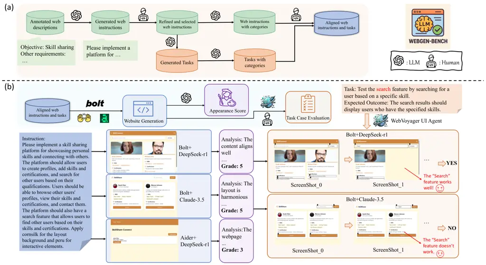

Figure 1: The data-curation and automatic-testing pipeline. (a) depicts
the process for curating website-generation instructions together with
their corresponding test cases. (b) presents the testing pipeline for
verifying whether the generated websites meet functionality and design
requirements with the WebVoyager UI agent, and for analyzing their
aesthetic quality using GPT-4o.

Our contributions are as follows:

- •
  We introduce WebGen-Bench, the first benchmark designed to test the
  ability of an LLM-based agent to generate websites from scratch. It
  includes diverse instructions for website generation and corresponding
  test cases to evaluate website functionalities.
- •
  We conduct comprehensive evaluations of three high-performance
  code-agent frameworks — Bolt.diy, OpenHands, and Aider — using
  different proprietary LLMs as engines, demonstrating the challenging
  nature of our benchmark.
- •
  We construct WebGen-Instruct, a training set consisting of 6,667
  website-generation instructions. We use this training set to fine-tune
  Qwen2.5-Coder-Instruct models of sizes 7B, 14B, and 32B, resulting in
  a family of LLMs specialized in website generation, named WebGen-LM.
  WebGen-LM-32B achieves an accuracy of 38.2% on WebGen-Bench,
  surpassing DeepSeek-R1.

## 2 Related Work

Software Engineering Benchmarks. Code generation has long been used as a
means to evaluate the abilities of LLMs \[12, 5, 4\]. Previous works
have collected coding problems from various sources, such as user
queries \[42\], coding contests \[15\], model synthesis \[44\], and
expert design \[24, 5\], to evaluate LLMs’ performance on single-file,
function-level coding tasks. Recently, as stronger models have reached a
plateau on these simpler benchmarks, new benchmarks such as
SWE-bench \[16, 39\] and SWE-Lancer \[23\] have been constructed by
collecting real-world code repositories and corresponding issue requests
to test models’ ability to solve bugs and implement new functionalities.
These benchmarks require models to identify and fix issues \[16, 39,
2\], perform code completions \[18, 41\], or provide functionality
patches \[23\] within an existing multi-file codebase. Different from
previous works, our benchmark focuses on creating web applications from
scratch based on natural language instructions, requiring models to
generate a complex, multi-file codebase, implement multiple
functionality and appearance requirements, and make independent
technical design decisions.

LLM-based Code Agents and Pipelines. Various agent-based \[33, 38, 1, 7,
6, 34\] and pipeline-based \[35, 29, 43\] methods have been proposed to
address software engineering problems such as code completion and GitHub
issue resolution. While pipeline-based methods sometimes demonstrate
strong performance on specific tasks with fixed pipelines \[16\],
agent-based methods are generally more flexible and versatile. Code
agent frameworks such as OpenHands \[33\] and SWE-agent \[38\] interact
with executable environments to obtain feedback from the execution of
generated code. To evaluate our benchmark, we selected three open-source
code agents. Among them, OpenHands \[33\] and Aider \[1\] are
general-purpose code agent frameworks that we adapted for our benchmark,
while Bolt.diy \[30\] is a specialized framework for generating web
applications. Prior works \[26, 22, 20, 36, 21\] have employed various
post-training methods to improve the performance of code agents using
open-source models. In this work, we also fine-tune open-source models
with trajectories generated from web-generating instructions.

Automatic Software User-testing. User-testing is a common method in
software engineering to assess the functionality of software with high
user-interaction requirements. However, human testing can be costly and
introduce significant management complexities. Various works have
employed agents to test websites \[19\], graphical user interfaces
(GUIs) \[8\], and games \[31, 9\]. Among them, UXAgent \[19\] uses UI
agents with pre-defined personas to simulate user experiences on
websites. Our work also utilizes a web navigation UI agent to evaluate
generated websites. Different from prior works, we define atomic test
cases targeting functionality and appearance requirements, enabling the
agent to perform operations and observe whether the website behaves as
intended.

## 3 WebGen-Bench

In this section, we introduce WebGen-Bench, the first benchmark designed
to test the ability of LLM-based agents to generate websites from
scratch based on natural language instructions. The benchmark consists
of diverse website-generation instructions and comprehensive test cases
that have been carefully constructed and repeatedly validated. A
reliable and cost-effective testing pipeline, built around a strong web
navigation agent, has been developed to ensure efficient evaluation of
the generated websites. The data curation process and testing pipeline
are shown in Fig. 1 (a) and (b) respectively.

### 3.1 Instruction Curation

Web Development Project Descriptions Collection. To ensure the diversity
and practicality of the instructions, we first carefully browsed several
platforms containing website development project listings, including
Upwork⁶⁶ 6 https://www.upwork.com, Freelancer⁷⁷ 7
https://www.freelancer.com, and Proginn⁸⁸ 8 https://www.proginn.com.
After systematic analysis and discussions among the authors, we
identified twenty prevalent web application categories, as outlined in
Table 7. To simulate numerous customized web applications, we employ a
panel of forty computer science Ph.D students to conduct brainstorming
sessions to determine various specific web applications belonging to
these categories, as well as a brief and clear list of corresponding
functionality and appearance requirements for each application. A
customized application and its corresponding requirements are combined
into a project description. We manually created 10152 project
descriptions in total.

Web Development Project Descriptions Collection. To ensure the diversity
and practicality of the instructions, we first carefully browsed several
platforms containing website development project listings, including
Upwork⁹⁹ 9 https://www.upwork.com, Freelancer¹⁰¹⁰ 10
https://www.freelancer.com, and Proginn¹¹¹¹ 11 https://www.proginn.com.
After systematic analysis and discussions among the authors, we
identified twenty prevalent web application categories, as outlined in
Table 7. To simulate numerous customized web applications, we employ a
panel of forty computer science Ph.D students to conduct brainstorming
sessions to determine various specific web applications belonging to
these categories, as well as a brief and clear list of corresponding
functionality and appearance requirements for each application. A
customized application and its corresponding requirements are combined
into a project description. We manually created 10152 project
descriptions in total.

Website-Generation Instruction Curation. From the collected project
descriptions, we use one-shot prompting with GPT-4o to generate the
corresponding instructions. The prompt template is shown in Fig. 4 in
Appendix C. Because the total number of generated instructions exceeds
the practical limits of benchmarking code agents—which require
substantial computational resources and long inference trajectories—we
sample two to eight representative examples from each category to
preserve both coverage and diversity. This procedure produces a curated
test set containing 101 instructions.

Next, we deduplicate the remaining instructions by first filtering those
with a 5-gram Jaccard similarity score exceeding 0.6 relative to any
testing instruction. We then perform semantic deduplication by computing
cosine similarity between sentence embeddings \[28\] of the remaining
instructions and the testing set. This decontamination process produces
a training set of 6,667 website-generation instructions, which we name
WebGen-Instruct. Details of the decontamination process are provided in
Appendix D.

Test Set Adjustment and Validation. We refine and validate the selected
test instructions to ensure they exclude unreasonable designs and
specific technical implementation details. We intentionally omit
technical design specifications because our dataset aims to evaluate
code agents in scenarios where they receive instructions from non-expert
users. The agents should autonomously determine the optimal technical
approach. Including tool-specific hints in the instructions would
compromise this objective.

Technical Classification of the Testing Set. Given the limited number of
testing instructions per application category, analyzing categorical
statistics based on the original 20 application categories would be
confusing. To enable higher-level analysis, we reorganize the 101
testing instructions into three broader technical categories (see
Tab. 2:) 1. Content Presentation: Static page generation (e.g.,
corporate/portfolio sites), dynamic rendering (e.g., blogs/news feeds),
data visualization (e.g., dashboards), and immersive media displays
(e.g., 360° product views). 2. User Interaction: Form systems,
authentication flows, real-time collaboration tools, e-commerce
transactions, and AI-enhanced features (e.g., chatbots). 3. Data
Management: CRUD operations for content administration, third-party API
integrations (e.g., payment/social platforms), analytical processing of
user behavior data, and file operations (e.g., cloud synchronization,
bulk exports).

|                      |               |                           |               |
| -------------------- | ------------- | ------------------------- | ------------- |
| Main Categories      | Sample Number | Sub Category              | Sample Number |
| Content Presentation | 28            | Static Page Generation    | 20            |
|                      |               | Dynamic Content Rendering | 18            |
|                      |               | Data Visualization        | 36            |
|                      |               | Media Display             | 6             |
| User Interaction     | 49            | Form Systems              | 40            |
|                      |               | Authentication            | 18            |
|                      |               | Real-time Features        | 20            |
|                      |               | E-commerce                | 22            |
|                      |               | AI Integration            | 19            |
| Data Management      | 24            | CRUD Operations           | 29            |
|                      |               | API Integration           | 20            |
|                      |               | Big Data                  | 12            |
|                      |               | File Handling             | 5             |
| Total                | 101           |                           |               |

Table 2: The number of website-generation instructions in each technical
category in WebGen-Bench is shown. Each main category contains multiple
subcategories. A sample may belong to one main category and multiple
subcategories.

### 3.2 Test Case Construction and Evaluation

Since the websites are generated from scratch based on the instructions,
the tested agents have significant freedom in their implementation
choices. To accurately evaluate how well the agents satisfy the
instruction requirements while accommodating diverse implementation
approaches, we construct test cases targeting each and every requirement
in the instructions.

Test Case Construction. Each test case consists of an operation
verifying a specific functionality or appearance requirement, paired
with its expected outcome. We first generate draft test cases using
GPT-4o with the prompt shown in Figure 8. Two computer science Ph.D.
students then independently review and refine these test cases. After
comparing their adjustments, we resolved discrepancies through
discussion, yielding a final set of 647 test cases (4–11 per
instruction). This manual validation process guarantees strict alignment
between test cases and instructions, ensuring: (1) all instruction
requirements are covered by test cases, and (2) each test case
corresponds to an instruction requirement. This approach ensures
comprehensive evaluation while preserving implementation flexibility for
the tested agents.

UI Agent-based Evaluation. With instructions and test cases prepared, we
must determine how to effectively evaluate the generated websites.
Manual testing by human evaluators is costly and time-consuming, as
completing a test case takes at least 60 seconds, and finishing all 647
test cases would require approximately 10.8 hours at an estimated cost
of \$377.8 \[32\]. This slow, labor-intensive process would hinder rapid
iteration during framework development, preventing researchers from
obtaining timely feedback when refining website-generation systems.

To improve testing efficiency, we automate test case evaluation.
Inspired by \[19\], which employs persona-based agents for web usability
testing, we utilize WebVoyager \[11\], a robust web navigation UI agent,
to execute test operations and verify outcomes. We structure each test
case’s operation and expected outcome into a standardized prompt
(Fig. 10), which directs the agent to simulate user interactions,
analyze action trajectories and screenshots, and return YES, NO, or
PARTIAL assessments based on requirement fulfillment. The process is
shown on the right side of Fig. 1 (b). When the agent reaches its
interaction limit without completing evaluation, we trigger a decision
prompt, inducing the agent to make a final decision (Fig. 9).
Considering the cost induced by multiple interactions with the website
in evaluating each test case, we employ Qwen2.5-VL-32B-Instruct, an
efficient open-source vision-language model that balances performance
and cost-effectiveness, as the agent’s engine.

### 3.3 Evaluation of Website Appearance

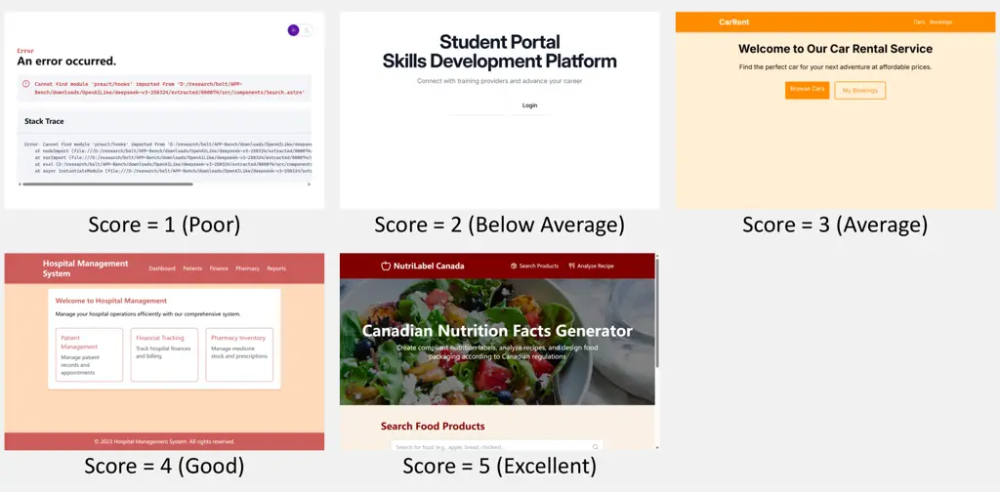

Figure 2: The examples of website screenshots at each appearance score.

Apart from the fulfillment of the functionality and appearance
constraints in the instructions, another important aspect of website
generation is the level of relevance, harmony, and aesthetics of the
webpage. To conduct a quantitative analysis of this aspect, we designed
a set of detailed metrics, ranging from the success of rendering and the
relevance of the content to the harmony of the layout and the modernness
of the design. We then place the metrics in a prompt, asking GPT-4o to
grade the appearance of the website with a score ranging from 1 to 5
(the higher the better), as demonstrated in the middle part of Fig. 1
(b). The prompt is shown in Fig. 11. Examples of websites at different
appearance scores are shown in Fig. 2, and more examples are presented
in Fig. 15 of Appendix. M.

## 4 Experiments

### 4.1 Experimental Setup

Frameworks. We evaluate three popular code-agent frameworks:
Bolt.diy \[30\], OpenHands \[33\], and Aider \[1\]. Bolt.diy is the
open-source version of Bolt.new¹²¹² 12 https://bolt.new, a browser-based
framework for generating and previewing web applications. It provides a
user interface and a Linux-like WebContainer environment that can
execute code. It first prompts the model to decide which frontend and
backend frameworks to use (such as Vite, React, Remix, etc.), then
imports the basic template and builds upon it. OpenHands is a platform
for AI-powered software development agents. For OpenHands, we pair it
with CodeActAgent to evaluate it on our benchmark. The adapted
instruction is presented in Appendix I. Aider is a terminal-based AI
programming framework that natively supports many popular programming
languages, including Python, JavaScript, PHP, HTML, CSS, and more. Aider
constructs a map of the entire codebase, which helps it function well in
larger projects. We use the adapted instruction in Appendix J to
generate websites with Aider.

Models. We first evaluate the three frameworks on DeepSeek-V3 \[17\],
Claude-3.5-Sonnet \[3\], and DeepSeek-R1 \[10\]. We then evaluate
several strong general-purpose proprietary and open-source
LLMs—including Claude-3.5-Sonnet \[3\], DeepSeek-R1 \[10\],
GPT-4o \[14\], O3-mini \[25\], Qwen2.5-Coder-32B \[13\], and
Qwen2.5-72B-Instruct \[37\]—on the best-performing framework, Bolt.diy.
We do not test general-purpose models smaller than Qwen2.5-Coder-32B, as
we observe that such models often fail to follow the specified output
format and therefore cannot generate valid websites.

Training Details. To validate the effectiveness of our training set, we
selectively generated Bolt.diy trajectories for a subset of 2K
instructions from WebGen-Instruct using DeepSeek-V3. Using rejection
sampling \[40\], we retained only the trajectories whose corresponding
websites achieved an appearance score greater than or equal to 3,
resulting in 600 trajectories. This filtering ensures that the remaining
generated websites are relevant to the instructions and do not exhibit
major rendering issues. We then fine-tuned Qwen2.5-Coder-Instruct models
of sizes 7B, 14B, and 32B for 2 epochs, with a learning rate of 4e-5 and
a batch size of 32. The 7B, 14B, and 32B models were trained on 8, 16,
and 32 A800 GPUs, respectively. This fine-tuning process yields a family
of models specialized in website generation, which we name WebGen-LM.

### 4.2 Experimental Results

|                      |          |              |         |              |          |                  |
| -------------------- | -------- | ------------ | ------- | ------------ | -------- | ---------------- |
| Test Name            | Yes Rate | Partial Rate | No Rate | Start Failed | Accuracy | Appearance Score |
| Bolt.diy             |          |              |         |              |          |                  |
| Claude-3.5-Sonnet    | 22.6     | 7.6          | 64.1    | 5.7          | 26.4     | 3.0              |
| DeepSeek-R1          | 24.7     | 6.2          | 64.3    | 4.8          | 27.8     | 2.5              |
| DeepSeek-V3          | 18.5     | 4.5          | 73.9    | 3.1          | 20.8     | 2.0              |
| GPT-4o               | 10.4     | 4.8          | 64.5    | 20.4         | 12.8     | 1.5              |
| o3-mini              | 17.9     | 3.4          | 40.0    | 38.6         | 19.6     | 1.6              |
| Qwen2.5-Coder-32B    | 8.2      | 2.6          | 81.8    | 7.4          | 9.5      | 1.1              |
| Qwen2.5-72B-Instruct | 12.1     | 3.6          | 80.7    | 3.7          | 13.8     | 1.4              |
| WebGen-LM-7B         | 24.9     | 7.1          | 68.0    | 0.0          | 28.4     | 2.5              |
| WebGen-LM-14B        | 25.0     | 8.7          | 66.3    | 0.0          | 29.4     | 2.5              |
| WebGen-LM-32B        | 34.2     | 8.0          | 57.8    | 0.0          | 38.2     | 2.8              |
| OpenHands            |          |              |         |              |          |                  |
| Claude-3.5-Sonnet    | 18.1     | 8.3          | 58.6    | 15.0         | 22.3     | 2.6              |
| DeepSeek-R1          | 8.5      | 3.4          | 60.4    | 27.7         | 10.2     | 1.4              |
| Deepseek-V3          | 7.4      | 3.2          | 73.9    | 15.5         | 9.0      | 1.5              |
| Aider                |          |              |         |              |          |                  |
| Claude-3.5-Sonnet    | 19.9     | 5.9          | 42.0    | 32.1         | 22.9     | 1.9              |
| DeepSeek-R1          | 23.3     | 8.7          | 44.5    | 23.5         | 27.7     | 2.7              |
| Deepseek-V3          | 12.5     | 3.1          | 54.3    | 30.1         | 14.1     | 1.2              |

Table 3: Evaluation of three powerful code-agent frameworks using
different proprietary and open-source models. Accuracy is computed using
a weighted score, where YES samples are weighted by 1 and PARTIAL
samples are weighted by 0.5; the total score is then divided by the
number of test cases. The highest accuracy and appearance scores are
marked in bold.

|                      |                        |                  |                 |                      |                      |                           |
| -------------------- | ---------------------- | ---------------- | --------------- | -------------------- | -------------------- | ------------------------- |
| Test Name            | Instruction Categories |                  |                 | Test Case Categories |                      |                           |
|                      | Content Presentation   | User Interaction | Data Management | Functional Testing   | Data Display Testing | Design Validation Testing |
| Bolt.diy             |                        |                  |                 |                      |                      |                           |
| Claude-3.5-Sonnet    | 35.6                   | 21.2             | 26.2            | 17.1                 | 26.3                 | 52.0                      |
| DeepSeek-R1          | 43.7                   | 20.6             | 24.7            | 21.1                 | 29.3                 | 44.3                      |
| DeepSeek-V3          | 37.1                   | 16.6             | 11.2            | 10.5                 | 28.2                 | 38.1                      |
| GPT-4o               | 26.4                   | 5.9              | 11.2            | 4.7                  | 19.6                 | 24.6                      |
| o3-mini              | 28.7                   | 17.7             | 13.4            | 11.4                 | 25.5                 | 33.6                      |
| Qwen2.5-Coder-32B    | 17.5                   | 6.9              | 5.9             | 1.9                  | 14.5                 | 23.0                      |
| Qwen2.5-72B-Instruct | 28.2                   | 10.1             | 5.6             | 5.8                  | 21.0                 | 25.4                      |
| WebGen-LM-7B         | 27.9                   | 23.8             | 38.1            | 22.0                 | 27.7                 | 47.5                      |
| WebGen-LM-14B        | 30.2                   | 27.8             | 31.6            | 23.6                 | 26.9                 | 49.2                      |
| WebGen-LM-32B        | 46.6                   | 33.2             | 38.8            | 29.1                 | 43.0                 | 56.1                      |
| OpenHands            |                        |                  |                 |                      |                      |                           |
| Claude-3.5-Sonnet    | 32.8                   | 18.4             | 18.4            | 12.4                 | 33.9                 | 32.0                      |
| DeepSeek-R1          | 16.4                   | 8.9              | 5.9             | 5.0                  | 9.9                  | 25.0                      |
| Deepseek-V3          | 12.6                   | 7.3              | 8.4             | 3.8                  | 8.1                  | 25.0                      |
| Aider                |                        |                  |                 |                      |                      |                           |
| Claude-3.5-Sonnet    | 31.9                   | 21.1             | 16.6            | 14.9                 | 30.1                 | 34.0                      |
| DeepSeek-R1          | 39.1                   | 28.6             | 13.4            | 17.6                 | 35.2                 | 44.3                      |
| Deepseek-V3          | 17.8                   | 12.8             | 12.5            | 9.7                  | 19.1                 | 18.4                      |

Table 4: Category-wise evaluation results. The first three columns
represent categories of website-generation instructions, while the last
three represent categories of test cases. The highest score in each
category is marked in bold.

We present the results on the entire WebGen-Bench dataset in Tab.3, and
the accuracy for each category of instructions and test cases in Tab. 4.
Accuracy is computed using the formula
$`\text{Accuracy}=\frac{N_{\text{Yes}}+0.5\times N_{\text{Partial}}}{N_{\text{Total}}}\times 100\%`$,
where $`N_{\text{Yes}}`$ and $`N_{\text{Partial}}`$ denote the number of
test cases assessed as YES and PARTIAL, respectively, and
$`N_{\text{Total}}`$ is the total number of test cases.

Main Results. Based on the experimental results, we make the following
observations: (1) As shown in Tab. 4, WebGen-LM-32B achieves the highest
accuracy of 38.2%, surpassing the best proprietary model, DeepSeek-R1,
by 10.4%, demonstrating the effectiveness of our training set and the
rejection-sampling process. (2) Bolt.diy with DeepSeek-R1 as the engine
achieves the highest accuracy among general LLMs at 27.8%, closely
followed by Claude-3.5-Sonnet with an accuracy of 26.4%. This indicates
that the best-performing models are still far from saturating
WebGen-Bench, highlighting that our benchmark remains challenging for
current LLMs and agent frameworks. (3) Smaller general open-source
models, such as Qwen2.5-Coder-32B and Qwen2.5-72B-Instruct, show a
significant performance gap compared to proprietary models. (4) In terms
of appearance scores, Bolt.diy with Claude-3.5-Sonnet achieves the best
performance of 3.0. The appearance score exhibits a loose correlation
with accuracy, as functional webpages typically do not suffer from major
rendering issues.

Categorical Results. Apart from the three main instruction categories
(shown in Tab. 2), we also classify the test cases into three primary
categories based on what they are intended to evaluate: Functional
Testing, Data Display Testing, and Design Validation Testing. Detailed
definitions and statistics for these categories are provided in Fig. 14
and Tab. 8 in AppendixK. As shown in Tab. 4, among the different
categories of test cases, Design Validation Testing achieves the highest
accuracy in most cases, while Functional Testing generally yields lower
accuracy. Among instruction categories, Content Presentation
consistently demonstrates the highest accuracies. This indicates that
superficial aspects, such as color themes, are easier to implement than
deeper internal functionalities.

### 4.3 Ablation Studies

| Model             | Testing Method | Yes Rate | Partial Rate | No Rate | Accuracy | Alignment Rate |
| ----------------- | -------------- | -------- | ------------ | ------- | -------- | -------------- |
| Claude-3.5-Sonnet | UI Agent       | 22.6     | 7.6          | 64.1    | 26.4     | 90.3           |
|                   | Manual         | 22.4     | 7.1          | 59.0    | 26.0     | –              |
| Deepseek-R1       | UI Agent       | 24.7     | 6.2          | 64.3    | 27.8     | 86.1           |
|                   | Manual         | 28.0     | 4.3          | 58.1    | 30.1     | –              |
| Deepseek-V3       | UI Agent       | 18.5     | 4.5          | 73.9    | 20.8     | 94.4           |
|                   | Manual         | 19.0     | 4.5          | 70.3    | 21.3     | –              |

Table 5: Alignment between the UI agent testing results and human
testing results. The alignment rate denotes the proportion of test cases
in which the UI agent’s results match those of human testers.

| Sample Number | Yes Rate | Accuracy |
| ------------- | -------- | -------- |
| 150           | 21.8     | 25.1     |
| 300           | 28.6     | 31.9     |
| 600           | 34.2     | 38.2     |

Table 6: Comparison of yes rate and accuracy at different sample sizes.
The base model is Qwen2.5-Coder-32B-Instruct.

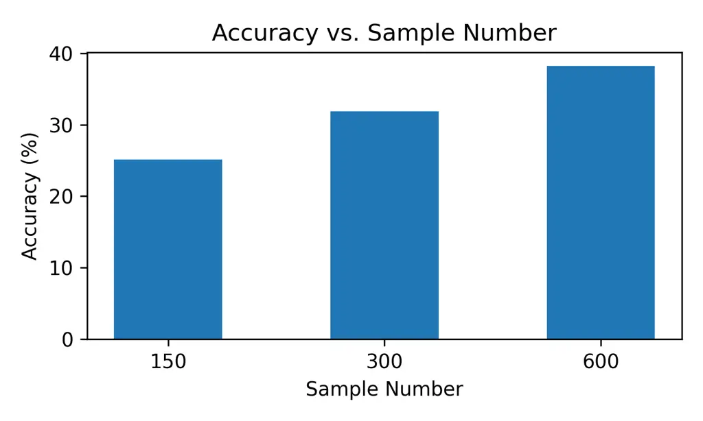

Figure 3: Accuracy vs. sample number.

Analysis of the Accuracy of UI Agent Testing Results. To analyze the
accuracy of the UI agent testing process, we manually examined three
sets of testing results on Bolt.diy. We select the results of
Claude-3.5-Sonnet, DeepSeek-R1, and DeepSeek-V3 as the accuracies of
these three models are high and are close to each other. The manual
testing results serve as the ground truth and require precision;
therefore, three human testers independently annotated the results and
we assessed the consistency of their annotations. If the annotations of
a test case are inconsistent, a fourth human tester is tasked with
re-examining the test case and the inconsistent annotations to decide on
a final annotation. We present the results of manual testing in Tab. 5.
The Alignment Rate is computed with
$`\text{Alignment Rate}=\frac{N_{\text{Manual}=\text{Agent}}}{N_{\text{total}}}\times 100\%`$,
where $`N_{\text{Manual}=\text{Agent}}`$ denotes the number of test
cases where the agent-generated result aligns with the
manually-annotated result. Further analysis regarding the accuracy of
appearance scores is presented in Appendix L.

Analysis of the Number of Training Samples. We analyze the effect of the
number of training samples on the accuracy of the fine-tuned models.
Specifically, we fine-tune Qwen2.5-Coder-32B-Instruct using 150, 300,
and 600 samples, respectively. As shown in Fig. 3 and Tab. 4.3, accuracy
consistently increases with the number of training samples, highlighting
the potential of our training set. We did not sample additional
trajectories due to API budget constraints. Nevertheless, the current
sample size already demonstrates the effectiveness of WebGen-Instruct
for training website generation LLMs. Further accuracy improvements
through additional data or techniques such as data augmentation are left
for future work.

## 5 Conclusion

In this paper, we introduce WebGen-Bench, a novel benchmark for
evaluating the ability of LLM-based agents to generate websites from
scratch. The benchmark requires agents to construct and organize
multi-file codebases while satisfying various functional and visual
constraints. We evaluate three code-agent frameworks using both
proprietary and open-source LLMs. The best-performing combination,
Bolt.diy with DeepSeek-R1, achieves an accuracy of only 27.8%,
highlighting the challenging nature of our benchmark. Additionally, we
construct a training set of 6,667 website-generation instructions and
fine-tune Qwen2.5-Coder-32B on 600 Bolt.diy trajectories generated by
DeepSeek-V3, resulting in an accuracy of 38.2%—surpassing even the best
proprietary model.

## References

- \[1\] Aider-AI. Ai pair programming in your terminal, 2024. Accessed:
  2025-04-22.
- \[2\] Reem Aleithan, Haoran Xue, Mohammad Mahdi Mohajer, Elijah
  Nnorom, Gias Uddin, and Song Wang. Swe-bench+: Enhanced coding
  benchmark for llms. arXiv preprint arXiv:2410.06992, 2024.
- \[3\] Anthropic. Introducing claude 3.5 sonnet, 2024. Accessed:
  2025-04-22.
- \[4\] Jacob Austin, Augustus Odena, Maxwell Nye, Maarten Bosma, Henryk
  Michalewski, David Dohan, Ellen Jiang, Carrie Cai, Michael Terry, Quoc
  Le, et al. Program synthesis with large language models. arXiv
  preprint arXiv:2108.07732, 2021.
- \[5\] Mark Chen, Jerry Tworek, Heewoo Jun, Qiming Yuan, Henrique Ponde
  De Oliveira Pinto, Jared Kaplan, Harri Edwards, Yuri Burda, Nicholas
  Joseph, Greg Brockman, et al. Evaluating large language models trained
  on code. arXiv preprint arXiv:2107.03374, 2021.
- \[6\] GitHub Copilot. Github copilot, 2024. Accessed: 2025-04-22.
- \[7\] Cursor. Cursor: The ai code editor, 2024. Accessed: 2025-04-22.
- \[8\] Juha Eskonen, Julen Kahles, and Joel Reijonen. Automating gui
  testing with image-based deep reinforcement learning. In 2020 IEEE
  International Conference on Autonomic Computing and Self-Organizing
  Systems (ACSOS), pages 160–167, 2020.
- \[9\] Pedro M. Fernandes, Manuel Lopes, and Rui Prada. Agents for
  automated user experience testing. In 2021 IEEE International
  Conference on Software Testing, Verification and Validation Workshops
  (ICSTW), pages 247–253, 2021.
- \[10\] Daya Guo, Dejian Yang, Haowei Zhang, Junxiao Song, Ruoyu Zhang,
  Runxin Xu, Qihao Zhu, Shirong Ma, Peiyi Wang, Xiao Bi, et al.
  Deepseek-r1: Incentivizing reasoning capability in llms via
  reinforcement learning. arXiv preprint arXiv:2501.12948, 2025.
- \[11\] Hongliang He, Wenlin Yao, Kaixin Ma, Wenhao Yu, Yong Dai,
  Hongming Zhang, Zhenzhong Lan, and Dong Yu. Webvoyager: Building an
  end-to-end web agent with large multimodal models. arXiv preprint
  arXiv:2401.13919, 2024.
- \[12\] Dan Hendrycks, Steven Basart, Saurav Kadavath, Mantas Mazeika,
  Akul Arora, Ethan Guo, Collin Burns, Samir Puranik, Horace He, Dawn
  Song, et al. Measuring coding challenge competence with apps. arXiv
  preprint arXiv:2105.09938, 2021.
- \[13\] Binyuan Hui, Jian Yang, Zeyu Cui, Jiaxi Yang, Dayiheng Liu, Lei
  Zhang, Tianyu Liu, Jiajun Zhang, Bowen Yu, Keming Lu, et al. Qwen2.
  5-coder technical report. arXiv preprint arXiv:2409.12186, 2024.
- \[14\] Aaron Hurst, Adam Lerer, Adam P Goucher, Adam Perelman, Aditya
  Ramesh, Aidan Clark, AJ Ostrow, Akila Welihinda, Alan Hayes, Alec
  Radford, et al. Gpt-4o system card. arXiv preprint
  arXiv:2410.21276, 2024.
- \[15\] Naman Jain, King Han, Alex Gu, Wen-Ding Li, Fanjia Yan, Tianjun
  Zhang, Sida Wang, Armando Solar-Lezama, Koushik Sen, and Ion Stoica.
  Livecodebench: Holistic and contamination free evaluation of large
  language models for code. arXiv preprint arXiv:2403.07974, 2024.
- \[16\] Carlos E Jimenez, John Yang, Alexander Wettig, Shunyu Yao,
  Kexin Pei, Ofir Press, and Karthik Narasimhan. Swe-bench: Can language
  models resolve real-world github issues? arXiv preprint
  arXiv:2310.06770, 2023.
- \[17\] Aixin Liu, Bei Feng, Bing Xue, Bingxuan Wang, Bochao Wu,
  Chengda Lu, Chenggang Zhao, Chengqi Deng, Chenyu Zhang, Chong Ruan,
  et al. Deepseek-v3 technical report. arXiv preprint
  arXiv:2412.19437, 2024.
- \[18\] Tianyang Liu, Canwen Xu, and Julian McAuley. Repobench:
  Benchmarking repository-level code auto-completion systems. arXiv
  preprint arXiv:2306.03091, 2023.
- \[19\] Yuxuan Lu, Bingsheng Yao, Hansu Gu, Jing Huang, Jessie Wang,
  Laurence Li, Jiri Gesi, Qi He, Toby Jia-Jun Li, and Dakuo Wang.
  Uxagent: An llm agent-based usability testing framework for web
  design. arXiv preprint arXiv:2502.12561, 2025.
- \[20\] Yingwei Ma, Rongyu Cao, Yongchang Cao, Yue Zhang, Jue Chen,
  Yibo Liu, Yuchen Liu, Binhua Li, Fei Huang, and Yongbin Li. Lingma
  swe-gpt: An open development-process-centric language model for
  automated software improvement. arXiv preprint arXiv:2411.00622, 2024.
- \[21\] Zexiong Ma, Shengnan An, Zeqi Lin, Yanzhen Zou, and Bing Xie.
  Repository structure-aware training makes slms better issue resolver.
  arXiv preprint arXiv:2412.19031, 2024.
- \[22\] Zexiong Ma, Chao Peng, Pengfei Gao, Xiangxin Meng, Yanzhen Zou,
  and Bing Xie. Sorft: Issue resolving with subtask-oriented reinforced
  fine-tuning. arXiv preprint arXiv:2502.20127, 2025.
- \[23\] Samuel Miserendino, Michele Wang, Tejal Patwardhan, and
  Johannes Heidecke. Swe-lancer: Can frontier llms earn \$1 million from
  real-world freelance software engineering? arXiv preprint
  arXiv:2502.12115, 2025.
- \[24\] Niklas Muennighoff, Qian Liu, Armel Zebaze, Qinkai Zheng,
  Binyuan Hui, Terry Yue Zhuo, Swayam Singh, Xiangru Tang, Leandro
  Von Werra, and Shayne Longpre. Octopack: Instruction tuning code large
  language models. In NeurIPS 2023 Workshop on Instruction Tuning and
  Instruction Following, 2023.
- \[25\] OpenAI. Openai o3-mini, 2025. Accessed: 2025-04-22.
- \[26\] Jiayi Pan, Xingyao Wang, Graham Neubig, Navdeep Jaitly, Heng
  Ji, Alane Suhr, and Yizhe Zhang. Training software engineering agents
  and verifiers with swe-gym. arXiv preprint arXiv:2412.21139, 2024.
- \[27\] Rafael Rafailov, Archit Sharma, Eric Mitchell, Christopher D
  Manning, Stefano Ermon, and Chelsea Finn. Direct preference
  optimization: Your language model is secretly a reward model. Advances
  in Neural Information Processing Systems, 36:53728–53741, 2023.
- \[28\] Nils Reimers and Iryna Gurevych. Sentence-bert: Sentence
  embeddings using siamese bert-networks. In Proceedings of the 2019
  Conference on Empirical Methods in Natural Language Processing.
  Association for Computational Linguistics, 11 2019.
- \[29\] Haifeng Ruan, Yuntong Zhang, and Abhik Roychoudhury. Specrover:
  Code intent extraction via llms. arXiv preprint
  arXiv:2408.02232, 2024.
- \[30\] stackblitz labs. bolt.diy, 2024. Accessed: 2025-04-22.
- \[31\] Samantha . Stahlke, Atiya Nova, and Pejman Mirza-Babaei.
  Artificial playfulness: A tool for automated agent-based playtesting.
  In Extended Abstracts of the 2019 CHI Conference on Human Factors in
  Computing Systems, CHI EA ’19, page 1–6, New York, NY, USA, 2019.
  Association for Computing Machinery.
- \[32\] US Bureau of Labor Statistics. Table b-3. average hourly and
  weekly earnings of all employees on private nonfarm payrolls by
  industry sector, seasonally adjusted., 2024.
- \[33\] Xingyao Wang, Boxuan Li, Yufan Song, Frank F Xu, Xiangru Tang,
  Mingchen Zhuge, Jiayi Pan, Yueqi Song, Bowen Li, Jaskirat Singh,
  et al. Openhands: An open platform for ai software developers as
  generalist agents. In The Thirteenth International Conference on
  Learning Representations, 2024.
- \[34\] Scott Wu. Introducing devin, the first ai software
  engineer, 2024. Accessed: 2025-04-22.
- \[35\] Chunqiu Steven Xia, Yinlin Deng, Soren Dunn, and Lingming
  Zhang. Agentless: Demystifying llm-based software engineering agents.
  arXiv preprint arXiv:2407.01489, 2024.
- \[36\] Chengxing Xie, Bowen Li, Chang Gao, He Du, Wai Lam, Difan Zou,
  and Kai Chen. Swe-fixer: Training open-source llms for effective and
  efficient github issue resolution. arXiv preprint
  arXiv:2501.05040, 2025.
- \[37\] An Yang, Baosong Yang, Beichen Zhang, Binyuan Hui, Bo Zheng,
  Bowen Yu, Chengyuan Li, Dayiheng Liu, Fei Huang, Haoran Wei, et al.
  Qwen2. 5 technical report. arXiv preprint arXiv:2412.15115, 2024.
- \[38\] John Yang, Carlos Jimenez, Alexander Wettig, Kilian Lieret,
  Shunyu Yao, Karthik Narasimhan, and Ofir Press. Swe-agent:
  Agent-computer interfaces enable automated software engineering.
  Advances in Neural Information Processing Systems,
  37:50528–50652, 2024.
- \[39\] John Yang, Carlos E Jimenez, Alex L Zhang, Kilian Lieret, Joyce
  Yang, Xindi Wu, Ori Press, Niklas Muennighoff, Gabriel Synnaeve,
  Karthik R Narasimhan, et al. Swe-bench multimodal: Do ai systems
  generalize to visual software domains? arXiv preprint
  arXiv:2410.03859, 2024.
- \[40\] Zheng Yuan, Hongyi Yuan, Chengpeng Li, Guanting Dong, Keming
  Lu, Chuanqi Tan, Chang Zhou, and Jingren Zhou. Scaling relationship on
  learning mathematical reasoning with large language models. arXiv
  preprint arXiv:2308.01825, 2023.
- \[41\] Fengji Zhang, Bei Chen, Yue Zhang, Jacky Keung, Jin Liu,
  Daoguang Zan, Yi Mao, Jian-Guang Lou, and Weizhu Chen. Repocoder:
  Repository-level code completion through iterative retrieval and
  generation. arXiv preprint arXiv:2303.12570, 2023.
- \[42\] Shudan Zhang, Hanlin Zhao, Xiao Liu, Qinkai Zheng, Zehan Qi,
  Xiaotao Gu, Xiaohan Zhang, Yuxiao Dong, and Jie Tang.
  Naturalcodebench: Examining coding performance mismatch on humaneval
  and natural user prompts. arXiv preprint arXiv:2405.04520, 2024.
- \[43\] Yuntong Zhang, Haifeng Ruan, Zhiyu Fan, and Abhik Roychoudhury.
  Autocoderover: Autonomous program improvement. In Proceedings of the
  33rd ACM SIGSOFT International Symposium on Software Testing and
  Analysis, pages 1592–1604, 2024.
- \[44\] Terry Yue Zhuo, Minh Chien Vu, Jenny Chim, Han Hu, Wenhao Yu,
  Ratnadira Widyasari, Imam Nur Bani Yusuf, Haolan Zhan, Junda He,
  Indraneil Paul, et al. Bigcodebench: Benchmarking code generation with
  diverse function calls and complex instructions. arXiv preprint
  arXiv:2406.15877, 2024.

## Appendix A Ethics Statement

The WebGen-Bench dataset is entirely composed of synthetically generated
instructions and test cases, curated manually and synthesized using
artificial intelligence. While this resource is non-commercial, we
emphasize that its construction process maintains a clear distance from
potential ethical or legal concerns, particularly regarding intellectual
property.

Legal compliance. We take great care in our methodology to uphold
copyright integrity, utilizing three protective approaches to safeguard
against infringement: (1) all base project descriptions originate from
the creative efforts of the authors and student volunteers; (2) the 20
fundamental categories are sufficiently abstracted through systematic
analysis; and (3) our framework does not copy content from existing
websites or platforms, thereby avoiding copyright infringement risks
associated with specific commercial implementations.

Dataset Intended Usage and License. We document the WebGen-Bench dataset
in this paper and note that both the dataset and the code used for
reproducing results are publicly available. We intend for researchers to
use this dataset to better evaluate the ability of LLM-based agents to
generate websites from scratch. We take full responsibility in the event
of any rights violations. The WebGen-Bench dataset and our open-source
code are released under the MIT license.

## Appendix B Limitations and Future Work

Website generation in this work is primarily conducted using TypeScript,
JavaScript, CSS, and HTML. Other languages such as Python, Java, and Go
are not used, due to the complexity of integrating them into the agent
framework. Expanding the range of supported languages and tools for
automatic website generation with code agents is a promising direction
for future research. Additionally, we only employed supervised
fine-tuning to enhance the performance of open-source LLMs on website
generation, without utilizing other post-training strategies such as
reinforcement learning or direct preference optimization \[27\]. These
methods present valuable opportunities for future exploration.

## Appendix C Prompt for Deriving Instructions from Website Development Project Descriptions

Fig. 4 presents the prompt used to derive website-generation
instructions from web development project descriptions created by human
annotators. Notably, the model is instructed to exclude any requirements
related to technical implementation details, as the goal is to evaluate
the code agents’ ability to make such decisions independently.

Figure 4: The prompt for deriving instructions from human annotated
descriptions.

## Appendix D Details of the Decontamination Process

In this section, we introduce the methods we used to decontaminate the
training set from the testing set. We first employ 5-gram Jaccard
similarity, removing the instructions in the training set with a
similarity score higher than 0.6 with one of the instructions in the
testing set. Then, to remove the instructions that are semantically
similar to those in the testing set, we compute the sentence embeddings
of the instructions using the all-MiniLM-L6-v2 model of
Sentence-Transformer \[28\], and compute the cosine similarity of the
embeddings. We experimented with various threshold settings, and finally
settled on removing the training instructions with a cosine similarity
of larger than 0.55.

We then inspect whether the remaining training samples contain
instructions that are semantic duplicates of the instructions in the
testing. For each testing instruction, we retrieve the top-3 training
instructions with the highest cosine similarity, and manually inspect
them for semantic duplication. We found that the retrieved training
samples are all completely different from the testing samples, proving
that the final training set is not contaminated. The first three samples
in WebGen-Bench and their top matches in the training set are shown in
Fig. 5, Fig. 6, and Fig. 7, respectively. The matches are completely
different from the test samples.

[TABLE]

Figure 5: Top semantic matches for the first test instruction in
WebGen-Bench with similarity scores.

[TABLE]

Figure 6: Top semantic matches for the second test instruction in
WebGen-Bench with similarity scores.

[TABLE]

Figure 7: Top semantic matches for the third test instruction in
WebGen-Bench with similarity scores.

## Appendix E Application Categories of WebGen-Instruct and WebGen-Bench.

Tab. 7 lists the 20 application categories manually summarized by the
authors through browsing web development projects on popular platforms
that connect programmers with clients seeking custom website solutions,
such as Upwork¹³¹³ 13 https://www.upwork.com, Freelancer¹⁴¹⁴ 14
https://www.freelancer.com, and Proginn¹⁵¹⁵ 15 https://www.proginn.com.
These application categories serve as seed ideas for our human
annotators during the brainstorming of new application scenarios.

Detailed definition of each category is as follows:

- •
  Personal Portfolio Sites: Showcase individual professional projects,
  achievements, and skills.
- •
  Company Brochure Sites: Static or minimally interactive websites
  providing company information, products, services, and contact
  details.
- •
  Personal Blog Sites: Regularly updated content sites focusing on
  personal writing, opinions, experiences, and sharing of knowledge.
- •
  Social Media Platforms: Applications enabling users to interact
  socially, share content, and build networks.
- •
  Discussion Forums: Platforms facilitating conversations, topic-based
  discussions, threads, and community interactions.
- •
  E-commerce Web Applications: Online platforms designed for buying and
  selling goods and services, handling transactions, inventory, and
  payments.
- •
  Email Clients: Applications for managing emails, sending, receiving,
  organizing, and scheduling email communication.
- •
  Project Management Tools: Platforms aiding in task organization,
  scheduling, collaboration, and resource management for projects.
- •
  Streaming and Interactive Platforms: Media-centric platforms for
  video, audio streaming, or interactive media consumption.
- •
  CRM Systems: Customer Relationship Management tools designed to manage
  interactions, sales, customer data, and marketing.
- •
  ERP Platforms: Enterprise Resource Planning systems integrating core
  business processes such as finance, HR, supply chain, and operations.
- •
  Internal Tools: Applications focused on internal company operations,
  communication, and collaboration.
- •
  News and Information Sites: Platforms primarily dedicated to
  delivering news content, articles, and timely updates.
- •
  Publishing/Blogging Platforms: Platforms enabling users to publish,
  edit, and manage content on a large scale.
- •
  Analytics Platforms/Dashboards: Applications providing insights
  through data visualization, including Business Intelligence and
  Financial Dashboards.
- •
  Browser-Based Games: Interactive, entertainment-focused applications
  running directly in web browsers.
- •
  Learning Platforms: Educational platforms providing courses, training
  materials, quizzes, and learning management systems.
- •
  Travel Booking Portals: Platforms allowing users to search, compare,
  and book travel services like flights, hotels, and car rentals.
- •
  Job Search Platforms: Websites connecting job seekers with employers,
  allowing job postings, applications, and resume management.
- •
  Productivity Applications: Tools for productivity tasks like document
  editing, spreadsheets, presentations, and collaborative work.

| Application Category           | Application Category                |
| ------------------------------ | ----------------------------------- |
| Productivity Applications      | Project Management Tools            |
| Internal Tools                 | Company Brochure Sites              |
| E-commerce Web Applications    | Streaming and Interactive Platforms |
| Analytics Platforms/Dashboards | News and Information Sites          |
| Publishing/Blogging Platforms  | ERP Platforms                       |
| Travel Booking Portals         | Learning Platforms                  |
| CRM Systems                    | Social Media Platforms              |
| Discussion Forums              | Personal Blog Sites                 |
| Email Clients                  | Browser-Based Games                 |
| Job Search Platforms           | Personal Portfolio Sites            |

Table 7: 20 application categories manually summarized from popular
web-development websites.

## Appendix F Prompt for Creating Website Test Cases

Fig. 8 presents the prompt used to construct test cases that evaluate
whether the generated website fulfills the requirements specified in the
corresponding instruction. The prompt emphasizes the importance of
ensuring that all functionality and appearance requirements are covered
by the generated test cases. Conversely, every test case should directly
reflect an aspect of the instruction. This ensures that the website is
thoroughly evaluated and that all test cases are valid.

Figure 8: The prompt for deriving test cases that covers all the
functional and appearance requirements in the instruction. The {orig
prompt} is replaced with the corresponding website-generation
instruction.

## Appendix G Prompt for Automatic Evaluation of Test Cases Using an UI Agent

Fig. 10 presents the prompt used to instruct the UI agent to perform the
operation described in the test case and respond with YES, NO, or
PARTIAL, depending on whether the expected outcome is achieved. Fig. 9
shows the prompt used to induce the agent to make a final decision when
the maximum number of allowed website interactions has been reached.

Figure 9: The prompt for starting the operation of a test case, where
{task} is replaced with the operation to be performed, {expected result}
is replaced with the expected state of the website after the operation
is performed.

Figure 10: The prompt for inducing an answer when the limit of the
number of website interactions is reached, where {task} is replaced with
the operation to be performed, {expected result} is replaced with the
expected state of the website after the operation is performed.

## Appendix H Prompt for Grading Website Appearance

Fig. 10 shows the prompt used to grade the aesthetics of webpage
appearances. The grading vision-language model (GPT-4o in this case) is
instructed to consider metrics such as successful rendering, content
relevance, layout harmony, and the modernity and visual appeal of the
design, and then output a grade ranging from 1 to 5 (the higher, the
better).

Figure 11: The prompt for grading the appearance of the webpage.

## Appendix I Prompt for Adapting OpenHands Paired with CodeActAgent for WebGen-Bench Evaluation

Figure 12 presents the prompt used to evaluate OpenHands in combination
with CodeActAgent on the WebGen-Bench benchmark.

Figure 12: The prompt for testing OpenHands paired with CodeActAgent on
WebGen-Bench.

## Appendix J Prompt for Aider to Generate Websites for WebGen-Bench Evaluation

Fig. 13 shows the prompt used by Aider to generate websites for the
WebGen-Bench evaluation.

Figure 13: The prompt for aider websites generation.

## Appendix K Test Case Categories

Fig. 14 shows the main category distribution of the task cases. Nearly
half of the test cases fall under Functional Testing, around 30% under
Data Display Testing, and approximately 20% under Design Validation
Testing. This is a reasonable distribution, as functional testing
typically constitutes the majority of web page evaluations.
Additionally, Tab. 8 presents the detailed subcategories along with
their respective frequencies.

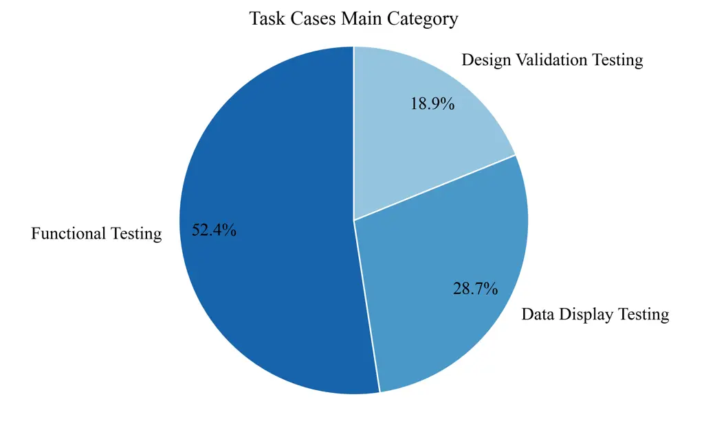

Figure 14: The distribution of the task case categories.

Functional testing ensures that all features of an application work as
intended. This includes testing form operations such as submission and
validation workflows; verifying authentication flows like user
registration, login, and permission checks; and validating payment
functionalities in e-commerce checkouts or donation processes. It also
encompasses search capabilities across various domains such as stock
codes, products, or employees, and filtering data based on specific
requirements. Additionally, functional testing covers generation tasks
such as creating reports or files; file operations including
downloading, uploading, and printing; e-commerce activities such as
purchasing or booking items; and communication features like sending
messages or emails.

Data display testing focuses on how data is presented and updated within
an application. This involves ensuring that dynamic content rendering
works correctly, including real-time data updates, website navigation,
and page refresh mechanisms. It also includes verifying the accuracy of
data visualization elements such as charts, graphs, and maps.
Furthermore, this type of testing checks the functionality of displaying
detailed information when users request more specific data.

Design validation testing focuses on the aesthetic and responsive
aspects of an application’s user interface. It involves verifying UI
consistency across the application and ensuring that color schemes,
typography, and spacing are correctly implemented. Responsive behavior
is also tested to confirm that the application adapts properly to
different devices and screen sizes. Finally, component styling is
checked to ensure that elements such as buttons, icons, and cards adhere
to the intended design standards.

|                           |             |                           |             |
| ------------------------- | ----------- | ------------------------- | ----------- |
| Main Categories           | Task Number | Sub Category              | Task Number |
| Functional Testing        | 339         | Form Operations           | 134         |
|                           |             | Authentication Flows      | 48          |
|                           |             | Payment                   | 7           |
|                           |             | Searching                 | 49          |
|                           |             | Filtering                 | 27          |
|                           |             | Generation                | 63          |
|                           |             | File Operation            | 23          |
|                           |             | E-commerce                | 58          |
|                           |             | Communication             | 71          |
| Data Display Testing      | 186         | Dynamic Content Rendering | 155         |
|                           |             | Data Visualization        | 30          |
|                           |             | Details Information       | 91          |
| Design Validation Testing | 122         | UI Consistency            | 122         |
|                           |             | Responsive Behavior       | 13          |
|                           |             | Component Styling         | 9           |
| Total                     | 667         |                           |             |

Table 8: The number of task cases in each category. There are multiple
subcategories under each main category. A task case can belong to one
main category and multiple subcategories.

## Appendix L Analysis of Reliability of Appearance Scores

To strengthen the appearance assessment, we evaluate the bolt.diy
results produced by Claude-3.5-Sonnet, DeepSeek-R1, and DeepSeek-V3 with
two additional strong multimodal graders—o3 and Claude-3.5-Sonnet. We
also manually grade the website screenshots to capture human preference.
The results are presented in Tab. 9. Although o3 and Claude-3.5-Sonnet
assign slightly lower scores than GPT-4o, the relative ordering of the
three results is unchanged (Claude-3.5-Sonnet \> DeepSeek-R1 \>
DeepSeek-V3). Also, for every set of screenshots, the scores descend in
the same order: GPT-4o \> o3 \> Claude-3.5-Sonnet, showing a consistency
in the models’ grading pattern. The ensemble results of the three
grading models and the human scores both show the same ranking as
GPT-4o. These findings indicate that GPT-4o reliably reflects relative
appearance quality and aligns with human preference, making it a
suitable choice under a limited budget. We will add this discussion to
the revised paper.

| Agent-engine LLM $`\backslash`$ Grading method | GPT-4o | o3  | Claude-3.5-Sonnet | Average (ensemble) | Human |
| ---------------------------------------------- | ------ | --- | ----------------- | ------------------ | ----- |
| Claude-3.5-Sonnet                              | 3.0    | 2.7 | 2.4               | 2.7                | 2.8   |
| DeepSeek-R1                                    | 2.5    | 2.3 | 2.2               | 2.3                | 2.3   |
| DeepSeek-V3                                    | 2.0    | 1.9 | 1.7               | 1.9                | 1.9   |

Table 9: Average appearance scores obtained when the output of each
agent–engine LLM is graded by different grading methods.

## Appendix M Examples of Websites with Different Appearance Scores

Fig. 15 presents examples of websites with varying appearance scores. As
shown in the figure, the visual quality of the websites improves as the
appearance score increases. At a score of one, the websites exhibit
major rendering errors or contain irrelevant content, whereas at a score
of five, the design appears highly harmonious.

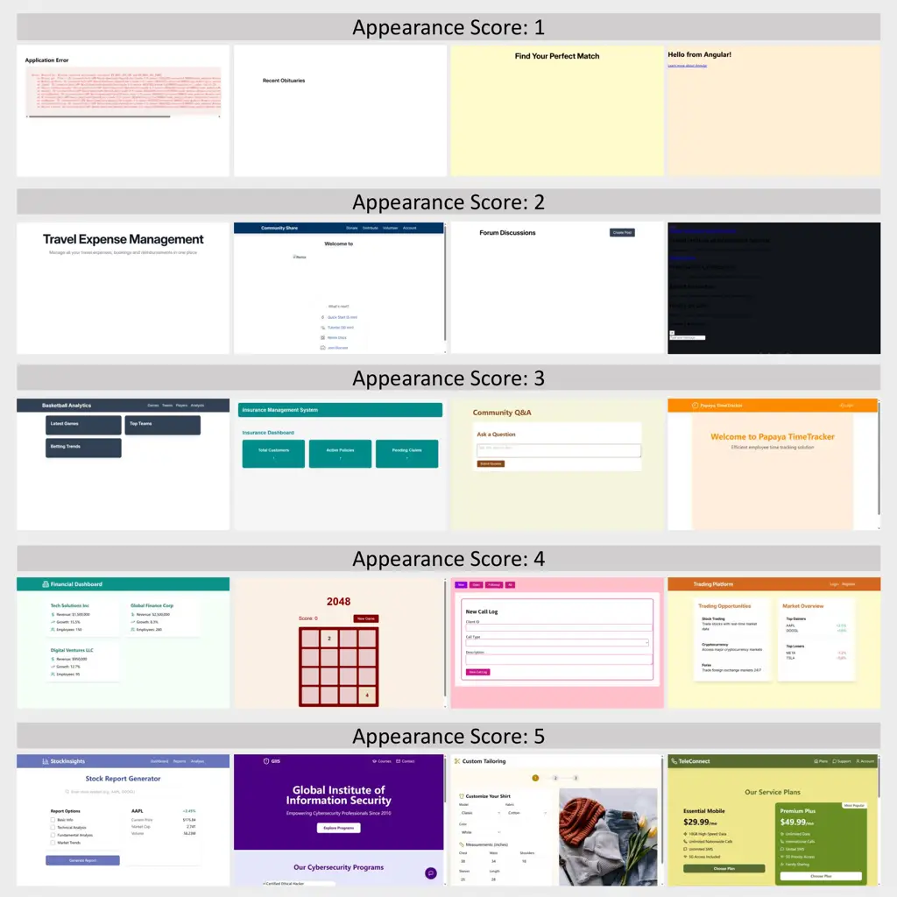

Figure 15: Examples of the screenshots of websites of different
appearance scores.

## Appendix N Examples of Websites with Different errors or flaws

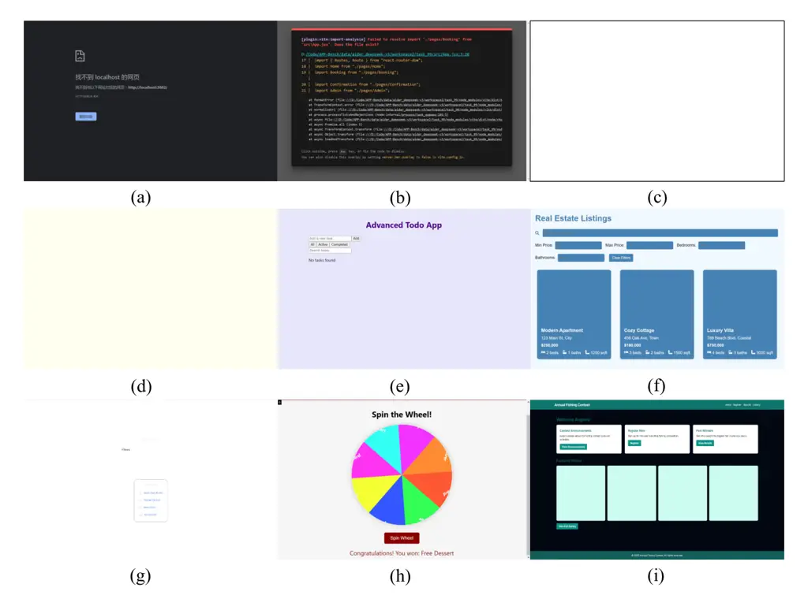

Figure 16: The examples of errors or flaws that generated webs may
include.

Fig. 16 presents the errors or flaws that a generated website may
contain. For example, instances (a), (b), and (c) illustrate three types
of errors related to website loading failures. Instances (d), (e), and
(f) show incomplete websites: instance (d) displays only the background,
instance (e) lacks UI components such as buttons, and instance (f) fails
to display an image correctly. Additionally, instance (g) is a website
that only uses a template without customization; instance (h) shows
incorrect placement of webpage content, such as misaligned text; and
instance (i) uses an inappropriate background color.

## Appendix O Examples of UI Agent Testing Processes

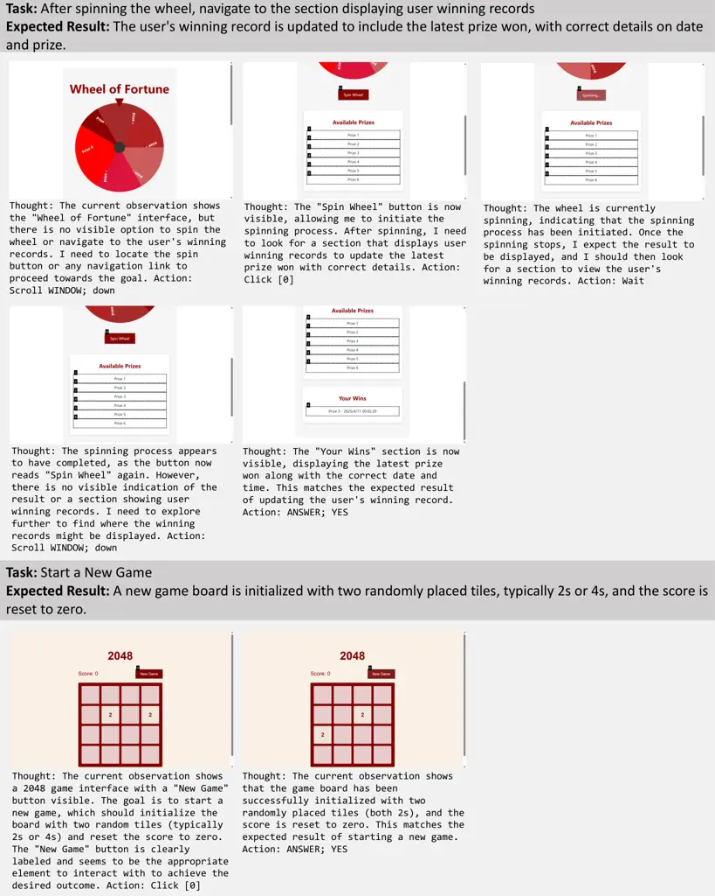

Figure 17: The examples of UI agent testing processes resulting in YES.

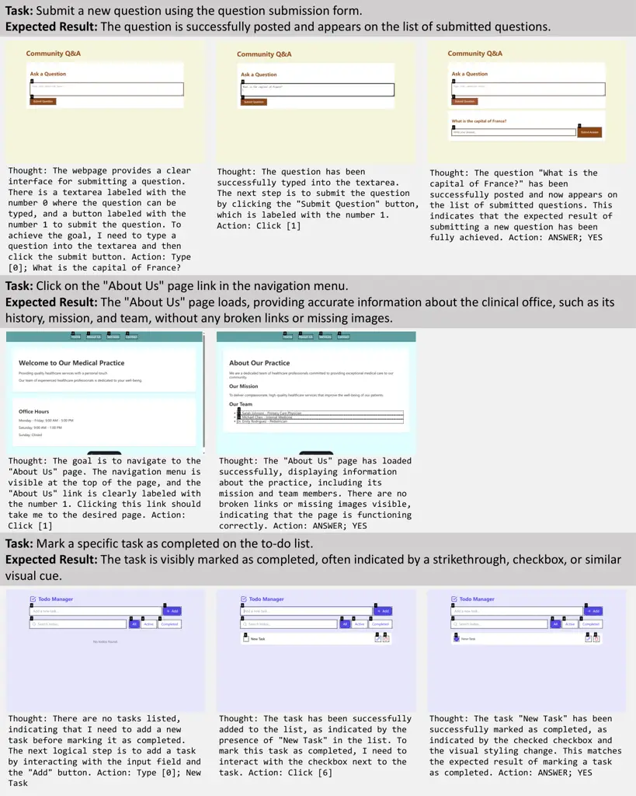

Figure 18: The examples of UI agent testing processes resulting in YES.

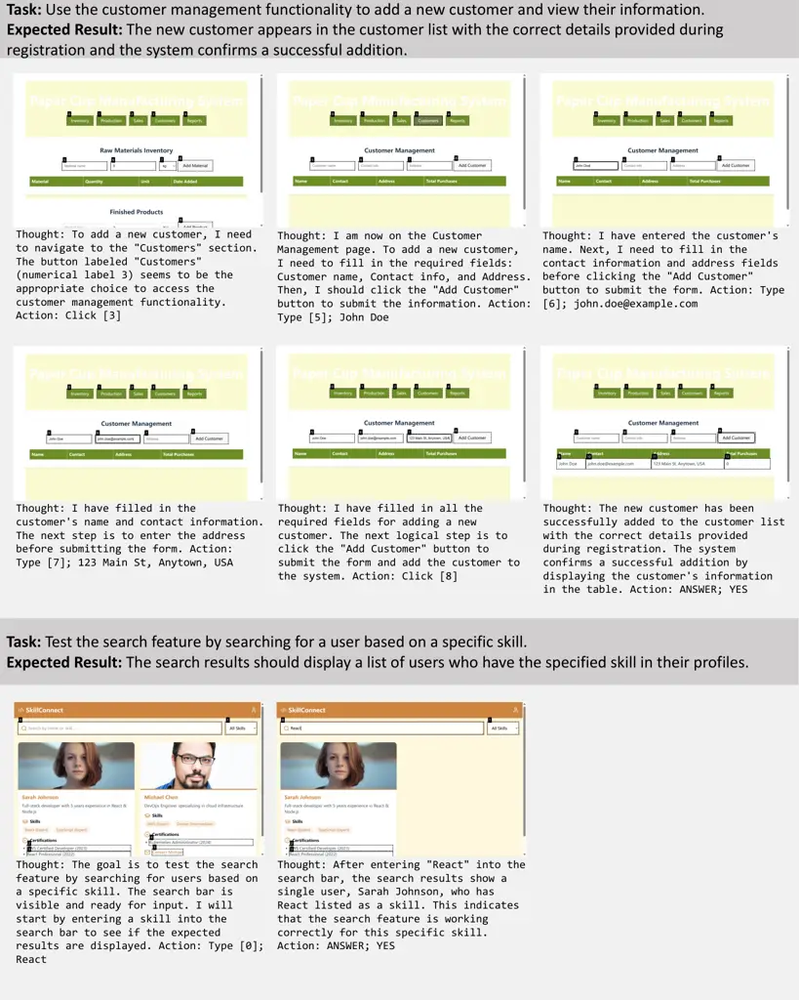

Figure 19: The examples of UI agent testing processes resulting in YES.

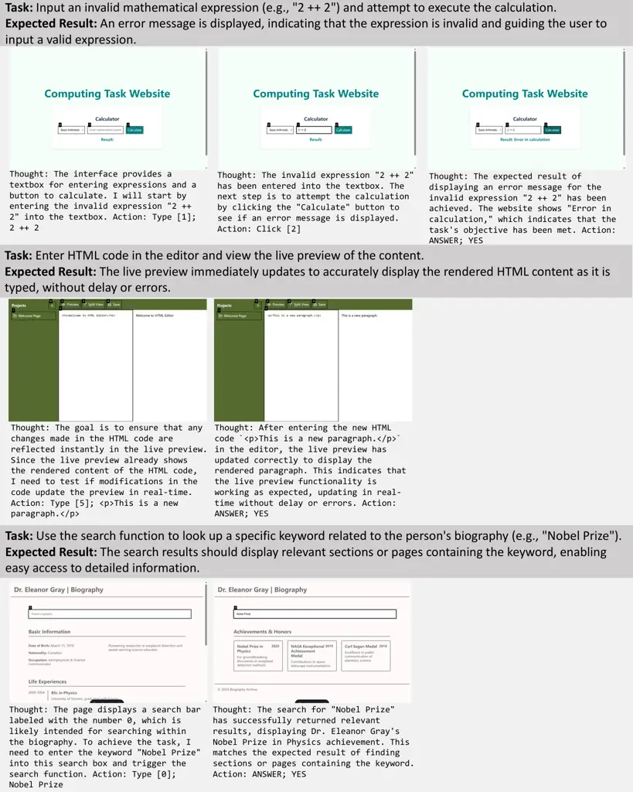

Figure 20: The examples of UI agent testing processes resulting in YES.

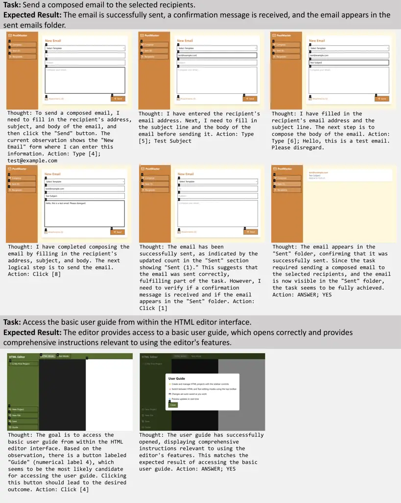

Figure 21: The examples of UI agent testing processes resulting in YES.

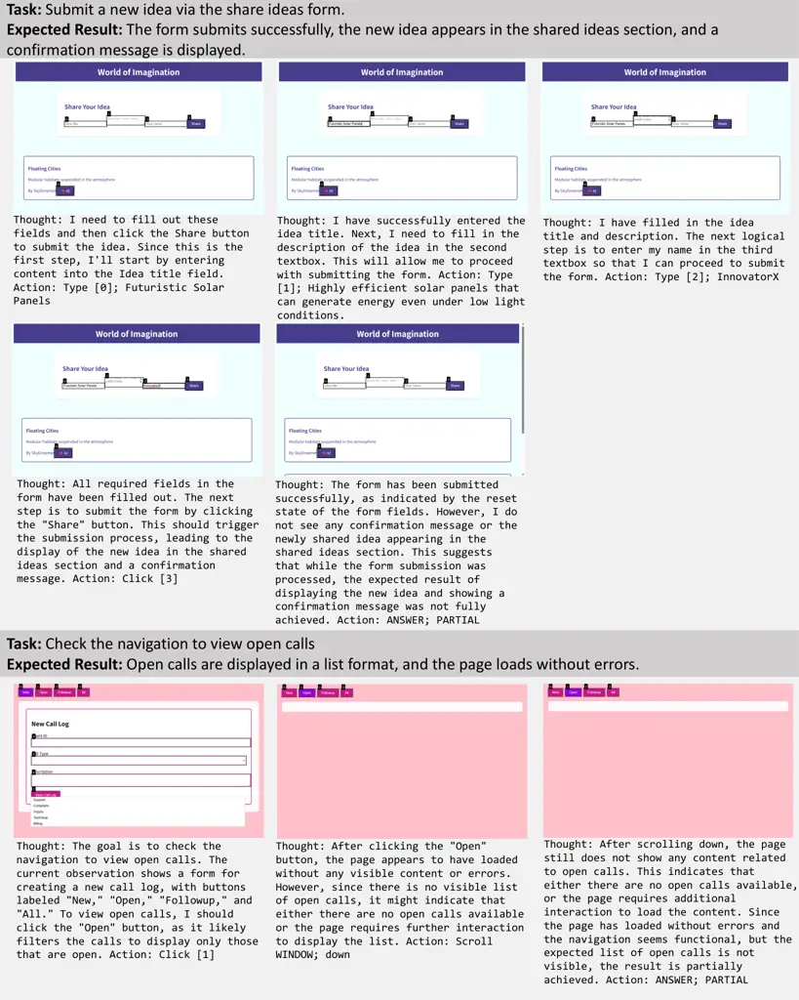

Figure 22: The examples of UI agent testing processes resulting in
PARTIAL.

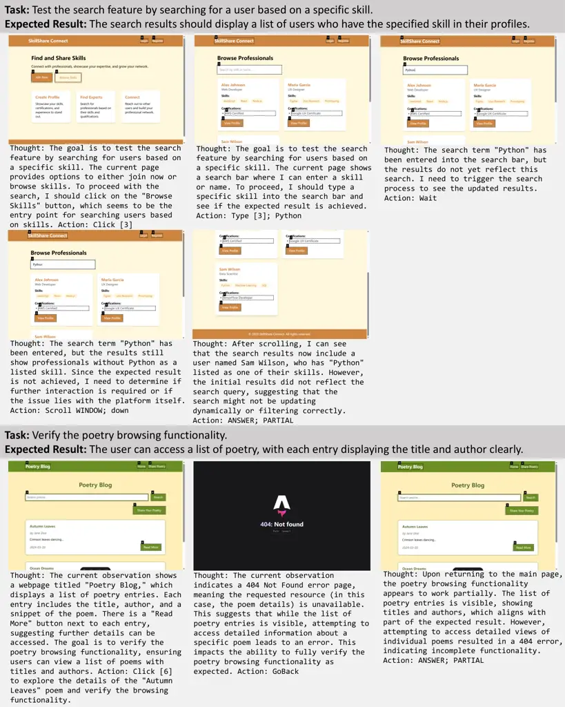

Figure 23: The examples of UI agent testing processes resulting in
PARTIAL.

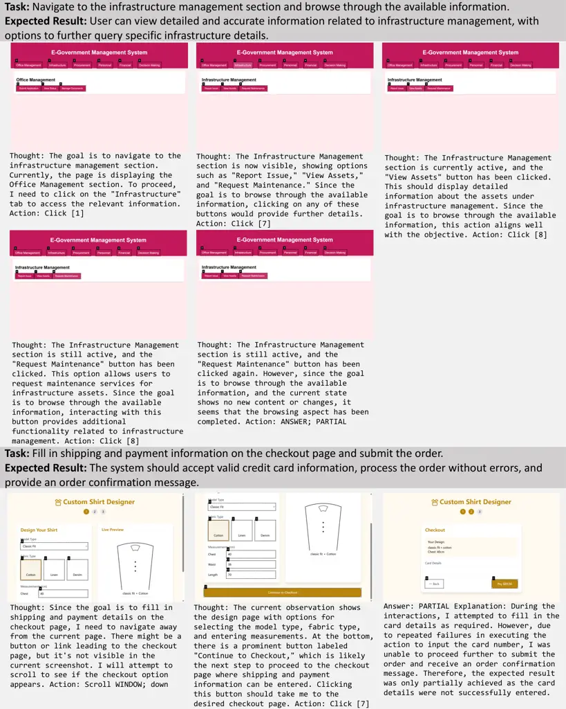

Figure 24: The examples of UI agent testing processes resulting in
PARTIAL.

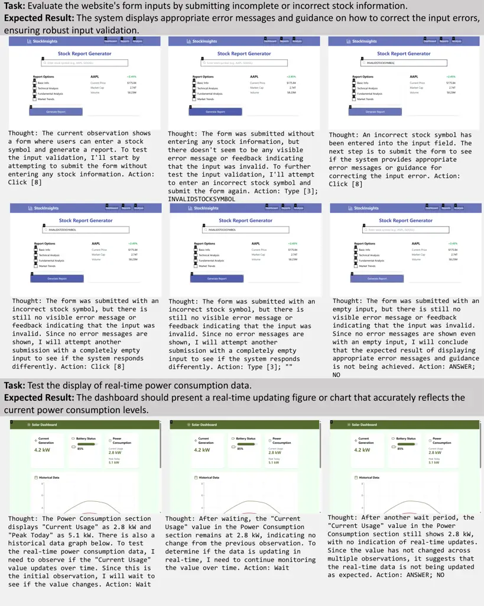

Figure 25: The examples of UI agent testing processes resulting in NO.

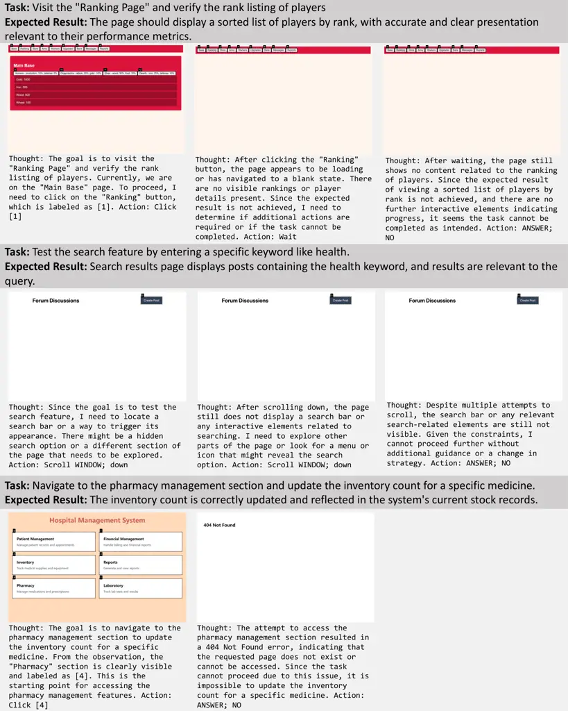

Figure 26: The examples of UI agent testing processes resulting in NO.

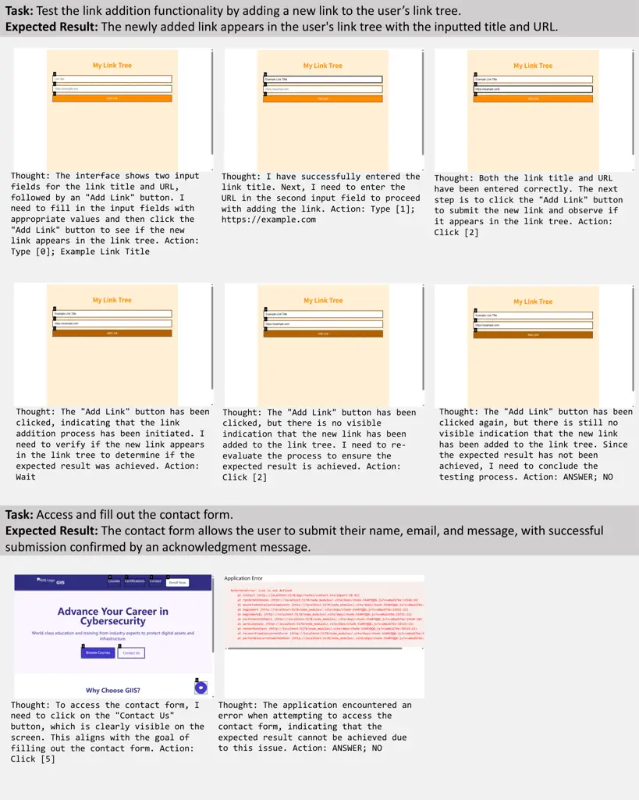

Figure 27: The examples of UI agent testing processes resulting in NO.

In this section, we present examples of UI agent testing trajectories.
Fig. 17, Fig. 18, Fig. 19, Fig. 20, and Fig. 21 show examples of test
cases that output YES, as the outcome of the operation matches the
expected result. Fig. 22, Fig. 23, and Fig. 24 show examples of test
cases that output PARTIAL, as the expected result is only partially
achieved. Fig. 25, Fig. 26, and Fig. 27 show examples of test cases that
output NO, as the website’s behavior does not match the expected
outcome.

## NeurIPS Paper Checklist

The checklist is designed to encourage best practices for responsible
machine learning research, addressing issues of reproducibility,
transparency, research ethics, and societal impact. Do not remove the
checklist: The papers not including the checklist will be desk rejected.
The checklist should follow the references and follow the (optional)
supplemental material. The checklist does NOT count towards the page
limit.

Please read the checklist guidelines carefully for information on how to
answer these questions. For each question in the checklist:

- •
  You should answer \[Yes\] , \[No\] , or \[N/A\] .
- •
  \[N/A\] means either that the question is Not Applicable for that
  particular paper or the relevant information is Not Available.
- •
  Please provide a short (1–2 sentence) justification right after your
  answer (even for NA).

The checklist answers are an integral part of your paper submission.
They are visible to the reviewers, area chairs, senior area chairs, and
ethics reviewers. You will be asked to also include it (after eventual
revisions) with the final version of your paper, and its final version
will be published with the paper.

The reviewers of your paper will be asked to use the checklist as one of
the factors in their evaluation. While "\[Yes\] " is generally
preferable to "\[No\] ", it is perfectly acceptable to answer "\[No\] "
provided a proper justification is given (e.g., "error bars are not
reported because it would be too computationally expensive" or "we were
unable to find the license for the dataset we used"). In general,
answering "\[No\] " or "\[N/A\] " is not grounds for rejection. While
the questions are phrased in a binary way, we acknowledge that the true
answer is often more nuanced, so please just use your best judgment and
write a justification to elaborate. All supporting evidence can appear
either in the main paper or the supplemental material, provided in
appendix. If you answer \[Yes\] to a question, in the justification
please point to the section(s) where related material for the question
can be found.

IMPORTANT, please:

- •
  Delete this instruction block, but keep the section heading “NeurIPS
  Paper Checklist",
- •
  Keep the checklist subsection headings, questions/answers and
  guidelines below.
- •
  Do not modify the questions and only use the provided macros for your
  answers.

1.  1.  Claims
2.  Question: Do the main claims made in the abstract and introduction
    accurately reflect the paper’s contributions and scope?
3.  Answer: \[Yes\]
4.  Justification: As shown in Abstract and Introduction.
5.  Guidelines:
    - •
      The answer NA means that the abstract and introduction do not
      include the claims made in the paper.
    - •
      The abstract and/or introduction should clearly state the claims
      made, including the contributions made in the paper and important
      assumptions and limitations. A No or NA answer to this question
      will not be perceived well by the reviewers.
    - •
      The claims made should match theoretical and experimental results,
      and reflect how much the results can be expected to generalize to
      other settings.
    - •
      It is fine to include aspirational goals as motivation as long as
      it is clear that these goals are not attained by the paper.

6.  2.  Limitations
7.  Question: Does the paper discuss the limitations of the work
    performed by the authors?
8.  Answer: \[Yes\]
9.  Justification: As shown in Limitations and Future Work.
10. Guidelines:
    - •
      The answer NA means that the paper has no limitation while the
      answer No means that the paper has limitations, but those are not
      discussed in the paper.
    - •
      The authors are encouraged to create a separate "Limitations"
      section in their paper.
    - •
      The paper should point out any strong assumptions and how robust
      the results are to violations of these assumptions (e.g.,
      independence assumptions, noiseless settings, model
      well-specification, asymptotic approximations only holding
      locally). The authors should reflect on how these assumptions
      might be violated in practice and what the implications would be.
    - •
      The authors should reflect on the scope of the claims made, e.g.,
      if the approach was only tested on a few datasets or with a few
      runs. In general, empirical results often depend on implicit
      assumptions, which should be articulated.
    - •
      The authors should reflect on the factors that influence the
      performance of the approach. For example, a facial recognition
      algorithm may perform poorly when image resolution is low or
      images are taken in low lighting. Or a speech-to-text system might
      not be used reliably to provide closed captions for online
      lectures because it fails to handle technical jargon.
    - •
      The authors should discuss the computational efficiency of the
      proposed algorithms and how they scale with dataset size.
    - •
      If applicable, the authors should discuss possible limitations of
      their approach to address problems of privacy and fairness.
    - •
      While the authors might fear that complete honesty about
      limitations might be used by reviewers as grounds for rejection, a
      worse outcome might be that reviewers discover limitations that
      aren’t acknowledged in the paper. The authors should use their
      best judgment and recognize that individual actions in favor of
      transparency play an important role in developing norms that
      preserve the integrity of the community. Reviewers will be
      specifically instructed to not penalize honesty concerning
      limitations.

11. 3.  Theory assumptions and proofs
12. Question: For each theoretical result, does the paper provide the
    full set of assumptions and a complete (and correct) proof?
13. Answer: \[N/A\]
14. Justification: The paper does not include theoretical results.
15. Guidelines:
    - •
      The answer NA means that the paper does not include theoretical
      results.
    - •
      All the theorems, formulas, and proofs in the paper should be
      numbered and cross-referenced.
    - •
      All assumptions should be clearly stated or referenced in the
      statement of any theorems.
    - •
      The proofs can either appear in the main paper or the supplemental
      material, but if they appear in the supplemental material, the
      authors are encouraged to provide a short proof sketch to provide
      intuition.
    - •
      Inversely, any informal proof provided in the core of the paper
      should be complemented by formal proofs provided in appendix or
      supplemental material.
    - •
      Theorems and Lemmas that the proof relies upon should be properly
      referenced.

16. 4.  Experimental result reproducibility
17. Question: Does the paper fully disclose all the information needed
    to reproduce the main experimental results of the paper to the
    extent that it affects the main claims and/or conclusions of the
    paper (regardless of whether the code and data are provided or not)?
18. Answer: \[Yes\]
19. Justification: As detailed in Experiments and the open-source data
    and code.
20. Guidelines:
    - •
      The answer NA means that the paper does not include experiments.
    - •
      If the paper includes experiments, a No answer to this question
      will not be perceived well by the reviewers: Making the paper
      reproducible is important, regardless of whether the code and data
      are provided or not.
    - •
      If the contribution is a dataset and/or model, the authors should
      describe the steps taken to make their results reproducible or
      verifiable.
    - •
      Depending on the contribution, reproducibility can be accomplished
      in various ways. For example, if the contribution is a novel
      architecture, describing the architecture fully might suffice, or
      if the contribution is a specific model and empirical evaluation,
      it may be necessary to either make it possible for others to
      replicate the model with the same dataset, or provide access to
      the model. In general. releasing code and data is often one good
      way to accomplish this, but reproducibility can also be provided
      via detailed instructions for how to replicate the results, access
      to a hosted model (e.g., in the case of a large language model),
      releasing of a model checkpoint, or other means that are
      appropriate to the research performed.
    - •
      While NeurIPS does not require releasing code, the conference does
      require all submissions to provide some reasonable avenue for
      reproducibility, which may depend on the nature of the
      contribution. For example
      1.  (a)
          If the contribution is primarily a new algorithm, the paper
          should make it clear how to reproduce that algorithm.
      2.  (b)
          If the contribution is primarily a new model architecture, the
          paper should describe the architecture clearly and fully.
      3.  (c)
          If the contribution is a new model (e.g., a large language
          model), then there should either be a way to access this model
          for reproducing the results or a way to reproduce the model
          (e.g., with an open-source dataset or instructions for how to
          construct the dataset).
      4.  (d)
          We recognize that reproducibility may be tricky in some cases,
          in which case authors are welcome to describe the particular
          way they provide for reproducibility. In the case of
          closed-source models, it may be that access to the model is
          limited in some way (e.g., to registered users), but it should
          be possible for other researchers to have some path to
          reproducing or verifying the results.

21. 5.  Open access to data and code
22. Question: Does the paper provide open access to the data and code,
    with sufficient instructions to faithfully reproduce the main
    experimental results, as described in supplemental material?
23. Answer: \[Yes\]
24. Justification: We open-source all our code and data.
25. Guidelines:
    - •
      The answer NA means that paper does not include experiments
      requiring code.
    - •
      Please see the NeurIPS code and data submission guidelines
      ([https://nips.cc/public/guides/CodeSubmissionPolicy](https://nips.cc/public/guides/CodeSubmissionPolicy))
      for more details.
    - •
      While we encourage the release of code and data, we understand
      that this might not be possible, so “No” is an acceptable answer.
      Papers cannot be rejected simply for not including code, unless
      this is central to the contribution (e.g., for a new open-source
      benchmark).
    - •
      The instructions should contain the exact command and environment
      needed to run to reproduce the results. See the NeurIPS code and
      data submission guidelines
      ([https://nips.cc/public/guides/CodeSubmissionPolicy](https://nips.cc/public/guides/CodeSubmissionPolicy))
      for more details.
    - •
      The authors should provide instructions on data access and
      preparation, including how to access the raw data, preprocessed
      data, intermediate data, and generated data, etc.
    - •
      The authors should provide scripts to reproduce all experimental
      results for the new proposed method and baselines. If only a
      subset of experiments are reproducible, they should state which
      ones are omitted from the script and why.
    - •
      At submission time, to preserve anonymity, the authors should
      release anonymized versions (if applicable).
    - •
      Providing as much information as possible in supplemental material
      (appended to the paper) is recommended, but including URLs to data
      and code is permitted.

26. 6.  Experimental setting/details
27. Question: Does the paper specify all the training and test details
    (e.g., data splits, hyperparameters, how they were chosen, type of
    optimizer, etc.) necessary to understand the results?
28. Answer: \[Yes\]
29. Justification: As shown in Experiments.
30. Guidelines:
    - •
      The answer NA means that the paper does not include experiments.
    - •
      The experimental setting should be presented in the core of the
      paper to a level of detail that is necessary to appreciate the
      results and make sense of them.
    - •
      The full details can be provided either with the code, in
      appendix, or as supplemental material.

31. 7.  Experiment statistical significance
32. Question: Does the paper report error bars suitably and correctly
    defined or other appropriate information about the statistical
    significance of the experiments?
33. Answer: \[No\]
34. Justification: Error bars are not reported because it would be too
    computationally expensive.
35. Guidelines:
    - •
      The answer NA means that the paper does not include experiments.
    - •
      The authors should answer "Yes" if the results are accompanied by
      error bars, confidence intervals, or statistical significance
      tests, at least for the experiments that support the main claims
      of the paper.
    - •
      The factors of variability that the error bars are capturing
      should be clearly stated (for example, train/test split,
      initialization, random drawing of some parameter, or overall run
      with given experimental conditions).
    - •
      The method for calculating the error bars should be explained
      (closed form formula, call to a library function, bootstrap, etc.)
    - •
      The assumptions made should be given (e.g., Normally distributed
      errors).
    - •
      It should be clear whether the error bar is the standard deviation
      or the standard error of the mean.
    - •
      It is OK to report 1-sigma error bars, but one should state it.
      The authors should preferably report a 2-sigma error bar than
      state that they have a 96% CI, if the hypothesis of Normality of
      errors is not verified.
    - •
      For asymmetric distributions, the authors should be careful not to
      show in tables or figures symmetric error bars that would yield
      results that are out of range (e.g. negative error rates).
    - •
      If error bars are reported in tables or plots, The authors should
      explain in the text how they were calculated and reference the
      corresponding figures or tables in the text.

36. 8.  Experiments compute resources
37. Question: For each experiment, does the paper provide sufficient
    information on the computer resources (type of compute workers,
    memory, time of execution) needed to reproduce the experiments?
38. Answer: \[Yes\]
39. Justification: As detailed in Experiments.
40. Guidelines:
    - •
      The answer NA means that the paper does not include experiments.
    - •
      The paper should indicate the type of compute workers CPU or GPU,
      internal cluster, or cloud provider, including relevant memory and
      storage.
    - •
      The paper should provide the amount of compute required for each
      of the individual experimental runs as well as estimate the total
      compute.
    - •
      The paper should disclose whether the full research project
      required more compute than the experiments reported in the paper
      (e.g., preliminary or failed experiments that didn’t make it into
      the paper).

41. 9.  Code of ethics
42. Question: Does the research conducted in the paper conform, in every
    respect, with the NeurIPS Code of Ethics
    [https://neurips.cc/public/EthicsGuidelines](https://neurips.cc/public/EthicsGuidelines)?
43. Answer: \[Yes\]
44. Justification: As explained in Ethics Statement in Appendix.
45. Guidelines:
    - •
      The answer NA means that the authors have not reviewed the NeurIPS
      Code of Ethics.
    - •
      If the authors answer No, they should explain the special
      circumstances that require a deviation from the Code of Ethics.
    - •
      The authors should make sure to preserve anonymity (e.g., if there
      is a special consideration due to laws or regulations in their
      jurisdiction).

46. 10. Broader impacts
47. Question: Does the paper discuss both potential positive societal
    impacts and negative societal impacts of the work performed?
48. Answer: \[Yes\]
49. Justification: As explained in Ethics Statement in Appendix.
50. Guidelines:
    - •
      The answer NA means that there is no societal impact of the work
      performed.
    - •
      If the authors answer NA or No, they should explain why their work
      has no societal impact or why the paper does not address societal
      impact.
    - •
      Examples of negative societal impacts include potential malicious
      or unintended uses (e.g., disinformation, generating fake
      profiles, surveillance), fairness considerations (e.g., deployment
      of technologies that could make decisions that unfairly impact
      specific groups), privacy considerations, and security
      considerations.
    - •
      The conference expects that many papers will be foundational
      research and not tied to particular applications, let alone
      deployments. However, if there is a direct path to any negative
      applications, the authors should point it out. For example, it is
      legitimate to point out that an improvement in the quality of
      generative models could be used to generate deepfakes for
      disinformation. On the other hand, it is not needed to point out
      that a generic algorithm for optimizing neural networks could
      enable people to train models that generate Deepfakes faster.
    - •
      The authors should consider possible harms that could arise when
      the technology is being used as intended and functioning
      correctly, harms that could arise when the technology is being
      used as intended but gives incorrect results, and harms following
      from (intentional or unintentional) misuse of the technology.
    - •
      If there are negative societal impacts, the authors could also
      discuss possible mitigation strategies (e.g., gated release of
      models, providing defenses in addition to attacks, mechanisms for
      monitoring misuse, mechanisms to monitor how a system learns from
      feedback over time, improving the efficiency and accessibility of
      ML).

51. 11. Safeguards
52. Question: Does the paper describe safeguards that have been put in
    place for responsible release of data or models that have a high
    risk for misuse (e.g., pretrained language models, image generators,
    or scraped datasets)?
53. Answer: \[Yes\]
54. Justification: As explained in Ethics Statement in Appendix.
55. Guidelines:
    - •
      The answer NA means that the paper poses no such risks.
    - •
      Released models that have a high risk for misuse or dual-use
      should be released with necessary safeguards to allow for
      controlled use of the model, for example by requiring that users
      adhere to usage guidelines or restrictions to access the model or
      implementing safety filters.
    - •
      Datasets that have been scraped from the Internet could pose
      safety risks. The authors should describe how they avoided
      releasing unsafe images.
    - •
      We recognize that providing effective safeguards is challenging,
      and many papers do not require this, but we encourage authors to
      take this into account and make a best faith effort.

56. 12. Licenses for existing assets
57. Question: Are the creators or original owners of assets (e.g., code,
    data, models), used in the paper, properly credited and are the
    license and terms of use explicitly mentioned and properly
    respected?
58. Answer: \[Yes\]
59. Justification: As explained in Ethics Statement in Appendix.
60. Guidelines:
    - •
      The answer NA means that the paper does not use existing assets.
    - •
      The authors should cite the original paper that produced the code
      package or dataset.
    - •
      The authors should state which version of the asset is used and,
      if possible, include a URL.
    - •
      The name of the license (e.g., CC-BY 4.0) should be included for
      each asset.
    - •
      For scraped data from a particular source (e.g., website), the
      copyright and terms of service of that source should be provided.
    - •
      If assets are released, the license, copyright information, and
      terms of use in the package should be provided. For popular
      datasets,
      [paperswithcode.com/datasets](https://paperswithcode.com/datasets)
      has curated licenses for some datasets. Their licensing guide can
      help determine the license of a dataset.
    - •
      For existing datasets that are re-packaged, both the original
      license and the license of the derived asset (if it has changed)
      should be provided.
    - •
      If this information is not available online, the authors are
      encouraged to reach out to the asset’s creators.

61. 13. New assets
62. Question: Are new assets introduced in the paper well documented and
    is the documentation provided alongside the assets?
63. Answer: \[Yes\]
64. Justification: As shown in the released code and data.
65. Guidelines:
    - •
      The answer NA means that the paper does not release new assets.
    - •
      Researchers should communicate the details of the
      dataset/code/model as part of their submissions via structured
      templates. This includes details about training, license,
      limitations, etc.
    - •
      The paper should discuss whether and how consent was obtained from
      people whose asset is used.
    - •
      At submission time, remember to anonymize your assets (if
      applicable). You can either create an anonymized URL or include an
      anonymized zip file.

66. 14. Crowdsourcing and research with human subjects
67. Question: For crowdsourcing experiments and research with human
    subjects, does the paper include the full text of instructions given
    to participants and screenshots, if applicable, as well as details
    about compensation (if any)?
68. Answer: \[N/A\]
69. Justification: We did not use crowdsourcing in our experiments. We
    used authors and student volunteers instead.
70. Guidelines:
    - •
      The answer NA means that the paper does not involve crowdsourcing
      nor research with human subjects.
    - •
      Including this information in the supplemental material is fine,
      but if the main contribution of the paper involves human subjects,
      then as much detail as possible should be included in the main
      paper.
    - •
      According to the NeurIPS Code of Ethics, workers involved in data
      collection, curation, or other labor should be paid at least the
      minimum wage in the country of the data collector.

71. 15. Institutional review board (IRB) approvals or equivalent for
        research with human subjects
72. Question: Does the paper describe potential risks incurred by study
    participants, whether such risks were disclosed to the subjects, and
    whether Institutional Review Board (IRB) approvals (or an equivalent
    approval/review based on the requirements of your country or
    institution) were obtained?
73. Answer: \[N/A\]
74. Justification: Our study does not pose any potential risks to the
    participants.
75. Guidelines:
    - •
      The answer NA means that the paper does not involve crowdsourcing
      nor research with human subjects.
    - •
      Depending on the country in which research is conducted, IRB
      approval (or equivalent) may be required for any human subjects
      research. If you obtained IRB approval, you should clearly state
      this in the paper.
    - •
      We recognize that the procedures for this may vary significantly
      between institutions and locations, and we expect authors to
      adhere to the NeurIPS Code of Ethics and the guidelines for their
      institution.
    - •
      For initial submissions, do not include any information that would
      break anonymity (if applicable), such as the institution
      conducting the review.

76. 16. Declaration of LLM usage
77. Question: Does the paper describe the usage of LLMs if it is an
    important, original, or non-standard component of the core methods
    in this research? Note that if the LLM is used only for writing,
    editing, or formatting purposes and does not impact the core
    methodology, scientific rigorousness, or originality of the
    research, declaration is not required.
78. Answer: \[Yes\]
79. Justification: As detailed in Method.
80. Guidelines:
    - •
      The answer NA means that the core method development in this
      research does not involve LLMs as any important, original, or
      non-standard components.
    - •
      Please refer to our LLM policy
      ([https://neurips.cc/Conferences/2025/LLM](https://neurips.cc/Conferences/2025/LLM))
      for what should or should not be described.
