# AC-ODM: Actor–Critic Online Data Mixing for Sample-Efficient LLM Pretraining

Jing Ma Affiliation: BRAIN, Renmin University of China, Beijing, China
   Chenhao Dang Affiliation: Shanghai Jiaotong University, Shanghai,
China Affiliation: Shanghai Artificial Intelligence Laboratory,
Shanghai, China Affiliation: China Electronics Technology Group
Corporation 15th Research Institute, Beijing, China    Mingjie Liao
Affiliation: LiblibAI, Beijing, China Correspondence to:
<liaomingjie@liblib.ai>

###### Abstract

Optimizing pretraining data composition is pivotal for LLM
generalization. While dynamic mixing outperforms static strategies by
capturing evolving training dynamics, current methods fail to reconcile
computational efficiency with sample efficiency and structural
flexibility for diverse pipelines.We introduce Actor–Critic Online Data
Mixing (AC-ODM), which approaches data mixing from a reinforcement
learning perspective with a parameterized policy that we theoretically
prove to act as a dynamic linear surrogate maximizing the constructive
interference of gradients. To enhance practical flexibility, AC-ODM
supports two operational modes: (i) a proxy mode for fixed, pre-prepared
corpora, where a policy learned on a small model is transferred to a
larger target; and (ii) a non-proxy mode for direct end-to-end training
from scratch without priors. Empirically, AC-ODM significantly
outperforms prior methods in convergence speed and downstream accuracy
across various architectures. On Pythia-1B, it reaches optimal
validation perplexity using up to 66% fewer training steps than
competitive baselines, delivering a 27.5% relative improvement in MMLU
accuracy and a 2.23$`\times`$ higher pass@1 on HumanEval, all while
incurring a virtually negligible ( 0.4%) per-step wall-clock increase
and only 2% additional memory overhead. Code is available at
[https://github.com/DANG-ai/AC-ODM](https://github.com/DANG-ai/AC-ODM).

###### Keywords: 

Data Mixing, LLM Pretraining, Reinforcement Learning

^(†)^(†)affiliationnotice: Equal contribution

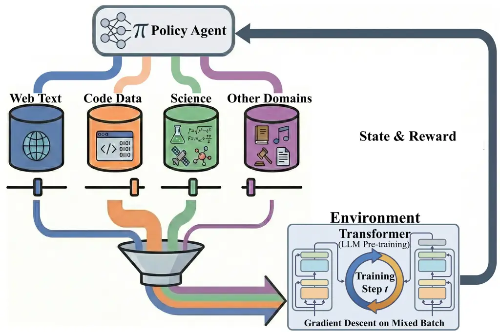

Figure 1: The framework of AC-ODM. We approach LLM pretraining data
mixing from a reinforcement learning perspective. Treating the LLM as
the environment, an Actor-Critic agent dynamically senses the training
state and adjusts domain sampling weights to explicitly maximize the
constructive interference of gradients.

## 1 Introduction

The generalization capability of Large Language Models (LLMs) is
intrinsically governed by the quality and distribution of their
pretraining corpora. Beyond mere scale, the coverage and mixture of data
domains strongly influence sample efficiency, convergence speed, and
downstream accuracy (St. John and Draper, 1975; Du et al., 2022; Lee et
al., 2022). Consequently, optimizing data mixing has emerged as a
critical frontier in efficient LLM pretraining.

Prior research on data mixing has largely focused on static strategies,
where domain weights are determined offline before training begins.
Representative approaches like DoReMi (Xie et al., 2023), DoGE (Fan et
al., 2024), RegMix (Liu et al., 2025b), and CHAMELEON (Xie et al., 2025)
utilize small proxy models or heuristic leverage scores to estimate
global domain importance. While effective, these static weights fail to
adapt to the changing learning dynamics of the model during the
extensive pretraining process. Recently, research has increasingly
shifted toward dynamic data mixing, exemplified by methods such as ODM
(Albalak et al., 2023) and PiKE (Li et al., 2025). By adjusting data
distributions on-the-fly, dynamic strategies generally demonstrate
superior effectiveness compared to static baselines, as they can respond
to the model’s evolving capabilities and deficits. However, a critical
challenge remains: existing dynamic methods often lack a unified
framework that balances computational efficiency with sample efficiency
and structural flexibility. For instance, sophisticated selection
algorithms may incur prohibitive runtime overhead, while lightweight
heuristics may struggle to accommodate diverse pipelines, such as those
involving direct pretraining from scratch without priors versus fixed,
pre-prepared corpora.

To address these limitations, we propose Actor–Critic Online Data Mixing
(AC-ODM), a framework that approaches data mixing from a reinforcement
learning (RL) perspective. As illustrated in Figure 1, we treat the LLM
pretraining process as an environment where a parameterized policy (the
Actor) dynamically optimizes domain weights based on the model’s
real-time state. Unlike previous heuristics, our approach is grounded in
optimization geometry. Theoretically, we prove that the learned policy
acts as a dynamic linear surrogate that maximizes the constructive
interference of gradients, thereby explicitly optimizing the effective
descent magnitude during pretraining. AC-ODM is designed with practical
flexibility at its core, supporting two operational modes: a Proxy Mode
for scenarios with fixed corpora, where a policy is learned on a small
model and transferred to guide a larger target; and a Non-Proxy Mode for
end-to-end training where new domains may emerge dynamically.


## 2 Related Work

Data Mixing in LLM Pretraining. The composition of pretraining data is a
primary driver of LLM generalization and sample efficiency, often
outweighing pure data volume (St. John and Draper, 1975; Du et al.,
2022; Lee et al., 2022; Sorscher et al., 2023; Albalak et al., 2024).
Recent technical reports like Qwen3 (Yang et al., 2025) further
emphasize that sophisticated mixing strategies are essential
prerequisites for training competitive foundation models.

Static Data Mixing Strategies. Static approaches determine weights
offline. Standard paradigms include training proxy models to minimize
loss gaps or align gradients (Xie et al., 2023; Fan et al., 2024).
Others leverage scaling laws and regression to predict optimal mixtures
(Liu et al., 2025b; Shukor et al., 2025; Yen et al., 2025), or utilize
clustering and multi-dimensional quality assessments (Xie et al., 2025;
Diao et al., 2025; Zhuang et al., 2025). Despite their diversity, these
static strategies inherently fail to adapt to the target model’s
evolving training dynamics, often resulting in sub-optimal performance
compared to dynamic approaches (Li et al., 2025).

Dynamic Data Mixing Strategies. To capture feature learning evolution,
dynamic methods adjust mixtures on-the-fly. Following the bandit-based
ODM (Albalak et al., 2023), recent works incorporate gradient
interactions (Li et al., 2025), bi-level optimization (Yu et al., 2025),
quality-diversity balance (Liu et al., 2025a), and Bayesian optimization
(Ouyang et al., 2025). However, these methods often face a trade-off
between computational overhead and structural flexibility, lacking a
unified framework to efficiently handle both fixed-corpus and non-prior
information scenarios.

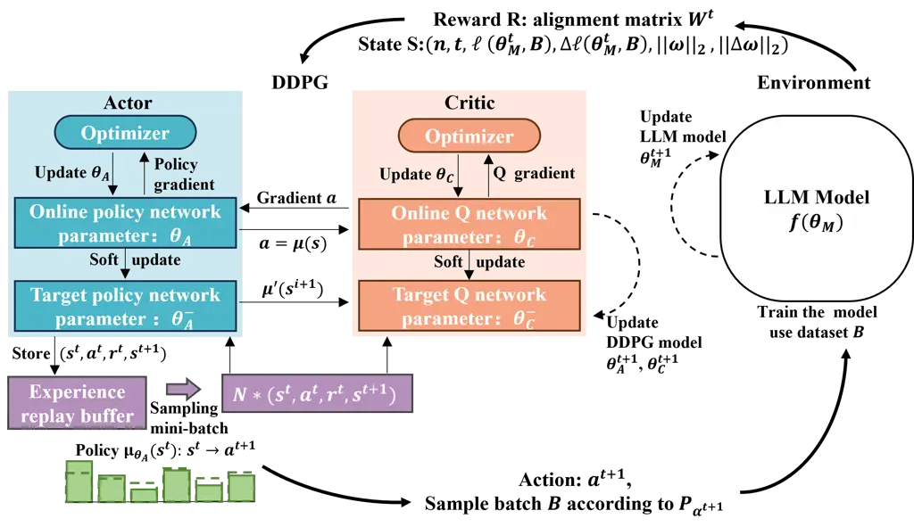

Figure 2: Overview of AC-ODM Framework. At iteration $`t`$, the policy
$`\mu_{\theta_{A}}`$ observes the environment state $`s^{t}`$ from the
current LLM (e.g., loss dynamics, weight norms) and outputs an action
$`a^{t}`$ to adjust domain weights $`\boldsymbol{\alpha}^{t}`$. A batch
$`B`$ is sampled according to $`P_{\boldsymbol{\alpha}^{t}}`$. The loss
gradient $`\nabla L`$ and the gradient alignment matrix $`W^{t}`$ are
computed to update the LLM parameters $`\theta_{M}`$ and generate the
reward $`r^{t}`$. The transition tuple $`(s^{t},a^{t},r^{t},s^{t+1})`$
is stored in a replay buffer to update the Actor and Critic networks.
This closed-loop feedback explicitly maximizes gradient coherence (see
Sec. 3.4).

## 3 AC-ODM

In this section, we present Actor-Critic Online Data Mixing (AC-ODM), a
framework designed for efficient and adaptive pretraining of large
language models. We first formulate the problem, then detail the
RL-based methodology, followed by a rigorous theoretical analysis of our
reward mechanism, and finally describe the operational modes tailored
for diverse real-world scenarios.

### 3.1 Problem Formulation

Let $`D=\{D_{1},\ldots,D_{K}\}`$ be a pretraining corpus composed of
$`K`$ distinct domains. We seek a sequence of domain weights on the
probability simplex
$`\boldsymbol{\alpha}\in\Delta^{K}\subset\mathbb{R}^{K}`$. Training
batches are produced by first sampling a domain
$`i\sim\boldsymbol{\alpha}`$ and then sampling a sequence uniformly
within that domain, i.e., $`B\sim\mathrm{UNIF}(D_{i})`$. This induces
the instance-wise distribution
$`P_{\boldsymbol{\alpha}}\triangleq\sum_{i=1}^{K}\alpha_{i}\cdot\mathrm{UNIF}(D_{i})`$.
While offline data mixing fixes $`P_{\boldsymbol{\alpha}}`$ before
training, AC-ODM updates $`P_{\boldsymbol{\alpha}^{t}}`$ at every
iteration $`t`$ to adapt to the model’s evolving state, with the
objective of maximizing generalization performance while incurring
negligible computational overhead.

### 3.2 Adapting Actor-Critic to Online Data Mixing

We cast online data mixing as a continuous control problem within a
Markov Decision Process (MDP) and adopt the Deep Deterministic Policy
Gradient (DDPG) framework. As illustrated in Figure 2, the LLM itself
defines the environment. At each step $`t`$, the agent observes state
$`s^{t}`$ and executes an action $`a^{t}=\mu_{\theta_{A}}(s^{t})`$ that
updates the domain sampling weights $`\boldsymbol{\alpha}^{t}`$.

State Space. The state $`s^{t}`$ must be compact yet informative of the
training dynamics. We aggregate observable signals including: the
iteration index $`t`$, the number of samples per domain
$`n=\{n_{i}\}_{i=1}^{K}`$, the per-domain loss vector
$`\ell(\theta_{M},B)\in\mathbb{R}^{K}`$ and its step-to-step difference
$`\Delta\ell`$, as well as the $`L_{2}`$ norm of selected LLM layer
weights $`\|\omega\|_{2}`$ and their update magnitude
$`\|\Delta\omega\|_{2}`$. Formally:
$`s^{t}=(n,t,\ell(\theta_{M},B),\Delta\ell(\theta_{M},B),\|\omega\|_{2},\|\Delta\omega\|_{2})`$.

Action Space. The action $`a^{t}\in\mathbb{R}^{K}`$ is mapped to the
simplex via a softmax function to produce valid mixing weights
$`\boldsymbol{\alpha}^{t+1}`$. Since both state and action spaces are
continuous, DDPG is an ideal optimizer.

0:  $`D=\{D_{1},\ldots,D_{K}\}`$ grouped data

0:  $`\theta_{M}^{0}`$ target LLM weights, $`\theta_{A}`$ actor weights,
$`\theta_{C}`$ critic weights

0:  $`\nabla L_{i}(\theta_{M}^{t})`$ stochastic gradient of $`B_{i}`$ at
step $`t`$

0:  Hyperparameters: total steps $`T`$, step size $`\eta^{t}`$, target
update coefficient $`\tau`$, discount factor $`\gamma`$

1:  Initialize $`K=|D|`$, set $`r_{i}^{0}=0`$ for all
$`i\in\{1,\ldots,K\}`$, initialize critic $`Q_{\theta_{C}}`$, actor
$`\mu_{\theta_{A}}`$, and LLM weights $`\theta_{M}^{0}`$

2:  Copy target networks $`\bar{\theta}_{C}\leftarrow\theta_{C}`$,
$`\bar{\theta}_{A}\leftarrow\theta_{A}`$

3:  Initialize replay buffer $`\mathcal{B}`$, perform warm up to obtain
the initial state
$`s^{0}=(n^{0},0,\ell(\theta_{M}^{0},B),\Delta\ell(\theta_{M}^{0},B),\|\omega^{0}\|_{2},\|\Delta\omega^{0}\|_{2})`$

4:  for $`t=0`$ to $`T-1`$ do

5:   Choose action $`a^{t}=\mu_{\theta_{A}}(s^{t})`$ and map to domain
weights $`\alpha^{t}`$

6:   Sample batch $`B^{t}=\{B_{1}^{t},\ldots,B_{K}^{t}\}`$ according to
$`P_{\alpha}\triangleq\sum_{i=1}^{K}\alpha_{i}^{t}\cdot\mathrm{UNIF}(D_{i})`$

7:   Compute $`\nabla L_{i}(\theta_{M}^{t})`$ for all $`i\in[K]`$ and
the alignment vector $`W^{t}`$

8:   Update the LLM:
$`\theta_{M}^{t+1}\leftarrow\theta_{M}^{t}-\eta^{t}\sum_{i=1}^{K}\alpha_{i}^{t}\nabla L_{i}(\theta_{M}^{t})`$

9:   Set $`r^{t}\leftarrow W^{t}`$

10:   Form the next state
$`s^{t+1}=(n^{t+1},\,t+1,\,\ell(\theta_{M}^{t+1},B),\,\Delta\ell(\theta_{M}^{t+1},B),\,\|\omega^{t+1}\|_{2},\,\|\Delta\omega^{t+1}\|_{2})`$

11:   Store $`(s^{t},a^{t},r^{t},s^{t+1})`$ in $`\mathcal{B}`$

12:   Sample $`\{(s_{k},a_{k},r_{k},s^{\prime}_{k})\}_{k=1}^{N}`$ from
$`\mathcal{B}`$

13:   Compute
$`y_{k}=r_{k}+\gamma Q_{\bar{\theta}_{C}}(s^{\prime}_{k},\mu_{\bar{\theta}_{A}}(s^{\prime}_{k}))`$

14:   Update critic by minimizing
$`L=\frac{1}{N}\sum_{k=1}^{N}\bigl(y_{k}-Q_{\theta_{C}}(s_{k},a_{k})\bigr)^{2}`$

15:   Update actor via
$`\nabla_{\theta_{A}}J\approx\frac{1}{N}\sum_{k=1}^{N}\nabla_{\theta_{A}}\mu_{\theta_{A}}(s_{k})\nabla_{a}Q_{\theta_{C}}(s_{k},a)\big|_{a=\mu_{\theta_{A}}(s_{k})}`$

16:   Soft update targets:
$`\bar{\theta}_{A}\leftarrow\tau\theta_{A}+(1-\tau)\bar{\theta}_{A}`$,
$`\bar{\theta}_{C}\leftarrow\tau\theta_{C}+(1-\tau)\bar{\theta}_{C}`$

17:  end for

18:  return actor $`\mu_{\bar{\theta}_{A}}`$

Algorithm 1 AC-ODM in the non proxy mode

### 3.3 Designing the Reward Function

Efficient pretraining requires a reward signal that values data which
not only minimizes current loss but also accelerates learning across
other domains. We define the reward for domain $`i`$ based on its
gradient alignment with the aggregate gradient of the remaining corpus:
$`W_{i}\triangleq\langle\nabla\ell_{i}(\theta_{M}),\sum_{j\neq i}\nabla\ell_{j}(\theta_{M})\rangle`$.
This score measures the degree to which an update from domain $`i`$ is
geometrically aligned with the optimization direction of other domains.
We denote $`W=[W_{1},\ldots,W_{K}]`$. To stabilize training, we use an
importance-corrected exponential moving average for the final reward:
$`\hat{r}_{i}^{t}=\xi\hat{r}_{i}^{t-1}+(1-\xi)\frac{W_{i}^{t}}{P_{\alpha_{i}}^{t-1}}`$,
where the division by $`P_{\alpha_{i}}^{t-1}`$ prevents the policy from
collapsing into a trivial solution that only samples already-frequent
domains.

### 3.4 Theoretical Analysis: Optimization Geometry and Gradient Coherence

While prior work such as DoGE (Fan et al., 2024) interprets gradient
alignment primarily as a statistical predictor for generalization loss,
we provide a fundamentally different theoretical grounding based on
optimization geometry. We demonstrate that maximizing the alignment
reward does not merely estimate future performance, but explicitly
maximizes the constructive interference of gradients in the current
step, thereby serving as a first-order proxy for the quadratic descent
efficiency.

Setup. Let
$`\mathbf{G}^{t}=[\mathbf{g}_{1}^{t},\dots,\mathbf{g}_{K}^{t}]\in\mathbb{R}^{d\times K}`$
denote the gradient matrix at step $`t`$, where column
$`\mathbf{g}_{i}^{t}`$ represents the gradient of domain $`i`$. The
effective update direction of the model is the weighted sum
$`\mathbf{g}_{total}^{t}=\mathbf{G}^{t}\boldsymbol{\alpha}^{t}`$, with
$`\boldsymbol{\alpha}^{t}\in\Delta^{K}`$.

Proposition 1 (Geometric Coherence). The AC-ODM reward acts as a linear
surrogate for the cross-term energy in the Gram matrix spectrum.
Maximizing this reward greedily optimizes the marginal gain in effective
gradient magnitude.

Proof. The convergence rate of first-order optimization is dominated by
the magnitude of the update vector. We analyze the squared norm of the
aggregated gradient using the empirical Gram matrix
$`\mathbf{H}^{t}=(\mathbf{G}^{t})^{\top}\mathbf{G}^{t}\in\mathbb{R}^{K\times K}`$:

```math
\begin{split}\|\mathbf{g}_{total}^{t}\|^{2}&=\|\mathbf{G}^{t}\boldsymbol{\alpha}^{t}\|^{2}=(\boldsymbol{\alpha}^{t})^{\top}\mathbf{H}^{t}\boldsymbol{\alpha}^{t}\\
&=\underbrace{\sum_{i=1}^{K}(\alpha_{i}^{t})^{2}H_{ii}^{t}}_{\text{Self-Magnitude}}+\underbrace{\sum_{i\neq j}\alpha_{i}^{t}\alpha_{j}^{t}H_{ij}^{t}}_{\text{Interaction Energy}}.\end{split} \tag{1}
```

0:  Proxy LLM initialization $`\theta_{M,\mathrm{proxy}}^{0}`$, target
LLM initialization $`\theta_{M,\mathrm{tgt}}^{0}`$, actor
$`\theta_{A}`$, critic $`\theta_{C}`$, domains $`D`$

1:  Proxy stage: Train the actor and critic with the proxy LLM using
Algorithm 1 on $`D`$, obtain the trained actor
$`\mu_{\bar{\theta}_{A}}`$

2:  Transfer: Freeze the actor and remove reward computation

3:  Target stage: For steps $`t=0`$ to $`T_{\mathrm{tgt}}-1`$, sample
batches for the target LLM with
$`\alpha^{t}=\mu_{\bar{\theta}_{A}}(s^{t})`$, update
$`\theta_{M,\mathrm{tgt}}`$ with the reweighted loss, and refresh the
state $`s^{t+1}`$ as in Algorithm 1 without updating the actor or critic

4:  return target LLM trained under the transferred actor policy

Algorithm 2 AC-ODM in the proxy mode

Equation (1) reveals that the effective descent magnitude consists of a
self-magnitude term and an interaction energy term. The interaction
energy is determined by the off-diagonal entries
$`H_{ij}^{t}=\langle\mathbf{g}_{i}^{t},\mathbf{g}_{j}^{t}\rangle`$.
Positive entries indicate geometric alignment (constructive
interference), while negative entries indicate conflict.

Directly maximizing this quadratic form
$`(\boldsymbol{\alpha}^{t})^{\top}\mathbf{H}^{t}\boldsymbol{\alpha}^{t}`$
is computationally expensive. However, the AC-ODM reward for domain
$`i`$, defined as
$`r_{i}^{t}=\langle\mathbf{g}_{i}^{t},\sum_{j\neq i}\mathbf{g}_{j}^{t}\rangle`$,
corresponds to the row-sum of the off-diagonal elements of
$`\mathbf{H}^{t}`$ (effectively assuming a uniform prior for
$`\alpha_{j\neq i}`$). Consequently, the objective function optimized by
the policy,
$`J(\boldsymbol{\alpha})=\mathbb{E}_{\boldsymbol{\alpha}}[\mathbf{r}^{t}]=\sum\alpha_{i}r_{i}`$,
acts as a linearized surrogate for the interaction energy. By assigning
higher probability mass to domains with high $`r_{i}^{t}`$, the policy
steers the optimization trajectory towards regions of maximal spectral
coherence, ensuring that the sampled gradients constructively reinforce
each other to maximize the effective step size
$`\|\mathbf{g}_{total}^{t}\|`$. $`\square`$

### 3.5 Model update

Each iteration updates three parameter sets: the LLM $`\theta_{M}`$, the
critic $`\theta_{C}`$, and the actor $`\theta_{A}`$.

Updating $`\theta_{M}`$. Given $`a^{t}`$ and the induced weights
$`\alpha^{t}`$, we sample $`B`$ according to $`P_{\alpha}`$ and compute
the per domain losses and gradients. The proxy model is then updated
with a loss reweighting factor $`\alpha`$:

```math
\theta_{M}^{t+1}\triangleq\theta_{M}^{t}-\eta^{t}\sum_{i\in[k]}\alpha_{i}^{t}\nabla\ell_{i}(\theta_{M}^{t}). \tag{2}
```

Updating $`\theta_{C}`$ and $`\theta_{A}`$. Let the critic be
$`Q_{\theta_{C}}(s,a)`$ and the actor be $`\mu_{\theta_{A}}(s)`$. We
compute $`r^{t}=W^{t}`$ and the next state
$`s^{t+1}=(n^{t+1},\,t+1,\,\ell(\theta_{M}^{t+1},B),\,\Delta\ell(\theta_{M}^{t+1},B),\,\|\omega^{t+1}\|_{2},\,\|\Delta\omega^{t+1}\|_{2})`$,
then store $`(s^{t},a^{t},r^{t},s^{t+1})`$ in the replay buffer. For
mini batch samples $`\{(s_{k},a_{k},r_{k},s^{\prime}_{k})\}_{k=1}^{N}`$,
the temporal difference target is

```math
y_{k}=r_{k}+\gamma Q_{\bar{\theta}_{C}}(s^{\prime}_{k},\mu_{\bar{\theta}_{A}}(s^{\prime}_{k})). \tag{3}
```

The critic minimizes

```math
L=\frac{1}{N}\sum_{k=1}^{N}\bigl(y_{k}-Q_{\theta_{C}}(s_{k},a_{k})\bigr)^{2}. \tag{4}
```

The actor ascends the policy gradient

```math
\nabla_{\theta_{A}}J\approx\frac{1}{N}\sum_{k=1}^{N}\nabla_{\theta_{A}}\mu_{\theta_{A}}(s_{k})\,\nabla_{a}Q_{\theta_{C}}(s_{k},a)\big|_{a=\mu_{\theta_{A}}(s_{k})}. \tag{5}
```

We follow DDPG and maintain target networks for stability.

### 3.6 Modes of AC-ODM and Applications

AC-ODM supports two operational modes designed to address different
constraints in real-world large-scale training.

Non-Proxy Mode (End-to-End). In this mode (Algorithm 1), the actor and
critic are co-trained with the target LLM from scratch. Application
Scenario: This mode is tailored for direct pretraining scenarios where
no prior knowledge of domain characteristics or auxiliary proxy models
is available. It enables the target LLM to dynamically learn and adjust
data mixtures on-the-fly, achieving competitive performance with
virtually negligible computational overhead ($`<0.5\%`$ wall-clock
time).

Proxy Mode (Policy Transfer). In this mode (Algorithm 2), the policy is
first learned on a small proxy model and then transferred to guide the
target LLM. Application Scenario: This mode is best suited for standard
pretraining pipelines with fixed corpora, where maximizing final
downstream performance is paramount. By decoupling policy learning from
target training, it mitigates early-stage exploration noise on the large
model. Empirically, this mode yields the strongest generalization,
justifying the one-time proxy training cost.

## 4 Experiment

### 4.1 Experimental Setup

We describe datasets, model training protocols, baseline configurations,
and evaluation criteria. For the actor and critic networks, we also
detail the state design and reward design. All experiments are run on a
single machine with an Intel(R) Xeon(R) Platinum 8468 CPU and 8 NVIDIA
H800 GPUs with 80 GB memory each.

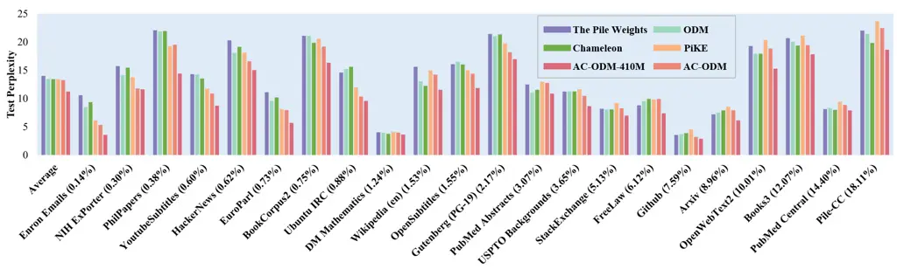

Figure 3: Test Perplexity Breakdown on The Pile. We report the test
perplexity across 22 individual domains. AC-ODM-410M achieves the lowest
perplexity in 17 out of 22 domains, showing robust generalization. It
effectively balances performance on dominant domains (e.g., Pile-CC)
while significantly improving on specialized ones (e.g., DM
Mathematics), outperforming both leverage-score based static mixing
(CHAMELEON) and gradient-conflict reduction strategies (PiKE).

LLM training. We use The Pile Gao et al. (2020), an open source corpus
of 825 GB from 22 diverse sources such as YouTube Subtitles, GitHub, and
Wikipedia. In addition, we pretrain on SlimPajama (Soboleva et al.,
2023), a seven domain corpus containing 672B tokens at a smaller scale.
Models are decoder only Transformers implemented with a modified GPT
NeoX library Black et al. (2022). Unless noted otherwise, configurations
follow Pythia Biderman et al. (2023) and we train a 1 billion parameter
model. Each GPU processes a micro batch of 8 sequences. We use gradient
accumulation across 8 GPUs with accumulation step 18, which yields an
effective batch size of 1152 samples. For each batch, we first draw 10
percent per domain to expose the policy to intra domain relationships
while preserving exploration and exploitation. The sequence length is
1024 with sequence packing Roberts et al. (2022). Training runs for
41,667 steps, corresponding to 50 billion tokens. During the first 833
warmup steps we replace AC driven weights with The Pile domain weights
perturbed by Gaussian noise sampled from $`N(0,0.02)`$.

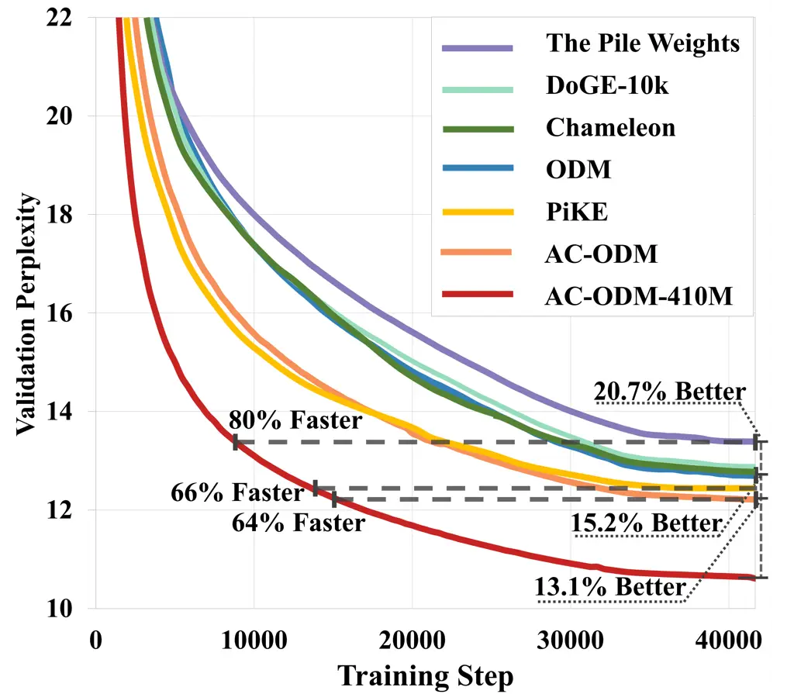

Figure 4: Validation Perplexity on The Pile. AC-ODM-410M (Proxy)
demonstrates the fastest convergence, significantly outperforming static
baselines (CHAMELEON, DoReMi) and dynamic methods (PiKE, ODM). It
reaches the optimal perplexity of the strongest baseline with 66% fewer
steps.

AC training. The actor and critic share the same warmup and main
training schedules as the LLM, with cosine decay learning rate starting
at 0.01 and decaying to 0.001. During warmup, we train the actor and
critic from the replay buffer $`\mathcal{B}`$. To initialize the actor,
we use the LLM warmup domain weights as soft labels, namely the noisy
The Pile weights, and optimize with mean squared error. For the critic,
we initialize labels as $`(1+\gamma)r^{t}`$ and optimize with mean
squared error. During main training, each iteration samples 256 tuples
from $`\mathcal{B}`$, dispatches 32 tuples per GPU, and uses gradient
accumulation of 1, which gives an effective batch size of 256.
Architectural details for Pythia 1B and the AC networks are in
Appendix A.

Reward and State setting. For the state features in Pythia 1B, the term
$`\|\omega\|_{2}`$ is computed on a subset of layers. We use the first
Transformer layer together with all layers whose indices are even. This
selection reduces computation time with negligible loss of fidelity. To
balance efficiency and efficacy in reward computation, we restrict the
calculation to a subset of parameters. Specifically, for Pythia 1B we
use the final feedforward blocks of Transformer layers 12, 14, and 16,
which together contain 50,331,648 parameters. This choice reduces memory
traffic while preserving a faithful proxy for reward estimation.
Ablations in Appendix B show that when only three layers are used this
selection is optimal.

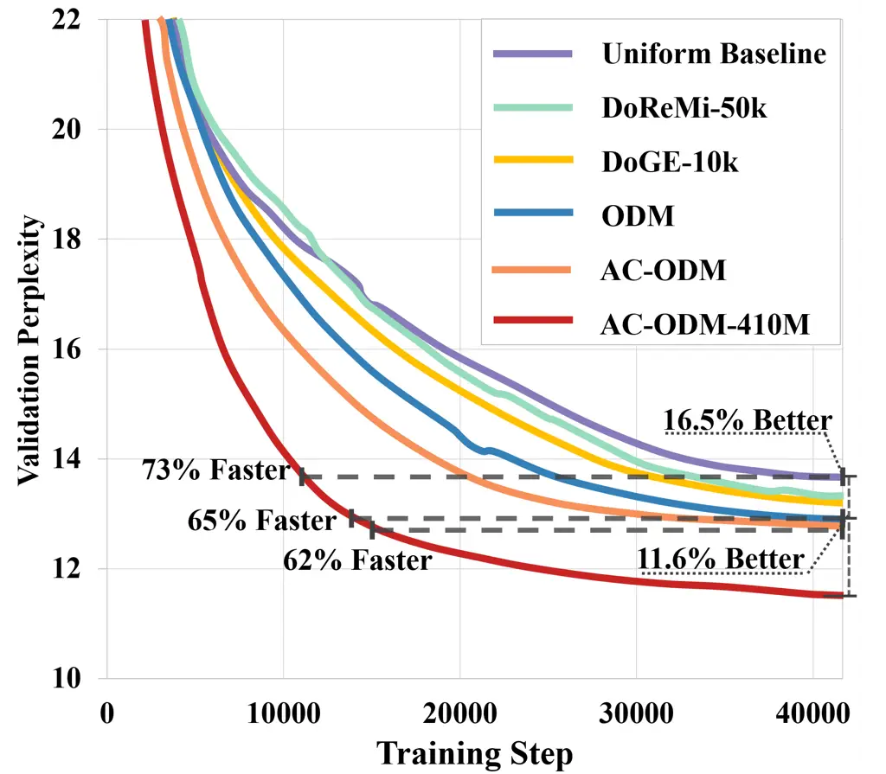

(a)

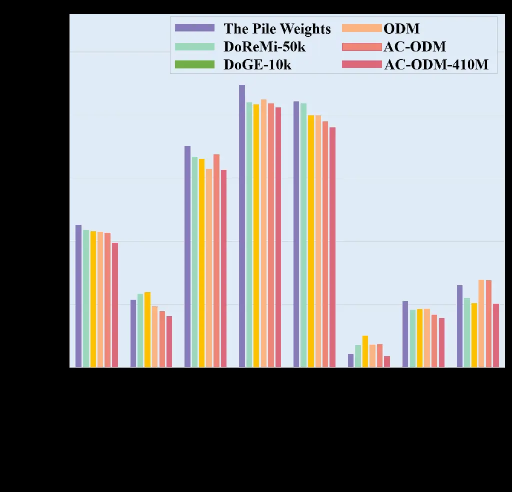

(b)

Figure 5: Results on SlimPajama with Pythia 1B. (a) Validation
perplexity during pretraining. AC-ODM and AC-ODM-410M converge faster
than static and online baselines. AC-ODM-410M reaches the best
perplexity of ODM in substantially fewer steps and yields lower
perplexity at a fixed budget, consistent with the annotations. (b) Test
perplexity averaged over domains and reported per domain. AC-ODM-410M
attains the best average perplexity and is competitive or best across
individual domains.

Baselines. We compare AC-ODM against a comprehensive set of baselines
representing both static and dynamic paradigms. For static strategies,
we evaluate: (1) The Pile Weights (TPW) Gao et al. (2020), the original
heuristic mixture; (2) DoReMi Xie et al. (2023), which derives weights
via a proxy model; (3) DoGE Fan et al. (2024), which optimizes weights
through gradient alignment; and (4) CHAMELEON Xie et al. (2025), which
utilizes leverage scores in an embedding space. For dynamic strategies,
we compare against: (5) ODM Albalak et al. (2023), which employs a
multi-armed bandit algorithm; and (6) PiKE Li et al. (2025), which
adapts weights based on gradient conflicts. All baselines are
implemented and trained under identical hardware configurations and
computational budgets to ensure strict fairness.

Evaluation. We report validation and test perplexity averaged over all
domains. For downstream generalization, we evaluate on MMLU Hendrycks et
al. (2021) with zero shot and five shot settings and on HumanEval Chen
et al. (2021) with pass@1. These protocols are applied to models
pretrained on The Pile and to models pretrained on SlimPajama under the
same training recipe unless noted otherwise. In addition, for models
pretrained on The Pile, we evaluate zero shot accuracy on five
representative tasks that probe commonsense and scientific reasoning,
namely COPA (Roemmele et al., 2011), SciQ (Welbl et al., 2017), LogiQA
(Liu et al., 2020), PIQA (Bisk et al., 2020), and WinoGrande (Sakaguchi
et al., 2021). Together, these evaluations measure both language
modeling quality and transfer to diverse downstream tasks.

Supplementary Analyses. Ablation studies concerning proxy model scaling
are presented in Appendix D, followed by an investigation into state
components in Appendix E. We visualize the evolution of domain weights
during training in Appendix F, and provide a detailed analysis of MMLU
task results in Appendix G. Additional camera-ready experiments on
policy size, reward stabilization, proxy-target scaling, larger
LLaMA-style models, and RegMix are reported in Appendix H.

### 4.2 Main Results

Convergence Analysis. Figure 4 presents the validation perplexity on The
Pile. The proxy-based AC-ODM-410M exhibits the fastest convergence
trajectory, reaching the optimal perplexity of the strongest prior
baseline (ODM) with approximately 66% fewer steps. Notably, it surpasses
newly introduced strong baselines: it outperforms the static
embedding-based method CHAMELEON, confirming that adaptive weights are
crucial for capturing evolving training dynamics; it also exceeds the
dynamic method PiKE. While PiKE effectively mitigates gradient
conflicts, AC-ODM explicitly maximizes constructive interference,
leading to more efficient descent directions. At 41,667 steps,
AC-ODM-410M achieves lower perplexity than TPW, ODM, and AC-ODM by
20.7%, 16.4%, and 13.1%, respectively. SlimPajama in Figure 5(a)
exhibits the same pattern, where AC-ODM-410M requires 65% fewer steps
than ODM and 73% fewer than the uniform baseline to reach its best
perplexity and at 41,667 steps improves perplexity by 16.5% over uniform
and 11.6% over the best online baseline. Overall, the proxy mode yields
the strongest performance on both corpora, while the non-proxy mode
consistently improves over static and online baselines with negligible
per-step overhead.

Domain-Level Generalization. AC-ODM’s reward mechanism explicitly favors
domains that generalize well, enabling the policy to exploit shared
structures. On The Pile (Figure 3), AC-ODM-410M attains the best average
test perplexity and outperforms PiKE in 17 of 22 domains, demonstrating
that maximizing gradient alignment is more effective than the conflict
reduction of PiKE or the static leverage scores of CHAMELEON. Notably,
gains are most pronounced in small and medium domains while remaining
significant in dominant ones, indicating that the policy effectively
balances within-domain learning with cross-domain transfer. On
SlimPajama (Figure 5(b)), AC-ODM-410M also yields the lowest average
perplexity, though with smaller margins than on The Pile due to the
coarser granularity of the seven domains limiting complex cross-domain
interactions. Together, these results confirm that AC-ODM is
particularly advantageous for large, finely partitioned corpora, while
consistently improving convergence on coarser collections.

| Algorithm   | MMLU 0-s (Acc) | MMLU 5-s (Acc) | HumanEval (p@1) |
| ----------- | -------------- | -------------- | --------------- |
| TPW         | 0.20664        | 0.27469        | 0.14119         |
| DoReMi-50k  | 0.21862        | 0.27887        | 0.14215         |
| DoGE-10k    | 0.22301        | 0.28117        | 0.15651         |
| Chameleon   | 0.22065        | 0.28257        | 0.14824         |
| ODM         | 0.23514        | 0.28416        | 0.32510         |
| PiKE        | 0.24839        | 0.30439        | 0.52188         |
| AC-ODM      | 0.25146        | 0.29868        | 0.60256         |
| AC-ODM-410M | 0.29980        | 0.35215        | 0.72644         |

Note: 0-s / 5-s: 0-shot / 5-shot accuracy; p@1: pass@1 rate.

Table 1: Evaluation of downstream tasks on MMLU and HumanEval. Acc
denotes accuracy.

Table 1 summarizes results on MMLU and HumanEval. Consistent with
training dynamics, dynamic strategies outperform static ones like
Chameleon. Notably, AC-ODM-410M surpasses the strongest baseline PiKE by
substantial margins, achieving a $`+5.1\%`$ gain in zero-shot MMLU and a
$`+39\%`$ relative improvement in HumanEval pass@1, from $`0.726`$ to
$`0.521`$. Compared to ODM, AC-ODM-410M improves by $`27.5\%`$ and
$`23.9\%`$ on zero-shot and five-shot MMLU, and achieves a
$`2.23\times`$ higher pass@1 on HumanEval. Appendix C provides
additional zero-shot evaluations on COPA, SciQ, LogiQA, PIQA, and
WinoGrande using the same The Pile pretrained checkpoints. These
downstream gains are informative because they are not confined to
language-modeling perplexity. The improvement on HumanEval is especially
large, yet the policy does not simply upweight all code-heavy domains;
the domain-weight traces in Appendix F show increases for StackExchange
and several high-quality general-purpose domains, while GitHub is
reduced. This suggests that AC-ODM improves code generation mainly
through better global optimization and transferable reasoning signals,
with domain reweighting acting as a mechanism rather than a narrow
task-specific shortcut.

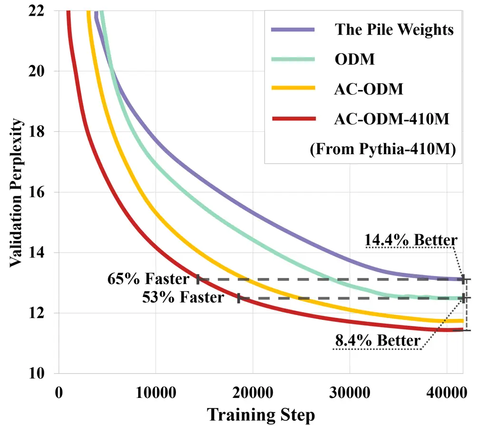

Figure 6: Validation perplexity during LLaMA 0.9B pretraining on The
Pile. We compare The Pile Weights, ODM, AC-ODM, and AC-ODM-410M, where
the latter transfers an actor learned with a 410M Pythia proxy.

### 4.3 Generalization to LLaMA-style Architectures

To assess whether AC-ODM extends beyond Pythia, we repeat the
pretraining study on a LLaMA-style decoder-only Transformer (Dubey et
al., 2024) with 0.9B parameters. As shown in Figure 6, AC-ODM improves
the training dynamics of this modern architecture in the same way as for
Pythia. The proxy mode remains the strongest: it reaches a target
validation perplexity with substantially fewer steps and achieves lower
perplexity at a fixed budget. In particular, the annotations in Figure 6
indicate that AC-ODM-410M reduces the steps required to match a common
perplexity level by about $`65\%`$ relative to The Pile Weights and by
about $`53\%`$ relative to AC-ODM, and at the 41,667 step budget it
improves perplexity by $`14.4\%`$ over The Pile Weights and by $`8.4\%`$
over AC-ODM. The relative margin on the LLaMA-style model is smaller
than on Pythia, which is expected because stronger dense decoder designs
leave less optimization slack for data mixing alone to exploit.
Importantly, the direction of the gain is unchanged: the transferred
policy still improves both sample efficiency and final perplexity. This
indicates that AC-ODM is not tied to a particular GPT-NeoX-style
architecture, but instead leverages gradient relations that persist
across decoder families.

|              |     |      |       |          |       |                |
| ------------ | --- | ---- | ----- | -------- | ----- | -------------- |
| Method       | AC  | LLM  | Total | Time (s) | Steps | Speedup        |
| ODM          | 0   | 1B   | 1B    | 2.47     | 41667 | 1.00$`\times`$ |
| PiKE         | 0   | 1B   | 1B    | 2.53     | 31250 | 1.30$`\times`$ |
| AC-ODM       | 17M | 1B   | 1.02B | 2.48     | 28356 | 1.46$`\times`$ |
| AC-ODM(160M) | 17M | 160M | 177M  | 0.65     | 28690 | 2.08$`\times`$ |
| Target (1B)  | 17M | 1B   | 1.02B | 2.48     | 12500 |                |
| AC-ODM(410M) | 17M | 410M | 427M  | 1.41     | 28690 | 1.47$`\times`$ |
| Target (1B)  | 17M | 1B   | 1.02B | 2.48     | 12010 |                |

Note: Time (s) for PiKE represents the global average per-step time due
to its variable overhead. All rows use Pythia-family target/proxy
models; “Target (1B)” denotes the transfer phase. On the LLaMA-style
0.9B target, non-proxy AC-ODM gives about $`1.44\times`$ speedup.

Table 2: Model size and computational cost during pretraining. Columns
AC, LLM, and Total denote parameter counts. AC-ODM(160M/410M) rows
report steps to converge the proxy policy, while AC-ODM(1B) rows report
steps for the target to match ODM perplexity.

### 4.4 Computational cost

We compare the computational resources required by AC-ODM, ODM, and PiKE
to train a 1B LLM to the validation perplexity achieved by ODM under
identical hardware.

Per-step Efficiency. Direct AC-ODM demonstrates high efficiency,
incurring a minimal $`0.4\%`$ overhead per step ($`2.48`$ s compared to
$`2.47`$ s for ODM). In contrast, PiKE exhibits a notably higher latency
of $`2.53`$ s per step, attributed to the computational cost of
estimating gradient conflicts.

End-to-End Speedup. AC-ODM reduces the total training steps by
$`31.95\%`$ (from $`41{,}667`$ to $`28{,}356`$), resulting in a
$`\mathbf{1.46\times}`$ end-to-end speedup, which effectively surpasses
the $`1.30\times`$ speedup achieved by PiKE.

In the proxy mode, the actor–critic is learned on a smaller proxy and
then transferred to the 1B target, which subsequently requires only
$`28.82\%`$ of the ODM steps ($`12{,}500`$ or $`12{,}010`$ steps). Even
when accounting for the proxy stage, the overall speedup reaches
$`2.08\times`$ with a 160M proxy and $`1.47\times`$ with a 410M proxy.
Although using a larger proxy increases the pretraining cost, the
stronger policy it acquires amortizes effectively over larger targets,
rendering the proxy mode increasingly attractive at scale. These results
reveal a practical trade-off between exploration cost and target-stage
savings. Non-proxy AC-ODM is preferable when no proxy run is available
or when corpora change online, because its per-step overhead is
essentially indistinguishable from ODM. Proxy AC-ODM is preferable when
the data mixture is fixed and the target model is expensive: the
one-time policy-learning cost is paid on a much smaller model, while the
target benefits from a mature policy from the first update. Thus the two
modes are complementary rather than competing operating points.

### 4.5 Effect of Domain Granularity

AC-ODM benefits from domain partitions that expose meaningful
cross-domain gradient structure. To assess this sensitivity, we merge
the 22 Pile domains into 11 and 5 semantically related groups and rerun
non-proxy AC-ODM on Pythia-1B for 25B tokens. Table 3 shows that coarser
partitions consistently weaken validation perplexity, especially in
early and middle training. This trend explains why gains are larger on
The Pile than on the seven-domain SlimPajama corpus, and suggests that
AC-ODM is most informative when domains are sufficiently distinct rather
than heavily redundant. The degradation is monotonic across the tested
granularity levels, indicating that the actor benefits from observing
separable sources of transfer rather than aggregated buckets. When
related domains are merged, positive and negative interactions can
cancel inside the same group, making the reward less discriminative. In
practice, this means AC-ODM should be paired with domain taxonomies that
preserve meaningful differences in style, knowledge, and supervision
signal; overly coarse taxonomies remain usable, but they reduce the
policy’s ability to discover fine-grained curricula.

| \# Domains | 5,208 | 10,416 | 15,624 | 20,832 |
| ---------- | ----- | ------ | ------ | ------ |
| 22         | 18.05 | 15.44  | 14.25  | 13.43  |
| 11         | 18.96 | 15.82  | 14.41  | 13.85  |
| 5          | 19.13 | 16.19  | 14.83  | 14.09  |

Table 3: Effect of domain granularity on AC-ODM. We report validation
perplexity for non-proxy Pythia-1B training on merged Pile partitions.

## 5 Limitations

AC-ODM is designed for corpora that can be organized into meaningful
domains, and its gains are naturally strongest when this partition
exposes useful cross-domain gradient structure. As suggested by the
granularity study, coarser or highly overlapping groupings remain usable
but may provide a less discriminative reward signal. The proxy mode also
relies on the learned policy transferring from a smaller model to the
target model; our experiments support this behavior across the studied
settings, while future work could further examine broader architecture
and corpus shifts. Finally, to keep the method lightweight, the reward
is estimated from selected parameters and optimizes the mixture of
available data rather than the intrinsic quality or governance
properties of the data itself. AC-ODM is therefore best viewed as a
complementary component to careful data curation, filtering, and
auditing in practical pretraining pipelines.

## 6 Conclusion

In this work, we established Actor-Critic Online Data Mixing (AC-ODM) as
a rigorous framework that reformulates pretraining data selection from a
heuristic process into a principled reinforcement learning problem. By
theoretically grounding the reward signal in optimization geometry,
AC-ODM explicitly maximizes the spectral coherence of updates, ensuring
that data mixtures constructively interfere to accelerate convergence
rather than merely reducing conflicts. Crucially, our framework
reconciles the tension between computational efficiency and structural
flexibility through its dual operational modes, seamlessly accommodating
both proxy-based transfer and direct pretraining from scratch. Empirical
evaluations confirm that AC-ODM sets a new state-of-the-art,
outperforming strong dynamic baselines like PiKE with negligible
wall-clock overhead ($`<0.5\%`$) while reducing the training steps
required for optimal perplexity by 66%. With substantial gains in
downstream reasoning (27.5% on MMLU) and code generation ($`2.23\times`$
on HumanEval), AC-ODM demonstrates that highly efficient data mixing,
delivering both rapid convergence and superior sample utilization, is
decisive for cultivating superior foundation models.

## Acknowledgements

This project was supported by the National Natural Science Foundation of
China (Grant Nos. 62272466, U24A20233, and 12571301).

## Impact Statement

This paper presents a reinforcement learning-based method for optimizing
pretraining data mixtures for large language models. Its primary
anticipated benefit is improved sample efficiency: by reaching
comparable or better model quality with fewer training steps, AC-ODM can
reduce the compute, energy use, and carbon emissions associated with
large-scale pretraining. At the same time, more efficient pretraining
may lower the barrier to developing capable language models, which can
amplify both beneficial applications and familiar risks of LLM
deployment, including misuse, biased outputs, and uneven access to
model-building infrastructure. These risks are not unique to our method,
but they make transparent reporting of data composition, evaluation
protocols, and deployment safeguards important when applying AC-ODM in
practice.

## References

- Albalak et al. (2024) A. Albalak, Y. Elazar, S. M. Xie, S. Longpre, N.
  Lambert, X. Wang, N. Muennighoff, B. Hou, L. Pan, H. Jeong, C.
  Raffel, S. Chang, T. Hashimoto, and W. Y. Wang A survey on data
  selection for language models. External Links: 2402.16827,
  [Link](https://arxiv.org/abs/2402.16827) Cited by: §2.
- Albalak et al. (2023) A. Albalak, L. Pan, C. Raffel, and W. Y. Wang
  Efficient online data mixing for language model pre-training. In
  R0-FoMo:Robustness of Few-shot and Zero-shot Learning in Large
  Foundation Models, External Links:
  [Link](https://openreview.net/forum?id=9Tze4oy4lw) Cited by: Figure 8,
  Figure 8, Appendix F, §1, §2, §4.1.
- Biderman et al. (2023) S. Biderman, H. Schoelkopf, Q. Anthony, H.
  Bradley, K. O’Brien, E. Hallahan, M. A. Khan, S. Purohit, U. S.
  Prashanth, E. Raff, A. Skowron, L. Sutawika, and O. van der Wal
  Pythia: a suite for analyzing large language models across training
  and scaling. External Links: 2304.01373,
  [Link](https://arxiv.org/abs/2304.01373) Cited by: §4.1.
- Bisk et al. (2020) Y. Bisk, R. Zellers, J. Gao, Y. Choi, et al. Piqa:
  reasoning about physical commonsense in natural language. In
  Proceedings of the AAAI conference on artificial intelligence,
  pp. 7432–7439. Cited by: §4.1.
- Black et al. (2022) S. Black, S. Biderman, E. Hallahan, Q. Anthony, L.
  Gao, L. Golding, H. He, C. Leahy, K. McDonell, J. Phang, M.
  Pieler, U. S. Prashanth, S. Purohit, L. Reynolds, J. Tow, B. Wang,
  and S. Weinbach GPT-neox-20b: an open-source autoregressive language
  model. External Links: 2204.06745,
  [Link](https://arxiv.org/abs/2204.06745) Cited by: §A.1, §4.1.
- Chen et al. (2021) M. Chen, J. Tworek, H. Jun, Q. Yuan, H. P. de
  Oliveira Pinto, J. Kaplan, H. Edwards, Y. Burda, N. Joseph, G.
  Brockman, A. Ray, R. Puri, G. Krueger, M. Petrov, H. Khlaaf, G.
  Sastry, P. Mishkin, B. Chan, S. Gray, N. Ryder, M. Pavlov, A.
  Power, L. Kaiser, M. Bavarian, C. Winter, P. Tillet, F. P. Such, D.
  Cummings, M. Plappert, F. Chantzis, E. Barnes, A. Herbert-Voss, W. H.
  Guss, A. Nichol, A. Paino, N. Tezak, J. Tang, I. Babuschkin, S.
  Balaji, S. Jain, W. Saunders, C. Hesse, A. N. Carr, J. Leike, J.
  Achiam, V. Misra, E. Morikawa, A. Radford, M. Knight, M. Brundage, M.
  Murati, K. Mayer, P. Welinder, B. McGrew, D. Amodei, S. McCandlish, I.
  Sutskever, and W. Zaremba Evaluating large language models trained on
  code. External Links: 2107.03374,
  [Link](https://arxiv.org/abs/2107.03374) Cited by: §4.1.
- Dao et al. (2022) T. Dao, D. Y. Fu, S. Ermon, A. Rudra, and C. Ré
  FlashAttention: fast and memory-efficient exact attention with
  io-awareness. External Links: 2205.14135,
  [Link](https://arxiv.org/abs/2205.14135) Cited by: §A.1.
- Diao et al. (2025) S. Diao, Y. Yang, Y. Fu, X. Dong, D. Su, M.
  Kliegl, Z. Chen, P. Belcak, Y. Suhara, H. Yin, et al. Nemotron-climb:
  clustering-based iterative data mixture bootstrapping for language
  model pre-training. In The Thirty-ninth Annual Conference on Neural
  Information Processing Systems Datasets and Benchmarks Track, Cited
  by: §2.
- Du et al. (2022) N. Du, Y. Huang, A. M. Dai, S. Tong, D. Lepikhin, Y.
  Xu, M. Krikun, Y. Zhou, A. W. Yu, O. Firat, B. Zoph, L. Fedus, M.
  Bosma, Z. Zhou, T. Wang, Y. E. Wang, K. Webster, M. Pellat, K.
  Robinson, K. Meier-Hellstern, T. Duke, L. Dixon, K. Zhang, Q. V.
  Le, Y. Wu, Z. Chen, and C. Cui GLaM: efficient scaling of language
  models with mixture-of-experts. External Links: 2112.06905,
  [Link](https://arxiv.org/abs/2112.06905) Cited by: §1, §2.
- Dubey et al. (2024) A. Dubey, A. Jauhri, A. Pandey, A. Kadian, A.
  Al-Dahle, A. Letman, A. Mathur, A. Schelten, A. Yang, A. Fan, et al.
  The llama 3 herd of models. arXiv e-prints, pp. arXiv–2407. Cited by:
  §4.3.
- Fan et al. (2024) S. Fan, M. Pagliardini, and M. Jaggi DoGE: domain
  reweighting with generalization estimation. External Links:
  2310.15393, [Link](https://arxiv.org/abs/2310.15393) Cited by: §1, §2,
  §3.4, §4.1.
- Gao et al. (2020) L. Gao, S. Biderman, S. Black, L. Golding, T.
  Hoppe, C. Foster, J. Phang, H. He, A. Thite, N. Nabeshima, S. Presser,
  and C. Leahy The pile: an 800gb dataset of diverse text for language
  modeling. External Links: 2101.00027,
  [Link](https://arxiv.org/abs/2101.00027) Cited by: §4.1, §4.1.
- Hendrycks et al. (2021) D. Hendrycks, C. Burns, S. Basart, A. Zou, M.
  Mazeika, D. Song, and J. Steinhardt Measuring massive multitask
  language understanding. External Links: 2009.03300,
  [Link](https://arxiv.org/abs/2009.03300) Cited by: §4.1.
- Kingma and Ba (2017) D. P. Kingma and J. Ba Adam: a method for
  stochastic optimization. External Links: 1412.6980,
  [Link](https://arxiv.org/abs/1412.6980) Cited by: §A.1.
- Lee et al. (2022) K. Lee, D. Ippolito, A. Nystrom, C. Zhang, D.
  Eck, C. Callison-Burch, and N. Carlini Deduplicating training data
  makes language models better. External Links: 2107.06499,
  [Link](https://arxiv.org/abs/2107.06499) Cited by: §1, §2.
- Li et al. (2025) Z. Li, Y. Deng, P. Zhong, M. Razaviyayn, and V.
  Mirrokni PiKE: adaptive data mixing for large-scale multi-task
  learning under low gradient conflicts. In The Thirty-ninth Annual
  Conference on Neural Information Processing Systems, External Links:
  [Link](https://openreview.net/forum?id=xNJenVNmzL) Cited by: §1, §2,
  §2, §4.1.
- Liu et al. (2025a) F. Liu, W. Zhou, B. Liu, Z. Yu, Y. Zhang, H.
  Lin, Y. Yu, B. Zhang, X. Zhou, T. Wang, et al. Quadmix:
  quality-diversity balanced data selection for efficient llm
  pretraining. arXiv preprint arXiv:2504.16511. Cited by: §2.
- Liu et al. (2020) J. Liu, L. Cui, H. Liu, D. Huang, Y. Wang, and Y.
  Zhang Logiqa: a challenge dataset for machine reading comprehension
  with logical reasoning. arXiv preprint arXiv:2007.08124. Cited by:
  §4.1.
- Liu et al. (2025b) Q. Liu, X. Zheng, N. Muennighoff, G. Zeng, L.
  Dou, T. Pang, J. Jiang, and M. Lin RegMix: data mixture as regression
  for language model pre-training. In The Thirteenth International
  Conference on Learning Representations, Cited by: §1, §2.
- Ouyang et al. (2025) X. Ouyang, S. Chen, M. A. L. Pearce, T.
  Hartvigsen, and J. R. Schwarz ADMIRE-bayesopt: accelerated data
  MIxture RE-weighting for language models with bayesian optimization.
  Transactions on Machine Learning Research. External Links: ISSN
  2835-8856, [Link](https://openreview.net/forum?id=0Euvm9zDpu) Cited
  by: §2.
- Roberts et al. (2022) A. Roberts, H. W. Chung, A. Levskaya, G.
  Mishra, J. Bradbury, D. Andor, S. Narang, B. Lester, C. Gaffney, A.
  Mohiuddin, C. Hawthorne, A. Lewkowycz, A. Salcianu, M. van Zee, J.
  Austin, S. Goodman, L. B. Soares, H. Hu, S. Tsvyashchenko, A.
  Chowdhery, J. Bastings, J. Bulian, X. Garcia, J. Ni, A. Chen, K.
  Kenealy, J. H. Clark, S. Lee, D. Garrette, J. Lee-Thorp, C. Raffel, N.
  Shazeer, M. Ritter, M. Bosma, A. Passos, J. Maitin-Shepard, N.
  Fiedel, M. Omernick, B. Saeta, R. Sepassi, A. Spiridonov, J. Newlan,
  and A. Gesmundo Scaling up models and data with t5x and seqio.
  External Links: 2203.17189, [Link](https://arxiv.org/abs/2203.17189)
  Cited by: §4.1.
- Roemmele et al. (2011) M. Roemmele, C. A. Bejan, and A. S. Gordon
  Choice of Plausible Alternatives: an evaluation of commonsense causal
  reasoning. In AAAI Spring Symposium on Logical Formalizations of
  Commonsense Reasoning, Stanford, CA, pp. 90–95. Cited by: §4.1.
- Sakaguchi et al. (2021) K. Sakaguchi, R. Le Bras, C. Bhagavatula,
  and Y. Choi WinoGrande: an adversarial Winograd schema challenge at
  scale. Communications of the ACM 64 (9), pp. 99–106. External Links:
  [Document](https://dx.doi.org/10.1145/3474381) Cited by: §4.1.
- Shukor et al. (2025) M. Shukor, L. Béthune, D. Busbridge, D.
  Grangier, E. Fini, A. El-Nouby, and P. Ablin Scaling laws for optimal
  data mixtures. In The Thirty-ninth Annual Conference on Neural
  Information Processing Systems, Cited by: §2.
- Soboleva et al. (2023) D. Soboleva, F. Al-Khateeb, R. Myers, J. R.
  Steeves, J. Hestness, and N. Dey SlimPajama: a 627b token cleaned and
  deduplicated version of redpajama. Cited by: §4.1.
- Sorscher et al. (2023) B. Sorscher, R. Geirhos, S. Shekhar, S.
  Ganguli, and A. S. Morcos Beyond neural scaling laws: beating power
  law scaling via data pruning. External Links: 2206.14486,
  [Link](https://arxiv.org/abs/2206.14486) Cited by: §2.
- St. John and Draper (1975) R. C. St. John and N. R. Draper
  D-optimality for regression designs: a review. Technometrics 17 (1),
  pp. 15–23. External Links:
  [Document](https://dx.doi.org/10.1080/00401706.1975.10489266) Cited
  by: §1, §2.
- Su et al. (2023) J. Su, Y. Lu, S. Pan, A. Murtadha, B. Wen, and Y. Liu
  RoFormer: enhanced transformer with rotary position embedding.
  External Links: 2104.09864, [Link](https://arxiv.org/abs/2104.09864)
  Cited by: §A.1.
- Welbl et al. (2017) J. Welbl, N. F. Liu, and M. Gardner Crowdsourcing
  multiple choice science questions. arXiv preprint arXiv:1707.06209.
  Cited by: §4.1.
- Xie et al. (2023) S. M. Xie, H. Pham, X. Dong, N. Du, H. Liu, Y.
  Lu, P. Liang, Q. V. Le, T. Ma, and A. W. Yu DoReMi: optimizing data
  mixtures speeds up language model pretraining. External Links:
  2305.10429, [Link](https://arxiv.org/abs/2305.10429) Cited by: §1, §2,
  §4.1.
- Xie et al. (2025) W. Xie, F. Tonin, and V. Cevher Chameleon: a
  flexible data-mixing framework for language model pretraining and
  finetuning. In Forty-second International Conference on Machine
  Learning, Cited by: §1, §2, §4.1.
- Yang et al. (2025) A. Yang, A. Li, B. Yang, B. Zhang, B. Hui, B.
  Zheng, B. Yu, C. Gao, C. Huang, C. Lv, et al. Qwen3 technical report.
  arXiv preprint arXiv:2505.09388. Cited by: §2.
- Yen et al. (2025) T. Yen, A. W. T. Siah, H. Chen, T. Peng, D. Guetta,
  and H. Namkoong Data mixture optimization: a multi-fidelity
  multi-scale bayesian framework. arXiv preprint arXiv:2503.21023. Cited
  by: §2.
- Yu et al. (2025) Y. Yu, K. Han, H. Zhou, Y. Tang, K. Huang, Y. Wang,
  and D. Tao LLM data selection and utilization via dynamic bi-level
  optimization. In Forty-second International Conference on Machine
  Learning, External Links:
  [Link](https://openreview.net/forum?id=3C1s1aEICC) Cited by: §2.
- Zhuang et al. (2025) X. Zhuang, J. Peng, R. Ma, Y. Wang, T. Bai, X.
  Wei, Q. Jiantao, C. Zhang, Y. Qian, and C. He Meta-rater: a
  multi-dimensional data selection method for pre-training language
  models. In Proceedings of the 63rd Annual Meeting of the Association
  for Computational Linguistics (Volume 1: Long Papers),
  pp. 10856–10896. Cited by: §2.

## Appendix A Model Configuration

### A.1 LLM Model Configuration

We adopt the sequence length of 1024 and employ a 16-layer Transformers
architecture with a hidden size of 2048 and 16 attention heads. Rotary
positional embedding Su et al. (2023) is incorporated. We leverage
FlashAttention Dao et al. (2022), which optimizes memory access and
reduces computation overhead, to improve training efficiency. The model
is trained using Adam optimizer Kingma and Ba (2017). The learning rate
undergoes a linear warm-up for 833 iterations, gradually increasing from
a minimum of 2.5e-5 to a peak of 2.5e-4, followed by a cosine decay back
to 2.5e-5. We utilize the GPT-NeoX-20B tokenizer Black et al. (2022) for
text processing.

### A.2 AC Networks Configuration

For both the actor and the critic, we employ a fully connected 6-layer
neural network with 1024 neurons per hidden layer. Except for the output
layer, each layer is followed by layer normalization and a ReLU
activation. In the actor, the output layer is further processed by the
softmax activation function, while in the critic, the output layer is
post-processed by the identity activation function.

## Appendix B Ablation study of selected layers

| Block indexes | Perplexity |
| ------------- | ---------- |
| 12, 14, 16    | 13.0655    |
| 14, 15, 16    | 13.0682    |
| 6, 8, 10      | 13.0709    |
| 1, 2, 3       | 13.0701    |

Table 4: Ablation study of selected layers used for reward computation.

The results show that using later Transformer blocks yields the best
proxy for reward computation: selecting layers 12,14,16 attains the
lowest perplexity, slightly outperforming contiguous later layers
14,15,16 and clearly matching or exceeding mid and early layer choices.
Although the absolute differences are small, they are consistent,
suggesting that mid-to-late representations provide a more informative
signal while confirming that AC-ODM is robust to the exact layer subset.
These findings support our default choice of 12,14,16.

## Appendix C Zero shot accuracy on downstream tasks

| Task       | TPW     | DoReMi-50k | DoGE-10k | ODM     | AC-ODM  | AC-ODM-410M |
| ---------- | ------- | ---------- | -------- | ------- | ------- | ----------- |
| MMLU       | 0.27469 | 0.27887    | 0.27955  | 0.28416 | 0.29868 | 0.35215     |
| COPA       | 0.54800 | 0.62000    | 0.64800  | 0.68000 | 0.69800 | 0.72000     |
| SciQ       | 0.62000 | 0.63800    | 0.66400  | 0.68900 | 0.70200 | 0.73000     |
| LogiQA     | 0.23810 | 0.24580    | 0.27650  | 0.30720 | 0.30110 | 0.32260     |
| PIQA       | 0.60330 | 0.61670    | 0.62000  | 0.68330 | 0.69670 | 0.72000     |
| WinoGrande | 0.50930 | 0.52630    | 0.53200  | 0.59650 | 0.58300 | 0.63380     |
| AVG        | 0.50374 | 0.52936    | 0.54810  | 0.59120 | 0.59616 | 0.62528     |

Table 5: Zero shot accuracy on downstream tasks using The Pile
pretrained 1B models. AVG is the macro average across tasks.

Analysis. AC-ODM-410M achieves the highest accuracy on every task and
the best average (0.62528), improving over ODM by an absolute
$`+0.0341`$ and a relative $`+5.8\%`$. Gains are consistent across
commonsense and reasoning benchmarks, with the largest jump on MMLU. The
non proxy AC-ODM also improves over ODM on average but trails the proxy
mode, underscoring the benefit of learning the policy with a proxy model
before guiding the target LLM.

## Appendix D subEffect of proxy model size

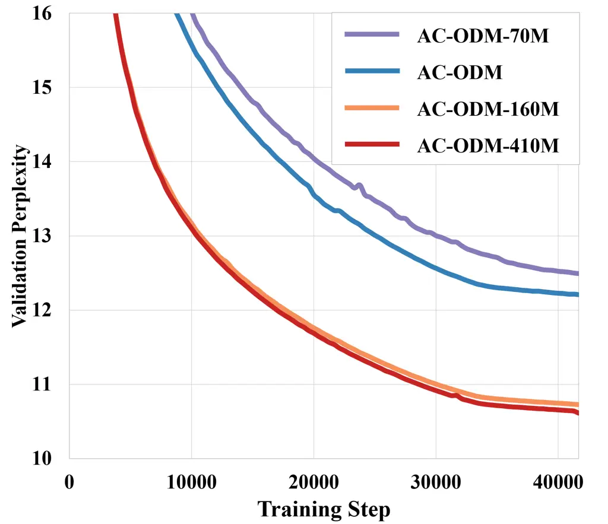

Figure 7: Validation perplexity for a 1B target using policies learned
with proxy LLMs of different sizes (average over 22 Pile domains).

Figure 7 compares a 1B target trained with sampling policies learned
from 70M, 160M, and 410M proxy LLMs against joint training with AC-ODM.
The proxies attain training losses of 2.8, 2.65, and 2.48, with
validation perplexities 20.3, 15.5, and 12.1, respectively. Policies
from 160M and 410M consistently outperform joint AC-ODM, indicating that
a prelearned actor adapts from the first step, whereas an online actor
is still converging. The 70M proxy performs worst, suggesting
insufficient capacity to learn a transferable policy. The 160M proxy
nearly matches the 410M proxy, especially early in training, likely
because the 1B target limits headroom. We expect the gap to widen for
larger targets and leave a systematic study of proxy–target scaling for
future work.

## Appendix E Ablation study of state components

| Status of state                                                        | Perplexity | Impr.        |
| ---------------------------------------------------------------------- | ---------- | ------------ |
| All components                                                         | 13.0655    | –            |
| w/o $`n`$: number of samples per domain                                | 13.1203    | $`-0.419\%`$ |
| w/o $`t`$: iteration step                                              | 13.0958    | $`-0.232\%`$ |
| w/o $`\ell(\theta_{M},B)`$: per-domain losses                          | 13.8992    | $`-6.38\%`$  |
| w/o $`\Delta\ell(\theta_{M},B)`$: change of per-domain losses          | 13.5470    | $`-3.69\%`$  |
| w/o $`\|\omega\|_{2}`$: $`L^{2}`$ norm of selected layer weights       | 13.9115    | $`-6.48\%`$  |
| w/o $`\|\Delta\omega\|_{2}`$: $`L^{2}`$ norm change of selected layers | 13.4254    | $`-2.75\%`$  |

Table 6: Ablation study of state components used by AC-ODM. Removing any
component degrades performance; “Impr.” is the relative change in
perplexity compared with using all components.

Analysis. All six features contribute to policy quality. Removing
per-domain losses $`\ell(\theta_{M},B)`$ or the weight norm
$`\|\omega\|_{2}`$ causes the largest degradations ($`\approx`$6.4%),
indicating that absolute training signal and model-scale dynamics are
critical for the actor. The change-of-loss term
$`\Delta\ell(\theta_{M},B)`$ is also important ($`-3.69\%`$), while the
count of seen samples $`n`$ and the step index $`t`$ provide smaller but
nontrivial gains. Overall, the full state offers the best perplexity and
each component carries complementary information.

## Appendix F Evolution of Domain Weights During Training

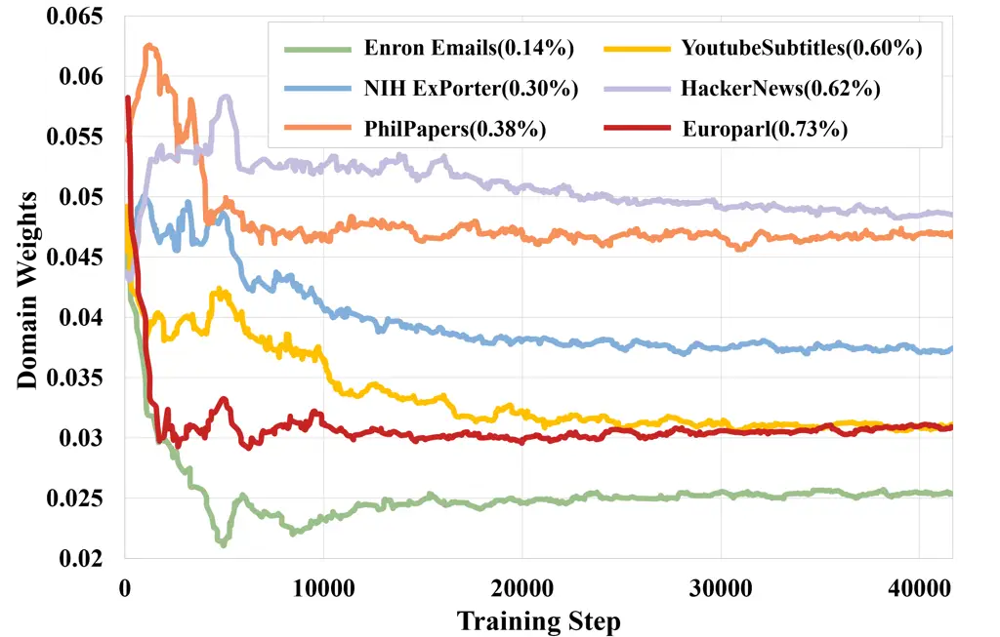

(a)

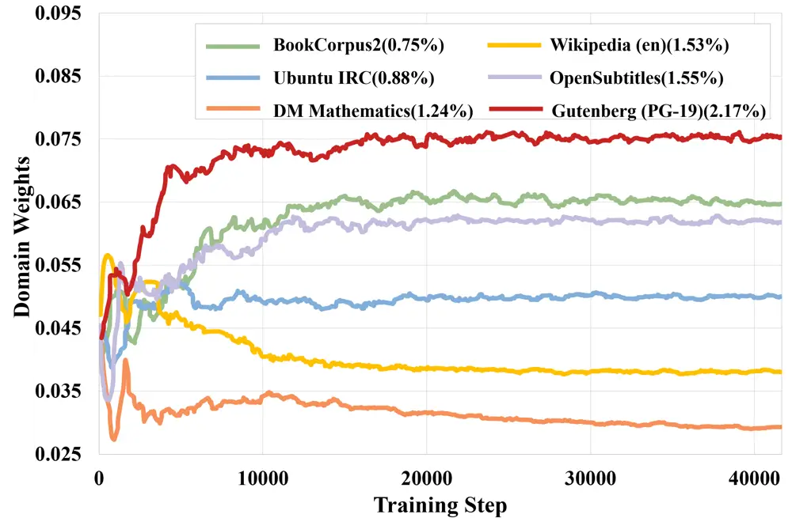

(b)

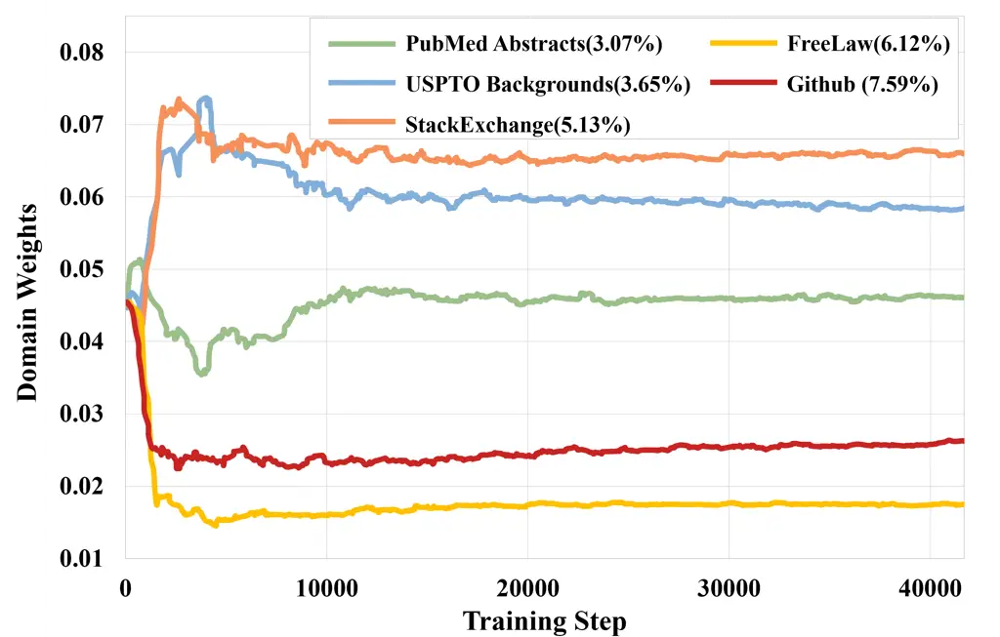

(c)

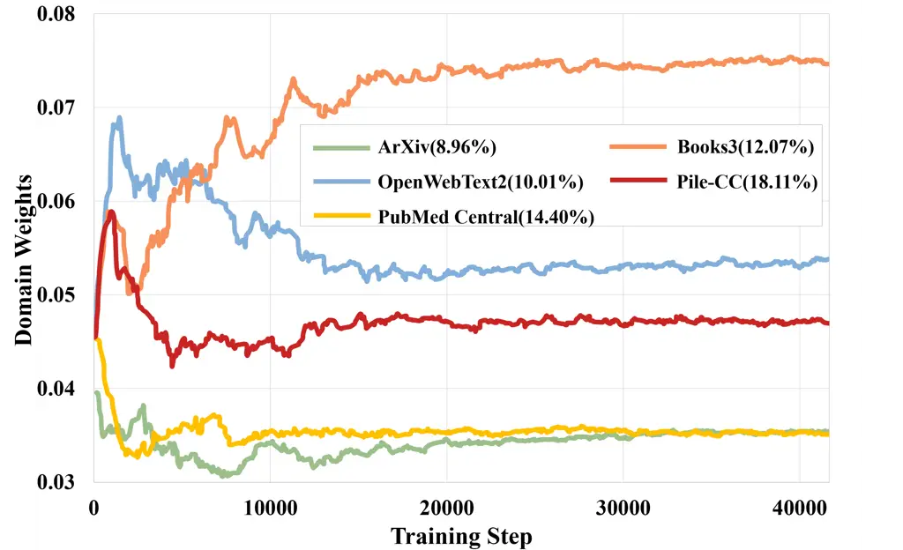

(d)

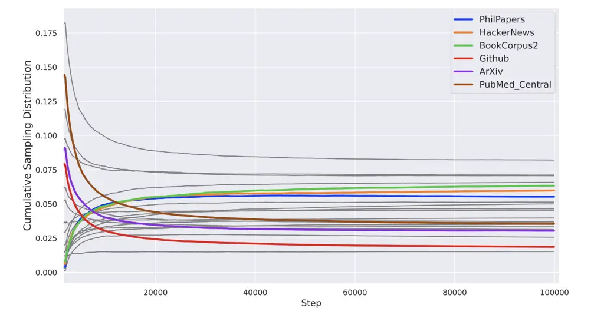

(e)

Figure 8: Evolution of domain weights during training. The legend
indicates the proportion of tokens of each domain (in percentage). (a)
Six domains with smallest token proportions; (b) Six domains with token
proportions below 3%; (c) Five domains with token proportions below 8%;
(d) Five domains with highest token proportions; (e) The cumulative
sampling distribution of ODM (Albalak et al., 2023).

Figure 8(a)–8(d) illustrate the evolution of domain weights across 22
distinct domains in The Pile dataset during training 1B Pythia model
under AC-ODM algorithm. AC-ODM initializes from the original domain
weights of The Pile and undergoes dynamic updates during the warmup
phase. After approximately 15,000 training steps, the domain weights
stabilize. Afterward, minor fluctuations are observed, which correspond
to the evolving state of the LLM. The adaptive nature of AC-ODM’s domain
weight generation during this critical phase allows it to better align
with the evolving model state, thereby facilitating faster reductions in
both training loss and perplexity compared to prior methods.

Both AC-ODM and ODM algorithms eventually converge to stable domain
weights. However, AC-ODM exhibits more substantial adjustments in domain
weights during the first third of training, while ODM (Albalak et al., 2023) stabilizes after only the first fifth of the total training steps.
Notably, even after reaching stability, AC-ODM continues to experience
slight fluctuations in domain weights, enabling dynamic adaptation to
evolving LLM state. In contrast, domain weights in ODM remain nearly
constant in the later stages of training, indicating a lack of
flexibility in response to parameter updates in later stage.

A comparison of domains with the large magnitudes of increases or
decreases in weights across Figure 8(a)–8(d) reveals consistent
patterns. Regardless of the token proportion, domains characterized by
high-quality and general-purpose texts tend to experience weight
increases during training. Examples include HackerNews in Figure 8(a),
Gutenberg (PG-19) and BookCorpus2 in Figure 8(b), StackExchange and
USPTO Backgrounds in Figure 8(c), and Book3 in Figure 8(d). In contrast,
domains containing noisier texts or highly domain-specific contents
exhibit significant weight reductions, such as Enron Emails in
Figure 8(a), DM Mathematics and Wikipedia (en) in Figure 8(b), Github
and FreeLaw in Figure 8(c), and PubMed Central in Figure 8(d). These
observations align with human intuitive expectations: during LLM
pretraining, data domains rich in high-quality, generalizable content
are more effective at driving model convergence in the early stages of
training.

## Appendix G Analysis of Results of MMLU Tasks

| Algorithm   | STEM    | Social Sciences | Humanities | Other   | Average |
| ----------- | ------- | --------------- | ---------- | ------- | ------- |
| AC-ODM      | 0.24213 | 0.30433         | 0.25381    | 0.24626 | 0.25146 |
| AC-ODM-410M | 0.28219 | 0.38231         | 0.29908    | 0.28924 | 0.29980 |

Table 7: Zero-shot accuracy of AC-ODMs among different groups in MMLU.

We evaluate the performance of AC-ODM across four domain-specific groups
in the MMLU benchmark, along with the overall average accuracy. As shown
in Table 7, AC-ODM achieves better accuracy in the Social Sciences
group, achieving approximately 21% higher than average. This indicates
that AC-ODM effectively adapts to domain shifts in this group, likely
benefiting from the alignment between Social Sciences content and the
training distribution in The Pile. In contrast, AC-ODM underperforms in
the STEM and Other groups, where accuracy falls slightly below the
overall average. The Humanities group yields performance close to the
average. These observations suggest that AC-ODM facilitates the LLM’s
ability to better acquire and generalize semantic patterns related to
humanities and social science domains from The Pile.

Compared to the direct application of AC-ODM, the proxy-based
AC-ODM-410M variant consistently improves performance across all groups,
yielding an overall 19% increase in average accuracy. The most notable
gains occur in the Social Sciences and Other groups, with improvements
of 26% and 17%, respectively. These results indicate that AC-ODM trained
on a 410M-parameter proxy model can effectively capture the underlying
domain relationships present in The Pile, which are transferable to
larger models and particularly beneficial for tasks involving
humanities, social sciences, and general knowledge. However, the
relatively limited gains in STEM-related domains also suggest that
AC-ODM pays less attention to exploring domain-specific features
relevant to science and engineering. This limitation may stem from the
relatively low proportion of STEM-related content in The Pile dataset
itself, which we would like to investigate in the future.

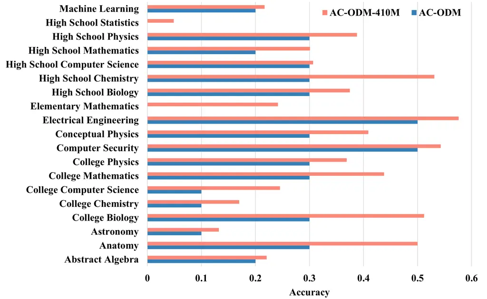

(a)

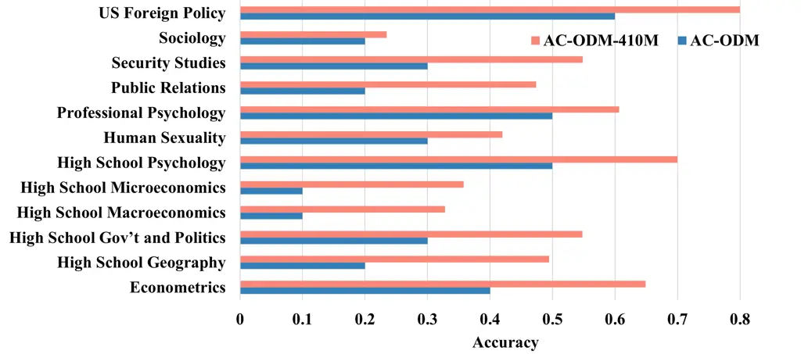

(b)

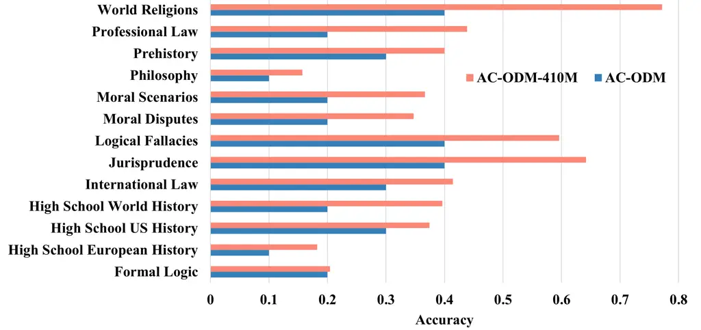

(c)

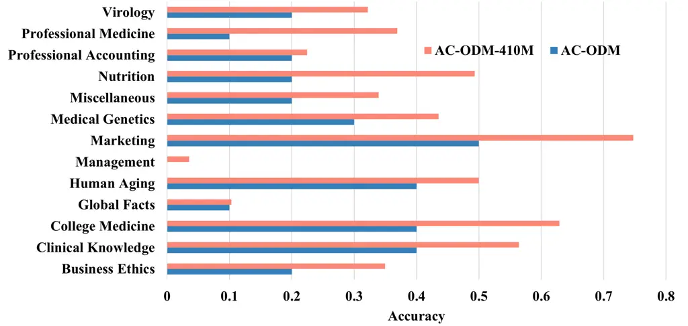

(d)

Figure 9: Zero-shot accuracy of AC-ODMs across MMLU tasks, grouped by
subject category. (a) STEM; (b) Social Sciences; (c) Humanities; (d)
Other.

Figure 9 illustrates the task-level accuracy of AC-ODMs across different
groups within the MMLU benchmark. In the STEM group, AC-ODMs achieve
strong performance on tasks such as Electrical Engineering and Computer
Security. Within the Social Sciences group, notable improvements are
observed in US Foreign Policy, Professional Psychology, High School
Psychology, and Econometrics. For the Humanities group, AC-ODMs perform
well on World Religions, Logical Fallacies, and Jurisprudence. In the
Other group, tasks such as Marketing, Human Aging, College Medicine, and
Clinical Knowledge benefit significantly from AC-ODMs. These results
suggest that AC-ODM’s domain weight optimization strategy effectively
guides the LLMs to acquire semantic information associated with
general-purpose knowledge domains.

Compared to AC-ODM, the proxy-based AC-ODM-410M consistently improves
performance across all tasks. Notably, for particularly challenging
tasks such as High School Statistics, Elementary Mathematics, and
Management, AC-ODM-410M achieves non-zero accuracy where AC-ODM fails
completely (0% accuracy). These findings highlight that the use of a
well-trained proxy model during training enables AC-ODM to capture
meaningful domain relationships, ultimately enhancing LLM performance.
Proxy-based training allows the model to better infer the latent
structure of domain-specific knowledge while fulfilling difficult tasks,
thereby leading to more effective adaptation and improved
generalization.

## Appendix H Additional Camera-Ready Experiments

### H.1 Policy Model Size Sensitivity

We vary the actor–critic parameter budget as a fraction of the target
LLM size and report final test perplexity on The Pile. Table 8 shows
that very small policies underfit the training dynamics, while larger
policies provide little additional benefit after roughly
$`0.25\%`$–$`0.5\%`$ of the target size. This supports the default
design choice: AC-ODM needs enough capacity to model cross-domain
interactions, but its policy can remain orders of magnitude smaller than
the LLM.

| Target LLM | 0.05% | 0.15% | 0.25% | 0.5%  | 0.75% |
| ---------- | ----- | ----- | ----- | ----- | ----- |
| 410M       | 15.15 | 14.86 | 14.84 | 14.92 | 15.02 |
| 1B         | 13.19 | 12.33 | 12.21 | 12.21 | 12.22 |

Table 8: Final test perplexity on The Pile with different policy-model
sizes. Percentages denote the policy size relative to the target LLM.

### H.2 Reward Stabilization

We also track the mean reward over the 22 Pile domains during non-proxy
training. As shown in Table 9, the reward rises rapidly and then
stabilizes at a high level, broadly matching the stabilization of domain
weights observed in Appendix F. The curve is not expected to be
monotonic because the reward is computed from stochastic gradients and
the model state keeps changing, but its plateau indicates that the
learned policy converges to consistently constructive gradient
interactions.

|        |        |        |        |        |
| ------ | ------ | ------ | ------ | ------ |
| Metric | 10,425 | 20,834 | 31,250 | 41,667 |
| Reward | 0.21   | 0.89   | 0.92   | 0.91   |

Table 9: Average reward over 22 Pile domains during non-proxy AC-ODM
training.

### H.3 Proxy-Target Scale-Up

To test whether proxy transfer remains useful at a larger scale, we
train a Pythia-12B target using a policy learned from a Pythia-1B proxy.
Table 10 reports validation perplexity over the first 25B tokens. AC-ODM
maintains a clear advantage over ODM throughout training, suggesting
that stronger proxies can learn policies that remain transferable to
substantially larger targets.

| Method            | 5,208 | 10,416 | 15,624 | 20,832 |
| ----------------- | ----- | ------ | ------ | ------ |
| ODM               | 14.53 | 10.01  | 8.55   | 7.32   |
| AC-ODM (1B proxy) | 12.87 | 7.56   | 5.91   | 4.24   |

Table 10: Validation perplexity on The Pile during Pythia-12B
pretraining.

### H.4 Larger LLaMA-Style Models

We further evaluate non-proxy AC-ODM on larger LLaMA-style decoders. The
3B model follows the layer configuration of LLaMA 3.2-text, and the 7B
model follows the layer configuration of LLaMA 3. Table 11 shows that
validation perplexity improves consistently as model scale increases,
confirming that the AC-ODM training recipe remains effective beyond the
0.9B LLaMA-style setting in the main text.

| Model size | 5,208 | 10,416 | 15,624 | 20,832 |
| ---------- | ----- | ------ | ------ | ------ |
| 0.9B       | 18.06 | 14.82  | 13.65  | 12.86  |
| 3B         | 15.31 | 13.24  | 11.15  | 10.59  |
| 7B         | 13.98 | 10.99  | 9.54   | 8.79   |

Table 11: Validation perplexity of LLaMA-style models on The Pile in
non-proxy mode.

### H.5 Comparison with RegMix

RegMix is a strong static mixture optimization baseline. We include an
additional half-budget Pythia-1B comparison under the same training
setup. Table 12 shows that AC-ODM improves validation perplexity at
every measured checkpoint, reinforcing the main conclusion that adapting
mixtures online is more effective than fixing a globally optimized
static mixture.

| Method | 5,208 | 10,416 | 15,624 | 20,832 |
| ------ | ----- | ------ | ------ | ------ |
| RegMix | 19.46 | 16.86  | 15.61  | 14.53  |
| AC-ODM | 18.05 | 15.44  | 14.25  | 13.34  |

Table 12: Validation perplexity on The Pile during Pythia-1B
pretraining.
