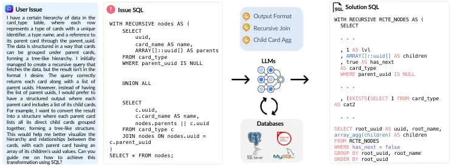
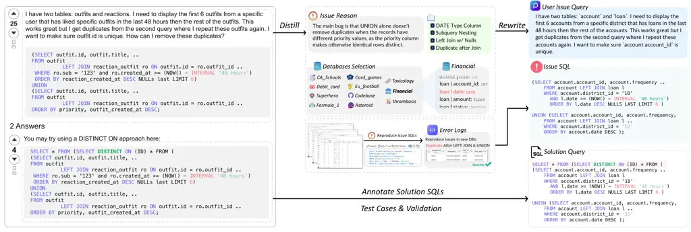
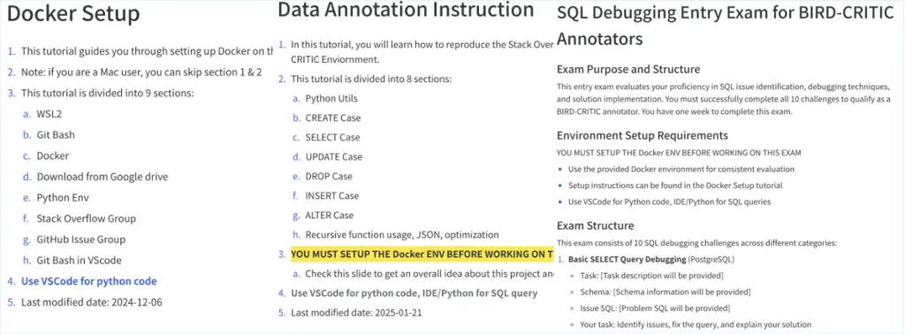
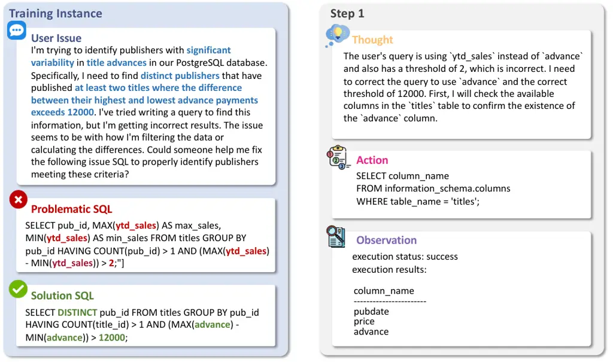
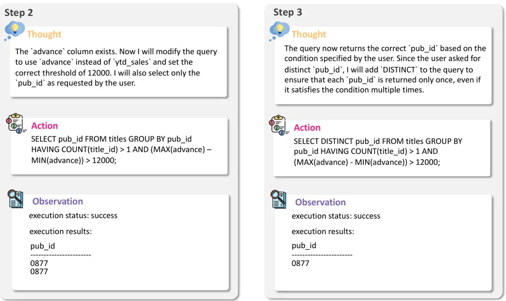
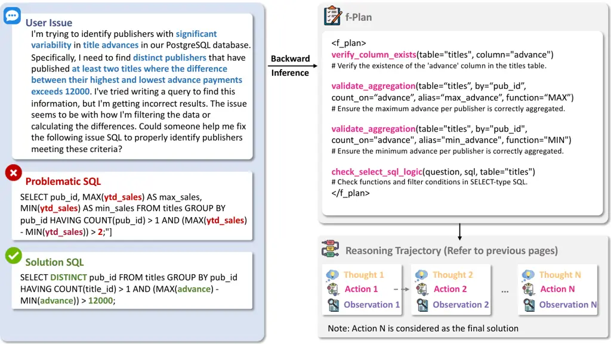
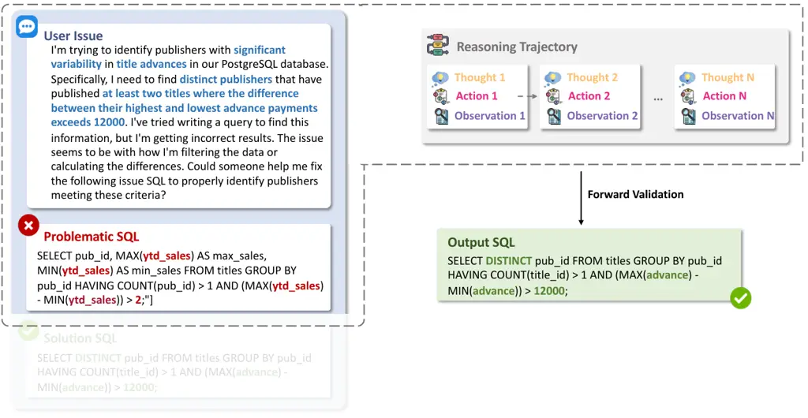

# SWE-SQL: Illuminating LLM Pathways to Solve User SQL Issues in Real-World ApplicationsThanks: Equal contribution.  $`\dagger`$ Corresponding author.

Affiliation: Jinyang Li Affiliation: Xiaolong Li^(\*) Affiliation: Ge
Qu^(\*) Affiliation: Per Jacobsson Affiliation: Bowen Qin
Affiliation: Binyuan Hui Affiliation: Shuzheng Si Affiliation: Nan Huo
Affiliation: Xiaohan Xu Affiliation: Yue Zhang Affiliation: Ziwei Tang
Affiliation: Yuanshuai Li Affiliation: Florensia Widjaja
Affiliation: Xintong Zhu Affiliation: Feige Zhou Affiliation: Yongfeng
Huang Affiliation: Yannis Papakonstantinou Affiliation: Fatma Ozcan
Affiliation: Chenhao Ma^(†) Affiliation: Reynold Cheng^(†)
Affiliation: HKU STAR Lab Affiliation: Google Cloud Affiliation: CUHKSZ
Affiliation: CUHK Affiliation: THU Affiliation: The BIRD Team
{jl0725,xia01ong,quge}@connect.hku.hk![[Uncaptioned
image]](arxiv-2506-18951--4b83b112e05e.figures/figure-1.webp)[https://bird-critic.github.io/](https://bird-critic.github.io/)

###### Abstract

Resolution of complex SQL issues persists as a significant bottleneck in
real-world database applications. Current Large Language Models (LLMs),
while adept at text-to-SQL translation, have not been rigorously
evaluated on the more challenging task of debugging on SQL issues. In
order to address this gap, we introduce BIRD-CRITIC, a new SQL issue
debugging benchmark comprising 530 carefully curated PostgreSQL tasks
(BIRD-CRITIC-PG) and 570 multi-dialect tasks (BIRD-CRITIC-Multi), which
are distilled from authentic user issues and replayed within new
environments to facilitate rigorous and contamination-free evaluation.
Baseline evaluations on BIRD-CRITIC underscore the task’s complexity,
with the leading reasoning model O3-Mini achieving only 38.87% success
rate on BIRD-CRITIC-PG and 33.33% on BIRD-CRITIC-Multi. Meanwhile,
realizing open-source models for database tasks is crucial which can
empower local development while safeguarding data privacy. Therefore, we
present Six-Gym (Sql-fIX-Gym), a training environment for elevating the
capabilities of open-source models specifically for SQL issue debugging.
This environment leverages SQL-Rewind strategy, which automatically
generates executable issue-solution datasets by reverse-engineering
issues from verified SQLs. However, popular trajectory-based fine-tuning
methods do not explore substantial supervisory signals. We further
propose $`f`$-Plan Boosting, which extracts high-level debugging plans
automatically from SQL solutions, enabling the teacher LLMs to harvest
and produce 73.7% more successful trajectories for training. We
integrate these components into an open-source agent, Bird-Fixer. Based
on Qwen-2.5-Coder-14B, Bird-Fixer raises its success rate to 38.11% on
BIRD-CRITIC-PG and 29.65% on BIRD-CRITIC-Multi, surpassing many leading
proprietary models such as Claude-3.7-Sonnet and GPT-4.1, marking a
significant step toward democratizing sophisticated SQL-debugging
capabilities for both research and industry.

## 1 Introduction



Figure 1: Illustration of the SQL issue debugging process in
BIRD-CRITIC. It should start with a user issue query (left) and issue
SQL query (center-left), LLMs will produce a corrected SQL solution
(right) based on reasoning and interaction with the environment.

Relational Databases (RDBs) serve as the bedrock for data storage and
information retrieval across countless modern applications, ranging from
financial systems to web services and scientific research platforms \[8,
34, 19, 35\]. Structured Query Language (SQL), as the standard language
for interacting with these systems, is thus a critical interface for
data manipulation, querying, and administration \[3, 2\]. Despite its
widespread adoption and apparent simplicity for basic operations,
mastering SQL and troubleshooting complex queries or unexpected
behaviors remains a significant challenge for users of all experience
levels. The complexity of query semantics, diverse behaviors across
different SQL operations (Create, Read, Update, Delete), evolving
database features, and the need to understand underlying data schemas
contribute to a steep learning curve and frequent user issues.

Resolving these SQL issues often demands considerable manual efforts,
domain expertise, and time, representing a significant bottleneck in
data-driven workflows and software development cycles \[1, 25, 12, 40,
13\]. Support forums, Q&A sites, and internal helpdesks, such as
StackOverflow, are replete with user requests seeking assistance in
debugging faulty queries, optimizing performance, or understanding why a
query generates unexpected results. Therefore, automating this process
holds huge value in improving productivity and reducing reliance on
specialized human experts.

Recent advancements in Large Language Models (LLMs) have demonstrated
remarkable capabilities in natural language understanding and code
generation \[6, 53, 7, 38, 50\], notably achieving impressive results in
converting natural language descriptions into SQL queries (text-to-SQL)
\[24, 45, 29, 22\]. However, diagnosing and fixing existing incorrect or
suboptimal SQL code presents more complex challenges. As shown in Figure
1, debugging such issues requires not only understanding the user’s
intent, often in a verbose and long-context description, but also
analyzing the query logic underneath, identifying subtle errors, and
intensively interacting with the database schema. Despite the practical
importance of this task, the capabilities of current LLMs in SQL issue
resolution have not been systematically investigated.

In this work, we are targeting to bridge this critical gap by two
primary contributions. First, we present BIRD-CRITIC, a carefully
curated benchmark built from authentic StackOverflow bug-fix threads. It
comes in two subsets: (1) BIRD-CRITIC-PG with 530 PostgreSQL-only tasks,
and (2) BIRD-CRITIC-Multi, whose 570 tasks are distributed across 4
major dialects: PostgreSQL and MySQL as open-source databases, SQL
Server and Oracle as community-friendly cloud-based platforms with free
developer editions. Each task undergoes rigorous reconstruction where
the underlying knowledge structures and debugging heuristics are
extracted, and the scenario is reproduced within a controlled sandbox
environment by new RDBs and conditions. This process ensures that tasks
remain relevant while minimizing potential exposure to pre-training
data. Furthermore, execution accuracy (EX) in standard text-to-SQL is
inadequate for the diverse types of issues in BIRD-CRITIC, frequently
leading to false negatives. Specifically, tasks involving database state
changes, i.e., via Data Manipulation Language (DML) or Data Definition
Language operations (DDL), frequently permit multiple functionally
equivalent solutions that may differ syntactically or include
non-impacting elements \[52, 4\]; reliance on strict EX matching would
incorrectly penalize such valid SQL solutions. Therefore, each task is
augmented with custom evaluation scripts containing specific test cases
designed to evaluate functional correctness, enabling precise
calculation of task success rates. Our baseline evaluations on
BIRD-CRITIC underscore the complexity of SQL issue debugging, in which
even advanced reasoning models, O3-mini, only achieves a 38.87% success
rate on BIRD-CRITIC-PG and 33.33% on BIRD-CRITIC-Multi.

Second, inspired by prior work on code generation environments \[28\],
we propose Six-Gym (Sql-fIX-Gym), a training environment designed to
enhance the SQL debugging capabilities of open-source models. A core
innovation within Six-Gym is the SQL-Rewind strategy, an automated
methodology for generating large-scale, executable issue-solution
datasets. This strategy operates by taking verified, correct SQL queries
and systematically introducing plausible errors, effectively
reverse-engineering realistic debugging scenarios. A common practice
\[28, 16\] of such environments involves using an advanced teacher LLM
to generate successful task execution trajectories for fine-tuning
student smaller models. However, we find that this approach
underutilizes the guidance available from ground-truth or reference
solutions, potentially limiting the quantity and diversity of effective
training trajectories. To address this, we introduce the Functional Plan
($`f`$-plan) Boosting strategy. This method first infers the underlying
debugging logic by comparing the problematic SQL and the correct
solution, representing this logic as a step-by-step pseudo-functional
code plan. Afterwards, guided by this $`f`$-plan, a teacher LLM employs
our designed agent scaffold, SQL-Act, to execute the debugging task
within the environment. This plan-guided approach generates a
significant 73.7% increase in more successful trajectories, providing
richer data for fine-tuning open-source models, particularly smaller
ones, to effectively interact with the database environment and debug
complex SQL issues. The agent fine-tuned using this $`f`$-plan boosted
data is termed Bird-Fixer.

Our experiments demonstrate that Bird-Fixer significantly enhances the
performance of open-source models from various families. Notably,
Bird-Fixer fine-tuned on Qwen-2.5-Coder-14B achieves a 38.11% Success
Rate (SR) on BIRD-CRITIC-PG and 29.65% on BIRD-CRITIC-Multi, surpassing
the performance of the highly capable models such as Claude-3.7-Sonnet
and GPT-4.1. This result marks a significant advancement towards
democratizing sophisticated SQL debugging capabilities for both research
and practical industry applications.

## 2 Problem Definition

In this paper, we introduce a more complex but realistic task of SQL
issue resolution. This task starts with a user-provided issue SQL query
$`\sigma_{\text{issue}}`$, a natural language problem description
$`\mathcal{P}`$ detailing the issue and intent, and the database schema
$`\mathcal{S}`$. The goal is to generate a revised SQL query
($`\sigma_{\text{pred}}`$) that corrects the fault while preserving the
user’s intent. This mapping is:

```math
\sigma_{\text{pred}}=f_{\theta}(\mathcal{P},\mathcal{S},\sigma_{\text{issue}}). \tag{1}
```

The desired output $`\sigma_{\text{pred}}`$ must satisfy the user’s
underlying intentions as inferred from the triplet
$`(\mathcal{P},\mathcal{S},\sigma_{\text{issue}})`$. In BIRD-CRITIC, we
annotated referenced ground-truth solution SQLs as $`\sigma^{*}`$ and
develop tailored evaluation scripts (detailed in Section 3) for each
task, enabling precise evaluation of the functional correctness of
predicted solution SQLs.

## 3 BIRD-CRITIC Benchmark



Figure 2: Example task structure within the BIRD-CRITIC benchmark,
demonstrating the transformation from a user-reported issue and error
SQL to a revised SQL solution.

#### Annotator Group.

BIRD-CRITIC is developed via a multi-stage annotation converting raw
user issues into executable, verifiable tasks. This involves two
annotation groups: 1) 10 qualified database/SQL annotators, who pass
strict entry test as detailed in Appendix B.1 and systematic training
shown in Appendix B.2 to promise the quality of annotation; 2) 3 senior
database experts/scientists for final data collection decision. This
process is visually outlined in Figure 2.

#### Environment Setup.

We leverage relational databases from the BIRD-SQL development set
\[24\] chosen for its domain diversity across real data-science tasks
(California Schools, Financial, Superheroes) and its permissive license.
We migrate their original SQLite schemas to PostgreSQL, MySQL, SQL
Server, and Oracle, four widely used production-grade dialects. During
migration, we go beyond direct dialect translation by refining table and
column names. We adjust data types and introduce guarded alterations to
schema components to reduce potential information leakage (see Appendix
A.2). To pair these databases with realistic debugging scenarios, we
collect SQL issue queries from Stack Overflow, following a strict
protocol shown in Appendix A.3.

#### Issue Reproduction.

Following the initial collection of candidate issues, we start
reproducing them in our environment in following produces as illustrated
in Figure 2: (1) Distilling Intent and Error: Precisely identifying the
user’s underlying goal and the specific reason of the issue exhibited by
$`\sigma_{\text{issue}}`$. The core reason of the issue is documented.
(2) Schema Mapping: Assigning the issue to one of the adapted BIRD-SQL
database schemas ($`\mathcal{S}`$) that provides a suitable context for
the problem. (3) Reproducibility Verification: We adapt and execute
$`\sigma_{\text{issue}}`$ against the chosen database, verifying through
execution logs that the error appears as expected. This entire process
transforms a potentially ambiguous web forum post into a standardized,
reproducible problem instance
$`(\mathcal{P},\mathcal{S},\sigma_{\text{issue}})`$ ready for solution
annotation.

#### Solution SQL & Evaluation Script Annotation.

Annotators carefully review the reproduced issue
$`(\mathcal{P},\mathcal{S},\sigma_{\text{issue}})`$ and craft a new
$`\sigma^{*}`$. This annotation requires ensuring that $`\sigma^{*}`$
can accurately fulfill the user’s objective as inferred from
$`\mathcal{P}`$ and the context of $`\sigma_{\text{issue}}`$. Also, to
ensure robust evaluation, each task is annotated with evaluation scripts
consisting of specific test cases written by Python and SQLs. Details
can be found in Appendix C. We report the Success Rate (SR %),
considering a task solved only when $`\sigma_{\text{pred}}`$
successfully passes all test cases in its evaluation script.

#### Validation.

After annotation, BIRD-CRITIC undergoes cross-validation, with
annotators exchanging data for review. This verification involves three
steps: (1) enhancing test case functions with additional test cases for
robust SQL code validation; (2) red teaming the SQL by introducing
errors to make sure evaluation scripts can flag these errors. (3)
Annotators first attempt to resolve disagreements through discussion.
Persistent issues are escalated to the expert team for final
determination, which may involve modification or rejection of the
disputed annotation.

#### Benchmark Statistics.

Figure 3: Distribution of issue categories in all BIRD-CRITIC, derived
from an analysis of SQL usage in the real-world database applications. A
detailed distribution is in Appendix E.

|                                |             |             |
| ------------------------------ | ----------- | ----------- |
| Statistic                      | PG          | MULTI       |
| Total Issues                   | 530         | 570         |
| \# of query-like issues        | 291         | 304         |
| \# of management issues        | 88          | 104         |
| \# of personalization issues   | 151         | 162         |
| user query length (mean/max)   | 162.98/1046 | 165.75/1058 |
| issue SQL length (mean/max)    | 133.29/1262 | 125.86/1254 |
| solution SQL length (mean/max) | 112.64/853  | 117.46/859  |
| \# distinct test cases         | 365         | 317         |
| \# of preprocess SQLs          | 643         | 571         |
| \# of clean_up SQLs            | 287         | 262         |
| inter-agreement                | 94.53       | 92.98       |

Table 1: Data Characteristics

Table 3 summarizes the key properties of the BIRD-CRITIC benchmark, and
Figure 3 visualizes the distribution of its underlying knowledge
categories. The distribution of benchmark, is detailed in Appendix E. A
side-by-side comparison with standard text-to-SQL benchmarks (Table 6 in
Appendix E.1) exposes three distinctive challenges introduced by
BIRD-CRITIC: non-query-like problems, multi-dialect complexities, and
the most verbose but authentic user queries. As far as we know,
BIRD-CRITIC is the first debugging benchmark for SQL applications. These
aspects establish BIRD-CRITIC as a crucial benchmark for rigorously
evaluating LLM proficiency in solving authentic SQL issues.

## 4 Six-Gym: An Automated SQL Debugging Environment for LLMs

This section introduces Six-Gym, a dedicated training environment for
enhancing the SQL debugging capabilities of LLMs. This environment is
built upon SQL-Rewind, which is responsible for the automated generation
of a comprehensive suite of SQL issue instances.

#### Overview.

GYM-like datasets have proven effective for training LLMs as agents for
complex tasks \[28\]. However, manually collecting and annotating these
datasets is labor-intensive and difficult to scale, especially for
debugging tasks. Thus, we introduce SQL-Rewind, which addresses this by
inverting the debugging paradigm: starting with correct SQL queries
($`\sigma^{*}`$) and systematically introducing realistic issues to
generate issue SQLs ($`\sigma_{\text{issue}}`$) and user issue query
$`\mathcal{P}`$. This approach enables efficient creation of large-scale
training data without human annotation. The pseudo-algorithm is shown in
Appendix H.1.

#### Solution SQL Collection.

We begin with raw StackOverflow issue data and enforce two principles
against data overlap: (i) any issue used to construct BIRD-CRITIC tasks
is excluded from Six-Gym, and (ii) SQL-Rewind operates only on the 12
databases in the training databases of BIRD-SQL, while BIRD-CRITIC
evaluation is confined to databases drawn solely from the BIRD-SQL dev
set. We mine new candidate SQLs via rule-based regular expressions, then
leverage Gemini-2.0-Flash to align table and column references to 12
databases in Six-Gym, while preserving the original SQL’s logical
structure. To validate these adapted SQL queries as ground truth
solutions, each was executed against its target database; only those
queries that completed without error and yielded a non-null result were
accepted into our final corpus of solution SQLs ($`\sigma^{*}`$).

#### Synthetic Issue Generation and Automated Verification.

We employ Gemini-2.0-Flash to automate the entire process of issue
reproduction and verification. Initially, the model summarizes issue
reasons ($`r_{issue}`$) and modifies solution SQL ($`\sigma^{*}`$) to
create issue SQL ($`\sigma_{issue}`$) guided by $`r_{issue}`$.
Concurrently, it generates evaluation scripts $`T`$ comprising test
cases designed to be passed by solution SQLs but failed by issue SQLs.
The model then automatically validates whether the logic of triplet
$`\langle\sigma_{issue},r_{issue},\sigma^{*}\rangle`$ is coherent and
whether the evaluation script accurately identifies errors while
allowing solution SQLs to pass. This validation process undergoes 3
iterative refinements; if the components are deemed compatible, the data
is added to our collection.

#### User Issue Query Generation.

Finally, we employ Gemini-2.0-Flash again to simulate a realistic user
issue description $`\mathcal{P}`$. The generated $`\mathcal{P}`$
includes the user intent, issue description, and requirements. Each
$`\mathcal{P}`$ must be logically consistent with
$`\langle\mathcal{S},\sigma_{\text{issue}},T,\sigma^{*}\rangle`$. It
undergoes up to 3 rounds of optimization by the model to reduce
hallucinations. The resulting tuples are collected as final data. Using
this SQL-Rewind strategy, we successfully generate approximately 3,301
high-quality synthetic data instances, forming a training environment we
term Six-Gym.

|                            |                |       |       |         |                   |       |        |        |         |
| -------------------------- | -------------- | ----- | ----- | ------- | ----------------- | ----- | ------ | ------ | ------- |
| Model                      | BIRD-CRITIC-PG |       |       |         | BIRD-CRITIC-Multi |       |        |        |         |
|                            | Quer.          | Mana. | Pers. | Overall | PG.               | My.   | Server | Oracle | Overall |
| General-Purpose Models     |                |       |       |         |                   |       |        |        |         |
| Meta-Llama-3.1-8B          | 18.21          | 22.73 | 11.26 | 16.98   | 13.04             | 13.27 | 21.43  | 3.06   | 12.81   |
| Phi-4                      | 30.24          | 37.50 | 25.83 | 30.19   | 25.72             | 27.55 | 23.47  | 8.16   | 22.63   |
| Deepseek-V3                | 25.09          | 35.23 | 28.48 | 27.74   | 27.17             | 26.53 | 21.43  | 14.29  | 23.86   |
| Gemini-2.0-Flash           | 27.84          | 44.32 | 29.14 | 30.94   | 27.54             | 22.45 | 31.63  | 7.14   | 23.86   |
| Meta-Llama-3.3-70B         | 27.84          | 32.95 | 27.81 | 28.68   | 26.81             | 22.45 | 28.57  | 14.29  | 24.21   |
| Qwen2.5-Coder-32B          | 31.62          | 38.64 | 24.50 | 30.75   | 28.26             | 24.49 | 30.61  | 9.18   | 24.74   |
| Claude-3.7-Sonnet          | 27.15          | 43.18 | 35.10 | 32.08   | 32.61             | 30.61 | 21.43  | 18.37  | 27.89   |
| GPT-4.1                    | 31.27          | 55.68 | 38.41 | 37.36   | 36.23             | 28.57 | 29.59  | 9.18   | 29.12   |
| Reasoning Models           |                |       |       |         |                   |       |        |        |         |
| Gemini-2.0-Flash-Thinking  | 27.15          | 53.41 | 33.11 | 33.21   | 28.99             | 35.71 | 37.76  | 19.39  | 30.00   |
| Claude-3.7-Sonnet-Thinking | 29.55          | 45.45 | 35.76 | 33.96   | 35.51             | 31.63 | 27.55  | 15.31  | 30.00   |
| O1-Preview-2024-09-12      | 29.90          | 53.41 | 37.09 | 35.85   | 40.94             | 33.67 | 33.67  | 11.22  | 33.33   |
| O3-Mini-2025-01-31         | 32.30          | 57.95 | 40.40 | 38.87   | 41.30             | 26.53 | 32.65  | 18.37  | 33.33   |

Table 2: Success Rate (SR %) of different models on BIRD-CRITIC-PG and
BIRD-CRITIC-Multi, grouped by each issue and dialect categories. Bold
numbers indicate the highest score in each column, and underlined
numbers indicate the second highest. "Quer." = query-like issues,
"Mana." = data-management issues, "Pers." = personalized-function
issues. "PG." = PostgreSQL, "My." = MySQL, "Server" = SQL-Server.

## 5 Bird-Fixer: Elevating Open-Source LLMs to an SQL Issue Fixer

### 5.1 Agent Scaffold: SQL-Act

ReAct \[43\] interleaves internal reasoning (thoughts $`t_{i}`$),
external actions ($`a_{i}`$), and observations ($`o_{i}`$), and has
proved highly effective for state-of-the-art code agents \[28, 38, 39\].
Building upon this paradigm, we introduce SQL-Act, a specialized agent
scaffold tailored for SQL tasks, particularly targeting challenges
presented in benchmarks like BIRD-CRITIC. Unlike tool-based agents whose
action space is restricted to a finite, hand-crafted set of operations,
SQL-Act treats arbitrary SQL commands as actions, dramatically enlarging
the space of possible manipulations and enabling richer, more flexible
debugging strategies.

At each step the agent emits a tuple
$`\bigl(t_{i},\sigma_{i},o_{i}\bigr)`$, where $`\sigma_{i}`$ is the SQL
statement executed at step $`i`$. The complete execution trajectory is
therefore
$`\tau=((t_{1},\sigma_{1},o_{1}),(t_{2},\sigma_{2},o_{2}),\ldots,(t_{n},\sigma_{n},o_{n}))`$.
As shown in Section 6.2, SQL-Act is not only simpler to implement than
Tool-Act but also delivers consistently higher accuracy in SQL issues
solutions.

### 5.2 Trajectory Collection and Agent Fine-Tuning

#### _f_-Plan Boosting.

The standard “gym-style” practice involves a strong teacher LLM on the
environment and logs only those trajectories that reach the reference
solution. In our experiments, running Gemini-2.0-Flash with SQL-Act on
Six-Gym produces just 1,254 successful trajectories, which just utilizes
38.0% of the data.

To augment successful trajectories, we introduce _f_-Plan Boosting, a
two-phase self-distillation loop:

(1) Backward inference. Given the problem
$`(\mathcal{P},\mathcal{S},\sigma_{\text{issue}})`$ and its corrected
query $`\sigma^{\ast}`$, the teacher annotates a step-by-step symbolic
_functional plan_ $`F=(f_{1},\dots,f_{k})`$, where each $`f_{i}`$
represents an abstract debugging operation that maps
$`\sigma_{\text{issue}}`$ toward $`\sigma^{\ast}`$. Since such plan
contains few tokens yet exhibits more structured format, it is
especially amenable to execution by LLMs \[6, 18\].

(2) Forward validation. Using only the context
$`(\mathcal{P},\mathcal{S},\sigma_{\text{issue}})`$ and the candidate
plan $`F`$, the teacher LLM regenerates a solution by SQL-Act. The plan
is accepted _iff_ the regenerated solution SQL passes every test cases
in $`T`$, producing a reliable pair
$`\bigl\langle(\mathcal{P},\mathcal{S},\sigma_{\text{issue}}),\,F\bigr\rangle`$.
After rollout we discard $`F`$ and retain only the executable trace
$`\tau^{\prime}=\bigl((t_{1},\sigma_{1},o_{1}),\dots,(t_{n},\sigma_{n},o_{n})\bigr)`$.

A single pass of _f_-Plan Boosting produces total 2,178 successful
trajectories, an increase of 73.7% over the vanilla collection pipeline,
which we then use to fine-tune the open-source models via Low-Rank
Adaptation (LoRA) \[14\].

#### Generative Thought Mode (GTM).

The generalization of the agent can degrade when it predicts thoughts
and actions jointly, because the model tends to overfit to the SQL
patterns seen during fine-tuning. To counter this problem, we introduce
a Generative Thought Mode (GTM), which explicitly decouples the two
predictions, akin to how Skip-gram in Word2Vec separates target and
context words \[26\]. Let $`M_{O}`$ be the fine-tuned model, $`M_{B}`$
the original base model, and
$`H_{i-1}=((t_{1},\sigma_{1},o_{1}),\ldots,(t_{i-1},\sigma_{i-1},o_{i-1}))`$
the interaction history. During the inference step $`i`$, the fine-tuned
model first proposes a thought–action pair
$`(t_{i},\sigma_{i})=M_{O}(H_{i-1}),`$ from which only the thought
$`t_{i}`$ is extracted. The SQL action is then generated by the base
model, $`\sigma_{i}=M_{B}(H_{i-1},t_{i}),`$ leveraging its wide-coverage
knowledge of diverse SQL dialects. GTM preserves the specialized
debugging logic learned by $`M_{O}`$, fully taking advantage of
generative features of auto-regressive models \[49\], while mitigating
overfitting of SQL patterns during training.

## 6 Experiments

Figure 4: LLM agent performance for BIRD-CRITIC-PG. TooAct employs
constrained toolkit as actions, while SQLAct executes SQLs as actions.

### 6.1 SetUp

#### Models.

We evaluate the performance of several popular and strong LLMs across
two primary categories, including general-purpose models:
Gemini-2.0-Flash, GPT-4.1, Claude-3.7-Sonnet, Qwen-2.5-Coder-32B,
Meta-Llama-3.1-8B, Meta-Llama-3.3-70B, Phi-4 and DeepSeek-V3. The second
category consists of models specifically renowned for their advanced
reasoning capabilities: O3-mini, O1-preview, Gemini-2.0-Flash-Thinking,
and Claude-3.7-Sonnet-Thinking. The implementation details are in
Appendix G.2.

#### Advanced Agentic Methods.

Agentic workflows have shown considerable promise for addressing complex
tasks. Accordingly, we also benchmark LLM agent performance on
BIRD-CRITIC. Broadly, agentic systems can be classified into two main
categories based on their action types. The first, which we term
Tool-Act, involves agents employing pre-defined tools tailored to
specific tasks. We implement Tool-Act guided by SOTA agents Spider-Agent
\[21\] and InterCode \[42\] in SQL tasks. The second category, Code-Act
\[38\], allows for more flexible, free-form actions where LLMs generate
code to perform operations. In the context of this research, we
implement a specific variant called SQL-Act, where the LLMs generate SQL
queries as their actions as introduced in Section 5.1.

### 6.2 Main Results

#### Baseline Results.

An evaluation of mainstream Large Language Models (LLMs) on BIRD-CRITIC
is detailed in Table 2. We can observe that:

\(1\) Superior Performance of Reasoning-Oriented Models. A clear
performance advantage is evident for reasoning-oriented LLMs. These
models surpass general-purpose counterparts by an average Success Rate
(SR) of 6.13 % on PostgreSQL issues and 8.03 % on multi-dialect issues.
This disparity underscores the computationally intensive,
reasoning-driven nature of SQL-issue debugging, a task that demonstrably
benefits from models capable of intermediate inferential steps.

\(2\) Persistent Challenge Posed by SQL Issue Debugging. Despite ongoing
advancements in LLM capabilities, BIRD-CRITIC continue to present a
considerable challenge. The top-performing model, O3-Mini-2025-01-31,
achieves an overall SR of only 38.87% on PostgreSQL issues and 33.33% on
multi-dialect issues, leaving large head-room for future research.

\(3\) Heterogeneous Difficulty Across Issue Categories.

An analysis of performance across distinct SQL issue categories reveals
clear differences in difficulty. Issues related to data management, such
as DML operations: insertions, deletions, updates, and DDL operations
like schema modifications, are found to be relatively more manageable.
On average, reasoning models achieved a 52.6% SR and general-purpose
models a 38.8% SR in data management. Issues associated with
Personalized functions also demonstrate moderate success rates. In
contrast, Query-like issues present the greatest challenge for all LLMs.

Figure 5: Success Rate vs Query Diversity (by Issue Category). It shows
a strong negative correlation ($`r`$ = -0.89) between n-gram of tokens
and model performance after normalization.

These issues require an understanding of logical flaws within complex
SELECT statements, particularly those involving joins, subqueries,
aggregations, and conditional filtering. Unlike more standardized data
management operations, SELECT queries exhibit remarkable diversity in
their logic, structure, and intent, mostly reflected by the wide variety
of underlying business requirements they serve, making their error
patterns significantly harder to predict and correct. As evidenced in
Figure 5, Query-like issues contain the most diverse functions, leading
to the lowest performance of both general-purpose and reasoning models,
which presents a strong negative correlation.

\(4\) Dialect-Specific Performance Variations. Model effectiveness
exhibits notable dependency on the specific SQL dialect, as observed
within the Bird-Critic-Multi. Specifically, Gemini-2.0-Flash-Thinking
demonstrates the lower performance on PostgreSQL with a 28.99% SR. In
contrast, it becomes the most proficient for SQL Server (37.76% SR),
with a clear margin over other evaluated models in that dialect. Such
variations are plausibly attributable to differential distributions of
SQL dialects within the respective training corpora of these models,
suggesting that the composition of training data significantly
influences dialect-specific debugging capabilities.w

\(5\) Agentic Workflow Performance. Figure 4 compares the performance of
different LLM-based agents on BIRD-CRITIC-PG. The results show that
agentic workflows markedly boost LLM accuracy on issue debugging tasks,
which benefits from iterative interaction with its environment.
Additionally, the Sql-Act agent mostly outperforms the Tool-Act agent,
suggesting that the richer, more flexible action space offered by
Sql-Act better equips LLMs to address the diverse and uncertain
challenges encountered during debugging.

| Model              | BIRD-CRITIC-PG (SR %, $`\uparrow`$) |         |            |                | BIRD-CRITIC-Multi (SR %, $`\uparrow`$) |         |            |                |
| ------------------ | ----------------------------------- | ------- | ---------- | -------------- | -------------------------------------- | ------- | ---------- | -------------- |
|                    | Base                                | SQL-Act | Bird-Fixer | $`\Delta(\%)`$ | Base                                   | SQL-Act | Bird-Fixer | $`\Delta(\%)`$ |
| Llama-3.1-8B       | 16.98                               | 16.42   | 24.34      | $`+43.34`$     | 12.81                                  | 13.64   | 18.25      | $`+42.46`$     |
| Qwen-2.5-Coder-7B  | 23.40                               | 26.60   | 31.32      | $`+33.84`$     | 17.89                                  | 17.19   | 21.58      | $`+20.58`$     |
| Qwen-2.5-Coder-14B | 31.32                               | 31.13   | 38.11      | $`+21.68`$     | 24.04                                  | 23.33   | 29.65      | $`+23.36`$     |
| Phi-4              | 30.19                               | 29.43   | 38.11      | $`+26.23`$     | 22.63                                  | 19.80   | 27.89      | $`+20.58`$     |

Table 3: Detailed comparison of Bird-Fixer with other strong baselines
on BIRD-CRITIC-PG and BIRD-CRITIC-Multi. $`\Delta`$ shows relative
improvement of Bird-Fixer compared to base model.

### 6.3 Performance Analysis of Bird-Fixer

#### Overall Performance of Bird-Fixer.

Table 3 reports the performance gains achieved by Bird-Fixer across
three model families: Llama, Qwen, and Phi, which range from roughly 7B
to 14B parameters. For each model, Bird-Fixer delivers substantial
improvements, demonstrating that the benefits of SQL-Act + $`f`$-plan
and Six-Gym are architecture-agnostic and scalable. The table also
exposes a limitation of small language models (SLMs) in agentic workflow
only by inference: on several models, agent performance actually
declines, suggesting that long, complicated interaction histories can
overwhelm SLMs. By contrast, our methods equip these compact models with
richer interaction capabilities, enabling them to navigate complex
environments far more effectively. This benefit is especially valuable
for privacy-sensitive SQL workloads: running a 7–14B parameter agent
locally avoids any exposure of proprietary data to cloud services.
Notably, Bird-Fixer based on 14B base models, e.g., Qwen-2.5-Coder-14B,
Bird-Fixer presents competitive performance to O3-mini and outperforms
the Claude-3.7-Sonnet agent on BIRD-CRITIC-PG, suggesting a promising
path toward this goal of privacy while keeping effectiveness.

#### Generalization to Multi-Dialect SQL Issue Debugging.

Although Bird-Fixer is fine-tuned only on PostgreSQL trajectories within
Six-Gym, it generalizes robustly to other SQL dialects, as evidenced by
the multi-dialect results in Table 3. That is because GTM elicits each
model to produce a reusable debugging strategy trained in Six-Gym while
keeping pretrained knowledge of dialect variation. In conclusion,
Bird-Fixer exhibits strong cross-dialect reasoning without any extra
data collection or further training, underscoring its practicality for
heterogeneous database stacks.

### 6.4 Trajectory Sampling Comparison

| Method             | Max   | Successful | Avg   | DB Time | Cost   |
| ------------------ | ----- | ---------- | ----- | ------- | ------ |
|                    | Tries | Traj.      | Tries | (min)   | (\$)   |
| Baseline           | 1     | 1,254      | 1.0   | 306     | 8.47   |
| _f_-Plan           | 1     | 2,178      | 1.0   | 324     | 27.44  |
| Rejection Sampling | 5     | 1,910      | 4.2   | 1,377   | 108.05 |
| Reject + _f_-Plan  | 5     | 2,560      | 1.7   | 810     | 41.16  |

Table 4: Trajectory Generation Efficiency Comparison. Baseline: Standard
SQL-ACT rollout with a single attempt (temperature=0). _f_-Plan (Ours):
A single rollout guided by functional plans extracted from
issue–solution pairs (temperature=0). Rejection Sampling: Up to 5 trials
per instance (temperature=0.8), with early stopping when a successful
trajectory is obtained. Reject + _f_-Plan: Combination of rejection
sampling (up to 5 trials) with _f_-Plan guidance.

To better illustrate the efficiency and effectiveness of _f_-Plan
Boosting, we compare it against widely used trajectory augmentation
approaches. We evaluate four strategies for trajectory generation, using
Gemini-2.0-Flash as the teacher model on Six-Gym.

As shown in Table 4, _f_-Plan Boosting yields $`73.7\%`$ more successful
trajectories than the baseline while maintaining similar runtime and
overhead. By contrast, rejection sampling increases success rates
modestly but at the cost of $`4.2\times`$ more attempts and
$`4.5\times`$ longer execution time. When combined, rejection sampling
and _f_-Plan achieve the best overall trade-off, generating 2,560
trajectories with reduced average attempts ($`1.7`$) and a $`62\%`$
reduction in cost relative to rejection sampling alone. These results
demonstrate that _f_-Plan provides an effective and efficient approach
to trajectory augmentation during rollout in complex environments. Other
detailed comparison can be found in Appendix E.3.

### 6.5 Ablation Study of Bird-Fixer

Figure 6: Ablation study of components in Bird-Fixer.

Figure 6 shows the ablation study of Bird-Fixer, highlighting:

GTM (Generative Thought Mode): Removing GTM causes the fine-tuned model
$`M_{O}`$ to predict both thought and SQL action directly. The
performance drop to 33.33% indicates that GTM effectively leverages the
base model $`M_{B}`$ for SQL generation guided by $`M_{O}`$’s thought,
mitigating overfitting to SQL patterns and better utilizing $`M_{B}`$’s
broad SQL knowledge.

$`f`$-Plan Boosting: Using only trajectories from the vanilla collection
pipeline reduces performance to 32.45% in BIRD-CRITIC-PG, highlighting
$`f`$-Plan Boosting’s importance in generating diverse, high-quality
training trajectories crucial for complex reasoning tasks.

### 6.6 Error Analysis

To understand _how far_ current LLM-based agents still are from fully
resolving user-reported SQL issues, we sample 100 failed tasks from
BIRD-CRITIC-PG by 4 agents based on: O3-mini, GPT-4.1,
Claude-3.7-Sonnet, and Bird-Fixer. It can be concluded that current
agents exhibit four distinct error modes reflecting different levels of
reasoning deficiency: Projection Mismatch errors (26.9%), where models
misinterpret output requirements by, for instance, adding unexpected
columns or misapplying aggregations, suggesting limitations in semantic
understanding of user intent and schema alignment; Chain of Errors
(27.3%), characterized by cascading failures due to partial problem
resolution that overlooks dependent issues such as sequence updates
accompanying primary key modifications, revealing difficulties in
multi-step causal reasoning and consistency maintenance; The database
engine only reports the most superficial issue, masking a deeper,
dependent error that is the true root cause. For instance, a type
mismatch error might be reported, but the underlying problem could be an
incorrect join that brought together the wrong columns in the first
place. Incorrect Logic (44.5%), the most prevalent, highlighting
fundamental misunderstandings of data structures or transformation
methodologies, particularly in complex operations like JSON array
manipulation, leading to syntactically plausible but semantically flawed
SQL; and Syntax Errors (29.3%), indicating technical implementation
flaws such as type mismatches (e.g., DATE versus TIMESTAMP) or
improperly formatted intervals, especially in specialized SQL contexts
like recursive queries. The detailed examples for each category are in
Figure 8. These findings highlight that future improvements should
emphasize logical and schema-aware reasoning, cross-step dependency
tracking, and dialect-robust SQL generation rather than mere syntactic
refinement.

## 7 Related Work

#### Large Language Models for Text-to-SQL.

The automated conversion of natural language queries into Structured
Query Language (SQL), known as Text-to-SQL, has garnered significant
attention due to its practical utility in the era of big data \[47, 41,
31, 15\]. The advent of LLMs has notably advanced the capabilities in
this domain. For instance, DIN-SQL \[29\], DAIL-SQL \[9\], TA-SQL
\[32\], and Chase-SQL \[30\] have demonstrated SOTA performance on
standard benchmarks like Spider \[45\] and BIRD \[24\], primarily by
leveraging in-context learning with powerful foundation models like
GPT-4. Also Supervised fine-tuning can fuel smaller LLMs towards
stronger text-to-SQL parsers as evidenced by XiYanSQL\[10\],
Arctic\[48\], OmniSQL \[23\], CodeS \[22\] , and SHARE \[33\]. Beyond
direct generation, agentic workflows such as MAC-SQL \[37\], InterCode
\[42\], which empowers LLMs to interact with database environments and
gather contextual information, are pushing the boundaries of LLM
cognition in handling complex and previously unseen databases.
Concurrently, the field is evolving towards addressing more
sophisticated, industry-relevant Text-to-SQL challenges. Initiatives
like Beaver \[5\] and the Spider 2.0 \[21\] signify a shift from
end-user focused queries to tasks requiring deeper BI knowledge and
handling of larger schemas. This progression naturally leads to a
critical, but underexplored, question: Can LLMs effectively diagnose and
resolve issues within existing, user-provided SQL queries?

#### LLMs for Program Repair.

Program repair provides a complementary lens through which to evaluate
and enhance the reasoning abilities of LLMs. At the function level,
DebugBench \[36\] offers a multi-language suite that stresses
fundamental programming logic. Repository-scale efforts such as
SWE-Bench \[17\] move closer to realistic software engineering, while
follow-up studies, including SWE-lance \[27\] and Multi-SWE \[46\]
highlight the limitations of even sophisticated LLM-driven agents on
complex, multi-language projects (e.g. Python, Java). Despite this rapid
progress in general-purpose code fixing, _SQL-specific debugging remains
largely unexplored_, even though databases are the backbone of most
data-centric applications. To the best of our knowledge, our work is the
first to formally cast SQL issue repair as a benchmark task, and to
propose methods that adapt and augment open-source LLMs for automated
SQL debugging.

## 8 Conclusion

We introduced BIRD-CRITIC, the first benchmark for SQL issue debugging
tasks. Experiments show that SOTA LLMs solve fewer than 40% SR,
underscoring the challenge. We also create Six-Gym, an automated
training environment which can produce thousands of high-quality agent
trajectories without human annotation. Built on top of these
trajectories, we proposed SQL-Act, a lightweight agent scaffold, and
applied trajectory-level augmentation (_$`f`$-plan_) to fine-tune
open-source LLMs, leading to the Bird-Fixer. Despite using only 7–14 B
parameter backbones, Bird-Fixer outperforms larger proprietary models
and generalizes across four SQL dialects without additional training.
Our research charts a path toward robust, real-world SQL issue debugging
assistants.

## 9 Acknowledgments

We thank the anonymous reviewers and committees for their helpful
comments, suggestions and organizations. We thank John Yang for early
discussion and suggestions. Reynold Cheng, Jinyang Li, Xiaolong Li, Ge
Qu, Nan Huo, Xiaohan Xu, and Ziwei Tang were supported by the Research
Grant Council of Hong Kong (RGC Project HKU 17202325), the University of
Hong Kong (Project 2409100399), and the HKU Faculty Exchange Award 2024
(Faculty of Engineering).

## References

- \[1\] Alireza Ahadi, Julia Prior, Vahid Behbood, and Raymond Lister.
  Students’ syntactic mistakes in writing seven different types of sql
  queries and its application to predicting students’ success. In
  _Proceedings of the 47th ACM Technical Symposium on Computing Science
  Education_, pages 401–406. ACM, 2016.
- \[2\] Michael Armbrust, Reynold S. Xin, Cheng Lian, Yin Huai, Davies
  Liu, Joseph K. Bradley, Xiangrui Meng, Tomer Kaftan, Michael J.
  Franklin, Ali Ghodsi, and Matei Zaharia. Spark SQL: relational data
  processing in spark. In Timos K. Sellis, Susan B. Davidson, and
  Zachary G. Ives, editors, _Proceedings of the 2015 ACM SIGMOD
  International Conference on Management of Data, Melbourne, Victoria,
  Australia, May 31 - June 4, 2015_, pages 1383–1394. ACM, 2015.
- \[3\] Donald D. Chamberlin and Raymond F. Boyce. SEQUEL: A structured
  english query language. In _Proceedings of the 1974 ACM SIGMOD
  Workshop on Data Description, Access and Control_, pages 249–264.
  ACM, 1974.
- \[4\] Bikash Chandra, Ananyo Banerjee, Udbhas Hazra, Mathew Joseph,
  and S. Sudarshan. Automated grading of sql queries. In _35th IEEE
  International Conference on Data Engineering (ICDE)_, pages 1630–1633.
  IEEE, 2019.
- \[5\] Peter Baile Chen, Fabian Wenz, Yi Zhang, Devin Yang, Justin
  Choi, Nesime Tatbul, Michael Cafarella, Çağatay Demiralp, and Michael
  Stonebraker. Beaver: an enterprise benchmark for text-to-sql. _arXiv
  preprint arXiv:2409.02038_, 2024a.
- \[6\] Wenhu Chen, Xueguang Ma, Xinyi Wang, and William W. Cohen.
  Program of thoughts prompting: Disentangling computation from
  reasoning for numerical reasoning tasks. _Transactions on Machine
  Learning Research_, 2023. ISSN 2835-8856.
- \[7\] Xinyun Chen, Maxwell Lin, Nathanael Schärli, and Denny Zhou.
  Teaching large language models to self-debug. In _The Twelfth
  International Conference on Learning Representations_, 2024b.
- \[8\] C. J. Date. _An Introduction to Database Systems_.
  Addison-Wesley / Pearson, 8th edition, 2003.
- \[9\] Dawei Gao, Haibin Wang, Yaliang Li, Xiuyu Sun, Yichen Qian,
  Bolin Ding, and Jingren Zhou. Text-to-sql empowered by large language
  models: A benchmark evaluation. _arXiv preprint arXiv:2308.15363_,
  2023a.
- \[10\] Yingqi Gao, Yifu Liu, Xiaoxia Li, Xiaorong Shi, Yin Zhu, Yiming
  Wang, Shiqi Li, Wei Li, Yuntao Hong, Zhiling Luo, Jinyang Gao, Liyu
  Mou, and Yu Li. A preview of xiyan-sql: A multi-generator ensemble
  framework for text-to-sql. _arXiv preprint arXiv:2411.08599_, 2024.
  URL
  [https://arxiv.org/abs/2411.08599](https://arxiv.org/abs/2411.08599).
- \[11\] Zhipeng Gao, Xin Xia, David Lo, John C. Grundy, Xindong Zhang,
  and Zhenchang Xing. I know what you are searching for: Code snippet
  recommendation from stack overflow posts. _ACM Trans. Softw. Eng.
  Methodol._, 32(3):80:1–80:42, 2023b.
- \[12\] Sneha Gathani, Peter Lim, and Leilani Battle. Debugging
  database queries: A survey of tools, techniques, and users. In _CHI
  ’20: CHI Conference on Human Factors in Computing Systems, Honolulu,
  HI, USA, April 25-30, 2020_, pages 1–16. ACM, 2020.
- \[13\] Sabaat Haroon, Chris Brown, and Muhammad Ali Gulzar. Desql:
  Interactive debugging of SQL in data-intensive scalable computing.
  _Proc. ACM Softw. Eng._, 1(FSE):767–788, 2024.
- \[14\] Edward J. Hu, Yelong Shen, Phillip Wallis, Zeyuan Allen-Zhu,
  Yuanzhi Li, Shean Wang, Lu Wang, and Weizhu Chen. Lora: Low-rank
  adaptation of large language models. In _The Tenth International
  Conference on Learning Representations, ICLR 2022, Virtual Event,
  April 25-29, 2022_, 2022.
- \[15\] Nan Huo, Jinyang Li, Bowen Qin, Ge Qu, Xiaolong Li, Xiaodong
  Li, Chenhao Ma, and Reynold Cheng. Micro-act: Mitigate knowledge
  conflict in question answering via actionable self-reasoning. _arXiv
  preprint arXiv:2506.05278_, 2025.
- \[16\] Naman Jain, Jaskirat Singh, Manish Shetty, Liang Zheng, Koushik
  Sen, and Ion Stoica. R2e-gym: Procedural environments and hybrid
  verifiers for scaling open-weights swe agents. _arXiv preprint
  arXiv:2504.07164_, 2025.
- \[17\] Carlos E Jimenez, John Yang, Alexander Wettig, Shunyu Yao,
  Kexin Pei, Ofir Press, and Karthik R Narasimhan. SWE-bench: Can
  language models resolve real-world github issues? In _The Twelfth
  International Conference on Learning Representations_, 2024.
- \[18\] Anubha Kabra, Sanketh Rangreji, Yash Mathur, Aman Madaan, Emmy
  Liu, and Graham Neubig. Program-aided reasoners (better) know what
  they know. In _Proceedings of the 2024 Conference of the North
  American Chapter of the Association for Computational Linguistics:
  Human Language Technologies (Volume 1: Long Papers)_, Mexico City,
  Mexico, June 2024. Association for Computational Linguistics.
- \[19\] Sean Kandel, Andreas Paepcke, Joseph M. Hellerstein, and
  Jeffrey Heer. Enterprise data analysis and visualization: An interview
  study. _IEEE Trans. Vis. Comput. Graph._, 18(12):2917–2926, 2012.
- \[20\] Yuhang Lai, Chengxi Li, Yiming Wang, Tianyi Zhang, Ruiqi Zhong,
  Luke Zettlemoyer, Wen-Tau Yih, Daniel Fried, Sida I. Wang, and Tao Yu.
  DS-1000: A natural and reliable benchmark for data science code
  generation. In Andreas Krause, Emma Brunskill, Kyunghyun Cho, Barbara
  Engelhardt, Sivan Sabato, and Jonathan Scarlett, editors,
  _International Conference on Machine Learning, ICML 2023, 23-29 July
  2023, Honolulu, Hawaii, USA_, volume 202 of _Proceedings of Machine
  Learning Research_, pages 18319–18345. PMLR, 2023.
- \[21\] Fangyu Lei, Jixuan Chen, Yuxiao Ye, Ruisheng Cao, Dongchan
  Shin, Hongjin SU, ZHAOQING SUO, Hongcheng Gao, Wenjing Hu, Pengcheng
  Yin, Victor Zhong, Caiming Xiong, Ruoxi Sun, Qian Liu, Sida Wang, and
  Tao Yu. Spider 2.0: Evaluating language models on real-world
  enterprise text-to-SQL workflows. In _The Thirteenth International
  Conference on Learning Representations_, 2025.
- \[22\] Haoyang Li, Jing Zhang, Hanbing Liu, Ju Fan, Xiaokang Zhang,
  Jun Zhu, Renjie Wei, Hongyan Pan, Cuiping Li, and Hong Chen. Codes:
  Towards building open-source language models for text-to-sql.
  _Proceedings of the ACM on Management of Data_, 2(3):1–28, 2024a.
- \[23\] Haoyang Li, Shang Wu, Xiaokang Zhang, Xinmei Huang, Jing Zhang,
  Fuxin Jiang, Shuai Wang, Tieying Zhang, Jianjun Chen, Rui Shi, et al.
  Omnisql: Synthesizing high-quality text-to-sql data at scale. _arXiv
  preprint arXiv:2503.02240_, 2025.
- \[24\] Jinyang Li, Binyuan Hui, Ge Qu, Jiaxi Yang, Binhua Li, Bowen
  Li, Bailin Wang, Bowen Qin, Ruiying Geng, Nan Huo, et al. Can llm
  already serve as a database interface? a big bench for large-scale
  database grounded text-to-sqls. _Advances in Neural Information
  Processing Systems_, 36, 2024b.
- \[25\] Floris Miedema, Janet Spacco, and Raymond Lister. Patterns of
  SQL mistakes among novice programmers: An exploratory study. In _Proc.
  26th ACM Conf. on Innovation and Technology in Computer Science
  Education (ITiCSE)_, pages 55–61. ACM, 2021. doi:
  10.1145/3456565.3456622.
- \[26\] Tomas Mikolov, Ilya Sutskever, Kai Chen, Greg S Corrado, and
  Jeff Dean. Distributed representations of words and phrases and their
  compositionality. _Advances in neural information processing systems_,
  26, 2013.
- \[27\] Samuel Miserendino, Michele Wang, Tejal Patwardhan, and
  Johannes Heidecke. Swe-lancer: Can frontier llms earn \$1 million from
  real-world freelance software engineering? _arXiv preprint
  arXiv:2502.12115_, 2025.
- \[28\] Jiayi Pan, Xingyao Wang, Graham Neubig, Navdeep Jaitly, Heng
  Ji, Alane Suhr, and Yizhe Zhang. Training software engineering agents
  and verifiers with swe-gym, 2024. URL
  [https://arxiv.org/abs/2412.21139](https://arxiv.org/abs/2412.21139).
- \[29\] Mohammadreza Pourreza and Davood Rafiei. Din-sql: Decomposed
  in-context learning of text-to-sql with self-correction. _Advances in
  Neural Information Processing Systems_, 36:36339–36348, 2023.
- \[30\] Mohammadreza Pourreza, Hailong Li, Ruoxi Sun, Yeounoh Chung,
  Shayan Talaei, Gaurav Tarlok Kakkar, Yu Gan, Amin Saberi, Fatma Ozcan,
  and Sercan O Arik. CHASE-SQL: Multi-path reasoning and preference
  optimized candidate selection in text-to-SQL. In _The Thirteenth
  International Conference on Learning Representations_, 2025. URL
  [https://openreview.net/forum?id=CvGqMD5OtX](https://openreview.net/forum?id=CvGqMD5OtX).
- \[31\] Bowen Qin, Binyuan Hui, Lihan Wang, Min Yang, Jinyang Li,
  Binhua Li, Ruiying Geng, Rongyu Cao, Jian Sun, Luo Si, Fei Huang, and
  Yongbin Li. A survey on text-to-sql parsing: Concepts, methods, and
  future directions. In _arXiv:2208.13629_, 2022.
- \[32\] Ge Qu, Jinyang Li, Bowen Li, Bowen Qin, Nan Huo, Chenhao Ma,
  and Reynold Cheng. Before generation, align it! a novel and effective
  strategy for mitigating hallucinations in text-to-SQL generation. In
  _Findings of the Association for Computational Linguistics ACL 2024_.
  Association for Computational Linguistics, August 2024.
- \[33\] Ge Qu, Jinyang Li, Bowen Qin, Xiaolong Li, Nan Huo, Chenhao Ma,
  and Reynold Cheng. SHARE: An SLM-based hierarchical action CorREction
  assistant for text-to-SQL. Association for Computational
  Linguistics, 2025.
- \[34\] Margo I. Seltzer, Keith Bostic, Michael Stonebraker, and
  Joseph M. Hellerstein, editors. _Readings in Database Systems,
  4th Edition_. MIT Press, Cambridge, MA, 2005.
- \[35\] Ashish Thusoo, Joydeep Sen Sarma, Namit Jain, Zheng Shao,
  Prasad Chakka, Ning Zhang, Suresh Anthony, Hao Liu, and Raghotham
  Murthy. Hive - a petabyte scale data warehouse using hadoop. In
  _Proceedings of the 26th International Conference on Data Engineering,
  ICDE 2010, March 1-6, 2010, Long Beach, California, USA_, pages
  996–1005. IEEE Computer Society, 2010.
- \[36\] Runchu Tian, Yining Ye, Yujia Qin, Xin Cong, Yankai Lin, Yinxu
  Pan, Yesai Wu, Hui Haotian, Liu Weichuan, Zhiyuan Liu, and Maosong
  Sun. DebugBench: Evaluating debugging capability of large language
  models. In _Findings of the Association for Computational Linguistics:
  ACL 2024_, pages 4173–4198, aug 2024.
- \[37\] Bing Wang, Changyu Ren, Jian Yang, Xinnian Liang, Jiaqi Bai,
  Linzheng Chai, Zhao Yan, Qian-Wen Zhang, Di Yin, Xing Sun, et al.
  Mac-sql: A multi-agent collaborative framework for text-to-sql. In
  _Proceedings of the 31st International Conference on Computational
  Linguistics_, pages 540–557, 2025a.
- \[38\] Xingyao Wang, Yangyi Chen, Lifan Yuan, Yizhe Zhang, Yunzhu Li,
  Hao Peng, and Heng Ji. Executable code actions elicit better llm
  agents. In _ICML_, 2024.
- \[39\] Xingyao Wang, Boxuan Li, Yufan Song, Frank F. Xu, Xiangru Tang,
  Mingchen Zhuge, Jiayi Pan, Yueqi Song, Bowen Li, Jaskirat Singh,
  Hoang H. Tran, Fuqiang Li, Ren Ma, Mingzhang Zheng, Bill Qian, Yanjun
  Shao, Niklas Muennighoff, Yizhe Zhang, Binyuan Hui, Junyang Lin,
  Robert Brennan, Hao Peng, Heng Ji, and Graham Neubig. Openhands: An
  open platform for AI software developers as generalist agents. In _The
  Thirteenth International Conference on Learning Representations_,
  2025b.
- \[40\] Zuozhi Wang, Avinash Kumar, Shengquan Ni, and Chen Li.
  Demonstration of interactive runtime debugging of distributed
  dataflows in texera. _Proc. VLDB Endow._, 13(12):2953–2956, 2020.
- \[41\] Navid Yaghmazadeh, Yuepeng Wang, Isil Dillig, and Thomas
  Dillig. Sqlizer: query synthesis from natural language. _Proceedings
  of the ACM on Programming Languages_, 1(OOPSLA):1–26, 2017.
- \[42\] John Yang, Akshara Prabhakar, Karthik R Narasimhan, and Shunyu
  Yao. Intercode: Standardizing and benchmarking interactive coding with
  execution feedback. In _Thirty-seventh Conference on Neural
  Information Processing Systems Datasets and Benchmarks Track_, 2023.
- \[43\] Shunyu Yao, Jeffrey Zhao, Dian Yu, Nan Du, Izhak Shafran,
  Karthik R. Narasimhan, and Yuan Cao. React: Synergizing reasoning and
  acting in language models. In _The Eleventh International Conference
  on Learning Representations, ICLR 2023, Kigali, Rwanda, May 1-5,
  2023_. OpenReview.net, 2023.
- \[44\] Ziyu Yao, Daniel S. Weld, Wei-Peng Chen, and Huan Sun. Staqc: A
  systematically mined question-code dataset from stack overflow. In
  _Proceedings of the 2018 World Wide Web Conference on World Wide Web,
  WWW 2018, Lyon, France, April 23-27, 2018_, pages 1693–1703.
  ACM, 2018.
- \[45\] Tao Yu, Rui Zhang, Kai Yang, Michihiro Yasunaga, Dongxu Wang,
  Zifan Li, James Ma, Irene Li, Qingning Yao, Shanelle Roman, Zilin
  Zhang, and Dragomir Radev. Spider: A large-scale human-labeled dataset
  for complex and cross-domain semantic parsing and text-to-SQL task. In
  _Proceedings of the 2018 Conference on Empirical Methods in Natural
  Language Processing_, page 3911–3921, 2018.
- \[46\] Daoguang Zan, Zhirong Huang, Wei Liu, Hanwu Chen, Linhao Zhang,
  Shulin Xin, Lu Chen, Qi Liu, Xiaojian Zhong, Aoyan Li, et al.
  Multi-swe-bench: A multilingual benchmark for issue resolving. _arXiv
  preprint arXiv:2504.02605_, 2025.
- \[47\] John M. Zelle and Raymond J. Mooney. Learning to parse database
  queries using inductive logic programming. In _Proceedings of the
  Fourteenth National Conference on Artificial Intelligence and Ninth
  Conference on Innovative Applications of Artificial Intelligence_,
  pages 1050–1055, 1996.
- \[48\] Bohan Zhai, Canwen Xu, Yuxiong He, and Zhewei Yao. Excot:
  Optimizing reasoning for text-to-sql with execution feedback. _arXiv
  preprint arXiv:2503.19988_, 2025.
- \[49\] Lunjun Zhang, Arian Hosseini, Hritik Bansal, Mehran Kazemi,
  Aviral Kumar, and Rishabh Agarwal. Generative verifiers: Reward
  modeling as next-token prediction. In _The Thirteenth International
  Conference on Learning Representations_, 2025.
- \[50\] Tianyu Zheng, Ge Zhang, Tianhao Shen, Xueling Liu, Bill Yuchen
  Lin, Jie Fu, Wenhu Chen, and Xiang Yue. OpenCodeInterpreter:
  Integrating code generation with execution and refinement. In
  _Findings of the Association for Computational Linguistics: ACL 2024_,
  pages 12834–12859, Bangkok, Thailand, August 2024a. Association for
  Computational Linguistics.
- \[51\] Yaowei Zheng, Richong Zhang, Junhao Zhang, Yanhan Ye, and
  Zheyan Luo. LlamaFactory: Unified efficient fine-tuning of 100+
  language models. In _Proceedings of the 62nd Annual Meeting of the
  Association for Computational Linguistics (Volume 3: System
  Demonstrations)_. Association for Computational Linguistics, 2024b.
- \[52\] Qi Zhou, Joy Arulraj, Shamkant B. Navathe, William Harris, and
  Dong Xu. Automated verification of query equivalence using
  satisfiability modulo theories. _Proc. VLDB Endowment_,
  12(11):1276–1288, 2019.
- \[53\] Terry Yue Zhuo, Vu Minh Chien, Jenny Chim, Han Hu, Wenhao Yu,
  Ratnadira Widyasari, Imam Nur Bani Yusuf, Haolan Zhan, Junda He,
  Indraneil Paul, Simon Brunner, Chen GONG, James Hoang, Armel Randy
  Zebaze, Xiaoheng Hong, Wen-Ding Li, Jean Kaddour, Ming Xu, Zhihan
  Zhang, Prateek Yadav, Naman Jain, Alex Gu, Zhoujun Cheng, Jiawei Liu,
  Qian Liu, Zijian Wang, David Lo, Binyuan Hui, Niklas Muennighoff,
  Daniel Fried, Xiaoning Du, Harm de Vries, and Leandro Von Werra.
  Bigcodebench: Benchmarking code generation with diverse function calls
  and complex instructions. In _The Thirteenth International Conference
  on Learning Representations_, 2025. URL
  [https://openreview.net/forum?id=YrycTjllL0](https://openreview.net/forum?id=YrycTjllL0).

## Appendix Contents

## Appendix A Environment Setup Details

### A.1 SQL Dialects Implementation

For the implementation of SQL dialects, we set up a sandbox environment
using Docker¹¹ 1 [https://www.docker.com](https://www.docker.com)
containers. This environment consists of four database containers and
one evaluation container, all managed via a ’docker-compose.yml’
configuration. The databases used in this setup include:

| Dialect              | Version                  | URL                                                                          |
| -------------------- | ------------------------ | ---------------------------------------------------------------------------- |
| PostgreSQL           | 14.12                    | [https://www.postgresql.org/](https://www.postgresql.org/)                   |
| MySQL                | 8.4 Community Edition    | [https://www.mysql.com/](https://www.mysql.com/)                             |
| Microsoft SQL Server | 2022                     | [https://www.microsoft.com/sql-server](https://www.microsoft.com/sql-server) |
| Oracle               | 19.3.0 Developer Edition | [https://www.oracle.com/database/](https://www.oracle.com/database/)         |

Table 5: SQL Dialects used in BIRD-CRITIC.

Each of these databases is deployed in its own container, ensuring
isolation and compatibility with the respective SQL dialects. The
containers are connected through Docker Compose, allowing seamless
interaction between the databases and the evaluation environment.

### A.2 Databases Migration & Modifications

Our initial setup begins with the BIRD-SQL development database, which
is based on SQLite. The migration process is carried out using Navicat²²
2 [https://www.navicat.com](https://www.navicat.com), a powerful
database management tool. This tool is used to migrate the original
SQLite databases to the four SQL dialects mentioned above.

After the migration, the schema structures of the databases are manually
verified to ensure that they reflect the correct translations between
different dialects. SQL queries, such as ‘SELECT \* FROM \<table\>’, are
executed to check data consistency and ensure that the migration retains
the integrity of the original data. This step ensures that the
translated databases can be used reliably for testing and evaluating SQL
queries in the BIRD-CRITIC framework.

### A.3 Issue Collection Protocol

#### User Issue Query Collection.

StackOverflow, a prominent online Q&A platform for software development
under a research-friendly license (CC BY-SA 4.0), is frequently utilized
as a primary data source for code-related evaluation research, \[20, 44,
11\]. To ensure the issue quality, we pre-define a rigorous protocol
based on 4 criteria: 1) presence of executable SQL code with
identifiable errors or inefficiencies, 2) representation of significant
database concepts from academic literature or real-world debugging
practice, 3) appropriate complexity (queries exceeding 100 tokens or
incorporating non-trivial function usage) and 4) sufficient contextual
information to prevent ambiguity. We incorporate candidate issues that
fulfilled at least 3 criteria, thereby assembling a representative
collection of SQL challenges that authentically reflect the obstacles
encountered in professional database application environments.

Annotators meticulously review the reproduced issue
$`(\mathcal{P},\mathcal{S},\sigma_{\text{issue}})`$ and craft a new
$`\sigma^{*}`$. This annotation requires ensuring that $`\sigma^{*}`$:
(1) Correctly Implements Intent: Accurately fulfills the user’s
objective as inferred from $`\mathcal{P}`$ and the context of
$`\sigma_{\text{issue}}`$. (2) Resolves the Error: Explicitly fixes the
identified flaw(s) in $`\sigma_{\text{issue}}`$. (3) Is Functionally
Correct: Executes successfully on the target database instance $`D`$
(conforming to $`\mathcal{S}`$) within the specified dialect and
produces the expected, correct results. (4) Adheres to Best Practices:
Solution SQLs should present a reasonably efficient and well-formed
query. As shown in Figure 1, this results in a curated "Solution Query"
($`\sigma^{*}`$) paired with the user query and issue SQLs. Finally, to
ensure robust evaluation, we annotate each task with evaluation scripts
consisting of specific test cases written by Python and SQLs. Details
can be found in Appendix C.

## Appendix B Annotator Qualification

### B.1 Annotator Entrance Test



Figure 7: Examples of training materials by screenshots for BIRD-CRITIC
annotators. Left: Docker setup instructions for creating the
standardized annotation environment. Middle: Data annotation tutorials
with detailed procedures for reproducing SQL issues. Right: Entry
examination outline used to evaluate annotator proficiency across
various SQL debugging challenges.

To ensure high-quality annotations for the BIRD-CRITIC benchmark, we
implemented a rigorous training process for all annotators. Each
potential annotator underwent a comprehensive training program before
contributing to the benchmark creation.

### B.2 Training Tutorial

Annotators participated in an intensive tutorial program covering
essential aspects of SQL issue debugging, including:

- •
  Database environment setup
- •
  Database schema analysis and comprehension
- •
  SQL error identification patterns and common debugging approaches
- •
  Systematic issue reproduction techniques
- •
  Solution validation and evaluation script development
- •
  Best practices for creating test cases across different SQL dialects
  (PostgreSQL, MySQL, Oracle, and SQL Server)

The training materials included detailed documentation, practical
examples, and hands-on exercises that mirrored the complexity and
diversity of real-world SQL issues. Annotators were introduced to the
specific annotation workflow required for BIRD-CRITIC benchmark
creation.

### B.3 Qualification Test

Following the week-long training phase, each candidate annotator was
required to complete a qualification test consisting of ten
representative SQL issue debugging tasks.

For each task, candidates had to:

1.  1.  Correctly identify the underlying issue in the problematic SQL
2.  2.  Reproduce the issue in the controlled environment
3.  3.  Develop a solution SQL that resolved the identified problems
4.  4.  Create comprehensive test cases to validate solution correctness
5.  5.  Document their reasoning and approach

Only candidates who successfully completed all ten tasks with
satisfactory quality were approved as annotators for the BIRD-CRITIC
benchmark. This stringent qualification process ensured that all
annotators met the high standards required for creating a robust and
trustworthy benchmark.

The qualification test success rate was approximately 90%, indicating
the effectiveness of our tutorial materials and instruction program in
preparing candidates for SQL issue debugging tasks. All annotators who
contributed to the final BIRD-CRITIC benchmark successfully passed this
qualification process.

## Appendix C Evaluation Script Details

To rigorously evaluate the correctness and suitability of generated SQL
solutions ($`\sigma_{\text{pred}}`$), particularly in the context of
issue resolution, evaluation methodologies must extend beyond
superficial syntactic checks or simple result set comparisons. We
annotate each task with specific test case functions, which encompass
four categories of SQL issue types in BIRD-CRITIC:

- •
  Query-like Issues: Predominantly for conventional SELECT queries.
  Given that BIRD-CRITIC already provides issue SQLs that deliver
  original user intents, the solution SQLs must preserve these
  intentions while addressing identified problems. This protocol
  assesses correctness by executing $`\sigma_{\text{pred}}`$ and the
  ground-truth $`\sigma^{*}`$ on the database instance $`D`$ and
  verifying the semantic equivalence of their result sets, typically
  accommodating variations in tuple ordering unless explicitly
  constrained by the task specifications.
- •
  Management Issues: Essential for tasks involving Data Manipulation
  Language (DML: UPDATE, INSERT, DELETE), Data Definition Language (DDL:
  CREATE, ALTER), Data Control Language (DCL: GRANT, REVOKE), or complex
  multi-step procedures. For these cases, domain experts manually design
  test cases to ensure that the results executed by
  $`\sigma_{\text{pred}}`$ fulfill the specified user requirements.
- •
  Personalization Issues: For tasks imposing specific syntactic or
  semantic constraints on the solution (e.g., mandatory use of certain
  SQL features, avoidance of others, derived from the problem
  description $`\mathcal{P}`$), this category extends the test case
  functions of the previous two categories while enforcing additional
  compliance criteria.

## Appendix D Evaluation Metrics

In BIRD-CRITIC, we adopt the Task Resolution Success Rate (SR %) as
metric. This metric measures the percentage of tasks for which a model
generates a SQL solution $`\sigma_{\text{pred}}`$ that successfully
passes the all curated test cases in the evaluation script. Formally,
let $`N`$ be the total number of tasks in the evaluation set, and let
$`T_{i}`$ represent the dedicated evaluation script designed for task
$`i`$. A generated solution $`\sigma_{\text{pred},i}`$ for task $`i`$ is
considered successful if and only if $`T_{i}(\sigma_{\text{pred},i})`$
returns a passing outcome (returns True). The overall Success Rate is
then calculated as:

```math
\text{SR}=\frac{1}{N}\sum_{i=1}^{N}\mathbb{I}(T_{i}(\sigma_{\text{pred},i})=\texttt{True})
```

where $`\mathbb{I}(\cdot)`$ denotes the indicator function, evaluating
to 1 if the condition is true and 0 otherwise. This metric directly
leverages the outcomes of our comprehensive, category-aware test case
framework. Since each test function $`T_{i}`$ is tailored to the
specific nature of the user’s issue, evaluating semantic equivalence of
results (Soft EX), correctness of database state transitions, adherence
to explicit constraints via parsing as appropriate, the SR provides a
holistic measure of a model’s capability. It assesses the model’s
ability to generate solutions that are not merely executable, but are
functionally correct and contextually appropriate for resolving the
specific problem presented in the task instance
$`(\mathcal{P},\mathcal{S},\sigma_{\text{issue}})`$. We argue that this
success rate provides a more rigorous and practically relevant
assessment of SQL issue resolution capabilities compared to metrics
focused solely on execution or partial component matching.

## Appendix E More Statistics

### E.1 Comparison of BIRD-CRITIC with other conversational Text-to-SQL benchmarks

|                   |         |              |                |                   |                                                                              |                                                                              |
| ----------------- | ------- | ------------ | -------------- | ----------------- | ---------------------------------------------------------------------------- | ---------------------------------------------------------------------------- |
| Dataset           | \# Eval | \# Toks. / Q | \# Toks. / SQL | Evaluation Metric | Non Query-like                                                               | Multi-Dialect                                                                |
| Spider 1.0        | 1,034   | 14.28        | 30.18          | EM/EX             | ![[Uncaptioned image]](arxiv-2506-18951--4b83b112e05e.figures/figure-5.webp) | ![[Uncaptioned image]](arxiv-2506-18951--4b83b112e05e.figures/figure-5.webp) |
| SEDE              | 857     | 14.34        | 101.3          | PCM-F1            | ![[Uncaptioned image]](arxiv-2506-18951--4b83b112e05e.figures/figure-5.webp) | ![[Uncaptioned image]](arxiv-2506-18951--4b83b112e05e.figures/figure-5.webp) |
| BIRD-SQL          | 1,543   | 18.36        | 50.01          | EX                | ![[Uncaptioned image]](arxiv-2506-18951--4b83b112e05e.figures/figure-5.webp) | ![[Uncaptioned image]](arxiv-2506-18951--4b83b112e05e.figures/figure-6.webp) |
| Spider 2.0†       | 547     | 61.93        | 412.37         | EX                | ![[Uncaptioned image]](arxiv-2506-18951--4b83b112e05e.figures/figure-5.webp) | ![[Uncaptioned image]](arxiv-2506-18951--4b83b112e05e.figures/figure-6.webp) |
| BEAVER            | 203     | 59.27        | 538.13         | EX                | ![[Uncaptioned image]](arxiv-2506-18951--4b83b112e05e.figures/figure-5.webp) | ![[Uncaptioned image]](arxiv-2506-18951--4b83b112e05e.figures/figure-5.webp) |
| BIRD-CRITIC PG    | 530     | 307.35       | 111.47         | Test Cases        | ![[Uncaptioned image]](arxiv-2506-18951--4b83b112e05e.figures/figure-6.webp) | ![[Uncaptioned image]](arxiv-2506-18951--4b83b112e05e.figures/figure-5.webp) |
| BIRD-CRITIC Multi | 570     | 296.27       | 112.64         | Test Cases        | ![[Uncaptioned image]](arxiv-2506-18951--4b83b112e05e.figures/figure-6.webp) | ![[Uncaptioned image]](arxiv-2506-18951--4b83b112e05e.figures/figure-6.webp) |

Table 6: Data statistics of features in BIRD-CRITIC compared to related
benchmarks. \[†\]: Results taken from public available Spider 2.0 Lite
Gold SQL. EM refers to the Exact Match, EX refers to Execution Accuracy,
and PCM-F1 refers Partial Component Match F1.

This section compares BIRD-CRITIC with other benchmarks, highlighting
its advantages in handling significantly longer user queries and
supporting non-query-like SQL statements (e.g., DML, DDL), which present
additional challenges. Additionally, the custom-designed test cases
ensure a faithful evaluation of SQL solutions, while the multi-dialect
support enables more comprehensive evaluation across diverse
environments

### E.2 Detailed Statistics of BIRD-CRITIC-Multi

This section focuses on the detailed statistics of the BIRD-CRITIC-Multi
dataset, emphasizing its support for multiple SQL dialects and
showcasing the distribution of query types, SQL issues, and test cases
across diverse dialects.

|                 |       |        |      |           |      |              |     |            |     |
| --------------- | ----- | ------ | ---- | --------- | ---- | ------------ | --- | ---------- | --- |
|                 | Count | Query  |      | Issue SQL |      | Solution SQL |     | Test Cases |     |
| Category        |       | Mean   | Max  | Mean      | Max  | Mean         | Max | Mean       | Max |
| Query           | 304   | 179.12 | 1058 | 168.20    | 1262 | 126.72       | 853 | 80.29      | 134 |
| Management      | 104   | 141.44 | 519  | 68.80     | 267  | 102.76       | 578 | 189.53     | 733 |
| Personalization | 162   | 146.43 | 528  | 100.21    | 1073 | 113.01       | 778 | 160.50     | 517 |
| Dialect         |       |        |      |           |      |              |     |            |     |
| PostgreSQL      | 276   | 152.61 | 1058 | 78.17     | 1073 | 103.45       | 578 | 151.30     | 733 |
| MySQL           | 98    | 152.86 | 435  | 65.12     | 230  | 93.40        | 778 | 93.34      | 281 |
| Oracle          | 98    | 171.52 | 421  | 265.36    | 1262 | 155.92       | 853 | 93.95      | 342 |
| SQLServer       | 98    | 192.17 | 403  | 214.31    | 798  | 145.89       | 542 | 95.57      | 459 |

Table 7: Statistics grouped by Category and Dialect

### E.3 Quality Validation of Six-Gym

This section validates the quality of synthetic data generated by
SQL-Rewind by comparing Six-Gym with the manually curated BIRD-CRITIC-PG
benchmark. Table 8 demonstrates that our synthetic dataset exhibits
comparable complexity and diversity across multiple dimensions,
including similar distribution of complex operations, higher SQL
diversity ratio, and comparable query lengths to human-annoted
challenging data.

|                                |                |            |
| ------------------------------ | -------------- | ---------- |
| Dimension                      | BIRD-CRITIC-PG | SIX-GYM    |
| User Query Length (mean/max)   | 162.98/1046    | 171.1/882  |
| Issue SQL Length (mean/max)    | 133.29/1262    | 110.2/1089 |
| Solution SQL Length (mean/max) | 112.64/853     | 94.8/772   |
| SQL Keywords Coverage          | 165            | 157        |
| Complex Operations (%)         | 54.5           | 54.3       |
| Multi-clause Queries (%)       | 59.4           | 61.2       |
| SQL Diversity Ratio†           | 0.728          | 0.750      |

Table 8: Data Statistics Comparison between Six-Gym and BIRD-CRITIC-PG
\[$`{\dagger}`$\]: Diversity Ratio = Unique 3-grams / Total 3-grams.

Table 9 further breaks down performance by SQL complexity. The benefits
of _f_-Plan scale with difficulty: while gains over rejection sampling
are modest on simple queries (+7.5 points), they grow dramatically on
complex queries with $`5+`$ clauses (+29.2 points). _f_-Plan also
resolves instances unsolved by either baseline or rejection sampling,
particularly those with high keyword diversity and nested operations.
These results highlight that _f_-Plan narrows the search space through
structured debugging plans, providing explicit guidance that is
especially valuable when random exploration becomes ineffective.

| Issue SQL Complexity              | Baseline | Reject | _f_-Plan |
| --------------------------------- | -------- | ------ | -------- |
| Simple (1-2 clauses)              | 52.3%    | 62.8%  | 70.3%    |
| Medium (3-4 clauses)              | 38.7%    | 58.8%  | 69.4%    |
| Complex (5+ clauses)              | 19.4%    | 37.1%  | 66.3%    |
| High Keyword Diversity ($`10+`$)  | 24.1%    | 35.6%  | 54.3%    |
| Nested Operations ($`2+`$ levels) | 21.8%    | 36.8%  | 49.2%    |

Table 9: Success Rate by SQL Complexity

## Appendix F Error Analysis Details

Figure 8 shows examples for each error type, along with an analysis of
why the LLM-generated SQL failed the issue SQL query resolution.

Figure 8: Detailed Error Analysis

## Appendix G Experiment Details

### G.1 Alias of LLMs

The following aliases are used for the models in this work:

- •
  Claude-3.7-Sonnet: claude-3-7-sonnet-20250219
- •
  Claude-3.7-Sonnet-Thinking: refers to claude-3-7-sonnet-20250219 with
  extended thinking
- •
  O3-Mini: O3-Mini-2025-01-31
- •
  O1-Preview: O1-Preview-2024-09-12
- •
  GPT-4.1: gpt-4.1-2025-04-14
- •
  Gemini-2.0-Flash: gemini-2.0-flash
- •
  Gemini-2.0-Flash-Thinking: gemini-2.0-flash-thinking-exp-01-21
- •
  deepseek-v3: deepseek-chat
- •
  deepseek-r1: deepseek-reasoner

All open-source models are downloaded from Hugging Face³³ 3
[https://huggingface.co/](https://huggingface.co/):

- •
  Llama: Meta-Llama-3.1-8B-Instruct, Meta-Llama-3.3-70B-Instruct
- •
  Qwen-Coder: Qwen2.5-Coder-7B-Instruct, Qwen2.5-Coder-14B-Instruct,
  Qwen2.5-Coder-32B-Instruct
- •
  Phi: Phi-4

### G.2 Model Implementation Details

For inference with proprietary models, we use official API providers,
including OpenAI ([https://openai.com/](https://openai.com/)), Anthropic
([https://www.anthropic.com/](https://www.anthropic.com/)), Google
([https://gemini.google.com/](https://gemini.google.com/)), and Deepseek
([https://www.deepseek.com/](https://www.deepseek.com/)). The total API
cost for proprietary models is around \$200 USD.

For open-source models, we fine-tune all our models using the
LlaMa-Factory library \[51\] (version 0.9.2)
[https://github.com/hiyouga/LLaMA-Factory](https://github.com/hiyouga/LLaMA-Factory)
with LoRA \[14\]. All our experiments are conducted on 8$`\times`$H100
GPU with 80GB memory. We set the low-rank dimensions as 8, the learning
rate as $`5e^{-5}`$, and the batch size as 4. The specific training
hours for each backbone model are shown in Table 10. We use VLLM⁴⁴ 4
[https://docs.vllm.ai/en/latest](https://docs.vllm.ai/en/latest)
(version 0.6.4.post1) to perform inference. We set the temperature as
0.1, the top p as 0.95, and the maximum input token length as 8000. We
report the experimental results as the average of five repeated trials.
The total GPU hours spent on inference are approximately 20 hours.

| Model             | GPU Hours |
| ----------------- | --------- |
| Meta-Llama-3.1-8B | 24.88     |
| Qwen2.5-Coder-7B  | 22.00     |
| Qwen2.5-Coder-14B | 35.93     |
| Phi-4             | 31.42     |

Table 10: GPU hours spent to train each backbone model.

### G.3 Agent Implementation Details

All agent designs follow the ReAct framework \[43\], which uses
interleaving Thought, Action, Observation steps. Specifically:

- •
  SQL-ACT: The action is the freedom to execute any executable SQL
  query.
- •
  Tool-ACT: Actions are predefined and include:
  - –
    Schema Inspection: Reveals table/column information.
  - –
    Sample Data: Previews example rows from a table.
  - –
    Solution Query: The final, correct SQL query that resolves the
    user’s issue.

## Appendix H Algorithm

### H.1 SQL Rewind Algorithm

We formalize the end-to-end SQL-Rewind pipeline in Algorithm 1,
outlining each stage from raw post extraction to the construction of
high-quality training tuples.

$`\mathcal{D}_{\text{raw}}`$ (Stack Overflow posts), $`\mathcal{W}`$
(training databases); $`target\_size`$; $`max\_iter`$

$`|\mathcal{G}|\geq target\_size`$

procedure SQL_Rewind

  $`\mathcal{G}\leftarrow\emptyset`$ $`\triangleright`$ collected
training tuples

  for each $`post`$ in $`\mathcal{D}_{\text{raw}}`$ do

   if overlap_with_BIRD_CRITIC($`post`$) then

     continue

   end if

   $`C\leftarrow`$ extract_sql($`post`$) $`\triangleright`$ regex
extraction

   for each $`sql`$ in $`C`$ do

     for each $`db`$ in $`\mathcal{W}`$ do

      $`sol\_sql\leftarrow`$ adapt_schema($`sql,db`$)

      if exec_ok($`sol\_sql,db`$) then $`\triangleright`$ issue
synthesis and verification

        for $`i\leftarrow 1`$ to $`max\_iter`$ do

         $`(\sigma_{\text{issue}},r_{\text{issue}},T)\leftarrow`$
gen_issue($`sol\_sql,db`$)

         if
validate($`\sigma_{\text{issue}},r_{\text{issue}},T,sol\_sql,db`$) then

           break

         end if

        end for

        if validation failed then continue

        end if$`\triangleright`$ user query generation

        for $`j\leftarrow 1`$ to $`max\_iter`$ do

         $`\mathcal{P}\leftarrow`$
gen*user_query($`\sigma*{\text{issue}},r\_{\text{issue}},T,db`$)

         if consistent($`\mathcal{P},\sigma_{\text{issue}},T,sol\_sql`$)
then

           break

         end if

        end for

        if consistency failed then continue

        end if

        $`\mathcal{G}\leftarrow\mathcal{G}\cup\{\langle db.\mathcal{S},\mathcal{P},\sigma_{\text{issue}},T,sol\_sql\rangle\}`$

        if $`|\mathcal{G}|\geq target\_size`$ then

         break all loops

        end if

      end if

     end for

   end for

  end for

  return $`\mathcal{G}`$

end procedure

Algorithm 1 Automatic construction of Six-Gym training instances with
SQL-Rewind.

### H.2 Bird-Fixer Algorithm

$`\mathcal{P}`$, $`\mathcal{S}`$, $`\sigma_{\text{issue}}`$;
$`\sigma^{\ast}`$, $`T`$; $`F=(f_{1},\dots,f_{k})`$

Trajectory
$`\tau^{\prime}=((t_{1},\sigma_{1},o_{1}),\dots,(t_{n},\sigma_{n},o_{n}))`$

Function: BIRD-FIXER

procedure FunctionalPlan

  Annotate symbolic functional plan $`F=(f_{1},\dots,f_{k})`$ from
teacher LLM

  for each $`f_{i}`$ in $`F`$ do

   $`f_{i}`$ represents an abstract debugging operation mapping
$`\sigma_{\text{issue}}`$ to $`\sigma^{\ast}`$

  end for

end procedure

procedure BackwardInference

  Given the problem $`(\mathcal{P},\mathcal{S},\sigma_{\text{issue}})`$
and the corrected query $`\sigma^{\ast}`$

  Generate a step-by-step functional plan $`F=(f_{1},\dots,f_{k})`$

  $`F`$ is annotated by the teacher LLM to map $`\sigma_{\text{issue}}`$
to $`\sigma^{\ast}`$

end procedure

procedure ForwardValidation

  Using $`(\mathcal{P},\mathcal{S},\sigma_{\text{issue}})`$ and
candidate plan $`F`$

  Regenerate solution using SQL-Act with teacher LLM

  if Regenerated SQL passes all test cases in $`T`$ then

   Accept $`F`$

   Retain executable trace
$`\tau^{\prime}=((t_{1},\sigma_{1},o_{1}),\dots,(t_{n},\sigma_{n},o_{n}))`$

  else

   Discard plan $`F`$

  end if

end procedure

Algorithm 2 Bird-Fixer: Functional planning, backward inference, and
forward validation for SQL issue fixing.

## Appendix I Limitation And Future Work

Our work primarily focuses on SQL content and knowledge by simplifying
the impact of external workflows through containerized Docker
environments. Workflow operations such as file reading and editing
represent important considerations for future development in BIRD-CRITIC
1.5. Actually, We conducted preliminary experiments on models performing
workflow-integrated content-based tasks, where LLMs not only check and
revise SQL issues but also save results to files. This integration
resulted in substantial performance drop, with success rates dropping
from approximately 30% to 10%. However, we prioritize SQL knowledge
improvement in this work since significant opportunities for advancement
remain in this domain.

Similar to most complex task evaluations \[53\], BIRD-CRITIC employs
single-turn evaluation while striving to make task descriptions as clear
as possible. However, real-world applications typically require crucial
interaction between users and agents since most users cannot articulate
their intents or queries with complete clarity and may need multi-turn
interactions for clarification or additional information processing. Our
recent work, BIRD-Interact⁵⁵ 5 https://bird-interact.github.io/,
evaluates text-to-SQL performance of LLM agents through dynamic
interaction by multi-turn conversational and agentic interactions.
Future work will extend BIRD-CRITIC to incorporate dynamic user-SQL
debugging processes, better simulating the complexity of real-world
agent-human interactions.

## Appendix J Broader Impact

Our work presents an approach to training open-source models
specifically designed for debugging SQL issues. Additionally, we
introduce a workflow for constructing robust benchmarks from diverse
open platforms, such as StackOverflow, through a reproducible loop to
mitigate potential data leakage. Furthermore, our research primarily
targets technical SQL knowledge within the programming domain. Thus, it
does not directly engage with or pose risks concerning broader societal
issues.

## Appendix K Prompt


## Appendix L BIRD-Fixer Example





Figure 9: BIRD-Fixer Example.

## Appendix M $`f`$-Plan Example





Figure 10: $`f`$-Plan Example.
