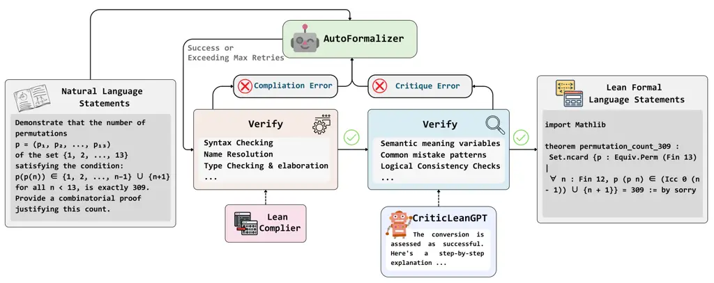
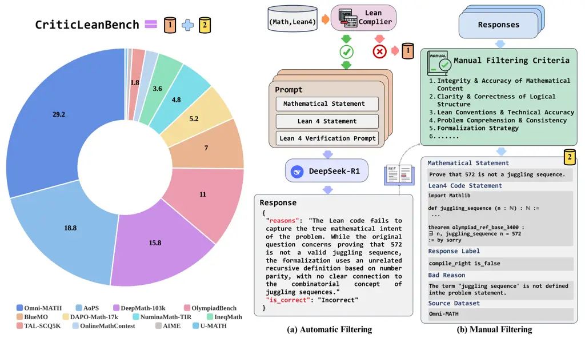

# CriticLean: Critic-Guided Reinforcement Learning for Mathematical Formalization

July 8, 2025

###### Abstract

Translating natural language mathematical statements into formal,
executable code is a fundamental challenge in automated theorem proving.
While prior work has focused on generation and compilation success,
little attention has been paid to the critic phase—the evaluation of
whether generated formalizations truly capture the semantic intent of
the original problem. In this paper, we introduce CriticLean, a novel
critic-guided reinforcement learning framework that elevates the role of
the critic from a passive validator to an active learning component.
Specifically, first, we propose the CriticLeanGPT, trained via
supervised fine-tuning and reinforcement learning, to rigorously assess
the semantic fidelity of Lean 4 formalizations. Then, we introduce
CriticLeanBench, a benchmark designed to measure models’ ability to
distinguish semantically correct from incorrect formalizations, and
demonstrate that our trained CriticLeanGPT models can significantly
outperform strong open- and closed-source baselines. Building on the
CriticLean framework, we construct FineLeanCorpus, a dataset comprising
over 285K problems that exhibits rich domain diversity, broad difficulty
coverage, and high correctness based on human evaluation. Overall, our
findings highlight that optimizing the critic phase is essential for
producing reliable formalizations and we hope our CriticLean will
provide valuable insights for future advances in formal mathematical
reasoning.

^(†)^(†)affiliation: ByteDance Seed   Nanjing
University^(†)^(†)contribution: Full author list in
Contributions^(†)^(†)correspondence: , ^(†)^(†)Project Page:
[https://github.com/multimodal-art-projection/CriticLean](https://github.com/multimodal-art-projection/CriticLean)

## 1 Introduction

The formalization of mathematical statements (Yang et al., 2024) is a
critical task in modern mathematical computation, particularly in the
context of theorem provers like Lean 4 (Leanprover Community, 2023). The
translation of natural language mathematical problems into formal,
executable code remains a significant challenge, as it requires not only
syntactical accuracy but also a deep understanding of the problem’s
semantics (Scholze, 2022; Tao, 2023). Existing approaches have shown
progress, but they often face limitations in accuracy, especially in the
context of complex, high-level problems that involve sophisticated
mathematical reasoning (Zheng et al., 2021; Azerbayev et al., 2023;
Welleck et al., 2021; Welleck et al., 2022; Lewkowycz et al., 2022). In
contrast to existing works, we argue that the critic phase—the step
where the semantic correctness of generated formalizations is
evaluated—is not only underexplored but also fundamentally essential to
the success of mathematical autoformalization.

Therefore, in this paper, we systematically investigate and optimize the
critic component and introduce CriticLean, a comprehensive framework
that places the critic model at the center of the formalization
pipeline. Unlike prior work that primarily focuses on generation quality
or compiler validity, CriticLean introduces the reinforcement
learning-based CriticLeanGPT models explicitly trained to evaluate
whether the Lean 4 output truly reflects the intent of the original
mathematical statement., and we present a full methodology for training,
and evaluating CriticLeanGPT model. Specifically, as shown in Figure 1,
for each natural language statement, we apply the autoformalization
iteratively based on the feedback from the Lean compiler and the
CriticLeanGPT models, which is trained to critically assess whether a
generated formalization accurately represents the semantics of the
original mathematical statement. In each iteration, the feedback
provides valuable signals that drive an iterative refinement process,
further improving the quality of the final Lean code output.

Additionally, we present CriticLeanBench, a benchmark designed to
evaluate the performance of CriticLeanGPT models, which contain 500
natural language and Lean 4 language statement pairs (i.e., 250 correct
and 250 incorrect pairs). Through extensive experiments, we demonstrate
that our trained CriticLeanGPT models outperform the SOTA open-source
models (Bai et al., 2023; Grattafiori et al., 2024; Guo et al., 2025a)
and many closed-source API models (Google, 2023; OpenAI, 2023; Guo
et al., 2025b) greatly.

Furthermore, building upon our critic-centric CriticLean pipeline, we
propose the high-quality open-source Lean 4 statement dataset
FineLeanCorpus, comprising 285,957 fully verified entries. When compared
to the previous related datasets (e.g., LeanWorkBook (Ying et al.,
2025)), FineLeanCorpus is distinguished by its diversity in mathematical
domains, difficulty distribution, and strict semantic validation via
critical feedback loops. Notably, its difficulty distribution and
targeted domain enrichment create a more structurally balanced training
environment, mitigating overfitting and transforming sparse topics into
well-supported sub-domains. Furthermore, to foster research into the
upper echelons of mathematical reasoning, we have curated the
specialized subset called FineLeanCorpus-Diamond, comprising over 36,000
high-difficulty problems.

.



Figure 1: Illustration of CriticLean framework based on Critic-Guided
Reinforcement Learning for Mathematics Autoformalization.

## 2 Related Works

### 2.1 Autoformalization

Autoformalization Szegedy (2020); Wu et al. (2022); Yu et al. (2025c)
refers to the process by which AI systems parse natural language (NL)
contents and translate them into machine-verifiable formal
representations, such as those in theorem provers like Lean4 (Moura and
Ullrich, 2021) or Isabelle (Nipkow et al., 2002). Recent advances
leverage large language models (LLMs) Zhang et al. (2024a) to tackle
this problem through two primary paradigms: (1) In-context learning Wei
et al. (2022), where models utilize annotated examples Wu et al. (2022);
Liu et al. (2023); Lu et al. (2024) to generate formalizations without
explicit fine-tuning, (2) Supervised fine-tuning (e.g.,  Lin et al.
(2025); Xin et al. (2024a); Yu et al. (2025b)), which adapts
general-purpose LLMs into domain-specific autoformalization experts. To
assess correctness, prior works Lin et al. (2025); Xin et al. (2024a);
Yu et al. (2025b) employ LLM-as-judge Zheng et al. (2023) to verify
semantic alignment between formal and informal statements. We advance
this by training the first open-sourced, domain-specific light LLM on
top of Qwen Team (2025a) family for critiquing Lean4 statement alignment
via reinforcement learning Shao et al. (2024b), enhancing both critique
capability and formalization robustness.

### 2.2 RL for LLM Reasoning

The exploration of complex reasoning capabilities in Large Language
Models (LLMs) has achieved significant advancements (Liu et al., 2024b;
Liu et al., 2025a; Wang et al., 2025b; Huang et al., 2025; Liu et al.,
2024a; He et al., 2025a), with Reinforcement Learning (RL) establishing
itself as a critical paradigm for transcending the constraints inherent
to Supervised Fine-Tuning (SFT) (Yu et al., 2025a; Yue et al., 2025b;
Wang et al., 2025c; Liu et al., 2025b; Liu et al., 2024a). Notable
methodologies, including GRPO (Shao et al., 2024b; Guo et al., 2025a),
DAPO (Yu et al., 2025a) have demonstrated substantial gains in
mathematical reasoning and intricate problem-solving domains. However,
the underlying mechanisms by which RL enhances reasoning capabilities
remain insufficiently characterized. Empirical analyses increasingly
indicate that RL primarily functions to activate, refine, or optimize
the sampling of latent reasoning competencies rather than generating
entirely novel cognitive frameworks de novo. For example, Yue et al.
(2025a) interrogate whether current reinforcement learning frameworks
incorporating verifiable rewards (RLVR) genuinely expand the frontier of
reasoning performance or merely enhance the efficiency of retrieving
pre-existing solutions.

## 3 CriticLeanGPT

### 3.1 CriticLeanBench

#### 3.1.1 Overview of CriticLeanBench

CriticLeanBench aims to evaluate the critical reasoning of LLMs in key
aspects such as translating natural language mathematical statements
into formally verified theorem declarations in Lean 4, including
critique and correction. By integrating these core dimensions,
CriticLeanBench can comprehensively measure the performance of models in
Formalization tasks. In this section, we will elaborate on the
construction principles and processes of CriticLeanBench; the
construction process is shown in Figure 2.

CriticLeanBench is constructed following the following principles: (1)
It covers various types of errors, aiming to thoroughly evaluate the
comprehensive capabilities of LLMs in capturing the semantic intent of
formalized statements, using Template G for systematic assessment; (2)
It incorporates diverse data sources to enhance the diversity and
representativeness of evaluation data; and (3) It ensures the
reliability and validity of the evaluation benchmark through a
combination of expert review and automated verification.



Figure 2: An overview for the CriticLeanBench construction.

#### 3.1.2 Automatically verified

This section outlines the methodology employed to apply the Automatic
Validation Filter , guided by predefined criteria for compiler and
model-based verification.

Data Collection We selected Math Statements from data sources (Perez
et al., 2025; Mahdavi et al., 2025b; Yu et al., 2025a; He et al., 2025c;
LI et al., 2024; Online Math Contest, ; AI Research Group of TAL
Education Group, ), such as Omni-MATH (Gao et al., 2024), AIME (Zheng
et al., 2021), U-MATH (Chernyshev et al., 2024), DEMI-MathAnalysis
(Demidovich, 1964), HARDMath (Fan et al., ), OlympiadBench (He et al.,
2024), and BlueMO (Zhang et al., 2024b), along with their corresponding
Lean 4 Statements from public dataset (Yu et al., 2025b).

Compiler Verified We submitted the Lean 4 statements from the above
dataset to the Lean 4 compiler. If the compilation succeeded, the
results were passed to the DeepSeek R1 (Guo et al., 2025a) model for
further processing.

- •
  Compile false: For statements that failed to compile, we randomly
  sampled 50 entries and retained the compiler feedback messages, which
  were included as part of our CriticLeanBench benchmark.

LLM Verified For the data that has passed compilation, we utilize a
template G to process each sample’s Math Statement and its corresponding
Lean 4 Code Statement through the DeepSeek R1 large language model. The
model is tasked with determining whether the Lean 4 Code Statement is
consistent with the Math Statement, producing for each sample a tag
indicating consistency or inconsistency along with a reasoning
statement. To extract structured outputs from the model’s responses, we
employ regular expression-based pattern matching. The results are then
submitted to human reviewers for further validation.

#### 3.1.3 Human Validation Filter

This section outlines the methodology employed to apply the Human
Validation Filter, guided by predefined criteria(detailed in
Appendix C).

We categorize the data into two groups based on whether the
Lean-compiled autoformalization output semantically aligns with the
refined statement. Therefore, a Lean-compiled autoformalization falls
into the following:

- •
  Human Check right: If the autoformalized statement _both_ compiles
  _and_ accurately captures the mathematical meaning, logic, and
  intended behavior of the original problem, it satisfies the semantic
  consistency criteria.
- •
  Human Check false: If the autoformalized statement compiles but
  _fails_ to accurately represent the original mathematical problem’s
  semantics. It violates one or more of the semantic consistency
  criteria, despite being syntactically valid Lean code. This often
  happens when there’s a mismatch between the code’s logic and the
  intended mathematical meaning.

Within the two categories, we select representative samples that mirror
the characteristics of the original autoformalization statements while
maximizing diversity within each subset and capturing the full spectrum
of observed error types in the negative samples. This is achieved by
balancing several factors:

Stratified Representation: The selected samples should maintain a
similar distribution across different strata of the original dataset.
These strata are defined by:

- •
  Problem Complexity: This encompasses factors like the number of
  variables, quantifiers, logical connectives, and the depth of nested
  mathematical structures.
- •
  Mathematical Branches: The samples should represent the various
  mathematical domains present in the original data.
- •
  Statement Well-Formedness: This refers to the degree to which the
  original mathematical statements adhere to standard mathematical
  notation and conventions. This stratification ensures that the subsets
  reflect the variability in the quality of the original problem
  statements.

Comprehensive Error Coverage: The negative samples are specifically
chosen to exemplify the full range of typical errors observed in the
autoformalization process. This range includes fundamental semantic and
logical issues, such as Premise Translation Errors (e.g., incorrect
domains or missing conditions), Mathematical Representation Errors
(e.g., faulty expressions or definitions), and Goal Translation Errors.
The set also covers issues such as Incorrect Assumptions, logical flaws
like Operator & Parenthesis Errors (e.g., misplaced quantifiers), and
high-level structural problems like Incomplete Formalization, where
crucial context is omitted(detailed in figure9).

#### 3.1.4 Data Statistics

| Statistics                 | Number                       |
| -------------------------- | ---------------------------- |
| \#Problems                 | $`500`$                      |
| Correct Pairs              | $`250`$                      |
|     - human check          | $`250`$                      |
| Incorrect Pairs            | $`250`$                      |
|     - human/compiler check | $`200`$/$`50`$               |
| Question Tokens Length     |                              |
|     - max/min/avg          | $`1,583`$/$`495`$/$`700.94`$ |

| Benchmark              | Critic | Lean | Test |
| ---------------------- | ------ | ---- | ---- |
| CriticBench            | ✓      | ✗    | ✓    |
| CodeCriticBench        | ✓      | ✗    | ✓    |
| LLaVA-Critic           | ✓      | ✗    | ✗    |
| CriticLeanBench (ours) | ✓      | ✓    | ✓    |

Table 1: Dataset statistics and comparison of various code benchmark
datasets.

Table 1 (left) presents the dataset statistics for CriticLeanBench. The
dataset contains a total of 500 problems, comprising 250 correct and 250
incorrect Q/GT (Question and GT label) pairs distributed across the
collection. The questions exhibit a notable variation in length, with a
maximum token count of 1,583 and a minimum of 495 tokens, calculated
using the Qwen2.5 (Bai et al., 2023) tokenizer. On average, each
question contains approximately 700.94 tokens. This characteristic
distinguishes CriticLeanBench as a complex evaluation benchmark that
requires models to process relatively lengthy inputs compared to those
in standard datasets.

#### 3.1.5 Comparison to Other Benchmarks

In Table 1 (right), CriticLeanBench has the following features: (1) We
focus on a modest data size of 500 samples, acknowledging the expensive
manual annotation costs (ranging from tens to hundreds of dollars per
instance) and prioritizing efficiency without compromising evaluation
rigor; (2) We integrate both Critic and Lean functionalities,
distinguishing ourselves from benchmarks like CriticBench (Lin et al., 2024) and CodeCriticBench (Zhang et al., 2025a) that lack Lean
capabilities, and LLaVA-Critic (Xiong et al., 2025) that omits both Lean
capabilities and test evaluation components; (3) We incorporate a test
component focused on translating mathematical statements into formally
verified theorem declarations in Lean 4, offering a fine-grained
evaluation framework to assess the correctness of model transformations.
This aspect of evaluative completeness remains unmatched by existing
datasets.

## 4 CriticLeanInstruct

To enhance the CriticLeanGPT model’s efficacy in critically evaluating
the successful transformation of mathematical statements into Lean code,
we constructs a comprehensive training dataset comprising 48,000
samples. This dataset consists of three high-quality components,
designed to comprehensively improve the model’s critical thinking and
reasoning capabilities.

To significantly broaden the CriticLeanGPT model’s knowledge coverage,
we also integrates three times additional code and math (Hugging Face, 2025) datasets, enabling it to more comprehensively understand
mathematical concepts and Lean code structures.

Specifically, the Seed Data, with a 1:3 mix of math and code, is termed
CriticLeanInstruct(16K). When combined with data augmentation while
retaining the same ratio, it forms the full CriticLeanInstruct dataset.

### 4.1 Seed Data

The seed data comprises 4,000 samples evenly split into 2,000 correct
and 2,000 incorrect instances. For both correct and incorrect samples,
human experts provided critical feedback F. Additionally, the incorrect
samples include compiler error messages generated by the Lean 4 Compiler
as supplementary feedback. Then, we adopt the Gemini2.5-Pro (Google, 2023) to extend the critical feedback to detailed Chain-of-Thought (CoT)
explanations.

Figure 3: Distribution of Different Error Types.

To understand the primary failure modes, we analyzed the error
distribution across the 2,000 incorrect samples in our seed data as
illustrated in Figure 3. The analysis reveals two primary challenges:(1)
Syntactic Barriers: The most frequent obstacles are syntactic, such as
Type Error and Syntax Errors. These issues typically prevent the code
from compiling, indicating a fundamental difficulty in mastering the
formal language.(2) Semantic Gaps: Beyond syntax, these errors stem from
a failure to interpret the natural language scenario and accurately
model its key information. This is evident in high rates of errors when
translating a problem’s core logical components—including its premises,
goal, and mathematical representation. This semantic challenge is
particularly acute in application-style ”word problems,” where
difficulty comprehending complex contexts leads to a fundamentally
flawed formalization.

Drawing from the error taxonomy (detailed in Appendix D) and building
upon our initial annotation standards (detailed in Appendix C), we
established a fine-grained checklist, which is provided in full in
Appendix E. This checklist formalizes the observed error paradigms,
providing the foundational framework for methodically constructing the
negative samples used throughout our study.

### 4.2 Data Augmentation

#### 4.2.1 Correct Samples

We selected 5560 correct mathematical statements and Lean code pairs
from the FormalMATH (Yu et al., 2025b) dataset and used the
Gemini-2.5-Pro model to generate Critical Chain-of-Thought for initial
assessment. To ensure data quality, we kept these samples where the
model’s judgment is “correct.”

#### 4.2.2 Incorrect Samples

We provide two strategies to obtain the incorrect samples as follows:

- •
  Based on OmniMath, we adopt the Kimina-Autoformalizer-7B (Wang et al.,
  2025a) to generate the Lean 4 code statements, and we kept 2,000 Lean
  code snippets that failed to compile due to syntactic or logical
  issues during automated formalization processes. For each detected
  error, a detailed Chain-of-Thought (CoT) explanation was generated to
  elucidate the error’s cause, enabling the model to recognize common
  compilation error patterns and thereby enhance its understanding of
  Lean 4 code syntax.
- •
  Based on correct mathematical statements and Lean 4 code from the
  FormalMATH (Yu et al., 2025b) dataset, we implemented a three-step
  collaborative process to generate negative samples, aiming to enhance
  the CriticLeanGPT model’s ability to identify subtle errors and
  logical flaws. First, a checklist of various potential issues, refined
  by human experts, was established as shown in Appendix E. Second, the
  Gemini 2.5 Pro model was invoked to randomly select error types from
  this checklist and modify correct Lean code accordingly, generating
  incorrect samples(detailed in Appendix H). Then, we adopt the Gemini
  model to generate the critical Chain-of-Thought explaination.

### 4.3 Training Paradigm

##### Supervised fine-tuning (SFT).

These models are instruction-tuned versions based on their respective
pre-trained Qwen2.5 checkpoints, with a focus on improving their ability
to interpret and formalize complex mathematical statements expressed in
natural language. The CriticLeanInstruct 4 dataset includes Critic data
consisting of mathematical statements converted into formally verified
theorem declarations in Lean 4, along with three times as much code and
mathematics data for SFT (Supervised Fine-Tuning). We used the
LLaMA-Factory (Zheng et al., 2024) framework to facilitate the
fine-tuning process and optimize model performance.

##### Reinforcement Learning Optimization (RL).

The recent success of R1-style methods has demonstrated the
effectiveness of online RL using discrete, rule-based rewards Shao
et al. (2024a). In our pipeline, Qwen2.5 series and Qwen3 (Team, 2025a)
series are further refined using reinforcement learning signals derived
from both format validation of the generated critic data and consistency
checking between model predictions and expert-labeled ground truth (GT)
labels . Specifically, the RL training data consists of 4,000 Seed Data
4.1, where each example transforms a mathematical statement into a
corresponding formal proof in Lean 4. Based on this dataset, we apply a
rule-based RL approach to optimize the model’s capability in judgment
reasoning. More specifically, we mainly utilize the GRPO (Shao et al.,
2024b) algorithm within the VeRL (Sheng et al., 2024) reinforcement
learning framework, whose optimization objective is:

```math
\displaystyle J_{\text{online}}(\pi_{\theta};\mathcal{D})=
```

```math
\displaystyle\>\>\mathbb{E}_{x\sim\mathcal{D},\{y_{i}\}_{i=1}^{G}\sim\pi_{\theta_{\text{old}}}(y|x)}\left[\frac{1}{G}\sum_{i=1}^{G}\min\left(\frac{\pi_{\theta}(y_{i}|x)}{\pi_{\theta_{\text{old}}}(y_{i}|x)}A_{i},\right.\right.
```

```math
\displaystyle\>\>\left.\left.\text{clip}\left(\frac{\pi_{\theta}(y_{i}|x)}{\pi_{\theta_{\text{old}}}(y_{i}|x)},1-\epsilon,1+\epsilon\right)A_{i}\right)-\beta D_{\text{KL}}(\pi_{\theta}||\pi_{\text{ref}})\right] \tag{1}
```

where $`G`$ is group size, and $`A_{i}`$ is advantage. The reward
function is designed as follows¹¹ 1 We do not include a length penalty
in rewards to encourage longer thinking.:

```math
\displaystyle r_{\text{accuracy}} \displaystyle=\begin{cases}1,&\text{if }\text{judgement}=\text{label}\\
0,&\text{if }\text{judgement}\neq\text{label}\end{cases} \tag{2}
```

```math
\displaystyle r_{\text{format}} \displaystyle=\begin{cases}1,&\text{if }\text{format is right}\\
0,&\text{if }\text{format is wrong}\end{cases} \tag{3}
```

```math
\displaystyle r_{\text{final}} \displaystyle=\operatorname{min}(r_{\text{accuracy}},r_{\text{format}}) \tag{4}
```

## 5 Experiments

### 5.1 Experimental Setup

Baseline Models. For the closed-sourced API models, we select the
following models: Claude35_Sonnet2 (Anthropic, 2024), Doubao-1.5-pro-32k
(Guo et al., 2025b), Gemini 2.5 Pro (Team et al., 2023),
GPT-4o-2024-11-20 (OpenAI, 2023). We select a group of the most advanced
open-source LLMs to serve as critic models for evaluation, which
includes various reasoning models (DeepSeek-R1 (Guo et al., 2025a),
QwQ-32B (Team, 2025b), Qwen3-8B (Team, 2025a), Qwen3-14B (Team, 2025a),
Qwen3-32B (Team, 2025a)), DeepSeek-Prover models (Xin et al., 2024b)
(DeepSeek-Prover-V1.5-RL, DeepSeek-Prover-V1.5-SFT),
Llama-3.3-70B-Instruct (Grattafiori et al., 2024) and several Qwen
models (Qwen2.5-Coder-7B-Instruct (Hui et al., 2024),
Qwen2.5-Coder-32B-Instruct (Hui et al., 2024), Qwen2.5-7B-Instruct
(Team, 2024), Qwen2.5-14B-Instruct (Team, 2024) and Qwen2.5-32B-Instruct
(Team, 2024)).

CriticLeanGPT Models. We further evaluate three variants from the
Qwen2.5 series and Qwen3 series. These are instruction-based models
fine-tuned specifically on either the CriticLeanInstruct 4 dataset or
the RL-based clean critic Seed Data 4.1. All open-source models are
inferred using the vLLM (Kwon et al., 2023) framework with default
inference parameters.

### 5.2 Main Results

#### 5.2.1 Evaluation of Critic Capability

|                |     |     |     |     |     |           |             |
| -------------- | --- | --- | --- | --- | --- | --------- | ----------- |
| Model          | ACC | TPR | FPR | TNR | FNR | Reasoning | Open-source |
| SOTA LLMs      |     |     |     |     |     |           |             |
| Gemini-2.5-Pro |

````math
89.2
``` | 95.6 | 4.4 | 82.8 | 17.2 | ✓ | ✗ |
| QwQ-32B | 86.4 | 93.6 | 6.4 | 79.2 | 20.8 | ✓ | ✓ |
| Qwen3-32B | 85.6 | 96.0 | 4.0 | 75.2 | 24.8 | ✓ | ✓ |
| Qwen3-235B-A22B | 84.8 | 90.4 | 9.6 | 79.2 | 20.8 | ✓ | ✓ |
| DeepSeek-R1 | 84.0 | 90.8 | 9.2 | 77.2 | 22.8 | ✓ | ✓ |
| Qwen3-14B | 83.6 | 92.4 | 7.6 | 74.8 | 25.2 | ✓ | ✓ |
| Qwen3-8B | 79.8 | 94.4 | 5.6 | 65.2 | 34.8 | ✓ | ✓ |
| Doubao-1.5-pro-32k | 78.4 | 95.2 | 4.8 | 61.6 | 38.4 | ✗ | ✗ |
| Claude35-Sonnet | 74.2 |
``` math
97.2
``` |
``` math
2.8
``` | 51.2 | 48.8 | ✗ | ✗ |
| Qwen2.5-32B-Instruct | 73.0 | 91.6 | 8.4 | 54.4 | 45.6 | ✗ | ✓ |
| Qwen2.5-Coder-32B-Instruct | 71.6 | 91.6 | 8.4 | 51.6 | 48.4 | ✗ | ✓ |
| Llama-3.3-70B-Instruct | 68.2 | 95.2 | 4.8 | 41.2 | 58.8 | ✗ | ✓ |
| GPT-4o-2024-11-20 | 67.8 | 95.6 | 4.4 | 40.0 | 60.0 | ✗ | ✗ |
| Qwen2.5-14B-Instruct | 66.6 | 80.4 | 19.6 | 52.8 | 47.2 | ✗ | ✓ |
| Qwen2.5-Coder-7B-Instruct | 65.4 | 88.4 | 11.6 | 42.4 | 57.6 | ✗ | ✓ |
| Qwen2.5-7B-Instruct | 60.8 | 89.6 | 10.4 | 32.0 | 68.0 | ✗ | ✓ |
| DeepSeek-Prover-V1.5-SFT | 52.4 | 78.8 | 21.2 | 26.0 | 74.0 | ✗ | ✓ |
| DeepSeek-Prover-V1.5-RL | 50.0 | 76.4 | 23.6 | 23.6 | 76.4 | ✗ | ✓ |
| CriticLeanGPT (Ours) |  |  |  |  |  |  |  |
| Qwen3-8B-RL | 79.8 | 90.0 | 10.0 | 72.0 | 28.0 | ✓ | ✓ |
| Qwen3-14B-RL | 84.8 | 91.6 | 8.4 | 78.0 | 22.0 | ✓ | ✓ |
| Qwen3-32B-RL | 87.0 | 88.4 | 11.6 |
``` math
85.6
``` |
``` math
14.4
``` | ✓ | ✓ |
| Qwen2.5-7B-Instruct-RL | 68.6 | 85.6 | 14.4 | 51.6 | 48.4 | ✗ | ✓ |
| Qwen2.5-14B-Instruct-RL | 69.4 | 85.2 | 14.8 | 53.6 | 46.4 | ✗ | ✓ |
| Qwen2.5-32B-Instruct-RL | 72.0 | 60.4 | 39.6 | 83.6 | 16.4 | ✗ | ✓ |
| Qwen2.5-7B-Instruct-SFT | 69.8 | 94.4 | 5.6 | 45.2 | 54.8 | ✗ | ✓ |
| Qwen2.5-14B-Instruct-SFT | 70.6 | 83.6 | 16.4 | 57.6 | 42.4 | ✗ | ✓ |
| Qwen2.5-32B-Instruct-SFT | 76.2 | 85.2 | 14.8 | 67.2 | 32.8 | ✗ | ✓ |
| Qwen2.5-7B-Instruct-SFT-RL | 68.2 | 90.4 | 9.6 | 46.0 | 54.0 | ✗ | ✓ |
| Qwen2.5-14B-Instruct-SFT-RL | 74.6 | 81.6 | 18.4 | 67.6 | 32.4 | ✗ | ✓ |
| Qwen2.5-32B-Instruct-SFT-RL | 78.6 | 88.0 | 12.0 | 69.2 | 30.8 | ✗ | ✓ |

Table 2: Performance on CriticLeanBench. The best, the second-best and
the third-best scores for each indicator are shown in
``` math
b\hspace{0pt}o\hspace{0pt}x
````

, bold and underlined, respectively.

As indicated in Table 2, the experimental results clearly demonstrate
the effectiveness of the CriticLeanGPT models trained on our
CriticLeanInstruct, in converting natural language mathematical
statements into Lean 4 formal theorem declarations. Within the
CriticLeanBench benchmark, our CriticLeanGPT models trained via
supervised fine-tuning (SFT) and reinforcement learning (RL), along with
their enhanced variants—outperform a range of closed-source API models,
open-source models, and baseline models, highlighting distinct
advantages. These outcomes yield several key insights: (1) Reasoning
models excel in critical tasks, with Gemini 2.5 Pro, QwQ-32B, Qwen3-32B,
and DeepSeek-R1 all attaining scores above 80. When compared to baseline
models, our Qwen3-32B-RL model, optimized through RL, achieves a strong
accuracy level, underscoring the efficacy of both our training
methodology and dataset. (3) Our innovative mixed SFT strategy
substantially boosts the performance of the Qwen2.5 family, with notable
improvements observed across the 7B, 14B, and 32B models. (4)
Additionally, SFT and RL significantly strengthen the models’ capacity
to identify erroneous samples, as evidenced by higher true negative
rates (TNR) and lower false negative rates (FNR)—a critical enhancement
for accurate detection of incorrect formalizations, which is
indispensable for effective critical tasks.

### 5.3 Ablation Study

|                                      |      |      |      |      |      |
| ------------------------------------ | ---- | ---- | ---- | ---- | ---- |
| Model                                | ACC  | TPR  | FPR  | TNR  | FNR  |
| 7B Size Models                       |      |      |      |      |      |
| Qwen2.5-7B-Instruct                  | 60.8 | 89.6 | 10.4 | 32.0 | 68.0 |
| Qwen2.5-7B-Instruct-SFT(Critic Only) | 64.0 | 70.8 | 29.2 |

````math
57.2
``` |
``` math
42.8
``` |
| Qwen2.5-7B-Instruct-SFT |
``` math
69.8
``` |
``` math
94.4
``` |
``` math
5.6
``` | 45.2 | 54.8 |
| 14B Size Models |  |  |  |  |  |
| Qwen2.5-14B-Instruct | 66.6 | 80.4 | 19.6 | 52.8 | 47.2 |
| Qwen2.5-14B-Instruct-SFT(Critic Only) | 67.4 | 80.8 | 19.2 | 54.0 | 46.0 |
| Qwen2.5-14B-Instruct-SFT |
``` math
70.6
``` |
``` math
83.6
``` |
``` math
16.4
``` |
``` math
57.6
``` |
``` math
42.4
``` |
| 32B Size Models |  |  |  |  |  |
| Qwen2.5-32B-Instruct | 73.0 |
``` math
91.6
``` |
``` math
8.4
``` | 54.4 | 45.6 |
| Qwen2.5-32B-Instruct-SFT(Critic Only) | 71.0 | 72.0 | 28.0 |
``` math
70.0
``` |
``` math
30.0
``` |
| Qwen2.5-32B-Instruct-SFT |
``` math
76.2
``` | 85.2 | 14.8 | 67.2 | 32.8 |

Table 3: Comparison of model performance under different training
strategies: base model, SFT on Critic data only, and SFT on combined
Critic, code, and math data. The best score for each indicator is shown
in
``` math
b\hspace{0pt}o\hspace{0pt}x
````

.

#### 5.3.1 Effect of Reasoning Data

We conduct an ablation study on CriticLeanBench to evaluate the impact
of different training strategies. As shown in Table 3, incorporating
code and math reasoning data significantly improves performance across
all model sizes compared to using Seed Data 4.1. Specifically, using the
CriticLeanInstruct 4, which samples Critic and non-Critic data at a
ratio of 1:3, leads to substantial gains, demonstrating that integrating
diverse reasoning tasks enhances the critical reasoning capabilities of
the model. This suggests that multi-task learning with math and code
data improves the critique abilities of mathematical formalization.

#### 5.3.2 Effect of SFT Dataset Size

Figure 6 highlights a notable parameter-dependent relationship between
the size of the SFT dataset and key reasoning performance. Across all
model scales, performance improvements are observed through SFT, albeit
with varying degrees of fluctuation depending on the training set size.
Smaller models (e.g., 7B) exhibit more pronounced gains as the dataset
expands, whereas larger models (e.g., 32B) demonstrate a less consistent
trend, with marginal improvements at lower data volumes but substantial
gains at higher data volumes. These findings align with prior studies
(Muennighoff et al., 2025; Zhou et al., 2023), underscoring the
interplay between model capacity, data scale, and performance
optimization in SFT scenarios. The results emphasize the need for
tailored strategies to balance data efficiency and model generalization,
particularly for large-scale architectures.

### 5.4 Analysis

#### 5.4.1 Scaling Analysis

Figure 4: Scaling Analysis of LLMs on CriticLeanBench.

```math
\hat{}
```

denoted closed-source LLMs.

We evaluate the performance of Qwen series models on CriticLeanBench
across different model scales, including Qwen2.5-Coder,
Qwen2.5-Instruct, Qwen2.5-Instruct-SFT, Qwen2.5-Instruct-SFT-RL, Qwen3,
and Qwen3-RL. The results in Figure 4 show that the performance improves
consistently as the model size increases, demonstrating a clear scaling
law of LLMs on CriticLeanBench.

#### 5.4.2 Effect of Pass@k

{subfigure}

0.48 {subfigure}0.48

Figure 5: Performance on CriticLeanBench using Pass@k metrics, where k =
8 (left) and k = 32 (right).

Figure 6: Comparison of model performance under different amounts of SFT
data: base model, CriticLeanInstruct(16K), and CriticLeanInstruct.

The Pass@k metric serves as a means to identify the highest-quality
answers from multi-modal large language models (MLLMs) for final
responses, highlighting the models’ potential for enhancement through
post-training techniques like Reinforcement Learning from Human Feedback
(RLHF (Li et al., 2023)) and Gradient Penalty Policy Optimization (GRPO
(Shao et al., 2024b)). In this study, Pass@k evaluations were conducted
on Qwen2.5-7B-Instruct, Qwen2.5-7B-Instruct-SFT-RL, Qwen3-8B, and
Qwen3-8B-RL using CriticLeanBench, with k set to 8 and 32, and
evaluation metrics including Accuracy (ACC), True Positive Rate (TPR),
and True Negative Rate (TNR).

As shown in Figure 5, we observe that models subjected to Supervised
Fine-Tuning (SFT) and Reinforcement Learning (RL) achieve better overall
performance. Considering Pass@32, the Accuracy of Qwen2.5-7B-Instruct is
outperformed by that of Qwen2.5-7B-Instruct-SFT-RL, which has undergone
SFT and RL processing, leading to a notable improvement in the overall
correctness rate. Regarding the True Negative Rate, models without SFT
and RL processing are more prone to misclassifying incorrect samples as
correct, whereas processed models effectively mitigate such errors; this
is evident in the higher TNR of Qwen2.5-7B-Instruct-SFT-RL compared to
Qwen2.5-7B-Instruct at Pass@32, reducing the likelihood of such
misclassifications. A similar trend is observed in Qwen3-8B.
Additionally, all models exhibit improved performance as k increases,
suggesting that SFT- and RL-optimized models can more effectively select
high-quality answers when provided with more candidate responses.

| Dataset                            | Difficulty Level     | Size   |
| ---------------------------------- | -------------------- | ------ |
| AOPs  (Mahdavi et al., 2025a)      | High School Olympiad | 199982 |
| DeepMath-103k (He et al., 2025b)   | Diverse              | 28538  |
| NuminaMath-TIR (LI et al., 2024)   | High School          | 22847  |
| DeepTheorem  (Zhang et al., 2025b) | High School Olympiad | 15131  |
| DeepScaleR (Luo et al., 2025)      | High School Olympiad | 11544  |
| DAPO-Math-17k (Yu et al., 2025a)   | High School          | 4078   |
| Omni-MATH (Gao et al., 2024)       | Undergraduate        | 1176   |
| IneqMath (Jiayi et al., 2025)      | High School Olympiad | 963    |
| BlueMO  (Zhang et al., 2024b)      | High School Olympiad | 616    |
| TAL-SCQ5K  (Math-eval, 2023)       | High School          | 393    |
| OnlineMathContest                  | High School          | 70     |
| Multi-Source Math Competition      | High School Olympiad | 619    |

Table 4: Overview of different sources for FineLeanCorpus.

## 6 FineLeanCorpus

| Statistics           | Number      |
| -------------------- | ----------- |
| \#Problems           | 285957      |
| Length               |             |
| Statement            |             |
| maximum length       | 2980 tokens |
| minimum length       | 9 tokens    |
| avg length           | 78.4 tokens |
| Lean Result(success) |             |
| maximum length       | 768 tokens  |
| minimum length       | 14 tokens   |
| avg length           | 87.8 tokens |

Table 5: Dataset statistics of FineLeanCorpus.

To construct the FineLeanCorpus, we began by aggregating a vast and
diverse collection of natural language mathematical problems. Sourcing
from a wide array of materials, including high school olympiad datasets
(e.g., AoPS, BlueMO), standard high school curricula (e.g., TAL-SCQ5),
and undergraduate-level challenges (e.g., Omni-MATH), we ensured an
extensive initial distribution in both the mathematical domain and
difficulty. The first step in our process was to standardize this
heterogeneous collection into a uniform, proof-based format, making each
problem compatible with the Lean 4 theorem prover and ready for the
subsequent formalization pipeline.

These standardized problems were then subjected to a rigorous, gated
auto-formalization process powered by our CriticLean framework
(Figure 1).The Kimina-Autoformalizer-7B model first generates a
candidate formal statement. This statement must pass a syntactic check
via the Lean 4 compiler; failure leads to regeneration. A successful
compilation is followed by a semantic correctness check from our
CriticLeanGPT model, with rejection also triggering a new attempt. This
regenerative approach is critical, maximizing the yield from our source
corpus by iteratively seeking a valid formalization. Finally, to further
enhance precision, we apply a final filtering stage using another,
higher-performance CriticLeanGPT model. Manual validation indicates that
this step is expected to eliminate 74.7% of the remaining incorrect
formalizations. The resulting corpus is characterized by its expressive
range: natural language statements vary from a concise 9 tokens to a
complex 2,980 tokens (avg. 78.4), while their corresponding Lean
formalizations span from 14 to 768 tokens (avg. 87.8), reflecting the
deep spectrum of complexity successfully captured by our pipeline.

To further analyze the differences between our FineLeanCorpus dataset
and the Lean-Workbook, we employed the templates from Appendix J and
Appendix I to assess the difficulty levels and classify the mathematical
domains of the datasets using Doubao-1.5-pro (Guo et al., 2025b). A
comparative analysis of our proposed FineLeanCorpus against
Lean-Workbook (Figure 7, Figure 8, Table 4 and Table 5) reveals two
fundamental advancements: (1) Scale and Coverage: Our corpus provides a
significant quantitative expansion in both problem difficulty and domain
coverage. This expansion is evident not only across nearly the entire
difficulty spectrum—offering a much richer data pool for training
foundational skills—but also in the substantial augmentation of
high-volume domains like Intermediate Algebra and Elementary Number
Theory. (2) FineLeanCorpus exhibits a more diverse and structurally
balanced profile, achieved by collecting natural language statements
from numerous sources. From a difficulty perspective, it features a
multimodal distribution with substantial problem counts at several
distinct complexity points, in stark contrast to the unimodal
distribution of Lean-Workbook. This characteristic is crucial for
mitigating model overfitting to a narrow complexity band. From a domain
perspective, it substantially reinforces previously underrepresented
areas. For instance, categories such as Analytic Geometry and Integral
Calculus are significantly expanded, while niche topics like Algorithms
and Graph Theory are also robustly augmented. This targeted enrichment
transforms sparsely sampled topics into well-supported, learnable
sub-domains, yielding a more comprehensive dataset designed to foster
holistic reasoning capabilities. More details regarding our
FineLeanCorpus dataset, including its fine-grained mathematical domain
distribution (see Appendix A), are provided for further analysis.

Furthermore, to push the boundaries of current models and foster
research into the upper echelons of mathematical reasoning, we have
curated a specialized training subset from FineLeanCorpus, which we
designate as Diamond. This subset comprises 36,033 problems with a
difficulty rating exceeding 5. The purpose of this high-difficulty
training set is to create a demanding training environment that fosters
the development of the sophisticated, multi-step reasoning required to
tackle the most formidable mathematical problems.A detailed breakdown of
the mathematical domain distribution within this subset is provided in
table 11.

[TABLE]

Table 6: Comparison of dataset statistics. FineLeanCorpus offers a
transparent critic process, a higher proportion of top-tier problems,
and a more balanced and diverse topic distribution compared to the
highly skewed Lean-Workbook.

Figure 7: Comparison of dataset statistics. FineLeanCorpus offers a
transparent critic process, a higher proportion of top-tier problems,
and a more balanced and diverse topic distribution compared to the
highly skewed Lean-Workbook.

Figure 8: Math Domain Distributions: FineLeanCorpus vs. Lean-Workbook.

### 6.1 Analysis on CriticLean Pipeline

|                                       |      |
| ------------------------------------- | ---- |
| Model                                 | AVG  |
| Kimina-Autoformalizer-7B              | 38.0 |
| Kimina-Autoformalizer-7B (Compiler)   | 54.0 |
| Kimina-Autoformalizer-7B (CriticLean) |

                                         ``` math
                                         84.0
                                         ```       |

Table 7: Human evaluation accuracy results for autoformalization
performance: The best score is highlighted in

```math
b\hspace{0pt}o\hspace{0pt}x
```

.

As shown in Table 7, our autoformalization pipeline significantly
improves accuracy. We selected 50 problems from the Omni-MATH and
applied the following three formalization strategies, with the
correctness of all outputs confirmed by manual human inspection.

Our baseline model, Kimina-Autoformalizer-7B, is used in each strategy:
(1) a Single Pass baseline (38.0% accuracy); (2) a Compiler Feedback
loop, where the model regenerates formalizations until they successfully
compile (54.0% accuracy); (3) our CriticLean Pipeline, which extends
this process, regenerating formalizations until they both compile
successfully and are validated by our integrated CriticLeanGPT Model
(84.0% accuracy).

| \# Attempt    | 1          | 5           | 10          | 50          | 100         | 200         |
| ------------- | ---------- | ----------- | ----------- | ----------- | ----------- | ----------- |
| Count / Ratio | 63 / 12.6% | 137 / 27.4% | 170 / 34.0% | 229 / 45.8% | 245 / 49.0% | 264 / 52.8% |

Table 8: Effectiveness of the Multi-Attempt Strategy on Formalization
Yield. The table shows the cumulative number of successfully formalized
problems retained by the critic model as the attempt limit increases.
Statistics are from a 500-problem sample.

| Dataset                           | Accuracy | Dataset                          | Accuracy | Dataset                       | Accuracy |
| --------------------------------- | -------- | -------------------------------- | -------- | ----------------------------- | -------- |
| NuminaMath-TIR (LI et al., 2024)  | 78%      | IneqMath (Jiayi et al., 2025)    | 96%      | BlueMO (Zhang et al., 2024b)  | 86%      |
| DeepMath-103k (He et al., 2025c)  | 84%      | DAPO-Math-17k (Yu et al., 2025a) | 69%      | OnlineMathContest             | 88%      |
| AOPs (Mahdavi et al., 2025a)      | 73%      | TAL-SCQ5K (Math-eval, 2023)      | 75%      | Omni-MATH  (Gao et al., 2024) | 84%      |
| DeepTheorem (Zhang et al., 2025b) | 100%     | DeepScaleR (Luo et al., 2025)    | 100%     |                               |          |

Table 9: Human evaluation results of different sources.

While compiler feedback resolves syntactical errors, it fails to detect
logical flaws. Our pipeline addresses this gap. The integration of
critic model, which performs deeper semantic and logical validation, is
directly responsible for the accuracy increase from 54.0% to 84.0%. By
filtering out plausible but incorrect formalizations, our method
provides a more robust path toward reliable autoformalization. These
manually-verified results present strong empirical evidence for the
efficacy of our approach.

Table 8 shows our pipeline achieved a 52.8% success rate across 500
problems, where success required passing both syntactic validation and
our critic model’s semantic check. The value of our multi-attempt
strategy is evident: while only 12.6% of samples passed on the first
try, the pipeline successfully recovered an additional 40.2% that would
be discarded by single-pass systems. Conversely, the 47.2% failure rate
within the 200-attempt limit highlights a fundamental bottleneck: the
pipeline’s performance is ultimately constrained by the base
auto-formalization model’s ability to produce a candidate our critic can
approve.

Moreover, as shown in Table 9, we also provide the human evaluation
results of different sources. We observe that the accuracy varies across
different sources, a discrepancy we attribute primarily to the differing
domain and difficulty distributions of the respective datasets. ²² 2 Our
human evaluation standard is particularly stringent. To calibrate our
criteria, we inspected a random sample of 50 entries from the
Lean-Workbook, which yielded an accuracy of 84%.

## 7 Conclusion

This paper presents CriticLean, a comprehensive framework that positions
the critic as a central component in the autoformalization of
mathematical statements. Through the development of CriticLeanGPT and
the construction of CriticLeanBench, we demonstrate that explicitly
modeling and training the critic yields significant improvements in
formalization quality. Our pipeline not only refines the translation
process through semantic validation, but also enables the construction
of FineLeanCorpus, which is validated by both compiler and critic.

## 8 Contributions and Acknowledgments

### Co-First Authors

Zhongyuan Peng, Yifan Yao, Kaijing Ma

### Co-Authors

Shuyue Guo, Yizhe Li, Yichi Zhang, Chenchen Zhang, Yifan Zhang,
Zhouliang Yu, Luming Li, Minghao Liu, Yihang Xia, Jiawei Shen, Yuchen
Wu, Yixin Cao, Zhaoxiang Zhang, Wenhao Huang

### Corresponding Authors

Jiaheng Liu, Ge Zhang

## References

- \[1\] AI Research Group of TAL Education Group. K-12 handwritten
  mathematical expressions dataset (hme100k).
  [https://ai.100tal.com/dataset](https://ai.100tal.com/dataset).
  Accessed: 2025-04-05.
- Anthropic \[2024\] Anthropic. Claude 3.5 sonnet model card
  addendum, 2024. URL
  [https://www.paperswithcode.com/paper/claude-3-5-sonnet-model-card-addendum](https://www.paperswithcode.com/paper/claude-3-5-sonnet-model-card-addendum).
  Accessed: 2024-09-21.
- Azerbayev et al. \[2023\] Zhangir Azerbayev, Bartosz Piotrowski,
  Hailey Schoelkopf, Edward W Ayers, Dragomir Radev, and Jeremy Avigad.
  Proofnet: Autoformalizing and formally proving undergraduate-level
  mathematics. _arXiv preprint arXiv:2302.12433_, 2023.
- Bai et al. \[2023\] Jinze Bai, Shuai Bai, Yunfei Chu, Zeyu Cui, Kai
  Dang, Xiaodong Deng, Yang Fan, Wenbin Ge, Yu Han, Fei Huang, Binyuan
  Hui, Luo Ji, Mei Li, Junyang Lin, Runji Lin, Dayiheng Liu, Gao Liu,
  Chengqiang Lu, Keming Lu, Jianxin Ma, Rui Men, Xingzhang Ren,
  Xuancheng Ren, Chuanqi Tan, Sinan Tan, Jianhong Tu, Peng Wang, Shijie
  Wang, Wei Wang, Shengguang Wu, Benfeng Xu, Jin Xu, An Yang, Hao Yang,
  Jian Yang, Shusheng Yang, Yang Yao, Bowen Yu, Hongyi Yuan, Zheng Yuan,
  Jianwei Zhang, Xingxuan Zhang, Yichang Zhang, Zhenru Zhang, Chang
  Zhou, Jingren Zhou, Xiaohuan Zhou, and Tianhang Zhu. Qwen technical
  report. _arXiv preprint arXiv:2309.16609_, 2023.
- Chernyshev et al. \[2024\] Konstantin Chernyshev, Vitaliy Polshkov,
  Ekaterina Artemova, Alex Myasnikov, Vlad Stepanov, Alexei Miasnikov,
  and Sergei Tilga. U-math: A university-level benchmark for evaluating
  mathematical skills in llms. _arXiv preprint arXiv:2412.03205_, 2024.
- Demidovich \[1964\] B.P. Demidovich. _Problems in Mathematical
  Analysis. Edited by B. Demidovich. Translated From the Russian by G.
  Yankovsky_. Russian Monographs and Texts on Advanced Mathematics and
  Physics. Mir Publishers, 1964. URL
  [https://books.google.com/books?id=XdmpwgEACAAJ](https://books.google.com/books?id=XdmpwgEACAAJ).
- \[7\] J Fan, S Martinson, EY Wang, K Hausknecht, J Brenner, D Liu,
  N Peng, C Wang, and MP Brenner. Hardmath: A benchmark dataset for
  challenging problems in applied mathematics. arxiv 2024. _arXiv
  preprint arXiv:2410.09988_.
- Gao et al. \[2024\] Bofei Gao, Feifan Song, Zhe Yang, Zefan Cai, Yibo
  Miao, Qingxiu Dong, Lei Li, Chenghao Ma, Liang Chen, Runxin Xu, et al.
  Omni-math: A universal olympiad level mathematic benchmark for large
  language models. _arXiv preprint arXiv:2410.07985_, 2024.
- Google \[2023\] Google. Gemini: A family of highly capable multimodal
  models, 2023.
- Grattafiori et al. \[2024\] Aaron Grattafiori, Abhimanyu Dubey,
  Abhinav Jauhri, Abhinav Pandey, Abhishek Kadian, Ahmad Al-Dahle,
  Aiesha Letman, Akhil Mathur, Alan Schelten, Alex Vaughan, et al. The
  llama 3 herd of models. _arXiv preprint arXiv:2407.21783_, 2024.
- Guo et al. \[2025a\] Daya Guo, Dejian Yang, Haowei Zhang, Junxiao
  Song, Ruoyu Zhang, Runxin Xu, Qihao Zhu, Shirong Ma, Peiyi Wang, Xiao
  Bi, et al. Deepseek-R1: Incentivizing reasoning capability in LLMs via
  reinforcement learning. _arXiv preprint arXiv:2501.12948_, 2025a.
- Guo et al. \[2025b\] Dong Guo, Faming Wu, Feida Zhu, Fuxing Leng,
  Guang Shi, Haobin Chen, Haoqi Fan, Jian Wang, Jianyu Jiang, Jiawei
  Wang, et al. Seed1. 5-vl technical report. _arXiv preprint
  arXiv:2505.07062_, 2025b.
- He et al. \[2024\] Chaoqun He, Renjie Luo, Yuzhuo Bai, Shengding Hu,
  Zhen Leng Thai, Junhao Shen, Jinyi Hu, Xu Han, Yujie Huang, Yuxiang
  Zhang, Jie Liu, Lei Qi, Zhiyuan Liu, and Maosong Sun. Olympiadbench: A
  challenging benchmark for promoting agi with olympiad-level bilingual
  multimodal scientific problems, 2024.
- He et al. \[2025a\] Yancheng He, Shilong Li, Jiaheng Liu, Weixun Wang,
  Xingyuan Bu, Ge Zhang, Zhongyuan Peng, Zhaoxiang Zhang, Zhicheng
  Zheng, Wenbo Su, and Bo Zheng. Can large language models detect errors
  in long chain-of-thought reasoning?, 2025a. URL
  [https://arxiv.org/abs/2502.19361](https://arxiv.org/abs/2502.19361).
- He et al. \[2025b\] Zhiwei He, Tian Liang, Jiahao Xu, Qiuzhi Liu,
  Xingyu Chen, Yue Wang, Linfeng Song, Dian Yu, Zhenwen Liang, Wenxuan
  Wang, Zhuosheng Zhang, Rui Wang, Zhaopeng Tu, Haitao Mi, and Dong Yu.
  Deepmath-103k: A large-scale, challenging, decontaminated, and
  verifiable mathematical dataset for advancing reasoning. 2025b. URL
  [https://arxiv.org/abs/2504.11456](https://arxiv.org/abs/2504.11456).
- He et al. \[2025c\] Zhiwei He, Tian Liang, Jiahao Xu, Qiuzhi Liu,
  Xingyu Chen, Yue Wang, Linfeng Song, Dian Yu, Zhenwen Liang, Wenxuan
  Wang, et al. Deepmath-103k: A large-scale, challenging,
  decontaminated, and verifiable mathematical dataset for advancing
  reasoning. _arXiv preprint arXiv:2504.11456_, 2025c.
- Huang et al. \[2025\] Hui Huang, Yancheng He, Hongli Zhou, Rui Zhang,
  Wei Liu, Weixun Wang, Wenbo Su, Bo Zheng, and Jiaheng Liu. Think-j:
  Learning to think for generative llm-as-a-judge. _ArXiv_,
  abs/2505.14268, 2025. URL
  [https://api.semanticscholar.org/CorpusID:278769843](https://api.semanticscholar.org/CorpusID:278769843).
- Hugging Face \[2025\] Hugging Face. Open r1: A fully open reproduction
  of deepseek-r1, January 2025. URL
  [https://github.com/huggingface/open-r1](https://github.com/huggingface/open-r1).
- Hui et al. \[2024\] Binyuan Hui, Jian Yang, Zeyu Cui, Jiaxi Yang,
  Dayiheng Liu, Lei Zhang, Tianyu Liu, Jiajun Zhang, Bowen Yu, Kai Dang,
  et al. Qwen2. 5-coder technical report. _arXiv preprint
  arXiv:2409.12186_, 2024.
- Jiayi et al. \[2025\] Sheng Jiayi, Lyu Luna, Jin Jikai, Xia Tony,
  Gu Alex, Zou James, and Lu Pan. Solving inequality proofs with large
  language models. _arXiv preprint arXiv:2506.07927_, 2025.
- Kwon et al. \[2023\] Woosuk Kwon, Zhuohan Li, Siyuan Zhuang, Ying
  Sheng, Lianmin Zheng, Cody Hao Yu, Joseph E. Gonzalez, Hao Zhang, and
  Ion Stoica. Efficient memory management for large language model
  serving with pagedattention. In _Proceedings of the ACM SIGOPS 29th
  Symposium on Operating Systems Principles_, 2023.
- Leanprover Community \[2023\] Leanprover Community. A
  read-eval-print-loop for Lean 4, 2023.
  [https://github.com/leanprover-community/repl](https://github.com/leanprover-community/repl).
- Lewkowycz et al. \[2022\] Aitor Lewkowycz, Anders Andreassen, David
  Dohan, Ethan Dyer, Henryk Michalewski, Vinay Ramasesh, Ambrose Slone,
  Cem Anil, Imanol Schlag, Theo Gutman-Solo, Yuhuai Wu, Behnam
  Neyshabur, Guy Gur-Ari, and Vedant Misra. Solving quantitative
  reasoning problems with language models, 2022. URL
  [https://arxiv.org/abs/2206.14858](https://arxiv.org/abs/2206.14858).
- LI et al. \[2024\] Jia LI, Edward Beeching, Lewis Tunstall, Ben
  Lipkin, Roman Soletskyi, Shengyi Costa Huang, Kashif Rasul, Longhui
  Yu, Albert Jiang, Ziju Shen, Zihan Qin, Bin Dong, Li Zhou, Yann
  Fleureau, Guillaume Lample, and Stanislas Polu. Numinamath tir.
  [\[https://huggingface.co/AI-MO/NuminaMath-TIR\](https://github.com/project-numina/aimo-progress-prize/blob/main/report/numina_dataset.pdf)](<https://%5Bhttps://huggingface.co/AI-MO/NuminaMath-TIR%5D(https://github.com/project-numina/aimo-progress-prize/blob/main/report/numina_dataset.pdf)>), 2024.
- Li et al. \[2023\] Zihao Li, Zhuoran Yang, and Mengdi Wang.
  Reinforcement learning with human feedback: Learning dynamic choices
  via pessimism. _arXiv preprint arXiv:2305.18438_, 2023.
- Lin et al. \[2025\] Yong Lin, Shange Tang, Bohan Lyu, Jiayun Wu,
  Hongzhou Lin, Kaiyu Yang, Jia Li, Mengzhou Xia, Danqi Chen, Sanjeev
  Arora, and Chi Jin. Goedel-prover: A frontier model for open-source
  automated theorem proving, 2025. URL
  [https://arxiv.org/abs/2502.07640](https://arxiv.org/abs/2502.07640).
- Lin et al. \[2024\] Zicheng Lin, Zhibin Gou, Tian Liang, Ruilin Luo,
  Haowei Liu, and Yujiu Yang. Criticbench: Benchmarking llms for
  critique-correct reasoning. _arXiv preprint arXiv:2402.14809_, 2024.
- Liu et al. \[2023\] Chengwu Liu, Jianhao Shen, Huajian Xin, Zhengying
  Liu, Ye Yuan, Haiming Wang, Wei Ju, Chuanyang Zheng, Yichun Yin, Lin
  Li, et al. Fimo: A challenge formal dataset for automated theorem
  proving. _arXiv preprint arXiv:2309.04295_, 2023.
- Liu et al. \[2024a\] Jiaheng Liu, Ken Deng, Congnan Liu, Jian Yang,
  Shukai Liu, He Zhu, Peng Zhao, Linzheng Chai, Yanan Wu, Ke Jin, et al.
  M2rc-eval: Massively multilingual repository-level code completion
  evaluation. _arXiv preprint arXiv:2410.21157_, 2024a.
- Liu et al. \[2024b\] Jiaheng Liu, Chenchen Zhang, Jinyang Guo,
  Yuanxing Zhang, Haoran Que, Ken Deng, ZhiqiBai, Jie Liu, Ge Zhang,
  JiakaiWang, Yanan Wu, Congnan Liu, Jiamang Wang, Lin Qu, Wenbo Su, and
  Bo Zheng. DDK: Distilling domain knowledge for efficient large
  language models. In _The Thirty-eighth Annual Conference on Neural
  Information Processing Systems_, 2024b. URL
  [https://openreview.net/forum?id=xgiurUq0ss](https://openreview.net/forum?id=xgiurUq0ss).
- Liu et al. \[2025a\] Jiaheng Liu, Dawei Zhu, Zhiqi Bai, Yancheng He,
  Huanxuan Liao, Haoran Que, Zekun Wang, Chenchen Zhang, Ge Zhang,
  Jiebin Zhang, et al. A comprehensive survey on long context language
  modeling. _arXiv preprint arXiv:2503.17407_, 2025a.
- Liu et al. \[2025b\] Mingjie Liu, Shizhe Diao, Ximing Lu, Jian Hu, Xin
  Dong, Yejin Choi, Jan Kautz, and Yi Dong. ProRL: Prolonged
  reinforcement learning expands reasoning boundaries in large language
  models. _arXiv preprint arXiv:2505.24864_, 2025b.
- Lu et al. \[2024\] Jianqiao Lu, Yingjia Wan, Zhengying Liu, Yinya
  Huang, Jing Xiong, Chengwu Liu, Jianhao Shen, Hui Jin, Jipeng Zhang,
  Haiming Wang, Zhicheng Yang, Jing Tang, and Zhijiang Guo.
  Process-driven autoformalization in lean 4, 2024. URL
  [https://arxiv.org/abs/2406.01940](https://arxiv.org/abs/2406.01940).
- Luo et al. \[2025\] Michael Luo, Sijun Tan, Justin Wong, Xiaoxiang
  Shi, William Tang, Manan Roongta, Colin Cai, Jeffrey Luo, Tianjun
  Zhang, Erran Li, Raluca Ada Popa, and Ion Stoica. Deepscaler:
  Surpassing o1-preview with a 1.5b model by scaling rl.
  [https://pretty-radio-b75.notion.site/DeepScaleR-Surpassing-O1-Preview-with-a-1-5B-Model-by-Scaling-RL-19681902c1468005bed8ca303013a4e2](https://pretty-radio-b75.notion.site/DeepScaleR-Surpassing-O1-Preview-with-a-1-5B-Model-by-Scaling-RL-19681902c1468005bed8ca303013a4e2), 2025.
  Notion Blog.
- Mahdavi et al. \[2025a\] Sadegh Mahdavi, Muchen Li, Kaiwen Liu,
  Christos Thrampoulidis, Leonid Sigal, and Renjie Liao. Leveraging
  online olympiad-level math problems for llms training and
  contamination-resistant evaluation, 2025a. URL
  [https://arxiv.org/abs/2501.14275](https://arxiv.org/abs/2501.14275).
- Mahdavi et al. \[2025b\] Sadegh Mahdavi, Muchen Li, Kaiwen Liu,
  Christos Thrampoulidis, Leonid Sigal, and Renjie Liao. Leveraging
  online olympiad-level math problems for llms training and
  contamination-resistant evaluation. _arXiv preprint arXiv:2501.14275_,
  2025b.
- Math-eval \[2023\] Math-eval. TAL-SCQ5K.
  [https://github.com/math-eval/TAL-SCQ5K](https://github.com/math-eval/TAL-SCQ5K), 2023.
- Moura and Ullrich \[2021\] Leonardo de Moura and Sebastian Ullrich.
  The lean 4 theorem prover and programming language. In _Automated
  Deduction – CADE 28: 28th International Conference on Automated
  Deduction, Virtual Event, July 12–15, 2021, Proceedings_, page
  625–635, Berlin, Heidelberg, 2021. Springer-Verlag. ISBN
  978-3-030-79875-8.
  [10.1007/978-3-030-79876-5_37](https://doi.org/10.1007/978-3-030-79876-5_37).
  URL
  [https://doi.org/10.1007/978-3-030-79876-5_37](https://doi.org/10.1007/978-3-030-79876-5_37).
- Muennighoff et al. \[2025\] Niklas Muennighoff, Zitong Yang, Weijia
  Shi, Xiang Lisa Li, Li Fei-Fei, Hannaneh Hajishirzi, Luke Zettlemoyer,
  Percy Liang, Emmanuel Candès, and Tatsunori Hashimoto. s1: Simple
  test-time scaling. _arXiv preprint arXiv:2501.19393_, 2025.
- Nipkow et al. \[2002\] Tobias Nipkow, Markus Wenzel, and Lawrence C.
  Paulson. _Isabelle/HOL: a proof assistant for higher-order logic_.
  Springer-Verlag, Berlin, Heidelberg, 2002. ISBN 3540433767.
- \[41\] Online Math Contest. Online math contest.
  [https://onlinemathcontest.com/](https://onlinemathcontest.com/).
  Accessed: 2025-04-05.
- OpenAI \[2023\] R OpenAI. Gpt-4 technical report. arxiv 2303.08774.
  _View in Article_, 2(5), 2023.
- Perez et al. \[2025\] Miguel Angel Peñaloza Perez, Bruno Lopez Orozco,
  Jesus Tadeo Cruz Soto, Michelle Bruno Hernandez, Miguel Angel Alvarado
  Gonzalez, and Sandra Malagon. Ai4math: A native spanish benchmark for
  university-level mathematical reasoning in large language models.
  _arXiv preprint arXiv:2505.18978_, 2025.
- Scholze \[2022\] Peter Scholze. Liquid tensor experiment.
  _Experimental Mathematics_, 31(2):349–354, 2022.
- Shao et al. \[2024a\] Zhihong Shao, Peiyi Wang, Qihao Zhu, Runxin Xu,
  Junxiao Song, Xiao Bi, Haowei Zhang, Mingchuan Zhang, Y. K. Li, Y. Wu,
  and Daya Guo. Deepseekmath: Pushing the limits of mathematical
  reasoning in open language models, 2024a. URL
  [https://arxiv.org/abs/2402.03300](https://arxiv.org/abs/2402.03300).
- Shao et al. \[2024b\] Zhihong Shao, Peiyi Wang, Qihao Zhu, Runxin Xu,
  Junxiao Song, Xiao Bi, Haowei Zhang, Mingchuan Zhang, YK Li, Y Wu,
  et al. Deepseekmath: Pushing the limits of mathematical reasoning in
  open language models. _arXiv preprint arXiv:2402.03300_, 2024b.
- Sheng et al. \[2024\] Guangming Sheng, Chi Zhang, Zilingfeng Ye, Xibin
  Wu, Wang Zhang, Ru Zhang, Yanghua Peng, Haibin Lin, and Chuan Wu.
  Hybridflow: A flexible and efficient rlhf framework. _arXiv preprint
  arXiv: 2409.19256_, 2024.
- Szegedy \[2020\] Christian Szegedy. A promising path towards
  autoformalization and general artificial intelligence. In _Intelligent
  Computer Mathematics: 13th International Conference, CICM 2020,
  Bertinoro, Italy, July 26–31, 2020, Proceedings 13_, pages 3–20.
  Springer, 2020.
- Tao \[2023\] Terence Tao. The polynomial freiman-ruzsa
  conjecture, 2023.
  [https://github.com/teorth/pf](https://github.com/teorth/pf).
- Team et al. \[2023\] Gemini Team, Rohan Anil, Sebastian Borgeaud,
  Jean-Baptiste Alayrac, Jiahui Yu, Radu Soricut, Johan Schalkwyk,
  Andrew M Dai, Anja Hauth, Katie Millican, et al. Gemini: a family of
  highly capable multimodal models. _arXiv preprint
  arXiv:2312.11805_, 2023.
- Team \[2024\] Qwen Team. Qwen2.5: A party of foundation models,
  September 2024. URL
  [https://qwenlm.github.io/blog/qwen2.5/](https://qwenlm.github.io/blog/qwen2.5/).
- Team \[2025a\] Qwen Team. Qwen3 technical report, 2025a. URL
  [https://arxiv.org/abs/2505.09388](https://arxiv.org/abs/2505.09388).
- Team \[2025b\] Qwen Team. Qwq-32b: Embracing the power of
  reinforcement learning, March 2025b. URL
  [https://qwenlm.github.io/blog/qwq-32b/](https://qwenlm.github.io/blog/qwq-32b/).
- Wang et al. \[2025a\] Haiming Wang, Mert Unsal, Xiaohan Lin, Mantas
  Baksys, Junqi Liu, Marco Dos Santos, Flood Sung, Marina Vinyes,
  Zhenzhe Ying, Zekai Zhu, Jianqiao Lu, Hugues de Saxcé, Bolton Bailey,
  Chendong Song, Chenjun Xiao, Dehao Zhang, Ebony Zhang, Frederick Pu,
  Han Zhu, Jiawei Liu, Jonas Bayer, Julien Michel, Longhui Yu, Léo
  Dreyfus-Schmidt, Lewis Tunstall, Luigi Pagani, Moreira Machado,
  Pauline Bourigault, Ran Wang, Stanislas Polu, Thibaut Barroyer,
  Wen-Ding Li, Yazhe Niu, Yann Fleureau, Yangyang Hu, Zhouliang Yu,
  Zihan Wang, Zhilin Yang, Zhengying Liu, and Jia Li. Kimina-prover
  preview: Towards large formal reasoning models with reinforcement
  learning. 2025a. URL
  [http://arxiv.org/abs/2504.11354](http://arxiv.org/abs/2504.11354).
- Wang et al. \[2025b\] Weixun Wang, Shaopan Xiong, Gengru Chen, Wei
  Gao, Sheng Guo, Yancheng He, Ju Huang, Jiaheng Liu, Zhendong Li,
  Xiaoyang Li, Zichen Liu, Haizhou Zhao, Dakai An, Lunxi Cao, Qi Cao,
  Wanxi Deng, Feilei Du, Yiliang Gu, Jiahe Li, Xiang Li, Mingjie Liu,
  Yijia Luo, Zihe Liu, Yadao Wang, Pei Wang, Tianyuan Wu, Yanan Wu,
  Yuheng Zhao, Shu-Man Zhao, Jin Yang, Si-Yue Yang, Ying Tan, Huimin Yi,
  Yuchi Xu, Yu-Ming Yuan, Xingyao Zhang, Lin Qu, Wenbo Su, Wei Wang,
  Jiamang Wang, and Boyuan Zheng. Reinforcement learning optimization
  for large-scale learning: An efficient and user-friendly scaling
  library. 2025b.
- Wang et al. \[2025c\] Yiping Wang, Qing Yang, Zhiyuan Zeng, Liliang
  Ren, Liyuan Liu, Baolin Peng, Hao Cheng, Xuehai He, Kuan Wang,
  Jianfeng Gao, Weizhu Chen, Shuohang Wang, Simon Shaolei Du, and Yelong
  Shen. Reinforcement learning for reasoning in large language models
  with one training example, 2025c. URL
  [https://arxiv.org/abs/2504.20571](https://arxiv.org/abs/2504.20571).
- Wei et al. \[2022\] Jason Wei, Xuezhi Wang, Dale Schuurmans, Maarten
  Bosma, Fei Xia, Ed Chi, Quoc V Le, Denny Zhou, et al. Chain-of-thought
  prompting elicits reasoning in large language models. _Advances in
  neural information processing systems_, 35:24824–24837, 2022.
- Welleck et al. \[2021\] Sean Welleck, Jiacheng Liu, Ronan Le Bras,
  Hannaneh Hajishirzi, Yejin Choi, and Kyunghyun Cho. Naturalproofs:
  Mathematical theorem proving in natural language, 2021. URL
  [https://arxiv.org/abs/2104.01112](https://arxiv.org/abs/2104.01112).
- Welleck et al. \[2022\] Sean Welleck, Jiacheng Liu, Ximing Lu,
  Hannaneh Hajishirzi, and Yejin Choi. Naturalprover: Grounded
  mathematical proof generation with language models, 2022. URL
  [https://arxiv.org/abs/2205.12910](https://arxiv.org/abs/2205.12910).
- Wu et al. \[2022\] Yuhuai Wu, Albert Q. Jiang, Wenda Li, Markus N.
  Rabe, Charles Staats, Mateja Jamnik, and Christian Szegedy.
  Autoformalization with large language models, 2022.
- Xin et al. \[2024a\] Huajian Xin, Daya Guo, Zhihong Shao, Zhizhou Ren,
  Qihao Zhu, Bo Liu, Chong Ruan, Wenda Li, and Xiaodan Liang.
  Deepseek-prover: Advancing theorem proving in llms through large-scale
  synthetic data. _arXiv preprint arXiv:2405.14333_, 2024a.
- Xin et al. \[2024b\] Huajian Xin, Z. Z. Ren, Junxiao Song, Zhihong
  Shao, Wanjia Zhao, Haocheng Wang, Bo Liu, Liyue Zhang, Xuan Lu, Qiushi
  Du, Wenjun Gao, Qihao Zhu, Dejian Yang, Zhibin Gou, Z. F. Wu, Fuli
  Luo, and Chong Ruan. Deepseek-prover-v1.5: Harnessing proof assistant
  feedback for reinforcement learning and monte-carlo tree search.
  2024b. URL
  [https://arxiv.org/abs/2408.08152](https://arxiv.org/abs/2408.08152).
- Xiong et al. \[2025\] Tianyi Xiong, Xiyao Wang, Dong Guo, Qinghao Ye,
  Haoqi Fan, Quanquan Gu, Heng Huang, and Chunyuan Li. Llava-critic:
  Learning to evaluate multimodal models. In _Proceedings of the
  Computer Vision and Pattern Recognition Conference_, pages
  13618–13628, 2025.
- Yang et al. \[2024\] Kaiyu Yang, Gabriel Poesia, Jingxuan He, Wenda
  Li, Kristin Lauter, Swarat Chaudhuri, and Dawn Song. Formal
  mathematical reasoning: A new frontier in ai, 2024. URL
  [https://arxiv.org/abs/2412.16075](https://arxiv.org/abs/2412.16075).
- Ying et al. \[2025\] Huaiyuan Ying, Zijian Wu, Yihan Geng, Zheng Yuan,
  Dahua Lin, and Kai Chen. Lean workbook: A large-scale lean problem set
  formalized from natural language math problems, 2025. URL
  [https://arxiv.org/abs/2406.03847](https://arxiv.org/abs/2406.03847).
- Yu et al. \[2025a\] Qiying Yu, Zheng Zhang, Ruofei Zhu, Yufeng Yuan,
  Xiaochen Zuo, Yu Yue, Tiantian Fan, Gaohong Liu, Lingjun Liu, Xin Liu,
  et al. DAPO: An open-source LLM reinforcement learning system at
  scale. _arXiv preprint arXiv:2503.14476_, 2025a.
- Yu et al. \[2025b\] Zhouliang Yu, Ruotian Peng, Keyi Ding, Yizhe Li,
  Zhongyuan Peng, Minghao Liu, Yifan Zhang, Zheng Yuan, Huajian Xin,
  Wenhao Huang, Yandong Wen, Ge Zhang, and Weiyang Liu. Formalmath:
  Benchmarking formal mathematical reasoning of large language models,
  2025b. URL
  [https://arxiv.org/abs/2505.02735](https://arxiv.org/abs/2505.02735).
- Yu et al. \[2025c\] Zhouliang Yu, Yuhuan Yuan, Tim Z Xiao,
  Fuxiang Frank Xia, Jie Fu, Ge Zhang, Ge Lin, and Weiyang Liu.
  Generating symbolic world models via test-time scaling of large
  language models. _arXiv preprint arXiv:2502.04728_, 2025c.
- Yue et al. \[2025a\] Yang Yue, Zhiqi Chen, Rui Lu, Andrew Zhao,
  Zhaokai Wang, Shiji Song, and Gao Huang. Does reinforcement learning
  really incentivize reasoning capacity in LLMs beyond the base model?
  _arXiv preprint arXiv:2504.13837_, 2025a.
- Yue et al. \[2025b\] Yu Yue, Yufeng Yuan, Qiying Yu, Xiaochen Zuo,
  Ruofei Zhu, Wenyuan Xu, Jiaze Chen, Chengyi Wang, TianTian Fan,
  Zhengyin Du, et al. VAPO: Efficient and reliable reinforcement
  learning for advanced reasoning tasks. _arXiv preprint
  arXiv:2504.05118_, 2025b.
- Zhang et al. \[2025a\] Alexander Zhang, Marcus Dong, Jiaheng Liu, Wei
  Zhang, Yejie Wang, Jian Yang, Ge Zhang, Tianyu Liu, Zhongyuan Peng,
  Yingshui Tan, et al. Codecriticbench: A holistic code critique
  benchmark for large language models. _arXiv preprint
  arXiv:2502.16614_, 2025a.
- Zhang et al. \[2024a\] Ge Zhang, Scott Qu, Jiaheng Liu, Chenchen
  Zhang, Chenghua Lin, Chou Leuang Yu, Danny Pan, Esther Cheng, Jie Liu,
  Qunshu Lin, et al. Map-neo: Highly capable and transparent bilingual
  large language model series. _arXiv preprint arXiv:2405.19327_, 2024a.
- Zhang et al. \[2024b\] Yifan Zhang, Yifan Luo, and Yizhou Chen.
  Bluemo: A comprehensive collection of challenging mathematical
  olympiad problems from the little blue book series., 2024b.
- Zhang et al. \[2025b\] Ziyin Zhang, Jiahao Xu, Zhiwei He, Tian Liang,
  Qiuzhi Liu, Yansi Li, Linfeng Song, Zhenwen Liang, Zhuosheng Zhang,
  Rui Wang, Zhaopeng Tu, Haitao Mi, and Dong Yu. Deeptheorem: Advancing
  llm reasoning for theorem proving through natural language and
  reinforcement learning, 2025b. URL
  [https://arxiv.org/abs/2505.23754](https://arxiv.org/abs/2505.23754).
- Zheng et al. \[2021\] Kunhao Zheng, Jesse Michael Han, and Stanislas
  Polu. Minif2f: a cross-system benchmark for formal olympiad-level
  mathematics. _arXiv preprint arXiv:2109.00110_, 2021.
- Zheng et al. \[2023\] Lianmin Zheng, Wei-Lin Chiang, Ying Sheng,
  Siyuan Zhuang, Zhanghao Wu, Yonghao Zhuang, Zi Lin, Zhuohan Li,
  Dacheng Li, Eric Xing, et al. Judging llm-as-a-judge with mt-bench and
  chatbot arena. _Advances in Neural Information Processing Systems_,
  36:46595–46623, 2023.
- Zheng et al. \[2024\] Yaowei Zheng, Richong Zhang, Junhao Zhang,
  Yanhan Ye, Zheyan Luo, Zhangchi Feng, and Yongqiang Ma. Llamafactory:
  Unified efficient fine-tuning of 100+ language models. In _Proceedings
  of the 62nd Annual Meeting of the Association for Computational
  Linguistics (Volume 3: System Demonstrations)_, Bangkok,
  Thailand, 2024. Association for Computational Linguistics. URL
  [http://arxiv.org/abs/2403.13372](http://arxiv.org/abs/2403.13372).
- Zhou et al. \[2023\] Chunting Zhou, Pengfei Liu, Puxin Xu, Srinivasan
  Iyer, Jiao Sun, Yuning Mao, Xuezhe Ma, Avia Efrat, Ping Yu, Lili Yu,
  et al. Lima: Less is more for alignment. _Advances in Neural
  Information Processing Systems_, 36:55006–55021, 2023.

## Appendix A Fine-Grained Domain Distribution of FineLeanCorpus

The following table illustrates the fine-grained domain distribution of
the FineLeanCorpus by presenting its 50 most frequent mathematical
topics for illustrative purposes. To enhance readability and highlight
the hierarchical structure, entries are sorted alphabetically by Main
Category, then Sub-Category, and Topic.

| Main Category        | Sub-Category               | Topic                             | Count |
| -------------------- | -------------------------- | --------------------------------- | ----- |
| Algebra              | Intermediate Algebra       | Diophantine Equations             | 23    |
|                      |                            | Functional Equations              | 30178 |
|                      |                            | Inequalities                      | 75339 |
|                      |                            | Other                             | 65171 |
|                      |                            | Polynomials                       | 32424 |
|                      | Linear Algebra             | Matrices                          | 4361  |
|                      |                            | Other                             | 54    |
|                      |                            | Vector Spaces                     | 2179  |
| Applied Mathematics  | Algorithms                 | Greedy Algorithms                 | 46    |
|                      | Optimization               | Linear Programming                | 258   |
|                      |                            | Other                             | 3165  |
|                      | Other                      | Other                             | 273   |
|                      | Probability                | Conditional Probability           | 363   |
|                      |                            | Expected Value                    | 792   |
|                      |                            | Other                             | 2417  |
| Calculus             | Differential Calculus      | Applications of Derivatives       | 57    |
|                      |                            | Derivatives                       | 14948 |
|                      |                            | Limits                            | 787   |
|                      |                            | Other                             | 5391  |
|                      | Integral Calculus          | Definite Integrals                | 15165 |
|                      |                            | Other                             | 18761 |
|                      | Other                      | Limits                            | 1086  |
|                      |                            | Limits of Multivariable Functions | 35    |
|                      |                            | Limits of Sequences               | 106   |
|                      |                            | Other                             | 8592  |
| Combinatorics        | Constructive Combinatorics | Invariants                        | 320   |
|                      |                            | Other                             | 54    |
|                      | Enumerative Combinatorics  | Combinations                      | 5579  |
|                      |                            | Other                             | 10460 |
|                      |                            | Permutations                      | 869   |
|                      | Extremal Combinatorics     | Other                             | 375   |
|                      |                            | Pigeonhole Principle              | 1377  |
|                      | Graph Theory               | Other                             | 42    |
| Discrete Mathematics | Logic                      | Propositional Logic               | 444   |
|                      | Other                      | Other                             | 3994  |
|                      | Set Theory                 | Cardinality                       | 1262  |
|                      |                            | Other                             | 1585  |
| Geometry             | Analytic Geometry          | Conic Sections                    | 1498  |
|                      |                            | Other                             | 254   |
|                      | Euclidean Geometry         | Circles                           | 1880  |
|                      |                            | Coordinate Geometry               | 3584  |
|                      |                            | Other                             | 4172  |
|                      |                            | Transformations                   | 404   |
|                      |                            | Triangles                         | 7243  |
| Number Theory        | Elementary Number Theory   | Diophantine Equations             | 17208 |
|                      |                            | Divisibility                      | 21160 |
|                      |                            | Inequalities                      | 42    |
|                      |                            | Modular Arithmetic                | 9284  |
|                      |                            | Other                             | 18636 |
|                      |                            | Prime Numbers                     | 12071 |

Table 10: Fine-Grained Domain Distribution of FineLeanCorpus

Table 10: \*

## Appendix B Fine-Grained Domain Distribution of FineLeanCorpus-Diamond

The following table illustrates the fine-grained domain distribution of
the Diamond dataset, our high-difficulty subset, by presenting its 50
most frequent mathematical topics for illustrative purposes. To enhance
readability and highlight the hierarchical structure, entries are sorted
alphabetically by Main Category, then Sub-Category, and Topic.

| Main Category        | Sub-Category               | Topic                   | Count |
| -------------------- | -------------------------- | ----------------------- | ----- |
| Algebra              | Intermediate Algebra       | Functional Equations    | 6732  |
|                      |                            | Inequalities            | 12533 |
|                      |                            | Other                   | 3621  |
|                      |                            | Polynomials             | 2798  |
|                      | Linear Algebra             | Matrices                | 955   |
|                      |                            | Other                   | 7     |
|                      |                            | Vector Spaces           | 206   |
| Analysis             | Real Analysis              | Density of Sets         | 3     |
| Applied Mathematics  | Optimization               | Other                   | 108   |
|                      | Other                      | Other                   | 9     |
|                      | Probability                | Conditional Probability | 9     |
|                      |                            | Expected Value          | 23    |
|                      |                            | Other                   | 63    |
| Calculus             | Differential Calculus      | Derivatives             | 913   |
|                      |                            | Differential Equations  | 3     |
|                      |                            | Limits                  | 31    |
|                      |                            | Other                   | 375   |
|                      | Integral Calculus          | Definite Integrals      | 2280  |
|                      |                            | Other                   | 2666  |
|                      | Other                      | Limits                  | 44    |
|                      |                            | Other                   | 814   |
| Combinatorics        | Constructive Combinatorics | Invariants              | 144   |
|                      |                            | Other                   | 33    |
|                      | Enumerative Combinatorics  | Combinations            | 620   |
|                      |                            | Other                   | 1165  |
|                      |                            | Permutations            | 70    |
|                      | Extremal Combinatorics     | Other                   | 201   |
|                      |                            | Pigeonhole Principle    | 442   |
|                      | Graph Theory               | Other                   | 18    |
|                      |                            | Trees                   | 6     |
|                      | Other                      | Other                   | 3     |
| Discrete Mathematics | Logic                      | Propositional Logic     | 21    |
|                      | Other                      | Other                   | 1260  |
|                      | Set Theory                 | Cardinality             | 463   |
|                      |                            | Other                   | 379   |
| Geometry             | Analytic Geometry          | Conic Sections          | 29    |
|                      |                            | Other                   | 21    |
|                      | Euclidean Geometry         | Circles                 | 132   |
|                      |                            | Coordinate Geometry     | 45    |
|                      |                            | Other                   | 306   |
|                      |                            | Transformations         | 15    |
|                      |                            | Triangles               | 1200  |
|                      | Other                      | Other                   | 6     |
| Number Theory        | Elementary Number Theory   | Diophantine Equations   | 2106  |
|                      |                            | Divisibility            | 3877  |
|                      |                            | Inequalities            | 18    |
|                      |                            | Modular Arithmetic      | 1593  |
|                      |                            | Other                   | 3523  |
|                      |                            | Prime Numbers           | 3699  |

Table 11: Fine-Grained Domain Distribution of FineLeanCorpus-Diamond

Table 11: \*

Figure 9: Distribution of Different Error Types of CriticLeanBench.

## Appendix C Formalization Quality Assessment Criteria


## Appendix D Error Taxonomy


## Appendix E Complete Checklist for Lean4 Mathematical Formalization


## Appendix F Prompt:Critical Feedback to CoT


## Appendix G Prompt:Formal Verification Expert


## Appendix H Prompt:Lean Flaw Injection


## Appendix I Prompt: Mathematical Problem Classification Task


## Appendix J Prompt:Difficulty Level Assessment


