1\]Tsinghua University 2\]OpenDataLab, Shanghai Artificial Intelligence
Laboratory 3\]Renmin University of China \correspondenceH. Vicky Zhao, ;
Conghui He, ; Lijun Wu,
\metadata\[Code\][https://github.com/opendatalab/REST](https://github.com/opendatalab/REST)

# REST: Stress Testing Large Reasoning Models by Asking Multiple Problems at Once

Zhuoshi Pan^(1,2,†,‡) Qizhi Pei^(2,3,†,‡) Yu Li² Qiyao Sun² Zinan
Tang²  
H. Vicky Zhao^(1,∗) Conghui He^(2,∗) Lijun Wu^(2,∗) Affiliation: \[
Affiliation: \[ Affiliation: \[ Email: <vzhao@tsinghua.edu.cn> Email:
<heconghui@pjlab.org.cn> Email: <wulijun@pjlab.org.cn>

August 24, 2026

###### Abstract

Recent Large Reasoning Models (LRMs) have achieved remarkable progress
on task-specific benchmarks, yet their evaluation methods remain
constrained by isolated problem-solving paradigms. Existing benchmarks
predominantly assess single-question reasoning through sequential
testing, resulting critical limitations: (1) vulnerability to data
contamination and less challenging (e.g., DeepSeek-R1 achieves 97.0% on
MATH500), forcing costly and perpetual creation of new questions with
large human efforts, (2) failure to evaluate models under multi-context
pressure, a key requirement for real-world deployment. To bridge this
gap, we present REST (Reasoning Evaluation through Simultaneous
Testing), a stress-testing framework that exposes LRMs to multiple
problems simultaneously. Beyond basic reasoning, REST evaluates several
under-tested capabilities: contextual priority allocation, cross-problem
interference resistance, and dynamic cognitive load management. Our
evaluation across 34 advanced reasoning models on 7 reasoning benchmarks
reveals several striking findings: Even state-of-the-art (SOTA) models
like DeepSeek-R1 exhibit substantial performance degradation under
stress testing, challenging the prevailing assumption that “LLMs are
multi-problem solvers”. Crucially, REST demonstrates stronger
discriminative power than existing benchmarks, revealing pronounced
performance differences among models that exhibit similar, near-ceiling
performance under single-question evaluations. Some key insights emerge
from our analysis: (1) the “overthinking trap” is a critical factor
contributing to the performance degradation; (2) the models trained with
“long2short” technique preserve more accuracy of their single-problem
performance under REST, outperforming standard-trained counterparts.
These results establish REST as a cost-efficient, future-proof
evaluation paradigm that better reflects real-world reasoning demands
while reducing reliance on continuous human annotation.

¹¹footnotetext: Corresponding Authors.²²footnotetext: Equal
Contribution.³³footnotetext: Work during internship at Shanghai
Artificial Intelligence Laboratory.

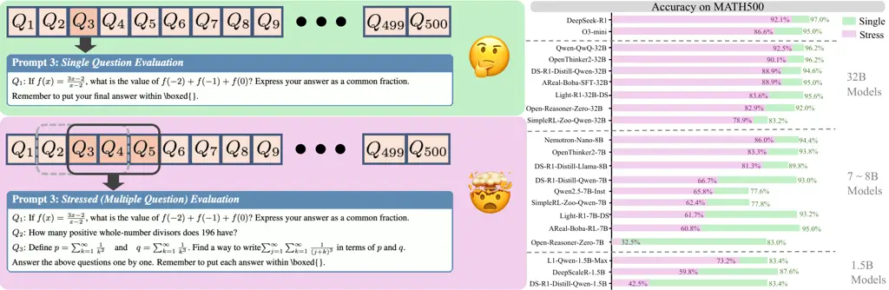

Figure 1: Illustration of REST evaluation compared with single-question
evaluation. REST concatenates multiple questions into a single prompt,
stress testing LRMs’ ability in handling increasing reasoning loads
within a single reasoning process.

## 1 Introduction

Recent years have witnessed significant advancements in the reasoning
capabilities of Large Reasoning Models (LRMs), which have demonstrated
impressive performance across a variety of reasoning tasks, including
mathematical problem solving \[57, 35, 42, 36\], code generation \[21,
39\], and complex concept understanding \[38\]. Researchers have
proposed various benchmarks \[7, 17, 38, 22, 25\] to evaluate the
reasoning capabilities of LRMs. However, the rapid advancement of LRMs
has exposed critical limitations in current evaluation paradigms. Most
benchmarks rely on single-question testing, where models process and
answer questions in isolation. While this approach is effective for
early model development, it now faces two fundamental challenges.

First, many benchmarks, such as GSM8K \[7\] and MATH \[17\], are
becoming less effective at distinguishing model performance, as current
LRMs have achieved nearly saturated performance on them (e.g.,
DeepSeek-R1 achieves 97.0% on MATH500), the community is forced into a
costly cycle of benchmark obsolescence - continuously developing new,
more difficult datasets (e.g., AIME24 \[59\]) while discarding
still-valuable existing ones. This raises our first key question: Can we
enhance the utility of current benchmarks by making them more
challenging without complete replacement?

Second, single-question evaluation fails to assess how models perform in
real-world, multi-context scenarios where reasoning must occur across
multiple, potentially interfering questions. For instance, in
educational tutoring systems, an AI might need to simultaneously address
a student’s follow-up questions while correcting previous
misconceptions; also, in technical support, it may process multiple
user-reported issues within a single context window. Though a few prior
studies \[6, 54, 44\] have investigated multi-question prompting, they
only focus on simple tasks such as text classification \[40\] or
commonsense QA \[46\], which are insufficient to assess the reasoning
capabilities of current LRMs. This leads to our second critical
question: How well can current LRMs handle multiple questions
simultaneously, and what factors affect their performance in such
settings?

To answer the aforementioned research questions, we propose REST
(Reasoning Evaluation through Simultaneous Testing), a simple yet
powerful method that repurposes existing benchmarks into more
challenging variants. Specifically, REST transforms existing benchmarks
by concatenating multiple questions into a single instruction to
evaluate these questions at once. Based on 7 representative reasoning
benchmarks (e.g., GSM8K, MATH500, and AMC23), we reconstruct them into a
multi-question format (see Fig. 1 for illustration). Through a
comprehensive evaluation under our REST of more than 30 state-of-the-art
(SOTA) LRMS, we have obtained some valuable findings.

- •
  Even SOTA LRMs like DeepSeek-R1 \[13\] exhibit significant performance
  degradation under REST, such as 29.1% accuracy drop on AIME24,
  revealing a critical limitation in their reasoning robustness,
  challenging that “LLMs are inherently multi-problem solvers” \[6, 54,
  44\].
- •
  Despite excelling in the single-question evaluation, several LRMs
  struggle to maintain their advantage under REST compared to their
  non-reasoning counterparts.
- •
  REST provides enhanced discriminative power. While many LRMs exhibit
  similar performance on single-question evaluations, they display
  notable differences in accuracy under REST.
- •
  Effectively revitalizes existing benchmarks, making them challenging
  again for top-tier models.

Through further analysis, we identify a key factor behind this
performance drop: the overthinking phenomenon \[45, 5, 53\], where LRMs
tend to generate unnecessarily redundant reasoning even for relatively
simple problems. Besides, LRMs trained with “Long2Short” training \[45,
1, 3\], which encourages concise reasoning, perform better in REST,
suggesting a promising direction for developing multi-question-capable
LRMs. These findings have immediate implications for both evaluation
practices and model development. REST offers a cost-effective, scalable
alternative to constant benchmark replacement, while providing insights
for building more robust reasoning systems capable of handling
real-world, multi-context scenarios.

## 2 Related Work

### 2.1 Compositional Instruction Training and Evaluation

Some recent works use multi-instruction or problem combinations for
training data augmentation \[26, 36, 24\]. MathFusion \[36\] fuses
semantically similar problem pairs to construct a more difficult one for
enhanced mathematical problem solving. Mosaic-IT \[24\] concatenates
randomly sampled instruction data with meta-instructions to reduce
training cost and improve performance. To evaluate the ability of LLMs
to follow compositional instructions simultaneously, several benchmarks
have been proposed. Batch prompting \[6\], multi-problem prompting
\[54\], and multi-task inference benchmark \[44\] investigate
concatenating multiple independent tasks, primarily for inference
efficiency on simple tasks like text classification. Compound-QA \[19\]
focuses on increasing complexity within a single instruction, requiring
models to follow multiple constraints, compositional directives, or
sequential steps. These methods, however, do not focus on the evaluation
of complex reasoning tasks.

### 2.2 Overthinking and Controlled Reasoning Length in LRMs

Excessive verbosity in the reasoning processes of LRMs can hinder their
inference efficiency. The phenomenon of “overthinking”, where models
generate excessively long and complex reasoning steps without
proportional gains in accuracy, has been identified \[45, 5\]. In
response, several “long2short” or controlled reasoning length methods
emerge. A prominent approach involves fine-tuning LRMs using
reinforcement learning (RL) with penalties for excessive token
generation \[1, 3, 29\], which effectively reduces the reasoning length
while preserving or improving accuracy. Other strategies to promote
conciseness include constrained prompting \[33\] and dynamic token
budget allocation \[14\]. Importantly, the validation of these
length-control techniques occur in single-problem evaluation settings.
Our REST provides a new dimension for assessing LRMs under multi-problem
scenarios.

### 2.3 Reasoning Benchmarks

The rigorous assessment of the reasoning ability of LLMs relies heavily
on specialized benchmarks. In mathematical reasoning, GSM8K \[8\] and
MATH \[16\] are most commonly used. As model capabilities surge, harder
benchmarks like OlympiadBench \[15\], AIME \[2, 27\], and Omni-Math
\[12\] have emerged, further pushing the boundaries of mathematical
evaluation. Beyond mathematics, reasoning in other domains like code
generation \[22, 37, 23\], cryptographic decryption \[25\], and
scientific problem-solving \[38\], is also critical. Despite the
increasing difficulty and diversity of these benchmarks, the rapid
improvement of models means that their differentiating power can
diminish when evaluated solely through standard single-instance problem
solving. Our REST builds on these existing benchmarks and repurposes
them into more challenge variants.

## 3 REST: Reasoning Evaluation through Simultaneous Testing

Despite the significant progress in large reasoning models (LRMs), many
existing benchmarks, such as MATH500 \[17\], have reached
near-saturation performance levels, limiting their utility in
distinguishing between the capabilities of increasingly powerful models.
Our introduced REST aims to address this limitation, which is a new
evaluation protocol designed to systematically increase the cognitive
load on LRMs by aggregating multiple questions into a single prompt.
This design enables a finer-grained assessment of a model’s ability to
handle multi-step, continuous reasoning under stress. Below are the
details of the benchmark reconstruction and evaluation under REST.

### 3.1 REST Benchmark Reconstruction

Let the original benchmark be denoted as
$`\mathcal{Q}=\{q_{1},q_{2},\dots q_{N}\}`$, where $`q_{i}`$ represents
an individual question and $`N`$ is the total number of questions. In
REST, we transform this benchmark into a new prompt set
$`\mathcal{P}^{s}`$ by concatenating $`s`$ consecutive questions into
each prompt. We refer to the parameter $`s\in\mathbb{Z}^{+}`$ as the
stress level, since a larger $`s`$ imposes a greater reasoning burden on
the model. Formally, for each $`i\in\{1,2,\dots,N\}`$, we define the
stress-level-$`s`$ prompt $`p_{i}^{s}`$ as:

```math
p_{i}^{s}=\texttt{Compose}(q_{i},q_{i+1},\dots,q_{[(i+s-1)\bmod N]}),\quad i\in\{1,2,\dots,N\}.
```

To ensure continuity and full coverage, we apply cyclic indexing when
the end of the benchmark is reached. The function $`\texttt{Compose}()`$
formats multiple questions into a single prompt:

```math
\texttt{Compose}(q_{1},\dots,q_{s})=``Q1:\{q_{1}\},\dots,Qs:\{q_{s}\}.\text{ Answer the above questions one by one.''}
```

This transformation yields a new prompt set
$`\mathcal{P}^{s}=\{p_{1}^{s},p_{2}^{s},...,p_{N}^{s}\}`$, where each
prompt contains $`s`$ questions. Importantly, $`\|P^{s}\|=N`$, matching
the size of the original benchmark. However, unlike the original
benchmark, every prompt $`p_{i}^{s}`$ in $`\mathcal{P}^{s}`$ comprises
$`s`$ consecutive questions, spanning from $`q_{i}`$ to
$`q_{[(i+s-1)\bmod N]}`$ rather than just a single question $`q_{i}`$.
Moreover, each original question $`q_{i}`$ appears exactly $`s`$ times
across all the prompts and exactly once in each of the $`s`$ possible
positions within the concatenated prompts. This design mitigates
positional biases and ensures comprehensive coverage across stress
levels.

### 3.2 REST Evaluation

Under REST, given a LRM model $`f`$, we evaluate it on each prompt
$`p_{i}^{s}`$ to obtain an output response $`o_{i}^{s}=f(p_{i}^{s})`$.
From this response, we extract the individual predicted answers
$`\{\hat{a}_{i}^{s},\hat{a}_{i+1}^{s},\dots,\hat{a}_{[(i+s-1)\bmod N]}^{s}\}`$
using a function $`\texttt{Extract}()`$:

```math
\{\hat{a}_{i}^{s},\hat{a}_{i+1}^{s},\dots,\hat{a}_{[(i+s-1)\bmod N]}^{s}\}=\texttt{Extract}(o_{i}^{s}).
```

To facilitate accurate extraction, we instruct LRMs to format their
answers in task-specific ways. For Mathematical and GPQA problems, we
instruct the model to put each answer within “\boxed{}”, while for code
generation tasks, answers must be wrapped in Python code blocks
“\`\`\`python \`\`\`”. Notably, although a more structured format method
like JSON output could offer convenience for output parsing, we
deliberately avoid imposing such strict formatting constraints, as prior
studies \[47, 43\] indicate that such requirements will degrade
performance. We employ both rule-based and LLM-based extraction methods:
(a) The rule-based method uses regular expressions to extract answers
from predefined markers (e.g., “\boxed{}”); (b) The LLM-based method
prompts a model to retrieve the predicted answer from the response for
each question. Further implementation details can be found in Appendix 9. Finally, we define the model’s accuracy at stress level $`s`$ by
comparing the predicted answer $`\hat{a}`$ and the ground truth answer
$`a`$:

```math
\textit{Acc}(\mathcal{P}^{s})=\frac{1}{N}\sum_{i=1}^{N}\textit{Acc}(p_{i}^{s})=\frac{1}{N}\sum_{i=1}^{N}\frac{1}{s}\sum_{j=1}^{s}\delta(\hat{a}_{[(i+j-1)\bmod N]}^{s},a_{[(i+j-1)\bmod N]}^{s}),
```

where $`\delta`$ is the Kronecker delta function such that
$`\delta(i,j)=1`$ if and only if $`i=j`$ and 0 otherwise.

## 4 Experiment

### 4.1 Evaluation Setup

We evaluate a total of 34 LRMs, spanning a parameter size range from
1.5B to 671B. The temperature and top_p parameters are configured
according to the corresponding official guidelines for each model. We
set a maximum output token length of 32K for reasoning models and 8K for
non-reasoning models. In addition, we conduct experiments with an
extended 128K token limit, but observe negligible performance
differences, as shown in Tab. 5 of Appendix 10. Our evaluation is based
on OpenCompass^(\*)^(\*) \*
[https://github.com/open-compass/opencompass](https://github.com/open-compass/opencompass)
toolkit. To ensure consistency, we adopt the official prompt for each
task, with a minor format adjustment for multi-question responses:
“Answer the above questions one by one. Remember to put each answer
within \boxed{} (or \`\`\`python \`\`\` for code generation).”

We select $`7`$ representative benchmarks for evaluation, and in REST,
we set different stress levels $`s`$ for each benchmark. Specifically,
for relatively simple benchmarks like GSM8K, the stress levels are
$`s\in\{1,3,6,9,12\}`$; for medium-difficulty benchmarks, including
MATH500 and AMC23, they are set as $`s\in\{1,3,5,7,9\}`$; and for more
challenging benchmarks, such as AIME24, AIME25, GPQA, and LiveCodeBench
(v5), the stress levels are $`s\in\{1,2,3,4,5\}`$. To ensure clarity and
consistency in evaluation, we report the performance of REST as the
average accuracy across stress levels greater than 1. Detailed accuracy
statistics for each stress level are provided in Appendix 7. For
relatively small benchmarks like AIME24, AIME25, and AMC23, we conduct 8
sampling runs and report the average results to reduce variance.

### 4.2 Evaluation Result

|                                                          |        |        |         |        |        |        |        |        |        |        |        |        |
| -------------------------------------------------------- | ------ | ------ | ------- | ------ | ------ | ------ | ------ | ------ | ------ | ------ | ------ | ------ |
|  | GSM8K  |        | MATH500 |        | AMC23  |        | AIME24 |        | AIME25 |        | Avg.   |        |
|                                                          | Single | Stress | Single  | Stress | Single | Stress | Single | Stress | Single | Stress | Single | Stress |
| 1.5B LRMs                                                |        |        |         |        |        |        |        |        |        |        |        |        |
| DS-R1-Distill-Qwen-1.5B \[13\]                           | 84.62  | 70.21  | 83.40   | 42.47  | 62.50  | 13.98  | 29.17  | 4.97   | 25.00  | 5.91   | 56.94  | 27.51  |
| DeepScaleR-1.5B \[30\]                                   | 84.84  | 66.58  | 87.60   | 59.77  | 76.25  | 32.05  | 38.75  | 12.82  | 31.25  | 14.23  | 63.74  | 37.09  |
| L1-Qwen-1.5B-Exact \[1\]                                 | 84.87  | 79.01  | 84.00   | 72.07  | 71.25  | 47.37  | 21.25  | 12.62  | 18.33  | 12.96  | 55.94  | 44.81  |
| L1-Qwen-1.5B-Max \[1\]                                   | 84.17  | 78.29  | 83.40   | 73.23  | 77.50  | 48.37  | 20.00  | 15.13  | 22.92  | 14.95  | 57.60  | 45.99  |
| Qwen2.5-Math-1.5B-Inst \[58\]                            | 85.37  | 67.49  | 73.00   | 53.94  | 57.50  | 22.22  | 10.83  | 6.17   | 10.83  | 2.83   | 47.51  | 30.53  |
| $`7\sim 8`$B LRMs                                        |        |        |         |        |        |        |        |        |        |        |        |        |
| DS-R1-Distill-Qwen-7B \[13\]                             | 89.49  | 89.06  | 93.00   | 66.75  | 87.50  | 36.06  | 54.17  | 16.53  | 35.42  | 11.37  | 71.92  | 43.95  |
| DS-R1-Distill-LLaMA-8B \[13\]                            | 90.45  | 85.18  | 89.80   | 81.34  | 87.50  | 70.75  | 50.42  | 31.23  | 28.33  | 22.66  | 69.30  | 58.23  |
| Efficient-R1-7B ($`\alpha=0.1`$) \[3\]                   | 88.63  | 84.76  | 90.00   | 74.99  | 87.50  | 44.25  | 54.58  | 21.45  | 35.42  | 15.75  | 71.23  | 48.24  |
| Efficient-R1-7B ($`\alpha=0.2`$) \[3\]                   | 87.95  | 80.38  | 88.20   | 76.41  | 85.00  | 48.05  | 50.42  | 22.12  | 33.75  | 17.25  | 69.06  | 48.84  |
| Nemotron-Nano-8B \[4\]                                   | 91.36  | 70.52  | 94.40   | 86.04  | 90.00  | 76.24  | 63.33  | 43.55  | 50.00  | 32.28  | 77.82  | 61.71  |
| AReaL-boba-RL-7B \[31\]                                  | 91.66  | 77.80  | 95.00   | 60.77  | 91.25  | 32.94  | 61.25  | 21.43  | 45.83  | 12.33  | 77.00  | 41.05  |
| Light-R1-7B-DS \[55\]                                    | 88.05  | 82.69  | 93.20   | 61.73  | 90.00  | 34.91  | 55.83  | 16.63  | 45.83  | 12.96  | 74.58  | 41.78  |
| OpenR1-Qwen-7B \[10\]                                    | 95.60  | 90.22  | 92.20   | 81.64  | 83.75  | 54.11  | 47.50  | 26.77  | 32.92  | 21.19  | 70.39  | 54.79  |
| OpenThinker2-7B \[51\]                                   | 94.39  | 91.99  | 93.80   | 83.30  | 85.00  | 63.23  | 54.58  | 34.50  | 41.67  | 23.66  | 73.89  | 59.33  |
| SimpleRL-Zoo-Qwen-7B \[62\]                              | 90.52  | 84.01  | 77.80   | 62.41  | 68.50  | 16.16  | 26.67  | 7.55   | 10.00  | 6.47   | 54.70  | 35.32  |
| Open-Reasoner-Zero-7B \[20\]                             | 92.87  | 65.14  | 83.00   | 32.51  | 60.00  | 31.23  | 17.92  | 6.13   | 16.25  | 3.89   | 54.01  | 27.78  |
| Marco-O1-7B \[63\]                                       | 89.08  | 79.56  | 72.40   | 48.19  | 47.50  | 17.23  | 10.00  | 4.35   | 10.83  | 3.64   | 45.96  | 30.59  |
| MathFusion-Qwen-7B \[36\]                                | 89.46  | 83.78  | 74.00   | 68.15  | 52.50  | 36.24  | 9.58   | 7.89   | 5.83   | 2.35   | 46.27  | 39.68  |
| Eurus-2-7B-PRIME \[9\]                                   | 92.72  | 88.01  | 81.40   | 64.69  | 62.50  | 38.58  | 20.83  | 10.84  | 14.58  | 4.49   | 54.41  | 41.32  |
| Qwen2.5-Math-7B-Inst \[57\]                              | 95.53  | 78.53  | 83.60   | 56.59  | 60.00  | 28.46  | 14.17  | 6.40   | 11.67  | 5.33   | 52.99  | 35.06  |
| Qwen2.5-7B-Inst \[56\]                                   | 92.27  | 85.12  | 77.60   | 65.78  | 42.50  | 34.46  | 10.00  | 7.02   | 3.75   | 3.32   | 45.22  | 39.14  |
| 32B LRMs                                                 |        |        |         |        |        |        |        |        |        |        |        |        |
| DS-R1-Distill-Qwen-32B \[13\]                            | 95.54  | 95.50  | 94.60   | 88.97  | 94.75  | 86.24  | 72.92  | 52.51  | 51.67  | 33.83  | 81.90  | 71.41  |
| Qwen-QwQ-32B \[52\]                                      | 95.83  | 95.78  | 96.20   | 92.49  | 95.00  | 82.89  | 78.75  | 54.79  | 69.58  | 41.53  | 87.07  | 73.49  |
| AReaL-boba-SFT-32B \[31\]                                | 95.01  | 94.75  | 95.00   | 88.92  | 97.50  | 78.96  | 77.50  | 45.79  | 60.00  | 33.55  | 85.00  | 68.39  |
| Light-R1-32B-DS \[55\]                                   | 95.83  | 94.79  | 95.60   | 83.66  | 96.25  | 68.80  | 77.50  | 41.26  | 60.00  | 33.80  | 85.04  | 64.46  |
| S1.1-32B \[32\]                                          | 89.84  | 61.10  | 90.40   | 53.85  | 90.00  | 32.26  | 55.83  | 24.42  | 45.42  | 19.13  | 74.30  | 38.15  |
| OpenThinker2-32B \[51\]                                  | 96.44  | 95.17  | 96.20   | 90.10  | 95.00  | 81.00  | 68.33  | 53.01  | 52.50  | 38.20  | 81.69  | 71.49  |
| SimpleRL-Zoo-Qwen-32B \[62\]                             | 96.06  | 93.49  | 83.20   | 78.90  | 67.50  | 57.02  | 27.20  | 16.80  | 16.67  | 8.87   | 58.13  | 51.01  |
| Open-Reasoner-Zero-32B \[20\]                            | 95.83  | 91.80  | 92.00   | 82.90  | 83.75  | 70.04  | 46.67  | 31.65  | 36.67  | 23.63  | 70.98  | 60.00  |
| Qwen2.5-32B-Inst \[56\]                                  | 95.53  | 93.77  | 82.20   | 73.39  | 60.00  | 49.72  | 20.00  | 9.61   | 16.67  | 6.73   | 54.88  | 46.64  |
| API-based LRMs                                           |        |        |         |        |        |        |        |        |        |        |        |        |
| DeepSeek-R1 \[13\]                                       | 96.20  | 96.16  | 97.00   | 92.09  | 93.75  | 81.80  | 81.66  | 52.49  | 68.75  | 37.17  | 87.47  | 71.94  |
| O3-mini \[34\]                                           | 95.83  | 93.85  | 95.00   | 86.62  | 90.00  | 59.17  | 79.16  | 34.07  | 71.66  | 20.63  | 86.25  | 55.51  |
| O4-mini \[34\]                                           | 93.71  | 93.07  | 90.00   | 82.40  | 96.25  | 82.79  | 73.33  | 49.69  | 80.00  | 41.42  | 86.66  | 69.87  |
| Gemini-2.5-Flash-Thinking \[48\]                         | 89.23  | 91.28  | 97.20   | 69.92  | 97.50  | 47.63  | 76.67  | 26.60  | 71.67  | 16.54  | 86.45  | 50.39  |

Table 1: Evaluation results on various math benchmarks. The “Stress”
column reports the average performance across four stress levels, as
described in Sec. 4.1. Accuracy on other tasks are in Tab. 2. Detailed
accuracy statistics for each stress level can be found in Tab. 6 of the
Appendix. Models that perform best under “Stress” are highlighted in
gray.

Tab. 1 and Tab. 2 present the performance of various LRMs on the
original reasoning benchmarks (Single) and their transformed
counterparts by REST (Stress). Our key findings from the experimental
results can be summarized as follows:

#### LRMs can handle multiple simple questions at once, but struggle with challenging ones.

LRMs can address several relatively simple problems within a single
reasoning process. As shown in Tab. 1, on GSM8K, the accuracy drops
under REST for DeepSeek-R1-Distill-Qwen-7B (R1-7B) and
DeepSeek-R1-Distill-Qwen-32B (R1-32B) are just 0.43% and 0.04%,
respectively. However, this robustness diminishes significantly when the
models face more challenging problems. In Tab. 1 and Tab. 2, even SOTA
LRMs (e.g., DeepSeek-R1) encounter substantial difficulties when tasked
with multiple Olympiad-level competition problems within a single
reasoning process. For instance, under REST, the accuracy of DeepSeek-R1
on AIME24 and AIME25 decreases by 29.17% and 31.58%, respectively,
compared to the single-question setting. This performance gap is even
more pronounced for smaller models, such as R1-7B, whose accuracy on
AIME24 drops sharply from 54.17% to 16.53% under REST. Moreover, despite
strong performance in the single-question setting, several LRMs fail to
maintain their advantage under REST compared to their non-reasoning
counterparts. For example, DeepSeek-R1-Distill-Qwen-1.5B achieves an
accuracy of 83.40% on MATH500 in the single-question evaluation,
surpassing the 73.00% of the Qwen2.5-Math-1.5B-Instruct model. However,
under REST, its accuracy drops sharply to 42.47%, falling significantly
behind Qwen2.5-Math-1.5B-Instruct, which achieves 53.94%.

(a) GSM8K

(b) MATH500

(c) AMC23

Figure 2: Performance comparison of LRMs of different sizes under
various stress levels. REST reveals significant performance disparities
among models of different sizes, although they demonstrate comparable,
near-ceiling performance in traditional single-question evaluations.

(a) 1.5B Model on GSM8K

(b) 7B Model on MATH500

(c) 32B Model on AMC23

Figure 3: Limitation of post training on REST. Post training exacerbates
performance degradation under higher stress levels compared to the
original DeepSeek distilled models.

#### REST enhances the discriminative power of existing benchmarks.

By concatenating multiple problems into a single prompt, REST
significantly amplifies performance differences among models that
exhibit comparable, near-ceiling accuracy in traditional single-question
evaluations. For example, on MATH500, R1-7B and R1-32B achieve
single-question accuracies of 93.0% and 94.6%, respectively, with R1-7B
trailing by just 1.6%. However, when evaluated under REST, the accuracy
of R1-7B plummets to 66.75%, while R1-32B maintains a substantially
higher 88.97%, revealing a pronounced 22.22% performance gap. This
contrast is similarly evident among models of the same size. For
instance, AReaL-boba-RL-7B and OpenThinker2-7B achieve similar,
near-ceiling single-question accuracies of 95.0% and 93.8% on MATH500,
respectively. Yet, under REST, the accuracy of AReaL-boba-RL-7B drops
sharply to 60.77%, while OpenThinker2-7B preserves a significantly
higher 83.30% accuracy. Similar trends are observed on AMC23, validating
that REST can enhance the discriminative power of existing
medium-difficulty benchmarks through problem concatenation.

#### Limitations of post training.

The recent success of DeepSeek-R1 \[13\] has inspired numerous follow-up
studies \[30, 31, 55, 10, 20, 62\], some of which have adopted post RL
training with verifiable rewards (RLVR) \[30, 31\] or supervised
fune-tuning (SFT) \[55\] based on DeepSeek-distilled models. Although
such post training often yields improved single-question accuracy, our
findings suggest that they can not maintain their performance advantage
on more challenging, multi-question scenarios as in REST. For instance,
models like AReaL-boba-RL-7B and Light-R1-7B-DS, both post-trained on
DeepSeek-R1-Distill-Qwen-7B, achieve single-question accuracies of
95.00% and 93.20% on MATH500, slightly higher than the 93.00% accuracy
of R1-7B. However, under REST, their accuracies drop significantly to
60.77% and 61.73%, respectively, both falling behind the 66.75% achieved
by R1-7B. This discrepancy becomes even more pronounced at higher stress
levels. As detailed in Fig. 3(b) and Tab. 7 (in Appendix), at stress
level $`s=9`$, the accuracies of AReaL-boba-RL-7B and Light-R1-7B-DS
decline sharply to 38.07% and 39.11%, respectively, more than 10.00%
below the 49.42% achieved by R1-7B. This performance degradation is not
limited to smaller models but also extends to larger ones, such as
Light-R1-32B-DS and R1-32B, and is consistently observed across other
benchmarks like AMC23. These findings reinforce recent calls \[11, 61,
41, 18\] for a more cautious assessment of the benefits of post RL
training in enhancing reasoning capabilities.

(a) 1.5B Model on MATH500

(b) 7B Model on MATH500

(c) 7B Model on AMC23

Figure 4: The effect of Long2Short training on REST. Long2Short training
mitigates the performance degradation under higher stress levels.

#### Potential of Long2Short Training.

Despite their impressive performance on reasoning tasks, LRMs often
struggle with excessively verbose reasoning processes \[45, 5, 53\]. To
address this issue, recent studies \[1, 3, 50\] propose the Long2Short
technique, which introduces a length reward in the training objective to
promote more concise and efficient reasoning. Our experiments
demonstrate that Long2Short training significantly enhances reasoning
robustness under REST. As illustrated in Fig. 4,

|                                                          |              |        |               |        |
| -------------------------------------------------------- | ------------ | ------ | ------------- | ------ |
|  | GQPA Diamond |        | LiveCodeBench |        |
|                                                          | Single       | Stress | Single        | Stress |
| 1.5B LRMs                                                |              |        |               |        |
| DS-R1-Distill-Qwen-1.5B \[13\]                           | 37.37        | 22.11  | 15.05         | 0.48   |
| DeepScaleR-1.5B \[30\]                                   | 31.82        | 27.90  | 21.15         | 1.83   |
| L1-Qwen-1.5B-Exact \[1\]                                 | 33.84        | 31.01  | 18.28         | 2.70   |
| L1-Qwen-1.5B-Max \[1\]                                   | 36.87        | 32.03  | 19.35         | 2.45   |
| Qwen2.5-1.5B-Inst \[56\]                                 | 26.26        | 21.52  | 1.79          | 0.37   |
| $`7\sim 8`$B LRMs                                        |              |        |               |        |
| DS-R1-Distill-Qwen-7B \[13\]                             | 51.01        | 31.67  | 37.63         | 2.89   |
| DS-R1-Distill-LLaMA-8B \[13\]                            | 50.00        | 33.99  | 39.43         | 11.25  |
| Efficient-R1-7B ($`\alpha=0.2`$) \[3\]                   | 47.97        | 34.37  | 38.71         | 2.50   |
| Nemotron-Nano-8B \[4\]                                   | 51.01        | 34.06  | 50.90         | 8.56   |
| AReaL-boba-RL-7B \[31\]                                  | 48.98        | 29.13  | 37.99         | 4.73   |
| Light-R1-7B-DS \[55\]                                    | 41.91        | 30.32  | 39.07         | 2.85   |
| OpenR1-Qwen-7B \[10\]                                    | 38.38        | 36.04  | 4.66          | 1.27   |
| OpenThinker2-7B \[51\]                                   | 49.49        | 40.60  | 39.43         | 14.51  |
| SimpleRL-Zoo-Qwen-7B \[62\]                              | 33.84        | 35.49  | 5.73          | 0.16   |
| Open-Reasoner-Zero-7B \[20\]                             | 37.37        | 34.25  | 16.13         | 0.64   |
| Marco-O1-7B \[63\]                                       | 30.81        | 28.32  | 9.32          | 7.24   |
| Qwen2.5-7B-Inst \[56\]                                   | 35.86        | 35.15  | 13.98         | 10.19  |
| 32B LRMs                                                 |              |        |               |        |
| DS-R1-Distill-Qwen-32B \[13\]                            | 60.10        | 53.73  | 55.56         | 26.71  |
| Qwen-QwQ-32B \[52\]                                      | 63.64        | 60.03  | 62.37         | 32.16  |
| AReaL-boba-SFT-32B \[31\]                                | 63.13        | 50.59  | 60.93         | 31.74  |
| Light-R1-32B-DS \[55\]                                   | 65.66        | 50.11  | 60.93         | 28.22  |
| S1.1-32B \[32\]                                          | 61.62        | 54.54  | 25.45         | 24.46  |
| OpenThinker2-32B \[51\]                                  | 62.12        | 57.79  | 56.27         | 37.53  |
| SimpleRL-Zoo-Qwen-32B \[62\]                             | 46.46        | 46.21  | 26.52         | 23.95  |
| Open-Reasoner-Zero-32B \[20\]                            | 60.10        | 49.57  | 35.13         | 13.01  |
| Qwen2.5-32B-Inst \[56\]                                  | 42.93        | 40.04  | 26.88         | 24.00  |
| API-Based LRMs                                           |              |        |               |        |
| DeepSeek-R1 \[13\]                                       | 70.20        | 64.63  | 63.44         | 40.83  |
| O3-mini \[34\]                                           | 71.21        | 67.39  | 60.21         | 48.36  |
| O4-mini \[34\]                                           | 76.26        | 73.11  | 70.61         | 63.07  |
| Gemini-2.5-Flash-Thinking \[48\]                         | 78.79        | 68.00  | 61.65         | 48.34  |

Table 2: Evaluation results on GPQA Diamond and LiveCodeBench. The
“Stress” column reports the average performance across four distinct
stress levels, as described in Sec. 4.1. Detailed accuracies for each
stress level are in Tab. 6 of the Appendix. Models perform best under
“Stress” are highlighted in gray.

models trained with Long2Short, such as L1-Qwen-1.5B-Exact and
L1-Qwen-1.5B-Max \[1\], exhibit notable performance advantages at high
stress levels. For instance, as shown in Tab. 6 of appendix,
L1-Qwen-1.5B-Max surpasses R1-1.5B by a substantial 44.71% accuracy
margin at stress level $`s=9`$ on MATH500. A similar trend is observed
among 7B models. For example, the Efficient-R1-7B ($`\alpha=0.2`$) model
\[3\], despite having a lower single-question accuracy (88.20%) compared
to R1-7B (93.00%), achieves 66.02% accuracy at stress level $`s=9`$,
outperforming the R1-7B’s 49.42% by a significant 16.60% accuracy
margin.

## 5 Further Analysis

### 5.1 Error Analysis

#### Maximum output length overflow is not the only cause of performance degradation.

To uncover the underlying reasons for LRMs’ failures in REST, we analyze
the primary factors contributing to performance degradation under stress
conditions. A straightforward hypothesis is that performance drops
primarily due to models exceeding their maximum output length when
handling multiple problems. However, our findings indicate that this is
not the sole cause—models frequently fail even when their responses
remain well within the maximum output token limit.

To investigate the cause of errors, we categorize the observed mistakes
into six distinct types, as summarized in Tab. 3. A detailed
distribution of these error types for four representative LRMs on the
AIME24 benchmark is illustrated in Fig. 5. The analysis reveals that
Question Omission (QO) and Reasoning Error (RE) are the dominant error
types for DeepSeek-R1 (in subfigure 5(d)), collectively accounting for a
substantial 42.00% of the performance degradation under stress test. The
high frequency of Question Omission (QO) suggests that DeepSeek-R1
suffers from a pronounced question position bias, often focusing
disproportionately on the first question in multi-problem prompts,
despite explicit instructions to address each question sequentially. In
contrast, error causes like Summary Error (SE), Output Truncation (OT),
and Endless Repetition (ER) are rare in such high-capacity models.

|                         |                                                                                                                        |
| ----------------------- | ---------------------------------------------------------------------------------------------------------------------- |
| Error Cause             | Definition                                                                                                             |
| Output Truncation (OT)  | The output is trucated due to reaching the maximum output length (32K tokens for LRMs).                                |
| Endless Repetition (ER) | The model repeatedly generates the same phrase or sentence in its output.                                              |
| Format Violation (FV)   | The model fails to comply with the required output format (e.g., not putting the answer whtin “\boxed{}”).             |
| Question Omission (QO)  | The model fails to respond to all the given questions in the thinking process. (e.g., only answers the first question) |
| Summary Error (SE)      | The model fails to summarize all the answers generated in the thinking process.                                        |
| Reasoning Error (RE)    | Error occurs in the reasoning process, such as calculation mistakes or concept misunderstandings.                      |

Table 3: Six common cause of the performance degradation in REST.

However, for smaller models like Light-R1-7B (in subfigure 5(b)), the
error profile shifts significantly, with Endless Repetition (ER) and
Output Truncation (OT) becoming more prominent, collectively accounting
for 48.90%. This shift underscores smaller models’ unique challenges,
whose limited capacity significantly exacerbates performance degradation
under the stress imposed by REST. Finally, it is important to note that
no Format Violation (FV) errors were found for any of the four models,
which is why they are not included in Fig. 5. This observation supports
the robustness of our prompt design and answer extraction strategy,
confirming that the observed performance degradation arises primarily
from the intrinsic limitations of the LRMs themselves, rather than
artifacts introduced by the evaluation process.

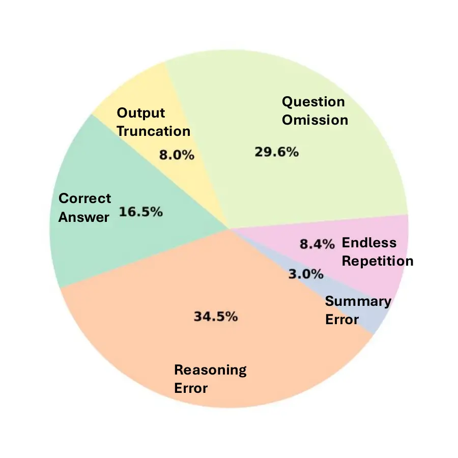

(a) R1-7B \[13\]

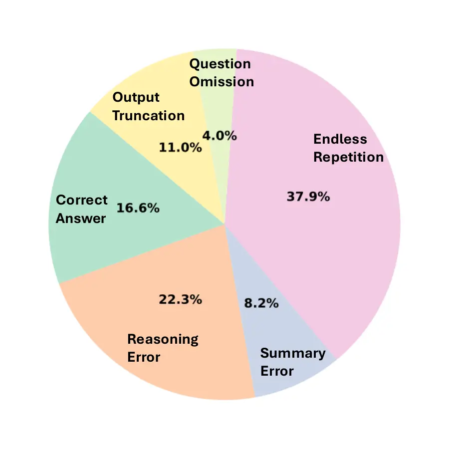

(b) Light-R1-7B \[55\]

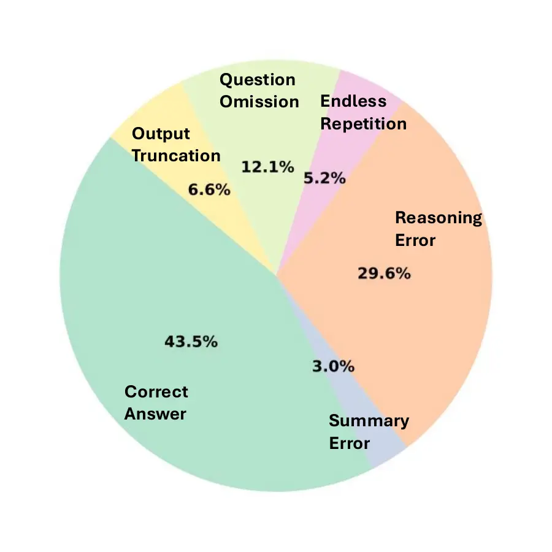

(c) Nemotron-7B \[4\]

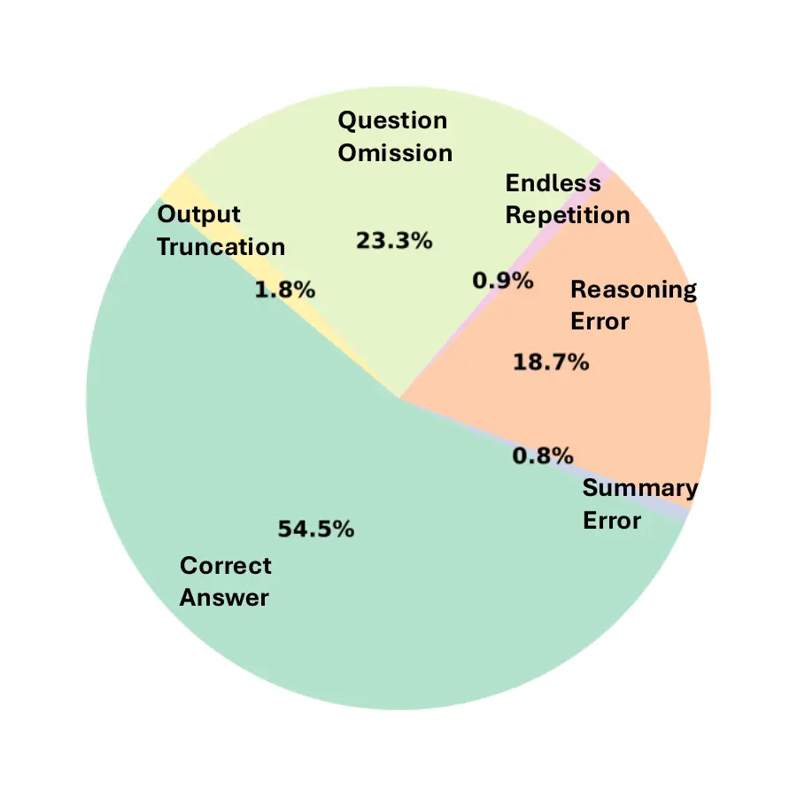

(d) DeepSeek-R1 \[13\]

Figure 5: The error type distribution for various LRMs on AIME24 under
REST.

(a) DS-R1-Distill-Qwen-7B \[13\]

(b) Nemotron-nano-7B \[4\]

(c) DeepSeek-R1 \[13\]

Figure 6: The reasoning token count for questions at different positions
on AIME24.

#### LRMs that perform better on REST exhibit concise reasoning for earlier questions.

In this paragraph, we investigate why certain models exhibit substantial
performance differences under REST, despite achieving similar results on
traditional single-question benchmarks. To analyze this, on AIME24, we
manually split the entire response into chunks corresponding to each
question and calculate the reasoning token count for each chunk. The
results are presented in Fig. 6. It is evident that high-performing
models under REST (e.g., Nemotron-nano-7B and DeepSeek-R1) tend to use
fewer reasoning tokens for the first question when the stress level
exceeds 1. In contrast, models with lower REST performance, such as
R1-7B, often overthink the first question, consuming a substantial
portion of their reasoning tokens and leaving insufficient space for
subsequent questions. This observation reveals that LRMs with superior
performance in REST tend to employ more concise reasoning for earlier
questions under stress, leaving sufficient space to address subsequent
questions. We refer to this ability as “adaptive reasoning effort
allocation,” which we believe is a critical factor for achieving robust
performance under REST.

### 5.2 The Impact of Question Position and Question Order

#### Question position affects performance under stress test.

Recent studies \[60, 28\] have identified positional biases of LLMs over
long inputs. In this paragraph, we investigate whether the position of
questions within the input can influence response accuracy. Fig. 7
presents a heatmap illustrating the accuracy for questions placed at
different positions. The results indicate that questions appearing
earlier consistently achieve higher accuracy, even under the highest
stress levels, while the accuracy for later questions tends to decline
as the stress level increases. This observation contrasts with earlier
findings \[54\], which suggest that question position has a negligible
effect on performance because previous analyses primarily focused on
simpler text classification tasks. In contrast, complex reasoning tasks
exhibit a stronger positional dependence. We attribute this
position-dependent performance degradation to three primary factors.
First, our error analysis reveals that Question Omission (QO) is a
prevalent failure mode, even for SOTA LRMs like DeepSeek-R1, leading to
high accuracy for the first question but significantly lower accuracy
for the later ones. Second, the extensive reasoning required for earlier
questions can introduce substantial noise, potentially disrupting the
logical processing needed for subsequent responses. Finally, as shown in
Fig. 6, answering earlier questions may consume a considerable portion
of the output tokens, reducing the model’s available reasoning tokens
for later questions.

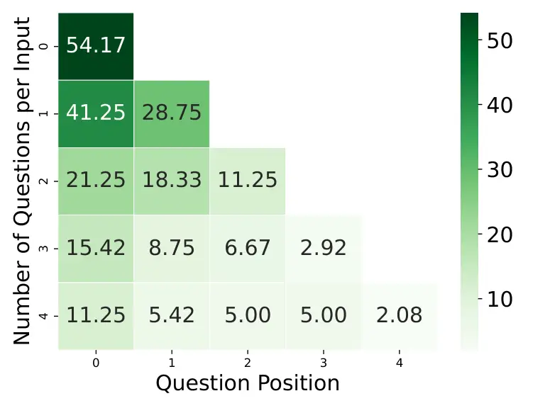

(a) 7B on AIME24

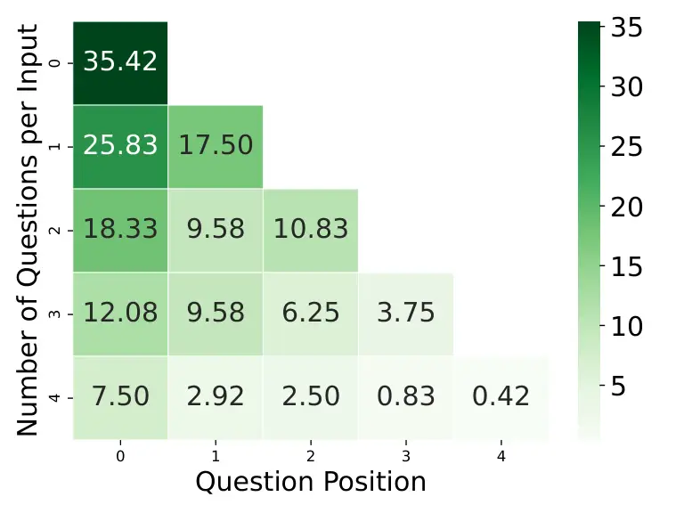

(b) 7B on AIME25

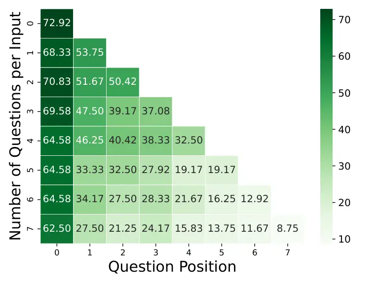

(c) 32B on AIME24

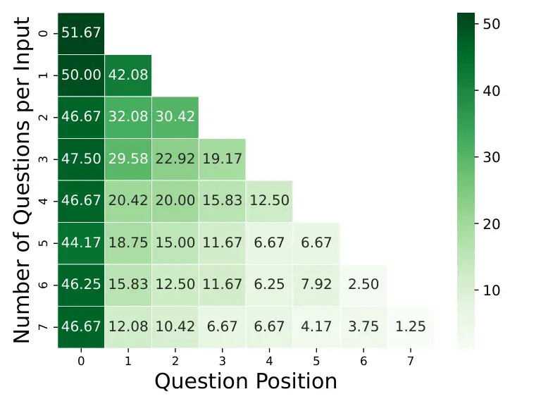

(d) 32B on AIME25

Figure 7: The effect of question position under stress tests. The
performance at each position is calculated by averaging the accuracy of
questions appearing at the same position across the full benchmark. LRMs
generally achieve higher accuracy for earlier questions, while their
performance declines for subsequent ones.

#### Question order affects performance under stress test.

Building on the observation that question position impacts performance,
we further investigate the effect of question order within each prompt
on overall benchmark accuracy. Specifically, we assess this by arranging
the questions within each instruction in either descending (hard-first)
or ascending (easy-last) order of difficulty, using the fail rate of
R1-7B as a proxy for difficulty for problems in AIME24 and AIME25. As
shown in Fig. 8, presenting questions from easy to hard consistently
yields better overall accuracy compared to the reverse order. This
discrepancy can be attributed to the tendency of LRMs to engage in
lengthy and redundant reasoning processes when confronted with difficult
questions early in the input. In contrast, placing simpler questions
first encourages more concise and straightforward reasoning chains,
thereby minimizing the cognitive load and reducing the interference with
subsequent questions.

(a) MATH500

(b) AIME24

(c) AIME25

Figure 8: The effect of question order on overall performance under
stress tests. LRMs consistently perform worse when problems are arranged
from hard to easy.

## 6 Conclusion

In conclusion, we present REST, a stress testing framework designed to
evaluate Large Reasoning Models (LRMs) in simultaneous multi-problem
solving scenarios. REST significantly enhances the discriminative power
of existing benchmarks that often suffer from performance saturation,
revealing substantial performance differences among models that appear
comparable in traditional single-question evaluations. Notably, even
SOTA models like DeepSeek-R1 exhibit marked performance degradation
under stress testing, challenging the common assumption that “LLMs are
multi-problem solvers.” Additionally, REST uncovers a few reasoning
misbehaviors, such as question omission and summary error, which remain
obscure in single-question assessments. Critical findings, such as the
identification of question position bias and the demonstrated
effectiveness of long2short training, offer valuable insights for the
future development of more robust and capable LRMs.

## References

- \[1\] Pranjal Aggarwal and Sean Welleck. L1: Controlling how long a
  reasoning model thinks with reinforcement learning. _arXiv preprint
  arXiv:2503.04697_, 2025.
- \[2\] AI-MO. AIMO Validation AIME Dataset.
- \[3\] Daman Arora and Andrea Zanette. Training language models to
  reason efficiently. _arXiv preprint arXiv:2502.04463_, 2025.
- \[4\] Akhiad Bercovich, Itay Levy, Izik Golan, Mohammad Dabbah, Ran
  El-Yaniv, Omri Puny, Ido Galil, Zach Moshe, Tomer Ronen, Najeeb
  Nabwani, Ido Shahaf, Oren Tropp, Ehud Karpas, Ran Zilberstein, Jiaqi
  Zeng, Soumye Singhal, Alexander Bukharin, Yian Zhang, Tugrul Konuk,
  Gerald Shen, Ameya Sunil Mahabaleshwarkar, Bilal Kartal, Yoshi Suhara,
  Olivier Delalleau, Zijia Chen, Zhilin Wang, David Mosallanezhad, Adi
  Renduchintala, Haifeng Qian, Dima Rekesh, Fei Jia, Somshubra Majumdar,
  Vahid Noroozi, Wasi Uddin Ahmad, Sean Narenthiran, Aleksander Ficek,
  Mehrzad Samadi, Jocelyn Huang, Siddhartha Jain, Igor Gitman, Ivan
  Moshkov, Wei Du, Shubham Toshniwal, George Armstrong, Branislav
  Kisacanin, Matvei Novikov, Daria Gitman, Evelina Bakhturina, Jane
  Polak Scowcroft, John Kamalu, Dan Su, Kezhi Kong, Markus Kliegl,
  Rabeeh Karimi, Ying Lin, Sanjeev Satheesh, Jupinder Parmar, Pritam
  Gundecha, Brandon Norick, Joseph Jennings, Shrimai Prabhumoye, Syeda
  Nahida Akter, Mostofa Patwary, Abhinav Khattar, Deepak Narayanan,
  Roger Waleffe, Jimmy Zhang, Bor-Yiing Su, Guyue Huang, Terry Kong,
  Parth Chadha, Sahil Jain, Christine Harvey, Elad Segal, Jining Huang,
  Sergey Kashirsky, Robert McQueen, Izzy Putterman, George Lam, Arun
  Venkatesan, Sherry Wu, Vinh Nguyen, Manoj Kilaru, Andrew Wang, Anna
  Warno, Abhilash Somasamudramath, Sandip Bhaskar, Maka Dong, Nave
  Assaf, Shahar Mor, Omer Ullman Argov, Scot Junkin, Oleksandr
  Romanenko, Pedro Larroy, Monika Katariya, Marco Rovinelli, Viji Balas,
  Nicholas Edelman, Anahita Bhiwandiwalla, Muthu Subramaniam, Smita
  Ithape, Karthik Ramamoorthy, Yuting Wu, Suguna Varshini Velury, Omri
  Almog, Joyjit Daw, Denys Fridman, Erick Galinkin, Michael Evans,
  Katherine Luna, Leon Derczynski, Nikki Pope, Eileen Long, Seth
  Schneider, Guillermo Siman, Tomasz Grzegorzek, Pablo Ribalta, Monika
  Katariya, Joey Conway, Trisha Saar, Ann Guan, Krzysztof Pawelec,
  Shyamala Prayaga, Oleksii Kuchaiev, Boris Ginsburg, Oluwatobi Olabiyi,
  Kari Briski, Jonathan Cohen, Bryan Catanzaro, Jonah Alben, Yonatan
  Geifman, Eric Chung, and Chris Alexiuk. Llama-nemotron: Efficient
  reasoning models, 2025. URL
  [https://arxiv.org/abs/2505.00949](https://arxiv.org/abs/2505.00949).
- \[5\] Xingyu Chen, Jiahao Xu, Tian Liang, Zhiwei He, Jianhui Pang,
  Dian Yu, Linfeng Song, Qiuzhi Liu, Mengfei Zhou, Zhuosheng Zhang, et
  al. Do not think that much for 2+ 3=? on the overthinking of o1-like
  llms. _arXiv preprint arXiv:2412.21187_, 2024.
- \[6\] Zhoujun Cheng, Jungo Kasai, and Tao Yu. Batch prompting:
  Efficient inference with large language model apis. In _Proceedings of
  the 2023 Conference on Empirical Methods in Natural Language
  Processing: Industry Track_, pages 792–810, 2023.
- \[7\] Karl Cobbe, Vineet Kosaraju, Mohammad Bavarian, Mark Chen,
  Heewoo Jun, Lukasz Kaiser, Matthias Plappert, Jerry Tworek, Jacob
  Hilton, Reiichiro Nakano, Christopher Hesse, and John Schulman.
  Training verifiers to solve math word problems, 2021a. URL
  [https://arxiv.org/abs/2110.14168](https://arxiv.org/abs/2110.14168).
- \[8\] Karl Cobbe, Vineet Kosaraju, Mohammad Bavarian, Mark Chen,
  Heewoo Jun, Lukasz Kaiser, Matthias Plappert, Jerry Tworek, Jacob
  Hilton, Reiichiro Nakano, et al. Training verifiers to solve math word
  problems. _arXiv preprint arXiv:2110.14168_, 2021b.
- \[9\] Ganqu Cui, Lifan Yuan, Zefan Wang, Hanbin Wang, Wendi Li,
  Bingxiang He, Yuchen Fan, Tianyu Yu, Qixin Xu, Weize Chen, et al.
  Process reinforcement through implicit rewards. _arXiv preprint
  arXiv:2502.01456_, 2025.
- \[10\] Hugging Face. Open r1: A fully open reproduction of
  deepseek-r1, January 2025. URL
  [https://github.com/huggingface/open-r1](https://github.com/huggingface/open-r1).
- \[11\] Kanishk Gandhi, Ayush Chakravarthy, Anikait Singh, Nathan Lile,
  and Noah D Goodman. Cognitive behaviors that enable self-improving
  reasoners, or, four habits of highly effective stars. _arXiv preprint
  arXiv:2503.01307_, 2025.
- \[12\] Bofei Gao, Feifan Song, Zhe Yang, Zefan Cai, Yibo Miao, Qingxiu
  Dong, Lei Li, Chenghao Ma, Liang Chen, Runxin Xu, et al. Omni-math: A
  universal olympiad level mathematic benchmark for large language
  models. _arXiv preprint arXiv:2410.07985_, 2024.
- \[13\] Daya Guo, Dejian Yang, Haowei Zhang, Junxiao Song, Ruoyu Zhang,
  Runxin Xu, Qihao Zhu, Shirong Ma, Peiyi Wang, Xiao Bi, et al.
  Deepseek-r1: Incentivizing reasoning capability in llms via
  reinforcement learning. _arXiv preprint arXiv:2501.12948_, 2025.
- \[14\] Tingxu Han, Zhenting Wang, Chunrong Fang, Shiyu Zhao, Shiqing
  Ma, and Zhenyu Chen. Token-budget-aware llm reasoning. _arXiv preprint
  arXiv:2412.18547_, 2024.
- \[15\] Chaoqun He, Renjie Luo, Yuzhuo Bai, Shengding Hu, Zhen Thai,
  Junhao Shen, Jinyi Hu, Xu Han, Yujie Huang, Yuxiang Zhang, et al.
  Olympiadbench: A challenging benchmark for promoting agi with
  olympiad-level bilingual multimodal scientific problems. In
  _Proceedings of the 62nd Annual Meeting of the Association for
  Computational Linguistics (Volume 1: Long Papers)_, pages
  3828–3850, 2024.
- \[16\] Dan Hendrycks, Collin Burns, Saurav Kadavath, Akul Arora,
  Steven Basart, Eric Tang, Dawn Song, and Jacob Steinhardt. Measuring
  mathematical problem solving with the math dataset. In J. Vanschoren
  and S. Yeung, editors, _Proceedings of the Neural Information
  Processing Systems Track on Datasets and Benchmarks_, volume 1, 2021a.
  URL
  [https://datasets-benchmarks-proceedings.neurips.cc/paper_files/paper/2021/file/be83ab3ecd0db773eb2dc1b0a17836a1-Paper-round2.pdf](https://datasets-benchmarks-proceedings.neurips.cc/paper_files/paper/2021/file/be83ab3ecd0db773eb2dc1b0a17836a1-Paper-round2.pdf).
- \[17\] Dan Hendrycks, Collin Burns, Saurav Kadavath, Akul Arora,
  Steven Basart, Eric Tang, Dawn Song, and Jacob Steinhardt. Measuring
  mathematical problem solving with the math dataset, 2021b. URL
  [https://arxiv.org/abs/2103.03874](https://arxiv.org/abs/2103.03874).
- \[18\] Andreas Hochlehnert, Hardik Bhatnagar, Vishaal Udandarao,
  Samuel Albanie, Ameya Prabhu, and Matthias Bethge. A sober look at
  progress in language model reasoning: Pitfalls and paths to
  reproducibility. _arXiv preprint arXiv:2504.07086_, 2025.
- \[19\] Yutao Hou, Yajing Luo, Zhiwen Ruan, Hongru Wang, Weifeng Ge,
  Yun Chen, and Guanhua Chen. Compound-qa: A benchmark for evaluating
  llms on compound questions. _arXiv preprint arXiv:2411.10163_, 2024.
- \[20\] Jingcheng Hu, Yinmin Zhang, Qi Han, Daxin Jiang, Xiangyu Zhang,
  and Heung-Yeung Shum. Open-reasoner-zero: An open source approach to
  scaling up reinforcement learning on the base model. _arXiv preprint
  arXiv:2503.24290_, 2025.
- \[21\] Binyuan Hui, Jian Yang, Zeyu Cui, Jiaxi Yang, Dayiheng Liu, Lei
  Zhang, Tianyu Liu, Jiajun Zhang, Bowen Yu, Kai Dang, An Yang, Rui Men,
  Fei Huang, Xingzhang Ren, Xuancheng Ren, Jingren Zhou, and Junyang
  Lin. Qwen2.5-coder technical report, 2024. URL
  [https://arxiv.org/abs/2409.12186](https://arxiv.org/abs/2409.12186).
- \[22\] Naman Jain, King Han, Alex Gu, Wen-Ding Li, Fanjia Yan, Tianjun
  Zhang, Sida Wang, Armando Solar-Lezama, Koushik Sen, and Ion Stoica.
  Livecodebench: Holistic and contamination free evaluation of large
  language models for code. _arXiv preprint arXiv:2403.07974_, 2024.
- \[23\] Carlos E Jimenez, John Yang, Alexander Wettig, Shunyu Yao,
  Kexin Pei, Ofir Press, and Karthik R Narasimhan. Swe-bench: Can
  language models resolve real-world github issues? In _The Twelfth
  International Conference on Learning Representations_.
- \[24\] Ming Li, Pei Chen, Chenguang Wang, Hongyu Zhao, Yijun Liang,
  Yupeng Hou, Fuxiao Liu, and Tianyi Zhou. Mosaic-it: Free compositional
  data augmentation improves instruction tuning. _arXiv preprint
  arXiv:2405.13326_, 2024.
- \[25\] Yu Li, Qizhi Pei, Mengyuan Sun, Honglin Lin, Chenlin Ming, Xin
  Gao, Jiang Wu, Conghui He, and Lijun Wu. Cipherbank: Exploring the
  boundary of llm reasoning capabilities through cryptography
  challenges. _arXiv preprint arXiv:2504.19093_, 2025.
- \[26\] Honglin Lin, Zhuoshi Pan, Yu Li, Qizhi Pei, Xin Gao, Mengzhang
  Cai, Conghui He, and Lijun Wu. Metaladder: Ascending mathematical
  solution quality via analogical-problem reasoning transfer. _arXiv
  preprint arXiv:2503.14891_, 2025.
- \[27\] Yen-Ting Lin. Aime 2025 dataset, 2025. URL
  [https://huggingface.co/datasets/yentinglin/aime_2025](https://huggingface.co/datasets/yentinglin/aime_2025).
  Accessed: 2025-03-29.
- \[28\] Nelson F Liu, Kevin Lin, John Hewitt, Ashwin Paranjape, Michele
  Bevilacqua, Fabio Petroni, and Percy Liang. Lost in the middle: How
  language models use long contexts. _Transactions of the Association
  for Computational Linguistics_, 12, 2024.
- \[29\] Haotian Luo, Li Shen, Haiying He, Yibo Wang, Shiwei Liu, Wei
  Li, Naiqiang Tan, Xiaochun Cao, and Dacheng Tao. O1-pruner:
  Length-harmonizing fine-tuning for o1-like reasoning pruning. _arXiv
  preprint arXiv:2501.12570_, 2025a.
- \[30\] Michael Luo, Sijun Tan, Justin Wong, Xiaoxiang Shi, William Y.
  Tang, Manan Roongta, Colin Cai, Jeffrey Luo, Li Erran Li, Raluca Ada
  Popa, and Ion Stoica. Deepscaler: Surpassing o1-preview with a 1.5b
  model by scaling rl, 2025b. Notion Blog.
- \[31\] Zhiyu Mei, Wei Fu, Kaiwei Li, Guangju Wang, Huanchen Zhang, and
  Yi Wu. Real: Efficient rlhf training of large language models with
  parameter reallocation. In _Proceedings of the Eighth Conference on
  Machine Learning and Systems, MLSys 2025, Santa Clara, CA, USA, May
  12-15, 2025_. mlsys.org, 2025.
- \[32\] Niklas Muennighoff, Zitong Yang, Weijia Shi, Xiang Lisa Li, Li
  Fei-Fei, Hannaneh Hajishirzi, Luke Zettlemoyer, Percy Liang, Emmanuel
  Candès, and Tatsunori Hashimoto. s1: Simple test-time scaling, 2025.
  URL
  [https://arxiv.org/abs/2501.19393](https://arxiv.org/abs/2501.19393).
- \[33\] Sania Nayab, Giulio Rossolini, Marco Simoni, Andrea Saracino,
  Giorgio Buttazzo, Nicolamaria Manes, and Fabrizio Giacomelli. Concise
  thoughts: Impact of output length on llm reasoning and cost. _arXiv
  preprint arXiv:2407.19825_, 2024.
- \[34\] OpenAI. Openai o3 and o4-mini system card, Apr 2025. URL
  [https://openai.com/index/o3-o4-mini-system-card/](https://openai.com/index/o3-o4-mini-system-card/).
- \[35\] Zhuoshi Pan, Yu Li, Honglin Lin, Qizhi Pei, Zinan Tang, Wei Wu,
  Chenlin Ming, H Vicky Zhao, Conghui He, and Lijun Wu. Lemma: Learning
  from errors for mathematical advancement in llms. _arXiv preprint
  arXiv:2503.17439_, 2025.
- \[36\] Qizhi Pei, Lijun Wu, Zhuoshi Pan, Yu Li, Honglin Lin, Chenlin
  Ming, Xin Gao, Conghui He, and Rui Yan. Mathfusion: Enhancing
  mathematic problem-solving of llm through instruction fusion. _arXiv
  preprint arXiv:2503.16212_, 2025.
- \[37\] Shanghaoran Quan, Jiaxi Yang, Bowen Yu, Bo Zheng, Dayiheng Liu,
  An Yang, Xuancheng Ren, Bofei Gao, Yibo Miao, Yunlong Feng, et al.
  Codeelo: Benchmarking competition-level code generation of llms with
  human-comparable elo ratings. _arXiv preprint arXiv:2501.01257_, 2025.
- \[38\] David Rein, Betty Li Hou, Asa Cooper Stickland, Jackson Petty,
  Richard Yuanzhe Pang, Julien Dirani, Julian Michael, and Samuel R
  Bowman. Gpqa: A graduate-level google-proof q&a benchmark. In _First
  Conference on Language Modeling_, 2024.
- \[39\] Baptiste Rozière, Jonas Gehring, Fabian Gloeckle, Sten Sootla,
  Itai Gat, Xiaoqing Ellen Tan, Yossi Adi, Jingyu Liu, Romain Sauvestre,
  Tal Remez, Jérémy Rapin, Artyom Kozhevnikov, Ivan Evtimov, Joanna
  Bitton, Manish Bhatt, Cristian Canton Ferrer, Aaron Grattafiori,
  Wenhan Xiong, Alexandre Défossez, Jade Copet, Faisal Azhar, Hugo
  Touvron, Louis Martin, Nicolas Usunier, Thomas Scialom, and Gabriel
  Synnaeve. Code llama: Open foundation models for code, 2024. URL
  [https://arxiv.org/abs/2308.12950](https://arxiv.org/abs/2308.12950).
- \[40\] Tushar Semwal, Promod Yenigalla, Gaurav Mathur, and
  Shivashankar B Nair. A practitioners’ guide to transfer learning for
  text classification using convolutional neural networks. In
  _Proceedings of the 2018 SIAM international conference on data
  mining_, pages 513–521. SIAM, 2018.
- \[41\] Darsh J Shah, Peter Rushton, Somanshu Singla, Mohit Parmar,
  Kurt Smith, Yash Vanjani, Ashish Vaswani, Adarsh Chaluvaraju, Andrew
  Hojel, Andrew Ma, et al. Rethinking reflection in pre-training. _arXiv
  preprint arXiv:2504.04022_, 2025.
- \[42\] Zhihong Shao, Peiyi Wang, Qihao Zhu, Runxin Xu, Junxiao Song,
  Xiao Bi, Haowei Zhang, Mingchuan Zhang, Y. K. Li, Y. Wu, and Daya Guo.
  Deepseekmath: Pushing the limits of mathematical reasoning in open
  language models, 2024. URL
  [https://arxiv.org/abs/2402.03300](https://arxiv.org/abs/2402.03300).
- \[43\] Connor Shorten, Charles Pierse, Thomas Benjamin Smith, Erika
  Cardenas, Akanksha Sharma, John Trengrove, and Bob van Luijt.
  Structuredrag: Json response formatting with large language models.
  _arXiv preprint arXiv:2408.11061_, 2024.
- \[44\] Guijin Son, SangWon Baek, Sangdae Nam, Ilgyun Jeong, and
  Seungone Kim. Multi-task inference: Can large language models follow
  multiple instructions at once? In _Proceedings of the 62nd Annual
  Meeting of the Association for Computational Linguistics (Volume 1:
  Long Papers)_, pages 5606–5627, 2024.
- \[45\] Yang Sui, Yu-Neng Chuang, Guanchu Wang, Jiamu Zhang, Tianyi
  Zhang, Jiayi Yuan, Hongyi Liu, Andrew Wen, Shaochen Zhong, Hanjie
  Chen, et al. Stop overthinking: A survey on efficient reasoning for
  large language models. _arXiv preprint arXiv:2503.16419_, 2025.
- \[46\] Alon Talmor, Jonathan Herzig, Nicholas Lourie, and Jonathan
  Berant. Commonsenseqa: A question answering challenge targeting
  commonsense knowledge. In _Proceedings of the 2019 Conference of the
  North_, page 4149. Association for Computational Linguistics, 2019.
- \[47\] Zhi Rui Tam, Cheng-Kuang Wu, Yi-Lin Tsai, Chieh-Yen Lin,
  Hung-yi Lee, and Yun-Nung Chen. Let me speak freely? a study on the
  impact of format restrictions on performance of large language models.
  _arXiv preprint arXiv:2408.02442_, 2024.
- \[48\] Gemini Team, Rohan Anil, Sebastian Borgeaud, Jean-Baptiste
  Alayrac, Jiahui Yu, Radu Soricut, Johan Schalkwyk, Andrew M Dai, Anja
  Hauth, Katie Millican, et al. Gemini: a family of highly capable
  multimodal models. _arXiv preprint arXiv:2312.11805_, 2023.
- \[49\] Gemma Team, Aishwarya Kamath, Johan Ferret, Shreya Pathak, Nino
  Vieillard, Ramona Merhej, Sarah Perrin, Tatiana Matejovicova,
  Alexandre Ramé, Morgane Rivière, et al. Gemma 3 technical report.
  _arXiv preprint arXiv:2503.19786_, 2025a.
- \[50\] Kimi Team, Angang Du, Bofei Gao, Bowei Xing, Changjiu Jiang,
  Cheng Chen, Cheng Li, Chenjun Xiao, Chenzhuang Du, Chonghua Liao, et
  al. Kimi k1. 5: Scaling reinforcement learning with llms. _arXiv
  preprint arXiv:2501.12599_, 2025b.
- \[51\] Open Thoughts Team. Open Thoughts, January 2025a. URL
  [https://www.open-thoughts.ai/](https://www.open-thoughts.ai/).
- \[52\] Qwen Team. Qwq-32b: Embracing the power of reinforcement
  learning, March 2025b. URL
  [https://qwenlm.github.io/blog/qwq-32b/](https://qwenlm.github.io/blog/qwq-32b/).
- \[53\] Yue Wang, Qiuzhi Liu, Jiahao Xu, Tian Liang, Xingyu Chen,
  Zhiwei He, Linfeng Song, Dian Yu, Juntao Li, Zhuosheng Zhang, et al.
  Thoughts are all over the place: On the underthinking of o1-like llms.
  _arXiv preprint arXiv:2501.18585_, 2025.
- \[54\] Zhengxiang Wang, Jordan Kodner, and Owen Rambow. Evaluating
  llms with multiple problems at once: A new paradigm for probing llm
  capabilities. _arXiv e-prints_, pages arXiv–2406, 2024.
- \[55\] Liang Wen, Yunke Cai, Fenrui Xiao, Xin He, Qi An, Zhenyu Duan,
  Yimin Du, Junchen Liu, Lifu Tang, Xiaowei Lv, Haosheng Zou, Yongchao
  Deng, Shousheng Jia, and Xiangzheng Zhang. Light-r1: Curriculum sft,
  dpo and rl for long cot from scratch and beyond. _arXiv preprint
  arXiv:2503.10460_, 2025.
- \[56\] An Yang, Baosong Yang, Beichen Zhang, Binyuan Hui, Bo Zheng,
  Bowen Yu, Chengyuan Li, Dayiheng Liu, Fei Huang, Haoran Wei, et al.
  Qwen2.5 technical report. _arXiv preprint arXiv:2412.15115_, 2024a.
- \[57\] An Yang, Beichen Zhang, Binyuan Hui, Bofei Gao, Bowen Yu,
  Chengpeng Li, Dayiheng Liu, Jianhong Tu, Jingren Zhou, Junyang Lin,
  Keming Lu, Mingfeng Xue, Runji Lin, Tianyu Liu, Xingzhang Ren, and
  Zhenru Zhang. Qwen2.5-math technical report: Toward mathematical
  expert model via self-improvement, 2024b. URL
  [https://arxiv.org/abs/2409.12122](https://arxiv.org/abs/2409.12122).
- \[58\] An Yang, Beichen Zhang, Binyuan Hui, Bofei Gao, Bowen Yu,
  Chengpeng Li, Dayiheng Liu, Jianhong Tu, Jingren Zhou, Junyang Lin, et
  al. Qwen2.5-math technical report: Toward mathematical expert model
  via self-improvement. _arXiv preprint arXiv:2409.12122_, 2024c.
- \[59\] Yixin Ye, Yang Xiao, Tiantian Mi, and Pengfei Liu.
  Aime-preview: A rigorous and immediate evaluation framework for
  advanced mathematical reasoning.
  [https://github.com/GAIR-NLP/AIME-Preview](https://github.com/GAIR-NLP/AIME-Preview), 2025.
  GitHub repository.
- \[60\] Yijiong Yu, Huiqiang Jiang, Xufang Luo, Qianhui Wu, Chin-Yew
  Lin, Dongsheng Li, Yuqing Yang, Yongfeng Huang, and Lili Qiu. Mitigate
  position bias in large language models via scaling a single dimension.
  In _First Workshop on Long-Context Foundation Models@ ICML 2024_.
- \[61\] Yang Yue, Zhiqi Chen, Rui Lu, Andrew Zhao, Zhaokai Wang, Shiji
  Song, and Gao Huang. Does reinforcement learning really incentivize
  reasoning capacity in llms beyond the base model? _arXiv preprint
  arXiv:2504.13837_, 2025.
- \[62\] Weihao Zeng, Yuzhen Huang, Qian Liu, Wei Liu, Keqing He, Zejun
  Ma, and Junxian He. Simplerl-zoo: Investigating and taming zero
  reinforcement learning for open base models in the wild, 2025. URL
  [https://arxiv.org/abs/2503.18892](https://arxiv.org/abs/2503.18892).
- \[63\] Yu Zhao, Huifeng Yin, Bo Zeng, Hao Wang, Tianqi Shi, Chenyang
  Lyu, Longyue Wang, Weihua Luo, and Kaifu Zhang. Marco-o1: Towards open
  reasoning models for open-ended solutions, 2024. URL
  [https://arxiv.org/abs/2411.14405](https://arxiv.org/abs/2411.14405).

\beginappendix

## 7 Detailed Evaluation Result

We present the detailed accuracy statistics for each stress level of
various LRMs in Table 6, Table 7 and Table 8. The stress degree
$`\{I,II,III,IV,V\}`$ corresponds to different stress levels in each
dataset. For GSM8K: $`\{1,3,6,9,12\}`$; for MATH500 and AMC23:
$`\{1,3,5,7,9\}`$; for AIME24, AIME25, GPQA and LiveCodeBench:
$`\{1,2,3,4,5\}`$.

## 8 Prompt

We present the prompt for mathematical tasks, GPQA Diamond and
LiveCodeBench in Figure 9, Figure 10 and Figure 11, respectively.


Figure 9: Evaluation prompt for math tasks.


Figure 10: Evaluation prompt for GPQA Diamond.


Figure 11: Evaluation prompt for code generation tasks.


Figure 12: Prompt for extracting answers from the response.

## 9 Comparison between Rule-based and LLM-based Answer Extraction

|                        |       |         |       |        |        |
| ---------------------- | ----- | ------- | ----- | ------ | ------ |
| Extraction Method      | GSM8K | MATH500 | AMC23 | AIME24 | AIME25 |
| DS-R1-Distill-Qwen-7B  |       |         |       |        |        |
| Rule-Based             | 89.06 | 66.75   | 36.06 | 16.53  | 11.37  |
| LLM-Based              | 90.00 | 70.59   | 41.05 | 18.32  | 14.16  |
| DS-R1-Distill-Qwen-32B |       |         |       |        |        |
| Rule-Based             | 95.50 | 88.97   | 86.24 | 52.51  | 33.83  |
| LLM-Based              | 95.83 | 92.18   | 87.48 | 53.63  | 34.39  |

Table 4: Comparison of rule-based answer extraction and LLM-based answer
extraction.

In this section, we compare the performance of several representative
LRMs under REST when using rule-based versus LLM-based answer
extraction. For rule-based extraction, we search the specific pattern
sequentially using code modified from Qwen-Math evaluation tool ^(†)^(†)
†
[https://github.com/QwenLM/Qwen2.5-Math](https://github.com/QwenLM/Qwen2.5-Math).
For the LLM-based approach, we employ gemma-3-27b-it \[49\] with prompt
shown in Figure 12. The results in Table 4 indicate that LLM-based
answer extraction can lead to a modest performance improvement. However,
this approach significantly increases evaluation costs and may introduce
additional instability, making it less practical for large-scale
assessments. Therefore, we adopt rule-based answer extraction as the
default approach in our experiments.

## 10 The Impact of the maximum output length

#### Extending the maximum output length can not provide substantial improvement.

As our error analysis identified output truncation as a significant
error type, it is questionable whether extending the maximum output
length could improve performance under stress tests. To evaluate this,
we extended the maximum output length from 32K to 128K tokens for
top-tier 7B$`\sim`$32B reasoning models. As shown in Tab. 5, this
extension has a negligible impact on stress test accuracy.

|                        |       |         |       |        |        |
| ---------------------- | ----- | ------- | ----- | ------ | ------ |
| Max Output Token       | GSM8K | MATH500 | AMC23 | AIME24 | AIME25 |
| DS-R1-Distill-Qwen-7B  |       |         |       |        |        |
| 32K                    | 89.06 | 66.75   | 36.06 | 16.53  | 11.37  |
| 128K                   | 89.37 | 65.83   | 36.66 | 16.17  | 11.73  |
| DS-R1-Distill-Qwen-32B |       |         |       |        |        |
| 32K                    | 95.50 | 88.97   | 86.24 | 52.51  | 33.83  |
| 128K                   | 95.62 | 89.71   | 86.77 | 52.75  | 33.87  |

Table 5: The effect of extending the maximum output length. Extending
the maximum output length has almost negligible impact on both 7B and
32B models.

## 11 Limitation

While REST provides a powerful and discriminative evaluation framework,
several limitations remain. First, it increases evaluation costs, as
multi-problem prompts generally require longer reasoning sequences,
leading to increased computational overhead. Additionally, given the
rapid pace of advancement in reasoning models, there is always a risk
that our experiments may not capture all the latest state-of-the-art
models released after our initial evaluations. To address this, we plan
to continuously monitor newly released models and maintain an up-to-date
leaderboard to reflect the latest progress in the field.

|                                                          |               |       |         |       |        |        |              |                |
| -------------------------------------------------------- | ------------- | ----- | ------- | ----- | ------ | ------ | ------------ | -------------- |
|  | Stress Degree | GSM8K | MATH500 | AMC23 | AIME24 | AIME25 | GPQA Diamond | LiveCode Bench |
| 1.5B LRMs                                                |               |       |         |       |        |        |              |                |
| DS-R1-Distill-Qwen-1.5B                                  | I             | 84.62 | 83.40   | 62.50 | 29.17  | 25.00  | 37.37        | 15.05          |
|                                                          | II            | 82.21 | 65.53   | 28.75 | 9.17   | 13.54  | 23.74        | 1.08           |
|                                                          | III           | 76.21 | 47.52   | 13.75 | 6.11   | 5.83   | 23.06        | 0.60           |
|                                                          | IV            | 66.30 | 34.43   | 6.61  | 2.08   | 2.60   | 21.34        | 0.18           |
|                                                          | V             | 56.13 | 22.40   | 6.81  | 2.50   | 1.67   | 20.30        | 0.07           |
| DeepScaleR-1.5B                                          | I             | 84.84 | 87.60   | 76.25 | 38.75  | 31.25  | 31.82        | 21.15          |
|                                                          | II            | 83.37 | 79.67   | 54.58 | 21.88  | 21.67  | 31.31        | 3.76           |
|                                                          | III           | 73.81 | 66.88   | 37.25 | 13.19  | 15.97  | 27.27        | 1.67           |
|                                                          | IV            | 61.10 | 50.31   | 21.79 | 9.79   | 11.77  | 26.77        | 1.61           |
|                                                          | V             | 48.04 | 42.20   | 14.58 | 6.42   | 7.50   | 26.26        | 0.29           |
| L1-Qwen-1.5B-Exact                                       | I             | 84.87 | 84.00   | 71.25 | 21.25  | 18.33  | 33.84        | 18.28          |
|                                                          | II            | 84.25 | 78.07   | 57.92 | 13.33  | 18.33  | 31.57        | 5.73           |
|                                                          | III           | 83.19 | 72.96   | 50.00 | 14.72  | 12.08  | 32.83        | 1.79           |
|                                                          | IV            | 76.62 | 70.46   | 41.96 | 12.19  | 11.25  | 30.43        | 2.33           |
|                                                          | V             | 69.99 | 66.78   | 39.58 | 10.25  | 10.17  | 29.19        | 0.93           |
| L1-Qwen-1.5B-Max                                         | I             | 84.17 | 83.40   | 77.50 | 20.00  | 22.92  | 36.87        | 19.35          |
|                                                          | II            | 83.92 | 78.93   | 61.67 | 16.25  | 18.33  | 32.32        | 4.48           |
|                                                          | III           | 81.98 | 75.28   | 52.00 | 16.11  | 16.53  | 32.49        | 2.27           |
|                                                          | IV            | 77.37 | 71.60   | 41.61 | 15.00  | 13.44  | 30.68        | 1.61           |
|                                                          | V             | 67.89 | 67.11   | 38.19 | 13.17  | 11.50  | 32.63        | 1.43           |
| Qwen2.5-Math-1.5B-Inst                                   | I             | 85.37 | 73.00   | 57.50 | 10.83  | 10.83  | 26.77        | 1.79           |
|                                                          | II            | 81.32 | 65.00   | 37.50 | 9.38   | 8.75   | -            | -              |
|                                                          | III           | 75.74 | 58.36   | 24.50 | 5.97   | 0.14   | -            | -              |
|                                                          | IV            | 64.67 | 52.09   | 15.36 | 6.15   | 1.77   | -            | -              |
|                                                          | V             | 48.21 | 40.29   | 11.53 | 3.17   | 0.67   | -            | -              |
| Qwen2.5-1.5B-Inst                                        | I             | 65.13 | 53.40   | 30.00 | 2.50   | 0.00   | 26.26        | 1.79           |
|                                                          | II            | 25.52 | 37.00   | 14.17 | 0      | 1.67   | 22.80        | 0.90           |
|                                                          | III           | 12.94 | 28.60   | 11.00 | 4.58   | 0      | 21.96        | 0.36           |
|                                                          | IV            | 7.65  | 23.29   | 10.89 | 2.92   | 0      | 21.03        | 0.09           |
|                                                          | V             | 6.19  | 19.31   | 6.53  | 0.67   | 0      | 20.27        | 0.14           |

Table 6: Detailed accuracy statistics for each stress level of various
LRMs. Some models are only evaluated on math-related benchmarks, as
their official guidelines do not recommend their use for other task
domains.

|                                                          |               |       |         |       |        |        |              |                |
| -------------------------------------------------------- | ------------- | ----- | ------- | ----- | ------ | ------ | ------------ | -------------- |
|  | Stress Degree | GSM8K | MATH500 | AMC23 | AIME24 | AIME25 | GPQA Diamond | LiveCode Bench |
| $`7\sim 8`$B LRMs                                        |               |       |         |       |        |        |              |                |
| DS-R1-Distill-Qwen-7B                                    | I             | 89.49 | 93.00   | 87.50 | 54.17  | 35.42  | 51.01        | 37.63          |
|                                                          | II            | 89.01 | 83.67   | 68.33 | 35.00  | 21.67  | 38.38        | 7.35           |
|                                                          | III           | 90.03 | 72.16   | 41.00 | 16.94  | 13.06  | 31.31        | 2.15           |
|                                                          | IV            | 89.37 | 61.74   | 22.14 | 8.44   | 7.92   | 29.80        | 0.90           |
|                                                          | V             | 87.83 | 49.42   | 12.78 | 5.75   | 2.83   | 27.17        | 1.15           |
| Efficient-R1-7B ($`\alpha=0.1`$)                         | I             | 88.63 | 90.00   | 87.50 | 54.58  | 35.42  | 48.98        | 39.07          |
|                                                          | II            | 85.49 | 86.80   | 70.83 | 40.62  | 26.46  | 39.65        | 7.35           |
|                                                          | III           | 84.52 | 79.12   | 53.00 | 21.11  | 16.94  | 38.38        | 2.75           |
|                                                          | IV            | 84.85 | 72.86   | 29.29 | 14.58  | 12.19  | 33.84        | 0.72           |
|                                                          | V             | 84.16 | 61.18   | 23.89 | 9.50   | 7.42   | 31.72        | 0.65           |
| Efficient-R1-7B ($`\alpha=0.2`$)                         | I             | 87.95 | 88.20   | 85.00 | 50.42  | 33.75  | 47.97        | 38.71          |
|                                                          | II            | 84.10 | 85.20   | 76.25 | 38.54  | 27.29  | 38.13        | 6.63           |
|                                                          | III           | 81.49 | 81.28   | 52.75 | 24.86  | 19.31  | 33.67        | 2.15           |
|                                                          | IV            | 78.92 | 73.14   | 35.00 | 16.67  | 14.06  | 33.46        | 0.63           |
|                                                          | V             | 77.02 | 66.02   | 28.19 | 8.42   | 8.33   | 32.22        | 0.57           |
| DS-R1-Distill-LLaMA-8B                                   | I             | 90.45 | 89.80   | 87.50 | 55.00  | 28.33  | 50.00        | 39.43          |
|                                                          | II            | 89.13 | 85.20   | 81.25 | 38.33  | 25.00  | 39.14        | 12.54          |
|                                                          | III           | 86.59 | 82.92   | 75.25 | 36.67  | 22.78  | 34.85        | 14.34          |
|                                                          | IV            | 84.33 | 80.69   | 64.29 | 27.92  | 24.17  | 32.07        | 10.75          |
|                                                          | V             | 80.67 | 76.53   | 62.22 | 22.00  | 18.67  | 29.90        | 7.38           |
| Nemotron-Nano-8B                                         | I             | 91.36 | 94.40   | 90.00 | 63.33  | 50.00  | 51.01        | 50.90          |
|                                                          | II            | 90.37 | 89.67   | 88.75 | 52.50  | 40.83  | 31.57        | 15.41          |
|                                                          | III           | 69.27 | 87.48   | 80.00 | 47.78  | 36.11  | 34.18        | 9.08           |
|                                                          | IV            | 34.93 | 84.83   | 70.36 | 41.25  | 27.50  | 38.76        | 6.09           |
|                                                          | V             | 18.71 | 82.18   | 65.83 | 32.67  | 24.67  | 31.72        | 3.66           |
| AReaL-boba-RL-7B                                         | I             | 91.66 | 95.00   | 91.25 | 61.25  | 45.83  | 48.99        | 37.99          |
|                                                          | II            | 91.08 | 83.00   | 60.42 | 37.08  | 22.08  | 38.64        | 8.60           |
|                                                          | III           | 85.72 | 68.56   | 37.00 | 22.22  | 12.64  | 27.61        | 3.46           |
|                                                          | IV            | 72.48 | 53.46   | 20.71 | 15.00  | 8.33   | 25.00        | 3.41           |
|                                                          | V             | 61.91 | 38.07   | 13.61 | 11.42  | 6.25   | 25.25        | 3.44           |
| Light-R1-7B-DS                                           | I             | 88.05 | 93.20   | 90.00 | 55.83  | 45.83  | 51.01        | 39.07          |
|                                                          | II            | 83.90 | 83.47   | 67.50 | 31.87  | 24.17  | 36.87        | 8.06           |
|                                                          | III           | 84.96 | 69.16   | 38.00 | 18.19  | 14.17  | 32.15        | 1.43           |
|                                                          | IV            | 83.56 | 55.17   | 23.57 | 10.21  | 7.81   | 28.41        | 0.81           |
|                                                          | V             | 78.34 | 39.11   | 10.56 | 6.25   | 5.67   | 23.84        | 1.08           |

Table 7: Detailed accuracy statistics for each stress level of various
LRMs. Some models are only evaluated on math-related benchmarks, as
their official guidelines do not recommend their use for other task
domains.

|                                                          |               |       |         |       |        |        |              |                |
| -------------------------------------------------------- | ------------- | ----- | ------- | ----- | ------ | ------ | ------------ | -------------- |
|  | Stress Degree | GSM8K | MATH500 | AMC23 | AIME24 | AIME25 | GPQA Diamond | LiveCode Bench |
| $`7\sim 8`$B LRMs                                        |               |       |         |       |        |        |              |                |
| OpenR1-Qwen-7B                                           | I             | 95.60 | 92.20   | 83.75 | 47.50  | 32.92  | 38.38        | 4.66           |
|                                                          | II            | 91.43 | 86.40   | 73.75 | 37.08  | 27.50  | 35.86        | 2.33           |
|                                                          | III           | 92.67 | 83.64   | 61.00 | 26.11  | 25.56  | 36.70        | 0.72           |
|                                                          | IV            | 90.38 | 80.11   | 44.46 | 26.15  | 18.12  | 38.76        | 0.72           |
|                                                          | V             | 86.38 | 76.42   | 37.22 | 17.75  | 13.58  | 32.83        | 1.29           |
| OpenThinker2-7B                                          | I             | 94.39 | 93.80   | 85.00 | 54.58  | 41.67  | 44.44        | 39.43          |
|                                                          | II            | 93.78 | 89.20   | 78.75 | 45.83  | 30.21  | 41.67        | 17.38          |
|                                                          | III           | 92.85 | 83.48   | 63.00 | 36.67  | 27.36  | 40.91        | 16.37          |
|                                                          | IV            | 91.31 | 82.23   | 58.39 | 31.15  | 20.31  | 42.05        | 12.81          |
|                                                          | V             | 90.01 | 78.29   | 52.78 | 24.33  | 16.75  | 37.78        | 11.47          |
| SimpleRL-Zoo-Qwen-7B                                     | I             | 90.52 | 77.80   | 62.50 | 26.67  | 10.00  | 33.84        | 5.73           |
|                                                          | II            | 81.20 | 70.53   | 41.67 | 6.67   | 10.00  | 36.62        | 0.18           |
|                                                          | III           | 86.57 | 66.76   | 29.50 | 12.08  | 5.42   | 33.16        | 0.36           |
|                                                          | IV            | 86.31 | 59.54   | 31.79 | 7.29   | 5.21   | 36.11        | 0.09           |
|                                                          | V             | 81.97 | 52.82   | 21.94 | 4.17   | 5.25   | 36.06        | 0              |
| Open-Reasoner-Zero-7B                                    | I             | 92.87 | 83.00   | 60.00 | 17.92  | 16.25  | 37.37        | 16.13          |
|                                                          | II            | 87.19 | 52.93   | 30.83 | 9.79   | 7.50   | 33.33        | 0.72           |
|                                                          | III           | 68.46 | 34.84   | 15.75 | 7.92   | 4.31   | 35.69        | 0.48           |
|                                                          | IV            | 55.10 | 26.46   | 10.00 | 3.54   | 1.56   | 35.86        | 0.63           |
|                                                          | V             | 49.80 | 15.82   | 8.06  | 3.25   | 2.17   | 32.12        | 0.72           |
| Marco-O1-7B                                              | I             | 89.08 | 72.40   | 47.50 | 10.00  | 10.83  | 30.81        | 9.32           |
|                                                          | II            | 83.62 | 57.80   | 26.67 | 5.42   | 5.62   | 28.54        | 8.24           |
|                                                          | III           | 76.06 | 51.08   | 17.00 | 5.69   | 3.47   | 30.64        | 6.69           |
|                                                          | IV            | 77.95 | 46.66   | 13.57 | 4.27   | 4.79   | 29.67        | 7.08           |
|                                                          | V             | 80.61 | 37.20   | 11.67 | 2.00   | 0.67   | 24.44        | 6.95           |
| MathFusion-Qwen-7B                                       | I             | 89.46 | 74.00   | 52.50 | 9.58   | 5.83   | \-           | \-             |
|                                                          | II            | 87.47 | 72.27   | 50.00 | 10.42  | 3.12   | -            | -              |
|                                                          | III           | 84.76 | 69.32   | 36.00 | 7.78   | 4.03   | -            | -              |
|                                                          | IV            | 82.92 | 67.17   | 32.86 | 6.67   | 1.98   | -            | -              |
|                                                          | V             | 79.97 | 63.84   | 26.11 | 6.67   | 0.25   | -            | -              |
| Eurus-2-7B-PRIME                                         | I             | 92.72 | 81.40   | 62.50 | 20.83  | 14.58  | \-           | \-             |
|                                                          | II            | 90.12 | 70.60   | 49.17 | 14.17  | 6.46   | -            | -              |
|                                                          | III           | 88.38 | 64.72   | 42.75 | 13.75  | 4.31   | -            | -              |
|                                                          | IV            | 86.83 | 63.80   | 35.18 | 7.60   | 4.17   | -            | -              |
|                                                          | V             | 86.70 | 59.64   | 27.22 | 7.83   | 3.00   | -            | -              |
| Qwen2.5-Math-7B-Inst                                     | I             | 95.53 | 83.60   | 60.00 | 14.17  | 11.67  | 35.35        | 4.30           |
|                                                          | II            | 92.14 | 73.27   | 45.00 | 8.12   | 9.17   | 33.58        | 2.87           |
|                                                          | III           | 86.62 | 64.28   | 29.00 | 7.78   | 3.75   |              | 1.55           |
|                                                          | IV            | 76.03 | 49.89   | 21.79 | 6.35   | 4.58   | 34.34        | 0.81           |
|                                                          | V             | 59.32 | 38.91   | 18.06 | 3.33   | 3.83   |              | 0.57           |
| Qwen2.5-7B-Instruct                                      | I             | 92.27 | 77.60   | 42.50 | 10.00  | 3.75   | 35.86        | 13.98          |
|                                                          | II            | 88.07 | 68.80   | 41.67 | 7.71   | 0      | 33.08        | 11.83          |
|                                                          | III           | 85.37 | 67.60   | 34.00 | 6.53   | 3.89   | 35.69        | 11.47          |
|                                                          | IV            | 83.89 | 64.89   | 30.36 | 5.42   | 4.38   | 36.99        | 9.05           |
|                                                          | V             | 83.16 | 61.84   | 31.81 | 8.42   | 5.00   | 34.85        | 8.39           |

Table 8: Detailed accuracy statistics for each stress level of various
LRMs. Some models are only evaluated on math-related benchmarks, as
their official guidelines do not recommend their use for other task
domains.

|                                                           |               |       |         |       |        |        |              |                |
| --------------------------------------------------------- | ------------- | ----- | ------- | ----- | ------ | ------ | ------------ | -------------- |
|  | Stress Degree | GSM8K | MATH500 | AMC23 | AIME24 | AIME25 | GPQA Diamond | LiveCode Bench |
| 32B LRMs                                                  |               |       |         |       |        |        |              |                |
| DS-R1-Distill-Qwen-32B                                    | I             | 95.54 | 94.60   | 94.75 | 72.92  | 51.67  | 60.10        | 55.56          |
|                                                           | II            | 95.73 | 91.47   | 91.25 | 63.33  | 46.04  | 57.83        | 37.63          |
|                                                           | III           | 95.44 | 90.72   | 89.00 | 56.25  | 36.39  | 55.22        | 26.64          |
|                                                           | IV            | 95.43 | 88.69   | 82.50 | 48.54  | 29.79  | 51.14        | 23.30          |
|                                                           | V             | 95.39 | 85.00   | 82.22 | 41.92  | 23.08  | 50.71        | 19.28          |
| Qwen-QwQ-32B                                              | I             | 95.83 | 96.2    | 95.00 | 78.75  | 69.58  | 63.64        | 62.37          |
|                                                           | II            | 96.21 | 93.80   | 94.17 | 66.88  | 56.04  | 60.35        | 45.34          |
|                                                           | III           | 95.99 | 92.48   | 87.25 | 59.86  | 45.83  | 59.43        | 32.97          |
|                                                           | IV            | 95.71 | 92.49   | 79.29 | 49.58  | 37.50  | 61.36        | 26.52          |
|                                                           | V             | 95.20 | 91.20   | 70.83 | 42.83  | 26.75  | 58.99        | 23.80          |
| AReaL-boba-SFT-32B                                        | I             | 93.33 | 95.00   | 97.50 | 77.50  | 60.00  | 63.13        | 60.93          |
|                                                           | II            | 93.56 | 93.00   | 95.00 | 63.12  | 50.83  | 54.80        | 45.34          |
|                                                           | III           | 95.01 | 89.64   | 83.50 | 55.42  | 37.36  | 54.21        | 36.32          |
|                                                           | IV            | 95.09 | 87.26   | 75.54 | 37.60  | 28.02  | 47.98        | 27.24          |
|                                                           | V             | 95.32 | 85.78   | 61.81 | 27.00  | 18.00  | 45.35        | 18.06          |
| Light-R1-32B-DS                                           | I             | 95.83 | 95.60   | 96.25 | 77.50  | 66.67  | 65.66        | 60.93          |
|                                                           | II            | 95.68 | 91.53   | 91.67 | 57.50  | 52.71  | 57.58        | 39.96          |
|                                                           | III           | 95.40 | 85.52   | 75.25 | 49.17  | 36.67  | 52.19        | 32.97          |
|                                                           | IV            | 94.01 | 79.69   | 56.07 | 32.60  | 26.56  | 48.23        | 22.31          |
|                                                           | V             | 94.07 | 77.91   | 52.22 | 25.75  | 19.25  | 42.42        | 17.63          |
| S1.1-32B                                                  | I             | 89.84 | 90.40   | 90.00 | 55.83  | 45.42  | 61.62        | 25.45          |
|                                                           | II            | 70.71 | 65.13   | 48.75 | 36.87  | 29.79  | 55.30        | 25.09          |
|                                                           | III           | 61.04 | 54.92   | 35.00 | 25.97  | 19.86  | 58.08        | 25.09          |
|                                                           | IV            | 56.81 | 47.91   | 26.96 | 20.10  | 14.69  | 52.15        | 24.37          |
|                                                           | V             | 55.82 | 47.44   | 18.33 | 14.75  | 12.17  | 52.63        | 23.30          |
| OpenThinker2-32B                                          | I             | 96.44 | 96.20   | 95.00 | 68.33  | 52.50  | 62.12        | 56.27          |
|                                                           | II            | 95.48 | 92.80   | 94.58 | 61.46  | 50.62  | 59.09        | 45.34          |
|                                                           | III           | 95.27 | 90.48   | 80.25 | 61.94  | 41.53  | 56.73        | 39.19          |
|                                                           | IV            | 95.19 | 88.63   | 78.04 | 50.21  | 33.96  | 58.46        | 35.39          |
|                                                           | V             | 94.74 | 88.49   | 71.11 | 38.42  | 26.67  | 56.87        | 30.18          |
| SimpleRL-Zoo-Qwen-32B                                     | I             | 96.06 | 83.20   | 67.50 | 27.20  | 16.67  | 46.46        | 26.52          |
|                                                           | II            | 95.40 | 79.80   | 61.67 | 16.67  | 8.12   | 44.19        | 25.81          |
|                                                           | III           | 94.35 | 79.52   | 57.00 | 16.67  | 7.92   | 48.48        | 25.33          |
|                                                           | IV            | 92.79 | 79.37   | 56.07 | 19.17  | 8.75   | 45.58        | 22.49          |
|                                                           | V             | 91.43 | 76.89   | 53.33 | 14.67  | 10.67  | 46.57        | 22.15          |
| Open-Reasoner-Zero-32B                                    | I             | 95.83 | 92.00   | 83.75 | 46.67  | 36.67  | 60.10        | 35.13          |
|                                                           | II            | 93.86 | 87.13   | 80.00 | 38.33  | 26.67  | 51.77        | 14.16          |
|                                                           | III           | 92.86 | 83.28   | 68.50 | 35.00  | 26.11  | 50.51        | 13.50          |
|                                                           | IV            | 91.21 | 80.06   | 68.04 | 27.92  | 22.08  | 47.60        | 11.92          |
|                                                           | V             | 89.27 | 81.13   | 63.61 | 25.33  | 19.67  | 48.38        | 12.47          |
| Qwen2.5-32B-Inst                                          | I             | 95.53 | 82.20   | 60.00 | 20.00  | 16.67  | 42.93        | 26.88          |
|                                                           | II            | 94.36 | 77.07   | 60.00 | 10.00  | 11.67  | 39.39        | 25.45          |
|                                                           | III           | 94.17 | 74.76   | 50.00 | 11.11  | 6.39   | 39.06        | 24.25          |
|                                                           | IV            | 93.37 | 72.20   | 48.04 | 8.33   | 4.17   | 41.79        | 23.30          |
|                                                           | V             | 93.19 | 69.51   | 40.83 | 9.00   | 4.67   | 39.90        | 23.01          |

Table 9: Detailed accuracy statistics for each stress level of various
LRMs.

|                                                           |               |       |         |       |        |        |              |                |
| --------------------------------------------------------- | ------------- | ----- | ------- | ----- | ------ | ------ | ------------ | -------------- |
|  | Stress Degree | GSM8K | MATH500 | AMC23 | AIME24 | AIME25 | GPQA Diamond | LiveCode Bench |
| API-based LRMs                                            |               |       |         |       |        |        |              |                |
| DeepSeek-R1                                               | I             | 96.20 | 97.00   | 93.75 | 81.66  | 68.75  | 70.20        | 63.44          |
|                                                           | II            | 96.10 | 94.20   | 88.75 | 66.67  | 55.00  | 70.45        | 50.54          |
|                                                           | III           | 96.20 | 93.40   | 84.75 | 57.78  | 40.00  | 64.48        | 44.44          |
|                                                           | IV            | 96.18 | 91.94   | 84.11 | 54.17  | 31.67  | 62.88        | 34.59          |
|                                                           | V             | 95.75 | 88.80   | 69.58 | 31.33  | 22.00  | 60.71        | 33.76          |
| O3-Mini                                                   | I             | 95.83 | 95.00   | 90.00 | 79.16  | 71.66  | 71.21        | 60.21          |
|                                                           | II            | 95.17 | 93.87   | 70.75 | 49.00  | 58.33  | 68.43        | 52.87          |
|                                                           | III           | 94.35 | 80.60   | 59.58 | 40.56  | 38.33  | 67.51        | 51.73          |
|                                                           | IV            | 93.69 | 88.94   | 58.75 | 30.83  | 27.50  | 66.54        | 47.67          |
|                                                           | V             | 92.17 | 90.31   | 56.25 | 30.83  | 13.75  | 67.07        | 41.15          |
| O4-Mini                                                   | I             | 93.71 | 90.00   | 96.25 | 73.33  | 80.00  | 76.26        | 70.61          |
|                                                           | II            | 93.25 | 85.67   | 90.42 | 62.50  | 52.50  | 74.24        | 67.20          |
|                                                           | III           | 92.96 | 83.40   | 80.75 | 53.89  | 53.33  | 73.40        | 62.96          |
|                                                           | IV            | 92.97 | 82.83   | 84.82 | 52.50  | 49.17  | 71.97        | 61.56          |
|                                                           | V             | 93.11 | 80.96   | 75.83 | 42.67  | 33.67  | 72.83        | 60.57          |
| Gemini-2.5-Flash-Thinking                                 | I             | 89.23 | 97.20   | 97.50 | 76.67  | 71.67  | 78.79        | 61.65          |
|                                                           | II            | 89.87 | 87.67   | 75.00 | 65.83  | 47.50  | 72.73        | 53.05          |
|                                                           | III           | 91.76 | 71.96   | 54.00 | 38.89  | 27.22  | 67.34        | 50.42          |
|                                                           | IV            | 92.12 | 69.60   | 41.25 | 22.92  | 18.75  | 68.18        | 47.94          |
|                                                           | V             | 91.35 | 68.20   | 41.39 | 18.00  | 14.33  | 63.74        | 41.94          |

Table 10: Detailed accuracy statistics for each stress level of various
LRMs.

## 12 The Impact of Question Type

To further investigate the factors influencing model performance under
stress testing, we analyze the effect of question types. Fig. 13 shows
model performance across different stress levels for various types of
math problems. We observe that both R1-7B and R1-32B exhibit similar
trends. Specifically, performance degradation under stress is minimal
for Algebra and Number Theory problems, indicating that models can
handle multiple such questions in a single prompt without significant
loss. In contrast, Pre-Calculus, Pre-Algebra, and Geometry questions
show substantial drops in accuracy under stress, even for the more
capable R1-32B model. Notably, this performance degradation is not
always correlated with single-question accuracy. For example, under
stress level 1 (i.e., single-question setting), R1-32B achieves 98.21%
accuracy on Pre-Calculus, higher than 94.31% on Pre-Algebra. However, at
stress level 9, its Pre-Calculus accuracy drops to 90.71%, falling below
the 92.51% accuracy on Pre-Algebra. This indicates that performance
degradation under stress is not solely determined by problem difficulty,
but also influenced by question type.

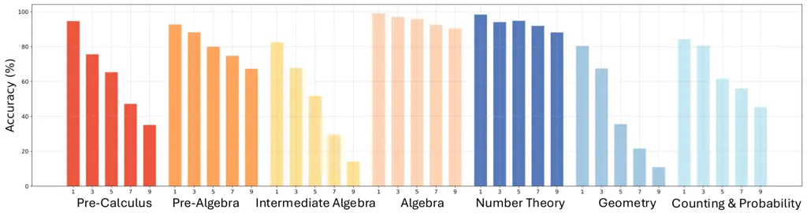

(a) DS-R1-Distill-Qwen-7B

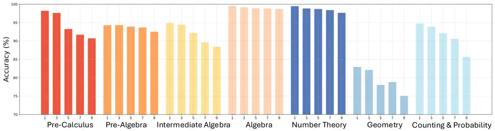

(b) DS-R1-Distill-Qwen-32B

Figure 13: Performance degradation across different question types on
MATH500.

## 13 Error Type Illustrations

In this section, we provide a detailed case study of each error type
under stress tests in figures 14 to 18. Our findings indicate that
Output Truncation is not the only reason for the performance degradation
under stress tests, revealing some unexpected misbehaviors like Question
Omission and Summary Error that remain hidden in standard evaluation
settings.

###### Example 1.

Example of Output Truncationot

Query:

Q1: Let $`O(0,0),A(\tfrac{1}{2},0),`$ and $`B(0,\tfrac{\sqrt{3}}{2})`$
be points in the coordinate plane. Let $`\mathcal{F}`$ be the family of
segments $`\overline{PQ}`$ of unit length lying in the first quadrant
with $`P`$ on the $`x`$-axis and $`Q`$ on the $`y`$-axis. There is a
unique point $`C`$ on $`\overline{AB},`$ distinct from $`A`$ and $`B,`$
that does not belong to any segment from $`\mathcal{F}`$ other than
$`\overline{AB}`$. Then $`OC^{2}=\tfrac{p}{q}`$, where $`p`$ and $`q`$
are relatively prime positive integers. Find $`p+q`$.

Q2: Find the number of triples of nonnegative integers $`(a,b,c)`$
satisfying $`a+b+c=300`$ and
$`a^{2}b+a^{2}c+b^{2}a+b^{2}c+c^{2}a+c^{2}b=6,000,000.`$

Answer the above questions one by one. Remember to put your final answer
within \boxed{}.

Response:

Okay, so I have these two problems to solve. Let me start with the first
one.

Problem Q1:

We have points O(0,0), A(1/2, 0), and B(0, sqrt(3)/2). The family F
consists of segments PQ of unit length in the first quadrant, with P on
the x-axis and Q on the y-axis. We need to find a unique point C on AB
(other than A and B) that doesn’t lie on any other segment from F except
AB. Then compute OC² and express it as a reduced fraction p/q, and find
p+q. Alright, let’s break this down. First, let’s visualize the points.
O is the origin, A is (1/2, 0), which is halfway between (0,0) and
(1,0). B is (0, sqrt(3)/2), which is halfway between (0,0) and (0,1) in
some sense, but sqrt(3)/2 is approximately 0.866. So, AB is a line
segment connecting (1/2, 0) to (0, sqrt(3)/2). Let me compute the
equation of line AB.

$`\dots`$ (Reasoning content for Q1) $`\dots`$

So, to find such a point C, we need to find a point on AB that is not on
any other PQ, which are all lines from $`(p,0)`$ to $`(0,q)`$ with
$`p²+q²=1`$.

Problem Q2:

Find the number of triples of nonnegative integers $`(a,b,c)`$
satisfying $`a+b+c=300`$ and $`a²b+a²c+b²a+b²c+c²a+c²b=6,000,000.`$

Okay, so we have two equations:

$`\dots`$ (Reasoning content for Q2) $`\dots`$

Thus, each non-symmetric set is unique, so 6 such sets, each
contributing 6 ordered triples 36. Plus the symmetric solution 1.
Total=37. But, in reality, the equation may have more solutions. Wait,
let me think. Wait, the equation
is:$`(a²(b+c)+b²(c+a)+c²(a+b))/2006=abc.`$ So, with (Truncated)

Figure 14: Example of Output Truncation error on DS-R1-Distill-Qwen-7B.

###### Example 2.

Example of Endless Repetiioner

Query:

Q1: Let $`ABCD`$ be a tetrahedron such that $`AB=CD=\sqrt{41}`$,
$`AC=BD=\sqrt{80}`$, and $`BC=AD=\sqrt{89}`$. There exists a point $`I`$
inside the tetrahedron such that the distances from $`I`$ to each of the
faces of the tetrahedron are all equal. This distance can be written in
the form $`\frac{m\sqrt{n}}{p}`$, where $`m`$, $`n`$, and $`p`$ are
positive integers, $`m`$ and $`p`$ are relatively prime, and $`n`$ is
not divisible by the square of any prime. Find $`m+n+p`$.

Q2: Let $`p`$ be the least prime number for which there exists a
positive integer $`n`$ such that $`n^{4}+1`$ is divisible by $`p^{2}`$.
Find the least positive integer $`m`$ such that $`m^{4}+1`$ is divisible
by $`p^{2}`$.

Answer the above questions one by one. Remember to put your final answer
within \boxed{}.

Response:

Problem Q1: We have a tetrahedron ABCD with some specific edge lengths.
The edges AB and CD are both $`\sqrt{41}`$, AC and BD are both
$`\sqrt{80}`$, and BC and AD are both $`\sqrt{89}`$. There’s a point I
inside this tetrahedron such that the distances from I to each face are
equal. We need to find this distance, express it in a specific form, and
then compute $`m+n+p`$ where the distance is $`m\sqrt{n}/p`$. Hmm, okay.
So, first, I remember that in a tetrahedron, the point equidistant from
all four faces is called the incenter, similar to the incenter of a
triangle. The distance from this point to each face is the inradius.

$`\dots`$ (Reasoning content for Q1) $`\dots`$

Wait, $`236`$? Hmm, that seems a bit high, but maybe it’s correct. Wait,
let me check the formula for the inradius again. Yes, for a tetrahedron,
$`r=3V/A`$, where A is the total surface area. So, yes, that’s correct.
Alternatively, another way to compute the inradius is to note that in a
disphenoid, the inradius can be computed using the formula
$`r=(3V)/A_{total}`$, which is what I did. So, I think $`236`$ is the
answer for Q1.

Problem Q2: We need to find the least prime number $`p`$ such that there
exists a positive integer $`n`$ where $`p^{2}`$ divides $`n^{4}+1`$.
Once we find that prime $`p`$, we need to find the least positive
integer $`m`$ such that $`m^{4}+1`$ is divisible by $`p^{2}`$. So,
first, we need to find the smallest prime $`p`$ where
$`p^{2}\mid n^{4}+1`$ for some $`n`$. To do this, I think we can
consider primes $`p`$ where $`-1`$ is a quartic residue modulo
$`p^{2}`$. Because $`n^{4}\equiv-1\mod p^{2}`$, which implies that
$`n^{4}+1\equiv 0\mod p^{2}`$. Therefore, we need to find the smallest
prime $`p`$ such that the equation $`x^{4}\equiv-1\mod p^{2}`$ has a
solution. Alternatively, since if $`x^{4}\equiv-1\mod p^{2}`$, then
$`x^{4}\equiv-1\mod p`$, so first, we can check for primes $`p`$ where
$`-1`$ is a quartic residue modulo $`p`$.

$`\dots`$ (Reasoning content for Q2) $`\dots`$

But wait, $`110`$ is quite large, maybe I can find a smaller one. Wait,
let me try $`n=55`$. $`55^{2}=3,025`$. $`3,025\mod 289`$:
$`289\cdot 10=2,890`$. $`3,025-2,890=135`$. $`135^{2}=18,225`$.
$`18,225\mod 289`$: $`289\cdot 62=17,918`$. $`18,225-17,918=307`$.
$`307-289=18`$. So, $`55^{4}\equiv 18\mod 289`$. $`18+1=19\neq 0`$.
$`n=55`$ doesn’t work. Wait, $`n=68`$. $`68^{2}=4,624`$.
$`4,624\mod 289`$: $`289\cdot 15=4,335`$. $`4,624-4,335=289`$.
$`289\equiv 0\mod 289`$. So, $`68^{2}\equiv 0\mod 289`$. So,
$`68^{4}\equiv 0\mod 289`$. Doesn’t work. $`n=69`$. $`69^{2}=4,761`$.
$`4,761\mod 289`$: $`289\cdot 16=4,624`$. $`4,761-4,624=137`$.
$`137^{2}=18,769`$. $`18,769\mod 289`$: $`289\cdot 64=18,496`$.
$`18,769-18,496=273`$. $`273-289=-16\equiv 273\mod 289`$. So,
$`69^{4}\equiv 273\mod 289`$. $`273+1=274\equiv 274\neq 0`$. $`n=70`$.
$`70^{2}=4,900`$. $`4,900\mod 289`$: $`289\cdot 16=4,624`$.
$`4,900-4,624=276`$. $`276^{2}=76,176`$. $`76,176\mod 289`$:
$`289\cdot 263=76,107`$. $`76,176-76,107=69`$. So,
$`70^{4}\equiv 69\mod 289`$. $`69+1=70\equiv 70\neq 0`$. $`n=71`$.
$`71^{2}=5,041`$. $`5,041\mod 289`$: $`289\cdot 17=4,913`$.
$`5,041-4,913=128`$. $`128^{2}=16,384`$. $`16,384\mod 289`$:
$`289\cdot 56=16,184`$. $`16,384-16,184=200`$. $`200+1=201\neq 0`$.
$`n=72`$. $`72^{2}=5,184`$. $`5,184\mod 289`$: $`289\cdot 17=4,913`$.
$`5,184-4,913=271`$. $`271^{2}=73,441`$. $`73,441\mod 289`$:
$`289\cdot 253=73,197`$. $`73,441-73,197=244`$.
$`244-289=-45\equiv 244\mod 289`$. $`244+1=245\neq 0`$. $`n=73`$.
$`73^{2}=5,329`$. $`5,329\mod 289`$: $`289\cdot 18=5,202`$.
$`5,329-5,202=127`$. $`127^{2}=16,129`$. $`16,129\mod 289`$:
$`289\cdot 55=15,895\cdot 55=15,895\cdot 55=15,895\cdot 55=15,895\cdot 55=15,895\cdot 55=15,895\cdot 55=15,`$
(Endless Repeating $`289\cdot 55=15,895`$).

Figure 15: Example of Endless Repetition error on DS-R1-Distill-Qwen-7B.

###### Example 3.

Example of Question Omissionqo

Query:

Q1: Let $`N`$ be the greatest four-digit positive integer with the
property that whenever one of its digits is changed to $`1`$, the
resulting number is divisible by $`7`$. Let $`Q`$ and $`R`$ be the
quotient and remainder, respectively, when $`N`$ is divided by $`1000`$.
Find $`Q+R`$.

Q2: Alice chooses a set $`A`$ of positive integers. Then Bob lists all
finite nonempty sets $`B`$ of positive integers with the property that
the maximum element of $`B`$ belongs to $`A`$. Bob’s list has 2024 sets.
Find the sum of the elements of A.

Answer the above questions one by one. Remember to put your final answer
within \boxed{}.

Response:

Alright, so I have these two math problems to solve. Let me start with
Q1. It says:

“Let N be the greatest four-digit positive integer with the property
that whenever one of its digits is changed to 1, the resulting number is
divisible by 7. Let Q and R be the quotient and remainder, respectively,
when N is divided by 1000. Find Q + R.”

Okay, so N is a four-digit number, and if you change any one of its
digits to 1, the new number is divisible by 7. We need to find N, then
divide it by 1000 to get Q and R, and then add them together.

First, let me think about how to approach this. Since changing any digit
to 1 results in a number divisible by 7, that gives us several
conditions. Let’s denote N as a four-digit number: N = ABCD, where A, B,
C, D are its digits. Then, changing each digit one by one to 1 should
result in a number divisible by 7.

So, changing A to 1: 1BCD should be divisible by 7.

Changing B to 1: A1CD should be divisible by 7.

$`\dots`$ (Reasoning content for Q1) $`\dots`$

After checking various possibilities, we find that the valid number
$`N`$ is 5694.

When $`N=5694`$ is divided by 100, the quotient $`Q`$ is 56 and the
remainder $`R`$ is 94. Therefore, we compute $`Q+10R`$:

```math
Q+10R=56+10\times 94=56+940=996
```

Thus, the final answer is $`\boxed{996}`$. (Missing answer for Q2)

Figure 16: Example of Question Omission error on DS-R1-Distill-Qwen-7B.

###### Example 4.

Example of Summary Errorse

Query:

Q1: Consider the paths of length $`16`$ that follow the lines from the
lower left corner to the upper right corner on an $`8\times 8`$ grid.
Find the number of such paths that change direction exactly four times,
like in the examples shown below.

```ltx_verbatim
[asy] size(7.5cm); usepackage(\"tikz\");
label(\"\\begin{tikzpicture}[scale=.4] \\draw(0,0)grid(8,8);

\\draw[line width=2,red](0,0)--(2,0)--(2,3)--(5,3)--(5,8)--(8,8);

\\end{tikzpicture}\",origin);

label(\"\\begin{tikzpicture}[scale=.4]\\draw(0,0)grid(8,8);

\\draw[line width=2,red](0,0)--(0,3)--(3,3)--(3,5)--(8,5)--(8,8);

\\end{tikzpicture}\",E); [/asy]
```

Q2: Rectangles $`ABCD`$ and $`EFGH`$ are drawn such that $`D,E,C,F`$ are
collinear. Also, $`A,D,H,G`$ all lie on a circle. If $`BC=16,`$
$`AB=107,`$ $`FG=17,`$ and $`EF=184,`$ what is the length of $`CE`$?

```ltx_verbatim
[asy] import graph; unitsize(0.1cm);  pair A = (0,0);pair B = (70,0);

pair C = (70,16);pair D = (0,16);pair E = (3,16);pair F = (90,16);pair G = (90,33);

pair H = (3,33); dot(AˆˆBˆˆCˆˆDˆˆEˆˆFˆˆGˆˆH); label(\"$A$\", A, S);

label(\"$B$\", B, S);label(\"$C$\", C, N);label(\"$D$\", D, N);

label(\"$E$\", E, S);label(\"$F$\", F, S);label(\"$G$\", G, N);

label(\"$H$\", H, N); draw(E--D--A--B--C--E--H--G--F--C); [/asy]
```

Answer the above questions one by one. Remember to put your final answer
within \boxed{}.

Response:

Okay, so I have these two questions to solve. Let me start with the
first one.

Q1  Paths on an 8x8 Grid

Alright, so the problem is about finding the number of paths of length
16 on an 8x8 grid that …

$`\dots`$ (Reasoning content for Q1) $`\dots`$

Similarly, the second example alternates more, but I think the reasoning
still holds. So, yeah, 294 seems correct. Therefore, the answer is 294.

Q2: Rectangles and Circle Problem

Alright, moving on to the second question. It’s a geometry problem
involving rectangles and a circle.

$`\dots`$ (Reasoning content for Q2) $`\dots`$

Therefore, regardless of the exact value of e, CE is 201. Wait, that’s
interesting. Therefore, $`CE=201`$. So, the exact value is 201.
Therefore, the length of CE is 201. \</think\>

Final Answer To solve the first problem, we need to find the number of
ways to arrange the letters of the rectangle ROOT such that the letters
D and E are adjacent. 1. The word ROOT has 4 letters with two O’s. The
distinct letters are R, O, O, T. 2. We treat the pair DE as a single
letter, resulting in three units: DE, R, T. 3. These three units can be
arranged in 3! = 6 ways. 4. However, DE can also be treated as ED, so we
multiply by 2, giving 12 ways. 5. Considering the two O’s, the total
number of distinct arrangements is 12. Thus, the number of ways is
$`\boxed{12}`$.

(The answer to Q1 in the final answer is inconsistent with the answer
given during the thinking process.)

For the second problem, we need to find the length of CE in a rectangle
ABCD with specific conditions. $`\dots`$ (Answer content for Q2)
$`\dots`$

Figure 17: Example of Summary Error on DS-R1-Distill-Qwen-7B.

###### Example 5.

Example of Reasoning Errorre

Query:

Q1: Eight circles of radius $`34`$ are sequentially tangent, and two of
the circles are tangent to $`AB`$ and $`BC`$ of triangle $`ABC`$,
respectively. $`2024`$ circles of radius $`1`$ can be arranged in the
same manner. The inradius of triangle $`ABC`$ can be expressed as
$`\frac{m}{n}`$, where $`m`$ and $`n`$ are relatively prime positive
integers. Find $`m+n`$.

```ltx_verbatim
[asy] pair A = (2,1); pair B = (0,0); pair C = (3,0); dot(AˆˆBˆˆC);

label(\"$A$\", A, N); label(\"$B$\", B, S); label(\"$C$\", C, S);

draw(A--B--C--cycle);

for(real i=0.62; i<2.7; i+=0.29){ draw(circle((i,0.145), 0.145)); } [/asy]
```

Q2: Find the largest possible real part of
$`(75+117i)z+\frac{96+144i}{z}`$ where $`z`$ is a complex number with
$`|z|=4`$.

Answer the above questions one by one. Remember to put your final answer
within \boxed{}.

Response:

Okay, so I have these two problems to solve, Q1 and Q2. Let me try to
tackle them one by one. I’ll start with Q1 because it seems a bit more
straightforward, even though I might need to think carefully.

Problem Q1:

Alright, so we have triangle ABC with two circles tangent to sides
$`AB`$ and $`BC`$ respectively, each of radius 34. Then, there are 2024
circles of radius 1 arranged in the same manner. We need to find the
inradius of triangle $`ABC`$ expressed as a fraction $`m/n`$, where m
and n are coprime, and then find $`m+n`$.

Hmm, okay. So, I recall that when circles are tangent to sides of a
triangle and each other, it often relates to similar triangles or some
kind of geometric progression. Maybe it’s something to do with the
inradius being built up by smaller circles?

$`\dots`$ (Reasoning content for Q1) $`\dots`$

Alternatively, maybe it’s the geometric mean,
$`\sqrt{(34*1)}=\sqrt{34}`$, but that’s irrational. But since the
problem states that the inradius can be expressed as $`m/n`$, where m
and n are coprime integers, 35 is a reasonable answer. So, perhaps the
answer is 35, so $`m+n=36`$. Therefore, after all this thinking, I think
the inradius is 35, so the answer is 36. Final Answer $`\boxed{36}`$

Now, moving on to problem 2. We have the function
$`f(x)=\frac{75+14x-x^{2}}{1+2x}`$, and we need to find the maximum
value of the expression $`\frac{(75+117i-144j)}{f(i)-4}`$ where $`i`$
and $`j`$ are complex numbers with $`|i|=|j|=4`$. First, I need to
understand what is being asked. We have a complex expression, and we
need to find its maximum value as $`i`$ and $`j`$ range over complex
numbers with magnitude 4. So, let me denote $`z=i`$, $`w=j`$, with
$`|z|=|w|=4`$. Then, the expression becomes:
$`\frac{75+117z-144w}{f(z)-4}`$

$`\dots`$ (Reasoning content for Q2) $`\dots`$

Wait, maybe the maximum is 15, so the answer is 15, sum is 16. But to be
honest, given that my calculations are not consistent, maybe the answer
is 15. But to end, I think the maximum value is 15, so $`15/1`$, so
$`15+1=16`$. Final Answer Problem 2  $`\boxed{16}`$ (Errors occur in the
reasoning process of Q1 and Q2.)

Figure 18: Example of Reasoning Error on DS-R1-Distill-Qwen-7B.
