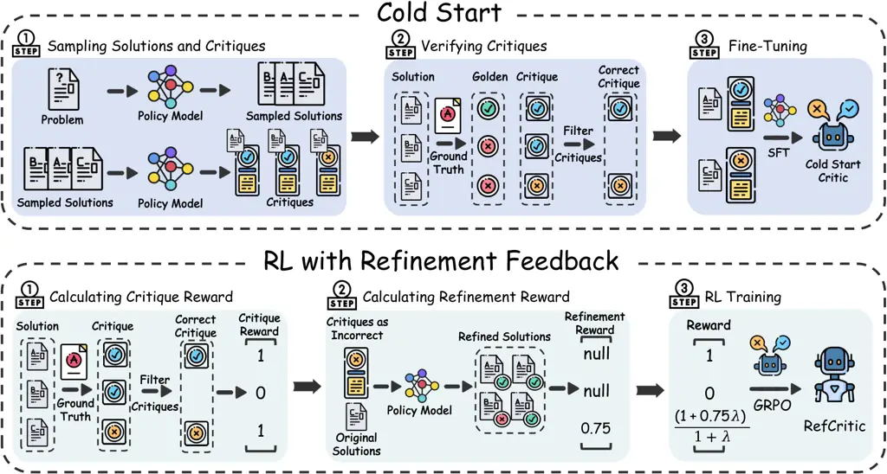

# RefCritic: Training Long Chain-of-Thought Critic Models with Refinement Feedback

Qiaoyu Tang ^(†)^(†)thanks: ˜ Equal contribution Affiliation: Chinese
Information Processing Laboratory, Institute of SoftwareChinese Academy
of Sciences Affiliation: University of Chinese Academy of Sciences
Email: <tangqiaoyu2020@iscas.ac.cn>    Hao Xiang¹¹footnotemark: 1
Affiliation: Chinese Information Processing Laboratory, Institute of
SoftwareChinese Academy of Sciences Affiliation: University of Chinese
Academy of Sciences Email: <xianghao2022@iscas.ac.cn>    Le Yu
Affiliation: Alibaba Group Email: <hongyu@iscas.ac.cn>    Bowen Yu
Affiliation: Alibaba Group Email: <luyaojie@iscas.ac.cn>    Hongyu Lin
Affiliation: Chinese Information Processing Laboratory, Institute of
SoftwareChinese Academy of Sciences Email: <xianpei@iscas.ac.cn>   
Yaojie Lu Affiliation: Chinese Information Processing Laboratory,
Institute of SoftwareChinese Academy of Sciences
Email: <sunle@iscas.ac.cn>    Xianpei Han Affiliation: Chinese
Information Processing Laboratory, Institute of SoftwareChinese Academy
of Sciences Email: <chuanyi.yl@alibaba-inc.com>    Le Sun
Affiliation: Chinese Information Processing Laboratory, Institute of
SoftwareChinese Academy of Sciences Email: <yubowen.ybw@alibaba-inc.com>
   Junyang Lin Affiliation: Alibaba Group
Email: <junyang.ljy@alibaba-inc.com>

###### Abstract

With the rapid advancement of Large Language Models (LLMs), developing
effective critic modules for precise guidance has become crucial yet
challenging. In this paper, we initially demonstrate that supervised
fine-tuning for building critic modules (which is widely adopted in
current solutions) fails to genuinely enhance models’ critique
abilities, producing superficial critiques with insufficient reflections
and verifications. To unlock the unprecedented critique capabilities, we
propose RefCritic, a long-chain-of-thought critic module based on
reinforcement learning with dual rule-based rewards: (1) instance-level
correctness of solution judgments and (2) refinement accuracies of the
policy model based on critiques, aiming to generate high-quality
evaluations with actionable feedback that effectively guides model
refinement. We evaluate RefCritic on Qwen2.5-14B-Instruct and
DeepSeek-R1-Distill-Qwen-14B across five benchmarks. On critique and
refinement settings, RefCritic demonstrates consistent advantages across
all benchmarks, e.g., 6.8% and 7.2% gains on AIME25 for the respective
base models. Notably, under majority voting, policy models filtered by
RefCritic show superior scaling with increased voting numbers. Moreover,
despite training on solution-level supervision, RefCritic outperforms
step-level supervised approaches on ProcessBench, a benchmark to
identify erroneous steps in mathematical reasoning.

## 1 Introduction

In recent years, Large Language Models (LLMs) have demonstrated
remarkable capabilities in executing complex reasoning tasks such as
mathematical problem-solving and code generation Yang et al. (2025a);
Hui et al. (2024). As these models continue to evolve, their reasoning
processes have grown increasingly sophisticated, encompassing multiple
elaborate steps and diverse pathways (Guo et al., 2025; Team, 2025).
This progression introduces a critical challenge: reasoning processes
are becoming substantially difficult for humans to supervise, making
errors within these intricate chains harder to identify and rectify. The
escalating complexity of LLM-generated solutions necessitates more
effective analytical frameworks to evaluate and enhance reasoning
quality, extending beyond the constraints of human supervisory
oversight.

Developing LLM critics has become a promising direction for evaluating
complex reasoning tasks (Liu et al., 2025; Zhang et al., 2024; Mahan
et al., 2024; Wang et al., 2023; Ankner et al., 2024), functioning as
specialized modules to analyze reasoning processes and identify errors.
Ideally, LLM critics are expected to comprehensively analyze content
generated by the policy model, delivering targeted critiques that
identify logical inconsistencies or factual errors and improve the
refinement quality of the policy model. However, contemporary approaches
exhibit two critical limitations. Firstly, they frequently produce
superficial evaluations characterized by insufficient analytical
depth (Zheng et al., 2025; Tang et al., 2025a) and typically necessitate
granular step-level annotations of the solution for optimization (Yang
et al., 2025b). Secondly, current implementations mainly focus on
metrics of critic performance while overlooking the practical utility of
critiques in enhancing policy model refinement.



Figure 1: The Critic model with Refinement Feedback RefCritic framework
consists of two steps: (1) cold-start via rejective sampling
fine-tuning, (2) rule-based reinforcement learning with refinement
feedback. With this two-stage optimization, RefCritic generates in-depth
critiques that achieve superior critic performance and effectively guide
policy model refinement through actionable feedback.

In this paper, we propose RefCritic, a long chain-of-thought critic
model with refinement feedback to tackle the above limitations, which
could generate in-depth critiques that not only achieve superior critic
performance but also effectively guide policy model refinement through
actionable feedback. This process begins with prompting open-source
models (e.g., DeepSeek-R1-Distill-Qwen) to generate seed data containing
three essential components: long CoT analysis, solution validity
judgments, and refinement suggestions. After rigorous quality filtering
based on judgment accuracy, about 10K valid samples are obtained, which
are utilized to establish cold-start critic models via Supervised
Fine-Tuning (SFT). We then conduct preliminary assessments to verify
whether SFT is sufficient for producing comprehensive critiques. Results
reveal that SFT alone struggles to produce in-depth critiques despite
generating lengthy CoT content, as models frequently exhibit misleading
analytical patterns where correct judgments emerge from flawed reasoning
processes (a persistent issue observed in existing LLM critics),
resulting in unreliable performance evaluations. Furthermore, the
absence of explicit policy model interaction during SFT leads to
critiques that inadequately prioritize feasible guidance for effective
refinement. The above observations highlight the difficulty of SFT in
producing critiques with both accurate evaluations and practical
feedback for refinement.

To further enhance the critic reliability and establish a causal
connection between critique quality and policy refinement outcomes, we
implement a dual-reward reinforcement learning framework based on
cold-start models for finalizing RefCritic. The first reward signal
stems from the instance-level binary accuracy metric (0/1 values) for
evaluating the critic models in solution judgment capability. The second
reward quantifies policy model improvement through accuracy gains after
incorporating refinement suggestions. Critically, the second reward
establishes an explicit feedback loop where the quality of effective
critique is operationally defined by its capacity to drive measurable
enhancements to the policy model. This dual-reward design ensures that
high-reward critiques are those that not only accurately identify
solution flaws but also provide actionable guidance leading to
verifiable performance gains.

We validate the effectiveness of RefCritic on multiple challenging
mathematical datasets: AIME24, AIME25, and Olympiad (He et al., 2024).
In the refinement after critique setting, feedback generated by
RefCritic based on Qwen2.5-14B and DeepSeek-R1-Distill-Qwen-14B
consistently enhances the corresponding policy models’ performance, with
improvements of 6.8% and 7.2% on AIME25, and 9.9% and 2.6% on Olympiad,
respectively. In the majority vote with critique setting, RefCritic
demonstrates increasingly significant performance gains as the sampling
count increases. With 64 samples, RefCritic achieves an average
improvement of 3.6 percentage points on AIME25 compared to scenarios
without critique, consistently outperforming other critique baselines.
Moreover, RefCritic effectively enhances majority vote performance even
when applied to more powerful models, like QwQ and
DeepSeek-Distill-Qwen-32B. These performance improvements indicate that
our dual reward mechanism successfully aligns critique generation with
both evaluation accuracy and refinement utility, enabling critic models
to produce not only precise solution assessments but also actionable
feedback that effectively guides refinement processes. Furthermore, it
is worth noting that RefCritic generalizes effectively to step-level
critique tasks without requiring any step-level labels during training,
achieving remarkable performance on ProcessBench (Zheng et al., 2024).

## 2 Related Work

#### Test-time Scaling

Test-time scaling techniques have emerged as a powerful approach to
enhance LLM reasoning capabilities through increased computational
resources during inference (Charniak and Johnson, 2005; Snell et al.,
2024; Wu et al., 2024; Yao et al., 2023; Chen et al., 2024; Jaech
et al., 2024; Guo et al., 2025; Team, 2025). The effectiveness of these
approaches can be improved by judgment or verification mechanisms.
Besides traditional process reward models (PRMs) that directly predict
numerical correctness scores for solution steps (Uesato et al., 2022;
Lightman et al., 2023; Zheng et al., 2025; Zheng et al., 2023; Chen
et al., 2025; Zhang et al., 2025), recent methods frame judgement as
language generation tasks that offer greater interpretability and
scalability (Liu et al., 2025; Zhang et al., 2024; Mahan et al., 2024;
Wang et al., 2023; Ankner et al., 2024). Among them, a promising
approach is LLM Critics, which uses LLMs as critic models to verify
solutions (McAleese et al., 2024; Zheng et al., 2025; Yang et al.,
2025b).

#### Critique for Math

The judgment ability of LLMs has garnered significant research interest
due to their potential to enhance mathematical reasoning through
explicit error detection and correction guidance (Lan et al., 2024; Lin
et al., 2024; Zheng et al., 2024). Current approaches fall into two main
categories: LLM-as-a-Critic (Zheng et al., 2025; Yang et al., 2025b)
leverages off-the-shelf models through careful instruction design, and
specialized critic models(McAleese et al., 2024; Lan et al., 2024; Shi
and Jin, 2025) that employ fine-tuning or reinforcement learning to
enhance judgment ability. While recent research emphasizes that critique
effectiveness should be validated through correction outcomes (Tang
et al., 2025b; Zheng et al., 2024), most existing critic models focus
exclusively on critique and ignore the future benefit it can bring to
refinement. Our work addresses these challenges through RefCritic, a
novel framework that leverages reasoning models’ critique abilities and
incorporates refinement performance as a direct reward signal during
critic training. The most closely related concurrent works are ThinkPRM
(Khalifa et al., 2025) and DeepCritic (Yang et al., 2025b). The former
uses SFT to enhance the capabilities of reasoning models, while the
latter improves the critique performance of instruction models on
individual steps through complex fine-tuning and simple RL. However,
they fail to recognize how critiques serve as valuable feedback
mechanisms for policy model refinement.

## 3 SFT is Insufficient for Deep Critiques

To better understand the challenges in developing effective critic
models, we first examined a straightforward approach widely adopted in
previous research: supervised fine-tuning with rejection sampling. This
approach has demonstrated success in improving judgment capabilities of
critics in several studies (Tang et al., 2025a; Zheng et al., 2025;
Khalifa et al., 2025).

Specifically, we employed Qwen2.5-14B-Instruct/DeepSeek-Distill-Qwen-14B
as our policy model and DeepSeek-Distill-Qwen-32B as the critic model¹¹
1 For Qwen2.5-14B-Instruct, we provide an empty thinking process and
only use the content after ”¡/think¿”.. Employing rejection sampling, we
collected approximately 10K critique training samples from a subset of
NuminaMath. Each training sample comprised a problem statement, model
response, chain-of-thought reasoning, judgment on solution correctness,
and refinement suggestions. We subsequently fine-tuned the policy models
on these datasets to develop critique capabilities. To evaluate the
effectiveness of these fine-tuned critic models, we tested them on
responses collected from AIME25, assessing their ability to identify
errors and provide feedback that could meaningfully improve policy model
performance.

|                           |                   |                         |
| ------------------------- | ----------------- | ----------------------- |
| Method                    | Critique Accuracy | Pass@1 after Refinement |
| Qwen2.5-14B as Base Model |                   |                         |
| Pass@1                    | \-                | 14.4                    |
| Self-Critique             | 51.8              | 14.5                    |
| SFT                       | 80.6              | 15.0                    |
| R1-Qwen-14B as Base Model |                   |                         |
| Pass@1                    | \-                | 49.2                    |
| Self-Critique             | 71.5              | 52.1                    |
| SFT                       | 78.9              | 51.4                    |

Table 1: Preliminary experiment on AIME25 to verify whether SFT can
emerge deep critic. We can see that although the SFT model achieves
strong performance in critique evaluation, incorporating its feedback
into the policy model yields only marginal performance gains. R1-Qwen
represents DeepSeek-Distill-Qwen.

Our experiments revealed a significant disparity between the critic
model capabilities and their practical utility. As shown in Table 1,
whether it is a Qwen-based critic or DeepSeek-Distill-Qwen-based critic,
SFT-trained models significantly outperformed self-critique approaches
in critique accuracy metrics. However, when these critiques were used to
refine policy model outputs, the resulting performance improvements were
minimal, sometimes even inferior to those achieved through self-critique
methods. This counterintuitive result suggests that conventional
evaluation metrics for critics may not align with their actual utility
in improving model performance.

Further analysis of the SFT model outputs revealed two critical
limitations. First, critics often arrive at correct judgments through
flawed or superficial reasoning processes, creating a false impression
of reliability despite inconsistent analytical quality. This problem is
particularly evident in Qwen-based models, as the critique length after
SFT showed no significant increase, with an average length of less than
500 tokens. Second, the feedback typically identified error locations
but lacked specific, actionable guidance for improvement. Critics
frequently offered vague suggestions or restated problem requirements
rather than providing concrete directions for correcting mathematical
misconceptions or reasoning flaws. These findings directly support our
hypothesis that conventional SFT approaches, while successful in
training critics to make binary judgments, fail to develop models that
can provide the actionable, improvement-oriented feedback necessary for
effective solution refinement.

## 4 RefCritic

We propose RefCritic, a novel approach for developing effective critic
modules that provide actionable feedback for mathematical reasoning
tasks. As illustrated in Figure 1, RefCritic employs a two-stage
methodology. First, we develop a cold-start critic model via supervised
fine-tuning that activates the model’s reasoning judgment capabilities
and enables structured output generation. Second, we introduce a
rule-based reinforcement learning framework with dual rewards optimizing
critics for both solution-level correctness and refinement
effectiveness, measured by concrete improvements in policy model
performance. This dual-reward mechanism ensures our critic models not
only accurately evaluate solutions but also provide guidance that leads
to substantive improvements in reasoning capabilities.

When faced with complex tasks such as critique generation, LLMs often
exhibit problematic behaviors, including instruction unfollowing (He
et al., 2025) and answer leakage (Yang et al., 2025b). To address these
challenges, we implement SFT with rejection sampling to standardize
model outputs. Following our preliminary experimental setup, we leverage
a more powerful model to generate initial critic responses, then
systematically filter out responses containing erroneous judgments,
instruction violations, or solution leakage risks through rule-based
screening. This curated dataset serves as the foundation for our LLM
training, ensuring the resulting critic model adheres to desired output
formats while maintaining evaluation integrity.

Despite the effectiveness of the supervised fine-tuning approach in
producing format-compliant critics, the preliminary experiments revealed
fundamental shortcomings that limit practical utility. As previously
demonstrated, SFT models exhibit a misleading combination of accurate
judgments built upon superficial reasoning, alongside feedback that
identifies errors without providing actionable remediation strategies.
Rather than reiterating these limitations, we recognize them as
symptomatic of a deeper issue: conventional training methods optimize
for solution classification accuracy rather than refinement capability.
This insight motivates us to shift from purely supervised learning
toward a reinforcement learning framework that explicitly rewards
critics not just for evaluation correctness, but for generating feedback
that demonstrably improves subsequent solutions.

To address these limitations, we introduce a dual-reward reinforcement
learning framework that optimizes both judgment accuracy and refinement
effectiveness. Our approach evaluates critics based on two key metrics:
(1) their ability to correctly classify solutions as right or wrong, and
(2) the tangible improvement their feedback produces when used by the
policy model to revise incorrect solutions. This framework ensures our
critics develop both strong evaluation capabilities and the ability to
generate constructive feedback that leads to measurable improvements in
reasoning outcomes.

Formally, let $`C_{\theta}`$ represent our critic model with parameters
$`\theta`$, and $`P_{\phi}`$ denote the policy model with parameters
$`\phi`$ that generates mathematical solutions. For a problem $`x`$ with
ground truth answer $`a`$ from dataset $`\mathcal{D}`$, the policy model
produces an initial solution $`y_{0}\sim P_{\phi}(y|x)`$. The
correctness of this solution is determined by
$`c=\mathbb{I}[y_{0}=a]\in\{0,1\}`$, where $`\mathbb{I}[\cdot]`$ is the
math equal function. The critic model then performs an evaluation
$`C_{\theta}(x,y_{0})\rightarrow(z,\hat{c},f)`$, where $`z`$ represents
an extensive reasoning process, $`\hat{c}\in\{0,1\}`$ denotes the
predicted correctness judgment, and $`f`$ provides actionable refinement
suggestions. Based on these critiques, the policy model generates $`m`$
refined solutions $`\{y_{i}\}_{i=1}^{m}`$ where
$`y_{i}\sim P_{\phi}(y|x,y_{0},f)`$ for $`i\in\{1,2,\ldots,m\}`$. Our
reinforcement learning objective maximizes:

```math
\displaystyle\mathcal{J}(\theta) \displaystyle=\mathbb{E}[R_{j}(c,\hat{c})+\lambda R_{r}(c,\hat{c},a,\{y_{i}\}_{i=1}^{m})]
```

where $`R_{j}`$ represents the binary judgment score:

```math
R_{j}(c,\hat{c})=\left\{\begin{array}[]{rcl}1&&\text{if }c=\hat{c},\\
0&&\text{otherwise}\\
\end{array}\right.
```

and $`R_{r}`$ denotes the refinement score, which is non-zero only when
the critic correctly identifies an incorrect solution ($`c=0`$ and
$`\hat{c}=0`$):

```math
R_{r}(c,\hat{c},a,\{y_{i}\}_{i=1}^{m})=\left\{\begin{array}[]{lcl}\frac{1}{m}\sum\limits_{i=1}^{m}\mathbb{I}[y_{i}=a]&&\text{if }c=0\text{ and }c=\hat{c}\\
0&&\text{otherwise}\\
\end{array}\right.
```

$`\lambda`$ is a hyperparameter that balances the importance between
judgment accuracy and refinement effectiveness. A higher $`\lambda`$
value places greater emphasis on the critic’s ability to provide
actionable feedback that leads to correct solutions, while a lower value
prioritizes accurate solution classification.

In summary, our RefCritic framework alleviates the key limitations of
existing critic models through this dual-reward reinforcement learning
approach. By explicitly optimizing for both judgment accuracy and
refinement effectiveness, we develop critics that not only accurately
evaluate mathematical solutions but also provide actionable feedback
that leads to concrete improvements in reasoning outcomes.

## 5 Experiments

|                                                                  |                |               |                |                |               |                |                |               |                |
| ---------------------------------------------------------------- | -------------- | ------------- | -------------- | -------------- | ------------- | -------------- | -------------- | ------------- | -------------- |
| Model                                                            | AIME25         |               |                | AIME24         |               |                | Olympiad       |               |                |
|                                                                  | $`Pass_{r}@1`$ | $`Maj_{c}@8`$ | $`Maj_{c}@64`$ | $`Pass_{r}@1`$ | $`Maj_{c}@8`$ | $`Maj_{c}@64`$ | $`Pass_{r}@1`$ | $`Maj_{c}@8`$ | $`Maj_{c}@16`$ |
| Qwen-14B Majority Vote                                           | 14.4           | 19.2          | 23.3           | 13.7           | 16.5          | 16.6           | 45.8           | 52.2          | 53.6           |
| Qwen-14B as Critic                                               | 14.5           | 19.1          | 22.7           | 13.7           | 18.5          | 21.2           | 45.8           | 52.3          | 54.0           |
| RefCritic-Qwen-14B(Ours)                                         |                |               |                |                |               |                |                |               |                |
|    $`SFT`$                                                       | 15.0           | 19.3          | 23.4           | 15.2           | 19.2          | 23.9           | 46.6           | 52.5          | 54.3           |
|    $`RL_{\lambda=0}`$                                            | 18.5           | 20.8          | 22.4           | 19.1           | 20.5          | 23.8           | 51.4           | 55.4          | 57.4           |
|    $`RL_{\lambda=0}\xrightarrow{after}RL_{\lambda=1}`$           | 21.2           | 21.5          | 24.4           | 23.0           | 21.4          | 26.6           | 55.7           | 57.3          | 59.2           |
| R1-Qwen-14B Majority Vote                                        | 49.1           | 61.6          | 62.0           | 67.6           | 78.7          | 80.1           | 77.7           | 82.7          | 83.3           |
| R1-Qwen-14B as Critic                                            | 50.0           | 60.6          | 62.9           | 70.5           | 79.3          | 82.4           | 78.8           | 82.7          | 83.3           |
| RefCritic-R1-14B(Ours)                                           |                |               |                |                |               |                |                |               |                |
|    $`SFT`$                                                       | 51.3           | 61.6          | 62.8           | 71.4           | 79.4          | 83.1           | 78.7           | 83.0          | 84.4           |
|    $`RL_{\lambda=0}`$                                            | 55.1           | 64.2          | 67.1           | 73.5           | 80.4          | 82.8           | 80.4           | 83.8          | 84.5           |
|    $`RL_{\lambda=0}`$ $`\xrightarrow{after}`$ $`RL_{\lambda=1}`$ | 56.3           | 65.2          | 68.1           | 72.8           | 80.4          | 82.5           | 80.3           | 83.9          | 84.7           |

Table 2: Performance comparison of different approaches on AIME24/25 and
Olympiad. $`Pass_{r}`$ indicates the performance after one round of
critique and refinement. $`Maj_{c}`$ indicates the majority vote
performance after using the critic filtering solutions.
$`RL_{\lambda=1}`$ indicate RL with Refinement Feedback. Considering the
cost of sampling refinements, we initially set $`\lambda=0`$ to achieve
rapid improvement in critic performance.

### 5.1 Experimental Setup

#### Models

For our implementation of RefCritic, we utilize
Qwen2.5-14B-Instruct (Yang et al., 2025a) and
DeepSeek-R1-Distill-Qwen-14B (Guo et al., 2025) as the backbone. In our
framework, these models perform two distinct functions: first, as policy
models that generate solutions for mathematical problems; and second, as
the foundation models to develop our critic models.

#### Data Construction

We construct our training dataset by filtering approximately 120k
high-quality mathematical problems from the 900k problems in
NuminaMath-1.5 (LI et al., 2024). Our filtering pipeline includes: (1)
deduplication through exact string matching and semantic similarity
using gte-multilingual-base embeddings (removing pairs with cosine
similarity \> 0.95); (2) problem filtering using Qwen2.5-72B-Instruct to
remove unsolvable, proof, and multiple-choice problems; (3) difficulty
balancing by sampling eight solutions and excluding problems where all
attempts succeed or fail. For critic training, we sample 8 responses per
problem and retain at most two responses per problem (one correct, one
incorrect) to ensure balanced training data. Detailed process can be
found in Appendix A.

#### Benchmarks

We evaluate the performance of RefCritic on challenging mathematical
benchmarks, including AIME 2024/2025 (American Invitational Mathematics
Examination problems), and OlympiadBench (He et al., 2024) (a collection
of mathematical Olympiad problems). Since RefCritic was trained only on
math problems, we conduct out-of-distribution (OOD) generalization tests
on the code generation task LiveCodeBench (Jain et al., 2024) and the
science QA benchmark GPQA-Diamond (Rein et al., 2024). Furthermore, to
evaluate RefCritic’s capability for fine-grained error localization, we
leverage ProcessBench (Zheng et al., 2024) to assess its ability to
accurately identify the specific step where an error occurs.

#### Evaluation Details

For evaluation, both policy and critic models use a sampling strategy
with temperature=0.6 and $`top\_p`$=0.95. For AIME24/25, we pre-sample
128 responses as the response pool for subsequent performance
calculations. For OlympiadBench/GPQA/LiveCodeBench, we sample only 32
responses due to its larger scale. During evaluation, we randomly select
responses from the response pool for metric calculation and report the
average results over 1000 trials. We adopt multiple evaluation settings:

Majority Vote with Critique: The critic model first evaluates each of
the N sampled solutions and filters out those judged as incorrect. We
then apply majority vote to the remaining solutions to select the final
answer, denoted as $`Maj_{c}@N`$. As a baseline, we also report standard
majority vote accuracy without critique filtering.

Refinement after Critique: The policy model generates an initial
solution, which is then critiqued by the critic model. If judged
incorrect, the policy model refines the solution based on the critique
feedback. We report pass@1 accuracy of the final refined answer, denoted
as $`Pass_{r}@1`$.

Process Critique Evaluation: For process-level evaluation, since our
critic models were trained to output natural language critiques rather
than explicit step indices, we use Qwen2.5-14B-Instruct to identify the
step index the critic judges incorrect.²² 2 We only provide the solution
and critique, without the corresponding problem. Every critic we
evaluated would go through this process. Following ProcessBench, we
report the F1 score, which is the harmonic mean of precision for correct
and incorrect solutions.

#### Training Details

In the SFT stage, we train the critic models with a learning rate of
7e-6 and a batch size of 512 for three epochs. For the RL stage, we
employ the GRPO algorithm (Shao et al., 2024) to enhance critic
performance. We sample 8 critics for each input, each rollout comprising
128 inputs, and conduct on-policy training with a learning rate of 1e-6.
We set the maximum sequence length to 8K and 16K tokens for
Qwen2.5-Instruct and DeepSeek-R1-Distill-Qwen, respectively. For
refinement feedback, we use policy models to generate 8 refinements for
each critic. Considering the cost of sampling refinements, we initially
set $`\lambda`$=0 to achieve rapid improvement in critic performance for
600 steps, where no refinement is generated. We subsequently adjust to
$`\lambda`$=1 to balance the trade-off between the two reward components
and continue training for 300 steps.

|                                     |       |      |           |          |      |
| ----------------------------------- | ----- | ---- | --------- | -------- | ---- |
| Model                               | GSM8K | MATH | Omni-Math | Olympiad | Avg. |
| PRM                                 |       |      |           |          |      |
| Math-Shepherd-PRM-7B\*              | 47.9  | 29.5 | 24.8      | 23.8     | 31.5 |
| RLHFlow-PRM-8B-DS\*                 | 38.8  | 33.8 | 16.9      | 16.9     | 26.6 |
| Qwen2.5-Math-PRM-7B\*               | 68.2  | 62.6 | 50.7      | 44.3     | 56.5 |
| Prompt LLM as Critic                |       |      |           |          |      |
| Qwen2.5-14B-Instruct                | 61.7  | 52.6 | 41.3      | 43.1     | 49.7 |
| Qwen2.5-72B-Instruct                | 74.6  | 61.8 | 51.7      | 52.8     | 60.2 |
| R1-Qwen-7B                          | 75.3  | 74.4 | 56.9      | 63.5     | 67.5 |
| R1-Qwen-14B                         | 75.9  | 76.2 | 59.6      | 63.6     | 68.8 |
| GPT-4o-0806\*                       | 79.2  | 63.6 | 51.4      | 53.5     | 61.9 |
| Baseline Critic                     |       |      |           |          |      |
| SCRIT-72B (Tang et al., 2025a)      | 80.2  | 60.0 | 32.5      | 27.8     | 50.0 |
| DeepCritic-7B (Yang et al., 2025b)  | 72.6  | 72.8 | 56.0      | 60.9     | 65.6 |
| ThinkPRM-14B (Khalifa et al., 2025) | 67.6  | 71.4 | 54.8      | 59.3     | 63.3 |
| Our Critic                          |       |      |           |          |      |
| RefCritic-Qwen-14B                  | 81.9  | 71.2 | 58.1      | 60.7     | 68.0 |
| RefCritic-R1-14B                    | 86.3  | 82.0 | 67.6      | 72.3     | 77.1 |

Table 3: The evaluation results of PRMs, LLM as a critic, and RefCritic
critic models on ProcessBench. The metric is the F1 score, the harmonic
mean of precision for correct and incorrect solutions. All our critic
models are followed by an extract model (Qwen2.5-14B-Instruct) to get
the error step for easy evaluation. Content marked with "\*" sourced
from Processbench. As shown in Table 8, we use the same template as used
in Processbench.

### 5.2 Main Results

As shown in Table 2, we present the performance of RefCritic against
various baselines on AIME24, AIME25, and OlympiadBench datasets. In the
one-round critique and refinement settings, RefCritic consistently
provides the most effective feedback for policy model improvement,
demonstrating the effectiveness of incorporating refinement performance
as a reward in our reinforcement learning approach. Specifically, on the
challenging AIME25 dataset, RefCritic-Qwen-14B and RefCritic-R1-14B
enhance the policy model’s $`Pass@1`$ performance by 6.8% and 7.2%,
respectively, significantly outperforming both self-critique baselines
and models trained via supervised fine-tuning. Similar patterns emerge
across AIME24 and Olympiad benchmarks, confirming that directly
optimizing for policy model refinement performance during RL training
enables critic models to generate more actionable feedback.

When scaling up the policy model’s response generation and applying
critic model filtering, RefCritic achieves superior performance across
nearly all experimental settings. For instance, on AIME25, RefCritic-RL
improves $`Maj_{c}@64`$ with an average benefit of 3.6%(1.1% for
RefCritic-Qwen and 6.1% for RefCritic-R1). These results demonstrate
that our refinement-oriented critic not only enhances feedback quality
but also improves critical evaluation capabilities. Notably, as the
sampling scale increases from 8 to 64, the overall performance gains
from RefCritic become more pronounced, indicating our critic models’
high discriminative accuracy in identifying and preserving high-quality
solutions from larger candidate pools.

### 5.3 Out-of-Distribution Performance

|                                                        |                |                |                |
| ------------------------------------------------------ | -------------- | -------------- | -------------- |
| Model                                                  | LiveCodeBench  | GPQA           |                |
|                                                        | $`Pass_{r}@1`$ | $`Pass_{r}@1`$ | $`Maj_{c}@16`$ |
| Qwen-14B Majority Vote                                 | 18.9           | 19.5           | 23.3           |
| Qwen-14B as Critic                                     | 20.9           | 19.5           | 22.7           |
| RefCritic-R1-14B(Ours)                                 |                |                |                |
|    $`SFT`$                                             | 21.5           | 19.2           | 22.8           |
|    $`RL_{\lambda=0}`$                                  | 21.8           | 18.9           | 24.0           |
|    $`RL_{\lambda=0}\xrightarrow{after}RL_{\lambda=1}`$ | 22.9           | 20.0           | 24.3           |
| R1-Qwen-14B Majority Vote                              | 51.0           | 58.7           | 61.6           |
| R1-Qwen-14B as Critic                                  | 52.4           | 57.7           | 60.6           |
| RefCritic-Qwen-14B(Ours)                               |                |                |                |
|    $`SFT`$                                             | 52.3           | 58.0           | 62.5           |
|    $`RL_{\lambda=0}`$                                  | 53.6           | 59.0           | 64.6           |
|    $`RL_{\lambda=0}\xrightarrow{after}RL_{\lambda=1}`$ | 54.1           | 59.3           | 65.1           |

Table 4: Performance comparison of different approaches on LiveCodeBench
and GPQA.

Additionally, we also evaluated RefCritic on out-of-distribution tasks
to demonstrate its generalizability. Considering that the model was
trained on mathematical data, we chose to use LiveCodeBench to verify
its performance on coding, and GPQA to evaluate its performance in
challenging knowledge reasoning. We found that RefCritic still performs
well on out-of-distribution benchmarks. Although the improvements are
not as substantial as in the mathematical tasks, they still bring
considerable gains. Specifically, RefCritic-R1-14B achieved a 3.1%
performance improvement on LCB³³ 3 Since coding tasks cannot perform
Majority Vote, we only report $`Pass_{r}@1`$ performance., and improved
$`Maj_{c}@64`$ from 61.6% to 65.1% on the GPQA task, representing a 3.5%
performance gain. Similar progress also appeared in RefCritic-Qwen-14B.
These results suggest that RefCritic’s critic capabilities can be
applied to a wide range of tasks.

### 5.4 Critic Performance

In this section, we evaluate RefCritic on ProcessBench to explore
whether it can accurately identify true error locations in solutions.
The experimental results presented in Table 3 demonstrate that RefCritic
significantly outperforms most previous baselines, including methods
that utilize step-level supervision. RefCritic-Qwen achieves an average
performance of 68, while RefCritic-R1 reaches an impressive 77 average
performance. This indicates that our dual reward mechanism effectively
guides the model in developing accurate error identification
capabilities.

This finding is consistent with the growth of the model output length
during RL training. Specifically, the average output length of
RefCritic-Qwen increased from about 500 tokens to 3500 tokens, while
RefCritic-R1 increased from 3000 tokens to 8000 tokens. This indicates
the increasingly detailed critiques, making step-level critique
possible.

These findings demonstrate that even without explicit step-level
supervision, our approach enables critic models to develop a nuanced
understanding of solution processes and identify errors with high
precision. This capability is crucial for generating actionable feedback
that can effectively guide policy models toward improved solutions.

(a) Qwen2.5-72B Performance

(b) DeepSeek-Distill-Qwen-32B Performance

(c) QwQ-32B Performance

Figure 2: Supervision of RefCritic-R1-14B on stronger models like
Qwen2.5-72B, DeepSeek-Distill-Qwen-32B, and QwQ-32B.

(a) Critique Scaling on RefCritic.

(b) Scaling on RefCritic-Qwen.

(c) Scaling on RefCritic-R1.

Figure 3: Test-time scaling with RefCritic. Subplot (a), scaling the
number of critiques with RefCritic. Subplot (b), scaling the number of
sampled solutions with RefCritic-Qwen-14B on AIME24. Subplot(c), scaling
the number of sampled solutions with RefCritic-R1-14B on AIME25.

### 5.5 Test-time Scaling

#### Scaling on Critique

In this section, we investigate whether RefCritic’s critique
capabilities can benefit from test-time scaling. We construct two
evaluation sets by sampling 16 solutions for each problem from AIME25
and Olympiad. For each question, we sample 64 critiques from RefCritic
to examine whether increasing the number of critiques can progressively
enhance critique performance. The results presented in Figure 3 (a)
demonstrate that RefCritic’s critique performance exhibits consistent
improvement with increased sampling. On AIME25, performance steadily
improves, reaching a 4% increase as the number of sampled critiques
increases. This finding suggests that RefCritic benefits from test-time
scaling when multiple critiques are aggregated, thereby further
enhancing its ability to evaluate mathematical solutions accurately. The
scaling curve on Olympiad is relatively flat in comparison, which may be
due to the difficulty of the tasks for the policy model (but a clear
scaling trend can still be observed).

#### Scaling on Problem Solving

Figure 3 (b) and (c) illustrate the scaling performance of
RefCritic-Qwen-14B and RefCritic-R1-14B on AIME25 as measured by maj@N
with increasing rollout samples. The results demonstrate that RefCritic
models consistently outperform baselines across different sampling
scales, with the performance gap becoming more pronounced as the number
of samples increases. This trend further validates that our
refinement-oriented critic approach maintains its effectiveness
advantage even in larger-scale inference scenarios.

### 5.6 Supervision of Stronger Models

In this section, we investigate whether RefCritic can effectively
provide cross-model supervision for even more powerful reasoning models.
We evaluate our approach using state-of-the-art models such as QwQ,
DeepSeek-Distill-Qwen-32B, and Qwen 2.5-72B on the challenging AIME25
dataset. We compare three settings: (1) standard majority voting with
the base models, (2) self-critique where the models evaluate their own
solutions, and (3) cross-model supervision using our RefCritic-14B as
the critic model.

As shown in Figure 2, even the most powerful reasoning and instruct
models exhibit minimal or sometimes negative performance gains when
employing self-critique compared to standard majority voting. This
observation suggests a consistent limitation in these models’ ability to
critically evaluate their own solutions, regardless of their scale or
overall reasoning capabilities. In contrast, our RefCritic approach
consistently demonstrates positive improvements across nearly all
experimental settings, even when supervising significantly larger and
more capable reasoning models. Specifically, with 32 samples, RefCritic
supervision improves QwQ performance by 1.5% compared to standard
majority voting and by 1.1% compared to QwQ’s self-critique approach.
Similar patterns emerge for DeepSeek-Distill-Qwen-32B and Qwen 2.5-72B,
confirming that RefCritic’s benefits extend across model families and
scales.

### 5.7 Ablation

|                                                        |                |                |                |
| ------------------------------------------------------ | -------------- | -------------- | -------------- |
| Model                                                  | AIME25         | AIME24         | Olympiad       |
|                                                        | $`Pass_{r}@1`$ | $`Pass_{r}@1`$ | $`Pass_{r}@1`$ |
| Qwen-14B as Critic                                     | 14.5           | 13.7           | 45.8           |
| RefCritic-Qwen-14B(Ours)                               |                |                |                |
|    $`SFT`$                                             | 15.0           | 15.2           | 46.6           |
|    $`RL_{\lambda=0}`$                                  | 18.5           | 19.1           | 51.4           |
|    $`RL_{\lambda=1}`$                                  | 19.5           | 21.4           | 54.3           |
|    $`RL_{\lambda=0}\xrightarrow{after}RL_{\lambda=0}`$ | 19.6           | 21.7           | 53.6           |
|    $`RL_{\lambda=0}\xrightarrow{after}RL_{\lambda=1}`$ | 21.2           | 23.0           | 55.7           |

Table 5: Ablation results on RefCritic-Qwen-14B.

Finally, we also propose some ablation studies to understand the role of
the two RL training stages in RefCritic, namely $`\lambda`$=0 and
$`\lambda`$=1. Considering the training cost, we only conduct
experiments on RefCritic-Qwen-14B, and ablations on
DeepSeek-Distill-Qwen-14B will be added in future research.
Specifically, we aim to explore the importance of Refinement Reward. To
this end, we mainly compared two groups of experiments: 1)
$`RL_{\lambda=0}`$ and $`RL_{\lambda=1}`$. 2) $`RL_{\lambda=0}`$
$`\xrightarrow{after}`$ $`RL_{\lambda=0}`$ and $`RL_{\lambda=0}`$
$`\xrightarrow{after}`$ $`RL_{\lambda=1}`$. Each group of experiments is
optimized with the same parameters. The results of all these ablation
experiments are shown in Table 5. As expected, under the same settings,
refinement reward improves the refinement performance of models.
Furthermore, first using $`RL_{\lambda=0}`$ for Critic optimization is
also beneficial to RefCritic. $`RL_{\lambda=0}`$ can quickly improve
Critic performance at a lower cost, making $`RL_{\lambda=0}`$
$`\xrightarrow{after}`$ $`RL_{\lambda=1}`$ a setting that balances cost
and performance.

## 6 Conclusion

In this work, we introduced RefCritic, a novel approach for training
critic models to critique the correctness of solutions and provide
effective refinement feedbacks from LLMs. Our method leverages a
dual-reward system that jointly optimizes for judgment accuracy and
refinement effectiveness, creating an explicit feedback loop between
critique quality and policy model improvement. Our experiments
demonstrated that while SFT alone is insufficient for producing
comprehensive critiques despite generating better critiques, the
integration of reinforcement learning with our designed reward signals
significantly enhances both the analytical depth and practical utility
of critiques. Experimental results across challenging mathematical
datasets and out-of-distribution benchmarks validate RefCritic’s
effectiveness in consistently enhancing policy model performance in both
critique-refinement and majority vote settings. Further experiments on
ProcessBench demonstrate that even without a step-level signal,
RefCritic can effectively identify the error step.

## Limitations

Despite the promising results, RefCritic has several limitations. The
dual-reward reinforcement learning framework requires significant
computational resources, which may limit its scalability for very large
models. Our approach primarily focuses on mathematical and logical
reasoning tasks, and its generalizability to domains like commonsense
reasoning or specialized professional contexts remains to be thoroughly
investigated.

## References

- Ankner et al. (2024) Zachary Ankner, Mansheej Paul, Brandon Cui,
  Jonathan D Chang, and Prithviraj Ammanabrolu. 2024. Critique-out-loud
  reward models. _arXiv preprint arXiv:2408.11791_.
- Charniak and Johnson (2005) Eugene Charniak and Mark Johnson. 2005.
  Coarse-to-fine n-best parsing and maxent discriminative reranking. In
  _Proceedings of the 43rd Annual Meeting of the Association for
  Computational Linguistics (ACL’05)_, pages 173–180.
- Chen et al. (2025) Jiaqi Chen, Bang Zhang, Ruotian Ma, Peisong Wang,
  Xiaodan Liang, Zhaopeng Tu, Xiaolong Li, and Kwan-Yee K. Wong. 2025.
  [Spc: Evolving self-play critic via adversarial games for llm
  reasoning](https://arxiv.org/abs/2504.19162). _Preprint_,
  arXiv:2504.19162.
- Chen et al. (2024) Sijia Chen, Baochun Li, and Di Niu. 2024. Boosting
  of thoughts: Trial-and-error problem solving with large language
  models. _arXiv preprint arXiv:2402.11140_.
- Guo et al. (2025) Daya Guo, Dejian Yang, Haowei Zhang, Junxiao Song,
  Ruoyu Zhang, Runxin Xu, Qihao Zhu, Shirong Ma, Peiyi Wang, Xiao Bi,
  and 1 others. 2025. Deepseek-r1: Incentivizing reasoning capability in
  llms via reinforcement learning. _arXiv preprint arXiv:2501.12948_.
- He et al. (2024) Chaoqun He, Renjie Luo, Yuzhuo Bai, Shengding Hu,
  Zhen Leng Thai, Junhao Shen, Jinyi Hu, Xu Han, Yujie Huang, Yuxiang
  Zhang, and 1 others. 2024. Olympiadbench: A challenging benchmark for
  promoting agi with olympiad-level bilingual multimodal scientific
  problems. _arXiv preprint arXiv:2402.14008_.
- He et al. (2025) Yancheng He, Shilong Li, Jiaheng Liu, Weixun Wang,
  Xingyuan Bu, Ge Zhang, Zhongyuan Peng, Zhaoxiang Zhang, Zhicheng
  Zheng, Wenbo Su, and Bo Zheng. 2025. [Can large language models detect
  errors in long chain-of-thought
  reasoning?](https://arxiv.org/abs/2502.19361) _Preprint_,
  arXiv:2502.19361.
- Hui et al. (2024) Binyuan Hui, Jian Yang, Zeyu Cui, Jiaxi Yang,
  Dayiheng Liu, Lei Zhang, Tianyu Liu, Jiajun Zhang, Bowen Yu, Keming
  Lu, Kai Dang, Yang Fan, Yichang Zhang, An Yang, Rui Men, Fei Huang,
  Bo Zheng, Yibo Miao, Shanghaoran Quan, and 5 others. 2024.
  [Qwen2.5-coder technical report](https://arxiv.org/abs/2409.12186).
  _Preprint_, arXiv:2409.12186.
- Jaech et al. (2024) Aaron Jaech, Adam Kalai, Adam Lerer, Adam
  Richardson, Ahmed El-Kishky, Aiden Low, Alec Helyar, Aleksander Madry,
  Alex Beutel, Alex Carney, and 1 others. 2024. Openai o1 system card.
  _arXiv preprint arXiv:2412.16720_.
- Jain et al. (2024) Naman Jain, King Han, Alex Gu, Wen-Ding Li, Fanjia
  Yan, Tianjun Zhang, Sida Wang, Armando Solar-Lezama, Koushik Sen, and
  Ion Stoica. 2024. Livecodebench: Holistic and contamination free
  evaluation of large language models for code. _arXiv preprint
  arXiv:2403.07974_.
- Khalifa et al. (2025) Muhammad Khalifa, Rishabh Agarwal, Lajanugen
  Logeswaran, Jaekyeom Kim, Hao Peng, Moontae Lee, Honglak Lee, and
  Lu Wang. 2025. [Process reward models that
  think](https://arxiv.org/abs/2504.16828). _Preprint_,
  arXiv:2504.16828.
- Lan et al. (2024) Tian Lan, Wenwei Zhang, Chen Xu, Heyan Huang, Dahua
  Lin, Kai Chen, and Xian-Ling Mao. 2024. Criticeval: Evaluating
  large-scale language model as critic. In _The Thirty-eighth Annual
  Conference on Neural Information Processing Systems_.
- LI et al. (2024) Jia LI, Edward Beeching, Lewis Tunstall, Ben Lipkin,
  Roman Soletskyi, Shengyi Costa Huang, Kashif Rasul, Longhui Yu, Albert
  Jiang, Ziju Shen, Zihan Qin, Bin Dong, Li Zhou, Yann Fleureau,
  Guillaume Lample, and Stanislas Polu. 2024. Numinamath.
  [\[https://huggingface.co/AI-MO/NuminaMath-1.5\](https://github.com/project-numina/aimo-progress-prize/blob/main/report/numina_dataset.pdf)](<https://%5Bhttps://huggingface.co/AI-MO/NuminaMath-1.5%5D(https://github.com/project-numina/aimo-progress-prize/blob/main/report/numina_dataset.pdf)>).
- Lightman et al. (2023) Hunter Lightman, Vineet Kosaraju, Yura Burda,
  Harri Edwards, Bowen Baker, Teddy Lee, Jan Leike, John Schulman, Ilya
  Sutskever, and Karl Cobbe. 2023. Let’s verify step by step. _arXiv
  preprint arXiv:2305.20050_.
- Lin et al. (2024) Zicheng Lin, Zhibin Gou, Tian Liang, Ruilin Luo,
  Haowei Liu, and Yujiu Yang. 2024. Criticbench: Benchmarking llms for
  critique-correct reasoning. _arXiv preprint arXiv:2402.14809_.
- Liu et al. (2025) Zijun Liu, Peiyi Wang, Runxin Xu, Shirong Ma, Chong
  Ruan, Peng Li, Yang Liu, and Yu Wu. 2025. [Inference-time scaling for
  generalist reward modeling](https://arxiv.org/abs/2504.02495).
  _Preprint_, arXiv:2504.02495.
- Mahan et al. (2024) Dakota Mahan, Duy Van Phung, Rafael Rafailov,
  Chase Blagden, Nathan Lile, Louis Castricato, Jan-Philipp Fränken,
  Chelsea Finn, and Alon Albalak. 2024. Generative reward models. _arXiv
  preprint arXiv:2410.12832_.
- McAleese et al. (2024) Nat McAleese, Rai Michael Pokorny, Juan
  Felipe Ceron Uribe, Evgenia Nitishinskaya, Maja Trebacz, and Jan
  Leike. 2024. Llm critics help catch llm bugs. _arXiv preprint
  arXiv:2407.00215_.
- Rein et al. (2024) David Rein, Betty Li Hou, Asa Cooper Stickland,
  Jackson Petty, Richard Yuanzhe Pang, Julien Dirani, Julian Michael,
  and Samuel R Bowman. 2024. Gpqa: A graduate-level google-proof q&a
  benchmark. In _First Conference on Language Modeling_.
- Shao et al. (2024) Zhihong Shao, Peiyi Wang, Qihao Zhu, Runxin Xu,
  Junxiao Song, Xiao Bi, Haowei Zhang, Mingchuan Zhang, Y. K. Li, Y. Wu,
  and Daya Guo. 2024. [Deepseekmath: Pushing the limits of mathematical
  reasoning in open language models](https://arxiv.org/abs/2402.03300).
  _Preprint_, arXiv:2402.03300.
- Shi and Jin (2025) Wenlei Shi and Xing Jin. 2025. [Heimdall: test-time
  scaling on the generative
  verification](https://arxiv.org/abs/2504.10337). _Preprint_,
  arXiv:2504.10337.
- Snell et al. (2024) Charlie Snell, Jaehoon Lee, Kelvin Xu, and Aviral
  Kumar. 2024. Scaling llm test-time compute optimally can be more
  effective than scaling model parameters. _arXiv preprint
  arXiv:2408.03314_.
- Tang et al. (2025a) Zhengyang Tang, Ziniu Li, Zhenyang Xiao, Tian
  Ding, Ruoyu Sun, Benyou Wang, Dayiheng Liu, Fei Huang, Tianyu Liu,
  Bowen Yu, and Junyang Lin. 2025a. [Enabling scalable oversight via
  self-evolving critic](https://arxiv.org/abs/2501.05727). _Preprint_,
  arXiv:2501.05727.
- Tang et al. (2025b) Zhengyang Tang, Ziniu Li, Zhenyang Xiao, Tian
  Ding, Ruoyu Sun, Benyou Wang, Dayiheng Liu, Fei Huang, Tianyu Liu,
  Bowen Yu, and Junyang Lin. 2025b. [Realcritic: Towards
  effectiveness-driven evaluation of language model
  critiques](https://arxiv.org/abs/2501.14492). _Preprint_,
  arXiv:2501.14492.
- Team (2025) Qwen Team. 2025. [Qwq-32b: Embracing the power of
  reinforcement learning](https://qwenlm.github.io/blog/qwq-32b/).
- Uesato et al. (2022) Jonathan Uesato, Nate Kushman, Ramana Kumar,
  Francis Song, Noah Siegel, Lisa Wang, Antonia Creswell, Geoffrey
  Irving, and Irina Higgins. 2022. Solving math word problems with
  process-and outcome-based feedback. _arXiv preprint arXiv:2211.14275_.
- Wang et al. (2023) Peiyi Wang, Lei Li, Zhihong Shao, RX Xu, Damai Dai,
  Yifei Li, Deli Chen, Y Wu, and Zhifang Sui. 2023. Math-shepherd:
  Verify and reinforce llms step-by-step without human annotations.
  _CoRR, abs/2312.08935_.
- Wu et al. (2024) Yangzhen Wu, Zhiqing Sun, Shanda Li, Sean Welleck,
  and Yiming Yang. 2024. An empirical analysis of compute-optimal
  inference for problem-solving with language models. _arXiv preprint
  arXiv:2408.00724_.
- Yang et al. (2025a) An Yang, Anfeng Li, Baosong Yang, Beichen Zhang,
  Binyuan Hui, Bo Zheng, Bowen Yu, Chang Gao, Chengen Huang, Chenxu Lv,
  Chujie Zheng, Dayiheng Liu, Fan Zhou, Fei Huang, Feng Hu, Hao Ge,
  Haoran Wei, Huan Lin, Jialong Tang, and 41 others. 2025a. [Qwen3
  technical report](https://arxiv.org/abs/2505.09388). _Preprint_,
  arXiv:2505.09388.
- Yang et al. (2025b) Wenkai Yang, Jingwen Chen, Yankai Lin, and Ji-Rong
  Wen. 2025b. [Deepcritic: Deliberate critique with large language
  models](https://arxiv.org/abs/2505.00662). _Preprint_,
  arXiv:2505.00662.
- Yao et al. (2023) Shunyu Yao, Dian Yu, Jeffrey Zhao, Izhak Shafran,
  Tom Griffiths, Yuan Cao, and Karthik Narasimhan. 2023. Tree of
  thoughts: Deliberate problem solving with large language models.
  _Advances in neural information processing systems_, 36:11809–11822.
- Zhang et al. (2024) Lunjun Zhang, Arian Hosseini, Hritik Bansal,
  Mehran Kazemi, Aviral Kumar, and Rishabh Agarwal. 2024. [Generative
  verifiers: Reward modeling as next-token
  prediction](https://openreview.net/forum?id=CxHRoTLmPX). In _The 4th
  Workshop on Mathematical Reasoning and AI at NeurIPS’24_.
- Zhang et al. (2025) Zhenru Zhang, Chujie Zheng, Yangzhen Wu, Beichen
  Zhang, Runji Lin, Bowen Yu, Dayiheng Liu, Jingren Zhou, and Junyang
  Lin. 2025. The lessons of developing process reward models in
  mathematical reasoning. _arXiv preprint arXiv:2501.07301_.
- Zheng et al. (2024) Chujie Zheng, Zhenru Zhang, Beichen Zhang, Runji
  Lin, Keming Lu, Bowen Yu, Dayiheng Liu, Jingren Zhou, and Junyang
  Lin. 2024. Processbench: Identifying process errors in mathematical
  reasoning. _arXiv preprint arXiv:2412.06559_.
- Zheng et al. (2023) Lianmin Zheng, Wei-Lin Chiang, Ying Sheng, Siyuan
  Zhuang, Zhanghao Wu, Yonghao Zhuang, Zi Lin, Zhuohan Li, Dacheng Li,
  Eric Xing, and 1 others. 2023. Judging llm-as-a-judge with mt-bench
  and chatbot arena. _Advances in Neural Information Processing
  Systems_, 36:46595–46623.
- Zheng et al. (2025) Xin Zheng, Jie Lou, Boxi Cao, Xueru Wen, Yuqiu Ji,
  Hongyu Lin, Yaojie Lu, Xianpei Han, Debing Zhang, and Le Sun. 2025.
  [Critic-cot: Boosting the reasoning abilities of large language model
  via chain-of-thought
  critic](https://openreview.net/forum?id=JEehcb48Vp).

## Appendix A Data Construction

We filtered about 120k problems from the 900k mathematical problems of
NuminaMath-1.5 LI et al. (2024). Detailed filter process and utilization
can be found in the section A. Our training data pipeline involves
rigorous filtering to ensure high-quality and diverse mathematical
problems.

#### Problem Deduplication

We start with a deduplication process on the 900k mathematical problems
from NuminaMath-1.5 LI et al. (2024). The deduplication process includes
the string-based process by performing exact matching after removing
special characters such as ’\$’, ’\[’, ’\]’, etc., and semantic
deduplication, where we used gte-multilingual-base embeddings to compute
cosine similarity between problem pairs and removing those with
similarity scores exceeding 0.95.

#### Problem Filter

Then, we utilize Qwen2.5-72B-Instruct as a judge to filter problems
based on several criteria: unsolvable problems, proof problems requiring
formal mathematical proofs, and multiple-choice problems. We sample
eight solutions for each problem with DeepSeek-Distill-Qwen-7B to ensure
appropriate difficulty distribution. We remove problems where
DeepSeek-Distill-Qwen-7B either solves all eight attempts correctly or
fails on all eight attempts, thus eliminating trivial or impossibly
difficult issues. After this comprehensive filtering process, we obtain
approximately 120k high-quality mathematical problems for training. All
prompt templates are provided in the Appendix.

#### Solution Sampling

To create training data for critic models, we sample 8 responses from
the policy model for each problem, remove problems where all solutions
are correct or incorrect, filter out incomplete generations, and ensure
balanced training by retaining at most two responses per problem (one
correct and one incorrect). For efficient scaling, all responses are
sampled by sglang inference services⁴⁴ 4
https://github.com/sgl-project/sglang.

## Appendix B Templates

```ltx_verbatim
Given a student’s mathematical solution, analyze it step-by-step to determine correctness.
Do not solve the problem yourself, provide feedback focus on the student’s work to help
them learn. Conclude your feedback as:

**Correctness**: Correct | Incorrect
(If incorrect)
**Comment**: Identify the specific error in the solution and help the student recognize
why their approach leads to an incorrect result. Then, provide a comment that will help
the student to resolve this problem.

Do not expose any answer!

[Problem]
{problem}

[Solution]
{solution}
```

Table 6: The template we used for critique.

```ltx_verbatim
Review your solution to a mathematical problem and a feedback from your teacher. Create an
improved version that fixes the identified errors.
Please reason step by step, and put your final answer within \\boxed{{}}.

[Problem]
{problem}

[Original Solution]
{solution}

[Teacher Feedback]
{critique}
```

Table 7: The template we used for refinement.

```ltx_verbatim
The following is a math problem and a solution (split into paragraphs, enclosed with tags and
indexed from 0):

[Math Problem]

{problem}

[Solution]

{solution}

Your task is to review and critique the solution paragraph by paragraph. Once you identify an
error in a paragraph, return the index of the paragraph where the earliest error occurs.
Otherwise, return the index of -1 (which typically denotes "not found").

Please put your final answer (i.e., the index) in \boxed{}.
```

Table 8: The template we used for evaluating processbench.
