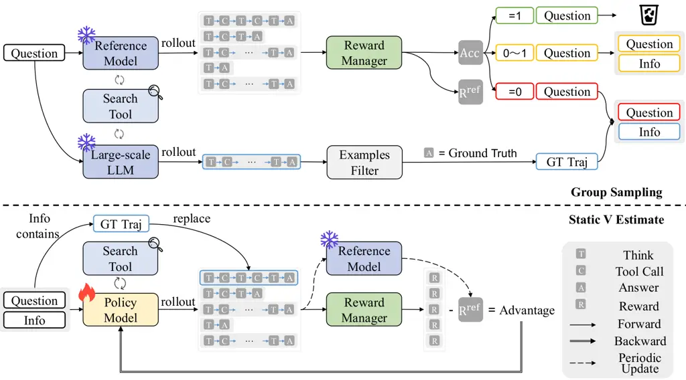

# PVPO: Pre-Estimated Value-Based Policy Optimization for Agentic Reasoning

Wenfeng Feng Email: [wenfeng.fwf@alibaba-inc.com](mailto:)    Penghong
Zhao ^(†)^(†)thanks: The first two authors contributed equally
Email: [zhaopenghong.zph@alibaba-inc.com](mailto:)    Guochao Jiang
Email: [suoni@taobao.com](mailto:)    Chuzhan Hao
Email: [cashenry@126.com](mailto:)    Yuewei ZhangGuohua Liu, Hao
WangAlibaba Cloud Computing ^(†)^(†)thanks: Corresponding author

###### Abstract

Critic-free reinforcement learning methods, particularly group policies,
have attracted considerable attention for their efficiency in complex
tasks. However, these methods rely heavily on multiple sampling and
comparisons within the policy to estimate advantage, which may cause the
policy to fall into local optimum and increase computational cost. To
address these issues, we propose PVPO, an efficient reinforcement
learning method enhanced by an advantage reference anchor and data
pre-sampling. Specifically, we use the reference model to rollout in
advance and employ the calculated reward score as a reference anchor.
Our approach effectively corrects the cumulative bias introduced by
intra-group comparisons and significantly reduces reliance on the number
of rollouts during training. Meanwhile, the reference model can assess
sample difficulty during data pre-sampling, enabling effective selection
of high-gain data to improve training efficiency. Moreover, PVPO is
orthogonal to other advanced critic-free RL algorithms, making it
compatible with and complementary to these methods. Experiments
conducted on nine datasets across two domains demonstrate that PVPO
achieves State-Of-The-Art (SOTA) performance. Our approach not only
demonstrates robust generalization across multiple tasks, but also
exhibits scalable performance across models of varying scales.

|     |
| --- |
|     |

## 1 Introduction

Reinforcement Learning (RL) is a machine learning method for learning
optimal policies through interaction with the environment. Policy
optimization depends on accurately estimating the advantage function to
improve the agent’s actions. In classic actor-critic frameworks, a
critic network predicts state-value ($`V`$), which combines with
action-value ($`Q`$) to compute the advantage and then guides policy
updates. Recently, research has increasingly focused on more efficient
critic-free architectures. These methods do not directly compute the
absolute advantage. Instead, they build baselines for relative
advantage, simplifying the training process and reducing resource
consumption (Shao et al., 2024; Feng et al., 2025b).

Grouping policies, as used in critic-free RL methods like GRPO (Shao
et al., 2024), become an important research topic. This is not only
because they demonstrate superior performance, but also because the
removal of the value model saves training resources, enabling
researchers to train larger-scale models under limited hardware
conditions. Although PPO and other actor-critic methods sometimes
achieve higher accuracy, critic-free grouping policies are widely used
for their practical efficiency. Some studies group by sample, running
multiple trajectories within each group to compute relative
advantage (Zuo et al., 2025; Lyu et al., 2025). Others group by action
or timestep, enabling finer partitioning and more accurate baseline
estimation (Feng et al., 2025b; Li et al., 2025a). These methods can
improve baseline accuracy for similar trajectories. However, grouping
policies usually require more rollouts to boost performance, which
greatly increases computational cost. Methods such as DAPO (Yu et al., 2025) aim to mitigate this issue by prioritizing high-value data
sampling. However, they primarily redistribute resource utilization
rather than achieving a genuine reduction in overall resource
consumption. We still need to achieve an effective trade-off between
training performance and computational cost. To construct the relative
advantage, some methods use state-independent baselines to generate
advantage values for each action (Williams, 1992; Ahmadian et al.,
2024). GRPO  (Shao et al., 2024) and GiGPO (Feng et al., 2025b) compare
the rewards of actions or trajectories within groups. In these
approaches, the evaluation criterion is derived from the policy itself,
which may cause policy optimization to become confined to existing
behavior patterns and lead to local optima.

From a human learning perspective, rollout can be seen as repeated
practice. Grouping policies resemble trial-and-error learning, where
individuals often compare outcomes to a fixed Reference Anchor for more
efficient learning. This anchor serves as an objective reference point,
distinct from the idealized optimal solutions provided by a critic or
the dynamic relative performance within a group, and establishes a more
general advantage baseline.

In this paper, we introduce Pre-estimated Value-based Policy
Optimization (PVPO), a generalized RL method based on Proximal Policy
Optimization (PPO) (Schulman et al., 2017). PVPO adopts a critic-free
architecture, is compatible with mainstream group policy RL methods, and
maintains low computational cost for grouping, thus effectively
combining the strengths of both approaches. Specifically, we use a
Reference Model (Ref) to run grouping reasoning and calculate a
task-based reward score as an anchor. This anchor serves as the $`V`$
estimate during RL training, helping to correct the cumulative bias in
relative advantage calculations typically observed in large language
models (LLMs). In essence, our method decouples $`Q`$ and $`V`$ in the
grouping policy advantage calculation. The reference anchor is computed
in an unsupervised manner and acts as both a supplement and an
enhancement to the training dataset, without incurring additional time
or memory overhead. In summary, our core contributions are as follows.

- •
  We propose PVPO, an efficient and generalizable approach to
  critic-free reinforcement learning. PVPO provides a stable,
  low-variance, and globally consistent advantage function, effectively
  mitigating concerns of error accumulation and policy drift during
  training. As a result, PVPO enables more efficient and robust policy
  optimization while significantly reducing spatio-temporal overhead.
- •
  We introduce a group sampling strategy that offline filters data with
  unstable accuracy rates to construct high-quality batches, thereby
  enhancing convergence and learning efficiency. Furthermore, for
  samples with zero accuracy (i.e., zero reward), we leverage a
  large-scale LLM to generate ground-truth trajectories, facilitating
  more effective learning from sparse reward signals.
- •
  PVPO achieves state-of-the-art performance on multi-step retrieval
  datasets and demonstrates strong generalization on mathematical
  reasoning benchmarks. Experimental results indicate that PVPO not only
  enhances multi-hop question answering (QA) and tool-use capabilities,
  but also improves the overall reasoning ability of LLMs.

## 2 Related Work

### 2.1 Agentic Reasoning

Leveraging reinforcement learning to drive search represents an
important direction in agentic reasoning (Jin et al., 2025; Jiang
et al., 2025). Search-o1 (Li et al., 2025b) integrates an agentic search
workflow into the reasoning trajectory. This achieves an elegant
integration of search and reasoning, sparking a wave of subsequent
optimizations (Qian et al., 2025; Wang et al., 2025; Feng et al.,
2025a). Moreover, numerous studies on Retrieval-Augmented Generation
(RAG) (Li et al., 2025b; Feng et al., 2025c; Hao et al., 2025) have
advanced the capabilities of LLM in tool use and information retrieval.

However, existing studies often directly apply algorithms such as GRPO,
which are intrinsically ill-suited to the sparse-reward setting of
agentic search. These methods depend on dense token-level rewards,
necessitating extensive rollouts to achieve stable advantage estimation.
Consequently, the quality of the learning signal becomes tightly coupled
with the sample size.

Our PVPO framework is tailored for agentic search by decoupling the
advantage function ($`A`$=$`Q`$-$`V`$), thereby mitigating sample size
dependency. While the actual return ($`Q`$) leverages the sample size,
the advantage baseline ($`V`$) remains independent of both the current
and previous policies. This design ensures a stable learning signal even
under severe reward sparsity (e.g., $`Q`$=0), obviating the need for
extensive rollouts.

### 2.2 RL for LLMs

Recently, reward and advantage computation has been redefined through
dynamic generation and iterative optimization, substantially enhancing
the performance of critic-free RL methods. Some methods construct denser
feedback signals by increasing the frequency of reward
generation (Bensal et al., 2025; Chen et al., 2024), while others
improve reward adherence by incorporating additional training phases
into the learning process (Dong et al., 2025). These approaches often
overlook the compounding hallucinations arising from repeated sampling
and error accumulation from iterative policy updates. Each incremental
policy change alters the rollout distribution, resulting in advantage
estimates targeting a continually shifting objective and potentially
steering the policy toward suboptimal local minima. Moreover, these
methods depend heavily on costly online sampling procedures.

Another line of research seeks to recover endogenous rewards from the
actor model via reverse engineering, a process that has been
mathematically substantiated (Li et al., 2025c; Zhao et al., 2025). This
approach eliminates the need for additional training and enables
adaptation to diverse evaluation preferences through prompt adjustment.
However, the quality of the recovered reward is inherently limited by
the base model’s capabilities, and consistently guiding reward signals
through prompting remains a significant challenge (Zhao et al., 2021; Lu
et al., 2022; Liu et al., 2023).

To address these challenges, the research community has investigated
various static approaches. The most prominent is offline reinforcement
learning, which optimizes policies using fixed datasets (Kumar et al.,
2020; Kostrikov et al., 2022). Another notable class comprises Direct
Preference Optimization (DPO) (Rafailov et al., 2023) and its variants
(Ethayarajh et al., 2024), which reformulate the objective as a direct
fit to fixed preference pairs, reducing the reliance on online sampling
but constraining generalization. Simpler static methods, such as
weighted behavioral cloning (Xu et al., 2022a; Xu et al., 2022b), offer
limited expressive power and theoretical guarantees due to their
parsimonious advantage estimation.

To balance efficiency and adaptability in policy optimization, our
approach integrates a static $`V`$ with a dynamic $`Q`$, ensuring stable
advantage estimation and low computational overhead while maintaining
responsive adaptation to policy updates.

## 3 Preliminary

In this section, we review the fundamental concepts of policy
optimization in RL, with a particular focus on the role of the advantage
function and its various estimation methods.

### 3.1 Proximal Policy Optimization

Actor-critic methods, such as PPO, train a critic network
$`V_{\phi}(s)`$ to provide a low-variance estimate of the state-value
function $`V^{\pi}(s)`$ of state $`s`$. The state-value function is used
to compute the advantage at each time step $`t`$, typically via
Generalized Advantage Estimation (GAE) (Schulman et al., 2015):

```math
\begin{split}\hat{A}^{\text{GAE}}_{t}=\sum_{l=0}^{\infty}(\gamma\lambda)^{l}\delta_{t+l},\quad\delta_{t}=r_{t}+\gamma V_{\phi}(s_{t+1})-V_{\phi}(s_{t})\text{,}\end{split} \tag{1}
```

where $`\lambda`$ is a hyper-parameter, $`\delta_{t}`$ is the temporal
difference error at time step $`t`$, $`r_{t}`$ is the immediate reward
received at time step $`t`$, $`\gamma`$ is the discount factor. PPO then
optimizes a clipped surrogate objective to update the actor network in a
stable manner:

```math
\begin{split}\mathcal{J}^{\text{PPO}}(\theta)={}&\mathbb{E}_{q\sim P(D),o\sim\pi_{\theta_{\text{old}}}(O|q)}\left[\min\left(r_{t}(\theta)\hat{A}^{\text{GAE}}_{t},\text{clip}(r_{t}(\theta),1-\epsilon,1+\epsilon)\hat{A}^{\text{GAE}}_{t}\right)\right]\text{,}\end{split} \tag{2}
```

where $`q`$ are questions sampled from the dataset $`D`$, $`o`$ are
outputs sampled from the old policy $`\pi_{\text{old}}`$, importance
sampling ratio
$`r_{t}(\theta)=\frac{\pi_{\theta}(o_{t}|q,o_{<t})}{\pi_{\theta_{\text{old}}}(o_{t}|q,o_{<t})}`$,
$`\epsilon`$ is the clipping range of $`r_{t}(\theta)`$.

### 3.2 Group Relative Policy Optimization

Since the critic network is typically as large as the actor network, it
adds substantial memory and computational burden. Critic-free methods,
such as GRPO, eliminate this costly component by estimating the
advantage directly from rewards.

For each question, GRPO generates a group of outputs $`\{o_{i}\}`$ from
the old policy $`\pi_{\theta_{\text{old}}}`$. The advantage for each
output $`o_{i}`$ is then calculated based on normalized reward
$`\mathbf{r}`$ relative to the group:

```math
\hat{A}_{i,t}=\frac{r_{i}-\text{mean}(\mathbf{r})}{\text{std}(\mathbf{r})}\text{.} \tag{3}
```

This critic-free advantage estimate is then used to optimize a PPO-like
objective function:

```math
\begin{split}&\mathcal{J}^{\text{GRPO}}(\theta)=\mathbb{E}_{q\sim P(D),\{o_{i}\}\sim\pi_{\theta_{\text{old}}}(O|q)}\\
&\quad\Biggl[\frac{1}{G}\sum_{i=1}^{G}\frac{1}{|o_{i}|}\sum_{t=1}^{|o_{i}|}\biggl\{\min\left(r_{i,t}(\theta)\hat{A}_{i,t},\text{clip}\left(r_{i,t}(\theta),1-\epsilon,1+\epsilon\right)\hat{A}_{i,t}\right)-\beta D_{KL}[\pi_{\theta}||\pi_{\text{ref}}]\biggr\}\Biggr]\text{,}\end{split} \tag{4}
```

where
$`r_{i,t}(\theta)=\frac{\pi_{\theta}(o_{i,t}|q,o_{i,<t})}{\pi_{\theta_{\text{old}}}(o_{i,t}|q,o_{i,<t})}`$,
$`D_{KL}`$ is the KL divergence between the trained policy
$`\pi_{\theta}`$ and the reference policy $`\pi_{\text{ref}}`$,
$`\beta`$ is a hyper-parameter.



Figure 1: The architecture of PVPO. Reference model updates
$`R^{\text{ref}}`$ at fixed steps, maintaining value stability and
improving the performance lower bound. Reward manager do not restrict
the generation of reward.

## 4 Methodology

In this section, we will introduce our efficient and effective RL
algorithm PVPO. The architecture is illustrated in Figure 1. PVPO
optimizes the policy via the following objective:

```math
\begin{split}&\mathcal{J}^{\text{PVPO}}(\theta)=\mathbb{E}_{q\sim P(D),\{o_{i}\}\sim\pi_{\theta_{\text{old}}}(O|q)}\\
&\quad\Biggl[\frac{1}{G}\sum_{i=1}^{G}\frac{1}{|o_{i}|}\sum_{t=1}^{|o_{i}|}\biggl\{\min\left(r_{i,t}(\theta)\hat{A}^{\text{PVPO}}_{i,t},\text{clip}\left(r_{i,t}(\theta),1-\epsilon,1+\epsilon\right)\hat{A}^{\text{PVPO}}_{i,t}\right)-\beta D_{KL}[\pi_{\theta}||\pi_{\text{ref}}]\biggr\}\Biggr]\text{.}\end{split} \tag{5}
```

where

```math
r_{i,t}(\theta)=\begin{cases}\frac{\pi_{\theta}(o_{i,t}|q,o_{i,<t})}{\pi_{\theta_{\text{old}}}(o_{i,t}|q,o_{i,<t})},&\text{if }o_{i}\notin\text{GT Traj}.\\
\frac{\pi_{\theta}(o_{i,t}|q,o_{i,<t})}{\pi_{\theta_{\text{gt}}}(o_{i,t}|q,o_{i,<t})},&\text{if }o_{i}\in\text{GT Traj}.\end{cases} \tag{6}
```

### 4.1 Static V Estimate

In actual policy optimization, the current method is to operate at the
group level rather than through single sampling. For problem $`q`$, we
use the current policy $`\pi_{\theta}`$ to generate $`N`$ independent
trajectories $`\mathcal{T}=\{\tau_{1},\tau_{2},...,\tau_{N}\}`$ and
obtain the corresponding rewards
$`\mathbf{r}=\{R(\tau_{1}),R(\tau_{2}),...,R(\tau_{N})\}=\{r_{1},r_{2},...,r_{N}\}`$.
For any step $`(s_{i,t},a_{i,t})`$ in a specific trajectory
$`\tau_{i}`$, the unbiased Monte Carlo estimate of the action value
$`Q^{\pi}(s_{i,t},a_{i,t})`$ is the final reward $`r_{i}`$ observed in
that trajectory. We refer to this as the Dynamic Q Estimate because it
directly reflects the result of a single rollout of the current policy:

```math
\hat{Q}_{\text{dyn}}(\tau_{i})=\mathbb{E}_{\tau\sim\pi_{\theta}}[R(\tau_{i})]=r_{i}\text{.} \tag{7}
```

Considering that reward $`r_{i}`$ is given after the generation of
trajectory $`\tau_{i}`$, the trajectory generation process is regarded
as atomic actions $`a_{i}=\tau_{i}`$ executed from $`s_{i,0}`$. This
atomicity makes the reward distribution of the intermediate state
$`s_{i,t}`$ only depend on initial state $`s_{i,0}`$ ($`s_{0}`$) and
$`\pi_{i}`$. Consequently, the expected return of the policy is equal to
the state value of the initial state $`V^{\pi}(s_{0})`$. A natural
estimation method is to approximate this expectation using the empirical
mean of all rewards in the current group. This is the approach adopted
by on-policy methods such as GRPO, which we refer to as Dynamic V
Estimate:

```math
\hat{V}_{\text{dyn}}(s_{0})=\hat{V}_{\text{dyn}}(\mathcal{T})=\frac{1}{N}\sum_{j=1}^{N}r_{j}=\text{mean}(\mathbf{r})\text{.} \tag{8}
```

So we obtain the sparse advantage estimate for trajectory $`\tau_{i}`$
in the on-policy method:

```math
\begin{split}\hat{A}_{\text{dyn}}(\tau_{i},s_{0})&=\hat{Q}_{\text{dyn}}(\tau_{i})-\hat{V}_{\text{dyn}}(s_{0})=r_{i}-\text{mean}(\mathbf{r})\text{.}\end{split} \tag{9}
```

This formula clearly shows that the advantage is calculated as the
difference between the immediate reward and the average performance of
the current policy $`\pi_{\theta}`$ within the group. However,
$`\hat{V}_{\text{dyn}}`$ fluctuates wildly with each sampling of the
group and is directly affected by $`\pi_{\theta}`$, introducing
significant instability, especially when the group size is not large
enough. To more effectively mitigate the instability associated with
dynamic $`V`$ estimation, we propose substituting it with a more robust
fixed $`V`$ estimate.

The ideal baseline should represent a Reference Anchor that does not
change with current policy iterations. Therefore, we use the expected
return of a fixed reference policy $`\pi_{ref}`$ (e.g., the initial
policy model) as our Static V Estimate $`\hat{V}_{\text{sta}}`$. The
baseline can be accurately estimated in advance by sampling the
reference policy $`\pi_{ref}`$ M times, and update at fixed steps during
training process:

```math
\hat{V}_{\text{sta}}(s_{0})=\frac{1}{M}\sum_{j=1}^{M}r^{\text{ref}}_{j}=\text{mean}(\mathbf{r^{\text{ref}}})\text{.} \tag{10}
```

This stable static baseline replaces the unstable dynamic baseline in
formula 8. We finally obtain the advantage function of PVPO, which is
well-suited for RL tasks with sparse rewards.

```math
\begin{split}\hat{A}^{\text{PVPO}}(\tau_{i},s_{0})&=\hat{Q}_{\text{dyn}}(\tau_{i})-\hat{V}_{\text{sta}}(s_{0})=r_{i}-\text{mean}(\mathbf{r^{\text{ref}}})\text{.}\end{split} \tag{11}
```

In summary, $`\hat{Q}_{\text{dyn}}(\tau_{i})`$ is obtained from the
immediate reward of on-policy $`\pi_{\theta}`$ rollout. It reflects the
current performance of the policy and is highly adaptive. The Static V
Estimate $`\hat{V}_{\text{sta}}(s_{0})`$ is obtained from the average
reward of the reference policy $`\pi_{\text{ref}}`$ pre-rollout. It
provides a stable and low-variance performance baseline.

### 4.2 Group Sampling

Inspired by DAPO’s dynamic sampling strategy, we also assess the
accuracy of sample rollouts while continuing to utilize the reference
model for offline rollouts. For each sample, the mean accuracy of the
rollouts serves as the filtering criterion.

Specifically, samples are categorized into three groups:

- •
  Samples with a mean accuracy of 1 are excluded from the training set,
  as they are considered too trivial to facilitate effective learning.
- •
  Samples with a mean accuracy strictly between 0 and 1 are retained,
  given their nonzero advantage.
- •
  For samples exhibiting a mean accuracy of 0, an additional rollout is
  conducted using a larger LLM for further evaluation.

The larger LLM can correctly answer some of these samples. We cache
these Ground Truth Trajectories (GT Traj) and their probability
distributions. During policy training, a GT Traj is injected by
replacing one of the generated rollouts for these specific samples. This
method mitigates the sparse reward issue commonly encountered with
complex samples. In the absence of guidance, the LLM may fail to obtain
any positive feedback through unguided exploration. By providing a
reference trajectory, the model receives an explicit demonstration,
which jumpstarts learning by offering a clear example of a successful
reasoning process.

## 5 Expriments Setting

Metrics. For multi-hop QA tasks, we employ answer accuracy (Acc, %) and
LLM-as-a-Judge (LasJ, %) (Song et al., 2025) as evaluation metrics. For
mathematical reasoning tasks, we measure answer accuracy (Acc, %),
reporting the mean accuracy across 32 independent rollouts for each
sample (i.e., acc@32).

Datasets. For multi-hop QA tasks, we conduct experiments on four
multi-step retrieval datasets: Musique (Trivedi et al., 2022),
2WikiMultiHopQA (2Wiki) (Ho et al., 2020), HotpotQA (Yang et al., 2018),
and Bamboogle (Bam) (Press et al., 2023). Model training is performed on
the Musique training split, which consists of 20k examples, and
evaluations are carried out on the full development and test sets. For
mathematical reasoning tasks, we train models on
DAPO-Math-17k-Processed (Yu et al., 2025), comprising 17k examples, and
conduct evaluation on five test sets: DAPO-AIME-2024 (AI-MO, 2024;
Bytedance & Tsinghua-SIA, 2025), AIME-2025 (Lin, 2025),
MATH500 (Lightman et al., 2024; HuggingFaceH4, 2023), AMC23 (AI-MO,
2024), and Olympiad (He et al., 2024).

Baselines and Training Details. We use Qwen2.5-7B-Instruct and
Qwen2.5-14B-Instruct as base models and Qwen2.5-72B-Instruct as the
large LLM to generate GT Traj. The reference reward $`R^{\text{ref}}`$
is updated every 500 steps. For training, we set the learning rate to
1e-6, maximum response length to 8192, sampling temperature to 1.0 and
top-p to 1.0. For inference, we set the sampling temperature to 0.6 and
top-p to 0.95. For the multi-hop QA tasks, we benchmark our method
against not only state-of-the-art LLMs such as DeepSeek-R1-0528,
GPT-4.1-0414, O4-mini-0416, and Gemini-2.5-pro-0325, but also prominent
RL-based agentic search models (Jin et al., 2025; Song et al., 2025). We
adopt the ReSearch (Chen et al., 2025) framework, with pre-samples
$`M=5`$, rollout $`N=5`$, train batch size of 8, and 1,000 training
steps. For DynaSearcher(Hao et al., 2025), we remove the “kg*filter”
during inference. For mathematical reasoning tasks, we primarily adopt
GRPO (Shao et al., 2024), DAPO (Yu et al., 2025), and GSPO (Zheng
et al., 2025) as baselines. We use the verl (Sheng et al., 2025)
framework with pre-samples $`M=16`$, rollout $`N=16`$, train batch size
of 32, and 1,000 training steps. For DAPO, we set the clipping parameter
$`\epsilon*{\text{low}}=0.2`$ and $`\epsilon\_{\text{high}}=0.28`$. For
GRPO, we set the “loss_agg_mode” to “seq-mean-token-mean”, which is
aligned with the original paper. For GSPO, the clipping parameter
$`\epsilon`$ is set to 0.0003. All experiments are conducted on a server
equipped with an Intel(R) Xeon(R) Platinum 8369B CPU and
$`8\times`$NVIDIA A100-SXM4-80GB GPUs. More details can be found in
Appendix A.1.

## 6 Experiments

In this section, we conduct a series of experiments to comprehensively
evaluate PVPO. First, we test our method on multi-hop QA to validate its
effectiveness in the agent domain. Next, we perform ablation studies to
examine the contributions of the core modules of PVPO. We further apply
PVPO to mathematical reasoning tasks to verify its generalizability and
also evaluate its compatibility with other advanced RL algorithms. In
addition, we analyze the training efficiency and convergence properties
of PVPO. Finally, we present a case study to investigate the efficiency
and robustness of PVPO under low sampling budget.

|                     |         |      |       |      |          |      |           |      |         |      |
| ------------------- | ------- | ---- | ----- | ---- | -------- | ---- | --------- | ---- | ------- | ---- |
| Method              | Musique |      | 2Wiki |      | HotpotQA |      | Bamboogle |      | Average |      |
|                     | Acc     | LasJ | Acc   | LasJ | Acc      | LasJ | Acc       | LasJ | Acc     | LasJ |
| Prompt Based        |         |      |       |      |          |      |           |      |         |      |
| Qwen2.5-7B-Instruct | 5.1     | 13.5 | 27.9  | 29.3 | 22.4     | 31.0 | 12.8      | 17.1 | 17.1    | 22.7 |
| DeepSeek-R1         | 32.0    | 40.7 | 57.5  | 59.4 | 43.0     | 58.3 | 66.4      | 76.6 | 49.7    | 58.8 |
| O4-mini             | 38.0    | 44.1 | 61.5  | 67.4 | 49.5     | 67.4 | 74.4      | 84.2 | 55.9    | 65.8 |
| GPT-4.1-global      | 31.0    | 40.9 | 58.0  | 58.5 | 44.5     | 57.7 | 51.2      | 61.6 | 46.2    | 54.7 |
| Gemini-2.5-pro      | 42.5    | 50.8 | 70.0  | 71.2 | 53.0     | 71.1 | 75.2      | 84.5 | 60.2    | 69.4 |
| Train Based         |         |      |       |      |          |      |           |      |         |      |
| Qwen2.5-7B-Instruct |         |      |       |      |          |      |           |      |         |      |
| Search-R1-v0.3      | 24.7    | 34.6 | 58.7  | 61.1 | 53.6     | 66.9 | 48.0      | 54.5 | 46.3    | 54.4 |
| R1-Searcher         | 24.7    | 34.2 | 67.8  | 68.2 | 59.7     | 71.5 | 46.4      | 52.0 | 50.5    | 56.5 |
| GRPO-ReSearch       | 33.4    | 46.7 | 60.8  | 67.0 | 54.5     | 63.7 | 45.6      | 54.4 | 48.6    | 58.0 |
| GRPO-DynaSearcher   | 38.9    | 52.0 | 74.3  | 76.8 | 62.7     | 68.3 | 51.2      | 58.7 | 56.8    | 64.0 |
| PVPO-ReSearch       | 36.5    | 51.4 | 70.1  | 72.4 | 65.5     | 72.3 | 45.6      | 54.3 | 54.4    | 62.6 |
| PVPO-DynaSearcher   | 46.9    | 59.4 | 77.7  | 80.6 | 69.0     | 78.4 | 50.4      | 59.7 | 61.0    | 69.6 |

Table 1: Performance comparisons between PVPO and the baselines on
multi-step retrieval datasets. The best and second best results are bold
and underlined, respectively.

### 6.1 Main Results

We evaluate PVPO against both zero-shot leading LLMs and trained
RL-based search methods, with results in Table 1 underscoring its
effectiveness. Specifically, applying PVPO substantially improves the
base frameworks, boosting ReSearch’s Avg Acc/LasJ scores by 5.8/4.6
points and DynaSearcher’s by 4.2/5.6 points. Notably, our
PVPO-DynaSearcher model significantly outperforms all RL-trained
baselines (e.g., surpassing GRPO by over 5 points on average). It also
marginally exceeding the strongest proprietary LLM, Gemini-2.5-Pro,
while establishing a considerable lead over other models like O4-mini,
GPT-4.1, and DeepSeek-R1. On the Bamboogle dataset, SOTA LLMs
significantly outperform 7B-trained models largely due to the outdated
2018 Wikipedia corpus used in our experiments (see Appendix A.1 and
Figure 5). Overall, these results demonstrate that PVPO consistently
achieves state-of-the-art performance across agentic search methods.

### 6.2 Ablation Study

We conduct an ablation study to isolate the contribution of each
component in PVPO, as shown in Table 2. Starting from the
GRPO-DynaSearcher baseline (56.8 Avg Acc / 64.0 LasJ), the integration
of Static V Estimation first raises the scores to 58.3/66.7.
Subsequently adding Group Sampling further boosts the performance to
61.0/69.6, which represents our full PVPO model and outperforms all
baselines. This incremental improvement validates the effectiveness of
each proposed component.

| Method                 | Average |      |
| ---------------------- | ------- | ---- |
|                        | Acc     | LasJ |
| Qwen2.5-7B-Instruct    | 31.1    | 39.7 |
| GRPO-DynaSearcher      | 56.8    | 64.0 |
| \+ Static V Estimation | 58.3    | 66.7 |
| \+ Group Sampling      | 61.0    | 69.6 |

Table 2: Ablation study of PVPO on multi-step retrieval datasets.
Starting from DynaSearcher on Qwen2.5-7B-Instruct, we incrementally add
Static V Estimation and Group Sampling.

Figure 2: Training efficiency of PVPO on mathematical reasoning
datasets.

| Method               | MATH500 | AMC23 | Olympiad | AIME-2024 | AIME-2025 | Avg Acc |
| -------------------- | ------- | ----- | -------- | --------- | --------- | ------- |
| Qwen2.5-7B-Instruct  | 75.68   | 42.92 | 38.94    | 12.10     | 6.67      | 35.26   |
| w/ GRPO              | 78.60   | 49.10 | 42.14    | 13.86     | 10.10     | 38.76   |
| w/ DAPO              | 78.58   | 51.38 | 43.36    | 14.96     | 11.30     | 39.92   |
| w/ GSPO              | 78.66   | 50.12 | 43.60    | 15.02     | 12.70     | 40.02   |
| w/ PVPO              | 80.30   | 52.02 | 44.62    | 14.86     | 14.70     | 41.30   |
| Qwen2.5-14B-Instruct | 79.68   | 51.52 | 44.00    | 14.82     | 12.29     | 40.46   |
| w/ GRPO              | 82.12   | 53.50 | 47.42    | 16.14     | 15.86     | 43.01   |
| w/ DAPO              | 82.50   | 56.44 | 49.34    | 18.04     | 15.66     | 44.40   |
| w/ GSPO              | 83.56   | 56.02 | 49.28    | 18.18     | 16.20     | 44.65   |
| w/ PVPO              | 83.64   | 56.78 | 50.72    | 19.24     | 17.74     | 45.62   |

Table 3: Performance comparison of PVPO and baseline methods on
mathematical reasoning datasets using different model scales. “w/” means
trained with.

### 6.3 Generalization Evaluation

To evaluate the transferability of PVPO, we apply it to mathematical
reasoning tasks spanning a range of difficulties, from basic arithmetic
to olympiad-level problems. We compare PVPO with GRPO, DAPO, and GSPO
across several benchmark datasets. As shown in Table 3, PVPO
consistently outperforms all baselines on both the 7B and 14B model
scales. We further combine PVPO with the core modules of advanced RL
methods, such as the sequence-level importance ratio from GSPO and the
KL removal strategy from DAPO, achieving additional performance
improvements when integrated with these state-of-the-art algorithms.
Since these integrated modules are not the main focus of PVPO, we
provide the detailed results and metrics for these extensions in
Appendix A.3 and Table 4. Furthermore, PVPO exhibits robust cross-domain
generalization and enhanced scalability.

### 6.4 Training Efficiency Analysis

As illustrated in Figure 2, PVPO converges much faster than GRPO,
reaching the target accuracy in only 500 steps compared to GRPO’s 1,000
steps. After 1,000 steps, PVPO also achieves higher final accuracy,
confirming its effectiveness. By applying Group Sampling, PVPO filters
out 40–60% of low-quality data and further accelerates training by
1.7$`\times`$ to 2.5$`\times`$ (see Appendix A.2). Overall, these
results confirm that PVPO improves both convergence speed and training
efficiency.

Figure 3: Training stability of PVPO on multi-step retrieval datasets.

### 6.5 Stability Evaluation

We track PVPO training metrics to show its stability. Figure 3 (a) shows
that PVPO achieves a much higher average reward than GRPO. With a
similar KL divergence in Figure 3 (b), this improvement comes not from
more aggressive updates, but from better gradient direction estimates.
As shown in Figure 3 (c), PVPO has lower advantage variance, leading to
more reliable and consistent update directions. PVPO also maintains
exploration without losing stability. Figure 3 (d) shows that it keeps
higher policy entropy under a similar KL constraint, which helps avoid
premature convergence to a local optimum. Overall, PVPO addresses key
problems in RL by supporting high exploration, low variance, and high
rewards, thereby achieving more stable training than existing methods.

### 6.6 Case Study: Low Sampling Budget

To further examine PVPO’s performance under resource constraints, we
conduct a case study on low sampling budget. We reduce the number of
rollouts from 5 (used in the main experiments) to 2. For comparison, we
report GRPO’s performance with a full budget. Figure 4 (a) shows that
PVPO with a low budget remains close to the fully budgeted GRPO. We
calculate computational cost by multiplying the number of rollouts with
the average number of tool calls in trajectories. As shown in Figure 4
(b), PVPO’s average cost is only 4.3, which is much lower than GRPO’s
11.7. PVPO achieves 97% of GRPO’s performance (55.0% vs 56.8%) while
using less than 40% of the computational cost. This strong sample
efficiency comes from the high-quality, low-variance training signals
provided by Static V Estimate. The model can update its policy
efficiently using fewer rollouts.

Figure 4: Low sampling budget of PVPO on multi-step retrieval datasets.
The $`N`$ denotes the number of trajectories in each single rollout.
$`N`$=5 is the full budget and $`N`$=2 is the low budget.

## 7 Conclusions

In this paper, we propose PVPO, an efficient critic-free reinforcement
learning algorithm designed to optimize policy learning for complex
tasks. By introducing a Static V Estimate as an external advantage
reference and integrating it with group sampling for effective data
filtering, PVPO addresses the limitations of extensive sampling and
biased intra-group comparisons inherent in prior methods. Our approach
yields stable, low-variance training signals, accelerates convergence,
and significantly reduces computational costs. Extensive experiments
across nine diverse benchmarks in multi-hop QA and mathematical
reasoning demonstrate that PVPO achieves state-of-the-art performance
and strong generalization, even with small-scale models and limited
resources. PVPO introduces substantial improvements in reasoning and
tool use, supports scalable training, and ensures consistent
performance, thereby demonstrating strong potential for widespread
real-world application.

## References

- Ahmadian et al. (2024) Arash Ahmadian, Chris Cremer, Matthias Gallé,
  Marzieh Fadaee, Julia Kreutzer, Olivier Pietquin, Ahmet Üstün, and
  Sara Hooker. Back to basics: Revisiting reinforce-style optimization
  for learning from human feedback in llms. In Lun-Wei Ku, Andre
  Martins, and Vivek Srikumar (eds.), _Proceedings of the 62nd Annual
  Meeting of the Association for Computational Linguistics (Volume 1:
  Long Papers), ACL 2024, Bangkok, Thailand, August 11-16, 2024_, pp.
  12248–12267. Association for Computational Linguistics, 2024. doi:
  10.18653/V1/2024.ACL-LONG.662. URL
  [https://doi.org/10.18653/v1/2024.acl-long.662](https://doi.org/10.18653/v1/2024.acl-long.662).
- AI-MO (2024) AI-MO. Aimo-validation-aime.
  [https://huggingface.co/datasets/AI-MO/aimo-validation-aime](https://huggingface.co/datasets/AI-MO/aimo-validation-aime), 2024.
- AI-MO (2024) AI-MO. AIMO Validation AMC Dataset.
  [https://huggingface.co/datasets/AI-MO/aimo-validation-amc](https://huggingface.co/datasets/AI-MO/aimo-validation-amc), 2024.
- Bensal et al. (2025) Shelly Bensal, Umar Jamil, Christopher Bryant,
  Melisa Russak, Kiran Kamble, Dmytro Mozolevskyi, Muayad Ali, and
  Waseem AlShikh. Reflect, retry, reward: Self-improving llms via
  reinforcement learning. _arXiv preprint arXiv:2505.24726_, 2025.
- Bytedance & Tsinghua-SIA (2025) Bytedance and Tsinghua-SIA. AIME-2024.
  [https://huggingface.co/datasets/BytedTsinghua-SIA/AIME-2024](https://huggingface.co/datasets/BytedTsinghua-SIA/AIME-2024), 2025.
  Hugging Face Dataset.
- Chen et al. (2025) Mingyang Chen, Tianpeng Li, Haoze Sun, Yijie Zhou,
  Chenzheng Zhu, Haofen Wang, Jeff Z Pan, Wen Zhang, Huajun Chen, Fan
  Yang, et al. Learning to reason with search for llms via reinforcement
  learning. _arXiv preprint arXiv:2503.19470_, 2025.
- Chen et al. (2024) Zixiang Chen, Yihe Deng, Huizhuo Yuan, Kaixuan Ji,
  and Quanquan Gu. Self-play fine-tuning converts weak language models
  to strong language models. In _Forty-first International Conference on
  Machine Learning, ICML 2024, Vienna, Austria, July 21-27, 2024_.
  OpenReview.net, 2024. URL
  [https://openreview.net/forum?id=O4cHTxW9BS](https://openreview.net/forum?id=O4cHTxW9BS).
- Dong et al. (2025) Guanting Dong, Yifei Chen, Xiaoxi Li, Jiajie Jin,
  Hongjin Qian, Yutao Zhu, Hangyu Mao, Guorui Zhou, Zhicheng Dou, and
  Ji-Rong Wen. Tool-star: Empowering llm-brained multi-tool reasoner via
  reinforcement learning. _arXiv preprint arXiv:2505.16410_, 2025.
- Ethayarajh et al. (2024) Kawin Ethayarajh, Winnie Xu, Niklas
  Muennighoff, Dan Jurafsky, and Douwe Kiela. Kto: Model alignment as
  prospect theoretic optimization. _arXiv preprint
  arXiv:2402.01306_, 2024.
- Feng et al. (2025a) Jiazhan Feng, Shijue Huang, Xingwei Qu, Ge Zhang,
  Yujia Qin, Baoquan Zhong, Chengquan Jiang, Jinxin Chi, and Wanjun
  Zhong. Retool: Reinforcement learning for strategic tool use in llms.
  _arXiv preprint arXiv:2504.11536_, 2025a.
- Feng et al. (2025b) Lang Feng, Zhenghai Xue, Tingcong Liu, and Bo An.
  Group-in-group policy optimization for llm agent training. _arXiv
  preprint arXiv:2505.10978_, 2025b.
- Feng et al. (2025c) Wenfeng Feng, Chuzhan Hao, Yuewei Zhang, Guochao
  Jiang, Jingyi Song, and Hao Wang. Airrag: Autonomous strategic
  planning and reasoning steer retrieval augmented generation. _arXiv
  preprint arXiv:2501.10053_, 2025c.
- Hao et al. (2025) Chuzhan Hao, Wenfeng Feng, Yuewei Zhang, and Hao
  Wang. Dynasearcher: Dynamic knowledge graph augmented search agent via
  multi-reward reinforcement learning. _arXiv preprint
  arXiv:2507.17365_, 2025.
- He et al. (2024) Chaoqun He, Renjie Luo, Yuzhuo Bai, Shengding Hu,
  Zhen Leng Thai, Junhao Shen, Jinyi Hu, Xu Han, Yujie Huang, Yuxiang
  Zhang, Jie Liu, Lei Qi, Zhiyuan Liu, and Maosong Sun. Olympiadbench: A
  challenging benchmark for promoting AGI with olympiad-level bilingual
  multimodal scientific problems. In Lun-Wei Ku, Andre Martins, and
  Vivek Srikumar (eds.), _Proceedings of the 62nd Annual Meeting of the
  Association for Computational Linguistics (Volume 1: Long Papers), ACL
  2024, Bangkok, Thailand, August 11-16, 2024_, pp. 3828–3850.
  Association for Computational Linguistics, 2024. doi:
  10.18653/V1/2024.ACL-LONG.211. URL
  [https://doi.org/10.18653/v1/2024.acl-long.211](https://doi.org/10.18653/v1/2024.acl-long.211).
- Ho et al. (2020) Xanh Ho, Anh-Khoa Duong Nguyen, Saku Sugawara, and
  Akiko Aizawa. Constructing A multi-hop QA dataset for comprehensive
  evaluation of reasoning steps. In Donia Scott, Núria Bel, and
  Chengqing Zong (eds.), _Proceedings of the 28th International
  Conference on Computational Linguistics, COLING 2020, Barcelona, Spain
  (Online), December 8-13, 2020_, pp. 6609–6625. International Committee
  on Computational Linguistics, 2020. doi:
  10.18653/V1/2020.COLING-MAIN.580. URL
  [https://doi.org/10.18653/v1/2020.coling-main.580](https://doi.org/10.18653/v1/2020.coling-main.580).
- HuggingFaceH4 (2023) HuggingFaceH4. Math-500.
  [https://huggingface.co/datasets/HuggingFaceH4/MATH-500](https://huggingface.co/datasets/HuggingFaceH4/MATH-500), 2023.
- Jiang et al. (2025) Pengcheng Jiang, Jiacheng Lin, Lang Cao, Runchu
  Tian, SeongKu Kang, Zifeng Wang, Jimeng Sun, and Jiawei Han.
  Deepretrieval: Hacking real search engines and retrievers with large
  language models via reinforcement learning. _arXiv preprint
  arXiv:2503.00223_, 2025.
- Jin et al. (2025) Bowen Jin, Hansi Zeng, Zhenrui Yue, Jinsung Yoon,
  Sercan Arik, Dong Wang, Hamed Zamani, and Jiawei Han. Search-r1:
  Training llms to reason and leverage search engines with reinforcement
  learning. _arXiv preprint arXiv:2503.09516_, 2025.
- Kostrikov et al. (2022) Ilya Kostrikov, Ashvin Nair, and Sergey
  Levine. Offline reinforcement learning with implicit q-learning. In
  _The Tenth International Conference on Learning Representations, ICLR
  2022, Virtual Event, April 25-29, 2022_. OpenReview.net, 2022. URL
  [https://openreview.net/forum?id=68n2s9ZJWF8](https://openreview.net/forum?id=68n2s9ZJWF8).
- Kumar et al. (2020) Aviral Kumar, Aurick Zhou, George Tucker, and
  Sergey Levine. Conservative q-learning for offline reinforcement
  learning. In Hugo Larochelle, Marc’Aurelio Ranzato, Raia Hadsell,
  Maria-Florina Balcan, and Hsuan-Tien Lin (eds.), _Advances in Neural
  Information Processing Systems 33: Annual Conference on Neural
  Information Processing Systems 2020, NeurIPS 2020, December 6-12,
  2020, virtual_, 2020. URL
  [https://proceedings.neurips.cc/paper/2020/hash/0d2b2061826a5df3221116a5085a6052-Abstract.html](https://proceedings.neurips.cc/paper/2020/hash/0d2b2061826a5df3221116a5085a6052-Abstract.html).
- Li et al. (2025a) Siheng Li, Zhanhui Zhou, Wai Lam, Chao Yang, and
  Chaochao Lu. Repo: Replay-enhanced policy optimization. _arXiv
  preprint arXiv:2506.09340_, 2025a.
- Li et al. (2025b) Xiaoxi Li, Guanting Dong, Jiajie Jin, Yuyao Zhang,
  Yujia Zhou, Yutao Zhu, Peitian Zhang, and Zhicheng Dou. Search-o1:
  Agentic search-enhanced large reasoning models. _arXiv preprint
  arXiv:2501.05366_, 2025b.
- Li et al. (2025c) Yi-Chen Li, Tian Xu, Yang Yu, Xuqin Zhang, Xiong-Hui
  Chen, Zhongxiang Ling, Ningjing Chao, Lei Yuan, and Zhi-Hua Zhou.
  Generalist reward models: Found inside large language models. _arXiv
  preprint arXiv:2506.23235_, 2025c.
- Lightman et al. (2024) Hunter Lightman, Vineet Kosaraju, Yuri Burda,
  Harrison Edwards, Bowen Baker, Teddy Lee, Jan Leike, John Schulman,
  Ilya Sutskever, and Karl Cobbe. Let’s verify step by step. In _The
  Twelfth International Conference on Learning Representations, ICLR
  2024, Vienna, Austria, May 7-11, 2024_. OpenReview.net, 2024. URL
  [https://openreview.net/forum?id=v8L0pN6EOi](https://openreview.net/forum?id=v8L0pN6EOi).
- Lin (2025) Yenting Lin. Aime 2025 dataset.
  [https://huggingface.co/datasets/yentinglin/aime_2025](https://huggingface.co/datasets/yentinglin/aime_2025), 2025.
- Liu et al. (2023) Pengfei Liu, Weizhe Yuan, Jinlan Fu, Zhengbao Jiang,
  Hiroaki Hayashi, and Graham Neubig. Pre-train, prompt, and predict: A
  systematic survey of prompting methods in natural language processing.
  _ACM Comput. Surv._, 55(9):195:1–195:35, 2023. doi: 10.1145/3560815.
  URL
  [https://doi.org/10.1145/3560815](https://doi.org/10.1145/3560815).
- Lu et al. (2022) Yao Lu, Max Bartolo, Alastair Moore, Sebastian
  Riedel, and Pontus Stenetorp. Fantastically ordered prompts and where
  to find them: Overcoming few-shot prompt order sensitivity. In
  Smaranda Muresan, Preslav Nakov, and Aline Villavicencio (eds.),
  _Proceedings of the 60th Annual Meeting of the Association for
  Computational Linguistics (Volume 1: Long Papers), ACL 2022, Dublin,
  Ireland, May 22-27, 2022_, pp. 8086–8098. Association for
  Computational Linguistics, 2022. doi: 10.18653/V1/2022.ACL-LONG.556.
  URL
  [https://doi.org/10.18653/v1/2022.acl-long.556](https://doi.org/10.18653/v1/2022.acl-long.556).
- Lyu et al. (2025) Shangke Lyu, Linjuan Wu, Yuchen Yan, Xingyu Wu, Hao
  Li, Yongliang Shen, Peisheng Jiang, Weiming Lu, Jun Xiao, and Yueting
  Zhuang. Hierarchical budget policy optimization for adaptive
  reasoning. _arXiv preprint arXiv:2507.15844_, 2025.
- Press et al. (2023) Ofir Press, Muru Zhang, Sewon Min, Ludwig Schmidt,
  Noah A. Smith, and Mike Lewis. Measuring and narrowing the
  compositionality gap in language models. In Houda Bouamor, Juan Pino,
  and Kalika Bali (eds.), _Findings of the Association for Computational
  Linguistics: EMNLP 2023, Singapore, December 6-10, 2023_, pp.
  5687–5711. Association for Computational Linguistics, 2023. doi:
  10.18653/V1/2023.FINDINGS-EMNLP.378. URL
  [https://doi.org/10.18653/v1/2023.findings-emnlp.378](https://doi.org/10.18653/v1/2023.findings-emnlp.378).
- Qian et al. (2025) Cheng Qian, Emre Can Acikgoz, Qi He, Hongru Wang,
  Xiusi Chen, Dilek Hakkani-Tür, Gokhan Tur, and Heng Ji. Toolrl: Reward
  is all tool learning needs. _arXiv preprint arXiv:2504.13958_, 2025.
- Rafailov et al. (2023) Rafael Rafailov, Archit Sharma, Eric Mitchell,
  Christopher D. Manning, Stefano Ermon, and Chelsea Finn. Direct
  preference optimization: Your language model is secretly a reward
  model. In Alice Oh, Tristan Naumann, Amir Globerson, Kate Saenko,
  Moritz Hardt, and Sergey Levine (eds.), _Advances in Neural
  Information Processing Systems 36: Annual Conference on Neural
  Information Processing Systems 2023, NeurIPS 2023, New Orleans, LA,
  USA, December 10 - 16, 2023_, 2023. URL
  [http://papers.nips.cc/paper_files/paper/2023/hash/a85b405ed65c6477a4fe8302b5e06ce7-Abstract-Conference.html](http://papers.nips.cc/paper_files/paper/2023/hash/a85b405ed65c6477a4fe8302b5e06ce7-Abstract-Conference.html).
- Schulman et al. (2015) John Schulman, Philipp Moritz, Sergey Levine,
  Michael Jordan, and Pieter Abbeel. High-dimensional continuous control
  using generalized advantage estimation. _arXiv preprint
  arXiv:1506.02438_, 2015.
- Schulman et al. (2017) John Schulman, Filip Wolski, Prafulla Dhariwal,
  Alec Radford, and Oleg Klimov. Proximal policy optimization
  algorithms. _arXiv preprint arXiv:1707.06347_, 2017.
- Shao et al. (2024) Zhihong Shao, Peiyi Wang, Qihao Zhu, Runxin Xu,
  Junxiao Song, Xiao Bi, Haowei Zhang, Mingchuan Zhang, YK Li, Yang Wu,
  et al. Deepseekmath: Pushing the limits of mathematical reasoning in
  open language models. _arXiv preprint arXiv:2402.03300_, 2024.
- Sheng et al. (2025) Guangming Sheng, Chi Zhang, Zilingfeng Ye, Xibin
  Wu, Wang Zhang, Ru Zhang, Yanghua Peng, Haibin Lin, and Chuan Wu.
  Hybridflow: A flexible and efficient RLHF framework. In _Proceedings
  of the Twentieth European Conference on Computer Systems, EuroSys
  2025, Rotterdam, The Netherlands, 30 March 2025 - 3 April 2025_, pp.
  1279–1297. ACM, 2025. doi: 10.1145/3689031.3696075. URL
  [https://doi.org/10.1145/3689031.3696075](https://doi.org/10.1145/3689031.3696075).
- Song et al. (2025) Huatong Song, Jinhao Jiang, Wenqing Tian, Zhipeng
  Chen, Yuhuan Wu, Jiahao Zhao, Yingqian Min, Wayne Xin Zhao, Lei Fang,
  and Ji-Rong Wen. R1-searcher++: Incentivizing the dynamic knowledge
  acquisition of llms via reinforcement learning. _arXiv preprint
  arXiv:2505.17005_, 2025.
- Trivedi et al. (2022) Harsh Trivedi, Niranjan Balasubramanian, Tushar
  Khot, and Ashish Sabharwal. Musique: Multihop questions via single-hop
  question composition. _Trans. Assoc. Comput. Linguistics_,
  10:539–554, 2022. doi: 10.1162/TACL\\A\\00475. URL
  [https://doi.org/10.1162/tacl_a_00475](https://doi.org/10.1162/tacl_a_00475).
- Wang et al. (2021) Xiaozhi Wang, Tianyu Gao, Zhaocheng Zhu, Zhengyan
  Zhang, Zhiyuan Liu, Juanzi Li, and Jian Tang. Kepler: A unified model
  for knowledge embedding and pre-trained language representation.
  _Transactions of the Association for Computational Linguistics_,
  9:176–194, 2021.
- Wang et al. (2025) Ziliang Wang, Xuhui Zheng, Kang An, Cijun Ouyang,
  Jialu Cai, Yuhang Wang, and Yichao Wu. Stepsearch: Igniting llms
  search ability via step-wise proximal policy optimization. _arXiv
  preprint arXiv:2505.15107_, 2025.
- Williams (1992) Ronald J. Williams. Simple statistical
  gradient-following algorithms for connectionist reinforcement
  learning. _Mach. Learn._, 8:229–256, 1992. doi: 10.1007/BF00992696.
  URL
  [https://doi.org/10.1007/BF00992696](https://doi.org/10.1007/BF00992696).
- Xu et al. (2022a) Haoran Xu, Li Jiang, Jianxiong Li, and Xianyuan
  Zhan. A policy-guided imitation approach for offline reinforcement
  learning. In Sanmi Koyejo, S. Mohamed, A. Agarwal, Danielle Belgrave,
  K. Cho, and A. Oh (eds.), _Advances in Neural Information Processing
  Systems 35: Annual Conference on Neural Information Processing Systems
  2022, NeurIPS 2022, New Orleans, LA, USA, November 28 - December 9,
  2022_, 2022a. URL
  [http://papers.nips.cc/paper_files/paper/2022/hash/1a0755b249b772ed5529796b0a7cc9bd-Abstract-Conference.html](http://papers.nips.cc/paper_files/paper/2022/hash/1a0755b249b772ed5529796b0a7cc9bd-Abstract-Conference.html).
- Xu et al. (2022b) Haoran Xu, Xianyuan Zhan, Honglei Yin, and Huiling
  Qin. Discriminator-weighted offline imitation learning from suboptimal
  demonstrations. In Kamalika Chaudhuri, Stefanie Jegelka, Le Song,
  Csaba Szepesvári, Gang Niu, and Sivan Sabato (eds.), _International
  Conference on Machine Learning, ICML 2022, 17-23 July 2022, Baltimore,
  Maryland, USA_, volume 162 of _Proceedings of Machine Learning
  Research_, pp. 24725–24742. PMLR, 2022b. URL
  [https://proceedings.mlr.press/v162/xu22l.html](https://proceedings.mlr.press/v162/xu22l.html).
- Yang et al. (2018) Zhilin Yang, Peng Qi, Saizheng Zhang, Yoshua
  Bengio, William W. Cohen, Ruslan Salakhutdinov, and Christopher D.
  Manning. Hotpotqa: A dataset for diverse, explainable multi-hop
  question answering. In Ellen Riloff, David Chiang, Julia Hockenmaier,
  and Jun’ichi Tsujii (eds.), _Proceedings of the 2018 Conference on
  Empirical Methods in Natural Language Processing, Brussels, Belgium,
  October 31 - November 4, 2018_, pp. 2369–2380. Association for
  Computational Linguistics, 2018. doi: 10.18653/V1/D18-1259. URL
  [https://doi.org/10.18653/v1/d18-1259](https://doi.org/10.18653/v1/d18-1259).
- Yu et al. (2025) Qiying Yu, Zheng Zhang, Ruofei Zhu, Yufeng Yuan,
  Xiaochen Zuo, Yu Yue, Weinan Dai, Tiantian Fan, Gaohong Liu, Lingjun
  Liu, et al. Dapo: An open-source llm reinforcement learning system at
  scale. _arXiv preprint arXiv:2503.14476_, 2025.
- Zhao et al. (2025) Xuandong Zhao, Zhewei Kang, Aosong Feng, Sergey
  Levine, and Dawn Song. Learning to reason without external rewards.
  _arXiv preprint arXiv:2505.19590_, 2025.
- Zhao et al. (2021) Zihao Zhao, Eric Wallace, Shi Feng, Dan Klein, and
  Sameer Singh. Calibrate before use: Improving few-shot performance of
  language models. In Marina Meila and Tong Zhang (eds.), _Proceedings
  of the 38th International Conference on Machine Learning, ICML 2021,
  18-24 July 2021, Virtual Event_, volume 139 of _Proceedings of Machine
  Learning Research_, pp. 12697–12706. PMLR, 2021. URL
  [http://proceedings.mlr.press/v139/zhao21c.html](http://proceedings.mlr.press/v139/zhao21c.html).
- Zheng et al. (2025) Chujie Zheng, Shixuan Liu, Mingze Li, Xiong-Hui
  Chen, Bowen Yu, Chang Gao, Kai Dang, Yuqiong Liu, Rui Men, An Yang,
  Jingren Zhou, and Junyang Lin. Group sequence policy
  optimization, 2025. URL
  [https://arxiv.org/abs/2507.18071](https://arxiv.org/abs/2507.18071).
- Zuo et al. (2025) Yuxin Zuo, Kaiyan Zhang, Li Sheng, Shang Qu, Ganqu
  Cui, Xuekai Zhu, Haozhan Li, Yuchen Zhang, Xinwei Long, Ermo Hua,
  et al. Ttrl: Test-time reinforcement learning. _arXiv preprint
  arXiv:2504.16084_, 2025.

## Appendix A Appendix

### A.1 Implementation Details

Retriever and Corpus. For the multi-hop QA task, we employ
multilingual-e5-base as the retriever model and use the December 2018
Wikipedia dump as the primary retrieval corpus, which contains over 21
million passages. To improve retrieval efficiency, we construct the
final corpus by combining supporting document passages from three
multi-hop datasets (i.e., Musique, 2Wiki, and HotpotQA) with one million
randomly sampled documents from the Wikipedia dump. Notably, Bamboogle
only provides questions and answers without ground truth passages, so it
cannot be incorporated into the retrieval corpus. This may contribute to
the lower scores on Bamboogle for most methods, as shown in
Table 1.Passage retrieval is implemented using FAISS¹¹ 1
[https://pypi.org/project/faiss-gpu/](https://pypi.org/project/faiss-gpu/),
and for each query, the top 5 passages are retrieved during both
training and testing. For the KG (Knowledge Graph) data used in
PVPO-DynaSearcher, we follow the approach and dataset provided by Wang
et al. (2021), which is aligned with Hao et al. (2025).

Prompts and Code. We implement PVPO-ReSearch and PVPO-DynaSearcher based
on the ReSearch framework²² 2
[https://github.com/Agent-RL/ReCall/tree/re-search](https://github.com/Agent-RL/ReCall/tree/re-search).
The system prompts for ReSearch and DynaSearcher are set following their
respective original papers, detailed prompt templates are shown in
Figure 6 and  7. For prompt-based SOTA LLMs, we first retrieve 5
passages from the corpus for each question, and then organize these
passages using the template shown in Figure 5 as the prompt for answer
generation. For mathematical reasoning tasks, we use verl version
0.3.1.dev0. Since the ReSearch codebase is also developed on top of the
verl framework, we provide the core implementation of our PVPO method
based on verl in code Listing 1.

1 \# verl/trainer/ppo/ray_trainer.py

2 def compute_advantage(...):

3 if adv_estimator == AdvantageEstimator.PVPO:

4 \# compute pvpo advantages

5 advantages, returns = core_algos.compute_pvpo_outcome_advantage(

6 token_level_rewards=data.batch\["token_level_rewards"\],

7 token_level_values=data.non_tensor_batch\["static_value"\],

8 response_mask=data.batch\["response_mask"\],

9 )

10 data.batch\["advantages"\] = advantages

11 data.batch\["returns"\] = returns

12 ...

13 \# verl/trainer/ppo/core_algos.py

14 def compute_pvpo_outcome_advantage(

15 token_level_rewards: torch.Tensor,

16 token_level_values: torch.Tensor,

17 response_mask: torch.Tensor,

18 ):

19 scores = token_level_rewards.sum(dim=-1)

20 values = torch.tensor(token_level_values.astype(np.float32),
device=scores.device, dtype=scores.dtype)

21

22 with torch.no_grad():

23 for i in range(scores.shape\[0\]):

24 scores\[i\] = (scores\[i\] - values\[i\])

25 scores = scores.unsqueeze(-1) \* response_mask

26 return scores

Listing 1: PyTorch-style pseudocode for PVPO


Figure 5: Prompt for zero-shot LLM RAG.


Figure 6: System prompt for ReSearch.


Figure 7: System prompt for DynaSearcher.


Figure 8: Prompt for LLM-as-Judge score.

### A.2 Group Sampling Analysis

We calculate the data filtering ratio on two training sets, as shown in
Figure 9. Group Sampling removes samples with Acc = 1 or 0 before
training, filtering out 40%-60% of the total dataset. This leads to a
1.7–2.5$`\times`$ increase in training efficiency.

Figure 9: Group Sampling study on datasets from different fields. The
Acc is the mean of the answer accuracies from M trajectories rolled out
by the reference model. M=5 in Figure (a) and M=16 in Figure (b).

### A.3 Additional Experiment Results

To further verify the scalability of our proposed PVPO method, we
conduct integration experiments on multi-hop QA tasks. Specifically, we
combine PVPO with the sequence-level importance ratio module proposed in
GSPO and remove the KL loss constraint as introduced in DAPO. The
results, shown in Table 4, demonstrate that PVPO not only provides
strong baseline improvements over GRPO, but also achieves further
performance gains when integrated with these advanced RL methods. In
particular, the combination with DAPO (w/o KL) yields the best accuracy
and LasJ scores, while integration with GSPO’s sequence-level importance
ratio also presents consistent improvements. In particular, the
combination with DAPO (w/o KL) yields the best accuracy and LasJ scores,
but also incurs significantly more tool calls (8.14 per query),
resulting in greater inference costs. By contrast, GSPO’s sequence-level
importance ratio offers improvements with relatively lower tool call
overhead (2.19 per query). Therefore, the trade-off between performance
and inference cost should be considered when choosing an integration
strategy for different practical scenarios. These findings confirm that
PVPO is highly compatible and complementary when used alongside other
state-of-the-art RL algorithms.

| Method              | Average |      |           |
| ------------------- | ------- | ---- | --------- |
|                     | Acc     | LasJ | ToolCalls |
| GRPO-ReSearch       | 48.6    | 58.0 | 2.46      |
| PVPO-ReSearch       | 54.4    | 62.6 | 2.96      |
| w/ Seq-Ratio (GSPO) | 55.1    | 62.4 | 2.19      |
| w/o KL (DAPO)       | 58.8    | 67.1 | 8.14      |

Table 4: Experimental results of PVPO’s orthogonal integration with SOTA
RL algorithms (DAPO, GSPO) and scalability evaluation on multi-hop QA
tasks. “w/ Seq-Ratio” refers to the sequence-level importance ratio from
GSPO, and “w/o KL” means removing the KL loss constraint as in DAPO.
