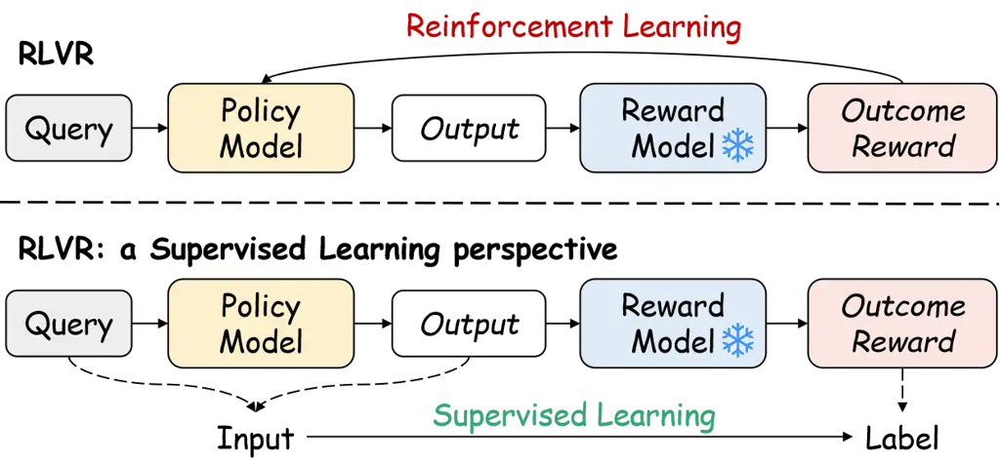
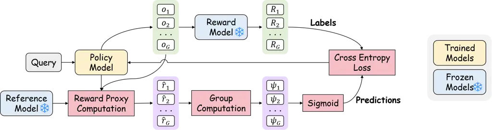
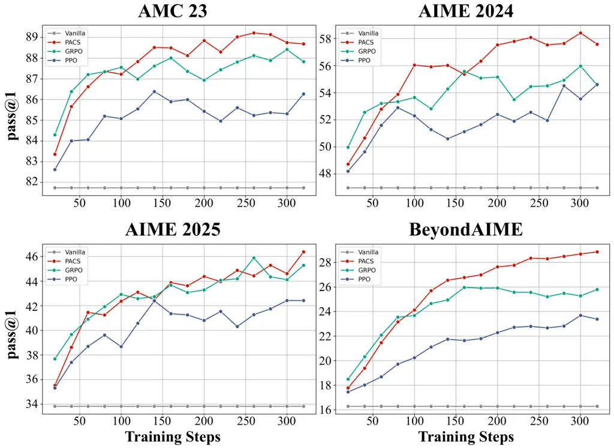
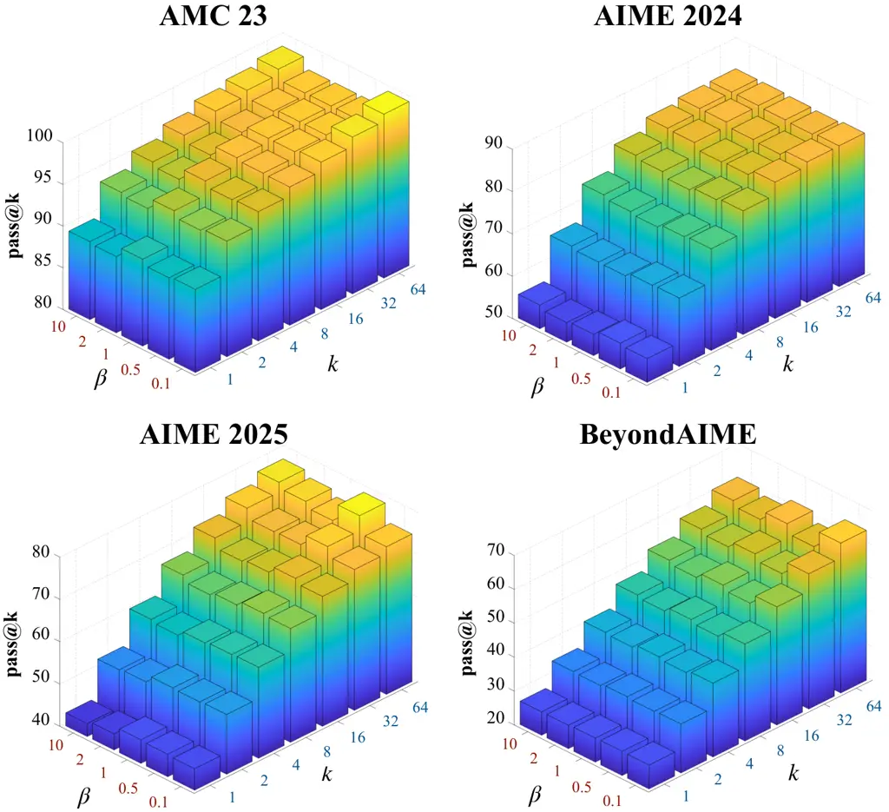
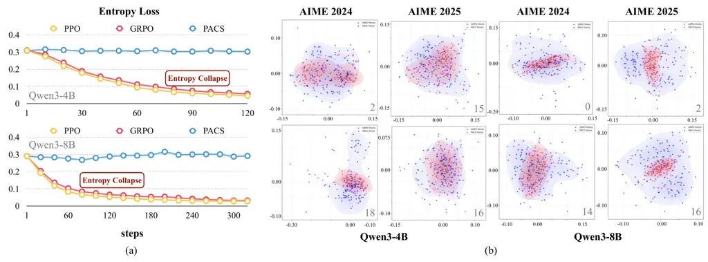

# Implicit Actor Critic Coupling via a Supervised Learning Framework for RLVR

Jiaming Li ^(†)^(†)thanks: Equal contribution. \$†\$ Ze Gong and Min
Yang are corresponding authors. Affiliation:  Shenzhen Institutes of
Advanced Technology, Chinese Academy of Sciences Affiliation: 
University of Chinese Academy of Sciences
Email: [jm.li4@siat.ac.cn](mailto:)    Longze Chen^(\*) Affiliation: 
Shenzhen Institutes of Advanced Technology, Chinese Academy of Sciences
Affiliation:  University of Chinese Academy of Sciences
Email: [lz.chen2@siat.ac.cn](mailto:)    Ze Gong Affiliation:  Shenzhen
Institutes of Advanced Technology, Chinese Academy of Sciences
Email: [ze.gong@siat.ac.cn](mailto:)    Yukun Chen Affiliation: 
Shenzhen Institutes of Advanced Technology, Chinese Academy of Sciences
Affiliation:  University of Chinese Academy of Sciences
Email: [min.yang@siat.ac.cn](mailto:)    Lu Wang Affiliation:  Ritzz-AI
   Wanwei He Affiliation:  Shenzhen Institutes of Advanced Technology,
Chinese Academy of Sciences Affiliation:  University of Chinese Academy
of Sciences    Run Luo Affiliation:  Shenzhen Institutes of Advanced
Technology, Chinese Academy of Sciences Affiliation:  University of
Chinese Academy of Sciences    Minzheng Wang Affiliation:  University of
Chinese Academy of Sciences    Lei Zhang Affiliation:  Shenzhen
Institutes of Advanced Technology, Chinese Academy of Sciences
Affiliation:  University of Chinese Academy of Sciences    Haoran Ye
Affiliation:  University of Macau    Min Yang Affiliation:  Shenzhen
Institutes of Advanced Technology, Chinese Academy of Sciences
Affiliation:  Shenzhen University of Advanced Technology

###### Abstract

Recent advances in Reinforcement Learning with Verifiable Rewards (RLVR)
have empowered large language models (LLMs) to tackle challenging
reasoning tasks such as mathematics and programming, however existing
RLVR methods often suffer from sparse reward signals and unstable policy
gradient updates inherent to RL-based approaches. To address the
challenges, we propose PACS, a novel RLVR framework that achieves
imPlicit Actor Critic coupling via a Supervised learning framework. By
treating the outcome reward as a predictable label, we reformulate the
RLVR problem into a supervised learning task over a score function
parameterized by the policy model and optimized using cross-entropy
loss. A detailed gradient analysis shows that this supervised
formulation inherently recovers the classical policy gradient update
while providing more stable and efficient training. Extensive
experiments demonstrate that PACS significantly outperforms strong
open-source models and RLVR baselines, yielding substantial average
gains of +8.26% (4B) and +9.57% (8B) over base models offering a
promising avenue for LLMs post-training with verifiable rewards. Our
code and data are available as open source at
[https://github.com/ritzz-ai/PACS](https://github.com/ritzz-ai/PACS).

|     |
| --- |
|     |

## 1 Introduction

Recent advancements like OpenAI-o1 (OpenAI et al., 2026) and
DeepSeek-R1 (Guo et al., 2025) have revolutionized complex reasoning by
scaling test-time compute to enable longer Chains of Thought (CoT). This
progress significantly improves performance in mathematics (Shao et al.,
2024; Liu et al., 2025a; Zuo et al., 2026) and programming (Lambert et
al., 2025; Cui et al., 2025; Zhao et al., 2025). These achievements are
largely driven by Reinforcement Learning with Verifiable Rewards (RLVR),
which empowers LLMs to self-improve using verifiable outcome rewards.

Existing RLVR methods generally fall into two categories:
value-model-based (e.g., PPO (Schulman et al., 2017), VAPO (Yue et al.,
2025)) and value-model-free (e.g., GRPO (Shao et al., 2024; Guo et al.,
2025), DAPO (Yu et al., 2026)). While both classes have demonstrated
remarkable success, they face fundamental challenges stemming from the
sparse nature of outcome rewards in RLVR settings, where only a single
reward signal is provided after the entire response is generated.
Value-model-based approaches mitigate sparsity via explicit value
modeling but incur high computational overhead. Conversely,
value-model-free methods leverage Monte Carlo estimation to avoid this
cost but suffer from high variance, often leading to advantage collapse
and training instability. This challenge, rooted in the inherently
sparse nature of RLVR feedback, highlights fundamental limitations of
the existing RL-based paradigm. It motivates the development of
alternative policy optimization strategies that can leverage direct
supervision to enable more stable and efficient learning in RLVR
settings.

To address the limitations of the RL-based paradigm rooted in sparse
feedback, we propose PACS (imPlicit Actor Critic coupling via a
Supervised learning framework). We recast RLVR as a supervised learning
task (as illustrated in fig. 1) by treating outcome rewards as labels to
train a policy-parameterized score function via cross-entropy loss.
Gradient analysis reveals that this formulation inherently recovers the
standard policy gradient while implicitly coupling the actor and critic
through shared parameterization. This design eliminates the temporal
mismatch introduced by separate value estimators and mitigates the
high-variance issues associated with Monte Carlo estimates by providing
stable prediction-error signals for optimization. Moreover, it reduces
compute overhead compared to value-model-based training, and attenuates
extreme updates that cause entropy collapse via bounded supervised
residual. Overall, PACS offers a principled and efficient training
paradigm that unifies policy learning and reward estimation within a
coherent supervised learning framework.



Figure 1: Comparison between RLVR and the supervised learning
reformulation, where the query and output are input, and the outcome
reward is treated as a predictable label.

Experimental results on five benchmarks demonstrate PACS’s superiority.
It outperforms strong open-source models like LIMO and Eurus-2-7B with a
63.32% $`\text{pass@}1`$ accuracy. Notably, PACS 4B model (45.63% on
AIME 2025) surpasses the significantly larger Qwen3-14B (36.22%).
Against RLVR baselines, PACS establishes a decisive lead, particularly
on complex tasks: on BeyondAIME, PACS-8B achieves 64.02%
($`\text{pass@}64`$), exceeding GRPO (57.64%) and PPO (53.80%) by
approximately 6.4 and 10.2 points, respectively. Furthermore, PACS
mitigates entropy collapse, achieving significantly higher solution
diversity than GRPO (0.0392 vs. 0.0249).

The main contributions are summarized as follows:

- •
  We propose PACS, a novel RLVR framework that recasts sparse outcome
  rewards as supervised signals, effectively training the policy via
  cross-entropy loss.
- •
  We theoretically demonstrate that the proposed loss inherently
  captures policy gradient updates and implicitly unifies actor and
  critic through shared parameterization, enabling efficient and stable
  policy optimization.
- •
  Extensive experiments on challenging mathematical reasoning benchmarks
  show that PACS consistently outperforms state-of-the-art RLVR methods,
  achieving superior reasoning performance.
- •
  Generalization and diversity analyses demonstrate that PACS possesses
  strong transfer capabilities on out-of-domain tasks and effectively
  mitigates entropy collapse, fostering diverse reasoning paths that are
  instrumental to the model’s superior performance.

## 2 Related Work

Reasoning Models. The emergence of reasoning models was catalyzed by
OpenAI-o1 (OpenAI et al., 2026), which demonstrated that reasoning
performance can scale significantly via test-time compute. This paradigm
was further advanced by DeepSeek-R1 (Guo et al., 2025), which utilized
GRPO (Shao et al., 2024) to show that rule-based rewards can elicit
self-correction and reflection without dense human supervision. This
paradigm has been extended through the Qwen family (Team, 2025c; Qwen et
al., 2025; Yang et al., 2025) and the Kimi series (Team et al., 2025c;
Team et al., 2025b), which have brought high-performance reasoning to
the ecosystem. Most recently, Gemini family (Team, 2025a) and the
Llama-Nemotron series (Grattafiori et al., 2024; Bercovich et al., 2025)
have integrated multimodal perception and instruction-following into the
reasoning loop, establishing a new state-of-the-art for general-purpose
agents.

Reinforcement Learning with Verifiable Reward (RLVR). RLVR has become a
widely adopted strategy for enhancing the reasoning capabilities of LLMs
in domains with clearly verifiable correctness, such as mathematics and
programming  (Guo et al., 2025; Ma et al., 2025; Chu et al., 2025; Yan
et al., 2025; Zheng et al., 2025; Hao et al., 2025). Recent work has
explored a wide range of RLVR techniques, which can be broadly
categorized as value-model-based or value-model-free. Value-model-based
methods, such as PPO (Schulman et al., 2017), VinePPO (Kazemnejad et
al., 2025), and VAPO (Yue et al., 2025), explicitly learn a value
function to estimate the expected cumulative reward, providing stable
training signals at the cost of additional computational overhead. On
the other hand, value-model-free methods, such as GRPO (Shao et al.,
2024), REINFORCE++ (Hu et al., 2025), and DAPO (Yu et al., 2026), avoid
explicit value modeling by relying on Monte Carlo advantage estimation.
While these approaches reduce modeling complexity, they often suffer
from high gradient variance, which undermines training stability and
performance.

## 3 Methodology

In this section, we first establish the preliminaries for RLVR before
introducing PACS, a novel framework achieving imPlicit Actor–Critic
coupling via Supervised learning. We then detail the overall framework,
validate its effectiveness through gradient analysis, and conclude with
practical implementation designs.

### 3.1 Preliminaries

Let $`\theta`$ denote the parameters of an LLM, and let $`P(Q)`$ be a
distribution over queries from which a query $`q`$ is sampled. The model
generates an output $`o`$ according to the policy
$`\pi_{\theta}(\cdot|q)`$. A verifiable outcome reward
$`R(q,o)\in\{0,1\}`$ is provided by either a reward model or an external
verifier which determines whether the model’s output $`o`$ to the query
$`q`$ is correct ($`1`$) or incorrect ($`0`$). The objective of RLVR is
to learn a policy $`\pi_{\theta}`$ that maximizes the expected reward:
$`\mathcal{L}_{\text{RLVR}}(\theta)=\mathbb{E}_{q\sim P(Q),o\sim\pi_{\theta}(\cdot|q)}[R(q,o)]`$.
Various RLVR approaches (Schulman et al., 2017; Kool et al., 2019;
Ahmadian et al., 2024; Shao et al., 2024; Yu et al., 2026; Yue et al., 2025) have been proposed to optimize this objective function, each
seeking to effectively learn the policy $`\pi_{\theta}`$ under the
supervision of outcome rewards.



Figure 2: An illustration of the PACS framework. The framework consists
of three main components: (1) Reward Proxy Computation, which calculates
a reward proxy $`\hat{r}`$ based on the log-probability ratio. (2) Group
Computation, which computes RLOO-based advantage scores $`\psi`$ from
the reward proxies. (3) Cross-Entropy Loss, which converts the RLVR
problem into a supervised learning task, optimizing a scoring function
parameterized by the policy with a cross-entropy loss.

### 3.2 Recasting RLVR via Supervised Learning

In the RLVR framework, LLMs receive verifiable outcome rewards only
after generating a complete response. Inspired by this observation, we
propose an alternative to conventional RL-based optimization: rather
than policy learning through RL from sparse reward signals, we recast
the problem as a _supervised learning_ task in which the model is
trained to directly predict the outcome reward.

Concretely, instead of using the reward $`R(q,o)\in\{0,1\}`$ associated
with a query-output pair $`(q,o)`$ to guide policy optimization via RL,
we consider $`(q,o)`$ as input data and treat $`R(q,o)`$ as the
corresponding label. The objective is to learn a mapping
$`f(q,o)\rightarrow R`$ that accurately predicts the reward.
Specifically, this problem can be cast as a classification task where
rewards serve as binary labels (e.g., correct vs. incorrect). To this
end, we define the learning objective via a standard binary
cross-entropy loss as follows:

```math
\displaystyle\mathcal{L}(\theta)=-\mathbb{E}_{q\sim P(Q),\,o\sim\pi_{\theta}(\cdot|q)}\bigg[ \displaystyle R(q,o)\log\Big(\sigma\big(\psi(q,o;\pi_{\theta})\big)\Big) \tag{1}
```

```math
\displaystyle+\big(1-R(q,o)\big)\log\Big(1-\sigma\big(\psi(q,o;\pi_{\theta})\big)\Big)\bigg].
```

where $`\sigma(z)=\frac{1}{1+e^{-z}}`$ is the sigmoid function that maps
real-valued scores to the $`[0,1]`$ interval, representing the predicted
probability of correctness. The score function
$`\psi(q,o;\pi_{\theta})`$ is parameterized in terms of the policy model
$`\pi_{\theta}`$, which is trained to estimate the quality of the
generated outputs directly. The specific form and implementation of
$`\psi(q,o;\pi_{\theta})`$ will be discussed in detail in section 3.4.

### 3.3 Gradient Analysis of Objective Function

To gain a deeper understanding of how our objective guides learning, we
analyze the gradient of the loss function $`\mathcal{L}(\theta)`$ with
respect to the model parameters $`\theta`$. We begin by introducing the
per-sample loss term:

```math
l(q,o;\pi_{\theta})\coloneqq R(q,o)\log\Big(\sigma\big(\psi(q,o;\pi_{\theta})\big)\Big)+\big(1-R(q,o)\big)\log\Big(1-\sigma\big(\psi(q,o;\pi_{\theta})\big)\Big) \tag{2}
```

which corresponds to the cross-entropy between the ground-truth reward
$`R(q,o)`$ and the prediction
$`\sigma\big(\psi(q,o;\pi_{\theta})\big)`$. Using this definition, the
gradient of the full loss can be expressed as:

```math
\displaystyle\nabla_{\theta}\mathcal{L}(\theta)= \displaystyle-\mathbb{E}_{q}\Big[\nabla_{\theta}\mathbb{E}_{o\sim\pi_{\theta}(\cdot|q)}\big[l(q,o;\pi_{\theta})\big]\Big] \tag{3}
```

```math
\displaystyle= \displaystyle-\mathbb{E}_{q,o\sim\pi_{\theta}(\cdot|q)}\Big[\nabla_{\theta}\log\pi_{\theta}(o|q)\big[l(q,o;\pi_{\theta})\big]+\nabla_{\theta}l(q,o;\pi_{\theta})\Big]
```

We now derive the inner gradient term
$`\nabla_{\theta}\ell(q,o;\pi_{\theta})`$. Applying the chain rule and
recalling that the derivative of the sigmoid function is
$`\sigma^{\prime}(x)=\sigma(x)(1-\sigma(x))`$, we simplify the gradient
term as follows:

```math
\nabla_{\theta}\ell(q,o;\pi_{\theta})=\Big[R(q,o)-\sigma\big(\psi(q,o;\pi_{\theta})\big)\Big]\nabla_{\theta}\psi(q,o;\pi_{\theta}). \tag{4}
```

Substituting eq. 4 into the expression for
$`\nabla_{\theta}\mathcal{L}(\theta)`$, we obtain the final form of the
gradient:

```math
\begin{aligned} \nabla_{\theta}\mathcal{L}(\theta)=&-\mathbb{E}_{q,o\sim\pi_{\theta}(\cdot|q)}\\
&\bigg[\underbrace{\big[\ell(q,o;\pi_{\theta})\big]\nabla_{\theta}\log\pi_{\theta}(o|q)}_{\text{{{Actor}}: policy improvement}}+\underbrace{\Big(R(q,o)-\sigma\big(\psi(q,o;\pi_{\theta})\big)\Big)\nabla_{\theta}\psi(q,o;\pi_{\theta})}_{\text{{{Critic}}: reward estimation}}\bigg].\end{aligned} \tag{5}
```

In the above gradient expression, the first term corresponds to a
standard policy gradient update, weighted by the per-sample
cross-entropy loss. The second term serves as a reward estimation
correction, adjusting the score function $`\psi`$ to align the predicted
reward $`\sigma\big(\psi(q,o;\pi_{\theta})\big)`$ with the ground-truth
outcome. Notably, this formulation unifies the Actor and Critic updates
within a single gradient step and shared parameter space.

#### Implicit Actor Critic Coupling.

As shown in eq. 5, our formulation enables the learned model
$`\pi_{\theta}`$ to simultaneously fulfill two roles:

- •
  Actor: It samples outputs $`o`$ conditioned on the query $`q`$,
  according to the policy distribution $`\pi_{\theta}(o|q)`$.
- •
  Critic: It estimates output quality using the score function
  $`\psi(q,o;\pi_{\theta})`$, where the sigmoid-transformed value
  $`\sigma\big(\psi(q,o;\pi_{\theta})\big)`$ represents the predicted
  probability of correctness and serves as the predicted reward.

The Actor update is modulated by the per-sample cross-entropy loss
$`\ell(q,o;\pi_{\theta})`$, which weights the policy gradient according
to the alignment between predicted and ground-truth rewards.

The Critic update is driven by the residual
$`R(q,o)-\sigma\big(\psi(q,o;\pi_{\theta})\big)`$, providing a
supervised learning signal that improves reward prediction. Improving
the Actor changes the score $`\psi`$ and thus yields a tighter
supervised target for the Critic; in turn, the Critic improvements feed
back to directly affect future Actor updates through the shared
weighting term. This unified design enables implicit Actor Critic
coupling without separate networks or alternating update schedules and
facilitates efficient training while leveraging the strengths of both
policy gradient and supervised learning paradigms.

### 3.4 Score Function Instantiation

To instantiate the score function $`\psi(q,o;\pi_{\theta})`$, we require
a mechanism to quantify the quality of a sampled response $`o`$ for a
given query $`q`$. We interpret $`\psi(q,o;\pi_{\theta})`$ as an
advantage-like function that measures the relative quality of a response
within a group of samples.

Such a formulation is particularly appropriate for our setting because
it centers the score distribution with respect to the set of samples
while preserving its full range. As a result, it is well suited with a
sigmoid mapping, yielding outputs confined to the $`[0,1]`$ interval.

Unlike value-model-free methods that estimate advantages using
ground-truth rewards, we define $`\psi(q,o;\pi_{\theta})`$ in terms of
the policy model $`\pi_{\theta}`$, enabling direct policy optimization.
To compute this advantage efficiently, we adopt the REINFORCE
Leave-One-Out (RLOO) estimator (Kool et al., 2019; Ahmadian et al.,
2024). RLOO provides an unbiased estimate of the relative advantage by
comparing each sampled output to others generated for the same query.
For each query $`q`$, given a set of $`G`$ candidate responses
$`\{o_{1},o_{2},\dots,o_{k}\}`$, the RLOO-based advantage-like score
function for each output $`o_{i}`$ is defined as:

```math
\psi(q,o_{i};\pi_{\theta})=\hat{r}(q,o_{i};\pi_{\theta})-\frac{1}{G-1}\sum_{j\neq i}\hat{r}(q,o_{j};\pi_{\theta}), \tag{6}
```

following prior work (Rafailov et al., 2023; Cui et al., 2025), where
$`\hat{r}(q,o_{i};\pi_{\theta})`$ is a reward proxy based on
log-probability ratios:

```math
\hat{r}(q,o_{i};\pi_{\theta})=\beta\log\frac{\pi_{\theta}(o_{i}|q)}{\pi_{\text{ref}}(o_{i}|q)}=\beta\sum_{t=1}^{|o_{i}|}\big(\log\pi_{\theta}(o_{i,t}|q,o_{i,<t})-\log\pi_{\text{ref}}(o_{i,t}|q,o_{i,<t})\big), \tag{7}
```

where $`\pi_{\text{ref}}`$ is a fixed reference policy used to
regularize the learned policy, and $`\beta`$ is a scaling
hyperparameter. However, in practical implementation, the reward proxy
$`\hat{r}(q,o_{i};\pi_{\theta})`$ may grow progressively larger over
time due to the fixed reference policy, leading to high variance and
instability during training. To address this, we follow the strategy
proposed in (Liu et al., 2025a), periodically hard-resetting the
reference policy $`\pi_{\text{ref}}`$ to a recent snapshot of the online
policy $`\pi_{\theta}`$, and reinitializing optimizer states to maintain
stable training dynamics. With the RLOO-estimated advantage serving as
the score function, the training objective becomes:

```math
\displaystyle\mathcal{L}_{\text{PACS}}(\theta)= \displaystyle-\mathbb{E}_{q\sim P(Q),\{o_{i}\}_{i=1}^{G}\sim\pi_{\theta}(\cdot|q)} \tag{8}
```

```math
\displaystyle\frac{1}{G}\sum_{i=1}^{G}\left[R(q,o_{i})\log\left(\sigma(\psi(q,o_{i};\pi_{\theta}))\right)+(1-R(q,o_{i}))\log\left(1-\sigma(\psi(q,o_{i};\pi_{\theta}))\right)\right].
```

#### Loss Function Analysis.

|                             |                  |                  |                  |                   |                   |                  |
| --------------------------- | ---------------- | ---------------- | ---------------- | ----------------- | ----------------- | ---------------- |
| Model                       | MATH 500         | AMC 23           | AIME 2024        | AIME 2025         | BeyondAIME        | Avg.             |
| Closed-source Models        |                  |                  |                  |                   |                   |                  |
| Claude Opus 4.1             | \-               | 87.5             | \-               | 78.0              | \-                | \-               |
| Gemini 2.5 pro              | 96.7             | 100.0            | 88.7             | 86.7              | 58.8              | 86.18            |
| Open-Source Model           |                  |                  |                  |                   |                   |                  |
| Qwen3-4B                    | 91.01            | 82.30            | 46.48            | 34.71             | 17.33             | 54.37            |
| Qwen3-8B                    | 89.94            | 81.74            | 46.98            | 33.83             | 16.28             | 53.75            |
| Qwen3-14B                   | 92.07            | 84.88            | 49.06            | 36.22             | 18.59             | 56.16            |
| Deepthought-8B              | 45.07            | 16.58            | 1.82             | 0.44              | 0.76              | 12.93            |
| Eurus-2-7B-PRIME            | 82.07            | 63.65            | 18.39            | 13.88             | 6.67              | 36.93            |
| LIMO                        | 91.00            | 80.61            | 40.86            | 31.82             | 15.98             | 52.05            |
| Marco-o1                    | 70.48            | 45.12            | 9.22             | 6.95              | 2.77              | 26.91            |
| OpenThinker3-7B             | 88.90            | 72.44            | 36.95            | 26.98             | 12.33             | 47.52            |
| Sky-T1-7B                   | 85.38            | 69.59            | 20.86            | 20.47             | 8.54              | 40.97            |
| PACS-4B                     | 94.80            | 90.45            | 55.10            | 45.63             | 27.16             | 62.63            |
| $`\Delta(\text{Qwen3-4B})`$ | $`\uparrow`$3.79 | $`\uparrow`$8.15 | $`\uparrow`$8.62 | $`\uparrow`$10.92 | $`\uparrow`$9.83  | $`\uparrow`$8.26 |
| PACS-8B                     | 95.09            | 88.69            | 57.58            | 46.38             | 28.86             | 63.32            |
| $`\Delta(\text{Qwen3-8B})`$ | $`\uparrow`$5.15 | $`\uparrow`$6.95 | $`\uparrow`$10.6 | $`\uparrow`$12.55 | $`\uparrow`$12.58 | $`\uparrow`$9.57 |

Table 1: Comparison of $`\text{pass@}1`$ accuracy (%) on mathematical
reasoning benchmarks. “Avg.” indicates the average performance across
all tasks. Bold numbers indicate the best performance. Underlined
numbers indicate the second best. The values in green represent the
performance gain ($`\Delta`$) over the model.

For a correct output $`o_{i}`$ (i.e., $`R(q,o_{i})=1`$), the loss
reduces to $`\log(\sigma(\psi(q,o_{i};\pi_{\theta})))`$. Minimizing this
term maximizes $`\psi(q,o_{i};\pi_{\theta})`$, thereby increases the
reward proxy $`\hat{r}(q,o_{i};\pi_{\theta})`$ and, equivalently, the
probability $`\pi_{\theta}(o_{i}|q)`$ of generating the correct output.
Conversely, for an incorrect output $`o_{i}`$ (i.e., $`R(q,o_{i})=0`$),
the loss becomes $`\log(1-\sigma(\psi(q,o_{i};\pi_{\theta})))`$.
Minimizing it decreases $`\psi(q,o_{i};\pi_{\theta})`$, which in turn
lowers $`\hat{r}(q,o_{i};\pi_{\theta})`$ and reduces the probability
$`\pi_{\theta}(o_{i}|q)`$ of generating the incorrect output. Thus, the
model learns not only to generate correct outputs, but also to avoid
producing incorrect ones.

As is well-established, in RL algorithms such as GRPO, if all rewards
within a group are uniformly 0 or 1, the calculated advantages become
exactly zero, resulting in zero gradients and a total halt in policy
updates. In contrast, the loss function in PACS does not vanish
regardless of the reward distribution. Taking the scenario where all
rewards in a group are 0 as an example, as derived in eq. 5, the
gradient term becomes
$`\nabla_{\theta}\mathcal{L}\propto[\log(1-\sigma(\psi))-\beta\sigma(\psi)]\nabla_{\theta}\log\pi_{\theta}`$.
Unless the model already perfectly predicts the incorrectness (i.e.,
$`\sigma(\psi)\to 0`$, which is hard to achieve in practice), a negative
gradient is consistently generated to actively steer the policy away
from incorrect paths. Thus, PACS effectively addresses the gradient
collapse issue inherent in group-based RL by providing continuous
supervised signals regardless of reward density.

Overall, this formulation preserves the supervised learning structure of
our original objective while incorporating relative comparisons between
sampled outputs, yielding more informative learning signals¹¹ 1 A
rule-based reward function is employed, assigning a reward of $`1`$ to
correct answers and 0 to incorrect ones.. The overall PACS framework is
illustrated in fig. 2.

#### Mitigating Entropy Collapse.

With the score function instantiated in a policy-dependent form, the
gradient of the loss can be expressed as an advantage-weighted policy
gradient (Appendix A.1). Unlike conventional RL, where positive rewards
can push the policy toward overly deterministic behavior, our gradient
(eq. 5) is modulated by the residual
$`R(q,o)-\sigma(\psi(q,o;\pi_{\theta}))`$. As predictions approach the
ground truth, the residual vanishes, naturally attenuating updates and
preventing over-concentration of probability mass, thereby preserving a
diverse set of responses. We provide a formal proof in Appendix A.2
showing that this mechanism implicitly imposes a structural constraint
that regularizes the policy towards a Gibbs distribution, fundamentally
preventing mode collapse.

### 3.5 Practical Considerations: Handling Data Imbalance

To address the potential distributional imbalance in generated outputs
$`o_{i}`$ for $`q`$, we adopt the class imbalance treatment methodology
proposed by (King and Zeng, 2001), whereby differential weights are
assigned to correct and incorrect samples respectively. Specifically,
when the proportion of correct and incorrect samples in the training
data exhibits imbalance, we mitigate the adverse effects of sample
distribution bias on model performance by adjusting weight parameters to
balance the model’s attention across different categorical samples.

## 4 Experiments

### 4.1 Experimental Setup

Datasets & Models. We utilize the DeepScaleR dataset as the training
corpus (Luo et al., 2025), which constitutes a high-quality mathematical
problem-solving collection. For evaluation, we conduct extensive
evaluations on five representative benchmarks: MATH 500, AMC 23, AIME
2024, AIME 2025 and BeyondAIME. The experiments utilize Qwen3-4B and
Qwen3-8B (Qwen et al., 2025) as base models, assessing PACS across
different model scales.

Baselines & Hyperparameters. To comprehensively evaluate the
effectiveness of PACS, we compare PACS with a diverse set of baselines
categorized into three groups: 1). Closed-source models: including
state-of-the art models such as Claude Opus 4.1 and Gemini 2.5
Pro (Team, 2025a), whose results are directly cited from prior
works (Team et al., 2025a; Li et al., 2025); 2). Open-source models:
including recent models utilizing advanced post-training of RL
techniques, such as Qwen3 models (Yang et al., 2025),
Deepthought-8B (Ruliad, 2024), Eurus-2-7B-PRIME (Cui et al., 2025),
LIMO (Ye et al., 2025), Marco-o1 (Zhao et al., 2024),
OpenThinker3-7B (Guha et al., 2025) and Sky-T1-7B (Team, 2025b); and 3).
Representative RL algorithms: we implement and train PPO (Schulman et
al., 2017) and GRPO (Shao et al., 2024) on the same base models to
ensure a fair comparison. The training objectives of these algorithms
can be found in Appendix B. We also report the performance of base
models for reference. The train batch size is set to 1,024. For each
query during training, $`8`$ responses are sampled. For PACS, $`\beta`$
is set to 1.0. During inference, we configure the sampling parameters
with a temperature of 0.6. Prompt template and detailed hyperparameter
configuration can be found in the Appendix C.

|                 | AMC 23 ($`\text{pass@}k`$)    |            |            |             |             |             | AIME 2024 ($`\text{pass@}k`$)  |            |            |             |             |             |
| --------------- | ----------------------------- | ---------- | ---------- | ----------- | ----------- | ----------- | ------------------------------ | ---------- | ---------- | ----------- | ----------- | ----------- |
| Model           | $`\bm{k=1}`$                  | $`\bm{4}`$ | $`\bm{8}`$ | $`\bm{16}`$ | $`\bm{32}`$ | $`\bm{64}`$ | $`\bm{k=1}`$                   | $`\bm{4}`$ | $`\bm{8}`$ | $`\bm{16}`$ | $`\bm{32}`$ | $`\bm{64}`$ |
| Base            | 81.74                         | 90.53      | 92.31      | 94.00       | 95.65       | 96.86       | 46.98                          | 59.78      | 65.10      | 69.28       | 72.12       | 74.99       |
| PPO             | 86.27                         | 92.36      | 93.91      | 95.46       | 96.70       | 98.13       | 54.61                          | 71.46      | 75.86      | 79.11       | 81.75       | 83.12       |
| GRPO            | 87.83                         | 93.17      | 94.71      | 95.92       | 97.91       | 99.69       | 54.56                          | 74.52      | 80.08      | 82.42       | 83.21       | 83.33       |
| PACS            | 88.69                         | 94.28      | 95.36      | 96.03       | 96.72       | 97.35       | 57.58                          | 76.24      | 81.21      | 83.30       | 84.14       | 85.00       |
|    - w/o weight | 89.63                         | 94.80      | 95.53      | 96.02       | 96.50       | 97.32       | 58.93                          | 76.64      | 81.13      | 83.21       | 83.59       | 84.73       |
|                 | AIME 2025 ($`\text{pass@}k`$) |            |            |             |             |             | BeyondAIME ($`\text{pass@}k`$) |            |            |             |             |             |
| Model           | $`\bm{k=1}`$                  | $`\bm{4}`$ | $`\bm{8}`$ | $`\bm{16}`$ | $`\bm{32}`$ | $`\bm{64}`$ | $`\bm{k=1}`$                   | $`\bm{4}`$ | $`\bm{8}`$ | $`\bm{16}`$ | $`\bm{32}`$ | $`\bm{64}`$ |
| Base            | 33.83                         | 45.86      | 51.19      | 56.12       | 60.54       | 65.74       | 16.28                          | 23.00      | 26.75      | 31.36       | 36.65       | 41.74       |
| PPO             | 42.42                         | 55.67      | 61.70      | 68.25       | 73.99       | 77.43       | 23.38                          | 33.60      | 38.83      | 44.10       | 49.11       | 53.80       |
| GRPO            | 45.29                         | 58.80      | 64.04      | 69.12       | 73.84       | 77.39       | 25.79                          | 37.61      | 43.08      | 48.40       | 53.32       | 57.64       |
| PACS            | 46.38                         | 61.93      | 67.78      | 72.20       | 75.71       | 79.12       | 28.86                          | 43.15      | 49.58      | 55.39       | 60.19       | 64.02       |
|    - w/o weight | 46.15                         | 60.07      | 66.29      | 71.98       | 76.10       | 78.23       | 28.52                          | 40.43      | 45.55      | 50.10       | 54.35       | 58.97       |

Table 2: Results of Qwen3-8B trained with PPO, GRPO and PACS. Bold
numbers indicate the best performance. Underlined numbers indicate the
second best. Due to space constraints, results on MATH 500 are shown in
Table 9.

Hardware. All experiments are conducted on NVIDIA H200 GPUs. We employ
verl (Sheng et al., 2024), an reinforcement learning library
specifically designed for LLMs. For inference, we utilize vllm (Kwon et
al., 2023).

Evaluation Metrics. To mitigate sampling bias and evaluate solution
diversity, we employ the $`\text{pass@}k`$ metric. Instead of single
trials, we calculate the unbiased estimator (Chen et al.,
2021):$`\text{pass@}k=\mathbb{E}_{x\sim D}\left[1-\frac{\binom{n-c}{k}}{\binom{n}{k}}\right]`$,
where $`c`$ is the number of correct solutions among $`n`$ samples. We
generate $`n=128`$ candidates for MATH 500, AMC 23, AIME series, and
BeyondAIME to ensure statistically stable evaluations.

### 4.2 Main Results

Comparative Analysis with Existing Models. table 1 shows that PACS
significantly enhances the reasoning capabilities of base models across
all benchmarks. Specifically, PACS-8B achieves an average
$`\text{pass@}1`$ of 63.32%, surpassing Qwen3-8B by 9.57 points and
outperforming strong baselines like LIMO (52.05%). Notably, PACS
exhibits exceptional parameter efficiency: PACS-4B (62.63%) not only
beats 7B-scale competitors but also outperforms the significantly larger
Qwen3-14B on challenging tasks like AIME 2025 (45.63% vs. 36.22%). The
gains are particularly pronounced on complex benchmarks; for instance,
on AIME 2025 and BeyondAIME, PACS-8B improves upon the base model by
over 12 points, effectively unlocking deep chain-of-thought
capabilities.

Superior Performance against RL Baselines.

Comparing algorithmic efficacy in tables 2 and 7, PACS consistently
outperforms PPO and establishes a decisive advantage over GRPO on
complex reasoning tasks. This superiority is most evident on the hardest
benchmark, BeyondAIME. Here, PACS-8B achieves a $`\text{pass@}64`$ of
64.02%, surpassing GRPO (57.64%) by over 6 points, while PACS-4B
similarly improves the metric from 57.58% to 62.10%. Furthermore,
PACS-8B maintains a comprehensive lead over GRPO on AIME 2024 and 2025
in both single- and multi-sample settings. These results indicate that
PACS’s supervised learning formulation, which implicitly couples actor
and critic updates, provides more effective optimization signals than
pure RL approaches for navigating complex solution spaces.



Figure 3: Training dynamics of Qwen3-8B. The curves illustrate the
evolution of $`\text{pass}@1`$ on math benchmarks throughout the
training process.



Figure 4: Performance analysis of PACS with varying $`\beta`$. The 3D
heatmaps show $`\text{pass@}k`$ scores for different combinations of
$`\beta`$ values (0.1, 0.5, 1, 2, 10) and $`k`$ values on AMC23,
AIME-2024, AIME-2025 and BeyondAIME.

Training Dynamics and Performance Analysis.

To further investigate the optimization efficiency, we visualize the
evaluation trajectories of Qwen3-8B throughout the training process in
Figure 4.2. The curves report $`\text{pass@}1`$ on benchmarks, evaluated
every 20 training steps. The results highlight PACS’s robustness across
diverse problem distributions. On benchmarks like AMC 23 and the highly
challenging BeyondAIME, PACS exhibits high training efficiency, rapidly
establishing a decisive performance lead over RL baselines. Notably, on
AIME 2025, the performance gap narrows as GRPO also demonstrates
competitive learning trajectories; yet, PACS remains resilient, matching
the strong baseline’s pace and securing the best final performance.

## 5 Ablation Study

### 5.1 Different $`\beta`$

To validate the impact of $`\beta`$ on the model’s performance in eq. 7,
we design and conduct ablation experiments. Models are trained with
different $`\beta\in\{0.1,0.5,1,2,10\}`$ and their performance is
evaluated in section 4.2. The results demonstrate that PACS is highly
robust to variations in $`\beta`$. While extreme values (e.g.,
$`\beta=10`$) maintain competitive performance on easier tasks like AMC
23, a distinct ”sweet pot” emerges in $`\beta\in[0.5,1.0]`$ for
maximizing $`\text{pass@}1`$ on complex reasoning tasks. Given that
$`\text{pass@}1`$ is often the primary objective for reasoning models,
we select $`\beta=1`$ as the optimal setting, effectively balancing the
reward signal strength to achieve superior reasoning performance.

### 5.2 Different Score Function

To validate the effectiveness of our scoring mechanism, we compare the
RLOO score function against GRPO (Shao et al., 2024) and Dr. GRPO (Liu
et al., 2025c). Detailed results are shown in Appendix D.3. Our analysis
reveals that PACS with RLOO generally yields superior performance,
particularly on complex reasoning tasks. For instance, on BeyondAIME
benchmark, PACS achieves a $`\text{pass@}1`$ of 27.16%, consistently
outperforming both GRPO (26.41%) and Dr. GRPO (26.67%). We attribute
this robustness to the leave-one-out mechanism of RLOO, which provides
unbiased advantage estimates with lower variance compared to the
group-mean baselines used in GRPO variants.

### 5.3 Effect of Weight Integration

To validate the effectiveness of the weight mechanism in PACS, we
conduct ablation experiments by comparing the performance of PACS with
and without the weight component as shown in tables 2, 7, 8 and 9. For
Qwen3-4B, PACS systematically outperforms the unweighted variant across
benchmarks; notably, it achieves a pass@1 of 90.45% on AMC 23 and 55.10%
on AIME 2024, surpassing the w/o weight PACS scores of 89.18% and 54.56%
respectively. This advantage is further amplified on complex tasks with
the larger Qwen3-8B model. While performance on simpler tasks remains
comparable, PACS establishes a clear lead on the hardest benchmark,
BeyondAIME. It not only improves the $`\text{pass@}1`$ accuracy to
28.86% compared to 28.52% , but more importantly, achieves a remarkable
64.02% at pass@64, exceeding the unweighted variant’s 58.97%.

## 6 Generalization and Diversity Analysis

In this section, we analyze the broader capabilities of PACS by first
evaluating its generalization to out-of-domain tasks to rule out
overfitting, and then exploring the solution diversity that underpin
this mechanism.

### 6.1 Generalization of Out-of-Domain Tasks

Figure 5: Performance on out-of-domain tasks. The chart reports the
evaluation scores of Qwen3-8B on LiveCodeBench and GPQA. PACS achieves
substantial gains over PPO and GRPO.

A key challenge in RLVR is preventing the policy from over-specializing
to the training domain, which can lead to a degradation of general
capabilities. To evaluate whether PACS learns fundamental reasoning
skills that transfer across domains, we assess the Qwen3-8B model
trained on the DeepScaleR dataset (math) on two out-of-domain
benchmarks: LiveCodeBench (Jain et al., 2024)²² 2 Evaluations are
performed on the LiveCodeBench dynamic subset spanning the period from
7/1/2024, through 1/1/2025. and GPQA (Rein et al., 2023). For these
assessments, we utilize the toolkit provided by GLM-4.5, adhering to the
default settings for all experimental configurations. As shown in
Figure 5, PACS demonstrates superior cross-domain generalization
compared to PPO and GRPO. On LiveCodeBench, PACS achieves 45.96,
significantly outperforming the Vanilla model (31.06) as well as PPO
(35.87) and GRPO (38.01), which suggests that the reasoning chains
optimized by PACS effectively transfer to code logic generation while
baseline RL methods yield diminishing returns. This advantage is further
corroborated on GPQA, where PACS attains 52.46, surpassing both GRPO
(48.55) and PPO (48.48). These results indicate that PACS does not
merely memorize domain-specific templates; instead, by treating outcome
rewards as supervised signals within a stable optimization framework, it
enhances the model’s intrinsic reasoning capabilities.

### 6.2 Exploration and Diversity



Figure 6: Exploration and Diversity Analysis. (a) Entropy loss dynamics
for Qwen3-4B (top) and 8B (bottom). Unlike baselines that suffer from
entropy collapse, PACS maintains higher entropy, enabling sustained
exploration. (b) Centered PCA projection of correct solutions for
sampled problems (ID shown in bottom-right). The broader semantic
coverage of PACS (Blue) compared to GRPO (Red) visually confirms
superior diversity.

| Model    | Method | AIME2024 | AIME2025 |
| -------- | ------ | -------- | -------- |
| Qwen3-4B | PACS   | 0.0278   | 0.0300   |
|          | GRPO   | 0.0260   | 0.0266   |
| Qwen3-8B | PACS   | 0.0272   | 0.0392   |
|          | GRPO   | 0.0217   | 0.0249   |

Table 3: Comparison of diversity scores on AIME 2024 and AIME 2025. PACS
consistently exhibits higher diversity than GRPO across different model
scales.

We observe that PACS effectively mitigates the entropy collapse issue
commonly found in RL baselines, leading to semantically richer and more
diverse solutions as shown in fig. 6(a). To quantify the diversity of
the generated reasoning paths, we utilize the average pairwise consine
distance between the embeddings of responses. A higher diversity score
($`S_{div}`$) indicates greater semantic variation. The definition of
$`S_{div}`$ is detailed in Appendix E. We assess the response diversity
on two representative benchmarks: AIME 2024 and AIME 2025. We
specifically compare PACS with GRPO using the Qwen3-4B and Qwen3-8B.
Note that we compute $`S_{div}`$ on correct responses, as our goal is to
achieve diverse yet valid solutions. As shown in table 3, PACS
consistently surpasses GRPO in diversity (0.0392 vs. 0.0249). While the
rigid nature of mathematical solutions limits absolute scores, PACS
achieves a substantial relative improvement, effectively mitigating mode
collapse and fostering semantically distinct reasoning paths.

To intuitively compare the diversity of reasoning paths, centered PCA
approach is employed. We randomly sample some problems. fig. 6(b)
displays the 2D PCA projection of the embeddings for correct solutions
generated by PACS (Blue) and GRPO (Red). The data is mean-centered to
align the centroids of both distributions at the origin $`(0,0)`$. The
shaded regions (KDE contours) and scatter points illustrate that PACS
covers a significantly larger area in the semantic space, indicating a
more diverse set of reasoning paths compared to the more concentrated
distribution of GRPO.

### 6.3 Generalization to Continuous Rewards

While PACS is initially optimized for reasoning tasks with binary
verifiable rewards $`\{0,1\}`$, its supervised learning formulation
inherently accommodates continuous feedback signals. By treating
continuous rewards bounded within the $`[0,1]`$ interval as “soft
labels” for prediction, PACS can effectively leverage fine-grained
reward dynamics (Chen et al., 2026). This capability potentially extends
its applicability from strict RLVR settings to general RLHF scenarios.

| Model     | AMC23 | AIME  | AIME  | BeyondAIME |
| --------- | ----- | ----- | ----- | ---------- |
|           |       | 2024  | 2025  |            |
| GRPO (RM) | 83.91 | 52.84 | 37.08 | 24.92      |
| PACS (RM) | 85.15 | 53.30 | 40.91 | 26.84      |

Table 4: Comparison of pass@1 accuracy (%) under continuous Reward Model
(RM) supervision using Qwen3-4B as the policy model.

To empirically evaluate this extensibility, we conduct preliminary
experiments utilizing a continuous reward model (RM). Specifically, we
fine-tune a continuous RM based on the Qwen3-8B using preference pairs
derived from the DeepScaleR training corpus. A Qwen3-4B model is then
employed as the policy model. To integrate with the PACS objective, the
raw scalar outputs from the continuous RM are mapped to the $`[0,1]`$
range via group normalization. We benchmark PACS against GRPO under
identical continuous RM supervision across four mathematical reasoning
datasets.

As reported in table 4, PACS consistently outperforms GRPO across all
evaluated benchmarks when guided by continuous rewards. Notably, on the
challenging AIME 2025 and BeyondAIME datasets, PACS achieves absolute
improvements of +3.83% and +1.92% in pass@1 accuracy, respectively.
These results demonstrate that PACS captures fine-grained, scalar
feedback signals more effectively than standard group-based RL
baselines, firmly establishing its potential as a general-purpose policy
optimization framework.

## 7 Conclusion

In this work, we propose PACS, a novel RLVR algorithm that achieves
implicit actor-critic coupling via a supervised learning framework. By
treating outcome rewards as supervised targets and parameterizing the
score function with policy log probabilities, PACS mitigates the sparse
reward and training instability challenges which are inherent to
existing RL-based methods. Extensive experiments on various benchmarks
demonstrate that PACS significantly outperforms strong baselines
including PPO and GRPO, achieving superior task performance while
maintaining healthier policy entropy for sustained exploration. These
results highlight PACS as a promising approach for advancing RLVR.

## Acknowledgements

Min Yang is supported by National Key Research and Development Program
of China (2024YFF0908200), National Natural Science Foundation of China
(Grant No. 62376262), and the Natural Science Foundation of Guangdong
Province of China (2024A1515030166, 2025B1515020032).

## Impact Statement

This paper presents PACS, a reinforcement learning framework that
reformulates policy optimization for Large Language Models into a
supervised learning task. By addressing sparse rewards and training
instability, this work provides a principled methodology to enhance
model reasoning capabilities. PACS improves the reliability of
verifiable reasoning paths in mathematics and programming. Furthermore,
we emphasize that all training and evaluation rely exclusively on
publicly available, open-source datasets, ensuring no privacy
infringements. Ultimately, the implicit actor-critic coupling
established here opens a promising avenue for developing more
trustworthy and efficient reasoning models.

## References

- Ahmadian et al. (2024) A. Ahmadian, C. Cremer, M. Gallé, M. Fadaee, J.
  Kreutzer, O. Pietquin, A. Üstün, and S. Hooker Back to basics:
  revisiting reinforce style optimization for learning from human
  feedback in llms. arXiv preprint arXiv:2402.14740. Cited by: §3.1,
  §3.4.
- Bercovich et al. (2025) A. Bercovich, I. Levy, I. Golan, M. Dabbah, R.
  El-Yaniv, O. Puny, I. Galil, Z. Moshe, T. Ronen, N. Nabwani, I.
  Shahaf, O. Tropp, E. Karpas, R. Zilberstein, J. Zeng, S. Singhal, A.
  Bukharin, Y. Zhang, T. Konuk, G. Shen, A. S. Mahabaleshwarkar, B.
  Kartal, Y. Suhara, O. Delalleau, Z. Chen, Z. Wang, D.
  Mosallanezhad, A. Renduchintala, H. Qian, D. Rekesh, F. Jia, S.
  Majumdar, V. Noroozi, W. U. Ahmad, S. Narenthiran, A. Ficek, M.
  Samadi, J. Huang, S. Jain, I. Gitman, I. Moshkov, W. Du, S.
  Toshniwal, G. Armstrong, B. Kisacanin, M. Novikov, D. Gitman, E.
  Bakhturina, P. Varshney, M. Narsimhan, J. P. Scowcroft, J. Kamalu, D.
  Su, K. Kong, M. Kliegl, R. K. Mahabadi, Y. Lin, S. Satheesh, J.
  Parmar, P. Gundecha, B. Norick, J. Jennings, S. Prabhumoye, S. N.
  Akter, M. Patwary, A. Khattar, D. Narayanan, R. Waleffe, J. Zhang, B.
  Su, G. Huang, T. Kong, P. Chadha, S. Jain, C. Harvey, E. Segal, J.
  Huang, S. Kashirsky, R. McQueen, I. Putterman, G. Lam, A.
  Venkatesan, S. Wu, V. Nguyen, M. Kilaru, A. Wang, A. Warno, A.
  Somasamudramath, S. Bhaskar, M. Dong, N. Assaf, S. Mor, O. U.
  Argov, S. Junkin, O. Romanenko, P. Larroy, M. Katariya, M.
  Rovinelli, V. Balas, N. Edelman, A. Bhiwandiwalla, M. Subramaniam, S.
  Ithape, K. Ramamoorthy, Y. Wu, S. V. Velury, O. Almog, J. Daw, D.
  Fridman, E. Galinkin, M. Evans, S. Ghosh, K. Luna, L. Derczynski, N.
  Pope, E. Long, S. Schneider, G. Siman, T. Grzegorzek, P. Ribalta, M.
  Katariya, C. Alexiuk, J. Conway, T. Saar, A. Guan, K. Pawelec, S.
  Prayaga, O. Kuchaiev, B. Ginsburg, O. Olabiyi, K. Briski, J. Cohen, B.
  Catanzaro, J. Alben, Y. Geifman, and E. Chung Llama-nemotron:
  efficient reasoning models. External Links: 2505.00949,
  [Link](https://arxiv.org/abs/2505.00949) Cited by: §2.
- Chen et al. (2026) L. Chen, L. Wang, R. Shan, Z. Gong, R. Luo, J.
  Li, J. Luo, Q. Wang, and M. Yang Learning ordinal probabilistic reward
  from preferences. arXiv preprint arXiv:2602.12660. Cited by: §6.3.
- Chen et al. (2021) M. Chen, J. Tworek, H. Jun, Q. Yuan, H. P. de
  Oliveira Pinto, J. Kaplan, H. Edwards, Y. Burda, N. Joseph, G.
  Brockman, A. Ray, R. Puri, G. Krueger, M. Petrov, H. Khlaaf, G.
  Sastry, P. Mishkin, B. Chan, S. Gray, N. Ryder, M. Pavlov, A.
  Power, L. Kaiser, M. Bavarian, C. Winter, P. Tillet, F. P. Such, D.
  Cummings, M. Plappert, F. Chantzis, E. Barnes, A. Herbert-Voss, W. H.
  Guss, A. Nichol, A. Paino, N. Tezak, J. Tang, I. Babuschkin, S.
  Balaji, S. Jain, W. Saunders, C. Hesse, A. N. Carr, J. Leike, J.
  Achiam, V. Misra, E. Morikawa, A. Radford, M. Knight, M. Brundage, M.
  Murati, K. Mayer, P. Welinder, B. McGrew, D. Amodei, S. McCandlish, I.
  Sutskever, and W. Zaremba Evaluating large language models trained on
  code. External Links: 2107.03374,
  [Link](https://arxiv.org/abs/2107.03374) Cited by: §4.1.
- Chu et al. (2025) X. Chu, H. Huang, X. Zhang, F. Wei, and Y. Wang Gpg:
  a simple and strong reinforcement learning baseline for model
  reasoning. arXiv preprint arXiv:2504.02546. Cited by: §2.
- Cui et al. (2025) G. Cui, L. Yuan, Z. Wang, H. Wang, Y. Zhang, J.
  Chen, W. Li, B. He, Y. Fan, T. Yu, Q. Xu, W. Chen, J. Yuan, H.
  Chen, K. Zhang, X. Lv, S. Wang, Y. Yao, X. Han, H. Peng, Y. Cheng, Z.
  Liu, M. Sun, B. Zhou, and N. Ding Process reinforcement through
  implicit rewards. External Links: 2502.01456,
  [Link](https://arxiv.org/abs/2502.01456) Cited by: §1, §3.4, §4.1.
- Grattafiori et al. (2024) A. Grattafiori, A. Dubey, A. Jauhri, A.
  Pandey, A. Kadian, A. Al-Dahle, A. Letman, A. Mathur, A. Schelten, A.
  Vaughan, A. Yang, A. Fan, A. Goyal, A. Hartshorn, A. Yang, A.
  Mitra, A. Sravankumar, A. Korenev, A. Hinsvark, A. Rao, A. Zhang, A.
  Rodriguez, A. Gregerson, A. Spataru, B. Roziere, B. Biron, B. Tang, B.
  Chern, C. Caucheteux, C. Nayak, C. Bi, C. Marra, C. McConnell, C.
  Keller, C. Touret, C. Wu, C. Wong, C. C. Ferrer, C. Nikolaidis, D.
  Allonsius, D. Song, D. Pintz, D. Livshits, D. Wyatt, D. Esiobu, D.
  Choudhary, D. Mahajan, D. Garcia-Olano, D. Perino, D. Hupkes, E.
  Lakomkin, E. AlBadawy, E. Lobanova, E. Dinan, E. M. Smith, F.
  Radenovic, F. Guzmán, F. Zhang, G. Synnaeve, G. Lee, G. L.
  Anderson, G. Thattai, G. Nail, G. Mialon, G. Pang, G. Cucurell, H.
  Nguyen, H. Korevaar, H. Xu, H. Touvron, I. Zarov, I. A. Ibarra, I.
  Kloumann, I. Misra, I. Evtimov, J. Zhang, J. Copet, J. Lee, J.
  Geffert, J. Vranes, J. Park, J. Mahadeokar, J. Shah, J. van der
  Linde, J. Billock, J. Hong, J. Lee, J. Fu, J. Chi, J. Huang, J.
  Liu, J. Wang, J. Yu, J. Bitton, J. Spisak, J. Park, J. Rocca, J.
  Johnstun, J. Saxe, J. Jia, K. V. Alwala, K. Prasad, K. Upasani, K.
  Plawiak, K. Li, K. Heafield, K. Stone, K. El-Arini, K. Iyer, K.
  Malik, K. Chiu, K. Bhalla, K. Lakhotia, L. Rantala-Yeary, L. van der
  Maaten, L. Chen, L. Tan, L. Jenkins, L. Martin, L. Madaan, L. Malo, L.
  Blecher, L. Landzaat, L. de Oliveira, M. Muzzi, M. Pasupuleti, M.
  Singh, M. Paluri, M. Kardas, M. Tsimpoukelli, M. Oldham, M. Rita, M.
  Pavlova, M. Kambadur, M. Lewis, M. Si, M. K. Singh, M. Hassan, N.
  Goyal, N. Torabi, N. Bashlykov, N. Bogoychev, N. Chatterji, N.
  Zhang, O. Duchenne, O. Çelebi, P. Alrassy, P. Zhang, P. Li, P.
  Vasic, P. Weng, P. Bhargava, P. Dubal, P. Krishnan, P. S. Koura, P.
  Xu, Q. He, Q. Dong, R. Srinivasan, R. Ganapathy, R. Calderer, R. S.
  Cabral, R. Stojnic, R. Raileanu, R. Maheswari, R. Girdhar, R.
  Patel, R. Sauvestre, R. Polidoro, R. Sumbaly, R. Taylor, R. Silva, R.
  Hou, R. Wang, S. Hosseini, S. Chennabasappa, S. Singh, S. Bell, S. S.
  Kim, S. Edunov, S. Nie, S. Narang, S. Raparthy, S. Shen, S. Wan, S.
  Bhosale, S. Zhang, S. Vandenhende, S. Batra, S. Whitman, S. Sootla, S.
  Collot, S. Gururangan, S. Borodinsky, T. Herman, T. Fowler, T.
  Sheasha, T. Georgiou, T. Scialom, T. Speckbacher, T. Mihaylov, T.
  Xiao, U. Karn, V. Goswami, V. Gupta, V. Ramanathan, V. Kerkez, V.
  Gonguet, V. Do, V. Vogeti, V. Albiero, V. Petrovic, W. Chu, W.
  Xiong, W. Fu, W. Meers, X. Martinet, X. Wang, X. Wang, X. E. Tan, X.
  Xia, X. Xie, X. Jia, X. Wang, Y. Goldschlag, Y. Gaur, Y. Babaei, Y.
  Wen, Y. Song, Y. Zhang, Y. Li, Y. Mao, Z. D. Coudert, Z. Yan, Z.
  Chen, Z. Papakipos, A. Singh, A. Srivastava, A. Jain, A. Kelsey, A.
  Shajnfeld, A. Gangidi, A. Victoria, A. Goldstand, A. Menon, A.
  Sharma, A. Boesenberg, A. Baevski, A. Feinstein, A. Kallet, A.
  Sangani, A. Teo, A. Yunus, A. Lupu, A. Alvarado, A. Caples, A. Gu, A.
  Ho, A. Poulton, A. Ryan, A. Ramchandani, A. Dong, A. Franco, A.
  Goyal, A. Saraf, A. Chowdhury, A. Gabriel, A. Bharambe, A.
  Eisenman, A. Yazdan, B. James, B. Maurer, B. Leonhardi, B. Huang, B.
  Loyd, B. D. Paola, B. Paranjape, B. Liu, B. Wu, B. Ni, B. Hancock, B.
  Wasti, B. Spence, B. Stojkovic, B. Gamido, B. Montalvo, C. Parker, C.
  Burton, C. Mejia, C. Liu, C. Wang, C. Kim, C. Zhou, C. Hu, C. Chu, C.
  Cai, C. Tindal, C. Feichtenhofer, C. Gao, D. Civin, D. Beaty, D.
  Kreymer, D. Li, D. Adkins, D. Xu, D. Testuggine, D. David, D.
  Parikh, D. Liskovich, D. Foss, D. Wang, D. Le, D. Holland, E.
  Dowling, E. Jamil, E. Montgomery, E. Presani, E. Hahn, E. Wood, E.
  Le, E. Brinkman, E. Arcaute, E. Dunbar, E. Smothers, F. Sun, F.
  Kreuk, F. Tian, F. Kokkinos, F. Ozgenel, F. Caggioni, F. Kanayet, F.
  Seide, G. M. Florez, G. Schwarz, G. Badeer, G. Swee, G. Halpern, G.
  Herman, G. Sizov, Guangyi, Zhang, G. Lakshminarayanan, H. Inan, H.
  Shojanazeri, H. Zou, H. Wang, H. Zha, H. Habeeb, H. Rudolph, H.
  Suk, H. Aspegren, H. Goldman, H. Zhan, I. Damlaj, I. Molybog, I.
  Tufanov, I. Leontiadis, I. Veliche, I. Gat, J. Weissman, J.
  Geboski, J. Kohli, J. Lam, J. Asher, J. Gaya, J. Marcus, J. Tang, J.
  Chan, J. Zhen, J. Reizenstein, J. Teboul, J. Zhong, J. Jin, J.
  Yang, J. Cummings, J. Carvill, J. Shepard, J. McPhie, J. Torres, J.
  Ginsburg, J. Wang, K. Wu, K. H. U, K. Saxena, K. Khandelwal, K.
  Zand, K. Matosich, K. Veeraraghavan, K. Michelena, K. Li, K.
  Jagadeesh, K. Huang, K. Chawla, K. Huang, L. Chen, L. Garg, L. A, L.
  Silva, L. Bell, L. Zhang, L. Guo, L. Yu, L. Moshkovich, L.
  Wehrstedt, M. Khabsa, M. Avalani, M. Bhatt, M. Mankus, M. Hasson, M.
  Lennie, M. Reso, M. Groshev, M. Naumov, M. Lathi, M. Keneally, M.
  Liu, M. L. Seltzer, M. Valko, M. Restrepo, M. Patel, M. Vyatskov, M.
  Samvelyan, M. Clark, M. Macey, M. Wang, M. J. Hermoso, M. Metanat, M.
  Rastegari, M. Bansal, N. Santhanam, N. Parks, N. White, N. Bawa, N.
  Singhal, N. Egebo, N. Usunier, N. Mehta, N. P. Laptev, N. Dong, N.
  Cheng, O. Chernoguz, O. Hart, O. Salpekar, O. Kalinli, P. Kent, P.
  Parekh, P. Saab, P. Balaji, P. Rittner, P. Bontrager, P. Roux, P.
  Dollar, P. Zvyagina, P. Ratanchandani, P. Yuvraj, Q. Liang, R.
  Alao, R. Rodriguez, R. Ayub, R. Murthy, R. Nayani, R. Mitra, R.
  Parthasarathy, R. Li, R. Hogan, R. Battey, R. Wang, R. Howes, R.
  Rinott, S. Mehta, S. Siby, S. J. Bondu, S. Datta, S. Chugh, S.
  Hunt, S. Dhillon, S. Sidorov, S. Pan, S. Mahajan, S. Verma, S.
  Yamamoto, S. Ramaswamy, S. Lindsay, S. Lindsay, S. Feng, S. Lin, S. C.
  Zha, S. Patil, S. Shankar, S. Zhang, S. Zhang, S. Wang, S. Agarwal, S.
  Sajuyigbe, S. Chintala, S. Max, S. Chen, S. Kehoe, S. Satterfield, S.
  Govindaprasad, S. Gupta, S. Deng, S. Cho, S. Virk, S. Subramanian, S.
  Choudhury, S. Goldman, T. Remez, T. Glaser, T. Best, T. Koehler, T.
  Robinson, T. Li, T. Zhang, T. Matthews, T. Chou, T. Shaked, V.
  Vontimitta, V. Ajayi, V. Montanez, V. Mohan, V. S. Kumar, V.
  Mangla, V. Ionescu, V. Poenaru, V. T. Mihailescu, V. Ivanov, W. Li, W.
  Wang, W. Jiang, W. Bouaziz, W. Constable, X. Tang, X. Wu, X. Wang, X.
  Wu, X. Gao, Y. Kleinman, Y. Chen, Y. Hu, Y. Jia, Y. Qi, Y. Li, Y.
  Zhang, Y. Zhang, Y. Adi, Y. Nam, Yu, Wang, Y. Zhao, Y. Hao, Y.
  Qian, Y. Li, Y. He, Z. Rait, Z. DeVito, Z. Rosnbrick, Z. Wen, Z.
  Yang, Z. Zhao, and Z. Ma The llama 3 herd of models. External Links:
  2407.21783, [Link](https://arxiv.org/abs/2407.21783) Cited by: §2.
- Guha et al. (2025) E. Guha, R. Marten, S. Keh, N. Raoof, G.
  Smyrnis, H. Bansal, M. Nezhurina, J. Mercat, T. Vu, Z. Sprague, A.
  Suvarna, B. Feuer, L. Chen, Z. Khan, E. Frankel, S. Grover, C.
  Choi, N. Muennighoff, S. Su, W. Zhao, J. Yang, S. Pimpalgaonkar, K.
  Sharma, C. C. Ji, Y. Deng, S. Pratt, V. Ramanujan, J. Saad-Falcon, J.
  Li, A. Dave, A. Albalak, K. Arora, B. Wulfe, C. Hegde, G. Durrett, S.
  Oh, M. Bansal, S. Gabriel, A. Grover, K. Chang, V. Shankar, A.
  Gokaslan, M. A. Merrill, T. Hashimoto, Y. Choi, J. Jitsev, R.
  Heckel, M. Sathiamoorthy, A. G. Dimakis, and L. Schmidt OpenThoughts:
  data recipes for reasoning models. External Links: 2506.04178,
  [Link](https://arxiv.org/abs/2506.04178) Cited by: §4.1.
- Guo et al. (2025) D. Guo, D. Yang, H. Zhang, J. Song, P. Wang, Q.
  Zhu, R. Xu, R. Zhang, S. Ma, X. Bi, X. Zhang, X. Yu, Y. Wu, Z. F.
  Wu, Z. Gou, Z. Shao, Z. Li, Z. Gao, A. Liu, B. Xue, B. Wang, B. Wu, B.
  Feng, C. Lu, C. Zhao, C. Deng, C. Ruan, D. Dai, D. Chen, D. Ji, E.
  Li, F. Lin, F. Dai, F. Luo, G. Hao, G. Chen, G. Li, H. Zhang, H.
  Xu, H. Ding, H. Gao, H. Qu, H. Li, J. Guo, J. Li, J. Chen, J. Yuan, J.
  Tu, J. Qiu, J. Li, J. L. Cai, J. Ni, J. Liang, J. Chen, K. Dong, K.
  Hu, K. You, K. Gao, K. Guan, K. Huang, K. Yu, L. Wang, L. Zhang, L.
  Zhao, L. Wang, L. Zhang, L. Xu, L. Xia, M. Zhang, M. Zhang, M.
  Tang, M. Zhou, M. Li, M. Wang, M. Li, N. Tian, P. Huang, P. Zhang, Q.
  Wang, Q. Chen, Q. Du, R. Ge, R. Zhang, R. Pan, R. Wang, R. J.
  Chen, R. L. Jin, R. Chen, S. Lu, S. Zhou, S. Chen, S. Ye, S. Wang, S.
  Yu, S. Zhou, S. Pan, S. S. Li, S. Zhou, S. Wu, T. Yun, T. Pei, T.
  Sun, T. Wang, W. Zeng, W. Liu, W. Liang, W. Gao, W. Yu, W.
  Zhang, W. L. Xiao, W. An, X. Liu, X. Wang, X. Chen, X. Nie, X.
  Cheng, X. Liu, X. Xie, X. Liu, X. Yang, X. Li, X. Su, X. Lin, X. Q.
  Li, X. Jin, X. Shen, X. Chen, X. Sun, X. Wang, X. Song, X. Zhou, X.
  Wang, X. Shan, Y. K. Li, Y. Q. Wang, Y. X. Wei, Y. Zhang, Y. Xu, Y.
  Li, Y. Zhao, Y. Sun, Y. Wang, Y. Yu, Y. Zhang, Y. Shi, Y. Xiong, Y.
  He, Y. Piao, Y. Wang, Y. Tan, Y. Ma, Y. Liu, Y. Guo, Y. Ou, Y.
  Wang, Y. Gong, Y. Zou, Y. He, Y. Xiong, Y. Luo, Y. You, Y. Liu, Y.
  Zhou, Y. X. Zhu, Y. Huang, Y. Li, Y. Zheng, Y. Zhu, Y. Ma, Y. Tang, Y.
  Zha, Y. Yan, Z. Z. Ren, Z. Ren, Z. Sha, Z. Fu, Z. Xu, Z. Xie, Z.
  Zhang, Z. Hao, Z. Ma, Z. Yan, Z. Wu, Z. Gu, Z. Zhu, Z. Liu, Z. Li, Z.
  Xie, Z. Song, Z. Pan, Z. Huang, Z. Xu, Z. Zhang, and Z. Zhang
  DeepSeek-r1 incentivizes reasoning in llms through reinforcement
  learning. Nature 645 (8081), pp. 633–638. External Links: ISSN
  1476-4687, [Link](http://dx.doi.org/10.1038/s41586-025-09422-z),
  [Document](https://dx.doi.org/10.1038/s41586-025-09422-z) Cited by:
  §1, §1, §2, §2.
- Hao et al. (2025) Y. Hao, L. Dong, X. Wu, S. Huang, Z. Chi, and F. Wei
  On-policy rl with optimal reward baseline. arXiv preprint
  arXiv:2505.23585. Cited by: §2.
- Hu et al. (2025) J. Hu, J. K. Liu, H. Xu, and W. Shen REINFORCE++:
  stabilizing critic-free policy optimization with global advantage
  normalization. External Links: 2501.03262,
  [Link](https://arxiv.org/abs/2501.03262) Cited by: §2.
- Jain et al. (2024) N. Jain, K. Han, A. Gu, W. Li, F. Yan, T. Zhang, S.
  Wang, A. Solar-Lezama, K. Sen, and I. Stoica LiveCodeBench: holistic
  and contamination free evaluation of large language models for code.
  arXiv preprint arXiv:2403.07974. Cited by: §6.1.
- Kazemnejad et al. (2025) A. Kazemnejad, M. Aghajohari, E.
  Portelance, A. Sordoni, S. Reddy, A. Courville, and N. L. Roux
  VinePPO: refining credit assignment in rl training of llms. In
  Forty-second International Conference on Machine Learning, External
  Links: [Link](https://openreview.net/forum?id=Myx2kJFzAn) Cited by:
  §2.
- King and Zeng (2001) G. King and L. Zeng Logistic regression in rare
  events data. Political Analysis 9 (2), pp. 137–163. External Links:
  [Document](https://dx.doi.org/10.1093/oxfordjournals.pan.a004868)
  Cited by: §3.5.
- Kool et al. (2019) W. Kool, H. van Hoof, and M. Welling Buy 4
  reinforce samples, get a baseline for free!. External Links:
  [Link](https://openreview.net/forum?id=r1lgTGL5DE) Cited by: §3.1,
  §3.4.
- Kwon et al. (2023) W. Kwon, Z. Li, S. Zhuang, Y. Sheng, L.
  Zheng, C. H. Yu, J. E. Gonzalez, H. Zhang, and I. Stoica Efficient
  memory management for large language model serving with
  pagedattention. In Proceedings of the ACM SIGOPS 29th Symposium on
  Operating Systems Principles, Cited by: §C.3, §4.1.
- Lambert et al. (2025) N. Lambert, J. Morrison, V. Pyatkin, S.
  Huang, H. Ivison, F. Brahman, L. J. V. Miranda, A. Liu, N. Dziri, S.
  Lyu, Y. Gu, S. Malik, V. Graf, J. D. Hwang, J. Yang, R. L. Bras, O.
  Tafjord, C. Wilhelm, L. Soldaini, N. A. Smith, Y. Wang, P. Dasigi,
  and H. Hajishirzi Tulu 3: pushing frontiers in open language model
  post-training. External Links: 2411.15124,
  [Link](https://arxiv.org/abs/2411.15124) Cited by: §1.
- Li et al. (2025) X. Li, M. Xu, W. Tao, H. Zhu, Y. Zhao, J. Zhang,
  and Y. Lan RIDE: difficulty evolving perturbation with item response
  theory for mathematical reasoning. External Links: 2511.04120,
  [Link](https://arxiv.org/abs/2511.04120) Cited by: §4.1.
- Liu et al. (2025a) M. Liu, S. Diao, X. Lu, J. Hu, X. Dong, Y. Choi, J.
  Kautz, and Y. Dong Prorl: prolonged reinforcement learning expands
  reasoning boundaries in large language models. arXiv preprint
  arXiv:2505.24864. Cited by: §1, §3.4.
- Liu et al. (2025b) Z. Liu, C. Chen, W. Li, P. Qi, T. Pang, C.
  Du, W. S. Lee, and M. Lin Understanding r1-zero-like training: a
  critical perspective. arXiv preprint arXiv:2503.20783. Cited by: §B.2.
- Liu et al. (2025c) Z. Liu, C. Chen, W. Li, P. Qi, T. Pang, C.
  Du, W. S. Lee, and M. Lin Understanding r1-zero-like training: a
  critical perspective. External Links: 2503.20783,
  [Link](https://arxiv.org/abs/2503.20783) Cited by: §D.3, §5.2.
- Luo et al. (2025) M. Luo, S. Tan, J. Wong, X. Shi, W. Y. Tang, M.
  Roongta, C. Cai, J. Luo, L. E. Li, R. A. Popa, and I. Stoica
  DeepScaleR: surpassing o1-preview with a 1.5b model by scaling rl.
  Note: [Notion
  Blog](https://pretty-radio-b75.notion.site/DeepScaleR-Surpassing-O1-Preview-with-a-1.5B-Model-by-Scaling-RL-19681902c1468005bed8ca303013a4e2)
  Cited by: §4.1.
- Ma et al. (2025) R. Ma, P. Wang, C. Liu, X. Liu, J. Chen, B. Zhang, X.
  Zhou, N. Du, and J. Li S$`{}^{2}`$r: teaching llms to self-verify and
  self-correct via reinforcement learning. arXiv preprint
  arXiv:2502.12853. Cited by: §2.
- OpenAI et al. (2026) OpenAI, :, A. Jaech, A. Kalai, A. Lerer, A.
  Richardson, A. El-Kishky, A. Low, A. Helyar, A. Madry, A. Beutel, A.
  Carney, A. Iftimie, A. Karpenko, A. T. Passos, A. Neitz, A.
  Prokofiev, A. Wei, A. Tam, A. Bennett, A. Kumar, A. Saraiva, A.
  Vallone, A. Duberstein, A. Kondrich, A. Mishchenko, A. Applebaum, A.
  Jiang, A. Nair, B. Zoph, B. Ghorbani, B. Zhang, B. Rossen, B.
  Sokolowsky, B. Barak, B. McGrew, B. Minaiev, B. Hao, B. Baker, B.
  Houghton, B. McKinzie, B. Eastman, C. Lugaresi, C. Bassin, C.
  Hudson, C. M. Li, C. de Bourcy, C. Voss, C. Shen, C. Zhang, C.
  Koch, C. Orsinger, C. Hesse, C. Fischer, C. Chan, D. Roberts, D.
  Kappler, D. Levy, D. Selsam, D. Dohan, D. Farhi, D. Mely, D.
  Robinson, D. Tsipras, D. Li, D. Oprica, E. Freeman, E. Zhang, E.
  Wong, E. Proehl, E. Cheung, E. Mitchell, E. Wallace, E. Ritter, E.
  Mays, F. Wang, F. P. Such, F. Raso, F. Leoni, F. Tsimpourlas, F.
  Song, F. von Lohmann, F. Sulit, G. Salmon, G. Parascandolo, G.
  Chabot, G. Zhao, G. Brockman, G. Leclerc, H. Salman, H. Bao, H.
  Sheng, H. Andrin, H. Bagherinezhad, H. Ren, H. Lightman, H. W.
  Chung, I. Kivlichan, I. O’Connell, I. Osband, I. C. Gilaberte, I.
  Akkaya, I. Kostrikov, I. Sutskever, I. Kofman, J. Pachocki, J.
  Lennon, J. Wei, J. Harb, J. Twore, J. Feng, J. Yu, J. Weng, J.
  Tang, J. Yu, J. Q. Candela, J. Palermo, J. Parish, J. Heidecke, J.
  Hallman, J. Rizzo, J. Gordon, J. Uesato, J. Ward, J. Huizinga, J.
  Wang, K. Chen, K. Xiao, K. Singhal, K. Nguyen, K. Cobbe, K. Shi, K.
  Wood, K. Rimbach, K. Gu-Lemberg, K. Liu, K. Lu, K. Stone, K. Yu, L.
  Ahmad, L. Yang, L. Liu, L. Maksin, L. Ho, L. Fedus, L. Weng, L. Li, L.
  McCallum, L. Held, L. Kuhn, L. Kondraciuk, L. Kaiser, L. Metz, M.
  Boyd, M. Trebacz, M. Joglekar, M. Chen, M. Tintor, M. Meyer, M.
  Jones, M. Kaufer, M. Schwarzer, M. Shah, M. Yatbaz, M. Y. Guan, M.
  Xu, M. Yan, M. Glaese, M. Chen, M. Lampe, M. Malek, M. Wang, M.
  Fradin, M. McClay, M. Pavlov, M. Wang, M. Wang, M. Murati, M.
  Bavarian, M. Rohaninejad, N. McAleese, N. Chowdhury, N. Chowdhury, N.
  Ryder, N. Tezak, N. Brown, O. Nachum, O. Boiko, O. Murk, O.
  Watkins, P. Chao, P. Ashbourne, P. Izmailov, P. Zhokhov, R. Dias, R.
  Arora, R. Lin, R. G. Lopes, R. Gaon, R. Miyara, R. Leike, R. Hwang, R.
  Garg, R. Brown, R. James, R. Shu, R. Cheu, R. Greene, S. Jain, S.
  Altman, S. Toizer, S. Toyer, S. Miserendino, S. Agarwal, S.
  Hernandez, S. Baker, S. McKinney, S. Yan, S. Zhao, S. Hu, S.
  Santurkar, S. R. Chaudhuri, S. Zhang, S. Fu, S. Papay, S. Lin, S.
  Balaji, S. Sanjeev, S. Sidor, T. Broda, A. Clark, T. Wang, T.
  Gordon, T. Sanders, T. Patwardhan, T. Sottiaux, T. Degry, T.
  Dimson, T. Zheng, T. Garipov, T. Stasi, T. Bansal, T. Creech, T.
  Peterson, T. Eloundou, V. Qi, V. Kosaraju, V. Monaco, V. Pong, V.
  Fomenko, W. Zheng, W. Zhou, W. Zhan, W. McCabe, W. Zaremba, Y.
  Dubois, Y. Lu, Y. Chen, Y. Cha, Y. Bai, Y. He, Y. Zhang, Y. Wang, Z.
  Shao, and Z. Li OpenAI o1 system card. External Links: 2412.16720,
  [Link](https://arxiv.org/abs/2412.16720) Cited by: §1, §2.
- Qwen et al. (2025) Qwen, :, A. Yang, B. Yang, B. Zhang, B. Hui, B.
  Zheng, B. Yu, C. Li, D. Liu, F. Huang, H. Wei, H. Lin, J. Yang, J.
  Tu, J. Zhang, J. Yang, J. Yang, J. Zhou, J. Lin, K. Dang, K. Lu, K.
  Bao, K. Yang, L. Yu, M. Li, M. Xue, P. Zhang, Q. Zhu, R. Men, R.
  Lin, T. Li, T. Tang, T. Xia, X. Ren, X. Ren, Y. Fan, Y. Su, Y.
  Zhang, Y. Wan, Y. Liu, Z. Cui, Z. Zhang, and Z. Qiu Qwen2.5 technical
  report. External Links: 2412.15115,
  [Link](https://arxiv.org/abs/2412.15115) Cited by: §2, §4.1.
- Rafailov et al. (2023) R. Rafailov, A. Sharma, E. Mitchell, C. D.
  Manning, S. Ermon, and C. Finn Direct preference optimization: your
  language model is secretly a reward model. Advances in neural
  information processing systems 36, pp. 53728–53741. Cited by: §3.4.
- Rein et al. (2023) D. Rein, B. L. Hou, A. C. Stickland, J.
  Petty, R. Y. Pang, J. Dirani, J. Michael, and S. R. Bowman GPQA: a
  graduate-level google-proof q&a benchmark. External Links: 2311.12022,
  [Link](https://arxiv.org/abs/2311.12022) Cited by: §6.1.
- Ruliad (2024) Ruliad Deepthought-8b: a small and capable reasoning
  model. Ruliad. Cited by: §4.1.
- Schulman et al. (2017) J. Schulman, F. Wolski, P. Dhariwal, A.
  Radford, and O. Klimov Proximal policy optimization algorithms. arXiv
  preprint arXiv:1707.06347. Cited by: §B.1, §1, §2, §3.1, §4.1.
- Shao et al. (2024) Z. Shao, P. Wang, Q. Zhu, R. Xu, J. Song, X. Bi, H.
  Zhang, M. Zhang, Y. K. Li, Y. Wu, and D. Guo DeepSeekMath: pushing the
  limits of mathematical reasoning in open language models. External
  Links: 2402.03300, [Link](https://arxiv.org/abs/2402.03300) Cited by:
  §B.2, §D.3, §1, §1, §2, §2, §3.1, §4.1, §5.2.
- Sheng et al. (2024) G. Sheng, C. Zhang, Z. Ye, X. Wu, W. Zhang, R.
  Zhang, Y. Peng, H. Lin, and C. Wu HybridFlow: a flexible and efficient
  rlhf framework. arXiv preprint arXiv: 2409.19256. Cited by: §C.2,
  §4.1.
- Team et al. (2025a) 5. Team, A. Zeng, X. Lv, Q. Zheng, Z. Hou, B.
  Chen, C. Xie, C. Wang, D. Yin, H. Zeng, J. Zhang, K. Wang, L.
  Zhong, M. Liu, R. Lu, S. Cao, X. Zhang, X. Huang, Y. Wei, Y. Cheng, Y.
  An, Y. Niu, Y. Wen, Y. Bai, Z. Du, Z. Wang, Z. Zhu, B. Zhang, B.
  Wen, B. Wu, B. Xu, C. Huang, C. Zhao, C. Cai, C. Yu, C. Li, C. Ge, C.
  Huang, C. Zhang, C. Xu, C. Zhu, C. Li, C. Yin, D. Lin, D. Yang, D.
  Jiang, D. Ai, E. Zhu, F. Wang, G. Pan, G. Wang, H. Sun, H. Li, H.
  Li, H. Hu, H. Zhang, H. Peng, H. Tai, H. Zhang, H. Wang, H. Yang, H.
  Liu, H. Zhao, H. Liu, H. Yan, H. Liu, H. Chen, J. Li, J. Zhao, J.
  Ren, J. Jiao, J. Zhao, J. Yan, J. Wang, J. Gui, J. Zhao, J. Liu, J.
  Li, J. Li, J. Lu, J. Wang, J. Yuan, J. Li, J. Du, J. Du, J. Liu, J.
  Zhi, J. Gao, K. Wang, L. Yang, L. Xu, L. Fan, L. Wu, L. Ding, L.
  Wang, M. Zhang, M. Li, M. Xu, M. Zhao, M. Zhai, P. Du, Q. Dong, S.
  Lei, S. Tu, S. Yang, S. Lu, S. Li, S. Li, Shuang-Li, S. Yang, S.
  Yi, T. Yu, W. Tian, W. Wang, W. Yu, W. L. Tam, W. Liang, W. Liu, X.
  Wang, X. Jia, X. Gu, X. Ling, X. Wang, X. Fan, X. Pan, X. Zhang, X.
  Zhang, X. Fu, X. Zhang, Y. Xu, Y. Wu, Y. Lu, Y. Wang, Y. Zhou, Y.
  Pan, Y. Zhang, Y. Wang, Y. Li, Y. Su, Y. Geng, Y. Zhu, Y. Yang, Y.
  Li, Y. Wu, Y. Li, Y. Liu, Y. Wang, Y. Li, Y. Zhang, Z. Liu, Z.
  Yang, Z. Zhou, Z. Qiao, Z. Feng, Z. Liu, Z. Zhang, Z. Wang, Z. Yao, Z.
  Wang, Z. Liu, Z. Chai, Z. Li, Z. Zhao, W. Chen, J. Zhai, B. Xu, M.
  Huang, H. Wang, J. Li, Y. Dong, and J. Tang GLM-4.5: agentic,
  reasoning, and coding (arc) foundation models. External Links:
  2508.06471, [Link](https://arxiv.org/abs/2508.06471) Cited by: §4.1.
- Team (2025a) G. Team Gemini 2.5: pushing the frontier with advanced
  reasoning, multimodality, long context, and next generation agentic
  capabilities. External Links: 2507.06261,
  [Link](https://arxiv.org/abs/2507.06261) Cited by: §2, §4.1.
- Team et al. (2025b) K. Team, Y. Bai, Y. Bao, G. Chen, J. Chen, N.
  Chen, R. Chen, Y. Chen, Y. Chen, Y. Chen, Z. Chen, J. Cui, H. Ding, M.
  Dong, A. Du, C. Du, D. Du, Y. Du, Y. Fan, Y. Feng, K. Fu, B. Gao, H.
  Gao, P. Gao, T. Gao, X. Gu, L. Guan, H. Guo, J. Guo, H. Hu, X. Hao, T.
  He, W. He, W. He, C. Hong, Y. Hu, Z. Hu, W. Huang, Z. Huang, Z.
  Huang, T. Jiang, Z. Jiang, X. Jin, Y. Kang, G. Lai, C. Li, F. Li, H.
  Li, M. Li, W. Li, Y. Li, Y. Li, Z. Li, Z. Li, H. Lin, X. Lin, Z.
  Lin, C. Liu, C. Liu, H. Liu, J. Liu, J. Liu, L. Liu, S. Liu, T. Y.
  Liu, T. Liu, W. Liu, Y. Liu, Y. Liu, Y. Liu, Y. Liu, Z. Liu, E. Lu, L.
  Lu, S. Ma, X. Ma, Y. Ma, S. Mao, J. Mei, X. Men, Y. Miao, S. Pan, Y.
  Peng, R. Qin, B. Qu, Z. Shang, L. Shi, S. Shi, F. Song, J. Su, Z.
  Su, X. Sun, F. Sung, H. Tang, J. Tao, Q. Teng, C. Wang, D. Wang, F.
  Wang, H. Wang, J. Wang, J. Wang, J. Wang, S. Wang, S. Wang, Y.
  Wang, Y. Wang, Y. Wang, Y. Wang, Y. Wang, Z. Wang, Z. Wang, Z.
  Wang, C. Wei, Q. Wei, W. Wu, X. Wu, Y. Wu, C. Xiao, X. Xie, W.
  Xiong, B. Xu, J. Xu, J. Xu, L. H. Xu, L. Xu, S. Xu, W. Xu, X. Xu, Y.
  Xu, Z. Xu, J. Yan, Y. Yan, X. Yang, Y. Yang, Z. Yang, Z. Yang, Z.
  Yang, H. Yao, X. Yao, W. Ye, Z. Ye, B. Yin, L. Yu, E. Yuan, H.
  Yuan, M. Yuan, H. Zhan, D. Zhang, H. Zhang, W. Zhang, X. Zhang, Y.
  Zhang, Y. Zhang, Y. Zhang, Y. Zhang, Y. Zhang, Y. Zhang, Z. Zhang, H.
  Zhao, Y. Zhao, H. Zheng, S. Zheng, J. Zhou, X. Zhou, Z. Zhou, Z.
  Zhu, W. Zhuang, and X. Zu Kimi k2: open agentic intelligence. External
  Links: 2507.20534, [Link](https://arxiv.org/abs/2507.20534) Cited by:
  §2.
- Team et al. (2025c) K. Team, A. Du, B. Gao, B. Xing, C. Jiang, C.
  Chen, C. Li, C. Xiao, C. Du, C. Liao, C. Tang, C. Wang, D. Zhang, E.
  Yuan, E. Lu, F. Tang, F. Sung, G. Wei, G. Lai, H. Guo, H. Zhu, H.
  Ding, H. Hu, H. Yang, H. Zhang, H. Yao, H. Zhao, H. Lu, H. Li, H.
  Yu, H. Gao, H. Zheng, H. Yuan, J. Chen, J. Guo, J. Su, J. Wang, J.
  Zhao, J. Zhang, J. Liu, J. Yan, J. Wu, L. Shi, L. Ye, L. Yu, M.
  Dong, N. Zhang, N. Ma, Q. Pan, Q. Gong, S. Liu, S. Ma, S. Wei, S.
  Cao, S. Huang, T. Jiang, W. Gao, W. Xiong, W. He, W. Huang, W. Xu, W.
  Wu, W. He, X. Wei, X. Jia, X. Wu, X. Xu, X. Zu, X. Zhou, X. Pan, Y.
  Charles, Y. Li, Y. Hu, Y. Liu, Y. Chen, Y. Wang, Y. Liu, Y. Qin, Y.
  Liu, Y. Yang, Y. Bao, Y. Du, Y. Wu, Y. Wang, Z. Zhou, Z. Wang, Z.
  Li, Z. Zhu, Z. Zhang, Z. Wang, Z. Yang, Z. Huang, Z. Huang, Z. Xu, Z.
  Yang, and Z. Lin Kimi k1.5: scaling reinforcement learning with llms.
  External Links: 2501.12599, [Link](https://arxiv.org/abs/2501.12599)
  Cited by: §2.
- Team (2025b) N. Team Sky-t1: train your own o1 preview model within
  \$450. Note: https://novasky-ai.github.io/posts/sky-t1 Cited by: §4.1.
- Team (2025c) Q. Team QwQ-32b: embracing the power of reinforcement
  learning. External Links:
  [Link](https://qwenlm.github.io/blog/qwq-32b/) Cited by: §2.
- Yan et al. (2025) J. Yan, Y. Li, Z. Hu, Z. Wang, G. Cui, X. Qu, Y.
  Cheng, and Y. Zhang Learning to reason under off-policy guidance.
  arXiv preprint arXiv:2504.14945. Cited by: §2.
- Yang et al. (2025) A. Yang, A. Li, B. Yang, B. Zhang, B. Hui, B.
  Zheng, B. Yu, C. Gao, C. Huang, C. Lv, C. Zheng, D. Liu, F. Zhou, F.
  Huang, F. Hu, H. Ge, H. Wei, H. Lin, J. Tang, J. Yang, J. Tu, J.
  Zhang, J. Yang, J. Yang, J. Zhou, J. Zhou, J. Lin, K. Dang, K. Bao, K.
  Yang, L. Yu, L. Deng, M. Li, M. Xue, M. Li, P. Zhang, P. Wang, Q.
  Zhu, R. Men, R. Gao, S. Liu, S. Luo, T. Li, T. Tang, W. Yin, X.
  Ren, X. Wang, X. Zhang, X. Ren, Y. Fan, Y. Su, Y. Zhang, Y. Zhang, Y.
  Wan, Y. Liu, Z. Wang, Z. Cui, Z. Zhang, Z. Zhou, and Z. Qiu Qwen3
  technical report. External Links: 2505.09388,
  [Link](https://arxiv.org/abs/2505.09388) Cited by: §2, §4.1.
- Ye et al. (2025) Y. Ye, Z. Huang, Y. Xiao, E. Chern, S. Xia, and P.
  Liu LIMO: less is more for reasoning. External Links: 2502.03387,
  [Link](https://arxiv.org/abs/2502.03387) Cited by: §4.1.
- Yu et al. (2026) Q. Yu, Z. Zhang, R. Zhu, Y. Yuan, X. Zuo, YuYue, W.
  Dai, T. Fan, G. Liu, J. Liu, L. Liu, X. Liu, H. Lin, Z. Lin, B. Ma, G.
  Sheng, Y. Tong, C. Zhang, M. Zhang, R. Zhang, W. Zhang, H. Zhu, J.
  Zhu, J. Chen, J. Chen, C. Wang, H. Yu, Y. Song, X. Wei, H. Zhou, J.
  Liu, W. Ma, Y. Zhang, L. Yan, Y. Wu, and M. Wang DAPO: an open-source
  LLM reinforcement learning system at scale. In The Thirty-ninth Annual
  Conference on Neural Information Processing Systems, External Links:
  [Link](https://openreview.net/forum?id=2a36EMSSTp) Cited by: §B.2, §1,
  §2, §3.1.
- Yue et al. (2025) Y. Yue, Y. Yuan, Q. Yu, X. Zuo, R. Zhu, W. Xu, J.
  Chen, C. Wang, T. Fan, Z. Du, X. Wei, X. Yu, G. Liu, J. Liu, L.
  Liu, H. Lin, Z. Lin, B. Ma, C. Zhang, M. Zhang, W. Zhang, H. Zhu, R.
  Zhang, X. Liu, M. Wang, Y. Wu, and L. Yan VAPO: efficient and reliable
  reinforcement learning for advanced reasoning tasks. External Links:
  2504.05118, [Link](https://arxiv.org/abs/2504.05118) Cited by: §1, §2,
  §3.1.
- Zhang et al. (2025) Y. Zhang, M. Li, D. Long, X. Zhang, H. Lin, B.
  Yang, P. Xie, A. Yang, D. Liu, J. Lin, F. Huang, and J. Zhou Qwen3
  embedding: advancing text embedding and reranking through foundation
  models. arXiv preprint arXiv:2506.05176. Cited by: Appendix E.
- Zhao et al. (2025) X. Zhao, Z. Kang, A. Feng, S. Levine, and D. Song
  Learning to reason without external rewards. arXiv preprint
  arXiv:2505.19590. Cited by: §1.
- Zhao et al. (2024) Y. Zhao, H. Yin, B. Zeng, H. Wang, T. Shi, C.
  Lyu, L. Wang, W. Luo, and K. Zhang Marco-o1: towards open reasoning
  models for open-ended solutions. External Links: 2411.14405,
  [Link](https://arxiv.org/abs/2411.14405) Cited by: §4.1.
- Zheng et al. (2025) C. Zheng, S. Liu, M. Li, X. Chen, B. Yu, C.
  Gao, K. Dang, Y. Liu, R. Men, A. Yang, J. Zhou, and J. Lin Group
  sequence policy optimization. External Links: 2507.18071,
  [Link](https://arxiv.org/abs/2507.18071) Cited by: §2.
- Zuo et al. (2026) Y. Zuo, K. Zhang, L. Sheng, S. Qu, G. Cui, X.
  Zhu, H. Li, Y. Zhang, X. Long, E. Hua, B. Qi, Y. Sun, Z. Ma, L.
  Yuan, N. Ding, and B. Zhou TTRL: test-time reinforcement learning. In
  The Thirty-ninth Annual Conference on Neural Information Processing
  Systems, External Links:
  [Link](https://openreview.net/forum?id=VuVhgEiu20) Cited by: §1.

## Appendix A Proofs and Theoretical Discussions

In this section, we provide a rigorous theoretical analysis of the PACS
framework. We first derive the exact gradient update of the proposed
objective function, demonstrating that it inherently recovers an
advantage-weighted policy gradient. Subsequently, we analyze the global
optimality conditions to explain why PACS maintains solution diversity
and resists entropy collapse, a property achieved through implicit
regularization rather than explicit penalty terms.

### A.1 Derivation of the PACS Gradient Update

We first formally establish the gradient dynamics of PACS. We
demonstrate that minimizing the supervised cross-entropy loss over the
score function $`\psi(q,o;\pi_{\theta})`$ results in a policy update
mathematically equivalent to the policy gradient. Specifically, the
effective advantage function in this update is dynamically composed of
the cross-entropy loss term and the reward prediction error.

###### Proposition A.1 (Gradient Derivation).

The gradient of the PACS objective function
$`\mathcal{L}_{\text{PACS}}(\theta)`$ with respect to the policy
parameters $`\theta`$ can be formulated as a policy gradient update
weighted by an effective advantage function derived from the prediction
error and the cross-entropy loss.

###### Proof.

Consider the PACS objective defined as the expected binary cross-entropy
loss:

```math
\mathcal{L}_{\text{PACS}}(\theta)=-\mathbb{E}_{q\sim P(Q),o\sim\pi_{\theta}(\cdot|q)}\left[\ell_{\text{BCE}}(R(q,o),\sigma(\psi_{\theta}(q,o)))\right]
```

where $`\ell_{\text{BCE}}(y,\hat{y})=y\log\hat{y}+(1-y)\log(1-\hat{y})`$
is the standard binary cross-entropy function. Without loss of
generality (i.e., abstracting from group-level variance reduction
baselines), the score function is structurally parameterized as
$`\psi_{\theta}(q,o)=\beta(\log\pi_{\theta}(o|q)-\log\pi_{\text{ref}}(o|q))`$.

To compute the gradient
$`\nabla_{\theta}\mathcal{L}_{\text{PACS}}(\theta)`$, we apply the
log-derivative trick to the expectation term and the chain rule to the
integrand:

```math
\nabla_{\theta}\mathcal{L}_{\text{PACS}}=-\mathbb{E}_{q,o\sim\pi_{\theta}(\cdot|q)}\left[\nabla_{\theta}\log\pi_{\theta}(o|q)\cdot\ell_{\text{BCE}}(q,o;\pi_{\theta})+\nabla_{\theta}\ell_{\text{BCE}}(q,o;\pi_{\theta})\right]
```

For the second term,
$`\nabla_{\theta}\ell_{\text{BCE}}(q,o;\pi_{\theta})`$, we apply the
chain rule with respect to the score $`\psi_{\theta}`$. Noting that the
derivative of the sigmoid function is
$`\sigma^{\prime}=\sigma(1-\sigma)`$ and
$`\frac{\partial\ell_{\text{BCE}}}{\partial\hat{y}}=\frac{\hat{y}-y}{\hat{y}(1-\hat{y})}`$,
we obtain:

```math
\displaystyle\nabla_{\theta}\ell_{\text{BCE}} \displaystyle=\frac{\partial\ell_{\text{BCE}}}{\partial\sigma}\frac{\partial\sigma}{\partial\psi}\nabla_{\theta}\psi_{\theta}
```

```math
\displaystyle=\frac{R-\sigma(\psi_{\theta})}{\sigma(\psi_{\theta})(1-\sigma(\psi_{\theta}))}\cdot\sigma(\psi_{\theta})(1-\sigma(\psi_{\theta}))\cdot\nabla_{\theta}\psi_{\theta}
```

```math
\displaystyle=(R(q,o)-\sigma(\psi_{\theta}))\nabla_{\theta}\psi_{\theta}
```

Given the definition of $`\psi_{\theta}`$, its gradient is
$`\nabla_{\theta}\psi_{\theta}=\beta\nabla_{\theta}\log\pi_{\theta}(o|q)`$
(since $`\pi_{\text{ref}}`$ is fixed). Substituting this back yields:

```math
\nabla_{\theta}\ell_{\text{BCE}}=\beta(R(q,o)-\sigma(\psi_{\theta}))\nabla_{\theta}\log\pi_{\theta}(o|q)
```

Combining both terms, we obtain the final gradient expression:

```math
\nabla_{\theta}\mathcal{L}_{\text{PACS}}=-\mathbb{E}_{q,o\sim\pi_{\theta}(\cdot|q)}\left[\underbrace{\left(\ell_{\text{BCE}}(q,o;\pi_{\theta})+\beta(R(q,o)-\sigma(\psi_{\theta}))\right)}_{\text{Effective Advantage }A_{\text{PACS}}}\nabla_{\theta}\log\pi_{\theta}(o|q)\right]
```

This result confirms that PACS performs a valid policy gradient update.
The effective advantage $`A_{\text{PACS}}`$ naturally incorporates a
“critic” signal (the residual $`R-\sigma(\psi_{\theta})`$) which
vanishes as the model’s prediction aligns with the ground truth,
providing a variance-reduced update signal compared to standard policy
gradients with statistical baselines. ∎

### A.2 Implicit Regularization and Robustness to Entropy Collapse

A key empirical finding of this work is that PACS effectively prevents
entropy collapse (the degeneration of the policy into a deterministic
distribution), a common failure mode in standard RLVR methods like GRPO
when explicit KL penalties are omitted. In this section, we provide a
theoretical justification for this robustness. We prove that the
structural parameterization of PACS imposes an implicit regularization
that constrains the optimal policy to a Gibbs distribution, thereby
preserving exploration.

###### Proposition A.2 (Implicit Gibbs Regularization).

Assuming sufficient model capacity, the global minimum of the PACS
objective function is achieved if and only if the policy
$`\pi_{\theta}`$ follows a Gibbs distribution anchored to the reference
policy $`\pi_{\text{ref}}`$. This stands in contrast to standard
unregularized RL objectives, where the global minimum is a deterministic
Dirac distribution.

###### Proof.

We first analyze the optimality condition for the PACS objective. Since
$`\mathcal{L}_{\text{PACS}}`$ is a strictly convex binary cross-entropy
loss with respect to the logits $`\psi_{\theta}`$, for any
query-response pair $`(q,o)`$, the loss is minimized when the predicted
probability matches the expected target reward:

```math
\sigma(\psi_{\theta}^{*}(q,o))=\mathbb{E}_{\text{data}}[R(q,o)]
```

In the context of RLVR with deterministic ground-truth verification,
this implies the model attempts to predict the correctness of $`o`$.
Inverting the sigmoid function, the optimal score function
$`\psi_{\theta}^{*}`$ must satisfy:

```math
\psi_{\theta}^{*}(q,o)=\sigma^{-1}(\mathbb{E}[R(q,o)])
```

Crucially, in PACS, the score function is not a free parameter but is
structurally coupled to the policy via the definition
$`\psi_{\theta}(q,o)=\beta(\log\pi_{\theta}(o|q)-\log\pi_{\text{ref}}(o|q))`$.
Substituting this definition into the optimality condition yields:

```math
\beta\log\frac{\pi_{\theta}^{*}(o|q)}{\pi_{\text{ref}}(o|q)}=\sigma^{-1}(\mathbb{E}[R(q,o)])
```

Exponentiating both sides and rearranging terms, we derive the form of
the optimal policy $`\pi_{\theta}^{*}`$:

```math
\pi_{\theta}^{*}(o|q)=\pi_{\text{ref}}(o|q)\exp\left(\frac{\sigma^{-1}(\mathbb{E}[R(q,o)])}{\beta}\right)
```

Comparison with Standard RL: Consider a standard RL objective
$`J=\mathbb{E}_{o\sim\pi}[R(o)]`$ (often optimized by baselines without
explicit KL). The global maximum of $`J`$ occurs at a deterministic
Dirac delta distribution:
$`\pi_{\text{std}}^{*}=\delta(o-\operatorname*{arg\,max}_{o}R(o))`$,
which represents total entropy collapse.

In contrast, the optimal policy for PACS derived above is a Gibbs
distribution. The term $`\pi_{\text{ref}}(o|q)`$ acts as a base measure,
ensuring that the optimized policy retains the support and
distributional characteristics of the pre-trained model. Even without an
explicit KL loss term in the training objective, the specific
parameterization of $`\psi_{\theta}`$ enforces this structural
constraint. This guarantees that PACS inherently balances reward
maximization with adherence to the reference distribution, theoretically
explaining the superior diversity and resistance to mode collapse
observed in our experiments. ∎

## Appendix B Baselines

### B.1 Proximal Policy Optimization Algorithms (PPO)

The objective function of PPO (Schulman et al., 2017) is formulated as
follows:

```math
\displaystyle\mathcal{J}_{\text{PPO}}(\theta)= \displaystyle\mathbb{E}_{q\sim P(Q),o\sim\pi_{\theta_{\text{old}}}(\cdot|q)}
```

```math
\displaystyle\frac{1}{|o|}\sum_{t=1}^{|o|}\left\{\min\left[\frac{\pi_{\theta}(o_{t}|q,o_{<t})}{\pi_{\theta_{\text{old}}}(o_{t}|q,o_{<t})}A_{t},\text{clip}\left(\frac{\pi_{\theta}(o_{t}|q,o_{<t})}{\pi_{\theta_{\text{old}}}(o_{t}|q,o_{<t})},1-\varepsilon,1+\varepsilon\right)A_{t}\right]\right\}
```

where $`A`$ represents the advantage function estimated using
Generalized Advantage Estimation (GAE), and $`\varepsilon`$ denotes the
clipping hyperparameter that stabilizes the training process in PPO.

### B.2 Group Relative Policy Optimization (GRPO)

The objective function of GRPO (Shao et al., 2024) is defined as:

```math
\mathcal{J}_{\text{GRPO}}(\theta)=\mathbb{E}_{q\sim P(Q),\{o_{i}\}_{i=1}^{G}\sim\pi_{\theta_{\text{old}}}(\cdot|q)}\frac{1}{G}\sum_{i=1}^{G}\frac{1}{|o_{i}|}\sum_{t=1}^{|o_{i}|}\\
\Bigg\{\min\left[\frac{\pi_{\theta}(o_{i,t}|q,o_{i,<t})}{\pi_{\theta_{\text{old}}}(o_{i,t}|q,o_{i,<t})}A_{i,t},\text{clip}\left(\frac{\pi_{\theta}(o_{i,t}|q,o_{i,<t})}{\pi_{\theta_{\text{old}}}(o_{i,t}|q,o_{i,<t})},1-\varepsilon,1+\varepsilon\right)A_{i,t}\right]-\beta D_{\text{KL}}[\pi_{\theta}\|\pi_{\text{ref}}]\Bigg\} \tag{9}
```

where the advantage function is computed as:

```math
A_{i,t}=\frac{R(q,o_{i})-\text{mean}(\{R(q,o_{1}),\dots,R(q,o_{G})\})}{\text{std}(\{R(q,o_{1}),\dots,R(q,o_{G})\})}
```

The KL divergence term is estimated using:

```math
D_{\text{KL}}[\pi_{\theta}\|\pi_{\text{ref}}]=\frac{\pi_{\text{ref}}(o_{i,t}|q,o_{i,<t})}{\pi_{\theta}(o_{i,t}|q,o_{i,<t})}-\log\frac{\pi_{\text{ref}}(o_{i,t}|q,o_{i,<t})}{\pi_{\theta}(o_{i,t}|q,o_{i,<t})}-1.
```

Following the approaches in DAPO (Yu et al., 2026) and Dr. GRPO (Liu et
al., 2025b), the KL divergence term may be optionally omitted from the
original GRPO objective (i.e., setting $`\beta=0`$), as empirical
evidence suggests it may not be essential for performance.

## Appendix C Hyperparameters Settings

To ensure Experimental efficiency and effectiveness, specialized
optimized frameworks are used for training and inference phases. This
section details the key hyperparameters used in each phase.

### C.1 Template

The chat template employed in this study is developed by modifying the
official model template as shown below. We incorporate the instruction
“Please reason step by step, and put your final answer within \\boxed{}”
into the user input to elicit the model’s reasoning capabilities and
standardized output formatting of final answers, thereby facilitating
automated evaluation.


### C.2 Training Hyperparameters

During the model training phase, the verl (Sheng et al., 2024) framework
is employed, which is a powerful toolkit designed for large-scale model
training. The relevant hyperparameter settings during training are as
follows:

|                          |                                                                      |
| ------------------------ | -------------------------------------------------------------------- |
| Hyperparameters          | Configuration                                                        |
| Train batch size         | 1,024                                                                |
| Max prompt length        | 1024                                                                 |
| Max response length      | 8,192                                                                |
| Filter overlong prompts  | True                                                                 |
| Mini batch size          | 256                                                                  |
| Micro batch size per GPU | 8                                                                    |
| Learning rate            | $`1\times 10^{-6}`$ for actor, $`1\times 10^{-5}`$ for critic in PPO |
| Rollout number           | 8                                                                    |
| Use KL loss              | False                                                                |
| Total training steps     | 120 for Qwen3-4B, 320 for Qwen3-8B                                   |

Table 5: Training hyperparameters.

### C.3 Inference Hyperparameters

During the model inference and evaluation phase, the high-performance
inference serving framework vllm (Kwon et al., 2023) is employed.
Through vllm, high-throughout and low-latency text generation is
achieved. Consistent inference configurations are adopted across all
experiments to ensure fairness and comparability of evaluation results.

|                        |               |
| ---------------------- | ------------- |
| Hyperparameters        | Configuration |
| Enable prefix caching  | True          |
| GPU memory utilization | 0.9           |
| Max tokens             | 8,192         |
| Temperature            | 0.6           |
| Top-$`p`$              | 0.95          |
| Tensor parallel size   | 1             |

Table 6: Inference hyperparameters.

## Appendix D Detailed Experimental Results

This section contains additional experimental results that are omitted
from the main text due to space constraints.

### D.1 Results of Qwen3-4B

Detailed performance metrics for Qwen3-4B on the AMC 23, AIME 2024, AIME
2025, and BeyondAIME benchmarks are presented below.

|                 | AMC 23 ($`\text{pass@}k`$)    |            |            |             |             |             | AIME 2024 ($`\text{pass@}k`$)  |            |            |             |             |             |
| --------------- | ----------------------------- | ---------- | ---------- | ----------- | ----------- | ----------- | ------------------------------ | ---------- | ---------- | ----------- | ----------- | ----------- |
| Model           | $`\bm{k=1}`$                  | $`\bm{4}`$ | $`\bm{8}`$ | $`\bm{16}`$ | $`\bm{32}`$ | $`\bm{64}`$ | $`\bm{k=1}`$                   | $`\bm{4}`$ | $`\bm{8}`$ | $`\bm{16}`$ | $`\bm{32}`$ | $`\bm{64}`$ |
| Base            | 82.30                         | 91.15      | 93.33      | 95.34       | 97.38       | 99.20       | 46.48                          | 61.00      | 66.15      | 70.21       | 73.77       | 77.21       |
| PPO             | 86.33                         | 93.93      | 95.48      | 96.37       | 97.07       | 97.47       | 52.21                          | 70.64      | 77.03      | 81.12       | 82.94       | 83.32       |
| GRPO            | 86.95                         | 94.69      | 95.98      | 97.08       | 98.44       | 99.70       | 52.84                          | 70.71      | 76.31      | 79.97       | 82.05       | 83.13       |
| PACS            | 90.45                         | 96.01      | 96.96      | 97.40       | 97.50       | 97.50       | 55.10                          | 72.91      | 77.93      | 80.74       | 82.25       | 83.13       |
|    - w/o weight | 89.18                         | 94.91      | 95.80      | 96.54       | 97.18       | 97.48       | 54.56                          | 72.60      | 78.32      | 81.68       | 83.13       | 83.33       |
|                 | AIME 2025 ($`\text{pass@}k`$) |            |            |             |             |             | BeyondAIME ($`\text{pass@}k`$) |            |            |             |             |             |
| Model           | $`\bm{k=1}`$                  | $`\bm{4}`$ | $`\bm{8}`$ | $`\bm{16}`$ | $`\bm{32}`$ | $`\bm{64}`$ | $`\bm{k=1}`$                   | $`\bm{4}`$ | $`\bm{8}`$ | $`\bm{16}`$ | $`\bm{32}`$ | $`\bm{64}`$ |
| Base            | 34.71                         | 49.27      | 54.57      | 58.40       | 62.41       | 66.81       | 17.33                          | 24.92      | 29.31      | 34.37       | 39.91       | 45.29       |
| PPO             | 40.34                         | 54.87      | 60.52      | 66.36       | 71.58       | 75.24       | 21.82                          | 32.97      | 39.06      | 45.46       | 51.28       | 56.01       |
| GRPO            | 40.18                         | 54.87      | 61.23      | 67.69       | 73.48       | 77.34       | 24.39                          | 37.90      | 44.31      | 49.52       | 53.79       | 57.58       |
| PACS            | 45.63                         | 61.00      | 66.18      | 70.14       | 72.91       | 74.80       | 27.16                          | 41.66      | 47.96      | 53.41       | 57.91       | 62.10       |
|    - w/o weight | 44.90                         | 59.10      | 64.08      | 68.11       | 71.37       | 73.09       | 25.89                          | 39.11      | 45.28      | 51.18       | 56.53       | 61.12       |

Table 7: Results of Qwen3-4B trained with PPO, GRPO and PACS. Bold
numbers indicate the best performance. Underlined numbers indicate the
second best. Due to space constraints, results on MATH 500 are shown
in table 8.

### D.2 MATH500

|                 | MATH500 ($`\text{pass@}k`$) |            |            |             |             |             |
| --------------- | --------------------------- | ---------- | ---------- | ----------- | ----------- | ----------- |
| Model           | $`\bm{k=1}`$                | $`\bm{4}`$ | $`\bm{8}`$ | $`\bm{16}`$ | $`\bm{32}`$ | $`\bm{64}`$ |
| Base            | 91.00                       | 95.75      | 96.86      | 97.68       | 98.21       | 98.50       |
| PPO             | 93.25                       | 97.06      | 97.86      | 98.40       | 98.80       | 99.13       |
| GRPO            | 93.91                       | 97.48      | 98.20      | 98.74       | 99.17       | 99.43       |
| PACS            | 94.80                       | 97.87      | 98.47      | 98.93       | 99.30       | 99.49       |
|    - w/o weight | 94.35                       | 97.70      | 98.41      | 98.92       | 99.23       | 99.35       |

Table 8: Results of Qwen3-4B on MATH500 trained with PPO, GRPO and PACS.
Bold numbers indicate the best performance. Underlined numbers indicate
the second best.

|                 | MATH500 ($`\text{pass@}k`$) |            |            |             |             |             |
| --------------- | --------------------------- | ---------- | ---------- | ----------- | ----------- | ----------- |
| Model           | $`\bm{k=1}`$                | $`\bm{4}`$ | $`\bm{8}`$ | $`\bm{16}`$ | $`\bm{32}`$ | $`\bm{64}`$ |
| Base            | 89.94                       | 95.20      | 96.54      | 97.54       | 98.27       | 98.75       |
| PPO             | 93.78                       | 97.16      | 97.88      | 98.38       | 98.90       | 99.40       |
| GRPO            | 95.15                       | 98.08      | 98.67      | 99.13       | 99.50       | 99.69       |
| PACS            | 95.09                       | 98.09      | 98.71      | 99.16       | 99.50       | 99.72       |
|    - w/o weight | 95.32                       | 98.06      | 98.66      | 99.13       | 99.46       | 99.65       |

Table 9: Results of Qwen3-8B on MATH500 trained with PPO, GRPO and PACS.
Bold numbers indicate the best performance. Underlined numbers indicate
the second best.

We further analyze the performance on the MATH500, as detailed
in tables 8 and 9. On the Qwen3-4B scale, PACS demonstrates a consistent
and clear advantage over the baselines. Specifically, it achieves a
$`\text{pass@}1`$ score of 94.80%, surpassing GRPO (93.91%) by roughly
0.9 points, and maintains this lead across all $`k`$ values, reaching
99.49% at $`\text{pass@}64`$. On the Qwen3-8B scale, performance on this
benchmark approaches saturation, with base models already scoring near
90%. Despite this limited room for improvement, PACS remains highly
competitive. It significantly outperforms PPO and matches the strong
performance of GRPO at $`\text{pass@}1`$ (95.09% vs. 95.15%), while
marginally surpassing it at higher sample counts (e.g., $`k\geq 4`$).
This confirms that PACS retains its stability and effectiveness even on
relatively simpler tasks where the solution space is well-explored.

### D.3 Ablation of Different Advantage Estimators

To conduct a comparative analysis of how different advantage estimators
affect PACS performance, we benchmark our default RLOO method against
two alternatives: GRPO (Shao et al., 2024) and Dr. GRPO (Liu et al.,
2025c). While RLOO utilizes a leave-one-out mechanism, the advantage
functions for GRPO and Dr. GRPO are defined as follows. Dr. GRPO
introduces simple yet significant modifications to address the biases in
GRPO by removing the std normalization terms.

```math
\psi_{\text{GRPO}}(q,o_{i};\pi_{\theta})=\frac{\hat{r}(q,o_{i};\pi_{\theta})-\text{mean}(\{\hat{r}(q,o;\pi_{\theta})\})}{\text{std}(\{\hat{r}(q,o;\pi_{\theta})\})}, \tag{10}
```

```math
\psi_{\text{Dr. GRPO}}(q,o_{i};\pi_{\theta})=\hat{r}(q,o_{i};\pi_{\theta})-\text{mean}(\{\hat{r}(q,o;\pi_{\theta})\}), \tag{11}
```

|               | MATH500 ($`\text{pass@}k`$) |            |            |             |             |             |
| ------------- | --------------------------- | ---------- | ---------- | ----------- | ----------- | ----------- |
| Model         | $`\bm{k=1}`$                | $`\bm{4}`$ | $`\bm{8}`$ | $`\bm{16}`$ | $`\bm{32}`$ | $`\bm{64}`$ |
| PACS          | 94.80                       | 97.87      | 98.47      | 98.93       | 99.30       | 99.49       |
|    - GRPO     | 94.58                       | 97.78      | 98.49      | 99.00       | 99.27       | 99.38       |
|    - Dr. GRPO | 94.82                       | 97.86      | 98.48      | 98.93       | 99.27       | 99.47       |

Table 10: Results of different advantage estimators of Qwen3-4B on MATH 500. Bold numbers indicate the best performance. Underlined numbers
indicate the second best.

|               | AMC23 ($`\text{pass@}k`$) |            |            |             |             |             |
| ------------- | ------------------------- | ---------- | ---------- | ----------- | ----------- | ----------- |
| Model         | $`\bm{k=1}`$              | $`\bm{4}`$ | $`\bm{8}`$ | $`\bm{16}`$ | $`\bm{32}`$ | $`\bm{64}`$ |
| PACS          | 90.45                     | 96.01      | 96.96      | 97.40       | 97.50       | 97.50       |
|    - GRPO     | 89.55                     | 93.72      | 95.60      | 96.79       | 97.59       | 98.11       |
|    - Dr. GRPO | 90.04                     | 95.50      | 96.49      | 97.15       | 97.47       | 97.50       |

Table 11: Results of different advantage estimators of Qwen3-4B on
AMC23. Bold numbers indicate the best performance. Underlined numbers
indicate the second best.

|               | AIME2024 ($`\text{pass@}k`$) |            |            |             |             |             |
| ------------- | ---------------------------- | ---------- | ---------- | ----------- | ----------- | ----------- |
| Model         | $`\bm{k=1}`$                 | $`\bm{4}`$ | $`\bm{8}`$ | $`\bm{16}`$ | $`\bm{32}`$ | $`\bm{64}`$ |
| PACS          | 55.10                        | 72.91      | 77.93      | 80.74       | 82.25       | 83.13       |
|    - GRPO     | 56.02                        | 67.74      | 77.01      | 81.32       | 83.02       | 83.33       |
|    - Dr. GRPO | 55.78                        | 71.54      | 76.28      | 81.27       | 82.89       | 83.32       |

Table 12: Results of different advantage estimators of Qwen3-4B on
AIME2024. Bold numbers indicate the best performance. Underlined numbers
indicate the second best.

|               | AIME2025 ($`\text{pass@}k`$) |            |            |             |             |             |
| ------------- | ---------------------------- | ---------- | ---------- | ----------- | ----------- | ----------- |
| Model         | $`\bm{k=1}`$                 | $`\bm{4}`$ | $`\bm{8}`$ | $`\bm{16}`$ | $`\bm{32}`$ | $`\bm{64}`$ |
| PACS          | 45.63                        | 61.00      | 66.18      | 70.14       | 72.91       | 74.80       |
|    - GRPO     | 44.01                        | 59.66      | 65.92      | 70.94       | 75.04       | 78.96       |
|    - Dr. GRPO | 44.95                        | 60.17      | 65.90      | 70.85       | 75.06       | 79.03       |

Table 13: Results of different advantage estimators of Qwen3-4B on
AIME2025. Bold numbers indicate the best performance. Underlined numbers
indicate the second best.

|               | BeyondAIME ($`\text{pass@}k`$) |            |            |             |             |             |
| ------------- | ------------------------------ | ---------- | ---------- | ----------- | ----------- | ----------- |
| Model         | $`\bm{k=1}`$                   | $`\bm{4}`$ | $`\bm{8}`$ | $`\bm{16}`$ | $`\bm{32}`$ | $`\bm{64}`$ |
| PACS          | 27.16                          | 41.66      | 47.96      | 53.41       | 57.91       | 62.10       |
|    - GRPO     | 26.41                          | 39.95      | 45.73      | 50.54       | 54.03       | 56.30       |
|    - Dr. GRPO | 26.67                          | 40.70      | 46.87      | 52.33       | 56.73       | 60.36       |

Table 14: Results of different advantage estimators of Qwen3-4B on
BeyondAIME. Bold numbers indicate the best performance. Underlined
numbers indicate the second best.

Our findings indicate that PACS with RLOO exhibits superior performance,
particularly on challenging benchamarks. As shown in table 14, on the
hardest dataset BeyondAIME, PACS achieves a $`\text{pass@}1`$ of 27.16%
and $`\text{pass@}64`$ of 62.10%, consistently outperforming Dr. GRPO
(26.67% / 60.36%) and GRPO (26.41% / 56.30%) across all $`k`$ values.

While Dr. GRPO demonstrates competitive performance on standard
benchmarks like MATH 500 and at higher sample counts on AIME 2025 , PACS
maintains a critical edge in the low-sample regime ($`\text{pass@}1`$)
across most tasks (e.g., 90.45% vs. 90.04% on AMC 23 ). We posit that
this performance advantage stems from the algorithmic property of RLOO:
by contrasting a single sample with the leave-one-out average rather
than the group mean including itself, RLOO minimizes the bias in
advantage estimation, yielding more precise signals for credit
assignment in complex reasoning paths.

## Appendix E Diversity Score Definition

To rigorously quantify the semantic diversity of the generated reasoning
paths, we utilize an embedding-based metric. Let
$`\mathcal{Q}=\{q_{1},q_{2},\dots,q_{N}\}`$ denote the evaluation
dataset consisting of $`N`$ queries. For each query $`q_{i}`$, the model
generates a set of $`K`$ candidate outputs, denoted as
$`\mathcal{O}_{i}=\{o_{i,1},o_{i,2},\dots,o_{i,K}\}`$.

We employ a pre-trained embedding model $`E(\cdot)`$ (specifically
Qwen3-0.6B-embedding (Zhang et al., 2025) in our experiments) to map
each textual output $`o_{i,j}`$ into a $`d`$-dimensional dense vector
representation:

```math
\mathbf{v}_{i,j}=E(o_{i,j})\in\mathbb{R}^{d} \tag{12}
```

For a specific query $`q_{i}`$, the semantic similarity between two
output vectors $`\mathbf{v}_{i,m}`$ and $`\mathbf{v}_{i,n}`$ is measured
using cosine similarity:

```math
\text{sim}(\mathbf{v}_{i,m},\mathbf{v}_{i,n})=\frac{\mathbf{v}_{i,m}\cdot\mathbf{v}_{i,n}}{\|\mathbf{v}_{i,m}\|\|\mathbf{v}_{i,n}\|} \tag{13}
```

The diversity score for query $`q_{i}`$, denoted as $`Div(q_{i})`$, is
defined as the average pairwise cosine distance among the generated
responses. To ensure an unbiased estimate, we compute the average over
all unique pairs $`(m,n)`$ where $`1\leq m<n\leq K`$. Since cosine
distance is defined as $`1-\text{similarity}`$, the formulation is as
follows:

```math
Div(q_{i})=1-\underbrace{\frac{1}{\binom{K}{2}}\sum_{1\leq m<n\leq K}\text{sim}(\mathbf{v}_{i,m},\mathbf{v}_{i,n})}_{\text{Average Pairwise Similarity}} \tag{14}
```

Finally, the global diversity metric $`S_{div}`$ for the model is
calculated by aggregating the diversity scores across all queries in the
dataset:

```math
S_{div}=\frac{1}{N}\sum_{i=1}^{N}Div(q_{i}) \tag{15}
```

A higher $`S_{div}`$ value indicates greater semantic variation among
the sampled responses, reflecting a broader exploration of the solution
space.
