# CDE: Curiosity-Driven Exploration for Efficient Reinforcement Learning in Large Language Models

Runpeng Dai^(†) Affiliation: Tencent AI Lab,   Affiliation: University
of North Carolina at Chapel Hill Email: <runpeng@unc.edu>    Linfeng
Song^(†) Affiliation: Tencent AI Lab,  
Email: <lfsong@global.tencent.com>    Haolin Liu Affiliation: Tencent AI
Lab,   Affiliation: University of Virginia    Zhenwen Liang
Affiliation: Tencent AI Lab,      Dian Yu Affiliation: Tencent AI Lab,  
   Haitao Mi Affiliation: Tencent AI Lab,      Zhaopeng Tu, Rui Liu,
Tong Zheng, Hongtu Zhu, Dong Yu Affiliation: Tencent AI Lab,  
Affiliation: Tencent Multimodal Department Affiliation: University of
North Carolina at Chapel Hill Affiliation: University of Maryland,
College Park$`\dagger`$ Core contributors

###### Abstract

Reinforcement Learning with Verifiable Rewards (RLVR) is a powerful
paradigm for enhancing the reasoning ability of Large Language Models
(LLMs). Yet current RLVR methods often explore poorly, leading to
premature convergence and entropy collapse. To address this challenge,
we introduce Curiosity-Driven Exploration (CDE), a framework that
leverages the model’s own intrinsic sense of curiosity to guide
exploration. We formalize curiosity with signals from both the actor and
the critic: for the actor, we use perplexity over its generated
response, and for the critic, we use the variance of value estimates
from a multi-head architecture. Both signals serve as an exploration
bonus within the RLVR framework to guide the model. Our theoretical
analysis shows that the actor-wise bonus inherently penalizes
overconfident errors and promotes diversity among correct responses;
moreover, we connect the critic-wise bonus to the well-established
count-based exploration bonus in RL. Empirically, our method achieves an
approximate +3 point improvement over standard RLVR using GRPO/PPO on
AIME benchmarks. Further analysis identifies a calibration collapse
mechanism within RLVR, shedding light on common LLM failure modes.

|     |
| --- |
|     |

## 1 Introduction

The reasoning ability of Large Language Models (LLMs) has achieved
remarkable performance across diverse application domains such as
mathematics (Shao et al., 2024) and coding (Guo et al., 2024). A central
challenge in this development is how to efficiently elicit high-quality
Chain-of-Thought (CoT) reasoning. A major breakthrough earlier this year
was the introduction of reinforcement learning with verifiable rewards
(RLVR), a training paradigm in which models are optimized directly using
the signal of final-answer correctness. This approach removes the burden
of designing and training potentially fragile reward models. Despite the
emergence of various RLVR training algorithms, such as GRPO (Guo et al., 2024) and DAPO (Yu et al., 2025), key issues remain. In particular,
problems such as premature convergence and phenomena like entropy
collapse (Cui et al., 2025) have been widely observed during training,
posing fundamental challenges to the stability and effectiveness of
RLVR.

These challenges stem from the classic exploration-exploitation dilemma
in reinforcement learning (Sutton & Barto, 2018). Phenomena like entropy
collapse reveal a critical flaw in the training process: it is heavily
biased towards exploitation, causing models to converge prematurely
instead of sufficiently exploring their environment for better
solutions. Although the RL literature encompasses a wide range of
exploration strategies, these methods exhibit significant limitations
when applied to LLMs. Simple heuristics, including entropy bonuses
(Haarnoja et al., 2018) and $`\epsilon`$-greedy policies (Sutton &
Barto, 2018), either injecting randomness to the environment or
encouraging the policy to be more stochastic. These methods are either
provably suboptimal in theory (Dann et al., 2022) or demonstrate
debatable effectiveness in complex environments like Deep RL
(Andrychowicz et al., 2021) and LLM-based reasoning (Cui et al., 2025;
Shen, 2025). More principled methods are count-based, which incentivize
visiting rarely explored state–action pairs. Algorithms such as UCB
(Lai, 1987) for multi-armed bandits, LinUCB (Li et al., 2010), LSVI-UCB
(Jin et al., 2020) for linear bandits/MDPs achieve near-optimal
exploration guarantees across a variety of settings. However, these
methods (i) require computationally intensive operations such as matrix
inversion, and (ii) heavily depend on highly expressive representations
of state-action pair (reasoning paths), which become impractical for
reasoning-focused LLMs with long chains of thought. Thus, developing
efficient and scalable exploration methods for LLMs remains a key open
challenge.

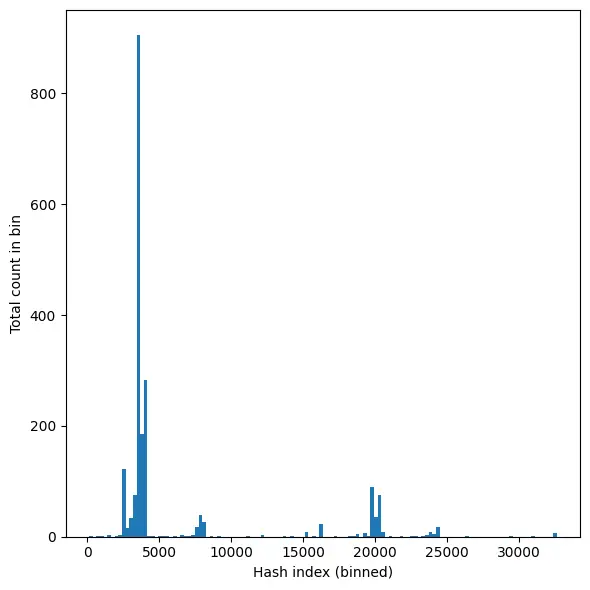

Figure 1: Distribution of number of visitations across hash-cells.

In our preliminary experiments, we investigate the direct application of
count-based exploration methods to the RLVR setting. To avoid the
computational burden of matrix inversion, we adopt the SimHash technique
(Tang et al., 2017), which maps the embedding of a CoT response into a
discrete hash code, and then uses the visitation frequency of hash cells
as pseudo-counts (see Section 3.1 for details). However, as illustrated
in Figure 1, this approach proves problematic: it is difficult to
meaningfully characterize a complex CoT reasoning trajectory with a
fixed embedding vector. In practice, most responses collapse into the
same or neighboring hash grids, leading to a highly concentrated
distribution of counts and thus undermining the effectiveness of
count-based exploration for RLVR.

In this work, we propose an intuitive approach that leverages the
model’s intrinsic sense of curiosity as a guide for exploration. An LLM,
having been trained on vast reasoning corpora, develops a sophisticated
internal model of what constitutes a familiar versus a novel reasoning
pattern. This parallels early childhood development (Chu & Schulz,
2020), where learning is not driven by a external summary and count of
experiences, but is instead propelled by an intrinsic curiosity to
explore novel situations. We formalize this principle in our
Curiosity-Driven Exploration (CDE) framework, which considers curiosity
signals from both the actor and the critic. For the actor, perplexity
(PPL) over its generated response serves as the curiosity measure. For
the critic, we measure curiosity via the variance of its posterior value
distribution. We then approximate this posterior by extending the PPO
framework with a multi-head, bootstrapped structure. The curiosity
signals are served as an exploration bonus, shaping the reward and
advantage functions to effectively guide exploration.

Our theoretical analysis offers further insights into the properties of
our method. (i) Theorem 3.1 interprets the proposed perplexity-based
bonus, showing that it intrinsically penalizes overconfident errors
while encouraging diversity among correct responses. (ii) Theorem 3.2
establishes that in the linear MDP setting, our critic-based exploration
bonus is theoretically equivalent to classical count-based bonuses,
grounding our approach in established exploration principles.

Our empirical evaluation demonstrates consistent performance gains
across four widely used mathematics benchmarks (AIME25, AIME24, AMC23,
and MATH), including an approximate +3 point improvement on the
challenging AIME benchmarks. Furthermore, our analysis of the training
process supports our theoretical findings and reveals a phenomenon we
term calibration collapse: under a naive GRPO policy, the model’s
confidence progressively decouples from its correctness, while adding
PPL bonus mitigates this miscalculation.

## 2 Preliminaries: RLVR, GRPO and PPO

We formulate the language generation process of LLMs as a sequential
decision-making problem (Yu et al., 2025; Yue et al., 2025).
Specifically, we consider two reinforcement learning algorithms: _Group
Relative Policy Optimization_ (GRPO), a critic-free method, and
_Proximal Policy Optimization_ (PPO), a canonical actor–critic method.
We adopt the training paradigm of Reinforcement Learning with Verifiable
Rewards (RLVR) (Guo et al., 2025; Lambert et al., 2024) and utilize a
rule-based verifier to compare the generated response with the ground
truth to judge its correctness.

### 2.1 Group Relative Policy Optimization (GRPO, Shao et al. 2024)

GRPO is an REINFORCE-style optimization algorithm. Let $`\pi_{\theta}`$
denote the LLM policy with parameters $`\theta`$. At each training step,
given a prompt $`q`$ sampled from the dataset $`\mathcal{D}`$, the
current policy $`\pi_{\theta}`$ generates a group of $`G`$ candidate
outputs $`\{o_{1},o_{2},\ldots,o_{G}\}`$. For each candidate $`o_{i}`$,
we compute its total reward $`r_{i}=r(o_{i},q)`$.

The advantage for each output is computed by normalizing its reward with
respect to the group’s rewards:

```math
A_{i}=\frac{r_{i}-\operatorname{mean}(r_{1},\ldots,r_{G})}{\operatorname{std}(r_{1},\ldots,r_{G})+\delta},
```

where $`\delta`$ is a small constant for numerical stability. The same
advantage $`A_{i}`$ is applied to all tokens in $`o_{i}`$. Let
$`\pi_{\theta_{\text{old}}}`$ be the policy from the previous step and
$`\pi_{\text{ref}}`$ the original pre-trained model. GRPO maximizes:

```math
\mathcal{L}_{\text{GRPO}}(\theta)=\mathbb{E}_{q\sim\mathcal{D},\{o_{i}\}\sim\pi_{\theta_{\text{old}}}}\left[\frac{1}{G}\sum_{i=1}^{G}\frac{1}{|o_{i}|}\sum_{t=1}^{|o_{i}|}\mathcal{L}_{\theta}(\tilde{r}_{i,t},A_{i})\right]-\beta D_{\text{KL}}\left(\pi_{\theta}\|\pi_{\text{ref}}\right),
```

where the clipped objective is

```math
\mathcal{L}_{\theta}(\tilde{r}_{i,t},A_{i})=\min\left(\tilde{r}_{i,t}A_{i},\text{clip}(\tilde{r}_{i,t},1-\varepsilon,1+\varepsilon)A_{i}\right),\quad\tilde{r}_{i,t}=\frac{\pi_{\theta}(o_{i,t}\mid q,o_{i,<t})}{\pi_{\theta_{\text{old}}}(o_{i,t}\mid q,o_{i,<t})}.
```

Here, $`\varepsilon`$ and $`\beta`$ control the ratio clipping threshold
and the KL-penalty strength, respectively. The clipping mitigates large,
unstable policy updates, while the KL term constrains deviation from
$`\pi_{\text{ref}}`$.

### 2.2 Proximal Policy Optimization (PPO, Schulman et al. 2017)

PPO is an actor–critic algorithm that maintains both a policy (actor)
$`\pi_{\theta}`$ and a value function (critic) $`V_{\phi}`$ with
parameters $`\phi`$, estimating the expected total reward from a given
state (prompt and sequence prefix). The advantage function in PPO
leverages the critic to reduce variance. Specifically, Generalized
Advantage Estimation (GAE) is applied to compute token-level advantages.
For an output $`o_{i}`$ with sentence-level reward $`r_{i}`$, the GAE at
token $`t`$ is:

```math
A_{i,t}=\sum_{l=t}^{|o_{i}|}(\gamma\lambda)^{l-t}\delta_{i,l},
```

where

```math
\delta_{i,l}=r_{i,l}+\gamma V_{\phi}(q,o_{i,\leq l+1})-V_{\phi}(q,o_{i,\leq l}),
```

and in our setting $`r_{i,l}=0`$ for all non-terminal tokens, with
$`r_{i,|o_{i}|}=r_{i}`$. The hyperparameters $`\gamma`$ and $`\lambda`$
are the discount factor and GAE trace-decay, respectively. The PPO
objective is:

```math
\mathcal{L}_{\text{PPO}}(\theta,\phi)=\mathbb{E}_{q\sim\mathcal{D},\{o_{i}\}\sim\pi_{\theta_{\text{old}}}}\Big[\frac{1}{|o_{i}|}\sum_{t=1}^{|o_{i}|}\left[\mathcal{L}_{\theta}(\tilde{r}_{i,t},A_{i,t})-c_{1}\mathcal{L}_{\phi}(q,o_{i,<t},r_{i})\right]\Big]-\beta D_{\text{KL}}\left(\pi_{\theta}\|\pi_{\text{ref}}\right),
```

where $`\mathcal{L}_{\theta}`$ is as in GRPO but with per-token
$`A_{i,t}`$, and the value loss is:

```math
\mathcal{L}_{\phi}(\phi)=\left(V_{\phi}(q,o_{i,<t})-r_{i}\right)^{2}.
```

In practice, we alternate optimization of the actor ($`\theta`$) and the
critic ($`\phi`$).

## 3 CDE: Curiosity-Driven Exploration

In this section, we first explore count-based exploration and identify
two of its key challenges. To overcome these challenges, we propose
Curiosity-Driven Exploration (CDE), a systematic framework that
considers curiosity signals from both the actor and the critic. We
introduce the detailed formulations of actor and critic curiosity in
Section 3.2 and Section 3.3, respectively.

### 3.1 Challenge of Count-based exploration for RLVR

The core idea of count-based exploration is to measure the occurrence of
Chain-of-Thought (CoT) patterns via sentence embeddings, and to assign
an exploration bonus to rarely occurred CoTs. While conceptually
appealing, this approach faces two major challenges:

- •
  Curse of dimensionality: Classical count-based methods (e.g., LSVI-UCB
  (Jin et al., 2020), CFPO (Cassel & Rosenberg, 2024)) rely on computing
  the inverse of the covariance matrix $`\Lambda_{t}^{-1}`$ (see
  Appendix E) to construct historical visitation ellipsoids. For
  high-dimensional embeddings, this operation is computationally
  prohibitive.

To circumvent the need for matrix inversion, we investigated hash-based
counts (Tang et al., 2017) (details in Appendix C), which project
sentence embeddings into discrete hash grids and treat grid visitation
frequency as a proxy for counts. However, this alternative introduces a
second limitation:

- •
  Poor expressiveness of embeddings: As illustrated in Figure 1, after
  hash coding, most CoT embeddings collapse into neighboring hash grids.
  This clustering highlights the limited ability of sentence embeddings
  to distinguish between diverse reasoning patterns, leading to
  ineffective exploration.

In this work, we move beyond the paradigm of explicit state–action
counts and instead utilize the model’s own measure of novelty. Our
approach is motivated by the key intuition that agents, much like
children in early cognitive development (Chu & Schulz, 2020), exhibit a
form of curiosity. They respond with confidence when revisiting familiar
states or CoT patterns, yet display uncertainty and exploratory behavior
when confronted with novel situations. This learning process is not
driven by a external count of experiences but is instead propelled by an
intrinsic drive to explore. We first detail the implementation of the
actor’s curiosity before turning to the critic’s.

### 3.2 Exploration Guided by Actor Curiosity

We model actor curiosity as the actor’s uncertainty about its own
actions. Intuitively, a response that is surprising to the actor—i.e.,
has a low probability under its current policy—likely resides in an
underexplored region of its learned distribution.

A natural and computationally efficient measure of this surprise is the
perplexity of the actor’s generation. We formalize this as a
sentence-level curiosity bonus, defined as the negative average
log-probability of a generated sentence $`o=\{o_{1},\ldots,o_{T}\}`$,
given a prompt $`q`$:

```math
B_{actor}(q,o)=-\frac{1}{T}\sum_{t=1}^{T}\log\pi(o_{t}|o_{<t},q) \tag{1}
```

where $`\pi`$ denotes the actor policy. A higher value for
$`B_{actor}(q,o)`$ indicates greater surprise and thus a stronger
intrinsic reward signal for exploration.

However, practically simply adding this bonus to the original reward can
be unstable and sub-optimal. Unconstrained exploration might incentivize
the model to generate high-perplexity but low-quality or inaccurate
responses (a behavior known as reward hacking), or lead to
over-exploration where the policy fails to converge to a stable,
high-quality output. To ensure that exploration remains tethered to the
primary objective of maximizing the original reward signal, we integrate
the bonus using an adaptive clipping mechanism. The total sentence-level
reward, $`\tilde{r}`$, is a combination of the original reward signal
$`r(q,o)`$ and the curiosity bonus $`B_{actor}(q,o)`$, where the bonus
is capped relative to the original reward:

```math
\tilde{r}(q,o)=r(q,o)+{\color[rgb]{1,0,0}\omega_{t}}\min(\frac{|r(q,o)|}{\color[rgb]{0,0,1}\kappa},{\color[rgb]{0,1,0}\alpha}B_{actor}(q,o)) \tag{2}
```

This formulation promotes exploration by rewarding sentences that the
actor finds surprising, while constraining the bonus to remain a
fraction of the original reward. In this way, the model is discouraged
from trading response quality for novelty. The behavior of this reward
function is controlled by three key hyperparameters:

- •
  The bonus weight $`\omega_{t}`$ is a dynamic coefficient, typically
  set with an annealing schedule to decrease over the course of
  training. This allows for more aggressive exploration in the early
  stages and then gradually shifts focus towards exploitation of
  high-reward regions as the policy converges.
- •
  The clipping ratio $`\kappa`$ governs the maximum size of the
  curiosity bonus relative to the original reward. By capping the bonus
  at $`|r(q,o)|/\kappa`$, it ensures the bonus remains a supplement and
  prevents it from dominating the learning signal. This is particularly
  crucial when $`r(q,o)`$ is negative, as it guarantees the bonus cannot
  reverse the sign of the reward, maintaining the integrity of the
  penalty.
- •
  The bonus scaling factor $`\alpha`$ normalizes the curiosity bonus
  $`B_{\text{actor}}(q,o)`$ before it is compared to the clipped reward.
  A higher $`\alpha`$ allows the curiosity bonus to reach the clipping
  threshold more easily, whereas a smaller $`\alpha`$ diminishes its
  potential impact.

#### Intuitions and Theoretical Foundation

While the above formulation specifies how the perplexity bonus is shaped
and controlled through its hyperparameters, it is equally important to
understand its qualitative effect on model behavior. To build this
intuition, we analyze responses along two axes: correctness and actor
perplexity. Among these four categories, two require particular
attention:

1.  1.  Incorrect responses with low PPL indicate that the model is highly
        confident in its answer, yet the response is wrong. This reflects
        overfitting and should be penalized.
2.  2.  Correct responses with high PPL suggest that the model is less
        familiar with such answers, but they nevertheless turn out to be
        successful. This reflects effective exploration and should be
        encouraged.

![[Uncaptioned
image]](arxiv-2509-09675--f55810449787.figures/figure-2.webp)

Figure 2: Responses by correctness and avg PPL.

As illustrated in Figure 2, we find out that the PPL bonus intrinsically
penalizes confident mistakes while encouraging novel correct responses.
For correct responses, those novel responses (with higher PPL) receive a
larger positive reward. For incorrect responses, those confident
responses (with lower PPL) receive larger penalty as it receives smaller
PPL bonus. The following theorem formalizes this intuition; its precise
statement and proof are deferred to Appendix D.

###### Theorem 3.1.

Let $`\pi_{t}`$ denote the policy at training step t. With PPL bonus in
Equation (1), the update to $`\pi_{t+1}`$ calibrates the policy’s
confidence as follows:

(i) Among correct responses, trajectories with higher perplexity receive
a larger relative probability increase.

(ii) Among incorrect responses, trajectories with lower perplexity
receive a larger relative probability decrease.

![[Uncaptioned
image]](arxiv-2509-09675--f55810449787.figures/figure-3.webp)

Figure 3: An illustration of the model’s policy distribution for
selecting the next token.

Previous analyses distinguish the PPL bonus from the entropy bonus,
which is sample-agnostic at the token level. The entropy at any given
step depends solely on the policy’s probability distribution and is
independent of the token ultimately sampled. Because the calculation
considers the entire next-token distribution
$`\pi_{\theta}\left(v\mid q,o_{<t}\right)`$ (Equation 3), the bonus
$`\mathcal{H}_{t}`$ remains constant for any potential outcome (Figure
3). Therefore, even when the model makes a high-confidence error by
sampling token 1, the entropy bonus fails to penalize that choice.

```math
\mathcal{H}_{t}=-\sum_{v\in\mathcal{V}}\pi_{\theta}\left(v\mid q,o_{<t}\right)\log\pi_{\theta}\left(v\mid q,o_{<t}\right). \tag{3}
```

### 3.3 Exploration Guided by Critic Curiosity

In contrast to critic-free methods such as REINFORCE and GRPO, the
critic (value function) in actor–critic frameworks provides a
higher-level understanding of the prompt–response pair by estimating the
expected reward-to-go. Since this estimate is learned directly from
collected trajectories, its posterior distribution conditioned on the
observed data naturally reflects the degree of coverage: regions with
dense data yield concentrated (low-variance) posteriors, whereas
sparsely sampled regions result in higher uncertainty. Posterior
distributions are a well-established means of quantifying predictive
uncertainty in deep learning models (Gal & Ghahramani, 2016;
Lakshminarayanan et al., 2017). As shown in Figure 4, the orange curve
exhibits lower variance—evidence of better data coverage—whereas the
other curve is more dispersed, reflecting greater uncertainty.

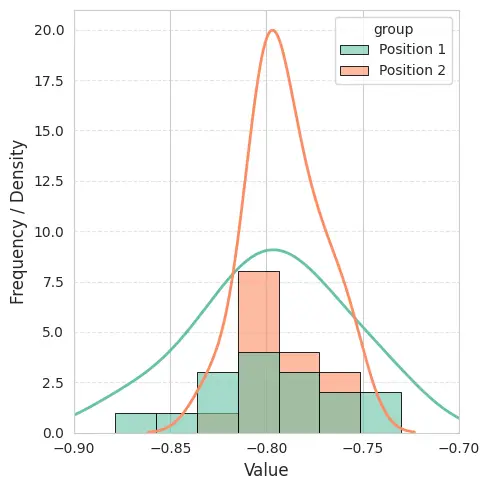

Figure 4: An illustration of two posterior distributions of the critic
and their bootstrap approximations.

To approximate the posterior distribution of value estimates, we adopt
the classical bootstrap method (Davison & Hinkley, 1997), widely used in
statistics and increasingly recognized in the RL community as an
effective tool for exploration (Osband et al., 2016; Ciosek et al.,
2019; Bai et al., 2021). We implement this idea through a multi-head
critic (upper-left subfigure in Figure 10), where $`K`$ critics
$`\{\widehat{V}_{1},\ldots,\widehat{V}_{K}\}`$ share a common LLM
backbone. Each head is trained on a resampled subset of the collected
trajectories (bottom subfigure in Figure 10), thereby producing an
empirical approximation to the posterior distribution.

We then use the standard deviation across the $`K`$ heads as a
principled curiosity signal, guiding the policy toward regions of high
disagreement where the value function remains uncertain and
under-explored. In the following theorem, we establish a surprising yet
intuitive result: under a Linear MDP assumption, the standard deviation
of the bootstrap critics is a consistent estimator of the pseudo-count
bonus.

###### Theorem 3.2.

In linear MDPs, the standard deviation across multi-head critics can
serve as a consistent estimator for the pseudo-count exploration bonus,
$`\sqrt{\phi_{n,h}^{\top}\Lambda_{n,h}^{-1}\phi_{n,h}}`$, as used in
LSVI-UCB (Jin et al., 2020) and CFPO (Cassel & Rosenberg, 2024), where
$`\phi_{n,h}=\phi(s_{n,h},a_{n,h})`$ is the feature vector of a
state-action pair and
$`\Lambda_{n,h}=\sum_{i=0}^{n}\phi_{i,h}\phi_{i,h}^{\top}+\lambda I`$ is
the coverage matrix.

The rigorous formulation of the linear MDP assumptions and the proof of
Theorem 3.2 are provided in Appendix E, while empirical results in
Section 4.4 further support this finding. Building on this foundation,
we now describe the training procedure of the multi-head PPO algorithm,
which follows the standard stages of vanilla PPO: (i) generating
trajectories with the actor, (ii) updating the actor, and (iii) updating
the critic. The key distinction is that we incorporate the multi-head
variance as an exploration bonus, encouraging the policy to visit
under-explored regions. A visual illustration of these steps is shown in
Figure 5.

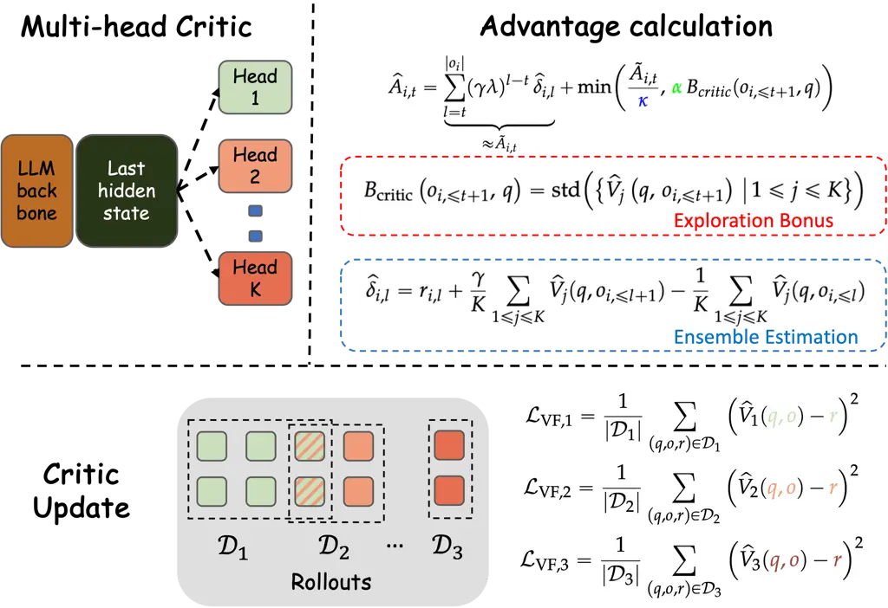

Figure 5: Illustration of the multi-head critic framework.

- •
  Actor roll-out: Given a prompt $`q`$, the actor generates a set of
  responses $`\{o_{1},\ldots,o_{n}\}`$. Each response is denoted as
  $`o_{i}=\{o_{i,1},\ldots,o_{i,|o_{i}|}\}`$. Correspondingly, we
  associate each response with a verifiable reward $`r_{i}`$. For
  clarity, we focus on the case of a single prompt $`q`$.
- •
  Actor update: In this step, the advantage is estimated as

  ```math
  \widehat{A}_{i,t}=\underbrace{\sum_{l=t}^{|o_{i}|}(\gamma\lambda)^{l-t}\widehat{\delta}_{i,l}}_{\approx\tilde{A}_{i,t}}+{\color[rgb]{1,0,0}\omega_{t}}\min\left(\frac{|\tilde{A}_{i,t}|}{\color[rgb]{0,0,1}\kappa},{\color[rgb]{0,1,0}\alpha}B_{\text{critic}}(q,o_{i,\leq t+1})\right). \tag{4}
  ```

  The advantage consists of two components. The first term,
  $`\tilde{A}_{i,t}`$, largely follows the standard advantage estimation
  in PPO, except that we exploit bootstrap estimators by using an
  _ensemble_ of value functions rather than a single point estimate:

  ```math
  \widehat{\delta}_{i,l}=r_{i,l}+\frac{\gamma}{K}\sum_{j=1}^{K}\widehat{V}_{j}(q,o_{i,\leq l+1})-\frac{1}{K}\sum_{j=1}^{K}\widehat{V}_{j}(q,o_{i,\leq l}).
  ```

  The second term of Equation 4 introduces the _multi-head critic bonus_
  ($`B_{\text{critic}}`$), governed by the bonus weight $`\omega_{t}`$,
  clipping ratio $`\kappa`$, and scaling factor $`\alpha`$ (see
  discussion following Equation (2) for interpretation). Specifically,
  $`B_{\text{critic}}`$ is defined as the standard deviation across the
  $`K`$ value heads, encouraging exploration by assigning higher bonus
  to actions leading to uncertain/less-visited regions:

  ```math
  B_{\text{critic}}\left(q,o_{i,\leq t+1}\right)=\text{std}\left(\big\{\widehat{V}_{j}(q,o_{i,\leq t+1})\big|1\leq j\leq K\big\}\right). \tag{5}
  ```

- •
  Critic update: We use the collected roll-outs to update the critic.
  For notational convenience, let the dataset be

  ```math
  \mathcal{D}=\{(q,o_{i,\leq t},r_{i})|i\in[n],t\in[|o_{i}|]\}, \tag{6}
  ```

  consisting of (prompt, partial response, reward) triplets. For each
  critic head $`j`$, we sample without replacement a subset
  $`\mathcal{D}_{j}\subset\mathcal{D}`$ of size
  $`|\mathcal{D}_{j}|=\zeta|\mathcal{D}|`$, where the hyperparameter
  $`\zeta\in(0,1]`$ controls the fraction of data assigned per head.
  Smaller $`\zeta`$ increases head diversity, while larger $`\zeta`$
  improves sample efficiency. The multi-head critic is then updated with
  the following bootstrap loss:

  ```math
  \mathcal{L}_{\phi}=\frac{1}{\zeta K|\mathcal{D}|}\sum_{j=1}^{K}\sum_{(q,o,r)\in\mathcal{D}_{j}}\left(\widehat{V}_{j}(q,o)-r\right)^{2}.
  ```

## 4 Experiments

### 4.1 Dataset and Model

In this paper, we adopt DAPO-17K (Yu et al., 2025) for training and
evaluate the performance of CDE on four challenging mathematical
reasoning benchmarks: MATH (Hendrycks et al., 2021), AMC23 (MAA, b),
AIME24, and AIME25 (MAA, a). These evaluations are designed to assess
CDE’s effectiveness in comparison to standard PPO and GRPO algorithms.
Due to computational resource constraints, we conduct training with a
reduced setting. All experiments are implemented within the Verl
framework using the Qwen3-4B-Base model (Yang et al., 2025). For fair
comparison, all the models use the default prompt in DAPO-17K as shown
in Appendix B and the implementation details in Appendix A to further
elaborate on the training settings.

### 4.2 Main Results

The main results are presented in Table 1 while the training dynamic is
presented in Figure 6. Here PPL bonus denote adding Curiosity bonus on
actors as in Equation 2, $`K`$ Heads represents multi-head critic PPO
with $`K`$ head critics. We report both average Pass@1 accuracy and
Pass@16 results on evaluation datasets. The key observations are as
follows:

|                        |       |        |         |        |         |        |         |      |
| ---------------------- | ----- | ------ | ------- | ------ | ------- | ------ | ------- | ---- |
| Model                  | MATH  | AMC23  |         | AIME24 |         | AIME25 |         | Avg  |
|                        | Avg@1 | Avg@16 | Pass@16 | Avg@16 | Pass@16 | Avg@16 | Pass@16 |      |
| Qwen3-4B-Base          | 23.1  | 10.9   | 53.8    | 1.5    | 8.4     | 1.3    | 8.3     | 9.2  |
| GRPO based methods     |       |        |         |        |         |        |         |      |
| Qwen3-4B-Base-GRPO     | 87.3  | 63.6   | 89.1    | 20.8   | 41.9    | 21.0   | 39.2    | 48.2 |
| $`\drsh`$ w/ PPL bonus | 87.7  | 67.8   | 89.5    | 23.3   | 48.5    | 23.5   | 42.5    | 50.6 |
| PPO based methods      |       |        |         |        |         |        |         |      |
| Qwen3-4B-Base-PPO      | 86.6  | 64.1   | 87.2    | 17.8   | 36.0    | 17.5   | 33.7    | 46.5 |
| $`\drsh`$ w/ PPL bonus | 87.9  | 66.1   | 88.5    | 18.3   | 37.6    | 18.3   | 33.5    | 47.7 |
| $`\drsh`$ w/ 2 Heads   | 83.2  | 63.6   | 89.9    | 19.6   | 34.8    | 19.6   | 36.1    | 46.6 |
| $`\drsh`$ w/ 4 Heads   | 87.3  | 63.9   | 87.9    | 21.5   | 35.5    | 21.5   | 45.5    | 48.5 |
| $`\drsh`$ w/ 8 Heads   | 85.1  | 66.7   | 86.9    | 21.7   | 46.4    | 19.0   | 37.1    | 48.1 |
| $`\drsh`$ w/ 16 Heads  | 88.3  | 65.0   | 88.7    | 20.5   | 41.9    | 20.0   | 38.8    | 48.6 |

Table 1: Zero-shot accuracy of different models on the validation
datasets. Avg@16 denotes the mean Pass@1 accuracy over 16 sampled
generations, while Avg column represents the overall average across
datasets, computed as Avg@1 for MATH and Avg@16 for the remaining
datasets.

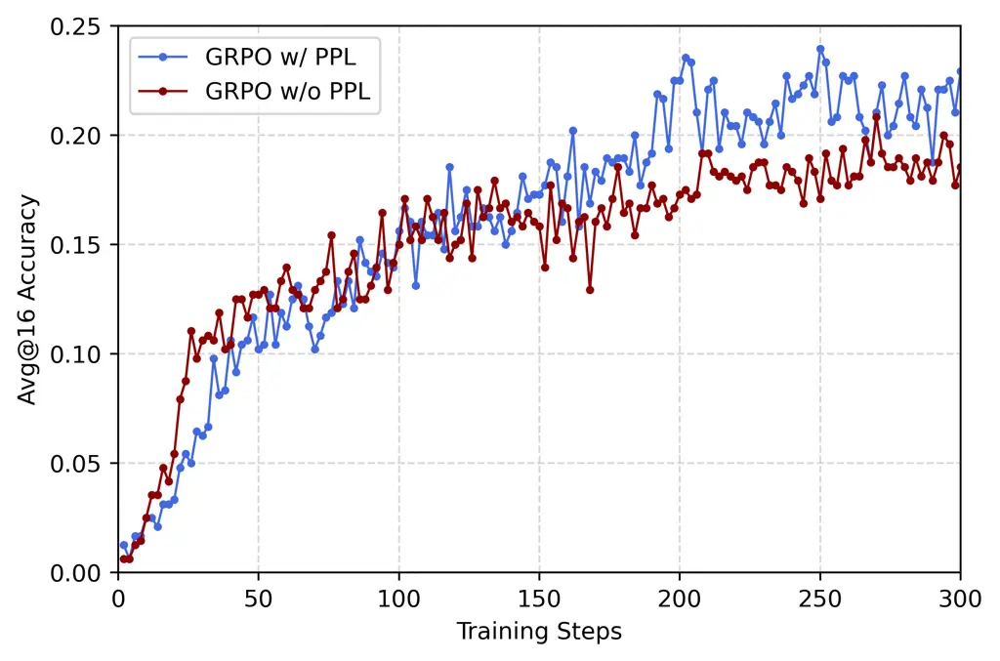

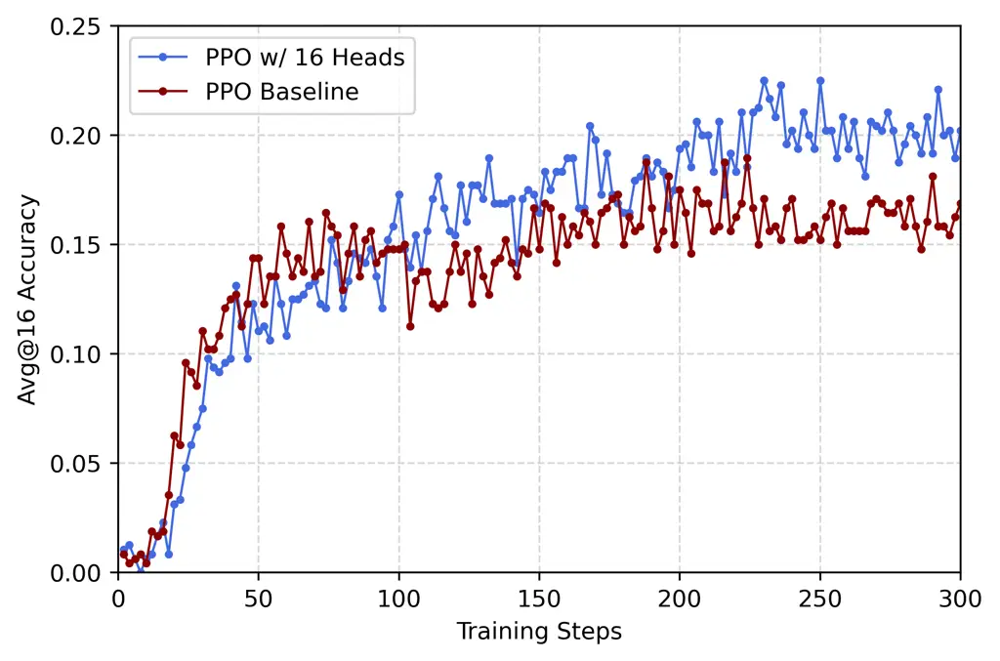

Figure 6: Comparison of Avg@16 accuracy on AIME25 over training of
vanilla GRPO and PPO (Baseline methods) and GRPO with PPL bonus and 16
head multi-head PPO(Our methods).

- •
  The PPL bonus further enhances the mathematical reasoning ability of
  the GRPO method, yielding an average improvement of approximately
  $`+2.4`$ points across datasets and demonstrating consistent
  superiority. In particular, our method achieves notable gains on
  Pass@16, surpassing the baseline GRPO by about $`+8`$ points on the
  AIME24 dataset.
- •
  Across benchmarks, multi-head PPO consistently outperforms vanilla
  PPO. Using $`K=4`$ and $`K=16`$ heads yields average gains of roughly
  $`+2`$ points, and we observe an around $`+10`$ points of increase in
  Pass@16 on AIME datasets in many cases.
- •
  The performance of multi-head PPO generally increases with the number
  of heads $`K`$: with $`K=2`$ delivers negligible gains over the
  baseline, and performance increase begin to plateau once $`K\geq 4`$,
  which suggests that a modest number of heads already captures most of
  the epistemic uncertainty needed.
- •
  As shown in Figure 6, GRPO with PPL bonus and multi-head PPO increase
  test accuracy more slowly than baseline PPO/GRPO early in training,
  then catch up and ultimately surpass them. This pattern is consistent
  with enhanced exploration: the PPL bonus and head disagreement
  discourage premature exploitation of spurious high-reward
  trajectories. As state-action coverage expands, these signals
  calibrate, enabling a smoother shift to targeted exploitation and
  yielding higher final accuracy.

### 4.3 Understanding the Effect of the PPL Bonus

In this subsection, we present additional experiments to investigate the
role of the PPL bonus, from which we derive the following key findings.

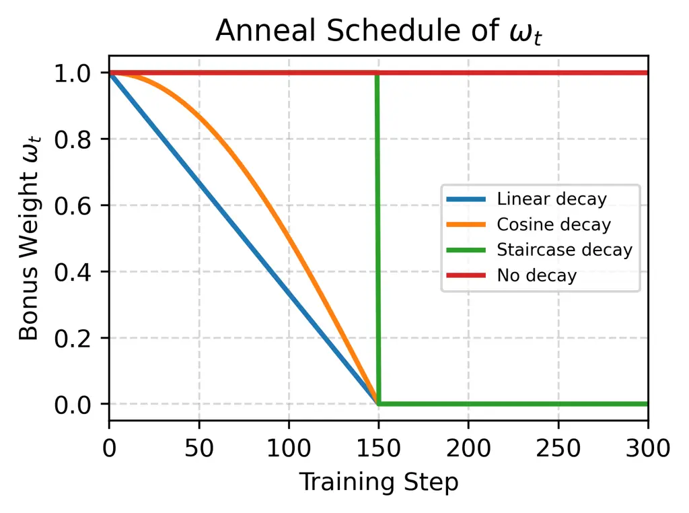

Figure 7: An illustration of different weight anneal schedules.

Bonus weight decay is crucial We compare four schedules for the bonus
weight $`\omega_{t}`$—_No decay_, _Linear_, _Cosine_, and _Staircase_—as
illustrated in Figure 7, with the performance of models trained under
each schedule summarized in Table 2. Briefly, the _No decay_ schedule
maintains strong exploration throughout training, while the _Staircase_
schedule reduces $`\omega_{t}`$ abruptly, enabling strong exploration in
the early phase and then removing the bonus for final convergence. The
_Linear_ and _Cosine_ schedules provide intermediate behaviors.

The results in Table 2 underscore two insights: First, decay of the
bonus weight is necessary, as all decay schedules outperform the
no-decay baseline by enabling a gradual shift from exploration to
exploitation. Second, strong exploration in the early phase is crucial,
with the staircase scheme proving most effective by sustaining high
exploration initially to broaden state–action coverage and then removing
the bonus abruptly to allow stable convergence, whereas the gentler
cosine and linear decays weaken the signal too soon and thus yield
smaller gains.

|                                          |       |        |         |        |         |        |         |      |
| ---------------------------------------- | ----- | ------ | ------- | ------ | ------- | ------ | ------- | ---- |
| Model                                    | MATH  | AMC23  |         | AIME24 |         | AIME25 |         | Avg  |
|                                          | Avg@1 | Avg@16 | Pass@16 | Avg@16 | Pass@16 | Avg@16 | Pass@16 |      |
| Bonus Weight Decay Schedules             |       |        |         |        |         |        |         |      |
| Qwen3-4B-Base-GRPO                       | 87.3  | 63.6   | 91.1    | 21.0   | 41.9    | 20.8   | 39.2    | 48.2 |
| $`\drsh`$ $`\omega_{t}`$ No decay        | 85.1  | 64.5   | 84.6    | 20.8   | 39.0    | 22.3   | 36.2    | 48.2 |
| $`\drsh`$ $`\omega_{t}`$ Linear decay    | 85.4  | 66.1   | 91.9    | 23.3   | 40.4    | 20.0   | 40.4    | 48.7 |
| $`\drsh`$ $`\omega_{t}`$ Cosine decay    | 86.7  | 68.1   | 90.0    | 22.5   | 44.9    | 21.5   | 40.7    | 49.7 |
| $`\drsh`$ $`\omega_{t}`$ Staircase decay | 87.7  | 67.8   | 89.2    | 23.5   | 48.5    | 23.3   | 40.3    | 50.6 |

Table 2: Zero-shot accuracy of GRPO models under different PPL bonus
weight decay schedules. The schedules follow those illustrated in
Figure 7.

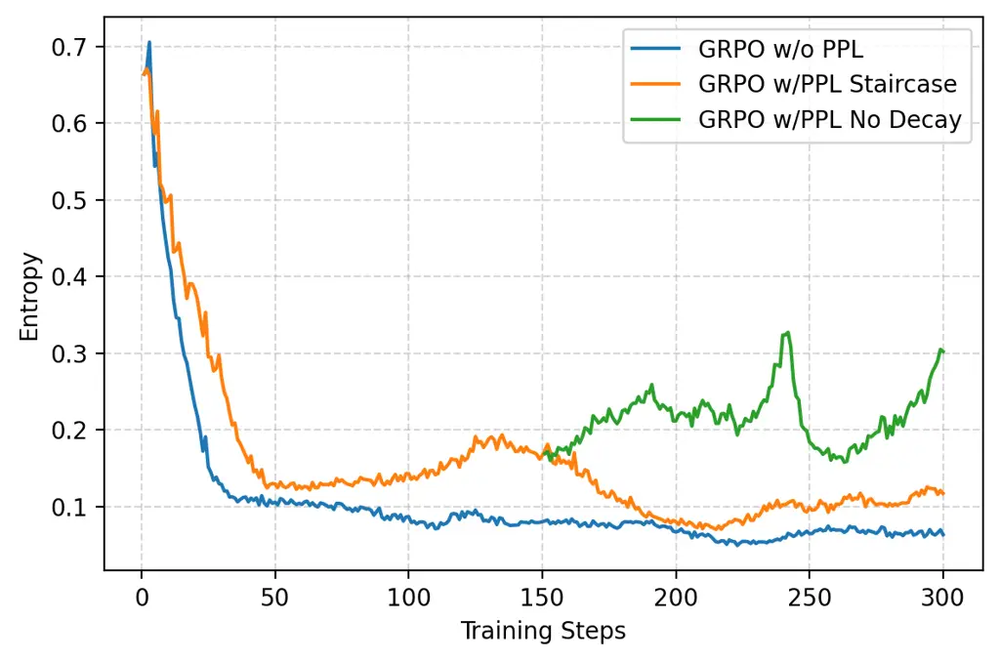

Figure 8: Dynamics of policy entropy over the training process. The
bonus weight decay mechanism follows Figure 7. The Staircase and No
Decay schedules share the same early training phase.

Analysis of Entropy Dynamics As highlighted in prior work, entropy
provides an important lens for understanding exploration ability (Cui
et al., 2025), where a sharp decline in entropy often signals premature
convergence and insufficient exploration. Figure 8 illustrates the
entropy dynamics of baseline GRPO compared to our proposed methods.
First, relative to the baseline, the PPL bonus alleviates entropy
collapse, demonstrating its role in promoting exploration. Second, when
comparing decay schemes, PPL with No Decay shows persistent fluctuations
and fails to converge, whereas Staircase decay yields more stable
entropy trajectories. This observation is consistent with our earlier
findings that decaying the bonus weight is essential for ensuring stable
convergence while still supporting effective exploration.

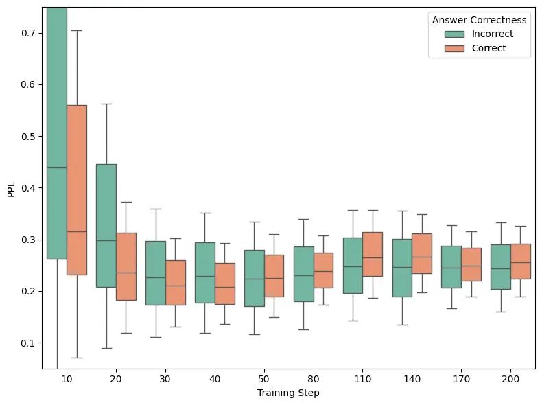

(a) GRPO without PPL bonus

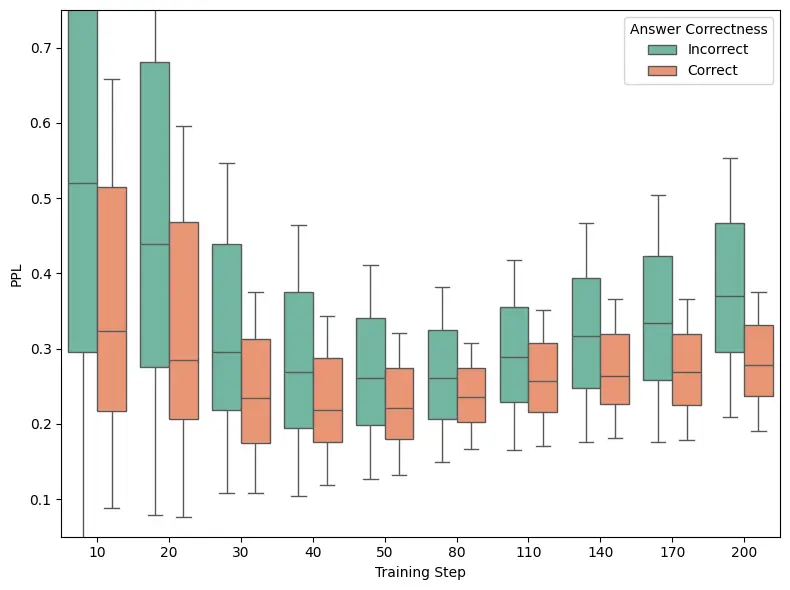

(b) GRPO with PPL bonus

Figure 9: Average response PPL per training step, stratified by
correctness.

Analysis of Calibration As shown in Figure 9, we plot the batch-wise
mean response perplexity (PPL), stratified by answer correctness. In
subfigure (a), we observe a phenomenon we term calibration collapse:
early in naive GRPO training, correct responses have lower PPL (higher
confidence) than incorrect ones, but as training progresses this gap
shrinks and ultimately vanishes—confidence no longer tracks correctness.
By contrast, with a PPL bonus (subfigure (b)), this separation is
sustained throughout training.

This pattern is explained by Theorem 3.1: while both naive GRPO and GRPO
with a PPL bonus tend to increase confidence on correct answers, the PPL
bonus additionally suppresses confident errors (low-PPL incorrect
trajectories), thereby improving calibration.

This finding is original and practically important. Ideally, a trained
model should be faithful—confident when its answer is correct and
cautious when it is not. Better calibration enhances interpretability
and supports inference-time selection strategies such as self-certainty
BoN (Wang et al., 2022) and DeepConf (Fu et al., 2025). It also connects
to the growing literature on calibrating LLMs, both during training
(e.g., (Shen et al., 2024)) and at test time (e.g., (Ulmer et al.,
2024)).

### 4.4 Further Analysis of the Multi-Head Critic

Analysis of Dynamics of $`B_{\text{critic}}`$ We further examine the
dynamics of the multi-head exploration bonus $`B_{\text{critic}}`$ by
tracking its average value over the course of training. Specifically,
for each training step, given the roll-outs $`\mathcal{D}`$ defined in
Equation 6, we compute the average $`B_{\text{critic}}`$ across (prompt,
partial response, reward) triplets within $`\mathcal{D}`$. As shown in
sub-figure (a) of Figure 10, this average decreases steadily as training
progresses. The decline reflects that, with more training, similar
trajectories are revisited more frequently, leading to reduced
disagreement among critic heads. This phenomenon provides empirical
support for interpreting the multi-head bonus as analogous to
count-based exploration measures.

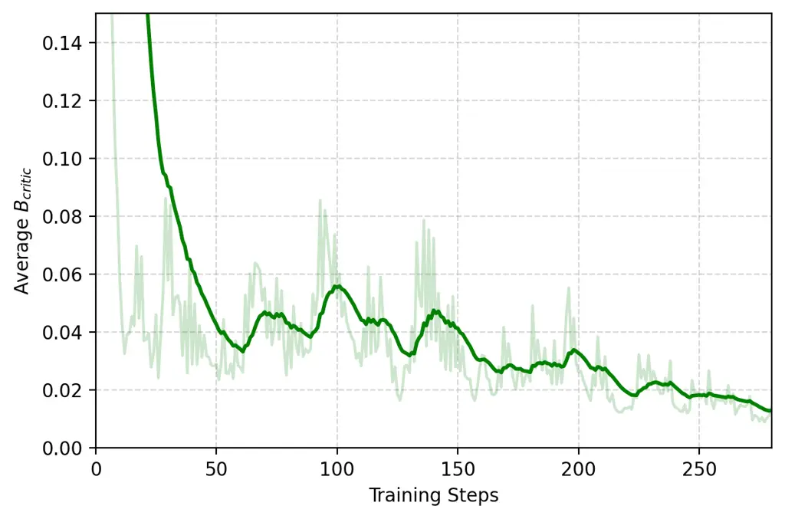

(a)

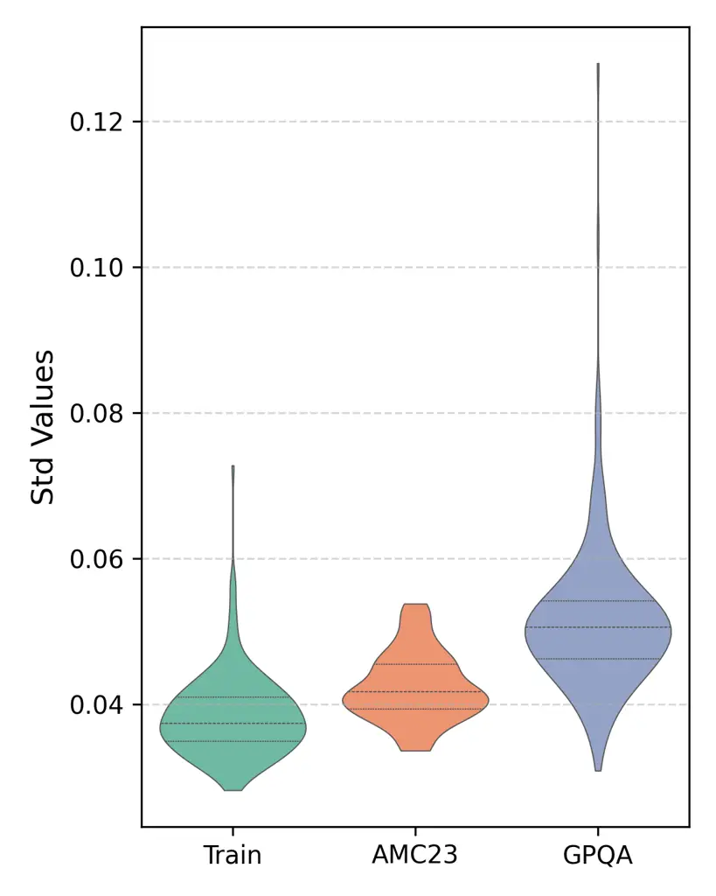

(b)

Figure 10: (a) The average $`B_{\text{critic}}`$ over training steps.
(b) Distribution of the standard deviation of value heads across prompts
from different datasets.

In sub-figure (b) of Figure 10, we present a cross-dataset analysis by
calculating the average standard deviation of the value estimates across
different questions. Specifically, we evaluate three datasets: the
training set (DAPO-17K), the in-domain validation set (AMC23), and the
out-of-domain validation set GPQA (Rein et al., 2023). We observe that
the training set exhibits a smaller standard deviation compared to both
the in-domain and out-of-domain validation sets. This pattern aligns
with the intuition that multi-head critics tend to show stronger
disagreement on data that is less frequently encountered during
training.

Analysis of sub-sample fraction $`\zeta`$ during critic update
Additionally, we examine the sensitivity of the critic update to the
hyperparameter $`\zeta`$ (sub-sample fraction). We vary $`\zeta`$ under
two configurations—critics with 16 heads and with 4 heads—and compare
$`\zeta\in\{0.5,1\}`$. As shown in Table 3, while a larger number of
heads benefits from a larger sub-sample fraction, the overall
performance is stable across settings. The model demonstrates robustness
to the masking fraction $`\zeta`$, achieving similar results for both
values tested (0.5 and 1.0).

|                          |       |        |         |        |         |        |         |      |
| ------------------------ | ----- | ------ | ------- | ------ | ------- | ------ | ------- | ---- |
| Model                    | MATH  | AMC23  |         | AIME24 |         | AIME25 |         | Avg  |
|                          | Avg@1 | Avg@16 | Pass@16 | Avg@16 | Pass@16 | Avg@16 | Pass@16 |      |
| Mask fraction            |       |        |         |        |         |        |         |      |
| 16 Heads ; $`\zeta=0.5`$ | 88.3  | 65.0   | 88.7    | 20.5   | 41.9    | 20.0   | 38.8    | 48.6 |
| 16 Heads ; $`\zeta=1`$   | 85.4  | 65.3   | 85.3    | 21.0   | 39.2    | 21.7   | 43.2    | 48.4 |
| 4 Heads ; $`\zeta=0.5`$  | 86.1  | 66.4   | 85.8    | 18.1   | 36.7    | 23.1   | 39.1    | 48.4 |
| 4 Heads ; $`\zeta=1`$    | 87.3  | 63.9   | 87.9    | 21.5   | 35.5    | 21.5   | 45.5    | 48.5 |

Table 3: Ablation study on sub-sample fraction $`\zeta`$.

## 5 Related Work

### 5.1 Reinforcement Learning (RL) for LLM reasoning

Reinforcement Learning is a central technique for advancing the
reasoning capabilities of LLMs. Initial approaches relied on reward
models that provided either outcome-based supervision, focusing on the
final answer (Cobbe et al., 2021), or process-based supervision,
evaluating intermediate reasoning steps (Uesato et al., 2022). To
navigate more complex problem spaces, these foundational reward
strategies were often augmented with search algorithms such as MCTS
(Feng et al., 2023; Tian et al., 2024; Chen et al., 2024; Wang et al.,
2024c) and Q\* (Wang et al., 2024b; Wang et al., 2024a). More recently,
RLVR (Lambert et al., 2024) has emerged as a powerful alternative,
demonstrating significant performance on complex reasoning tasks in
mathematics and coding (Guo et al., 2025). Consequently, a growing body
of work seeks to apply RLVR to diverse domains, including multi-modal
reasoning (Wang et al., 2025; Li et al., 2025), logical reasoning (Zhou
et al., 2025), search engine use (Jin et al., 2025; Xiong et al., 2025),
and information extraction (Dai et al., 2025b). Parallel efforts aim to
improve upon the standard RLVR paradigm with techniques such as
mixture-of-thought (Zheng et al., 2025a), self-evolving (Huang et al.,
2025), parallel thinking (Zheng et al., 2025b). Despite these advances,
persistent concerns remain regarding robustness (Dai et al., 2025a; Zhao
et al., 2025), calibration (Shen et al., 2024), and a lack of
exploration evidenced by entropy collapse (Cui et al., 2025; Shen,
2025), highlighting the need for more principled training approaches.

### 5.2 Efficient exploration

Efficient exploration is a central challenge in Reinforcement Learning
(RL), which aim to balance between exploration and exploitation (Sutton
& Barto, 2018; Weng, 2020; Amin et al., 2021). Many foundational
approaches are heuristic-based, such as Gaussian noise (Lillicrap
et al., 2015) or the $`\epsilon`$-greedy method (Sutton & Barto, 2018).
Entropy regularization is a more principled heuristic, which encourages
the policy to be more stochastic. While simple to implement, these
methods are often undirected—they promote pure randomness. Consequently,
they can be suboptimal (Dann et al., 2022) with no significant gains in
complex Deep RL (Andrychowicz et al., 2021) or LLM training (Cui et al.,
2025; Shen, 2025).

In contrast, a major class of methods incentivizes exploration by adding
exploration bonus to guide the agent toward novel or uncertain parts of
the environment. Count-based approaches like UCB (Lai, 1987), LinUCB (Li
et al., 2010), and LSVI-UCB (Jin et al., 2020) use pseudo-counts of
state-action visitations to encourage exploring rarely visited areas,
achieving near-optimal theoretical guarantees in bandits and linear
MDPs. Similarly, prediction-based methods such as ICM (Pathak et al., 2017) and RND (Burda et al., 2018) use the error from a predictive model
as a bonus, rewarding the agent for reaching states that are difficult
to predict. Applying these guided exploration principles is a growing
field in LLM. For instance, Bai et al. (2025) incorporate a count-based
bonus into the RLHF process by introducing a coin flipping module. Gao
et al. (2025) draws inspiration from RND by adding an auxiliary noise
prediction network. However, both methods rely on expressive
representations of long COT trajectories and introduce additional
modules, which complicates the training framework. In contrast, CDE uses
intrinsic curiosity signals from the actor and critics, requiring only
minimal modifications to the framework and yielding efficient
exploration both theoretically and empirically.

## 6 Conclusion and Future Work

We have presented Curiosity-Driven Exploration, an efficient technique
that enhances agent learning by incorporating curiosity signals from
both the actor and the critic. Our approach is notably lightweight,
demanding only minor modifications to the original training
architecture. Its effectiveness is demonstrated by consistent accuracy
improvements over strong baselines on a suite of challenging
mathematical reasoning benchmarks, with these empirical results strongly
corroborating our underlying theoretical framework and intuition.

The calibration collapse revealed in our analysis aligns with recent
findings on the root causes of LLM hallucination (Kalai et al., 2025),
pointing to a promising avenue for future work. We hypothesize that the
underlying source of this collapse is the reward design of RLVR
training. Specifically, RLVR with outcome reward prioritizes correct
final outcomes at the expense of rigorous intermediate reasoning. Our
experiments shed light on this direction by demonstrating that an
alternative multi-perspective reward design (e.g., the PPL bonus) can be
valuable for guiding the RLVR process more effectively.

## References

- Amin et al. (2021) Susan Amin, Maziar Gomrokchi, Harsh Satija, Herke
  Van Hoof, and Doina Precup. A survey of exploration methods in
  reinforcement learning. _arXiv preprint arXiv:2109.00157_, 2021.
- Andrychowicz et al. (2021) Marcin Andrychowicz, Anton Raichuk, Piotr
  Stańczyk, Manu Orsini, Sertan Girgin, Raphaël Marinier, Leonard
  Hussenot, Matthieu Geist, Olivier Pietquin, Marcin Michalski, et al.
  What matters for on-policy deep actor-critic methods? a large-scale
  study. In _International conference on learning
  representations_, 2021.
- Bai et al. (2021) Chenjia Bai, Lingxiao Wang, Lei Han, Jianye Hao,
  Animesh Garg, Peng Liu, and Zhaoran Wang. Principled exploration via
  optimistic bootstrapping and backward induction. In _International
  Conference on Machine Learning_, pp. 577–587. PMLR, 2021.
- Bai et al. (2025) Chenjia Bai, Yang Zhang, Shuang Qiu, Qiaosheng
  Zhang, Kang Xu, and Xuelong Li. Online preference alignment for
  language models via count-based exploration. _arXiv preprint
  arXiv:2501.12735_, 2025.
- Burda et al. (2018) Yuri Burda, Harrison Edwards, Amos Storkey, and
  Oleg Klimov. Exploration by random network distillation. _arXiv
  preprint arXiv:1810.12894_, 2018.
- Cassel & Rosenberg (2024) Asaf Cassel and Aviv Rosenberg. Warm-up free
  policy optimization: Improved regret in linear markov decision
  processes. _Advances in Neural Information Processing Systems_,
  37:3275–3303, 2024.
- Chen et al. (2024) Guoxin Chen, Minpeng Liao, Chengxi Li, and Kai Fan.
  Alphamath almost zero: process supervision without process. _Advances
  in Neural Information Processing Systems_, 37:27689–27724, 2024.
- Chu & Schulz (2020) Junyi Chu and Laura E Schulz. Play, curiosity, and
  cognition. _Annual Review of Developmental Psychology_,
  2(1):317–343, 2020.
- Ciosek et al. (2019) Kamil Ciosek, Quan Vuong, Robert Loftin, and
  Katja Hofmann. Better exploration with optimistic actor critic.
  _Advances in Neural Information Processing Systems_, 32, 2019.
- Cobbe et al. (2021) Karl Cobbe, Vineet Kosaraju, Mohammad Bavarian,
  Mark Chen, Heewoo Jun, Lukasz Kaiser, Matthias Plappert, Jerry Tworek,
  Jacob Hilton, Reiichiro Nakano, et al. Training verifiers to solve
  math word problems. _arXiv preprint arXiv:2110.14168_, 2021.
- Cui et al. (2025) Ganqu Cui, Yuchen Zhang, Jiacheng Chen, Lifan Yuan,
  Zhi Wang, Yuxin Zuo, Haozhan Li, Yuchen Fan, Huayu Chen, Weize Chen,
  et al. The entropy mechanism of reinforcement learning for reasoning
  language models. _arXiv preprint arXiv:2505.22617_, 2025.
- Dai et al. (2025a) Runpeng Dai, Run Yang, Fan Zhou, and Hongtu Zhu.
  Breach in the shield: Unveiling the vulnerabilities of large language
  models. _arXiv preprint arXiv:2504.03714_, 2025a.
- Dai et al. (2025b) Runpeng Dai, Tong Zheng, Run Yang, Kaixian Yu, and
  Hongtu Zhu. R1-re: Cross-domain relation extraction with rlvr. _arXiv
  preprint arXiv:2507.04642_, 2025b.
- Dann et al. (2022) Chris Dann, Yishay Mansour, Mehryar Mohri, Ayush
  Sekhari, and Karthik Sridharan. Guarantees for epsilon-greedy
  reinforcement learning with function approximation. In _International
  conference on machine learning_, pp. 4666–4689. PMLR, 2022.
- Davison & Hinkley (1997) Anthony Christopher Davison and David Victor
  Hinkley. _Bootstrap methods and their application_. Number 1.
  Cambridge university press, 1997.
- Feng et al. (2023) Xidong Feng, Ziyu Wan, Muning Wen, Stephen Marcus
  McAleer, Ying Wen, Weinan Zhang, and Jun Wang. Alphazero-like
  tree-search can guide large language model decoding and training.
  _arXiv preprint arXiv:2309.17179_, 2023.
- Fu et al. (2025) Yichao Fu, Xuewei Wang, Yuandong Tian, and Jiawei
  Zhao. Deep think with confidence. _arXiv preprint
  arXiv:2508.15260_, 2025.
- Gal & Ghahramani (2016) Yarin Gal and Zoubin Ghahramani. Dropout as a
  bayesian approximation: Representing model uncertainty in deep
  learning. In _international conference on machine learning_, pp.
  1050–1059. PMLR, 2016.
- Gao et al. (2025) Jingtong Gao, Ling Pan, Yejing Wang, Rui Zhong, Chi
  Lu, Qingpeng Cai, Peng Jiang, and Xiangyu Zhao. Navigate the unknown:
  Enhancing llm reasoning with intrinsic motivation guided exploration.
  _arXiv preprint arXiv:2505.17621_, 2025.
- Guo et al. (2024) Daya Guo, Qihao Zhu, Dejian Yang, Zhenda Xie, Kai
  Dong, Wentao Zhang, Guanting Chen, Xiao Bi, Yu Wu, YK Li, et al.
  Deepseek-coder: When the large language model meets programming–the
  rise of code intelligence. _arXiv preprint arXiv:2401.14196_, 2024.
- Guo et al. (2025) Daya Guo, Dejian Yang, Haowei Zhang, Junxiao Song,
  Ruoyu Zhang, Runxin Xu, Qihao Zhu, Shirong Ma, Peiyi Wang, Xiao Bi,
  et al. Deepseek-r1: Incentivizing reasoning capability in llms via
  reinforcement learning. _arXiv preprint arXiv:2501.12948_, 2025.
- Haarnoja et al. (2018) Tuomas Haarnoja, Aurick Zhou, Pieter Abbeel,
  and Sergey Levine. Soft actor-critic: Off-policy maximum entropy deep
  reinforcement learning with a stochastic actor. In _International
  conference on machine learning_, pp. 1861–1870. Pmlr, 2018.
- Hendrycks et al. (2021) Dan Hendrycks, Collin Burns, Saurav Kadavath,
  Akul Arora, Steven Basart, Eric Tang, Dawn Song, and Jacob Steinhardt.
  Measuring mathematical problem solving with the math dataset. _arXiv
  preprint arXiv:2103.03874_, 2021.
- Huang et al. (2025) Chengsong Huang, Wenhao Yu, Xiaoyang Wang,
  Hongming Zhang, Zongxia Li, Ruosen Li, Jiaxin Huang, Haitao Mi, and
  Dong Yu. R-zero: Self-evolving reasoning llm from zero data. _arXiv
  preprint arXiv:2508.05004_, 2025.
- Jin et al. (2025) Bowen Jin, Hansi Zeng, Zhenrui Yue, Jinsung Yoon,
  Sercan Arik, Dong Wang, Hamed Zamani, and Jiawei Han. Search-r1:
  Training llms to reason and leverage search engines with reinforcement
  learning. _arXiv preprint arXiv:2503.09516_, 2025.
- Jin et al. (2020) Chi Jin, Zhuoran Yang, Zhaoran Wang, and Michael I
  Jordan. Provably efficient reinforcement learning with linear function
  approximation. In _Conference on learning theory_, pp. 2137–2143.
  PMLR, 2020.
- Kalai et al. (2025) Adam Tauman Kalai, Ofir Nachum, Santosh S.
  Vempala, and Edwin Zhang. Why language models hallucinate, 2025. URL
  [https://openai.com/index/why-language-models-hallucinate/](https://openai.com/index/why-language-models-hallucinate/).
- Lai (1987) Tze Leung Lai. Adaptive treatment allocation and the
  multi-armed bandit problem. _The annals of statistics_, pp.
  1091–1114, 1987.
- Lakshminarayanan et al. (2017) Balaji Lakshminarayanan, Alexander
  Pritzel, and Charles Blundell. Simple and scalable predictive
  uncertainty estimation using deep ensembles. _Advances in neural
  information processing systems_, 30, 2017.
- Lambert et al. (2024) Nathan Lambert, Jacob Morrison, Valentina
  Pyatkin, Shengyi Huang, Hamish Ivison, Faeze Brahman, Lester James V
  Miranda, Alisa Liu, Nouha Dziri, Shane Lyu, et al. Tulu 3: Pushing
  frontiers in open language model post-training. _arXiv preprint
  arXiv:2411.15124_, 2024.
- Li et al. (2010) Lihong Li, Wei Chu, John Langford, and Robert E
  Schapire. A contextual-bandit approach to personalized news article
  recommendation. In _Proceedings of the 19th international conference
  on World wide web_, pp. 661–670, 2010.
- Li et al. (2025) Zongxia Li, Wenhao Yu, Chengsong Huang, Rui Liu,
  Zhenwen Liang, Fuxiao Liu, Jingxi Che, Dian Yu, Jordan Boyd-Graber,
  Haitao Mi, et al. Self-rewarding vision-language model via reasoning
  decomposition. _arXiv preprint arXiv:2508.19652_, 2025.
- Lillicrap et al. (2015) Timothy P Lillicrap, Jonathan J Hunt,
  Alexander Pritzel, Nicolas Heess, Tom Erez, Yuval Tassa, David Silver,
  and Daan Wierstra. Continuous control with deep reinforcement
  learning. _arXiv preprint arXiv:1509.02971_, 2015.
- MAA (a) MAA. American invitational mathematics examination (AIME).
  Mathematics Competition Series, n.d.a. URL
  [https://maa.org/math-competitions/aime](https://maa.org/math-competitions/aime).
- MAA (b) MAA. American mathematics competitions (AMC 10/12).
  Mathematics Competition Series, n.d.b. URL
  [https://maa.org/math-competitions/amc](https://maa.org/math-competitions/amc).
- Osband et al. (2016) Ian Osband, Charles Blundell, Alexander Pritzel,
  and Benjamin Van Roy. Deep exploration via bootstrapped dqn. _Advances
  in neural information processing systems_, 29, 2016.
- Pathak et al. (2017) Deepak Pathak, Pulkit Agrawal, Alexei A Efros,
  and Trevor Darrell. Curiosity-driven exploration by self-supervised
  prediction. In _International conference on machine learning_, pp.
  2778–2787. PMLR, 2017.
- Rein et al. (2023) David Rein, Betty Li Hou, Asa Cooper Stickland,
  Jackson Petty, Richard Yuanzhe Pang, Julien Dirani, Julian Michael,
  and Samuel R Bowman. Gpqa: A graduate-level google-proof q&a
  benchmark. _arXiv preprint arXiv:2311.12022_, 2023.
- Schulman et al. (2017) John Schulman, Filip Wolski, Prafulla Dhariwal,
  Alec Radford, and Oleg Klimov. Proximal policy optimization
  algorithms. _arXiv preprint arXiv:1707.06347_, 2017.
- Shao et al. (2024) Zhihong Shao, Peiyi Wang, Qihao Zhu, Runxin Xu,
  Junxiao Song, Xiao Bi, Haowei Zhang, Mingchuan Zhang, YK Li, Y Wu,
  et al. Deepseekmath: Pushing the limits of mathematical reasoning in
  open language models. _arXiv preprint arXiv:2402.03300_, 2024.
- Shen (2025) Han Shen. On entropy control in llm-rl algorithms. _arXiv
  preprint arXiv:2509.03493_, 2025.
- Shen et al. (2024) Maohao Shen, Subhro Das, Kristjan Greenewald,
  Prasanna Sattigeri, Gregory Wornell, and Soumya Ghosh. Thermometer:
  Towards universal calibration for large language models. _arXiv
  preprint arXiv:2403.08819_, 2024.
- Sutton & Barto (2018) Richard S Sutton and Andrew G Barto.
  _Reinforcement Learning: An Introduction_. MIT press, 2018.
- Tang et al. (2017) Haoran Tang, Rein Houthooft, Davis Foote, Adam
  Stooke, OpenAI Xi Chen, Yan Duan, John Schulman, Filip DeTurck, and
  Pieter Abbeel. \# exploration: A study of count-based exploration for
  deep reinforcement learning. _Advances in neural information
  processing systems_, 30, 2017.
- Tian et al. (2024) Ye Tian, Baolin Peng, Linfeng Song, Lifeng Jin,
  Dian Yu, Lei Han, Haitao Mi, and Dong Yu. Toward self-improvement of
  llms via imagination, searching, and criticizing. _Advances in Neural
  Information Processing Systems_, 37:52723–52748, 2024.
- Uesato et al. (2022) Jonathan Uesato, Nate Kushman, Ramana Kumar,
  Francis Song, Noah Siegel, Lisa Wang, Antonia Creswell, Geoffrey
  Irving, and Irina Higgins. Solving math word problems with process-and
  outcome-based feedback. _arXiv preprint arXiv:2211.14275_, 2022.
- Ulmer et al. (2024) Dennis Ulmer, Martin Gubri, Hwaran Lee, Sangdoo
  Yun, and Seong Joon Oh. Calibrating large language models using their
  generations only. _arXiv preprint arXiv:2403.05973_, 2024.
- Wang et al. (2024a) Ante Wang, Linfeng Song, Ye Tian, Baolin Peng,
  Dian Yu, Haitao Mi, Jinsong Su, and Dong Yu. Litesearch: Efficacious
  tree search for llm. _arXiv preprint arXiv:2407.00320_, 2024a.
- Wang et al. (2024b) Chaojie Wang, Yanchen Deng, Zhiyi Lyu, Liang Zeng,
  Jujie He, Shuicheng Yan, and Bo An. Q\*: Improving multi-step
  reasoning for llms with deliberative planning. _arXiv preprint
  arXiv:2406.14283_, 2024b.
- Wang et al. (2025) Haozhe Wang, Chao Qu, Zuming Huang, Wei Chu,
  Fangzhen Lin, and Wenhu Chen. Vl-rethinker: Incentivizing
  self-reflection of vision-language models with reinforcement learning.
  _arXiv preprint arXiv:2504.08837_, 2025.
- Wang et al. (2024c) Xiyao Wang, Linfeng Song, Ye Tian, Dian Yu, Baolin
  Peng, Haitao Mi, Furong Huang, and Dong Yu. Towards self-improvement
  of llms via mcts: Leveraging stepwise knowledge with curriculum
  preference learning. _arXiv preprint arXiv:2410.06508_, 2024c.
- Wang et al. (2022) Xuezhi Wang, Jason Wei, Dale Schuurmans, Quoc Le,
  Ed Chi, Sharan Narang, Aakanksha Chowdhery, and Denny Zhou.
  Self-consistency improves chain of thought reasoning in language
  models. _arXiv preprint arXiv:2203.11171_, 2022.
- Weng (2020) Lilian Weng. Exploration strategies in deep reinforcement
  learning. _lilianweng.github.io_, Jun 2020. URL
  [https://lilianweng.github.io/posts/2020-06-07-exploration-drl/](https://lilianweng.github.io/posts/2020-06-07-exploration-drl/).
- Xiong et al. (2025) Guangzhi Xiong, Qiao Jin, Xiao Wang, Yin Fang,
  Haolin Liu, Yifan Yang, Fangyuan Chen, Zhixing Song, Dengyu Wang,
  Minjia Zhang, et al. Rag-gym: Optimizing reasoning and search agents
  with process supervision. _arXiv preprint arXiv:2502.13957_, 2025.
- Yang et al. (2025) An Yang, Anfeng Li, Baosong Yang, Beichen Zhang,
  Binyuan Hui, Bo Zheng, Bowen Yu, Chang Gao, Chengen Huang, Chenxu Lv,
  et al. Qwen3 technical report. _arXiv preprint
  arXiv:2505.09388_, 2025.
- Yu et al. (2025) Qiying Yu, Zheng Zhang, Ruofei Zhu, Yufeng Yuan,
  Xiaochen Zuo, Yu Yue, Weinan Dai, Tiantian Fan, Gaohong Liu, Lingjun
  Liu, et al. Dapo: An open-source llm reinforcement learning system at
  scale. _arXiv preprint arXiv:2503.14476_, 2025.
- Yue et al. (2025) Yu Yue, Yufeng Yuan, Qiying Yu, Xiaochen Zuo, Ruofei
  Zhu, Wenyuan Xu, Jiaze Chen, Chengyi Wang, TianTian Fan, Zhengyin Du,
  et al. Vapo: Efficient and reliable reinforcement learning for
  advanced reasoning tasks. _arXiv preprint arXiv:2504.05118_, 2025.
- Zhao et al. (2025) Yulai Zhao, Haolin Liu, Dian Yu, SY Kung, Haitao
  Mi, and Dong Yu. One token to fool llm-as-a-judge. _arXiv preprint
  arXiv:2507.08794_, 2025.
- Zheng et al. (2025a) Tong Zheng, Lichang Chen, Simeng Han, R Thomas
  McCoy, and Heng Huang. Learning to reason via mixture-of-thought for
  logical reasoning. _arXiv preprint arXiv:2505.15817_, 2025a.
- Zheng et al. (2025b) Tong Zheng, Hongming Zhang, Wenhao Yu, Xiaoyang
  Wang, Xinyu Yang, Runpeng Dai, Rui Liu, Huiwen Bao, Chengsong Huang,
  Heng Huang, and Dong Yu. Parallel-r1: Towards parallel thinking via
  reinforcement learning. 2025b. URL
  [https://api.semanticscholar.org/CorpusID:281218689](https://api.semanticscholar.org/CorpusID:281218689).
- Zhou et al. (2025) Yujun Zhou, Jiayi Ye, Zipeng Ling, Yufei Han, Yue
  Huang, Haomin Zhuang, Zhenwen Liang, Kehan Guo, Taicheng Guo, Xiangqi
  Wang, et al. Dissecting logical reasoning in llms: A fine-grained
  evaluation and supervision study. _arXiv preprint
  arXiv:2506.04810_, 2025.

## Appendix A Training Details

We use verl as the training framework¹¹ 1
[https://github.com/volcengine/verl](https://github.com/volcengine/verl).
Configurations for training CDE and baseline models are listed in
Table 4.

|                      |      |      |
| -------------------- | ---- | ---- |
| Config               | GRPO | PPO  |
| actor-lr             | 1e-6 | 1e-6 |
| critic-lr            | \-   | 1e-5 |
| critic-warmup        | \-   | 10   |
| kl_coef              | 0.0  | 0.0  |
| max_prompt_length    | 2K   | 2K   |
| max_response_length  | 3K   | 3K   |
| train_batch_size     | 256  | 512  |
| ppo_mini_batch_size  | 256  | 256  |
| clip_ratio           | 0.20 | 0.20 |
| sample temperature   | 1.0  | 1.0  |
| rollout.n            | 8    | 4    |
| total_training_steps | 300  | 300  |

(a)

|                |           |           |            |
| -------------- | --------- | --------- | ---------- |
| Config         | PPL       | 2,4 Heads | 8,16 Heads |
| $`\kappa`$     | 3         | 3         | 3          |
| $`\alpha`$     | 1         | 0.5       | 0.5        |
| $`\omega_{t}`$ | Staircase | No decay  | No decay   |
| $`\zeta`$      | \-        | 1         | 0.5        |

(b)

Table 4: (a) Baseline training configurations. The GRPO setup is shared
across all GRPO-based methods (e.g., “Qwen3-4B-Base-GRPO” and “w/PPL
bonus” in Table 1); likewise, the PPO setup is shared across all
PPO-based methods. (b) CDE-specific configurations. The PPL settings are
identical for both the GRPO “w/PPL bonus” and PPO “w/PPL bonus”
variants.

## Appendix B Prompt


Figure 11: The prompt for RLVR training.

## Appendix C Details on Hash-based pseudo count

The core idea is to map a full prompt–response trajectory to a compact
hash that serves as a pseudo-state for exploration. Given a
prompt–response pair $`(q,o)`$ with tokenized sequences
$`q=\{q_{1},\ldots,q_{D}\}`$ and $`o=\{o_{1},\ldots,o_{T}\}`$, let the
model produce last-layer hidden states
$`\mathbb{h}=\{h_{1},\ldots,h_{D+T}\}`$, $`h_{i}\in\mathbb{R}^{d}`$. We
form a trajectory embedding $`h_{q,o}\in\mathbb{R}^{d}`$ from
$`\mathbb{h}`$ via one of: (i) $`h_{D+T}`$; (ii) $`h_{D+T-1}`$; or (iii)
mean pooling $`\frac{1}{D+T}\sum_{i=1}^{D+T}h_{i}`$. With a random
projection matrix $`A\in\mathbb{R}^{k\times d}`$ (rows drawn i.i.d. from
$`\mathcal{N}(0,I)`$ or Rademacher), we compute a $`k`$-bit SimHash code

```math
\phi(q,o)=\operatorname{sign}\!\big(Ah_{q,o}\big)\in\{-1,+1\}^{k},
```

and map it to a bucket index
$`b=\mathrm{bucket}(\phi)\in\{0,\ldots,2^{k}-1\}`$. Let $`n(b)`$ be the
visitation count of bucket $`b`$. We apply intrinsic reward shaping to
encourage rarely visited trajectories:

```math
\tilde{r}(q,o)=r(q,o)+\omega_{t}\frac{\beta_{t}}{\sqrt{n(b)}},
```

where $`\beta_{t}`$ is the weight for exploration bonus a. This yields
an efficient, matrix-inversion–free intrinsic bonus that scales linearly
in $`kd`$ per sample, following Tang et al. (2017).

Inputs : Policy $`\pi_{\theta}`$; aggregator $`g`$; random projection
matrix $`A\in\mathbb{R}^{k\times d}`$; hash counts
$`n[\cdot]\leftarrow 0`$; weights $`\beta_{t}`$.

for _each training iteration $`t=1,2,\dots`$_ do

   Sample prompts $`q`$ and generate responses
$`o\sim\pi_{\theta}(\cdot\mid q)`$

   for _each $`(q,o)`$ in the batch_ do

      Obtain last-layer token states $`\{h_{i}\}_{i=1}^{|q|+|o|}`$; set
$`h\leftarrow g(\{h_{i}\})`$

      $`c\leftarrow\mathrm{sign}(Ah)`$, $`b\leftarrow\mathrm{bucket}(c)`$

      $`n[b]\leftarrow n[b]+1`$

      $`\tilde{r}(q,o)\leftarrow r(q,o)+\beta_{t}/\sqrt{n[b]}`$

   Update $`\pi_{\theta}`$.

Algorithm 1 Count-based exploration for RLVR through SimHash

## Appendix D Proof for Calibration Theorem

Define $`\tilde{r}_{t}(q,o)=r(q,o)+b_{t}(q,o)`$ where
$`b_{t}(q,o)=\omega\min\{\kappa|r(q,o)|,-\frac{\alpha}{T_{o}}\log\pi_{t}(o|q)\}`$
is a bonus function where $`T_{o}`$ is the length of response $`o`$.
Note that $`\omega`$ is a redundant variable in theory because we can
write
$`b_{t}(q,o)=\min\{\kappa^{\prime}|r(q,o)|,-\frac{\alpha}{T_{o}}\log\pi_{t}(o|q)\}`$
with $`\kappa^{\prime}=\omega\kappa`$ and
$`\alpha^{\prime}=\omega\alpha`$. Given that $`r(x,y)\in\{1,-1\}`$, it
suffices to consider
$`b_{t}(q,o)=\min\{\kappa,-\frac{\alpha}{T_{o}}\log\pi_{t}(o|q)\}`$.
Thus, as long as we use $`\kappa<1`$, we have
$`\text{sign}(\tilde{r}_{t}(q,o))=\text{sign}(r(q,o))`$. The introduce
of bonus does not change the sign of the original correctness reward.

Consider single step policy optimization

```math
\displaystyle\pi_{t+1}(\cdot|q)=\arg\max_{\pi}\left\{\sum_{o}\pi(o|q)\tilde{r}_{t}(q,o)-\frac{1}{\eta}\text{KL}\left(\pi(\cdot|q)\|\pi_{t}(\cdot|q)\right)\right\},
```

which has closed-form solution

```math
\displaystyle\pi_{t+1}(o|q)=\frac{\pi_{t}(o|q)\exp\left(\eta\tilde{r}_{t}(q,o)\right)}{\sum_{o^{\prime}}\pi_{t}(o^{\prime}|q)\exp\left(\eta\tilde{r}_{t}(q,o^{\prime})\right)}.
```

For any question $`q`$ and response $`o`$. Define
$`Z(q)=\sum_{o^{\prime}}\pi_{t}(o^{\prime}|q)\exp\left(\eta\tilde{r}_{t}(q,o^{\prime})\right)`$,
we have

```math
\displaystyle\log\pi_{t+1}(o|q)=\log\pi_{t}(o|q)+\eta\tilde{r}_{t}(q,o)-\log\left(Z(q)\right).
```

Define $`\Delta_{t}(o|q)=\log\pi_{t+1}(o|q)-\log\pi_{t}(o|q)`$ as the
change of likelihood of response $`o`$ under question $`q`$ at update
step $`t`$. For two correct response $`o^{+}_{1}`$ and $`o^{+}_{2}`$
with length $`T_{o^{+}_{1}}`$ and $`T_{o^{+}_{2}}`$, and
$`-\frac{\alpha}{T_{o^{+}_{1}}}\log\pi_{t}(o^{+}_{1}|q)\geq-\frac{\alpha}{T_{o^{+}_{2}}}\log\pi_{t}(o^{+}_{2}|q)`$
(i.e. $`o_{1}^{+}`$ has larger perplexity), we have

```math
\displaystyle\Delta_{t}(o^{+}_{1}|q)-\Delta_{t}(o^{+}_{2}|q)
```

```math
\displaystyle=\tilde{r}_{t}(q,o^{+}_{1})-\tilde{r}_{t}(q,o^{+}_{2})
```

```math
\displaystyle=b_{t}(q,o^{+}_{1})-b_{t}(q,o^{+}_{2})
```

```math
\displaystyle=\min\{\kappa,-\frac{\alpha}{T_{o^{+}_{1}}}\log\pi_{t}(o^{+}_{1}|q)\}-\min\{\kappa,-\frac{\alpha}{T_{o^{+}_{2}}}\log\pi_{t}(o^{+}_{2}|q)\}
```

```math
\displaystyle\geq 0
```

Similarly, for two incorrect response $`o^{-}_{1}`$ and $`o^{-}_{2}`$
with
$`-\frac{\alpha}{T_{o^{-}_{1}}}\log\pi_{t}(o^{-}_{1}|q)\geq-\frac{\alpha}{T_{o^{-}_{2}}}\log\pi_{t}(o^{-}_{2}|q)`$
(i.e. $`o_{1}^{-}`$ has larger perplexity), we have
$`\Delta_{t}(o^{-}_{1}|q)-\Delta_{t}(o^{-}_{2}|q)\geq 0`$.

Specifically, given a question $`q`$, for any response $`(o_{1},o_{2})`$
that has the same correctness label and
$`-\frac{\alpha}{T_{o_{1}}}\log\pi_{t}(o_{1}|q)\geq-\frac{\alpha}{T_{o_{2}}}\log\pi_{t}(o_{2}|q)`$,
we have

- •
  If $`\tilde{r}_{t}(q,o_{1})\geq\frac{1}{\eta}\log\left(Z(q)\right)`$
  and $`\tilde{r}_{t}(q,o_{2})\geq\frac{1}{\eta}\log\left(Z(q)\right)`$
  , then $`\Delta_{t}(o_{1}|q)\geq 0`$ and $`\Delta_{t}(o_{2}|q)\geq 0`$
  but $`o_{1}`$ has more likelihood increase.
- •
  If $`\tilde{r}_{t}(q,o_{1})\geq\frac{1}{\eta}\log\left(Z(q)\right)`$
  and $`\tilde{r}_{t}(q,o_{2})<\frac{1}{\eta}\log\left(Z(q)\right)`$ ,
  then $`\Delta_{t}(o_{1}|q)\geq 0`$ and $`\Delta_{t}(o_{2}|q)<0`$ where
  $`o_{1}`$’s likelihood increase but $`o_{2}`$’s likelihood decrease.
- •
  If $`\tilde{r}_{t}(q,o_{1})<\frac{1}{\eta}\log\left(Z(q)\right)`$ and
  $`\tilde{r}_{t}(q,o_{2})<\frac{1}{\eta}\log\left(Z(q)\right)`$ , then
  $`\Delta_{t}(o_{1}|q)<0`$ and $`\Delta_{t}(o_{1}|q)<0`$ but $`o_{1}`$
  has less likelihood decrease.
- •
  It is impossible that
  $`\tilde{r}_{t}(q,o_{1})<\frac{1}{\eta}\log\left(Z(q)\right)`$ and
  $`\tilde{r}_{t}(q,o_{2})\geq\frac{1}{\eta}\log\left(Z(q)\right)`$
  given that $`(o_{1},o_{2})`$ has the same correctness label and
  $`-\frac{\alpha}{T_{o_{1}}}\log\pi_{t}(o_{1}|q)\geq-\frac{\alpha}{T_{o_{2}}}\log\pi_{t}(o_{2}|q)`$.

## Appendix E Proof for Consistency of Multi-head Critic Bonus

Linear MDP and Assumptions

###### Assumption E.1 (Linear MDP).

We consider finite horizon
$`\mathcal{M}=(\mathcal{S},\mathcal{A},R,P,H)`$ with horizon $`H`$,
state space $`\mathcal{S}`$, action space $`\mathcal{A}`$, reward
function $`R:\mathcal{S}\times\mathcal{A}\rightarrow\mathbb{R}`$, and
transition $`P:\mathcal{S}\times\mathcal{A}\rightarrow\mathcal{S}`$ such
that there exists a known feature $`\phi\in\mathbb{R}^{d}`$ and unknown
features $`\theta,\psi\in\mathbb{R}^{d}`$ to ensure

```math
\displaystyle R(s,a)=\phi(s,a)^{\top}\theta\quad\quad P(s^{\prime}|s,a)=\phi(s,a)^{\top}\psi(s^{\prime}).
```

Without loss of generality, we assume $`\|\phi(s,a)\|\leq 1`$ for all
$`(s,a)`$, and
$`\|\psi(s^{\prime})\|\leq\sqrt{d},\|\theta\|_{2}\leq\sqrt{d}`$.

###### Lemma E.2 (Proposition 2.3 in Jin et al. (2020)).

For linear MDPs that satisfy Assumption E.1, there exists
$`w_{h}^{\star}\in\mathbb{R}^{d}`$ such that

```math
Q_{h}^{\pi}(s,a):=\mathbb{E}\Big[\sum_{t=h}^{H}r_{t}\big|s_{h}=s,a_{h}=a\Big]=\phi(s,a)^{\top}w_{h}^{\star}.
```

The linearity of $`Q`$-functions enables using regression technique to
solve it. Consider a dataset with $`n`$ observations
$`\mathcal{D}=\{s_{i,h},a_{i,h},G_{i,h}\}_{i=1}^{n}`$ where $`G_{i,h}`$
is the Monte-Carlo return. Let $`\phi_{i,h}=\phi(s_{i,h},a_{i,h})`$ and
denote the regression noise as
$`\varepsilon_{i,h}=G_{i,h}-\phi_{i,h}^{\top}w_{h}^{\star}`$. We impose
the following assumptions.

- (A1)
  $`\mathbb{E}[\varepsilon_{i,h}\mid\phi_{i,h}]=0`$ and
  $`\{(\varepsilon_{i,h})\}_{i=1}^{n}`$ are i.i.d.
  $`\sigma^{2}`$–sub-Gaussian for each fixed $`h`$;
- (A2)
  $`\frac{1}{n}\sum_{i=1}^{n}\phi_{i,h}\phi_{i,h}^{\top}\xrightarrow{\mathbb{P}}\Sigma_{t}\succ 0`$

Jin et al. (2020) shows that doing value iteration on optimistically
estimated Q function can achieve near-optimal regret for linear MDP,
where the optimistic Q function is the combination of linear regression
estimation and exploration bonus
$`b_{n,h}=\beta\sqrt{\phi_{n,h}^{\top}\Lambda^{-1}_{n,h}\phi_{n,h}}`$,
where
$`\Lambda_{n,h}=\lambda I+\sum_{i=1}^{n}\phi_{i,h}\phi_{i,h}^{\top}`$
and $`\beta`$ is some constant. Below we will formally connect our
bootstrapped bonus with this term.

Formulation of the bootstrap multi-head critic

We accommodate the bootstrap multi-head into the linear-MDP setting. For
any time step $`h`$, we sample $`K`$ mini-batches
$`\{S_{k}\subset[n]\}_{k=1}^{K}`$ of size $`m=\zeta n`$ uniformly
without replacement from $`\mathcal{D}`$ and construct the ridge
estimator as follows

```math
\widehat{w}_{n,h}^{(k)}=\arg\min_{w}\sum_{r\in S_{k}}(G_{r,h}-\phi_{r,h}^{\top}w)^{2}+\zeta\lambda\|w\|^{2}.
```

For any feature $`\phi\in\mathbb{R}^{d}`$, we define the bootstrap
multi-head bonus as

```math
b^{\text{boot}}_{h,K}(\phi)=\text{std}\left(\big\{\phi^{\top}\widehat{w}_{n,h}^{(k)}\big|1\leq k\leq K\big\}\right).
```

Elliptical (“count-based”) bonus in (Jin et al., 2020). The ridge
estimator is constructed using all data across $`n`$ trajectories as
follows

```math
\widehat{w}_{n,h}=\arg\min_{w}\sum_{i=1}^{n}(G_{i,h}-\phi_{i,h}^{\top}w)^{2}+\zeta\lambda\|w\|^{2}.
```

For any query feature $`\phi\in\mathbb{R}^{d}`$, the bonus term is
$`b^{\text{cnt}}_{h}(\phi)=\sqrt{\phi^{\top}\Lambda_{n,h}^{-1}\phi}`$.

#### Formal Version and Proof of Theorem 3.2

###### Theorem E.3.

Under Assumption E.1 and assumptions (A1)–(A2), for any fixed time-step
$`h`$ and query $`\phi\in\mathbb{R}^{d}`$,

```math
b^{\text{boot}}_{h,K}(\phi)\xrightarrow[\ K\to\infty,\ n\to\infty\ ]{\ \mathbb{P}\ }\beta\sqrt{\phi^{\top}\Lambda_{n,h}^{-1}\phi},
```

where $`\beta`$ is some constant.

###### Proof.

For any time-step $`h`$ and $`S_{k}\subset[n]`$, we have the explicit
solution of the ridge regression

```math
\widehat{w}_{n,h}=\Lambda_{n,h}^{-1}\sum_{i=1}^{n}\phi_{i,h}G_{i,h}.
```

Conditioning on $`X_{h}=[\phi_{1,h}^{\top};\ldots;\phi_{n,h}^{\top}]`$,
the conditional variance of the estimator is

```math
\text{Var}\big(\phi^{\top}\widehat{w}_{n,h}\mid X_{h}\big)=\sigma^{2}\phi^{\top}\Big(\Lambda_{n,h}^{-1}-\lambda\Lambda_{n,h}^{-2}\Big)\phi.
```

From Assumption (A2), we have
$`\|\Lambda_{n,h}^{-1}\|_{\mathrm{op}}=O_{p}(1/n)`$, therefore

```math
\phi^{\top}\Lambda_{n,h}^{-1}\phi\leq\|\phi\|^{2}\,\|\Lambda_{n,h}^{-1}\|_{\mathrm{op}}=O_{p}(1/n)~~\text{and}~~\phi^{\top}\Lambda_{n,h}^{-2}\phi=O_{p}(1/n^{2}),
```

and

```math
n\phi^{\top}\Big(\Lambda_{n,h}^{-1}-\lambda\Lambda_{n,h}^{-2}\Big)\phi-n\phi^{\top}\Lambda_{n,h}^{-1}\phi=-n\lambda\phi^{\top}\Lambda_{n,h}^{-2}\phi\xrightarrow{\mathbb{P}}0.
```

Therefore, we have

```math
\phi^{\top}\Big(\Lambda_{n,h}^{-1}-\lambda\Lambda_{n,h}^{-2}\Big)\phi\xrightarrow{\mathbb{P}}\phi^{\top}\Lambda_{n,h}^{-1}\phi.
```

Before moving to $`b^{\text{boot}}_{h,K}(\phi)`$, we define the
following quantities

```math
\Delta\Sigma=\frac{1}{\zeta}\sum_{r\in S_{k}}\phi_{r,h}\phi_{r,h}^{\top}-\sum_{i=1}^{n}\phi_{i,h}\phi_{i,h}^{\top},\quad b=\sum_{i=1}^{n}\phi_{i,h}G_{i,h},\quad b_{s}=\frac{1}{\zeta}\sum_{r\in S_{k}}\phi_{r,h}G_{r,h},\quad\Delta b=b_{s}-b.
```

Since $`\Sigma_{t}\succ 0`$, matrix Bernstein for sampling without
replacement yields $`\|\Delta\Sigma\|_{\mathrm{op}}=O_{p}(\sqrt{n})`$.
Use the expansion

```math
(\Lambda_{n,h}+\Delta\Sigma)^{-1}=\Lambda_{n,h}^{-1}-\Lambda_{n,h}^{-1}\Delta\Sigma\Lambda_{n,h}^{-1}+R_{\Sigma},\quad\|R_{\Sigma}\|_{\mathrm{op}}=O_{p}(\|\Lambda_{n,h}^{-1}\|_{\mathrm{op}}^{3}\|\Delta\Sigma\|_{\mathrm{op}}^{2})=O_{p}(1/n^{2}).
```

The $`k`$-th bootstrap ridge solution is

```math
\widehat{w}^{(k)}_{n,h}=(\Lambda_{n,h}+\Delta\Sigma)^{-1}b_{s}.
```

Subtracting $`\widehat{w}_{n,h}=\Lambda_{n,h}^{-1}b`$ and inserting the
expansion,

```math
\widehat{w}^{(k)}_{n,h}-\widehat{w}_{n,h}=\underbrace{\Lambda_{n,h}^{-1}\Delta b-\Lambda_{n,h}^{-1}\Delta\Sigma\,\widehat{w}_{n,h}}_{\text{first order}}+\underbrace{\big(-\Lambda_{n,h}^{-1}\Delta\Sigma\Lambda_{n,h}^{-1}\Delta b+R_{\Sigma}b_{s}\big)}_{=:r_{n}}.
```

Since $`G_{i,h}=\phi_{i,h}^{\top}w_{h}+\epsilon_{i,h}`$, for any
$`\phi`$ we have

```math
\phi^{\top}(\widehat{w}^{(k)}_{n,h}-\widehat{w}_{n,h})=\phi^{\top}\Lambda_{n,h}^{-1}\Big(\frac{1}{\zeta}\sum_{r\in S_{k}}\phi_{r,h}\epsilon_{r,h}-\sum_{i=1}^{n}\phi_{i,h}\epsilon_{i,h}\Big)+\phi^{\top}\Lambda_{n,h}^{-1}\Delta\Sigma(w_{h}^{\star}-\widehat{w}_{n,h})+\phi^{\top}r_{n}. \tag{7}
```

From standard results for ridge regression, we have
$`\|w_{h}^{\star}-\widehat{w}_{n,h}\|_{2}=O_{\mathbb{P}}(1/\sqrt{n})`$,
thus we have the second term
$`\phi^{\top}\Lambda_{n,h}^{-1}\Delta\Sigma(w_{h}^{\star}-\widehat{w}_{n,h})=O_{\mathbb{P}}(1/n)`$.
Similarly, for the last term we have

```math
\phi^{\top}r_{n}\leq\|\phi\|\left(\|\Lambda_{n,h}^{-1}\|^{2}_{\mathrm{op}}\|\Delta\Sigma\|_{\mathrm{op}}\|\Delta b\|_{\mathrm{op}}+\|\Delta\Sigma\|_{\mathrm{op}}\|b_{s}\|_{\mathrm{op}}\right)=O_{\mathbb{P}}(1/n).
```

Therefore, both terms are negligible at the $`\sqrt{\cdot}`$ scale.
Condition on $`(X_{h},\{\epsilon_{i,h}\}_{i=1}^{n})`$ the only
randomness comes from $`S`$. By finite-population sampling theory,

```math
\text{Var}^{*}\Big(\frac{1}{\zeta}\sum_{r\in S}\phi_{r,h}\epsilon_{r,h}\Big)=\frac{1-\zeta}{\zeta}\sum_{i=1}^{n}\phi_{i,h}\phi_{i,h}^{\top}\sigma^{2}.
```

Therefore,

```math
\displaystyle\text{Var}^{*}\Big(\phi^{\top}(\widehat{w}^{(k)}_{n,h}-\widehat{w}_{n,h})\Big) \displaystyle=\frac{1-\zeta}{\zeta}\sigma^{2}\phi^{\top}\Lambda_{n,h}^{-1}\Big(\sum_{i=1}^{n}\phi_{i,h}\phi_{i,h}^{\top}\Big)\Lambda_{n,h}^{-1}\phi+o_{\mathbb{P}}\big(1/n\big)
```

```math
\displaystyle=\frac{1-\zeta}{\zeta}\sigma^{2}\phi^{\top}\Big(\Lambda_{n,h}^{-1}-\lambda\Lambda_{n,h}^{-2}\Big)\phi+o_{\mathbb{P}}\big(1/n\big)
```

```math
\displaystyle=\frac{1-\zeta}{\zeta}\sigma^{2}\phi^{\top}\Lambda_{n,h}^{-1}\phi+o_{\mathbb{P}}\big(1/n\big)
```

Finally, by the conditional strong law of large numbers, we have

```math
b^{\text{boot}}_{h,K}(\phi)=\text{std}\left(\big\{\phi^{\top}\widehat{w}_{n,h}^{(k)}\big|1\leq k\leq K\big\}\right)\to_{\text{a.s.}}\sqrt{\text{Var}^{*}(\phi^{\top}\widehat{w}_{n,h}^{(k)})}\xrightarrow{\mathbb{P}}\sqrt{\frac{1-\zeta}{\zeta}}\sigma\sqrt{\phi^{\top}\Lambda_{n,h}^{-1}\phi}.
```

∎
