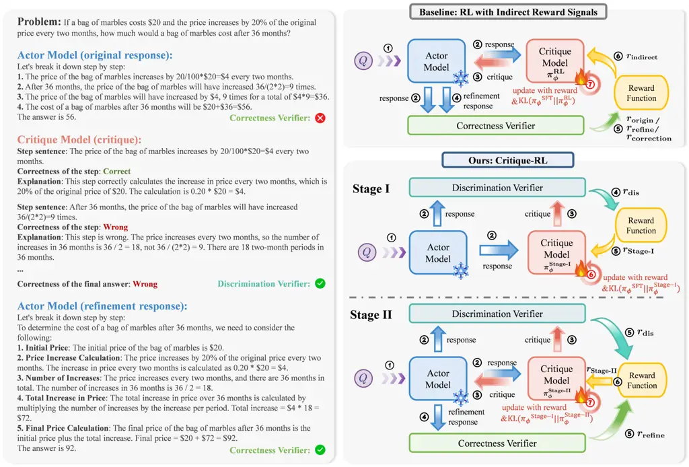
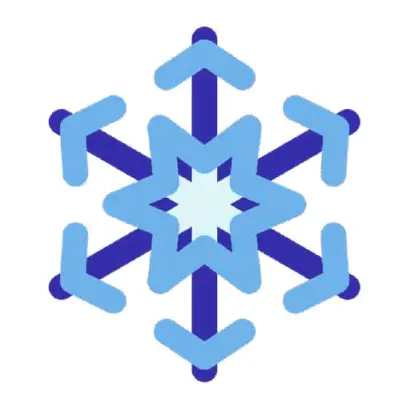
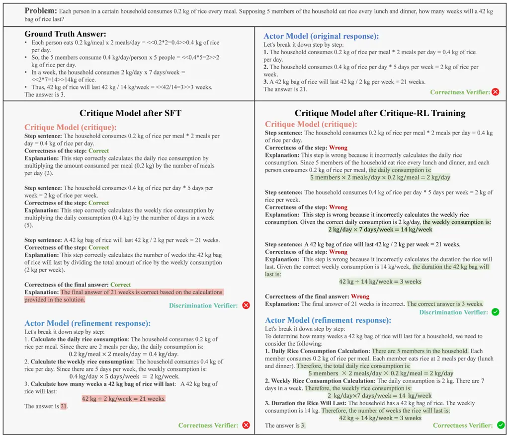
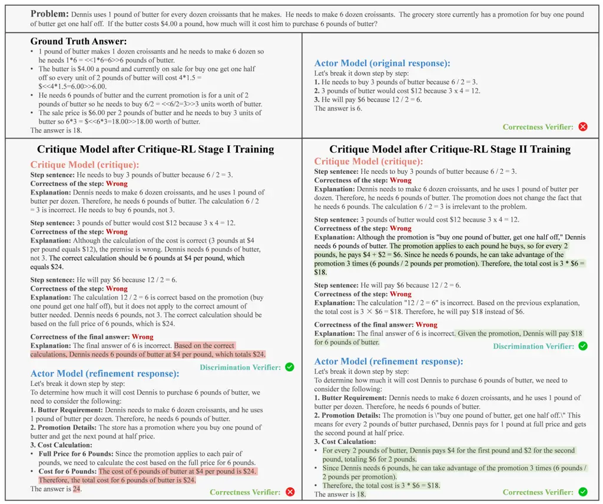

^(†)^(†) ^(\*)Equal contribution. ^(†)Corresponding authors.^(†)^(†)
¹Our code are available at
[https://github.com/WooooDyy/Critique-RL](https://github.com/WooooDyy/Critique-RL).

# Critique-RL: Training Language Models for Critiquing through Two-Stage Reinforcement Learning

Zhiheng Xi Affiliation: Fudan University    Jixuan Huang^(\*)
Affiliation: Fudan University    Xin Guo Affiliation: Fudan University
   Boyang Hong Affiliation: Fudan University    Dingwen Yang
Affiliation: Fudan University    Xiaoran Fan Affiliation: Fudan
University    Shuo Li Affiliation: Fudan University    Zehui Chen
Affiliation: ByteDance Seedzhxi22@m.fudan.edu.cn,
{tgui,qz,xjhuang}@fudan.edu.cn    Junjie Ye Affiliation: Fudan
University    Siyu Yuan Affiliation: Fudan University    Zhengyin Du
Affiliation: ByteDance Seedzhxi22@m.fudan.edu.cn,
{tgui,qz,xjhuang}@fudan.edu.cn    Xuesong Yao Affiliation: ByteDance
Seedzhxi22@m.fudan.edu.cn, {tgui,qz,xjhuang}@fudan.edu.cn    Yufei Xu
Affiliation: ByteDance Seedzhxi22@m.fudan.edu.cn,
{tgui,qz,xjhuang}@fudan.edu.cn    Jiecao Chen Affiliation: ByteDance
Seedzhxi22@m.fudan.edu.cn, {tgui,qz,xjhuang}@fudan.edu.cn    Rui Zheng
Affiliation: Fudan University    Tao Gui Affiliation: Fudan University
   Qi Zhang Affiliation: Fudan University    Xuanjing Huang Affiliation:
Fudan University

###### Abstract

Training critiquing language models ¹¹ 1 It can also be referred to as a
critique model or critic. to assess and provide feedback on model
outputs is a promising way to improve LLMs for complex reasoning tasks.
However, existing approaches typically rely on stronger supervisors for
annotating critique data. To address this, we propose Critique-RL, an
online RL approach for developing critiquing language models without
stronger supervision. Our approach operates on a two-player paradigm:
the actor generates a response, the critic provides feedback, and the
actor refines the response accordingly. We first reveal that relying
solely on indirect reward signals from the actor’s outputs for RL
optimization often leads to unsatisfactory critics: while their
helpfulness (i.e., providing constructive feedback) improves, the
discriminability (i.e., determining whether a response is high-quality
or not) remains poor, resulting in marginal performance gains. To
overcome this, Critique-RL adopts a two-stage optimization strategy. In
stage I, it reinforces the discriminability of the critic with direct
rule-based reward signals; in stage II, it introduces indirect rewards
based on actor refinement to improve the critic’s helpfulness, while
maintaining its discriminability via appropriate regularization.
Extensive experiments across various tasks and models show that
Critique-RL delivers substantial performance improvements. For example,
it achieves a $`9.02\%`$ gain on in-domain tasks and a $`5.70\%`$ gain
on out-of-domain tasks for Qwen2.5-7B, highlighting its potential.

## 1 Introduction

Figure 1: Left: Critique-RL achieves better performance and
discrimination on MATH. Right: Inference compute scaling for
Critique-RL, with @2k and @3k indicating sampling amounts that are 2
times and 3 times the x-axis value, respectively. Critique-RL improves
the performance ceiling and is more compute-efficient.



Figure 2: Left: A case illustrating the two-player actor-critic
interaction, including the original response from the actor, the
critique from the critic, and the refinement from the Actor. Right:
Overview of our method and its comparison with baseline RL. The
snowflake icon 
on the Actor indicates that it is fixed, while the fire icon
 on the Critic
indicates that it will be updated. Our method employs a two-stage RL
process. It optimize discriminability of critique models in Stage I, and
optimize helpfulness while maintaining discriminability in Stage II.

With the development of large language models (Ouyang et al., 2022;
OpenAI, 2023; Touvron et al., 2023; Jiang et al., 2023; Dubey et al.,
2024), providing reliable supervision for them has become a critical
research challenge (Bowman et al., 2022; Saunders et al., 2022),
especially for tasks that are difficult even for humans, such as complex
reasoning, sequential decision-making, and coding (Shinn et al., 2023;
Snell et al., 2024; Qu et al., 2024; Kumar et al., 2024). This problem
is often referred to as scalable oversight (Bowman et al., 2022). One
effective method for scalable oversight is to train critiquing language
models to assess and provide feedback to model outputs (Welleck et al.,
2023; Akyürek et al., 2023; Xi et al., 2024; Yao et al., 2024). Based on
this feedback, actor models can refine and optimize their behavior or
outputs.

Existing work in training critique models typically assumes a stronger
supervisor to provide labeled critique data, which is often expensive
and difficult to scale (Saunders et al., 2022; Xi et al., 2024; Bowman
et al., 2022). Moreover, the data labeled by the supervisor often
differs significantly from the learner’s output distribution (Kumar et
al., 2024). Another line of work does not train the model but instead
relies on the model’s inherent abilities, using prompt engineering to
elicit its critiquing abilities (Bai et al., 2022; Madaan et al., 2023;
Dhuliawala et al., 2024). However, such methods typically assume an
oracle verifier during testing, allowing the critique model to bypass
discrimination (i.e., determining whether a response is high-quality)
and instead focus only on offering helpful feedback for revision (Xi et
al., 2024; Gou et al., 2024). Without the oracle verifier, they often
meet performance bottleneck (Huang et al., 2024).

In this work, we aim to develop critiquing language models without
relying on stronger supervision or an oracle reward function during
testing. To this end, we propose Critique-RL, an online RL approach
based on two-player actor-critic interaction (Yao et al., 2024; Xi et
al., 2024) for developing critique models. In our approach, there are
two main roles: the actor and critic. The critic assesses
(discriminability) and provides natural language feedback (helpfulness)
for the actor’s output, and the actor performs refinement accordingly
(Saunders et al., 2022).

To build our method, we first use the correctness of the actor’s two
attempts to shape the reward signals for the RL optimization of critique
models (§4.1), following approaches like Retroformer (Yao et al., 2024)
and CTRL (Xie et al., 2025), where such indirect signals are shown to
reflect the quality of critiques. However, this approach fails to
develop satisfactory critique models, i.e., with low performance.
Delving into the optimization process, we reveal that while the
helpfulness of the critique models improves, their discriminability is
not well optimized, leading to an optimization bottleneck and even a
collapse of RL training.

To address the challenges, Critique-RL employes a two-stage RL approach
(§4.2). Specifically, as shown in Figure 2, in the first stage, we
optimize the discriminability of the critique models using direct
rule-based reward signals. In the second stage, we introduce indirect
rewards based on the correctness of actor refinement to enhance the
helpfulness, while using appropriate regularization to maintain their
discriminability. In-depth training dynamics shows that our method
addresses the training collapse and stably optimizes both
discriminability and helpfulness. Extensive experiments show that our
method outperforms baselines across different models and tasks, yielding
a $`9.02\%`$ improvement on in-domain tasks and $`5.70\%`$ improvement
on out-of-domain tasks for Qwen2.5-7B. It is also noteworthy that
critique models trained with our method can generalize to unseen tasks,
demonstrating its promise for scalable oversight.

In summary, our main contributions are:

1.  1.  Delving into the RL optimization process, we reveal that solely
        depending on indirect reward signals of actor’s output correctness
        cannot develop effective critique models, which poses conflict and
        optimization challenges between the discriminative and feedback
        capabilities of critics.
2.  2.  We then propose Critique-RL, a novel two-stage RL approach to
        develop critique models for providing accurate assessment and
        helpful feedback for model outputs.
3.  3.  We perform in-depth experiments, ablation and analysis to show the
        effectiveness and stability of our method. We hope our work provides
        insights for the community.

## 2 Related Work

#### 2.0.0.1 Prompt engineering for eliciting critiquing ability from language models.

As a key technique for scalable oversight (Bowman et al., 2022), many
previous works have explored the use of prompt engineering to elicit the
critiquing and reflection abilities of LLMs (Bai et al., 2022; Madaan et
al., 2023; Ye et al., 2023; Dhuliawala et al., 2024). These methods
typically rely on an oracle verifier including answer matching or
external tools at test time for discrimination, allowing the LLM to
focus solely on providing natural language feedback (Xi et al., 2024;
Huang et al., 2024). However, in the absence of an external verifier,
even SOTA models face significant challenges (Saunders et al., 2022;
Welleck et al., 2023; Xu et al., 2024; Huang et al., 2024). In this
work, we do not assume an oracle verifier; instead, we train critique
models through RL to optimize both discriminability and the ability to
provide helpful feedback.

#### 2.0.0.2 Fine-tuning language models for critiquing.

Previously, a line of work has explored fine-tuning-based approaches for
training critique models (Saunders et al., 2022; Bowman et al., 2022; Xi
et al., 2024). However, these methods primarily rely on a stronger
supervisor for data annotation, which is costly and difficult to scale
(Xi et al., 2024). To address this issue, some researchers have proposed
self-improvement-based methods to train models for self-critiquing (Tang
et al., 2025; Zheng et al., 2024; Yuan et al., 2025). Unlike these
approaches, we adopt a two-player paradigm and train a separated
critique model through RL.

#### 2.0.0.3 Reinforcement learning for language models.

RL has become an essential component of LLM post-training, such as RLHF
for alignment (Ouyang et al., 2022; Zheng et al., 2023; Wang et al.,
2024; Shao et al., 2024). Additionally, various works have leveraged RL
to enhance language models’ performance in reasoning (Snell et al.,
2024; Kumar et al., 2024), coding (Kumar et al., 2024), and
decision-making tasks (Shinn et al., 2023). Furthermore, some studies
explore using RL to improve LM’s ability for self-reflection and
self-correction (McAleese et al., 2024; Kumar et al., 2024; Welleck et
al., 2023; Shinn et al., 2023; Xu et al., 2024; Ye et al., 2023). Other
methods, such as Retroformer (Yao et al., 2024) and CTRL (Xie et al.,
2025), leverage indirect reward signals to optimize critique model’s
helpfulness, targeting decision-making tasks and coding tasks,
respectively. However, their RL phase overlooks the joint optimization
of discriminability and helpfulness. Different from them, we propose a
two-stage Critique-RL approach to optimize both discriminability and
helpfulness, effectively developing critique models.

## 3 Preliminaries

### 3.1 The Two-Player Interaction Framework

The multi-agent framework in this work consists of two main roles (Yao
et al., 2024; Xi et al., 2024): the actor model and the critique model.
It operates through a response-critique-refinement process.

Specifically, given a question $`x`$, the actor model is expected to
generate an original response $`y=\pi_{\theta}(x)`$, which includes both
the reasoning trajectory and the final answer. The correctness verifier
then provides an oracle reward $`r_{\textnormal{oracle}}(x,y)`$ to the
actor model. Subsequently, the critique model $`\pi_{\phi}`$ takes the
question-response pair $`(x,y)`$ as input and produces critique
$`c=\pi_{\phi}(x,y)`$, which should include assessment of the response
correctness (discriminability) and offer constructive natural language
feedback (helpfulness). Based on this critique, the actor model
generates a refinement response $`y^{{}^{\prime}}=\pi_{\theta}(x,y,c)`$,
and subsequently receives an oracle reward
$`r_{\textnormal{oracle}}(x,y^{{}^{\prime}})`$. Using these rewards,
i.e., $`r_{\textnormal{oracle}}(x,y)`$ and
$`r_{\textnormal{oracle}}(x,y^{{}^{\prime}})`$, we can design different
reward functions $`r_{\textnormal{c}}(\cdot)`$ for critique models,
which will be shown in §4.

### 3.2 Policy Gradient for LLMs

Policy gradient methods (Sutton et al., 1999), e.g., REINFORCE (Ahmadian
et al., 2024; Kumar et al., 2024), are common techniques to perform RL
on LLMs (Ouyang et al., 2022). For the policy critique model
$`\pi_{\phi}`$ parameterized by $`\phi`$, the objective of policy
gradient is to find an optimal policy that maximizes the reward function
$`r_{\textnormal{c}}(\cdot)`$. It is typically expressed as maximizing:

```math
\mathbb{E}_{c\sim\pi_{\phi}(\cdot|x,y),y^{{}^{\prime}}\sim\pi_{\theta}(x,y,c)}[r_{\textnormal{c}}(x,y,c,y^{{}^{\prime}})], \tag{1}
```

where
$`\mathbb{E}_{c\sim\pi_{\phi}(\cdot|x,y),y^{{}^{\prime}}\sim\pi_{\theta}(x,y,c)}`$
denotes the expectation over the critique sampled from the critic
$`\pi_{\phi}`$ and the refinement response sampled from the actor
$`\pi_{\theta}`$. This gradient is used to optimize the critique model
via gradient ascent. The positive critique is “reinforced” by increasing
its probability.

### 3.3 Evaluation Metrics

To evaluate the performance of the critique model, we consider the
following metrics: (1) Acc@Refine: the accuracy of the actor model’s
refinement response; (2) $`\bm{\Delta}`$: the improvement in the actor
model’s accuracy between the original and refinement response, which
measures the effectiveness of the critique model; (3)
$`\bm{\Delta^{c\to i}}`$: the change rate from an originally correct
response to an incorrect refinement response. A lower value is better;
(4) $`\bm{\Delta^{i\to c}}`$: the change rate from an originally
incorrect response to a correct refinement response. A higher value is
better; (5) Acc@Dis: a direct metric to measure the discriminability of
the critique model, which quantifies the accuracy of whether the
correctness accessed by the critic aligns with the true correctness of
the original response.

## 4 Methodology

### 4.1 Motivating Findings: RL with Indirect Reward Signals Is Insufficient for Training Satisfactory Critique Models

In the two-player actor-critic framework (Yao et al., 2024; Xi et al.,
2024), a natural and intuitive way to optimize the critiquing language
models is to shape the reward signals derived from the actor’s two
attempts (original and refinement responses). We explore several reward
shaping approaches, demonstrate their failure modes, and investigate why
they fail to incentivize satisfactory critiquing ability.

#### 4.1.0.1 Analysis setups: data, models, and training methods.

Our preliminary experiments are on GSM8K (Cobbe et al., 2021), and the
backbone model is Qwen2.5-3B (Team, 2024). Following previous work (Xi
et al., 2024), we train an actor model capable of generating responses
and faithfully refining them according to critiques. To build the SFT
dataset for initializing a base critique model, we prompt
Qwen2.5-3B-Instruct to obtain critique data
$`\mathcal{D}_{\textnormal{SFT}}=\{x,y,c\}_{i=1}^{|\mathcal{D_{\textnormal{SFT}}}|}`$,
rather than using annotations from SOTA commercial models like GPT-4o
(OpenAI, 2023). We filter the critique data based on the correctness of
refinement to ensure the quality.

Next, we train the critique model $`\pi_{\phi}`$ using the SFT loss:

```math
\displaystyle\mathcal{L}_{\text{SFT}}(\phi) \displaystyle=\mathbb{E}_{(x,y,c)\sim\mathcal{D}_{\text{SFT}}}\Big[\log{\pi_{\phi}(c|x,y)}\Big]. \tag{2}
```

We then employ policy gradient (Sutton et al., 1999) to maximize:

```math
\displaystyle\mathbb{E}_{c\sim\pi_{\phi}^{\textnormal{RL}}(\cdot|x,y),y^{\prime}\sim\pi_{\theta}(\cdot|x,y,c)}\Big[r_{c}(x,y,c,y^{\prime})-\beta\textnormal{KL}(\pi_{\phi}^{\textnormal{SFT}}(c|x,y)||\pi_{\phi}^{\textnormal{RL}}(c|x,y))\Big], \tag{3}
```

where $`\pi_{\theta}`$ is the fixed actor model,
$`\pi_{\phi}^{\textnormal{SFT}}`$ is the SFT model. Each $`x`$ is a
query sampled from the RL dataset $`\mathcal{D}_{\textnormal{RL}}`$,
$`y`$ is the original response. $`\textnormal{KL}(\cdot||\cdot)`$ means
the KL-divergence which constrains the distance between the RL model and
the SFT model, and $`\beta`$ is a scaling factor.
$`r_{\textnormal{c}}(\cdot)`$ is the reward function for critique
models. Here, with $`r_{\textnormal{oracle}}`$ being the oracle reward
function that verifies the correctness of an actor response,
$`r_{\textnormal{c}}(\cdot)`$ can be $`r_{\textnormal{refine}}`$ which
represents the correctness of the refinement:

```math
r_{\textnormal{refine}}(x,y,c,y^{\prime})=r_{\textnormal{oracle}}(x,y^{\prime}), \tag{4}
```

or it can be $`r_{\bm{\Delta}}`$ which represents the difference in
correctness between the actor’s two attempts:

```math
r_{\bm{\Delta}}(x,y,c,y^{\prime})=r_{\textnormal{oracle}}(x,y^{\prime})-r_{\textnormal{oracle}}(x,y). \tag{5}
```

Moreover, we also include $`r_{\textnormal{correction}}`$ as
$`r_{\textnormal{c}}(\cdot)`$ for reinforcing the ability to correct
incorrect responses:

```math
\displaystyle r_{\textnormal{correction}}(x,y,c,y^{\prime})=\left\{\begin{aligned} &1.0,r_{\textnormal{oracle}}(x,y)=0\textnormal{ and }r_{\textnormal{oracle}}(x,y^{\prime})=1,\\
&0.2,r_{\textnormal{oracle}}(x,y)=1\textnormal{ and }r_{\textnormal{oracle}}(x,y^{\prime})=1,\\
&0.0,r_{\textnormal{oracle}}(x,y^{\prime})=0.\end{aligned}\right. \tag{6}
```

Figure 3: Training dynamics of preliminary experiments. “Acc@Dis
Originally Correct” and “Acc@Dis Originally Incorrect” refer to the
discrimination accuracy of originally correct and incorrect responses,
respectively. Baselines using indirect reward signals to optimize
helpfulness tend to exhibit overly conservative or aggressive behavior
as the discriminability is not well optimized. In contrast, our
Critique-RL optimizes discriminability in Stage I, and optimizes
helpfulness while maintaining discriminability in Stage II, achieving
better in Acc@Refine, $`\bm{\Delta^{c\to i}}`$ and
$`\bm{\Delta^{i\to c}}`$.

#### 4.1.0.2 Empirical findings and behavior analysis.

We illustrate the training dynamics during RL in Figure 3. Optimizing
with $`r_{\textnormal{refine}}`$ and $`r_{\bm{\Delta}}`$ can reduce
$`\bm{\Delta}^{c\rightarrow i}`$, preventing originally correct
responses from being altered incorrectly, but its
$`\bm{\Delta}^{i\rightarrow c}`$ is not significantly optimized, meaning
its error correction performance is not good enough. This phenomenon
reveals that the critique model is overly conservative, encouraging the
actor to not change its answers. As a result, the final Acc@Refine is
not satisfactory.

In contrast, optimizing with $`r_{\textnormal{correction}}`$ improves
$`\bm{\Delta}^{i\rightarrow c}`$, but fails to effectively reduce
$`\bm{\Delta}^{c\rightarrow i}`$. This means it often provides more
aggressive suggestions, encouraging the actor model to correct incorrect
responses, but it also introduces a greater risk of turning originally
correct answers into incorrect ones. Similarly, the final Acc@Refine is
also not satisfactory.

#### 4.1.0.3 Analyzing underlying reasons for the failure modes.

To reveal the reasons behind the above failure modes, we also visualize
the discrimination performance of the critiquing language models during
RL in Figure 3. We find that as RL progresses, all three reward
functions $`r_{\textnormal{refine}}`$, $`r_{\bm{\Delta}}`$ and
$`r_{\textnormal{correction}}`$ fail to optimize discriminability
effectively. For originally correct and incorrect responses, they can
only optimize the judgment for one, while the ability to judge the other
is reduced. This may be because both of the indirect reward functions
are based on the actor’s responses, targeting helpfulness and
overlooking discriminability. This motivates the proposal of our method.

### 4.2 Two-Stage Critique-RL

#### 4.2.0.1 Key challenges.

Based on the previous analysis, we have identified two key challenges in
RL for critiquing language models: (1) optimizing the discriminability
of critique models to improve their accuracy in judging both correct and
incorrect original responses; (2) improving the quality of the model’s
feedback, i.e., helpfulness, while maintaining its discriminability, to
prevent the issues of being overly aggressive or overly conservative.

#### 4.2.0.2 Method overview.

To address the above challenges, we propose the two-stage Critique-RL.
In the first stage, our method explicitly optimizes the discriminability
of the critique model using direct reward signals. We then use the
resulting model $`\pi_{\phi}^{\textnormal{Stage-I}}`$ as the
initialization for the second stage. In the second stage, we introduce a
reward function based on the actor’s response to optimize the critic’s
helpfulness, while also incorporating appropriate regularization to
maintain its discriminability. We illustrate our method in Figure 2 and
the algorithm is summarized in Algorithm 1.

Input: Actor model $`\pi_{\theta}`$, base critique model $`\pi_{\phi}`$,
SFT dataset $`\mathcal{D}_{\textnormal{SFT}}`$, RL dataset
$`\mathcal{D}_{\textnormal{RL}}`$, function that extracts the
correctness of a response judged by a critique $`f`$, oracle reward
function $`r_{\textnormal{oracle}}`$, discrimination reward function
$`r_{\textnormal{dis}}`$.

1 Procedure _Supervised Fine-tuning:_

    2 $`\pi_{\phi}^{\textnormal{SFT}}\leftarrow\pi_{\phi}`$;

    3 Update $`\pi_{\phi}^{\textnormal{SFT}}`$ by minimizing
$`\mathcal{L}_{\text{SFT}}(\phi)=\mathbb{E}_{(x,y,c)\sim\mathcal{D}_{\text{SFT}}}\Big[\log{\pi_{\phi}(c|x,y)}\Big]`$;

4 Procedure _Critique-RL Stage I: optimizing discriminability through
direct reward signals._

    5
$`\pi_{\phi}^{\textnormal{Stage-I}}\leftarrow\pi_{\phi}^{\textnormal{SFT}}`$;

    6 for _batch in $`\mathcal{D}_{RL}`$_ do

       7 for _$`x`$ in batch_ do

          8 Generate $`y`$ and $`c`$ with $`\pi_{\theta}`$ and
$`\pi_{\phi}^{\textnormal{Stage-I}}`$;

          9 Compute discrimination reward with
$`r_{\textnormal{dis}}(x,y,c)=\mathbbm{1}\Big(f(x,y,c)=r_{\textnormal{oracle}}(x,y)\Big)`$;

       10 end for

       11 Update $`\pi_{\phi}^{\textnormal{Stage-I}}`$ by maximizing
$`\mathbb{E}_{c\sim\pi_{\phi}^{\textnormal{Stage-I}}(\cdot|x,y)}\Big[r_{\textnormal{dis}}(x,y,c)-\beta\textnormal{KL}(\pi_{\phi}^{\textnormal{SFT}}(c|x,y)||\pi_{\phi}^{\textnormal{Stage-I}}(c|x,y))\Big]`$;

    12 end for

13 Procedure _Critique-RL Stage II: optimization helpfulness while
maintaining discriminability._

    14
$`\pi_{\phi}^{\textnormal{Stage-II}}\leftarrow\pi_{\phi}^{\textnormal{Stage-I}}`$;

    15 for _batch in $`\mathcal{D}_{RL}`$_ do

       16 for _$`x`$ in batch_ do

          17 Generate $`y`$, $`c`$ and $`y^{{}^{\prime}}`$ with
$`\pi_{\theta}`$ and $`\pi_{\phi}^{\textnormal{Stage-II}}`$;

          18 Compute discrimination reward with
$`r_{\textnormal{dis}}(x,y,c)=\mathbbm{1}\Big(f(x,y,c)=r_{\textnormal{oracle}}(x,y)\Big)`$;

          19 Compute refinement reward with
$`r_{\textnormal{refine}}=r_{\textnormal{oracle}}(x,y^{{}^{\prime}})`$;

       20 end for

       21 Update $`\pi_{\phi}^{\textnormal{Stage-II}}`$ by maximizing
$`\mathbb{E}_{c\sim\pi_{\phi}^{\textnormal{Stage-II}}(\cdot|x,y),y^{\prime}\sim\pi_{\theta}(\cdot|x,y,c)}\Big[r_{\textnormal{refine}}+\beta_{1}r_{\textnormal{dis}}(x,y,c)-\beta_{2}\textnormal{KL}(\pi_{\phi}^{\textnormal{Stage-I}}(c|x,y)||\pi_{\phi}^{\textnormal{Stage-II}}(c|x,y))\Big]`$.

    22 end for

Algorithm 1 Critique-RL

#### 4.2.0.3 Stage I: optimizing discriminability through direct reward signals.

We decouple the discriminability and helpfulness of the critique models
(Saunders et al., 2022). In Stage I, we shape the reward based solely on
the actor’s original response. Given $`(x,y)`$, critique models are
prompted to give correctness judgments for each step, and also provide a
judgment for the final answer. Based on this, we define the
discriminability reward function of the critique models as:

```math
r_{\textnormal{dis}}(x,y,c)=\mathbbm{1}\Big(f(x,y,c)=r_{\textnormal{oracle}}(x,y)\Big), \tag{7}
```

where $`f(x,y,c)`$ is the critique model’s judgment of the correctness
of the original response. $`\mathbbm{1}(\cdot)`$ is indicator function
that returns 1 only when the condition inside the parentheses holds, and
0 otherwise. Based on this, our Stage I RL maximizes:

```math
\displaystyle\mathbb{E}_{c\sim\pi_{\phi}^{\textnormal{Stage-I}}(\cdot|x,y)}\Big[r_{\textnormal{dis}}(x,y,c)-\beta\textnormal{KL}(\pi_{\phi}^{\textnormal{SFT}}(c|x,y)||\pi_{\phi}^{\textnormal{Stage-I}}(c|x,y))\Big], \tag{8}
```

where the KL divergence with the SFT model is still used to stabilize
the training. As shown in Figure 3, our Stage I RL can effectively and
stably optimize discriminability, regardless of the correctness of the
original response.

#### 4.2.0.4 Stage II: optimizing helpfulness while maintaining discriminability.

The goal of the second stage of Critique-RL is to optimize the
helpfulness of the critique models without sacrificing their
discriminability, thereby avoiding overly conservative or overly
aggressive behavior patterns. To achieve this, we introduce a reward
function $`r_{\textnormal{refine}}`$ based on actor refinement
correctness. Meanwhile, to preserve the model’s discriminability, we
retain $`r_{\textnormal{dis}}`$ and introduce a regularization term
based on the KL divergence with the Stage I model
$`\pi_{\phi}^{\textnormal{Stage-I}}`$. Specifically, we maximize the
following objective:

```math
\displaystyle\mathbb{E}_{c\sim\pi_{\phi}^{\textnormal{Stage-II}}(\cdot|x,y),y^{\prime}\sim\pi_{\theta}(\cdot|x,y,c)}\Big[r_{\textnormal{refine}}+\beta_{1}r_{\textnormal{dis}}(x,y,c)-\beta_{2}\textnormal{KL}(\pi_{\phi}^{\textnormal{Stage-I}}(c|x,y)||\pi_{\phi}^{\textnormal{Stage-II}}(c|x,y))\Big], \tag{9}
```

where $`\beta_{1}`$ and $`\beta_{2}`$ are scaling factors. As shown in
Figure 3, our Stage II effectively optimizes the model’s helpfulness,
increasing $`\bm{\Delta}^{i\rightarrow c}`$ and decreasing
$`\bm{\Delta}^{c\rightarrow i}`$, ultimately leading to a stable
improvement in Acc@Refine and $`\bm{\Delta}`$. Our method also performs
strongly on the test set (see §5).

## 5 Experiments

### 5.1 Experimental Setup

#### 5.1.0.1 Datasets.

Focusing on mathematical reasoning tasks, we select 5 different
commonly-used tasks, including free-from and multiple-choice. Following
Ding et al. (2025), we construct training set with the train-split of
MATH (Hendrycks et al., 2021), GSM8K (Cobbe et al., 2021), AQUA (Ling et
al., 2017). The testset of the three tasks are used as in-domain
testset, while the test-split of SVAMP (Patel et al., 2021), TheoremQA
(Chen et al., 2023), are used as our OOD (out-of-domain) testset.

#### 5.1.0.2 Models and baselines.

Our experiments are mainly conducted on Qwen2.5 series (Team, 2024),
i.e., Qwen2.5-3B and Qwen2.5-7B. Besides, we also conduct experiments on
other models like Qwen2.5-72B, Llama3.2 (Dubey et al., 2024) and
DeepSeek-R1-Distill-Qwen-7B (DeepSeek-AI, 2025) (see Appendix A and
Appendix B). We include several baselines: (1) SFT which fine-tunes
models with critique data. (2) STaR (Zelikman et al., 2022) which
iteratively fine-tunes critique models on self-generated data and
filtered based on the refinement correctness of the actor. (3) RL
baselines that leverages indirect outcome-based reward as baselines,
i.e., Retroformer (Yao et al., 2024) which uses PPO and CTRL (Xie et
al., 2025) which uses GRPO.

#### 5.1.0.3 Implementation details.

All experiments are conducted on 8 NVIDIA A800 GPUs. To initialize an
actor that can reason and refine based on the critiquing feedback, we
follow Ding et al. (2025); Xi et al. (2024) to construct a dataset of
$`21,973`$ reasoning traces and $`12,000`$ refinement responses. For
critique data, we construct a set of $`6,000`$ examples, with $`2,000`$
examples in each training task. For fine-tuning actors, we set epoch to
$`3`$ and learning rate to $`5e-6`$, and remains fixed during further
training phase; for fine-tuning critics, we set epoch to $`5`$ and
learning rate to $`5e-6`$. We use the same base model for the actor and
the critique model. For STaR and RL, we perform SFT to obtain an
initialized model. In RL, we set KL coefficient to $`0.01`$. In
Critique-RL, we use RLOO as our base algorithm as it performs well and
does not require a value model. In Stage II, $`\beta_{1}`$ is set to
$`0.2`$. We train the critique model for $`500`$ steps at each stage and
report best results. During evaluation, the temperature is set to $`0`$.
For inference-compute scaling and Pass@$`K`$, we set temperature to
$`0.7`$.

|            |             |                                |                                |                                |                                |                                |                                |                                |                               |                                |
| ---------- | ----------- | ------------------------------ | ------------------------------ | ------------------------------ | ------------------------------ | ------------------------------ | ------------------------------ | ------------------------------ | ----------------------------- | ------------------------------ |
| Model      | Method      | MATH                           |                                |                                | GSM8K                          |                                |                                | AQuA                           |                               |                                |
|            |             | Acc                            | $`\bm{\Delta}`$                | Acc@Dis                        | Acc                            | $`\bm{\Delta}`$                | Acc@Dis                        | Acc                            | $`\bm{\Delta}`$               | Acc@Dis                        |
| Qwen2.5-3B | No Critic   | $`36.90`$                      | $`-`$                          | $`-`$                          | $`66.03`$                      | $`-`$                          | $`-`$                          | $`50.00`$                      | $`-`$                         | $`-`$                          |
|            | SFT         | $`44.24`$                      | $`7.34`$                       | $`66.51`$                      | $`69.14`$                      | $`3.11`$                       | $`76.34`$                      | $`46.46`$                      | $`-3.54`$                     | $`61.97`$                      |
|            | STaR        | $`44.38`$                      | $`7.48`$                       | $`66.97`$                      | $`71.95`$                      | $`5.91`$                       | $`74.79`$                      | $`50.39`$                      | $`0.39`$                      | $`66.13`$                      |
|            | Retroformer | $`44.54`$                      | $`7.64`$                       | $`65.11`$                      | $`70.51`$                      | $`4.47`$                       | $`77.59`$                      | $`51.18`$                      | $`1.18`$                      | $`58.44`$                      |
|            | CTRL        | $`46.14`$                      | $`9.24`$                       | $`69.29`$                      | $`70.58`$                      | $`4.55`$                       | $`76.71`$                      | $`53.54`$                      | $`3.54`$                      | $`62.20`$                      |
|            | Critique-RL | $`\underline{\mathbf{48.60}}`$ | $`\underline{\mathbf{11.70}}`$ | $`\underline{\mathbf{82.80}}`$ | $`\underline{\mathbf{75.89}}`$ | $`\underline{\mathbf{9.86}}`$  | $`\underline{\mathbf{87.44}}`$ | $`\underline{\mathbf{56.69}}`$ | $`\underline{\mathbf{6.69}}`$ | $`\underline{\mathbf{69.92}}`$ |
| Qwen2.5-7B | No Critic   | $`45.74`$                      | $`-`$                          | $`-`$                          | $`75.66`$                      | $`-`$                          | $`-`$                          | $`63.39`$                      | $`-`$                         | $`-`$                          |
|            | SFT         | $`51.84`$                      | $`6.10`$                       | $`67.59`$                      | $`78.77`$                      | $`3.11`$                       | $`79.42`$                      | $`59.45`$                      | $`-3.94`$                     | $`68.67`$                      |
|            | STaR        | $`54.06`$                      | $`8.32`$                       | $`69.71`$                      | $`80.52`$                      | $`4.85`$                       | $`81.03`$                      | $`57.87`$                      | $`-5.51`$                     | $`72.18`$                      |
|            | Retroformer | $`52.34`$                      | $`6.60`$                       | $`68.03`$                      | $`80.82`$                      | $`5.16`$                       | $`77.05`$                      | $`63.39`$                      | $`0.00`$                      | $`70.56`$                      |
|            | CTRL        | $`53.86`$                      | $`8.12`$                       | $`71.42`$                      | $`81.35`$                      | $`5.69`$                       | $`83.44`$                      | $`64.96`$                      | $`1.57`$                      | $`71.66`$                      |
|            | Critique-RL | $`\underline{\mathbf{58.40}}`$ | $`\underline{\mathbf{12.66}}`$ | $`\underline{\mathbf{85.20}}`$ | $`\underline{\mathbf{87.72}}`$ | $`\underline{\mathbf{12.05}}`$ | $`\underline{\mathbf{90.43}}`$ | $`\underline{\mathbf{65.75}}`$ | $`\underline{\mathbf{2.36}}`$ | $`\underline{\mathbf{78.09}}`$ |

Table 1: Main results. The best performance is in bold and underlined,
while the second-best performance is underlined. Our method is marked in
blue. No Critic means the actor model perform reasoning only, and we
report the reasoning performance. For other methods, we report the
Acc@Refine performance for the acc column.

### 5.2 Main Results

#### 5.2.0.1 Generally, critique models can significantly improve actor’s reasoning performance.

The results in Table 1 demonstrate that when introducing critique
models, the actor’s reasoning performance can be boosted by a large
margin. For example, in the MATH task, even the SFT Baseline outperforms
the model without a critic by $`7.34`$ and $`6.10`$ points on the 3B and
7B models, respectively. This suggests that critique models are an
effective scalable oversight method, as discussed in Saunders et al.
(2022); McAleese et al. (2024).

#### 5.2.0.2 RL-based methods outperforms fine-tuning-based ones.

Both SFT and STaR methods lead to promising critique models, but in most
cases, online RL-based methods perform better, especially our
Critique-RL. For instance, on the 3B model, our method surpasses the SFT
method by an average of $`7.11`$ points on accuracy across three
datasets. It is worth noting that on AQuA, fine-tuning-based SFT and
STaR may lead to negative impact on performance, while our method
provides significant positive improvements. This reveals that online RL
methods have greater potential and adaptability in eliciting the model’s
critiquing ability, similar to the findings in McAleese et al. (2024).

#### 5.2.0.3 Critique-RL consistently outperforms other baselines in discrimination and final accuracy.

In terms of discrimination, our method also significantly outperforms
other baselines, such as surpassing CTRL by $`5.31`$, $`6.36`$ points
for 3B and 7B models on GSM8K, respectively. This reveals that our
discrimination-related reward shaping can effectively optimizes
discriminability. Thanks to this and the helpfulness reward design in
the second stage, our method shows a significant improvement in final
performance compared to other baselines. For example, on the 7B model,
our method outperforms Retroformer by an average of $`5.11`$ and
$`12.69`$ points on accuracy and discriminability, across three
datasets.

### 5.3 Iterative Improvement of Critique-RL

Figure 4: Results of critique-refinement of Critique-RL using
Qwen2.5-3B.

Furthermore, we validate the iterative improvement capability of
Critique-RL through two key aspects: (1) Iterative refinement process:
During the $`i`$-th iteration, the critic generates critique
$`c_{i}=\pi_{\phi}(x,y_{0},c_{1},...,c_{i-1},y_{i-1})`$, while the actor
produces the refined response
$`y_{i}=\pi_{\theta}(x,y_{0},c_{1},...,y_{i-1},c_{i})`$ accordingly. (2)
Iterative training process: We alternately conduct the two-stage
training of Critique-RL (Stage I and Stage II) to optimize the critique
model. The detailed results are shown in Figure 4 and Table 2,
respectively.

|             |                       |                   |                   |                   |
| ----------- | --------------------- | ----------------- | ----------------- | ----------------- |
| Method      |                       | Acc               | $`\bm{\Delta}`$   | Acc@Dis           |
| No Critic   |                       | $`36.9`$          | $`-`$             | $`-`$             |
| SFT         |                       | $`44.2`$          | $`7.3`$           | $`66.5`$          |
| Critique-RL | Iteration 1, Stage I  | $`45.9`$          | $`9.0`$           | $`78.7`$          |
|             | Iteration 1, Stage II | $`48.6`$          | $`11.7`$          | $`82.8`$          |
|             | Iteration 2, Stage I  | $`49.5`$          | $`12.6`$          | $`85.0`$          |
|             | Iteration 2, Stage II | $`\mathbf{51.0}`$ | $`\mathbf{14.1}`$ | $`\mathbf{86.5}`$ |

Table 2: Results of iterative training of Critique-RL using Qwen2.5-3B
on MATH.

First, as demonstrated in Figure 4, through iterative critique and
refinement, the model exhibits consistent Acc gains on Qwen2.5-3B, with
each iteration achieving measurable improvements. Second, iterative
training leads to further performance enhancement, with detailed results
using Qwen2.5-3B on MATH dataset shown in Table 2. Specifically, both
Stage I and Stage II of Critique-RL demonstrate consistent improvement
in Acc and Acc@Dis metrics. Compared to the first iteration, the second
iteration improves by $`2.40`$ and $`3.68`$ points on accuracy and
discriminability.

## 6 Discussion and Analysis

#### 6.0.0.1 Ablation on different stages.

We conduct ablation experiments to validate the importance of different
components. The results are shown in Table 3. Both Stage I and Stage II
are crucial, and removing either of them leads to a performance drop.
This indicates that optimizing both discriminability and helpfulness is
essential in developing critique models.

#### 6.0.0.2 Ablation on reward design for Stage II.

|                                                 |                               |                               |                               |                               |
| ----------------------------------------------- | ----------------------------- | ----------------------------- | ----------------------------- | ----------------------------- |
| Method                                          | MATH                          |                               | AQuA                          |                               |
|                                                 | Acc@Refine                    | Acc@Dis                       | Acc@Refine                    | Acc@Dis                       |
| Critique-RL (Ours)                              | $`\underline{\mathbf{48.6}}`$ | $`\underline{\mathbf{82.8}}`$ | $`\underline{\mathbf{56.7}}`$ | $`\underline{\mathbf{69.9}}`$ |
|    -w/o Stage I                                 | $`47.6`$                      | $`79.7`$                      | $`53.9`$                      | $`66.5`$                      |
|    -w/o Stage II                                | $`45.9`$                      | $`78.7`$                      | $`\underline{54.7}`$          | $`68.2`$                      |
|    -Stage II w/o discrimination                 | $`47.3`$                      | $`77.7`$                      | $`53.5`$                      | $`61.6`$                      |
|    -Stage II w/ $`r_{\bm{\Delta}}`$             | $`\underline{48.2}`$          | $`\underline{82.6}`$          | $`53.9`$                      | $`\underline{68.4}`$          |
|    -Stage II w/ $`r_{\textnormal{correction}}`$ | $`47.7`$                      | $`82.0`$                      | $`\underline{54.7}`$          | $`68.4`$                      |

Table 3: Ablation study using Qwen2.5-3B. We report the Acc@Refine.
“w/o” means without; “Stage II w/o discrimination” means in Stage II, we
remove $`r_{\textnormal{dis}}`$ and
$`\textnormal{KL}(\pi_{\phi}^{\textnormal{Stage-I}}||\pi_{\phi}^{\textnormal{Stage-II}})`$
; “Stage II w/ $`r_{\bm{\Delta}}`$” and “Stage II w/
$`r_{\textnormal{correction}}`$” mean replacing the
$`r_{\textnormal{refine}}`$ with the corresponding reward function.

Next, we perform a deeper analysis of the reward design in Stage II.
First, if we remove the discrimination-related reward term
$`r_{\textnormal{dis}}`$ and KL-based regularization
$`\textnormal{KL}(\pi_{\phi}^{\textnormal{Stage-I}}||\pi_{\phi}^{\textnormal{Stage-II}})`$,
the discriminability and accuracy suffer a significant drop. This
further emphasizes that when optimizing for helpfulness, it is crucial
to maintain the model’s discrimination ability. Second, when we replace
the reward function $`r_{\textnormal{refine}}`$ in Stage II with another
reward function, i.e., $`r_{\bm{\Delta}}`$ and
$`r_{\textnormal{correction}}`$, we observe a slight performance drop.
This may be because $`r_{\textnormal{refine}}`$ directly optimizes the
Acc@Refine metric, which aligns most closely with the test-time
scenario.

#### 6.0.0.3 Analysis of helpfulness when the oracle verifier Is available.

Many previous works have relied on an external oracle verifier to assess
the actor’s reasoning results (Bai et al., 2022; Madaan et al., 2023; Ye
et al., 2023; Dhuliawala et al., 2024). In this scenario, the model’s
judgment ability is isolated, allowing us to better evaluate the
critique model’s helpfulness. We conduct relevant experiments, and the
results are shown in Figure 5. We find that when the oracle verifier is
available, all baselines show performance improvements. In this case,
our method still outperforms others across different datasets and
models, indicating that our approach significantly enhances the model’s
helpfulness. Furthermore, comparisons with other RL baselines reveal
that the optimization of discriminability in our method also implicitly
contributes to the improvement of helpfulness, suggesting that the two
abilities are not entirely independent. This further emphasizes the
importance of optimizing both abilities jointly in developing critique
models.

Figure 5: Performance with and without the oracle verifier. When the
oracle verifier is available, the model no longer needs to make
discrimination and just needs to provides useful feedback. This allows
us to evaluate the model’s helpfulness more accurately.

#### 6.0.0.4 Evaluation of test-time inference compute scaling for Critique-RL.

We investigate whether Critique-RL can be combined with inference-time
compute scaling strategy. Following Qu et al. (2024); Snell et al.
(2024); Xi et al. (2024), we leverage the commonly used majority vote
(MV@$`K`$) (Wang et al., 2023) which evaluates whether the most frequent
answer among $`K`$ samples is correct. The results of MATH are shown in
Figure 1 and the results of GSM8K are shown in Figure 6 of Appendix D.
Compared to the baseline, Critique-RL significantly increases the
performance ceiling and shows a more sustained upward trend as inference
compute scales. More importantly, performing $`K\times`$
response-critique-refinement sampling is more compute-efficient than
conducting $`3K\times`$ parallel sampling responses, suggesting the
compute-efficiency of Critique-RL.

#### 6.0.0.5 Generalization to OOD tasks.

|            |             |                   |                   |                   |                   |
| ---------- | ----------- | ----------------- | ----------------- | ----------------- | ----------------- |
| Model      | Method      | SVAMP             |                   | TheoremQA         |                   |
|            |             | Acc               | Pass@10           | Acc               | Pass@10           |
| Qwen2.5-3B | No Critic   | $`70.7`$          | $`92.0`$          | $`15.1`$          | $`34.8`$          |
|            | SFT         | $`74.7`$          | $`95.7`$          | $`15.3`$          | $`36.1`$          |
|            | Retroformer | $`75.0`$          | $`96.0`$          | $`16.1`$          | $`37.0`$          |
|            | CTRL        | $`76.0`$          | $`95.7`$          | $`15.8`$          | $`36.5`$          |
|            | Critique-RL | $`\mathbf{78.3}`$ | $`\mathbf{96.3}`$ | $`\mathbf{16.8}`$ | $`\mathbf{37.8}`$ |
| Qwen2.5-7B | No Critic   | $`80.3`$          | $`95.7`$          | $`19.4`$          | $`39.8`$          |
|            | SFT         | $`83.0`$          | $`95.7`$          | $`20.5`$          | $`41.9`$          |
|            | Retroformer | $`84.0`$          | $`96.0`$          | $`20.0`$          | $`42.3`$          |
|            | CTRL        | $`85.1`$          | $`96.7`$          | $`21.1`$          | $`42.9`$          |
|            | Critique-RL | $`\mathbf{89.7}`$ | $`\mathbf{97.0}`$ | $`\mathbf{21.4}`$ | $`\mathbf{43.0}`$ |

Table 4: Out-of-domain evaluation of Critique-RL.

We also validate the generalization of the models trained by Critique-RL
on OOD tasks. The results in Table 4 show that the models trained still
delivers significant performance improvements, further demonstrating the
potential of this scalable oversight approach.

#### 6.0.0.6 More experiments and qualitative analysis.

We conduct extensive experiments to show the effectiveness and working
mechanism of Critique-RL, with the detailed results presented in the
Appendix: (1) In addition to the Qwen2.5 series (Team, 2024), we
evaluate our method on additional model types like strong reasoning
model and different architectures including Llama3.2 (see Appendix A and
Appendix B). (2) We compare Critique-RL with other refinement methods
including Self-Refine (Madaan et al., 2023), SuperCorrect (Yang et al., 2024) and Critic-Cot (Zheng et al., 2024), and the results are presented
in Appendix C. (3) We also perform test-time scaling analysis of
sampling multipe refinement on the same response, with results presented
in Appendix D. (4) We conduct experiments on summarization tasks using
CNN/DailyMail (Hermann et al., 2015) dataset to investigate our method’s
generalization ability on open-ended tasks where rule-based verifier
cannot be directly applied, the results are in Appendix E. (5) We
perform a qualitative analysis on how Critique-RL works and provide
several examples in Appendix H.

## 7 Conclusion

In this paper, we propose Critique-RL, an RL approach for developing
critique models. Through in-depth analysis, we highlight the importance
of explicitly optimizing model discriminability and propose a two-stage
RL approach that effectively optimizes both discriminability and
helpfulness. We validate its stability and superiority through detailed
experiments, and further uncover its working mechanism through ablation
studies and analyses. We hope that our work can provide insights for the
scalable oversight community of language models.

## References

- Ahmadian et al. (2024) Arash Ahmadian, Chris Cremer, Matthias Gallé,
  Marzieh Fadaee, Julia Kreutzer, Olivier Pietquin, Ahmet Üstün, and
  Sara Hooker. Back to basics: Revisiting reinforce-style optimization
  for learning from human feedback in llms. In Lun-Wei Ku, Andre
  Martins, and Vivek Srikumar, editors, _Proceedings of the 62nd Annual
  Meeting of the Association for Computational Linguistics (Volume 1:
  Long Papers), ACL 2024, Bangkok, Thailand, August 11-16, 2024_, pages
  12248–12267. Association for Computational Linguistics, 2024.
  [10.18653/V1/2024.ACL-LONG.662](https://doi.org/10.18653/V1/2024.ACL-LONG.662).
  URL
  [https://doi.org/10.18653/v1/2024.acl-long.662](https://doi.org/10.18653/v1/2024.acl-long.662).
- Akyürek et al. (2023) Afra Feyza Akyürek, Ekin Akyürek, Ashwin Kalyan,
  Peter Clark, Derry Tanti Wijaya, and Niket Tandon. RL4F: generating
  natural language feedback with reinforcement learning for repairing
  model outputs. In Anna Rogers, Jordan L. Boyd-Graber, and Naoaki
  Okazaki, editors, _Proceedings of the 61st Annual Meeting of the
  Association for Computational Linguistics (Volume 1: Long Papers), ACL
  2023, Toronto, Canada, July 9-14, 2023_, pages 7716–7733. Association
  for Computational Linguistics, 2023.
  [10.18653/V1/2023.ACL-LONG.427](https://doi.org/10.18653/V1/2023.ACL-LONG.427).
- Bai et al. (2022) Yuntao Bai, Saurav Kadavath, Sandipan Kundu, Amanda
  Askell, Jackson Kernion, Andy Jones, Anna Chen, Anna Goldie, Azalia
  Mirhoseini, Cameron McKinnon, et al. Constitutional ai: Harmlessness
  from ai feedback. _arXiv preprint arXiv:2212.08073_, 2022.
- Bowman et al. (2022) Samuel R. Bowman, Jeeyoon Hyun, Ethan Perez,
  Edwin Chen, Craig Pettit, Scott Heiner, Kamile Lukosiute, Amanda
  Askell, Andy Jones, Anna Chen, Anna Goldie, Azalia Mirhoseini, Cameron
  McKinnon, Christopher Olah, Daniela Amodei, Dario Amodei, Dawn Drain,
  Dustin Li, Eli Tran-Johnson, Jackson Kernion, Jamie Kerr, Jared
  Mueller, Jeffrey Ladish, Joshua Landau, Kamal Ndousse, Liane Lovitt,
  Nelson Elhage, Nicholas Schiefer, Nicholas Joseph, Noemí Mercado, Nova
  DasSarma, Robin Larson, Sam McCandlish, Sandipan Kundu, Scott
  Johnston, Shauna Kravec, Sheer El Showk, Stanislav Fort, Timothy
  Telleen-Lawton, Tom Brown, Tom Henighan, Tristan Hume, Yuntao Bai, Zac
  Hatfield-Dodds, Ben Mann, and Jared Kaplan. Measuring progress on
  scalable oversight for large language models. _CoRR_,
  abs/2211.03540, 2022.
  [10.48550/ARXIV.2211.03540](https://doi.org/10.48550/ARXIV.2211.03540).
- Chen et al. (2023) Wenhu Chen, Ming Yin, Max Ku, Pan Lu, Yixin Wan,
  Xueguang Ma, Jianyu Xu, Xinyi Wang, and Tony Xia. Theoremqa: A
  theorem-driven question answering dataset. In Houda Bouamor, Juan
  Pino, and Kalika Bali, editors, _Proceedings of the 2023 Conference on
  Empirical Methods in Natural Language Processing, EMNLP 2023,
  Singapore, December 6-10, 2023_, pages 7889–7901. Association for
  Computational Linguistics, 2023.
  [10.18653/V1/2023.EMNLP-MAIN.489](https://doi.org/10.18653/V1/2023.EMNLP-MAIN.489).
  URL
  [https://doi.org/10.18653/v1/2023.emnlp-main.489](https://doi.org/10.18653/v1/2023.emnlp-main.489).
- Cobbe et al. (2021) Karl Cobbe, Vineet Kosaraju, Mohammad Bavarian,
  Mark Chen, Heewoo Jun, Lukasz Kaiser, Matthias Plappert, Jerry Tworek,
  Jacob Hilton, Reiichiro Nakano, Christopher Hesse, and John Schulman.
  Training verifiers to solve math word problems. _CoRR_,
  abs/2110.14168, 2021.
- DeepSeek-AI (2025) DeepSeek-AI. Deepseek-r1: Incentivizing reasoning
  capability in llms via reinforcement learning, 2025. URL
  [https://arxiv.org/abs/2501.12948](https://arxiv.org/abs/2501.12948).
- Dhuliawala et al. (2024) Shehzaad Dhuliawala, Mojtaba Komeili, Jing
  Xu, Roberta Raileanu, Xian Li, Asli Celikyilmaz, and Jason Weston.
  Chain-of-verification reduces hallucination in large language models.
  In Lun-Wei Ku, Andre Martins, and Vivek Srikumar, editors, _Findings
  of the Association for Computational Linguistics, ACL 2024, Bangkok,
  Thailand and virtual meeting, August 11-16, 2024_, pages 3563–3578.
  Association for Computational Linguistics, 2024.
  [10.18653/V1/2024.FINDINGS-ACL.212](https://doi.org/10.18653/V1/2024.FINDINGS-ACL.212).
- Ding et al. (2025) Yiwen Ding, Zhiheng Xi, Wei He, Lizhuoyuan
  Lizhuoyuan, Yitao Zhai, Shi Xiaowei, Xunliang Cai, Tao Gui, Qi Zhang,
  and Xuanjing Huang. Mitigating tail narrowing in LLM self-improvement
  via socratic-guided sampling. In Luis Chiruzzo, Alan Ritter, and Lu
  Wang, editors, _Proceedings of the 2025 Conference of the Nations of
  the Americas Chapter of the Association for Computational Linguistics:
  Human Language Technologies (Volume 1: Long Papers)_, pages
  10627–10646, Albuquerque, New Mexico, April 2025. Association for
  Computational Linguistics. ISBN 979-8-89176-189-6. URL
  [https://aclanthology.org/2025.naacl-long.533/](https://aclanthology.org/2025.naacl-long.533/).
- Dubey et al. (2024) Abhimanyu Dubey, Abhinav Jauhri, Abhinav Pandey,
  Abhishek Kadian, Ahmad Al-Dahle, Aiesha Letman, Akhil Mathur, Alan
  Schelten, Amy Yang, Angela Fan, Anirudh Goyal, Anthony Hartshorn, Aobo
  Yang, Archi Mitra, Archie Sravankumar, Artem Korenev, Arthur Hinsvark,
  Arun Rao, Aston Zhang, Aurélien Rodriguez, Austen Gregerson, Ava
  Spataru, Baptiste Rozière, Bethany Biron, Binh Tang, Bobbie Chern,
  Charlotte Caucheteux, Chaya Nayak, Chloe Bi, Chris Marra, Chris
  McConnell, Christian Keller, Christophe Touret, Chunyang Wu, Corinne
  Wong, Cristian Canton Ferrer, Cyrus Nikolaidis, Damien Allonsius,
  Daniel Song, Danielle Pintz, Danny Livshits, David Esiobu, Dhruv
  Choudhary, Dhruv Mahajan, Diego Garcia-Olano, Diego Perino, Dieuwke
  Hupkes, Egor Lakomkin, Ehab AlBadawy, Elina Lobanova, Emily Dinan,
  Eric Michael Smith, Filip Radenovic, Frank Zhang, Gabriel Synnaeve,
  Gabrielle Lee, Georgia Lewis Anderson, Graeme Nail, Grégoire Mialon,
  Guan Pang, Guillem Cucurell, Hailey Nguyen, Hannah Korevaar, Hu Xu,
  Hugo Touvron, Iliyan Zarov, Imanol Arrieta Ibarra, Isabel M. Kloumann,
  Ishan Misra, Ivan Evtimov, Jade Copet, Jaewon Lee, Jan Geffert, Jana
  Vranes, Jason Park, Jay Mahadeokar, Jeet Shah, Jelmer van der Linde,
  Jennifer Billock, Jenny Hong, Jenya Lee, Jeremy Fu, Jianfeng Chi,
  Jianyu Huang, Jiawen Liu, Jie Wang, Jiecao Yu, Joanna Bitton, Joe
  Spisak, Jongsoo Park, Joseph Rocca, Joshua Johnstun, Joshua Saxe,
  Junteng Jia, Kalyan Vasuden Alwala, Kartikeya Upasani, Kate Plawiak,
  Ke Li, Kenneth Heafield, Kevin Stone, and et al. The llama 3 herd of
  models. _CoRR_, abs/2407.21783, 2024.
  [10.48550/ARXIV.2407.21783](https://doi.org/10.48550/ARXIV.2407.21783).
- Gou et al. (2024) Zhibin Gou, Zhihong Shao, Yeyun Gong, Yelong Shen,
  Yujiu Yang, Nan Duan, and Weizhu Chen. CRITIC: large language models
  can self-correct with tool-interactive critiquing. In _The Twelfth
  International Conference on Learning Representations, ICLR 2024,
  Vienna, Austria, May 7-11, 2024_. OpenReview.net, 2024.
- Hendrycks et al. (2021) Dan Hendrycks, Collin Burns, Saurav Kadavath,
  Akul Arora, Steven Basart, Eric Tang, Dawn Song, and Jacob Steinhardt.
  Measuring mathematical problem solving with the MATH dataset. In
  Joaquin Vanschoren and Sai-Kit Yeung, editors, _Proceedings of the
  Neural Information Processing Systems Track on Datasets and Benchmarks
  1, NeurIPS Datasets and Benchmarks 2021, December 2021,
  virtual_, 2021. URL
  [https://datasets-benchmarks-proceedings.neurips.cc/paper/2021/hash/be83ab3ecd0db773eb2dc1b0a17836a1-Abstract-round2.html](https://datasets-benchmarks-proceedings.neurips.cc/paper/2021/hash/be83ab3ecd0db773eb2dc1b0a17836a1-Abstract-round2.html).
- Hermann et al. (2015) Karl Moritz Hermann, Tomás Kociský, Edward
  Grefenstette, Lasse Espeholt, Will Kay, Mustafa Suleyman, and Phil
  Blunsom. Teaching machines to read and comprehend. In Corinna Cortes,
  Neil D. Lawrence, Daniel D. Lee, Masashi Sugiyama, and Roman Garnett,
  editors, _Advances in Neural Information Processing Systems 28: Annual
  Conference on Neural Information Processing Systems 2015, December
  7-12, 2015, Montreal, Quebec, Canada_, pages 1693–1701, 2015. URL
  [https://proceedings.neurips.cc/paper/2015/hash/afdec7005cc9f14302cd0474fd0f3c96-Abstract.html](https://proceedings.neurips.cc/paper/2015/hash/afdec7005cc9f14302cd0474fd0f3c96-Abstract.html).
- Huang et al. (2024) Jie Huang, Xinyun Chen, Swaroop Mishra, Huaixiu
  Steven Zheng, Adams Wei Yu, Xinying Song, and Denny Zhou. Large
  language models cannot self-correct reasoning yet. In _The Twelfth
  International Conference on Learning Representations, ICLR 2024,
  Vienna, Austria, May 7-11, 2024_. OpenReview.net, 2024.
- Jiang et al. (2023) Albert Q. Jiang, Alexandre Sablayrolles, Arthur
  Mensch, Chris Bamford, Devendra Singh Chaplot, Diego de Las Casas,
  Florian Bressand, Gianna Lengyel, Guillaume Lample, Lucile Saulnier,
  Lélio Renard Lavaud, Marie-Anne Lachaux, Pierre Stock, Teven Le Scao,
  Thibaut Lavril, Thomas Wang, Timothée Lacroix, and William El Sayed.
  Mistral 7b. _CoRR_, abs/2310.06825, 2023.
  [10.48550/ARXIV.2310.06825](https://doi.org/10.48550/ARXIV.2310.06825).
- Kumar et al. (2024) Aviral Kumar, Vincent Zhuang, Rishabh Agarwal, Yi
  Su, John D. Co-Reyes, Avi Singh, Kate Baumli, Shariq Iqbal, Colton
  Bishop, Rebecca Roelofs, Lei M. Zhang, Kay McKinney, Disha
  Shrivastava, Cosmin Paduraru, George Tucker, Doina Precup,
  Feryal M. P. Behbahani, and Aleksandra Faust. Training language models
  to self-correct via reinforcement learning. _CoRR_,
  abs/2409.12917, 2024.
  [10.48550/ARXIV.2409.12917](https://doi.org/10.48550/ARXIV.2409.12917).
- Ling et al. (2017) Wang Ling, Dani Yogatama, Chris Dyer, and Phil
  Blunsom. Program induction by rationale generation: Learning to solve
  and explain algebraic word problems. In Regina Barzilay and Min-Yen
  Kan, editors, _Proceedings of the 55th Annual Meeting of the
  Association for Computational Linguistics, ACL 2017, Vancouver,
  Canada, July 30 - August 4, Volume 1: Long Papers_, pages 158–167.
  Association for Computational Linguistics, 2017.
  [10.18653/V1/P17-1015](https://doi.org/10.18653/V1/P17-1015). URL
  [https://doi.org/10.18653/v1/P17-1015](https://doi.org/10.18653/v1/P17-1015).
- Liu et al. (2025) Chris Yuhao Liu, Liang Zeng, Yuzhen Xiao, Jujie He,
  Jiacai Liu, Chaojie Wang, Rui Yan, Wei Shen, Fuxiang Zhang, Jiacheng
  Xu, Yang Liu, and Yahui Zhou. Skywork-reward-v2: Scaling preference
  data curation via human-ai synergy. _CoRR_, abs/2507.01352, 2025.
  [10.48550/ARXIV.2507.01352](https://doi.org/10.48550/ARXIV.2507.01352).
  URL
  [https://doi.org/10.48550/arXiv.2507.01352](https://doi.org/10.48550/arXiv.2507.01352).
- Madaan et al. (2023) Aman Madaan, Niket Tandon, Prakhar Gupta, Skyler
  Hallinan, Luyu Gao, Sarah Wiegreffe, Uri Alon, Nouha Dziri, Shrimai
  Prabhumoye, Yiming Yang, Shashank Gupta, Bodhisattwa Prasad Majumder,
  Katherine Hermann, Sean Welleck, Amir Yazdanbakhsh, and Peter Clark.
  Self-refine: Iterative refinement with self-feedback. In Alice Oh,
  Tristan Naumann, Amir Globerson, Kate Saenko, Moritz Hardt, and Sergey
  Levine, editors, _Advances in Neural Information Processing Systems
  36: Annual Conference on Neural Information Processing Systems 2023,
  NeurIPS 2023, New Orleans, LA, USA, December 10 - 16, 2023_, 2023.
- McAleese et al. (2024) Nat McAleese, Rai Michael Pokorny, Juan Felipe
  Ceron Uribe, Evgenia Nitishinskaya, Maja Trebacz, and Jan Leike. Llm
  critics help catch llm bugs. _arXiv preprint arXiv:2407.00215_, 2024.
- OpenAI (2023) OpenAI. GPT-4 technical report. _CoRR_,
  abs/2303.08774, 2023.
  [10.48550/ARXIV.2303.08774](https://doi.org/10.48550/ARXIV.2303.08774).
- Ouyang et al. (2022) Long Ouyang, Jeffrey Wu, Xu Jiang, Diogo Almeida,
  Carroll L. Wainwright, Pamela Mishkin, Chong Zhang, Sandhini Agarwal,
  Katarina Slama, Alex Ray, John Schulman, Jacob Hilton, Fraser Kelton,
  Luke Miller, Maddie Simens, Amanda Askell, Peter Welinder, Paul F.
  Christiano, Jan Leike, and Ryan Lowe. Training language models to
  follow instructions with human feedback. In Sanmi Koyejo, S.
  Mohamed, A. Agarwal, Danielle Belgrave, K. Cho, and A. Oh, editors,
  _Advances in Neural Information Processing Systems 35: Annual
  Conference on Neural Information Processing Systems 2022, NeurIPS
  2022, New Orleans, LA, USA, November 28 - December 9, 2022_, 2022.
- Patel et al. (2021) Arkil Patel, Satwik Bhattamishra, and Navin Goyal.
  Are NLP models really able to solve simple math word problems? In
  Kristina Toutanova, Anna Rumshisky, Luke Zettlemoyer, Dilek
  Hakkani-Tür, Iz Beltagy, Steven Bethard, Ryan Cotterell, Tanmoy
  Chakraborty, and Yichao Zhou, editors, _Proceedings of the 2021
  Conference of the North American Chapter of the Association for
  Computational Linguistics: Human Language Technologies, NAACL-HLT
  2021, Online, June 6-11, 2021_, pages 2080–2094. Association for
  Computational Linguistics, 2021.
  [10.18653/V1/2021.NAACL-MAIN.168](https://doi.org/10.18653/V1/2021.NAACL-MAIN.168).
  URL
  [https://doi.org/10.18653/v1/2021.naacl-main.168](https://doi.org/10.18653/v1/2021.naacl-main.168).
- Qu et al. (2024) Yuxiao Qu, Tianjun Zhang, Naman Garg, and Aviral
  Kumar. Recursive introspection: Teaching language model agents how to
  self-improve. _CoRR_, abs/2407.18219, 2024.
  [10.48550/ARXIV.2407.18219](https://doi.org/10.48550/ARXIV.2407.18219).
- Saunders et al. (2022) William Saunders, Catherine Yeh, Jeff Wu,
  Steven Bills, Long Ouyang, Jonathan Ward, and Jan Leike.
  Self-critiquing models for assisting human evaluators. _CoRR_,
  abs/2206.05802, 2022.
  [10.48550/ARXIV.2206.05802](https://doi.org/10.48550/ARXIV.2206.05802).
- Shao et al. (2024) Zhihong Shao, Peiyi Wang, Qihao Zhu, Runxin Xu,
  Junxiao Song, Mingchuan Zhang, Y. K. Li, Y. Wu, and Daya Guo.
  Deepseekmath: Pushing the limits of mathematical reasoning in open
  language models. _CoRR_, abs/2402.03300, 2024.
  [10.48550/ARXIV.2402.03300](https://doi.org/10.48550/ARXIV.2402.03300).
  URL
  [https://doi.org/10.48550/arXiv.2402.03300](https://doi.org/10.48550/arXiv.2402.03300).
- Shinn et al. (2023) Noah Shinn, Federico Cassano, Ashwin Gopinath,
  Karthik Narasimhan, and Shunyu Yao. Reflexion: language agents with
  verbal reinforcement learning. In Alice Oh, Tristan Naumann, Amir
  Globerson, Kate Saenko, Moritz Hardt, and Sergey Levine, editors,
  _Advances in Neural Information Processing Systems 36: Annual
  Conference on Neural Information Processing Systems 2023, NeurIPS
  2023, New Orleans, LA, USA, December 10 - 16, 2023_, 2023.
- Snell et al. (2024) Charlie Snell, Jaehoon Lee, Kelvin Xu, and Aviral
  Kumar. Scaling LLM test-time compute optimally can be more effective
  than scaling model parameters. _CoRR_, abs/2408.03314, 2024.
  [10.48550/ARXIV.2408.03314](https://doi.org/10.48550/ARXIV.2408.03314).
- Sutton et al. (1999) Richard S. Sutton, David A. McAllester, Satinder
  Singh, and Yishay Mansour. Policy gradient methods for reinforcement
  learning with function approximation. In Sara A. Solla, Todd K. Leen,
  and Klaus-Robert Müller, editors, _Advances in Neural Information
  Processing Systems 12, \[NIPS Conference, Denver, Colorado, USA,
  November 29 - December 4, 1999\]_, pages 1057–1063. The MIT
  Press, 1999.
- Tang et al. (2025) Zhengyang Tang, Ziniu Li, Zhenyang Xiao, Tian Ding,
  Ruoyu Sun, Benyou Wang, Dayiheng Liu, Fei Huang, Tianyu Liu, Bowen Yu,
  et al. Enabling scalable oversight via self-evolving critic. _arXiv
  preprint arXiv:2501.05727_, 2025.
- Team (2024) Qwen Team. Qwen2.5: A party of foundation models,
  September 2024.
- Touvron et al. (2023) Hugo Touvron, Louis Martin, Kevin Stone, Peter
  Albert, Amjad Almahairi, Yasmine Babaei, Nikolay Bashlykov, Soumya
  Batra, Prajjwal Bhargava, Shruti Bhosale, Dan Bikel, Lukas Blecher,
  Cristian Canton-Ferrer, Moya Chen, Guillem Cucurull, David Esiobu,
  Jude Fernandes, Jeremy Fu, Wenyin Fu, Brian Fuller, Cynthia Gao,
  Vedanuj Goswami, Naman Goyal, Anthony Hartshorn, Saghar Hosseini, Rui
  Hou, Hakan Inan, Marcin Kardas, Viktor Kerkez, Madian Khabsa, Isabel
  Kloumann, Artem Korenev, Punit Singh Koura, Marie-Anne Lachaux,
  Thibaut Lavril, Jenya Lee, Diana Liskovich, Yinghai Lu, Yuning Mao,
  Xavier Martinet, Todor Mihaylov, Pushkar Mishra, Igor Molybog, Yixin
  Nie, Andrew Poulton, Jeremy Reizenstein, Rashi Rungta, Kalyan Saladi,
  Alan Schelten, Ruan Silva, Eric Michael Smith, Ranjan Subramanian,
  Xiaoqing Ellen Tan, Binh Tang, Ross Taylor, Adina Williams, Jian Xiang
  Kuan, Puxin Xu, Zheng Yan, Iliyan Zarov, Yuchen Zhang, Angela Fan,
  Melanie Kambadur, Sharan Narang, Aurélien Rodriguez, Robert Stojnic,
  Sergey Edunov, and Thomas Scialom. Llama 2: Open foundation and
  fine-tuned chat models. _CoRR_, abs/2307.09288, 2023.
  [10.48550/ARXIV.2307.09288](https://doi.org/10.48550/ARXIV.2307.09288).
- Wang et al. (2024) Binghai Wang, Rui Zheng, Lu Chen, Yan Liu, Shihan
  Dou, Caishuang Huang, Wei Shen, Senjie Jin, Enyu Zhou, Chenyu Shi,
  Songyang Gao, Nuo Xu, Yuhao Zhou, Xiaoran Fan, Zhiheng Xi, Jun Zhao,
  Xiao Wang, Tao Ji, Hang Yan, Lixing Shen, Zhan Chen, Tao Gui, Qi
  Zhang, Xipeng Qiu, Xuanjing Huang, Zuxuan Wu, and Yu-Gang Jiang.
  Secrets of RLHF in large language models part II: reward modeling.
  _CoRR_, abs/2401.06080, 2024.
  [10.48550/ARXIV.2401.06080](https://doi.org/10.48550/ARXIV.2401.06080).
- Wang et al. (2023) Xuezhi Wang, Jason Wei, Dale Schuurmans, Quoc V.
  Le, Ed H. Chi, Sharan Narang, Aakanksha Chowdhery, and Denny Zhou.
  Self-consistency improves chain of thought reasoning in language
  models. In _The Eleventh International Conference on Learning
  Representations, ICLR 2023, Kigali, Rwanda, May 1-5, 2023_.
  OpenReview.net, 2023.
- Welleck et al. (2023) Sean Welleck, Ximing Lu, Peter West, Faeze
  Brahman, Tianxiao Shen, Daniel Khashabi, and Yejin Choi. Generating
  sequences by learning to self-correct. In _The Eleventh International
  Conference on Learning Representations, ICLR 2023, Kigali, Rwanda, May
  1-5, 2023_. OpenReview.net, 2023.
- Xi et al. (2024) Zhiheng Xi, Dingwen Yang, Jixuan Huang, Jiafu Tang,
  Guanyu Li, Yiwen Ding, Wei He, Boyang Hong, Shihan Dou, Wenyu Zhan,
  Xiao Wang, Rui Zheng, Tao Ji, Xiaowei Shi, Yitao Zhai, Rongxiang Weng,
  Jingang Wang, Xunliang Cai, Tao Gui, Zuxuan Wu, Qi Zhang, Xipeng Qiu,
  Xuanjing Huang, and Yu-Gang Jiang. Enhancing LLM reasoning via
  critique models with test-time and training-time supervision. _CoRR_,
  abs/2411.16579, 2024.
  [10.48550/ARXIV.2411.16579](https://doi.org/10.48550/ARXIV.2411.16579).
  URL
  [https://doi.org/10.48550/arXiv.2411.16579](https://doi.org/10.48550/arXiv.2411.16579).
- Xie et al. (2025) Zhihui Xie, Jie Chen, Liyu Chen, Weichao Mao,
  Jingjing Xu, and Lingpeng Kong. Teaching language models to critique
  via reinforcement learning. _CoRR_, abs/2502.03492, 2025.
  [10.48550/ARXIV.2502.03492](https://doi.org/10.48550/ARXIV.2502.03492).
  URL
  [https://doi.org/10.48550/arXiv.2502.03492](https://doi.org/10.48550/arXiv.2502.03492).
- Xu et al. (2024) Wenda Xu, Guanglei Zhu, Xuandong Zhao, Liangming Pan,
  Lei Li, and William Wang. Pride and prejudice: LLM amplifies self-bias
  in self-refinement. In Lun-Wei Ku, Andre Martins, and Vivek Srikumar,
  editors, _Proceedings of the 62nd Annual Meeting of the Association
  for Computational Linguistics (Volume 1: Long Papers), ACL 2024,
  Bangkok, Thailand, August 11-16, 2024_, pages 15474–15492. Association
  for Computational Linguistics, 2024.
  [10.18653/V1/2024.ACL-LONG.826](https://doi.org/10.18653/V1/2024.ACL-LONG.826).
- Yang et al. (2024) Ling Yang, Zhaochen Yu, Tianjun Zhang, Minkai Xu,
  Joseph E. Gonzalez, Bin Cui, and Shuicheng Yan. Supercorrect:
  Supervising and correcting language models with error-driven insights.
  _CoRR_, abs/2410.09008, 2024.
  [10.48550/ARXIV.2410.09008](https://doi.org/10.48550/ARXIV.2410.09008).
  URL
  [https://doi.org/10.48550/arXiv.2410.09008](https://doi.org/10.48550/arXiv.2410.09008).
- Yao et al. (2024) Weiran Yao, Shelby Heinecke, Juan Carlos Niebles,
  Zhiwei Liu, Yihao Feng, Le Xue, Rithesh R. N., Zeyuan Chen, Jianguo
  Zhang, Devansh Arpit, Ran Xu, Phil Mui, Huan Wang, Caiming Xiong, and
  Silvio Savarese. Retroformer: Retrospective large language agents with
  policy gradient optimization. In _The Twelfth International Conference
  on Learning Representations, ICLR 2024, Vienna, Austria, May 7-11,
  2024_. OpenReview.net, 2024.
- Ye et al. (2023) Seonghyeon Ye, Yongrae Jo, Doyoung Kim, Sungdong Kim,
  Hyeonbin Hwang, and Minjoon Seo. Selfee: Iterative self-revising llm
  empowered by self-feedback generation. Blog post, May 2023.
- Yuan et al. (2025) Siyu Yuan, Zehui Chen, Zhiheng Xi, Junjie Ye,
  Zhengyin Du, and Jiecao Chen. Agent-r: Training language model agents
  to reflect via iterative self-training. _arXiv preprint
  arXiv:2501.11425_, 2025.
- Zelikman et al. (2022) Eric Zelikman, Yuhuai Wu, Jesse Mu, and Noah D.
  Goodman. Star: Bootstrapping reasoning with reasoning. In Sanmi
  Koyejo, S. Mohamed, A. Agarwal, Danielle Belgrave, K. Cho, and A. Oh,
  editors, _Advances in Neural Information Processing Systems 35: Annual
  Conference on Neural Information Processing Systems 2022, NeurIPS
  2022, New Orleans, LA, USA, November 28 - December 9, 2022_, 2022.
- Zheng et al. (2023) Rui Zheng, Shihan Dou, Songyang Gao, Yuan Hua, Wei
  Shen, Binghai Wang, Yan Liu, Senjie Jin, Qin Liu, Yuhao Zhou, Limao
  Xiong, Lu Chen, Zhiheng Xi, Nuo Xu, Wenbin Lai, Minghao Zhu, Cheng
  Chang, Zhangyue Yin, Rongxiang Weng, Wensen Cheng, Haoran Huang,
  Tianxiang Sun, Hang Yan, Tao Gui, Qi Zhang, Xipeng Qiu, and Xuanjing
  Huang. Secrets of RLHF in large language models part I: PPO. _CoRR_,
  abs/2307.04964, 2023.
  [10.48550/ARXIV.2307.04964](https://doi.org/10.48550/ARXIV.2307.04964).
- Zheng et al. (2024) Xin Zheng, Jie Lou, Boxi Cao, Xueru Wen, Yuqiu Ji,
  Hongyu Lin, Yaojie Lu, Xianpei Han, Debing Zhang, and Le Sun.
  Critic-cot: Boosting the reasoning abilities of large language model
  via chain-of-thoughts critic, 2024.

## Appendix

## Appendix A Performance on Varying Base Models

To further investigate the Critique-RL in varying base models, we
conduct two types of experiments. In the first setting, we use a strong
reasoning model DeepSeek-R1-Distill-Qwen-7B (DeepSeek-AI, 2025) as our
actor model while using Qwen2.5-7B as our critic model. This evaluation
setting investigates the generalization of Critique-RL to reasoning
models.

|             |                     |                     |                    |                    |                     |                    |
| ----------- | ------------------- | ------------------- | ------------------ | ------------------ | ------------------- | ------------------ |
| Method      | In-Domain: MATH-500 |                     |                    | OOD: TheoremQA     |                     |                    |
|             | Acc                 | $`\mathbf{\Delta}`$ | Acc@Dis            | Acc                | $`\mathbf{\Delta}`$ | Acc@Dis            |
| No Critic   | $`84.60`$           | \-                  | \-                 | $`21.63`$          | \-                  | \-                 |
| SFT         | $`85.60`$           | $`1.00`$            | $`83.40`$          | $`29.75`$          | $`8.13`$            | $`24.38`$          |
| Retroformer | $`85.80`$           | $`1.20`$            | $`84.80`$          | $`29.38`$          | $`7.75`$            | $`22.38`$          |
| CTRL        | $`85.80`$           | $`1.20`$            | $`84.80`$          | $`29.00`$          | $`7.38`$            | $`21.25`$          |
| Critique-RL | $`\mathbf{86.60}`$  | $`\mathbf{2.00}`$   | $`\mathbf{93.00}`$ | $`\mathbf{30.38}`$ | $`\mathbf{8.75}`$   | $`\mathbf{51.13}`$ |

Table 5: Performance on DeepSeek-R1-Distill-Qwen-7B as actor.

The results in Table 5 reveal that, besides non-reasoning models
(Qwen2.5-3B, Qwen2.5-7B) with structured CoT, our method is also
effective for reasoning models with complex CoT structures on both
in-domain and out-of-domain tasks, particularly in terms of the Acc@Dis
achieved by the critique models. While DeepSeek-R1-Distill-Qwen-7B
already performs strongly on MATH-500, critique models can still offer
marginal gains in reasoning accuracy. More impressively, on the
TheoremQA dataset which spans diverse domains including Math, EECS,
Physics and Finance, critique models substantially boost performance,
highlighting the strong generalization ability of our approach. Notably,
Critique-RL outperforms SFT, Retroformer, and CTRL by $`26.75`$,
$`28.75`$, $`29.88`$ points in Acc@Dis, respectively, on the TheoremQA
dataset—doubling the performance of these baselines.

In the second setting, we use Qwen2.5-72B-Instruct as the actor model
and Qwen2.5-7B as the critique model to investigate weak-to-strong
generalization.

|             |                     |                     |                    |                    |                     |                    |
| ----------- | ------------------- | ------------------- | ------------------ | ------------------ | ------------------- | ------------------ |
| Method      | In-Domain: MATH-500 |                     |                    | OOD: TheoremQA     |                     |                    |
|             | Acc                 | $`\mathbf{\Delta}`$ | Acc@Dis            | Acc                | $`\mathbf{\Delta}`$ | Acc@Dis            |
| No Critic   | $`79.14`$           | \-                  | \-                 | $`21.38`$          | \-                  | \-                 |
| SFT         | $`79.20`$           | $`0.06`$            | $`80.20`$          | $`21.63`$          | $`0.25`$            | $`23.00`$          |
| Retroformer | $`79.20`$           | $`0.06`$            | $`80.60`$          | $`21.75`$          | $`0.38`$            | $`21.38`$          |
| CTRL        | $`79.40`$           | $`0.26`$            | $`79.40`$          | $`21.50`$          | $`0.13`$            | $`21.13`$          |
| Critique-RL | $`\mathbf{80.34}`$  | $`\mathbf{1.20}`$   | $`\mathbf{89.20}`$ | $`\mathbf{23.50}`$ | $`\mathbf{2.13}`$   | $`\mathbf{46.63}`$ |

Table 6: Performance on Qwen2.5-72B-Instruct as actor.

The results in Table 6 show that Critique-RL improves actor performance
even in large-scale settings, though with less pronounced gains compared
to smaller-actor settings. Nonetheless, it still outperforms baselines
on both in-domain and out-of-domain tasks. Notably, our method achieves
significantly higher discrimination, confirming the effectiveness of our
discrimination-based reward shaping.

## Appendix B Performance on Varying Model Series

|             |                    |                     |                    |
| ----------- | ------------------ | ------------------- | ------------------ |
| Method      | GSM8K              |                     |                    |
|             | Acc                | $`\mathbf{\Delta}`$ | Acc@Dis            |
| No Critic   | $`49.28`$          | \-                  | \-                 |
| SFT         | $`50.80`$          | $`1.52`$            | $`68.11`$          |
| Retroformer | $`52.08`$          | $`2.81`$            | $`63.85`$          |
| CTRL        | $`52.24`$          | $`2.96`$            | $`66.01`$          |
| Critique-RL | $`\mathbf{52.99}`$ | $`\mathbf{3.72}`$   | $`\mathbf{75.04}`$ |

Table 7: Performance on Llama3.2-3B with GSM8K.

To evaluate the effectiveness and generalization capability of
Critique-RL, we conduct experiments using the Llama3.2-3B (Dubey et al., 2024) model on the GSM8K dataset. As shown in Table 7, Critique-RL
proves effective not only on Qwen2.5 models but also on Llama3.2 models,
particularly in enhancing the discriminability of the critique models.
These results highlight the adaptability and robust performance of
Critique-RL across different model architectures.

## Appendix C Comparison with Other Important Refinement Methods

|                    |             |                    |                    |
| ------------------ | ----------- | ------------------ | ------------------ |
| Method             |             | GSM8K              |                    |
|                    |             | Acc                | Acc@Dis            |
| Self-Refine        | iteration=1 | $`71.42`$          | $`75.84`$          |
|                    | iteration=2 | $`72.71`$          | $`76.52`$          |
| Critic-CoT         |             | $`70.58`$          | $`74.70`$          |
| SuperCorrect       |             | $`72.78`$          | $`62.17`$          |
| Critique-RL (Ours) |             | $`\mathbf{75.89}`$ | $`\mathbf{87.44}`$ |

Table 8: Comparison with other refinement methods with Qwen2.5-3B on
GSM8K.

To further validate the advantages of Critique-RL over other refinement
methods, we conduct evaluations of other refinement methods including
Self-Refine (Madaan et al., 2023), SuperCorrect (Yang et al., 2024) and
Critic-Cot (Zheng et al., 2024) with Qwen2.5-3B on GSM8K. For a fairer
comparison, we train the models in Self-Refine and Critic-CoT using the
same dataset(sampled from Qwen2.5-3B-Instruct) as Critique-RL. In terms
of SuperCorrect, we choose Deepseek-R1 (DeepSeek-AI, 2025) as the
teacher model to create both the Hierarchical Thought Templates and
positive critique datasets. The results are presented in Table 8.
Critique-RL significantly outperforms all other methods in both Acc and
Acc@Dis, surpassing Critic-CoT and SuperCorrect by $`5.31`$ and $`3.11`$
points in terms of Acc, respectively. Moreover, Critique-RL outperforms
Self-Refine across refinement iterations, demonstrating its greater
effectiveness. Notably, SuperCorrect exhibited poor discriminability,
likely because it simply used teacher model data as positive examples
and student model data as negative ones for DPO training. Given the
GSM8K dataset’s simplicity, the student model’s output is not
consistently inferior to teacher model’s, leading to potential
impairment to the model’s discriminability.

These refinement methods are implemented using SFT (Self-Refine),
self-improve (Critic-CoT) or intricate SFT+DPO (SuperCorrect)
approaches, wheras Critique-RL employs an online RL methodology, which
accounts for its observed performance advantages.

## Appendix D More Test-time Scaling Results

The results of inference compute scaling on GSM8K are illustrated in
Figure 6. Similar to the findings on MATH, Critique-RL is more
compute-efficient and significantly increases the performance ceiling,
validating the potential of our approach. In addition, we evaluate the
refine compute scaling of SFT and Critique-RL across MATH, GSM8K, and
AQUA, as illustrated in Figure 7. Critique-RL consistently achieves
approximately twice the sampling efficiency of SFT. Notably, with the 7B
model on GSM8K, Critique-RL’s Pass@1 even surpasses the SFT’s Pass@64,
demonstrating the effectiveness of our approach.

Figure 6: Inference compute scaling for Critique-RL, with @2k and @3k
indicating sampling amounts that are 2 times and 3 times the x-axis
value, respectively. Critique-RL improves the performance ceiling and is
more compute-efficient.

Figure 7: Refine compute scaling for Critique-RL and SFT critic with
Qwen2.5-3B and Qwen2.5-7B.

## Appendix E Performance on Summarization Task

For open-ended tasks where rule-based verifiers cannot be directly
applied, reward signals can be provided through additional reward models
or AI feedback (e.g., using GPT-4o (OpenAI, 2023) for judgement).

We conduct experiments of Critique-RL with Qwen2.5-7B-Insturct (Team, 2024) on summarization task using CNN/DailyMail (Hermann et al., 2015)
dataset. Specifically, given an article $`x`$, the actor model generates
an original summary $`y`$. The reward model
(Skywork-Reward-V2-Llama-3.1-8B (Liu et al., 2025)) then evaluates the
summary, with its output linearly scaled to a 1-10 range, i.e.,
$`r_{\text{oracle}}(x,y)`$. Subsequently, the critique model produces
critique $`c`$, which includes comments about the summary across key
criteria, a quality score from 1-10, and improvement suggestions. The
actor model then generates a revised summary $`y^{\prime}`$ accordingly,
which is also scored by the reward model to yield a refinement score
$`r_{\text{refine}}=r_{\text{oracle}}(x,y^{\prime})`$. Based on this, we
define the discrimination reward function of the critique model as:

```math
r_{\text{dis}}(x,y,c)=\text{max}(0,1-\frac{|f(x,y,c)-r_{\text{oracle}}(x,y)|}{\delta})
```

where $`f(x,y,c)`$is the quality score of the original summary from
critique model. $`\delta`$ is the permissible maximum error range.

In stage I, we optimize the discriminability of the critique model using
$`r_{\text{dis}}(x,y,c)`$; In stage II, we optimize the helpfulness
while maintaining discriminability using the following reward function:

```math
r_{\text{stageII}}=r_{\text{refine}}+\beta_{1}r_{\text{dis}}(x,y,c)
```

In our experiments, we select $`5000`$ training and $`1000`$ test
queries from CNN/DailyMail 3.0.0’s official splits. The results are
presented in the Table 9.

|                    |                    |                   |                       |                       |
| ------------------ | ------------------ | ----------------- | --------------------- | --------------------- |
| Method             | CNN/MD             |                   |                       |                       |
|                    | Score$`\uparrow`$  | Delta$`\uparrow`$ | MSE@Dis$`\downarrow`$ | MAE@Dis$`\downarrow`$ |
| No Critic          | $`19.69`$          | \-                | \-                    | \-                    |
| 7B-Instruct        | $`19.94`$          | $`0.25`$          | $`9.46`$              | $`2.77`$              |
| Critique-RL (Ours) | $`\mathbf{20.81}`$ | $`\mathbf{1.12}`$ | $`\mathbf{1.59}`$     | $`\mathbf{0.98}`$     |

Table 9: Performance on summarization task using Qwen2.5-7B-Instruct. We
report the original Score by reward model. The MSE@Dis stands for mean
square error, and MAE@Dis stands for mean absolute error, where smaller
values indicate stronger discrimination abilities.

The results reveal that Critique-RL can effectively optimize
discriminability, yielding improvement in summary quality. We use MSE
and MAE to measure the error between the quality scores produced by the
critique model and those from the reward model. Specifically,
Critique-RL outperforms baseline by $`0.87`$ points in Score, $`7.87`$
points in MSE@Dis and $`1.79`$ points in MAE@Dis. These improvements
demonstrate the strong generalization ability of our approach to
open-ended tasks, contributing to scalable oversight.

## Appendix F Validating the Effectiveness of Critique Model

Introducing a separate critique model leads to increased manual effort
and additional complexity. To validate the usage of the critique model,
we compare Critique-RL with actor-only RL method to show that training a
critique model provides significant benefits over directly optimizing
the actor. In particular, for actor-only method, we conduct experiments
on directly RL the actor and SCoRe (Kumar et al., 2024); for
actor-critic paradigm, we use a SFT-based critique model as well as our
Crituqe-RL. For a fairer comparison, we train the actor model using the
same reasoning traces as Critique-RL in direct RL and using the same
reasoning, critique and refinement dataset as Critique-RL in SCoRe. All
experiments are conducted with Qwen2.5-7B on the Math dataset.

|                |             |                    |                    |
| -------------- | ----------- | ------------------ | ------------------ |
| Category       | Method      | MATH               |                    |
|                |             | Acc                | Acc@Dis            |
| Actor-only     | Directly RL | $`49.78`$          | \-                 |
|                | SCoRe       | $`56.52`$          | $`72.51`$          |
| Actor-Critique | SFT         | $`51.84`$          | $`67.59`$          |
|                | Critique-RL | $`\mathbf{58.40}`$ | $`\mathbf{85.20}`$ |

Table 10: Comparison with actor-only RL method.

The results in Table 10 show that Critique-RL significantly outperforms
Directly RL by $`8.62`$ points in terms of Acc. Also Critique-RL
outperforms SCoRe by $`12.69`$ points in terms of Acc@Dis, and $`1.88`$
points in terms of Acc. Note that during the training process of
Critique-RL, the actor model remained fixed and is thus inherently
weaker in reasoning and refinement than the trained SCoRe actor model.
Importantly, the trained critique model can be flexibly applied to other
stronger actor models (weak-to-strong) and reasoning models to further
improve their performance(see Appendix A). This modularity and
transferability are advantages that SCoRe lacks.

Moreover, we conduct the test-time scaling experiment. The majority vote
(MV@K) results are as shown in Table 11. The results show that even the
actor model has been well-trained, generating parallel responses still
underperforms Critique-RL’s response-critique-refinement process.
Notably, Critique-RL’s MV@1 even surpasses Directly RL’s MV@12. This
highlights the compute-efficiency of Critique-RL.

|     |             |           |           |                    |
| --- | ----------- | --------- | --------- | ------------------ |
| K   | Directly RL |           |           | Critique-RL        |
|     | MV@K        | MV@2K     | MV@3K     | MV@K               |
| 1   | $`49.78`$   | $`50.05`$ | $`52.39`$ | $`\mathbf{58.40}`$ |
| 2   | $`50.05`$   | $`53.49`$ | $`55.04`$ | $`\mathbf{59.10}`$ |
| 4   | $`53.49`$   | $`55.08`$ | $`56.75`$ | $`\mathbf{65.91}`$ |

Table 11: Performance comparison between Directly RL and Critique-RL
under MV@K.

## Appendix G Sensitivity Analysis

For solidness, we provide details about different values for $`\beta`$,
$`\beta_{1}`$, $`\beta_{2}`$ and training steps per stage.

#### G.0.0.1 Experiments on different values for $`\beta`$, $`\beta_{1}`$, and $`\beta_{2}`$.

We exemplify our selection of the parameters $`\beta`$, $`\beta_{1}`$,
and $`\beta_{2}`$ by presenting the performance of the Qwen2.5-3B model
on the GSM8K dataset as an example. The results in Table 12 reveal that
these parameters are not sensitive, so we ultimately choose
$`\beta=0.01`$, $`\beta_{1}=0.9`$, and $`\beta_{2}=0.95`$ for our
experiments.

|               |           |           |          |           |
| ------------- | --------- | --------- | -------- | --------- |
| Parameter     | Value     | Acc       | Delta    | Acc@Dis   |
| $`\beta`$     | $`0.008`$ | $`74.60`$ | $`8.57`$ | $`86.24`$ |
|               | $`0.01`$  | $`75.89`$ | $`9.86`$ | $`87.44`$ |
|               | $`0.012`$ | $`74.22`$ | $`8.19`$ | $`87.10`$ |
| $`\beta_{1}`$ | $`0.88`$  | $`74.60`$ | $`8.57`$ | $`86.18`$ |
|               | $`0.9`$   | $`75.89`$ | $`9.86`$ | $`87.44`$ |
|               | $`0.92`$  | $`74.68`$ | $`8.65`$ | $`86.09`$ |
| $`\beta_{2}`$ | $`0.93`$  | $`74.68`$ | $`8.65`$ | $`85.99`$ |
|               | $`0.95`$  | $`75.89`$ | $`9.86`$ | $`87.44`$ |
|               | $`0.97`$  | $`74.37`$ | $`8.34`$ | $`85.74`$ |

Table 12: Results of different values for $`\beta`$, $`\beta_{1}`$, and
$`\beta_{2}`$ with Qwen2.5-3B on GSM8K.

|         |                     |                    |                      |                    |
| ------- | ------------------- | ------------------ | -------------------- | ------------------ |
| Step    | Critique-RL Stage I |                    | Critique-RL Stage II |                    |
|         | Acc                 | Acc@Dis            | Acc                  | Acc@Dis            |
| $`0`$   | $`44.24`$           | $`66.51`$          | $`45.90`$            | $`78.68`$          |
| $`100`$ | $`44.22`$           | $`68.26`$          | $`45.88`$            | $`80.56`$          |
| $`200`$ | $`44.60`$           | $`71.53`$          | $`46.82`$            | $`81.77`$          |
| $`300`$ | $`44.89`$           | $`75.72`$          | $`47.02`$            | $`82.47`$          |
| $`400`$ | $`45.18`$           | $`78.20`$          | $`47.90`$            | $`\mathbf{83.06}`$ |
| $`500`$ | $`\mathbf{45.90}`$  | $`\mathbf{78.68}`$ | $`\mathbf{48.60}`$   | $`82.80`$          |

Table 13: Results of different training steps per stage with Qwen2.5-3B
on MATH.

#### G.0.0.2 Experiments on different training steps per stage.

We show the performance of the two stages of Critique-RL at different
training steps with Qwen2.5-3B on MATH dataset. The results in Table 13
indicate that within $`500`$ steps of Stage I, the model’s
discriminability was substantially enhanced, with Acc@Dis rising from
$`66.51`$ to $`78.68`$. During Stage II, the model maintained this
discriminability while further improving helpfulness, with Acc
increasing from $`45.90`$ to $`48.60`$.

While further refinement of parameters could potentially yield
additional performance gains, the current experimental outcomes are
already statistically sound and adequately substantiate our core
conclusions.



Figure 8: Example 1 of qualitative analysis. The actor’s original
response is incorrect. The model after SFT is unable to detect errors in
the response, leading the actor’s refinement response to retain the same
errors. However, the model trained after Critique-RL identifies the
errors in the original response and provides detailed, constructive
suggestions for modification, leading to the correct refinement
response.



Figure 9: Example 2 of qualitative analysis. The actor’s original
response is incorrect. The model trained after Critique-RL Stage I is
able to detect this error, demonstrating its discriminability. However,
the model provides the actor with low-quality suggestion, causing the
actor’s refinement response to be incorrect. In contrast, for the same
erroneous original response, model trained after Critique-RL Stage II
not only detects the error but also offers a constructive suggestion,
ultimately leading to the correct refinement response, demonstrating the
advantage of two-stage RL process.

## Appendix H Qualitative Analysis

We perform a qualitative investigation into how Critique-RL works and
provide several examples in Appendix H. In Figure 8, facing the
originally incorrect response, the critique model after SFT is unable to
detect errors, leading the actor’s refinement response to retain the
same errors. However, the model trained after Critique-RL identifies the
errors in the original response and provides detailed, constructive
suggestions for modification, leading to the correct refinement
response. In Figure 9, model trained after Critique-RL Stage I is able
to detect errors, demonstrating its discriminability. However, the model
provides the actor with low-quality suggestion, causing the actor’s
refinement response to be incorrect. In contrast, for the same erroneous
original response, model trained after Critique-RL Stage II not only
detects the error but also offers a constructive suggestion, ultimately
leading to the correct refinement response, demonstrating the advantage
of two-stage RL process.

To directly assess the quality of critiques generated by Critique-RL, we
randomly collect $`600`$ critiques that successfully helped refine
incorrect answer into correct ones. We leverage GPT-4o with ground-truth
answers and solutions as references to evaluate quality more accurately.
The results show that $`96.2\%`$ of these critiques made correct
discriminative judgments, and $`93.3\%`$ were rated as high-quality,
demonstrating that Critique-RL produces reliable and helpful critiques.
