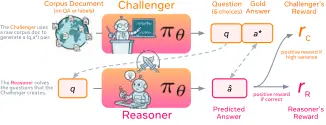

# SPICE ![[Uncaptioned image]](arxiv-2510-24684--6f8c0580c764.figures/figure-1.webp) : Self-Play In Corpus Environments Improves Reasoning

Bo Liu Affiliation: FAIR at Meta Affiliation: National University of
Singapore Work done at Meta    Chuanyang Jin Affiliation: FAIR at Meta
Joint second author    Seungone Kim Affiliation: FAIR at Meta Joint
second author    Weizhe Yuan Affiliation: FAIR at Meta    Wenting Zhao
Affiliation: FAIR at Meta    Ilia Kulikov Affiliation: FAIR at Meta   
Xian Li Affiliation: FAIR at Meta    Sainbayar Sukhbaatar
Affiliation: FAIR at Meta    Jack Lanchantin Affiliation: FAIR at Meta
Joint last author    Jason Weston Affiliation: FAIR at Meta Joint last
author

###### Abstract

Self-improving systems require environmental interaction for continuous
adaptation. We introduce SPICE (Self-Play In Corpus Environments), a
reinforcement learning framework where a single model acts in two roles:
a Challenger that mines documents from a large corpus to generate
diverse reasoning tasks, and a Reasoner that solves them. Through
adversarial dynamics, the Challenger creates an automatic curriculum at
the frontier of the Reasoner’s capability, while corpus grounding
provides the rich, near-inexhaustible external signal necessary for
sustained improvement. Unlike existing ungrounded self-play methods that
offer more limited benefits, SPICE achieves consistent gains across
mathematical (+8.9%) and general reasoning (+9.8%) benchmarks on
multiple model families. Our analysis reveals how document grounding is
a key ingredient in SPICE to continuously generate its own increasingly
challenging goals and achieve them, enabling sustained self-improvement.

^(†)^(†)date: August 24, 2026^(†)^(†)correspondence:
[benjaminliu.eecs@gmail.com](mailto:%5Ccolorredbenjaminliu.eecs@gmail.com),
[{jacklanchantin,
jase}@meta.com](mailto:%5Ccolorred!90!black%5C%7Bjacklanchantin,%20jase%5C%7D@meta.com)

Figure 1: SPICE (Self-Play In Corpus Environments) outperforms
state-of-the-art self-play methods for LLMs on Qwen3-4B-Base (right).
Training the model in SPICE to be both a Challenger and Reasoner,
creating and solving challenging corpus-grounded tasks for itself via
self-play RL is crucial to this success (left), see ablations for
details.

## 1 Introduction

Self-improving artificial intelligence (Schmidhuber, 2007; Clune, 2019)
has long been envisioned as a path toward artificial general
intelligence, where systems autonomously enhance their capabilities
through environmental interaction and continuous adaptation. This vision
is becoming tangible with large language models (LLMs; Kaplan et al.
(2020); Achiam et al. (2023); Dubey et al. (2024)), which demonstrate
remarkable reasoning abilities across diverse domains (Wei et al., 2022;
Kojima et al., 2022). Recent breakthroughs show that reinforcement
learning can unlock more sophisticated reasoning. Models like OpenAI
o1 (OpenAI, 2024) and DeepSeek-R1 (DeepSeek Team, 2024) achieve
expert-level performance on mathematical and coding tasks through
reinforcement learning with verifiable rewards (RLVR). To scale these
capabilities without human supervision, self-play offers a promising
paradigm (Silver et al., 2017; Sukhbaatar et al., 2017), where models
improve by competing against themselves and generating automatic
feedback through competition.

However, most existing self-play methods for language models achieve
initial improvements but quickly face fundamental barriers. Without
external grounding, models inevitably plateau or collapse (Huang et al.,
2025; Chen et al., 2025b; Kuba et al., 2025) due to two critical issues:
(1) hallucination amplification, where factual errors in both generated
questions and answers compound as models train on their own unverifiable
synthetic data, and (2) information symmetry, where both the problem
generator and solver share the same knowledge base, preventing genuine
challenge and leading to simpler, more repetitive patterns. Even
approaches maintaining diversity through variational synthesis (Liang
et al., 2025) ultimately remain bounded by their initial coverage, which
is merely a compressed representation of the original pretraining
data (Morris et al., 2025). These systematic empirical failures indicate
that self-improvement requires interaction with an external source
providing diverse, verifiable feedback, rather than closed-loop pure
introspection.

We introduce SPICE (Self-Play In Corpus Environments), a self-play
reinforcement learning framework that mines contexts from a large
document corpus to generate diverse reasoning tasks with
document-grounded answers. A single model acts in two roles: a
Challenger that constructs a curriculum of such challenging
document-grounded tasks, and a Reasoner that develops robust reasoning
capabilities by solving the tasks without document access. A key
component is information asymmetry: the Challenger grounds questions and
gold answers in retrieved documents unseen by the Reasoner, creating
genuine challenge. The vast diversity of documents ensures continual
novelty beyond the model’s internalized knowledge. Simultaneously,
corpus grounding prevents hallucination by anchoring both questions and
gold answers in real-world content rather than model-generated
fantasies, ensuring factual accuracy throughout the self-play loop.

During self-play, the Challenger is rewarded for generating problems at
the frontier of the Reasoner’s capability (maximizing variance in
success rates), while the Reasoner is rewarded for correct answers. This
adversarial yet symbiotic interaction with corpus grounding enables the
system to continuously discover new challenges grounded in real
knowledge and overcome them. Importantly, our approach relies on raw
documents without predefined questions or labels. Tasks are generated
with diverse formats (multiple-choice questions and free-form questions
with integer/expression/string answers) which serve as universal
verifiers, enabling self-play across any language domain without
requiring specialized executors or rule-based validators. This breaks
the verification bottleneck that has confined prior work to narrow
domains like mathematics and code, while document-grounded answers
ensure verification remains factually anchored.

Training with corpus-grounded self-play produces reasoning capabilities
that transfer broadly across diverse model choices. On Qwen3-4B-Base,
SPICE achieves 44.9% average performance versus 35.8% baseline
performance (+9.1% absolute gain), while Qwen3-8B-Base improves from
43.0% to 48.7% (+5.7%). OctoThinker-3B-Hybrid-Base shows the largest
gains from 14.7% to 25.2% (+10.5%), and OctoThinker-8B-Hybrid-Base
improves from 20.5% to 32.4% (+11.9%), where SPICE surpasses both
standard RLVR and pure (ungrounded) self-play baselines in all cases.
These gains span both mathematical reasoning (average +8.9%) and general
reasoning tasks (+9.8% across MMLU-Pro, GPQA-Diamond, SuperGPQA, and
BBEH), demonstrating that corpus grounding develops broadly applicable
capabilities. The adversarial dynamics between Challenger and Reasoner
create an automatic curriculum: the fixed Reasoner’s pass rate decreases
from 55% to 35% as it learns to generate progressively harder problems,
while the fixed Challenger’s pass rate increases from 55% to 85%,
indicating successful co-evolution of both roles. Corpus grounding
proves critical for sustained improvement: without it, models show
limited improvement and fail to maintain the adaptive challenge
necessary for sustained learning. With corpus grounding, the system
maintains stable advancement throughout training by continuously mining
new document contexts for novel challenges.

Overall, our work makes the following contributions:

1.  1.  We show that treating a large document corpus as an external
        knowledge source enables sustained self-improvement, outperforming
        ungrounded methods that rely solely on the model’s intrinsic
        knowledge.
2.  2.  We propose corpus-grounded self-play where a model acting in two
        roles (Challenger and Reasoner) generates tasks with
        document-extracted answers and solves them, using diverse task
        formats that enable verification across all domains without
        specialized tools.
3.  3.  We empirically validate that corpus-grounded self-play achieves
        consistent improvements across mathematical and general reasoning
        tasks, overcoming the domain-specific limitations of existing
        approaches.

SPICE presents a paradigm shift in self-improving reasoning methods:
from closed-loop self-play that often stagnates due to hallucination
drift, to open-ended improvement through interaction with the vast,
verifiable knowledge embedded in web document corpora.

## 2 SPICE: Self-Play In Corpus Environments



Figure 2: SPICE is a self-play framework where a single LLM,
$`\pi_{\theta}`$, acts in two roles: a Challenger ($`\text{role}=C`$),
which poses difficult questions, and a Reasoner ($`\text{role}=R`$),
which tries to correctly answer such questions. The Challenger uses a
raw document (which does not contain existing questions or labels) from
a corpus to generate a ($`q`$, $`a^{*}`$) pair. Depending on the
contents of the document, the Challenger can generate either a
closed-form multiple choice question or a free-form question with
different answer types (integer, float, expression). The Challenger gets
rewarded for questions with high variance in Reasoner’s correctness, and
the Reasoner gets rewarded for answering questions correctly.

SPICE is an end-to-end framework featuring a single model that acts in
two roles through self-play: a Challenger (C) and Reasoner (R). When
playing the role of Challenger, the model grounds itself in web
documents to propose questions that challenge the Reasoner.
Subsequently, the model switches roles to the Reasoner to answer the
questions. This iterative process, governed by adversarial dynamics,
allows both roles to co-evolve, leading to a progressively more capable
model, with the corpus providing the necessary external signal for
sustained improvement. The entire framework is self-supervised,
requiring no human intervention, only a large unstructured corpus. We
overview SPICE in Figure 2, and detail the training method in
Algorithm 1. In the following subsections, we outline the different
roles during self-play.

### 2.1 Notations and Preliminaries

We formulate corpus-grounded self-play as a game where a single model
$`\pi_{\theta}`$ acts in two roles: generating questions from documents
($`\text{role}=C`$) or answering questions ($`\text{role}=R`$). Let
$`\mathcal{D}`$ denote a corpus of documents, $`\mathcal{Q}`$ the space
of questions, and $`\mathcal{A}`$ the space of answers. When
$`\text{role}=C`$, the model has access to document
$`d\sim\mathcal{D}`$; when $`\text{role}=R`$, it only sees question
$`q\in\mathcal{Q}`$, creating information asymmetry between the roles.

### 2.2 Challenger: Document-Grounded Task Generation

When acting as Challenger (C), the model $`\pi_{\theta}`$ learns to
generate problems that maximally challenge the Reasoner while remaining
solvable. Given a corpus $`\mathcal{D}`$, the model in $`\text{role}=C`$
produces diverse tasks as follows.

Document Sampling. We uniformly sample passages from a large document
corpus, extracting segments as documents $`d\in\mathcal{D}`$. Each
document provides context for generating questions with verifiable
answers extracted directly from the text.

Multi-Format Task Generation. Given document $`d`$, the Challenger takes
multiple attempts to create valid question-answer pairs. The model
generates question $`q`$ and extracts gold answer $`a^{*}`$ directly
from the document:

```math
(q,a^{*})\sim\pi_{\theta}(\cdot|d,\text{role}=C)
```

The Challenger selects between two formats based on document evaluation
(see Appendix E): (i) multiple-choice questions (MCQ) with four options
and a document-grounded correct answer, or (ii) free-form questions with
typed answers (integer, expression, string) extracted from the document.
A generated question $`q`$ is considered valid if it is formatted
correctly and parsable from the generation. Our prompt (details given in
Appendix E) guides the Challenger through multi-step complex information
extraction, difficulty enhancement, and self-testing to ensure questions
are challenging yet solvable without the source document.

Variance-Based Curriculum Reward. For each valid question $`(q,a^{*})`$,
we sample $`K`$ responses $`\hat{a}_{i}`$ from the Reasoner and compute
the Challenger’s reward using a scaled variance of the responses:

```math
r_{C}(q,a^{*})=\begin{cases}\exp\left(-\frac{(\text{Var}(\{l_{1},...,l_{K}\})-0.25)^{2}}{2\cdot 0.01}\right)&\text{if }q\text{ is valid}\\
\rho&\text{otherwise (penalty)}\end{cases} \tag{1}
```

where $`l_{i}=\mathds{1}[\hat{a}_{i}=a^{*}]`$. This Gaussian-shaped
reward function is scaled to \[0,1\], maximizing at 1.0 when variance
equals 0.25 (50% pass rate), indicating optimal task difficulty. Tasks
that are too easy or too hard receive exponentially lower rewards; as
the Reasoner improves, the Challenger is rewarded for increasing task
difficulty, creating an automatic curriculum.

### 2.3 Reasoner: Solving Tasks Without Document Access

When acting as Reasoner (R), the model $`\pi_{\theta}`$ learns to solve
the Challenger’s tasks without document access.

Answer Generation. Given valid question $`q`$ alone, the model generates
answer $`\hat{a}\sim\pi_{\theta}(\cdot|q,\text{role}=R)`$. The model is
prompted to reason step by step and place its final answer within
\boxed{} tags, thus forcing it to rely solely on internalized knowledge.

Binary Correctness Reward. The Reasoner receives a correctness reward
$`r_{R}(\hat{a},a^{*})=\mathds{1}[\hat{a}=a^{*}]`$ conditioned on a
rule-based verifier that checks answer equivalence with the
document-extracted gold answer.

### 2.4 Training with Role-Specific Advantages

We optimize both roles jointly (shared weights) by maximizing expected
rewards:

```math
J(\theta)=\mathbb{E}_{d\sim\mathcal{D}}\left[\mathbb{E}_{(q,a^{*})\sim\pi_{\theta}(\cdot|d,\text{role}=C)}[r_{C}(q,a^{*})]+\mathbb{E}_{\hat{a}\sim\pi_{\theta}(\cdot|q,\text{role}=R)}[r_{R}(\hat{a},a^{*})]\right] \tag{2}
```

We use DrGRPO (Liu et al., 2025c) with a separate advantage computation
for each role. Given Challenger trajectories with variance rewards and
Reasoner trajectories with correctness rewards, we compute role-specific
advantages:

```math
\displaystyle\hat{A}_{C}^{i} \displaystyle=r_{C}^{i}-\text{mean}(\{r_{C}^{j}\}_{j}) \tag{3}
```

```math
\displaystyle\hat{A}_{R}^{i} \displaystyle=r_{R}^{i}-\text{mean}(\{r_{R}^{j}\}_{j}) \tag{4}
```

By centering returns around role-specific expectations without standard
deviation normalization, we ensure gradient updates reflect genuine
learning signals rather than difficulty-induced noise.

### 2.5 Implementation

To implement SPICE, we develop a self-play reinforcement learning system
for finetuning LLMs. Our training framework builds on Oat (Liu et al.,
2024), which provides interfaces for a distributed actor-learner
architecture (Espeholt et al., 2018). We instantiate actors to execute
the self-play loop, using vLLM (Kwon et al., 2023) for efficient model
inference during both Challenger and Reasoner generation phases.

The actors generate experiences by alternating between roles: first
generating questions with document access (as Challenger), then
answering them without document access (as Reasoner). The resulting
trajectories are sent to the collocated learner, which updates the LLM
via DrGRPO with role-specific advantages. The responses sampled from the
Reasoner serve dual purposes: computing variance for the Challenger’s
reward and forming the trajectory group for the Reasoner’s update. We
implement answer verification using Math-Verify¹¹ 1
[https://github.com/huggingface/Math-Verify](https://github.com/huggingface/Math-Verify),
which handles equivalence checking for mathematical expressions and
exact matching for other answer types. The complete training procedure
is detailed in Algorithm 1.

1: Pretrained LLM $`\pi_{\theta}`$; corpus $`\mathcal{D}`$; batch size
$`B`$; group size $`G`$; iterations $`T`$; penalty $`\rho`$

2: for $`t\leftarrow 1`$ to $`T`$ do


3:   Challenger Role: Generate challenging problems with document access

4:   for $`b\leftarrow 1`$ to $`B`$ do

5:    Sample document $`d\sim\mathcal{D}`$

6:    Generate multiple attempts:
$`\{(q_{i},a^{*}_{i})\}_{i=1}^{N}\leftarrow\pi_{\theta}(d,\text{role}=C)`$
$`\triangleright`$ MCQ or free-form

7:    $`\mathcal{T}_{C}\leftarrow`$ Subsample $`G`$ trajectories
preserving valid:invalid ratio

8:    if $`q_{i}\in\mathcal{T}_{C}`$ is valid then

9:
     $`\{\hat{a}_{k}\}_{k=1}^{G}\leftarrow\pi_{\theta}(q_{i},\text{role}=R)`$
$`\triangleright`$ No document access

10:      $`r_{C}(q_{i},a^{*}_{i})\leftarrow`$ Compute reward using
Eq. (1) $`\triangleright`$ Gaussian variance reward

11:    else

12:      $`r_{C}(q_{i},a^{*}_{i})\leftarrow\rho`$ $`\triangleright`$
Invalid task penalty

13:    end if

14:   end
for

15:   Reasoner Role: Solve generated problems without document access

16:   Select a random valid task $`(q,a^{*})`$ from Challenger phase

17:
  $`\mathcal{T}_{R}\leftarrow\{\hat{a}_{i}\}_{i=1}^{G}\sim\pi_{\theta}(q,\text{role}=R)`$
$`\triangleright`$ $`G`$ responses for training

18:   for $`i\leftarrow 1`$ to $`G`$ do

19:
   $`r_{R}(\hat{a}_{i},a^{*}_{i})\leftarrow\mathds{1}[\hat{a}_{i}=a^{*}]`$
$`\triangleright`$ Binary correctness reward

20:   end
for

21:   Update Phase: Optimize $`\pi_{\theta}`$ with role-specific
advantages

22:   for trajectory $`i`$ in $`\mathcal{T}_{C}`$ do

23:
   $`\hat{A}_{C}^{i}\leftarrow r_{C}^{i}-\text{mean}(\{r_{C}^{j}:j\in\mathcal{T}_{C}\})`$
$`\triangleright`$ DrGRPO

24:   end for

25:   for trajectory $`i`$ in $`\mathcal{T}_{R}`$ do

26:
   $`\hat{A}_{R}^{i}\leftarrow r_{R}^{i}-\text{mean}(\{r_{R}^{j}:j\in\mathcal{T}_{R}\})`$
$`\triangleright`$ DrGRPO

27:   end for

28:   Update $`\pi_{\theta}`$ via policy gradient with advantages
$`\{\hat{A}_{C}^{i}\}`$ and $`\{\hat{A}_{R}^{i}\}`$


29: end for

30: return Trained model $`\pi_{\theta}`$

Algorithm 1 SPICE ![[Uncaptioned
image]](arxiv-2510-24684--6f8c0580c764.figures/figure-3.webp):
Self-Play In Corpus Environments

## 3 Experimental Results

### 3.1 Setup

Training Configuration. Following Algorithm 1, we train on corpus
$`\mathcal{D}`$ with $`|\mathcal{D}|=20,000`$ documents from
high-quality, freely available sources. For mathematics, we use
Nemotron-CC-Math (Mahabadi et al., 2025); for general reasoning, we use
documents from NaturalReasoning (Yuan et al., 2025), a subset of
DCLM (Li et al., 2024). We extract document segments of up to 5,992
tokens to fit within the model’s context window. Each iteration attempts
to generate at least one valid task, ($`q,a^{*}`$), per document with up
to $`N=1024`$ attempts. While multiple valid questions may be generated,
we randomly select one per document to balance the training data size
between Challenger and Reasoner roles. We use temperature 1.0 for both
roles, with group size $`G=8`$ responses per question serving dual
purposes: computing variance for the Challenger’s reward and forming the
group for DrGRPO advantage computation. The penalty for invalid
questions is set to $`\rho=-0.1`$. We train for a fixed $`T=640`$
iterations with batch size $`B=128`$. Detailed training configurations
for all methods are provided in Appendix B.

Models and Baselines. We evaluate SPICE on four base models:
Qwen3-4B-Base, Qwen3-8B-Base (Yang et al., 2025a),
OctoThinker-3B-Hybrid-Base, and OctoThinker-8B-Hybrid-Base (Wang et al.,
2025). We compare against several baselines: (1) Base Model, the
pretrained model without any post-training, establishing the starting
performance; (2) Strong Challenger, which uses a fixed stronger model
(Qwen3-32B-Instruct) as the Challenger to generate questions with our
model training only as Reasoner, testing whether a stronger question
generator improves learning; (3) R-Zero (Huang et al., 2025), pure
self-play without corpus grounding where the model generates its own
questions from scratch without document access, representing ungrounded
self-play; and (4) Absolute Zero (Zhao et al., 2025), self-play
restricted to code generation tasks with Python execution as
verification, representing domain-specific grounded self-play. We run
all baseline methods ourselves using their publicly available code to
ensure fair comparison with identical training infrastructure, unified
evaluation protocols, and model-specific prompt templates detailed in
Appendix E, with training configurations provided in Appendix B.

Evaluation Benchmarks. We conduct a comprehensive evaluation across
mathematical and general reasoning tasks. For mathematical reasoning, we
evaluate on MATH-500 (Hendrycks et al., 2021), a curated subset of
challenging competition problems; OlympiadBench (He et al., 2024),
featuring olympiad-level problems; Minerva Math (Lewkowycz et al.,
2022), covering STEM topics; GSM8K (Cobbe et al., 2021), grade-school
word problems; and AMC (MAA, b), AIME’24, AIME’25 (MAA, a) competition
problems from the American Mathematics Competitions. For general
reasoning, we use SuperGPQA (Du et al., 2025), a large-scale benchmark
targeting graduate-level reasoning across 285 disciplines with
Google-search-resistant questions; GPQA-Diamond (Rein et al., 2023),
graduate-level questions resistant to pattern-matching; MMLU-Pro (Wang
et al., 2024), a challenging multi-task understanding dataset; and
BBEH (Kazemi et al., 2025), extending BIG-Bench Hard with more complex
reasoning tasks. We use the simple-evals²² 2
[https://github.com/openai/simple-evals](https://github.com/openai/simple-evals)
framework with GPT-4o (OpenAI, 2024) for answer equivalence checking.
Most evaluations use greedy decoding with training-consistent prompts
following Ma et al. (2025), except AIME’24 and AIME’25 which are
averaged over 32 sampling runs following Zeng et al. (2025). Detailed
evaluation settings are provided in Appendix A.

|                            |         |                        |         |      |       |        |      |      |                   |         |       |      |                    |
| -------------------------- | ------- | ---------------------- | ------- | ---- | ----- | ------ | ---- | ---- | ----------------- | ------- | ----- | ---- | ------------------ |
|                            |         | Mathematical Reasoning |         |      |       |        |      |      | General Reasoning |         |       |      |                    |
|                            |         |                        |         | MATH |       |        | AIME | AIME | Super-            | GPQA-   | MMLU- |      |                    |
| Method                     | Overall | AMC                    | Minerva | 500  | GSM8K | Olymp. | 24   | 25   | GPQA              | Diamond | Pro   | BBEH | $`\Delta`$ vs Base |
| Qwen3-4B-Base              |         |                        |         |      |       |        |      |      |                   |         |       |      |                    |
| Base Model                 | 35.8    | 47.5                   | 42.3    | 68.2 | 72.6  | 34.8   | 10.3 | 6.7  | 25.4              | 26.3    | 51.6  | 8.1  | –                  |
| + Strong Challenger        | 43.0    | 57.5                   | 44.9    | 78.0 | 91.6  | 41.5   | 12.7 | 12.9 | 27.4              | 37.9    | 56.1  | 12.3 | +7.2               |
| + R-Zero                   | 39.5    | 45.0                   | 52.2    | 72.6 | 90.5  | 39.7   | 10.1 | 5.2  | 27.8              | 27.8    | 53.7  | 10.4 | +3.7               |
| + Absolute Zero            | 40.7    | 50.0                   | 41.9    | 76.2 | 89.3  | 41.5   | 12.2 | 13.4 | 27.1              | 35.3    | 52.6  | 8.3  | +4.9               |
| + SPICE (ours)             | 44.9    | 57.5                   | 51.9    | 78.0 | 92.7  | 42.7   | 12.2 | 19.1 | 30.2              | 39.4    | 58.1  | 12.3 | +9.1               |
| Qwen3-8B-Base              |         |                        |         |      |       |        |      |      |                   |         |       |      |                    |
| Base Model                 | 43.0    | 57.5                   | 49.3    | 74.4 | 91.2  | 40.4   | 15.3 | 12.1 | 31.0              | 33.3    | 58.1  | 10.5 | –                  |
| + Strong Challenger        | 45.6    | 60.0                   | 52.5    | 78.2 | 92.4  | 41.6   | 15.3 | 12.1 | 35.0              | 35.8    | 64.8  | 14.4 | +2.6               |
| + R-Zero                   | 46.3    | 70.0                   | 59.2    | 78.0 | 91.8  | 41.3   | 11.7 | 14.2 | 32.8              | 36.4    | 61.7  | 12.0 | +3.3               |
| + Absolute Zero            | 46.5    | 62.5                   | 52.9    | 76.6 | 92.0  | 47.8   | 18.4 | 18.2 | 33.5              | 36.8    | 62.5  | 10.8 | +3.5               |
| + SPICE (ours)             | 48.7    | 70.0                   | 59.2    | 79.4 | 92.7  | 42.5   | 18.4 | 18.2 | 35.7              | 39.4    | 65.0  | 14.9 | +5.7               |
| OctoThinker-3B-Hybrid-Base |         |                        |         |      |       |        |      |      |                   |         |       |      |                    |
| Base Model                 | 14.7    | 15.0                   | 14.3    | 38.2 | 44.3  | 10.8   | 3.4  | 3.5  | 12.8              | 3.5     | 14.9  | 1.0  | –                  |
| + Strong Challenger        | 21.0    | 15.0                   | 15.1    | 39.7 | 73.7  | 14.4   | 0.3  | 0.1  | 15.7              | 25.3    | 24.2  | 7.0  | +6.3               |
| + R-Zero                   | 20.3    | 20.4                   | 22.1    | 48.0 | 74.5  | 15.4   | 0.2  | 0.4  | 12.6              | 6.6     | 18.7  | 4.0  | +5.6               |
| + Absolute Zero            | 21.7    | 17.5                   | 18.7    | 43.2 | 75.8  | 13.2   | 2.7  | 0.5  | 17.7              | 19.2    | 24.3  | 6.1  | +7.0               |
| + SPICE (ours)             | 25.2    | 22.5                   | 22.1    | 48.0 | 78.8  | 15.4   | 3.4  | 3.5  | 18.2              | 26.8    | 28.9  | 9.3  | +10.5              |
| OctoThinker-8B-Hybrid-Base |         |                        |         |      |       |        |      |      |                   |         |       |      |                    |
| Base Model                 | 20.5    | 27.5                   | 22.1    | 44.2 | 68.6  | 16.7   | 2.7  | 0.8  | 11.4              | 15.7    | 14.7  | 0.6  | –                  |
| + Strong Challenger        | 28.2    | 25.0                   | 27.2    | 54.4 | 86.4  | 20.0   | 6.6  | 3.3  | 17.6              | 27.8    | 32.9  | 9.5  | +7.7               |
| + R-Zero                   | 29.9    | 32.5                   | 33.1    | 58.4 | 85.2  | 22.6   | 9.9  | 1.9  | 17.9              | 21.7    | 37.4  | 7.8  | +9.4               |
| + Absolute Zero            | 29.4    | 32.5                   | 34.9    | 56.8 | 87.0  | 25.6   | 0.1  | 3.3  | 18.8              | 27.8    | 31.4  | 5.0  | +8.9               |
| + SPICE (ours)             | 32.4    | 35.0                   | 34.9    | 58.4 | 87.3  | 25.6   | 9.9  | 7.4  | 18.8              | 31.8    | 37.4  | 9.5  | +11.9              |

Table 1: Comprehensive evaluation across mathematical and general
reasoning benchmarks comparing SPICE against state-of-the-art self-play
methods for LLMs. All methods use self-play except “Strong Challenger”,
which uses the fixed Qwen-32B-Instruct model for question generation.
Best results per base model are in bold. SPICE consistently outperforms
all baselines across all four model types.

### 3.2 Quantitative Analysis

Table 1shows the main results on the four different base models we use.
SPICE consistently outperforms the baselines across all four model
families, delivering the largest overall improvements versus the base
models: +9.1 (Qwen3‑4B-Base), +5.7 (Qwen3‑8B-Base), +10.5
(OctoThinker‑3B-Hybrid-Base), and +11.9 (OctoThinker‑8B-Hybrid-Base). We
observe improvements across both math and general reasoning tasks,
highlighting the benefits of using a diverse corpus of documents.

Figure 4: Training dynamics comparing key components of SPICE. (a)
Challenger Ablation: Without Challenger training (fixed Challenger),
performance improves less than with full adversarial training. (b)
Corpus Ablation: With corpus grounding, the model achieves steady
improvement to 43.9%, while without it performance is lower at 40.7%,
showing the importance of external grounding.

Figure 3: Reasoner pass rates when evaluating SPICE checkpoints at steps
200-640 against a fixed step-200 checkpoint on 128 documents. (a) Fixed
Reasoner: Pass rate decreases from 55% to 35% as later Challenger
checkpoints generate harder questions. (b) Fixed Challenger: Pass rate
increases from 55% to 85% as later Reasoner checkpoints improve at
solving questions.

Adversarial Learning Dynamics. Figure 4 illustrates the co-evolution of
Challenger and Reasoner capabilities. To analyze the contribution of
each role, we take checkpoints from full self-play training (steps
200-640) and evaluate them against a fixed step-200 checkpoint on a pool
of 128 documents (with 128 generation attempts each). When evaluating
different Challenger checkpoints against a fixed step-200 Reasoner
(subplot a), we observe the Reasoner’s pass rate decreases from 55% to
35% as later Challenger checkpoints generate increasingly challenging
questions. Conversely, when evaluating different Reasoner checkpoints
against a fixed step-200 Challenger (subplot b), the Reasoner’s pass
rate increases from 55% to 85% as later checkpoints become better at
solving questions. In full SPICE training where both roles evolve
simultaneously, this adversarial dynamic drives mutual improvement
beyond what either role achieves in isolation.

Challenger Learning Impact. An important component of SPICE is learning
the Challenger simultaneously with the Reasoner, as opposed to using a
fixed Challenger. Figure 4(a) demonstrates that co-training the
Challenger alongside the Reasoner is essential for maximizing gains,
validating our co-evolutionary approach. Without training the
Challenger, the Reasoner isn’t challenged enough and improves more
slowly.

Corpus Grounding Impact. Finally, we examine the critical role of corpus
grounding in SPICE. Figure 4(b) illustrates the results. With corpus
grounding, performance reaches 43.9% through continuous access to
diverse document contexts that provide near-inexhaustible question
material. Without access to external documents, the model performance is
lower at 40.7%, indicating the importance of corpus grounding.

### 3.3 Qualitative Analysis

To better understand SPICE’s learning dynamics, we analyze the evolution
of tasks and reasoning patterns produced by the Challenger and Reasoner,
respectively, throughout training.

Challenger Task Development. Figure 5 shows how task complexity evolves
when the Challenger is given the same document at different training
steps. Early tasks focus on surface-level information, while later tasks
require deep comprehension and multi-step reasoning. At earlier steps,
the Challenger cannot propose tasks that are too difficult, as the
Reasoner will not be able to learn from them. As training progresses,
the Challenger learns to generate more difficult tasks to adapt to the
improved Reasoner’s capabilities.


Figure 5: Evolution of the Challenger’s task complexity on the same
document. The Challenger progresses from extracting explicit facts to
generating questions requiring understanding of angular size
relationships and proportional reasoning to arrive at document-stated
values.

Reasoner Pattern Development. Figure 6 illustrates the evolution of the
Reasoner’s structured problem-solving approach given the same question
at different training steps. As training progresses, increasingly
sophisticated reasoning patterns emerge, reflecting the Reasoner’s
adaptation to the progressively more challenging tasks generated by the
Challenger. This progression reveals authentic reasoning capabilities
rather than mere memorization, as the model learns to systematically
decompose problems, validate intermediate steps, and self-correct when
inconsistencies arise.


Figure 6: Evolution of Reasoner’s reasoning patterns. The Reasoner
progresses from intuitive guessing to systematic application of angular
size principles, proper ratio setup, algebraic manipulation, and
solution verification.

## 4 Ablations

To understand the key components driving SPICE’s performance, we conduct
comprehensive ablation studies on Qwen3-4B-Base. We examine three
critical design choices: corpus composition, task type distribution, and
Challenger reward strategies. All experiments use the same training
configuration as our main experiments.

### 4.1 Corpus Distribution

One of the main ingredients of SPICE is the external corpora of
documents. Compared to no corpora (pure ungrounded self-play), SPICE
achieves substantial gains on both math and general reasoning tasks.
However, we include two large document datasets: NaturalReasoning and
Nemotron-CC-Math. In order to understand the effects of the document
types, we ablate each document dataset separately. We show the results
in  Table 2. As expected, the NaturalReasoning dataset leads to the
largest gains in general reasoning tasks as it contains documents
targeted toward such tasks. Similarly, Nemotron-CC-Math leads to the
biggest improvements in the math tasks. However, both datasets combined
lead to the best overall performance.

| Corpus Type                         | Math Avg | General Avg | Overall Avg |
| ----------------------------------- | -------- | ----------- | ----------- |
| NaturalReasoning                    | 44.4     | 37.0        | 41.7        |
| Nemotron-CC-Math                    | 53.4     | 29.8        | 43.2        |
| NaturalReasoning + Nemotron-CC-Math | 50.6     | 35.0        | 44.9        |

Table 2: Effect of corpus composition, used by the Challenger, on
reasoning improvements. We show average performance across mathematical
reasoning benchmarks (Math), general reasoning benchmarks (General), and
their overall average. Best results shown in bold, second best in
underline. Full benchmark results are given in Appendix Table 6.

### 4.2 Task Type

A second key feature of SPICE is the ability to generate different task
types dependent on the current document. SPICE uses two different task
types: multiple-choice (MCQ) and free-form. Table 3 shows the results of
only using MCQ or free-form versus using both. While using free-form
questions only leads to the highest math gains, combining MCQ and
free-form (mixing tasks) achieves the best overall performance. We
attribute this to MCQs providing reliable verification while free-form
questions encourage flexible reasoning.

| Task Type       | Math Avg | General Avg | Overall Avg |
| --------------- | -------- | ----------- | ----------- |
| MCQ only        | 46.9     | 35.7        | 42.0        |
| Free-form only  | 52.5     | 31.8        | 43.7        |
| MCQ + Free-form | 50.6     | 35.0        | 44.9        |

Table 3: Effect of the task type, proposed by the Challenger, on
reasoning improvements. MCQ provides structured answer choices while
free-form requires open-ended generation. Combining both leads to the
best overall performance. Full results are provided in Appendix Table 7.

### 4.3 Challenger’s Reward

Lastly, we find that the Challenger’s reward function critically
influences task difficulty calibration. We compare four reward
strategies that shape how a Challenger can select problems during
self-play with a Reasoner (see Appendix D, Figure 7 for reward
visualizations). Absolute Zero rewards the Challenger with one minus the
Reasoner’s average success rate: tasks where the Reasoner fails more
often receive higher reward. While intuitive, this task conflates
difficulty with learning value. A threshold reward over number of
correct rollouts uses a binary signal: reward 1 for relatively solvable
tasks, 0 for tasks with 0% or 100% pass rate (impossible or trivial).
The R-Zero reward explicitly targets maximum uncertainty: it rewards
tasks where the Reasoner’s multiple responses split evenly between
different answers, peaking when exactly half agree with the most common
answer. Our variance approach uses a related principle, but captures the
full spread of the answer distribution across multiple Reasoner samples
rather than measuring agreement with a single mode, creating a
curriculum calibrated at the frontier of the model’s capability.
Results, given in Table 4, show SPICE’s variance-based reward achieves
the best performance across all metrics. A critical insight is that
optimal learning occurs when the Reasoner has a balanced success rate.

| Challenger Reward | Math | General | Overall |
| ----------------- | ---- | ------- | ------- |
| Absolute Zero     | 48.2 | 30.8    | 40.7    |
| Threshold         | 48.6 | 31.6    | 41.4    |
| R-Zero            | 50.0 | 33.9    | 43.6    |
| Variance (SPICE)  | 50.6 | 35.0    | 44.9    |

Table 4: Effect of the Challenger reward strategies on reasoning
performance. Each method targets different aspects of task difficulty
for curriculum generation. Our Variance reward outperforms previously
proposed rewards.

## 5 Related Work

Reinforcement Learning for LLM Reasoning  Reinforcement learning has
evolved from alignment tasks using RLHF (Jaques et al., 2019; Ouyang
et al., 2022; Bai et al., 2022) to directly improving reasoning
capabilities. Recent models like OpenAI o1 (OpenAI, 2024) and
DeepSeek-R1 (DeepSeek Team, 2024) demonstrate that RL with verifiable
rewards (RLVR) can unlock chain-of-thought reasoning using rule-based
rewards (Lightman et al., 2023; Uesato et al., 2022). However, these
approaches depend on human-curated problem sets and domain-specific
reward engineering, limiting their scalability. The Era of
Experience (Silver and Sutton, 2025) argues that future AI systems must
learn from environmental interaction rather than static datasets (Jin
et al., 2025). Yet, current RLVR methods remain bound to pre-collected
problems. SPICE aims to address this by generating problems dynamically
from corpus interactions, enabling learning without human curation.

Multi-Agent RL for Language Models  Implementing multi-agent RL for
full-scale LLMs presents significant technical challenges (Wan et al.,
2025; Liu et al., 2025b). Prior work has made various compromises:
Sarkar et al. (2025) uses RNNs instead of transformers; Jacob et al.
(2022) focuses on simplified environments that don’t require full
autoregressive generation; and Liao et al. (2024) shows the
effectiveness of self-play with SFT on proprietary models. SPIRAL (Liu
et al., 2025a) demonstrates that zero-sum games between agents can teach
transferable reasoning through multi-turn interactions, but requires
carefully designed game environments. SPICE builds on multi-agent
frameworks but grounds the adversarial dynamics in corpus contexts,
enabling automatic curriculum emergence without engineered environments.

Self-Play for Autonomous Improvement  Self-play has revolutionized
game-playing AI, including TD-Gammon’s backgammon mastery (Tesauro,
1995), AlphaGo’s superhuman Go performance (Silver et al., 2017), and
CICERO’s comprehension of cooperative strategies (FAIR et al., 2022).
Self-play can even create automatic curricula through intrinsic
motivation (Sukhbaatar et al., 2017). In language models, self-play
began with alignment methods like SPIN (Chen et al., 2024) and
Self-Rewarding Language Models (Yuan et al., 2024). Recent work explores
capability improvement: SPAG (Cheng et al., 2024) applies self-play to
Adversarial Taboo but uses offline updates and remains confined to a
single word game; SPC (Chen et al., 2025a) and Genius (Xu et al., 2025)
require human task distributions as seeds; SPELL (Yang et al., 2025b)
targets long-context evolution through self-play; Language
Self-Play (Kuba et al., 2025) explores data-free training paradigms.
Pure self-play methods consistently demonstrate empirical limitations:
R-Zero (Huang et al., 2025) achieves initial gains but degrades after
3-4 iterations with pseudo-label accuracy dropping from 79% to 63%;
Absolute Zero (Zhao et al., 2025) and SQLM (Chen et al., 2025b) generate
coding tasks and hence remain limited in domain.

Synthetic Question Generation from Corpora  Synthetic question
generation methods either bootstrap from existing datasets or mine from
corpora. Bootstrapping approaches like STaR (Zelikman et al., 2022),
MetaMath (Yu et al., 2023), and SvS (Liang et al., 2025) remain bounded
by initial dataset coverage. Self-Instruct (Wang et al., 2022) and
reasoning-based CoT-self-instruct (Yu et al., 2025) generate
high-quality synthetic prompts from few-shot examples, but create static
datasets rather than adaptive curricula. Corpus-mining methods achieve
broader coverage: WebInstruct (Yue et al., 2024) harvests QA pairs but
requires rule-based filters; General-Reasoner (Ma et al., 2025) and
NaturalReasoning (Yuan et al., 2025) generate millions of questions from
web content but create static offline datasets. SPICE differs
fundamentally through online adversarial generation where the Challenger
continuously mines corpus contexts to generate tasks calibrated to the
Reasoner’s current capability, preventing both coverage limitations and
quality degradation.

## 6 Conclusion

We introduced SPICE, a self-play RL framework that aims to overcome the
issues of hallucination and information symmetry, outperforming pure
(ungrounded) self-play. By treating a large document corpus as a
near-inexhaustible external environment, SPICE presents a new paradigm
for self-improvement, allowing LLMs to interact with a continually
changing world via web documents. Through adversarial dynamics between a
Challenger that generates tasks and a Reasoner that solves them, our
system creates its own ever more challenging goals and strives to
achieve them. SPICE achieves strong improvements across mathematical and
general reasoning benchmarks compared to state-of-the-art self-play
methods. By mining training signals from the vast knowledge embedded in
corpora, SPICE develops reasoning capabilities that transfer broadly
across domains. We believe this shift from closed-loop self-play to
corpus-grounded adversarial learning opens new avenues for
self-improvement without explicit human supervision.

## References

- Achiam et al. (2023) Josh Achiam, Steven Adler, Sandhini Agarwal, Lama
  Ahmad, Ilge Akkaya, Florencia Leoni Aleman, Diogo Almeida, Janko
  Altenschmidt, Sam Altman, Shyamal Anadkat, et al. Gpt-4 technical
  report. _arXiv preprint arXiv:2303.08774_, 2023.
- Bai et al. (2022) Yuntao Bai, Saurav Kadavath, Sandipan Kundu, Amanda
  Askell, Jackson Kernion, Andy Jones, Anna Chen, Anna Goldie, Azalia
  Mirhoseini, Cameron McKinnon, et al. Constitutional ai: Harmlessness
  from ai feedback. _arXiv preprint arXiv:2212.08073_, 2022.
- Chen et al. (2025a) Jiaqi Chen, Bang Zhang, Ruotian Ma, Peisong Wang,
  Xiaodan Liang, Zhaopeng Tu, Xiaolong Li, and Kwan-Yee K Wong. Spc:
  Evolving self-play critic via adversarial games for llm reasoning.
  _arXiv preprint arXiv:2504.19162_, 2025a.
- Chen et al. (2025b) Lili Chen, Mihir Prabhudesai, Katerina
  Fragkiadaki, Hao Liu, and Deepak Pathak. Self-questioning language
  models. _arXiv preprint arXiv:2508.03682_, 2025b.
- Chen et al. (2024) Zixiang Chen, Yihe Deng, Huizhuo Yuan, Kaixuan Ji,
  and Quanquan Gu. Self-play fine-tuning converts weak language models
  to strong language models. In _ICML_, 2024.
- Cheng et al. (2024) Pengyu Cheng, Tianhao Hu, Han Xu, Zhisong Zhang,
  Yong Dai, Lei Han, Xiaolong Li, et al. Self-playing adversarial
  language game enhances llm reasoning. _Advances in Neural Information
  Processing Systems_, 37:126515–126543, 2024.
- Clune (2019) Jeff Clune. Ai-gas: Ai-generating algorithms, an
  alternate paradigm for producing general artificial intelligence.
  _arXiv preprint arXiv:1905.10985_, 2019.
- Cobbe et al. (2021) Karl Cobbe, Vineet Kosaraju, Mohammad Bavarian,
  Mark Chen, Heewoo Jun, Lukasz Kaiser, Matthias Plappert, Jerry Tworek,
  Jacob Hilton, Reiichiro Nakano, Christopher Hesse, and John Schulman.
  Training verifiers to solve math word problems, 2021.
  [https://arxiv.org/abs/2110.14168](https://arxiv.org/abs/2110.14168).
- DeepSeek Team (2024) DeepSeek Team. Deepseek-r1: Incentivizing
  reasoning capability in llms via reinforcement learning. _arXiv
  preprint arXiv:2401.00000_, 2024.
- Du et al. (2025) Xinrun Du, Yifan Yao, Kaijing Ma, Bingli Wang, Tianyu
  Zheng, King Zhu, Minghao Liu, Yiming Liang, Xiaolong Jin, Zhenlin Wei,
  et al. Supergpqa: Scaling llm evaluation across 285 graduate
  disciplines. _arXiv preprint arXiv:2502.14739_, 2025.
- Dubey et al. (2024) Abhimanyu Dubey, Abhinav Jauhri, Abhinav Pandey,
  Abhishek Kadian, Ahmad Al-Dahle, Aiesha Letman, Akhil Mathur, Alan
  Schelten, Amy Yang, Angela Fan, et al. The llama 3 herd of models.
  _arXiv e-prints_, pages arXiv–2407, 2024.
- Espeholt et al. (2018) Lasse Espeholt, Hubert Soyer, Remi Munos, Karen
  Simonyan, Vlad Mnih, Tom Ward, Yotam Doron, Vlad Firoiu, Tim Harley,
  Iain Dunning, et al. Impala: Scalable distributed deep-rl with
  importance weighted actor-learner architectures. In _International
  conference on machine learning_, pages 1407–1416. PMLR, 2018.
- FAIR et al. (2022) FAIR, Anton Bakhtin, Noam Brown, Emily Dinan,
  Gabriele Farina, Colin Flaherty, Daniel Fried, Andrew Goff, Jonathan
  Gray, Hengyuan Hu, et al. Human-level play in the game of diplomacy by
  combining language models with strategic reasoning. _Science_,
  378(6624):1067–1074, 2022.
- He et al. (2024) Chaoqun He, Renjie Luo, Yuzhuo Bai, Shengding Hu,
  Zhen Leng Thai, Junhao Shen, Jinyi Hu, Xu Han, Yujie Huang, Yuxiang
  Zhang, Jie Liu, Lei Qi, Zhiyuan Liu, and Maosong Sun. Olympiadbench: A
  challenging benchmark for promoting agi with olympiad-level bilingual
  multimodal scientific problems, 2024.
- Hendrycks et al. (2021) Dan Hendrycks, Collin Burns, Saurav Kadavath,
  Akul Arora, Steven Basart, Eric Tang, Dawn Song, and Jacob Steinhardt.
  Measuring mathematical problem solving with the math dataset.
  _NeurIPS_, 2021.
- Huang et al. (2025) Chengsong Huang, Wenhao Yu, Xiaoyang Wang,
  Hongming Zhang, Zongxia Li, Ruosen Li, Jiaxin Huang, Haitao Mi, and
  Dong Yu. R-zero: Self-evolving reasoning llm from zero data. _arXiv
  preprint arXiv:2508.05004_, 2025.
- Jacob et al. (2022) Athul Paul Jacob, Abhishek Gupta, and Jacob
  Andreas. Emergent linguistic phenomena in multi-agent communication
  games. _arXiv preprint arXiv:2205.05984_, 2022.
- Jaques et al. (2019) Natasha Jaques, Asma Ghandeharioun, Judy Hanwen
  Shen, Craig Ferguson, Agata Lapedriza, Noah Jones, Shixiang Gu, and
  Rosalind Picard. Way off-policy batch deep reinforcement learning of
  implicit human preferences in dialog. _arXiv preprint
  arXiv:1907.00456_, 2019.
- Jin et al. (2025) Chuanyang Jin, Jing Xu, Bo Liu, Leitian Tao, Olga
  Golovneva, Tianmin Shu, Wenting Zhao, Xian Li, and Jason Weston. The
  era of real-world human interaction: Rl from user conversations.
  _arXiv preprint arXiv:2509.25137_, 2025.
- Kaplan et al. (2020) Jared Kaplan, Sam McCandlish, Tom Henighan, Tom B
  Brown, Benjamin Chess, Rewon Child, Scott Gray, Alec Radford, Jeffrey
  Wu, and Dario Amodei. Scaling laws for neural language models. _arXiv
  preprint arXiv:2001.08361_, 2020.
- Kazemi et al. (2025) Mehran Kazemi, Bahare Fatemi, Hritik Bansal, John
  Palowitch, Chrysovalantis Anastasiou, Sanket Vaibhav Mehta, Lalit K.
  Jain, Virginia Aglietti, Disha Jindal, Peter Chen, Nishanth Dikkala,
  Gladys Tyen, Xin Liu, Uri Shalit, Silvia Chiappa, Kate Olszewska,
  Yi Tay, Vinh Q. Tran, Quoc V. Le, and Orhan Firat. Big-bench extra
  hard, 2025.
  [https://arxiv.org/abs/2502.19187](https://arxiv.org/abs/2502.19187).
- Kojima et al. (2022) Takeshi Kojima, Shixiang Shane Gu, Machel Reid,
  Yutaka Matsuo, and Yusuke Iwasawa. Large language models are zero-shot
  reasoners. _Advances in neural information processing systems_,
  35:22199–22213, 2022.
- Kuba et al. (2025) Jakub Grudzien Kuba, Mengting Gu, Qi Ma, Yuandong
  Tian, and Vijai Mohan. Language self-play for data-free training.
  _arXiv preprint arXiv:2509.07414_, 2025.
- Kwon et al. (2023) Woosuk Kwon, Zhuohan Li, Siyuan Zhuang, Ying Sheng,
  Lianmin Zheng, Cody Hao Yu, Joseph E. Gonzalez, Hao Zhang, and Ion
  Stoica. Efficient memory management for large language model serving
  with pagedattention. In _Proceedings of the ACM SIGOPS 29th Symposium
  on Operating Systems Principles_, 2023.
- Lewkowycz et al. (2022) Aitor Lewkowycz, Anders Andreassen, David
  Dohan, Ethan Dyer, Henryk Michalewski, Vinay Ramasesh, Ambrose Slone,
  Cem Anil, Imanol Schlag, Theo Gutman-Solo, et al. Solving quantitative
  reasoning problems with language models. _Advances in Neural
  Information Processing Systems_, 35:3843–3857, 2022.
- Li et al. (2024) Jeffrey Li, Alex Fang, Georgios Smyrnis, Maor Ivgi,
  Matt Jordan, Samir Yitzhak Gadre, Hritik Bansal, Etash Guha,
  Sedrick Scott Keh, Kushal Arora, et al. Datacomp-lm: In search of the
  next generation of training sets for language models. _Advances in
  Neural Information Processing Systems_, 37:14200–14282, 2024.
- Liang et al. (2025) Xiao Liang, Zhongzhi Li, Yeyun Gong, Yelong Shen,
  Ying Nian Wu, Zhijiang Guo, and Weizhu Chen. Beyond pass@ 1: Self-play
  with variational problem synthesis sustains rlvr. _arXiv preprint
  arXiv:2508.14029_, 2025.
- Liao et al. (2024) Austen Liao, Nicholas Tomlin, and Dan Klein.
  Efficacy of language model self-play in non-zero-sum games, 2024.
  [https://arxiv.org/abs/2406.18872](https://arxiv.org/abs/2406.18872).
- Lightman et al. (2023) Hunter Lightman, Vineet Kosaraju, Yuri Burda,
  Harri Edwards, Bowen Baker, Teddy Lee, Jan Leike, John Schulman, Ilya
  Sutskever, and Karl Cobbe. Let’s verify step by step. _arXiv preprint
  arXiv:2305.20050_, 2023.
- Liu et al. (2025a) Bo Liu, Leon Guertler, Simon Yu, Zichen Liu,
  Penghui Qi, Daniel Balcells, Mickel Liu, Cheston Tan, Weiyan Shi, Min
  Lin, et al. Spiral: Self-play on zero-sum games incentivizes reasoning
  via multi-agent multi-turn reinforcement learning. _arXiv preprint
  arXiv:2506.24119_, 2025a.
- Liu et al. (2025b) Mickel Liu, Liwei Jiang, Yancheng Liang,
  Simon Shaolei Du, Yejin Choi, Tim Althoff, and Natasha Jaques. Chasing
  moving targets with online self-play reinforcement learning for safer
  language models, 2025b.
  [https://arxiv.org/abs/2506.07468](https://arxiv.org/abs/2506.07468).
- Liu et al. (2024) Zichen Liu, Changyu Chen, Xinyi Wan, Chao Du,
  Wee Sun Lee, and Min Lin. Oat: A research-friendly framework for llm
  online alignment.
  [https://github.com/sail-sg/oat](https://github.com/sail-sg/oat), 2024.
- Liu et al. (2025c) Zichen Liu, Changyu Chen, Wenjun Li, Penghui Qi,
  Tianyu Pang, Chao Du, Wee Sun Lee, and Min Lin. Understanding
  r1-zero-like training: A critical perspective. _arXiv preprint
  arXiv:2503.20783_, 2025c.
- Ma et al. (2025) Xueguang Ma, Qian Liu, Dongfu Jiang, Ge Zhang, Zejun
  Ma, and Wenhu Chen. General-reasoner: Advancing llm reasoning across
  all domains. _arXiv preprint arXiv:2505.14652_, 2025.
- MAA (a) MAA. American invitational mathematics examination (AIME).
  Mathematics Competition Series, n.d.a.
  [https://maa.org/math-competitions/aime](https://maa.org/math-competitions/aime).
- MAA (b) MAA. American mathematics competitions (AMC 10/12).
  Mathematics Competition Series, n.d.b.
  [https://maa.org/math-competitions/amc](https://maa.org/math-competitions/amc).
- Mahabadi et al. (2025) Rabeeh Karimi Mahabadi, Sanjeev Satheesh,
  Shrimai Prabhumoye, Mostofa Patwary, Mohammad Shoeybi, and Bryan
  Catanzaro. Nemotron-cc-math: A 133 billion-token-scale high quality
  math pretraining dataset. _arXiv preprint arXiv:2508.15096_, 2025.
- Morris et al. (2025) John X Morris, Chawin Sitawarin, Chuan Guo,
  Narine Kokhlikyan, G Edward Suh, Alexander M Rush, Kamalika Chaudhuri,
  and Saeed Mahloujifar. How much do language models memorize? _arXiv
  preprint arXiv:2505.24832_, 2025.
- OpenAI (2024) OpenAI. GPT-4o system card, 2024.
  [https://arxiv.org/abs/2410.21276](https://arxiv.org/abs/2410.21276).
- OpenAI (2024) OpenAI. Learning to reason with llms. _OpenAI
  Blog_, 2024. [https://openai.com/o1](https://openai.com/o1).
- Ouyang et al. (2022) Long Ouyang, Jeffrey Wu, Xu Jiang, Diogo Almeida,
  Carroll Wainwright, Pamela Mishkin, Chong Zhang, Sandhini Agarwal,
  Katarina Slama, Alex Ray, et al. Training language models to follow
  instructions with human feedback. _Advances in Neural Information
  Processing Systems_, 35:27730–27744, 2022.
- Rein et al. (2023) David Rein, Betty Li Hou, Asa Cooper Stickland,
  Jackson Petty, Richard Yuanzhe Pang, Julien Dirani, Julian Michael,
  and Samuel R. Bowman. GPQA: A graduate-level google-proof q&a
  benchmark, 2023.
  [https://arxiv.org/abs/2311.12022](https://arxiv.org/abs/2311.12022).
- Sarkar et al. (2025) Bidipta Sarkar, Warren Xia, C Karen Liu, and
  Dorsa Sadigh. Training language models for social deduction with
  multi-agent reinforcement learning. _arXiv preprint
  arXiv:2502.06060_, 2025.
- Schmidhuber (2007) Jürgen Schmidhuber. Gödel machines: Fully
  self-referential optimal universal self-improvers. In _Artificial
  general intelligence_, pages 199–226. Springer, 2007.
- Silver and Sutton (2025) David Silver and Richard S. Sutton. Welcome
  to the era of experience. In _Designing an Intelligence_. MIT
  Press, 2025. Preprint.
- Silver et al. (2017) David Silver, Thomas Hubert, Julian
  Schrittwieser, Ioannis Antonoglou, Matthew Lai, Arthur Guez, Marc
  Lanctot, Laurent Sifre, Dharshan Kumaran, Thore Graepel, et al.
  Mastering chess and shogi by self-play with a general reinforcement
  learning algorithm. _arXiv preprint arXiv:1712.01815_, 2017.
- Sukhbaatar et al. (2017) Sainbayar Sukhbaatar, Zeming Lin, Ilya
  Kostrikov, Gabriel Synnaeve, Arthur Szlam, and Rob Fergus. Intrinsic
  motivation and automatic curricula via asymmetric self-play, 2017.
  [https://arxiv.org/abs/1703.05407](https://arxiv.org/abs/1703.05407).
- Tesauro (1995) Gerald Tesauro. Temporal difference learning and
  td-gammon. _Communications of the ACM_, 38(3):58–68, 1995.
- Uesato et al. (2022) Jonathan Uesato, Nate Kushman, Ramana Kumar,
  Francis Song, Noah Siegel, Lisa Wang, Antonia Creswell, Geoffrey
  Irving, and Irina Higgins. Solving math word problems with process-and
  outcome-based feedback. _arXiv preprint arXiv:2211.14275_, 2022.
- Wan et al. (2025) Ziyu Wan, Yunxiang Li, Xiaoyu Wen, Yan Song, Hanjing
  Wang, Linyi Yang, Mark Schmidt, Jun Wang, Weinan Zhang, Shuyue Hu,
  et al. Rema: Learning to meta-think for llms with multi-agent
  reinforcement learning. _arXiv preprint arXiv:2503.09501_, 2025.
- Wang et al. (2022) Yizhong Wang, Yeganeh Kordi, Swaroop Mishra, Alisa
  Liu, Noah A Smith, Daniel Khashabi, and Hannaneh Hajishirzi.
  Self-instruct: Aligning language models with self-generated
  instructions. _arXiv preprint arXiv:2212.10560_, 2022.
- Wang et al. (2024) Yubo Wang, Xueguang Ma, Ge Zhang, Yuansheng Ni,
  Abhranil Chandra, Shiguang Guo, Weiming Ren, Aaran Arulraj, Xuan He,
  Ziyan Jiang, et al. Mmlu-pro: A more robust and challenging multi-task
  language understanding benchmark. _Advances in Neural Information
  Processing Systems_, 37:95266–95290, 2024.
- Wang et al. (2025) Zengzhi Wang, Fan Zhou, Xuefeng Li, and Pengfei
  Liu. Octothinker: Mid-training incentivizes reinforcement learning
  scaling. _arXiv preprint arXiv:2506.20512_, 2025.
- Wei et al. (2022) Jason Wei, Xuezhi Wang, Dale Schuurmans, Maarten
  Bosma, Brian Ichter, Fei Xia, Ed Chi, Quoc Le, and Denny Zhou.
  Chain-of-thought prompting elicits reasoning in large language models.
  In _Advances in Neural Information Processing Systems_, volume 35,
  pages 24824–24837, 2022.
- Xu et al. (2025) Fangzhi Xu et al. Genius: A generalizable and purely
  unsupervised self-training framework for advanced reasoning, 2025.
- Yang et al. (2025a) An Yang, Anfeng Li, Baosong Yang, Beichen Zhang,
  Binyuan Hui, Bo Zheng, Bowen Yu, Chang Gao, Chengen Huang, Chenxu Lv,
  et al. Qwen3 technical report. _arXiv preprint arXiv:2505.09388_,
  2025a.
- Yang et al. (2025b) Ziyi Yang, Weizhou Shen, Ruijun Chen, Chenliang
  Li, Fanqi Wan, Ming Yan, Xiaojun Quan, and Fei Huang. Spell: Self-play
  reinforcement learning for evolving long-context language models.
  _arXiv preprint arXiv:2509.23863_, 2025b.
- Yu et al. (2023) Longhui Yu, Weisen Jiang, Han Shi, Jincheng Yu,
  Zhengying Liu, Yu Zhang, James T Kwok, Zhenguo Li, Adrian Weller, and
  Weiyang Liu. Metamath: Bootstrap your own mathematical questions for
  large language models. _arXiv preprint arXiv:2309.12284_, 2023.
- Yu et al. (2025) Ping Yu, Jack Lanchantin, Tianlu Wang, Weizhe Yuan,
  Olga Golovneva, Ilia Kulikov, Sainbayar Sukhbaatar, Jason Weston, and
  Jing Xu. Cot-self-instruct: Building high-quality synthetic prompts
  for reasoning and non-reasoning tasks. _arXiv preprint
  arXiv:2507.23751_, 2025.
- Yuan et al. (2024) Weizhe Yuan, Richard Yuanzhe Pang, Kyunghyun Cho,
  Xian Li, Sainbayar Sukhbaatar, Jing Xu, and Jason Weston.
  Self-rewarding language models. _arXiv preprint
  arXiv:2401.10020_, 2024.
- Yuan et al. (2025) Weizhe Yuan, Jane Yu, Song Jiang, Karthik Padthe,
  Yang Li, Ilia Kulikov, Kyunghyun Cho, Dong Wang, Yuandong Tian,
  Jason E Weston, et al. Naturalreasoning: Reasoning in the wild with
  2.8 m challenging questions. _arXiv preprint arXiv:2502.13124_, 2025.
- Yue et al. (2024) Xiang Yue, Tianyu Zheng, Ge Zhang, and Wenhu Chen.
  Mammoth2: Scaling instructions from the web. _Advances in Neural
  Information Processing Systems_, 37:90629–90660, 2024.
- Zelikman et al. (2022) Eric Zelikman, Yuhuai Wu, Jesse Mu, and Noah
  Goodman. Star: Bootstrapping reasoning with reasoning. In _Advances in
  Neural Information Processing Systems_, 2022.
- Zeng et al. (2025) Weihao Zeng, Yuzhen Huang, Qian Liu, Wei Liu,
  Keqing He, Zejun Ma, and Junxian He. Simplerl-zoo: Investigating and
  taming zero reinforcement learning for open base models in the
  wild, 2025.
  [https://arxiv.org/abs/2503.18892](https://arxiv.org/abs/2503.18892).
- Zhao et al. (2025) Andrew Zhao, Yiran Wu, Yang Yue, Tong Wu, Quentin
  Xu, Matthieu Lin, Shenzhi Wang, Qingyun Wu, Zilong Zheng, and Gao
  Huang. Absolute zero: Reinforced self-play reasoning with zero data.
  _arXiv preprint arXiv:2505.03335_, 2025.

## Appendix A Evaluation Settings

Evaluation Protocol. All models are evaluated in a zero-shot setting to
assess whether the reasoning capabilities developed through
corpus-grounded self-play transfer to standard benchmarks without
task-specific adaptation. We use greedy decoding (temperature 0) for
most evaluations to ensure reproducibility, following the evaluation
protocols from Ma et al. (2025). For AIME’24 and AIME’25, we follow
SimpleRL (Zeng et al., 2025) and report the average accuracy over 32
sampling runs with temperature 0.6 to better assess model performance on
these challenging competition problems. For other mathematical reasoning
benchmarks, we report pass@1 accuracy with greedy decoding for
MATH-500 (Hendrycks et al., 2021), OlympiadBench (He et al., 2024),
Minerva Math (Lewkowycz et al., 2022), GSM8K (Cobbe et al., 2021), and
AMC, evaluating exact match after answer extraction and normalization.
All mathematical evaluations use GPT-4o (OpenAI, 2024) verification
through the simple-evals framework, which handles equivalence checking
for various mathematical formats including fractions, decimals, and
algebraic expressions.

General Reasoning Metrics. For general reasoning benchmarks, we evaluate
on GPQA-Diamond (Rein et al., 2023), the most challenging subset of
graduate-level science questions designed to resist memorization;
SuperGPQA (Du et al., 2025), covering 285 disciplines with
Google-search-resistant questions; MMLU-Pro (Wang et al., 2024), an
enhanced version of MMLU with more rigorous multiple-choice questions
requiring deeper understanding; and BBEH (Kazemi et al., 2025),
extending BIG-Bench Hard with additional complex reasoning tasks. All
general reasoning evaluations use greedy decoding and exact match on the
extracted answer choice (A/B/C/D) for multiple-choice questions. We
maintain consistent prompting across all models, using the same system
prompt and answer extraction format as during training to ensure fair
comparison. The evaluation prompts instruct models to provide
step-by-step reasoning before producing a final answer in a boxed format
for mathematical tasks or selecting a letter choice for multiple-choice
questions. All evaluation code and prompts will be released for
reproducibility.

## Appendix B Training Configuration Details

|                     |                             |                    |                    |                    |
| ------------------- | --------------------------- | ------------------ | ------------------ | ------------------ | --- | ------- |
| Configuration       | SPICE                       | Strong Challenger  | R-Zero             | Absolute Zero      |
| Data Source         |                             |                    |                    |                    |
| Corpus documents    | 20,000                      | 20,000             | –                  | –                  |
| Question source     | Document-grounded           | Document-grounded  | Self-generated     | Self-generated     |
| External grounding  | ✓                           | ✓                  | $`\times`$         | Python executor    |
| Training Details    |                             |                    |                    |                    |
| Challenger training | ✓                           | $`\times`$ (fixed) | ✓                  | ✓                  |
| Challenger sampling | 8                           | –                  | 4                  | 1                  |
| Reasoner training   | ✓                           | ✓                  | ✓                  | ✓                  |
| Reasoner sampling   | 8                           | 8                  | 5                  | 1                  |
| Temperature         | 1.0                         | 1.0                | 1.0                | 1.0                |
| Optimizer           | DrGRPO                      | DrGRPO             | GRPO               | REINFORCE++        |
| Reward Design       |                             |                    |                    |                    |
| Challenger reward   | Gaussian Variance (max 1.0) | N/A                | $`1-2              | p-0.5              | `$  | $`1-p`$ |
| Reasoner reward     | Binary correctness          | Binary correctness | Binary correctness | Binary correctness |
| Invalid penalty     | -0.1                        | N/A                | -1 (Challenger)    | -0.5/-1^(∗)        |
| Performance         |                             |                    |                    |                    |
| Training iterations | 640                         | 640                | 5^(†)              | 640                |

Table 5: Training configurations for all compared methods. All
experiments use 640 iterations with batch size 128. ^(†)R-Zero shows
performance degradation after 5 iterations, so we report its best
performance. ^(∗)Absolute Zero applies -0.5 for incorrect but
well-formatted responses and -1 for formatting errors.

Implementation Infrastructure. All experiments utilize a distributed
actor-learner architecture implemented in Oat (Liu et al., 2024), with
vLLM (Kwon et al., 2023) for efficient inference during both question
generation and answer sampling phases. We employ Math-Verify for answer
equivalence checking, which handles various mathematical formats
including fractions, decimals, and algebraic expressions. Training is
conducted on 8 H200 GPUs per experiment with a learning rate of 1e-6
using constant learning rate schedule, gradient checkpointing, flash
attention, and ZeRO Stage 2 optimization for memory efficiency. We use
DrGRPO without KL regularization ($`\beta=0`$) to focus purely on reward
optimization. The system processes 128 trajectories per gradient update
with rollout batch size of 128 distributed across devices.

Baseline Implementation Details. R-Zero uses 5 rollouts for Reasoner
training and 4 for Challenger training, with the Challenger computing
uncertainty rewards $`r_{\text{uncertainty}}=1-2|p-0.5|`$ that peak when
the Reasoner achieves 50% accuracy, maximizing learning potential at the
frontier of model capability (Huang et al., 2025). Absolute Zero uses 1
rollout during training but estimates learnability from 8 Reasoner
attempts, with rewards $`r_{\text{propose}}=1-p`$ (for $`0<p<1`$) that
linearly decrease with solve rate and assign zero reward to trivial or
impossible tasks. Both baselines use binary correctness rewards for
their reasoners: R-Zero validates against majority-voted pseudo-labels
using Math-Verify, while Absolute Zero checks Python value equality with
ground-truth outputs. For invalid responses, R-Zero’s Challenger assigns
-1 penalty while its Reasoner uses weighted format+accuracy scoring;
Absolute Zero applies -0.5 for incorrect but well-formatted responses
and -1 for format errors. Our DrGRPO approach removes standard deviation
normalization to avoid difficulty bias, computing
$`\hat{A}_{i}=R_{i}-\text{mean}(\{R_{j}\})`$ to ensure gradient updates
reflect genuine learning signal rather than question difficulty
artifacts.

Corpus Composition. The 20,000 document corpus combines
Nemotron-CC-Math (Mahabadi et al., 2025) (50%) for mathematical content
and NaturalReasoning (Yuan et al., 2025) (50%) for general reasoning,
providing diverse contexts across STEM, humanities, and social sciences.
Documents are sampled uniformly during training, with each document used
approximately 2-3 times over 640 iterations. This diversity prevents
overfitting to specific domains while ensuring broad coverage of
reasoning patterns.

## Appendix C Additional Results and Analysis

This appendix provides comprehensive benchmark-level results for all
ablation studies presented in Section 4. These detailed breakdowns
reveal how different design choices affect specific reasoning
capabilities.

### C.1 Comprehensive Benchmark Results

We present complete results across all 11 evaluation benchmarks for each
ablation configuration. Tables 6, 7, and 8 show the full performance
breakdown, revealing nuanced patterns not visible in the averaged
results.

|                         | Mathematical Reasoning |         |         |       |          |        |        | General Reasoning |          |          |      |         |
| ----------------------- | ---------------------- | ------- | ------- | ----- | -------- | ------ | ------ | ----------------- | -------- | -------- | ---- | ------- |
| Corpus Type             | AMC                    | Minerva | MATH500 | GSM8K | Olympiad | AIME24 | AIME25 | SuperGPQA         | GPQA-Dmd | MMLU-Pro | BBEH | Overall |
| DCLM (NaturalReasoning) | 47.5                   | 46.8    | 71.6    | 86.3  | 37.2     | 9.8    | 11.9   | 31.8              | 42.4     | 60.3     | 13.5 | 41.7    |
| Math (Nemotron-CC-Math) | 62.5                   | 56.8    | 81.2    | 91.8  | 46.3     | 14.8   | 22.1   | 26.2              | 30.8     | 52.7     | 9.6  | 43.2    |
| DCLM + Math (SPICE)     | 57.5                   | 51.9    | 78.0    | 92.7  | 42.7     | 12.2   | 19.1   | 30.2              | 39.4     | 58.1     | 12.3 | 44.9    |

Table 6: Comprehensive ablation study on corpus composition effects
(Qwen3-4B-Base). Best results per column in bold, second best
underlined.

Several key insights emerge from the detailed corpus ablation (Table 6):

- •
  Mathematical benchmarks strongly favor Nemotron-CC-Math, with gains of
  up to +10.2 points on AIME25
- •
  General reasoning benchmarks uniformly prefer NaturalReasoning,
  particularly GPQA-Diamond (+11.9) and BIG-Bench Extra Hard (+3.9)
- •
  The combined approach achieves the highest GSM8K score (92.7%),
  suggesting synergistic effects for certain problem types

|                         | Mathematical Reasoning |         |         |       |          |        |        | General Reasoning |          |          |      |         |
| ----------------------- | ---------------------- | ------- | ------- | ----- | -------- | ------ | ------ | ----------------- | -------- | -------- | ---- | ------- |
| Response Format         | AMC                    | Minerva | MATH500 | GSM8K | Olympiad | AIME24 | AIME25 | SuperGPQA         | GPQA-Dmd | MMLU-Pro | BBEH | Overall |
| MCQ                     | 61.0                   | 46.2    | 70.8    | 87.6  | 37.8     | 10.4   | 14.8   | 30.6              | 41.8     | 59.4     | 12.1 | 42.0    |
| Free-form               | 54.5                   | 55.7    | 82.0    | 92.1  | 45.8     | 15.2   | 23.6   | 27.8              | 34.2     | 54.3     | 10.8 | 43.7    |
| MCQ + Free-form (SPICE) | 57.5                   | 51.9    | 78.0    | 92.7  | 42.7     | 12.2   | 19.1   | 30.2              | 39.4     | 58.1     | 12.3 | 44.9    |

Table 7: Comprehensive ablation study on response format effects
(Qwen3-4B-Base). Best results per column in bold, second best
underlined.

The task type analysis (Table 7) reveals complementary strengths:

- •
  MCQs excel at AMC (61.0%) where answer selection is the natural format
- •
  Free-form dominates on complex mathematical problems requiring
  detailed solutions (MATH500: 82.0%, AIME25: 23.6%)
- •
  The mixed approach achieves optimal GSM8K performance, suggesting that
  task diversity aids in word problem comprehension

The task type analysis (Table 7) reveals complementary strengths:

- •
  MCQs excel at AMC (61.0%) where answer selection is the natural format
- •
  Free-form dominates on complex mathematical problems requiring
  detailed solutions (MATH500: 82.0%, AIME25: 23.6%)
- •
  The mixed approach achieves optimal GSM8K performance, suggesting that
  task diversity aids in word problem comprehension

|                      | Mathematical Reasoning |         |         |       |          |        |        | General Reasoning |          |          |      |         |
| -------------------- | ---------------------- | ------- | ------- | ----- | -------- | ------ | ------ | ----------------- | -------- | -------- | ---- | ------- |
| Challenger Reward    | AMC                    | Minerva | MATH500 | GSM8K | Olympiad | AIME24 | AIME25 | SuperGPQA         | GPQA-Dmd | MMLU-Pro | BBEH | Overall |
| Absolute Zero Reward | 50.0                   | 41.9    | 76.2    | 89.3  | 41.5     | 12.2   | 13.4   | 27.1              | 35.3     | 52.6     | 8.3  | 40.7    |
| Threshold            | 52.5                   | 43.7    | 75.8    | 89.7  | 40.8     | 11.8   | 14.2   | 27.8              | 36.2     | 53.4     | 9.1  | 41.4    |
| R-Zero Reward        | 55.0                   | 50.2    | 77.4    | 91.6  | 41.8     | 11.9   | 17.3   | 29.4              | 37.8     | 56.3     | 11.2 | 43.6    |
| Variance (SPICE)     | 57.5                   | 51.9    | 78.0    | 92.7  | 42.7     | 12.2   | 19.1   | 30.2              | 39.4     | 58.1     | 12.3 | 44.9    |

Table 8: Comprehensive ablation study on challenger reward strategies
(Qwen3-4B-Base). Best results per column in bold, second best
underlined.

The reward strategy comparison (Table 8) demonstrates the superiority of
variance-based rewards:

- •
  Consistent improvements across all benchmarks compared to absolute
  zero baseline
- •
  Largest gains on challenging benchmarks: BIG-Bench Extra Hard (+4.0),
  AIME25 (+5.7), and MMLU-Pro (+5.5)
- •
  The variance-based approach appears particularly effective for
  problems requiring multi-step reasoning

These detailed results confirm that SPICE’s design choices work
synergistically to produce a well-rounded reasoning system, with each
component contributing unique strengths that combine to achieve
state-of-the-art performance.

## Appendix D Challenger Reward Functions

Figure 7 visualizes the four challenger reward strategies compared in
our ablation study. Each function represents a different philosophy for
task selection during self-play:

Figure 7: Comparison of challenger reward functions as a function of
reasoner pass rate $`p`$. The threshold reward (rollout size 8) assigns
0 for trivial (8/8) and impossible (0/8) tasks, 1 otherwise. Absolute
Zero ($`1-p`$) linearly decreases with pass rate. R-Zero
($`1-2|p-0.5|`$) peaks at maximum uncertainty. SPICE’s variance-based
reward (dashed) uses
$`\exp(-\frac{(\sigma^{2}-\sigma^{2}_{\text{opt}})^{2}}{2\cdot 0.01})`$
where $`\sigma^{2}=p(1-p)`$ and $`\sigma^{2}_{\text{opt}}=0.25`$,
creating a smooth curriculum centered at the frontier of model
capability.

The variance-based reward function used by SPICE is formulated as:

```math
r_{c}=\exp\left(-\frac{(\sigma^{2}-\sigma^{2}_{\text{opt}})^{2}}{2\tau}\right) \tag{5}
```

where $`\sigma^{2}=p(1-p)`$ represents the variance of the reasoner’s
success rate, $`\sigma^{2}_{\text{opt}}=0.25`$ is the optimal variance
(achieved at $`p=0.5`$), and $`\tau=0.01`$ is a temperature parameter
controlling the sharpness of the reward peak.

This formulation ensures that:

- •
  Maximum reward occurs when the reasoner has a 50% success rate,
  indicating problems at the edge of its capability.
- •
  The reward smoothly decreases for both easier (high $`p`$) and harder
  (low $`p`$) problems.
- •
  Unlike the threshold function, there are no discontinuities that could
  destabilize training.
- •
  Unlike R-Zero, the Gaussian form provides better gradient signals near
  the optimum.

The empirical results in Table 4 demonstrate that this variance-based
approach yields superior performance across all benchmarks, validating
our hypothesis that optimal learning occurs when training focuses on
problems with balanced difficulty.

## Appendix E Prompt Templates

Question Format Selection. Before generating questions, the Challenger
evaluates each document to determine the optimal question format using a
structured prompt (Figure 9). This evaluation assesses whether the
document contains complex relationships suitable for MCQs with plausible
distractors, or precise information better suited for free-form
questions with deterministic answers. The prompt returns a JSON response
specifying the recommended format (MCQ or free-form) and, for free-form
questions, the appropriate answer type (integer, expression, or string).

Question Generation. Following format selection, the Challenger uses
specialized prompts to generate challenging questions (Figure 10). The
MCQ prompt guides generation through structured steps: identifying
complex multi-concept relationships, creating balanced distractors, and
self-testing difficulty—ensuring questions require synthesis rather than
simple retrieval. The free-form prompt similarly emphasizes multi-step
reasoning but focuses on generating questions with unambiguous,
extractable answers. Both prompts enforce that questions must be
self-contained and solvable without the source document, preventing
reference-dependent questions that would be unanswerable for the
Reasoner.

Answer Generation. The Reasoner uses model-specific templates optimized
for each architecture. Qwen3 models use chat-style formatting with
explicit instructions to reason step-by-step before providing boxed
answers, while OctoThinker models employ a conversational format
emphasizing internal reasoning processes. These templates ensure
consistent answer extraction across different model families while
maintaining their optimal performance characteristics.


Figure 8: Model-specific prompt templates for the Reasoner role. The
Challenger role uses similar formatting with task-specific instructions
for question generation from documents. The {question} placeholder is
replaced with the actual question during inference.


Figure 9: Task type selection prompt used by the Challenger to determine
optimal question format. The prompt analyzes document content
characteristics and returns a structured JSON response specifying
whether the document better supports MCQ generation (with plausible
distractors) or free-form questions (with deterministic answers). This
format selection ensures questions leverage the document’s content
effectively.


Figure 10: Challenger Prompts. Depending on the document, the Challenger
uses either the MCQ or Free-form prompt to generate tasks for the
Reasoner.
