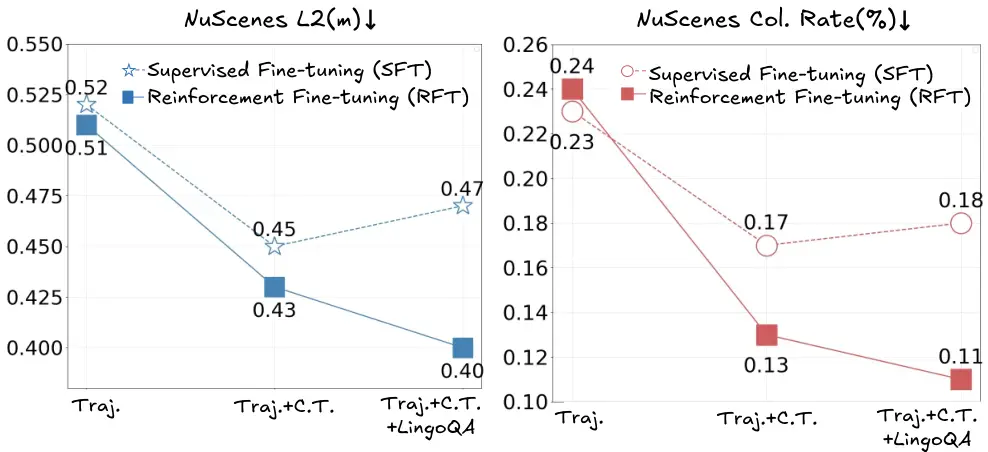
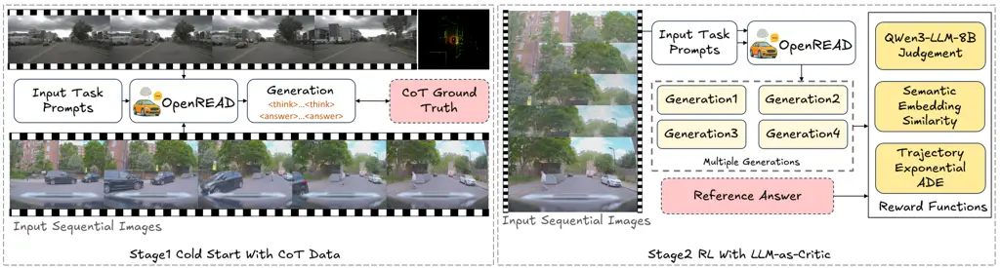
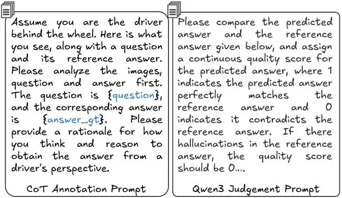
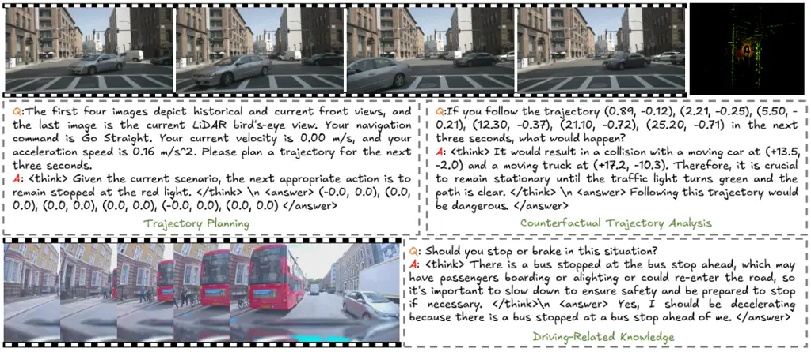
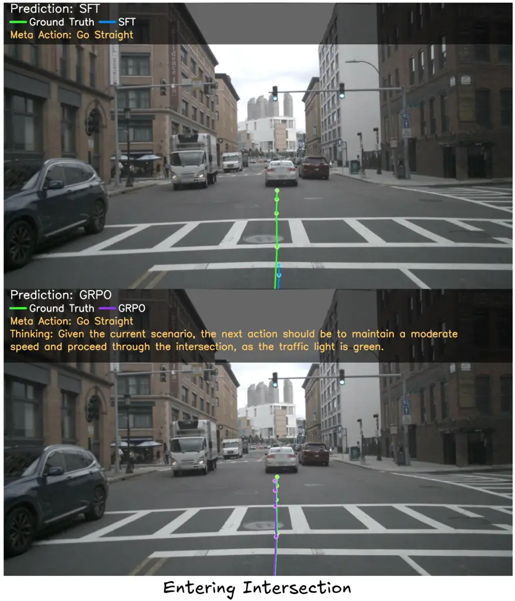
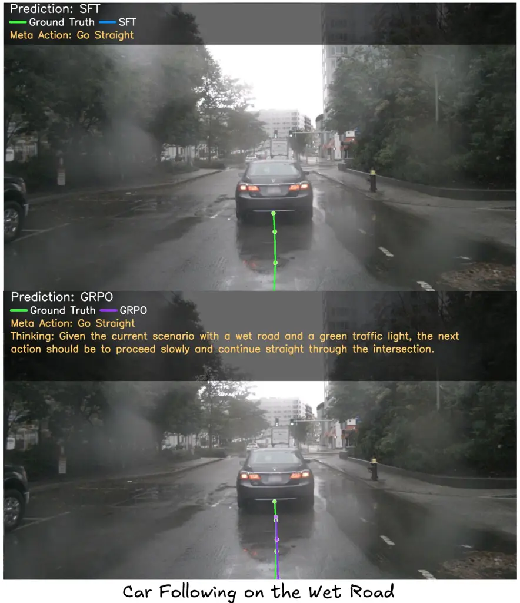
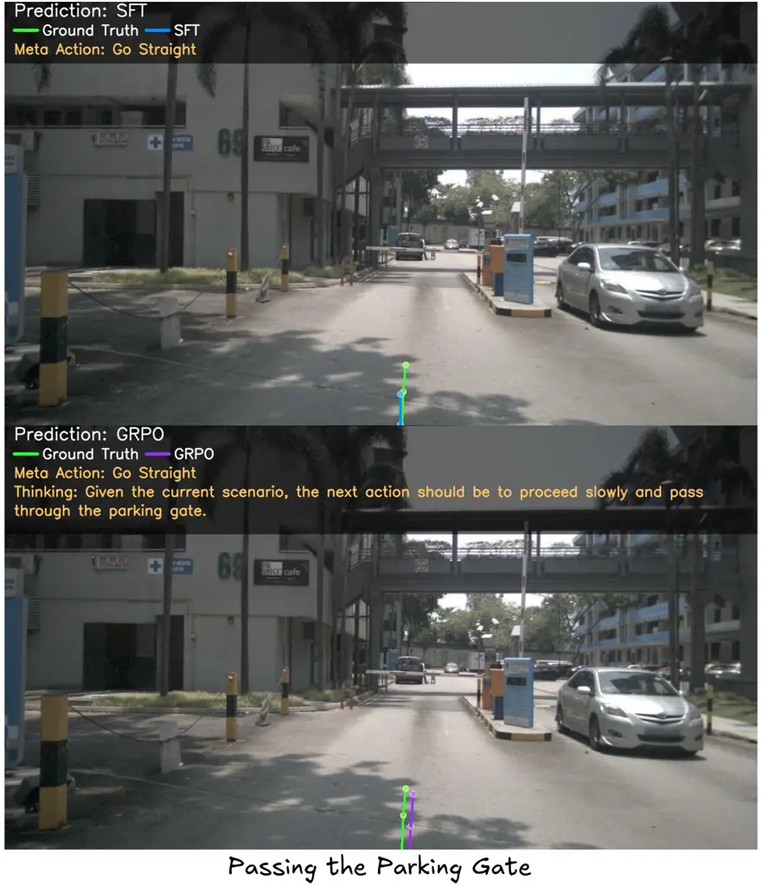
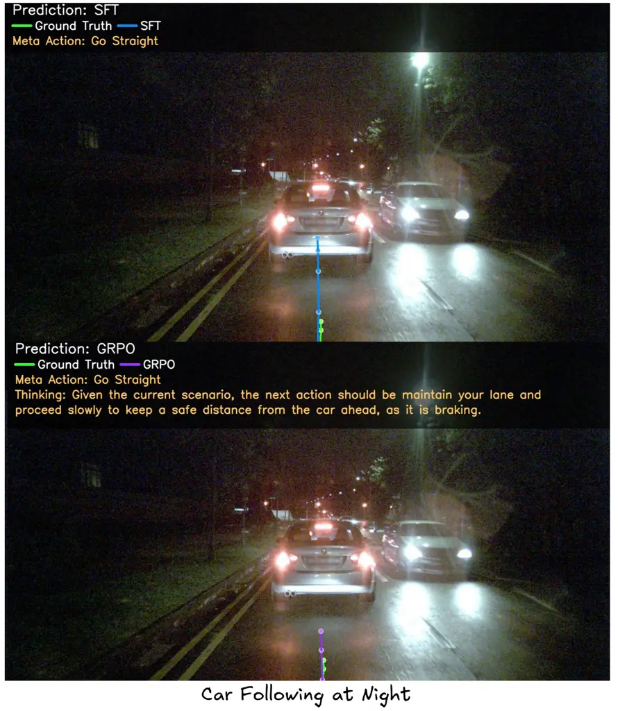

# OpenREAD: Reinforced Open-Ended Reasoning for End-to-End Autonomous Driving with LLM-as-Critic

Songyan Zhang ^(†)^(†)thanks: Equal Contribution    Wenhui Huang    Zhan
Chen    Chua Jiahao Collister    Qihang Huang    Chen Lv ^(†)^(†)thanks:
Corresponding author Affiliation:  Nanyang Technological University,
Singapore     Harvard University, USA

###### Abstract

Recently, two-stage fine-tuning strategies, e.g., acquiring essential
driving knowledge through supervised fine-tuning (SFT) and further
enhancing decision-making and planning via reinforcement fine-tuning
(RFT), have shown strong potential in advancing the knowledge-driven
autonomous driving (AD) paradigm. However, the learning nature of SFT
still limits the generalization of reasoning, thereby constraining the
full potential of driving performance. Meanwhile, current RFT approaches
are primarily applied to downstream tasks, since scene understanding is
an open-ended problem where corresponding rewards are difficult to
quantify. To address these limitations, we propose OpenREAD, an
OPEN-ended REasoning reinforced vision-language model (VLM)-based
autonomous driving (AD) framework that enables end-to-end RFT across the
full spectrum from high-level reasoning to low-level trajectory
planning. Specifically, we begin by constructing large-scale
Chain-of-Thought (CoT) annotations on open-source driving-related
knowledge datasets, and employ the powerful Qwen3 large language model
(LLM) as the critic in RFT to quantify reasoning quality for open-ended
questions during reward modeling. Extensive experiments confirm that
joint end-to-end RFT yields substantial improvements in both upstream
and downstream tasks, enabling OpenREAD to achieve state-of-the-art
performance on reasoning and planning benchmarks.

[https://github.com/wyddmw/OpenREAD](https://github.com/wyddmw/OpenREAD)



Figure 1: Comparison between RFT and SFT with increased driving-related
knowledge. Traj. denotes the data of trajectory planning only, and C.T.
denotes the data of counterfactual trajectory analysis. Extending
driving knowledge through RFT leads to a notable improvement on the
NuScenes dataset compared with SFT.

## 1 Introduction

Autonomous driving has witnessed remarkable progress in recent years,
largely propelled by breakthroughs in machine learning algorithms such
as convolutional neural networks \[14, 36\], and transformers \[52,
35\]. This progress has been further promoted by the rapid growth of
large-scale, high-quality datasets \[10, 4, 12, 49\], tailored for the
development of individual modules—including perception, prediction, and
planning, _etc_. More recently, end-to-end (E2E) data-driven paradigms
have been proposed to integrate these traditionally independent
components into a unified framework \[23, 17, 7, 59, 31\]. Such E2E
data-driven approaches enable the joint optimization across perception,
prediction, and planning modules, facilitating scalability in both model
parameters and training data, and obtaining substantial performance
improvements. However, as discussed in \[28\], contemporary methods
still face significant challenges, including overfitting to training
data, limited generalization to long-tail and cross-domain scenarios,
and the lack of interpretability. For instance, a stop sign displayed on
an advertisement screen may mislead autonomous vehicles into abnormal
driving behaviors, highlighting a key limitation of purely data-driven
approaches that focus on direct input–output mapping without knowledge
induction and causal reasoning.

The emergence of generalized human-like intelligence in recent advances
of Large Language Models (LLMs) \[63, 62, 5\] and Vision-Language Models
(VLMs) \[2, 64, 34, 27, 8, 57, 9\] offers a promising bridge to leverage
extensive knowledge for addressing the aforementioned challenges.
Pioneering studies have explored replacing traditional end-to-end models
with VLM-based architectures, taking advantage of their reasoning and
linguistic capabilities to enable knowledge-driven autonomous
driving \[67, 20, 19, 51, 56, 48, 46\]. However, most existing
approaches adopt a supervised fine-tuning (SFT) paradigm and rely
heavily on fixed answer patterns, which limits their flexibility and
generalization in linguistic representation and semantic diversity.
Inspired by the success of reinforcement fine-tuning (RFT) \[41\],
particularly the recent advances in DeepSeek-R1 \[13\], Group Relative
Policy Optimization (GRPO) \[47\] has been introduced in several early
studies \[72, 30, 24\] to strengthen reasoning ability. Nevertheless,
these works primarily focus on verifiable tasks such as meta-decision
making \[24\] or trajectory planning \[72, 30\], where outputs are
deterministic and easily quantifiable. In contrast, real-world
autonomous driving involves numerous open-ended reasoning tasks. For
example, in response to the question “Why are you decelerating?”,
multiple contextually reasonable answers may exist. This reveals an
important and underexplored challenge: How can we effectively integrate
open-ended driving knowledge with concrete driving behaviors to extend
reasoning and driving performance beyond fixed ground-truth supervision?

To tackle this challenge, we propose OpenREAD, an OPEN-ended REasoning
reinforced vision-language model (VLM) designed for autonomous driving
(AD). OpenREAD handles a broad spectrum of tasks, ranging from
open-ended reasoning such as perception and scene understanding to
verifiable driving behaviors such as trajectory planning. This
capability is achieved through a joint end-to-end RFT paradigm over both
open-ended knowledge and planning datasets, enhancing generalization and
reasoning capabilities while improving downstream planning performance.
Inspired by the training protocol of DeepSeek-R1 \[13\], we begin with
cold-start initialization. GPT-4 \[1\] is employed to generate reasoning
annotations on a subset of LingoQA \[40\], a large-scale open-ended
driving knowledge dataset covering scenario perception and
action-related tasks. We further incorporate the OmniDrive
dataset \[54\] by converting its annotations into reasoning-based
textual trajectories. After equipping the model with foundational
driving knowledge through supervised fine-tuning (SFT), we perform
end-to-end RFT using GRPO \[47\] to further enhance reasoning quality.
For open-ended questions without explicit ground truth, Qwen3-8B serves
as a critic to assess the generated responses with continuous rewards.
In addition, rewards based on semantic similarity and average
displacement error (ADE) are introduced to encourage the model to learn
to reason and drive rather than merely imitating ground-truth answers or
behaviors.

Extensive experiments demonstrate that joint end-to-end RFT
substantially improves both upstream reasoning and downstream planning,
enabling OpenREAD to achieve state-of-the-art performance on reasoning
and planning benchmarks. Our main contributions are summarized as
follows:

1.  1.  We present a thinking-enabled autonomous driving model that employs
        RFT across both knowledge learning and trajectory planning,
        extending the end-to-end learning paradigm beyond traditional SFT.
2.  2.  We introduce an LLM-as-critic mechanism that allows GRPO to be
        applied not only to verifiable tasks but also to open-ended
        knowledge learning, making end-to-end RL feasible for autonomous
        driving.
3.  3.  We construct a set of Chain-of-Thought (CoT) datasets designed to
        equip autonomous driving models with essential domain knowledge and
        explicit reasoning capability.



Figure 2: The training pipeline of our OpenREAD. For the cold start
stage, we utilize the CoT annotated data for SFT, followed by RFT with
GRPO to further enhance the reasoning capabilities.

## 2 Related Works

### 2.1 End-to-End Autonomous Driving

End-to-end autonomous driving abandons the traditional pipeline of
separate perception, prediction and planning modules in favor of a
single learning-based framework that maps raw sensor inputs directly to
motion plans or control actions \[29, 60\]. Such approaches have
recently gained traction thanks to large-scale driving datasets,
improved simulation tools and deep learning methods for joint feature
optimization \[17, 21, 6, 7\]. DriveTransformer \[22\] unifies
perception, prediction, and planning within a single Transformer
architecture, enabling direct cross-task and sensor-to-task attention
for efficient and scalable end-to-end driving. ParaDrive \[59\]
emphasizes the interdependence of sub-tasks and proposes a parallelized
structure to improve coordination between prediction and planning.
DiffusionDrive \[33\] introduces a generative diffusion model that
produces diverse and continuous trajectory candidates, enhancing motion
diversity under uncertain conditions. Despite these advances, existing
end-to-end methods still fall short in capturing high-level scene
semantics and complex agent interactions, which limits their ability to
generalize to diverse, long-tail, or previously unseen driving scenarios
\[25\].

### 2.2 LLMs and VLMs for Autonomous Driving

The recent rise of LLMs and VLMs has sparked growing interest in
bringing semantic reasoning and general world knowledge into autonomous
driving. Early explorations such as ADAPT \[26\], DriveGPT4\[61\] and
LMDrive \[46\] adapt VLMs for tasks like scene captioning, reasoning, or
language-guided control, demonstrating the feasibility of integrating
linguistic priors into autonomous driving. Subsequent systems like
DriveVLM \[51\], DriveMLM \[56\], RAG-Driver \[66\], and ELM \[70\]
expanded this direction by incorporating multi-modal perception or
retrieval-augmented knowledge, but most models either rely solely on
supervised fine-tuning or provide only high-level decisions without
producing actionable trajectories.

More recent work has begun leveraging VLMs for deeper semantic reasoning
that directly supports motion-related predictions \[58, 71\]. SimLingo
\[44\] aligns natural-language instructions with driving actions by
combining VLM-based language understanding, instruction-conditioned
policy learning, and closed-loop trajectory generation from camera-only
input. ORION \[11\] integrates long-context visual encoding with an
LLM-based reasoning module to enrich scenario interpretation before
generating trajectories. OpenDriveVLA \[69\] proposes a language-driven
supervision and evaluation pipeline, demonstrating the feasibility of
text-conditioned motion assessment. AutoVLA \[72\] introduces
autoregressive action modeling within a VLM backbone and shows that
structured reasoning signals can benefit downstream planning under
reinforcement fine-tuning. ReCogDrive \[30\] adopts a
cognition-to-planning pipeline where VQA-aligned language features
condition a diffusion-based motion predictor. On the data side,
OmniDrive \[54\] provides large-scale video QA and counterfactual
reasoning annotations built on nuScenes \[4\], supplying strong
supervision for causal and semantic understanding.

### 2.3 Reinforcement Fine-Tuning for LLMs and VLMs

RFT has recently emerged as an effective paradigm for improving the
reasoning capability of LLMs and VLMs. Methods such as Vision Think
\[65\] and Visual RFT \[37\] extend RFT to visual or multimodal
settings, allowing models to refine intermediate reasoning steps under
verifiable rewards. Vision-R1 \[18\] further adapts the DeepSeek-R1
paradigm \[13\] to vision-based tasks, showing that stepwise
reward-driven optimization can significantly enhance visual logical
reasoning. Reason-RFT \[50\] generalizes this idea to broader multimodal
problems by coupling structured reasoning traces with reward-based
updates, improving consistency and factuality. These works collectively
demonstrate that reward-driven reasoning optimization can substantially
improve the semantic understanding and decision quality of large models.
In autonomous driving, where both open-ended scene reasoning and
motion-related predictions require multi-step inference, such
reinforcement tuning strategies offer a promising mechanism for jointly
enhancing high-level reasoning and downstream decision-making.

## 3 Methodolgy

### 3.1 Overview of OpenREAD

Our OpenREAD is built on top of the Qwen3-VL-8B model \[64\]. The
overall framework and training pipeline is illustrated in Fig. 2. Given
a sequence of images along with the task-specific textual prompts as
input, our OpenREAD is capable of generating the corresponding answers
with an explicit thinking process. Specifically, we use five sequential
images of the front view for open-ended driving knowledge learning and
four sequential images along with a Lidar Bird-Eye’s View image of the
current timestep for the trajectory planning task, as inspired by \[43,
19, 56\] to integrate the surrounding 3D information. The fine-tuning
process involves two stages: cold start with the CoT annotated data in a
SFT, followed by the RFT with GRPO algorithm. We will give a detailed
description of each stage in the following sections.

### 3.2 Cold Start

#### 3.2.1 CoT Data Generation

To endow the model with fundamental reasoning and thinking capabilities,
we start with CoT annotations for cold start. Specifically, we adopt the
LingoQA dataset \[40\] as our primary source of driving-related
knowledge, which provides high-quality question–answer pairs covering
both scenario understanding and action analysis tasks. We manually
annotate 100 samples with concise rationales that focus key objects
within each scenario, avoiding redundant reasoning contents. These
annotated examples are subsequently provided to GPT-4.1 to summarize the
target annotation prompt, as illustrated in the left panel of Fig. 8.



Figure 3: An overview of the prompt templates used for CoT annotation
generations (Left) and Qwen3-LLM open-ended driving knowledge evaluation
(Right).

We then leverage the derived annotation prompt and provide GPT-4.1 with
the corresponding images, questions, and reference answers to generate
target rationales from a driver’s perspective. The placeholder of
{question} and {answer_gt} will be updated accordingly during the
generation process. After manually post-processing to refine or discard
inappropriate outputs, we obtain a total of 7K high-quality CoT
annotations for driving knowledge on the LingoQA dataset, as in Fig. 4.

Moreover, we incorporate the OmniDrive dataset, a well-annotated CoT
dataset built on the NuScenes dataset. We separate the original mixture
of reasoning and answer contents, and reformat the data into our target
structure by enclosing the reasoning within \<think\>…\</think\> and the
ground-truth answers within \<answer\> …\</answer\>. The modified
OmniDrive dataset integrates two tasks: trajectory planning and
counterfactual trajectory analysis. Representative examples are
illustrated in Fig. 4. For the trajectory planning task, the reasoning
component describes the high-level meta action and its underlying
rationale, while the answer provides a future trajectory of six points
over the next three seconds at 2 Hz. For the counterfactual trajectory
analysis task, a pseudo trajectory is given, and the objective is to
determine whether this trajectory is reasonable. This task helps the
model to have a more comprehensive understanding of the planning and
improves the spatial perception capabilities of the surroundings. The
total amount of CoT annotations for the trajectory planning and
counterfactual trajectory analysis tasks is 24K and 7K, respectively.

#### 3.2.2 SFT with CoT Data

Given a sequence of $`N`$ images
$`X_{\text{v}}\in{\mathbb{R}}^{N\times H\times W\times 3}`$, a set of
visual tokens
$`H_{\text{v}}\in{\mathbb{R}}^{N\times N_{\text{v}}\times D_{\text{v}}}`$
is obtained from the vision encoder and the projector, where
$`N_{\text{v}}`$ and $`D_{\text{v}}`$ denote the visual token number and
the feature dimension for each image, respectively. Conditioned on the
textual instruction $`X_{\text{t}}`$ and its corresponding textual
embeddings $`H_{\text{t}}`$, the LLM computes the probability of the
target answer $`Y_{\text{a}}`$ in autoregression:

```math
p(Y_{\text{a}}|H_{\text{v}},H_{\text{t}})=\prod_{i=1}^{L}{p(y_{i}|H_{\text{v}},H_{\text{t}},y<i)}, \tag{1}
```

where $`L`$ is the length of the target answer. The cross-entropy
function is then applied to compute the loss between the prediction and
ground-truth.



Figure 4: An overview of our CoT annotations for driving-related
knowledge and trajectory planning.

### 3.3 RFT with LLM-as-Critic

#### 3.3.1 Preliminary on GRPO Algorithm

To further enhance the reasoning capability of OpenREAD, we introduce a
second RFT stage based on the GRPO algorithm \[47\]. In contrast to
traditional reinforcement learning methods such as Proximal Policy
Optimization (PPO) \[45\], which rely on a critic network for policy
evaluation, GRPO simplifies the reward mechanism by directly comparing
groups of candidate responses. Given a query $`q`$ that integrates the
visual input and task-specific instruction, GRPO samples a set of
outputs $`{o_{1},o_{2},\ldots,o_{G}}`$ from the previous policy
$`\pi_{\theta_{\text{old}}}`$ and computes the normalized group-relative
advantage $`A_{i}`$:

```math
A_{i}=\frac{r_{i}-\text{mean}(\{r_{j}\}_{j=1}^{G})}{\text{std}(\{r_{j}\}_{j=1}^{G})}, \tag{2}
```

where $`r_{i}`$ is the reward value for the $`i`$-th sample. The current
policy $`\pi_{\theta}`$ is then optimized by maximizing the objective:

```math
\mathcal{J}_{\text{GRPO}}(\theta)=\mathbb{E}_{q,\{o_{i}\}\sim\pi_{\theta_{\text{old}}}}\left[\frac{1}{G}\sum_{i=1}^{G}\left(\mathcal{J}^{R}_{i}-\beta\mathbb{D}_{\text{KL}}(\pi_{\theta}\|\pi_{\text{ref}})\right)\right], \tag{3}
```

```math
\mathcal{J}_{i}^{R}=\min\left(w_{i}A_{i},\ \text{clip}\left(w_{i},1-\epsilon,1+\epsilon\right)A_{i}\right), \tag{4}
```

where
$`w_{i}=\frac{\pi_{\theta}(o_{i}|q)}{\pi_{\theta_{\text{old}}}(o_{i}|q)}`$,
and $`\epsilon`$ and $`\beta`$ are hyper-parameters.

#### 3.3.2 Open-ended Knowledge Rewards

A key component of the RFT stage lies in the design of the reward
function, which guides the model to efficiently explore and optimize its
policy. To address the chellenge of open-ended knowledge rewards
assignment discussed before, we employ Qwen3-LLM \[63\] as an automatic
evaluator that functions as a classifier to assign reward scores. The
key components of the user prompt are illustrated in the right panel of
Fig. 8. The predicted\_ answer and reference\_ answer are updated
accordingly during the training process. For each predicted response and
its reference answer, Qwen3-LLM outputs a continuous value between 0 and
1 representing the probability that the predicted answer semantically
matches the reference. This value is then discretized based on a
predefined threshold, which is 0.5 in this work. The Qwen3-LLM reward
$`R_{\text{qwen3}}`$ for the $`i`$-th predicted response $`r_{q_{i}}`$
is:

```math
r_{{q_{i}}}=\begin{cases}1,&\text{if }p_{i}>0.5,\\
0,&\text{else },\end{cases} \tag{5}
```

where $`p_{i}`$ denotes the probability assigned by Qwen3-LLM to the
$`i`$-th predicted response.

To further encourage the model to omit the redundant reasoning and
produce concise outputs, we introduce an additional semantic-level
reward, $`R_{semantic}`$. This reward is computed by extracting the
sentence embeddings of both the predicted response and the reference
answer by \[55\]¹¹ 1 We use a finetuned version of
[https://huggingface.co/microsoft/MiniLM-L12-H384-uncased](https://huggingface.co/microsoft/MiniLM-L12-H384-uncased).,
followed by calculating their cosine similarity, which ranges from 0
to 1. A higher similarity score indicates that the predicted response
exhibits a closer alignment in expression, including sentence length,
semantic meaning, and overall phrasing.

The overall reward for open-ended knowledge learning $`R_{\text{know}}`$
is a weighted combination of the Qwen3-LLM reward $`R_{\text{qwen3}}`$
and the semantic embedding similarity $`R_{\text{semantic}}`$:

```math
R_{\text{know}}=w_{\text{q}}R_{\text{qwen3}}+w_{\text{s}}R_{\text{semantic}}, \tag{6}
```

where $`w_{\text{q}}`$ and $`w_{\text{s}}`$ are weighting
hyperparameters set to 0.9 and 0.1, respectively.

#### 3.3.3 Trajectory Planning Reward

Given the $`i`$-th sample of the planned trajectory and the ground truth
over the next 3 seconds at 2Hz (resulting in 6 points in total), we
compute the average $`L_{2}`$ distance for each second, denoted as
$`\{{d_{i}}_{1},{d_{i}}_{2},{d_{i}}_{3}\}`$. The trajectory reward
$`R_{\text{traj}}`$ for the current sample $`{r_{\text{traj}}}_{i}`$ is
then calculated as:

```math
r_{t_{i}}=5^{-{d_{i}}_{1}*T_{1}}+e^{-{d_{i}}_{2}*T_{2}}+e^{-{d_{i}}_{3}*T_{3}}, \tag{7}
```

where $`T_{n}`$ is the temperature scalor for the $`n`$-th second. In
our work, the temperatures are set to $`0.7,0.7,0.3`$ for corresponding
1s, 2s, and 3s.

#### 3.3.4 Joint Training

During the RFT stage, the trajectory planning task is jointly trained
with the learning of driving-related knowledge. The default format
reward $`R_{\text{format}}`$ is also adopted to constrain the reasoning
components enclosed in \<think\> …\</think\> and the final response
enclosed in \<answer\> …\</answer\>. The overall reward is a combination
of $`R_{\text{know}}`$ and $`R_{\text{traj}}`$ for the corresponding
responses within a batch:

```math
R=R_{\text{know}}+R_{\text{traj}}+R_{\text{format}}. \tag{8}
```

## 4 Experiment

|                            |       |            |                       |      |      |      |                              |      |      |      |                         |                     |
| -------------------------- | ----- | ---------- | --------------------- | ---- | ---- | ---- | ---------------------------- | ---- | ---- | ---- | ----------------------- | ------------------- |
| Data                       | Epoch | Type       | Traj Eval             |      |      |      |                              |      |      |      | Know Eval               |                     |
|                            |       |            | L2 (m) $`\downarrow`$ |      |      |      | Collision (%) $`\downarrow`$ |      |      |      | Coun. Traj.$`\uparrow`$ | LingoQA$`\uparrow`$ |
|                            |       |            | 1s                    | 2s   | 3s   | Avg. | 1s                           | 2s   | 3s   | Avg. | GPT-Score               | LingoJudge          |
| Traj.                      | 1     | SFT        | 0.22                  | 0.48 | 0.85 | 0.52 | 0.06                         | 0.14 | 0.50 | 0.23 | \-                      | \-                  |
|                            | 1     | Cold-Start | 0.22                  | 0.48 | 0.84 | 0.51 | 0.09                         | 0.13 | 0.43 | 0.22 | \-                      | \-                  |
|                            | 1     | RFT        | 0.23                  | 0.48 | 0.83 | 0.51 | 0.05                         | 0.18 | 0.49 | 0.24 | \-                      | \-                  |
| Traj.+Count.Traj.          | 1     | SFT        | 0.20                  | 0.43 | 0.73 | 0.45 | 0.05                         | 0.10 | 0.37 | 0.17 | 62.2%                   | \-                  |
|                            | 1     | Cold-Start | 0.21                  | 0.44 | 0.74 | 0.46 | 0.03                         | 0.11 | 0.36 | 0.17 | 67.0%                   | \-                  |
|                            | 1     | RFT        | 0.20                  | 0.42 | 0.68 | 0.43 | 0.03                         | 0.07 | 0.30 | 0.13 | 67.4%                   | \-                  |
| Traj.+Count.Traj. +LingoQA | 1     | SFT        | 0.20                  | 0.44 | 0.76 | 0.47 | 0.06                         | 0.11 | 0.37 | 0.18 | 65.6%                   | 66.4%               |
|                            | 2     | SFT        | 0.20                  | 0.42 | 0.71 | 0.44 | 0.03                         | 0.07 | 0.29 | 0.13 | 68.0%                   | 67.4%               |
|                            | 1     | Cold-Start | 0.19                  | 0.41 | 0.71 | 0.44 | 0.04                         | 0.10 | 0.30 | 0.15 | 68.2%                   | 65.4%               |
|                            | 1     | RFT        | 0.18                  | 0.37 | 0.63 | 0.40 | 0.04                         | 0.07 | 0.20 | 0.11 | 68.8%                   | 68.2%               |

Table 1: Effectiveness of extending driving-related knowledge via RFT
for both trajectory planning and knowledge learning. Jointly learning
trajectory planning and driving-related knowledge with enhanced
reasoning capabilities through RFT substantially reduces the L2 distance
error and improves knowledge acquisition, outperforming the SFT notably.

### 4.1 Implementation Details

We leverage the training framework of Model-Swift \[68\], an official
framework provided by the ModelScope community for fine-tuning and
deploying large language models and multi-modal large models. Our
OpenREAD is implemented on top of the Qwen3-VLM-8B \[64\] dense model.
For the cold-start stage, we conduct supervised fine-tuning with a total
batch size of 32 on 4 NVIDIA-H100 GPUs. The learning rate is set to
$`1\times 10^{-4}`$ with a warm-up ratio of 0.05, followed by a cosine
decay schedule. It takes one epoch of fine-tuning on the CoT-annotated
datasets introduced in Sec. 3.2.1, which include driving-related
knowledge and trajectory planning on the LingoQA, \[40\], and
OmniDrive \[54\] datasets. The training data amounts for the cold start
stage are 7K, 9K, and 24K for LingoQA, counterfactual trajectory
analysis, and trajectory planning, respectively.

The RFT stage is initialized from the cold start checkpoint. To maintain
a balanced learning ratio between trajectory planning and
driving-related reasoning, we randomly sample 6K trajectory planning
examples and 5K mixed samples from LingoQA and counterfactual trajectory
data. For each training step, the number of response generations is set
to 4. The learning rate is set to $`1\times 10^{-4}`$ with a total batch
size of 16. We employ LoRA \[15\] and utilize the AdamW \[38\] optimizer
during both the SFT and RFT stages.

### 4.2 Evaluation Metric

For driving-related knowledge evaluation, we report the official
Lingo-Judge metric for the LingoQA dataset which uses a pretrained text
transformer to assess the semantic correctness of the predicted answer
with respect to the question and reference response. We also report a
GPT-score for evaluating the counterfactural trajectory analysis, which
computes the average accuracy by utilizing the GPT-4.1 to evaluate
whether the predicted response matches the reference. In addition, we
follow previous works \[70, 40, 34\] and report three established
metrics of CIDEr \[53\], BLEU \[42\], and Meteor \[3\] which
collectively measure the similarity between generated explanations and
reference descriptions, covering content relevance, n-gram consistency,
and semantic matching. For the trajectory planning task on the NuScenes
dataset, we report the ST-P3 \[16\] based metric in terms of the L2
distance error and collision rate across 1s, 2s, and 3s.

### 4.3 RFT for Knowledge-Enhanced Planning

We conduct thorough ablation experiments to assess the effectiveness of
RFT and the necessity of extending driving-related knowledge. The
results are presented in Tab. 1. When training on the
trajectory-planning-only task, we use the full training set during the
SFT and cold-start stages for one epoch. The RFT stage involves a set of
6K randomly sampled data. Due to the absence of driving-related
knowledge data and relatively weak capabilities obtained at the
cold-start stage, the subsequent RFT stage fails to deliver notable
gains. In fact, the average collision rate even degrades at the 2-second
and 3-second prediction. A similar degradation is also observed in
AutoVLA \[72\]. These ablation studies indicate that performing RFT
solely on trajectory planning provides only limited benefits,
highlighting the necessity of extending driving-related knowledge.

To help the model achieve a more comprehensive understanding of the
planning task, we further introduce the counterfactual trajectory
analysis data. At this stage, we use the full set of trajectory planning
data together with 9K counterfactual trajectory samples during the SFT
and cold-start stages. During the RFT stage, we sample 6K
trajectory-planning examples and 5K counterfactual trajectory analysis
samples to achieve a balanced learning of planning ability and
driving-related knowledge. The L2 distance and collision rate exhibit a
significant improvement across the SFT, cold start, and RFT stages,
strongly demonstrating the necessity of extending driving-related
knowledge. It is worth noting that, when initialized from a
well-established cold-start stage, the RFT training mechanism begins to
exhibit a stronger potential at this stage. It outperforms the SFT by
reducing the L2 distance from 0.45m to 0.43m and collision rate from
0.17% to 0.13%, respectively, demonstrating the effectiveness of
knowledge extension via RFT in enhancing planning quality.

|                             |           |            |         |                       |      |      |      |                              |      |      |      |
| --------------------------- | --------- | ---------- | ------- | --------------------- | ---- | ---- | ---- | ---------------------------- | ---- | ---- | ---- |
| Method                      | VLM-Based | Ego Status |         | L2 (m) $`\downarrow`$ |      |      |      | Collision (%) $`\downarrow`$ |      |      |      |
|                             |           | BEV        | Planner | 1s                    | 2s   | 3s   | Avg. | 1s                           | 2s   | 3s   | Avg. |
| VAD \[23\]                  | \-        | ✓          | ✓       | 0.17                  | 0.34 | 0.60 | 0.37 | 0.07                         | 0.10 | 0.24 | 0.14 |
| UniAD \[17\]                | \-        | ✓          | ✓       | 0.44                  | 0.67 | 0.96 | 0.69 | 0.04                         | 0.08 | 0.23 | 0.12 |
| Ego-MLP \[32\]              | \-        | ✓          | ✓       | 0.46                  | 0.76 | 1.12 | 0.78 | 0.21                         | 0.35 | 0.58 | 0.38 |
| OpenDrive-VLA^(†) \[69\]    | ✓         | ✓          | \-      | 0.15                  | 0.31 | 0.55 | 0.33 | 0.01                         | 0.08 | 0.21 | 0.10 |
| ORION\[11\]^(‡)             | ✓         | ✓          | ✓       | 0.17                  | 0.31 | 0.55 | 0.34 | 0.05                         | 0.25 | 0.80 | 0.37 |
| ST-P3 \[16\]                | \-        | \-         | \-      | 1.33                  | 2.11 | 2.90 | 2.11 | 0.23                         | 0.62 | 1.27 | 0.71 |
| RoboTron-Drive^(†,‡) \[19\] | ✓         | \-         | \-      | 0.14                  | 0.30 | 0.57 | 0.33 | 0.03                         | 0.12 | 0.63 | 0.26 |
| EMMA^(†) \[20\]             | ✓         | \-         | \-      | 0.14                  | 0.29 | 0.54 | 0.32 | \-                           | \-   | \-   | \-   |
| OpenEMMA^(†) \[20\]         | ✓         | \-         | \-      | 1.45                  | 3.21 | 3.76 | 2.81 | \-                           | \-   | \-   | \-   |
| DriveVLM^(†) \[51\]         | ✓         | \-         | \-      | 0.18                  | 0.34 | 0.68 | 0.40 | 0.10                         | 0.22 | 0.45 | 0.27 |
| GPT-Drive^(†) \[39\]        | ✓         | \-         | \-      | 0.20                  | 0.40 | 0.70 | 0.44 | 0.04                         | 0.12 | 0.36 | 0.17 |
| OmniDrive \[54\]^(‡)        | ✓         | \-         | \-      | 0.40                  | 0.80 | 1.32 | 0.84 | 0.04                         | 0.46 | 2.32 | 0.94 |
| AutoVLA^(†) \[72\]          | ✓         | \-         | \-      | 0.25                  | 0.46 | 0.73 | 0.48 | 0.07                         | 0.07 | 0.26 | 0.13 |
| OpenREAD (Ours)^(†)         | ✓         | \-         | \-      | 0.18                  | 0.37 | 0.63 | 0.40 | 0.04                         | 0.07 | 0.20 | 0.11 |

Table 2: Comparison of the Open-loop planning in nuScene. The ST-P3
evaluation protocol is used by default. $`\dagger`$: The ego status and
planning trajectory are both processed by LLM in textual modality.
$`\ddagger`$: Use a customized evaluation protocol instead of ST-P3
metrics.

The introduction of the additional LingoQA dataset further extends the
diversity of the driving knowledge, covering scene understanding and
action analysis across a wide range of scenarios. The comprehensive
questions about the object recognition, action justification, driving
attention, _etc_., help to improve the model with enhanced general
perception and reasoning capabilities. The SFT training stage is
performed on additional 10k LingoQA samples, while the CoT training
stage uses 7K LingoQA with CoT annotations instead. Equipped with the
reasoning capabilities, our OpenREAD efficiently obtains a notable
improvement during the cold-start stage, which is further improved
during the RFT stage by jointly learning the driving knowledge and
planning through GRPO, outperforming the SFT with two epochs of training
by an obvious margin. Besides the trajectory planning performance,
extending the driving-related knowledge with enhanced reasoning
capabilities also improves the acquisition of the knowledge, which is
reflected by the improved GPT-score for the counterfactual trajectory
analysis at the cold start stage. For the LingoQA dataset, the
Lingo-Judge accuracy is also increased via RFT, increasing from 65.4% to
68.2%.

The overall experiments on the NuScenes trajectory evaluation and
knowledge evaluation highlight that empowering the model with
accumulated driving-related knowledge and enhanced reasoning capability
through GRPO-based RFT is key to achieving consistent improvements in
planning performance and knowledge acquisition. This strongly validates
the effectiveness of employing Qwen3-LLM as the judgment mechanism in
our framework.

### 4.4 State-of-the-Art Benchmark

As shown in Tab. 2, we conduct a comparison with other SOTA approaches.
Due to the leverage of extensive internal training data, EMMA\[20\]
achieves the lowest L2 distance error, even outperforming the
traditional end-to-end models by a notable margin. Compared with other
VLM-based models trained on a comparable data scale, our OpenREAD
obtains competitive performance and yields the lowest collision rate in
the final two seconds. It is worth noting that the comparison with
AutoVLA \[72\] which is also trained via RFT but exclusively on the
trajectory planning data, our method achieves an obvious improvement,
further highlighting the necessity of joint learning with
driving-related knowledge. For driving-related knowledge evaluation, we
benchmark OpenREAD against both generalist and specialist models. As
reported in Tab. 3, only Qwen2.5-VL \[2\] is able to generate concise
responses, whereas others tend to produce overly verbose outputs,
leading to degraded evaluation metrics. Compared with specialist models
trained on the LingoQA dataset, OpenREAD achieves the highest
Lingo-Judge accuracy, demonstrating the effectiveness of reinforcing
reasoning capabilities through RFT.

We omit comparison results for counterfactual trajectory analysis
because generalist models are unable to correctly interpret
coordinate-based inputs, while specialist models were not trained on
this task, resulting in poor performance across all baselines.

|                       |             |       |      |        |
| --------------------- | ----------- | ----- | ---- | ------ |
| Method                | Lingo-Judge | CIDEr | BLEU | Meteor |
| LLava-OV-7B \[27\]    | 54.2%       | 0.39  | 0.03 | 0.08   |
| Qwen2.5-VL-7B \[2\]   | 62.6%       | 0.54  | 0.07 | 0.11   |
| Qwen3-VL-4B \[64\]    | 37.0%       | 0.00  | 0.00 | 0.04   |
| Qwen3-VL-8B \[64\]    | 51.4%       | 0.00  | 0.01 | 0.11   |
| InternVL3-5-8B \[57\] | 48.2%       | 0.14  | 0.02 | 0.12   |
| OpenEMMA \[20\]       | 29.0%       | 0.07  | 0.02 | 0.11   |
| WiseAD \[67\]         | 60.4%       | 0.68  | 0.20 | 0.19   |
| RoboTron-Drive \[19\] | 59.2%       | 0.65  | 0.14 | 0.19   |
| ReCogDrive \[30\]     | 67.8%       | 0.69  | 0.13 | 0.21   |
| OpenREAD (ours)       | 68.2%       | 0.74  | 0.15 | 0.20   |

Table 3: Comparison with generalist and specialist VLMs on the LingoQA.
Our OpenREAD achieves the highest Lingo-Judge accuracy. Generalist
models tend to produce redundant responses, which results in
significantly degraded performance.

### 4.5 Ablation Studies

#### 4.5.1 Reward for Driving Knowledge Learning

To validate the effectiveness of our proposed reward design for
driving-related knowledge learning, we conduct ablation experiments on a
fixed set of 10K samples from the LingoQA dataset. Our 7K CoT annotated
data are built upon this 10K samples. Our 7K CoT-annotated data are
constructed from this subset. We first investigate RFT initialized from
the vanilla Qwen3-VLM, as reported in the first four rows of Tab.4.
Leveraging Qwen3-LLM as the only reward signal yields only marginal
improvement, increasing the Lingo-Judge accuracy from 51.4% to 52.0%.
This limited gain is largely due to the absence of constraints on
response style: the generated outputs remain verbose and contain
redundant descriptive content, similar to the vanilla Qwen3-VLM. Such
redundancy is directly reflected in the degraded CIDEr, BLEU, and Meteor
scores. Introducing the semantic embedding similarity reward can
effectively alleviate the redundancy issue. However, embedding-based
similarity primarily captures global sentence structure and often fails
to discriminate key contradictions between reference answers and model
predictions. For instance, the two sentences “I should decelerate” and
“I should accelerate” yield a similarity score of 0.6. This ambiguity in
reward assignment can degrade the reinforcement learning process, as
evidenced by higher CIDEr, BLEU, and Meteor scores but a substantially
lower Lingo-Judge accuracy. The weighted combination of these two
rewards, as described in Sec. 3.3.2, leads to improved accuracy while
preserving the concise and straightforward expression style of the
reference answers. This balance is reflected by consistent improvements
across all evaluation metrics. Nevertheless, due to the lack of explicit
guidance on the thinking and reasoning process, the overall performance
still falls short of expectations.

Following DeepSeek-R1 \[13\], we employ a cold start stage with explicit
thinking guidance. Introducing the 7K CoT annotations with explicit
reasoning steps effectively equips the model with fundamental reasoning
capabilities, improving the Lingo-Judge accuracy from 51.4% to 65.0%
while maintaining satisfactory expression quality. This highlights the
critical role of the cold start stage. Subsequently, continuing RFT on
the remaining 3K samples from a well-initialized checkpoint further
facilitates the exploration process: using Qwen3-LLM as the judgment
signal yields the best Lingo-Judge performance, and incorporating the
weighted embedding similarity additionally helps constrain the overall
expression style to better align with the reference answers, which is
finally adopted in our work.

|                 |          |          |                         |                   |                  |                    |
| --------------- | -------- | -------- | ----------------------- | ----------------- | ---------------- | ------------------ |
| Method          | Type     | Reward   | Lingo-Judge$`\uparrow`$ | CIDEr$`\uparrow`$ | BLEU$`\uparrow`$ | Meteor$`\uparrow`$ |
| w/o Cold Start  | Base     | \-       | 51.4%                   | 0.00              | 0.01             | 0.11               |
| RL              | Qwen3    | 52.0%    | 0.37                    | 0.03              | 0.10             |                    |
|                 | Semantic | 52.4%    | 0.65                    | 0.13              | 0.19             |                    |
|                 | Full     | 59.2%    | 0.67                    | 0.13              | 0.20             |                    |
| Cold Start (7K) | Base     | \-       | 65.0%                   | 0.71              | 0.15             | 0.20               |
|                 | RL       | Qwen3    | 66.4%                   | 0.72              | 0.14             | 0.20               |
|                 |          | Semantic | 63.2%                   | 0.66              | 0.15             | 0.20               |
|                 |          | Full     | 66.0%                   | 0.75              | 0.15             | 0.21               |

Table 4: Ablation on the reward design and cold start for knowledge
learning through GRPO.

|            |      |                         |                    |                   |                    |
| ---------- | ---- | ----------------------- | ------------------ | ----------------- | ------------------ |
| Method     | Data | Lingo-Judge$`\uparrow`$ | CIDEr $`\uparrow`$ | BLEU $`\uparrow`$ | Meteor$`\uparrow`$ |
| SFT        | 10k  | 65.6%                   | 0.765              | 0.149             | 0.206              |
|            | 50k  | 68.0%                   | 0.773              | 0.147             | 0.208              |
| Cold Start | 3k   | 63.0%                   | 0.664              | 0.138             | 0.201              |
|            | 7k   | 65.0%                   | 0.705              | 0.153             | 0.203              |
| GRPO       | 3k   | 66.0%                   | 0.753              | 0.154             | 0.205              |
|            | 5k   | 67.2%                   | 0.739              | 0.165             | 0.201              |
|            | 10k  | 68.4%                   | 0.756              | 0.168             | 0.202              |

Table 5: Ablation on the data scale for knowledge learning on the
LingoQA. Increasing the data amount introduces a constant improvement
across different stages.

#### 4.5.2 Data Scale for Knowledge Learning

As shown in Tab. 5, we explore the effectiveness of the training data
amount for SFT, cold-start, and RFT. Clearly, increasing the amount of
training data helps to obtain a constant gain across different training
stages. Compared with SFT that requires 50K training data to improve the
Lingo-Judge from 65.6% to 68.0%, our OpenREAD takes advantage of the
GRPO algorithm to explore multiple responses within a rollout,
increasing the Lingo-Judge accuracy from 65.0% to 68.4% with only
another 10K data after the cold-start stage.

## 5 Conclusion and Limitations

In this work, we present OpenREAD, an open-ended reasoning reinforced
VLM designed for joint knowledge learning and trajectory planning
through RFT paradigm. By incorporating Qwen3-LLM as the critic in RL
loop, our approach enables effective reinforcement of open-ended
knowledge through GRPO, leading to SOTA performance in both trajectory
planning and knowledge evaluation. Due to the computational cost
associated with multiple generations from OpenREAD and Qwen3-LLM, the
current scale of datasets used for RFT training remains limited. We will
further scale up the knowledge data in future research.

## References

- \[1\] Josh Achiam, Steven Adler, Sandhini Agarwal, Lama Ahmad, Ilge
  Akkaya, Florencia Leoni Aleman, Diogo Almeida, Janko Altenschmidt, Sam
  Altman, Shyamal Anadkat, et al. Gpt-4 technical report. _arXiv
  preprint arXiv:2303.08774_, 2023.
- \[2\] Shuai Bai, Keqin Chen, Xuejing Liu, Jialin Wang, Wenbin Ge, Sibo
  Song, Kai Dang, Peng Wang, Shijie Wang, Jun Tang, et al. Qwen2. 5-vl
  technical report. _arXiv preprint arXiv:2502.13923_, 2025.
- \[3\] Satanjeev Banerjee and Alon Lavie. Meteor: An automatic metric
  for mt evaluation with improved correlation with human judgments. In
  _Proceedings of the acl workshop on intrinsic and extrinsic evaluation
  measures for machine translation and/or summarization_, pages
  65–72, 2005.
- \[4\] Holger Caesar, Varun Bankiti, Alex H Lang, Sourabh Vora,
  Venice Erin Liong, Qiang Xu, Anush Krishnan, Yu Pan, Giancarlo Baldan,
  and Oscar Beijbom. nuscenes: A multimodal dataset for autonomous
  driving. In _Proc. IEEE Conf. Comp. Vis. Patt. Recogn._, pages
  11621–11631, 2020.
- \[5\] Zheng Cai, Maosong Cao, Haojiong Chen, Kai Chen, Keyu Chen, Xin
  Chen, Xun Chen, Zehui Chen, Zhi Chen, Pei Chu, Xiaoyi Dong, Haodong
  Duan, Qi Fan, Zhaoye Fei, Yang Gao, Jiaye Ge, Chenya Gu, Yuzhe Gu, Tao
  Gui, Aijia Guo, Qipeng Guo, Conghui He, Yingfan Hu, Ting Huang, Tao
  Jiang, Penglong Jiao, Zhenjiang Jin, Zhikai Lei, Jiaxing Li, Jingwen
  Li, Linyang Li, Shuaibin Li, Wei Li, Yining Li, Hongwei Liu, Jiangning
  Liu, Jiawei Hong, Kaiwen Liu, Kuikun Liu, Xiaoran Liu, Chengqi Lv,
  Haijun Lv, Kai Lv, Li Ma, Runyuan Ma, Zerun Ma, Wenchang Ning, Linke
  Ouyang, Jiantao Qiu, Yuan Qu, Fukai Shang, Yunfan Shao, Demin Song,
  Zifan Song, Zhihao Sui, Peng Sun, Yu Sun, Huanze Tang, Bin Wang,
  Guoteng Wang, Jiaqi Wang, Jiayu Wang, Rui Wang, Yudong Wang, Ziyi
  Wang, Xingjian Wei, Qizhen Weng, Fan Wu, Yingtong Xiong, Chao Xu,
  Ruiliang Xu, Hang Yan, Yirong Yan, Xiaogui Yang, Haochen Ye, Huaiyuan
  Ying, Jia Yu, Jing Yu, Yuhang Zang, Chuyu Zhang, Li Zhang, Pan Zhang,
  Peng Zhang, Ruijie Zhang, Shuo Zhang, Songyang Zhang, Wenjian Zhang,
  Wenwei Zhang, Xingcheng Zhang, Xinyue Zhang, Hui Zhao, Qian Zhao,
  Xiaomeng Zhao, Fengzhe Zhou, Zaida Zhou, Jingming Zhuo, Yicheng Zou,
  Xipeng Qiu, Yu Qiao, and Dahua Lin. Internlm2 technical report, 2024.
- \[6\] Li Chen, Penghao Wu, Kashyap Chitta, Bernhard Jaeger, Andreas
  Geiger, and Hongyang Li. End-to-end autonomous driving: Challenges and
  frontiers. _IEEE Trans. Pattern Anal. Mach. Intell._, 2024a.
- \[7\] Shaoyu Chen, Bo Jiang, Hao Gao, Bencheng Liao, Qing Xu, Qian
  Zhang, Chang Huang, Wenyu Liu, and Xinggang Wang. Vadv2: End-to-end
  vectorized autonomous driving via probabilistic planning. _arXiv
  preprint arXiv:2402.13243_, 2024b.
- \[8\] Zhe Chen, Jiannan Wu, Wenhai Wang, Weijie Su, Guo Chen, Sen
  Xing, Muyan Zhong, Qinglong Zhang, Xizhou Zhu, Lewei Lu, et al.
  Internvl: Scaling up vision foundation models and aligning for generic
  visual-linguistic tasks. In _Proc. IEEE Conf. Comp. Vis. Patt.
  Recogn._, pages 24185–24198, 2024c.
- \[9\] Xiangxiang Chu, Limeng Qiao, Xinyu Zhang, Shuang Xu, Fei Wei,
  Yang Yang, Xiaofei Sun, Yiming Hu, Xinyang Lin, Bo Zhang, et al.
  Mobilevlm v2: Faster and stronger baseline for vision language model.
  _arXiv preprint arXiv:2402.03766_, 2024.
- \[10\] Alexey Dosovitskiy, German Ros, Felipe Codevilla, Antonio
  Lopez, and Vladlen Koltun. Carla: An open urban driving simulator. In
  _Conference on robot learning_, pages 1–16. PMLR, 2017.
- \[11\] Haoyu Fu, Diankun Zhang, Zongchuang Zhao, Jianfeng Cui,
  Dingkang Liang, Chong Zhang, Dingyuan Zhang, Hongwei Xie, Bing Wang,
  and Xiang Bai. Orion: A holistic end-to-end autonomous driving
  framework by vision-language instructed action generation. _arXiv
  preprint arXiv:2503.19755_, 2025.
- \[12\] Andreas Geiger, Philip Lenz, Christoph Stiller, and Raquel
  Urtasun. Vision meets robotics: The kitti dataset. _The international
  journal of robotics research_, 32(11):1231–1237, 2013.
- \[13\] Daya Guo, Dejian Yang, Haowei Zhang, Junxiao Song, Ruoyu Zhang,
  Runxin Xu, Qihao Zhu, Shirong Ma, Peiyi Wang, Xiao Bi, et al.
  Deepseek-r1: Incentivizing reasoning capability in llms via
  reinforcement learning. _arXiv preprint arXiv:2501.12948_, 2025.
- \[14\] Kaiming He, Xiangyu Zhang, Shaoqing Ren, and Jian Sun. Deep
  residual learning for image recognition. In _Proc. IEEE Conf. Comp.
  Vis. Patt. Recogn._, 2016.
- \[15\] Edward J Hu, Yelong Shen, Phillip Wallis, Zeyuan Allen-Zhu,
  Yuanzhi Li, Shean Wang, Lu Wang, Weizhu Chen, et al. Lora: Low-rank
  adaptation of large language models. _ICLR_, 1(2):3, 2022a.
- \[16\] Shengchao Hu, Li Chen, Penghao Wu, Hongyang Li, Junchi Yan, and
  Dacheng Tao. St-p3: End-to-end vision-based autonomous driving via
  spatial-temporal feature learning. In _Proc. Eur. Conf. Comp. Vis._,
  pages 533–549, 2022b.
- \[17\] Yihan Hu, Jiazhi Yang, Li Chen, Keyu Li, Chonghao Sima, Xizhou
  Zhu, Siqi Chai, Senyao Du, Tianwei Lin, Wenhai Wang, Lewei Lu,
  Xiaosong Jia, Qiang Liu, Jifeng Dai, Yu Qiao, and Hongyang Li.
  Planning-oriented autonomous driving. In _Proc. IEEE Conf. Comp. Vis.
  Patt. Recogn._, pages 17853–17862, 2023.
- \[18\] Wenxuan Huang, Bohan Jia, Zijie Zhai, Shaosheng Cao, Zheyu Ye,
  Fei Zhao, Zhe Xu, Yao Hu, and Shaohui Lin. Vision-r1: Incentivizing
  reasoning capability in multimodal large language models. _arXiv
  preprint arXiv:2503.06749_, 2025.
- \[19\] Zhijian Huang, Chengjian Fen, Feng Yan, Baihui Xiao, Zequn Jie,
  Yujie Zhong, Xiaodan Liang, and Lin Ma. Drivemm: All-in-one large
  multimodal model for autonomous driving. _arXiv preprint
  arXiv:2412.07689_, 2024.
- \[20\] Jyh-Jing Hwang, Runsheng Xu, Hubert Lin, Wei-Chih Hung, Jingwei
  Ji, Kristy Choi, Di Huang, Tong He, Paul Covington, Benjamin Sapp,
  et al. Emma: End-to-end multimodal model for autonomous driving.
  _arXiv preprint arXiv:2410.23262_, 2024.
- \[21\] Xiaosong Jia, Penghao Wu, Li Chen, Jiangwei Xie, Conghui He,
  Junchi Yan, and Hongyang Li. Think twice before driving: Towards
  scalable decoders for end-to-end autonomous driving. In _Proc. IEEE
  Conf. Comp. Vis. Patt. Recogn._, pages 21983–21994, 2023.
- \[22\] Xiaosong Jia, Junqi You, Zhiyuan Zhang, and Junchi Yan.
  Drivetransformer: Unified transformer for scalable end-to-end
  autonomous driving. _arXiv preprint arXiv:2503.07656_, 2025.
- \[23\] Bo Jiang, Shaoyu Chen, Qing Xu, Bencheng Liao, Jiajie Chen,
  Helong Zhou, Qian Zhang, Wenyu Liu, Chang Huang, and Xinggang Wang.
  Vad: Vectorized scene representation for efficient autonomous driving.
  In _Proc. IEEE Int. Conf. Comp. Vis._, pages 8306–8316, 2023.
- \[24\] Bo Jiang, Shaoyu Chen, Qian Zhang, Wenyu Liu, and Xinggang
  Wang. Alphadrive: Unleashing the power of vlms in autonomous driving
  via reinforcement learning and reasoning. _arXiv preprint
  arXiv:2503.07608_, 2025.
- \[25\] Kemou Jiang, Xuan Cai, Zhiyong Cui, Aoyong Li, Yilong Ren,
  Haiyang Yu, Hao Yang, Daocheng Fu, Licheng Wen, and Pinlong Cai. Koma:
  Knowledge-driven multi-agent framework for autonomous driving with
  large language models. _IEEE Transactions on Intelligent
  Vehicles_, 2024.
- \[26\] Bu Jin, Xinyu Liu, Yupeng Zheng, Pengfei Li, Hao Zhao, Tong
  Zhang, Yuhang Zheng, Guyue Zhou, and Jingjing Liu. Adapt: Action-aware
  driving caption transformer. In _2023 IEEE International Conference on
  Robotics and Automation (ICRA)_, pages 7554–7561. IEEE, 2023.
- \[27\] Bo Li, Yuanhan Zhang, Dong Guo, Renrui Zhang, Feng Li, Hao
  Zhang, Kaichen Zhang, Peiyuan Zhang, Yanwei Li, Ziwei Liu, and
  Chunyuan Li. Llava-onevision: Easy visual task transfer. _Transactions
  on Machine Learning Research_, 2024a.
- \[28\] Xin Li, Yeqi Bai, Pinlong Cai, Licheng Wen, Daocheng Fu, Bo
  Zhang, Xuemeng Yang, Xinyu Cai, Tao Ma, Jianfei Guo, et al. Towards
  knowledge-driven autonomous driving. _arXiv preprint
  arXiv:2312.04316_, 2023a.
- \[29\] Xin Li, Yeqi Bai, Pinlong Cai, Licheng Wen, Daocheng Fu, Bo
  Zhang, Xuemeng Yang, Xinyu Cai, Tao Ma, Jianfei Guo, et al. Towards
  knowledge-driven autonomous driving. _arXiv preprint
  arXiv:2312.04316_, 2023b.
- \[30\] Yongkang Li, Kaixin Xiong, Xiangyu Guo, Fang Li, Sixu Yan,
  Gangwei Xu, Lijun Zhou, Long Chen, Haiyang Sun, Bing Wang, et al.
  Recogdrive: A reinforced cognitive framework for end-to-end autonomous
  driving. _arXiv preprint arXiv:2506.08052_, 2025.
- \[31\] Zhiqi Li, Zhiding Yu, Shiyi Lan, Jiahan Li, Jan Kautz, Tong Lu,
  and Jose M Alvarez. Is ego status all you need for open-loop
  end-to-end autonomous driving? In _Proc. IEEE Conf. Comp. Vis. Patt.
  Recogn._, pages 14864–14873, 2024b.
- \[32\] Zhiqi Li, Zhiding Yu, Shiyi Lan, Jiahan Li, Jan Kautz, Tong Lu,
  and Jose M Alvarez. Is ego status all you need for open-loop
  end-to-end autonomous driving? In _Proc. IEEE Conf. Comp. Vis. Patt.
  Recogn._, pages 14864–14873, 2024c.
- \[33\] Bencheng Liao, Shaoyu Chen, Haoran Yin, Bo Jiang, Cheng Wang,
  Sixu Yan, Xinbang Zhang, Xiangyu Li, Ying Zhang, Qian Zhang, et al.
  Diffusiondrive: Truncated diffusion model for end-to-end autonomous
  driving. In _Proc. IEEE Conf. Comp. Vis. Patt. Recogn._, pages
  12037–12047, 2025.
- \[34\] Haotian Liu, Chunyuan Li, Qingyang Wu, and Yong Jae Lee. Visual
  instruction tuning. _Advances in neural information processing
  systems_, 36, 2024.
- \[35\] Ze Liu, Yutong Lin, Yue Cao, Han Hu, Yixuan Wei, Zheng Zhang,
  Stephen Lin, and Baining Guo. Swin transformer: Hierarchical vision
  transformer using shifted windows. In _Proc. IEEE Int. Conf. Comp.
  Vis._, pages 10012–10022, 2021.
- \[36\] Zhuang Liu, Hanzi Mao, Chao-Yuan Wu, Christoph Feichtenhofer,
  Trevor Darrell, and Saining Xie. A convnet for the 2020s. In _Proc.
  IEEE Conf. Comp. Vis. Patt. Recogn._, pages 11976–11986, 2022.
- \[37\] Ziyu Liu, Zeyi Sun, Yuhang Zang, Xiaoyi Dong, Yuhang Cao,
  Haodong Duan, Dahua Lin, and Jiaqi Wang. Visual-rft: Visual
  reinforcement fine-tuning. _arXiv preprint arXiv:2503.01785_, 2025.
- \[38\] I Loshchilov. Decoupled weight decay regularization. _arXiv
  preprint arXiv:1711.05101_, 2017.
- \[39\] Jiageng Mao, Yuxi Qian, Junjie Ye, Hang Zhao, and Yue Wang.
  Gpt-driver: Learning to drive with gpt. _arXiv preprint
  arXiv:2310.01415_, 2023.
- \[40\] Ana-Maria Marcu, Long Chen, Jan Hünermann, Alice Karnsund,
  Benoit Hanotte, Prajwal Chidananda, Saurabh Nair, Vijay
  Badrinarayanan, Alex Kendall, Jamie Shotton, et al. Lingoqa: Video
  question answering for autonomous driving. _arXiv preprint
  arXiv:2312.14115_, 2023.
- \[41\] Long Ouyang, Jeffrey Wu, Xu Jiang, Diogo Almeida, Carroll
  Wainwright, Pamela Mishkin, Chong Zhang, Sandhini Agarwal, Katarina
  Slama, Alex Ray, et al. Training language models to follow
  instructions with human feedback. _Proc. Advances in Neural Inf.
  Process. Syst._, 35:27730–27744, 2022.
- \[42\] Kishore Papineni, Salim Roukos, Todd Ward, and Wei-Jing Zhu.
  Bleu: a method for automatic evaluation of machine translation. In
  _Proceedings of the 40th annual meeting of the Association for
  Computational Linguistics_, pages 311–318, 2002.
- \[43\] Aditya Prakash, Kashyap Chitta, and Andreas Geiger. Multi-modal
  fusion transformer for end-to-end autonomous driving. In _Proc. IEEE
  Conf. Comp. Vis. Patt. Recogn._, pages 7077–7087, 2021.
- \[44\] Katrin Renz, Long Chen, Elahe Arani, and Oleg Sinavski.
  Simlingo: Vision-only closed-loop autonomous driving with
  language-action alignment. In _Proc. IEEE Conf. Comp. Vis. Patt.
  Recogn._, pages 11993–12003, 2025.
- \[45\] John Schulman, Filip Wolski, Prafulla Dhariwal, Alec Radford,
  and Oleg Klimov. Proximal policy optimization algorithms. _arXiv
  preprint arXiv:1707.06347_, 2017.
- \[46\] Hao Shao, Yuxuan Hu, Letian Wang, Guanglu Song, Steven L
  Waslander, Yu Liu, and Hongsheng Li. Lmdrive: Closed-loop end-to-end
  driving with large language models. In _Proc. IEEE Conf. Comp. Vis.
  Patt. Recogn._, pages 15120–15130, 2024a.
- \[47\] Zhihong Shao, Peiyi Wang, Qihao Zhu, Runxin Xu, Junxiao Song,
  Xiao Bi, Haowei Zhang, Mingchuan Zhang, YK Li, Yang Wu, et al.
  Deepseekmath: Pushing the limits of mathematical reasoning in open
  language models. _arXiv preprint arXiv:2402.03300_, 2024b.
- \[48\] Chonghao Sima, Katrin Renz, Kashyap Chitta, Li Chen, Hanxue
  Zhang, Chengen Xie, Ping Luo, Andreas Geiger, and Hongyang Li.
  Drivelm: Driving with graph visual question answering. _arXiv preprint
  arXiv:2312.14150_, 2023.
- \[49\] Pei Sun, Henrik Kretzschmar, Xerxes Dotiwalla, Aurelien
  Chouard, Vijaysai Patnaik, Paul Tsui, James Guo, Yin Zhou, Yuning
  Chai, Benjamin Caine, et al. Scalability in perception for autonomous
  driving: Waymo open dataset. In _Proc. IEEE Conf. Comp. Vis. Patt.
  Recogn._, pages 2446–2454, 2020.
- \[50\] Huajie Tan, Yuheng Ji, Xiaoshuai Hao, Xiansheng Chen, Pengwei
  Wang, Zhongyuan Wang, and Shanghang Zhang. Reason-rft: Reinforcement
  fine-tuning for visual reasoning of vision language models. In _Proc.
  Advances in Neural Inf. Process. Syst._, 2025.
- \[51\] Xiaoyu Tian, Junru Gu, Bailin Li, Yicheng Liu, Chenxu Hu, Yang
  Wang, Kun Zhan, Peng Jia, Xianpeng Lang, and Hang Zhao. Drivevlm: The
  convergence of autonomous driving and large vision-language models.
  _arXiv preprint arXiv:2402.12289_, 2024.
- \[52\] Ashish Vaswani, Noam Shazeer, Niki Parmar, Jakob Uszkoreit,
  Llion Jones, Aidan N Gomez, Łukasz Kaiser, and Illia Polosukhin.
  Attention is all you need. _Proc. Advances in Neural Inf. Process.
  Syst._, 30, 2017.
- \[53\] Ramakrishna Vedantam, C Lawrence Zitnick, and Devi Parikh.
  Cider: Consensus-based image description evaluation. In _Proc. IEEE
  Conf. Comp. Vis. Patt. Recogn._, pages 4566–4575, 2015.
- \[54\] Shihao Wang, Zhiding Yu, Xiaohui Jiang, Shiyi Lan, Min Shi,
  Nadine Chang, Jan Kautz, Ying Li, and Jose M Alvarez. Omnidrive: A
  holistic vision-language dataset for autonomous driving with
  counterfactual reasoning. In _Proc. IEEE Conf. Comp. Vis. Patt.
  Recogn._, pages 22442–22452, 2025a.
- \[55\] Wenhui Wang, Furu Wei, Li Dong, Hangbo Bao, Nan Yang, and Ming
  Zhou. Minilm: Deep self-attention distillation for task-agnostic
  compression of pre-trained transformers. _Proc. Advances in Neural
  Inf. Process. Syst._, 33:5776–5788, 2020.
- \[56\] Wenhai Wang, Jiangwei Xie, ChuanYang Hu, Haoming Zou, Jianan
  Fan, Wenwen Tong, Yang Wen, Silei Wu, Hanming Deng, Zhiqi Li, et al.
  Drivemlm: Aligning multi-modal large language models with behavioral
  planning states for autonomous driving. _arXiv preprint
  arXiv:2312.09245_, 2023.
- \[57\] Weiyun Wang, Zhangwei Gao, Lixin Gu, Hengjun Pu, Long Cui,
  Xingguang Wei, Zhaoyang Liu, Linglin Jing, Shenglong Ye, Jie Shao,
  et al. Internvl3.5: Advancing open-source multimodal models in
  versatility, reasoning, and efficiency. _arXiv preprint
  arXiv:2508.18265_, 2025b.
- \[58\] Licheng Wen, Daocheng Fu, Xin Li, Xinyu Cai, Tao Ma, Pinlong
  Cai, Min Dou, Botian Shi, Liang He, and Yu Qiao. Dilu: A
  knowledge-driven approach to autonomous driving with large language
  models. _arXiv preprint arXiv:2309.16292_, 2023.
- \[59\] Xinshuo Weng, Boris Ivanovic, Yan Wang, Yue Wang, and Marco
  Pavone. Para-drive: Parallelized architecture for real-time autonomous
  driving. In _Proc. IEEE Conf. Comp. Vis. Patt. Recogn._, pages
  15449–15458, 2024.
- \[60\] Julian Wörmann, Daniel Bogdoll, Christian Brunner, Etienne
  Bührle, Han Chen, Evaristus Fuh Chuo, Kostadin Cvejoski, Ludger van
  Elst, Philip Gottschall, Stefan Griesche, et al. Knowledge augmented
  machine learning with applications in autonomous driving: A survey.
  _arXiv preprint arXiv:2205.04712_, 2022.
- \[61\] Zhenhua Xu, Yujia Zhang, Enze Xie, Zhen Zhao, Yong Guo,
  Kwan-Yee K Wong, Zhenguo Li, and Hengshuang Zhao. Drivegpt4:
  Interpretable end-to-end autonomous driving via large language model.
  _IEEE Robotics and Automation Letters_, 2024.
- \[62\] An Yang, Baosong Yang, Binyuan Hui, Bo Zheng, Bowen Yu, Chang
  Zhou, Chengpeng Li, Chengyuan Li, Dayiheng Liu, Fei Huang, Guanting
  Dong, Haoran Wei, Huan Lin, Jialong Tang, Jialin Wang, Jian Yang,
  Jianhong Tu, Jianwei Zhang, Jianxin Ma, Jin Xu, Jingren Zhou, Jinze
  Bai, Jinzheng He, Junyang Lin, Kai Dang, Keming Lu, Keqin Chen, Kexin
  Yang, Mei Li, Mingfeng Xue, Na Ni, Pei Zhang, Peng Wang, Ru Peng, Rui
  Men, Ruize Gao, Runji Lin, Shijie Wang, Shuai Bai, Sinan Tan, Tianhang
  Zhu, Tianhao Li, Tianyu Liu, Wenbin Ge, Xiaodong Deng, Xiaohuan Zhou,
  Xingzhang Ren, Xinyu Zhang, Xipin Wei, Xuancheng Ren, Yang Fan, Yang
  Yao, Yichang Zhang, Yu Wan, Yunfei Chu, Yuqiong Liu, Zeyu Cui, Zhenru
  Zhang, and Zhihao Fan. Qwen2 technical report. _arXiv preprint
  arXiv:2407.10671_, 2024.
- \[63\] An Yang, Anfeng Li, Baosong Yang, Beichen Zhang, Binyuan Hui,
  Bo Zheng, Bowen Yu, Chang Gao, Chengen Huang, Chenxu Lv, Chujie Zheng,
  Dayiheng Liu, Fan Zhou, Fei Huang, Feng Hu, Hao Ge, Haoran Wei, Huan
  Lin, Jialong Tang, Jian Yang, Jianhong Tu, Jianwei Zhang, Jianxin
  Yang, Jiaxi Yang, Jing Zhou, Jingren Zhou, Junyang Lin, Kai Dang,
  Keqin Bao, Kexin Yang, Le Yu, Lianghao Deng, Mei Li, Mingfeng Xue,
  Mingze Li, Pei Zhang, Peng Wang, Qin Zhu, Rui Men, Ruize Gao, Shixuan
  Liu, Shuang Luo, Tianhao Li, Tianyi Tang, Wenbiao Yin, Xingzhang Ren,
  Xinyu Wang, Xinyu Zhang, Xuancheng Ren, Yang Fan, Yang Su, Yichang
  Zhang, Yinger Zhang, Yu Wan, Yuqiong Liu, Zekun Wang, Zeyu Cui, Zhenru
  Zhang, Zhipeng Zhou, and Zihan Qiu. Qwen3 technical report. _arXiv
  preprint arXiv:2505.09388_, 2025a.
- \[64\] An Yang, Anfeng Li, Baosong Yang, Beichen Zhang, Binyuan Hui,
  Bo Zheng, Bowen Yu, Chang Gao, Chengen Huang, Chenxu Lv, et al. Qwen3
  technical report. _arXiv preprint arXiv:2505.09388_, 2025b.
- \[65\] Senqiao Yang, Junyi Li, Xin Lai, Bei Yu, Hengshuang Zhao, and
  Jiaya Jia. Visionthink: Smart and efficient vision language model via
  reinforcement learning. _arXiv preprint arXiv:2507.13348_, 2025c.
- \[66\] Jianhao Yuan, Shuyang Sun, Daniel Omeiza, Bo Zhao, Paul Newman,
  Lars Kunze, and Matthew Gadd. Rag-driver: Generalisable driving
  explanations with retrieval-augmented in-context learning in
  multi-modal large language model. _arXiv preprint
  arXiv:2402.10828_, 2024.
- \[67\] Songyan Zhang, Wenhui Huang, Zihui Gao, Hao Chen, and Chen Lv.
  Wisead: Knowledge augmented end-to-end autonomous driving with
  vision-language model. _arXiv preprint arXiv:2412.09951_, 2024.
- \[68\] Yuze Zhao, Jintao Huang, Jinghan Hu, Xingjun Wang, Yunlin Mao,
  Daoze Zhang, Zeyinzi Jiang, Zhikai Wu, Baole Ai, Ang Wang, Wenmeng
  Zhou, and Yingda Chen. Swift:a scalable lightweight infrastructure for
  fine-tuning, 2024.
- \[69\] Xingcheng Zhou, Xuyuan Han, Feng Yang, Yunpu Ma, and Alois C
  Knoll. Opendrivevla: Towards end-to-end autonomous driving with large
  vision language action model. _arXiv preprint arXiv:2503.23463_,
  2025a.
- \[70\] Yunsong Zhou, Linyan Huang, Qingwen Bu, Jia Zeng, Tianyu Li,
  Hang Qiu, Hongzi Zhu, Minyi Guo, Yu Qiao, and Hongyang Li. Embodied
  understanding of driving scenarios. _arXiv preprint arXiv:2403.04593_,
  2024a.
- \[71\] Zhiyuan Zhou, Heye Huang, Boqi Li, Shiyue Zhao, Yao Mu, and
  Jianqiang Wang. Safedrive: Knowledge-and data-driven risk-sensitive
  decision-making for autonomous vehicles with large language models.
  _arXiv preprint arXiv:2412.13238_, 2024b.
- \[72\] Zewei Zhou, Tianhui Cai, Seth Z Zhao, Yun Zhang, Zhiyu Huang,
  Bolei Zhou, and Jiaqi Ma. Autovla: A vision-language-action model for
  end-to-end autonomous driving with adaptive reasoning and
  reinforcement fine-tuning. _arXiv preprint arXiv:2506.13757_, 2025b.

Supplementary Material

## 6 Visualization on the Trajectory Planning



Figure 5: OpenREAD performs a less-conservative planning when entering
the intersection.



Figure 6: OpenREAD performs a safe and consistent following on the wet
road.



Figure 7: OpenREAD is capable of recognizing the parking gate with
cautious planning.



Figure 8: OpenREAD plans a slow trajectory to avoid collision with the
front car at night.

## 7 Visualization on the Open-Ended Knowledge

![[Uncaptioned
image]](arxiv-2512-01830--008e0a722069.figures/figure-9.webp)

![[Uncaptioned
image]](arxiv-2512-01830--008e0a722069.figures/figure-10.webp)

![[Uncaptioned
image]](arxiv-2512-01830--008e0a722069.figures/figure-11.webp)
