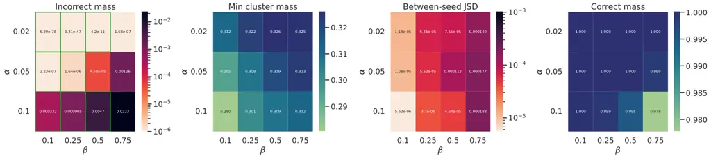

 

The Reasoning–Creativity Trade-off:  
Toward Creativity-Driven Problem Solving

 

Max Ruiz Luyten          Mihaela van der Schaar

University of Cambridge

###### Abstract

State-of-the-art large language model (LLM) pipelines rely on
bootstrapped reasoning loops—sampling diverse chains of thought and
reinforcing the highest-scoring ones—mainly optimizing correctness. We
analyze how this design choice is sensitive to the _collapse_ of the
model’s distribution over reasoning paths, slashing semantic entropy and
undermining creative problem-solving. To analyze this failure, we
introduce _Distributional Creative Reasoning_ (DCR), a unified
variational objective that casts training as gradient flow through
probability measures on solution traces. STaR, GRPO, and DPO, as well as
entropy bonuses, and other methods, all constitute special cases of the
same loss. The framework delivers three core results: (i) the diversity
decay theorem, describing how correctness-based objectives lead to
distinct modes of diversity decay for STaR, GRPO, and DPO; (ii) designs
that ensure convergence to a stable and diverse policy, effectively
preventing collapse; and (iii) simple, actionable recipes to achieve
this in practice. DCR thus offers the first principled recipe for LLMs
that remain both correct _and_ creative.

## 1 Introduction

##### Diversity collapse in modern training loops.

A canonical post-training pipeline for training reasoning LLMs includes
two main stages: after supervised fine-tuning, the focus shifts to
reinforcement learning (RL), which rewards the highest-scoring traces,
typically based on correctness. A recurring and detrimental side-effect
of this process is creative collapse: the model’s output entropy
plummets, resulting in a distribution dominated by a handful of semantic
templates (Mohammadi, 2024).

Creative collapse has been extensively reported across RL from human
feedback (RLHF) stages (Kirk et al., 2024), when applying GRPO for
mathematical reasoning (Shao et al., 2024), and during self-consistency
tuning (Wang et al., 2023). In this paper, we examine why this collapse
occurs and whether we can apply design choices that prevent it without
sacrificing accuracy.

##### Why diversity matters: Creativity as a diverse portfolio for generalization.

Especially for tasks outside the training distribution (OOD), creativity
in problem-solving is not just a nice-to-have but rather a core
requirement for high performance. A single reasoning template will
inevitably fail when under novel conditions. We therefore frame
creativity as the ability to maintain a _diverse portfolio of
high-utility reasoning strategies_. This portfolio promotes OOD
generalization, robust planning, and genuine discovery (Stanley and
Lehman, 2020).

##### The central question.

Our work addresses the following question:

> _Can we design a framework that:_
>
> 1.  1.  explains why diversity collapse occurs,
> 2.  2.  predicts the specific mode of collapse for different algorithms,
>         and
> 3.  3.  provides provably effective designs that guarantee a diverse
>         portfolio of reasoning paths?

Existing literature provides incomplete answers. KL penalties preserve
diversity by constraining the policy’s _proximity_ to a base model,
limiting drift at the cost of indiscriminately penalizing diverse,
high-utility distant parameterizations. Sampling-based methods like
Boltzmann sampling or top-$`k`$ decoding also increase diversity at the
cost of quality, and, more critically, they cannot recover strategies
whose probabilities have vanished during training.

##### Our answer: Distributional Creative Reasoning.

Our primary contribution is theoretical: we provide a unified framework
to analyze diversity decay and a provably sufficient remedy. Since our
object of study is not an individual trace, we analyze the dynamics of
the entire conditional distribution $`p_{\theta}(\pi\mid x)`$ over the
space of solution traces. By modeling training as a gradient flow on
this probability simplex, we develop a framework, Distributional
Creative Reasoning (DCR), to analyze diversity decay and uncover its
various sources. The DCR objective is a core component of this framework
and encompasses multiple terms for utility, regularization, and a
crucial, strictly concave diversity energy:

```math
J(p)=\mathcal{U}[p]+\lambda\mathcal{D}[p]-\beta_{\!\mathrm{KL}}\,\mathrm{KL}\!\bigl(p\|p_{\mathrm{base}}\bigr).
```

In particular, the diversity energy $`\mathcal{D}[p]`$ is a composite
functional with two distinct roles:

```math
\mathcal{D}[p]=\alpha H[p]-\beta Q[p].
```

In this equation, $`\alpha H[p]`$, the Shannon entropy, promotes
undiscriminated breadth, while $`-\beta Q[p]`$ is a kernel coverage term
that penalizes concentration on semantically similar traces, thereby
promoting conceptual distinctiveness. This objective can recover various
existing algorithms as specific instantiations, including STaR (Zelikman
et al., 2022), GRPO (Shao et al., 2024), and DPO (Rafailov et al.,
2023).

DCR leads to three core theoretical insights: First, it leads to the
Diversity Decay Theorem, which predicts distinct modes of collapse under
scalar-only objectives for the most well-known reasoning algorithms: (i)
a “winner-takes-all” fixation for STaR, (ii) a neutral drift for GRPO,
and (iii) a homogenization of correct strategies for DPO.

Second, we prove that incorporating the DCR diversity energy
fundamentally can alter the learning dynamics, guaranteeing convergence
to a unique, stable, and diverse interior equilibrium that neutralizes
these collapse modes.

Third, DCR provides a set of design levers, the specific creativity
kernel $`k(\pi,\pi^{\prime})`$ and the coefficients $`\alpha`$ and
$`\beta`$. We analyze the effects of their choices, resulting in a
recipe for training models that are both correct and creative.

##### Contributions.

1.  1.  Unified Dynamical Lens. We introduce a variational framework based
        on Shahshahani gradient flow that encompasses STaR, GRPO, and DPO.
        Within this framework, we derive their diversity decay dynamics
        under scalar objectives and finite-batch noise. We also provide a
        recipe for adapting the framework to new reward designs.
2.  2.  A Remedy for Collapse. We prove that the DCR objective, with the
        diversity energy functional
        $`\mathcal{D}[p]=\alpha H[p]-\beta Q[p]`$ guarantees convergence to
        a high utility and (under an appropriate design) diverse policy,
        preventing creative collapse.
3.  3.  Principled Design Space and Practical Recipes. We detail how to
        design the creativity kernel and provide guidance on tuning DCR’s
        hyperparameters. We hope this will transform diversity preservation
        from ad-hoc heuristics to a principled design process.

##### Road-map.

Section 2 discusses the literature on diversity collapse and related
theoretical frameworks. Section 3 formally defines the DCR objective and
its associated gradient flow dynamics. Section 4 presents the Diversity
Decay Theorem, analyzing the distribution modes of STaR, GRPO, and DPO
under scalar objectives. Section 5 proves how the DCR diversity energy
reshapes the equilibrium landscape to guarantee diverse outcomes, and
Section 6 discusses the design of the creativity kernel. Finally,
Section 7 concludes with key insights and future directions. We
empirically validate these theoretical collapse modes in Appendix J.

## 2 Related Work

##### From reward optimisation to _reasoning monoculture_.

A consistent empirical observation is now widely documented in the
literature: when a language model is trained to maximise a _single_
scalar reward, its solution space contracts. Early studies of RLHF
showed that the resulting policy rarely develops novel strategies;
instead, it reweights the trajectories present in the SFT checkpoint,
leading to higher Pass@1 accuracy while leaving the underlying portfolio
unchanged (Yue et al., 2025). Controlled ablations subsequently isolated
the cause to the RLHF stage. Diversity, measured by entropy, type–token
ratio, and embedding spread, dropped notably after RLHF, while the
preceding SFT maintained it (Kirk et al., 2024). The effect is
algorithm-agnostic: PPO, Expert Iteration, and GRPO all converge to the
same narrow attractors, failing “to explore significantly beyond
solutions already produced by SFT models” (Havrilla et al., 2024).

Beyond reasoning-based benchmarks, creative decline has also been
documented in other domains. On open-ended story-telling and
idea-generation tasks, aligned Llama-2 variants lose $`3`$–$`6\times`$
token-level entropy and cluster in a few semantic basins (Mohammadi,
2024). Treating a set of traces as a “population,‘’ Murthy et al. (2025)
quantified conceptual variance, further underscoring that RLHF results
in less diversity than either instruction-tuned or human populations.
The overall conclusion from these works is that performance gains come,
at least partly, at the cost of reducing the space of possible
explanations and expressions.

##### First attempts at diversity-aware objectives.

Several works have sought to counter this collapse by injecting _ad hoc_
diversity terms. Entropy-regularised PPO is the most widespread
heuristic, but its effect is largely to keep stochasticity
indiscriminately, leaving performance gains on the table, and it does
not aim to foster _qualitatively_ distinct ideas. Novelty search and
quality-diversity algorithms from evolutionary methods have also been
applied to language modelling, yet the generated solutions are typically
managed separately from the model, and re-distillation frequently
regresses gains (Havrilla et al., 2024). At the reward level, Xiao et
al. (2024) identified “preference-collapse” in RLHF and proposed a
Preference-Matching regulariser that adds an entropy bonus, improving
minority-preference recall but with the same drawback as discussed
above, and without a principled analysis of _how much_ diversity is
sufficient. In conclusion, these works demonstrate viability but leave
open a unifying view that predicts _when_ collapse will occur and the
size of the required counterforce.

##### Theoretical lenses on collapse.

Two theoretical lines are especially relevant. First, replicator
dynamics from evolutionary game theory (Hofbauer and Sigmund, 1998) have
been used to model reward optimisation in large populations and already
hint that pure utility maximisation drives mass toward the
highest-fitness type. Second, information-theoretic RL reinterprets
entropy bonuses as Lagrange multipliers of a KL constraint, but offers
no guarantee that entropy will capture _structural_ novelty. While these
frameworks provide valuable insights, they do not offer a comprehensive
analysis of creativity in LLMs.

##### _Distributional Creative Reasoning_ (DCR).

Our work builds on the empirical diagnostics of collapse (Yue et al.,
2025; Kirk et al., 2024; Havrilla et al., 2024; Mohammadi, 2024; Murthy
et al., 2025) and the first corrective steps of PM-RLHF (Xiao et al.,
2024), but provides a more fundamental and unified solution, differing
in three key respects:

1.  1.  Variational Framework for Diversity. We include in DCR a single
        concave diversity regularizers, $`\mathcal{D}[p]`$, composed of
        distinct terms, like entropy (Shannon entropy $`H[p]`$ weighted by
        $`\alpha`$) and structured novelty promotion (through a kernel
        $`k(\pi,\pi^{\prime})`$ in a quadratic form $`Q[p]`$ weighted by
        $`\beta`$). Properly choosing the functional form of the kernel
        $`k`$ and the relative weights $`\alpha`$ and $`\beta`$ for these
        components within $`\mathcal{D}[p]`$ ensures convergence to stable,
        mixed-strategy ensembles, effectively counteracting collapse.
2.  2.  Characterization of Diversity Dynamics. Whereas prior work largely
        reports collapse through empirical analyses, our framework provides
        a dynamical systems examination (Section 4) that demonstrates how
        the scalar-reward objectives for STaR, GRPO, and DPO inherently lead
        to distinct dynamical modes that drive the evolution and erosion of
        diversity. This results in a deeper, mechanistic understanding of
        why reasoning monocultures form.
3.  3.  Actionable and Principled Design. DCR characterizes how diverse
        training objectives and diversity-regularizing terms affect the
        diversity dynamics. This transforms the search for diversity from
        heuristics to principled design. This involves selecting the kernel
        function and hyperparameters for the diversity functional
        $`\mathcal{D}[p]`$ (i.e., $`\alpha`$ and $`\beta`$), which become
        levers to shape the policy’s distribution.

## 3 Distributional Creative Reasoning

DCR recasts LLM training as a dynamical system within the space of
probability distributions over solution traces. This perspective enables
the formal definition and promotion of diversity alongside correctness.
This section establishes DCR’s mathematical foundations: its variational
objective, the role of the diversity component, and the resultant
dynamics.

### 3.1 The Landscape of Reasoning

For a given prompt $`x\in\mathcal{X}`$, an LLM generates a trace
$`\pi=(t_{1},\dots,t_{|\pi|})`$, a sequence of tokens from a finite
vocabulary $`\mathcal{V}`$ up to a maximum length $`T`$. Traces can
represent chains of thought, code, or action sequences. The set of all
such traces, $`\mathcal{S}_{T}`$, is vast but finite for any fixed $`T`$
and vocabulary, justifying a finite-dimensional analysis, and the choice
of the counting measure on $`\mathcal{S}_{T}`$. An LLM’s policy
$`p(\cdot|x)`$ is a probability mass function over $`\mathcal{S}_{T}`$,
represented as a vector $`p`$ in the probability simplex
$`\Delta^{S-1}`$, where $`S:=|\mathcal{S}_{T}|`$:

```math
\Delta^{S-1}=\Big\{p\in[0,1]^{S}\mid\sum_{i=1}^{S}p_{i}=1\Big\}.
```

This compact, convex polytope is our domain for policy optimization.
Treating the policy as a full distribution, rather than focusing on
single “best” traces, is crucial for modeling its diversity.

### 3.2 The DCR Objective

During training, we optimize an objective $`J(p)`$ over
$`p\in\Delta^{S-1}`$. In DCR, we model the objective as a term
representing task performance, and others for KL and diversity
regularization:

```math
J(p)=\mathcal{U}[p]+\lambda\mathcal{D}[p]-\beta_{\!\mathrm{KL}}\,\mathrm{KL}\!\bigl(p\|p_{\mathrm{base}}\bigr).
```

The components are:

1.  1.  Utility ($`\mathcal{U}[p]`$):
        $`\mathcal{U}[p]=\sum_{\pi\in\mathcal{S}_{T}}U(\pi)p(\pi)`$ is the
        expected utility (e.g., correctness) of traces, encouraging
        high-quality outputs.
2.  2.  Diversity Energy ($`\mathcal{D}[p]`$): Weighted by
        $`\lambda\geq 0`$, this functional (detailed in Section 3.3) rewards
        policies with diversity, countering collapse.
3.  3.  KL-Divergence: It penalizes divergence from a reference policy
        $`p{\mathrm{base}}`$ (e.g., the SFT checkpoint), promoting
        stability.

The coefficients $`\lambda,\beta_{!\mathrm{KL}}\geq 0`$ tune this
balance.

### 3.3 The Diversity Energy Functional $`\mathcal{D}[p]`$

Clearly, the core of DCR’s creativity preservation mechanism is the
diversity energy functional $`\mathcal{D}[p]`$, designed to reward both
probabilistic spread and semantic variation:

```math
\mathcal{D}[p]=\alpha H[p]-\beta Q[p],
```

with $`\alpha,\beta\geq 0`$. Indeed, its two components serve distinct
roles:

1.  1.  Shannon Entropy ($`H[p]`$): Promotes breadth by rewarding
        probability distributed across many traces, ensuring a baseline
        level of diversity and exploration.
2.  2.  Kernel Coverage ($`Q[p]`$):
        $`Q[p]=p^{\top}Kp=\sum_{\pi,\pi^{\prime}}k(\pi,\pi^{\prime})p(\pi)p(\pi^{\prime})`$.
        Here, $`K`$ is the matrix of a symmetric, positive semi-definite
        (PSD) creativity kernel (see Section 6) measuring trace similarity.
        $`-\beta Q[p]`$ thus penalizes probability concentration on similar
        traces, fostering semantic distinctiveness.

While entropy provides a valuable form of regularization, entropy alone
is insufficient for structured creativity, as it is blind to the content
of the traces. The kernel term is essential for promoting qualitatively
different reasoning strategies, and the full functional
$`\mathcal{D}[p]`$ is concave, which will prove to be useful:

###### Proposition 3.1 (Concavity of $`\mathcal{D}`$, cf. Section A.3).

If the kernel matrix $`K`$ is PSD, $`\mathcal{D}[p]`$ is concave. It is
strictly concave on the affine simplex if $`\alpha>0`$, or if
$`\beta>0`$ and $`K`$ is strictly positive definite on the tangent
subspace.

Strict concavity ensures a well-defined optimization target. In
practice, incorporating into $`J(p)`$ a small entropy barrier
$`+\varepsilon H[p]`$ ($`\varepsilon\in(0,10^{-4}]`$ small) ensures
strict concavity and that $`p(\pi)>0`$ throughout optimization,
guaranteeing a unique interior maximizer (cf. Section A.4,
Proposition A.1).

### 3.4 Learning Dynamics: Gradient Flow

We model policy evolution under $`J(p)`$ as a gradient flow on
$`\Delta^{S-1}`$, endowed with the Shahshahani metric. For tangent
vectors $`u,v`$ at policy $`p`$, this metric is
$`g_{p}(u,v)=\sum_{\pi}u(\pi)v(\pi)/p(\pi)`$, and ensures the flow
remains on the simplex. The DCR gradient flow is a replicator-like ODE
(cf. Section A.5, Eq. (6)):

```math
\dot{p}_{t}(\pi)=p_{t}(\pi)\left(F_{t}(\pi)-\mathbb{E}_{p_{t}}[F_{t}]\right),
```

where the effective trace fitness
$`F_{t}(\pi)=\frac{\delta J}{\delta p(\pi)}\big|_{p_{t}}`$ is (cf.
Section A.6):

```math
\displaystyle F_{t}(\pi)=U(\pi) \displaystyle+\lambda\left(\alpha(-1-\log p_{t}(\pi))-2\beta(Kp_{t})_{\pi}\right)
```

```math
\displaystyle-\beta_{\!\mathrm{KL}}\left(1+\log\frac{p_{t}(\pi)}{p_{\mathrm{base}}(\pi)}\right).
```

Under the discussed regularity assumptions (finite $`\mathcal{S}_{T}`$,
$`p(\pi)>0`$ via an entropy barrier, PSD $`k`$, and bounded $`U(\pi)`$;
cf. Section A.1, (A1)–(A7)), the flow converges:

###### Theorem 3.1 (Global Convergence of DCR Training, cf. Section A.6, Theorem A.1).

Let $`\widetilde{J}(p)=J(p)+\varepsilon H[p]`$ be strictly concave on
the affine simplex (e.g. if $`\lambda\alpha+\varepsilon>0`$ and $`K`$ is
PSD) and Assumptions (A1)–(A7) hold. For any
$`p_{0}\in\operatorname{int}\Delta^{S-1}`$, the Shahshahani gradient
flow $`\dot{p}_{t}=\nabla{{}_{\mathrm{Sh}}}\widetilde{J}(p_{t})`$ has a
unique global solution $`p_{t}`$, which lies on the interior of the
simplex. The objective $`\widetilde{J}(p_{t})`$ is strictly increasing
(unless $`p_{t}=p^{\star}`$), and $`p_{t}\to p^{\star}`$ as
$`t\to\infty`$, where $`p^{\star}`$ is the unique maximizer of
$`\widetilde{J}(p)`$.

Thus, DCR training with its explicit diversity energy functional
provably converges to a unique policy $`p^{\star}`$ that balances
utility, diversity, and regularization.

### 3.5 Parametric Realization and Scalability

##### Parametric Realization.

In practice, LLMs are function approximators. For tractability, we
represent LLMs as a parameterization over policies $`p_{\theta}(\pi)`$
via a softmax over logits $`\theta_{\pi}`$, so that for any target
policy $`p^{\star}\in\operatorname{int}\Delta^{S-1}`$, there exists a
unique set of (gauge-fixed) logits $`\theta^{\star}`$ such that
$`p_{\theta^{\star}}=p^{\star}`$, making the parametric form
sufficiently expressive (cf. Section B.2, Proposition B.1). To ensure
numerical stability and align with the theoretical requirement of
$`p_{\theta}(\pi)>\delta_{\star}>0`$, we assume the use of projection or
clipping, which constrain policies to a trimmed simplex (cf.
Appendix B). The properties of these parameterized policies and their
gradients under stochastic optimization are detailed in Appendix B and
underpin the analysis of noise effects in Section 4.3.

##### Scalability.

Training is performed with stochastic gradient descent on $`\theta`$.
The kernel coverage term $`Q[p_{\theta}]`$, even though it may be
intensive to fully realize, can be efficiently managed in this setting.
For a mini-batch of $`B`$ sampled traces, an unbiased estimate of the
gradient of $`Q[p_{\theta}]`$ can be computed via a U-statistic, with a
computational cost of $`O(B^{2})`$ per step. This quadratic complexity
is standard in contrastive and metric learning methods. Practical kernel
design strategies, including embedding-based kernels and gating
mechanisms to focus diversity on correct traces, are discussed in
Section 6.

## 4 Collapse Under Scalar Objectives

While the DCR framework (Section 3) encompasses regularization terms, a
typical LLM training pipeline often defaults to simpler, scalar-driven
objectives. These scenarios correspond to DCR with a negligible
diversity energy coefficient ($`\lambda\approx 0`$) and a purely
entropic diversity term with a small weight ($`\beta=0`$, small
$`\lambda\alpha`$).

This section provides a dynamical systems analysis of these “scalar
objective” cases, demonstrating how they lead to distinct and
predictable modes of diversity collapse. This analysis culminates in the
Diversity Decay Theorem, which formally characterizes these failure
modes and motivates the necessity of the full DCR objective.

### 4.1 Scalar-Driven Dynamics: The SRCT Framework

When diversity energy is minimal, the policy $`p(t)`$ evolves according
to the replicator-entropy flow (formally derived in Appendices D, E
and F):

```math
\displaystyle\dot{p}_{\pi}(t)= \displaystyle p_{\pi}(t)\bigl(\phi_{\pi}(p(t))-\bar{\phi}(p(t))\bigr) \tag{1}
```

```math
\displaystyle-\varepsilon\,p_{\pi}(t)\bigl(\log p_{\pi}(t)-\langle\log p(t)\rangle_{p(t)}\bigr),
```

where $`\phi_{\pi}(p)`$ is the trace score derived from the utility and
any KL term, $`\bar{\phi}(p)`$ is its mean, and $`\varepsilon\geq 0`$ is
the effective entropic weight (e.g.,
$`\varepsilon=\varepsilon_{\mathrm{base}}+\lambda\alpha`$).

The key diagnostic for diversity dynamics is the evolution of

```math
z_{ij}(t)=\log(p_i(t)/p_j(t)),
```

the log-ratio between two traces, which follows the ODE (cf.
Appendices D, E and F):

```math
\frac{d}{dt}z_{ij}(t)=\left(\phi_{i}(p(t))-\phi_{j}(p(t))\right)-\varepsilon z_{ij}(t). \tag{2}
```

This equation reveals that diversity dynamics is driven by two competing
forces: selective pressure from score differences, which can negatively
impact diversity, and entropic damping, which always pushes log-ratios
towards zero (equalization).

### 4.2 Deterministic Diversity Decay (Small $`\varepsilon`$)

In the pure-selection limit where $`\varepsilon\to 0`$, the raw effect
of scalar rewards becomes apparent. While incorrect traces are
universally suppressed due to their lower utility (cf. Appendices D, E
and F), the diversity among correct traces ($`\pi\in\mathcal{C}`$)
evolves in three distinct, algorithm-specific modes:

- •
  STaR: “Winner-Takes-All” Collapse. For two correct traces
  $`a,b\in\mathcal{C}`$, the score difference is
  $`\phi_{a}(p)-\phi_{b}(p)=(p_{a}-p_{b})/\rho(t)`$, where $`\rho(t)`$
  is the total mass on correct traces. The log-ratio dynamics become
  $`\frac{d}{dt}\log\frac{p_{a}}{p_{b}}=(p_{a}-p_{b})/\rho(t)`$ (see
  Appendix D).

  Any initial random advantage for trace $`a`$ ($`p_{a}(0)>p_{b}(0)`$)
  creates a positive feedback loop, causing $`p_{a}/p_{b}\to\infty`$ and
  leading to a rapid, deterministic collapse onto a single dominant
  correct solution.

- •
  GRPO: “Proportional Curation” & Drift Vulnerability. For correct
  traces $`a,b\in\mathcal{C}`$, GRPO’s score design results in
  $`\phi_{a}(p)-\phi_{b}(p)=0`$. The log-ratio dynamics become
  $`\frac{d}{dt}\log\frac{p_{a}}{p_{b}}\approx 0`$ (see Appendix E).

  This preserves the initial relative probabilities of correct traces,
  creating a neutrally stable manifold. However, this provides no active
  protection for diversity, making the policy vulnerable to stochastic
  drift from mini-batch sampling.

- •
  DPO: “Equalization” & Homogenization. For two correct traces
  $`a,b\in\mathcal{C}`$, the score difference is
  $`\phi_{a}(p)-\phi_{b}(p)=g_{\beta}(\log p_{a})-g_{\beta}(\log p_{b})`$,
  where $`g_{\beta}(\cdot)`$ is a strictly decreasing function (see
  Appendix F). Since $`\frac{d}{dt}\log\frac{p_{a}}{p_{b}}`$ has the
  opposite sign of $`\log\frac{p_{a}}{p_{b}}`$, this dynamic actively
  drives $`p_{a}/p_{b}\to 1`$.

  DPO thus homogenizes the probability distribution across the set of
  preferred traces, but it does not promote targeted semantic diversity
  between conceptually different solutions (thereby pushing probability
  mass towards longer traces).

### 4.3 Stochastic Dynamics: Fixation Under Noise

In practice, training is stochastic. The discrete mini-batch updates
converge to a Wright-Fisher-type stochastic differential equation (SDE)
in the diffusion limit (formally derived in Appendix H, Theorem H.1):

```math
\mathrm{d}p_{i}=F_{i}(p)\,\mathrm{d}t+\frac{1}{\sqrt{B}}\left(\sqrt{p_{i}}\,\mathrm{d}W_{i}-p_{i}\sum_{k}\sqrt{p_{k}}\,\mathrm{d}W_{k}\right),
```

where $`F_{i}(p)`$ is the deterministic drift and $`B`$ is the batch
size. Such a random effect from batching can result in noise-induced
collapse:

- •
  STaR: The strong “winner-takes-all” dynamic is robust, and noise
  results only on minor perturbations around the deterministic collapse
  trajectory.
- •
  GRPO: The neutral stability is fragile. Stochastic fluctuations
  introduce random selective pressure, causing the policy to drift along
  the manifold of correct solutions until it fixates on a corner or a
  small subset, leading to diversity collapse in this algorithm.
- •
  DPO: While equalization is the deterministic tendency, noise can break
  symmetries and result in convergence to a state where a subset of
  solutions dominates, even if they are semantically redundant.

Although a small $`\varepsilon`$ ensures the policy remains in the
interior ($`\min p_{i}(t)>\delta_{\star}>0`$), the SDE admits a unique
invariant measure $`\pi_{\infty}`$ (Appendix H, Theorem H.3). For small
$`\varepsilon`$, this measure concentrates in high-utility,
low-diversity regions, as the stationary distribution is heavily
influenced by the utility landscape (Appendix H, Section H.7). Batch
noise does not increase diversity; it often accelerates fixation.

### 4.4 Synthesis: The Diversity Decay Theorem

The analyses of both the deterministic and the stochastic dynamics
converge on the conclusion that scalar-driven objectives with minimal
entropic regularization are fundamentally insufficient to maintain a
creative repertoire of reasoning strategies. This leads to our main
diagnostic result.

###### Theorem 4.1 (Diversity Decay Theorem).

Under scalar-objective training (DCR with $`\lambda\approx 0`$ or
$`\beta=0`$), policies exhibit algorithm-specific modes of diversity
decay among correct traces:

1.  (i)
    STaR follows a “winner-takes-all” dynamics, deterministically
    collapsing onto a single dominant correct trace.
2.  (ii)
    GRPO evolves on a neutrally stable manifold of correct traces,
    leading to stochastic drift and eventual fixation on a low-diversity
    subset.
3.  (iii)
    DPO actively homogenizes probabilities across high-utility traces,
    leading to equalization instead of structured semantic diversity.

Minimal entropy ($`\varepsilon\ll 1`$) does not prevent these outcomes
and finite-batch noise can accelerate collapse.

Scope Note: This theorem characterizes the decay modes for STaR, GRPO,
and DPO; it is not a general statement about every scalar-only
objective.

The defined diversity-trajectories highlight the need for a more
structured lever to influence the dynamics. The failure does not lie in
the optimization process itself, but rather in the objective, which
lacks an explicit, strong enough force that rewards structured
diversity. This motivates the introduction of the DCR objective,
specifically its diversity energy functional $`\mathcal{D}[p]`$, as a
mechanism to counteract these modes and actively carve a rich and
creative policy landscape.

## 5 The Diversity Energy Effect on the Equilibrium Structure

Scalar objectives, as demonstrated in Section 4, lead to a degeneration
in reasoning diversity. The DCR framework provides a solution by
incorporating a diversity energy functional, $`\mathcal{D}[p]`$. It
reshapes the optimization landscape, altering the learning dynamics
toward different equilibria: those that contain various simultaneously
correct and diverse traces. This section details how DCR’s diversity
regularizer achieves this shift.

### 5.1 From Collapse to Structured Diversity

With its full objective
$`J(p)=\mathcal{U}[p]+\lambda\mathcal{D}[p]-\beta_{\mathrm{KL}}\,\mathrm{KL}(p\|p_{\mathrm{base}})`$
and a diversity weight $`\lambda>0`$, DCR leverages the diversity energy

```math
\mathcal{D}[p]=\alpha H[p]-\beta Q[p].
```

### 5.2 The Dual Levers of Diversity Energy: Shaping $`p^{\star}`$

The specific structure of the equilibrium $`p^{\star}`$ with a diversity
weight is shaped by the two components of the diversity energy,
$`\lambda\mathcal{D}[p]=\lambda\alpha H[p]-\lambda\beta Q_{eff}[p]`$.
For practical applications, the quadratic term can incorporate an
effective kernel
$`k_{eff}(\pi,\pi^{\prime}):=R(\pi)R(\pi^{\prime})k_{sem}(\pi,\pi^{\prime})`$,
which gates a semantic kernel $`k_{sem}`$ with a verifier
$`R(\pi)=\mathbf{1}{\pi\in\mathcal{C}}`$ to focus the diversity pressure
only on correct traces $`\mathcal{C}`$ (see Appendix I, Section 6.3).

1.  1.  Entropic Pressure ($`\lambda\alpha H[p]`$): The entropic pressure
        promotes probabilistic breadth. It is the simplest mechanism for
        encouraging the equalization of probabilities among correct traces,
        at the cost of also promoting incorrect ones (Appendix I).
2.  2.  Kernel-Driven Structural Diversity ($`-\lambda\beta Q_{eff}[p]`$):
        This term penalizes $`p^{\star}`$ for concentrating mass on sets of
        correct traces that are semantically similar (as defined by
        $`k_{sem}`$). It therefore actively promotes structural or semantic
        diversity among distinct, valid reasoning paths (Appendix I).
        Entropy alone cannot achieve this structured outcome.

### 5.3 Balancing Correctness and Structured Diversity at Equilibrium

The DCR equilibrium $`p^{\star}`$ is characterized by the first-order
condition
$`U_{\pi}-2\lambda\beta(K_{eff}p^{\star})_{\pi}-\varepsilon_{total}\log p_{\pi}^{\star}\approx\text{Constant}`$
(ignoring KL terms and gauge constants; see Section I.2). A crucial
consequence for incorrect traces $`i\in\mathcal{I}`$ (where
$`(K_{eff}p^{\star})_{i}=0`$ and $`U_{i}=0`$) and correct traces
$`c\in\mathcal{C}`$ (where $`U_{c}=1`$) is the exact equilibrium ratio
(cf. Section I.2):

```math
\frac{p_{i}^{\star}}{p_{c}^{\star}}\approx\exp\left(-\frac{1-2\lambda\beta(K_{eff}p^{\star})_{c}}{\varepsilon_{total}}\right).
```

This identity reveals a central trade-off. To effectively suppress
incorrect traces, the exponent’s numerator,
$`1-2\lambda\beta(K_{eff}p^{\star})_{c}`$, must be substantially
positive. This provides a clear heuristic for tuning the kernel weight:
the kernel penalty among correct traces should not overwhelm the unit
utility gain, i.e., $`2\lambda\beta(K_{eff}p^{\star})_{c}<1`$.

At the same time, while a larger $`\varepsilon_{total}`$ (from a larger
$`\lambda\alpha`$) aids equalization among correct traces, it also
increases the denominator of the exponent, thereby weakening the
suppression of incorrect traces. A careful choice of $`\lambda\alpha`$
and $`\lambda\beta`$ is therefore essential to steer this trade-off and
achieve a “phase” where incorrect traces are suppressed while a rich,
diverse set of correct solutions thrives.

## 6 The Creativity Kernel

The preceding sections established that DCR’s diversity energy,
$`\mathcal{D}[p]=\alpha H[p]-\beta Q[p]`$, is pivotal in guiding
learning towards equilibria $`p^{\star}`$ that are diverse and stable
(Section 5). While the entropy component, $`\alpha H[p]`$, provides
naive probabilistic breadth, it is intrinsically “blind” to the content
and structure of reasoning traces. This section explains how to build
the kernel-based component $`-\beta Q[p]`$ to provide a plausible,
grounded mechanism for developing LLMs with structured, semantic
diversity.

### 6.1 Limitations of Entropic Diversity

$`H[p]`$’s utility for promoting genuine creativity is limited because
it operates solely on trace probabilities, irrespective of their content
or conceptual underpinnings. It cannot, for instance, distinguish a set
of solutions that are mere syntactic rephrasings of a single idea from a
set representing truly distinct problem-solving strategies.

Entropy alone is insufficient for structured creativity; without a
mechanism to differentiate valuable novelty from trivial variation, it
also preserves probability mass on incorrect traces, hindering
optimization of correctness. To generate correct, structurally varied
solutions, an LLM requires a mechanism that appreciates and actively
promotes semantic dissimilarity rather than merely probabilistic
dispersion.

### 6.2 Sculpting Semantic Diversity

The kernel quadratic term
$`Q[p]=\sum_{\pi,\pi^{\prime}\in\mathcal{S}_{T}}k(\pi,\pi^{\prime})p(\pi)p(\pi^{\prime})`$
within DCR is designed to fill this critical gap. The creativity kernel
$`k(\pi,\pi^{\prime})`$ is a symmetric, positive semi-definite (PSD)
function that quantifies the “similarity” or “redundancy” between traces
$`\pi`$ and $`\pi^{\prime}`$. By including $`-\beta Q[p]`$ (for
$`\beta>0`$) in the diversity energy, DCR explicitly penalizes policies
that concentrate probability on sets of traces deemed highly similar by
$`k`$.

As explored in Appendix I (Section I.1), an ideally engineered kernel
could, in principle, sculpt a highly specific target equilibrium
$`p^{\star}`$. Achieving this, however, would require the kernel to
satisfy stringent, globally defined, and equilibrium-dependent
conditions (cf. Appendix I, Proposition I.1). While this idealized
scenario underscores the deep, direct influence of
$`k(\pi,\pi^{\prime})`$ on the policy structure $`p^{\star}`$, its
practical realization is typically infeasible. This motivates the shift
towards more practical, learnable semantic kernels.

### 6.3 Practical Design of the Semantic Kernel

A more pragmatic and powerful DCR strategy, detailed in Appendix I
(Section I.2), must utilize a learnable semantic kernel
$`k_{sem}(\pi,\pi^{\prime})`$ as its foundation. This $`k_{sem}`$ should
be able to capture meaningful similarities between traces. To ensure
this semantic guidance is applied judiciously, DCR adopts an effective
kernel, $`k_{eff}(\pi,\pi^{\prime})`$:

```math
k_{eff}(\pi,\pi^{\prime}):=R(\pi)R(\pi^{\prime})k_{sem}(\pi,\pi^{\prime}),
```

where $`R(\pi)=\mathbf{1}\{\pi\in\mathcal{C}\}`$ is a binary verifier
for correct traces $`\mathcal{C}`$. The kernel coverage term thus
becomes
$`Q_{eff}[p]=\sum_{c,c^{\prime}\in\mathcal{C}}p_{c}p_{c^{\prime}}k_{sem}(c,c^{\prime})`$.
This construction focuses the diversity-promoting penalty
$`-\lambda\beta Q_{eff}[p]`$ exclusively on interactions among correct
traces, promoting targeted diversity: it encourages the model to find
diverse valid solutions, rather than rewarding “diverse ways to be
wrong,” as incorrect traces do not participate in the kernel
interactions that shape diversity (recall $`(K_{eff}p^{\star})_{i}=0`$
for $`i\in\mathcal{I}`$ from Section 5.3).

Practical examples of $`k_{sem}`$ can include embedding-based kernels,
where we compute an embedding for each trace (e.g., sentence-level
embeddings over the full chain of thought) and apply a standard PSD
kernel on those, or domain-tailored kernels, in structured tasks like
mathematics, where $`k_{sem}`$ can be learned using structural proximity
(e.g., from proof-step or lemma dependency graphs), so that similarity
reflects shared strategy rather than just surface-level wording.

### 6.4 Implementation and Desiderata

The kernel term can be readily integrated into standard training loops.
For SGD, the gradient of $`Q_{eff}[p]`$ can be estimated with the
mini-batch of $`B`$ sampled traces. The quadratic nature of
$`Q_{eff}[p]`$ admits a U-statistic estimator with $`O(B^{2})`$ per-step
cost, a manageable complexity in the context of LLM training.

The efficacy of kernel-driven diversity inherently depends on the
quality of the learned $`k_{sem}(\pi,\pi^{\prime})`$. Key desiderata for
its design include (cf. Section 6.3): (1) Intra-Lump Coherence or high
similarity for traces belonging to the same essential category or “lump”
of solutions (ignoring syntactic differences); and (2) Inter-Lump
Discrimination: It must assign low similarity to traces from
qualitatively different correct problem-solving approaches.

## 7 Concluding Insights

Scalar reward maximization leads to a collapse of strategic diversity.
This paper has established a principled remedy: Distributional Creative
Reasoning (DCR), which recasts training as a gradient flow on the policy
simplex.

Our Diversity Decay Theorem offers a precise diagnosis, predicting
algorithm-specific collapse modes—_winner-takes-all_ (STaR), _neutral
drift_ (GRPO), and _homogenization_ (DPO). The DCR framework counteracts
this decay by incorporating a diversity energy functional,
$`\mathcal{D}[p]=\alpha H[p]-\beta Q[p]`$. We proved this ensures
convergence to a unique, stable, and interior policy $`p^{\star}`$.

DCR provides concrete design levers. The creativity kernel, particularly
when gated to correct traces via an effective kernel
$`k_{\mathrm{eff}}`$, actively promotes novel, valid strategies. Tuning
the balance between entropic breadth ($`\alpha`$) and kernel-driven
diversity ($`\beta`$) allows practitioners to navigate the trade-off
between equalization and the suppression of incorrect traces, as
quantified by our equilibrium analysis.

### 7.1 Testable Predictions

Our theoretical framework yields a set of concrete, falsifiable
predictions that align with existing empirical observations:

1.  1.  Algorithm-Specific Decay Modes. Under scalar-only objectives:
    - •
      STaR exhibits _winner-takes-all_ fixation on a single successful
      strategy.
    - •
      GRPO shows _neutral drift_ among correct traces, leading to a
      stochastic erosion of diversity.
    - •
      DPO will act as an _entropy equalizer_, homogenizing probabilities
      across preferred traces.

2.  2.  Kernel Sufficiency for Structured Diversity.
    - •
      An entropy-only approach ($`\beta=0,\alpha>0`$) preserves
      indiscriminate policy breadth at the cost of correctness.
    - •
      A kernel-inclusive approach ($`\beta>0`$) can not only prevent
      collapse but will also measurably increase the semantic diversity
      among correct solutions.

##### Acknowledgements.

The authors would like to acknowledge and thank their funders, where Max
Ruiz Luyten is funded by AstraZeneca. Moreover, we would like to warmly
thank all the anonymous reviewers, alongside research group members of
the van der Schaar lab (www.vanderschaar-lab.com), for their valuable
input, comments, and suggestions as the paper was developed. We used
ChatGPT and Gemini to edit and polish the text and for coding
assistance.

## References

- Havrilla et al. (2024) A. Havrilla, Y. Du, S. C. Raparthy, C.
  Nalmpantis, J. Dwivedi-Yu, E. Hambro, S. Sukhbaatar, and R. Raileanu
  Teaching large language models to reason with reinforcement learning.
  In AI for Math Workshop @ ICML 2024, External Links:
  [Link](https://openreview.net/forum?id=mjqoceuMnI) Cited by: §2, §2,
  §2.
- Hofbauer and Sigmund (1998) J. Hofbauer and K. Sigmund Evolutionary
  games and population dynamics. Cambridge University Press, Cambridge.
  External Links: [Link](https://pure.iiasa.ac.at/id/eprint/5442/), ISBN
  9780521625708 Cited by: §2.
- Kirk et al. (2024) R. Kirk, I. Mediratta, C. Nalmpantis, J.
  Luketina, E. Hambro, E. Grefenstette, and R. Raileanu Understanding
  the effects of RLHF on LLM generalisation and diversity. In The
  Twelfth International Conference on Learning Representations, External
  Links: [Link](https://openreview.net/forum?id=PXD3FAVHJT) Cited by:
  §1, §2, §2.
- Mohammadi (2024) B. Mohammadi Creativity has left the chat: the price
  of debiasing language models. External Links: 2406.05587,
  [Link](https://arxiv.org/abs/2406.05587) Cited by: §1, §2, §2.
- Murthy et al. (2025) S. K. Murthy, T. Ullman, and J. Hu One fish, two
  fish, but not the whole sea: alignment reduces language models’
  conceptual diversity. In Proceedings of the 2025 Conference of the
  Nations of the Americas Chapter of the Association for Computational
  Linguistics: Human Language Technologies (Volume 1: Long Papers), L.
  Chiruzzo, A. Ritter, and L. Wang (Eds.), Albuquerque, New Mexico,
  pp. 11241–11258. External Links:
  [Link](https://aclanthology.org/2025.naacl-long.561/), ISBN
  979-8-89176-189-6 Cited by: §2, §2.
- Rafailov et al. (2023) R. Rafailov, A. Sharma, E. Mitchell, C. D.
  Manning, S. Ermon, and C. Finn Direct preference optimization: your
  language model is secretly a reward model. In Thirty-seventh
  Conference on Neural Information Processing Systems, External Links:
  [Link](https://openreview.net/forum?id=HPuSIXJaa9) Cited by: §1.
- Shao et al. (2024) Z. Shao, P. Wang, Q. Zhu, R. Xu, J. Song, X. Bi, H.
  Zhang, M. Zhang, Y. K. Li, Y. Wu, and D. Guo DeepSeekMath: pushing the
  limits of mathematical reasoning in open language models. External
  Links: 2402.03300, [Link](https://arxiv.org/abs/2402.03300) Cited by:
  §1, §1.
- Stanley and Lehman (2020) K. O. Stanley and J. Lehman Why greatness
  cannot be planned: the myth of the objective. Note: Springer, 2015
  original, updated. Cited by: §1.
- Wang et al. (2023) X. Wang, J. Wei, D. Schuurmans, Q. V. Le, E. H.
  Chi, S. Narang, A. Chowdhery, and D. Zhou Self-consistency improves
  chain of thought reasoning in language models. In The Eleventh
  International Conference on Learning Representations, External Links:
  [Link](https://openreview.net/forum?id=1PL1NIMMrw) Cited by: §1.
- Xiao et al. (2024) J. Xiao, Z. Li, X. Xie, E. Getzen, C. Fang, Q.
  Long, and W. J. Su On the algorithmic bias of aligning large language
  models with rlhf: preference collapse and matching regularization.
  External Links: 2405.16455, [Link](https://arxiv.org/abs/2405.16455)
  Cited by: §2, §2.
- Yue et al. (2025) Y. Yue, Z. Chen, R. Lu, A. Zhao, Z. Wang, Y. Yue, S.
  Song, and G. Huang Does reinforcement learning really incentivize
  reasoning capacity in llms beyond the base model?. External Links:
  2504.13837, [Link](https://arxiv.org/abs/2504.13837) Cited by: §2, §2.
- Zelikman et al. (2022) E. Zelikman, Y. Wu, and N. D. Goodman STaR:
  bootstrapping reasoning with reasoning. Note: arXiv preprint
  arXiv:2203.14465 Cited by: §1.

## Appendix A Mathematical Foundations and Problem Formalism

This appendix fixes notation and geometric conventions on the simplex,
records canonical inequalities and curvature facts for the objective
slices (entropy/KL/kernel), develops the Shahshahani gradient
representation, and derives global properties of the induced gradient
flows (Lyapunov identity, log–ratio contraction, time–uniform
floors/caps, and exponential convergence). It also states a generic
Barrier–Dominance (BD) calculus for forward invariance of trimmed
domains.

### A.1 Preliminaries and Standing Assumptions

##### Scope & conventions.

All logarithms are natural; $`0\log 0:=0`$. The indicator is
$`\mathbf{1}\{\cdot\}`$, and $`\langle u,v\rangle`$ is the Euclidean
inner product. We write $`a\lesssim b`$ to mean $`a\leq C\,b`$ for an
absolute constant $`C`$; any parameter dependence is displayed as
$`C(\cdot)`$. Sums over traces are with respect to the counting measure
on the finite set $`\mathcal{S}_{T}`$.

| Symbol                      | Meaning                                                                    |
| --------------------------- | -------------------------------------------------------------------------- | ---------------- | --- |
| $`x\in\mathcal{X}`$         | Fixed prompt / task instance                                               |
| $`\pi\in\mathcal{S}_{T}`$   | Trace (finite token sequence, length $`\leq T`$)                           |
| $`\mathcal{S}_{T}`$         | Trace set up to length $`T`$; $`S:=                                        | \mathcal{S}\_{T} | `$  |
| $`p(\pi)`$                  | Policy mass on $`\pi`$ (probability on $`\mathcal{S}_{T}`$)                |
| $`\Delta^{S-1}`$            | Probability simplex on $`\mathcal{S}_{T}`$                                 |
| $`H[p]`$                    | Shannon entropy, $`-\sum_{\pi}p(\pi)\log p(\pi)`$                          |
| $`D_{\mathrm{KL}}(p\|q)`$   | Kullback–Leibler divergence, $`\sum_{\pi}p(\pi)\log\frac{p(\pi)}{q(\pi)}`$ |
| $`k(\pi,\pi^{\prime})`$     | Symmetric positive semidefinite kernel on $`\mathcal{S}_{T}`$              |
| $`K=[k(\pi,\pi^{\prime})]`$ | Kernel matrix in $`\mathbb{R}^{S\times S}`$                                |
| $`\mathcal{D}[p]`$          | Diversity: $`\alpha\,H[p]-\beta\,p^{\top}Kp`$                              |

##### Standing assumptions.

1.  (A1)
    Finite trace space. $`\mathcal{S}_{T}`$ is finite for a fixed
    horizon $`T<\infty`$; policies are
    $`p\in\Delta^{S-1}\subset\mathbb{R}^{S}`$.
2.  (A2)
    Interior vs. trimmed domain. Variational derivatives and Shahshahani
    gradients are taken on
    $`\operatorname{int}\Delta^{S-1}=\{p:\min_{\pi}p(\pi)>0\}`$. When a
    floor is operative, we work on the trimmed simplex
    $`\Delta^{S-1}_{\delta}:=\{p\in\Delta^{S-1}:p_{i}\geq\delta\ \forall i\}`$,
    nonempty iff $`\delta\leq 1/S`$.
3.  (A3)
    Entropy/KL domains. $`H[p]`$ and (when present)
    $`D_{\mathrm{KL}}(p\|p_{\mathrm{base}})`$ are defined on the closed
    simplex; all variational derivatives are computed on
    $`\operatorname{int}\Delta^{S-1}`$. Adding $`+\varepsilon H`$
    ($`\varepsilon\geq 0`$) is permitted.
4.  (A4)
    Kernel regularity and strictness on $`T`$. $`K=K^{\top}\succeq 0`$.
    Write $`T:=\{\mathbf{1}\}^{\perp}`$ and
    $`\Pi_{T}:=I-\tfrac{1}{S}\mathbf{1}\mathbf{1}^{\top}`$. The
    quadratic slice $`-p^{\top}Kp`$ is strictly concave along feasible
    directions iff $`\ker K\cap T=\{0\}`$ (equivalently,
    $`\Pi_{T}K\Pi_{T}\succ 0`$ on $`T`$).
5.  (A5)
    Bounded utility. $`|U(\pi)|\leq U_{\max}<\infty`$ on
    $`\mathcal{S}_{T}`$ whenever
    $`\mathcal{U}[p]=\sum_{\pi}U(\pi)p(\pi)`$ is used.
6.  (A6)
    Nonnegative coefficients.
    $`\alpha,\beta,\beta_{\mathrm{KL}},\lambda,\varepsilon\geq 0`$
    unless noted.
7.  (A7)
    Base-policy support (for KL). If
    $`D_{\mathrm{KL}}(p\|p_{\mathrm{base}})`$ is present, assume
    $`p_{\mathrm{base}}(\pi)\geq p_{\mathrm{base},\min}>0`$ for all
    $`\pi`$.

##### Norm conventions.

For vectors: $`\|\cdot\|_{1}`$, $`\|\cdot\|_{2}`$,
$`\|\cdot\|_{\infty}`$. For $`A\in\mathbb{R}^{S\times S}`$:
$`\|A\|_{2\to 2}`$ (spectral norm) and
$`\|A\|_{\infty\to\infty}:=\max_{i}\sum_{j}|A_{ij}|`$.

### A.2 Spaces and Simplex Geometry

#### A.2.1 Trace space, simplex, tangent.

Fix vocabulary $`\mathcal{V}`$ and horizon $`T\in\mathbb{N}`$.

```math
\mathcal{S}_{T}=\{(t_{1},\dots,t_{\ell}):\ 1\leq\ell\leq T,\ t_{i}\in\mathcal{V}\},\qquad S:=|\mathcal{S}_{T}|<\infty.
```

Policies are
$`p\in\Delta^{S-1}:=\{p\in[0,1]^{S}:\langle\mathbf{1},p\rangle=1\}`$. On
$`\operatorname{int}\Delta^{S-1}`$, feasible directions lie in the
affine tangent

```math
T=T_{p}\Delta^{S-1}=\{v\in\mathbb{R}^{S}:\langle\mathbf{1},v\rangle=0\}=\{\mathbf{1}\}^{\perp},
```

which does not depend on $`p`$.

#### A.2.2 Floors: policy vs. effective.

A chosen floor $`\delta\in(0,1/S]`$ defines the trimmed simplex
$`\Delta^{S-1}_{\delta}=\{p\in\Delta^{S-1}:p_{i}\geq\delta\ \forall i\}`$.
Algorithmic clip–renormalize with threshold $`\delta_{\star}\in(0,1]`$
induces an _effective floor_

```math
\delta_{\mathrm{eff}}(p)=\frac{\delta_{\star}}{\sum_{j=1}^{S}\max\{p_{j},\delta_{\star}\}}\ \in\ \Bigl[\frac{\delta_{\star}}{\,1+(S-1)\delta_{\star}\,},\ \delta_{\star}\Bigr],
```

since the denominator ranges from $`1`$ to $`1+(S-1)\delta_{\star}`$
(max at a simplex vertex). The exact clip–renormalize map and logit lift
are given in Appendix B.

#### A.2.3 Canonical inequalities.

###### Lemma A.1 (Mean–log bounds and entropic Lipschitzness).

Let $`p\in\Delta^{S-1}`$ and
$`\langle\log p\rangle:=\sum_{i}p_{i}\log p_{i}`$.

1.  1.  (Mean–log bounds) For all $`p\in\Delta^{S-1}`$,
        $`-\log S\leq\langle\log p\rangle\leq 0.`$
2.  2.  (Entropic Lipschitz on $`\Delta^{S-1}_{\delta}`$) Fix
        $`\delta\in(0,1/S]`$ and $`\Lambda(\delta):=1+\log(1/\delta)`$. For
        all $`p,q\in\Delta^{S-1}_{\delta}`$,

    ```math
    \displaystyle\|\nabla H(p)-\nabla H(q)\|_{2} \displaystyle\leq\frac{1}{\delta}\,\|p-q\|_{2},\qquad\nabla H(r)=-(\mathbf{1}+\log r), \tag{3}
    ```

    ```math
    \displaystyle\big\|p\odot(\log p-\langle\log p\rangle)-q\odot(\log q-\langle\log q\rangle)\big\|_{2} \displaystyle\leq\Lambda(\delta)\,(2+\sqrt{S})\,\|p-q\|_{2}. \tag{4}
    ```

###### Proof.

(1) Upper bound: each $`\log p_{i}\leq 0`$. Lower bound: $`H(p)`$ is
maximized at the uniform $`u=(1/S)\mathbf{1}`$ with $`H(u)=\log S`$.

(2) For (3), $`\nabla^{2}H(r)=-\mathrm{diag}(1/r_{i})`$ on
$`\operatorname{int}\Delta^{S-1}`$ so
$`\|\nabla^{2}H(r)\|_{2\to 2}\leq 1/\delta`$ on
$`\Delta^{S-1}_{\delta}`$, and the mean–value theorem applies.

For (4), set $`E(r):=r\odot(\log r-\langle\log r\rangle)`$ and
$`G(r):=r\odot\log r`$. Then $`DG(r)[h]=h\odot(1+\log r)`$, hence
$`\|DG(r)\|_{2\to 2}\leq\Lambda(\delta)`$. For
$`B(r):=\langle\log r\rangle\,r`$,

```math
DB(r)[h]=\Big\langle(1+\log r)\odot h\Big\rangle r\ +\ \langle\log r\rangle\,h,
```

so $`\|DB(r)\|_{2\to 2}\leq\Lambda(\delta)\sqrt{S}+(\Lambda(\delta)-1)`$
because $`\|1+\log r\|_{2}\leq\Lambda(\delta)\sqrt{S}`$,
$`\|r\|_{2}\leq 1`$, and $`|\langle\log r\rangle|\leq\Lambda(\delta)-1`$
on $`\Delta^{S-1}_{\delta}`$. Therefore
$`\|DE(r)\|_{2\to 2}\leq\Lambda(\delta)(2+\sqrt{S})`$ and the mean–value
theorem yields (4). ∎

### A.3 Functionals: Entropy, KL, Kernel, and Diversity

#### A.3.1 Entropy and KL calculus.

On $`\operatorname{int}\Delta^{S-1}`$,

```math
\displaystyle H[p] \displaystyle=-\sum_{i}p_{i}\log p_{i}, \displaystyle\frac{\delta H}{\delta p_{i}} \displaystyle=-(1+\log p_{i}), \displaystyle\nabla^{2}H \displaystyle=-\mathrm{diag}(1/p_{i}),
```

```math
\displaystyle D_{\mathrm{KL}}(p\|q) \displaystyle=\sum_{i}p_{i}\log\frac{p_{i}}{q_{i}}, \displaystyle\frac{\delta}{\delta p_{i}}D_{\mathrm{KL}}(p\|q) \displaystyle=1+\log\frac{p_{i}}{q_{i}}, \displaystyle\nabla^{2}D_{\mathrm{KL}}(p\|q) \displaystyle=\mathrm{diag}(1/p_{i}),
```

with $`q_{i}>0`$ for KL. Both extend continuously to the closed simplex
(using $`0\log 0:=0`$).

#### A.3.2 Kernel quadratic form.

For $`K=K^{\top}\succeq 0`$, set $`Q[p]=p^{\top}Kp`$. Then

```math
\nabla(-Q)(p)=-2Kp,\qquad\nabla^{2}(-Q)=-2K\preceq 0,
```

so $`-Q`$ is concave on $`\mathbb{R}^{S}`$ and
$`2\|K\|_{2\to 2}`$-Lipschitz in gradient. Along any feasible direction
$`v\in T`$,
$`\tfrac{d^{2}}{dt^{2}}[-Q(p_{0}+tv)]|_{t=0}=-2\,v^{\top}Kv`$, hence
strict concavity on feasible directions iff $`\ker K\cap T=\{0\}`$
(equivalently $`\Pi_{T}K\Pi_{T}\succ 0`$ on $`T`$).

#### A.3.3 Diversity functional.

Let $`\mathcal{D}[p]=\alpha H[p]-\beta Q[p]`$ with
$`\alpha,\beta\geq 0`$. Writing
$`\kappa_{T}:=\lambda_{\min}\big((\Pi_{T}K\Pi_{T})\!\mid_{T}\big)\geq 0,`$
for all $`p\in\operatorname{int}\Delta^{S-1}`$ and $`v\in T`$,

```math
\langle\nabla^{2}\mathcal{D}[p]\,v,v\rangle=\alpha\langle\nabla^{2}H[p]v,v\rangle-2\beta\,v^{\top}Kv\ \leq\ -\big(\alpha+2\beta\kappa_{T}\big)\,\|v\|_{2}^{2}.
```

Thus $`\mathcal{D}`$ is concave, $`\alpha`$–strongly concave on the
affine simplex if $`\alpha>0`$, and strictly concave along feasible
directions when $`\alpha=0`$, $`\beta>0`$, and $`\kappa_{T}>0`$.

### A.4 Barriers and Interiority

#### A.4.1 Entropy/KL barriers exclude boundary maximizers.

###### Proposition A.1 (Interior maximizers).

Let $`J`$ be concave on $`\Delta^{S-1}`$.

1.  1.  For any $`\varepsilon>0`$,
        $`\widetilde{J}(p):=J(p)+\varepsilon H[p]`$ is strictly concave on
        $`\operatorname{int}\Delta^{S-1}`$ and attains its unique maximum at
        an interior point.
2.  2.  If $`p_{\mathrm{base}}`$ has full support (A7), then for any
        $`\beta_{\mathrm{KL}}>0`$,
        $`J(p)-\beta_{\mathrm{KL}}D_{\mathrm{KL}}(p\|p_{\mathrm{base}})`$
        cannot be maximized on the boundary $`\partial\Delta^{S-1}`$.

###### Proof.

(1) On $`\operatorname{int}\Delta^{S-1}`$,
$`\nabla^{2}H=-\mathrm{diag}(1/p)\prec 0`$, so $`\widetilde{J}`$ is
strictly concave. At a boundary point with some $`p_{i}=0`$, the
directional derivative of $`-p_{i}\log p_{i}=-t\log t`$ along $`e_{i}`$
diverges to $`+\infty`$ as $`t\downarrow 0`$, excluding boundary maxima.

(2) With $`p_{i}=0`$, for $`p(t)=(1-t)p+te_{i}`$,
$`\frac{d}{dt}\big[t\log\tfrac{t}{p_{\mathrm{base},i}}\big]_{t\downarrow 0}=\log t+1-\log p_{\mathrm{base},i}\to-\infty,`$
so the derivative of
$`-\beta_{\mathrm{KL}}D_{\mathrm{KL}}(\cdot\|p_{\mathrm{base}})`$ is
$`+\infty`$ inward. Boundary maxima are impossible. ∎

#### A.4.2 No finite–time boundary hitting under bounded fitness.

###### Lemma A.2 (Bounded fitness implies interiority).

Consider the replicator ODE
$`\dot{p}_{i}=p_{i}\big(G_{i}(p)-\mathbb{E}_{p}[G]\big)`$ with a
continuous field $`G`$ satisfying $`\sup_{p,i}|G_{i}(p)|\leq M<\infty`$.
If $`p(0)\in\operatorname{int}\Delta^{S-1}`$, then for all $`t\geq 0`$
and all $`i`$,

```math
e^{-2Mt}p_{i}(0)\ \leq\ p_{i}(t)\ \leq\ e^{2Mt}p_{i}(0),
```

in particular $`p_{i}(t)>0`$ for all $`t`$.

###### Proof.

$`\frac{d}{dt}\log p_{i}=G_{i}(p)-\mathbb{E}_{p}[G]`$ is bounded in
$`[-2M,2M]`$; integrate. ∎

###### Remark A.1 (Applicability).

For $`G_{i}(p)=U(i)-2\lambda\beta\,(Kp)_{i}`$, (A5) and finiteness of
$`\|K\|_{\infty\to\infty}`$ imply
$`|(Kp)_{i}|\leq\|K\|_{\infty\to\infty}`$ and hence a uniform
$`M<\infty`$.

### A.5 Shahshahani Geometry and Gradient Representation

#### A.5.1 Metric and replicator form.

On $`\operatorname{int}\Delta^{S-1}`$, the Shahshahani metric on
$`T=\{\mathbf{1}\}^{\perp}`$ is

```math
g_{p}(u,v):=\sum_{i=1}^{S}\frac{u_{i}v_{i}}{p_{i}}\qquad(u,v\in T). \tag{5}
```

For $`J\in C^{1}`$, the Shahshahani gradient is the unique $`w\in T`$
with $`g_{p}(w,v)=DJ[p]\!\cdot v`$ for all $`v\in T`$, yielding the
classical replicator form

```math
\boxed{\quad\dot{p}_{i}=(\nabla_{\!Sh}J)_{i}=p_{i}\Big(\tfrac{\delta J}{\delta p_{i}}-\mathbb{E}_{p}[\tfrac{\delta J}{\delta p}]\Big),\qquad\mathbb{E}_{p}[\xi]:=\sum_{i}p_{i}\xi_{i}.\quad} \tag{6}
```

Mass is conserved ($`\sum_{i}\dot{p}_{i}=0`$). The dynamics are
invariant under adding _any scalar field_ $`a(p)`$ to the scores
$`\delta J/\delta p`$ (gauge invariance), since centering by
$`\mathbb{E}_{p}[\cdot]`$ removes it.

#### A.5.2 Integrability of replicator fields.

###### Proposition A.2 (Integrability on the simplex).

Let $`G\in C^{1}(\operatorname{int}\Delta^{S-1};\mathbb{R}^{S})`$ and
consider $`\dot{p}_{i}=p_{i}\big(G_{i}(p)-\mathbb{E}_{p}[G]\big)`$. The
following are equivalent; they hold iff there exists $`J\in C^{1}`$ with
$`\dot{p}=\nabla_{\!Sh}J`$:

1.  (AC)
    Anchored cross–partials: for some (hence any) anchor $`k`$,
    $`\ \partial_{p_{j}}(G_{i}-G_{k})=\partial_{p_{i}}(G_{j}-G_{k})`$
    for all $`i,j\neq k`$.
2.  (PJ)
    Projected–Jacobian symmetry: there exists a scalar field $`a(p)`$
    such that $`\Pi_{T}D\!\big(G-a\mathbf{1}\big)\Pi_{T}`$ is symmetric
    on $`T`$ for all $`p`$.

In that case, $`J`$ is unique up to an additive constant and gauge
$`a(p)\mathbf{1}`$.

###### Proof sketch.

Work on the chart $`q=(p_{1},\dots,p_{S-1})`$,
$`p_{S}=1-\sum_{i=1}^{S-1}q_{i}`$. The $`T`$-restricted 1–form is
$`\omega_{T}=\sum_{i=1}^{S-1}(G_{i}-G_{S})\,dq_{i}`$. Condition (AC) is
the closedness of $`\omega_{T}`$; on the simply connected domain,
Poincaré’s lemma yields exactness, giving $`J`$ with
$`\partial_{q_{i}}J=G_{i}-G_{S}`$. Setting $`a(p):=G_{S}(p)`$ recovers
the replicator field. (PJ) is the coordinate–free restatement on $`T`$.
∎

##### Instantiation.

For
$`J=\mathcal{U}+\lambda\mathcal{D}-\beta_{\mathrm{KL}}D_{\mathrm{KL}}((\|\cdot)\|p_{\mathrm{base}})+\varepsilon H`$,
the pointwise variational derivative is

```math
F_{i}(p):=\frac{\delta J}{\delta p_{i}}=U_{i}\ -\ 2\lambda\beta\,(Kp)_{i}\ -\ (\lambda\alpha+\varepsilon)\,(1+\log p_{i})\ -\ \beta_{\mathrm{KL}}\Big(1+\log\tfrac{p_{i}}{p_{\mathrm{base},i}}\Big),
```

and the flow is
$`\dot{p}_{i}=p_{i}\big(F_{i}(p)-\mathbb{E}_{p}[F]\big)`$.

### A.6 Gradient–Flow Dynamics and Convergence

#### A.6.1 ODEs and barrier strength.

Let

```math
J(p)=\mathcal{U}[p]+\lambda\mathcal{D}[p]-\beta_{\mathrm{KL}}D_{\mathrm{KL}}(p\|p_{\mathrm{base}}),\qquad\widetilde{J}(p)=J(p)+\varepsilon H[p],
```

and define the aggregate barrier strength

```math
\boxed{\quad A:=\varepsilon+\lambda\alpha+\beta_{\mathrm{KL}}.\quad}
```

Then the $`\widetilde{J}`$–flow is

```math
\dot{p}_{i}=p_{i}\Big(\widetilde{F}_{i}(p)-\mathbb{E}_{p}[\widetilde{F}]\Big),\qquad\widetilde{F}_{i}(p)=F_{i}(p)-\varepsilon(1+\log p_{i}), \tag{7}
```

with mass conservation $`\sum_{i}\dot{p}_{i}=0`$.

#### A.6.2 Lyapunov identity (with boundary continuity).

###### Lemma A.3 (Strict Lyapunov identity).

Along any solution $`t\mapsto p_{t}\in\operatorname{int}\Delta^{S-1}`$
of (7),

```math
\frac{d}{dt}\,\widetilde{J}(p_{t})=g_{p_{t}}\big(\nabla_{\!Sh}\widetilde{J}(p_{t}),\,\nabla_{\!Sh}\widetilde{J}(p_{t})\big)=\sum_{i}p_{t}(i)\Big(\tfrac{\delta\widetilde{J}}{\delta p_{i}}(p_{t})-\mathbb{E}_{p_{t}}[\tfrac{\delta\widetilde{J}}{\delta p}]\Big)^{2}\ \geq\ 0, \tag{8}
```

with equality iff $`\nabla_{\!Sh}\widetilde{J}(p_{t})=0`$. Moreover, the
right–hand side extends continuously to the closed simplex:
$`p(\log p)^{2}\to 0`$ as $`p\downarrow 0`$ and (A7) yields the same for
$`p\big(\log\frac{p}{p_{\mathrm{base}}}\big)^{2}`$.

#### A.6.3 Log–ratio contraction; time–uniform floor and cap.

###### Lemma A.4 (Log–ratio contraction and uniform bounds).

Assume (A1), (A4), (A5), (A7) and $`A>0`$. For
$`z_{ij}(t):=\log\!\frac{p_{i}(t)}{p_{j}(t)}`$,

```math
\dot{z}_{ij}(t)=-A\,z_{ij}(t)+c_{ij}(p_{t}),\qquad|c_{ij}(p)|\leq B, \tag{9}
```

where

```math
B:=2U_{\max}+4\lambda\beta\,\|K\|_{\infty\to\infty}+\beta_{\mathrm{KL}}\log\frac{p_{\mathrm{base},\max}}{p_{\mathrm{base},\min}}.
```

Hence
$`|z_{ij}(t)|\leq|z_{ij}(0)|e^{-At}+\frac{B}{A}(1-e^{-At})\leq M`$, and
for all $`t\geq 0`$ and all $`i`$,

```math
\boxed{\qquad\frac{1}{S\,e^{M}}\ \leq\ p_{i}(t)\ \leq\ \frac{e^{M}}{S}\ .\qquad} \tag{10}
```

###### Proof.

Subtract the log–dynamics
$`\frac{d}{dt}\log p_{i}=\widetilde{F}_{i}-\mathbb{E}_{p}[\widetilde{F}]`$
to get $`\dot{z}_{ij}=\widetilde{F}_{i}-\widetilde{F}_{j}`$. The
$`(\log p)`$–terms contribute $`-A\,z_{ij}`$, while the remaining terms
are bounded by $`B`$. Solve the linear ODE and use the standard
“max–coordinate” argument to obtain (10). ∎

#### A.6.4 Global convergence with explicit rate.

###### Theorem A.1 (Well–posedness, unique equilibrium, exponential rate).

Assume (A1), (A4), (A5), (A7) and $`A>0`$. For any
$`p_{0}\in\operatorname{int}\Delta^{S-1}`$, the flow (7) admits a unique
global solution staying in the compact trimmed simplex
$`\Delta^{S-1}_{\delta}`$ with $`\delta=1/(Se^{M})`$ from Lemma A.4. On
the affine simplex,

```math
\nabla^{2}\widetilde{J}(p)=A\,\nabla^{2}H(p)-2\lambda\beta K=-A\,\mathrm{diag}(1/p)-2\lambda\beta K\ \preceq\ -A\,I,
```

so $`\widetilde{J}`$ is $`A`$–strongly concave and has a unique
maximizer $`p^{\star}\in\operatorname{int}\Delta^{S-1}`$. Moreover,

```math
\frac{d}{dt}\big(\widetilde{J}(p^{\star})-\widetilde{J}(p_{t})\big)\ \leq\ -2A\,\delta\,\big(\widetilde{J}(p^{\star})-\widetilde{J}(p_{t})\big),
```

and

```math
\boxed{\ \|p_{t}-p^{\star}\|_{2}\ \leq\ \underbrace{\sqrt{\tfrac{2}{A}\big(\widetilde{J}(p^{\star})-\widetilde{J}(p_{0})\big)}}_{=:C}\ \exp(-A\delta\,t)\ .\ }
```

###### Proof sketch.

Lyapunov identity and Lemma A.4 give global existence and a uniform
floor $`\delta`$. Strong concavity on the affine simplex yields the
Polyak–Łojasiewicz inequality
$`\|\Pi_{T}\nabla\widetilde{J}(p)\|_{2}^{2}\geq 2A\big(\widetilde{J}(p^{\star})-\widetilde{J}(p)\big).`$
Since $`g_{p}(w,w)\geq\delta\|\Pi_{T}w\|_{2}^{2}`$ on
$`\Delta^{S-1}_{\delta}`$, (8) implies exponential decay of the
suboptimality gap and then of $`\|p_{t}-p^{\star}\|_{2}`$ by strong
concavity. ∎

##### Remarks.

\(i\) If $`A=0`$ (no entropy/KL barrier), the contraction term in (9)
vanishes; neither the time–uniform floor/cap (10) nor exponential
convergence follow by this route (uniqueness may still hold if
$`\Pi_{T}K\Pi_{T}\succ 0`$). (ii) For $`S=1`$, statements are trivial.
(iii) The bound for $`|(Kp)_{i}-(Kp)_{j}|`$ can be sharpened (e.g., by
$`2\|K\|_{2\to 2}`$) without changing the argument.

### A.7 Special Case: Replicator Flow with Single–Site Scores

Consider $`\dot{p}_{i}=p_{i}\big(G_{i}(p_{i})-\mathbb{E}_{p}[G]\big)`$
where $`G_{i}`$ depends only on $`p_{i}`$.

###### Proposition A.3 (Lyapunov structure).

Define $`\mathcal{L}(p)=\sum_{i=1}^{S}\Psi_{i}(p_{i})`$ with
$`\Psi_{i}^{\prime}(s)=G_{i}(s)`$. Then

```math
\frac{d}{dt}\mathcal{L}(p(t))=\mathrm{Var}_{p(t)}\!\big[G(p(t))\big]=\sum_{i}p_{i}\big(G_{i}(p_{i})-\mathbb{E}_{p}[G]\big)^{2}\ \geq 0,
```

with equality iff $`G_{i}(p_{i})`$ is constant across the support. If,
in addition, all $`G_{i}\equiv g`$ are _identical_ and strictly
monotone, the unique interior equilibrium is uniform on its support. In
general, with distinct strictly monotone $`G_{i}`$, the interior
equilibrium need not be uniform.

### A.8 Barrier–Dominance (BD)

##### Scope.

Consider the deterministic replicator field endowed with an entropy
slice

```math
\dot{p}_{i}=p_{i}\big(\phi_{i}(p)-\bar{\phi}(p)\big)+\varepsilon_{\mathrm{BD}}\,p_{i}\big(\langle\log p\rangle-\log p_{i}\big),\qquad\bar{\phi}(p):=\sum_{j}p_{j}\,\phi_{j}(p), \tag{11}
```

with $`\varepsilon_{\mathrm{BD}}\geq 0`$ and a selection score field
$`\phi:\Delta^{S-1}\to\mathbb{R}^{S}`$. Norms are as in §A.1.

#### A.8.1 Entropy face gap $`L_{S}(\delta)`$.

###### Definition A.1 (Entropy face gap).

For $`S\geq 2`$ and $`\delta\in(0,1/S]`$,

```math
L_{S}(\delta):=\inf\Big\{\ \langle\log p\rangle-\log\delta\ :\ p\in\Delta^{S-1},\ \exists i\ \text{s.t. }p_{i}=\delta\ \Big\}.
```

###### Lemma A.5 (Closed form and properties).

For all $`S\geq 2`$ and $`\delta\in(0,1/S]`$,

```math
L_{S}(\delta)=(1-\delta)\,\log\frac{1-\delta}{(S-1)\delta},
```

with $`L_{S}(\delta)\geq 0`$ (equality iff $`\delta=1/S`$); $`L_{S}`$ is
strictly decreasing in $`\delta`$ and, for fixed $`\delta`$, strictly
decreasing in $`S`$.

###### Proof.

Fix the face $`\{p_{i}=\delta\}`$. Jensen for the convex
$`x\mapsto x\log x`$ implies the minimum when the remaining mass
$`1-\delta`$ is split equally: $`p_{j}=(1-\delta)/(S-1)`$ for
$`j\neq i`$. ∎

###### Lemma A.6 (Two–sided bounds).

For all $`S\geq 2`$ and $`\delta\in(0,1/S]`$,

```math
\underbrace{\ \log\frac{1}{(S-1)\delta}\ -\ \bigl(1+\log\tfrac{1}{(S-1)\delta}\bigr)\delta\ }_{\text{lower}}\ \leq\ L_{S}(\delta)\ \leq\ \underbrace{\ \log\frac{1}{(S-1)\delta}\ }_{\text{upper}}.
```

#### A.8.2 Deterministic BD conditions.

Assume $`\phi`$ is bounded on the operative domain:
$`M_{\phi,\infty}:=\sup_{p}\|\phi(p)\|_{\infty}<\infty,\quad M_{\phi,2}:=\sup_{p}\|\phi(p)\|_{2}<\infty.`$

###### Proposition A.4 (Forward invariance of $`\Delta^{S-1}_{\delta}`$).

For the flow (11), fix $`\delta\in(0,1/S]`$. If either

```math
\ell_{\infty} \displaystyle\varepsilon_{\mathrm{BD}}\,L_{S}(\delta)\ \geq\ 2\,M_{\phi,\infty},
```

```math
\ell_{2} \displaystyle\varepsilon_{\mathrm{BD}}\,L_{S}(\delta)\ \geq\ 2\,M_{\phi,2},
```

then $`\Delta^{S-1}_{\delta}`$ is forward invariant: any solution with
$`p(0)\in\Delta^{S-1}_{\delta}`$ satisfies
$`p(t)\in\Delta^{S-1}_{\delta}`$ for all $`t\geq 0`$.

###### Proof.

On the face $`\{p_{i}=\delta\}`$,

```math
\frac{\dot{p}_{i}}{p_{i}}=\underbrace{\phi_{i}-\bar{\phi}}_{\geq-2M_{\phi,\infty}\ \text{or}\ \geq-2M_{\phi,2}}+\ \varepsilon_{\mathrm{BD}}\underbrace{(\langle\log p\rangle-\log\delta)}_{\geq L_{S}(\delta)}.
```

Hence the outward normal component is nonnegative on every face under
either condition. By Nagumo’s tangency criterion (viability theory),
$`\Delta^{S-1}_{\delta}`$ is forward invariant. ∎

###### Remark A.2 (Tightness and scaling).

The factor $`2`$ in the $`\ell_{\infty}`$ condition is tight without
further structure (place all remaining mass on a single coordinate and
choose $`\phi`$ with opposite signs on the two active coordinates). For
small $`\delta`$, $`L_{S}(\delta)\asymp\log\!\big(1/((S-1)\delta)\big)`$
and degrades monotonically with $`S`$; at $`\delta=1/S`$,
$`L_{S}(\delta)=0`$ and the trimmed set collapses to the uniform point.

## Appendix B Parametric (Logit‑Space) Geometry and Propagation Bounds

### B.1 Introduction and Notation

This appendix records the deterministic, parametric (logit‑space)
geometry used throughout: the soft‑max map, its Jacobian, conditioning,
Lipschitz constants, the clip–renormalize/logit‑lift construction,
composite smoothness constants, and second‑order remainders. Stochastic
topics (e.g., clipping bias, mini‑batch covariance) are deferred to
Appendix H.

##### Notation.

Let $`\mathbf{1}:=(1,\ldots,1)^{\top}`$. The simplex and its _relative_
interior are

```math
\Delta^{S-1}:=\{p\in[0,1]^{S}:\langle\mathbf{1},p\rangle=1\},\qquad\ri(\Delta^{S-1})=\{p\in\Delta^{S-1}:p_{i}>0\ \forall i\}.
```

The centered logit space (gauge slice) and the tangent space are

```math
\Theta:=\{\theta\in\mathbb{R}^{S}:\langle\mathbf{1},\theta\rangle=0\},\qquad T:=\mathbf{1}^{\perp},\qquad\Pi_{T}:=I-\tfrac{1}{S}\mathbf{1}\mathbf{1}^{\top},\qquad C:=\Pi_{T}.
```

Define the soft‑max
$`p_{\theta}:=\operatorname{softmax}(\theta):=e^{\theta}/\langle\mathbf{1},e^{\theta}\rangle\in\Delta^{S-1}`$,
and its Jacobian

```math
J_{\theta}:=\nabla_{\theta}p_{\theta}=\operatorname{diag}(p_{\theta})-p_{\theta}p_{\theta}^{\top}.
```

Appendix C writes the same covariance‑form matrix as
$`S(p):=\operatorname{diag}(p)-pp^{\top}`$; we use the identification

```math
\boxed{\,J_{\theta}=S(p_{\theta})\,} \tag{12}
```

to keep notation uniform across appendices.

### B.2 Soft‑max Map: Gauge, Inverse, and Log‑ratio

###### Lemma B.1 (Translation invariance).

For any $`\theta\in\mathbb{R}^{S}`$ and $`c\in\mathbb{R}`$,
$`\operatorname{softmax}(\theta+c\mathbf{1})=\operatorname{softmax}(\theta)`$.

###### Proposition B.1 (Real‑analytic diffeomorphism).

The restriction $`\operatorname{softmax}:\Theta\to\ri(\Delta^{S-1})`$ is
a real‑analytic diffeomorphism with inverse

```math
G:\ri(\Delta^{S-1})\to\Theta,\qquad G(p):=C\log p=\log p-\tfrac{1}{S}\langle\mathbf{1},\log p\rangle\,\mathbf{1}.
```

###### Proof.

For $`p\in\ri(\Delta^{S-1})`$, writing
$`\overline{\log p}:=\tfrac{1}{S}\langle\mathbf{1},\log p\rangle`$,

```math
\operatorname{softmax}(G(p))_{i}=\frac{\exp(\log p_i-\overline{\log p})}{\sum_{j}\exp(\log p_j-\overline{\log p})}=p_{i}.
```

Conversely, for $`\theta\in\Theta`$,

```math
G(\operatorname{softmax}(\theta))_{i}=\log\!\Big(\frac{e^{\theta_{i}}}{\sum_{j}e^{\theta_{j}}}\Big)-\tfrac{1}{S}\sum_{k}\log\!\Big(\frac{e^{\theta_{k}}}{\sum_{j}e^{\theta_{j}}}\Big)=\theta_{i}.
```

Analyticity follows from analyticity of $`\exp`$ and $`\log`$ and
linearity of $`C`$. ∎

###### Corollary B.1 (Log‑ratios & gauge uniqueness).

If $`p=\operatorname{softmax}(\theta)`$ with $`\theta\in\Theta`$, then
$`\theta_{i}-\theta_{j}=\log(p_i/p_j)`$ for all $`i\neq j`$. If
$`\operatorname{softmax}(\theta)=\operatorname{softmax}(\theta^{\prime})`$,
then $`\theta-\theta^{\prime}=c\mathbf{1}`$; on $`\Theta`$ this forces
$`\theta=\theta^{\prime}`$.

###### Remark B.1 (Edge case $`S=1`$).

If $`S=1`$, then $`\Theta=\{0\}`$, $`\Delta^{0}=\{1\}`$, and
$`\operatorname{softmax}(0)=1`$.

### B.3 Geometry and Conditioning of the Soft‑max Jacobian

##### Basic differential.

For any $`\theta`$,

```math
\boxed{\,J_{\theta}=\operatorname{diag}(p_{\theta})-p_{\theta}p_{\theta}^{\top}=S(p_{\theta}).\,} \tag{13}
```

###### Lemma B.2 (Kernel, rank, variance form).

Let $`p=p_{\theta}`$. Then
$`\ker J_{\theta}=\mathrm{span}\{\mathbf{1}\}`$ and
$`\mathrm{rank}(J_{\theta})=S-1`$. Moreover, for $`v\in T`$,

```math
v^{\top}J_{\theta}v=\sum_{i}p_{i}v_{i}^{2}-\Big(\sum_{i}p_{i}v_{i}\Big)^{2}=\tfrac{1}{2}\sum_{i,j}p_{i}p_{j}\,(v_{i}-v_{j})^{2}=\Var_{i\sim p}(v_{i})\geq 0,
```

with equality iff $`v=0`$.

###### Corollary B.2 (Loewner sandwich on $`T`$; global operator norm).

If $`p_{\min}:=\min_{i}p_{\theta}(i)>0`$, then

```math
\boxed{\,p_{\min}\,I\ \preccurlyeq\ J_{\theta}\!\mid_{T}\ \preccurlyeq\ \tfrac{1}{2}\,I\,},\qquad\|J_{\theta}\|_{op}\leq\tfrac{1}{2}.
```

###### Proof.

Upper bound: for $`v\in T`$, Popoviciu’s inequality yields
$`\Var_{p}(v_{i})\leq\tfrac{1}{4}(\max v-\min v)^{2}\leq\tfrac{1}{2}\|v\|_{2}^{2}`$.
Lower bound: write $`p=p_{\min}\mathbf{1}+q`$ with $`q\geq 0`$,
$`\sum_{i}q_{i}=1-Sp_{\min}`$. Then for $`v\in T`$,
$`\ v^{\top}J_{\theta}v-p_{\min}\|v\|_{2}^{2}=\sum_{i}q_{i}v_{i}^{2}-(\sum_{i}q_{i}v_{i})^{2}\geq 0`$
(Cauchy–Schwarz with weights $`q`$). Since $`J_{\theta}T\subseteq T`$
and $`J_{\theta}\mathbf{1}=0`$, the global $`\|J_{\theta}\|_{op}`$
equals the supremum on $`T`$. ∎

###### Remark B.2 (Tightness).

The upper bound $`\tfrac{1}{2}`$ is attained for $`S=2`$ at
$`p=(1/2,1/2)`$; the lower bound $`p_{\min}`$ is attained at
$`p=\tfrac{1}{S}\mathbf{1}`$, where $`J_{\theta}\!\mid_{T}=(1/S)I`$.

###### Lemma B.3 (Per‑coordinate bound).

For every $`\theta`$ and $`k\in\{1,\dots,S\}`$,

```math
\boxed{\,\|\partial_{\theta_{k}}J_{\theta}\|_{op}\ \leq\ \tfrac{1}{3\sqrt{3}}\,}\qquad\text{and the constant }\tfrac{1}{3\sqrt{3}}\text{ is optimal (already for }S=2\text{)}.
```

###### Proof sketch.

WLOG $`k=1`$. With $`a:=p_{1}\in(0,1)`$ and
$`b\in\mathbb{R}^{S-1}_{\geq 0}`$, $`\sum b=1-a`$,

```math
\partial_{\theta_{1}}J_{\theta}=a\,N(a,b),\quad N(a,b)=\begin{bmatrix}(1-a)(1-2a)&-(1-2a)b^{\top}\\
-(1-2a)b&2bb^{\top}-\operatorname{diag}(b)\end{bmatrix}.
```

The Rayleigh quotient in $`b`$ is convex on the simplex (Hessian
$`4yy^{\top}\succeq 0`$), thus maximized at a vertex $`b=(1-a)e_{j}`$.
In the $`\{e_{1},e_{j}\}`$ subspace the spectral norm equals
$`2a(1-a)|1-2a|`$, whose maximum over $`a\in[0,1]`$ is $`1/(3\sqrt{3})`$
at $`a=\tfrac{1}{2}\pm\tfrac{1}{2\sqrt{3}}`$. ∎

###### Theorem B.1 (Global Lipschitz continuity of $`\theta\mapsto J_{\theta}`$).

For all $`\theta_{1},\theta_{2}\in\Theta`$,

```math
\boxed{\,\|J_{\theta_{2}}-J_{\theta_{1}}\|_{op}\ \leq\ \tfrac{1}{3\sqrt{3}}\|\theta_{2}-\theta_{1}\|_{1}\ \leq\ \tfrac{\sqrt{S}}{3\sqrt{3}}\|\theta_{2}-\theta_{1}\|_{2}\ \leq\ \tfrac{S}{3\sqrt{3}}\|\theta_{2}-\theta_{1}\|_{\infty}.}
```

###### Proof.

Parameterize $`\theta(\tau)=\theta_{1}+\tau(\theta_{2}-\theta_{1})`$. By
the fundamental theorem of calculus and Lemma B.3,

```math
\|J_{\theta_{2}}-J_{\theta_{1}}\|_{op}\leq\int_{0}^{1}\sum_{k=1}^{S}|\Delta\theta_{k}|\,\|\partial_{\theta_{k}}J_{\theta(\tau)}\|_{op}\,d\tau\leq\tfrac{1}{3\sqrt{3}}\|\Delta\theta\|_{1}.
```

The $`\ell_{2},\ell_{\infty}`$ versions follow from norm monotonicity. ∎

###### Remark B.3 (Dimension‑free lower bounds).

Along $`\theta(t)=(t,-t,0,\ldots,0)`$ one has
$`\|dJ_{\theta(t)}/dt\|_{op}=2/(3\sqrt{3})`$ at the extremal $`p`$ while
$`\|\dot{\theta}(t)\|_{1}=2`$, giving optimality in the $`\ell_{1}`$
domain norm. Restricting to the same two‑coordinate subspace gives
$`L_{J}^{(2)}\geq\sqrt{2}/(3\sqrt{3})`$ and
$`L_{J}^{(\infty)}\geq 2/(3\sqrt{3})`$.

##### Boundary behavior.

As $`p_{\min}\downarrow 0`$ (e.g., $`p_{\theta}\to e_{i}`$),
$`J_{\theta}=S(p_{\theta})\to 0`$. Then
$`\lambda_{\min}(J_{\theta}\!\mid_{T})\downarrow 0`$ while
$`\lambda_{\max}(J_{\theta}\!\mid_{T})\leq\tfrac{1}{2}`$, so
$`\kappa(J_{\theta}\!\mid_{T})\leq(1/2)/p_{\min}\to\infty`$.

### B.4 Clip–Renormalize and the Logit Lift

##### Definition and effective floor.

Fix $`\delta_{\star}\in(0,1)`$. Define the clip–renormalize operator

```math
\mathcal{C}_{\delta_{\star}}(p):=\frac{\max(p,\delta_{\star})}{\|\max(p,\delta_{\star})\|_{1}},\qquad(\max(p,\delta_{\star}))_{i}:=\max\{p_{i},\delta_{\star}\}.
```

If $`q=\mathcal{C}_{\delta_{\star}}(p)`$, then
$`q_{i}\geq\delta_{\min}:=\delta_{\star}/(1+(S-1)\delta_{\star})`$, and
this lower bound is sharp whenever clipping occurs.

Given $`\underline{\delta}\in(0,1/S)`$,

```math
\boxed{\,\delta_{\star}=\frac{\underline{\delta}}{\,1-(S-1)\underline{\delta}\,}\quad\Longrightarrow\quad\min_{i}\big(\mathcal{C}_{\delta_{\star}}(p)\big)_{i}\geq\underline{\delta}\ \ \forall\,p.}
```

##### Logit lift and normalization cancellation.

Define the _logit lift_

```math
P:\Theta\to\Theta,\qquad P(\theta):=C\log\big(\max(p_\theta,\delta_\star)\big).
```

If $`p^{\prime}=\max(p_{\theta},\delta_{\star})`$ and
$`q:=p^{\prime}/\|p^{\prime}\|_{1}`$, then $`P(\theta)=C\log q`$ and

```math
\boxed{\,\operatorname{softmax}(P(\theta))=q=\mathcal{C}_{\delta_{\star}}(p_{\theta}).\,} \tag{14}
```

###### Proposition B.2 (Global Lipschitz of $`P`$ and $`\operatorname{softmax}\circ P`$).

For all $`\theta,\vartheta\in\Theta`$,

```math
\|P(\theta)-P(\vartheta)\|_{2}\leq\tfrac{1}{2\delta_{\star}}\|\theta-\vartheta\|_{2},\qquad\|\operatorname{softmax}(P(\theta))-\operatorname{softmax}(P(\vartheta))\|_{2}\leq\tfrac{1}{4\delta_{\star}}\|\theta-\vartheta\|_{2}.
```

###### Proof.

$`\|p_{\theta}-p_{\vartheta}\|_{2}\leq\tfrac{1}{2}\|\theta-\vartheta\|_{2}`$
(MVT + Corollary B.2); clipping is $`1`$‑Lipschitz in $`\ell_{2}`$;
$`\log`$ is $`1/\delta_{\star}`$‑Lipschitz on $`[\delta_{\star},1]`$;
$`C`$ is nonexpansive; $`\operatorname{softmax}`$ has Jacobian norm
$`\leq\tfrac{1}{2}`$. ∎

##### Differentials (a.e.).

Since $`P`$ is piecewise $`C^{1}`$,

```math
\boxed{\,\|DP(\theta)\|_{op}\leq\tfrac{1}{2\delta_{\star}}\ \text{ for a.e.\ }\theta,\qquad\|D(\operatorname{softmax}\!\circ P)(\theta)\|_{op}\leq\tfrac{1}{4\delta_{\star}}.} \tag{15}
```

##### Local no‑clip criterion.

If $`\min_{i}p_{\theta_{0}}(i)\geq\delta_{\star}+\varepsilon`$ and
$`\|\theta-\theta_{0}\|_{2}\leq\varepsilon`$, then
$`\|p_{\theta}-p_{\theta_{0}}\|_{\infty}\leq\tfrac{1}{2}\varepsilon`$,
hence no coordinate is clipped: $`P(\theta)=C\log p_{\theta}=\theta`$.

##### Post‑clipping deviation with a known floor.

If $`\min_{i}p_{\theta}(i)\geq\underline{\delta}>0`$ and
$`c:=|\{i:p_{\theta}(i)<\delta_{\star}\}|`$, then

```math
\boxed{\,\|P(\theta)-\theta\|_{2}\leq\frac{\delta_{\star}}{\underline{\delta}}\,\sqrt{c}\ \leq\ \frac{\delta_{\star}}{\underline{\delta}}\,\sqrt{S}.} \tag{16}
```

##### Smooth vs. hard clip; Lipschitz of $`DP`$.

Let $`L_{DP}`$ denote a Lipschitz constant of
$`\theta\mapsto DP(\theta)`$ in operator norm. Two regimes are useful:

- •
  _Hard‑clip, kink‑free segment (active set fixed):_

  ```math
  \boxed{\,L_{DP}\ \leq\ \frac{1}{4\delta_{\star}^{2}}\;+\;\frac{\sqrt{S}}{3\sqrt{3}}\cdot\frac{1}{\delta_{\star}}.} \tag{17}
  ```

- •
  _Smooth clip surrogate $`\chi_{\tau}`$:_ if
  $`0\leq\chi^{\prime}_{\tau}\leq 1`$ and
  $`\mathrm{Lip}(\chi^{\prime}_{\tau})\leq c_{\tau}`$, then

  ```math
  \boxed{\,L_{DP}\ \leq\ \frac{1+c_{\tau}}{4\delta_{\star}^{2}}\;+\;\frac{c_{\tau}}{2\delta_{\star}}\;+\;\frac{\sqrt{S}}{3\sqrt{3}}\cdot\frac{1}{\delta_{\star}}.} \tag{18}
  ```

### B.5 Composite Smoothness for $`\Phi(\theta):=J(\operatorname{softmax}(P(\theta)))`$

##### Domain and Assumption (A).

By (14),
$`p(\theta):=\operatorname{softmax}(P(\theta))=\mathcal{C}_{\delta_{\star}}(p_{\theta})`$
lies in the rectangle $`[\delta_{\min},1]^{S}`$,
$`\delta_{\min}=\delta_{\star}/(1+(S-1)\delta_{\star})`$. Assumption (A)
(Euclidean norms throughout): for all $`p,q\in[\delta_{\min},1]^{S}`$,

```math
\|\nabla_{p}J(p)-\nabla_{p}J(q)\|_{2}\leq L_{p}\|p-q\|_{2},\qquad\sup_{p\in[\delta_{\min},1]^{S}}\|\nabla_{p}J(p)\|_{2}\leq G_{p}<\infty.
```

##### Chain pieces and uniform bounds.

Let $`\phi(\theta):=P(\theta)`$,
$`p(\theta):=\operatorname{softmax}(\phi(\theta))`$, and

```math
B(\theta):=D_{\theta}p(\theta)=J_{\phi(\theta)}\,DP(\theta).
```

Using (15) and Corollary B.2, uniformly in $`\theta`$,

```math
\boxed{\,\|DP(\theta)\|_{op}\leq\tfrac{1}{2\delta_{\star}},\qquad\|J_{\phi(\theta)}\|_{op}\leq\tfrac{1}{2},\qquad\|B(\theta)\|_{op}\leq\tfrac{1}{4\delta_{\star}}.} \tag{19}
```

Also, Proposition B.2 gives

```math
\boxed{\,\|p(\theta_{2})-p(\theta_{1})\|_{2}\leq\tfrac{1}{4\delta_{\star}}\,\|\theta_{2}-\theta_{1}\|_{2}.} \tag{20}
```

###### Lemma B.4 (Lipschitz of $`B(\theta)`$).

For all $`\theta_{1},\theta_{2}\in\Theta`$,

```math
\boxed{\,\|B(\theta_{2})-B(\theta_{1})\|_{op}\ \leq\ \Big(\frac{\sqrt{S}}{12\sqrt{3}}\cdot\frac{1}{\delta_{\star}^{2}}\ +\ \tfrac{1}{2}\,L_{DP}\Big)\ \|\theta_{2}-\theta_{1}\|_{2},}
```

with $`L_{DP}`$ as in (17)–(18).

###### Proof.

Split
$`B(\theta_{2})-B(\theta_{1})=(J_{\phi_{2}}-J_{\phi_{1}})DP(\theta_{2})+J_{\phi_{1}}(DP(\theta_{2})-DP(\theta_{1}))`$.
First term: by Theorem B.1 and Proposition B.2,

```math
\|J_{\phi_{2}}-J_{\phi_{1}}\|_{op}\leq\tfrac{1}{3\sqrt{3}}\|\phi_{2}-\phi_{1}\|_{1}\leq\tfrac{\sqrt{S}}{3\sqrt{3}}\|\phi_{2}-\phi_{1}\|_{2}\leq\tfrac{\sqrt{S}}{6\sqrt{3}\,\delta_{\star}}\|\Delta\theta\|_{2},
```

then multiply by
$`\|DP(\theta_{2})\|_{op}\leq\tfrac{1}{2\delta_{\star}}`$. Second term:
$`\|J_{\phi_{1}}\|_{op}\leq\tfrac{1}{2}`$ and
$`\|DP(\theta_{2})-DP(\theta_{1})\|_{op}\leq L_{DP}\|\Delta\theta\|_{2}`$.
∎

###### Theorem B.2 (Composite Lipschitz constant for $`\nabla_{\theta}\Phi`$).

Under Assumption (A),

```math
\boxed{\,\|\nabla_{\theta}\Phi(\theta_{2})-\nabla_{\theta}\Phi(\theta_{1})\|_{2}\ \leq\ L_{\theta}\,\|\theta_{2}-\theta_{1}\|_{2},\quad L_{\theta}\ \leq\ \frac{L_{p}}{16\,\delta_{\star}^{2}}\ +\ G_{p}\Big(\frac{\sqrt{S}}{12\sqrt{3}\,\delta_{\star}^{2}}\ +\ \tfrac{1}{2}L_{DP}\Big).}
```

###### Proof.

$`\nabla_{\theta}\Phi(\theta)=B(\theta)^{\top}\nabla_{p}J(p(\theta))`$.
Subtract and add:

```math
\|\Delta\nabla_{\theta}\Phi\|_{2}\leq\|B_{2}-B_{1}\|_{op}\,\|\nabla_{p}J(p_{1})\|_{2}+\|B_{2}\|_{op}\,\|\nabla_{p}J(p_{2})-\nabla_{p}J(p_{1})\|_{2}.
```

Use Lemma B.4 and $`\|\nabla_{p}J(p_{1})\|_{2}\leq G_{p}`$ for the first
term. For the second, apply (19) and (20). ∎

##### Step‑size guidance.

A conservative choice for gradient methods on $`\Phi`$ is

```math
\boxed{\,\eta\ \leq\ 1/L_{\theta}.}
```

A common heuristic (ignoring $`G_{p}`$‑driven variation of $`B`$) is
$`\eta\approx 16\delta_{\star}^{2}/L_{p}`$.

### B.6 Quadratic Approximation and Hessian Suprema

##### Second derivatives.

For $`i,k,\ell\in\{1,\ldots,S\}`$,

```math
\boxed{\,\partial_{\theta_{\ell}}\partial_{\theta_{k}}p_{\theta}(i)=p_{\theta}(i)\Big[(\delta_{i\ell}-p_{\theta}(\ell))(\delta_{ik}-p_{\theta}(k))-p_{\theta}(k)\big(\delta_{k\ell}-p_{\theta}(\ell)\big)\Big].} \tag{21}
```

Let $`H_{k\ell}(\theta)\in\mathbb{R}^{S}`$ collect the components
$`\partial_{\theta_{\ell}}\partial_{\theta_{k}}p_{\theta}(i)`$, and
$`H(\theta)[u,v]:=\sum_{k,\ell}u_{k}v_{\ell}\,H_{k\ell}(\theta)`$.

###### Theorem B.3 ($`\ell_{2}`$ and $`\ell_{1}`$ suprema).

For every $`S\geq 2`$,

```math
\boxed{\,\sup_{\theta,k,\ell}\|H_{k\ell}(\theta)\|_{2}=\tfrac{1}{\sqrt{54}},\qquad\sup_{\theta,k,\ell}\|H_{k\ell}(\theta)\|_{1}=\tfrac{1}{3\sqrt{3}}.}
```

Both are attained for $`S=2`$, and are strict suprema for $`S>2`$
(approached by concentrating residual mass).

###### Proof sketch.

Using (21), for fixed $`(k,\ell)`$ the Rayleigh quotient in the residual
mass is convex over the simplex, hence maximized at vertices (mass on
one coordinate). Reducing to $`2\times 2`$ or $`3\times 3`$ blocks
yields the stated optima, attained at
$`p=(\tfrac{1}{2}\pm\tfrac{1}{2\sqrt{3}},\tfrac{1}{2}\mp\tfrac{1}{2\sqrt{3}},0,\ldots)`$.
∎

##### Second‑order expansion and remainders.

For any $`\theta,g\in\mathbb{R}^{S}`$ and $`\eta\geq 0`$,

```math
\boxed{\,p_{\theta+\eta g}=p_{\theta}+\eta J_{\theta}g+\eta^{2}\!\int_{0}^{1}(1-\tau)\,H(\theta+\tau\eta g)[g,g]\ d\tau.} \tag{22}
```

Consequently,

```math
\boxed{\,\begin{aligned} \|R_{\theta,\eta}\|_{1}&\leq\tfrac{\eta^{2}}{6\sqrt{3}}\,\|g\|_{1}^{2},\\
\|R_{\theta,\eta}\|_{2}&\leq\tfrac{\eta^{2}}{2\sqrt{54}}\,\|g\|_{1}^{2},\qquad\|R_{\theta,\eta}\|_{\infty}\leq\tfrac{\eta^{2}}{6\sqrt{3}}\,\|g\|_{1}^{2},\\
\|R_{\theta,\eta}\|_{2}&\leq\tfrac{\eta^{2}}{6\sqrt{3}}\,\sqrt{s}\,\|g\|_{2}^{2}\quad(s:=\|g\|_{0}).\end{aligned}} \tag{23}
```

The last bound uses Theorem B.1 to control
$`\|\nabla J_{\theta+sg}[g]\|_{op}`$ and
$`\|g\|_{1}\leq\sqrt{s}\,\|g\|_{2}`$.

##### $`\delta`$‑interior refinements.

Assume the path $`\tau\mapsto p_{\theta+\tau\eta g}`$ stays in the
_trimmed simplex_

```math
\Delta^{S-1}_{\delta}:=\{p\in\Delta^{S-1}:p_{i}\geq\delta\ \forall i\},\qquad\delta\in(0,1/S).
```

For $`m\in\mathbb{N}`$ and $`M\geq m\delta`$, define the extremal
“mass‑under‑a‑floor” functional

```math
\boxed{\,\Xi_{m}(M;\delta):=\max\Big\{\sum_{j=1}^{m}x_{j}^{2}:\ \sum_{j=1}^{m}x_{j}=M,\ x_{j}\geq\delta\Big\}=(M-(m-1)\delta)^{2}+(m-1)\delta^{2}.} \tag{24}
```

Then, for $`k=\ell`$ with
$`a=p_{\theta}(k)\in[\delta,\,1-(S-1)\delta]`$,

```math
\|H_{kk}\|_{2}^{2}\leq(a(1-a)(1-2a))^{2}+a^{2}(2a-1)^{2}\,\Xi_{S-1}(1-a;\delta)=:\big(c_{2}^{\mathrm{diag}}(\delta,S)\big)^{2},
```

and for $`k\neq\ell`$ with $`a,b\in[\delta,\,1-(S-1)\delta]`$,
$`r:=1-a-b\in[(S-2)\delta,\,1-2\delta]`$,

```math
\|H_{k\ell}\|_{2}^{2}\leq(ab)^{2}\big[(2a-1)^{2}+(2b-1)^{2}\big]+4a^{2}b^{2}\,\Xi_{S-2}(r;\delta)=:\big(c_{2}^{\mathrm{off}}(\delta,S)\big)^{2}.
```

Define
$`c_{2}(\delta,S):=\max\{c_{2}^{\mathrm{diag}},c_{2}^{\mathrm{off}}\}<1/\sqrt{54}`$.
An entirely analogous construction (sums of absolute values instead of
squares) yields $`c_{1}(\delta,S)<1/(3\sqrt{3})`$ with

```math
\boxed{\,\max_{k,\ell}\|H_{k\ell}(\theta)\|_{2}\leq c_{2}(\delta,S),\qquad\max_{k,\ell}\|H_{k\ell}(\theta)\|_{1}\leq c_{1}(\delta,S)\quad\text{whenever }p_{\theta}\in\Delta^{S-1}_{\delta}.}
```

The global maximizers lie at
$`a_{\pm}=\tfrac{1}{2}\pm\tfrac{1}{2\sqrt{3}}\approx 0.7887,\,0.2113`$.
Thus if

```math
\boxed{\,\delta>\delta_{\mathrm{crit}}:=\tfrac{1}{2}-\tfrac{1}{2\sqrt{3}}\approx 0.2113,} \tag{25}
```

then $`c_{2}(\delta,S)<1/\sqrt{54}`$ and
$`c_{1}(\delta,S)<1/(3\sqrt{3})`$ _strictly_. The remainder bounds (23)
improve by replacing the global constants with $`c_{2}(\delta,S)`$ and
$`c_{1}(\delta,S)`$.

### B.7 Reference table: Parametric Constants

_Spectral norms are $`\|\cdot\|_{op}`$; vector norms are Euclidean
unless labeled. Tangent space $`T=\mathbf{1}^{\perp}`$, projector
$`\Pi_{T}`$, centering $`C`$ as above. The bridge (12)
$`J_{\theta}=S(p_{\theta})`$ is used in Appendix C._

| Symbol                                     | Value / Bound (where introduced)                                                                                                                                   |
| ------------------------------------------ | ------------------------------------------------------------------------------------------------------------------------------------------------------------------ |
| $`\|J_{\theta}\|_{op}`$                    | $`\leq\tfrac{1}{2}`$ (global); $`\lambda(J_{\theta}\!\mid_{T})\in[p_{\min},\,\tfrac{1}{2}]`$ (Corollary B.2)                                                       |
| $`\|J_{\theta_{2}}-J_{\theta_{1}}\|_{op}`$ | $`\leq\tfrac{1}{3\sqrt{3}}\|\Delta\theta\|_{1}\leq\tfrac{\sqrt{S}}{3\sqrt{3}}\|\Delta\theta\|_{2}\leq\tfrac{S}{3\sqrt{3}}\|\Delta\theta\|_{\infty}`$ (Theorem B.1) |
| $`\|P(\theta)-P(\vartheta)\|_{2}`$         | $`\leq\tfrac{1}{2\delta_{\star}}\|\theta-\vartheta\|_{2}`$ (Proposition B.2)                                                                                       |
| $`\|B(\theta)\|_{op}`$                     | $`\leq\tfrac{1}{4\delta_{\star}}`$ (Section B.5, (19))                                                                                                             |
| $`L_{DP}`$                                 | Hard‑clip kink‑free: (17); smooth clip: (18)                                                                                                                       |
| $`L_{\theta}`$                             | $`\displaystyle\leq\frac{L_{p}}{16\,\delta_{\star}^{2}}+G_{p}\Big(\frac{\sqrt{S}}{12\sqrt{3}\,\delta_{\star}^{2}}+\tfrac{1}{2}L_{DP}\Big)`$ (Theorem B.2)          |
| $`\sup_{k,\ell}\|H_{k\ell}\|_{2}`$         | $`=1/\sqrt{54}`$ (Theorem B.3)                                                                                                                                     |
| $`\sup_{k,\ell}\|H_{k\ell}\|_{1}`$         | $`=1/(3\sqrt{3})`$ (Theorem B.3)                                                                                                                                   |
| $`c_{1}(\delta,S),\ c_{2}(\delta,S)`$      | $`\ell_{1}/\ell_{2}`$ Hessian suprema on $`\Delta^{S-1}_{\delta}`$, both $`<`$ global constants (§B.6)                                                             |

##### Domain reminder for composite bounds.

All composite bounds in §B.5 are evaluated on the rectangle
$`[\delta_{\min},1]^{S}`$, where
$`\delta_{\min}=\delta_{\star}/(1+(S-1)\delta_{\star})`$ (from
clip–renormalize). Assumption (A) holds on this set.

## Appendix C The Self-Reinforcing Correctness Training (SRCT) Framework

This appendix records the SRCT calculus used throughout the paper, with
canonical constants, operator identities, and dynamical statements in a
form suitable for direct citation. The development is self-contained and
uses the standard Shahshahani–replicator correspondence.

### C.1 Domain, notation, and canonical constants

Fix $`K\geq 2`$ and a floor $`0<\delta_{\star}<1/K`$. The _trimmed
simplex_ is

```math
\Delta^{K-1}_{\delta_{\star}}:=\Bigl\{p\in[0,1]^{K}:\ \sum_{i=1}^{K}p_{i}=1,\ \ p_{i}\geq\delta_{\star}\ \forall i\Bigr\},\qquad T:=\mathbf{1}^{\perp}=\{v\in\mathbb{R}^{K}:\langle v,\mathbf{1}\rangle=0\}.
```

Euclidean inner products and norms are used throughout. Write
$`\langle\log p\rangle:=\sum_{i}p_{i}\log p_{i}`$ and
$`H(p):=-\langle\log p\rangle`$.

```math
\boxed{\quad\Lambda:=1+\log\frac{1}{\delta_{\star}},\qquad C_{A}:=A\,(2+\sqrt{K})\,\Lambda,\qquad A:=\varepsilon+\lambda\alpha+\beta_{\mathrm{KL}}\ \geq 0.\quad}
```

### C.2 SRCT objective, correct variational derivative, and canonical drift

Let $`U\in\mathbb{R}^{K}`$ be a bounded utility vector,
$`K\in\mathbb{R}^{K\times K}`$ symmetric PSD, and
$`p_{\mathrm{base}}\in\Delta^{K-1}`$ with _full support_
$`p_{\mathrm{base},i}>0`$. Consider

```math
\widetilde{J}[p]=\sum_{i}U_{i}p_{i}\;+\;\lambda\Big(\alpha H[p]-\beta\,p^{\top}Kp\Big)\;-\;\beta_{\mathrm{KL}}\mathrm{KL}(p\|p_{\mathrm{base}})\;+\;\varepsilon H[p].
```

A direct calculation gives the pointwise variational derivative

```math
\frac{\delta\widetilde{J}}{\delta p_{i}}=U_{i}\;-\;2\lambda\beta\,(Kp)_{i}\;+\;\beta_{\mathrm{KL}}\log p_{\mathrm{base},i}\;-\;A\,\bigl(1+\log p_{i}\bigr),\qquad A=\varepsilon+\lambda\alpha+\beta_{\mathrm{KL}}.
```

Introduce the selection covariance and entropic vector

```math
S(p):=\operatorname{diag}(p)-pp^{\top},\qquad E(p):=p\odot(\log p-\langle\log p\rangle),
```

and the _selective score_

```math
\phi_{A}(p)\ :=\ U\ -\ 2\lambda\beta\,Kp\ +\ \beta_{\mathrm{KL}}\log p_{\mathrm{base}}.
```

Then the Shahshahani gradient flow
$`\dot{p}=\nabla_{\!Sh}\widetilde{J}(p)`$ is the SRCT ODE

```math
\boxed{\qquad\dot{p}\ =\ F(p)\ :=\ S(p)\,\phi_{A}(p)\ -\ A\,E(p),\qquad\sum_{i}\dot{p}_{i}=0\ (\text{tangency to }T).\qquad}
```

### C.3 Operator facts for $`S`$ and the entropic map $`E`$

##### Selection covariance $`S(p)`$.

For all $`p`$, $`S(p)\mathbf{1}=0`$, and
$`v^{\top}S(p)v=\operatorname{Var}_{p}(V)`$ where $`V`$ takes value
$`v_{i}`$ with probability $`p_{i}`$. By Popoviciu and
$`(\max-\min)^{2}\leq 2\|v\|_{2}^{2}`$,

```math
\boxed{\quad\|S(p)\|_{2\to 2}\leq\tfrac{1}{2}\ ,\qquad\|S(p)-S(q)\|_{2\to 2}\leq 3\,\|p-q\|_{2}.\quad}
```

##### Entropic vector $`E(p)`$.

For any $`p\in\Delta^{K-1}_{\delta_{\star}}`$ and
$`v\in\mathbb{R}^{K}`$, the Jacobian is

```math
\boxed{\qquad J_{E}(p)\,v=\operatorname{diag}\!\bigl(1+\log p-\langle\log p\rangle\bigr)\,v\ -\ p\,\langle 1+\log p,\ v\rangle.\qquad}
```

Consequently, on $`\Delta^{K-1}_{\delta_{\star}}`$,

```math
\boxed{\quad\|E(p)-E(q)\|_{2}\ \leq\ (2+\sqrt{K})\,\Lambda\,\|p-q\|_{2}.\quad}
```

### C.4 Global Lipschitz of the SRCT drift and Carathéodory regularity

Let $`L_{\phi}:=2\lambda\beta\,\|K\|_{2\to 2}`$ and
$`M_{\phi,2}:=\sup_{p\in\Delta^{K-1}_{\delta_{\star}}}\|\phi_{A}(p)\|_{2}<\infty`$
(compactness). Using §C.3 and $`F=S\phi_{A}-AE`$,

```math
\boxed{\quad\|F(p)-F(q)\|_{2}\ \leq\ \Bigl(\tfrac{1}{2}\,L_{\phi}\;+\;3\,M_{\phi,2}\;+\;C_{A}\Bigr)\,\|p-q\|_{2}.\quad}
```

Hence $`F`$ is globally Lipschitz on $`\Delta^{K-1}_{\delta_{\star}}`$.
For non-autonomous scores $`\phi_{A}(t,p)`$ that are measurable in
$`t`$, locally Lipschitz in $`p`$, and locally bounded, $`F(t,p)`$
satisfies Carathéodory conditions on
$`\operatorname{ri}\Delta^{K-1}_{\delta_{\star}}`$; the ODE admits a
unique local absolutely continuous solution from any interior initial
condition. Tangency to $`T`$ and §C.7 (BD) give global-in-time
confinement.

### C.5 Mass balance and log-ratio calculus

For any absolutely continuous solution $`p(\cdot)`$ with
$`M(t):=\sum_{i}p_{i}(t)`$,

```math
\boxed{\quad\dot{M}(t)=\Bigl(\overline{\phi_{A}}(t,p(t))\ -\ A\,\langle\log p(t)\rangle\Bigr)\,\bigl(1-M(t)\bigr),\qquad\overline{\phi_{A}}=\sum_{i}p_{i}\phi_{A,i}.\quad}
```

Thus $`M(0)=1\Rightarrow M(t)\equiv 1`$.

Fix $`i\neq j`$ and let $`J`$ be an interval on which $`p_{i},p_{j}>0`$.
Set $`z(t):=\log\frac{p_{i}(t)}{p_{j}(t)}`$ and

```math
d_{ij}(t):=\big(U_{i}-U_{j}\big)\ -\ 2\lambda\beta\big((Kp)_{i}-(Kp)_{j}\big)\ +\ \beta_{\mathrm{KL}}\log\frac{p_{\mathrm{base},i}}{p_{\mathrm{base},j}}.
```

Subtracting the $`i`$ and $`j`$ equations yields the _log-ratio
identity_

```math
\boxed{\quad\dot{z}(t)=d_{ij}(t)-A\,z(t)\quad\text{for a.e.\ }t\in J,\qquad z(t)=z(t_{0})e^{-A(t-t_{0})}+\int_{t_{0}}^{t}e^{-A(t-s)}\,d_{ij}(s)\,ds.}
```

The usual time-varying and constant-box envelopes follow by comparison;
if $`A>0`$ and $`|d_{ij}|\leq M`$ on $`[t_{0},\infty)\cap J`$, then
$`|z(t)|\leq|z(t_{0})|e^{-A(t-t_{0})}+\frac{M}{A}(1-e^{-A(t-t_{0})})`$
(uniform boundedness).

### C.6 Positivity and face invariance on the closed simplex

Let $`H(p)=-\langle\log p\rangle\in[0,\log K]`$ and
$`M_{\mathrm{traj}}(t):=\max_{k}|\phi_{A,k}-\overline{\phi_{A}}|(t,p(t))\in L^{1}_{\mathrm{loc}}`$.

###### Lemma C.1 (No finite-time boundary hitting).

If $`p_{i}(0)>0`$, then for all finite $`t`$,

```math
\boxed{\quad\log p_{i}(t)\ \geq\ \log p_{i}(0)\ -\ \int_{0}^{t}\Big(M_{\mathrm{traj}}(s)+A\,H\big(p(s)\big)\Big)\,ds,\quad\Rightarrow\quad p_{i}(t)>0.\quad}
```

###### Lemma C.2 (Face invariance at zero).

If $`p_{i}(0)=0`$, then $`p_{i}(t)\equiv 0`$. _Sketch._ With
$`y=p_{i}`$, one has $`y^{\prime}=a(t)\,y-A\,y\log y`$ with
$`a\in L^{1}_{\mathrm{loc}}`$. The Osgood modulus
$`\omega(y)=y(1+|\log y|)`$ satisfies
$`\int_{0^{+}}\!dr/\omega(r)=\infty`$, giving uniqueness of
$`y\equiv 0`$ through $`y(0)=0`$.

### C.7 Barrier–Dominance and confinement on $`\Delta^{K-1}_{\delta_{\star}}`$

On the lower face $`\{p_{i}=\delta_{\star}\}`$, using
$`p_{j}\geq\delta_{\star}`$ and
$`\sum_{j\neq i}p_{j}=1-\delta_{\star}`$, the convexity of
$`x\mapsto x\log x`$ yields the _entropy face gap_

```math
\boxed{\quad L_{K}(\delta_{\star}):=(1-\delta_{\star})\log\frac{1-\delta_{\star}}{(K-1)\delta_{\star}}\ >\ 0\quad(\delta_{\star}<1/K).\quad}
```

A direct computation gives the face inequality

```math
\boxed{\quad\text{at }p_{i}=\delta_{\star}:\qquad F_{i}(p)\ \geq\ \delta_{\star}\Bigl(A\,L_{K}(\delta_{\star})-\bigl(\phi_{A,i}(p)-\overline{\phi_{A}}(p)\bigr)^{-}\Bigr).}
```

Define the worst outward selective pressure on the boundary

```math
M_{\mathrm{eff}}^{\mathrm{face}}:=\sup_{\begin{subarray}{c}p\in\partial\Delta^{K-1}_{\delta_{\star}}\\
i:\,p_{i}=\delta_{\star}\end{subarray}}\bigl(\phi_{A,i}(p)-\overline{\phi_{A}}(p)\bigr)^{-}\ <\ \infty.
```

###### Theorem C.1 (Barrier–Dominance).

If

```math
\boxed{\quad A\,L_{K}(\delta_{\star})\ \geq\ M_{\mathrm{eff}}^{\mathrm{face}}\quad}
```

then $`F(p)`$ lies in the tangent cone of
$`\Delta^{K-1}_{\delta_{\star}}`$ at every boundary point; hence
$`\Delta^{K-1}_{\delta_{\star}}`$ is forward invariant. If the
inequality is strict, trajectories starting in
$`\operatorname{ri}\Delta^{K-1}_{\delta_{\star}}`$ never hit the
boundary (strict interior invariance).

##### Coarse sufficient BD.

Since $`|\phi_{A,i}-\overline{\phi_{A}}|\leq 2\|\phi_{A}\|_{\infty}`$,
it suffices that

```math
A\,L_{K}(\delta_{\star})\ \geq\ 2\sup_{p\in\Delta^{K-1}_{\delta_{\star}}}\|\phi_{A}(p)\|_{\infty}.
```

_Degenerate floor:_ If $`\delta_{\star}=1/K`$, then
$`L_{K}(\delta_{\star})=0`$ and the simplex is a singleton.

### C.8 Existence/uniqueness on the mass hyperplane

By §C.4, $`F`$ is globally Lipschitz on
$`\Delta^{K-1}_{\delta_{\star}}`$ and tangent to
$`H:=\{p:\sum_{i}p_{i}=1\}`$. Kirszbraun–Valentine yields a Lipschitz
extension $`\widetilde{F}:H\to H`$ with the same constant;
Picard–Lindelöf gives a unique global absolutely continuous solution
from any $`p(0)\in H`$. Under (C.1), the trajectory remains in
$`\Delta^{K-1}_{\delta_{\star}}`$.

### C.9 Single-site score fields: Lyapunov structure and convergence

Assume a separable score $`\phi_{i}(p)=f_{i}(p_{i})`$ with
$`f_{i}\in C([\underline{\delta},1])\cap C^{1}((\underline{\delta},1])`$,
$`\sup_{i,s}|f_{i}^{\prime}(s)|<\infty`$, and $`f_{i}^{\prime}\leq 0`$
on $`(\underline{\delta},1]`$. On $`\Delta^{K-1}_{\delta_{\star}}`$ take
$`\underline{\delta}=\delta_{\star}`$; on the closed simplex (for
$`A=0`$) take $`\underline{\delta}=0`$. Define

```math
g_{i}(s):=f_{i}(s)-A\log s,\qquad\Psi_{i}(s):=\int_{s_{0}}^{s}g_{i}(u)\,du,\qquad\mathcal{L}_{\psi}(p):=\sum_{i=1}^{K}\Psi_{i}(p_{i}),\qquad\bar{g}(p):=\sum_{i}p_{i}g_{i}(p_{i}).
```

Along classical solutions,

```math
\boxed{\quad\frac{d}{dt}\,\mathcal{L}_{\psi}\bigl(p(t)\bigr)=\sum_{i=1}^{K}p_{i}(t)\,\bigl(g_{i}(p_{i}(t))-\bar{g}(p(t))\bigr)^{2}\ \geq\ 0.\quad}
```

##### Regime $`A>0`$: strong concavity, KKT, convergence.

On $`[\delta_{\star},1]`$,
$`g_{i}^{\prime}(s)=f_{i}^{\prime}(s)-A/s\leq-A`$, hence on the affine
simplex

```math
D^{2}\mathcal{L}_{\psi}(p)=\operatorname{diag}(g_{1}^{\prime}(p_{1}),\ldots,g_{K}^{\prime}(p_{K}))\ \preceq\ -AI,
```

so $`\mathcal{L}_{\psi}`$ is $`A`$-strongly concave. Maximization over
$`\Delta^{K-1}_{\delta_{\star}}`$ has a unique solution $`p^{\dagger}`$;
the KKT conditions give a scalar $`c^{\dagger}`$ and multipliers
$`\nu_{i}^{\dagger}\geq 0`$ such that

```math
g_{i}(p_{i}^{\dagger})=c^{\dagger}-\nu_{i}^{\dagger},\qquad\nu_{i}^{\dagger}(\delta_{\star}-p_{i}^{\dagger})=0,\qquad\sum_{i}p_{i}^{\dagger}=1.
```

Under strict BD, $`p^{\dagger}`$ is interior and
$`g_{i}(p_{i}^{\dagger})\equiv c^{\dagger}`$. Since trajectories are
confined and $`\mathcal{L}_{\psi}`$ is nondecreasing and bounded above,
LaSalle’s invariance principle implies global convergence to
$`p^{\dagger}`$.

##### Regime $`A=0`$: water-filling and support selection.

Assume (CR+SM): each $`f_{i}`$ is continuous and strictly decreasing on
$`[0,1]`$, with inverse $`f_{i}^{-1}:[f_{i}(1),f_{i}(0)]\to[1,0]`$.
There exists a unique pair $`(S^{\star},c^{\star})`$ with

```math
\sum_{i\in S^{\star}}f_{i}^{-1}(c^{\star})=1,\qquad p_{i}^{\star}=\begin{cases}f_{i}^{-1}(c^{\star}),&i\in S^{\star},\\
0,&i\notin S^{\star},\end{cases}\qquad S^{\star}=\{\,i:\ f_{i}(1)\leq c^{\star}<f_{i}(0)\,\}.
```

Moreover, $`\mathcal{L}_{\psi}`$ is strictly concave on every face; by
face invariance and monotonicity, $`p(t)\to p^{\star}`$.

### C.10 Safe denominators (linear-functional floor)

If $`\phi`$ contains denominators of the form $`a^{\top}p`$ with
$`a\in\mathbb{R}_{+}^{K}\setminus\{0\}`$, then on
$`\Delta^{K-1}_{\delta_{\star}}`$,

```math
\boxed{\quad a^{\top}p\ \geq\ \delta_{\star}\,\|a\|_{1}.\quad}
```

Hence such denominators are uniformly bounded away from zero.

## Appendix D STaR through the SRCT Lens

This appendix instantiates the SRCT framework for the Self‑Taught
Reasoner. We specify the score field, establish norm and Lipschitz
bounds (including Jacobian structure and rank), prove well‑posedness and
confinement (trimmed‑domain barrier–dominance), and analyze log‑ratio
dynamics and asymptotics.

### D.1 Setting, notation, and basic aggregates

Fix $`K\geq 2`$ and the probability simplex

```math
\Delta^{K-1}:=\Bigl\{p\in[0,1]^{K}:\ \sum_{k=1}^{K}p_{k}=1\Bigr\},\qquad\operatorname{int}\Delta^{K-1}:=\{p\in\Delta^{K-1}:\ p_{k}>0\ \forall k\}.
```

Split indices into correct $`\mathcal{C}`$ (size $`M\geq 1`$) and
incorrect $`\mathcal{I}:=\{1,\dots,K\}\setminus\mathcal{C}`$ (size
$`L=K-M`$). For $`p\in\Delta^{K-1}`$ define

```math
\rho(p):=\sum_{c\in\mathcal{C}}p_{c},\qquad S^{(2)}(p):=\sum_{c\in\mathcal{C}}p_{c}^{2},\qquad\langle\log p\rangle:=\sum_{k=1}^{K}p_{k}\log p_{k}\in[-\log K,0].
```

For a floor $`\delta_{\star}\in(0,1/K)`$, the trimmed simplex is

```math
\Delta^{K-1}_{\delta_{\star}}:=\{p\in\Delta^{K-1}:\ \min_{k}p_{k}\geq\delta_{\star}\}\quad\Rightarrow\quad\rho(p)\geq M\delta_{\star}.
```

Vector norms are Euclidean; for matrices we use $`\|\cdot\|_{1}`$ (max.
column sum), $`\|\cdot\|_{\infty}`$ (max. row sum), and the spectral
norm $`\|\cdot\|_{2}`$, with
$`\|J\|_{2}\leq\sqrt{\|J\|_{1}\|J\|_{\infty}}`$.

### D.2 The STaR score field: bounds, Jacobian, and Lipschitzness

###### Definition D.1 (STaR score).

On $`\mathcal{D}:=\{p\in\operatorname{int}\Delta^{K-1}:\ \rho(p)>0\}`$
define $`\phi^{\mathrm{STaR}}:\mathcal{D}\to\mathbb{R}^{K}`$ by

```math
\phi^{\mathrm{STaR}}_{k}(p)=\begin{cases}\dfrac{p_{k}-S^{(2)}(p)}{\rho(p)},&k\in\mathcal{C},\\[6.0pt]
-\dfrac{S^{(2)}(p)}{\rho(p)},&k\in\mathcal{I}.\end{cases}
```

For $`M\geq 1`$ and $`p\in\operatorname{int}\Delta^{K-1}`$,
$`\rho(p)>0`$, hence $`\mathcal{D}=\operatorname{int}\Delta^{K-1}`$ and
$`\phi^{\mathrm{STaR}}`$ is $`C^{\infty}`$ on $`\mathcal{D}`$.

##### Componentwise and norm bounds (sharp).

For $`\rho=\rho(p)`$ and $`S^{(2)}=S^{(2)}(p)`$:

```math
\sum_{k=1}^{K}p_{k}\,\phi^{\mathrm{STaR}}_{k}(p)=0\quad\text{(centering).}
```

For $`c\in\mathcal{C}`$, $`0\leq p_{c}\leq\rho`$ and
$`S^{(2)}\geq\rho^{2}/M`$ (Cauchy–Schwarz), whence

```math
\boxed{\ \ \phi_{c}\in\bigl[-\rho,\ 1-\tfrac{\rho}{M}\bigr],\qquad\phi_{i}=-\tfrac{S^{(2)}}{\rho}\in[-\rho,0]\ \ (i\in\mathcal{I}),\quad\|\phi^{\mathrm{STaR}}(p)\|_{\infty}\leq 1.\ \ }
```

Moreover,

```math
\boxed{\ \ \|\phi^{\mathrm{STaR}}(p)\|_{2}^{2}\ \leq\ 1-2\,\rho(p)+K\,\rho(p)^{2}\ \leq\ K-1,\qquad\|\phi^{\mathrm{STaR}}(p)\|_{2}\leq\sqrt{K-1}.\ \ }
```

The quadratic upper bound is tight in the limit $`\rho\to 1`$ with all
correct mass on one index.

###### Lemma D.1 (Jacobian, zero columns on $`\mathcal{I}`$, and rank).

Let $`J(p):=[\partial\phi^{\mathrm{STaR}}_{k}/\partial p_{j}](p)`$. Then
$`J_{k,j}(p)=0`$ for all $`j\in\mathcal{I}`$. For $`j\in\mathcal{C}`$,

```math
\frac{\partial}{\partial p_{j}}\!\left(\frac{p_{k}}{\rho}\right)=\frac{\delta_{kj}\rho-p_{k}}{\rho^{2}},\qquad\frac{\partial}{\partial p_{j}}\!\left(\frac{S^{(2)}}{\rho}\right)=\frac{2p_{j}\rho-S^{(2)}}{\rho^{2}},
```

hence

```math
J_{k,j}(p)=\begin{cases}\dfrac{\delta_{kj}}{\rho}-\dfrac{p_{k}}{\rho^{2}}-\dfrac{2p_{j}}{\rho}+\dfrac{S^{(2)}}{\rho^{2}},&k\in\mathcal{C},\ j\in\mathcal{C},\\[8.0pt]
-\dfrac{2p_{j}}{\rho}+\dfrac{S^{(2)}}{\rho^{2}},&k\in\mathcal{I},\ j\in\mathcal{C},\\[6.0pt]
0,&j\in\mathcal{I}.\end{cases}
```

In particular, $`\operatorname{rank}J(p)\leq M`$.

###### Proposition D.1 (Lipschitz bounds on $`\Delta^{K-1}_{\delta_{\star}}`$ and interior compacts).

On $`\Delta^{K-1}_{\delta_{\star}}`$ one has
$`\rho\geq M\delta_{\star}`$. Uniformly for
$`p\in\Delta^{K-1}_{\delta_{\star}}`$,

```math
\boxed{\ \ \|J(p)\|_{\infty}\ \leq\ \frac{2}{\delta_{\star}}+M+2,\qquad\|J(p)\|_{1}\ \leq\ \frac{2}{M\delta_{\star}}+3K,\qquad\|J(p)\|_{2}\ \leq\ \sqrt{\Bigl(\tfrac{2}{M\delta_{\star}}+3K\Bigr)\Bigl(\tfrac{2}{\delta_{\star}}+M+2\Bigr)}.\ \ }
```

If $`\mathcal{D}_{0}\subset\operatorname{int}\Delta^{K-1}`$ is compact
with $`\rho(p)\geq\rho_{\min}>0`$, then uniformly for
$`p\in\mathcal{D}_{0}`$,

```math
\boxed{\ \ \|J(p)\|_{\infty}\ \leq\ \frac{M+1}{\rho_{\min}}+M+2,\quad\|J(p)\|_{1}\ \leq\ \frac{2}{\rho_{\min}}+3K,\quad\|J(p)\|_{2}\ \leq\ \sqrt{\Bigl(\tfrac{2}{\rho_{\min}}+3K\Bigr)\Bigl(\tfrac{M+1}{\rho_{\min}}+M+2\Bigr)}.\ \ }
```

_Proof sketch._ Sum the absolute values of the entries in Lemma D.1 by
rows/columns using $`\rho\geq M\delta_{\star}`$, $`p_{j}\leq\rho`$,
$`S^{(2)}\leq\rho^{2}`$; then apply
$`\|J\|_{2}\leq\sqrt{\|J\|_{1}\|J\|_{\infty}}`$.

##### Continuity caveat (stiffness near faces).

Although $`\phi^{\mathrm{STaR}}`$ is bounded and smooth on
$`\mathcal{D}`$, the $`1/\rho^{2}`$ factors in $`J`$ blow up as
$`\rho\downarrow 0`$. Thus $`\phi^{\mathrm{STaR}}`$ is _not_ globally
Lipschitz on $`\operatorname{int}\Delta^{K-1}`$; quantitative Lipschitz
control requires either $`\Delta^{K-1}_{\delta_{\star}}`$ or a uniform
$`\rho_{\min}>0`$.

###### Proposition D.2 (Ambient spectral lower bound; dependence on $`M`$).

For all $`p\in\mathcal{D}`$,

```math
\boxed{\ \ \|J(p)\|_{2}\ \geq\ \frac{\|p_{\mathcal{C}}\|_{2}}{\rho(p)}\,\sqrt{K}\ \geq\ \sqrt{\frac{K}{M}}\ .\ \ }
```

_Proof._ Let
$`v=(p_{\mathcal{C}}/\|p_{\mathcal{C}}\|_{2},\ 0_{\mathcal{I}})`$.
Lemma D.1 implies $`Jv=-(\|p_{\mathcal{C}}\|_{2}/\rho)\,\mathbf{1}`$.
Taking inner product with $`\mathbf{1}/\sqrt{K}`$ yields the first
inequality; Cauchy–Schwarz gives
$`\|p_{\mathcal{C}}\|_{2}\geq\rho/\sqrt{M}`$.

###### Corollary D.1 (Exact formulas when $`M=1`$).

If $`M=1`$ with $`\mathcal{C}=\{c\}`$, then
$`J(p)=-\,\mathbf{1}\,e_{c}^{\top}`$, hence $`\|J(p)\|_{2}=\sqrt{K}`$.
The restriction to the tangent space $`T=\mathbf{1}^{\perp}`$ has
operator norm $`\|J|_{T}\|_{2}=\sqrt{K-1}`$; moreover
$`\Pi_{T}J\Pi_{T}\equiv 0`$.

### D.3 STaR as an SRCT flow: well‑posedness, Lipschitz drift, and confinement

##### Dynamics.

For $`\varepsilon\geq 0`$ (entropic weight), the SRCT ODE reads

```math
\boxed{\ \ \dot{p}_{k}\;=\;p_{k}\,\phi^{\mathrm{STaR}}_{k}(p)\;-\;\varepsilon\,p_{k}\bigl(\log p_{k}-\langle\log p\rangle\bigr),\qquad k=1,\dots,K.\ \ }
```

By centering, $`\sum_{k}\dot{p}_{k}=0`$, so
$`\sum_{k}p_{k}(t)\equiv 1`$.

##### No finite‑time boundary hitting and uniform floor.

Let $`Y_{i}:=-\log p_{i}`$. Using $`|\phi^{\mathrm{STaR}}_{i}|\leq 1`$
and $`-\langle\log p\rangle\leq\log K`$,

```math
\dot{Y}_{i}\ \leq\ 1+\varepsilon\log K-\varepsilon Y_{i}.
```

Therefore $`Y_{i}(t)`$ remains finite on any finite interval (no
coordinate reaches $`0`$ in finite time, even for $`\varepsilon=0`$). If
$`\varepsilon>0`$, solving the linear inequality gives the _uniform
floor_

```math
\boxed{\ \ p_{i}(t)\ \geq\ \min\Big\{\,p_{i}(0),\ \tfrac{1}{K}\,e^{-1/\varepsilon}\Big\}\qquad(\forall t\geq 0).\ \ }
```

##### Global $`\ell_{2}`$ Lipschitz bound for the SRCT drift on $`\Delta^{K-1}_{\delta_{\star}}`$.

Write $`S(p):=\mathrm{diag}(p)-pp^{\top}`$ and
$`E(p):=p\odot(\log p-\langle\log p\rangle)`$. Then

```math
F(p):=p\odot\phi^{\mathrm{STaR}}(p)-\varepsilon\,E(p)\ =\ S(p)\,\phi^{\mathrm{STaR}}(p)-\varepsilon\,E(p).
```

On $`\Delta^{K-1}_{\delta_{\star}}`$,

```math
\|S(p)\|_{2\to 2}\leq\tfrac{1}{2},\qquad\|S(p)-S(q)\|_{2\to 2}\leq 3\|p-q\|_{2},
```

and, with $`\Lambda:=1+\log(1/\delta_\star)`$,

```math
\|E(p)-E(q)\|_{2}\ \leq\ (2+\sqrt{K})\,\Lambda\,\|p-q\|_{2}.
```

Combining with $`\sup\|\phi^{\mathrm{STaR}}\|_{2}\leq\sqrt{K}`$ and
$`L_{\phi,2}:=\sup_{r\in\Delta^{K-1}_{\delta_{\star}}}\|J(r)\|_{2}`$
from Proposition D.1,

```math
\boxed{\ \ \|F(p)-F(q)\|_{2}\ \leq\ \Big(\tfrac{1}{2}\,L_{\phi,2}\;+\;3\sqrt{K}\;+\;\varepsilon(2+\sqrt{K})\Lambda\Big)\,\|p-q\|_{2}\qquad(p,q\in\Delta^{K-1}_{\delta_{\star}}).\ \ }
```

##### Forward invariance of a trimmed simplex (Barrier–Dominance).

On the facet $`p_{i}=\delta_{\star}`$,

```math
\dot{p}_{i}=\delta_{\star}\Big(\phi^{\mathrm{STaR}}_{i}(p)+\varepsilon\,[\,\langle\log p\rangle-\log\delta_{\star}\,]\Big).
```

The _entropy face gap_

```math
L_{K}(\delta):=\inf_{p:\,p_{i}=\delta}\ \bigl(\langle\log p\rangle-\log\delta\bigr)\ =(1-\delta)\log\!\frac{1-\delta}{(K-1)\delta}
```

is attained by equalizing the other $`K-1`$ coordinates. Since
$`\phi^{\mathrm{STaR}}_{i}\geq-1`$,

```math
\inf_{p:\,p_{i}=\delta_{\star}}\dot{p}_{i}\ \geq\ \delta_{\star}\bigl(-1+\varepsilon\,L_{K}(\delta_{\star})\bigr),
```

so the sharp sufficient condition

```math
\boxed{\ \ \varepsilon\,L_{K}(\delta_{\star})\ \geq\ 1\ \ }
```

guarantees inward pointing drift on every facet and hence forward
invariance (Nagumo). A conservative alternative, robust to mild
non‑centering, uses
$`|\phi_{i}-\bar{\phi}|\leq 2\|\phi\|_{2}\leq 2\sqrt{K}`$ to give

```math
\boxed{\ \ \varepsilon\,L_{K}(\delta_{\star})\ \geq\ 2\sqrt{K}\ .\ \ }
```

##### Uniform linear growth.

Along any trajectory in $`\operatorname{int}\Delta^{K-1}`$,

```math
\boxed{\ \ |\dot{p}_{i}|\ \leq\ p_{i}|\phi_{i}|+\varepsilon\bigl(|p_{i}\log p_{i}|+p_{i}|\langle\log p\rangle|\bigr)\ \leq\ 1+\varepsilon\Big(\tfrac{1}{e}+\log K\Big).\ \ }
```

##### Well‑posedness summary.

For any $`p(0)\in\operatorname{int}\Delta^{K-1}`$ and
$`\varepsilon\geq 0`$ there is a unique global solution in
$`\operatorname{int}\Delta^{K-1}`$ (no finite‑time boundary hitting). On
$`\Delta^{K-1}_{\delta_{\star}}`$ the drift is globally Lipschitz with
the bound above; under either BD condition the trimmed simplex is
forward invariant. For $`\varepsilon>0`$ every coordinate satisfies the
uniform floor.

### D.4 Log‑ratio dynamics and asymptotics

For $`k\neq j`$, set $`z_{kj}:=\log\frac{p_{k}}{p_{j}}`$.
Differentiating,

```math
\boxed{\ \ \dot{z}_{kj}(t)=\bigl(\phi^{\mathrm{STaR}}_{k}(p(t))-\phi^{\mathrm{STaR}}_{j}(p(t))\bigr)\;-\;\varepsilon\,z_{kj}(t).\ \ }
```

Instantiating the score differences:

```math
\phi_{i}-\phi_{j}\equiv 0\ (i,j\in\mathcal{I}),\quad\phi_{a}-\phi_{b}=\frac{p_{a}-p_{b}}{\rho}\ (a,b\in\mathcal{C}),\quad\phi_{c}-\phi_{i}=\frac{p_{c}}{\rho}\ (c\in\mathcal{C},i\in\mathcal{I}).
```

##### Incorrect vs. incorrect ($`i,j\in\mathcal{I}`$).

$`\dot{z}_{ij}=-\varepsilon z_{ij}\Rightarrow z_{ij}(t)=z_{ij}(0)e^{-\varepsilon t}`$:
incorrect traces equalize exponentially when $`\varepsilon>0`$.

##### Within $`\mathcal{C}`$ ($`a,b\in\mathcal{C}`$).

$`\dot{z}_{ab}=\frac{p_{a}-p_{b}}{\rho}-\varepsilon z_{ab},\quad\bigl|\tfrac{p_{a}-p_{b}}{\rho}\bigr|<1.`$
Variation of constants yields

```math
|z_{ab}(t)|\ \leq\ |z_{ab}(0)|e^{-\varepsilon t}+\frac{1-e^{-\varepsilon t}}{\varepsilon}.
```

On $`\Delta^{K-1}_{\delta_{\star}}`$, $`\rho\geq M\delta_{\star}`$
strengthens this to

```math
\boxed{\ \ |z_{ab}(t)|\ \leq\ |z_{ab}(0)|e^{-\varepsilon t}+\frac{1-M\delta_{\star}}{\varepsilon}\,(1-e^{-\varepsilon t}).\ \ }
```

##### Correct vs. incorrect ($`c\in\mathcal{C},i\in\mathcal{I}`$).

Let $`c^{\star}(t)\in\arg\max_{c\in\mathcal{C}}p_{c}(t)`$ and set
$`z_{ic^{\star}}:=\log\frac{p_{i}}{p_{c^{\star}}}`$. Then

```math
\dot{z}_{ic^{\star}}=-\frac{p_{c^{\star}}}{\rho}-\varepsilon z_{ic^{\star}},\qquad\frac{p_{c^{\star}}}{\rho}\in\Bigl[\frac{1}{M},\,1\Bigr],
```

so

```math
\boxed{\ \ z_{ic^{\star}}(t)\ \in\ \Bigl[z_{ic^{\star}}(0)e^{-\varepsilon t}-\tfrac{1-e^{-\varepsilon t}}{\varepsilon},\ z_{ic^{\star}}(0)e^{-\varepsilon t}-\tfrac{1-e^{-\varepsilon t}}{M\varepsilon}\Bigr],\quad\limsup_{t\to\infty}\frac{p_{i}(t)}{p_{c^{\star}}(t)}\ \leq\ e^{-1/(M\varepsilon)}.\ \ }
```

##### Asymptotics.

If $`\varepsilon>0`$ and there exists $`c\in\mathcal{C}`$ with
$`p_{c}(t)\to p_{c}^{\infty}>0`$ and
$`\frac{p_{c}(t)}{\rho(t)}\to g\in[1/M,1]`$, then
$`z_{ic}(t)\to-g/\varepsilon`$ and

```math
\boxed{\ \ p_{i}(t)\ \to\ p_{c}^{\infty}\,e^{-g/\varepsilon}\ \in\ \bigl[p_{c}^{\infty}e^{-1/\varepsilon},\ p_{c}^{\infty}e^{-1/(M\varepsilon)}\bigr].\ \ }
```

If $`\varepsilon=0`$ and there exist $`c\in\mathcal{C}`$, $`g_{\min}>0`$
with $`\frac{p_{c}(t)}{\rho(t)}\geq g_{\min}`$ on an unbounded time set,
then $`\dot{z}_{ci}\geq g_{\min}`$, hence $`z_{ci}(t)\to+\infty`$ and
$`p_{i}(t)\to 0`$ (incorrect mass vanishes). Non‑vanishing $`\rho`$
alone does _not_ imply extinction.

### D.5 Edge cases and remarks

If $`M=0`$ the score in Definition D.1 is undefined ($`\rho\equiv 0`$).
If $`M=K`$, then $`\rho\equiv 1`$ and
$`\phi^{\mathrm{STaR}}_{k}(p)=p_{k}-\sum_{j=1}^{K}p_{j}^{2}`$. The
ambient lower bound in Proposition D.2 is realized in the normal
direction $`\mathrm{span}\{\mathbf{1}\}`$ and does not directly
lower‑bound the tangent‑restricted operator $`\Pi_{T}J\Pi_{T}`$ with
$`T=\mathbf{1}^{\perp}`$.

## Appendix E GRPO through the SRCT Lens

We analyze GRPO within the SRCT framework. We prove barrier–dominance
(face invariance), derive rank‑one Lipschitz constants for the GRPO
score, obtain two‑sided cross‑class envelopes, and establish exponential
convergence to a unique two‑level equilibrium under a slope condition.

### E.1 Setup and GRPO characteristic

##### Domain and classes.

Fix integers $`K\geq 2`$, $`G\geq 2`$, and a floor
$`\delta_{\star}\in(0,1/K]`$. Work on the trimmed simplex

```math
\Delta^{K-1}_{\delta_{\star}}:=\Bigl\{\,p\in[0,1]^{K}:\ \sum_{k=1}^{K}p_{k}=1,\ \ p_{k}\geq\delta_{\star}\,\Bigr\}.
```

Partition indices into _correct_ and _incorrect_ sets
$`\mathcal{C},\mathcal{I}`$ with sizes $`K_{C}:=|\mathcal{C}|\geq 0`$,
$`K_{I}:=|\mathcal{I}|\geq 0`$, $`K_{C}+K_{I}=K`$. Write the correct
mass

```math
\rho:=\rho_{C}(p):=\sum_{c\in\mathcal{C}}p_{c}.
```

If $`K_{I}\geq 1`$ and $`p\in\Delta_{\delta_{\star}}^{K-1}`$ then
$`\rho\in\big[\,K_{C}\delta_{\star},\ 1-K_{I}\delta_{\star}\,\big]`$.

##### GRPO characteristic.

For $`t\in(0,G]`$ set $`f_{G}(t):=\sqrt{(G-t)/t}`$. With
$`S\sim\mathrm{Binom}(G-1,\rho)`$ define

```math
c_{1}(\rho):=\mathbb{E}\big[f_{G}(1+S)\big],\qquad h_{G}(\rho):=\frac{c_{1}(\rho)}{1-\rho}\quad(\rho\in(0,1)).
```

###### Lemma E.1 (basic properties of $`h_{G}`$).

The map $`h_{G}`$ extends to $`C^{1}([0,1])`$ with

```math
h_{G}(0)=h_{G}(1)=\sqrt{G-1},\qquad D_{G}:=\sup_{\rho\in[0,1]}|h_{G}^{\prime}(\rho)|<\infty.
```

Moreover for all $`\rho\in[0,1]`$,

```math
1-\tfrac{1}{G}\ \leq\ h_{G}(\rho)\ \leq\ \sqrt{G-1},
```

and $`h_{G}`$ is constant when $`G\in\{2,3\}`$.

###### Proof sketch.

$`c_{1}`$ is a finite binomial sum of smooth terms, hence
$`C^{\infty}([0,1])`$. Expansion at $`\rho=1`$ gives $`c_{1}(1)=0`$ and
$`c_{1}^{\prime}(1)=-\sqrt{G-1}`$, so $`h_{G}`$ extends continuously
with $`h_{G}(1)=\sqrt{G-1}`$ and is $`C^{1}`$ on $`[0,1]`$; boundedness
of $`h_{G}^{\prime}`$ follows by continuity on a compact interval. The
lower bound follows from $`f_{G}(t)\geq(G-t)/G`$ on $`t\in[1,G]`$. The
upper bound follows from a binomial reweighting showing $`h_{G}`$ is an
average of terms bounded by $`\sqrt{G-1}`$. ∎

###### Lemma E.2 (binomial‑shift identities).

For all $`\rho\in[0,1]`$ with $`S\sim\mathrm{Binom}(G-1,\rho)`$,

```math
(1-\rho)\,h_{G}(\rho)=\mathbb{E}\!\Big[\sqrt{\tfrac{G-1-S}{\,1+S\,}}\Big],\qquad\rho\,h_{G}(\rho)=\mathbb{E}\!\Big[\sqrt{\tfrac{S}{\,G-S\,}}\Big].
```

### E.2 GRPO scores: envelopes and rank‑one Lipschitz constants

##### Scores and centering.

The _raw_ GRPO score is class‑constant:

```math
\gamma_{k}^{\rm raw}(p)=\begin{cases}h_{G}(\rho),&k\in\mathcal{C},\\
0,&k\in\mathcal{I}.\end{cases}
```

Its _centered_ version
$`\widehat{\gamma}_{k}:=\gamma_{k}^{\rm raw}-\sum_{j}p_{j}\gamma_{j}^{\rm raw}`$
equals

```math
\widehat{\gamma}_{k}(p)=\begin{cases}(1-\rho)\,h_{G}(\rho),&k\in\mathcal{C},\\[2.0pt]
-\rho\,h_{G}(\rho),&k\in\mathcal{I},\end{cases}\qquad\sum_{k=1}^{K}p_{k}\,\widehat{\gamma}_{k}(p)=0.
```

If $`K_{I}=0`$ or $`K_{C}=0`$ then $`\widehat{\gamma}\equiv 0`$.

##### Pointwise envelopes.

By Lemma E.2,

```math
\|\widehat{\gamma}(p)\|_{\infty}\leq\sqrt{G-1},\qquad\boxed{\ \ \|\widehat{\gamma}(p)\|_{2}=h_{G}(\rho)\,\sqrt{K_{C}(1-\rho)^{2}+K_{I}\rho^{2}}\ \leq\ \sqrt{G-1}\,\sqrt{\max\{K_{C},K_{I}\}}\ .\ }
```

If additionally $`K_{I}\geq 1`$ and
$`p\in\Delta^{K-1}_{\delta_{\star}}`$, then
$`1-\rho\geq K_{I}\delta_{\star}`$ and

```math
h_{G}(\rho)\leq\frac{\sqrt{G-1}}{K_{I}\delta_{\star}}=:H_{G},\quad\Rightarrow\quad\|\widehat{\gamma}(p)\|_{2}\leq H_{G}\,\sqrt{\max\{K_{C},K_{I}\}}.
```

##### Rank‑one Jacobian and exact norms.

Set

```math
\alpha(\rho):=\frac{d}{d\rho}\big((1-\rho)h_{G}(\rho)\big)=c_{1}^{\prime}(\rho),\qquad\beta(\rho):=\frac{d}{d\rho}\big(-\rho\,h_{G}(\rho)\big)=-h_{G}(\rho)-\rho\,h_{G}^{\prime}(\rho).
```

Since $`\nabla\rho_{C}=\mathbf{1}_{\mathcal{C}}`$,

```math
D\widehat{\gamma}(p)=\big(\alpha\,\mathbf{1}_{\mathcal{C}},\ \beta\,\mathbf{1}_{\mathcal{I}}\big)\,(\mathbf{1}_{\mathcal{C}})^{\top}=:u\,v^{\top}\quad\text{(rank one)}.
```

Thus the operator norms are _exact_:

```math
\|D\widehat{\gamma}(p)\|_{2\to 2}=\|u\|_{2}\,\|v\|_{2}=\sqrt{K_{C}}\,\big(K_{C}\alpha^{2}+K_{I}\beta^{2}\big)^{1/2},
```

```math
\boxed{\ \ \|D\widehat{\gamma}(p)\|_{T\to 2}=\sqrt{\tfrac{K_{C}K_{I}}{K}}\ \big(K_{C}\alpha^{2}+K_{I}\beta^{2}\big)^{1/2}=\sqrt{\tfrac{K_{I}}{K}}\,\|D\widehat{\gamma}(p)\|_{2\to 2}\ .\ }
```

Consequently, the sharp global Lipschitz constant on the simplex is

```math
\boxed{\ \ L_{\gamma}^{\rm tan}:=\sup_{p\in\Delta^{K-1}}\|D\widehat{\gamma}(p)\|_{T\to 2}=\sqrt{\tfrac{K_{C}K_{I}}{K}}\ \sup_{\rho\in[0,1]}\big(K_{C}\alpha(\rho)^{2}+K_{I}\beta(\rho)^{2}\big)^{1/2}\ .\ }
```

From $`|\alpha|\leq H^{\star}+D_{G}`$, $`|\beta|\leq H^{\star}+D_{G}`$
with $`H^{\star}:=\sup|h_{G}|=\sqrt{G-1}`$,

```math
L_{\gamma}^{\rm tan}\ \leq\ \sqrt{K_{C}K_{I}}\,\big(H^{\star}+D_{G}\big).
```

### E.3 SRCT drift: global Lipschitzness and mass conservation

##### Drift.

With entropy weight $`\varepsilon>0`$ define

```math
F_{k}(p):=p_{k}\Big(\widehat{\gamma}_{k}(p)\ -\ \varepsilon\big(\log p_{k}-\langle\log p\rangle\big)\Big),\qquad\langle\log p\rangle:=\sum_{i=1}^{K}p_{i}\log p_{i}.
```

Centeredness yields $`\sum_{k}F_{k}(p)=0`$ (mass conservation).

##### Entropic Lipschitz bound on $`\Delta^{K-1}_{\delta_{\star}}`$.

On $`[\delta_{\star},1]`$, $`h(x):=x\log x`$ has
$`\|h^{\prime}\|_{\infty}\leq\Lambda:=1+\log(1/\delta_\star)`$. A direct
decomposition gives

```math
\|F^{\rm ent}(p)-F^{\rm ent}(q)\|_{2}\ \leq\ \varepsilon\,\Lambda\,(2+\sqrt{K})\,\|p-q\|_{2},\qquad p,q\in\Delta^{K-1}_{\delta_{\star}}.
```

##### Selection Lipschitz bound and full modulus.

For $`F^{\rm sel}(p):=p\odot\widehat{\gamma}(p)`$ and
$`p,q\in\Delta^{K-1}_{\delta_{\star}}`$,

```math
\|F^{\rm sel}(p)-F^{\rm sel}(q)\|_{2}\leq\big(\|{\rm diag}(p)\|_{2\to 2}\,L_{\gamma}^{\rm tan}+\sup_{r\in\Delta^{K-1}_{\delta_{\star}}}\|\widehat{\gamma}(r)\|_{2}\big)\,\|p-q\|_{2},
```

with $`\|{\rm diag}(p)\|_{2\to 2}\leq 1-(K-1)\delta_{\star}`$. Using
either
$`\sup\|\widehat{\gamma}\|_{2}\leq\sqrt{G-1}\sqrt{\max\{K_{C},K_{I}\}}`$
or (when $`K_{I}\geq 1`$) the trim‑aware bound
$`H_{G}\sqrt{\max\{K_{C},K_{I}\}}`$,

```math
\boxed{\ \ \|F(p)-F(q)\|_{2}\ \leq\ \Big((1-(K-1)\delta_{\star})L_{\gamma}^{\rm tan}\ +\ M_{\gamma}\ +\ \varepsilon\,\Lambda\,(2+\sqrt{K})\Big)\,\|p-q\|_{2}\ ,\ }
```

where $`M_{\gamma}`$ denotes the chosen envelope.

### E.4 Barrier–Dominance (BD) and forward invariance

##### Entropy face gap.

For a facet $`p_{k}=\delta_{\star}`$ define the gap

```math
\mathsf{Gap}_{k}(p):=\langle\log p\rangle-\log\delta_{\star}.
```

The global lower benchmark (uniform‑others gap) is

```math
\boxed{\ \ L_{K}(\delta_{\star}):=(1-\delta_{\star})\log\!\Big(\frac{1-\delta_{\star}}{(K-1)\delta_{\star}}\Big)\ .\ }
```

At fixed $`\rho=\rho_{C}(p)`$, the minimal face gap is attained by
equalizing within blocks:

```math
\displaystyle E_{\min}^{(\mathcal{I})}(\rho) \displaystyle=(\delta_{\star}-1)\log\delta_{\star}+\mathbf{1}_{\{K_{C}\geq 1\}}\ \rho\log\!\Big(\frac{\rho}{K_{C}}\Big)+\mathbf{1}_{\{K_{I}\geq 2\}}\ (1-\delta_{\star}-\rho)\log\!\Big(\frac{1-\delta_{\star}-\rho}{K_{I}-1}\Big),
```

```math
\displaystyle E_{\min}^{(\mathcal{C})}(\rho) \displaystyle=(\delta_{\star}-1)\log\delta_{\star}+\mathbf{1}_{\{K_{C}\geq 2\}}\ (\rho-\delta_{\star})\log\!\Big(\frac{\rho-\delta_{\star}}{K_{C}-1}\Big)+\mathbf{1}_{\{K_{I}\geq 1\}}\ (1-\rho)\log\!\Big(\frac{1-\rho}{K_{I}}\Big),
```

and $`\min_{\rho}E_{\min}^{(\cdot)}(\rho)=L_{K}(\delta_{\star})`$.

##### Exact BD on facets.

On $`p_{k}=\delta_{\star}`$,

```math
F_{k}(p)=\delta_{\star}\big(\widehat{\gamma}_{k}(p)+\varepsilon\,\mathsf{Gap}_{k}(p)\big).
```

_Correct faces:_ if $`k\in\mathcal{C}`$ and $`K_{I}\geq 1`$, then
$`(1-\rho)\geq K_{I}\delta_{\star}>0`$ implies
$`\widehat{\gamma}_{k}=(1-\rho)h_{G}(\rho)>0`$, hence
$`F_{k}(p)\geq\varepsilon\delta_{\star}E_{\min}^{(\mathcal{C})}(\rho)\geq 0`$
(automatically inward). _Incorrect faces:_ if $`k\in\mathcal{I}`$, then
$`\widehat{\gamma}_{k}=-\rho h_{G}(\rho)\leq 0`$. The facet is
inward/tangent _iff_

```math
\boxed{\ \ \text{(BD${}_{\rm exact}$)}\qquad\varepsilon\,E_{\min}^{(\mathcal{I})}(\rho)\ \geq\ \rho\,h_{G}(\rho)\quad\forall\ \rho\in\big[K_{C}\delta_{\star},\ 1-K_{I}\delta_{\star}\big].\ }
```

##### Convenient sufficient relaxations.

Using $`E_{\min}^{(\mathcal{I})}(\rho)\geq L_{K}(\delta_{\star})`$ and
$`\rho\,h_{G}(\rho)\leq\sqrt{G-1}`$,

```math
\boxed{\ \ \varepsilon\,L_{K}(\delta_{\star})\ \geq\ \sqrt{G-1}\quad\Longrightarrow\quad\text{(BD${}_{\rm exact}$)}.\ }
```

On trimmed domains with $`K_{I}\geq 1`$,
$`1-\rho\geq K_{I}\delta_{\star}`$ implies
$`h_{G}(\rho)\leq H_{G}=\sqrt{G-1}/(K_{I}\delta_{\star})`$, hence

```math
\boxed{\ \ \varepsilon\,L_{K}(\delta_{\star})\ \geq\ \frac{\sqrt{G-1}}{K_{I}\,\delta_{\star}}\quad\Longrightarrow\quad\text{(BD${}_{\rm exact}$)}.\ }
```

##### Well‑posedness and invariance.

Interior solutions cannot hit the boundary in finite time: writing
$`y_{i}:=-\log p_{i}`$,

```math
\dot{y}_{i}=-\widehat{\gamma}_{i}(p)-\varepsilon y_{i}-\varepsilon\langle\log p\rangle\ \leq\ \sqrt{G-1}-\varepsilon y_{i}+\varepsilon\log K,
```

so $`y_{i}`$ cannot blow up in finite time. If (BD*(exact)) (or either
sufficient relaxation) holds, every facet is inward/tangent;
$`\Delta^{K-1}*{\delta\_{\star}}`$ is forward invariant and the drift is
globally Lipschitz on a compact forward‑invariant set, yielding global
existence and uniqueness.

### E.5 Log‑ratio dynamics, envelopes, and scalar reduction

For $`i\neq j`$,

```math
\frac{d}{dt}\log\frac{p_{i}}{p_{j}}=\widehat{\gamma}_{i}(p)-\widehat{\gamma}_{j}(p)-\varepsilon\log\frac{p_{i}}{p_{j}}.
```

##### Intra‑class equalization.

If $`i,j`$ are in the same class then
$`\widehat{\gamma}_{i}=\widehat{\gamma}_{j}`$ and

```math
\boxed{\ \ \log\frac{p_{i}(t)}{p_{j}(t)}=e^{-\varepsilon t}\,\log\frac{p_{i}(0)}{p_{j}(0)}\ .\ }
```

Thus within‑class proportions equalize exponentially at rate
$`\varepsilon`$.

##### Cross‑class envelopes.

For $`c\in\mathcal{C}`$, $`i\in\mathcal{I}`$ let
$`z_{ci}:=\log(p_c/p_i)`$. Then

```math
\dot{z}_{ci}(t)=h_{G}(\rho_{C}(t))-\varepsilon z_{ci}(t).
```

Variation of constants and Lemma E.1 give, for all $`t\geq 0`$,

```math
\boxed{\ \ z_{ci}(t)\ \in\ \Big[z_{ci}(0)e^{-\varepsilon t}+\tfrac{1-\frac{1}{G}}{\varepsilon}(1-e^{-\varepsilon t}),\ \ z_{ci}(0)e^{-\varepsilon t}+\tfrac{\sqrt{G-1}}{\varepsilon}(1-e^{-\varepsilon t})\Big].\ }
```

If (BD) holds with $`K_{I}\geq 1`$, then
$`h_{G}(\rho_{C}(s))\leq H_{G}`$ along the trajectory and the upper
envelope sharpens to

```math
z_{ci}(t)\ \leq\ z_{ci}(0)e^{-\varepsilon t}+\frac{H_{G}}{\varepsilon}(1-e^{-\varepsilon t}).
```

##### Feasibility band (under BD).

Write $`p_{c}=\alpha_{c}\rho`$ with $`\sum_{c}\alpha_{c}=1`$ and
$`p_{i}=\beta_{i}(1-\rho)`$ with $`\sum_{i}\beta_{i}=1`$, and define

```math
\boxed{\ \ \Psi(\rho):=\log\!\Big(\frac{K_{I}}{K_{C}}\cdot\frac{\rho}{1-\rho}\Big),\qquad\rho(z)=\frac{K_{C}e^{z}}{K_{I}+K_{C}e^{z}}\ .\ }
```

Let

```math
\Delta_{C}(t):=\max_{a,b\in\mathcal{C}}\Big|\log\frac{p_{a}(t)}{p_{b}(t)}\Big|,\quad\Delta_{I}(t):=\max_{j,k\in\mathcal{I}}\Big|\log\frac{p_{j}(t)}{p_{k}(t)}\Big|,\quad\delta_{\rm intra}(t):=\Delta_{C}(t)+\Delta_{I}(t)=\delta_{\rm intra}(0)e^{-\varepsilon t}.
```

Then

```math
\boxed{\ \ |z_{ci}(t)-\Psi(\rho_{C}(t))|\ \leq\ \delta_{\rm intra}(t)\quad\text{and}\quad\rho_{C}(t)\in\big[K_{C}\delta_{\star},\,1-K_{I}\delta_{\star}\big]\ .\ }
```

##### Scalar reduction, closure error, and fixation (under BD).

Define $`F_{\times}(z):=h_{G}(\rho(z))-\varepsilon z`$. Since
$`|\rho^{\prime}(z)|\leq\tfrac{1}{4}`$,

```math
\big|h_{G}(\rho_{C})-h_{G}(\rho(z_{ci}))\big|\leq D_{G}\,|\rho_{C}-\rho(z_{ci})|\leq\tfrac{D_{G}}{4}\,|z_{ci}-\Psi(\rho_{C})|\leq\tfrac{D_{G}}{4}\,\delta_{\rm intra}(t).
```

Hence $`\dot{z}_{ci}=F_{\times}(z_{ci})+r(t)`$ with
$`|r(t)|\leq\tfrac{D_{G}}{4}\,\delta_{\rm intra}(t)`$.

###### Theorem E.1 (fixation under a slope condition).

If $`\varepsilon>\tfrac{D_{G}}{4}`$, then $`F_{\times}`$ is strictly
decreasing and has a unique zero $`z_{\star}`$. Moreover, for all
$`c\in\mathcal{C}`$, $`i\in\mathcal{I}`$,

```math
\boxed{\ \ |z_{ci}(t)-z_{\star}|\ \leq\ e^{-(\varepsilon-\frac{D_{G}}{4})t}\,\Big(|z_{ci}(0)-z_{\star}|+\Delta_{C}(0)+\Delta_{I}(0)\Big)\ .\ }
```

If
$`z_{\star}\in\big[\Psi(K_{C}\delta_{\star}),\,\Psi(1-K_{I}\delta_{\star})\big]`$
then the limit distribution is interior and class‑uniform:

```math
p_{c}^{\star}=\frac{e^{z_{\star}}}{K_{C}e^{z_{\star}}+K_{I}}\ \ (c\in\mathcal{C}),\qquad p_{i}^{\star}=\frac{1}{K_{C}e^{z_{\star}}+K_{I}}\ \ (i\in\mathcal{I}).
```

Otherwise the limit lies on the corresponding face (feasibility
truncation).

### E.6 Edge cases and checks

- •
  Maximal trim: if $`\delta_{\star}=1/K`$, then
  $`\Delta^{K-1}_{\delta_{\star}}=\{(1/K,\dots,1/K)\}`$; dynamics are
  trivial.
- •
  Degenerate classes: if $`K_{I}=0`$ or $`K_{C}=0`$, then
  $`\widehat{\gamma}\equiv 0`$ and
  $`\dot{p}_{i}=-\varepsilon p_{i}(\log p_{i}-\langle\log p\rangle)`$;
  the unique equilibrium on active coordinates is uniform.
- •
  Single incorrect: $`K_{I}=1`$ yields $`\rho=1-\delta_{\star}`$ on the
  only incorrect face and

  ```math
  E_{\min}^{(\mathcal{I})}(1-\delta_{\star})=(\delta_{\star}-1)\log\delta_{\star}+(1-\delta_{\star})\log\!\Big(\tfrac{1-\delta_{\star}}{K_{C}}\Big).
  ```

  The uniform sufficient BD
  $`\varepsilon L_{K}(\delta_{\star})\geq\sqrt{G-1}`$ is sharp as
  $`\delta_{\star}\downarrow 0`$.

- •
  Two classes ($`K=2`$): $`K_{C}=K_{I}=1`$ and $`z=\log(p_c/p_i)`$ obey
  $`\dot{z}=h_{G}(p_{c})-\varepsilon z`$; the envelopes become
  equalities with $`\rho=p_{c}`$.
- •
  Constant cases: for $`G\in\{2,3\}`$, $`h_{G}\equiv\sqrt{G-1}`$, so
  $`L_{\gamma}^{\rm tan}=\sqrt{G-1}\,\sqrt{K_{C}K_{I}}`$ and
  $`F_{\times}(z)=\sqrt{G-1}-\varepsilon z`$.

## Appendix F DPO through the SRCT Lens

This appendix develops a self-contained SRCT analysis of Direct
Preference Optimisation (DPO). We define the score field, prove _uniform
size and Lipschitz_ bounds (with explicit constants), record entropy and
full-drift Lipschitz constants, establish _well-posedness_ and
_Barrier–Dominance_ (BD) confinement (exact face test and tight
templates), derive _intra-class contraction_ with _sharp thresholds_,
give _cross-class envelopes_ (including trimmed sharpening and a static
cap), prove _eventual trimming_ under a slope condition, and conclude
_existence, uniqueness, and global convergence_ to a two-level
equilibrium. All logarithms are natural.

##### Notation.

Fix an integer $`K\geq 2`$. The simplex and trimmed simplex are

```math
\Delta^{K-1}:=\Bigl\{p\in[0,1]^{K}:\ \sum_{i=1}^{K}p_{i}=1\Bigr\},\qquad\Delta^{K-1}_{\delta_{\star}}:=\Bigl\{p\in\Delta^{K-1}:\ \min_{i}p_{i}\geq\delta_{\star}\Bigr\},
```

with floor $`0<\delta_{\star}<1/K`$. For vectors,
$`\|\cdot\|_{\infty},\|\cdot\|_{2}`$ denote max/Euclidean norms; for
matrices, $`\|\cdot\|_{2\to 2}`$. We write
$`\langle\log p\rangle:=\sum_{j}p_{j}\log p_{j}`$.

### F.1 Setting and single-site map

Each index $`i\in\{1,\dots,K\}`$ is labeled $`s_{i}\in\{+1,-1\}`$, with
$`\mathcal{C}:=\{i:s_{i}=+1\}`$, $`\mathcal{I}:=\{i:s_{i}=-1\}`$ and
sizes $`M:=|\mathcal{C}|`$, $`N:=|\mathcal{I}|`$. Fix $`\beta>0`$ and a
reference $`\ell_{0}\in\mathbb{R}`$. Define

```math
g_{\beta}(\ell):=1-\sigma\!\big(\beta(\ell-\ell_{0})\big),\qquad\sigma(z):=\frac{1}{1+e^{-z}},
```

so $`g_{\beta}\in C^{\infty}(\mathbb{R})`$, $`0<g_{\beta}(\ell)<1`$,
strictly decreasing, and

```math
g_{\beta}^{\prime}(\ell)=-\frac{\beta}{4}\,\sech^{2}\!\Big(\frac{\beta(\ell-\ell_{0})}{2}\Big)\in[-\beta/4,0).
```

For $`u\in(0,1]`$, define the raw scores and centered field

```math
\gamma_{i}(u):=s_{i}\,g_{\beta}(\log u),\qquad\bar{\gamma}(p):=\sum_{j=1}^{K}p_{j}\gamma_{j}(p_{j}),\qquad\phi_{i}(p):=\gamma_{i}(p_{i})-\bar{\gamma}(p).
```

By construction, $`\sum_{i}p_{i}\phi_{i}(p)=0`$.

### F.2 Uniform size and Lipschitz bounds for the DPO score

Let

```math
M_{\gamma,\infty}:=\sup_{u\in[\delta_{\star},1]}g_{\beta}(\log u)=g_{\beta}(\log\delta_{\star})\in(0,1),\qquad\Lambda:=1+\log\frac{1}{\delta_{\star}}.
```

###### Lemma F.1 (Size bounds).

For every $`p\in\Delta^{K-1}_{\delta_{\star}}`$,

```math
\|\phi(p)\|_{\infty}\leq 2M_{\gamma,\infty},\qquad\|\phi(p)\|_{2}\leq 2M_{\gamma,\infty}\sqrt{K}.
```

_Proof._
$`|\phi_{i}|\leq|\gamma_{i}|+|\bar{\gamma}|\leq M_{\gamma,\infty}+\sum_{j}p_{j}|\gamma_{j}|\leq 2M_{\gamma,\infty}`$,
then $`\|\cdot\|_{2}\leq\sqrt{K}\|\cdot\|_{\infty}`$. ∎

###### Lemma F.2 (Lipschitz of single-site map).

For $`f_{i}(s):=\gamma_{i}(s)=s_{i}g_{\beta}(\log s)`$ on
$`[\delta_{\star},1]`$,

```math
|f_{i}^{\prime}(s)|=\frac{|g_{\beta}^{\prime}(\log s)|}{s}\leq\frac{c_{\max}}{\delta_{\star}}\leq\frac{\beta}{4\delta_{\star}}=:L_{f},
```

where
$`c_{\max}:=\sup_{\ell\in[\log\delta_{\star},0]}(-g_{\beta}^{\prime}(\ell))\leq\beta/4`$;
the inequality is strict if $`\ell_{0}\notin[\log\delta_{\star},0]`$.

###### Lemma F.3 (Operator-norm Lipschitz for $`\phi`$).

For all $`p,q\in\Delta^{K-1}_{\delta_{\star}}`$,

```math
\|\phi(p)-\phi(q)\|_{2}\ \leq\ L_{\phi}\,\|p-q\|_{2},\qquad L_{\phi}:=K\,M_{\gamma,\infty}+(\sqrt{K}+1)L_{f}.
```

_Proof._ Write $`\phi(p)=f(p)-\mathbf{1}\,(p^{\top}f(p))`$ with
$`f(p)=(f_{i}(p_{i}))_{i}`$. Then

```math
J_{\phi}(p)=\operatorname{diag}(f^{\prime}(p))-\mathbf{1}\,(f(p)+p\odot f^{\prime}(p))^{\top}.
```

On $`\Delta^{K-1}_{\delta_{\star}}`$:
$`\|f(p)\|_{2}\leq\sqrt{K}M_{\gamma,\infty}`$,
$`\|p\odot f^{\prime}(p)\|_{2}\leq L_{f}`$,
$`\|\operatorname{diag}(f^{\prime}(p))\|_{2\to 2}\leq L_{f}`$. Hence
$`\|J_{\phi}(p)\|_{2\to 2}\leq L_{f}+\|\mathbf{1}\|_{2}(\|f(p)\|_{2}+\|p\odot f^{\prime}(p)\|_{2})=K\,M_{\gamma,\infty}+(\sqrt{K}+1)L_{f}`$,
and the mean-value formula on the convex domain yields the claim. ∎

###### Lemma F.4 (Mixed $`\ell_{\infty}`$–$`\ell_{1}`$ bound).

For all $`p,q\in\Delta^{K-1}_{\delta_{\star}}`$,

```math
\|\phi(p)-\phi(q)\|_{\infty}\ \leq\ L_{f}\,\|p-q\|_{\infty}\ +\ (M_{\gamma,\infty}+L_{f})\,\|p-q\|_{1}.
```

### F.3 Entropy map and drift Lipschitzness

Define

```math
E(p):=p\odot(\log p-\langle\log p\rangle\,\mathbf{1}),\qquad F(p):=p\odot\phi(p)-\varepsilon\,E(p)\quad(\varepsilon\geq 0).
```

###### Lemma F.5 (Entropy map).

For all $`p,q\in\Delta^{K-1}_{\delta_{\star}}`$,

```math
\|E(p)-E(q)\|_{2}\ \leq\ C_{\log}\,\|p-q\|_{2},\qquad C_{\log}:=(2\Lambda-1)+\sqrt{K}\,\Lambda\ \leq\ (2+\sqrt{K})\Lambda.
```

_Proof._ The Jacobian is
$`J_{E}(p)\,v=\operatorname{diag}(1+\log p-\langle\log p\rangle)\,v-p\,\langle 1+\log p,\ v\rangle`$.
On $`\Delta^{K-1}_{\delta_{\star}}`$,
$`\|\,\operatorname{diag}(\cdot)\,\|_{2\to 2}\leq 2\Lambda-1`$ and
$`\|p\,\langle 1+\log p,\cdot\rangle\|_{2\to 2}\leq\|p\|_{2}\|1+\log p\|_{2}\leq\sqrt{K}\,\Lambda`$.
Mean-value completes the proof. ∎

###### Proposition F.1 (Full drift Lipschitz).

For all $`p,q\in\Delta^{K-1}_{\delta_{\star}}`$,

```math
\|F(p)-F(q)\|_{2}\ \leq\ \Big(L_{\phi}+2M_{\gamma,\infty}+\varepsilon C_{\log}\Big)\,\|p-q\|_{2}.
```

_Proof._ Product decomposition:
$`\|p\odot\phi(p)-q\odot\phi(q)\|_{2}\leq\|\phi(p)\|_{\infty}\|p-q\|_{2}+\|\phi(p)-\phi(q)\|_{2}\leq(2M_{\gamma,\infty}+L_{\phi})\|p-q\|_{2}`$,
then add the entropy term via Lemma F.5. ∎

### F.4 DPO–SRCT ODE, mass conservation, and positivity

The SRCT drift is

```math
\boxed{\ \ \dot{p}_{i}=p_{i}\Big[\phi_{i}(p)-\varepsilon\big(\log p_{i}-\langle\log p\rangle\big)\Big],\qquad i=1,\dots,K.\ \ }
```

_Mass conservation_ holds since $`\sum_{i}p_{i}\phi_{i}(p)=0`$ and
$`\sum_{i}p_{i}(\log p_{i}-\langle\log p\rangle)=0`$.

###### Proposition F.2 (No finite-time boundary hitting).

Let $`p(0)\in\operatorname{int}\Delta^{K-1}`$ and $`\varepsilon\geq 0`$.
Then the solution exists for all $`t\geq 0`$ and remains in the interior
for every finite $`t`$. _Proof._ Set $`y_{i}:=-\log p_{i}`$. Using
$`|\phi_{i}|\leq 2`$ and $`-\langle\log p\rangle\leq\log K`$,
$`\dot{y}_{i}\leq-\varepsilon y_{i}+(2+\varepsilon\log K)`$, whence
$`y_{i}(t)\leq y_{i}(0)e^{-\varepsilon t}+\frac{2+\varepsilon\log K}{\varepsilon}(1-e^{-\varepsilon t})`$
for $`\varepsilon>0`$, and $`y_{i}(t)\leq y_{i}(0)+2t`$ for
$`\varepsilon=0`$. Thus $`y_{i}(t)<\infty`$ for finite $`t`$. ∎

### F.5 Barrier–Dominance (BD)

On the lower face $`p_{i}=\delta_{\star}`$,

```math
\dot{p}_{i}=\delta_{\star}\Big(\phi_{i}(p)+\varepsilon\big(\langle\log p\rangle-\log\delta_{\star}\big)\Big).
```

By convexity of $`s\mapsto s\log s`$, the _entropy face gap_

```math
\boxed{\ \ L_{K}(\delta_{\star}):=(1-\delta_{\star})\log\!\frac{1-\delta_{\star}}{(K-1)\delta_{\star}}\ >0\ \ }
```

satisfies
$`\langle\log p\rangle-\log\delta_{\star}\geq L_{K}(\delta_{\star})`$ on
that face.

Exact face test (necessary & sufficient). $`\dot{p}_{i}\geq 0`$ on
$`p_{i}=\delta_{\star}`$ iff

```math
\phi_{i}(p)+\varepsilon\big(\langle\log p\rangle-\log\delta_{\star}\big)\ \geq\ 0\qquad\text{for all $p$ with $p_{i}=\delta_{\star}$}.
```

Uniform sufficient templates. Using Lemma F.1:

```math
\varepsilon L_{K}(\delta_{\star})\ \geq\ M_{\phi,\infty}\quad\text{or}\quad\varepsilon L_{K}(\delta_{\star})\ \geq\ M_{\phi,2}\ (\leq 2\sqrt{K}),
```

where
$`M_{\phi,\infty}:=\sup_{p}\|\phi(p)\|_{\infty}\leq 2M_{\gamma,\infty}\leq 2`$
and
$`M_{\phi,2}:=\sup_{p}\|\phi(p)\|_{2}\leq 2M_{\gamma,\infty}\sqrt{K}\leq 2\sqrt{K}`$.
The first is a _sharp_ $`\ell_{\infty}`$ test; the second yields the
_tight_ threshold $`\varepsilon L_{K}(\delta_{\star})\geq 2\sqrt{K}`$
and the convenient conservative form $`4\sqrt{K}`$. Strict inequality
implies _strict interior invariance_.

##### Numerical note.

As $`\delta_{\star}\downarrow 0`$, $`L_{f}=\Theta(1/\delta_{\star})`$
and $`C_{\log}=\Theta(\log(1/\delta_\star))`$ deteriorate;
discretizations should scale stepsizes accordingly.

### F.6 Intra-class contraction

For $`i,k`$ with $`s_{i}=s_{k}=:s`$, set
$`z_{ik}:=\log\frac{p_{i}}{p_{k}}`$. Subtracting the $`\dot{\log}p`$
equations gives

```math
\dot{z}_{ik}=\phi_{i}(p)-\phi_{k}(p)-\varepsilon z_{ik}=s\big(g_{\beta}(\log p_{i})-g_{\beta}(\log p_{k})\big)-\varepsilon z_{ik}=\big(s\,g_{\beta}^{\prime}(\xi)-\varepsilon\big)\,z_{ik},
```

for some $`\xi`$ between $`\log p_{i}`$ and $`\log p_{k}`$.

###### Definition F.1 (Sharp thresholds).

```math
c_{\mathrm{open}}:=\sup_{\ell\leq 0}(-g^{\prime}_{\beta}(\ell))=\frac{\beta}{4}\max_{\ell\leq 0}\sech^{2}\!\Big(\frac{\beta(\ell-\ell_{0})}{2}\Big)=\begin{cases}\beta/4,&\ell_{0}\leq 0,\\[4.30554pt]
\frac{\beta}{4}\,\sech^{2}\!\big(\frac{\beta\ell_{0}}{2}\big),&\ell_{0}>0,\end{cases}
```

and, under confinement to $`\Delta^{K-1}_{\delta_{\star}}`$,

```math
c_{\max}:=\sup_{\ell\in[\log\delta_{\star},\log(1-(K-1)\delta_\star)]}(-g^{\prime}_{\beta}(\ell))\ \leq\ c_{\mathrm{open}}.
```

###### Theorem F.1 (Intra-class contraction).

(i) For $`i,k\in\mathcal{C}`$,
$`|z_{ik}(t)|\leq|z_{ik}(0)|\,e^{-\varepsilon t}`$.  (ii) For
$`i,k\in\mathcal{I}`$, on the open simplex,

```math
|z_{ik}(t)|\leq|z_{ik}(0)|\,e^{-(\varepsilon-c_{\mathrm{open}})t}\quad\text{iff}\ \ \varepsilon>c_{\mathrm{open}}.
```

Under confinement to $`\Delta^{K-1}_{\delta_{\star}}`$ the same holds
with $`c_{\max}`$ replacing $`c_{\mathrm{open}}`$. _Proof._ For
$`s=+1`$, $`g^{\prime}_{\beta}(\xi)\leq 0`$ gives rate $`\varepsilon`$.
For $`s=-1`$, $`\frac{d}{dt}|z_{ik}|\leq(c-\varepsilon)|z_{ik}|`$ with
$`c\in\{c_{\mathrm{open}},c_{\max}\}`$; Grönwall gives sufficiency, and
necessity follows by choosing data with
$`-g^{\prime}_{\beta}(\xi_{0})\uparrow c`$. ∎

##### Slope Condition (SC).

We will often invoke the sufficient condition

```math
\boxed{\ \ \text{(SC)}\qquad\varepsilon>\beta/4\ \ }
```

which implies $`\varepsilon>c_{\mathrm{open}}`$ and hence contraction in
both classes.

### F.7 Cross-class envelopes, trimming sharpenings, and a static cap

For $`i\in\mathcal{C}`$, $`j\in\mathcal{I}`$, set
$`z_{ij}:=\log\frac{p_{i}}{p_{j}}`$. Then

```math
\dot{z}_{ij}=g_{\beta}(\log p_{i})+g_{\beta}(\log p_{j})-\varepsilon z_{ij}=:h(t)-\varepsilon z_{ij}.
```

Since $`g_{\beta}`$ is decreasing and $`\log p_{x}\leq 0`$, we have
$`g_{\beta}(\log p_{x})\geq g_{\beta}(0)`$ and
$`g_{\beta}(\log p_{x})<1`$. Variation of constants yields, for all
$`t\geq 0`$,

```math
z_{ij}(t)\ \in\ \Big[z_{0}e^{-\varepsilon t}+\tfrac{2g_{\beta}(0)}{\varepsilon}(1-e^{-\varepsilon t}),\ \ z_{0}e^{-\varepsilon t}+\tfrac{2}{\varepsilon}(1-e^{-\varepsilon t})\Big],\qquad z_{0}:=z_{ij}(0). \tag{26}
```

If, in addition, $`p(t)\in\Delta^{K-1}_{\delta_{\star}}`$, then
$`\log p_{x}\in[\log\delta_{\star},0]`$ and

```math
z_{ij}(t)\ \leq\ z_{0}e^{-\varepsilon t}+\frac{2\,g_{\beta}(\log\delta_{\star})}{\varepsilon}(1-e^{-\varepsilon t}). \tag{27}
```

Independently, mass constraints on $`\Delta^{K-1}_{\delta_{\star}}`$
give the _static cap_

```math
\boxed{\ \ z_{ij}(t)\ \leq\ \log\frac{1-(K-1)\delta_{\star}}{\delta_{\star}}\qquad(\forall t\geq 0).\ \ } \tag{28}
```

###### Lemma F.6 (Cap dominates a half-gap).

For every $`K\geq 2`$ and $`\delta_{\star}\in(0,1/K)`$,

```math
\frac{1}{2}\log\!\frac{1-\delta_{\star}}{(K-1)\delta_{\star}}\ <\ \log\!\frac{1-(K-1)\delta_{\star}}{\delta_{\star}}.
```

_Proof._ Equivalently,
$`\frac{1-\delta_{\star}}{(K-1)\delta_{\star}}<\big(\frac{1-(K-1)\delta_{\star}}{\delta_{\star}}\big)^{2}`$,
which reduces to $`(K-1)\big(1-(K-1)\delta\big)^{2}-\delta(1-\delta)>0`$
on $`(0,1/K)`$; the function decreases from $`K-1`$ at $`0`$ to $`0`$ at
$`1/K`$. ∎

##### Compatibility under BD.

Under the sharp $`\ell_{\infty}`$ BD test
$`\varepsilon L_{K}(\delta_{\star})\geq M_{\phi,\infty}\leq 2`$,

```math
\frac{2g_{\beta}(0)}{\varepsilon}\ \leq\ \frac{2}{\varepsilon}\ \leq\ L_{K}(\delta_{\star})\ \leq\ \log\!\frac{1-\delta_{\star}}{(K-1)\delta_{\star}}\ <\ 2\,\log\!\frac{1-(K-1)\delta_{\star}}{\delta_{\star}}
```

by Lemma F.6, so the asymptotic lower envelope in (26) lies strictly
below the static cap (28). A stronger trimmed constant is available by
replacing $`g_{\beta}(0)`$ with
$`g_{\star}:=g_{\beta}(\log(1-(K-1)\delta_\star))`$ in (26); a
sufficient compatibility condition is

```math
\varepsilon\ \geq\ \frac{2\,g_{\star}}{\log\!\frac{1-(K-1)\delta_{\star}}{\delta_{\star}}}.
```

### F.8 Lyapunov structure and eventual trimming (under SC)

Define

```math
G_{i}(s):=s_{i}\,g_{\beta}(\log s)-\varepsilon\log s,\qquad\Psi_{i}(s):=\int_{\delta_{\star}}^{s}G_{i}(u)\,du,\qquad\mathcal{L}(p):=\sum_{i=1}^{K}\Psi_{i}(p_{i}).
```

The ODE rewrites as pure replicator:

```math
\dot{p}_{i}=p_{i}\big(G_{i}(p_{i})-\bar{G}(p)\big),\qquad\bar{G}(p):=\sum_{j}p_{j}G_{j}(p_{j}),
```

and satisfies the Lyapunov identity

```math
\frac{d}{dt}\mathcal{L}\big(p(t)\big)=\sum_{i=1}^{K}p_{i}\big(G_{i}(p_{i})-\bar{G}(p)\big)^{2}\ \geq\ 0. \tag{29}
```

Under (SC),
$`G_{i}^{\prime}(s)=(s_{i}g_{\beta}^{\prime}(\log s)-\varepsilon)/s<0`$
for both classes, so each $`\Psi_{i}`$ and hence $`\mathcal{L}`$ is
strictly concave on the affine simplex.

###### Proposition F.3 (Eventual trimming under (SC)).

Assume (SC) and $`p(0)\in\operatorname{int}\Delta^{K-1}`$. There exist
$`\underline{\delta}>0`$ and $`T<\infty`$ (depending on
$`K,M,N,\beta,\varepsilon,p(0)`$) such that
$`p(t)\in\Delta^{K-1}_{\underline{\delta}}`$ for all $`t\geq T`$. An
explicit choice is:

```math
Z_{U}:=\max\!\left\{\frac{2}{\varepsilon},\ \max_{i\in\mathcal{C},j\in\mathcal{I}}z_{ij}(0)\right\},\quad u:=e^{Z_{U}},\quad r:=e^{Z_{L}},\ Z_{L}:=\frac{g_{\beta}(0)}{\varepsilon}>0,
```

and then, for some $`T`$ large enough, $`r\leq p_{i}(t)/p_{j}(t)\leq u`$
for all $`i\in\mathcal{C}`$, $`j\in\mathcal{I}`$, $`t\geq T`$, which
implies

```math
\boxed{\ \ \min_{k}p_{k}(t)\ \geq\ \underline{\delta}:=\frac{r}{u\,(N+Mr)}\ >0\qquad(\forall t\geq T).\ }
```

_Sketch._ Use the envelopes (26) to choose any $`Z_{L}<\liminf z_{ij}`$
and $`Z_{U}>\sup_{t}z_{ij}(t)`$. From $`p_{i}\leq up_{j}`$ and
$`p_{i}\geq rp_{j}`$, derive lower bounds on class masses and on the
minimal coordinate (algebra as in the display). ∎

### F.9 Two-level equilibrium: existence, uniqueness, and global convergence

A two-level equilibrium has $`p_{i}^{\star}=L_{\mathcal{C}}`$ for
$`i\in\mathcal{C}`$ and $`p_{j}^{\star}=L_{\mathcal{I}}`$ for
$`j\in\mathcal{I}`$, with $`ML_{\mathcal{C}}+NL_{\mathcal{I}}=1`$.
Parameterize by the gap $`z:=\log(L_{\cC}/L_{\cI})\geq 0`$:

```math
L_{\mathcal{I}}(z)=\frac{1}{N+Me^{z}},\qquad L_{\mathcal{C}}(z)=\frac{e^{z}}{N+Me^{z}}.
```

At equilibrium, $`G_{i}(p_{i}^{\star})\equiv\text{const}`$, equivalently

```math
\boxed{\ \ g_{\beta}\!\big(\log L_{\mathcal{C}}(z)\big)+g_{\beta}\!\big(\log L_{\mathcal{I}}(z)\big)=\varepsilon z.\ \ }
```

Define
$`h(z):=g_{\beta}(\log L_{\mathcal{C}}(z))+g_{\beta}(\log L_{\mathcal{I}}(z))\in(0,2)`$
and $`F(z):=h(z)-\varepsilon z`$. Then $`F(0)=2g_{\beta}(\log(1/K))>0`$,
and $`F(z)\to-\infty`$ as $`z\to\infty`$ (since $`h`$ is bounded).
Differentiating,

```math
h^{\prime}(z)=g_{\beta}^{\prime}(\log L_{\mathcal{C}})\,NL_{\mathcal{I}}+g_{\beta}^{\prime}(\log L_{\mathcal{I}})\,(-ML_{\mathcal{C}}),\qquad|h^{\prime}(z)|\leq\beta/4,
```

so under (SC) we have $`F^{\prime}(z)\leq\beta/4-\varepsilon<0`$ and
thus:

###### Lemma F.7 (Unique gap and quantitative bounds).

Under (SC) there exists a unique $`z^{\star}>0`$ solving $`F(z)=0`$.
Moreover

```math
\frac{2g_{\beta}(0)}{\varepsilon}\ \leq\ z^{\star}\ \leq\ \frac{2}{\varepsilon},\qquad\frac{h(0)}{\varepsilon+\beta/4}\ \leq\ z^{\star}\ \leq\ \frac{h(0)}{\varepsilon-\beta/4},\ \ \ h(0)=2g_{\beta}\!\big(\log\tfrac{1}{K}\big).
```

###### Theorem F.2 (Global convergence).

Assume (SC). For any $`p(0)\in\operatorname{int}\Delta^{K-1}`$, the
trajectory converges to the unique two-level equilibrium $`p^{\star}`$
with gap $`z^{\star}`$ from Lemma F.7. _Proof._ By Proposition F.3,
$`p(t)`$ enters and stays in a compact trimmed simplex for $`t\geq T`$.
On this compact set the drift is globally Lipschitz (Proposition F.1).
The Lyapunov identity (29) and strict concavity of $`\mathcal{L}`$ under
(SC) imply that the largest invariant set in $`\{\dot{\mathcal{L}}=0\}`$
consists of equilibria, which are two-level; uniqueness of $`z^{\star}`$
then yields global convergence. ∎

##### Edge cases (no mixed preferences).

If $`N=0`$ (all $`s_{i}=+1`$),
$`G_{i}^{\prime}(s)=(g_{\beta}^{\prime}(\log s)-\varepsilon)/s\leq-\varepsilon/s<0`$
for any $`\varepsilon\geq 0`$; the unique equilibrium is uniform and
globally attractive. If $`M=0`$ (all $`s_{i}=-1`$), uniqueness and
global attraction of the uniform equilibrium hold provided
$`\varepsilon>\beta/4`$.

##### Choosing a compatible floor.

Given $`z^{\star}`$, set
$`\delta_{\star}\leq L_{\mathcal{I}}(z^{\star})`$ to ensure
$`p^{\star}\in\Delta^{K-1}_{\delta_{\star}}`$. This does not obstruct BD
since $`L_{K}(\delta_{\star})\to\infty`$ as
$`\delta_{\star}\downarrow 0`$.

## Appendix G Dynamics on Coarse-Grained “Lumps”

##### Simplex, solution concept, and entropy map.

Let the finite index set be $`\mathcal{S}=\{\pi_{1},\dots,\pi_{S}\}`$
($`S\geq 2`$). The closed simplex is

```math
\Delta^{S-1}:=\Bigl\{\,p\in[0,1]^{S}:\ \sum_{\pi}p_{\pi}=1\,\Bigr\},\qquad\operatorname{int}\Delta^{S-1}:=\{p\in\Delta^{S-1}:\min_{\pi}p_{\pi}>0\}.
```

We work with _Carathéodory_ solutions $`p:[0,T]\to\Delta^{S-1}`$ of

```math
\dot{p}(t)=p(t)\odot\phi\big(p(t)\big)-\varepsilon\,E^{\circ}\big(p(t)\big),\qquad\varepsilon\geq 0, \tag{SRCT}
```

where $`\phi:\Delta^{S-1}\to\mathbb{R}^{S}`$ is _centered_,
$`\sum_{\pi}p_{\pi}\phi_{\pi}(p)=0`$, and

```math
E^{\circ}_{\pi}(p):=h(p_{\pi})-p_{\pi}\langle\log p\rangle,\quad h(x):=x\log x,\quad\langle\log p\rangle:=\sum_{\pi}p_{\pi}\log p_{\pi}.
```

$`E^{\circ}`$ is continuous on $`\Delta^{S-1}`$; if $`p_{\pi}=0`$, then
$`(p\odot\phi)_{\pi}=E^{\circ}_{\pi}(p)=0`$, so faces are viable and the
closed simplex is forward invariant.

##### Trim and feasibility.

Fix $`\delta_{\star}\in(0,1/S]`$ and the trimmed simplex
$`\Delta^{S-1}_{\delta_{\star}}:=\{p\in\Delta^{S-1}:\ p_{\pi}\geq\delta_{\star}\ \forall\pi\}`$
(nonempty by choice of $`\delta_{\star}`$).

### G.1 Lumps

Let $`(C_{k})_{k=1}^{K_{\mathrm{L}}}`$ be a partition of $`\mathcal{S}`$
into nonempty, disjoint _lumps_. For $`k=1,\dots,K_{\mathrm{L}}`$ define

```math
q_{k}:=\sum_{\pi\in C_{k}}p_{\pi},\qquad m_{k}:=\sum_{\pi\in C_{k}}p_{\pi}\log p_{\pi},\qquad\bar{h}:=\sum_{\pi}p_{\pi}\log p_{\pi}=\sum_{j=1}^{K_{\mathrm{L}}}m_{j}.
```

If $`q_{k}>0`$, write
$`\mathbb{E}_{p|C_{k}}[\log p]:=(1/q_{k})\sum_{\pi\in C_{k}}p_{\pi}\log p_{\pi}`$
so that $`m_{k}=q_{k}\,\mathbb{E}_{p|C_{k}}[\log p]`$.

###### Lemma G.1 (Lump ODE).

Every Carathéodory solution of (SRCT) satisfies, for each $`k`$,

```math
\boxed{\quad\dot{q}_{k}=\sum_{\pi\in C_{k}}p_{\pi}\,\phi_{\pi}(p)\;-\;\varepsilon\big(m_{k}-q_{k}\,\bar{h}\big).\quad} \tag{30}
```

If $`q_{k}>0`$, equivalently
$`\dot{q}_{k}=\sum_{\pi\in C_{k}}p_{\pi}\,\phi_{\pi}(p)-\varepsilon\,q_{k}\big(\mathbb{E}_{p|C_{k}}[\log p]-\bar{h}\big)`$.
For $`q_{k}=0`$ the right-hand side vanishes by continuity.

##### Aggregation operator.

Let $`A\in\{0,1\}^{K_{\mathrm{L}}\times S}`$ be the indicator matrix,
$`A_{k\pi}=\mathbf{1}_{\{\pi\in C_{k}\}}`$, so that $`q=Ap`$. Exact
norms:

```math
\boxed{\ \|A\|_{1\to 1}=1,\qquad\|A\|_{2\to 2}=\sqrt{m_{\ast}},\qquad\|A\|_{\infty\to\infty}=m_{\ast},\ }\quad m_{\ast}:=\max_{k}|C_{k}|. \tag{31}
```

In particular, aggregation is $`1`$-Lipschitz in $`\ell_{1}`$:
$`\|Au-Av\|_{1}\leq\|u-v\|_{1}`$.

### G.2 Technical facts used repeatedly

On $`\Delta^{S-1}_{\delta_{\star}}`$:

- •
  Mean-log bounds.

  ```math
  \boxed{\ -\log S\ \leq\ \langle\log p\rangle\ \leq\ \bigl(1-(S-1)\delta_{\star}\bigr)\log\!\bigl(1-(S-1)\delta_{\star}\bigr)+(S-1)\delta_{\star}\log\delta_{\star}\ \leq 0.} \tag{32}
  ```

- •
  Entropy size. With
  $`E(p):=p\odot(\log p-\langle\log p\rangle\,\mathbf{1})`$,

  ```math
  \boxed{\ \|E(p)\|_{1}\ \leq\ 2\log\!\frac{1}{\delta_{\star}}\ .} \tag{33}
  ```

- •
  Replicator matrix bounds. Writing
  $`S(p):=\mathrm{diag}(p)-pp^{\top}`$,

  ```math
  \boxed{\ \|S(p)\|_{2\to 2}\leq\tfrac{1}{2},\qquad\|S(p)-S(q)\|_{2\to 2}\leq 3\,\|p-q\|_{2}\ .} \tag{34}
  ```

  Centeredness gives $`p\odot\phi=S(p)\phi`$.

- •
  Selection envelopes. For any domain
  $`\mathcal{D}\subseteq\Delta^{S-1}`$ and lump $`C_{k}`$,

  ```math
  \boxed{\ \Big|\sum_{\pi\in C_{k}}p_{\pi}\,\phi_{\pi}(p)\Big|\ \leq\ q_{k}\,M_{\phi,\infty}(\mathcal{D})\ \text{ and }\ \leq\ q_{k}\,M_{\phi,2}(\mathcal{D}),} \tag{35}
  ```

  with
  $`M_{\phi,\infty}(\mathcal{D}):=\sup_{p\in\mathcal{D}}\|\phi(p)\|_{\infty}`$,
  $`M_{\phi,2}(\mathcal{D}):=\sup_{p\in\mathcal{D}}\|\phi(p)\|_{2}`$.

### G.3 Small-$`\varepsilon`$ perturbation: trace and lump bounds

Assume on $`\Delta^{S-1}_{\delta_{\star}}`$ that

```math
\|\phi(p)\|_{2}\leq M_{\phi,2},\qquad\|\phi(p)-\phi(q)\|_{2}\leq L_{\phi}\,\|p-q\|_{2}. \tag{36}
```

By (34), for $`F_{0}(p):=p\odot\phi(p)=S(p)\phi(p)`$,

```math
\boxed{\ \|F_{0}(p)-F_{0}(q)\|_{1}\ \leq\ L_{F}^{(1)}\,\|p-q\|_{1},\quad L_{F}^{(1)}:=\sqrt{S}\Big(\tfrac{1}{2}\,L_{\phi}+3\,M_{\phi,2}\Big).} \tag{37}
```

###### Theorem G.1 (Trace-level perturbation with exit-time qualification).

Let $`p^{\varepsilon},p^{0}`$ solve
$`\dot{p}^{\varepsilon}=F_{0}(p^{\varepsilon})-\varepsilon E(p^{\varepsilon})`$
and $`\dot{p}^{0}=F_{0}(p^{0})`$ with
$`p^{\varepsilon}(0)=p^{0}(0)\in\Delta^{S-1}_{\delta_{\star}}`$. Set
$`\tau^{\wedge}:=\inf\{t>0:\ \min_{\pi}p^{\varepsilon}_{\pi}(t)=\delta_{\star}\ \text{or}\ \min_{\pi}p^{0}_{\pi}(t)=\delta_{\star}\}`$.
Then for $`t\in[0,\tau^{\wedge})`$,

```math
\boxed{\ \|p^{\varepsilon}(t)-p^{0}(t)\|_{1}\ \leq\ \frac{2\,\varepsilon\,\log(1/\delta_\star)}{L_{F}^{(1)}}\Big(e^{L_{F}^{(1)}t}-1\Big).}
```

Consequently, for any partition,
$`\|\mathbf{q}^{\varepsilon}(t)-\mathbf{q}^{0}(t)\|_{1}\leq\|p^{\varepsilon}(t)-p^{0}(t)\|_{1}`$.

##### Forward-invariance templates.

Let $`L_{S}(\delta):=(1-\delta)\log\!\frac{1-\delta}{(S-1)\delta}>0`$.
If on $`\Delta^{S-1}_{\delta_{\star}}`$ either

```math
\boxed{\ \varepsilon\,L_{S}(\delta_{\star})\ \geq\ 2\,M_{\phi,\infty}\quad\text{or}\quad\varepsilon\,L_{S}(\delta_{\star})\ \geq\ 2\,M_{\phi,2},} \tag{38}
```

then $`\Delta^{S-1}_{\delta_{\star}}`$ is forward invariant for (SRCT),
and the bound in Theorem G.1 holds for all $`t\geq 0`$.

### G.4 Pure-score ($`\varepsilon=0`$) lump dynamics

When $`\varepsilon=0`$, Lemma G.1 reduces to
$`\dot{q}_{k}=\sum_{\pi\in C_{k}}p_{\pi}\,\phi_{\pi}(p)`$.

#### G.4.1 STaR

Let $`\mathcal{C}\subset\mathcal{S}`$ denote “correct” indices
($`M:=|\mathcal{C}|\geq 1`$) and
$`\mathcal{I}:=\mathcal{S}\setminus\mathcal{C}`$. Set
$`\rho(p):=\sum_{c\in\mathcal{C}}p_{c}`$ and
$`S^{(2)}(p):=\sum_{c\in\mathcal{C}}p_{c}^{2}`$. The centered STaR field
is

```math
\phi^{\mathrm{STaR}}_{\pi}(p)=\begin{cases}\dfrac{p_{\pi}-S^{(2)}(p)}{\rho(p)},&\pi\in\mathcal{C},\\[6.0pt]
-\dfrac{S^{(2)}(p)}{\rho(p)},&\pi\in\mathcal{I},\end{cases}\qquad\text{defined when }\rho(p)>0.
```

###### Proposition G.1 (STaR lump ODE).

For
$`S^{(2)}_{k,\mathcal{C}}(p):=\sum_{\pi\in C_{k}\cap\mathcal{C}}p_{\pi}^{2}`$,

```math
\boxed{\ \dot{q}_{k}=\frac{S^{(2)}_{k,\mathcal{C}}(p)-q_{k}\,S^{(2)}(p)}{\rho(p)}\ .}
```

If $`C_{i},C_{j}\subset\mathcal{C}`$, then
$`\dfrac{d}{dt}\log\frac{q_{i}}{q_{j}}=\frac{1}{\rho}\Big(\frac{S^{(2)}_{i,\mathcal{C}}}{q_{i}}-\frac{S^{(2)}_{j,\mathcal{C}}}{q_{j}}\Big)`$.

#### G.4.2 GRPO

Let $`G\geq 2`$ be the group size and $`h_{G}:[0,1]\to(0,\infty)`$ the
GRPO characteristic (continuous), e.g. bounded by $`\sqrt{G-1}`$. The
centered two-level field is

```math
\phi^{\mathrm{GRPO}}_{\pi}(p)=\begin{cases}(1-\rho(p))\,h_{G}(\rho(p)),&\pi\in\mathcal{C},\\
-\rho(p)\,h_{G}(\rho(p)),&\pi\in\mathcal{I}.\end{cases}
```

For $`q_{k,\mathcal{C}}:=\sum_{\pi\in C_{k}\cap\mathcal{C}}p_{\pi}`$
define $`\mathrm{corr}(C_{k};p):=q_{k,\mathcal{C}}/q_{k}`$ (if
$`q_{k}>0`$).

###### Proposition G.2 (GRPO lump ODE).

```math
\boxed{\ \dot{q}_{k}=h_{G}\big(\rho(p)\big)\,q_{k}\big(\mathrm{corr}(C_{k};p)-\rho(p)\big)\ .}
```

Hence
$`\dfrac{d}{dt}\log\frac{q_{i}}{q_{j}}=h_{G}(\rho)\big(\mathrm{corr}(C_{i};p)-\mathrm{corr}(C_{j};p)\big)`$.

#### G.4.3 DPO (sign-pure lumps)

Fix labels $`s_{\pi}\in\{\pm 1\}`$ and a link
$`g_{\beta}:\mathbb{R}\to(0,1)`$ with
$`g^{\prime}_{\beta}(\ell)\in[-\beta/4,0)`$ on
$`[\log\delta_{\star},0]`$. Define

```math
\gamma_{\pi}(p):=s_{\pi}\,g_{\beta}(\log p_{\pi}),\quad\bar{\gamma}(p):=\sum_{\pi}p_{\pi}\,\gamma_{\pi}(p),\quad\phi_{\pi}(p):=\gamma_{\pi}(p)-\bar{\gamma}(p).
```

Assume each lump $`C_{k}`$ is _sign-pure_: $`s_{\pi}\equiv s_{k}`$ on
$`C_{k}`$. Let

```math
G_{k}(p):=\frac{1}{q_{k}}\sum_{\pi\in C_{k}}p_{\pi}\,g_{\beta}(\log p_{\pi}),\qquad\bar{g}(p):=\sum_{j=1}^{K_{\mathrm{L}}}q_{j}\,s_{j}\,G_{j}(p)=\bar{\gamma}(p).
```

Interpret
$`q_{k}G_{k}:=\sum_{\pi\in C_{k}}p_{\pi}\,g_{\beta}(\log p_{\pi})`$ so
the right-hand side is well-defined even if $`q_{k}=0`$.

###### Proposition G.3 (DPO lump ODE (sign-pure)).

```math
\boxed{\ \dot{q}_{k}=q_{k}\big(s_{k}\,G_{k}(p)-\bar{g}(p)\big)\ .}
```

If $`C_{i}=\{\pi_{i}\}`$ and $`C_{k}=\{\pi_{k}\}`$ with
$`s_{\pi_{i}}=s_{\pi_{k}}=:s`$, then for
$`z_{ik}:=\log(p_{\pi_i}/p_{\pi_k})`$,

```math
\boxed{\ \dot{z}_{ik}=s\big(g_{\beta}(\log p_{\pi_{i}})-g_{\beta}(\log p_{\pi_{k}})\big),\quad|\dot{z}_{ik}|\leq(\beta/4)\,|z_{ik}|.}
```

### G.5 Entropy deviation envelopes for the lump term

For $`q_{k}>0`$ write $`w_{\pi}:=p_{\pi}/q_{k}`$ on $`C_{k}`$ and
$`H(w_{k}):=-\sum_{\pi\in C_{k}}w_{\pi}\log w_{\pi}`$. Then

```math
\boxed{\ \ m_{k}=q_{k}\log q_{k}+q_{k}\sum_{\pi\in C_{k}}w_{\pi}\log w_{\pi}\ \in\ \big[q_{k}\log\!\tfrac{q_{k}}{|C_{k}|},\ \ q_{k}\log q_{k}\big]\ ,} \tag{39}
```

hence

```math
\boxed{\ \ |m_{k}-q_{k}\bar{h}|\ \leq\ q_{k}\,\max\Big\{|\log q_{k}-\bar{h}|\,,\,\big|\log\!\tfrac{q_{k}}{|C_{k}|}-\bar{h}\big|\Big\}\ .} \tag{40}
```

On $`\Delta^{S-1}_{\delta_{\star}}`$, the dimension-only bound

```math
\boxed{\ \ |m_{k}-q_{k}\bar{h}|\ \leq\ q_{k}\,\log\!\frac{1-(S-1)\delta_{\star}}{\delta_{\star}}\ } \tag{41}
```

is immediate from the log-domain
$`[\log\delta_{\star},\log(1-(S-1)\delta_\star)]`$.

### G.6 Open problems

Fix a partition of indices into _correct_ $`\mathcal{C}`$ and
_incorrect_ $`\mathcal{I}`$ with sizes $`K_{C}:=|\mathcal{C}|\geq 0`$,
$`K_{I}:=|\mathcal{I}|\geq 0`$ ($`K=K_{C}+K_{I}=S`$). For
$`\delta\in(0,1/K)`$ define the trimmed simplex
$`\Delta^{K-1}_{\delta}`$ and the uniform face gap
$`L_{K}(\delta):=(1-\delta)\log\!\frac{1-\delta}{(K-1)\delta}>0`$. The
feasible band for $`\rho:=\sum_{c\in\mathcal{C}}p_{c}`$ is
$`[K_{C}\delta,\,1-K_{I}\delta]`$.

##### Face-wise entropy minima (at fixed $`\rho`$ and $`p_{k}=\delta`$).

For a _fixed_ $`\rho`$ and an _incorrect_ face $`k\in\mathcal{I}`$,

```math
E_{\min}^{(\mathcal{I})}(\rho)=(\delta-1)\log\delta+\mathbf{1}_{\{K_{C}\geq 1\}}\ \rho\log\!\frac{\rho}{K_{C}}+\mathbf{1}_{\{K_{I}\geq 2\}}\ (1-\delta-\rho)\log\!\frac{1-\delta-\rho}{K_{I}-1}.
```

For a _correct_ face $`k\in\mathcal{C}`$,

```math
E_{\min}^{(\mathcal{C})}(\rho)=(\delta-1)\log\delta+\mathbf{1}_{\{K_{C}\geq 2\}}\ (\rho-\delta)\log\!\frac{\rho-\delta}{K_{C}-1}+\mathbf{1}_{\{K_{I}\geq 1\}}\ (1-\rho)\log\!\frac{1-\rho}{K_{I}}.
```

In both cases $`E_{\min}^{(\cdot)}(\rho)\geq L_{K}(\delta)`$ and the
minima are attained by uniform allocation among active coordinates.

OP1 (sharp BD thresholds at trim $`\delta`$). _STaR._ On incorrect
faces, $`\phi_{k}=-S^{(2)}/\rho\geq-\rho`$; inwardness at fixed $`\rho`$
follows if $`-\rho+\varepsilon\,E_{\min}^{(\mathcal{I})}(\rho)\geq 0`$,
hence

```math
\boxed{\ \varepsilon_{\mathrm{suf}}^{(\mathcal{I})}(\delta;K_{C},K_{I}):=\max_{\rho\in[K_{C}\delta,\,1-K_{I}\delta]}\frac{\rho}{E_{\min}^{(\mathcal{I})}(\rho)}\ \text{ suffices.}}
```

On correct faces,
$`\phi_{k}=(\delta-S^{(2)})/\rho\geq(\delta-S^{(2)}_{\max}(\rho,\delta))/\rho`$
with $`S^{(2)}_{\max}(\rho,\delta)=\delta^{2}+(\rho-\delta)^{2}`$, so

```math
\boxed{\ \varepsilon_{\mathrm{suf}}^{(\mathcal{C})}(\delta;K_{C},K_{I}):=\max_{\rho}\frac{\max\{0,\ S^{(2)}_{\max}(\rho,\delta)-\delta\}}{\rho\,E_{\min}^{(\mathcal{C})}(\rho)}\ \text{ suffices.}}
```

The uniform sufficient threshold is
$`\varepsilon_{\mathrm{suf}}^{\mathrm{STaR}}:=\max\{\varepsilon_{\mathrm{suf}}^{(\mathcal{I})},\varepsilon_{\mathrm{suf}}^{(\mathcal{C})}\}`$.
The above are exact in the special cases $`K_{C}=1`$ for incorrect faces
and $`K_{C}=2`$ for correct faces.

_GRPO._ On correct faces the drift is inward for any
$`\varepsilon\geq 0`$. On incorrect faces, inwardness at fixed $`\rho`$
is _equivalent_ to
$`-\rho\,h_{G}(\rho)+\varepsilon\,E_{\min}^{(\mathcal{I})}(\rho)\geq 0`$,
hence the exact threshold

```math
\boxed{\ \varepsilon_{\mathrm{crit}}^{\mathrm{GRPO}}(\delta;K_{C},K_{I},G)=\max_{\rho\in[K_{C}\delta,\,1-K_{I}\delta]}\frac{\rho\,h_{G}(\rho)}{E_{\min}^{(\mathcal{I})}(\rho)}\ .}
```

Useful bounds:
$`\varepsilon_{\mathrm{crit}}^{\mathrm{GRPO}}\leq\sqrt{G-1}/L_{K}(\delta)`$
and
$`\varepsilon_{\mathrm{crit}}^{\mathrm{GRPO}}\leq\frac{(1-K_{I}\delta)\sqrt{G-1}}{K_{I}\delta\,L_{K}(\delta)}`$.

OP2 (DPO sensitivity to $`\varepsilon`$; gap and linear response).
Assume $`\varepsilon>\beta/4`$. Then the SRCT flow admits a unique
_two-level_ interior equilibrium $`p^{\star}(\varepsilon)`$ (all
correct, resp. incorrect, coordinates equal). Let
$`z^{\star}(\varepsilon):=\log(p^\star_c/p^\star_i)\geq 0`$ satisfy

```math
\boxed{\ h(z^{\star})=\varepsilon\,z^{\star},\qquad h(z):=g_{\beta}(\log L_{\mathcal{C}}(z))+g_{\beta}(\log L_{\mathcal{I}}(z)),}
```

with $`L_{\mathcal{I}}(z):=(K_{I}+K_{C}e^{z})^{-1}`$ and
$`L_{\mathcal{C}}(z):=e^{z}L_{\mathcal{I}}(z)`$. Then:

```math
\boxed{\ \frac{d}{d\varepsilon}z^{\star}(\varepsilon)=-\,\frac{z^{\star}(\varepsilon)}{\varepsilon-h^{\prime}(z^{\star}(\varepsilon))}\ <\ 0,\quad z^{\star}(\varepsilon)=\frac{h(0)}{\varepsilon}+\frac{h^{\prime}(0)h(0)}{\varepsilon^{2}}+O(\varepsilon^{-3}).}
```

Moreover, writing $`\ell_{\pi}:=\log p_{\pi}^{\star}(\varepsilon)`$ and
$`d_{\pi}:=\varepsilon-s_{\pi}g^{\prime}_{\beta}(\ell_{\pi})>0`$,

```math
\boxed{\ \frac{d}{d\varepsilon}p_{\pi}^{\star}=-\,p_{\pi}^{\star}\,\frac{\ell_{\pi}-a}{d_{\pi}},\qquad a:=\frac{\langle p^{\star},D^{-1}\ell\rangle}{\langle p^{\star},D^{-1}\mathbf{1}\rangle},\ D:=\mathrm{diag}(d_{\pi}),}
```

and for any lump $`C_{k}`$,
$`\displaystyle\frac{d}{d\varepsilon}q_{k}^{\star}=-\sum_{\pi\in C_{k}}p_{\pi}^{\star}\,\frac{\ell_{\pi}-a}{d_{\pi}}`$.

OP3 (DPO coarse-graining: closure errors). For a sign-pure lump
$`C_{k}`$ with weights $`w_{\pi}:=p_{\pi}/q_{k}`$, let
$`\bar{\ell}_{k}:=\sum_{\pi\in C_{k}}w_{\pi}\log p_{\pi}`$,
$`\sigma_{k}^{2}:=\sum_{\pi\in C_{k}}w_{\pi}(\log p_{\pi}-\bar{\ell}_{k})^{2}`$,
and $`H(w_{k}):=-\sum_{\pi\in C_{k}}w_{\pi}\log w_{\pi}`$. On
$`\Delta^{S-1}_{\delta_{\star}}`$ set
$`c_{\max}:=\sup_{\ell\in[\log\delta_{\star},\ 0]}(-g^{\prime}_{\beta}(\ell))\leq\beta/4`$.
Then

```math
\boxed{\ \Big|G_{k}-g_{\beta}(\log q_{k})\Big|\ \leq\ c_{\max}\,\sigma_{k}\ +\ c_{\max}\,H(w_{k})\quad\text{(static closure error)},}
```

and the exact log-ratio identity augments to

```math
\frac{d}{dt}\log\frac{q_{i}}{q_{j}}=s_{i}G_{i}-s_{j}G_{j}-\varepsilon\log\frac{q_{i}}{q_{j}}+\varepsilon\big(H(w_{i})-H(w_{j})\big),
```

so that replacing $`G_{k}`$ by $`g_{\beta}(\log q_{k})`$ incurs an error
bounded by
$`c_{\max}(\sigma_{i}+\sigma_{j}+H(w_{i})+H(w_{j}))+\varepsilon(H(w_{i})+H(w_{j}))`$.

##### Remarks.

\(i\) STaR requires $`K_{C}\geq 1`$ (else $`\rho\equiv 0`$). (ii) The BD
templates (38) are _sufficient_ (not necessary). (iii) The lump-level
entropy term is not the gradient of a lump entropy; bounds (40)–(41) are
the correct bridge.

All statements above are consistent with the SRCT model (SRCT), are
valid on the closed simplex via $`E^{\circ}`$, and become uniform on
$`\Delta^{S-1}_{\delta_{\star}}`$ under (36).

## Appendix H Analysis of Stochasticity in SRCT

This appendix develops a concise, self–contained analysis of the
stochastic dynamics induced by mini–batch sampling in SRCT. We (i) fix
the domain and standing hypotheses, (ii) quantify global Lipschitz
moduli and mini–batch noise statistics, (iii) derive ODE and diffusion
limits under the correct scaling, (iv) analyze boundary behavior
(unreflected vs. reflected models), (v) record uniform ellipticity on
the tangent bundle, (vi) treat small centred bias via an exponential
Lyapunov device, and (vii) provide algorithm–specific log–ratio SDEs.

### H.1 Domain, notation, and standing hypotheses

Fix an integer $`K\geq 2`$ and a design floor
$`\delta_{\star}\in(0,1/K)`$. The _trimmed simplex_ is

```math
\Delta^{K-1}_{\delta_{\star}}:=\bigl\{\,p\in[0,1]^{K}:\ \sum_{i=1}^{K}p_{i}=1,\ \min_{i}p_{i}\geq\delta_{\star}\,\bigr\}.
```

All logarithms are natural; $`0\log 0:=0`$. For $`x\in\mathbb{R}^{K}`$
and a probability vector $`p`$, set
$`\langle x\rangle_{p}:=\sum_{i}p_{i}x_{i}`$ and
$`\langle\log p\rangle:=\sum_{i}p_{i}\log p_{i}`$. Vector norms
$`\|\cdot\|_{2},\|\cdot\|_{\infty}`$ are Euclidean and supremum norms,
respectively. The tangent subspace is $`T:=\mathbf{1}^{\perp}`$.

##### Score field and SRCT drift.

A _centred_ score field
$`\phi:\Delta^{K-1}_{\delta_{\star}}\to\mathbb{R}^{K}`$ satisfies

```math
\sum_{i=1}^{K}p_{i}\,\phi_{i}(p)=0\qquad(\forall\,p\in\Delta^{K-1}_{\delta_{\star}}), \tag{S1}
```

and the uniform regularity

```math
M_{\phi}:=\sup_{p}\|\phi(p)\|_{\infty}<\infty,\qquad\|\phi(p)-\phi(q)\|_{2}\leq L_{\phi}\,\|p-q\|_{2}\quad(\forall\,p,q\in\Delta^{K-1}_{\delta_{\star}}). \tag{S2–S3}
```

For $`\varepsilon\geq 0`$, the SRCT drift is

```math
F_{i}(p):=p_{i}\Big[\phi_{i}(p)-\varepsilon\big(\log p_{i}-\langle\log p\rangle\big)\Big],\qquad F(p)\in T\ \text{by \eqref{S1}}.
```

Write $`E(p):=p\odot\big(\log p-\langle\log p\rangle\,\mathbf{1}\big)`$
and $`S(p):=\operatorname{diag}(p)-pp^{\top}`$; then
$`F(p)=S(p)\phi(p)-\varepsilon E(p)`$.

### H.2 Global Lipschitz moduli and envelopes

Define $`\Lambda(\delta_{\star}):=1+\log\tfrac{1}{\delta_{\star}}`$ and
$`C_{\log}(K,\delta_{\star}):=(2+\sqrt{K})\,\Lambda(\delta_{\star})`$.

###### Lemma H.1 (Entropy map modulus).

For all $`p,q\in\Delta^{K-1}_{\delta_{\star}}`$,

```math
\|E(p)-E(q)\|_{2}\ \leq\ C_{\log}(K,\delta_{\star})\,\|p-q\|_{2}.
```

###### Lemma H.2 (Global Lipschitz drift).

For all $`p,q\in\Delta^{K-1}_{\delta_{\star}}`$,

```math
\|F(p)-F(q)\|_{2}\ \leq\ \bigl(L_{\phi}+M_{\phi}+\varepsilon\,C_{\log}(K,\delta_{\star})\bigr)\,\|p-q\|_{2}.
```

###### Proofs (sketch).

For Lemma H.1, write $`E(r)=G(r)-\langle\log r\rangle\,r`$ with
$`G(r):=r\odot\log r`$ and use that
$`|(x\log x)^{\prime}|\leq\Lambda(\delta_{\star})`$ on
$`[\delta_{\star},1]`$ together with
$`|\langle\log p\rangle-\langle\log q\rangle|\leq\Lambda(\delta_{\star})\|p-q\|_{1}\leq\Lambda(\delta_{\star})\sqrt{K}\|p-q\|_{2}`$.
Lemma H.2 follows from
$`\|p\odot(\phi(p)-\phi(q))\|_{2}\leq L_{\phi}\|p-q\|_{2}`$,
$`\|(p-q)\odot\phi(q)\|_{2}\leq M_{\phi}\|p-q\|_{2}`$, and Lemma H.1. ∎

##### Size envelope.

On $`\Delta^{K-1}_{\delta_{\star}}`$ one has $`x|\log x|\leq 1/e`$ and
$`-\langle\log p\rangle\leq\log\tfrac{1}{\delta_{\star}}`$, hence

```math
|F_{i}(p)|\ \leq\ M_{\phi}+\varepsilon\Big(\tfrac{1}{e}+\log\tfrac{1}{\delta_{\star}}\Big)\qquad(\forall\,i). \tag{42}
```

### H.3 Discrete mini–batch updates and noise statistics

Given step size $`\eta>0`$ and batch size $`B\in\mathbb{N}`$, define

```math
N_{t}\sim{\rm Multinomial}(B,p_{t}),\qquad\xi_{t+1}:=\frac{N_{t}}{B}-p_{t}\in T,\qquad p_{t+1}=p_{t}+\eta\big(F(p_{t})+\xi_{t+1}\big),
```

optionally followed by Euclidean projection onto
$`\Delta^{K-1}_{\delta_{\star}}`$ (which preserves mass).

###### Lemma H.3 (Mini–batch noise).

Conditionally on $`p_{t}`$,

```math
\mathbb{E}[\xi_{t+1}\mid p_{t}]=0,\qquad\mathbb{E}[\|\xi_{t+1}\|_{2}^{2}\mid p_{t}]=\frac{1-\|p_{t}\|_{2}^{2}}{B}\ \leq\ \frac{K-1}{BK}\ <\ \frac{1}{B}.
```

### H.4 Continuous–time limits (correct scaling)

Let $`\widetilde{p}^{(\eta)}`$ be the piecewise–linear interpolation.
Set $`\gamma_{\eta}:=\eta/B`$.

###### Theorem H.1 (ODE and diffusion limits).

Fix $`T>0`$. As $`\eta\downarrow 0`$ on $`[0,T]`$:

1.  (i)
    If $`\gamma_{\eta}\to 0`$, then
    $`\widetilde{p}^{(\eta)}\Rightarrow p`$ in
    $`C([0,T],\mathbb{R}^{K})`$, where $`p`$ solves $`\dot{p}=F(p)`$.
2.  (ii)
    If $`\gamma_{\eta}\to\gamma\in(0,\infty)`$, then
    $`\widetilde{p}^{(\eta)}\Rightarrow p`$ solving the
    Wright–Fisher–type SDE

    ```math
    \mathrm{d}p_{i}=F_{i}(p)\,\mathrm{d}t+\sqrt{\gamma}\Big(\sqrt{p_{i}}\,\mathrm{d}W_{i}-p_{i}\sum_{k=1}^{K}\sqrt{p_{k}}\,\mathrm{d}W_{k}\Big),\qquad i=1,\dots,K, \tag{43}
    ```

    with independent standard Brownian motions $`(W_{k})`$ and
    $`\sum_{i}p_{i}(t)\equiv 1`$.

###### Sketch.

Using Lemma H.3, the predictable quadratic variation of
$`\sum_{s<t/\eta}\eta\,\xi_{s+1}`$ is
$`\sum\eta^{2}\mathbb{E}[\|\xi\|^{2}]\sim(\eta/B)\,t=\gamma_{\eta}t`$.
Combine Lemma H.2 with a functional martingale CLT (Ethier–Kurtz) and
Grönwall–type estimates on the compact domain
$`\Delta^{K-1}_{\delta_{\star}}`$. ∎

### H.5 Boundary behavior: entropy gap and BD conditions

For $`y\in(0,1)`$ define the _face gap_

```math
\Gamma(y):=\inf_{\begin{subarray}{c}p\in\Delta^{K-1}\\
p_{i}=y\end{subarray}}\Big(\sum_{j=1}^{K}p_{j}\log p_{j}-\log p_{i}\Big)=(1-y)\log\frac{1-y}{(K-1)y}. \tag{44}
```

In particular
$`L_{K}(\delta):=(1-\delta)\log\frac{1-\delta}{(K-1)\delta}>0`$ for
$`\delta\in(0,1/K)`$, and if $`p_{i}=\delta_{\star}`$ then
$`\langle\log p\rangle-\log p_{i}\geq L_{K}(\delta_{\star})`$.

##### Barrier–Dominance (facewise).

We say BD^(♯) holds if, for each $`i`$,

```math
\inf_{\begin{subarray}{c}p\in\Delta^{K-1}_{\delta_{\star}}\\
p_{i}=\delta_{\star}\end{subarray}}\Big[\ \phi_{i}(p)+\varepsilon\big(\langle\log p\rangle-\log p_{i}\big)\ \Big]\ >\ 0.
```

A convenient sufficient condition is

```math
\varepsilon\,L_{K}(\delta_{\star})\ >\ M_{\phi}. \tag{45}
```

###### Proposition H.1 (Deterministic forward invariance).

If BD^(♯) holds, then $`\Delta^{K-1}_{\delta_{\star}}`$ is forward
invariant for $`\dot{p}=F(p)`$ (Nagumo criterion). A conservative test
is $`\varepsilon\,L_{K}(\delta_{\star})\geq 2M_{\phi}`$.

##### Unreflected vs. reflected diffusions.

_Unreflected model._ In (43), the one–dimensional marginal variance at a
trimmed face $`p_{i}=\delta_{\star}`$ equals
$`\gamma\,\delta_{\star}(1-\delta_{\star})>0`$; hence a.s.
non–attainability of the face cannot be deduced from inward drift alone.
What holds are sharp _high–probability_ non–exit bounds on finite
horizons.

_Reflected model._ With orthogonal, mass–preserving reflection on each
face of $`\Delta^{K-1}_{\delta_{\star}}`$, solutions remain in the trim
for all $`t`$ by construction. On the compact domain with globally
Lipschitz drift and uniformly elliptic tangent covariance, the reflected
diffusion is strong Feller and irreducible, admits a unique invariant
law, and exhibits exponential mixing.

###### Theorem H.2 (Bandwise high–probability confinement (unreflected)).

Fix a coordinate $`i`$ and a band width
$`\eta_{0}\in(0,\,1-K\delta_{\star}]`$, and set
$`y_{\max}:=\delta_{\star}+\eta_{0}`$ and

```math
\Gamma_{\rm band}:=\inf_{y\in[\delta_{\star},y_{\max}]}\Gamma(y),\qquad\mu_{\rm band}:=\delta_{\star}\big(\varepsilon\,\Gamma_{\rm band}-M_{\phi}\big),\qquad\sigma_{\max}^{2}:=\gamma\,y_{\max}(1-\delta_{\star}).
```

If $`\varepsilon\,\Gamma_{\rm band}>M_{\phi}`$, then for any start
$`Y_{0}=p_{i}(0)\in[\delta_{\star},y_{\max}]`$,

```math
\mathbb{P}(\text{hit }\delta_{\star}\text{ before }y_{\max})\ \leq\ \exp\!\Big(-\,\tfrac{2\,\mu_{\rm band}}{\sigma_{\max}^{2}}\,(Y_{0}-\delta_{\star})\Big).
```

By the strong Markov property this yields an exponentially small (in
$`\eta_{0}`$ and $`\gamma^{-1}`$) probability of ever touching the floor
from any interior start.

###### Theorem H.3 (Reflected diffusion: well–posedness and ergodicity).

On $`\Delta^{K-1}_{\delta_{\star}}`$ with orthogonal reflection in
$`H=\{\sum_{i}p_{i}=1\}`$, the SDE (43) admits a unique global strong
solution, is strong Feller and irreducible, and has a unique invariant
probability measure $`\pi_{\infty}`$ with

```math
\|P_{t}(p,\cdot)-\pi_{\infty}\|_{\mathrm{TV}}\ \leq\ C\,e^{-\kappa t}\qquad(\forall\,p\in\Delta^{K-1}_{\delta_{\star}},\ t\geq 0).
```

### H.6 Uniform ellipticity on the tangent bundle

Let $`Q(p):=\gamma(\operatorname{diag}(p)-pp^{\top})=\gamma\,S(p)`$. For
any $`p\in\Delta^{K-1}_{\delta_{\star}}`$ and $`v\in T`$,

```math
\gamma\,\delta_{\star}\,\|v\|_{2}^{2}\ \leq\ v^{\top}Q(p)v\ \leq\ \frac{\gamma}{2}\,\|v\|_{2}^{2}. \tag{46}
```

The upper bound is Popoviciu’s inequality; the lower bound uses
$`\sum_{i}p_{i}v_{i}^{2}\geq\delta_{\star}\|v\|_{2}^{2}`$.

### H.7 Gradient–field drifts and stationary laws

If $`\phi=\nabla\Psi`$ and (S1) holds, $`\pi_{\infty}`$ (when it exists;
e.g., Theorem H.3) is characterized as the unique Neumann solution of
the stationary Fokker–Planck equation associated with (43). The naive
Gibbs ansatz $`\propto\exp\{-2\gamma^{-1}(\Psi-\varepsilon H)\}`$ fails
in general: inserting $`U=2\gamma^{-1}(\Psi-\varepsilon H)`$ into the
reversibility identity
$`F=\tfrac{1}{2}\,(\operatorname{div}_{T}Q)-\tfrac{1}{2}\,Q\nabla_{T}U`$
gives $`F=-2F`$ unless $`F\equiv 0`$.

### H.8 Small centred bias: concentration toward the fittest face

Let $`\delta\in\mathbb{R}^{K}`$ satisfy $`\sum_{i}\delta_{i}=0`$ and set
$`\delta_{\max}:=\max_{i}\delta_{i}`$,
$`S:=\{i:\delta_{i}=\delta_{\max}\}`$, $`I:=S^{\mathrm{c}}`$, and the
_selection gap_
$`\gamma_{\delta}:=\delta_{\max}-\max_{i\in I}\delta_{i}>0`$ (if
$`I\neq\emptyset`$). The biased drift is

```math
F_{i}^{\delta}(p):=p_{i}\Big[\phi_{i}(p)+\delta_{i}-\sum_{j}p_{j}\delta_{j}-\varepsilon\big(\log p_{i}-\langle\log p\rangle\big)\Big].
```

##### Exponential Lyapunov device (reflected model).

Let $`m(p):=\sum_{j}\delta_{j}p_{j}`$ and
$`V(p):=\sum_{j}p_{j}(\delta_{j}-m(p))^{2}`$ (variance of $`\delta`$
under $`p`$). For $`\lambda>0`$ define $`U(p):=e^{\lambda m(p)}`$.

###### Lemma H.4 (Lyapunov inequality).

For the reflected diffusion with generator $`\mathcal{L}^{\delta}`$ and
any $`p\in\Delta^{K-1}_{\delta_{\star}}`$,

```math
\mathcal{L}^{\delta}U(p)\ \geq\ U(p)\Big(\lambda\,V(p)-\lambda\,\|\delta\|_{\infty}\big(M_{\phi}+\varepsilon C_{\log}\big)\Big).
```

In particular, with
$`\displaystyle\lambda:=\big(2\|\delta\|_{\infty}(M_{\phi}+\varepsilon C_{\log})\big)^{-1}`$,

```math
\mathcal{L}^{\delta}U\ \geq\ U\big(\lambda V-\tfrac{1}{2}\big).
```

###### Proof.

$`\nabla U=\lambda U\,\delta`$,
$`\nabla^{2}U=\lambda^{2}U\,\delta\delta^{\top}`$; the diffusion
contribution is non–negative. For the drift, use
$`\sum_{j}p_{j}\delta_{j}(\delta_{j}-m)=V`$ and the envelopes
$`\sum_{j}p_{j}|\phi_{j}|\leq M_{\phi}`$,
$`\sum_{j}p_{j}|\log p_{j}-\langle\log p\rangle|\leq C_{\log}`$. ∎

###### Theorem H.4 (Stationary concentration near the fittest face).

Let $`\pi_{\infty}`$ be the invariant law of the reflected biased
diffusion. Then

```math
\mathbb{E}_{\pi_{\infty}}[V]\ \leq\ \frac{e^{\,2\lambda\|\delta\|_{\infty}}}{2\lambda}\qquad\text{with}\qquad\lambda=\frac{1}{2\|\delta\|_{\infty}(M_{\phi}+\varepsilon C_{\log})}.
```

Since $`V(p)\geq\gamma_{\delta}^{2}\,L(p)\big(1-L(p)\big)`$ with
$`L(p):=\sum_{i\in I}p_{i}`$, this implies the symmetric band estimate,
for any $`\theta\in(0,\tfrac{1}{2}]`$,

```math
\pi_{\infty}\big\{\ \theta\leq L(p)\leq 1-\theta\ \big\}\ \leq\ \frac{e^{\,1/(M_{\phi}+\varepsilon C_{\log})}\ \|\delta\|_{\infty}(M_{\phi}+\varepsilon C_{\log})}{\gamma_{\delta}^{2}\,\theta(1-\theta)}.
```

##### Remark (no fixation under a positive floor).

If $`\delta_{\star}>0`$ then
$`\sum_{i\in I}p_{i}(t)\geq|I|\,\delta_{\star}`$ for all $`t`$; thus one
has _concentration toward_ (not fixation on) the fittest face. A bona
fide fixation statement appears only in the vanishing–floor limit
$`\delta_{\star}\downarrow 0`$.

### H.9 Log–ratio SDEs (algorithm–specific)

For $`z_{ij}:=\log(p_i/p_j)`$, Itô’s formula applied to (43) yields the
exact identity

```math
\mathrm{d}z_{ij}=\big(\phi_{i}(p)-\phi_{j}(p)\big)\,\mathrm{d}t-\varepsilon\,z_{ij}\,\mathrm{d}t-\frac{\gamma}{2}\Big(\frac{1-p_{i}}{p_{i}}-\frac{1-p_{j}}{p_{j}}\Big)\mathrm{d}t+\sqrt{\gamma}\Big(\frac{\mathrm{d}W_{i}}{\sqrt{p_{i}}}-\frac{\mathrm{d}W_{j}}{\sqrt{p_{j}}}\Big). \tag{47}
```

##### GRPO (within–class).

If all correct traces share the same centred score,
$`\phi_{i}=\phi_{j}`$ within the class, then (47) reduces to

```math
\mathrm{d}z_{ij}=-\varepsilon\,z_{ij}\,\mathrm{d}t-\frac{\gamma}{2}\Big(\frac{1-p_{i}}{p_{i}}-\frac{1-p_{j}}{p_{j}}\Big)\mathrm{d}t+\sqrt{\gamma}\Big(\frac{\mathrm{d}W_{i}}{\sqrt{p_{i}}}-\frac{\mathrm{d}W_{j}}{\sqrt{p_{j}}}\Big).
```

##### STaR (within–class).

If $`\phi_{i}-\phi_{j}=(p_{i}-p_{j})/\rho`$ with
$`\rho:=\sum_{c\in\mathcal{C}}p_{c}`$, then

```math
\mathrm{d}z_{ij}=\Big(\frac{p_{i}-p_{j}}{\rho}-\varepsilon\,z_{ij}\Big)\mathrm{d}t-\frac{\gamma}{2}\Big(\frac{1-p_{i}}{p_{i}}-\frac{1-p_{j}}{p_{j}}\Big)\mathrm{d}t+\sqrt{\gamma}\Big(\frac{\mathrm{d}W_{i}}{\sqrt{p_{i}}}-\frac{\mathrm{d}W_{j}}{\sqrt{p_{j}}}\Big).
```

On $`\Delta^{K-1}_{\delta_{\star}}`$ one has
$`|p_{i}-p_{j}|/\rho\leq\frac{1-(K-1)\delta_{\star}}{|\mathcal{C}|\,\delta_{\star}}\,|z_{ij}|`$.

##### DPO (same–sign pair).

With $`s_{i}\in\{\pm 1\}`$ and
$`\phi_{i}(p)=s_{i}\,g_{\beta}(\log p_{i})-\sum_{k}p_{k}s_{k}g_{\beta}(\log p_{k})`$,
$`g_{\beta}^{\prime}(x)\in[-\beta/4,0)`$; for $`i,k`$ with
$`s_{i}=s_{k}`$ and $`p_{i}\approx p_{k}`$,

```math
\mathrm{d}z_{ik}\approx\big(s\,g_{\beta}^{\prime}(\xi)-\varepsilon\big)\,z_{ik}\,\mathrm{d}t\ +\ \text{(Itô \& noise as in \eqref{eq:logratio})}.
```

Intra–class log–ratios contract if
$`\varepsilon>\sup(-g_{\beta}^{\prime})`$ (e.g.
$`\varepsilon>\beta/4`$).

### H.10 Regime dictionary (concise)

Let $`r:=\sigma^{2}/\lambda_{\rm eff}`$ with $`\sigma^{2}:=\gamma`$ the
diffusion variance scale and $`\lambda_{\rm eff}`$ a local contraction
modulus of $`F`$ on $`T`$ (for log–ratios,
$`\lambda_{\rm eff}\gtrsim\varepsilon`$). Under BD^(♯):

- •
  $`r\ll 1`$ (low noise): tight interior concentration;
  $`{\rm Var}(z_{ij})=O(\sigma^{2}/\varepsilon)`$.
- •
  $`r\asymp 1`$ (balanced): moderate interior spread; unique invariant
  law.
- •
  $`r\gg 1`$ (noise–dominated but interior): broad interior law; faces
  are still repelling.

If BD^(♯) fails, boundary approach and absorption may occur; interior
concentration statements do not apply.

Summary. On the trimmed simplex, the SRCT drift is globally Lipschitz
with an explicit modulus; mini–batch noise is centred with variance
$`O(1/B)`$. The correct continuous–time limits are the ODE
($`\eta/B\to 0`$) and a Wright–Fisher–type diffusion
($`\eta/B\to\gamma`$). The entropy face gap $`L_{K}(\delta_{\star})`$
quantifies inward normal speed; BD^(♯) yields ODE invariance and, for
the unreflected SDE, high–probability confinement on finite horizons;
the reflected diffusion is strictly invariant and exponentially ergodic.
A small centred bias admits an exponential Lyapunov control that
quantifies stationary concentration toward the fittest face. Exact
log–ratio SDEs provide algorithm–specific envelopes (GRPO, STaR, DPO).

## Appendix I Kernel Design Strategies for SRCT

This appendix gives a self–contained, concise treatment of kernel design
and analysis for SRCT. Part §I.1 establishes an exact two–level
stationarity condition, curvature (uniqueness/interiority), a tight
log–ratio envelope with a dynamic floor, exponential convergence rates,
a uniform suppression guarantee, and a block–constant PSD construction
that realizes a prescribed class gap with controlled norms. Part §I.2
turns to practically learned kernels, including a gated effective
kernel, exact suppression ratios, a support–function identity that
quantifies diversity pressure, and an explicit global Lipschitz modulus
for the SRCT drift.

##### Setting, notation, and standing assumptions.

Let $`\mathcal{S}=\{\pi_{1},\ldots,\pi_{S}\}`$, $`S\!\geq\!2`$, and
$`\Delta^{S-1}:=\{p\in[0,1]^{S}:\sum_{i=1}^{S}p_{i}=1\}`$. All logs are
natural; $`0\log 0:=0`$. Fix a partition
$`\mathcal{S}=\mathcal{C}\cup\mathcal{I}`$ with
$`\mathcal{C}\cap\mathcal{I}=\varnothing`$, sizes
$`M:=|\mathcal{C}|\geq 1`$, $`N:=|\mathcal{I}|=S-M`$, and utilities
$`U_{i}:=\mathbf{1}_{\{i\in\mathcal{C}\}}\in\{0,1\}`$. Kernels are
symmetric PSD: $`K=K^{\top}\succeq 0`$. Vector norms
$`\|\cdot\|_{2},\|\cdot\|_{\infty}`$; operator norms $`\|A\|_{2\to 2}`$
(spectral), $`\|A\|_{\infty\to\infty}:=\max_{i}\sum_{j}|A_{ij}|`$,
$`\|A\|_{\max}:=\max_{i,j}|A_{ij}|`$. Let $`T:=\mathbf{1}^{\perp}`$
(tangent subspace) and
$`\Pi_{T}:=I-\tfrac{1}{S}\mathbf{1}\mathbf{1}^{\top}`$.

##### SRCT objective, Shahshahani flow, and gauge.

For $`\lambda,\beta\geq 0`$ and entropy strength $`A>0`$ define

```math
\widetilde{J}(p):=U^{\top}p-\lambda\beta\,p^{\top}Kp+A\,H[p],\qquad H[p]:=-\sum_{i=1}^{S}p_{i}\log p_{i}.
```

Variational derivative (on $`\operatorname{int}\Delta^{S-1}`$):

```math
F_{i}(p)=\frac{\delta\widetilde{J}}{\delta p_{i}}=U_{i}-2\lambda\beta\,(Kp)_{i}-A\,(1+\log p_{i}),\quad\bar{F}(p):=\sum_{j}p_{j}F_{j}(p).
```

The Shahshahani (replicator) flow is

```math
\dot{p}_{i}=p_{i}\big(F_{i}(p)-\bar{F}(p)\big),\qquad\sum_{i}\dot{p}_{i}=0.
```

Adding a constant to $`F`$ leaves the vector field invariant (gauge
invariance); thus the “$`+1`$” in $`-A(1+\log p_{i})`$ can be absorbed
into the KKT multiplier at stationarity.

### I.1 Idealized Kernel for a Two–Level Equilibrium

##### Two–level target.

Fix $`\delta_{\star}\in(0,1)`$ with $`N\delta_{\star}<1`$ and set

```math
p_{i}^{\star}:=\delta_{\star}\quad(i\in\mathcal{I}),\qquad p_{c}^{\star}=:p_{C}:=\frac{1-N\delta_{\star}}{M}>0\quad(c\in\mathcal{C}),
```

and write $`V_{C}:=(Kp^{\star})_{c}`$ (all $`c\in\mathcal{C}`$),
$`V_{I}:=(Kp^{\star})_{i}`$ (all $`i\in\mathcal{I}`$).

###### Proposition I.1 (KKT $`\iff`$ classwise constancy $`+`$ gap).

Under the two–level ansatz above, $`p^{\star}`$ is a stationary point of
the Shahshahani flow if and only if

1.  (i)
    _Classwise constancy:_ $`(Kp^{\star})_{c}\equiv V_{C}`$ for all
    $`c\in\mathcal{C}`$ and $`(Kp^{\star})_{i}\equiv V_{I}`$ for all
    $`i\in\mathcal{I}`$.
2.  (ii)
    _Gap identity:_

    ```math
    1-2\lambda\beta\,(V_{C}-V_{I})-A\log\!\frac{p_{C}}{\delta_{\star}}=0.
    ```

_Proof._ Subtract the KKT equations for two indices in the same class to
force classwise constancy; subtract a correct–incorrect pair and use
$`U_{c}-U_{i}=1`$ and
$`\log p_{c}^{\star}-\log p_{i}^{\star}=\log(p_C/\delta_\star)`$ to
obtain the gap. The converse is immediate by inspection. ∎

##### Curvature, strict concavity, uniqueness, interiority.

Let
$`\kappa_{T}:=\lambda_{\min}\big((\Pi_{T}K\Pi_{T})|_{T}\big)\geq 0`$.
For any $`v\in T`$,

```math
\langle\nabla^{2}\widetilde{J}(p)v,v\rangle=-A\sum_{i}\frac{v_{i}^{2}}{p_{i}}-2\lambda\beta\,v^{\top}Kv\leq-(A+2\lambda\beta\,\kappa_{T})\,\|v\|_{2}^{2}.
```

Hence $`\widetilde{J}`$ is $`A`$–strongly concave on the affine simplex;
in particular, the maximizer is unique and (by the steepness of
$`A\,H[p]`$) interior.

##### Log–ratio dynamics, operator–norm envelope, dynamic floor.

Let $`z_{ij}:=\log\frac{p_{i}}{p_{j}}`$. Along trajectories,

```math
\dot{z}_{ij}=(U_{i}-U_{j})-2\lambda\beta\big((Kp)_{i}-(Kp)_{j}\big)-A\,z_{ij}.
```

For all $`p\in\Delta^{S-1}`$ and $`i\neq j`$,

```math
\big|(Kp)_{i}-(Kp)_{j}\big|=\big|(K_{i\cdot}-K_{j\cdot})^{\top}p\big|\leq\Delta_{K},
```

where one may take any of the following (use the tightest available):

```math
\Delta_{K}\in\left\{\sqrt{2}\,\|K\|_{2\to 2},\ \ 2\,\|K\|_{\infty\to\infty},\ \ 2\,\|K\|_{\max},\ \ \max_{i\neq j}\|K_{i\cdot}-K_{j\cdot}\|_{\infty}\right\}.
```

With
$`B_{\sharp}:=|U_{i}-U_{j}|+2\lambda\beta\,\Delta_{K}\leq 1+2\lambda\beta\,\Delta_{K}`$,
variation of constants yields

```math
|z_{ij}(t)|\leq|z_{ij}(0)|e^{-At}+\frac{B_{\sharp}}{A}\,(1-e^{-At}).
```

Let

```math
M_{\sharp}:=\max\!\Big\{\max_{k\neq\ell}|z_{k\ell}(0)|,\ \frac{B_{\sharp}}{A}\Big\},\qquad\delta:=S^{-1}e^{-M_{\sharp}}.
```

Then, for all $`t\geq 0`$ and all $`i`$,
$`\displaystyle\delta\leq p_{i}(t)\leq\frac{e^{M_{\sharp}}}{S}`$, so the
ODE is globally well–posed and
$`\Delta_{\delta}:=\{p\in\Delta^{S-1}:\min_{i}p_{i}\geq\delta\}`$ is
forward–invariant.

##### Exponential convergence.

Let $`a(p):=F(p)-\langle p,F(p)\rangle\mathbf{1}`$. Along trajectories,
$`\frac{d}{dt}\widetilde{J}(p_{t})=\sum_{i}p_{i}\,a_{i}(p_{t})^{2}\geq\delta\|a(p_{t})\|_{2}^{2}`$
on $`\Delta_{\delta}`$. Since $`\widetilde{J}`$ is $`A`$–strongly
concave on the affine simplex,
$`\widetilde{J}(p^{\star})-\widetilde{J}(p)\leq\frac{1}{2A}\|a(p)\|_{2}^{2}`$.
Therefore, for all $`t\geq 0`$,

```math
\widetilde{J}(p^{\star})-\widetilde{J}(p_{t})\leq\big(\widetilde{J}(p^{\star})-\widetilde{J}(p_{0})\big)e^{-2A\delta\,t},\qquad\|p_{t}-p^{\star}\|_{2}\leq\sqrt{\tfrac{2}{A}\big(\widetilde{J}(p^{\star})-\widetilde{J}(p_{0})\big)}\,e^{-A\delta\,t}.
```

Moreover, since
$`-\nabla^{2}\widetilde{J}(p)\succeq A\,\mathrm{diag}(1/p)`$,
$`\widetilde{J}`$ is $`A`$–strongly concave in the Shahshahani metric
$`g_{p}(u,u)=\sum_{i}u_{i}^{2}/p_{i}`$, and the Riemannian PL inequality
with the Lyapunov identity gives the $`\delta`$–free rate

```math
\widetilde{J}(p^{\star})-\widetilde{J}(p_{t})\leq\big(\widetilde{J}(p^{\star})-\widetilde{J}(p_{0})\big)e^{-2At}.
```

##### Stationary structure and uniform suppression.

At any equilibrium $`p^{\star}`$, subtracting KKT equations with the
same utility yields, for $`U_{a}=U_{b}`$,

```math
\log\frac{p_{a}^{\star}}{p_{b}^{\star}}=-\frac{2\lambda\beta}{A}\Big((Kp^{\star})_{a}-(Kp^{\star})_{b}\Big).
```

For $`c\in\mathcal{C}`$, $`i\in\mathcal{I}`$,

```math
\log\frac{p_{i}^{\star}}{p_{c}^{\star}}=-\frac{1}{A}\Big(1-2\lambda\beta\big((Kp^{\star})_{c}-(Kp^{\star})_{i}\big)\Big).
```

A $`p`$–independent sufficient condition ensuring
$`p_{i}^{\star}<p_{c}^{\star}`$ for all such pairs is

```math
\boxed{\,2\lambda\beta\,\Delta_{K}<1\,}\quad\text{(use any $\Delta_{K}$ bound above; the $\ell_{\infty}$ row–difference is tight)}.
```

##### Block–constant kernels: PSD, norms, gap realization, low–norm choice.

Consider

```math
K_{ij}=\begin{cases}\kappa_{CC},&i,j\in\mathcal{C},\\
\kappa_{II},&i,j\in\mathcal{I},\\
\kappa_{CI},&\text{otherwise.}\end{cases}
```

Let $`B:=\begin{pmatrix}\kappa_{CC}&\kappa_{CI}\\
\kappa_{CI}&\kappa_{II}\end{pmatrix}`$ and
$`T:\mathbb{R}^{2}\to\mathbb{R}^{S}`$,
$`T(a,b)=a\,\mathbf{1}_{\mathcal{C}}+b\,\mathbf{1}_{\mathcal{I}}`$, so
$`K=TBT^{\top}`$ and $`\mathrm{rank}(K)\leq 2`$. Then
$`K\succeq 0\iff B\succeq 0`$, i.e., $`\kappa_{CC}\geq 0`$,
$`\kappa_{II}\geq 0`$, $`\kappa_{CC}\kappa_{II}\geq\kappa_{CI}^{2}`$.
Norm controls: $`\|K\|_{2\to 2}\leq\max\{M,N\}\,\|B\|_{2\to 2}`$ and
$`\|K\|_{\infty\to\infty}=\max\{M|\kappa_{CC}|+N|\kappa_{CI}|,\ M|\kappa_{CI}|+N|\kappa_{II}|\}`$.
With the two–level $`p^{\star}`$,

```math
(Kp^{\star})_{c}-(Kp^{\star})_{i}=(\kappa_{CC}-\kappa_{CI})\,(1-N\delta_{\star})+(\kappa_{CI}-\kappa_{II})\,N\delta_{\star},
```

so the gap identity of Proposition I.1 becomes

```math
(1-N\delta_{\star})(\kappa_{CC}-\kappa_{CI})+N\delta_{\star}(\kappa_{CI}-\kappa_{II})=\frac{1-A\log(p_C/\delta_\star)}{2\lambda\beta}\;=:\;X.
```

A low–norm constructive choice sets $`\kappa_{CI}=0`$ and then

```math
\kappa_{II}^{\min}=\max\Big\{0,\ -\frac{X}{N\delta_{\star}}\Big\}\quad(N\geq 1),\qquad\kappa_{CC}=\frac{X+N\delta_{\star}\,\kappa_{II}^{\min}}{1-N\delta_{\star}},
```

minimizing
$`\|K\|_{\infty\to\infty}=\max\{M\kappa_{CC},\,N\kappa_{II}\}`$ under
PSD. _Edge case $`N=0`$:_ the gap is void; maximizing
$`-\,\lambda\beta\,p^{\top}Kp+A\,H[p]`$ yields a unique interior
solution for $`A>0`$.

### I.2 Practical Design with a Learnable Semantic Kernel

##### Gated effective kernel and objective.

Let $`k_{\mathrm{sem}}=k_{\mathrm{sem}}^{\top}\succeq 0`$ be a learnable
semantic kernel and $`R\in\{0,1\}^{S}`$ a binary verifier with
$`\mathcal{C}=\{i:R_{i}=1\}`$, $`\mathcal{I}=\{i:R_{i}=0\}`$. Define the
_effective_ kernel

```math
K_{\mathrm{eff}}:=\mathrm{Diag}(R)\,k_{\mathrm{sem}}\,\mathrm{Diag}(R)\succeq 0.
```

Consider the objective

```math
\mathcal{J}(p)=U^{\top}p+\lambda\big(\alpha\,H[p]-\beta\,p^{\top}K_{\mathrm{eff}}p\big),\qquad\lambda,\alpha,\beta\geq 0,
```

and let the _effective entropy coefficient_ be

```math
\varepsilon_{\mathrm{tot}}:=\varepsilon_{\mathrm{base}}+\lambda\alpha,\qquad\varepsilon_{\mathrm{base}}>0.
```

The SRCT flow uses the score
$`\phi_{i}(p)=U_{i}-2\lambda\beta\,(K_{\mathrm{eff}}p)_{i}`$ and reads

```math
\dot{p}_{i}=p_{i}\big(\phi_{i}(p)-\bar{\phi}(p)\big)-\varepsilon_{\mathrm{tot}}\,p_{i}\big(\log p_{i}-\langle\log p\rangle\big),\quad\bar{\phi}(p):=\sum_{j}p_{j}\phi_{j}(p),\ \ \langle\log p\rangle:=\sum_{j}p_{j}\log p_{j}.
```

Stationary points $`p^{\star}\in\operatorname{int}\Delta^{S-1}`$ satisfy
the KKT system

```math
U_{i}-2\lambda\beta\,(K_{\mathrm{eff}}p^{\star})_{i}-\varepsilon_{\mathrm{tot}}\big(1+\log p_{i}^{\star}\big)=\lambda_{0},
```

with the “$`+1`$” and $`\lambda_{0}`$ eliminated by taking differences.

##### Incorrect suppression and equalization among correct traces.

Since $`K_{\mathrm{eff}}(i,\cdot)\equiv 0`$ for $`i\in\mathcal{I}`$,
$`(K_{\mathrm{eff}}p^{\star})_{i}=0`$ and, for any $`c\in\mathcal{C}`$,

```math
\boxed{\quad\frac{p_{i}^{\star}}{p_{c}^{\star}}=\exp\!\left(-\frac{\,1-2\lambda\beta\,(K_{\mathrm{eff}}p^{\star})_{c}\,}{\varepsilon_{\mathrm{tot}}}\right).\quad}
```

Thus strong suppression ($`p_{i}^{\star}\!\ll\!p_{c}^{\star}`$) is
promoted by small $`\varepsilon_{\mathrm{tot}}`$ and moderate
$`\lambda\beta\,(K_{\mathrm{eff}}p^{\star})_{c}`$. For
$`a,b\in\mathcal{C}`$,

```math
\varepsilon_{\mathrm{tot}}\log\frac{p_{a}^{\star}}{p_{b}^{\star}}=2\lambda\beta\Big((K_{\mathrm{eff}}p^{\star})_{b}-(K_{\mathrm{eff}}p^{\star})_{a}\Big),
```

so larger $`\varepsilon_{\mathrm{tot}}`$ enhances equalization when the
correct–side kernel averages are close.

##### Support–function identity (diversity pressure).

For any $`A\in\mathbb{R}^{S\times S}`$ and distinct $`i,j`$,

```math
\sup_{p\in\Delta^{S-1}}\big|(Ap)_{i}-(Ap)_{j}\big|=\sup_{p\in\Delta^{S-1}}\big|(A_{i\cdot}-A_{j\cdot})^{\top}p\big|=\|A_{i\cdot}-A_{j\cdot}\|_{\infty}.
```

(_Proof:_ $`\Delta^{S-1}`$ is the convex hull of basis vectors; the
support function in direction $`a`$ equals $`\max_{k}a_{k}`$; take
absolute values.)

Applying this to $`A=K_{\mathrm{eff}}`$ shows that the maximal
instantaneous disparity of kernel averages across two correct indices is
exactly the $`\ell_{\infty}`$ row–difference; when $`k_{\mathrm{sem}}`$
is semantically coherent, this term is larger across distinct semantic
lumps, enforcing diversity via the $`-\beta\,p^{\top}K_{\mathrm{eff}}p`$
penalty.

##### Global Lipschitz modulus of the SRCT drift on a trimmed simplex.

Let
$`\Delta^{S-1}_{\delta_{\star}}:=\{p\in\Delta^{S-1}:p_{i}\geq\delta_{\star}\ \forall i\}`$
and $`\Lambda(\delta_{\star}):=1+\log(1/\delta_\star)`$. Write
$`S(p):=\mathrm{diag}(p)-pp^{\top}`$ and
$`E(p):=p\odot\big(\log p-\langle\log p\rangle\,\mathbf{1}\big)`$, so
the drift is $`F(p)=S(p)\phi(p)-\varepsilon_{\mathrm{tot}}E(p)`$ with
$`\phi(p)=U-2\lambda\beta\,K_{\mathrm{eff}}p`$. On
$`\Delta^{S-1}_{\delta_{\star}}`$,

```math
\|S(p)\|_{2\to 2}\leq\tfrac{1}{2},\qquad\|S(p)-S(q)\|_{2\to 2}\leq 3\,\|p-q\|_{2},
```

```math
L_{\phi}^{(2)}:=2\lambda\beta\,\|K_{\mathrm{eff}}\|_{2\to 2},\qquad\|\phi(p)\|_{2}\leq\sqrt{M}+2\lambda\beta\,\|K_{\mathrm{eff}}\|_{2\to 2}=:M_{\phi,2},
```

```math
\|E(p)-E(q)\|_{2}\leq\Lambda(\delta_{\star})\,(2+\sqrt{S})\,\|p-q\|_{2}.
```

Combining,

```math
\boxed{\quad\|F(p)-F(q)\|_{2}\ \leq\ \Big(\tfrac{1}{2}\,L_{\phi}^{(2)}+3\,M_{\phi,2}\ +\ \varepsilon_{\mathrm{tot}}\,\Lambda(\delta_{\star})\,(2+\sqrt{S})\Big)\ \|p-q\|_{2}.\quad}
```

Hence the ODE is globally Lipschitz on $`\Delta^{S-1}_{\delta_{\star}}`$
with an explicit modulus.

##### Tuning guidance (concise).

Smaller $`\varepsilon_{\mathrm{tot}}`$ (i.e., smaller $`\lambda\alpha`$
given $`\varepsilon_{\mathrm{base}}`$) yields exponentially stronger
incorrect suppression but weaker equalization; larger
$`\varepsilon_{\mathrm{tot}}`$ does the opposite. The coefficient
$`\lambda\beta`$ regulates semantic diversity pressure via
$`K_{\mathrm{eff}}`$ and should be chosen to spread mass across
genuinely distinct correct lumps without excessively penalizing
semantically coherent high–utility traces.

##### Design–to–guarantee checklist (explicit constants).

1.  1.  _Target & gap._
        $`X=\dfrac{1-A\log(p_C/\delta_\star)}{2\lambda\beta}`$ with
        $`p_{C}=\dfrac{1-N\delta_{\star}}{M}`$.
2.  2.  _Kernel._ Choose symmetric PSD $`K`$ realizing the gap; for
        block–constant $`K`$, the low–norm choice is $`\kappa_{CI}=0`$ and
        $`\kappa_{II}=\kappa_{II}^{\min}`$,
        $`\kappa_{CC}=\dfrac{X+N\delta_{\star}\,\kappa_{II}^{\min}}{1-N\delta_{\star}}`$.
3.  3.  _Curvature (uniqueness/interiority)._ Ensure $`A>0`$ (then the
        maximizer is unique and interior).
4.  4.  _Log–ratio floor._ With any $`\Delta_{K}`$ option above, set
        $`B_{\sharp}=1+2\lambda\beta\,\Delta_{K}`$,
        $`M_{\sharp}=\max\{\max_{i\neq j}|z_{ij}(0)|,\ B_{\sharp}/A\}`$,
        $`\delta=S^{-1}e^{-M_{\sharp}}`$; then
        $`p_{i}(t)\in[\delta,e^{M_{\sharp}}/S]`$ for all $`t`$.
5.  5.  _Rates._ Euclidean–PL on $`\Delta_{\delta}`$:
        $`\|p_{t}-p^{\star}\|_{2}\leq\sqrt{\tfrac{2}{A}\big(\widetilde{J}(p^{\star})-\widetilde{J}(p_{0})\big)}\,e^{-A\delta t}`$;
         metric–PL ($`\delta`$–free):
        $`\widetilde{J}(p^{\star})-\widetilde{J}(p_{t})\leq(\widetilde{J}(p^{\star})-\widetilde{J}(p_{0}))e^{-2At}`$.
6.  6.  _Suppression._ A uniform sufficient condition for
        $`p_{i}^{\star}<p_{c}^{\star}`$ is $`2\lambda\beta\,\Delta_{K}<1`$.

##### Notation hygiene and edge cases.

Symbol $`\delta_{\star}`$ denotes the _prescribed_ target floor in the
two–level ansatz, while $`\delta=S^{-1}e^{-M_{\sharp}}`$ is the
_dynamic_ floor from the log–ratio envelope. When $`N=0`$, the
cross–class gap is void; all curvature, floor, and convergence
statements remain valid with $`A>0`$.

## Appendix J Insight Experiments

This appendix complements the main paper with simple experiments to
validate parts of the theory. Unless stated otherwise: lines are means
across five seeds and ribbons show $`\pm`$1 s.d; the vertical line at
step 200 indicates the event–detection smoothing floor. Metrics used
throughout are the entropy $`H=-\sum_{i}p_{i}\log p_{i}`$, fixation
index $`\mathrm{Fix}=\sum_{i}p_{i}^{2}`$, cluster Gini (inequality over
masses of the three correct–strategy clusters), incorrect mass (total
probability on incorrect traces), and the objective proxy

```math
J_{p}\;\coloneqq\;\text{utility mass}\;+\;\lambda\alpha\,H\;-\;\lambda\beta\,p^{\top}K_{\mathrm{eff}}p.
```

### J.1 Experimental Implementation and Reproducibility

Synthetic trace universe. All experiments share the same finite “trace
universe” with $`S=12`$ traces. Eight traces are _correct_ and
partitioned into three semantic clusters (strategies) $`A,B,C`$ of sizes
$`3,3,2`$; the remaining four are _incorrect_. Let
$`\mathcal{C}\subset\{1,\dots,12\}`$ be the set of correct traces and
$`\mathcal{I}=\{1,\dots,12\}\setminus\mathcal{C}`$ the incorrect traces.
A policy is a probability vector $`p\in\Delta^{S-1}`$, with numerical
clipping $`p_{i}\leftarrow\max(p_{i},10^{-12})`$ before any $`\log`$ is
evaluated. Cluster membership is used only for analysis and, in Study B,
for the creativity kernel.

##### Verifier and rewards.

Correctness is deterministic: $`U(i)=1`$ for $`i\in\mathcal{C}`$,
$`U(i)=0`$ for $`i\in\mathcal{I}`$. In Study B, we additionally use base
rewards $`r(i)=1.0`$ for $`i\in\mathcal{C}`$ and $`r(i)=0.2`$ for
$`i\in\mathcal{I}`$.

##### Mini‑batch sampling and noise.

Each update step draws a multinomial mini‑batch of size $`B`$ from the
current policy $`p`$, yielding counts
$`\mathbf{n}\sim\mathrm{Multinomial}(B,p)`$ and empirical frequencies
$`\hat{p}=\mathbf{n}/B`$. All fitness/payoff computations that require
batch statistics use $`\hat{p}`$ (not the full $`p`$) so that
finite‑batch noise is the only source of stochasticity.

Common metrics and event detection. At fixed intervals we log:

- •
  _Entropy:_ $`H[p]=-\sum_{i}p_{i}\log p_{i}`$.
- •
  _Fixation index:_ $`\mathrm{Fix}=\sum_{i}p_{i}^{2}`$ (monoculture
  $`\to 1`$).
- •
  _Cluster masses:_ $`m_{A},m_{B},m_{C}`$ (probability within each
  correct cluster).
- •
  _Cluster inequality:_ Gini$`(m_{A},m_{B},m_{C})`$.
- •
  _Incorrect mass:_ $`M_{\mathrm{inc}}=\sum_{i\in\mathcal{I}}p_{i}`$.
- •
  _Objective proxy (Study B):_
  $`J_{\!p}=\textstyle\sum_{i\in\mathcal{C}}p_{i}+\lambda\alpha\,H[p]-\lambda\beta\,p^{\top}K_{\text{eff}}p`$,
  where $`K_{\text{eff}}`$ is the gated creativity kernel described
  below.

Events are detected on 50‑step moving averages with a 200‑step floor:
(i) _fixation_ (STaR/GRPO) when $`\max_{i}p_{i}\geq 0.75`$ and
$`\max\{m_{A},m_{B},m_{C}\}\geq 0.9`$; (ii) _homogenization_ (DPO) when
the smoothed cluster Gini $`\leq 0.10`$ and all nonzero cluster masses
$`\geq 0.15`$. Unless noted, runs use $`T=5000`$ steps and five seeds
$`\{101,202,303,404,505\}`$; lines show seed means and ribbons $`\pm 1`$
s.d.

Theoretical (replicator) update used in Studies A and A⁺. All “theory”
tracks use the same exponentiated‑gradient (replicator) step

```math
\tilde{p}_{i}\leftarrow p_{i}\exp\!\big(\eta\,[\phi_{i}-\varepsilon\log p_{i}]\big),\quad p\leftarrow\tilde{p}/\|\tilde{p}\|_{1},
```

with learning rate $`\eta=0.15`$ and barrier
$`\varepsilon\in\{0,3\times 10^{-4}\}`$. The method‑specific fitness
$`\phi_{i}`$ is:

```math
\displaystyle\quad\phi_{i}=\hat{p}_{i}/\hat{\rho}\ \text{if }i\in\mathcal{C},\ \text{else }0,\quad\hat{\rho}=\sum_{c\in\mathcal{C}}\hat{p}_{c};
```

```math
\displaystyle\quad\phi_{i}=\mathbf{1}\{i\in\mathcal{C}\};
```

```math
\displaystyle\quad\phi_{i}=-\log\big(\max(\hat p_i,10^{-12})\big)\ \text{if }i\in\mathcal{C},\ \text{else }0.
```

Algorithm‑faithful (procedural) updates used in Study A⁺. In parallel to
the “theory” track, we run _algorithm‑faithful_ procedures on logits
$`\theta`$ with $`p=\mathrm{softmax}(\theta)`$:

- •
  STaR (sequential reinforcement). Sample up to $`L`$ traces i.i.d.; on
  the first correct $`c`$ apply
  $`\theta\leftarrow\theta+\eta_{\text{star}}(\mathbf{e}_{c}-p)`$. If
  none is correct, no‑op that step. $`L\in\{16,64\}`$ co‑varies with
  $`B`$.
- •
  GRPO (group REINFORCE with baseline). Sample a group of size $`m`$;
  with centered advantages $`a_{j}=r_{j}-\bar{r}`$,
  $`\theta\leftarrow\theta+\frac{\eta_{\text{grpo}}}{m}\sum_{j}a_{j}(\mathbf{e}_{i_{j}}-p)`$;
  $`m\in\{8,16,32\}`$ depending on $`B`$.
- •
  DPO (pairwise preferences, Davidson ties). For pairs $`(i,j)`$ drawn
  from the batch, compute the Davidson log‑likelihood with tie parameter
  $`\nu`$ and take a gradient step
  $`\theta\leftarrow\theta+\eta_{\text{dpo}}\nabla_{\theta}\ell`$. We
  use batched pairs and adaptive scaling to match one‑step norms to the
  theory track.

For each method and $`B`$, $`\eta_{\text{proc}}`$ (and, for DPO,
pairs‑per‑step and $`\nu`$) is calibrated on a small set of _anchor
states_ to maximize the mean cosine between one‑step $`\Delta p`$ from
the procedural and theory tracks while keeping the norm ratio close to
$`1`$.

DCR objective and kernel (Study B). Study B augments a GRPO‑like base
with a diversity energy $`\lambda(\alpha H[p]-\beta\,Q[p])`$, and folds
the entropic term into the effective barrier:
$`\varepsilon\leftarrow\varepsilon_{\text{barrier}}+\lambda\alpha`$ with
$`\varepsilon_{\text{barrier}}=10^{-4}`$. The gated kernel is

```math
K_{\text{eff}}=R\,K_{\text{sem}}\,R,\qquad R_{ii}=\mathbf{1}\{i\in\mathcal{C}\},
```

and $`K_{\text{sem}}(i,j)=1`$ if $`i,j`$ are correct and in the same
cluster, else $`0`$. The fitness used in the replicator step is

```math
\phi_{i}\;=\;r(i)\;-\;2\lambda\beta\,(K_{\text{eff}}\hat{p})_{i},
```

so that the quadratic penalty $`-\lambda\beta\,p^{\top}K_{\text{eff}}p`$
discourages concentration on _similar correct_ traces only. We sweep
$`\alpha\in\{0.02,0.05,0.10\}`$, $`\beta\in\{0.10,0.25,0.50,0.75\}`$,
with $`\lambda=1`$, $`B=128`$, $`\eta=0.15`$. Two ablations are
reported: _Entropy‑only_ ($`\beta=0`$) and _Ungated_ (apply $`K`$ to all
traces).

Time horizons, seeds, and smoothing. Unless stated otherwise: $`T=5000`$
steps; seeds $`\{101,202,303,404,505\}`$; 50‑step moving averages and a
200‑step event floor are used for all event times and overlaid ribbons.

We run all experiments on a single NVIDIA RTX 6000 with 49GB of VRAM.

### J.2 Strategy–simplex overview (Fig. 1)

Figure 1 provides a qualitative, distributional view of training on the
three–strategy simplex (clusters A/B/C): STaR flows to a corner
(monoculture), GRPO meanders along a neutral manifold before
noise–driven fixation, DPO equalizes mass within the correct set, and
DCR converges to a unique interior equilibrium with multi–strategy
support. These panels summarize the high–level modes that are
quantitatively confirmed in the subsequent figures.

Figure 1: Strategy–simplex dynamics. Representative trajectories of
cluster masses $`(m_{A},m_{B},m_{C})`$ under STaR, GRPO, DPO, and DCR.
STaR collapses to a vertex; GRPO drifts along the face; DPO equalizes on
the face; DCR reaches a stable interior point retaining all clusters.
Early (step 200) and late (step 5000) states are marked.

### J.3 Study A: scalar–objective dynamics (Fig. 2)

Figure 2 aggregates the time evolution of $`H`$, $`\mathrm{Fix}`$,
cluster Gini, and incorrect mass for STaR, GRPO, and DPO. STaR collapses
essentially immediately ($`H\!\to\!0`$, $`\mathrm{Fix}\!\to\!1`$); GRPO
exhibits slow, batch–size–dependent drift (median fixation
$`\approx`$4.7k steps at $`B{=}16`$; no fixation by 5k at $`B{=}64`$);
DPO homogenizes correct strategies early while maintaining zero
incorrect mass.

Figure 2: Study A: collapse modes. Rows: STaR (top), GRPO (middle), DPO
(bottom). Columns: entropy $`H`$, fixation index $`\mathrm{Fix}`$,
cluster Gini, incorrect mass (log scale). STaR deterministically
fixates; GRPO drifts with speed increasing at smaller batch; DPO
equalizes among correct traces while keeping incorrect mass at 0.

### J.4 Study B: overlays and alignment diagnostics (Figs. 3, 4, 5)

The overlays in Fig. 3 compare the replicator “theory” track and the
algorithm–faithful procedural track for a common seed: STaR nearly
coincides; GRPO shows small–magnitude neutral steps; DPO matches event
timing but sustains higher entropy due to paired–comparison (Davidson
ties) and the $`\theta\!\mapsto\!p`$ geometry.

Per–step alignment in Fig. 4 shows (i) high sign agreement for DPO with
modest cosine (geometry mismatch), (ii) near–neutral GRPO behavior, and
(iii) high STaR cosine with zero event–gap. Batch–size summaries in
Fig. 5 confirm that, despite low cosines at larger $`B`$, the one–step
JS divergence shrinks and event timing synchronizes.

Figure 3: Theory vs. procedural overlays (single seed). Entropy and
cluster–Gini trajectories for STaR, GRPO, and DPO. Procedural updates
(sequential STaR, group REINFORCE, Davidson–ties DPO) track theory
closely in _events_; instantaneous directions differ most for DPO.

Figure 4: Alignment vs. theory over time. For each method: cosine of
$`\Delta p`$ (solid: Euclidean; dotted: Shahshahani), sign agreement of
log–ratio slopes, and event–time gap (procedural $`-`$ theory). DPO: low
cosine, near–perfect signs; GRPO: near–neutral; STaR: high cosine, zero
gap.

Figure 5: Alignment summary vs. batch size. Euclidean/Shahshahani cosine
and one–step JS divergence as functions of $`B`$ (markers: mean; bars:
s.d.). Cosine decreases with $`B`$ for DPO while JS concurrently
decreases, indicating increasingly synchronous trajectories despite
metric/parameterization mismatch.

### J.5 Study C: DCR phase diagrams (Fig. 6) and ablations (Fig. 7)

Figure 6 sweeps $`(\alpha,\beta)`$ and reports: incorrect mass, minimum
cluster mass, between–seed JSD, and correct mass. A broad band achieves
near–zero incorrect mass, full coverage, and negligible between–seed
JSD—an empirical signature of a unique, interior, diverse equilibrium.

Figure 7 compares DCR, Entropy–only, and Ungated. While coverage
saturates at 3 for all, DCR reduces kernel energy (structured diversity)
and maintains large positive safety margins; Entropy–only lacks targeted
distinctiveness; Ungated penalizes incorrect–incorrect similarity,
degrading safety despite larger proxy gains.



Figure 6: DCR phase diagrams over $`(\alpha,\beta)`$. From left to
right: incorrect mass (log scale), minimum cluster mass, between–seed
JSD, and correct mass. A contiguous band shows near–zero error, high
structured diversity, and a unique terminal distribution.

Figure 7: DCR vs. ablations. Bars (mean$`\pm`$sd) for incorrect mass
(log axis), coverage, kernel energy, objective $`\Delta J_{p}`$, and
safety margin. DCR achieves the best trade–off (low error, full
coverage, lower kernel energy, strong safety). Entropy–only preserves
breadth without distinctiveness; Ungated reduces safety by penalizing
similarity outside the correct set.

### J.6 Objective and safety trajectories (Fig 8)

Figure 8 shows trajectories: DCR reaches a stable interior solution with
safety $`\gtrsim 0.93`$; Entropy–only has safety fixed at 1 (no kernel);
Ungated converges at much lower safety ($`\approx 0.48`$).

Figure 8: Objective & safety (overlay). Overlay of $`J_{p}`$ (left) and
safety (right) for DCR (green), Entropy–only (gray), and Ungated (gold).

### J.7 Safety–margin distribution (Fig. 9)

The histogram in Fig. 9 reports the _minimum_ safety margin attained
along training within the DCR band; all runs remain strictly positive
(worst case $`\approx 0.267`$), empirically validating the tuning rule
that kernel pressure must not overwhelm the unit utility signal.

Figure 9: Safety–margin distribution within the DCR band. Minimum safety
margin per run (bars) with a scatter inset over $`(\alpha,\beta)`$
(green markers). All seeds stay comfortably above 0 (min
$`\approx 0.267`$).
