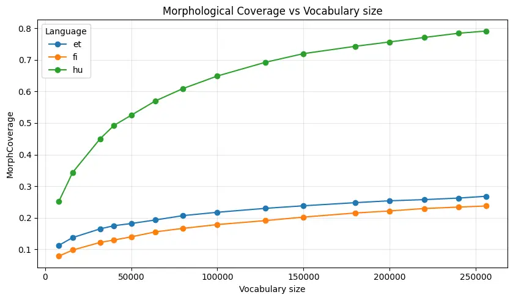
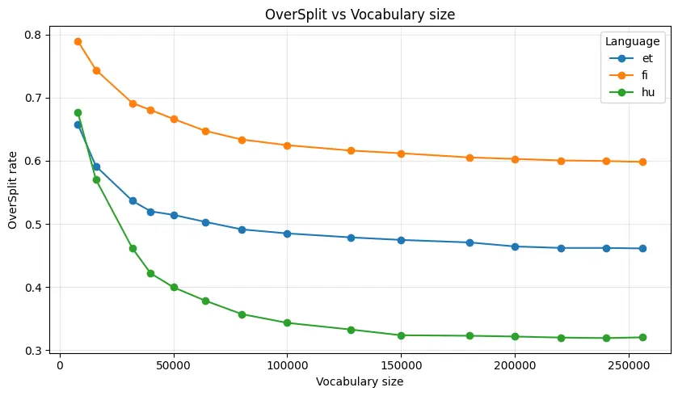
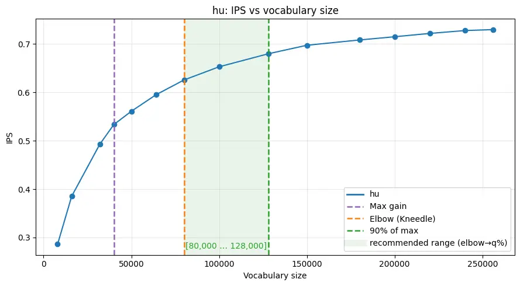
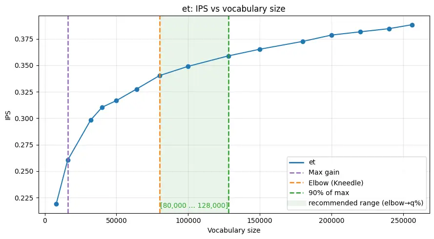
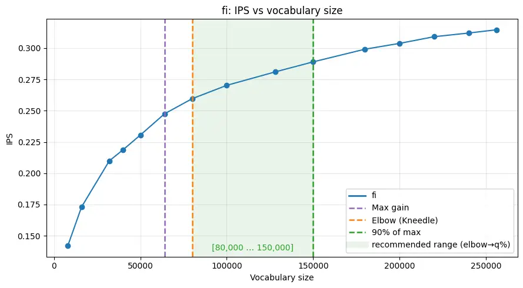

# SampoNLP: A Self-Referential Toolkit for Morphological Analysis of Subword Tokenizers

Iaroslav Chelombitko Affiliation: DataSpike, aglabx
Affiliation: Neapolis University Pafos Affiliation: Paphos, Cyprus
Email: [i.chelombitko@nup.ac.cy](mailto:)    Ekaterina Chelombitko
Affiliation: DataSpike Affiliation: Dubai, UAE
Email: [ekaterina@dataspike.io](mailto:)    Aleksey Komissarov
Affiliation: aglabx Affiliation: Paphos, Cyprus
Email: [ad3002@gmail.com](mailto:)

###### Abstract

The quality of subword tokenization is critical for Large Language
Models, yet evaluating tokenizers for morphologically rich Uralic
languages is hampered by the lack of clean morpheme lexicons.

We introduce SampoNLP, a corpus-free toolkit for morphological lexicon
creation using MDL-inspired Self-Referential Atomicity Scoring, which
filters composite forms through internal structural cues - suited for
low-resource settings.

Using the high-purity lexicons generated by SampoNLP for Finnish,
Hungarian, and Estonian, we conduct a systematic evaluation of BPE
tokenizers across a range of vocabulary sizes (8k–256k). We propose a
unified metric, the Integrated Performance Score (IPS), to navigate the
trade-off between morpheme coverage and over-splitting. By analyzing the
IPS curves, we identify the "elbow points" of diminishing returns and
provide the first empirically grounded recommendations for optimal
vocabulary sizes (k) in these languages. Our study not only offers
practical guidance but also quantitatively demonstrates the limitations
of standard BPE for highly agglutinative languages. The SampoNLP library
and all generated resources are made publicly available¹¹ 1
[https://github.com/AragonerUA/SampoNLP](https://github.com/AragonerUA/SampoNLP).

## 1 Introduction

The performance of subword tokenization algorithms like Byte-Pair
Encoding (BPE) sennrich-etal-2016-neural is a cornerstone of modern
Natural Language Processing (NLP). While highly effective for many
languages, their purely statistical nature poses a significant challenge
for morphologically rich, agglutinative languages
bostrom-durrett-2020-byte; rust-etal-2021-good. In the Uralic family, a
group of languages known for its complex morphology and diverse
linguistic phenomena riessler-2022-uralic, words are often long
concatenations of morphemes (e.g., Finnish talo-i-ssa-ni-ko-kaan - "not
in my houses either?"). For such languages, the quality of tokenization
is not just an engineering detail but a critical factor that determines
a model’s ability to grasp grammatical structure and generalize
effectively hamalainen-2021-neural; gerz-etal-2018-language. This raises
a pressing, yet under-explored, practical question, known to be a
challenge in Uralic NLP: What is the optimal tokenizer vocabulary size
(k) to achieve robust morphological representation? The importance of
this question was highlighted by recent work demonstrating the benefits
of specialized tokenizers for these languages
chelombitko-komissarov-2024-specialized.

Addressing this question reveals a more fundamental problem: the
scarcity of high-purity morphological resources for evaluation. While
lexical data is available in spell-checking dictionaries, their raw
combination of stems and affixes results in a noisy candidate list.
Manual curation is not scalable, and established corpus-based methods
like Morfessor creutz-lagus-2007-unsupervised are ill-suited for the
many low-resource Uralic languages arkhangelskiy-2020-corpus.

To address this challenge, we present SampoNLP, a toolkit based on a
corpus-free and self-referential pipeline for refining morphological
lexicons. The proposed method, "MDL-inspired Self-Referential Atomicity
Scoring," draws its theoretical motivation from the Minimum Description
Length principle rissanen-1978-modeling, but adapts it to a type-only
setting. The core algorithm iteratively estimates the atomicity of each
candidate, distinguishing between simple and composite forms by
analyzing internal structural patterns within the dataset itself. This
lightweight and reproducible approach offers a practical way to produce
cleaner morphological resources, a recognized need for data-scarce
environments where traditional corpus-based methods are not viable
riessler-2022-uralic.

Having established a robust methodology for resource creation, we
leverage our generated lexicons to address the core problem of this
paper: the vocabulary-morphology trade-off inherent in BPE tokenization
bostrom-durrett-2020-byte. We conducted a systematic evaluation of BPE
tokenizers for Finnish, Hungarian, and Estonian across vocabulary sizes
from 8k to 256k. The development of novel evaluation frameworks that go
beyond downstream performance is a growing area of research
chelombitko2024qtok. In line with this, to precisely navigate the
aforementioned trade-off, we introduce the Integrated Performance Score
(IPS), a single metric that balances Lexical Morpheme Coverage (LMC)
against the Over-Split Rate (OSR). This allows us to model the
performance curve and identify the optimal vocabulary range, providing a
principled answer to our central research question.

Our contributions are thus twofold and equally significant:

1.  1.  A Corpus-Free Morphological Method: We introduce a fully automatic
        and reproducible pipeline for refining morphological lexicons
        without relying on corpus frequencies or external resources,
        released as an open-source toolkit, SampoNLP.
2.  2.  A Quantitative Evaluation: We conduct a systematic analysis of BPE
        tokenizers for Finnish, Estonian, and Hungarian, examining how
        vocabulary size affects morphological granularity through newly
        defined metrics of coverage and over-segmentation.

## 2 Related Work

The evaluation and optimization of subword tokenization for
morphologically rich languages intersects several research areas:
subword tokenization algorithms, unsupervised morphological analysis,
rule-based analyzers, and language-specific NLP for Uralic languages.

### 2.1 Subword Tokenization and Morphology

Byte-Pair Encoding (BPE) sennrich-etal-2016-neural has become the de
facto standard for subword tokenization in modern NLP. Alongside it,
methods like the Unigram Language Model kudo-2018-subword have been
proposed, but the purely statistical nature of these approaches presents
well-documented challenges for morphologically complex languages. The
work of bostrom-durrett-2020-byte demonstrated that BPE tokenizers often
fail to align with linguistic morpheme boundaries. Interestingly,
parallel challenges in identifying meaningful subsequence units have
been explored in domains beyond NLP, such as the tokenization of
biological sequences like primate genomes
popova2025repeatsdrivevocabularybytepair.

The question of optimal vocabulary size has often been guided by
heuristics or evaluated indirectly via downstream task performance
mielke-etal-2021-results. Our work directly addresses this gap by
proposing a methodology for intrinsic, morphologically-grounded
evaluation to provide data-driven recommendations for Uralic languages.

### 2.2 Unsupervised Morphological Analysis

The unsupervised discovery of morphological structure has a rich
history. One major family of approaches relies on statistical cues from
corpora to identify boundaries. Classic methods such as Branching
Entropy and Accessor Variety feng2004accessor analyze the predictability
of subsequent characters to hypothesize morpheme breaks. Another
prominent family of methods is based on the Minimum Description Length
(MDL) principle. Morfessor creutz-lagus-2007-unsupervised and its
variants represent the canonical probabilistic approach, finding a
lexicon that best compresses a text corpus. While successful, these
methods are fundamentally corpus-based, requiring token frequency
information that may not be available in low-resource settings.

Our approach, while MDL-inspired, operates in a corpus-free, type-only
regime. It represents a different paradigm: self-referential filtering
of a candidate list. By operating purely on the internal structure of a
candidate set, we provide a lightweight method suited to resource-scarce
scenarios, a persistent challenge in Uralic NLP
arkhangelskiy-2020-corpus.

### 2.3 Rule-Based Analyzers and Tokenization for Uralic Languages

For Uralic languages, rule-based morphological analyzers built on
Finite-State Transducers (FSTs) like Omorfi pirinen-2015-omorfi and the
GiellaLT²² 2 [https://giellalt.github.io/](https://giellalt.github.io/)
infrastructure trosterud-2012-uralic are invaluable resources. While
their generative outputs are linguistically comprehensive, they are not
directly optimized for use as a minimal reference morphemes lexicon. Our
IMDP pipeline offers a contrasting approach: a data-driven methodology
for distilling such a lexicon from a type-only candidate list, as can be
extracted from dictionary-based resources like Hunspell, without
requiring token frequencies from a corpus.

The challenge of effective tokenization for this language family has
recently gained significant attention. Broader findings have established
that language-specific modeling is crucial for morphologically rich
languages, with studies on Finnish demonstrating clear benefits of
monolingual models like FinBERT over multilingual ones
virtanen-etal-2019-multilingual. Building on this principle, a recent
study by chelombitko-komissarov-2024-specialized specifically addressed
the severe under-representation of Uralic languages in large
multilingual models. They demonstrated that training specialized,
large-vocabulary monolingual tokenizers yields substantial improvements
in compression efficiency. However, while establishing the need for
specialized resources, their work left the question of how to determine
an optimal vocabulary size open for future investigation.

Concurrently, the need for better evaluation metrics has become a
prominent research topic. The Qtok framework chelombitko2024qtok, for
instance, proposed a comprehensive approach to evaluating multilingual
tokenizer quality, while other studies have also advocated for moving
beyond downstream task performance towards more intrinsic,
linguistically-informed measures acs-2019-tokenization. Our Integrated
Performance Score (IPS) directly addresses this call from the community
for more morphologically-grounded metrics.

Our current work builds on these foundations. It utilizes similar
high-quality data sources as those in
chelombitko-komissarov-2024-specialized to train the tokenizers being
evaluated. Furthermore, by proposing a concrete methodology, it answers
the call for better evaluation and finds the optimal vocabulary sizes
that the former study alluded to, thus providing a logical next step in
this line of research.

## 3 Methodology. The IMDP Pipeline

Figure 1: An overview of the Iterative Morphological Decomposition
Pipeline (IMDP).

To create a high-purity morpheme lexicon from a noisy, raw list of
candidate forms, we propose the Iterative Morphological Decomposition
Pipeline (IMDP). Our approach is designed to be fully automatic and
operates in a corpus-free, type-only regime, requiring only the
candidate list as input. The core of the pipeline is a method we term
"MDL-inspired Self-Referential Atomicity Scoring," which iteratively
evaluates how "fundamental" each candidate is relative to the entire
set. The entire process is visualized in Figure 1.

The pipeline consists of three main stages: (1) Pre-filtering and
Initial Scoring, (2) Iterative Score Refinement, and (3) Final Filtering
via Automated Thresholding.

### 3.1 Stage 1: Candidate Pre-filtering and Initial Scoring

This initial stage aims to drastically reduce non-linguistic noise and
establish a baseline score for each plausible candidate.

#### 3.1.1 Hard Pre-filtering

First, we apply a series of deterministic filters to the raw input list
$`C_{raw}`$. A token $`t\in C_{raw}`$ is discarded if it:

1.  1.  Contains symbols from a non-target script (e.g., Cyrillic in a
        Latin-based list). We define a valid character set $`\Sigma`$ for
        each language (e.g., \[a-záéíóöőúüű\] for Hungarian).
2.  2.  Contains any non-alphabetic characters (e.g., numbers, punctuation,
        URLs), excluding initial/final hyphens used to mark affixes.
3.  3.  Is a proper noun or acronym (heuristic: starts with a capital letter
        or consists of multiple uppercase letters).
4.  4.  Is excessively long ($`|t|>30`$) or too short ($`|t|<min\_length`$),
        unless $`t`$ is a single character present in a language-specific
        whitelist of valid one-character morphemes W.

#### 3.1.2 Type-support Filtering

To filter out typographical errors and other singleton noise, we apply a
"type-support" criterion to the remaining set of candidates
$`C^{\prime}`$. A candidate $`t\in C^{\prime}`$ is kept only if it
appears as a substring in at least $`m`$ other unique candidates in
$`C^{\prime}`$. This ensures that we only consider patterns that are
structurally recurrent within the dataset itself.
$`support(t)=|\{c\in C^{\prime}|t`$ is a substring of $`c\}|`$ We retain
$`t`$ if $`support(t)\geq m`$ (we use $`m=3`$). The resulting set is our
final candidate pool $`C`$.

#### 3.1.3 Initial Atomicity Scoring

Each surviving candidate $`t\in C`$ is assigned an initial Atomicity
Score $`S_{0}(t)`$. This score is based on the MDL-inspired principle
that, all else being equal, shorter forms are more likely to be
fundamental morphemic units. The score is defined as the inverse of the
token’s length: $`S_{0}(t)=\frac{1}{|t|}`$, where $`|t|`$ is the number
of characters in $`t`$.

### 3.2 Stage 2: Iterative Score Refinement

This is the core of our method. We iteratively refine the Atomicity
Scores until they converge. In each iteration $`k+1`$, the score of
every token $`t\in C`$ is re-calculated based on its "explainability" by
other tokens in the set.

#### 3.2.1 Optimal Decomposition and Best Explanation Power (BEP)

For each token $`t`$, we find its optimal decomposition into a sequence
of smaller tokens $`(m_{1},m_{2},...,m_{n})`$ where each $`m_{i}\in C`$.
The optimal decomposition is the one that maximizes the sum of the
scores of its constituents (taken from the previous iteration,
$`S_{k}`$). We find this maximum sum using a dynamic programming
algorithm and term it the Best Explanation Power, $`BEP_{k}(t)`$.

```math
\mathrm{BEP}_{k}(t)=\max_{\begin{subarray}{c}t=m_{1}\cdots m_{n}\\
n\geq 2\end{subarray}}\sum_{i=1}^{n}S_{k}(m_{i}).
```

The search space for decompositions is constrained by two rules:

1.  1.  Multi-component: The algorithm considers segmentations into any
        number of parts, not just two.
2.  2.  Degeneracy Prevention: Segments of length 1 are only considered if
        they are in the whitelist $`W`$.

#### 3.2.2 Score Update Rule

The new score $`S_{k+1}(t)`$ is calculated by comparing the token’s own
score with its explainability. A token is penalized only if the
"evidence" for it being composite ($`BEP_{k}(t)`$) is stronger than the
evidence for it being an atom ($`S_{k}(t)`$).

```math
S_{k+1}(t)=\begin{cases}S_{k}(t),&\text{if }\mathrm{BEP}_{k}(t)\leq S_{k}(t),\\[4.0pt]
\dfrac{S_{0}(t)}{1+\mathrm{BEP}_{k}(t)},&\text{if }\mathrm{BEP}_{k}(t)>S_{k}(t).\end{cases}
```

This update rule creates a competitive dynamic where atomic morphemes
retain high scores, while composite words are iteratively penalized
towards zero.

#### 3.2.3 Convergence

The iterative process continues until the system reaches a stable state.
We define convergence as the point where the maximum absolute change in
any token’s score between two consecutive iterations falls below a small
threshold

```math
\max_{t\in\mathcal{C}}\bigl|S_{k+1}(t)-S_{k}(t)\bigr|<\varepsilon
```

We use $`\varepsilon=1e-7`$ and a safeguard limit of
$`max\_iterations=100`$.

### 3.3 Stage 3: Final Filtering via Automated Thresholding

After the scores converge, the final distribution of scores typically
shows a heavy concentration of composite candidates at very low scores,
while atomic candidates retain higher scores. To automatically and
reproducibly determine a separation threshold between these groups, we
employ Otsu’s method otsu1979threshold. Originally developed for image
processing to separate foreground from background, this algorithm finds
an optimal threshold $`\tau`$ for a distribution by maximizing the
inter-class variance between the two resulting classes (in our case,
"atomic" vs. "composite"). This data-driven approach avoids manual
parameter tuning and adapts to the specific score distribution of each
dataset.

All tokens $`t`$ with a final score $`S_{final}(t)>=\tau`$ are
classified as atomic and form our final, high-purity morpheme lexicon.

|      |         |        |        |        |
| ---- | ------- | ------ | ------ | ------ |
| Lang | Initial | Atomic | Reduct | Reduct |
|      | Cands   | Morphs | %      | Factor |
| Fin  | 499,647 | 3,850  | 99.23% | 129.8x |
| Est  | 281,256 | 5,705  | 97.97% | 49.3x  |
| Hung | 103,317 | 3,189  | 96.91% | 32.4x  |

Table 1: Efficiency of the IMDP pipeline in cleaning and reducing
morpheme candidate lists.

## 4 Experimental Setup

To evaluate the impact of vocabulary size on morphological coverage, we
conducted a systematic analysis for three Uralic languages: Finnish,
Hungarian, and Estonian. Our experimental setup consists of three main
stages: creating the reference morphemes, training the tokenizers, and
defining the evaluation metrics.

### 4.1 Data

Our methodology requires two types of data for each language: a raw list
of morpheme candidates for cleaning and a large text corpus for
tokenizer training.

1.  1.  Morpheme Candidate Lists: The initial "dirty" lists of candidates
        were constructed from authoritative, open-source spell-checking
        dictionaries based on the Hunspell framework³³ 3
        [https://hunspell.github.io/](https://hunspell.github.io/). For
        Hungarian and Estonian, we utilized the comprehensive dictionaries
        curated by The LibreOffice Project⁴⁴ 4
        [https://github.com/LibreOffice/dictionaries](https://github.com/LibreOffice/dictionaries).
        For Finnish, which requires special handling of compounds, we used
        the dedicated dictionary from the hunspell-fi project⁵⁵ 5
        [https://github.com/fginter/hunspell-fi](https://github.com/fginter/hunspell-fi).
        For each language, the full set of unique stems (from.dicfiles) and
        affixes (from.afffiles) was merged to create a comprehensive but
        structurally noisy candidate list, which serves as the input to our
        IMDP pipeline. This approach of leveraging widely available
        dictionary resources provides a practical starting point for
        morphological analysis.
2.  2.  Text Corpora: For training the BPE tokenizers, we used large,
        pre-processed corpora derived from Wikipedia snapshots⁶⁶ 6
        [https://dumps.wikimedia.org](https://dumps.wikimedia.org). Our
        choice of data source and preprocessing methodology aligns with
        previous work on creating specialized Uralic tokenizers
        chelombitko-komissarov-2024-specialized, ensuring a comparable basis
        for our analysis. It is critical to emphasize that these corpora
        were used exclusively for training the BPE tokenizers and were not
        used in any stage of our morpheme list refinement pipeline, thus
        preserving the corpus-free nature of the IMDP method.

### 4.2 Reference Lexicon Creation

For each of the three languages, we applied our Iterative Morphological
Decomposition Pipeline (IMDP), as described in Section 3, to the
corresponding raw candidate list. The pipeline was configured with the
following parameters: a minimum morpheme length $`min\_length=1`$, a
minimum type-support $`m=3`$, and a convergence threshold
$`\varepsilon=1e-7`$. The process was run until convergence. The final
filtering was performed using the automatically determined Otsu
threshold otsu1979threshold. This procedure yielded three high-purity
reference morpheme lexicons ($`G_{fin}`$, $`G_{hun}`$, $`G_{est}`$), the
statistics of which are summarized in Table 1.

### 4.3 Tokenizer Training

Using the tokenizers library⁷⁷ 7
[https://github.com/huggingface/tokenizers](https://github.com/huggingface/tokenizers)
and SentencePiece kudo2018sentencepiece for comparison, we trained a
series of Byte-Pair Encoding (BPE) tokenizers for each language from
scratch. The tokenizers were trained on the respective Wikipedia
corpora. To analyze the effect of vocabulary size, we trained separate
models for a range of vocabulary sizes k, starting from 8,000 and up to
256,000 ($`k\in`$ {8k, 16k, 32k, 40k, 50k, 64k, 80k, 100k, 128k, 150k,
180k, 200k, 220k, 240k, 256k}). All tokenizers were trained with a
$`min\_frequency`$ of $`2`$ for merges.

### 4.4 Evaluation Metrics

To provide a nuanced and rigorous evaluation of tokenizer quality, we
must account for the fundamental trade-off between morphological
coverage and over-segmentation. A tokenizer that perfectly represents
all morphemes (high coverage) but also excessively splits common words
is not optimal. To capture this balance in a single, unified score, we
introduce the Integrated Performance Score (IPS).

The IPS models this trade-off geometrically. We consider a 2D space
where the ideal tokenizer resides at the point (Coverage=1,
OverSplit=0). The IPS of any real tokenizer is its normalized Euclidean
distance from this ideal point, scaled to a \[0, 1\] range where 1 is
perfect.

First, we define the two core components:

1.  1.  Lexical Morpheme Coverage (LMC): The fraction of atomic morphemes
        from our reference lexicon $`G`$ that are perfectly represented as a
        single token in the tokenizer’s vocabulary $`V_{k}`$. This measures
        the tokenizer’s lexical "knowledge" of fundamental morphological
        units.

    ```math
    \mathrm{LMC}\;=\;\frac{\bigl|\{\,m\in G\;\mid\;m\in V_{k}\,\}\bigr|}{|G|}.
    ```

2.  2.  Over-split Rate (OSR): The fraction of morphemes from G that the
        tokenizer fails to represent as single tokens, thus always splitting
        them into multiple pieces.

    ```math
    \mathrm{OSR}=\frac{\left|\left\{\,m\in M\,\middle|\,\begin{subarray}{c}m\text{ occurs in $\geq$1 word}\\
    m\text{ never as a single token}\end{subarray}\right\}\right|}{\left|\left\{\,m\in M\,\middle|\,m\text{ in $\geq$1 word}\right\}\right|}.
    ```

From these, the Integrated Performance Score (IPS) is calculated as:

$`IPS=1-(\frac{\sqrt{(1-LMC)^{2}+OSR^{2}}}{\sqrt{2}})`$

This single metric allows for a clear and direct comparison of
tokenizers across different vocabulary sizes. A higher IPS indicates a
better balance between representing morphemes and avoiding excessive
fragmentation. Our final analysis of optimal vocabulary sizes is based
on identifying the "elbow point" on the IPS vs. vocabulary size curve.

## 5 Results and Analysis

Our experiment yielded clear and significant patterns regarding the
relationship between tokenizer vocabulary size and morphological
performance. To capture the fundamental trade-off between coverage and
over-segmentation, we analyzed the Integrated Performance Score (IPS)
for each language. The resulting IPS curves for Estonian (Figure 5),
Finnish (Figure 6), and Hungarian (Figure 4) clearly show the
performance profile for each language. Supplementary details on the
component metrics (LMC and OSR) available in Figures 2 and 3.



Figure 2: Lexical Morpheme Coverage (LMC) across different vocabulary
sizes (k). LMC represents the percentage of reference morphemes found as
single, complete tokens in the tokenizer’s vocabulary.



Figure 3: Over-Split Rate (OSR) as a function of vocabulary size (k).
OSR denotes the fraction of reference morphemes that occur in words but
never appear as a single token in any tokenization.

### 5.1 General Observation: A Clear Trade-off Profile

The IPS curves for all three languages exhibit a classic logarithmic
growth pattern, demonstrating the law of diminishing returns. The score
increases rapidly for smaller vocabulary sizes, indicating that initial
additions to the vocabulary are highly efficient at capturing
morphological structure. However, the rate of improvement progressively
slows, showing that ever-larger vocabularies provide only marginal gains
at a significant cost to model size. This confirms that a "sweet spot"
or an optimal range exists for each language.

### 5.2 Cross-Linguistic Analysis: Three Distinct Performance Tiers

The results reveal three distinct performance tiers, highlighting the
varying degrees to which standard BPE can model the morphology of these
languages.

1.  1.  Hungarian (hu): As shown in Figure 4, Hungarian demonstrates by far
        the best performance. Its IPS curve starts at 0.29 and rises
        sharply, reaching a maximum of 0.73. This high score suggests that
        BPE is reasonably effective at learning the statistical regularities
        of Hungarian morphology.
2.  2.  Estonian (et): Estonian occupies the middle tier, with its IPS curve
        depicted in Figure 5. The score starts at 0.22 and reaches a maximum
        of 0.39. While better than Finnish, this score indicates that less
        than 40% of the "ideal" tokenizer performance is achieved, even with
        a large vocabulary.
3.  3.  Finnish (fi): Figure 6 illustrates the most challenging profile for
        Finnish. With a maximum IPS of only 0.31, the results quantitatively
        demonstrate that standard BPE is fundamentally ill-suited for
        capturing the complexities of Finnish morphology.



Figure 4: IPS vs. vocabulary size (k) for Hungarian. Hungarian shows the
most consistent improvement in IPS, reflecting its comparatively
transparent agglutinative structure with fewer morphophonological
alternations. The elbow point is at 80k, and the 90% quality threshold
at 128k, yielding a recommended range of 80k–128k.

### 5.3 Identifying the Optimal Vocabulary Range (k\*)

To determine a practical and effective vocabulary size, we define a
recommended range for k\*. The lower bound of this range is the "elbow"
point (k_elbow), identified by the Kneedle algorithm satopaa2011finding,
which marks the point of diminishing returns. The upper bound is the 90%
quality point (k_q90), where 90% of the maximum observed IPS is
achieved. As shown in Figures 4, 6, 5, and summarized in Table 2, this
analysis leads to the following recommendations:

|      |                         |                       |                           |                     |
| ---- | ----------------------- | --------------------- | ------------------------- | ------------------- |
| Lang | Max Gain Point (k_gain) | Elbow Point (k_elbow) | 90% Quality Point (k_q90) | Recommend k\* Range |
| Hung | 40,000                  | 80,000                | 128,000                   | 80k – 128k          |
| Est  | 16,000                  | 80,000                | 128,000                   | 80k – 128k          |
| Fin  | 64,000                  | 80,000                | 150,000                   | 80k – 150k          |

Table 2: Key points on the IPS curve for determining the optimal
vocabulary range.

1.  1.  Hungarian (hu): The IPS curve for Hungarian (Figure 4) shows a clear
        optimal range between k=80,000 and k=128,000. The elbow is found at
        80k, and 90% of the maximum performance is reached at 128k. As
        visualized on the plot, expanding the vocabulary beyond this range
        yields only minimal performance gains.
2.  2.  Estonian (et): For Estonian (Figure 5), the recommended range is
        also k=80,000 to k=128,000. Similar to Hungarian, the elbow is at
        80k and the 90% quality mark is at 128k, establishing this as the
        zone of best compromise between performance and size.
3.  3.  Finnish (fi): The analysis for Finnish (Figure 6) indicates a need
        for a larger vocabulary. The elbow is at k=80,000, but to achieve
        90% of the (albeit low) maximum performance, a vocabulary of
        k=150,000 is required. This suggests that for Finnish, the optimal
        range is k=80,000 to k=150,000, reflecting the language’s high
        morphological complexity.



Figure 5: IPS vs. vocabulary size (k) for Estonian. While the overall
pattern of diminishing returns is similar to Hungarian, the lower IPS
plateau indicates reduced learnability due to Estonian’s extensive
morphophonological alternations, which obscure orthographic morpheme
boundaries. The recommended range remains 80k–128k.

These findings provide a quantitative foundation for the critical
decision of vocabulary sizing, transforming it from a heuristic-based
choice into a principled optimization problem. Complete numerical
results for all evaluated vocabulary sizes are provided in Appendix A
(Table 3) for reference.

## 6 Conclusion

In this work, we addressed the dual challenge of creating high-purity
morphological resources in a corpus-free setting and using them to
evaluate subword tokenizers for Uralic languages. We introduced
SampoNLP, a toolkit featuring a novel pipeline based on "MDL-inspired
Self-Referential Atomicity Scoring," which successfully refines noisy
candidate lists into clean morpheme lexicons.

Applying these lexicons, our systematic evaluation of BPE tokenizers
yielded two key findings. First, we provide an empirically-grounded
recommendations for optimal vocabulary sizes, identifying a range of
80k-128k for Hungarian and Estonian, and 80k-150k for Finnish, as the
most effective trade-off between performance and model size. Second, our
results quantitatively demonstrate the severe limitations of standard
BPE for highly agglutinative languages like Finnish, where performance
plateaus at a strikingly low level.

This study confirms that while vocabulary size optimization is a crucial
step, it is not a panacea. We release our SampoNLP library and the
generated morpheme lists to the community to facilitate reproducible
research and encourage the development of more morphologically-aware
tokenization methods for the Uralic language family.



Figure 6: IPS vs. vocabulary size (k) for Finnish. Finnish exhibits the
lowest IPS plateau, consistent with its rich system of consonant
gradation and stem alternations, which make orthographic segmentation
less stable for BPE. The elbow is at 80k, while 90% of the maximum IPS
is reached at 150k, suggesting a recommended range of 80k–150k.

## Discussion

Our results yield two key insights. First, the effectiveness of BPE
varies dramatically by language: while Hungarian achieves a high IPS
(max $`\sim`$0.73), the low scores for Finnish ($`\sim`$0.31) and
Estonian ($`\sim`$0.39) quantitatively demonstrate the algorithm’s
fundamental limitations for these highly agglutinative languages.
Second, for all languages, an empirically identifiable "sweet spot" for
vocabulary size exists, beyond which performance gains diminish. Here,
“optimality” is understood as morphological sufficiency - the point at
which the tokenizer captures the productive structure of a language with
minimal redundancy. This notion is intrinsic by design, offering a
language-level criterion rather than task-specific optimization.

We acknowledge the limitations of our approach. The IPS metric abstracts
away qualitative segmentation differences - a necessary compromise for
scalability. Our use of clean, standardized corpora also isolates the
variable of vocabulary size but does not reflect the noise of real-world
data. These aspects represent clear avenues for future work.

While our method produces a refined set of recurrent sub-lexical units,
we do not claim full linguistic morpheme correctness. The IMDP
segmentation is orthographic and self-referential in nature, providing a
practical approximation rather than a phonologically grounded
morphological analysis.

In conclusion, our findings suggest that while optimizing k\* is a
crucial step, it may be insufficient for languages like Finnish. The low
performance ceiling for BPE underscores the need for
morphologically-aware tokenization methods. We believe our SampoNLP
toolkit and the generated lexicons provide the community with a
reproducible benchmark to develop and test such new strategies.

## References

## Appendix A Appendix

|           |                     |                 |                     |                   |
| --------- | ------------------- | --------------- | ------------------- | ----------------- |
| Language  | Vocabulary Size (k) | Total Morphemes | Morpheme Coverage % | Over-Split Rate % |
| Estonian  | 8,000               | 5,705           | 11.27%              | 65.79%            |
| Estonian  | 16,000              | 5,705           | 13.71%              | 59.13%            |
| Estonian  | 32,000              | 5,705           | 16.49%              | 53.65%            |
| Estonian  | 40,000              | 5,705           | 17.48%              | 51.98%            |
| Estonian  | 50,000              | 5,705           | 18.18%              | 51.43%            |
| Estonian  | 64,000              | 5,705           | 19.30%              | 50.32%            |
| Estonian  | 80,000              | 5,705           | 20.68%              | 49.13%            |
| Estonian  | 100,000             | 5,705           | 21.74%              | 48.49%            |
| Estonian  | 128,000             | 5,705           | 22.99%              | 47.86%            |
| Estonian  | 150,000             | 5,705           | 23.79%              | 47.46%            |
| Estonian  | 180,000             | 5,705           | 24.78%              | 47.06%            |
| Estonian  | 200,000             | 5,705           | 25.38%              | 46.43%            |
| Estonian  | 220,000             | 5,705           | 25.74%              | 46.19%            |
| Estonian  | 240,000             | 5,705           | 26.23%              | 46.19%            |
| Estonian  | 256,000             | 5,705           | 26.81%              | 46.11%            |
| Finnish   | 8,000               | 3,850           | 7.85%               | 78.96%            |
| Finnish   | 16,000              | 3,850           | 9.76%               | 74.37%            |
| Finnish   | 32,000              | 3,850           | 12.20%              | 69.13%            |
| Finnish   | 40,000              | 3,850           | 12.95%              | 68.04%            |
| Finnish   | 50,000              | 3,850           | 13.95%              | 66.62%            |
| Finnish   | 64,000              | 3,850           | 15.53%              | 64.73%            |
| Finnish   | 80,000              | 3,850           | 16.63%              | 63.36%            |
| Finnish   | 100,000             | 3,850           | 17.84%              | 62.46%            |
| Finnish   | 128,000             | 3,850           | 19.11%              | 61.61%            |
| Finnish   | 150,000             | 3,850           | 20.21%              | 61.18%            |
| Finnish   | 180,000             | 3,850           | 21.51%              | 60.52%            |
| Finnish   | 200,000             | 3,850           | 22.16%              | 60.28%            |
| Finnish   | 220,000             | 3,850           | 22.93%              | 60.05%            |
| Finnish   | 240,000             | 3,850           | 23.38%              | 59.95%            |
| Finnish   | 256,000             | 3,850           | 23.73%              | 59.81%            |
| Hungarian | 8,000               | 3,189           | 25.15%              | 67.72%            |
| Hungarian | 16,000              | 3,189           | 34.34%              | 57.01%            |
| Hungarian | 32,000              | 3,189           | 45.03%              | 46.14%            |
| Hungarian | 40,000              | 3,189           | 49.23%              | 42.17%            |
| Hungarian | 50,000              | 3,189           | 52.46%              | 39.97%            |
| Hungarian | 64,000              | 3,189           | 56.98%              | 37.84%            |
| Hungarian | 80,000              | 3,189           | 60.90%              | 35.72%            |
| Hungarian | 100,000             | 3,189           | 64.88%              | 34.33%            |
| Hungarian | 128,000             | 3,189           | 69.24%              | 33.27%            |
| Hungarian | 150,000             | 3,189           | 71.97%              | 32.37%            |
| Hungarian | 180,000             | 3,189           | 74.29%              | 32.28%            |
| Hungarian | 200,000             | 3,189           | 75.67%              | 32.16%            |
| Hungarian | 220,000             | 3,189           | 77.08%              | 32.00%            |
| Hungarian | 240,000             | 3,189           | 78.43%              | 31.92%            |
| Hungarian | 256,000             | 3,189           | 79.12%              | 32.04%            |

Table 3: Detailed experimental results for BPE tokenizers of varying
vocabulary sizes across three Uralic languages. Morpheme Coverage
represents the percentage of reference morphemes found in the vocabulary
(LMC). Over-Split Rate is the percentage of reference morphemes with
support in W that never appear as a single token in any tokenization.
