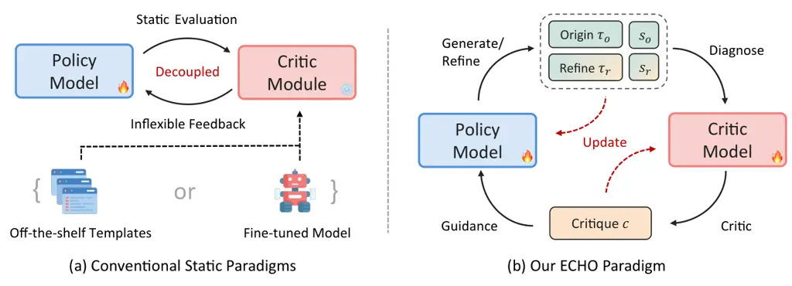
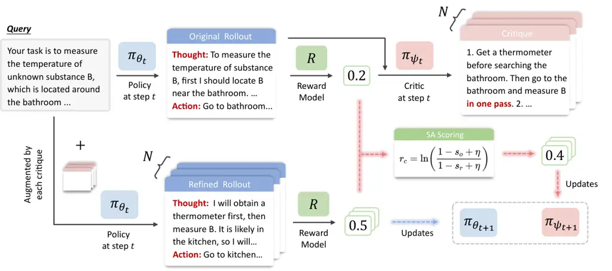
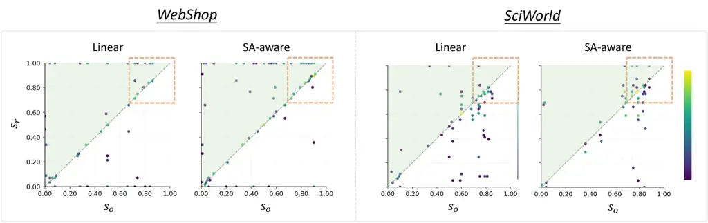

# No More Stale Feedback: Co-Evolving Critics for Open-World Agent Learning

Zhicong Li¹¹ 1 Equal contribution. Affiliation: Gaoling School of
Artificial Intelligence, Renmin University of China Affiliation: Amap,
Alibaba Group Email: <huyulan@alibaba-inc.com>    Lingjie Jiang¹¹ 1
Equal contribution. Affiliation: Peking University
Email: <zhangxiangwen.zxw@alibaba-inc.com>    Yulan Hu
Affiliation: Amap, Alibaba Group Email: <panzheng.pan@alibaba-inc.com>
   Xingchen Zeng Affiliation: The Hong Kong University of Science and
Technology (Guangzhou) Email: <beilai.bl@alibaba-inc.com>    Yixia Li
Affiliation: Southern University of Science and Technology{zhicongli,
liuyonggsai}@ruc.edu.cn, lingjiejiang@stu.pku.edu.cn
Email: <xzeng159@connect.hkust-gz.edu.cn>    Xiangwen Zhang
Affiliation: Amap, Alibaba Group Email: <liyixia@me.com>    Guanhua Chen
Affiliation: Southern University of Science and Technology{zhicongli,
liuyonggsai}@ruc.edu.cn, lingjiejiang@stu.pku.edu.cn
Email: <ghchen08@gmail.com>    Zheng Pan Affiliation: Amap, Alibaba
Group    Xin Li Affiliation: Amap, Alibaba Group    Yong Liu²² 2
Corresponding author. Affiliation: Gaoling School of Artificial
Intelligence, Renmin University of China

###### Abstract

Critique-guided reinforcement learning (RL) has emerged as a powerful
paradigm for training LLM agents by augmenting sparse outcome rewards
with natural-language feedback. However, current methods often rely on
static or offline critic models, which fail to adapt as the policy
evolves. In on-policy RL, the agent’s error patterns shift over time,
causing stationary critics to become stale and providing feedback of
diminishing utility. To address this, we introduce ECHO (Evolving Critic
for Hindsight-Guided Optimization), a framework that jointly optimizes
the policy and critic through a synchronized co-evolutionary loop. ECHO
utilizes a cascaded rollout mechanism where the critic generates
multiple diagnoses for an initial trajectory, followed by policy
refinement to enable group-structured advantage estimation. We address
the challenge of learning plateaus via a saturation-aware gain shaping
objective, which rewards the critic for inducing incremental
improvements in high-performing trajectories. By employing dual-track
GRPO updates, ECHO ensures the critic’s feedback stays synchronized with
the evolving policy. Experimental results show that ECHO yields more
stable training and higher long-horizon task success across open-world
environments.

## 1 Introduction

Reinforcement learning (Sutton et al., 1998) has emerged as a promising
paradigm for training Large Language Model (LLM)-based
agents (Anthropic, 2024; Team et al., 2025), enabling them to navigate
complex tasks through environmental interactions. Within this paradigm,
reward signals (Wen et al., 2025) serve as the fundamental compass for
policy optimization. However, these signals often lack actionability, as
they merely reflect the final outcome without providing the diagnostic
insights necessary for effective refinement, ultimately leading to
significant data inefficiency (Gao et al., 2025; Yang et al., 2025b).

To bridge this gap, recent research has introduced linguistic critics to
provide diagnostic feedback (Dhuliawala et al., 2024). A common line of
work uses template-based critiques (Wang et al., 2025; Liu et al., 2025;
Huang et al., 2025), which are computationally inexpensive but lack the
adaptability to deliver feedback tailored to the agent’s specific
actions. To provide more targeted guidance, another line of work employs
independently fine-tuned, separate critic models to refine policy
outputs (McAleese et al., 2024). These models are typically designed to
act as external supervisors, aiming to provide the diagnostic feedback
necessary to resolve complex failures.

Although these methods overcome the limitations of static templates by
offering more detailed feedback, they remain decoupled from the policy’s
learning process, implicitly assuming that the optimal critique strategy
is stationary. In on-policy RL, however, the policy continuously
evolves, inducing a shifting trajectory distribution and a corresponding
drift in failure patterns: early-stage rollouts may be dominated by
coarse mistakes that benefit from high-level hints, whereas later-stage
policies are more often bottlenecked by subtle, hard-to-localize
defects. Consequently, a critic trained (and then frozen) on an earlier
distribution can become stale, producing feedback that is redundant,
miscalibrated in granularity, or even misleading for the current policy,
and causing its marginal utility to decay as training progresses. This
critic staleness fundamentally limits sample efficiency and prevents
critique-guided RL from sustaining improvement in long-horizon
refinement.



Figure 1: Comparison of critic paradigms. (a) Conventional Static
Paradigms: Use decoupled, frozen critic modules initialized from
off-the-shelf templates or fine-tuned separate models, resulting in
static evaluation and inflexible feedback. (b) Our ECHO Paradigm: Policy
and critic co-evolve organically. The policy first generates an initial
rollout $`\tau_{o}`$, refined to $`\tau_{r}`$ using the critic’s
diagnostic guidance $`c`$. Both models are jointly updated, ensuring the
critic’s diagnostic precision synchronizes with the policy’s evolving
failure patterns.

Motivated by this observation, we posit that the critic should be
treated as a co-evolving module rather than a stationary supervisor,
adapting alongside the policy (Figure 1). Concretely, we propose ECHO
(Evolving Critic for Hindsight-Guided Optimization), a framework that
fosters a symbiotic optimization loop between the policy and the critic.
Instead of rewarding the critic for sounding plausible, we directly
optimize it for policy improvement: critiques are evaluated by the
performance gains they induce after refinement, and the critic is
updated in lockstep with the policy to track its changing failure modes.
To make this co-evolution stable and sample-efficient, ECHO employs a
cascaded diagnostic-and-corrective rollout that generates
group-structured trajectories for relative advantage estimation, and
introduces a saturation-aware gain shaping to provide informative
learning signals even when improvements become incremental.

Our main contributions are: (1) We identify and empirically demonstrate
critic staleness in critique-guided RL, freezing the critic leads to a
clear decay in critique utility as the policy improves. (2) We introduce
ECHO, a synchronized co-evolutionary optimization paradigm that jointly
aligns the critic and the policy via dual-track GRPO. (3) We propose a
saturation-aware reward design and group-relative optimization scheme
that jointly improve training stability and boost performance across
tasks.

## 2 Related Work

In long-horizon decision-making for LLM-based agents, scalar outcome
rewards are often non-diagnostic, motivating language-based critiques as
actionable supervision (Gao et al., 2025; Yang et al., 2025b; Zhao et
al., 2025). Prior work typically implements language critics either as
static, template/offline-generated feedback, or as separately trained
critic models.

##### Template-based Critics.

A lightweight line of work injects pre-defined hints as critique
signals, avoiding training a separate critic model. HINT (Wang et al., 2025) steers ineffective rollouts toward effectiveness by appending
generic, hand-crafted hints to trigger regeneration. Tang et al. (2025)
further adopts a small set of error-conditioned prompt templates,
routing different failure cases to different pre-defined guidance
patterns. Moving beyond generic guidance, LUFFY (Yan et al., 2025)
mitigates inefficient exploration by injecting a teacher model’s correct
answer as the rollout outcome. To better control the granularity of the
guidance, more structured hints have also been explored. GHPO (Liu et
al., 2025) and ADHint (Zhang et al., 2025a) provides stronger
supervision by injecting masked partial reference solutions as hints,
effectively revealing part of the answer to stabilize and accelerate
learning.

StepHint (Zhang et al., 2025b) uses a teacher model to generate a full
chain-of-thought, splits it into $`N`$ reasoning steps, and forms hints
by concatenating different numbers of prefix steps. In contrast,
Scaf-GRPO (Zhang et al., 2025c) designs critic templates that progress
from abstract to concrete guidance, providing coarse-to-fine guidance
conditioned on the model’s current performance.

##### Training-based Critics.

Another line of work trains dedicated critic models to generate more
informative, diagnostic feedback. Early attempts (Saunders et al., 2022;
Ke et al., 2024; Xi et al., 2024; Tang et al., ) primarily rely on
single-stage fine-tuning, typically by curating critique datasets and
training models to generate natural-language feedback for evaluation and
verification. Yu et al. (2025) propose Refinement-oriented Critique
Optimization (RCO), which trains a critic in a critique–refinement loop
by rewarding critiques according to the utility of the actor’s refined
outputs. Multi-stage training has also been investigated to stabilize
learning across different training objectives. CGI (Yang et al., 2025b)
leverages critique-guided iterative improvement for agents through
staged updates, typically treating the critic as a fixed supervisor.
CTRL (Xie et al., 2025) introduces a two-stage training pipeline that
first distills critiques via SFT and then applies GRPO to optimize
critique generation directly for downstream refinement success.

Despite these advances, most training-based critics are trained
off-policy and then frozen or updated asynchronously, remaining
decoupled from on-policy policy learning. As the policy’s trajectory
distribution and failure patterns shift over time, the critic becomes
stale, and its ability to provide useful critiques gradually decays.

## 3 Methodology



Figure 2: Overview of ECHO training with saturation-aware (SA) critic
rewards. At step $`t`$, the policy $`\pi_{\theta_{t}}`$ produces
rollouts $`\tau_{o}`$, which are scored by a reward model to obtain
$`s_{o}`$. A critic $`\pi_{\psi_{t}}`$ generates critiques that are
appended to the original query to elicit refined rollouts $`\tau_{r}`$,
scored as $`s_{r}`$. We compute the SA critic reward $`r_{c}`$ to
emphasize last-mile improvements near saturation, and update the critic
and policy synchronously to obtain $`\pi_{\psi_{t+1}}`$ and
$`\pi_{\theta_{t+1}}`$.

To address critic staleness caused by decoupled training under on-policy
failure-pattern drift, we propose ECHO, a co-evolutionary interplay
between a Policy $`P_{\theta}`$ and a Critic $`C_{\psi}`$, rather than a
static supervision task. Within this paradigm, we treat the refinement
process as a dynamic synchronization problem where two models co-evolve
in a shared on-policy trajectory space:

- •
  $`P_{\theta}`$ (The Actor) learns to convert diagnostic feedback into
  corrective actions. Rather than relying on unguided exploration, it
  conditions on the critic’s current diagnoses to produce refinements
  that directly improve task reward.
- •
  $`C_{\psi}`$ (The Diagnostic Evolver) is rewarded for feedback that
  maximizes the policy’s performance gain, thereby learning to pinpoint
  the flaws that causes the policy’s failure.

This joint evolution ensures that the critic’s diagnostic depth is
continuously calibrated to the policy’s shifting failure patterns. By
optimizing both models through a dual-track GRPO mechanism, we transform
the refinement process into a self-improving system where evaluative
precision and execution capability evolve in tandem. Figure 2 summarizes
the overall training loop and illustrates a concrete refinement example.

### 3.1 Cascaded Evolutionary Rollout

To facilitate the symbiotic optimization of both models, ECHO employs a
cascaded rollout mechanism that generates group-structured trajectories
through a diagnostic-and-corrective cycle.

##### Stage 1: Multi-view Diagnosis.

Given a query $`q`$, the policy $`P_{\theta}`$ first generates an
initial trajectory $`\tau_{o}\sim P_{\theta}(\cdot\mid q)`$. To provide
an objective basis for diagnosis, an external reward model $`R`$
evaluates the proposal to obtain a baseline score
$`s_{o}=R(q,\tau_{o})`$. Conditioned on both the trajectory and its
corresponding score, the critic $`C_{\psi}`$ is invoked $`N`$ times
independently to produce a set of diverse diagnostic feedbacks
$`\mathcal{G}_{C}=\{c_{o}^{(j)}\}_{j=1}^{N}`$:

```math
c_{o}^{(j)}\sim C_{\psi}(\cdot\mid q,\tau_{o},s_{o}),\quad j=1,2,\dots,N. \tag{1}
```

By incorporating $`s_{o}`$ into the prompt, the critic is empowered to
provide "score-aware" explanations, identifying the specific gaps that
prevent the trajectory from achieving a higher reward.

##### Stage 2: Conditional Refinement.

Following the diagnosis, the policy $`P_{\theta}`$ is required to
internalize these critiques into precise corrective actions. Conditioned
on the augmented input $`\tilde{q}^{(j)}=(q,c_{o}^{(j)})`$, the policy
samples a corresponding set of refined trajectories:

```math
\tau_{r}^{(j)}\sim P_{\theta}(\cdot\mid\tilde{q}^{(j)}),\quad j=1,2,\dots,N. \tag{2}
```

The reward model evaluates each refinement to yield the post-correction
scores $`s_{r}^{(j)}=R(q,\tau_{r}^{(j)})`$. This cascaded rollout
produces the baseline score $`s_{o}`$, the critique group
$`\mathcal{G}_{C}`$, and the refinement group
$`\mathcal{G}_{P}=\{\tau_{r}^{(j)}\}_{j=1}^{N}`$, which serve as the
empirical signals for the co-evolutionary optimization.

### 3.2 Saturation-Aware Reward Design

A straightforward approach to quantifying the utility of a critique is
to measure the linear improvement in reward, i.e.,
$`\Delta s=s_{r}-s_{o}`$. However, this linear metric fails to account
for the saturation effect in model optimization: as the initial score
$`s_{o}`$ approaches the performance ceiling (e.g., $`s\to 1`$), the
marginal effort and information required to achieve a further increment
surge. Treating an improvement from $`0.9`$ to $`0.95`$ as equivalent to
one from $`0.1`$ to $`0.15`$ creates an "equidistant fallacy," which
discourages the critic from diagnosing subtle yet critical flaws in
high-quality proposals and leads to optimization plateaus.

To address this, we hypothesize that the reward space is non-linear and
governed by a difficulty weighting function $`\omega(s)`$. We define
$`\omega(s)`$ as a soft barrier function that captures the increasing
difficulty of entropy reduction as perfection is approached:

```math
\omega(s)=\frac{1}{1-s+\eta}, \tag{3}
```

where $`\eta>0`$ is a smoothing hyperparameter. We define the intrinsic
gain of a refinement as the path integral of $`\omega(s)`$ from
$`s_{o}`$ to $`s_{r}`$:

```math
g(s_{o},s_{r})=\int_{s_{o}}^{s_{r}}\omega(s)ds=\ln\left(\frac{1-s_{o}+\eta}{1-s_{r}+\eta}\right). \tag{4}
```

This choice yields a principled shaping signal Ng et al. (1999) with
three desirable properties. First, it is _saturation-aware_: for the
same $`\Delta s`$, the gain $`g`$ is larger when the improvement happens
in a higher-score region, encouraging the critic to focus on subtle yet
impactful flaws in near-correct proposals. Second, it is _additive_
(path-consistent):

```math
g(s_{o},s_{m})+g(s_{m},s_{r})=g(s_{o},s_{r}), \tag{5}
```

which makes the training signal invariant to whether refinement is
performed in one step or through multiple intermediate edits. Third, the
gain is _antisymmetric_, $`g(s_{o},s_{r})=-g(s_{r},s_{o})`$, providing a
unified measure that rewards improvements and penalizes regressions
under the same scale.

Finally, we use this intrinsic gain directly as the critic reward:

```math
r_{c}=g(s_{o},s_{r})=\ln\left(\frac{1-s_{o}+\eta}{1-s_{r}+\eta}\right). \tag{6}
```

### 3.3 Synchronized Co-evolutionary Optimization

Instead of treating the critic as a static oracle, we operationalize the
co-evolution as a synchronized dual-track alignment problem. We
formulate a closed-loop optimization where both $`P_{\theta}`$ and
$`C_{\psi}`$ explore a shared trajectory space, mutually anchoring each
other’s learning progress. This is achieved by constructing two
interdependent group structures:

```math
\displaystyle\mathcal{G}_{P}(q)=\{\tau_{r}^{(1)},\tau_{r}^{(2)},\dots,\tau_{r}^{(N)}\}, \tag{7}
```

```math
\displaystyle\mathcal{G}_{C}(q,\tau_{o})=\{c_{o}^{(1)},c_{o}^{(2)},\dots,c_{o}^{(N)}\}. \tag{8}
```

Here, $`\mathcal{G}_{C}`$ represents the diagnostic hypothesis space
containing $`N`$ distinct interpretations of the proposal’s flaws, while
$`\mathcal{G}_{P}`$ represents the corrective action space conditioned
on those hypotheses.

##### Dual-Track Advantage Estimation.

To maximize sample efficiency, we compute group-relative advantages that
capture the marginal utility of each model’s output. For the policy
$`P_{\theta}`$, the advantage $`A_{P}^{(j)}`$ is computed by normalizing
the scores $`s_{r}^{(j)}`$ within $`\mathcal{G}_{P}`$. This allows the
policy to efficiently identify the most effective refinement paths from
diverse diagnostic samples Wang et al. (2022b); Cobbe et al. (2021). For
the critic $`C_{\psi}`$, the advantage $`A_{C}^{(j)}`$ is derived by
performing group-relative normalization on the saturation-aware rewards
$`r_{c}^{(j)}`$ defined in Section 3.2. By amplifying high-score gains
and balancing penalties via $`\lambda`$, the mechanism enables the
critic model to rapidly converge on effective feedback.

##### Synchronized Update.

Following the Group-Relative Policy Optimization (GRPO) objective Shao
et al. (2024), both $`P_{\theta}`$ and $`C_{\psi}`$ are updated by
maximizing a surrogate objective that incorporates advantage-weighted
likelihood and a KL divergence constraint:

```math
\displaystyle\mathcal{J}(\phi)= \displaystyle\mathbb{E}_{q\sim\mathcal{D},\{o_{i}\}_{i=1}^{N}\sim M_{\phi_{\text{old}}}}\Bigg[\frac{1}{N}\sum_{i=1}^{N}\frac{1}{|o_{i}|}\sum_{t=1}^{|o_{i}|}\min\Bigl(\rho_{i,t}(\phi)A_{i}, \tag{9}
```

```math
\displaystyle\text{clip}(\rho_{i,t}(\phi),1-\epsilon,1+\epsilon)A_{i}\Bigr)\Bigg]-\beta D_{\text{KL}}(M_{\phi}\|M_{\text{ref}}),
```

where $`\phi\in\{\theta,\psi\}`$ represents the parameters of the policy
or critic, and $`o_{i}`$ denotes the generated sequence. The importance
sampling ratio is defined as
$`\rho_{i,t}(\phi)=\frac{M_{\phi}(o_{i,t}\mid\text{ctx},o_{i,<t})}{M_{\phi_{\text{old}}}(o_{i,t}\mid\text{ctx},o_{i,<t})}`$,
where ctx is the corresponding input context for each model.
$`A_{i}\in\{A_{P},A_{C}\}`$ is the respective group-relative advantage.
This synchronized optimization ensures the critic’s diagnostic focus is
continuously calibrated to the policy’s evolving failure patterns,
fostering a self-reinforcing curriculum for continuous improvement. For
completeness, the full pseudo-code of ECHO is provided in Appendix D.

## 4 Experiment Setup

##### Scenarios and tasks.

To evaluate ECHO across a broad spectrum of cognitive challenges, we
conduct experiments in four diverse environments. Specifically, for web
navigation, we use WebShop (Yao et al., 2022), requiring agents to
navigate e-commerce platforms and make purchasing decisions; for
embodied tasks, ALFWorld (Shridhar et al., 2020) challenges agents with
long-horizon planning and object manipulation in household settings; for
scientific tasks, SciWorld (Wang et al., 2022a) provides a simulator for
complex experimental reasoning and hypothesis verification; and for deep
search, we adopt the RAG-based DeepSearch environment from Xi et al.
(2025), which requires multi-turn information synthesis for open-domain
question answering. More details are shown in Appendix A.

##### Baselines and backbone models.

We utilize Qwen3-4B-Instruct-2507 (Yang et al., 2025a) (denoted as
Qwen3-4B in the following) and Qwen2.5-7B (Team and others, 2024) as
primary backbone models. By default, the critic $`C_{\psi}`$ uses the
same backbone as the policy $`P_{\theta}`$. To ensure a rigorous and
comprehensive evaluation, we compare our method against a diverse set of
strong baselines spanning both proprietary and open-source large
language models. Specifically, for proprietary models, we include GPT
series (Achiam et al., 2023), Gemini-2.5-pro (Comanici et al., 2025),
and Claude-Sonnet-4.5. In addition, we consider Open-sourced Models as
competitive baselines, including Qwen3-235B-A22B (Yang et al., 2025a)
and DeepSeek-R1-0528 (Guo et al., 2025). The implementation detail is
described in Appendix B.

## 5 Results

Table 1 presents the main results. We organize our analysis around three
research questions: RQ1 evaluates the overall effectiveness of ECHO on
open-world agent benchmarks; RQ2 investigates whether failure patterns
drift during on-policy learning and whether this drift causes a frozen
critic to become stale; and RQ3 studies why the proposed
saturation-aware reward is beneficial, especially for last-mile
improvements near the reward ceiling. More detailed experimental results
and analyses are provided in Appendix C.

### 5.1 RQ1: How effective is ECHO for open-world agent learning?

|                                   |         |          |          |            |         |
| --------------------------------- | ------- | -------- | -------- | ---------- | ------- |
| Models                            | WebShop | ALFWorld | SciWorld | DeepSearch | Overall |
| Proprietary Models                |         |          |          |            |         |
| GPT-4o-mini                       | 56.59   | 45.20    | 40.68    | 31.43      | 43.48   |
| GPT-4o                            | 58.20   | 44.45    | 45.78    | 26.19      | 43.66   |
| GPT-4-turbo                       | 52.45   | 42.64    | 34.14    | 61.90      | 47.78   |
| GPT-4.1                           | 58.07   | 43.56    | 35.65    | 61.46      | 49.67   |
| GPT-5                             | 46.12   | 35.09    | 13.06    | 72.19      | 41.62   |
| Gemini-2.5-pro                    | 65.58   | 68.04    | 12.50    | 36.50      | 45.66   |
| Claude-Sonnet-4.5                 | 58.80   | 64.73    | 56.83    | 65.00      | 61.34   |
| Open-sourced Models $`\geq 100B`$ |         |          |          |            |         |
| Qwen3-235B-A22B                   | 25.26   | 26.60    | 23.50    | 28.25      | 25.90   |
| DeepSeek-R1-0528                  | 44.81   | 72.50    | 4.50     | 40.25      | 40.52   |
| Open-sourced Models \< 100B & RL  |         |          |          |            |         |
| Qwen3-4B                          | 6.12    | 0.32     | 4.50     | 20.25      | 7.80    |
| Qwen3-4B + GRPO                   | 82.37   | 87.50    | 79.14    | 33.25      | 70.57   |
| Qwen3-4B + ECHO                   | 90.03   | 91.25    | 82.88    | 47.25      | 77.85   |
| Qwen2.5-7B                        | 13.98   | 2.00     | 1.50     | 15.50      | 8.25    |
| Qwen2.5-7B + GRPO                 | 83.55   | 89.50    | 81.24    | 42.25      | 74.14   |
| Qwen2.5-7B + ECHO                 | 89.97   | 93.75    | 85.63    | 46.75      | 79.03   |

Table 1: Main results on four open-world agent benchmarks. Bold
indicates the best result within each benchmark.

##### ECHO consistently outperforms standard GRPO and other strong baselines.

As shown in Table 1, ECHO consistently surpasses GRPO under the same
training budget, supporting our hypothesis that synchronized, on-policy
critiques reduce unproductive exploration and thus improve data
efficiency. The most salient gains appear on Qwen3-4B in long-horizon
search and web interaction: on DeepSearch, ECHO improves from 33.25 to
47.25, roughly a 42% relative increase; on WebShop, it rises from 82.37
to 90.03, about a 9% relative increase. These boosts indicate that ECHO
is especially effective when success depends on diagnosing and repairing
specific failure causes across multiple steps. Importantly, in more
complex embodied and scientific environments where failures are more
diverse and harder to localize, ECHO also brings consistent gains on
Qwen3-4B, improving ALFWorld from 87.50 to 91.25 and SciWorld from 79.14
to 82.88. Overall, ECHO improves performance across all four benchmarks,
achieving an average gain of 7.28 points over GRPO, and it delivers
highly competitive results against much stronger baselines: except for
DeepSearch where GPT-5 attains the best score, ECHO matches or surpasses
all listed strong models by a clear margin on the other benchmarks.

##### ECHO generalizes across backbone sizes.

To test whether ECHO is applicable across different backbone sizes, we
also evaluate it on Qwen2.5-7B. The results show that ECHO is not
restricted to a specific capacity regime. Instead, it consistently
improves over GRPO on both backbones and yields strong performance
across environments. This demonstrates that the benefit of synchronized
critic-policy co-evolution transfers across model scales, highlighting
the versatility and generalizability of ECHO for open-world agent
learning.

### 5.2 RQ2: Does fail-pattern drift happen during on-policy learning?

| Methods           | WebShop | ALFWorld | SciWorld | DeepSearch | Avg($`\downarrow`$) |
| ----------------- | ------- | -------- | -------- | ---------- | ------------------- |
| Qwen3-4B          |         |          |          |            |                     |
| GRPO              | 82.37   | 87.50    | 79.14    | 33.25      | \-                  |
| ECHO              | 90.03   | 91.25    | 82.88    | 47.25      | \-                  |
| ECHO w/o evloving | 83.60   | 85.75    | 68.58    | 40.25      | 9.25                |
| ECHO w/o SA-aware | 86.69   | \-       | 78.55    | \-         | 3.84                |
| Qwen2.5-7B        |         |          |          |            |                     |
| GRPO              | 83.55   | 89.50    | 81.24    | 42.25      | \-                  |
| ECHO              | 89.97   | 93.75    | 85.63    | 46.75      | \-                  |
| ECHO w/o evloving | 84.99   | 92.50    | 72.19    | 42.50      | 5.98                |
| ECHO w/o SA-aware | 86.78   | \-       | 83.65    | \-         | 2.59                |

Table 2: Ablation results of ECHO. “w/o” denotes removing the specified
component. Since SA shaping relies on meaningful reward magnitudes, we
focus on WebShop and SciWorld, two benchmarks with non-binary rewards.

Figure 3: Failure-pattern drift across training phases. We visualize
failed trajectories from early, intermediate, and late checkpoints in a
diagnosis embedding space using t-SNE, with contours indicating density
regions.

#### 5.2.1 How Failures Change Over Training

To further examine whether failure patterns drift under on-policy
training, we analyze the training trajectory of Qwen3-4B and partition
it into three phases: early, intermediate, and late. In each phase, we
select three adjacent policy checkpoints, and for every checkpoint we
run rollouts on the same held-out test set. We collect all unsuccessful
trajectories produced in each phase and treat them as samples from the
phase-specific failure distribution. For each unsuccessful trajectory,
we use Gemini-2.5-pro to produce a concise diagnosis describing the
underlying error cause. We then embed these diagnoses using
Qwen3-8B-Embedding and visualize the resulting representations with
t-SNE (Maaten and Hinton, 2008).

##### Phase-wise drift of dominant failure modes.

Figure 3 shows clear distributional drift across all four environments.
In WebShop and DeepSearch, failures in each phase form relatively
compact clusters, and the high-density centers shift substantially from
early to late. This indicates that training changes which error causes
dominate, rather than simply shrinking a fixed set of mistakes.

##### Higher diversity and partial persistence in complex environments.

In the more complex environments ALFWorld and SciWorld, the failure
distributions are more dispersed and partially overlap across phases,
reflecting higher failure-mode diversity and the persistence of some
recurring errors. Even in these settings, the density mass still
migrates across training phases, confirming that the dominant failure
patterns remain non-stationary.



Figure 4: Effect of saturation-aware gain shaping on last-mile
refinement. We plot density scatter maps of pre-refinement and
post-refinement rewards $`(s_{o},s_{r})`$ on WebShop and SciWorld using
Qwen3-4B. Points in the green region satisfy $`s_{r}>s_{o}`$ and
correspond to reward-improving refinements, where higher density
indicates more effective critiques. The highlighted high-score square
marks the near-ceiling regime.

#### 5.2.2 Limitations of Frozen Critics under Failure-Pattern Drift

To further validate the need for critic adaptation under failure-pattern
drift, we freeze the critic and rerun the experiments with all other
components of ECHO unchanged. Results are presented in Table 2 and
illustrated by the training curves in Figure 5.

Figure 5: Training reward curves across four environments (Qwen3-4B).

##### Final performance drops with a frozen critic.

We find that this simple change leads to performance degradation across
all environments, indicating that keeping critiques synchronized with
the evolving policy is important for maintaining their effectiveness.
Meanwhile, the degradation is most severe on ALFWorld and SciWorld, and
even underperform standard GRPO. We conjecture that in these more
complex environments, a stale critic more frequently produces redundant
or off-target diagnoses, which the policy may over-condition on during
refinement, turning critiques into noise and amplifying long-horizon
errors.

##### Training dynamics reveal phase-dependent effects.

Figure 5 further shows that the benefit of co-evolution depends on both
training phase and environment. On WebShop, the frozen-critic variant
can look strong early on, but its improvement slows later and is
overtaken by ECHO, consistent with later-stage errors becoming more
fine-grained such that stale critiques are increasingly miscalibrated
and act as noise that reduces sampling efficiency. In ALFWorld and
SciWorld, ECHO stays close to GRPO at the beginning and separates mainly
in the mid-to-late stage, suggesting a short calibration period in which
the critic learns to produce environment-specific, actionable diagnoses
for long-horizon failures before its advantage becomes visible. By
contrast, on DeepSearch, ECHO improves more steeply in the early stage;
we hypothesize this is because the evaluator is highly sensitive to
output format and interaction protocol, so the critic can quickly
correct systematic, easy-to-specify early failures.

Overall, these curves support our claim that critique strategies are
non-stationary under on-policy training: as failure modes drift, a
frozen critic becomes increasingly mismatched, whereas synchronized
co-evolution helps maintain critique utility throughout training.

### 5.3 RQ3: Why is the saturation-aware (SA) reward design effective?

To examine whether SA gain shaping provides a more informative learning
signal than a linear improvement reward, we compare two reward designs
on Qwen3-4B in WebShop and SciWorld: the linear reward
$`\Delta s=s_{r}-s_{o}`$, and our saturation-aware gain
$`g(s_{o},s_{r})`$ in Eq. 6.

As shown in Table 2, disabling SA shaping while keeping the rest of ECHO
unchanged leads to consistent drops on both datasets. Notably, the
degradation is larger on WebShop. We attribute this to the different
regimes reached by the policy: SciWorld is more challenging and the
learned agent remains further from saturation, so training is less
dominated by last-mile refinements where SA shaping is designed to
provide extra signal; in contrast, WebShop more often enters a
near-ceiling regime, making SA shaping more impactful.

To further understand where SA shaping helps during refinement, we next
visualize the joint distribution of pre-refinement and post-refinement
rewards $`(s_{o},s_{r})`$ in Figure 4. Since saturation effects are most
salient when trajectory rewards are already high, we focus on the
middle-to-late stage of training. Specifically, we extract a window of
10 consecutive rollout batches, remove trajectories with $`s_{o}=1`$,
and visualize the joint distribution of $`(s_{o},s_{r})`$ as density
scatter plots in Figure 4.

##### Overall refinement effectiveness.

Across both WebShop and SciWorld, saturation-aware shaping concentrates
substantially more probability mass in the improvement region where
$`s_{r}>s_{o}`$, shown as the green upper-left triangle in Figure 4.
Higher density in this region indicates that critiques more reliably
translate into reward-increasing refinements, suggesting that the
saturation-aware design yields stronger overall refinement effectiveness
than the linear alternative.

##### Last-mile improvement near the reward ceiling.

In the high-score regime highlighted by the yellow square, the most
desirable outcomes lie in its upper-left area, where trajectories start
near full reward and still improve after refinement. For both datasets,
saturation-aware shaping exhibits higher density in this region,
indicating better ability to convert near-correct trajectories into
full-reward solutions. In contrast, the linear reward shows many samples
remaining close to the diagonal in this regime, especially on SciWorld,
indicating that refinements tend to preserve the original score and
struggle to achieve the small but critical gains required near the
ceiling.

## 6 Conclusion

We presented ECHO, a co-evolution framework for open-world LLM agents.
By synchronizing critic and policy updates, ECHO mitigates critic
staleness under on-policy failure drift. The proposed cascaded rollout
provides group-structured samples for group-relative optimization, while
the saturation-aware gain shaping boosts last-mile improvements.
Together, these designs enable the critic’s diagnostic granularity to
stay aligned with the policy’s evolving failure modes, supporting more
stable training and sustained refinement.

## Limitations

Our framework updates both the policy and the critic using improvement
signals computed from the same external reward model. Therefore, its
effectiveness depends on reward quality and calibration: if the reward
is noisy, biased, or underspecified, the critic may optimize toward
evaluator artifacts rather than truly diagnostic feedback, and the
policy may inherit the same misalignment.

Moreover, reward evaluation and critique generation are handled by
separate models in our current implementation. A natural next step is to
unify them into a single model that both scores trajectories and
produces actionable critiques, which could simplify the training
pipeline and improve consistency between “what is rewarded” and “what is
suggested.” We leave this integration to future work.

## References

- Achiam et al. (2023) J. Achiam, S. Adler, S. Agarwal, L. Ahmad, I.
  Akkaya, F. L. Aleman, D. Almeida, J. Altenschmidt, S. Altman, S.
  Anadkat, et al. Gpt-4 technical report. arXiv preprint
  arXiv:2303.08774. Cited by: §4.
- Anthropic (2024) A. Anthropic The claude 3 model family: opus, sonnet,
  haiku. claude-3 model card. In Conference on Natural Language
  Processing, Vol. 1. Cited by: §1.
- Cobbe et al. (2021) K. Cobbe, V. Kosaraju, M. Bavarian, M. Chen, H.
  Jun, L. Kaiser, M. Plappert, J. Tworek, J. Hilton, R. Nakano, et al.
  Training verifiers to solve math word problems. arXiv preprint
  arXiv:2110.14168. Cited by: §3.3.
- Comanici et al. (2025) G. Comanici, E. Bieber, M. Schaekermann, I.
  Pasupat, N. Sachdeva, I. Dhillon, M. Blistein, O. Ram, D. Zhang, E.
  Rosen, et al. Gemini 2.5: pushing the frontier with advanced
  reasoning, multimodality, long context, and next generation agentic
  capabilities. arXiv preprint arXiv:2507.06261. Cited by: §4.
- Dhuliawala et al. (2024) S. Dhuliawala, M. Komeili, J. Xu, R.
  Raileanu, X. Li, A. Celikyilmaz, and J. Weston Chain-of-verification
  reduces hallucination in large language models. In Findings of the
  association for computational linguistics: ACL 2024, pp. 3563–3578.
  Cited by: §1.
- Gao et al. (2025) B. Gao, Z. Cai, R. Xu, P. Wang, C. Zheng, R. Lin, K.
  Lu, D. Liu, C. Zhou, W. Xiao, et al. Llm critics help catch bugs in
  mathematics: towards a better mathematical verifier with natural
  language feedback. In Findings of the Association for Computational
  Linguistics: ACL 2025, pp. 14588–14604. Cited by: §1, §2.
- Guo et al. (2025) D. Guo, D. Yang, H. Zhang, J. Song, R. Zhang, R.
  Xu, Q. Zhu, S. Ma, P. Wang, X. Bi, et al. Deepseek-r1: incentivizing
  reasoning capability in llms via reinforcement learning. arXiv
  preprint arXiv:2501.12948. Cited by: §4.
- Huang et al. (2025) Q. Huang, W. Dai, J. Liu, W. He, H. Jiang, M.
  Song, J. Chen, C. Yao, and J. Song Boosting mllm reasoning with
  text-debiased hint-grpo. arXiv preprint arXiv:2503.23905. Cited by:
  §1.
- Ke et al. (2024) P. Ke, B. Wen, A. Feng, X. Liu, X. Lei, J. Cheng, S.
  Wang, A. Zeng, Y. Dong, H. Wang, et al. Critiquellm: towards an
  informative critique generation model for evaluation of large language
  model generation. In Proceedings of the 62nd Annual Meeting of the
  Association for Computational Linguistics (Volume 1: Long Papers),
  pp. 13034–13054. Cited by: §2.
- Liu et al. (2025) Z. Liu, C. Gong, X. Fu, Y. Liu, R. Chen, S. Hu, S.
  Zhang, R. Liu, Q. Zhang, and D. Tu GHPO: Adaptive Guidance for Stable
  and Efficient LLM Reinforcement Learning. arXiv. Note:
  arXiv:2507.10628 \[cs\]Comment: Code avaiable at
  https://github.com/hkgc-1/GHPO External Links:
  [Link](http://arxiv.org/abs/2507.10628),
  [Document](https://dx.doi.org/10.48550/arXiv.2507.10628) Cited by: §1,
  §2.
- Maaten and Hinton (2008) L. v. d. Maaten and G. Hinton Visualizing
  data using t-sne. Journal of machine learning research 9 (Nov),
  pp. 2579–2605. Cited by: §5.2.1.
- McAleese et al. (2024) N. McAleese, R. M. Pokorny, J. F. C. Uribe, E.
  Nitishinskaya, M. Trebacz, and J. Leike Llm critics help catch llm
  bugs. arXiv preprint arXiv:2407.00215. Cited by: §1.
- Ng et al. (1999) A. Y. Ng, D. Harada, and S. Russell Policy invariance
  under reward transformations: theory and application to reward
  shaping. In Icml, Vol. 99, pp. 278–287. Cited by: §3.2.
- Saunders et al. (2022) W. Saunders, C. Yeh, J. Wu, S. Bills, L.
  Ouyang, J. Ward, and J. Leike Self-critiquing models for assisting
  human evaluators. arXiv preprint arXiv:2206.05802. Cited by: §2.
- Shao et al. (2024) Z. Shao, P. Wang, Q. Zhu, R. Xu, J. Song, X. Bi, H.
  Zhang, M. Zhang, Y. Li, Y. Wu, et al. Deepseekmath: pushing the limits
  of mathematical reasoning in open language models. arXiv preprint
  arXiv:2402.03300. Cited by: §3.3.
- Shridhar et al. (2020) M. Shridhar, X. Yuan, M. Côté, Y. Bisk, A.
  Trischler, and M. Hausknecht Alfworld: aligning text and embodied
  environments for interactive learning. arXiv preprint
  arXiv:2010.03768. Cited by: Table 3, §4.
- Sutton et al. (1998) R. S. Sutton A. G. Barto et al. Reinforcement
  learning: an introduction. Vol. 1, MIT press Cambridge. Cited by: §1.
- Tang et al. (2025) C. Tang, H. Huang, W. Liu, S. Yang, and Y. Wu Do
  not step into the same river twice: learning to reason from trial and
  error. arXiv preprint arXiv:2510.26109. Cited by: §2.
- \[19\] Z. Tang, Z. Li, Z. Xiao, T. Ding, R. Sun, B. Wang, D. Liu, F.
  Huang, T. Liu, B. Yu, et al. Self-evolving critique abilities in large
  language models. In Second Conference on Language Modeling, Cited by:
  §2.
- Team et al. (2025) K. Team, Y. Bai, Y. Bao, G. Chen, J. Chen, N.
  Chen, R. Chen, Y. Chen, Y. Chen, Y. Chen, et al. Kimi k2: open agentic
  intelligence. arXiv preprint arXiv:2507.20534. Cited by: §1.
- Team et al. (2024) Q. Team et al. Qwen2 technical report. arXiv
  preprint arXiv:2407.10671 2 (3). Cited by: §4.
- Wang et al. (2022a) R. Wang, P. Jansen, M. Côté, and P. Ammanabrolu
  Scienceworld: is your agent smarter than a 5th grader?. arXiv preprint
  arXiv:2203.07540. Cited by: Table 3, §4.
- Wang et al. (2025) X. Wang, J. Han, Z. Jiang, T. Li, J. Liang, S.
  Jiang, Z. Dai, S. Ma, F. Yu, and Y. Xiao HINT: helping ineffective
  rollouts navigate towards effectiveness. arXiv preprint
  arXiv:2510.09388. Cited by: §1, §2.
- Wang et al. (2022b) X. Wang, J. Wei, D. Schuurmans, Q. Le, E. Chi, S.
  Narang, A. Chowdhery, and D. Zhou Self-consistency improves chain of
  thought reasoning in language models. arXiv preprint arXiv:2203.11171.
  Cited by: §3.3.
- Wen et al. (2025) X. Wen, Z. Liu, S. Zheng, S. Ye, Z. Wu, Y. Wang, Z.
  Xu, X. Liang, J. Li, Z. Miao, et al. Reinforcement learning with
  verifiable rewards implicitly incentivizes correct reasoning in base
  llms. arXiv preprint arXiv:2506.14245. Cited by: §1.
- Xi et al. (2025) Z. Xi, J. Huang, C. Liao, B. Huang, H. Guo, J.
  Liu, R. Zheng, J. Ye, J. Zhang, W. Chen, et al. Agentgym-rl: training
  llm agents for long-horizon decision making through multi-turn
  reinforcement learning. arXiv preprint arXiv:2509.08755. Cited by:
  Table 3, §4.
- Xi et al. (2024) Z. Xi, D. Yang, J. Huang, J. Tang, G. Li, Y. Ding, W.
  He, B. Hong, S. Do, W. Zhan, et al. Enhancing llm reasoning via
  critique models with test-time and training-time supervision. arXiv
  preprint arXiv:2411.16579. Cited by: §2.
- Xie et al. (2025) Z. Xie, J. Chen, L. Chen, W. Mao, J. Xu, and L. Kong
  Teaching language models to critique via reinforcement learning. arXiv
  preprint arXiv:2502.03492. Cited by: §2.
- Yan et al. (2025) J. Yan, Y. Li, Z. Hu, Z. Wang, G. Cui, X. Qu, Y.
  Cheng, and Y. Zhang Learning to reason under off-policy guidance.
  arXiv preprint arXiv:2504.14945. Cited by: §2.
- Yang et al. (2025a) A. Yang, A. Li, B. Yang, B. Zhang, B. Hui, B.
  Zheng, B. Yu, C. Gao, C. Huang, C. Lv, et al. Qwen3 technical report.
  arXiv preprint arXiv:2505.09388. Cited by: §4.
- Yang et al. (2025b) R. Yang, F. Ye, J. Li, S. Yuan, Y. Zhang, Z.
  Tu, X. Li, and D. Yang The lighthouse of language: enhancing llm
  agents via critique-guided improvement. arXiv preprint
  arXiv:2503.16024. Cited by: §1, §2, §2.
- Yao et al. (2022) S. Yao, H. Chen, J. Yang, and K. Narasimhan Webshop:
  towards scalable real-world web interaction with grounded language
  agents. Advances in Neural Information Processing Systems 35,
  pp. 20744–20757. Cited by: Table 3, §4.
- Yu et al. (2025) T. Yu, C. Xiang, M. Yang, P. Ke, B. Wen, C. Wang, J.
  Cheng, L. Zhang, X. Mu, C. Sun, et al. Training language model to
  critique for better refinement. arXiv preprint arXiv:2506.22157. Cited
  by: §2.
- Zhang et al. (2025a) F. Zhang, Z. Tan, X. Ma, Z. Dong, X. Leng, J.
  Zhao, X. Sun, and Y. Yang ADHint: adaptive hints with difficulty
  priors for reinforcement learning. arXiv preprint arXiv:2512.13095.
  Cited by: §2.
- Zhang et al. (2025b) K. Zhang, A. Lv, J. Li, Y. Wang, F. Wang, H. Hu,
  and R. Yan StepHint: multi-level stepwise hints enhance reinforcement
  learning to reason. arXiv preprint arXiv:2507.02841. Cited by: §2.
- Zhang et al. (2025c) X. Zhang, S. Wu, Y. Zhu, H. Tan, S. Yu, Z. He,
  and J. Jia Scaf-grpo: scaffolded group relative policy optimization
  for enhancing llm reasoning. arXiv preprint arXiv:2510.19807. Cited
  by: §2.
- Zhao et al. (2025) P. Zhao, G. Liu, Y. Liang, W. He, Z. Lu, Y.
  Huang, Y. Guo, K. Zhang, H. Wang, L. Liu, et al. MAS-bench: a unified
  benchmark for shortcut-augmented hybrid mobile gui agents. arXiv
  preprint arXiv:2509.06477. Cited by: §2.

## Appendix A Environments and Scoring Criteria

The evaluation environments used in our experiments are summarized in
Table 3, including their task settings, the core abilities required of
the agent, and the official scoring criteria.

| Environments                     | Description                                                                                                                                                           | Required Agent Ability                                                                                                             | Score Criterion                                                                                                                                                        |
| -------------------------------- | --------------------------------------------------------------------------------------------------------------------------------------------------------------------- | ---------------------------------------------------------------------------------------------------------------------------------- | ---------------------------------------------------------------------------------------------------------------------------------------------------------------------- |
| WebShop (Yao et al., 2022)       | An interactive e-commerce website simulator where the agent navigates product pages and selects an item that satisfies a natural-language shopping goal.              | Goal parsing, web navigation, information retrieval, constraint tracking, reasoning over semi-structured fields.                   | Purchase-based success, rewarding buys that match the requested product type and constraints (attributes/options/price).                                               |
| ALFWorld (Shridhar et al., 2020) | A text-based embodied household environment derived from ALFRED, requiring multi-step manipulation (e.g., pick, place, clean, heat) to accomplish instructions.       | Subgoal decomposition, spatial and physical commonsense, hierarchical planning, multi-step action execution, instrument operation. | Binary episode success judged by completion of the specified household task.                                                                                           |
| SciWorld (Wang et al., 2022a)    | A simulated scientific discovery environment where the agent performs experiments, uses instruments, and reasons over observations to satisfy a scientific objective. | Scientific skills, experimental design, instrument operation, causal and mechanistic reasoning.                                    | Progress-based scoring that rewards completing required main subgoals in order (with optional bonus goals), while any out-of-order main step triggers a failure score. |
| DeepSearch (Xi et al., 2025)     | A retrieval-augmented multi-turn QA environment where the agent must search, read, and synthesize evidence to answer open-domain questions.                           | Query decomposition, iterative retrieval, evidence aggregation, faithful synthesis, termination control.                           | Answer-level correctness judged by the official QA evaluator (exact-match style).                                                                                      |

Table 3: Overview of evaluation environments. We summarize each
environment’s setting, the core abilities required from the agent, and
the scoring criterion used by the official evaluator.

## Appendix B More Implementation Details

All experiments are conducted with sixteen H20-100GB GPUs. We use the
same learning rate for both the policy $`P_{\theta}`$ and the critic
$`C_{\psi}`$, setting
$`\text{lr}_{\theta}=\text{lr}_{\psi}=1\times 10^{-6}`$. We set the
rollout group size to $`N=8`$ by default, i.e., for each query we sample
8 independent critiques from the critic and generate 8 corresponding
refinements conditioned on these critiques. For the policy model, we
follow the official setup for both reward design and evaluation
protocols to ensure a fair and consistent comparison. For the critic
model, we use the reward function in Eq. (6) and set the $`\eta`$ to 0.1
in all experiments.

## Appendix C Additional Experimental Analyses

We provides additional experimental analyses that complement the main
results in the paper. Specifically, we first include comparisons with
additional critique-guided baselines beyond the standard GRPO setup. We
then analyze the effectiveness of critique-guided refinement, verify
whether refinements genuinely follow the critic’s diagnostic feedback,
and study how critique granularity evolves during training. Finally, we
report a detailed training time analysis to quantify the computational
overhead introduced by ECHO. Unless otherwise specified, all experiments
in this appendix are conducted using the Qwen3-4B model.

### C.1 Comparisons with Additional Critique-Guided Baselines

To further strengthen the empirical evaluation of ECHO, we include
additional comparisons with two representative critique-guided
approaches beyond the standard GRPO baseline. Specifically, we consider
RCO, a training-based critic optimization framework that iteratively
refines trajectories using a learned critic, and LUFFY, a strong
refinement method that leverages teacher-provided solutions during
trajectory improvement. These methods represent two common paradigms of
critique-guided learning: training-based and template-based critics.

Table 4 presents the performance comparison across four environments.
ECHO consistently outperforms both baselines across all tasks. Notably,
although LUFFY benefits from strong teacher hints derived from
ground-truth solutions, ECHO still achieves higher performance without
access to such privileged supervision. This result suggests that the
improvements of ECHO arise not from stronger external guidance, but from
the adaptive diagnostic feedback provided by the co-evolving critic,
which remains aligned with the policy’s evolving failure patterns.

We note that RCO performs comparatively worse in our setting primarily
because it does not update the policy model itself, relying instead on
an iterative refine-and-evaluate process with a fixed policy. Such a
design is less effective in long-horizon interactive environments where
policy adaptation is critical. Overall, these results further support
our conclusion that critic co-evolution, rather than the choice of RL
optimizer alone, plays a key role in driving the performance gains of
ECHO.

| Method | WebShop | ALFWorld | SciWorld | DeepSearch | Overall |
| ------ | ------- | -------- | -------- | ---------- | ------- |
| RCO    | 35.64   | 3.00     | 16.50    | 25.75      | 20.22   |
| LUFFY  | 80.34   | 80.92    | 70.44    | 31.00      | 65.18   |
| ECHO   | 90.03   | 91.25    | 82.88    | 47.25      | 77.85   |

Table 4: Performance comparison with established critique-guided
baselines across four environments.

### C.2 Effectiveness of Critique-Guided Refinement

We first investigate whether the performance gains brought by ECHO truly
arise from critic-guided refinement, rather than simply from additional
trajectory sampling. To this end, we design a controlled comparison that
isolates the effect of the critic’s diagnostic feedback.

For each query, we first generate an initial trajectory using the
current policy. We then produce a second-pass rollout under two
conditions: (1) Critic-Guided Refinement, where the trajectory is
refined based on the critic’s diagnostic feedback, and (2) No-Critic
Regeneration, where we simply re-sample trajectories without any
critique. For both conditions, we generate $`N=8`$ trajectories and
compute the group-average reward. We then subtract the reward of the
original trajectory to obtain the _reward gain_ for that query.

Table 5 reports the average reward gains across early, intermediate, and
late training checkpoints on WebShop and SciWorld. The No-Critic Regen
column measures the improvement obtained purely from additional
sampling, providing a fine-grained estimate of the natural variability
of trajectories. The Critic-Guided Refine column reports the gains
achieved when refinement is guided by the critic. Finally, Relative Gain
measures the additional improvement attributable to the critic beyond
this baseline variance.

Across both datasets and all training phases, critic-guided refinement
consistently yields substantially higher reward gains than no-critic
regeneration, demonstrating that the critiques provide actionable
guidance beyond simple trajectory re-sampling. Notably, the relative
gain becomes larger in the late phase of training, suggesting that the
critic becomes increasingly effective as the policy and critic
co-evolve.

| Dataset  | Phase | No-Critic Regen | Critic-Guided Refine | Relative Gain |
| -------- | ----- | --------------- | -------------------- | ------------- |
| WebShop  | Early | +0.81           | +6.54                | +5.73         |
|          | Mid   | +0.59           | +5.42                | +4.83         |
|          | Late  | +0.23           | +7.54                | +7.31         |
| SciWorld | Early | +0.32           | +2.82                | +2.50         |
|          | Mid   | +0.43           | +3.65                | +3.22         |
|          | Late  | +0.34           | +3.78                | +3.44         |

Table 5: Reward gain from second-pass refinement across training phases.
Values represent the average reward gain relative to the initial
rollout. Critic-guided refinement is compared with no-critic
regeneration under the same decoding budget.

### C.3 Critique–Refinement Alignment and Granularity Evolution

We next investigate whether the improvements from critique-guided
refinement are causally attributable to the critic’s diagnostic
feedback, and further examine how the nature of such feedback evolves
during training.

##### Critique–Refinement Alignment.

To verify whether refinements genuinely address the issues identified in
critiques, we employ a fixed external evaluator (Gemini-2.5-pro) to
assess the alignment between critiques and refined trajectories. For
each instance, the evaluator is provided with the original trajectory,
the critique, and the refined trajectory. Rather than judging overall
correctness, it performs a targeted audit to determine whether the
refinement explicitly resolves the issue identified in the critique.

The evaluator assigns one of three labels: YES (issue resolved), NO
(issue not addressed), or UNCLEAR. We discard UNCLEAR cases and report
the percentage of YES labels as the _issue-addressed rate_. As shown in
Table 6, the alignment improves substantially over training. In the
early phase, the issue-addressed rate is around 75%, indicating that the
policy has not yet learned to reliably follow critiques. In contrast, in
intermediate and late phases, the rate exceeds 90% across datasets,
suggesting that the policy increasingly learns to act on the critic’s
diagnostic feedback.

##### Evolution of Critique Granularity.

While the above results establish that refinements increasingly follow
critiques, they do not explain why critiques become more effective in
later stages. To this end, we analyze how the granularity of critiques
evolves during training.

We classify critiques into three categories, namely Coarse-level,
Mid-level, and Fine-grained, based on their primary intent using a fixed
external evaluator. Coarse-level critiques provide general guidance,
mid-level critiques focus on structured reasoning or subtask-level
corrections, and fine-grained critiques identify precise errors or
decision points.

As shown in Table 6, a clear shift occurs across training phases:
early-stage critiques are dominated by coarse-level guidance, while
mid-level and fine-grained critiques become increasingly prevalent in
later stages. In particular, fine-grained critiques grow substantially
in the late phase, indicating that the critic increasingly focuses on
precise error localization.

To better understand this transition, we manually inspect representative
rollouts. In early training, the policy often struggles with basic
environment interaction, and critiques primarily provide procedural
guidance. As the policy improves, errors shift toward suboptimal
planning and long-horizon reasoning, and critiques correspondingly
evolve to target higher-level decision-making or subtle reasoning flaws.

Overall, these results suggest that improved alignment is not merely a
byproduct of training, but is driven by a systematic shift in critique
granularity. As failure modes become more fine-grained and abstract, the
critic adapts to provide increasingly precise and actionable feedback,
enabling sustained performance gains in later stages of training.

|                               |              |                 |              |           |              |
| ----------------------------- | ------------ | --------------- | ------------ | --------- | ------------ |
| Dataset                       | Phase        | Issue Addressed | Coarse-level | Mid-level | Fine-grained |
| Critique–Refinement Alignment |              |                 |              |           |              |
| WebShop                       | Early        | 74.56           | 62.42        | 24.12     | 13.46        |
|                               | Intermediate | 93.87           | 34.70        | 41.89     | 23.41        |
|                               | Late         | 95.30           | 8.61         | 49.34     | 42.05        |
| SciWorld                      | Early        | 75.15           | 68.90        | 20.66     | 10.44        |
|                               | Intermediate | 92.48           | 39.23        | 37.58     | 23.19        |
|                               | Late         | 90.02           | 11.78        | 41.50     | 46.72        |

Table 6: Critique–refinement alignment and critique granularity across
training phases (%).

### C.4 Training Time Analysis

We analyze the computational overhead of ECHO to assess whether the
performance gains come at a significantly increased training cost. In
particular, we provide a detailed breakdown of wall-clock training time
to identify the primary sources of overhead.

Table 7 reports the training time decomposition on Qwen3-4B across
multiple environments. For ECHO, we break down the total time into three
components: policy rollout, critic rollout, and refinement. For the
baseline GRPO, we report the rollout time and total training time under
the same experimental setup.

The overhead introduced by ECHO’s additional stages, which include
initial trajectory generation, critic evaluation, and updates, is
marginal. Compared to the total training time of the baseline GRPO,
these costs are negligible, proving that the co-evolution mechanism
itself isn’t a bottleneck.

Instead, the bulk of the extra computation comes from the refinement
stage. This is a logical trade-off: because refinement processes longer
contexts, decoding naturally takes more time. Even with this refinement
step, the impact on total wall-clock time remains manageable. We
observed an average increase of roughly 15% over GRPO, representing a
modest trade-off given the substantial performance gains reported in our
main experiments. Note that in more demanding environments like ALFWorld
and DeepSearch, training times do climb for both ECHO and GRPO. This is
driven by the complexity of the tasks, not by the co-evolution logic
itself.

Ultimately, these results show that ECHO’s success isn’t just the
product of a massive compute budget. By delivering significantly
stronger performance for a well-defined, moderate increase in time, ECHO
offers a highly favorable efficiency trade-off.

|                       |         |          |          |            |
| --------------------- | ------- | -------- | -------- | ---------- |
| Component             | WebShop | ALFWorld | SciWorld | DeepSearch |
| Policy Rollout (ECHO) | 10      | 14       | 10       | 17         |
| Critic Rollout        | 10      | 8        | 9        | 10         |
| Refinement            | 272     | 541      | 192      | 581        |
| Total ECHO            | 327     | 592      | 231      | 649        |
| GRPO Rollout          | 259     | 502      | 168      | 552        |
| Total GRPO            | 273     | 519      | 184      | 581        |
| Overhead (%)          | +19     | +14      | +25      | +11        |

Table 7: Training wall-clock time breakdown (seconds). We report the
decomposition of training time for ECHO and compare it with the baseline
GRPO under the same setup.

## Appendix D Pseudo-code for ECHO

Algorithm 1 provides the complete training procedure of ECHO. It
summarizes the cascaded rollout pipeline (on-policy proposal
$`\tau_{o}`$, multi-view critiques $`\{c_{o}^{(j)}\}`$, and
critique-conditioned refinements $`\{\tau_{r}^{(j)}\}`$), the
saturation-aware critic reward computation in Eq. (6), and the
synchronized dual-track GRPO updates for the policy and the critic
performed on the same on-policy batch.

Input : Dataset $`\mathcal{D}`$; reward model $`R`$; policy
$`P_{\theta}`$; critic $`C_{\psi}`$; group size $`N`$; GRPO hyperparams
$`(\epsilon,\beta)`$; smoothing $`\eta>0`$.

Output : Updated parameters $`(\theta,\psi)`$.

1 foreach _training step_ do

    2 Sample a batch of queries $`q\sim\mathcal{D}`$

   // Stage 0: On-policy proposal and baseline score

    3 Sample initial trajectory $`\tau_{o}\sim P_{\theta}(\cdot\mid q)`$

    4 Compute baseline score $`s_{o}\leftarrow R(q,\tau_{o})`$

   // Stage 1: Multi-view diagnosis (critic group)

    5 for _$`j\leftarrow 1`$ to $`N`$_ do

       6 Sample critique
$`c_{o}^{(j)}\sim C_{\psi}(\cdot\mid q,\tau_{o},s_{o})`$

    7 $`\mathcal{G}_{C}\leftarrow\{c_{o}^{(j)}\}_{j=1}^{N}`$

   // Stage 2: Conditional refinement (policy group)

    8 for _$`j\leftarrow 1`$ to $`N`$_ do

       9 Form augmented input
$`\tilde{q}^{(j)}\leftarrow(q,c_{o}^{(j)})`$

       10 Sample refinement
$`\tau_{r}^{(j)}\sim P_{\theta}(\cdot\mid\tilde{q}^{(j)})`$

       11 Evaluate post-correction score
$`s_{r}^{(j)}\leftarrow R(q,\tau_{r}^{(j)})`$

    12 $`\mathcal{G}_{P}(q)\leftarrow\{\tau_{r}^{(j)}\}_{j=1}^{N}`$

   // Saturation-aware critic reward for each critique

    13 for _$`j\leftarrow 1`$ to $`N`$_ do

       14
$`r_{c}^{(j)}\leftarrow\ln\!\Big(\frac{1-s_{o}+\eta}{1-s_{r}^{(j)}+\eta}\Big)`$
// Eq. 6

   // Dual-track group-relative advantage estimation

    15 Compute policy advantages $`\{A_{P}^{(j)}\}_{j=1}^{N}`$ by
group-relative normalization of $`\{s_{r}^{(j)}\}_{j=1}^{N}`$

    16 Compute critic advantages $`\{A_{C}^{(j)}\}_{j=1}^{N}`$ by
group-relative normalization of $`\{r_{c}^{(j)}\}_{j=1}^{N}`$

   // Synchronized GRPO updates (same batch, two tracks)

    17 Update $`\theta`$ by maximizing the GRPO surrogate objective
$`\mathcal{J}(\theta)`$ using sequences $`\{\tau_{r}^{(j)}\}`$ with
advantages $`\{A_{P}^{(j)}\}`$

    18 Update $`\psi`$ by maximizing the GRPO surrogate objective
$`\mathcal{J}(\psi)`$ using sequences $`\{c_{o}^{(j)}\}`$ with
advantages $`\{A_{C}^{(j)}\}`$

Algorithm 1 ECHO: Evolving Critic for Hindsight-Guided Optimization

## Appendix E Prompt for Critic Model

We provide the exact prompting template used to elicit critiques from
the critic model in Box E. The prompt constrains the critic to ground
its feedback in the official scoring information and to output at most
1–2 high-level, actionable suggestions in a fixed format, which
stabilizes training and keeps critiques consistent across rollouts.


