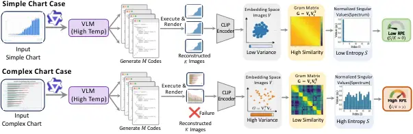
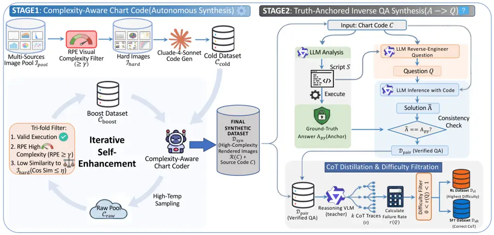
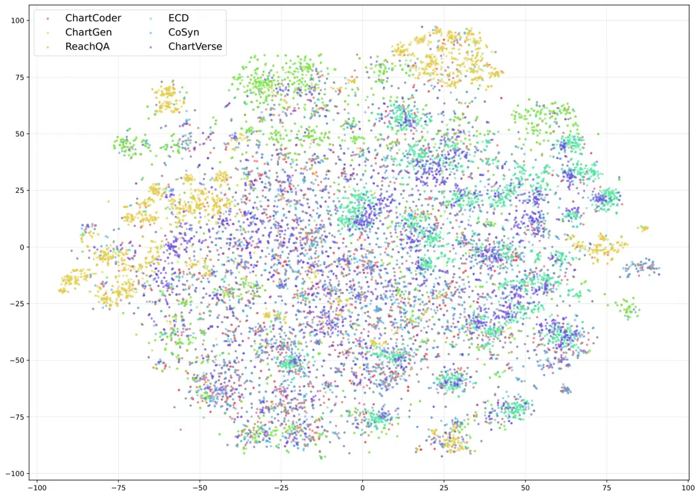
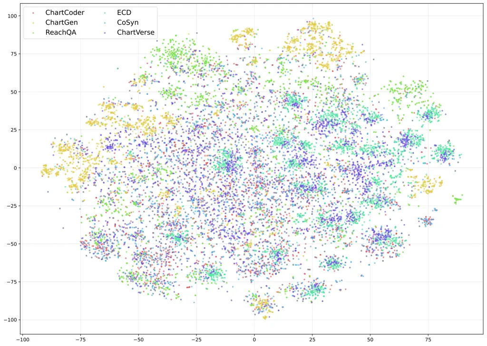
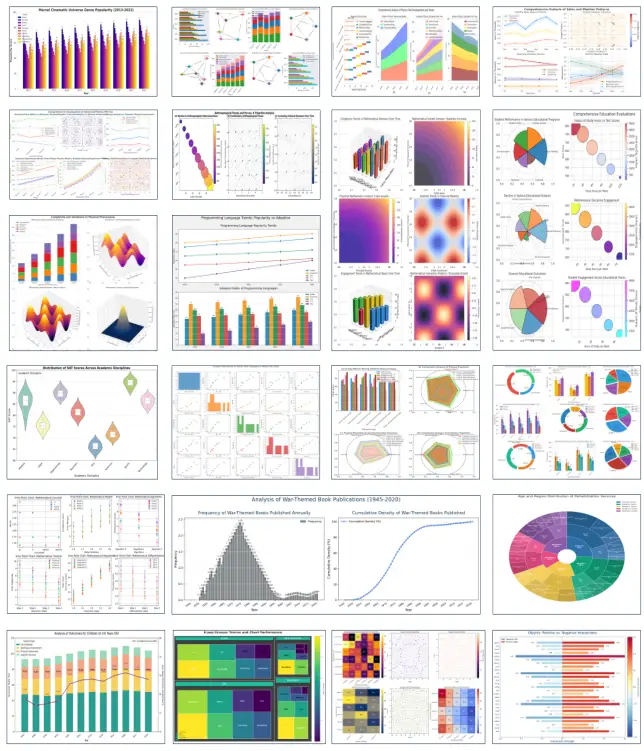
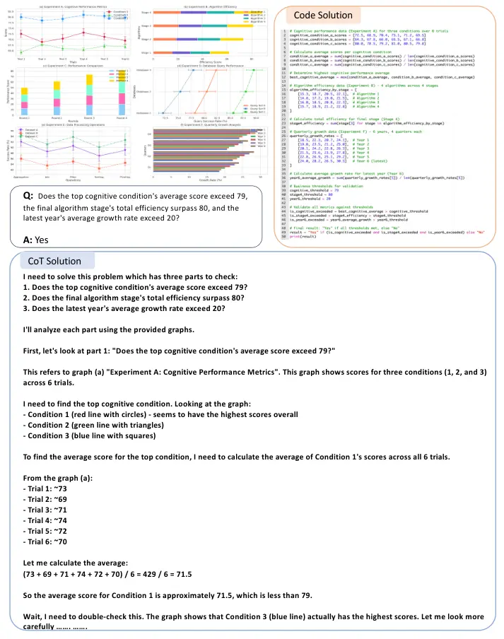
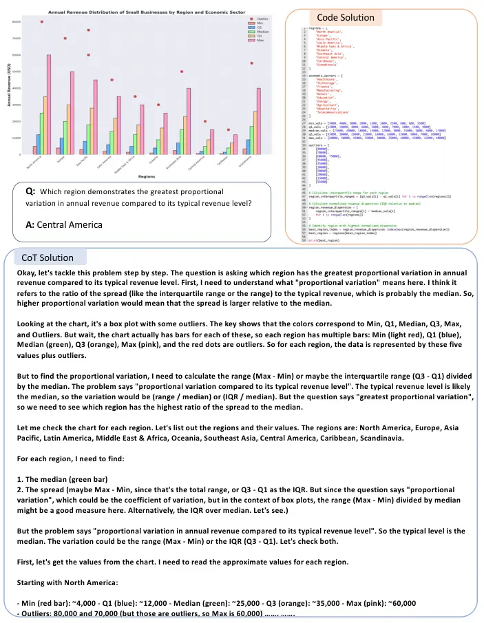
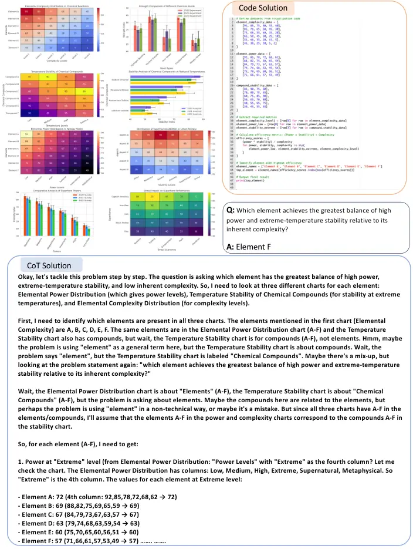

# ChartVerse: Scaling Chart Reasoning via Reliable Programmatic Synthesis from Scratch

Zheng Liu Affiliation: Shanghai AI Laboratory Affiliation: Peking
University,  
³Shanghai Jiao Tong University, ⁴Zhongguancun Academy,  
⁵Beijing Key Laboratory of Software and Hardware Cooperative Artificial
Intelligence Systems    Honglin Lin Affiliation: Shanghai AI Laboratory
   Chonghan Qin¹, Xiaoyang Wang¹, Xin Gao¹, Yu Li¹,  
Mengzhang Cai¹, Yun Zhu¹, Zhanping Zhong¹, Qizhi Pei¹, Zhuoshi Pan¹,
Xiaoran Shang¹,  
Conghui He¹, Bin Cui^(2,5), Wentao Zhang Affiliation: Peking
University,  
³Shanghai Jiao Tong University, ⁴Zhongguancun Academy,  
⁵Beijing Key Laboratory of Software and Hardware Cooperative Artificial
Intelligence Systems    Lijun Wu Affiliation: Shanghai AI Laboratory

###### Abstract

Chart reasoning is a critical capability for Vision Language Models
(VLMs). However, the development of open-source models is severely
hindered by the lack of high-quality training data. Existing datasets
suffer from a dual challenge: synthetic charts are often simplistic and
repetitive, while the associated QA pairs are prone to hallucinations
and lack the reasoning depth required for complex tasks. To bridge this
gap, we propose ChartVerse, a scalable framework designed to synthesize
complex charts and reliable reasoning data from scratch. (1) To address
the bottleneck of simple patterns, we first introduce Rollout Posterior
Entropy (RPE), a novel metric that quantifies chart complexity. Guided
by RPE, we develop complexity-aware chart coder to autonomously
synthesize diverse, high-complexity charts via executable programs. (2)
To guarantee reasoning rigor, we develop truth-anchored inverse QA
synthesis. Diverging from standard generation, we adopt an answer-first
paradigm: we extract deterministic answers directly from the source
code, generate questions conditional on these anchors, and enforce
strict consistency verification. To further elevate difficulty and
reasoning depth, we filter samples based on model fail-rate and distill
high-quality Chain-of-Thought (CoT) reasoning. We curate
ChartVerse-SFT-600K and ChartVerse-RL-40K using
Qwen3-VL-30B-A3B-Thinking as the teacher. Experimental results
demonstrate that ChartVerse-8B achieves state-of-the-art performance,
notably surpassing its teacher and rivaling the stronger
Qwen3-VL-32B-Thinking. We release our code, model weights, and datasets
in [https://chartverse.github.io](https://chartverse.github.io).

^(†)^(†)footnotetext: \* Equal contribution.^(†)^(†)footnotetext:
†Corresponding authors.

## 1 Introduction

Recent Vision Language Models (VLMs) (Bai et al., 2025; Zhang et al.,
2025b; OpenAI, 2025; Google DeepMind, 2025) exhibit strong reasoning
capabilities, yet their performance on chart reasoning remains far from
satisfactory. A central limitation lies in the lack of high-quality data
that simultaneously achieves scale, diversity, and complexity. For
example, manually curated datasets (Masry et al., 2022; Methani et al.,
2020; Xiao et al., 2025; Chen et al., 2026; Hu et al., 2026) provide
realistic chart distributions but are severely limited by annotation
cost. Synthetic approaches—ranging from template-based rendering (Kafle
et al., 2018; Han et al., 2023; Xiao et al., 2026; Yang et al., 2026b;
Qiu et al., 2026; Zhang et al., 2026a; Hu et al., 2026) to recent
code-driven pipelines (He et al., 2025; Zhao et al., 2025b; Kondic
et al., 2025; Chen et al., 2026; Chen et al., 2025b; Li et al., 2026d;
Li et al., 2026c)—offer scalability but typically rely on fixed
templates or seed charts, resulting in limited visual diversity and poor
coverage of real-world, long-tail chart patterns. Although proprietary
systems (Yang et al., 2025a; Li et al., 2026c; Li et al., 2026d; Chen
et al., 2025b) can produce visually rich charts, their dependence on
closed commercial APIs prevents large-scale, open-source adoption.

Beyond visual diversity, the quality of reasoning supervision presents a
second major challenge. Existing chart Question-Answering (QA) datasets
are constrained in both difficulty and reliability. Visually simplistic
charts inherently limit question complexity, making it difficult to
construct multi-step reasoning problems. Moreover, answer correctness is
also hard to guarantee at scale: manual verification (Masry et al., 2022) is infeasible, while LLM-generated QA pairs (Xu et al., 2025a;
Yang et al., 2025a; Chen et al., 2025a; Li et al., 2026b; Ye et al.,
2025; Guo et al., 2026; Wu et al., 2025; Yang et al., 2026a; Zhang
et al., 2026b) frequently suffer from hallucinations and numerical
errors. As a result, current pipelines struggle to provide large-scale,
high-fidelity chart reasoning data with rigorous and error-free
supervision for model training.

|                                 |                  |                       |              |                |              |                 |                |                           |               |                     |
| ------------------------------- | ---------------- | --------------------- | ------------ | -------------- | ------------ | --------------- | -------------- | ------------------------- | ------------- | ------------------- |
| Datasets                        | Chart Properties |                       |              | Q&A Properties |              |                 |                | Complexity & Diversity    |               |                     |
|                                 | Chart Count      | Data Source           | Textual Data | QA Count       | Total Tokens | Answer Accuracy | Reasoning Data | Rollout Posterior Entropy | Color Entropy | Semantic Emb Spread |
| ChartQA (Masry et al., 2022)    | 18K              | Real-world, Synthetic | Table        | 28K            | 100K         | ✗               | ✗              | 0.26                      | 2.03          | 0.37                |
| PlotQA (Methani et al., 2020)   | 156K             | Real-world, Synthetic | Table        | 20M            | 117M         | ✗               | ✗              | 0.21                      | 0.83          | 0.30                |
| FigureQA (Kahou et al., 2018)   | 100K             | Synthetic             | \-           | 1.3M           | 2.6M         | ✗               | ✗              | 0.25                      | 1.04          | 0.24                |
| ReachQA (He et al., 2025)       | 3K               | Synthetic             | Code         | 20K            | 1.2M         | ✗               | ✓              | 0.29                      | 1.91          | 0.47                |
| ECD (Yang et al., 2025b)        | 10K              | Synthetic             | Code         | 321K           | 18.6M        | ✗               | ✓              | 0.31                      | 2.13          | 0.40                |
| CoSyn (Yang et al., 2025a)      | 116K             | Synthetic             | Code         | 1.1M           | 5.4M         | ✗               | ✗              | 0.35                      | 1.73          | 0.54                |
| START (Liu et al., 2025e)       | 400K             | Synthetic             | Code         | 400K           | 143M         | ✗               | ✗              | 0.33                      | 1.63          | 0.27                |
| ChartGen (Kondic et al., 2025)  | 216K             | Synthetic             | Code         | \-             | \-           | ✗               | ✗              | 0.30                      | 1.31          | 0.39                |
| ChartCoder (Zhao et al., 2025b) | 163K             | Synthetic             | Code         | \-             | \-           | ✗               | ✗              | 0.33                      | 1.48          | 0.38                |
| ChartVerse-SFT-600K(Ours)       | 412K             | Synthetic             | Code         | 603K           | 3.9B         | ✓               | ✓              | 0.44                      | 3.17          | 0.51                |

Table 1: Comparison of ChartVerse-SFT-600K with existing chart datasets.

To address the above challenges, we propose ChartVerse, a scalable,
code-driven framework for chart reasoning data synthesis. ChartVerse is
designed to jointly improve visual complexity, distributional diversity,
and reasoning reliability, enabling the construction of large-scale,
challenging chart QA data without relying on fixed templates or manual
verification.

We first introduce Rollout Posterior Entropy (RPE), a metric for
estimating intrinsic chart difficulty. Given a chart image, we
repeatedly prompt an existing VLM to parse the image into executable
chart code and measure the consistency across multiple rollouts. Charts
that admit diverse, inconsistent code reconstructions exhibit higher
posterior entropy, indicating greater visual and semantic ambiguity. RPE
thus provides an objective, model-agnostic signal for identifying
challenging charts and guiding data selection.

Using RPE, we first filter existing chart corpora to construct a
high-difficulty seed dataset, which is then used to train a
complexity-aware chart coder. Unlike prior template-based or
seed-conditioned approaches, our chart coder generates chart code from
scratch via high-temperature sampling, enabling broad exploration of the
long-tail chart distribution. Through an iterative loop of generation,
difficulty filtering, and retraining, the chart coder progressively
improves both code quality and visual complexity, producing diverse,
realistic charts.

Further, to ensure both correctness and reasoning difficulty for QA,
ChartVerse adopts a truth-anchored inverse QA synthesis pipeline.
Ground-truth answers are first computed directly from chart code,
guaranteeing numerical and semantic accuracy. Questions are then
reverse-synthesized conditioned on these answers. To control difficulty,
we evaluate the resulting QA pairs using a strong VLM and retain samples
with non-trivial fail-rate, ensuring that the final dataset emphasizes
genuinely challenging reasoning cases.

Leveraging Qwen3-VL-30B-A3B-Thinking as the teacher model, we finally
distill high-quality chain-of-thought (CoT) supervision and curate two
datasets: ChartVerse-SFT-600K and ChartVerse-RL-40K. Initializing from
the Qwen3-VL Instruct series (Bai et al., 2025), we train ChartVerse
models at 2B, 4B, and 8B scales. Despite their smaller sizes, these
models achieve state-of-the-art (SOTA) performance on chart reasoning
benchmarks. Notably, ChartVerse-4B surpasses Qwen3-VL-8B-Thinking, while
ChartVerse-8B even outperforms its 30B teacher, approaching the
performance of Qwen3-VL-32B-Thinking.



Figure 1: Illustration of Rollout Posterior Entropy. We quantify
complexity via generative stability: simple charts yield consistent
reconstructions (low RPE), while complex charts result in divergent
outcomes (high RPE).

## 2 Related Work

#### Chart VLMs.

Leading proprietary models (OpenAI, 2025; Google DeepMind, 2025;
Anthropic, 2025; Bai et al., 2025) have demonstrated exceptional
reasoning capabilities in complex chart understanding. In the
open-source domain, early methods like ChartLlama (Han et al., 2023),
ChartGemma (Masry et al., 2024b), and EvoChart (Huang et al., 2025)
primarily focused on visual instruction tuning to handle fundamental
structural extraction tasks like OCR and element counting. Recent works
have transitioned towards reasoning-centric designs. TinyChart (Zhang
et al., 2024a) employs template-based Program-of-Thought synthesis.
ChartReasoner (Jia et al., 2025) and Chart-R1 (Chen et al., 2025a)
integrate reinforcement learning with supervised finetuning, directly
incentivizing the model to generate robust CoT paths for complex
problem-solving.

#### Chart Image Synthesis.

Conventional approaches (Kafle et al., 2018; Han et al., 2023; Zhang
et al., 2026a; Qiu et al., 2026; Yang et al., 2026b) rely on rule-based
rendering engines to visualize data tables. These methods often yield
charts with rigid layouts and limited diversity. Recent works Zhao
et al. (2025b); He et al. (2025); Xu et al. (2025a); Jiang and Luo
(2025); Kondic et al. (2025); Yang et al. (2025b); Yuan and Zhang
(2025); Ding et al. (2025a); Ding et al. (2025b); Zhao et al. (2025a);
Huang et al. (2026); Zeng et al. (2026); Han et al. (2026) leverage LLMs
to generate executable code or augment fixed visual seeds. Despite
offering better flexibility, these methods remain constrained by finite
and simple templates. The charts exhibit trivial topologies that are
insufficient to elicit the complex reasoning capabilities of VLMs.
Methods like Cosyn (Yang et al., 2025a; Liu et al., ; Lin et al., 2026a)
employ proprietary model Claude-3.5-Sonnet for end-to-end synthesis to
avoid template restrictions. However, the dependence on commercial APIs
introduces prohibitive costs and scalability bottlenecks.

#### Chart QA Construction.

High-quality QA pairs is pivotal for chart understanding. While human
annotation (Masry et al., 2022; Methani et al., 2020; Liu et al., 2025d)
guarantees accuracy, its unscalability has necessitated a shift towards
automated generation. Recent approaches (Yang et al., 2025a; Chen
et al., 2025a; Masry et al., 2024a; Lin et al., 2025; Liu et al., 2024;
Meng et al., 2024; Liu et al., 2025b; Liu et al., 2025c; Niu et al.,
2025; Li et al., 2025f; Li et al., 2025c; Li et al., 2025e; Li et al.,
2025d) typically prompt leading VLMs to synthesize QA pairs from images,
with some works (He et al., 2025; Lin et al., 2026b; Li et al., 2025a;
Zhang et al., 2025a; Li et al., 2026a; Li et al., 2025b) leveraging
auxiliary code. Despite their popularity, these methods are constrained
by the stochastic nature of LLMs, which leads to unavoidable
hallucinations and inaccuracies. Lacking ground truth for verification,
these methods predominantly yield uncalibrated, simplistic questions and
lack multi-step CoT, accurate answers.

## 3 Methodology

In this section, we introduce our ChartVerse framework for scalable
chart reasoning data synthesis. We first introduce a difficulty metric
to quantify intrinsic chart complexity, which guides data selection and
generation. Based on this metric, we develop a complexity-aware chart
coder and a truth-anchored inverse QA synthesis pipeline to produce
challenging and reliable training data. Figure 2 shows the complete
process.

### 3.1 Quantifying Intrinsic Chart Complexity

A prerequisite for training a robust chart generator is the
identification and filtration of high-complexity samples. However,
distinguishing complexity via direct pixel analysis is intractable, as
visual density does not correlate with structural difficulty. When
humans interpret a complex chart, they often form diverse understandings
and struggle to capture every detail. This implies that the decoding
space for complex visual data is variable, making consistent
reproduction difficult.

Guided by this insight, we propose Rollout Posterior Entropy (RPE) to
measure the variability. Specifically, we employ a VLM to generate
executable code for charts as a proxy for structural interpretation. As
illustrated in Figure 1, simple charts yield consistent code that
renders into identical images, whereas complex charts induce high
instability, resulting in divergent reconstructions.



Figure 2: Overview of ChartVerse. Stage 1 trains a complexity-aware
chart coder via RPE-guided iterative self-enhancement to synthesize
diverse, high-complexity chart codes. Stage 2 generates verifiable QA
pairs using truth-anchored inverse synthesis and CoT distillation,
followed by failure-rate filtering to guarantee difficulty.

#### Modeling Structural Variability.

Given a chart, we utilize Qwen3-VL-2B-Thinking to generate plotting code
8 times with the temperature set to 1.0. We then execute these codes to
render reconstructed images. Let $`K`$ denote the number of successfully
executed samples. We utilize CLIP (Radford et al., 2021) to extract
$`1\times d`$ dimensional features for each image and stack them into an
image matrix $`V\in\mathbf{R}^{K\times d}`$.

To quantify the variability, we first center $`V`$ to remove
translational shifts and compute the Gram matrix $`G`$ to model pairwise
similarities:

```math
V_{c}=\left(I-\frac{1}{K}\mathbf{1}\mathbf{1}^{T}\right)V,\quad G=V_{c}V_{c}^{T}. \tag{1}
```

Next, we calculate the singular values $`\sigma_{i}`$ of $`G`$. We
normalize these values and compute the spectral entropy to measure the
degree of variation.

```math
p_{i}=\sigma_{i}/\sum\sigma_{j},\quad S=-\sum_{i=1}^{K}p_{i}\log p_{i}. \tag{2}
```

Since execution failures inherently signal difficulty, we normalize
$`S`$ by the valid count $`K`$ to obtain final RPE:

```math
RPE=\frac{S}{K}. \tag{3}
```

Higher $`RPE`$ denotes greater reproduction difficulty, reflecting
intrinsic chart complexity.

#### Diagnosing Existing Datasets.

Leveraging RPE, we evaluate the complexity of mainstream datasets. As
shown in Table 1, nearly all existing datasets exhibit low RPE scores,
indicating that such charts are trivial. To drive further progress, it
is critical to synthesize data that transcends simple visual variation,
offering the complexity required to challenge the consistency of modern
VLMs.

### 3.2 Complexity-Aware Chart Coder

RPE suggests that executable code is a high-fidelity proxy of chart
structure, we therefore synthesize complex charts via code and propose a
complexity-aware chart coder that can autonomously generate
non-standard, high-complexity charts from scratch.

#### Difficulty-Filtered Cold Start.

We first construct a high-quality cold-start seed code
$`\mathcal{C}_{cold}`$. We aggregate chart images from existing datasets
in Table 1 to form an image pool $`\mathcal{I}_{pool}`$ and apply RPE to
quantify visual complexity. Based on the statistics in Table 1, we set
an RPE threshold of 0.4 to retain only high RPE samples:

```math
\mathcal{I}_{hard}=\{x\in\mathcal{I}_{pool}\mid RPE(x)\geq 0.4\}, \tag{4}
```

Since real-world charts in $`\mathcal{I}_{hard}`$ lack ground-truth
source code, we employ Claude-4-Sonnet to infer candidate code $`C(x)`$
for each image $`x\in\mathcal{I}_{hard}`$. We discard samples that
trigger execution errors, obtaining the cold-start training set:

```math
\mathcal{C}_{cold}=\{C(x)\mid x\in\mathcal{I}_{hard}\}. \tag{5}
```

Ultimately, we curate a cold-start set $`\mathcal{C}_{cold}`$ comprising
60k high-quality samples, which serves as the foundational corpus for
our chart coder.

Unlike existing methods that rely on code as rigid templates, we train a
strong coder LLM, Qwen2.5-Coder-7B (Hui et al., 2024), to function as a
flexible generative model. We structure each training instance by
pairing a concise system instruction $`\mathcal{T}`$ (see Prompt 12) as
the model input with the chart code sequence
$`C=(c_{1},c_{2},\dots,c_{L})\in\mathcal{C}_{cold}`$ as the target
answer. The model is optimized using the standard cross-entropy loss to
internalize the structural and logic patterns of executable chart codes.
During inference, by applying a high sampling temperature, the coder
leverages its aligned internal knowledge and learned patterns to
generate diverse chart codes. This approach enables the model to move
beyond simple replication and synthesize novel, complex chart code.

#### Iterative Self-Enhancement Loop.

Despite its quality, $`\mathcal{C}_{cold}`$ is typically scarce, and the
coder trained on it exhibited limited structural complexity, making
large-scale high-difficulty synthesis non-trivial. To address this, we
introduce a self-enhancement mechanism that iteratively expands data and
strengthens the coder capability.

Specifically, we first employ the cold-start coder to perform
large-scale sampling at a temperature of 1.0, generating a raw candidate
pool $`\mathcal{C}_{raw}`$ of 2M code samples. To ensure quality and
diversity, We discard codes that trigger execution errors, then render
the charts and filter out low-complexity samples using RPE. To ensure
diversity, we exclude charts that exhibit high visual similarity to
$`\mathcal{I}_{hard}`$ based on image embeddings from CLIP. We apply an
RPE threshold $`\geq 0.4`$ and a similarity limit $`\leq 0.65`$ to
retain only complex, non-redundant samples:

```math
\begin{split}\mathcal{C}_{boost}=\big\{C\in&\mathcal{C}_{raw}\mid\;RPE(\mathcal{R}(C))\geq 0.4\\
&\land\mathrm{Sim}(\mathcal{R}(C),\mathcal{I}_{hard})\leq 0.65\big\},\end{split} \tag{6}
```

where $`\mathcal{R}(C)`$ denotes the rendered image, and
$`\mathrm{Sim}(x,\mathcal{I}_{hard})=\max_{x^{\prime}\in\mathcal{I}_{hard}}\cos(e(x),e(x^{\prime}))`$
calculates the maximum cosine similarity between the CLIP embedding
$`e(x)`$ of a candidate and $`\mathcal{I}_{hard}`$.

Ultimately, we curate a boosted set $`\mathcal{C}_{boost}`$ of 200k
samples and retrain the coder on
$`\mathcal{C}_{cold}\cup\mathcal{C}_{boost}`$ to obtain a stronger
model. We repeat this procedure for two iterations to ensure the model’s
generative stability and structural diversity.

#### Synthetic Chart Dataset.

We utilize the final complexity-aware coder to perform large-scale
sampling at a temperature of 1.0, generating 1M raw chart code
candidates $`\mathcal{C}_{syn}`$. We again apply RPE filtering to retain
only high-complexity samples. This process yields a final dataset
$`\mathcal{D}_{syn}`$ comprising 700k pairs of rendered images and their
corresponding executable codes:

```math
\begin{split}\mathcal{D}_{syn}=\big\{(\mathcal{R}(C),&C)\mid\;C\in\mathcal{C}_{syn}\\
&\land RPE(\mathcal{R}(C))\geq 0.4\big\}.\end{split} \tag{7}
```

This extensive corpus of complex charts serves as the foundation for our
QA generation.

### 3.3 Truth-Anchored Inverse QA Synthesis

While the complexity of $`\mathcal{D}_{\text{syn}}`$ provides a
foundation for constructing difficult questions, it introduces
significant challenges in accurate answer extraction. To generate QA
pairs that preserve both accuracy and difficulty, we propose to invert
the generation flow to enforce "Answer as the Source of Truth".

#### Inverse Logic Construction.

Existing QA generation approaches, which first synthesize a question and
then employ a VLM to derive the answer ($`Q\to A`$), suffer from
stochastic hallucinations and cannot guarantee correctness. To address
this, we propose an Inverse Synthesis paradigm ($`A\to Q`$).

An advantage of $`\mathcal{D}_{\text{syn}}`$ is that the images are
rendered from code, ensuring that codes encapsulate the absolute ground
truth of all visual data. Leveraging this, we synthesize the answer
first. As shown in Figure 2, to ensure absolute precision, we employ
Qwen3-30B-A3B-Thinking $`\pi_{LLM}`$ to analyze the chart code $`C`$ and
generate a Python script $`S`$ that performs meaningful operations on
the data in chart code, yielding a precise numerical or categorical
result. By executing this script in a deterministic environment
$`\mathcal{E}`$, we obtain the ground-truth answer $`A_{\text{py}}`$,
completely bypassing numerical errors from direct VLM answering:

```math
S\sim\pi_{\text{LLM}}(C),\quad A_{\text{py}}=\mathcal{E}(S). \tag{8}
```

We then instruct the LLM again to reverse-engineer a question $`Q`$ that
strictly aligns with chart code $`C`$ and Script $`S`$:

```math
Q\sim\pi_{\text{LLM}}(C,S). \tag{9}
```

To guarantee that the synthesized question is unambiguously solvable, we
perform a consistency check. We feed the question $`Q`$ and chart code
$`C`$ back into the LLM to produce a solution $`\hat{A}`$,

```math
\hat{A}\sim\pi_{\text{LLM}}(C,Q). \tag{10}
```

|                                        |         |         |         |        |        |       |            |      |
| -------------------------------------- | ------- | ------- | ------- | ------ | ------ | ----- | ---------- | ---- |
| Model                                  | ChartQA | CharXiv | CharXiv | Chart  | ChartX | Evo   | ChartBench | Avg  |
|                                        | Pro     | (RQ)    | (DQ)    | Museum |        | Chart | (GPT-acc)  |      |
| ECD-7B (Yang et al., 2025b)            | 45.1    | 41.7    | 74.9    | 24.5   | 59.3   | 56.0  | 48.6       | 50.0 |
| START-7B (Liu et al., 2025e)           | 43.5    | 46.3    | 76.8    | 29.7   | 57.3   | 63.8  | 50.0       | 52.5 |
| Chart-R1-7B (Chen et al., 2025a)       | 45.6    | 47.7    | 70.0    | 33.4   | 60.9   | 67.1  | 50.5       | 53.6 |
| ChartVerse-2B                          | 48.2    | 46.9    | 71.2    | 37.5   | 60.5   | 66.8  | 49.1       | 54.3 |
| InternVL3.5-38B (Wang et al., 2025)    | 47.8    | 45.5    | 86.5    | 34.2   | 55.5   | 65.0  | 49.0       | 54.8 |
| InternVL3.5-241B-A28B                  | 50.7    | 47.5    | 88.1    | 36.1   | 59.1   | 67.4  | 48.6       | 56.8 |
| Qwen3-VL-8B-Thinking Bai et al. (2025) | 53.9    | 53.0    | 85.9    | 44.3   | 59.6   | 74.1  | 49.1       | 60.0 |
| ChartVerse-4B                          | 55.2    | 56.2    | 84.1    | 45.9   | 63.7   | 75.0  | 52.9       | 61.9 |
| Qwen3-VL-30B-A3B-Thinking              | 55.8    | 56.6    | 86.9    | 49.2   | 62.3   | 77.2  | 52.4       | 62.9 |
| ChartVerse-8B                          | 56.2    | 60.8    | 88.0    | 49.2   | 63.9   | 76.2  | 54.2       | 64.1 |
| Qwen3-VL-32B-Thinking                  | 58.8    | 65.2    | 90.2    | 55.9   | 64.1   | 80.8  | 54.3       | 67.0 |
| Qwen3-VL-235B-A30B-Thinking            | 60.0    | 66.1    | 90.5    | 60.0   | 64.5   | 79.9  | 54.5       | 67.9 |

Table 2: Comparison of different models. The shaded rows denote our
ChartVerse models.

We strictly retain samples where the inferred solution matches the
programmatic ground truth:

```math
\mathcal{D}_{\text{pair}}=\{(\mathcal{R}(C),Q,A_{\text{py}})\mid\hat{A}=A_{\text{py}}\}. \tag{11}
```

Through this rigorous inverse pipeline, we ensure that every sample is
logically sound and factually accurate. It is worth noting that this
logical construction phase operates exclusively within the textual
domain. By relying solely on the code-text modality, we achieve
high-efficiency synthesis while eliminating potential visual encoding
errors.

#### CoT Distillation & Difficulty Filtration.

Correctness alone does not imply training value. We further estimate
visual reasoning difficulty via repeated VLM rollouts and keep only
samples that are neither trivial nor impossible. We employ
Qwen3-VL-30B-A3B-Thinking $`\pi_{VLM}`$ to generate 3 CoT reasoning
traces $`\{\tau_{1},\tau_{2},\tau_{3}\}`$.

As shown in Figure 2, we extract the predicted answer $`\hat{a}_{j}`$
from each trace $`\tau_{j}`$ and calculate the failure rate $`r(Q)`$
against the ground truth:

```math
r(Q)=1-\frac{1}{3}\sum_{j=1}^{3}\text{Match}(\hat{a}_{j},A_{\text{py}}). \tag{12}
```

We construct $`\mathcal{D}_{\text{hard}}`$ by retaining samples where
$`r(Q)`$ is neither 0 nor 1. This ensures that samples are neither
impossible to solve nor trivially simple.

```math
\mathcal{D}_{\text{hard}}=\{(\mathcal{R}(C),Q,A_{\text{py}},\tau)\mid 0<r(Q)<1\}. \tag{13}
```

We prioritize the most challenging samples with the highest $`r(Q)`$ in
$`\mathcal{D}_{\text{hard}}`$ for the Reinforcement Learning dataset
$`\mathcal{D}_{\text{rl}}`$, while utilizing the remaining samples
enriched with correct CoT traces $`\tau`$ for the Supervised Finetuning
dataset $`\mathcal{D}_{\text{sft}}`$. After the processing, we finally
obtain the ChartVerse-SFT-600K and ChartVerse-RL-40K datasets. Details
and prompts on synthesis pipelines and coder training are available in
Appendix C.

(a) Performance on chart-related benchmarks

(b) Performance on STEM-related benchmarks

Figure 3: Performance evolution of ChartVerse across different training
phases on chart and STEM benchmarks.

(a) Comparison of different datasets

(b) Ablation study on RPE strategy.

Figure 4: Ablation study results on different datasets and the proposed
RPE strategy.

## 4 Experiments

### 4.1 Experimental Setup

#### Training Details.

All ChartVerse models are initialized from the Qwen3-VL-Instruct Bai
et al. (2025) series. We first perform Supervised Fine-Tuning (SFT) on
the ChartVerse-SFT-600K dataset using LLaMA-Factory (Zheng et al.,
2024). Subsequently, Reinforcement Learning (RL) is conducted on the
ChartVerse-RL-40K dataset with VeRL (Sheng et al., 2025), adopting the
GSPO (Zheng et al., 2025) algorithm. Comprehensive training
configurations and hyperparameters are provided in Appendix A.

#### Baselines.

We compare our tuned ChartVerse models against two categories of models:
(1) General open-source VLMs: leading models including Qwen3-VL-Thinking
series (8B, 30B, 32B, 235B) (Bai et al., 2025), InternVL3.5 series (38B,
241B) (Wang et al., 2025). (2) Specialized chart-domain VLMs: ECD (Yang
et al., 2025b),START (Liu et al., 2025e), and Chart-R1 (Chen et al.,
2025a).

#### Benchmarks.

We evaluate performance across 6 benchmarks necessitating complex chart
understanding and reasoning: ChartQA-Pro (Masry et al., 2025),
CharXiv (Wang et al., 2024), ChartMuseum (Tang et al., 2025), ChartX Xia
et al. (2025), ChartBench (Xu et al., 2024), and EvoChart (Huang et al.,
2025).

### 4.2 Main Results

#### Overall Results.

Table 2 compares ChartVerse models with above baselines. Overall,
ChartVerse consistently delivers strong performance across all model
scales, demonstrating the effectiveness of our difficulty-aware data
synthesis framework. We highlight three key observations:

(1) Competitive performance at small scale. ChartVerse-2B achieves an
average score of 54.3, exceeding all chart-specific baselines, including
ECD-7B, START-7B, and Chart-R1-7B. This shows that complexity-controlled
chart data can substantially offset model size limitations.

(2) Data quality over model scale. ChartVerse-4B attains an average
score of 61.9, outperforming Qwen3-VL-8B-Thinking (60.0) despite using
only half the parameters. This gap highlights the dominant role of data
quality in improving chart reasoning performance.

(3) Beyond the teacher model. ChartVerse-8B further improves the average
score to 64.1, surpassing its teacher Qwen3-VL-30B-A3B-Thinking (62.9)
and approaching Qwen3-VL-32B-Thinking (67.0). This result indicates that
ChartVerse enables student models to exceed the distillation ceiling.

Collectively, these observations validate the advantages of ChartVerse’s
rigorously controll chart and QA synthesis pipeline, showing that
scalable generation of training data translates into consistent gains
across model scales.

### 4.3 Training Stages and Generalization

SFT and RL are Both Effective. Figure 3(a) reports results on
chart-related benchmarks under different training stages. Across all
model sizes, ChartVerse-SFT yields substantial improvements over the
Qwen3-VL-Instruct baseline, and ChartVerse-RL further provides
consistent gains. For instance, ChartVerse-2B improves from 42.5 to 49.8
after SFT and reaches 54.3 after RL, while ChartVerse-8B increases from
56.9 to 62.5 and 64.1, respectively. These results indicate that SFT
establishes strong chart reasoning foundations, and RL further enhances
performance by focusing on more challenging samples.

Strong Generalization to STEM tasks. We further evaluate ChartVerse on
STEM-related benchmarks, including MathVista (Lu et al., 2023),
DynaMath (Zou et al., 2024), MathVerse (Zhang et al., 2024b),
LogicVista (Xiao et al., 2024), and VisuLogic (Xu et al., 2025b). As
shown in Figure 3(b), ChartVerse-trained models outperform the Instruct
baseline across all scales. Notably, ChartVerse-8B improves from 56.7 to
61.2 after SFT and reaches 62.2 with RL, demonstrating that the
reasoning skills learned from ChartVerse data transfer effectively to
out-of-domain STEM reasoning tasks.



(a) Visualization of chart image embeddings



(b) Visualization of chart code embeddings

Figure 5: t-SNE visualizations of feature distributions for
ChartVerse-SFT and existing datasets.

|                                          |         |         |         |        |        |       |            |      |
| ---------------------------------------- | ------- | ------- | ------- | ------ | ------ | ----- | ---------- | ---- |
| Training Data (100k)                     | ChartQA | CharXiv | CharXiv | Chart  | ChartX | Evo   | ChartBench | Avg  |
|                                          | Pro     | (RQ)    | (DQ)    | Museum |        | Chart | (GPT-acc)  |      |
| Qwen3-VL-4B-Instruct                     | 53.7    | 39.7    | 76.2    | 37.2   | 57.2   | 68.2  | 45.1       | 53.9 |
| \+ Image-Space Gen.                      | 53.1    | 46.6    | 81.3    | 38.4   | 58.4   | 70.4  | 47.3       | 56.5 |
| \+ Code-Space Gen.                       | 53.9    | 47.0    | 81.2    | 38.6   | 58.9   | 70.3  | 47.8       | 56.8 |
| \+ Truth-Anchored Gen. w/o Failrate      | 54.0    | 47.4    | 81.7    | 39.8   | 59.7   | 70.7  | 48.2       | 57.4 |
| + Truth-Anchored Gen. w/ Failrate (Ours) | 53.4    | 48.8    | 82.6    | 40.3   | 60.1   | 70.9  | 48.7       | 57.8 |

Table 3: Performance comparison of different QA synthesis strategies.
All models are trained on Qwen3-VL-4B-Instruct with 100k synthesized
samples.

## 5 Ablations and Analysis

### 5.1 Fair Comparison with Existing Datasets

To control for data scale, we compare different training datasets under
a fixed budget of 100K samples. As summarized by the _Avg_ scores in
Table 4(a), most existing datasets provide little benefit to
Qwen3-VL-4B-Instruct: CoSyn even degrades performance (53.9 → 51.0),
while START and ECD yield only marginal gains (53.8 and 54.2,
respectively), barely surpassing the baseline. In contrast,
ChartVerse-SFT leads to a substantial improvement, boosting the average
score to 57.8 (+3.9). This clear gap under identical data budgets
indicates that the performance gains stem from data quality and task
structure rather than scale, highlighting ChartVerse-SFT as
significantly more effective for enhancing strong modern VLMs.

### 5.2 Effectiveness of Rollout Posterior Entropy

To verify the effectiveness of RPE, we compare RPE with two
representative data selection strategies: _VLM-as-Judge_, which selects
samples with high model-assessed visual complexity, and _Python Code
Complexity_, which favors charts with dense Matplotlib structures. All
strategies select 100K samples from the same data pool to ensure a fair
comparison.

As shown in Figure 4(b), RPE identifies substantially harder samples, as
reflected by the highest failure rate of Qwen3-VL-4B-Instruct (27.6%),
compared to 21.1% for VLM-as-Judge and 23.5% for Python Code Complexity.
This suggests that RPE goes beyond surface-level visual or structural
heuristics and captures samples that are intrinsically more challenging
for the model. Crucially, this increased difficulty translates into
better downstream performance. Fine-tuning on RPE-selected data achieves
the highest average score (55.4), outperforming both competing
strategies. In contrast, methods based on perceived complexity yield
smaller gains despite selecting easier samples. These results indicate
that RPE is more effective at selecting _learning-relevant_ hard
examples, leading to stronger performance improvements under a fixed
data budget.

### 5.3 Diversity and Distribution Analysis

To analyze the quality and diversity of ChartVerse-SFT, we compare it
with representative chart datasets from multiple perspectives, including
data scale, supervision signals, and distributional diversity. For
feature-level analysis, we extract embeddings from chart code and images
using Qwen3-8B-Embedding and CLIP, and visualize their distributions
with t-SNE.

As illustrated in Figure 5, ChartVerse-SFT covers a substantially
broader feature space than prior datasets, largely subsuming the
distributions of existing chart corpora. This indicates that our dataset
is not concentrated around a narrow set of visual or structural
patterns, but instead spans diverse chart styles and semantics.

We further quantify diversity using complementary metrics. Color
Distribution Entropy measures the richness of visual appearance, while
Semantic Embedding Spread captures structural and semantic variation
across samples. As reported in Table 1, ChartVerse-SFT consistently
attains the highest values on both metrics, exceeding all existing
datasets by a clear margin. Together with its higher rollout posterior
entropy, these results suggest that ChartVerse-SFT is not only larger in
scale, but also more diverse and information-rich, offering broader
coverage of chart layouts, visual styles, and semantic structures.

### 5.4 Breaking the Distillation Ceiling

A central goal of ChartVerse is to enable the student model to
outperform its teacher, which we achieve through truth-anchored inverse
QA synthesis. We compare this method with two common QA construction
strategies—direct image-based generation and direct code-based
generation—and include an ablation that removes fail-rate based
selection.

As shown in Table 3, all QA synthesis strategies improve upon the
baseline, indicating that synthetic supervision is generally beneficial.
However, the magnitude of improvement varies substantially across
methods. Direct image-space generation yields only moderate gains (Avg
56.5), while code-space generation performs slightly better (56.8),
suggesting that structural cues from code are helpful but still limited.

In contrast, truth-anchored generation leads to a clear performance jump
(57.4), demonstrating the advantage of anchoring QA synthesis to
verifiable ground truth rather than surface-level patterns. Importantly,
incorporating failure-rate-based selection further boosts the average
score to 57.8, achieving the best performance. This additional gain
highlights the role of hard-sample mining in maximizing the
effectiveness of synthesized data, and confirms that our strategy
produces not only more accurate but also more effective supervision.

## 6 Conclusion

We introduce ChartVerse, a scalable framework addressing the scarcity of
complex data for chart reasoning. We introduce Rollout Posterior Entropy
to quantify chart complexity, guiding Complexity-Aware Chart Coder to
synthesize diverse, non-trivial charts. We propose Truth-Anchored
Inverse QA Synthesis, ensuring accuracy via code-derived ground truths,
reverse-synthesized questions, and consistency checks. Trained on our
ChartVerse-SFT-600k and ChartVerse-RL-40k, ChartVerse-8B surpasses its
teacher model Qwen3-VL-30B-A3B-Thinking and approaches
Qwen3-VL-32B-Thinking, demonstrating the superior quality of our data.

## Limitations

Computational Overhead of RPE. While Rollout Posterior Entropy
effectively quantifies complexity, its reliance on large-scale sampling
entails computational costs. Despite mitigation via vLLM, developing
lightweight approximation methods to reduce resource demands remains a
valuable direction for future optimization.

Scope of Answer Types. Our Truth-Anchored Inverse QA prioritizes
rigorous correctness through code execution, resulting in datasets
focused primarily on precise numerical and logical reasoning. Future
work aims to extend this pipeline to include qualitative visual
interpretations while preserving the same standards of verification.

Teacher Model Capacity. Our current synthesis employs
Qwen3-VL-30B-A3B-Thinking. While effective, a capability gap remains
compared to frontier models. Leveraging significantly larger models,
such as Qwen3-VL-235B-A30B-Thinking, could further enhance the reasoning
depth and complexity of the generated data.

## Acknowledgments

This work is supported by Shanghai Artificial Intelligence Laboratory,
Fundamental and Interdisciplinary Disciplines Breakthrough Plan of the
Ministry of Education of China (JYB2025XDXM113), National Natural
Science Foundation of China (92470121, 62402016), National Key R&D
Program of China (2024YFA1014003), Zhongguancun Academy (C20250204,
C20250602), Beijing Major Science and Technology Project
(Z251100008125043, Z251100008425023), and High-performance Computing
Platform of Peking University.

## References

- Anthropic (2025) Anthropic. 2025. [Claude 3.5 technical
  report](https://www.anthropic.com/news/claude-3-family). Technical
  report, Anthropic.
- Bai et al. (2025) Shuai Bai, Yuxuan Cai, Ruizhe Chen, Keqin Chen,
  Xionghui Chen, Zesen Cheng, Lianghao Deng, Wei Ding, Chang Gao,
  Chunjiang Ge, Wenbin Ge, Zhifang Guo, Qidong Huang, Jie Huang, Fei
  Huang, Binyuan Hui, Shutong Jiang, Zhaohai Li, Mingsheng Li, and 45
  others. 2025. [Qwen3-vl technical
  report](https://arxiv.org/abs/2511.21631). _Preprint_,
  arXiv:2511.21631.
- Cai et al. (2025) Mengzhang Cai, Xin Gao, Yu Li, Honglin Lin, Zheng
  Liu, Zhuoshi Pan, Qizhi Pei, Xiaoran Shang, Mengyuan Sun, Zinan Tang,
  Xiaoyang Wang, Zhanping Zhong, Yun Zhu, Dahua Lin, Conghui He, and
  Lijun Wu. 2025. [Opendataarena: A fair and open arena for benchmarking
  post-training dataset value](https://arxiv.org/abs/2512.14051).
  _Preprint_, arXiv:2512.14051.
- Chen et al. (2025a) Lei Chen, Xuanle Zhao, Zhixiong Zeng, Jing Huang,
  Yufeng Zhong, and Lin Ma. 2025a. [Chart-r1: Chain-of-thought
  supervision and reinforcement for advanced chart
  reasoner](https://arxiv.org/abs/2507.15509). _Preprint_,
  arXiv:2507.15509.
- Chen et al. (2026) Zhiwei Chen, Yupeng Hu, Zhiheng Fu, Zixu Li, Jiale
  Huang, Qinlei Huang, and Yinwei Wei. 2026. Intent: Invariance and
  discrimination-aware noise mitigation for robust composed image
  retrieval. In _Proceedings of the AAAI Conference on Artificial
  Intelligence_, volume 40, pages 20463–20471.
- Chen et al. (2025b) Zhiwei Chen, Yupeng Hu, Zixu Li, Zhiheng Fu,
  Xuemeng Song, and Liqiang Nie. 2025b. Offset: Segmentation-based focus
  shift revision for composed image retrieval. In _Proceedings of the
  ACM International Conference on Multimedia_, page 6113–6122.
- Ding et al. (2025a) Shengyuan Ding, Xinyu Fang, Ziyu Liu, Yuhang Zang,
  Yuhang Cao, Xiangyu Zhao, Haodong Duan, Xiaoyi Dong, Jianze Liang, Bin
  Wang, and 1 others. 2025a. Arm-thinker: Reinforcing multimodal
  generative reward models with agentic tool use and visual reasoning.
  _arXiv preprint arXiv:2512.05111_.
- Ding et al. (2025b) Shengyuan Ding, Shenxi Wu, Xiangyu Zhao, Yuhang
  Zang, Haodong Duan, Xiaoyi Dong, Pan Zhang, Yuhang Cao, Dahua Lin, and
  Jiaqi Wang. 2025b. [Mm-ifengine: Towards multimodal instruction
  following](https://arxiv.org/abs/2504.07957). _Preprint_,
  arXiv:2504.07957.
- Duan et al. (2025) Haodong Duan, Xinyu Fang, Junming Yang, Xiangyu
  Zhao, Yuxuan Qiao, Mo Li, Amit Agarwal, Zhe Chen, Lin Chen, Yuan Liu,
  Yubo Ma, Hailong Sun, Yifan Zhang, Shiyin Lu, Tack Hwa Wong, Weiyun
  Wang, Peiheng Zhou, Xiaozhe Li, Chaoyou Fu, and 13 others. 2025.
  [Vlmevalkit: An open-source toolkit for evaluating large
  multi-modality models](https://arxiv.org/abs/2407.11691). _Preprint_,
  arXiv:2407.11691.
- Google DeepMind (2025) Google DeepMind. 2025. [Gemini 3 technical
  report](https://storage.googleapis.com/deepmind-media/Model-Cards/Gemini-3-Pro-Model-Card.pdf).
  Technical report, Google.
- Guo et al. (2026) Yu Guo, Shenghao Ye, Shuangwu Chen, Zijian Wen, Tao
  Zhang, Qirui Bai, Dong Jin, Yunpeng Hou, Huasen He, Jian Yang, and 1
  others. 2026. Rethinking table pruning in tableqa: From sequential
  revisions to gold trajectory-supervised parallel search. _arXiv
  preprint arXiv:2601.03851_.
- Han et al. (2026) Ruiyan Han, Zhen Fang, XinYu Sun, Yuchen Ma, Ziheng
  Wang, Yu Zeng, Zehui Chen, Lin Chen, Wenxuan Huang, Wei-Jie Xu, and 1
  others. 2026. Unicorn: Towards self-improving unified multimodal
  models through self-generated supervision. _arXiv preprint
  arXiv:2601.03193_.
- Han et al. (2023) Yucheng Han, Chi Zhang, Xin Chen, Xu Yang, Zhibin
  Wang, Gang Yu, Bin Fu, and Hanwang Zhang. 2023. [Chartllama: A
  multimodal llm for chart understanding and
  generation](https://arxiv.org/abs/2311.16483). _Preprint_,
  arXiv:2311.16483.
- He et al. (2025) Wei He, Zhiheng Xi, Wanxu Zhao, Xiaoran Fan, Yiwen
  Ding, Zifei Shan, Tao Gui, Qi Zhang, and Xuanjing Huang. 2025.
  [Distill visual chart reasoning ability from llms to
  mllms](https://arxiv.org/abs/2410.18798). _Preprint_,
  arXiv:2410.18798.
- Hu et al. (2026) Yupeng Hu, Zixu Li, Zhiwei Chen, Qinlei Huang,
  Zhiheng Fu, Mingzhu Xu, and Liqiang Nie. 2026. Refine: Composed video
  retrieval via shared and differential semantics enhancement. _ACM
  Transactions on Multimedia Computing, Communications and
  Applications_.
- Huang et al. (2025) Muye Huang, Han Lai, Xinyu Zhang, Wenjun Wu, Jie
  Ma, Lingling Zhang, and Jun Liu. 2025. [Evochart: A benchmark and a
  self-training approach towards real-world chart
  understanding](https://arxiv.org/abs/2409.01577). _Preprint_,
  arXiv:2409.01577.
- Huang et al. (2026) Wenxuan Huang, Yu Zeng, Qiuchen Wang, Zhen Fang,
  Shaosheng Cao, Zheng Chu, Qingyu Yin, Shuang Chen, Zhenfei Yin, Lin
  Chen, and 1 others. 2026. Vision-deepresearch: Incentivizing
  deepresearch capability in multimodal large language models. _arXiv
  preprint arXiv:2601.22060_.
- Hui et al. (2024) Binyuan Hui, Jian Yang, Zeyu Cui, Jiaxi Yang,
  Dayiheng Liu, Lei Zhang, Tianyu Liu, Jiajun Zhang, Bowen Yu, Keming
  Lu, Kai Dang, Yang Fan, Yichang Zhang, An Yang, Rui Men, Fei Huang,
  Bo Zheng, Yibo Miao, Shanghaoran Quan, and 5 others. 2024.
  [Qwen2.5-coder technical report](https://arxiv.org/abs/2409.12186).
  _Preprint_, arXiv:2409.12186.
- Jia et al. (2025) Caijun Jia, Nan Xu, Jingxuan Wei, Qingli Wang, Lei
  Wang, Bihui Yu, and Junnan Zhu. 2025. [Chartreasoner: Code-driven
  modality bridging for long-chain reasoning in chart question
  answering](https://arxiv.org/abs/2506.10116). _Preprint_,
  arXiv:2506.10116.
- Jiang and Luo (2025) Gongyao Jiang and Qiong Luo. 2025. [Chart-coca:
  Self-improving chart understanding of vision lms via code-driven
  synthesis and candidate-conditioned
  answering](https://arxiv.org/abs/2508.11975). _Preprint_,
  arXiv:2508.11975.
- Kafle et al. (2018) Kushal Kafle, Brian Price, Scott Cohen, and
  Christopher Kanan. 2018. [Dvqa: Understanding data visualizations via
  question answering](https://arxiv.org/abs/1801.08163). _Preprint_,
  arXiv:1801.08163.
- Kahou et al. (2018) Samira Ebrahimi Kahou, Vincent Michalski, Adam
  Atkinson, Akos Kadar, Adam Trischler, and Yoshua Bengio. 2018.
  [Figureqa: An annotated figure dataset for visual
  reasoning](https://arxiv.org/abs/1710.07300). _Preprint_,
  arXiv:1710.07300.
- Kondic et al. (2025) Jovana Kondic, Pengyuan Li, Dhiraj Joshi, Zexue
  He, Shafiq Abedin, Jennifer Sun, Ben Wiesel, Eli Schwartz, Ahmed
  Nassar, Bo Wu, Assaf Arbelle, Aude Oliva, Dan Gutfreund, Leonid
  Karlinsky, and Rogerio Feris. 2025. [Chartgen: Scaling chart
  understanding via code-guided synthetic chart
  generation](https://arxiv.org/abs/2507.19492). _Preprint_,
  arXiv:2507.19492.
- Kwon et al. (2023) Woosuk Kwon, Zhuohan Li, Siyuan Zhuang, Ying Sheng,
  Lianmin Zheng, Cody Hao Yu, Joseph E. Gonzalez, Hao Zhang, and Ion
  Stoica. 2023. [Efficient memory management for large language model
  serving with pagedattention](https://arxiv.org/abs/2309.06180).
  _Preprint_, arXiv:2309.06180.
- Li et al. (2026a) Junxian Li, Kai Liu, Leyang Chen, Weida Wang, Zhixin
  Wang, Jiaqi Xu, Fan Li, Renjing Pei, Linghe Kong, and Yulun Zhang.
  2026a. Planviz: Evaluating planning-oriented image generation and
  editing for computer-use tasks. _arXiv preprint arXiv:2602.06663_.
- Li et al. (2025a) Junxian Li, Xinyue Xu, Sai Ma, and Sichao Li. 2025a.
  Faithact: Faithfulness planning and acting in mllms. _arXiv preprint
  arXiv:2511.08409_.
- Li et al. (2025b) Junxian Li, Di Zhang, Xunzhi Wang, Zeying Hao,
  Jingdi Lei, Qian Tan, Cai Zhou, Wei Liu, Yaotian Yang, Xinrui Xiong,
  and 1 others. 2025b. Chemvlm: Exploring the power of multimodal large
  language models in chemistry area. In _Proceedings of the AAAI
  Conference on Artificial Intelligence_, volume 39, pages 415–423.
- Li et al. (2026b) Songze Li, Xiaoke Guo, Tianqi Liu, Biao Yi, Zhaoyan
  Gong, Zhiqiang Liu, Huajun Chen, and Wen Zhang. 2026b. [What’s missing
  in screen-to-action? towards a ui-in-the-loop paradigm for multimodal
  gui reasoning](https://arxiv.org/abs/2604.06995). _Preprint_,
  arXiv:2604.06995.
- Li et al. (2025c) Yanshu Li, Yi Cao, Hongyang He, Qisen Cheng, Xiang
  Fu, Xi Xiao, Tianyang Wang, and Ruixiang Tang. 2025c. [M²IV: Towards
  efficient and fine-grained multimodal in-context learning via
  representation
  engineering](https://openreview.net/forum?id=9ffYcEiNw9). In _Second
  Conference on Language Modeling_.
- Li et al. (2025d) Yanshu Li, Jianjiang Yang, Zhennan Shen, Ligong Han,
  Haoyan Xu, and Ruixiang Tang. 2025d. Catp: Contextually adaptive token
  pruning for efficient and enhanced multimodal in-context learning.
  _arXiv preprint arXiv:2508.07871_.
- Li et al. (2025e) Yanshu Li, JianJiang Yang, Ziteng Yang, Bozheng Li,
  Hongyang He, Zhengtao Yao, Ligong Han, Yingjie Victor Chen, Songlin
  Fei, Dongfang Liu, and 1 others. 2025e. Cama: Enhancing multimodal
  in-context learning with context-aware modulated attention. _arXiv
  preprint arXiv:2505.17097_.
- Li et al. (2025f) Yanshu Li, Jianjiang Yang, Tian Yun, Pinyuan Feng,
  Jinfa Huang, and Ruixiang Tang. 2025f. Taco: Enhancing multimodal
  in-context learning via task mapping-guided sequence configuration. In
  _Proceedings of the 2025 Conference on Empirical Methods in Natural
  Language Processing_, pages 736–763.
- Li et al. (2026c) Zixu Li, Yupeng Hu, Zhiwei Chen, Qinlei Huang,
  Guozhi Qiu, Zhiheng Fu, and Meng Liu. 2026c. Retrack: Evidence-driven
  dual-stream directional anchor calibration network for composed video
  retrieval. In _Proceedings of the AAAI Conference on Artificial
  Intelligence_, volume 40, pages 23373–23381.
- Li et al. (2026d) Zixu Li, Yupeng Hu, Zhiwei Chen, Shiqi Zhang, Qinlei
  Huang, Zhiheng Fu, and Yinwei Wei. 2026d. Habit: Chrono-synergia
  robust progressive learning framework for composed image retrieval. In
  _Proceedings of the AAAI Conference on Artificial Intelligence_,
  volume 40, pages 6762–6770.
- Lin et al. (2026a) Honglin Lin, Zheng Liu, Yun Zhu, Chonghan Qin,
  Juekai Lin, Xiaoran Shang, Conghui He, Wentao Zhang, and Lijun Wu.
  2026a. Mmfinereason: Closing the multimodal reasoning gap via open
  data-centric methods. _arXiv preprint arXiv:2601.21821_.
- Lin et al. (2025) Honglin Lin, Qizhi Pei, Xin Gao, Zhuoshi Pan, Yu Li,
  Juntao Li, Conghui He, and Lijun Wu. 2025. [Scaling code-assisted
  chain-of-thoughts and instructions for model
  reasoning](https://arxiv.org/abs/2510.04081). _Preprint_,
  arXiv:2510.04081.
- Lin et al. (2026b) Honglin Lin, Chonghan Qin, Zheng Liu, Qizhi Pei,
  Yu Li, Zhanping Zhong, Xin Gao, Yanfeng Wang, Conghui He, and Lijun
  Wu. 2026b. Scientific image synthesis: Benchmarking, methodologies,
  and downstream utility. _arXiv preprint arXiv:2601.17027_.
- Liu et al. (2024) Fuxiao Liu, Xiaoyang Wang, Wenlin Yao, Jianshu Chen,
  Kaiqiang Song, Sangwoo Cho, Yaser Yacoob, and Dong Yu. 2024. [Mmc:
  Advancing multimodal chart understanding with large-scale instruction
  tuning](https://arxiv.org/abs/2311.10774). _Preprint_,
  arXiv:2311.10774.
- Liu et al. (2025a) Shudong Liu, Hongwei Liu, Junnan Liu, Linchen Xiao,
  Songyang Gao, Chengqi Lyu, Yuzhe Gu, Wenwei Zhang, Derek F. Wong,
  Songyang Zhang, and Kai Chen. 2025a. [Compassverifier: A unified and
  robust verifier for llms evaluation and outcome
  reward](https://arxiv.org/abs/2508.03686). _Preprint_,
  arXiv:2508.03686.
- Liu et al. (2025b) Zheng Liu, Hao Liang, Bozhou Li, Wentao Xiong,
  Chong Chen, Conghui He, Wentao Zhang, and Bin Cui. 2025b. Synthvlm:
  Towards high-quality and efficient synthesis of image-caption datasets
  for vision-language models. In _Proceedings of the 33rd ACM
  International Conference on Multimedia_, pages 12807–12814.
- (41) Zheng Liu, Mengjie Liu, Jingzhou Chen, Jingwei Xu, Bin Cui,
  Conghui He, and Wentao Zhang. Flare: Fully integration of
  vision-language representations for deep cross-modal understanding. In
  _The Fourteenth International Conference on Learning Representations_.
- Liu et al. (2025c) Zheng Liu, Mengjie Liu, Jingzhou Chen, Jingwei Xu,
  Bin Cui, Conghui He, and Wentao Zhang. 2025c. Fusion: Fully
  integration of vision-language representations for deep cross-modal
  understanding. _arXiv preprint arXiv:2504.09925_.
- Liu et al. (2025d) Zheng Liu, Mengjie Liu, Siwei Wen, Mengzhang Cai,
  Bin Cui, Conghui He, and Wentao Zhang. 2025d. From uniform to
  heterogeneous: Tailoring policy optimization to every token’s nature.
  _arXiv preprint arXiv:2509.16591_.
- Liu et al. (2025e) Zhuoming Liu, Xiaofeng Gao, Feiyang Niu, Qiaozi
  Gao, Liu Liu, and Robinson Piramuthu. 2025e. [Start: Spatial and
  textual learning for chart
  understanding](https://arxiv.org/abs/2512.07186). _Preprint_,
  arXiv:2512.07186.
- Lu et al. (2023) Pan Lu, Hritik Bansal, Tony Xia, Jiacheng Liu,
  Chunyuan Li, Hannaneh Hajishirzi, Hao Cheng, Kai-Wei Chang, Michel
  Galley, and Jianfeng Gao. 2023. Mathvista: Evaluating mathematical
  reasoning of foundation models in visual contexts. _arXiv preprint
  arXiv:2310.02255_.
- Masry et al. (2025) Ahmed Masry, Mohammed Saidul Islam, Mahir Ahmed,
  Aayush Bajaj, Firoz Kabir, Aaryaman Kartha, Md Tahmid Rahman Laskar,
  Mizanur Rahman, Shadikur Rahman, Mehrad Shahmohammadi, Megh Thakkar,
  Md Rizwan Parvez, Enamul Hoque, and Shafiq Joty. 2025. [Chartqapro: A
  more diverse and challenging benchmark for chart question
  answering](https://arxiv.org/abs/2504.05506). _Preprint_,
  arXiv:2504.05506.
- Masry et al. (2022) Ahmed Masry, Do Xuan Long, Jia Qing Tan, Shafiq
  Joty, and Enamul Hoque. 2022. [Chartqa: A benchmark for question
  answering about charts with visual and logical
  reasoning](https://arxiv.org/abs/2203.10244). _Preprint_,
  arXiv:2203.10244.
- Masry et al. (2024a) Ahmed Masry, Mehrad Shahmohammadi, Md Rizwan
  Parvez, Enamul Hoque, and Shafiq Joty. 2024a. [Chartinstruct:
  Instruction tuning for chart comprehension and
  reasoning](https://arxiv.org/abs/2403.09028). _Preprint_,
  arXiv:2403.09028.
- Masry et al. (2024b) Ahmed Masry, Megh Thakkar, Aayush Bajaj, Aaryaman
  Kartha, Enamul Hoque, and Shafiq Joty. 2024b. [Chartgemma: Visual
  instruction-tuning for chart reasoning in the
  wild](https://arxiv.org/abs/2407.04172). _Preprint_, arXiv:2407.04172.
- Meng et al. (2024) Fanqing Meng, Wenqi Shao, Quanfeng Lu, Peng Gao,
  Kaipeng Zhang, Yu Qiao, and Ping Luo. 2024. [Chartassisstant: A
  universal chart multimodal language model via chart-to-table
  pre-training and multitask instruction
  tuning](https://arxiv.org/abs/2401.02384). _Preprint_,
  arXiv:2401.02384.
- Methani et al. (2020) Nitesh Methani, Pritha Ganguly, Mitesh M.
  Khapra, and Pratyush Kumar. 2020. [Plotqa: Reasoning over scientific
  plots](https://arxiv.org/abs/1909.00997). _Preprint_,
  arXiv:1909.00997.
- Niu et al. (2025) Junbo Niu, Zheng Liu, Zhuangcheng Gu, Bin Wang,
  Linke Ouyang, Zhiyuan Zhao, Tao Chu, Tianyao He, Fan Wu, Qintong
  Zhang, and 1 others. 2025. Mineru2. 5: A decoupled vision-language
  model for efficient high-resolution document parsing. _arXiv preprint
  arXiv:2509.22186_.
- OpenAI (2025) OpenAI. 2025. [Gpt-5 system
  card](https://cdn.openai.com/gpt-5-system-card.pdf). Technical report,
  OpenAI.
- Qiu et al. (2026) Guozhi Qiu, Zhiwei Chen, Zixu Li, Qinlei Huang,
  Zhiheng Fu, Xuemeng Song, and Yupeng Hu. 2026. Melt: Improve composed
  image retrieval via the modification frequentation-rarity balance
  network. _arXiv preprint arXiv:2603.29291_.
- Radford et al. (2021) Alec Radford, Jong Wook Kim, Chris Hallacy,
  Aditya Ramesh, Gabriel Goh, Sandhini Agarwal, Girish Sastry, Amanda
  Askell, Pamela Mishkin, Jack Clark, Gretchen Krueger, and Ilya
  Sutskever. 2021. [Learning transferable visual models from natural
  language supervision](https://arxiv.org/abs/2103.00020). _Preprint_,
  arXiv:2103.00020.
- Sheng et al. (2025) Guangming Sheng, Chi Zhang, Zilingfeng Ye, Xibin
  Wu, Wang Zhang, Ru Zhang, Yanghua Peng, Haibin Lin, and Chuan
  Wu. 2025. [Hybridflow: A flexible and efficient rlhf
  framework](https://doi.org/10.1145/3689031.3696075). In _Proceedings
  of the Twentieth European Conference on Computer Systems_, EuroSys
  ’25, page 1279–1297. ACM.
- Tang et al. (2025) Liyan Tang, Grace Kim, Xinyu Zhao, Thom Lake,
  Wenxuan Ding, Fangcong Yin, Prasann Singhal, Manya Wadhwa, Zeyu Leo
  Liu, Zayne Sprague, Ramya Namuduri, Bodun Hu, Juan Diego Rodriguez,
  Puyuan Peng, and Greg Durrett. 2025. [Chartmuseum: Testing visual
  reasoning capabilities of large vision-language
  models](https://arxiv.org/abs/2505.13444). _Preprint_,
  arXiv:2505.13444.
- Wang et al. (2025) Weiyun Wang, Zhangwei Gao, Lixin Gu, Hengjun Pu,
  Long Cui, Xingguang Wei, Zhaoyang Liu, Linglin Jing, Shenglong Ye, Jie
  Shao, Zhaokai Wang, Zhe Chen, Hongjie Zhang, Ganlin Yang, Haomin Wang,
  Qi Wei, Jinhui Yin, Wenhao Li, Erfei Cui, and 56 others. 2025.
  [Internvl3.5: Advancing open-source multimodal models in versatility,
  reasoning, and efficiency](https://arxiv.org/abs/2508.18265).
  _Preprint_, arXiv:2508.18265.
- Wang et al. (2024) Zirui Wang, Mengzhou Xia, Luxi He, Howard Chen,
  Yitao Liu, Richard Zhu, Kaiqu Liang, Xindi Wu, Haotian Liu, Sadhika
  Malladi, Alexis Chevalier, Sanjeev Arora, and Danqi Chen. 2024.
  [Charxiv: Charting gaps in realistic chart understanding in multimodal
  llms](https://arxiv.org/abs/2406.18521). _Preprint_, arXiv:2406.18521.
- Wu et al. (2025) Zhenhe Wu, Jian Yang, Jiaheng Liu, Xianjie Wu,
  Changzai Pan, Jie Zhang, Yu Zhao, Shuangyong Song, Yongxiang Li, and
  Zhoujun Li. 2025. Table-r1: Region-based reinforcement learning for
  table understanding. _arXiv preprint arXiv:2505.12415_.
- Xia et al. (2025) Renqiu Xia, Bo Zhang, Hancheng Ye, Xiangchao Yan,
  Qi Liu, Hongbin Zhou, Zijun Chen, Peng Ye, Min Dou, Botian Shi, Junchi
  Yan, and Yu Qiao. 2025. [Chartx & chartvlm: A versatile benchmark and
  foundation model for complicated chart
  reasoning](https://arxiv.org/abs/2402.12185). _Preprint_,
  arXiv:2402.12185.
- Xiao et al. (2025) Xi Xiao, Yunbei Zhang, Xingjian Li, Tianyang Wang,
  Xiao Wang, Yuxiang Wei, Jihun Hamm, and Min Xu. 2025. [Visual
  instance-aware prompt tuning](https://arxiv.org/abs/2507.07796).
  _Preprint_, arXiv:2507.07796.
- Xiao et al. (2026) Xi Xiao, Yunbei Zhang, Lin Zhao, Yiyang Liu,
  Xiaoying Liao, Zheda Mai, Xingjian Li, Xiao Wang, Hao Xu, Jihun Hamm,
  Xue Lin, Min Xu, Qifan Wang, Tianyang Wang, and Cheng Han. 2026.
  [Prompt-based adaptation in large-scale vision models: A
  survey](https://arxiv.org/abs/2510.13219). _Preprint_,
  arXiv:2510.13219.
- Xiao et al. (2024) Yijia Xiao, Edward Sun, Tianyu Liu, and Wei
  Wang. 2024. Logicvista: Multimodal llm logical reasoning benchmark in
  visual contexts. _arXiv preprint arXiv:2407.04973_.
- Xu et al. (2025a) Duo Xu, Hao Cheng, Xin Lin, Zhen Xie, and Hao Wang.
  2025a. [Chartm³: A multi-stage code-driven pipeline for constructing
  multi-dimensional and multi-step visual reasoning data in chart
  comprehension](https://arxiv.org/abs/2511.02415). _Preprint_,
  arXiv:2511.02415.
- Xu et al. (2025b) Weiye Xu, Jiahao Wang, Weiyun Wang, Zhe Chen,
  Wengang Zhou, Aijun Yang, Lewei Lu, Houqiang Li, Xiaohua Wang, Xizhou
  Zhu, and 1 others. 2025b. Visulogic: A benchmark for evaluating visual
  reasoning in multi-modal large language models. _arXiv preprint
  arXiv:2504.15279_.
- Xu et al. (2024) Zhengzhuo Xu, Sinan Du, Yiyan Qi, Chengjin Xu, Chun
  Yuan, and Jian Guo. 2024. [Chartbench: A benchmark for complex visual
  reasoning in charts](https://arxiv.org/abs/2312.15915). _Preprint_,
  arXiv:2312.15915.
- Yang et al. (2026a) Junqi Yang, Yuecong Min, Jie Zhang, Shiguang Shan,
  and Xilin Chen. 2026a. [Infact: A diagnostic benchmark for induced
  faithfulness and factuality hallucinations in
  video-llms](https://arxiv.org/abs/2603.11481). _Preprint_,
  arXiv:2603.11481.
- Yang et al. (2026b) Qianyun Yang, Zhiwei Chen, Yupeng Hu, Zixu Li,
  Zhiheng Fu, and Liqiang Nie. 2026b. Stable: Efficient hybrid nearest
  neighbor search via magnitude-uniformity and cardinality-robustness.
  _arXiv preprint arXiv:2604.01617_.
- Yang et al. (2025a) Yue Yang, Ajay Patel, Matt Deitke, Tanmay Gupta,
  Luca Weihs, Andrew Head, Mark Yatskar, Chris Callison-Burch, Ranjay
  Krishna, Aniruddha Kembhavi, and Christopher Clark. 2025a. [Scaling
  text-rich image understanding via code-guided synthetic multimodal
  data generation](https://arxiv.org/abs/2502.14846). _Preprint_,
  arXiv:2502.14846.
- Yang et al. (2025b) Yuwei Yang, Zeyu Zhang, Yunzhong Hou, Zhuowan Li,
  Gaowen Liu, Ali Payani, Yuan-Sen Ting, and Liang Zheng. 2025b.
  [Effective training data synthesis for improving mllm chart
  understanding](https://arxiv.org/abs/2508.06492). _Preprint_,
  arXiv:2508.06492.
- Ye et al. (2025) Shenghao Ye, Yu Guo, Dong Jin, Yikai Shen, Yunpeng
  Hou, Shuangwu Chen, Jian Yang, and Xiaofeng Jiang. 2025. When tableqa
  meets noise: A dual denoising framework for complex questions and
  large-scale tables. _arXiv preprint arXiv:2509.17680_.
- Yuan and Zhang (2025) Haohan Yuan and Haopeng Zhang. 2025.
  [Understanding llm reasoning for abstractive
  summarization](https://arxiv.org/abs/2512.03503). _Preprint_,
  arXiv:2512.03503.
- Zeng et al. (2026) Yu Zeng, Wenxuan Huang, Zhen Fang, Shuang Chen,
  Yufan Shen, Yishuo Cai, Xiaoman Wang, Zhenfei Yin, Lin Chen, Zehui
  Chen, and 1 others. 2026. Vision-deepresearch benchmark: Rethinking
  visual and textual search for multimodal large language models. _arXiv
  preprint arXiv:2602.02185_.
- Zhang et al. (2025a) Di Zhang, Jingdi Lei, Junxian Li, Xunzhi Wang,
  Yujie Liu, Zonglin Yang, Jiatong Li, Weida Wang, Suorong Yang, Jianbo
  Wu, and 1 others. 2025a. Critic-v: Vlm critics help catch vlm errors
  in multimodal reasoning. In _Proceedings of the Computer Vision and
  Pattern Recognition Conference_, pages 9050–9061.
- Zhang et al. (2025b) Kaichen Zhang, Keming Wu, Zuhao Yang, Kairui Hu,
  Bin Wang, Ziwei Liu, Xingxuan Li, and Lidong Bing. 2025b.
  Openmmreasoner: Pushing the frontiers for multimodal reasoning with an
  open and general recipe. _arXiv preprint arXiv:2511.16334_.
- Zhang et al. (2024a) Liang Zhang, Anwen Hu, Haiyang Xu, Ming Yan,
  Yichen Xu, Qin Jin, Ji Zhang, and Fei Huang. 2024a. [Tinychart:
  Efficient chart understanding with visual token merging and
  program-of-thoughts learning](https://arxiv.org/abs/2404.16635).
  _Preprint_, arXiv:2404.16635.
- Zhang et al. (2026a) Mingyu Zhang, Zixu Li, Zhiwei Chen, Zhiheng Fu,
  Xiaowei Zhu, Jiajia Nie, Yinwei Wei, and Yupeng Hu. 2026a. Hint:
  Composed image retrieval with dual-path compositional contextualized
  network. _arXiv preprint arXiv:2603.26341_.
- Zhang et al. (2024b) Renrui Zhang, Dongzhi Jiang, Yichi Zhang, Haokun
  Lin, Ziyu Guo, Pengshuo Qiu, Aojun Zhou, Pan Lu, Kai-Wei Chang,
  Yu Qiao, and 1 others. 2024b. Mathverse: Does your multi-modal llm
  truly see the diagrams in visual math problems? In _European
  Conference on Computer Vision_, pages 169–186. Springer.
- Zhang et al. (2026b) Yuanjun Zhang, Fuzel Ahamed Shaik, Suvojit
  Acharjee, Fahad Khalid, and Mourad Oussalah. 2026b. [Towards reliable
  multimodal disaster severity assessment through preference
  optimization and explainable vision-language
  reasoning](https://doi.org/10.1016/j.ress.2026.112674). _Reliability
  Engineering & System Safety_, page 112674.
- Zhao et al. (2025a) Xiangyu Zhao, Shengyuan Ding, Zicheng Zhang, Haian
  Huang, Maosong Cao, Weiyun Wang, Jiaqi Wang, Xinyu Fang, Wenhai Wang,
  Guangtao Zhai, Haodong Duan, Hua Yang, and Kai Chen. 2025a.
  [Omnialign-v: Towards enhanced alignment of mllms with human
  preference](https://arxiv.org/abs/2502.18411). _Preprint_,
  arXiv:2502.18411.
- Zhao et al. (2025b) Xuanle Zhao, Xianzhen Luo, Qi Shi, Chi Chen, Shuo
  Wang, Zhiyuan Liu, and Maosong Sun. 2025b. [Chartcoder: Advancing
  multimodal large language model for chart-to-code
  generation](https://arxiv.org/abs/2501.06598). _Preprint_,
  arXiv:2501.06598.
- Zheng et al. (2025) Chujie Zheng, Shixuan Liu, Mingze Li, Xiong-Hui
  Chen, Bowen Yu, Chang Gao, Kai Dang, Yuqiong Liu, Rui Men, An Yang,
  Jingren Zhou, and Junyang Lin. 2025. [Group sequence policy
  optimization](https://arxiv.org/abs/2507.18071). _Preprint_,
  arXiv:2507.18071.
- Zheng et al. (2024) Yaowei Zheng, Richong Zhang, Junhao Zhang, Yanhan
  Ye, Zheyan Luo, Zhangchi Feng, and Yongqiang Ma. 2024. [Llamafactory:
  Unified efficient fine-tuning of 100+ language
  models](https://arxiv.org/abs/2403.13372). _Preprint_,
  arXiv:2403.13372.
- Zhu et al. (2026) Yun Zhu, Xiaoran Shang, Qifan Yu, Kaihang Pan, Boci
  Peng, Xiaotang Wang, Xiaoyang Wang, Yu Li, Honglin Lin, Zheng Liu, and
  1 others. 2026. From factors to methods: A comprehensive survey on
  visual instruction tuning data selection. _Authorea Preprints_.
- Zou et al. (2024) Chengke Zou, Xingang Guo, Rui Yang, Junyu Zhang, Bin
  Hu, and Huan Zhang. 2024. Dynamath: A dynamic visual benchmark for
  evaluating mathematical reasoning robustness of vision language
  models. _arXiv preprint arXiv:2411.00836_.

Appendix

## Appendix A More Training Details

We implement our training pipeline using the LLaMA-Factory and Verl
frameworks, conducted on a cluster of 4 nodes equipped with 8 A100 GPUs
each (32 GPUs in total).

#### Supervised Fine-Tuning.

We perform full-parameter fine-tuning on the Qwen3-VL-Instruct models.
The visual encoder is configured to handle dynamic resolutions ranging
from $`802,816`$ to $`3,211,264`$ pixels. To support extensive chart
reasoning, we set a large context cutoff length of 22,000 tokens. To
enhance training efficiency, we employ sequence packing and configure
the training with a global batch size of 128. The model is trained for 1
epoch using the cosine learning rate scheduler with a peak learning rate
of $`1.0\times 10^{-5}`$ and a warmup ratio of 0.1. We utilize DeepSpeed
ZeRO-3 optimization and BF16 to maximize memory efficiency during the
full-parameter update. The entire fine-tuning process for the 8B model
takes approximately 1.5 days.

#### Reinforcement Learning.

Following SFT, we apply Group Relative Policy Optimization (GRPO) to
further align the model’s reasoning capabilities. We employ vLLM as the
rollout engine, sampling $`G=16`$ distinct responses for each prompt
with a temperature of $`1.0`$ and no top-$`k`$ restriction. The context
window is expanded to support long-chain reasoning, with a maximum
prompt length of 16,384 tokens and a maximum response length of 16,384
tokens. The actor model is optimized with a learning rate of
$`1.0\times 10^{-6}`$, utilizing a global batch size of 128. To ensure
stability with such long contexts, we disable the standard KL-divergence
penalty ($`\beta_{KL}=0`$) and instead rely on a conservative clipping
strategy (ratio $`\epsilon\in[3\times 10^{-4},4\times 10^{-4}]`$). The
RL process runs for approximately 300 steps. Training the 8B model in
this stage requires approximately 4 days.

## Appendix B Evaluation Details

We conduct a comprehensive evaluation using the VLMEvalKit (Duan et al.,
2025). Since specific domain-specialized datasets such as ChartX,
EvoChart, and ChartBench are not natively integrated, we preprocessed
and converted these benchmarks into the standard VLMEvalKit interface
format. For evaluation metrics, we replace traditional exact string
matching with the compass-verifier (Liu et al., 2025a), which employs an
LLM-as-a-Judge to accurately assess response correctness. Regarding
rollout settings, following the guidelines from OpenDataArena (Cai
et al., 2025; Zhu et al., 2026) and the official Qwen documentation, we
set the temperature to $`0.6`$, top-$`p`$ to $`0.95`$, and top-$`k`$ to
$`20`$. Additionally, we apply a repetition penalty of $`1.05`$ and
limit the maximum response length to $`32768`$ tokens. Furthermore, we
exclude all system prompts during inference.

## Appendix C Data Synthesis Details

### C.1 Complexity-Aware Chart Coder

We first illustrate the distribution of our cold start dataset
$`\mathcal{C}_{\text{cold}}`$, in Table 4. This diverse collection
serves as the foundational corpus for initializing our coders.
Furthermore, to generate high-quality code representations for complex
charts, we utilize Claude-4-Sonnet. The specific prompt designed for
this generation process is presented in Table 11.

|            |       |            |
| ---------- | ----- | ---------- |
| Source     | Count | Percentage |
| CoSyn      | 22088 | 35.67%     |
| ChartGen   | 15337 | 24.77%     |
| ChartCoder | 10214 | 16.50%     |
| ChartQA    | 5602  | 9.05%      |
| FigureQA   | 4214  | 6.81%      |
| PlotQA     | 2150  | 3.47%      |
| ECD        | 1771  | 2.86%      |
| ReachQA    | 543   | 0.88%      |
| Total      | 61919 | 100.00%    |

Table 4: Data distribution of the cold start dataset
$`\mathcal{C}_{\text{cold}}`$.

|                           |               |             |             |             |        |          |            |      |              |          |           |            |           |      |
| ------------------------- | ------------- | ----------- | ----------- | ----------- | ------ | -------- | ---------- | ---- | ------------ | -------- | --------- | ---------- | --------- | ---- |
| Model                     | Chart-Related |             |             |             |        |          |            |      | STEM-Related |          |           |            |           |      |
|                           | ChartQA-Pro   | CharXiv(DQ) | CharXiv(RQ) | ChartMuseum | ChartX | EvoChart | ChartBench | Avg  | MathVista    | DynaMath | MathVerse | LogicVista | VisuLogic | Avg  |
|      Qwen3-VL-Instruct-2B | 42.1          | 26.8        | 62.3        | 23.9        | 49.8   | 53.6     | 38.8       | 42.5 | 61.3         | 52.1     | 54.2      | 35.8       | 11.5      | 43.0 |
|      + SFT                | 44.4          | 40.8        | 69.1        | 30.0        | 56.9   | 61.0     | 46.4       | 49.8 | 58.7         | 47.6     | 55.8      | 43.2       | 17.5      | 44.6 |
|      + RL                 | 48.2          | 46.9        | 71.2        | 37.5        | 60.5   | 66.8     | 49.1       | 54.3 | 60.4         | 49.2     | 56.8      | 48.5       | 23.1      | 47.6 |
|      Qwen3-VL-Instruct-4B | 53.7          | 39.7        | 76.2        | 37.2        | 57.2   | 68.2     | 45.1       | 53.9 | 73.7         | 46.8     | 65.3      | 53.2       | 19.0      | 51.6 |
|      + SFT                | 52.9          | 52.8        | 84.5        | 42.5        | 61.9   | 73.3     | 50.3       | 59.7 | 70.9         | 60.7     | 71.1      | 57.3       | 25.0      | 57.0 |
|      + RL                 | 55.2          | 56.2        | 84.1        | 45.9        | 63.7   | 75.0     | 52.9       | 61.9 | 72.8         | 62.0     | 71.8      | 59.3       | 27.0      | 58.6 |
|      Qwen3-VL-Instruct-8B | 54.4          | 46.4        | 83.0        | 39.6        | 58.2   | 70.2     | 46.6       | 56.9 | 77.2         | 62.1     | 67.7      | 55.3       | 22.5      | 56.7 |
|      + SFT                | 55.5          | 56.2        | 88.3        | 47.5        | 61.0   | 76.7     | 52.2       | 62.5 | 75.0         | 67.4     | 75.6      | 61.3       | 26.5      | 61.2 |
|      + RL                 | 56.2          | 60.8        | 88.0        | 49.2        | 63.9   | 76.2     | 54.2       | 64.1 | 75.6         | 69.0     | 76.5      | 62.6       | 27.1      | 62.2 |

Table 5: Performance evolution of ChartVerse across different training
phases on chart and STEM benchmarks.

|                         |         |         |         |        |        |       |            |      |
| ----------------------- | ------- | ------- | ------- | ------ | ------ | ----- | ---------- | ---- |
| Training Data (100K)    | ChartQA | CharXiv | CharXiv | Chart  | ChartX | Evo   | ChartBench | Avg  |
|                         | Pro     | (RQ)    | (DQ)    | Museum |        | Chart | (GPT-acc)  |      |
| Qwen3-VL-4B-Instruct    | 53.7    | 39.7    | 76.2    | 37.2   | 57.2   | 68.2  | 45.1       | 53.9 |
| \+ CoSyn                | 50.3    | 35.1    | 74.4    | 33.5   | 55.8   | 62.4  | 45.8       | 51.0 |
| \+ START                | 53.5    | 39.2    | 77.2    | 37.9   | 56.4   | 68.0  | 44.5       | 53.8 |
| \+ ECD                  | 54.4    | 38.3    | 77.5    | 37.7   | 58.3   | 68.8  | 44.7       | 54.2 |
| + ChartVerse-SFT (Ours) | 53.4    | 48.8    | 82.6    | 40.3   | 60.1   | 70.9  | 48.7       | 57.8 |

Table 6: Comparison of Different Datasets. All models are trained on
Qwen3-VL-4B-Instruct using 100K samples.

|                           |            |                            |         |         |        |        |       |            |      |
| ------------------------- | ---------- | -------------------------- | ------- | ------- | ------ | ------ | ----- | ---------- | ---- |
|                           | Difficulty | Downstream Performance (%) |         |         |        |        |       |            |      |
| Strategy                  | Fail Rate  | ChartQA                    | CharXiv | CharXiv | Chart  | ChartX | Evo   | ChartBench | Avg  |
|                           | (N=500)    | Pro                        | (RQ)    | (DQ)    | Museum |        | Chart | (GPT-acc)  |      |
| Qwen3-VL-4B-Instruct      | \-         | 53.7                       | 39.7    | 76.2    | 37.2   | 57.2   | 68.2  | 45.1       | 53.9 |
| \+ VLM-as-Judge           | 21.1%      | 53.4                       | 40.3    | 75.7    | 38.8   | 58.6   | 69.2  | 45.4       | 54.5 |
| \+ Python Code Complexity | 23.5%      | 53.7                       | 40.5    | 77.7    | 39.0   | 58.5   | 70.3  | 44.7       | 54.9 |
| + RPE (Ours)              | 27.6%      | 53.3                       | 41.0    | 78.6    | 39.2   | 58.5   | 70.8  | 46.3       | 55.4 |

Table 7: Comparison of data selection strategies. The Fail Rate (left)
indicates sample difficulty, while the right section shows the results
of Qwen3-VL-4B-Instruct trained on 100k selected data.

#### Training Configuration.

We train the Complexity-Aware Chart Coder using
Qwen2.5-Coder-7B-Instruct as the backbone model. During both training
and inference, we employ the identical system prompt $`\mathcal{T}`$, as
presented in Table 12. The training pipeline is implemented on the
LLaMA-Factory framework. We apply the same training configuration across
every iterative training stage to ensure consistency. We perform
full-parameter fine-tuning with a global batch size of 16 and a context
cutoff length of 4,096 tokens, utilizing sequence packing to maximize
computational efficiency. The optimization process runs for 5 epochs
using a cosine learning rate scheduler, configured with a peak learning
rate of $`2.0\times 10^{-5}`$ and a warmup ratio of 0.05. We employ
DeepSpeed ZeRO-3 optimization with BF16 precision.

#### Sampling Configuration.

During the large-scale sampling phase, we set the sampling temperature
to $`1.0`$, top-$`p`$ to $`0.95`$, and top-$`k`$ to $`20`$, ensuring
diverse and robust generation. Regarding the RPE, we processed a total
of approximately 4 million samples. Leveraging vLLM, our RPE computation
is highly efficient, completed in 3 days on 64 A100 GPUs.

|                      |         |         |         |        |        |       |       |      |
| -------------------- | ------- | ------- | ------- | ------ | ------ | ----- | ----- | ---- |
| Model Base           | ChartQA | CharXiv | CharXiv | Chart  | ChartX | Evo   | Chart | Avg  |
|                      | Pro     | (RQ)    | (DQ)    | Museum |        | Chart | Bench |      |
| Qwen3-VL-4B-Instruct | 55.2    | 56.2    | 84.1    | 45.9   | 63.7   | 75.0  | 52.9  | 61.9 |
| Qwen3-VL-4B-Thinking | 55.8    | 57.6    | 85.0    | 47.7   | 64.1   | 76.1  | 54.5  | 63.0 |
| Qwen3-VL-8B-Instruct | 56.2    | 60.8    | 88.0    | 49.2   | 63.9   | 76.2  | 54.2  | 64.1 |
| Qwen3-VL-8B-Thinking | 57.3    | 61.6    | 88.2    | 51.4   | 65.2   | 77.0  | 55.1  | 65.1 |

Table 8: Comparison of ChartVerse performance across Instruct and
Thinking model bases.

|                     |                    |         |         |         |        |        |       |       |      |
| ------------------- | ------------------ | ------- | ------- | ------- | ------ | ------ | ----- | ----- | ---- |
| Training Data       | Teacher Model      | ChartQA | CharXiv | CharXiv | Chart  | ChartX | Evo   | Chart | Avg  |
|                     |                    | Pro     | (RQ)    | (DQ)    | Museum |        | Chart | Bench |      |
| ChartVerse-SFT-600K | 30B-A3B-Thinking   | 55.5    | 56.2    | 88.3    | 47.5   | 61.0   | 76.7  | 52.2  | 62.5 |
| ChartVerse-SFT-100K | 235B-A30B-Thinking | 56.9    | 59.2    | 88.7    | 49.9   | 63.4   | 76.5  | 54.0  | 64.1 |

Table 9: Ablation of teacher model scale. All results use
Qwen3-VL-8B-Instruct as the student model.

#### RPE Data Generation.

Regarding the RPE, we processed a total of approximately 4 million
samples. This process involved approximately 32 million inference calls
to the Qwen3-VL-2B-Thinking model. Leveraging vLLM Kwon et al. (2023),
our RPE computation is highly efficient, completed in 3 days on 64 A100
GPUs

#### Data Decontamination.

To ensure zero overlap between training and evaluation data, we perform
rigorous decontamination on the initial image pool
$`\mathcal{I}_{pool}`$, ChartVerse-SFT-600K, and ChartVerse-RL-40K.
Specifically, we discard any training sample whose chart image exhibits
a CLIP cosine similarity exceeding 0.65 with any benchmark image.
Notably, because our training charts are synthesized from scratch via
code generation rather than sourced from existing datasets, the number
of filtered images is negligibly small.

### C.2 Truth-Anchored Inverse QA Synthesis

#### Inverse Logic Construction.

Our synthesis pipeline relies on a sequence of carefully designed
prompts to ensure logical consistency and factual accuracy. We present
the specific prompts utilized for Python script generation, reverse
question synthesis, and consistency checking in Table 13, Table 14, and
Table 15, respectively.

Specifically, in the Python script generation phase (Table 13), we
enforce a strict constraint: the generated code must execute to yield a
precise numerical value or a definitive categorical label, ensuring the
answer is deterministic. Following this, during the reverse question
synthesis (Table 14), we mandate that the synthesized text must be a
valid interrogative sentence, and the answer to this question must
correspond exactly to the execution result of the preceding Python
script.

In our specific implementation, we synthesize two distinct Python
scripts for each chart code, followed by separate reverse question
synthesis and consistency checks. This process involved a total of 4
million calls to Qwen-30B-A3B-Thinking, taking approximately 4 days on
128 A100 GPUs.

#### CoT Distillation & Difficulty Filtration.

We display the prompt used for distilling Chain-of-Thought (CoT)
reasoning traces in Table 16.

To ensure high-quality and non-redundant reasoning traces, we apply a
multi-stage filtering procedure to the distilled outputs:

- •
  Template and Length Validation: We first impose strict structural
  validation to ensure the usability of the distilled output.
  Specifically, we filter out any reasoning trace that fails to adhere
  to the mandated `<think>...</think>` and `<answer>...</answer>` output
  template. Furthermore, to prevent the retention of superficial or
  trivial rationales, we enforce a minimum length constraint, discarding
  traces that are shorter than 100 words.
- •
  N-gram De-duplication: We detect and remove templated or overly
  repetitive CoTs using an n-gram overlap criterion. Concretely, we flag
  CoTs that contain any 50-gram that repeats at least 3 times. Flagged
  traces are discarded.

In this step, we processed approximately 1 million samples. With each
sample requiring three distinct inference calls, this amounted to a
total of 3 million calls to Qwen3-VL-30B-A3B-Thinking, consuming
approximately 5 days on 128 A100 GPUs.

Throughout all processes in this stage, we set the LLM inference
parameters to a temperature of $`0.6`$, top-$`p`$ of $`0.95`$, top-$`k`$
of $`20`$, and a maximum output length of $`32768`$.

|                      |      |      |       |       |           |              |
| -------------------- | ---- | ---- | ----- | ----- | --------- | ------------ |
| Model                | Mean | Std  | 25th  | 75th  | Effective | Execution    |
|                      | RPE  | RPE  | Perc. | Perc. | Range     | Success Rate |
| Qwen3-VL-2B-Instruct | 0.48 | 0.16 | 0.38  | 0.55  | 0.17      | 63.2%        |
| Qwen3-VL-2B-Thinking | 0.41 | 0.18 | 0.32  | 0.51  | 0.19      | 88.6%        |
| Qwen3-VL-4B-Thinking | 0.35 | 0.10 | 0.30  | 0.42  | 0.12      | 93.3%        |
| Qwen3-VL-8B-Thinking | 0.32 | 0.09 | 0.27  | 0.37  | 0.10      | 96.1%        |

Table 10: Comparison of different models for RPE calculation. Results
are computed on a random subset of 10K charts. Range denotes the
difference between the 75th and 25th percentiles.

## Appendix D Additional Results

### D.1 Detailed Performance Analysis of Training Phases

We provide the specific performance corresponding to Figure 3 in Table
 5. The results across the 2B, 4B, and 8B scales demonstrate a
consistent upward trajectory. ChartVerse-8B achieves a significant leap
on CharXiv (RQ), rising from a baseline of 46.4 to 60.8. Similarly, on
ChartMuseum, it reaches a peak performance of 49.2. The reasoning skills
acquired from chart-specific data also generalize effectively to
out-of-domain STEM tasks. ChartVerse-8B improves its performance on
MathVerse from 67.5 to 76.5 and on DynaMath from 62.1 to 69.0. These
gains confirm that the logical reasoning capabilities learned through
our framework transfer robustly to complex scientific contexts.

### D.2 Comparison with Existing Datasets

Complementing the visual comparison in Figure 4(a), Table 6 evaluates
ChartVerse-SFT against competing datasets under a fixed 100K sample
budget. While datasets like CoSyn and START degrade performance on
specific benchmarks, ChartVerse-SFT consistently drives improvements.
Specifically, our dataset boosts ChartMuseum to 40.3 and significantly
lifts CharXiv (RQ) performance from 39.7 to 48.8, confirming that our
gains stem from superior data quality rather than scale.

### D.3 Ablation on RPE Strategy

The effectiveness of the Rollout Posterior Entropy strategy, as shown in
Figure 4(b), is further quantified in Table 7. RPE successfully
identifies intrinsically harder samples, evidenced by a model failure
rate of 27.6, compared to only 21.1 for VLM-as-Judge. This focus on
difficulty translates directly to downstream accuracy: on the CharXiv
(DQ) benchmark, the RPE-trained model achieves 78.6, outperforming both
VLM-as-Judge 75.7 and Python Code Complexity 77.7.

### D.4 Impact of the Model Base

We investigate the compatibility of ChartVerse data with different model
architectures by comparing Instruct and Thinking base models. Our
primary experiments employ the Instruct series to rigorously validate
that the ChartVerse dataset can inject complex reasoning capabilities
from scratch, without relying on built-in extended thinking
pre-training. To evaluate generalizability, we apply the full training
recipe (ChartVerse-SFT-600K + ChartVerse-RL-40K) to both Instruct and
Thinking models at the 4B and 8B scales.

As shown in Table 8, the Thinking bases yield additional improvements
over the Instruct bases, confirming that our synthesized data is highly
compatible with and beneficial for thinking-capable models. However, the
performance gap between the two bases is relatively narrow. We attribute
this to the extensive scale of ChartVerse-SFT-600K, which substantially
reshapes the Instruct model’s reasoning behavior, endowing it with
analytical capabilities comparable to the native Thinking variants.

### D.5 Impact of the Teacher Model Scale

Our primary data synthesis pipeline utilizes Qwen3-VL-30B-A3B-Thinking
as the teacher to balance data quality and computational feasibility. By
leveraging truth-anchored synthesis and failure-rate filtering, our
framework successfully enables the student model to surpass the teacher
despite the teacher’s relatively constrained capacity.

To explore the effect of scaling the teacher model, we conduct an
ablation study using a significantly larger teacher,
Qwen3-VL-235B-A30B-Thinking, to synthesize a subset of 100K high-quality
SFT samples. As presented in Table 9, training the 8B Instruct model on
this 100K dataset achieves an average score of 64.1, which already
outperforms the model trained on the full 600K dataset generated by the
30B teacher. This confirms that a stronger teacher directly enhances the
synthesized data quality, and validates that our ChartVerse framework
scales effectively with teacher capacity, yielding superior student
performance even with a reduced sample size.

## Appendix E Model Selection for RPE Computation

The Relative Prediction Entropy (RPE) serves as our core metric for
assessing chart complexity. We select Qwen3-VL-2B-Thinking as the base
model for RPE calculation with 8 inference passes ($`K=8`$), based on
the following three considerations:

#### Computational Efficiency.

RPE requires multiple forward passes per image. Given our initial pool
of over 3M images, the 2B-scale model offers the most practical
trade-off, enabling large-scale entropy estimation within a reasonable
computational budget.

#### Complexity Discrimination.

Smaller models exhibit higher sensitivity to structural complexity. As
shown in Table 10, larger models (4B, 8B) reconstruct complex charts
more consistently, which compresses the RPE distribution (standard
deviation decreases from 0.18 to 0.09). The 2B model provides the widest
RPE range and the highest standard deviation, offering the sharpest
discriminative power to separate simple and complex charts.

#### Execution Reliability.

While Instruct and Thinking variants at the 2B scale show similar
entropy spreads, the Thinking variant achieves a significantly higher
code execution success rate (88.6% vs. 63.2%). Since RPE relies on
successfully rendered images to compute valid entropy, the structural
reasoning of the Thinking model minimizes noise from failed executions,
ensuring more stable and trustworthy complexity scores.

## Appendix F ChartVerse-SFT Analysis

We first demonstrate the visual complexity of our synthesized training
corpus, ChartVerse-SFT. As illustrated in Figure 6, the dataset exhibits
exceptional diversity by covering a wide spectrum of visualization
types. These range from standard statistical graphs such as violin plots
and radar charts to high-dimensional 3D representations and hierarchical
structures like treemaps. Crucially, a significant portion of the data
features intricate multi-subplot layouts and mixed-type dashboards. This
structural complexity compels the model to handle diverse visual
encoding schemas and perform fine-grained reasoning across spatially
distinct panels, significantly surpassing the difficulty of traditional
chart datasets.

Furthermore, we showcase the intricate QA pairs generated within our
dataset through specific case studies shown in Figures 7, 8, and 9.
Leveraging the high information density of the synthesized charts, our
pipeline is capable of formulating highly challenging queries. As
evident in these examples, the questions transcend simple data retrieval
by necessitating rigorous multi-step reasoning and cross-subplot
integration.

For instance, the example in Figure 7 presents a multi-condition
verification task where the model must sequentially validate three
separate metrics including average scores and total efficiency across
distinct experiment sub-panels. Similarly, Figure 8 demonstrates a
demand for complex derived calculations. Here the model must visually
extract statistical markers such as quartiles and medians to determine
the region with the greatest proportional variation. This design ensures
that the model must develop a holistic understanding of the visual
context rather than relying on local pattern matching. Finally, Figure 9
requires the model to aggregate information from multiple spatially
distinct plots. To identify the element with the optimal trade-off, the
model must synthesize data regarding power levels, temperature
stability, and complexity scores from three separate charts.



Figure 6: Overview of the ChartVerse-SFT dataset. The samples
demonstrate high diversity in chart types including 3D, hierarchical,
and statistical plots, as well as structural complexity featuring
various multi-subplot layouts.



Figure 7: ChartVerse-SFT QA Example-1



Figure 8: ChartVerse-SFT QA Example-2



Figure 9: ChartVerse-SFT QA Example-3


Table 11: Prompt for Claude-4-Sonnet to generate code


Table 12: System Prompt for Complexity-Aware Chart Coder


Table 13: Prompt for Inverse Logic Construction - Step 1: Logic
Architecture & Code Generation


Table 14: Prompt for Inverse Logic Construction - Step 2: Semantic
Reverse-Engineering


Table 15: Prompt for Inverse Logic Construction - Step 3: LLM Inference


Table 16: Prompt for Vision-Language Model (VLM) CoT Distillation
