# Mecellem Models: Turkish Models Trained from Scratch and Continually Pre-trained for the Legal Domain

Özgür Uğur Affiliation: NewmindAI, Türkiye    Mahmut Göksu Affiliation:
NewmindAI, Türkiye    Mahmut Çimen Affiliation: NewmindAI, Türkiye   
Musa Yılmaz Affiliation: NewmindAI, Türkiye    Esra Şavirdi Affiliation:
NewmindAI, Türkiye    Alp Talha Demir Affiliation: NewmindAI, Türkiye   
Rumeysa Güllüce Affiliation: NewmindAI, Türkiye    İclal Çetin
Affiliation: NewmindAI, Türkiye    Ömer Can Sağbaş Affiliation:
NewmindAI, Türkiye

###### Abstract

This paper presents Mecellem models, a framework for developing
specialized language models for the Turkish legal domain through domain
adaptation strategies. We make two contributions: (1)Encoder Model
Pre-trained from Scratch: ModernBERT-based bidirectional encoders
pre-trained on a Turkish-dominant corpus of 112.7 billion tokens.
Effective domain adaptation requires joint evaluation of pre-training
objectives and downstream task performance. Rather than relying solely
on training loss minimization, we implement a checkpoint selection
strategy that evaluates downstream retrieval performance throughout
training, revealing that optimal checkpoints achieve best retrieval
scores before pre-training loss reaches its minimum. This demonstrates
the importance of integrating downstream evaluation into pre-training
checkpoint selection. Our encoder models achieve top-3 rankings on the
Turkish retrieval leaderboard, with smaller models (155M parameters)
achieving comparable performance to larger reference models (307M-567M
parameters). Our approach achieves 92.36% production efficiency compared
to state-of-the-art models (embeddinggemma-300m: 100.00%, BAAI/bge-m3:
99.54%, newmindai/bge-m3-stsb: 94.38%), ranking fourth overall despite
requiring less computational resources. SOTA models rely on multi-stage,
computationally intensive training pipelines involving RetroMAE,
contrastive learning, and unified fine-tuning phases, making our
single-stage pre-training followed by efficient post-training approach a
cost-effective alternative; (2)Decoder Model with Continual Pre-training
(CPT): Qwen3-1.7B and Qwen3-4B models adapted to Turkish legal domain
through controlled curriculum learning. Domain adaptation is achieved
through four-phase CPT with optimal sample ratios identified via
initialization ablation studies, enabling gradual transition from
general language knowledge to specialized legal terminology and
long-context reasoning. This approach achieves 36.2% perplexity
reduction on Turkish legal text, demonstrating domain adaptation gains.

###### Keywords:

Large Language Models, Turkish Legal NLP, ModernBERT, Embedding Models,
Continual Pre-training, Retrieval-Augmented Generation, Legal

## 1 Introduction

Large Language Models (LLMs) acquire powerful generalization
capabilities through large-scale, multilingual pre-training. However,
when these models are predominantly trained on English-centric data,
performance degradation is observed in non-English languages and highly
formal domains. The legal domain presents particular challenges for
domain adaptation due to intensive terminology usage, long and complex
sentence structures, and strict contextual and normative constraints.
These challenges become even more pronounced in morphologically rich
languages such as Turkish, where syntactic variation and inflectional
complexity demand more precise linguistic modeling \[2\].

The rapid advancement of LLMs has transformed natural language
processing applications across various domains \[47, 1\]. However, the
Turkish legal domain remains underserved, lacking specialized language
resources essential for building effective AI-powered legal tools. This
gap is critical given the growing demand for intelligent legal
information systems, automated document analysis, and
Retrieval-Augmented Generation (RAG) applications tailored to Turkey’s
unique legal framework.

Legal text processing presents distinct challenges compared to general
domain NLP \[50, 7\]. Legal documents employ specialized terminology,
complex syntactic structures, and domain-specific reasoning patterns
that require dedicated training approaches. These characteristics
necessitate consideration of corpus composition, training objectives,
and evaluation metrics to ensure models capture nuanced linguistic
patterns inherent in legal discourse. Effective adaptation requires
balancing domain-specific knowledge acquisition with preservation of
general language capabilities, critical for morphologically rich
languages where linguistic complexity amplifies adaptation challenges.

In this work, we introduce Mecellem, a framework for developing Turkish
legal language models through two complementary approaches.

First, we develop ModernBERT-based bidirectional encoder models (155M
base, 403M large parameters) pre-trained entirely from scratch on a
carefully curated Turkish-dominant corpus totaling 112.7 billion tokens.
The pre-training process employs Masked Language Modeling (MLM) as the
primary objective, achieving competitive accuracy scores. Rather than
relying solely on pre-training loss minimization, we implement a
checkpoint selection strategy that evaluates downstream retrieval
performance throughout training. This approach reveals non-linear
relationships between pre-training loss and embedding quality: optimal
checkpoints achieve the best retrieval scores before the training loss
reaches its minimum. These pre-trained encoders are subsequently
post-trained for embedding tasks using multiple contrastive learning
techniques, including standard InfoNCE, Qwen3-style InfoNCE, and
GISTEmbed with cached guide models (BGE-M3 and EmbeddingGemma-300M),
achieving competitive performance on Turkish legal retrieval benchmarks.

Second, we apply Continual Pre-training (CPT) to Qwen3-1.7B and Qwen3-4B
decoder models using datasets predominantly composed of Turkish legal
and official texts. Prior to full-scale CPT training, we conduct
ablation studies to determine optimal initialization strategies and
dataset sample ratios. These studies evaluate various initialization
approaches and data mixing strategies, identifying configurations that
balance domain adaptation with preservation of general language
capabilities. The CPT process employs a four-phase curriculum learning
strategy specifically designed to account for Turkish linguistic
complexity, progressively transitioning from general-purpose texts to
domain-specific legal content. Experimental results show that
Turkish-focused CPT provides meaningful improvements in legal
terminology usage, long-context reasoning, and normative text
generation. We also conduct comparative analysis of learning dynamics
and performance gains across different model scales, providing insights
into CPT effectiveness under varying model capacity conditions.

We curate a large-scale dataset combining Turkish legal and general text
sources, processed using SemHash-based semantic deduplication \[14, 26\]
and FineWeb quality filtering (see Section 3 for dataset composition
details). The project leverages MareNostrum 5 supercomputing
infrastructure (see Section 3 for hardware details).

## 2 Related Work

### 2.1 Legal Natural Language Processing

Legal NLP has emerged as a critical research area, driven by the need
for intelligent legal information systems. Prior work has explored
various tasks including legal document classification, case retrieval,
and document summarization \[6, 50\]. Recent work has introduced
comprehensive benchmarks for evaluating legal text embedding models,
such as the Massive Legal Embedding Benchmark (MLEB) \[6\], developed by
Isaacus, which provides evaluation across multiple document types,
jurisdictions, and legal tasks. LEGAL-BERT \[7\] demonstrated the
effectiveness of domain-specific pre-training for English legal text.
For Turkish legal text, existing approaches have primarily relied on
traditional machine learning and transformer-based classification
methods \[37, 41\]. Recent work \[38\] explored domain-specific
fine-tuning of small language models (Llama 3.1 8B) for Turkish legal
sub-domains using Parameter-Efficient Fine-Tuning (PEFT) techniques.
However, fine-tuning alone proved insufficient for achieving the depth
of domain adaptation required for comprehensive legal language
understanding, particularly for morphologically rich languages like
Turkish where specialized terminology and complex syntactic structures
demand more extensive pre-training. This limitation motivated the
adoption of continual pre-training approaches, which enable deeper
domain adaptation through large-scale exposure to legal corpora while
preserving general language capabilities. When benchmarked on MLEB, our
Mecellem models demonstrate competitive performance, highlighting the
effectiveness of domain-specific pre-training for legal embedding tasks.

### 2.2 CPT and Domain Adaptation

Domain adaptation aims to align general-purpose large language models
with the linguistic and conceptual characteristics of a specific domain.
In highly formal domains such as law, and for morphologically rich
languages like Turkish, standard fine-tuning or training from scratch
approaches are often insufficient or computationally inefficient.

In this work, a CPT approach is adopted rather than full pre-training,
continuing the training of pre-trained Qwen3 models on large-scale,
Turkish-dominant legal datasets. This approach allows the model to
preserve general language knowledge while acquiring deeper understanding
of Turkish legal terminology, long-context reasoning, and
domain-specific linguistic structures, providing more stable and
effective domain adaptation. Domain-adaptive pre-training has proven
effective for specialized applications \[13\].

### 2.3 Modern Bidirectional Encoders

ModernBERT \[46\] introduces an architectural framework designed for
pretraining masked language models optimized for downstream tasks such
as Named Entity Recognition (NER), semantic embedding generation, and
classification. The architecture extends the context window to 8,192
tokens for both the base and large configurations, a substantial
increase over the 512-token constraint of the original BERT. This
scalability is facilitated by the integration of Rotary Positional
Embeddings (RoPE) for long-range dependency modeling, alongside
efficient attention implementations, specifically alternating sliding
window (local) and global attention layers.

### 2.4 Decoder-to-Encoder Conversion for Embeddings

The Qwen3 Embedding series \[39\] demonstrates that autoregressive
decoder models can be effectively converted into embedding models
through multi-stage training pipelines combining large-scale
unsupervised pre-training (150M synthetic samples) with supervised
fine-tuning on high-quality datasets (7M labeled + 12M synthetic
samples). Their approach achieves state-of-the-art results through: (1)
synthetic data generation using LLM capabilities for multilingual,
multi-domain query-document pairs; (2) progressive training from weakly
supervised pre-training to supervised fine-tuning; (3) model merging
strategies across checkpoints. Replicating these results requires
substantial infrastructure for data synthesis and extensive training
resources.

### 2.5 Catastrophic Forgetting in Continual Learning

A critical challenge in CPT is catastrophic forgetting—the tendency of
neural networks to overwrite previously learned knowledge when adapting
to new tasks \[17\]. Several mitigation approaches have been proposed:
Elastic Weight Consolidation (EWC) \[17\] identifies and protects
important parameters; replay-based methods revisit examples from prior
tasks; and orthogonal subspace methods \[27\] constrain new learning to
parameter subspaces orthogonal to prior knowledge.

### 2.6 Curriculum Learning

Curriculum learning organizes training data in a progressive manner,
presenting simpler examples before more complex ones. In language
models, this strategy improves training stability and convergence for
long and structurally complex texts \[3, 11, 48\]. In domain adaptation
scenarios such as legal language modeling, curriculum learning supports
a gradual transition from basic terminology to intensive, normative, and
long-context documents. Additionally, prior work has shown that the
order of knowledge acquisition plays a critical role in reducing
catastrophic forgetting (where newly learned information overwrites
previous knowledge), a common problem in continual learning contexts.

## 3 Methodology

### 3.1 System Overview

All experiments were conducted on the MareNostrum 5 ACC partition at
Barcelona Supercomputing Center. Each ACC node is equipped with
4$`\times`$ NVIDIA Hopper H100 64GB GPUs, 80 CPU cores, 512GB DDR5
memory, and 800 Gb/s InfiniBand interconnect for distributed training.
This high-performance computing infrastructure enables efficient
large-scale model training with exceptional parallel processing
capabilities and low-latency inter-node communication, essential for
processing our 112.7 billion token corpus within practical time
constraints.

### 3.2 Data Preparation

#### 3.2.1 Data Sources and Domain-Specific Dataset

The dataset used in this work consists predominantly of Turkish legal
and official texts. Data sources include legislative texts, high court
and regional court decisions, academic legal publications, and official
gazette content. To enable the model to preserve general language
capabilities, limited multilingual and technical content is also
included in the dataset.

Training data are aggregated from multiple sources. The legal subset
includes decisions from the Court of Cassation (Yargıtay) with 10.3M
sequences and approximately 3.43B tokens, the Council of State
(Danıştay) with 151K sequences and approximately 0.11B tokens, and
academic theses from YÖKTEZ with 21.1M sequences and approximately 9.61B
tokens after DocsOCR processing. The general Turkish subset is
constructed from FineWeb2 \[31\] and CulturaX, contributing 212M
sequences and approximately 96.17B tokens.

Following the curriculum learning approach, training is conducted with a
four phases data arrangement: (i) general and relatively simple texts,
(ii) domain-specific legal content, (iii) long, normative, and
conceptually intensive texts, and (iv) extended domain-specific
refinement with mixed complexity.

#### 3.2.2 Data Extraction

Constructing a large-scale legal and academic corpus from archival
sources requires robust text extraction from scanned documents with
heterogeneous quality and formatting. Our initial approach employed
Tesseract, a mature and computationally inexpensive OCR system. However,
during preliminary processing, we observed systematic failures across
specific document categories. Analysis of OCR errors revealed consistent
patterns tied to document complexity:

- 1.  Formulas: Mathematical equations and formulas were frequently
      misrecognized or omitted entirely.
- 2.  Tables: Multi-column layouts caused text reordering and cell boundary
      confusion.
- 3.  Tables of Contents: Hierarchical structures with page numbers produced
      garbled output.
- 4.  Scattered Text: Characters separated by variable spacing were
      incorrectly segmented.
- 5.  Noise: Low-quality scans introduced random character insertions.

These error patterns are attributable to the fundamental architecture of
traditional OCR systems, which rely on character-level recognition
without document-level understanding. Vision-Language Models (VLMs)
offer a principled alternative by treating OCR as a vision-to-text
generation task, leveraging transformer-based architectures to reason
over spatial relationships and document structure. This capability
motivated our development of a VLM-based extraction pipeline using
DotsOCR \[20\] as the underlying model.

##### Pipeline Architecture

The extraction pipeline consists of two primary stages: document
rendering and VLM-based text extraction. In the rendering stage, PDF
pages are converted to PNG images using PyMuPDF at 300 DPI, with the
longest dimension resized to 1024 pixels. This resolution was
empirically determined to preserve text legibility while remaining
within the input constraints of the vision encoder.

For text extraction, we deploy DotsOCR \[20\] served via vLLM (v0.11.2)
across multiple compute nodes in a data-parallel configuration, using
CUDA 12.2 and Flash Attention v3. Each node processes an independent
partition of the document collection, with the model configured for a
maximum context length of 12,288 tokens and generation limit of 3,072
tokens, sufficient to capture full-page content from dense academic
documents. Inference is performed with greedy decoding to ensure
deterministic outputs suitable for corpus construction.

##### Scalability Considerations

Deploying this pipeline at scale on the MareNostrum 5 supercomputer
introduced challenges related to the General Parallel File System (GPFS)
architecture. GPFS employs a centralized metadata server (MDS) that
becomes a bottleneck when handling millions of small files, as each file
operation requires MDS interaction. This overhead is exacerbated in
shared HPC environments where concurrent user activity compounds
metadata contention.

We addressed these constraints through two complementary strategies.
First, we restructured the storage layout by partitioning intermediate
files into separate subdirectory hierarchies, reducing inode-level
locking contention. Second, we eliminated redundant directory creation
calls by pre-allocating directory structures, as repeated existence
checks were generating substantial MDS read load.

##### Inference Optimization

To improve extraction throughput, we upgraded the attention
implementation from Flash Attention v2 to Flash Attention v3. As shown
in Table 1, this upgrade yielded a 56% improvement in observed
throughput, increasing processing speed from 7–9 images per second to
11–14 images per second. This optimization was critical for processing
tens of millions of pages within practical time constraints.

|                       | Flash Attention v2 | Flash Attention v3 |
| --------------------- | ------------------ | ------------------ |
| Throughput (images/s) | 7–9                | 11–14              |
| Relative Speedup      | 1.0$`\times`$      | 1.56$`\times`$     |

Table 1: Throughput Comparison Between Flash Attention Versions

Over the course of the extraction process, the pipeline processed 22.8
billion prompt tokens and generated 15.9 billion output tokens across
100 compute nodes.

##### Output Completeness Verification

To ensure that the extraction pipeline captures complete document
content without truncation, we monitored request completion status
throughout the inference process. Each request terminates with one of
three status codes: natural completion upon generating an
end-of-sequence token, length truncation when reaching the maximum token
limit, or abort due to timeout or system errors. Figure 1 presents the
distribution of completion status over a representative 6.5-hour
extraction run.

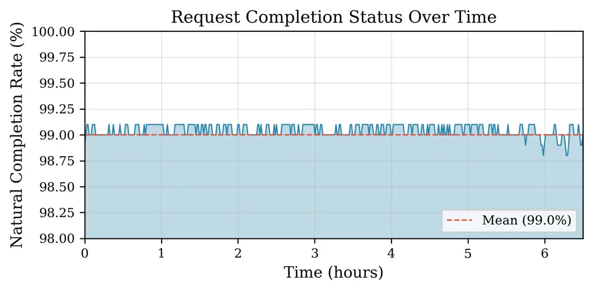

Figure 1: Natural completion rate over a 6.5-hour extraction run.

As shown in Figure 1, the natural completion rate remained stable at
99.0% (±0.1%) throughout the extraction process. Only 1.0% of requests
reached the 3,072 token generation limit, indicating consistent pipeline
behavior. This high completion rate shows that the configured output
length is sufficient for the vast majority of document pages, minimizing
information loss due to truncation. The stability of the completion rate
across the full runtime suggests that document complexity did not vary
systematically in ways that would affect extraction quality.

#### 3.2.3 Data Preprocessing Pipeline

##### Cleaning and Normalization:

All datasets underwent a multi-stage cleaning pipeline to remove
duplicates, malformed records, and low-quality content. The pipeline
included (i) discarding samples with missing or invalid fields, (ii)
intra-batch deduplication to eliminate repeated entries, (iii) filtering
out overly short texts that lack sufficient linguistic signal, (iv)
excluding excessively long documents that are likely noisy or
out-of-distribution and may hinder efficient processing, and (v)
removing HTML-derived samples dominated by tabular structure or image
references (e.g., pages consisting primarily of tables or image links)
rather than natural language. This process ensures that the final corpus
is predominantly textual and suitable for language model training.

##### Filtering:

A multi-stage filtering pipeline was employed to improve corpus quality
and safety while preserving topical and stylistic diversity. The
pipeline comprises (i) URL-based safety filtering for web-derived
content, (ii) document-level language identification to enforce
linguistic consistency, and (iii) content-quality filtering using tuned
heuristic indicators.

URL Filtering: We removed records whose URLs contained a curated set of
high-frequency inappropriate keywords (e.g., adult, explicit, or
gambling-related terms). To reduce false positives, we applied an
allowlist of known legitimate sources that were exempt from filtering.

Language Filtering: We ensured linguistic consistency via document-level
language identification using The GlotLID classifier \[15\]. For each
document, we predicted the primary language top-$`k`$ with 0.40
confidence scores and retained only samples whose top prediction matched
the target languages, and all other documents or low-confidence cases
were filtered out.

Quality Filtering: We applied the FineWeb Quality Filter \[14\] with
tuned thresholds to remove low-quality documents based on indicators
such as punctuation patterns, line-length statistics, character
duplication, and newline/list-like structure. We set the short_line,
char_duplicates, new_line thresholds respectively to 0.67, 0.03, 0.4
keeping other parameters at default values. The thresholds were chosen
via a small grid search around defaults on a balanced test set built
with 5-fold sampling over categories (up to 100 examples per category;
random_state $`=42`$), selecting the configuration that balanced drop
rate and false positives.¹¹ 1
[github.com/huggingface/datatrove](https://github.com/huggingface/datatrove)

| short_line (%) | char_duplicates (%) | char_dup (%) | new_line (%) | Overall (Drop ratio%) |
| -------------- | ------------------- | ------------ | ------------ | --------------------- |
| 0.1000         | 0.0100              | 0.0018       | 0.3000       | 0.0080                |
| 0.2500         | 0.1300              | 0.0018       | 0.4500       | 0.0042                |
| 0.6700         | 0.2500              | 0.0019       | 0.6000       | 0.0042                |
| 0.7800         | 0.3700              | 0.0017       | 0.7500       | 0.0075                |
| 0.9000         | 0.5000              | 0.0061       | 0.9000       | 0.0044                |

Table 2: The Dropping Ratios of tested Configurations

Turkish Quality Filtering: To quantify Turkish-specific linguistic
richness, we compute two morphology-driven indicators from
_Zemberek_-based morphological analyses \[4\]: _suffix entropy_ and
_lemma diversity_. After tokenization and morphological analysis, we
focus on noun and verb tokens and extract their nominal case tags, then
estimate the empirical distribution over observed case categories.
Suffix entropy is defined as the Shannon entropy \[34\] of this case-tag
distribution:

```math
H_{\text{suffix}}=-\sum_{i=1}^{n}p_{i}\log p_{i}, \tag{1}
```

where $`p_{i}`$ denotes the relative frequency of case tag $`i`$ among
noun tokens and $`n`$ is the number of distinct case tags observed.

Higher values indicate more balanced and varied case usage, which is
typical of well-formed, sentence-like prose, whereas lower values
reflect dominance of a small number of cases, often associated with
templated or repetitive content.

For comparability across texts with different numbers of observed tags,
we also report the normalized entropy which lies in $`[0,1]`$:

```math
H_{\text{suffix}}^{\text{norm}}=\frac{H_{\text{suffix}}}{\log(n)} \tag{2}
```

Lemma diversity captures lexical variety after morphological
normalization. For each token with a valid analysis, we extract its
lemma and compute the ratio of unique lemmas to the total number of
analyzed tokens:

```math
\text{LD}=\frac{|\{l_{1},l_{2},\ldots,l_{k}\}|}{N}, \tag{3}
```

where $`\{l_{1},l_{2},\ldots,l_{k}\}`$ is the set of distinct lemmas and
$`N`$ is the number of tokens contributing a lemma.

Values closer to 0 indicate strong repetition (e.g., boilerplate or
duplicated templates), while higher values indicate broader vocabulary
after normalization; unusually high values can also flag noisy or
out-of-domain text.

Together, suffix entropy and lemma diversity provide complementary
signals of morphological variation and lexical richness for Turkish
corpus quality assessment.

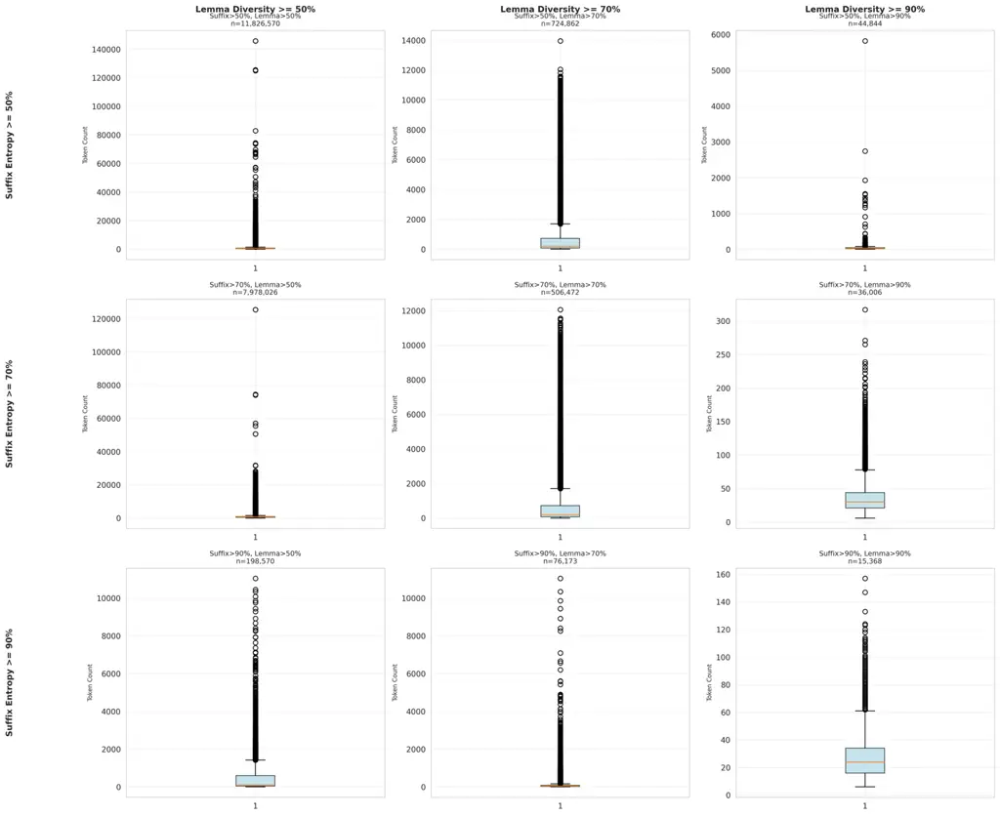

Figure 2: Token Count Distribution Analysis Across All Threshold
Combinations.

Figure 2 shows comprehensive token count distribution analysis across
all threshold combinations, comparing distributions showing impact of
Suffix Entropy (%) and Lemma Diversity (%) filters. Each subplot shows
n(sample count), mean and median token counts for surviving data.

#### 3.2.4 Threshold selection for Turkish morphology filters

To set filtering thresholds for _suffix entropy_ and _lemma diversity_,
we performed a coarse-to-fine sweep and tracked both data retention and
token-count impact. First, we computed token counts for each sample
using the Qwen1.7B tokenizer and evaluated a grid of candidate
thresholds$`\{50,70,90\}`$ for both metrics. For
every$`(\tau_{\text{suffix}},\tau_{\text{lemma}})`$ pair, we filtered
the corpus with $`\texttt{suffix\_entropy}>\tau_{\text{suffix}}`$
and$`\texttt{lemma\_diversity}>\tau_{\text{lemma}}`$, and recorded the
number of surviving samples, total tokens, and token-length distribution
statistics (min/max, mean/median, quartiles). As shown in Figure 2, the
analysis reveals the impact of different threshold combinations on token
count distributions. Table 26 (see Appendix C) summarizes the main
trade-off at fixed lemma diversity.

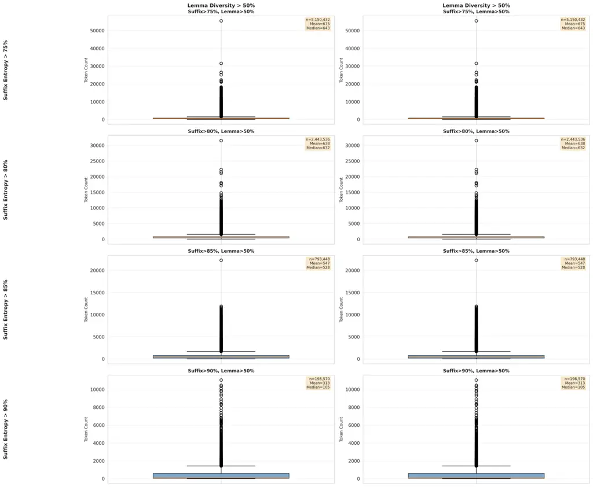

Figure 3: Token Count Distribution Across Suffix Entropy Thresholds
(Lemma Diversity $`\geq`$ 50%)

Increasing the lemma-diversity threshold beyond 50% caused a sharp drop
in both remaining documents and total tokens (e.g., from 8.7M samples at
50–50 to 1.6M at 50–65), indicating an overly aggressive constraint that
would remove substantial in-domain content. We therefore fixed the
lemma-diversity threshold at 50% and refined the suffix-entropy
threshold within the transition region between 70% and 90%. This second
sweep$`\{75,80,85,90\}`$ revealed a clear trade-off: while$`>70\%`$
retained$`\sim 5.51`$B tokens,$`>90\%`$ collapsed the corpus
to$`\sim 0.062`$B tokens. Figure 3 visualizes the token count
distribution across suffix entropy thresholds at fixed lemma diversity
of 50%. We selected$`\tau_{\text{suffix}}=\textbf{75\%}`$ (i.e., 0.75 in
normalized form) as a balanced operating point. This threshold enforces
higher morphological variation while preserving a substantial token
budget ($`\sim 3.48`$B tokens) and maintaining a stable token-length
distribution in the surviving set.

##### Deduplication:

To reduce redundancy and improve training efficiency, we apply a
multi-stage deduplication pipeline that removes both exact copies and
near-duplicate documents. The pipeline processes documents in stages,
progressing from low-cost, high-precision exact matching to semantic
similarity-based removal, retaining a single representative per
duplicate cluster.

Exact Match Deduplication: We perform global deduplication using
document text hashes to identify and remove all exact copies. This
initial stage identifies approximately 5% of the corpus as duplicates,
reducing redundant training data.

Semantic Deduplication: For near-duplicate detection, we employ SemHash
\[26\], an embedding-based approach using dense embeddings with a
similarity threshold of 0.75. This method effectively identifies
documents that differ only in headers, footers, or minor formatting
variations across multiple domains, significantly reducing redundant
content while preserving semantic diversity essential for robust model
training. Additionally, we apply URL-based content filtering to exclude
samples whose URL fields match inappropriate keyword patterns (e.g.,
adult, explicit, or gambling-related terms) through keyword-driven
string matching. To minimize false positives, we maintain an allowlist
of common legitimate news domains and terms, preserving samples that
match these exceptions. This semantic deduplication step improves
dataset safety and topical relevance before downstream processing.²² 2
[github.com/MinishLab/semhash](https://github.com/MinishLab/semhash)

##### Decontamination:

To mitigate false positives in our filtering pipeline, we developed
task-specific heuristics that incorporate domain-specific knowledge and
adaptive threshold mechanisms. First, we ignore matches of
task-irrelevant text chunks, such as common generic phrases, where
irrelevance is determined per task through manual inspection. Second,
for specialized domains like mathematics, we apply stricter filtering
criteria to ensure higher precision. These heuristics help maintain
dataset quality while reducing over-filtering of legitimate content.
Additional details on the decontamination module implementation,
including profanity filtering, content quality assessment, and sensitive
information anonymization, are provided in Appendix E.

Token and Document Statistics

Training employed three different datasets containing approximately 3.7
billion, 57 billion, and 165 billion tokens respectively. This gradual
structure supports the model’s adaptation to increasing data complexity
while steadily developing Turkish language proficiency and
domain-specific contextual knowledge.

Table 3 summarizes the dataset statistics for Qwen3-1.7B four-phase
curriculum learning and Qwen3-4B single-phase training.

| Phase        | Model      | Total Tokens    |
| ------------ | ---------- | --------------- |
| Phase 1      | Qwen3-1.7B | 3,678,052,050   |
| Phase 2      | Qwen3-1.7B | 57,045,791,446  |
| Phase 3      | Qwen3-1.7B | 165,110,698,942 |
| Phase 4      | Qwen3-1.7B | 24,905,934,016  |
| Single Phase | Qwen3-4B   | 270,791,712,595 |

Table 3: CPT Training Dataset Statistics by Phase

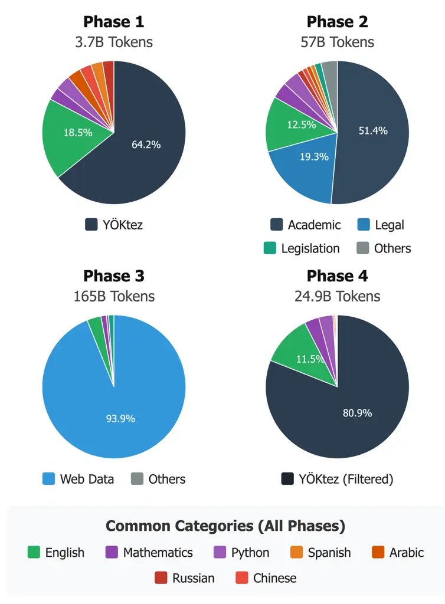

Figure 4: Qwen3-1.7B CPT Dataset Distribution across Four Phases.

Figure 4 illustrates the dataset composition across the four training
phases for Qwen3-1.7B, showing the progression from academic-focused
data (Phase 1) through legal and web data integration (Phases 2-3) to
refined domain-specific content (Phase 4). Common categories across all
phases include English, Mathematics, Python, and multilingual data
(Spanish, Arabic, Russian, Chinese), while phase-specific categories
reflect the curriculum learning strategy.

In the first phase we applied semantic deduplication to remove
near-duplicate records beyond exact string matches, followed by FineWeb
quality filtering to discard structurally noisy or template-like
content. Since theses are often split across multiple pages, we then
merged consecutive pages belonging to the same document (preserving page
order) to reconstruct coherent long-form samples.

In the second phase we used a lighter pipeline focused on quality
control, applying FineWeb quality filtering to remove low-quality
documents while preserving broad topical diversity and general-domain
signal.

In phase 3 we employed the full safety and normalization pipeline: (i)
cleaning and normalization to discard malformed entries, extremely
short/long samples, and HTML artifacts dominated by tables or image
links; (ii) document-level language identification, retaining only
target-language samples under a confidence-based criterion; (iii)
semantic deduplication to remove near-duplicates at scale; (iv) FineWeb
quality filtering for structural and stylistic quality and (v) for the
web subset, URL-based filtering using a curated denylist of
inappropriate keyword patterns with an allowlist to reduce false
positives. Finally, in phase 4 we expanded the academic portion used in
earlier phases and re-applied the same thesis-specific procedure as in
phase 3 to maintain consistency while increasing academic coverage.

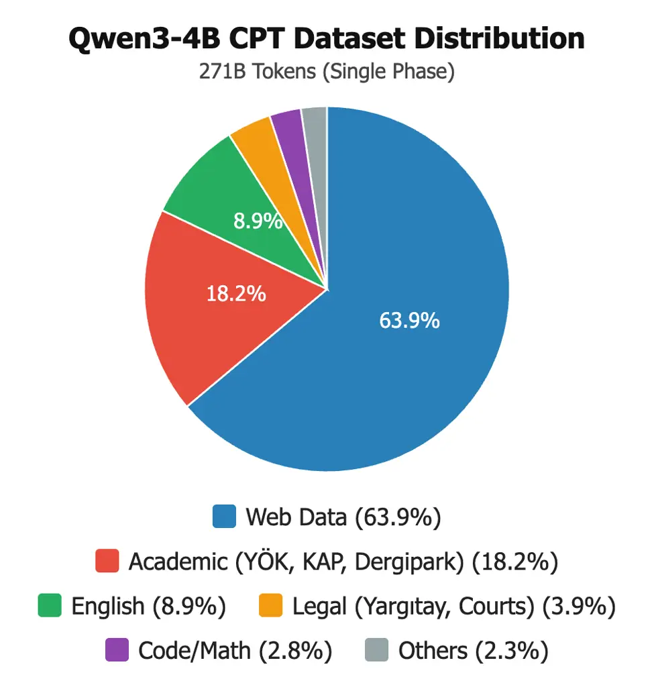

Figure 5: Qwen3-4B CPT Dataset Distribution Single Phase.

As shown in Figure 5, for Qwen3-4B, we combined academic theses
(expanded from earlier phases) with legal, legislation, web, and other
sources to obtain the final training mixture.

For both Qwen3-1.7B and Qwen3-4B CPT, supplementary training data were
sourced from publicly available datasets: mathematics data from
Nemotron-CC-Math \[24\] and OpenWebMath \[31, 30\], multilingual content
(Spanish, Arabic, Russian, Chinese) from FineWeb-2, and Python code from
StarCoderData \[19\] and The Stack Smol \[19\].

### 3.3 Encoder Model: Pre-training from Scratch

#### 3.3.1 Model Details

The Mecellem Encoder project develops ModernBERT-based bidirectional
encoder models pre-trained entirely from scratch on Turkish-dominant
corpora. Unlike domain-adaptive approaches that continue training from
existing checkpoints, our models are initialized randomly and trained on
a carefully curated dataset totaling approximately 112.7 billion tokens
combining Turkish legal text with general web data. The resulting models
serve as foundation models for downstream embedding tasks, achieving
state-of-the-art performance on Turkish legal retrieval benchmarks.

#### 3.3.2 Architecture

ModernBERT incorporates modern architectural advances for bidirectional
encoders, including alternating local and global attention to
efficiently handle long contexts \[46\]. The architecture utilizes
pre-layer normalization with RMSNorm and GeGLU activations (Gated Linear
Units with GELU) in the MLP layers, while removing all bias terms to
improve hardware throughput. To support sequences up to 8,192 tokens, it
implements rotary positional embeddings (RoPE) across all layers,
utilizing sliding window attention in its local layers (two out of every
three layers) to reduce computational complexity. Table 4 summarizes the
architecture hyperparameters.

|                 |          |          |
| --------------- | -------- | -------- |
| Parameter       | Base     | Large    |
| Seq. Length     | 1,024    | 2,048    |
| Layers          | 22       | 28       |
| Hidden Size     | 768      | 1,024    |
| FFN Size        | 1,152    | 2,624    |
| Attn. Heads     | 12       | 16       |
| Head Dim.       | 64       | 64       |
| Activation      | GLU+GELU | GLU+GELU |
| Pos. Enc.       | RoPE     | RoPE     |
| RoPE $`\theta`$ | 10,000   | 20,000   |
| Norm            | RMSNorm  | RMSNorm  |
| Window Size     | 128      | 128      |
| Vocab Size      | 59,008   | 59,008   |
| MLM Prob.       | 0.3      | 0.3      |
| Total Params    | 155M     | 403M     |

Table 4: ModernBERT Architecture Configuration

#### 3.3.3 Tokenizer Design and Analysis

Alongside the model architecture, a custom tokenizer was developed
tailored to the distribution of Turkish web data and legal documents. To
achieve optimal fertility and broad coverage of legal terminology, the
tokenizer was trained on a large-scale dataset combining dense legal
manuscripts with Common Crawl web data. The Byte Pair Encoding (BPE)
algorithm with a regex-based pre-tokenization step was employed to
ensure maximum efficiency. Specifically, the Llama pre-tokenization
pattern was implemented, which demonstrated the best performance for the
structural requirements of the Turkish language.

Tokenizer design directly impacts model performance on morphologically
rich languages. Turkish is agglutinative—a single word can encode
subject, object, tense, aspect, and mood through suffixation. Tokenizers
trained on English often split Turkish words at arbitrary points,
breaking morphological structure and hurting downstream performance
\[5\].

##### Tokenizer Benchmark Methodology

We evaluate tokenizer quality using metrics derived from the methodology
proposed by Bayram et al. \[5\] and the ITU Turkish NLP Web Service
\[12\]. Two primary metrics are computed:

Turkish Token Count: The number of vocabulary entries corresponding to
valid Turkish words or morphemes, validated using morphological analysis
via the ITU Turkish NLP pipeline \[12\].

Token Purity: The count of tokens representing complete morphological
units rather than arbitrary subword fragments. A token is considered
pure if it corresponds to a meaningful linguistic unit (root, suffix, or
complete word) without semantic loss.

To illustrate, consider the word çalışıyorlar (they are working). A
morphologically-aware tokenizer produces \[çalış, ıyor, lar\]—three pure
tokens representing the verb root, present continuous suffix, and plural
marker respectively. A suboptimal tokenizer might produce \[ça, lı, şı,
yor, lar\], yielding only one pure token (lar), as the remaining
fragments carry no morphological meaning.

##### Tokenizer Selection Results

Figure 6 shows the relationship between tokenizer characteristics and
model performance for Turkish pre-trained MLM models evaluated in Table 22. The bubble plot visualizes three key tokenizer quality metrics:
Turkish Token Count (x-axis), Pure Token Count (y-axis), and Unique
Token Count (bubble size), with bubble color representing Pure Token
Count using a viridis colormap.

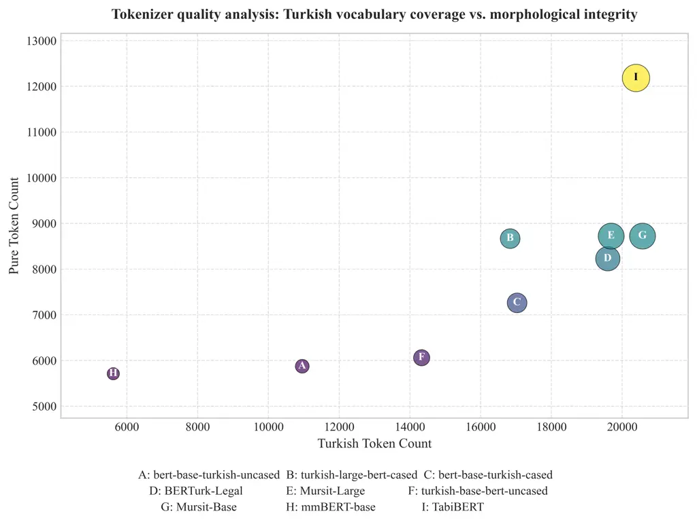

Figure 6: Tokenizer quality analysis: Turkish vocabulary coverage vs.
morphological integrity. Turkish Token Count (x-axis) measures
vocabulary coverage of Turkish words and morphemes, while Pure Token
Count (y-axis) represents morphological integrity—the count of tokens
corresponding to complete morphological units. Bubble size indicates
Unique Token Count, and bubble color (viridis colormap) represents Pure
Token Count, where darker purple indicates lower values and brighter
yellow indicates higher values. Only Turkish pre-trained MLM models (and
one multilingual model, mmBERT-base) from Table 22 are evaluated.

The analysis reveals a strong positive correlation between Turkish Token
Count and Pure Token Count, indicating that models with broader Turkish
vocabulary coverage also achieve better morphological integrity. Turkish
pre-trained MLM models consistently demonstrate higher pure token counts
(6,000–12,000) and Turkish token coverage (14,000–20,000) compared to
the multilingual baseline (mmBERT-base), correlating with improved
performance on both general and legal tasks. Turkish pre-trained models
score 40–58% vs. 22–23% for mmBERT-base on general tasks (roughly
2.5$`\times`$ improvement), and 17–47% vs. 2–3% on legal retrieval (up
to 20$`\times`$ difference). Legal text contains specialized vocabulary
and complex nominal constructions that amplify tokenization errors,
making morphological integrity critical for domain-specific tasks.

These results confirm that Turkish vocabulary coverage and morphological
integrity in the tokenizer are necessary for strong performance,
especially on domain-specific tasks. Based on this analysis, we selected
the Llama pre-tokenization pattern with BPE, which achieved optimal
Turkish token count and purity for our legal domain corpus.

#### 3.3.4 Pre-training

##### Dataset Composition and Corpus Construction

The pre-training corpus combines Turkish legal and general web data,
totaling 112.7 billion tokens. Training data are aggregated from
multiple sources: the legal subset includes decisions from the Court of
Cassation (Yargıtay) with 10.3M sequences (3.43B tokens), the Council of
State (Danıştay) with 151K sequences (0.11B tokens), and academic theses
from YÖKTEZ with 21.1M sequences (9.61B tokens) after OCR processing
using DotsOCR \[20\]. The general Turkish subset is constructed from
FineWeb2 \[31\] and CulturaX, contributing 212M sequences (96.17B
tokens).

The preprocessing pipeline prioritizes legal compliance, semantic
diversity, and training stability over raw corpus size, employing
conservative and fully reproducible transformations. All stages execute
in batch-parallel form on the MareNostrum 5 supercomputer using
GPU-accelerated cuDF workflows. Structurally invalid records are
removed, followed by exact deduplication and strict legal filtering.
Documents with unclear licensing were proactively excluded to ensure
legal compliance. Web data undergoes additional filtering via
GPU-parallel URL-based safety rules. OCR-induced noise, including
scattered-text artifacts, is addressed through a recovery-oriented
normalization pipeline. To eliminate near-duplicate legal templates,
semantic deduplication is applied using dense document embeddings
generated by the BGE-M3 encoder \[8\] and filtered with SemHash \[26\]
at a cosine similarity threshold of 0.95. The final pipeline reduces the
corpus from 132.6M to 72.2M documents while preserving linguistically
meaningful content.

##### Training Dataset Evolution

The training process was structured into multiple dataset versions,
progressing from initial pipeline validation to comprehensive URL-based
filtering, the integration of native Turkish legal and academic corpora,
and optimized page-packing strategies:

Initial training datasets: $`\sim`$8–52B tokens. These datasets were
used to validate the training pipeline and tune hyperparameters, and
consist primarily of Filtered FineWeb and CultureWeb data.

URL-filtered web corpus with academic and legal data: $`\sim`$101.5B
tokens. This corpus aggregates all previously used web data and applies
a basic URL-level filtering to remove unwanted sources. It also includes
native Turkish academic articles and legal documents collected from
YÖKTEZ, Yargıtay (Court of Cassation), and Danıştay (Council of State).

Extended legal and academic corpus: $`\sim`$109.3B tokens. This dataset
builds on the same web and legal foundation, augmented with a
substantially larger collection of YÖKTEZ academic theses obtained via
OCR.

Page-packed and quality-filtered corpus: $`\sim`$112.7B tokens. This
final corpus further enhances the previous data by applying additional
quality and URL filtering to the web sources, and introduces page
packing for YÖKTEZ documents to increase effective sequence length
during training.

##### Training Configuration

Pre-training was conducted on the MareNostrum 5 ACC supercomputer
through an EuroHPC access grant, using the MosaicML Composer framework
\[40\]. Training employs Decoupled StableAdamW optimizer,
warmup_stable_decay learning rate schedule, and BF16 mixed precision.
The Masked Language Modeling (MLM) objective is used as the primary
training signal, with a masking probability of 15% following standard
BERT practices. Rather than relying solely on MLM loss minimization, we
implement a checkpoint selection strategy that evaluates downstream
retrieval performance throughout training, revealing non-linear
relationships between MLM loss and embedding quality. Table 5 summarizes
the model-specific hyperparameters.

| Parameter     | Base            | Large           |
| ------------- | --------------- | --------------- |
| Nodes         | 16              | 32              |
| GPUs          | 64 H100         | 128 H100        |
| Learning Rate | 5$`\times`$10⁻⁴ | 8$`\times`$10⁻⁴ |

Table 5: Pre-training Hyperparameters for ModernBERT Models

#### 3.3.5 Post-training for Embeddings

For converting the pre-trained encoder into an embedding model, we
explore multiple contrastive learning techniques on the MS MARCO-TR
dataset.

Training Dataset:

- 1.  MS MARCO-TR: Turkish translation of MS MARCO passage ranking dataset,
      consisting of 920,106 triplets. Mean query length: 8.2 tokens, mean
      passage length: 69.9 tokens.

Loss Functions Evaluated:

1. InfoNCE Loss: Standard contrastive loss treating in-batch negatives
   as hard negatives:

```math
\mathcal{L}_{\text{InfoNCE}}=-\frac{1}{N}\sum_{i}\log\frac{\exp(\text{sim}(q_{i},d_{i}^{+})/\tau)}{\sum_{j}\exp(\text{sim}(q_{i},d_{j})/\tau)} \tag{4}
```

2. Qwen3-Style InfoNCE: Modified temperature scaling following
   Qwen3-Embedding approach with adjusted margin.

3. GISTEmbed with Cached Guide Model: Guided In-sample Selection of
   Training Negatives \[36\] with false-negative filtering. For each query
   $`q_{i}`$ and candidate negative $`d_{j}`$:

```math
\text{filter}(d_{j})=\text{sim}_{\text{guide}}(q_{i},d_{j})<\text{sim}_{\text{guide}}(q_{i},d_{i}^{+})-\text{margin} \tag{5}
```

We evaluate two guide models: google/embeddinggemma-300m \[8, 43\] (307M
parameters, 768-dimensional) and BAAI/bge-m3 (568M parameters,
1024-dimensional). The cached implementation precomputes guide
embeddings ($`\sim`$3.5GB for 920K samples) once before training,
avoiding repeated forward passes through the guide model during each
training step and thereby reducing computational overhead.

Post-training Configuration:

Through systematic ablation studies, we identify optimal hyperparameters
balancing training efficiency with downstream task performance. Token
distribution analysis of MS MARCO-TR reveals: queries mean=8.2 tokens
(P99=16), documents mean=69.9 tokens (P99=116), with 99.9% sample
coverage at 256 tokens and 0.05-0.07% token truncation loss.
Post-training was conducted using AdamW optimizer (learning
rate=2$`\times`$10⁻⁵, weight decay=0.01) on 4$`\times`$H100 GPUs. Table
6 summarizes the hyperparameters used for post-training ModernBERT
models.

| Parameter              | Base (155M) | Large (403M) |
| ---------------------- | ----------- | ------------ |
| Per-GPU Batch          | 48          | 48           |
| Gradient Accum.        | 4           | 12           |
| Effective Batch        | 768         | 2,304        |
| Sequence Length        | 1,024       | 2,048        |
| Temperature ($`\tau`$) | 0.05        | 0.05         |

Table 6: Post-training Configuration for ModernBERT Models

#### 3.3.6 Pre-training Dataset Version Progression:

Our iterative refinement of the pre-training dataset across multiple
versions (v1 through v6) demonstrates the critical importance of data
quality and domain coverage for Turkish legal embedding performance.
Even minimal token truncation (0.05-0.07%) results in performance
degradation when sequence length is optimized solely for training data
efficiency. Models trained with shorter sequences exhibit degradation in
legal domain tasks, with regulation retrieval showing -23.6% relative
decrease and case law retrieval showing -11.6% relative decrease,
indicating that long-document understanding is essential for legal
domain applications. Detailed results are presented in Section 4.

### 3.4 Decoder Model: CPT

#### 3.4.1 Theoretical Motivation for CPT

CPT is an approach that aims to continue pre-training of large language
models on domain-specific and language-specific data while preserving
general language capabilities. Unlike classical fine-tuning, CPT updates
all model parameters on large-scale data, providing more persistent and
deeper domain adaptation. This characteristic is critical for
maintaining conceptual consistency in highly formal domains such as law
that require strong structural integrity and long-context understanding.

#### 3.4.2 Model Details

The Mecellem Decoder project applies CPT to existing decoder-only
language models, adapting them for Turkish legal domain understanding.
Unlike pre-training from scratch, CPT preserves the general language
capabilities of the base model while injecting domain-specific knowledge
through extended training on specialized corpora. We select Qwen3-1.7B
and Qwen3-4B \[49\] as base models due to their strong multilingual
capabilities and efficient architecture.

#### 3.4.3 Pretraining to CPT Transition Strategy

In this work, CPT is applied directly as continuation training on
Qwen3-Base models. The data distribution in the CPT phase is rebalanced
to be Turkish-dominant and legal domain-focused. For the Qwen3-1.7B
model, the process is conducted in multiple phases using a curriculum
learning approach; the Qwen3-4B model is trained with a single-phase,
large-scale CPT process.

#### 3.4.4 Architecture

The decoder models follow the standard Qwen3 architecture with grouped
query attention (GQA), RMSNorm, SwiGLU activations, and rotary
positional embeddings. Table 7 summarizes the architecture.

|                          |            |          |
| ------------------------ | ---------- | -------- |
| Parameter                | Qwen3-1.7B | Qwen3-4B |
| Max Position Embeddings  | 40,960     | 40,960   |
| Number of Layers         | 28         | 36       |
| Hidden Size              | 2,048      | 2,560    |
| FFN Hidden Size          | 6,144      | 9,728    |
| Number of Heads          | 16         | 32       |
| Number of KV Heads (GQA) | 8          | 8        |
| Activation Function      | SwiGLU     | SwiGLU   |
| Position Encodings       | RoPE       | RoPE     |
| Layer Norm               | RMSNorm    | RMSNorm  |
| Total Parameters         | 1.7B       | 4B       |

Table 7: Qwen3 Decoder Architecture Configuration

#### 3.4.5 Addressing Catastrophic Forgetting

Catastrophic forgetting poses severe practical challenges in legal
domain applications, where forgetting general language capabilities
while acquiring legal expertise would severely limit model utility. In
Mecellem CPT, we employ two complementary strategies to mitigate
catastrophic forgetting:

- 1.  Curriculum Learning: The four-phase training structure for Qwen3-1.7B
      organizes data from general texts to domain-specific legal content to
      complex normative documents and finally to extended domain-specific
      refinement. This progressive approach supports gradual domain
      adaptation, preventing the abrupt distribution shifts that typically
      cause forgetting.
- 2.  Replay Buffer: To reinforce previously learned knowledge, we
      incorporate a portion of YÖKTEZ academic legal data from Phase 1 into
      Phase 2 training. This data replay strategy ensures that foundational
      legal terminology and document structures acquired in earlier phases
      are continuously reinforced during subsequent training stages.

These strategies are further supported by conservative learning rate
scheduling (maximum 5e-5 with cosine decay) and extended warmup periods,
which help stabilize parameter updates throughout the CPT process.

#### 3.4.6 Training Hyperparameters

Hyperparameters for CPT training were selected to provide stable and
scalable training in distributed environments. All experiments share the
following common settings: sequence length of 4,096 tokens, Adam
optimizer with cosine learning rate schedule (max: 5e-5, min: 5e-6),
weight decay of 0.01, BF16 precision, 10 validation batches per
evaluation, NVIDIA NeMo³³ 3
[github.com/NVIDIA/NeMo](https://github.com/NVIDIA/NeMo) \[28\]
framework with data-parallel distributed strategy on H100 GPUs at BSC.
Phase-specific hyperparameters that vary across training configurations
are summarized in Table 8.

#### 3.4.7 Pre-training (Continual)

Qwen3 models were continually pre-trained on approximately 225 billion
tokens using the MareNostrum 5 ACC supercomputer. The training employed
a four-phase curriculum learning strategy designed for progressive
domain adaptation, which also serves as a form of catastrophic
forgetting mitigation by gradually transitioning the model from general
to specialized knowledge. Phase 1 ($`\sim`$3.7B tokens) focuses on
short, general-purpose Turkish texts to adapt the model to Turkish
language patterns while maintaining stability, using higher learning
rates with extended warmup. Phase 2 ($`\sim`$57B tokens) introduces
legal content with domain-specific terminology including court
decisions, legal articles, and regulatory documents, shifting the data
mix toward specialized sources. Phase 3 ($`\sim`$165B tokens)
incorporates long, structurally complex normative texts including full
court decisions, legislative documents, and academic legal theses,
refining the model’s understanding of legal reasoning patterns. Phase 4
($`\sim`$24.9B tokens) provides extended domain-specific refinement
combining mixed complexity documents for final model optimization,
consolidating knowledge from previous phases while improving
generalization across legal subdomains.

|              |       |        |        |        |         |
| ------------ | ----- | ------ | ------ | ------ | ------- |
| Parameter    | P1    | P2     | P3     | P4     | 4B      |
| Max Steps    | 4,170 | 32,260 | 46,803 | 14,122 | 153,508 |
| Epochs       | 2     | 1      | 1      | 1      | 1       |
| Init Ckpt.   | Base  | P1     | P2     | P3     | Base    |
| Warmup       | 200   | 1,600  | 2,340  | 706    | 7,675   |
| Micro Batch  | 2     | 2      | 2      | 2      | 1       |
| Global Batch | 400   | 400    | 800    | 400    | 400     |
| Val Interval | 100   | 100    | 100    | 100    | 5,000   |

P1–P4: Qwen3-1.7B phases; 4B: Qwen3-4B single-phase training.

Table 8: CPT Training Configuration (Phase-Specific Parameters)

#### 3.4.8 Hardware and Distributed Training Architecture

All CPT experiments were conducted on BSC MareNostrum5 supercomputing
infrastructure using NVIDIA H100 SXM GPUs. Training utilized NVIDIA NeMo
\[35, 28\] and Megatron-Core based, data-parallel multi-node and
multi-GPU distributed architecture with 4 GPUs per node. The InfiniBand
network infrastructure enabled efficient processing of large-scale token
flow and ensured high scalability and training stability in long-term
CPT training.

Hardware Utilization: We measure training efficiency using Model FLOPs
Utilization (MFU), where the theoretical peak for NVIDIA H100 SXM is 989
TFLOP/s for BF16 operations⁴⁴ 4
[resources.nvidia.com/en-us-gpu-resources/h100-datasheet-24306](https://resources.nvidia.com/en-us-gpu-resources/h100-datasheet-24306).
Table 9 presents the MFU statistics for both Qwen3-1.7B curriculum
training and Qwen3-4B single-phase training. For Qwen3-1.7B, median MFU
values ranging from 20.3% to 20.7% represent effective hardware
utilization after filtering checkpoint and validation overhead. Phase 3
achieved the highest throughput (7.35M tokens/sec) utilizing 400 GPUs.
Qwen3-4B training achieved 18.7% median MFU with 2.57M tokens/sec
throughput, demonstrating consistent hardware efficiency across both
model scales.

| Model | Phase  | Nodes | GPUs | Mean  | Median | Tok/s |
| ----- | ------ | ----- | ---- | ----- | ------ | ----- |
| 1.7B  | P1     | 50    | 200  | 19.7% | 20.7%  | 3.77M |
|       | P2     | 50    | 200  | 18.8% | 20.7%  | 3.59M |
|       | P3     | 100   | 400  | 19.2% | 20.3%  | 7.35M |
|       | P4     | 50    | 200  | 17.0% | 20.6%  | 3.25M |
| 4B    | Single | 100   | 400  | 15.7% | 18.7%  | 2.57M |

1.7B/4B: Qwen3-1.7B/Qwen3-4B; P1–P4: Phase 1–4; Mean/Median: MFU (%);
Tok/s: Tokens per second.

Table 9: CPT Hardware Utilization (MFU) Statistics

#### 3.4.9 Decoder-to-Encoder Conversion and Post-training for Embeddings

To adapt the CPT decoder models for dense retrieval tasks, we implement
a decoder-to-encoder conversion methodology following recent approaches
for converting autoregressive models to embedding models \[39\]. The
Qwen3-1.7B and Qwen3-4B CPT models (2,048-dimensional embeddings,
151,936 vocabulary size) undergo architectural modifications to enable
bidirectional embedding generation.

Conversion Process:

The conversion involves four architectural modifications:

1.  1.  Removal of Language Modeling Head: The autoregressive lm_head layer
        is removed, eliminating next-token prediction capability while
        preserving transformer layer representations.
2.  2.  Bidirectional Attention: The causal attention mask is replaced with
        bidirectional attention, enabling the model to attend to all tokens
        in the input sequence.
3.  3.  Mean Pooling: Fixed-size representations are extracted from final
        hidden states using mean pooling over all token positions.
4.  4.  Identity Projection: A projection layer is initialized to maintain
        the original 2,048-dimensional embedding output.

Our decoder-to-encoder conversion represents a simplified adaptation
compared to the official Qwen3 Embedding approach \[39\]. The official
method employs large-scale synthetic data generation (150M samples),
multi-stage training, and model merging, while our resource-constrained
implementation uses single-stage supervised training on MS MARCO-TR
(920K samples) with CachedGISTEmbedLoss. This limitation contributes to
the performance gap observed in our results (Section 4).

Post-training Configuration:

Post-training was conducted on MS MARCO-TR dataset (920,106 triplets)
using CachedGISTEmbedLoss with BAAI/bge-m3 \[8\] guide model (568M
parameters, 1024-dimensional embeddings) for false-negative filtering.
Both models were trained on 4$`\times`$H100 GPUs using AdamW optimizer
with learning rate 5$`\times`$10⁻⁶. Qwen3-1.7B used per-GPU batch size 8
with gradient accumulation 8 (effective batch 256), while Qwen3-4B used
per-GPU batch size 2 with gradient accumulation 16 (effective batch
128). Both models used max sequence length 1,024 tokens. Table 10
presents the detailed hyperparameters for Qwen3 CPT models.

|                        |                |              |
| ---------------------- | -------------- | ------------ |
| Parameter              | Qwen3-1.7B CPT | Qwen3-4B CPT |
| Per-GPU Batch          | 8              | 2            |
| Gradient Accumulation  | 8              | 16           |
| Effective Batch        | 256            | 128          |
| Max Sequence Length    | 1,024 tokens   | 1,024 tokens |
| Temperature ($`\tau`$) | 0.05           | 0.05         |
| Training               | 1 epoch        | 1 epoch      |

Table 10: Post-training Configuration for Qwen3 CPT Models

The smaller effective batch sizes (128-256 vs. official Qwen3’s
thousands) and limited training data diversity represent key constraints
in our implementation.

### 3.5 Evaluation Methodology

To assess the quality of embedding models trained on our corpus, we
developed MTEB-Turkish, an evaluation framework that extends the Massive
Text Embedding Benchmark (MTEB) with Turkish-specific tasks and legal
domain corpora. The framework evaluates embedding models across 17 tasks
spanning five task types: classification, retrieval, clustering, pair
classification, and semantic textual similarity.

#### 3.5.1 Task Taxonomy

Table 11 summarizes the task distribution across categories. The
benchmark includes both general-domain tasks adapted for Turkish and
three domain-specific legal retrieval tasks constructed from regulatory
texts, case law, and contract documents.

| Task Type           | Tasks | Samples       |
| ------------------- | ----- | ------------- |
| Classification      | 6     | $`\sim`$9.5K  |
| Retrieval           | 4     | $`\sim`$157K  |
| Pair Classification | 2     | $`\sim`$12.5K |
| Clustering          | 1     | 99            |
| STS                 | 1     | 208           |
| Legal Retrieval     | 3     | $`\sim`$122K  |
| Total               | 17    | $`\sim`$301K  |

Table 11: Task Distribution in MTEB-Turkish Benchmark

Representative tasks include MassiveIntent and TurkishMovie for
classification, WebFAQ and XQuAD for retrieval, XNLI for pair
classification, and domain-specific legal retrieval tasks covering
regulatory texts, case law, and contracts.

#### 3.5.2 Evaluation Metrics

Each task type employs a primary metric appropriate to its evaluation
objective. Classification tasks use accuracy as the primary metric, with
F1-score and average precision as secondary measures. Retrieval tasks
report nDCG@10 (Normalized Discounted Cumulative Gain) as the primary
metric, supplemented by MAP@10, MRR@10, Recall@10, and Precision@10.
Clustering performance is measured via V-measure, while semantic textual
similarity tasks use Spearman correlation with Pearson correlation as a
secondary metric. Pair classification tasks employ average precision as
the primary metric.

Throughout this paper, we report MTEB Score (equivalent to Mean
TaskType), calculated as the mean score across task types
(classification, retrieval, clustering, pair classification, and STS),
providing a unified metric for comparing model performance across
diverse evaluation tasks.

#### 3.5.3 Benchmark Construction Methodology

The MTEB-Turkish benchmark extends the standard MTEB framework with
Turkish-specific adaptations and legal domain tasks. General-domain
tasks were adapted from existing benchmarks by translating evaluation
sets to Turkish or using Turkish-language datasets where available.
Legal retrieval tasks were constructed from three domain-specific
corpora: (1)Contracts: Turkish legal contract documents from publicly
available sources, (2)Regulation: Regulatory texts from Turkish legal
frameworks, and (3)Caselaw: Court decisions from Yargıtay (Court of
Cassation) and Danıştay (Council of State). Each legal task follows
standard retrieval evaluation protocols with query-document pairs, where
queries represent legal information needs and documents are candidate
retrieval targets. Train/test splits were constructed to ensure no data
leakage between training and evaluation sets, with approximately 80% of
data reserved for training and 20% for evaluation across all tasks.

#### 3.5.4 Evaluation Protocol

All models were evaluated using a consistent evaluation protocol to
ensure fair comparison. For each task, models generate embeddings for
queries and documents, and similarity scores are computed using cosine
similarity. Evaluation metrics are computed on held-out test sets
without any fine-tuning or task-specific adaptation. All reported scores
represent single-run evaluations, as model checkpoints are deterministic
and produce consistent results across evaluation runs. Baseline models
(ModernBERT-base \[46\], ModernBERT-large \[46\]) were selected based on
their relevance to Turkish language processing and embedding generation
tasks, representing encoder-only approaches.

## 4 Experiments

Following the methodology described above, we now present detailed
experimental analysis of encoder and decoder model training processes,
followed by comprehensive evaluation results across all model types.

### 4.1 ModernBERT Pre-training Progression

We present results for encoder models pre-trained from scratch on
Turkish-dominant corpora. We evaluate both base (155M parameters) and
large (403M parameters) ModernBERT architectures across multiple
pre-training dataset versions, examining the relationship between Masked
Language Modeling (MLM) performance and downstream retrieval task
effectiveness. Our analysis reveals critical insights into optimal
checkpoint selection strategies, showing that MLM loss minimization does
not guarantee superior embedding quality for Turkish legal domain tasks.

We evaluate the progression of ModernBERT-base models across six
pre-training dataset versions (v1 through v6), where each version
represents a distinct base model checkpoint trained on progressively
refined datasets. Checkpoints v1-v4 underwent identical post-training
procedures using GISTEmbed with BGE-M3 guide model (seq_len=1024),
enabling direct comparison of pre-training dataset quality effects on
downstream retrieval performance. Checkpoint v5 was evaluated with
BGE-M3 guide at extended sequence length (seq_len=2048). Table 12
presents the performance on Turkish retrieval benchmarks across these
versions, where MTEB Score is calculated as Mean TaskType.

| Version | MTEB Score | Legal Score | Contracts |
| ------- | ---------- | ----------- | --------- |
| v1      | 51.45      | 38.12       | 71.23     |
| v2      | 53.23      | 39.95       | 73.51     |
| v3      | 54.98      | 43.24       | 78.22     |
| v4      | 55.79      | 46.31       | 80.81     |
| v5      | 55.76      | 47.52       | 80.40     |
| v6      | 52.76      | 41.89       | 73.86     |

Table 12: ModernBERT-base Version Progression on Turkish Retrieval
Benchmarks

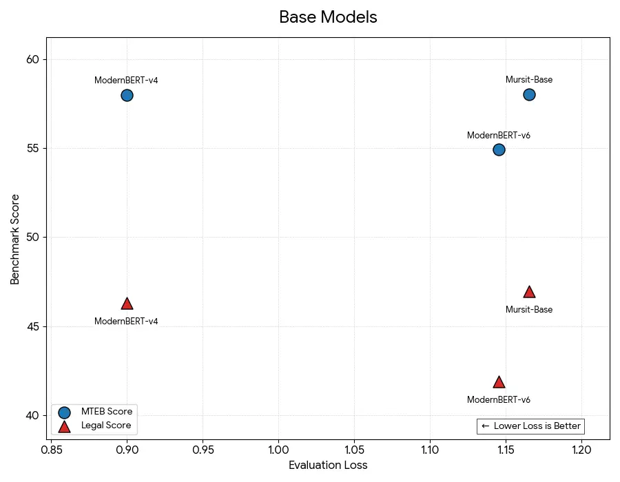

Figure 7: Relationship between MLM validation loss and downstream
retrieval performance across ModernBERT-base versions v4-v6. We restrict
the comparison to these specific versions to ensure parity in
pre-training token counts and validation set sizes.

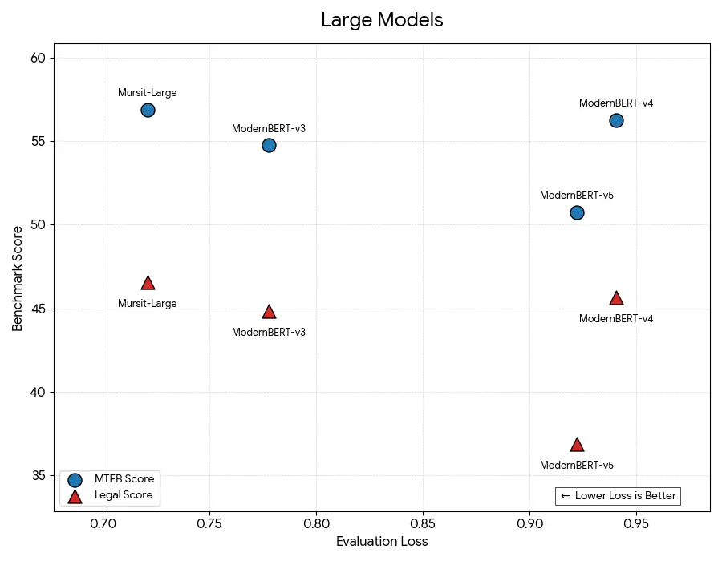

Figure 8: Relationship between MLM validation loss and downstream
retrieval performance across ModernBERT-large versions.

The progression demonstrates consistent improvement in downstream
retrieval tasks across versions v1 through v5, with the largest
performance jump occurring between v2$`\rightarrow`$v3 (7.2% MTEB
improvement, 8.2% legal improvement), corresponding to improved URL
filtering and extended legal corpus integration. Version v5 achieves the
highest legal domain performance (47.52), representing cumulative gains
of 12.8% MTEB and 24.7% legal improvement from v1. Legal subdomain
analysis shows case law retrieval improved by 40.5% from v2 to v5,
indicating that enhanced legal corpus coverage directly benefits
specialized legal retrieval tasks.

However, our analysis reveals a critical finding: improvements in Masked
Language Modeling (MLM) pre-training objective do not translate linearly
to downstream embedding task performance. This observation aligns with
prior work demonstrating that MLM loss does not fully correlate with
downstream task performance for low-resource and morphologically rich
languages \[9, 18, 45\]. As shown in Figure 7, while MLM loss decreases,
downstream retrieval scores exhibit non-linear progression, with
performance plateauing after v4-v5. Version v6 demonstrates a
significant regression: despite achieving MLM loss lower than
Mursit-Base (v5), it shows substantial degradation in both MTEB Score
(52.76 vs. 55.76 for v5, -5.4% relative decrease) and legal domain
performance (41.89 vs. 47.52 for v5, -11.9% relative decrease). This
regression is most pronounced in contracts retrieval, where performance
drops from 80.40 (v5) to 73.86 (v6), representing an 8.1% relative
decrease.

This observation shows that optimizing the pre-training objective alone
is insufficient for embedding quality. Factors such as data quality,
domain coverage, and training convergence dynamics play more critical
roles in downstream utility. For Turkish, an agglutinative language with
complex morphological systems, the optimal checkpoint selection depends
on the interplay between morphological complexity, resource
availability, and downstream task characteristics. Our results show that
intermediate checkpoints (v5 for base models) achieve superior retrieval
and classification performance compared to checkpoints with minimal MLM
loss. This suggests that morphological complexity and domain-specific
requirements create distinct optimization landscapes compared to
morphologically simpler languages. The v6 regression indicates that
continued pre-training beyond convergence can degrade embedding
effectiveness, potentially due to overfitting to the pre-training
objective at the expense of generalization to downstream tasks.

For ModernBERT-large models (403M parameters), we observed a distinct
progression pattern compared to base models. Figure 8 illustrates the
non-linear relationship between MLM loss and downstream retrieval
performance for large models. Unlike base models, large models exhibited
non-monotonic progression, with the v2 checkpoint achieving the best
performance after post-training (56.43 MTEB Score, 46.42 Legal Score),
outperforming both earlier (v1) and later versions (v3-v5). Subsequent
versions showed progressive degradation: v3 achieved 54.75 overall
(44.82 Legal Score), v4 achieved 56.27 overall (45.63 Legal Score), and
v5 showed substantial regression to 50.73 overall (36.85 Legal Score).
This pattern suggests that optimal pre-training duration and data
quantity for large models differs from base models, with v2 representing
the sweet spot before overfitting begins to degrade downstream embedding
quality. While MLM loss generally decreases monotonically across
versions, retrieval performance peaks at v5 for base models and at v2
for large models, then regresses significantly. The 403M parameter large
model at v2 achieves competitive performance (56.43 overall) compared to
the 155M base model at v5 (55.76 overall), demonstrating that larger
architectures can achieve similar performance with less pre-training
when optimally tuned.

These findings reinforce the critical importance of direct downstream
task evaluation rather than relying solely on pre-training metrics for
morphologically rich languages like Turkish where the divergence between
MLM optimization and embedding utility is amplified by linguistic
complexity and resource constraints \[9, 18, 45\]. The optimal
performance range varies based on language structure, resource
availability, and downstream task category. Retrieval and classification
tasks show distinct optimization landscapes compared to morphologically
simpler languages. This emphasizes that model evaluation must consider
the specific requirements of target downstream applications, especially
for low-resource languages where data scarcity amplifies the importance
of checkpoint selection strategies that prioritize downstream utility
over pre-training loss minimization.

### 4.2 Masked Language Modeling Pre-training Strategy

Our MLM pre-training follows the ModernBERT approach \[10, 22, 46\],
where 30% of token positions are randomly selected for prediction,
consistent with RoBERTa’s masking strategy rather than BERT’s 15%
approach. To mitigate the mismatch between pre-training and fine-tuning
(since the \[MASK\] token does not appear during fine-tuning), the
selected tokens are replaced using a three-way strategy: (1) 80% of the
time with the \[MASK\] token, enabling the model to learn word
prediction from context alone; (2) 10% of the time with a random token,
forcing the model to rely on context rather than blindly trusting the
input token; (3) 10% of the time with the unchanged original token,
encouraging alignment between word representation and context
representation. This 80-10-10 distribution balances multiple learning
objectives: context sensitivity, robustness to noisy inputs, and
word-context alignment. It also reduces the pre-training/fine-tuning
discrepancy inherent in masked language modeling.

We evaluate all models using a 15% token masking rate, in line with
standard BERT benchmarking protocols, even though ModernBERT was
pretrained with a 30% masking rate. This ensures fair comparison across
models while preserving the original pretraining objectives.

Table 13 presents MLM accuracy scores (averaged across the 80-10-10
strategy) for our pre-trained models and baseline MLM models evaluated
on Turkish datasets. Our Mursit models achieve competitive MLM accuracy,
with TabiBERT \[16, 42\] achieving the highest score (69.57%), followed
by Mursit-Large (67.25%), turkish-large-bert-cased \[16\] (65.03%), and
dbmdz/bert-base-turkish-cased (64.98%). Mursit-Base achieves 64.05%. The
evaluation datasets include blackerx/turkish_v2,
fthbrmnby/turkish_product_reviews, hazal/Turkish-Biomedical-corpus-trM,
and newmindai/EuroHPC-Legal. Notably, turkish-base-bert-uncased \[16\]
was evaluated only on uncased datasets, resulting in a lower score
(52.69%) compared to models evaluated on mixed-case corpora.

| Model                                          | MLM Avg (%) |
| ---------------------------------------------- | ----------- |
| boun-tabilab/TabiBERT \[42\]                   | 69.57       |
| newmindai/Mursit-Large                         | 67.25       |
| ytu-ce-cosmos/turkish-large-bert-cased \[16\]  | 65.03       |
| dbmdz/bert-base-turkish-cased                  | 64.98       |
| newmindai/Mursit-Base                          | 64.05       |
| KocLab-Bilkent/BERTurk-Legal \[29\]            | 54.10       |
| ytu-ce-cosmos/turkish-base-bert-uncased \[16\] | 52.69       |

MLM accuracy averaged across the 80-10-10 masking strategy.
turkish-base-bert-uncased was evaluated only on uncased datasets.
Evaluation datasets: blackerx/turkish_v2,
fthbrmnby/turkish_product_reviews, hazal/Turkish-Biomedical-corpus-trM,
newmindai/EuroHPC-Legal. All experiments are reproducible (see Section
A.1).

Table 13: MLM Accuracy Scores (80-10-10 Strategy) on Turkish Datasets

### 4.3 Encoder Post-training Analysis and Ablation Studies

We evaluate three contrastive learning approaches for post-training
ModernBERT-base-v4 checkpoint (155M parameters): standard InfoNCE,
Qwen3-style InfoNCE, and GISTEmbed with cached guide models. All
experiments used identical hyperparameters (batch size=768, learning
rate=2$`\times`$10⁻⁵, sequence length=1024) to ensure fair comparison.
Table 14 presents the performance comparison on MTEB-Turkish benchmark,
where MTEB Score is calculated as Mean TaskType (mean across task types:
Classification, Clustering, Pair Classification, Retrieval, STS).

| Technique                | MTEB Score | Legal Score |
| ------------------------ | ---------- | ----------- |
| InfoNCE (baseline)       | 53.23      | 39.95       |
| Qwen3-InfoNCE \[39\]     | 56.70      | 42.60       |
| GISTEmbed (BGE-M3 \[8\]) | 55.67      | 46.36       |

Table 14: Comparison of Post-training Techniques on ModernBERT-base-v4

GISTEmbed with guide models significantly outperforms standard
contrastive learning, achieving 4.6% overall improvement and 15.9% legal
domain improvement over the InfoNCE baseline, demonstrating the
effectiveness of false-negative filtering for Turkish legal retrieval
tasks.

To demonstrate the effectiveness of our post-training approach, we
compare models across three categories: (1)Pre-trained by owner:
Original ModernBERT models pretrained by the architecture authors;
(2)Pre-trained by us: ModernBERT models pretrained from scratch on our
Turkish-dominant corpus; (3)Post-trained: Our pre-trained models after
embedding post-training with contrastive learning. Table 15 presents
this comparison.

|                           |            |             |
| ------------------------- | ---------- | ----------- |
| Model                     | MTEB Score | Legal Score |
| Post-trained:             |            |             |
| Mursit-Large-TR-Retrieval | 56.43      | 46.42       |
| Mursit-Base-TR-Retrieval  | 55.86      | 47.52       |
| Pretrained:               |            |             |
| Mursit-Large              | 41.75      | 23.71       |
| Mursit-Base               | 40.23      | 17.93       |
| Original ModernBERT:      |            |             |
| ModernBERT-base           | 23.80      | 2.99        |
| ModernBERT-large          | 23.74      | 2.44        |

Table 15: Comparison: Pre-trained vs Post-trained ModernBERT Models

Key observations: (1) Our checkpoint 4 post-trained model with BGE-M3
guide (55.67 MTEB Score, 46.36 Legal Score) demonstrates that
domain-specific pre-training from scratch combined with effective
post-training achieves competitive performance; (2) Progressive
improvement from checkpoint 1 to checkpoint 5 (12.8% overall
improvement, 23.2% legal improvement) validates our iterative
pre-training dataset refinement strategy.

We conduct ablation studies to investigate the relationship between
training hyperparameters and domain-specific performance. The ablation
was conducted on Mursit-Large-TR-Retrieval (403M parameters) using
Qwen3-InfoNCE loss function, with all other hyperparameters held
constant (batch size=2304, learning rate=2$`\times`$10⁻⁵). Token
distribution analysis of MS MARCO-TR indicates 99.9% sample coverage at
256 tokens; however, reducing sequence length to match training data
distribution resulted in significant performance degradation on
downstream legal retrieval tasks. Table 16 presents the impact of
sequence length configuration on legal domain performance metrics.

| Seq. Length | MTEB Score | Legal Score | $`\Delta`$ Legal Score |
| ----------- | ---------- | ----------- | ---------------------- |
| 256         | 57.85      | 42.60       | -8.5%                  |
| 1,024       | 58.21      | 44.89       | -3.6%                  |
| 2,048       | 56.43      | 46.42       | –                      |

Table 16: Effect of Sequence Length on Legal Domain Performance
(Mursit-Large-TR-Retrieval, Qwen3-InfoNCE)

Models trained with seq_len=256 exhibited 8.5% degradation in legal
domain performance relative to seq_len=2048, despite achieving
equivalent MS MARCO-TR validation scores. The degradation is most
pronounced in regulation retrieval (23.6% relative decrease) and case
law retrieval (17.8% relative decrease), suggesting that long-context
understanding is essential for legal document retrieval. These findings
demonstrate that sequence length optimization must consider target
evaluation corpus characteristics rather than training data distribution
alone. While shorter sequences reduce computational requirements by
approximately 67%, the associated performance degradation in specialized
domains may outweigh efficiency gains.

### 4.4 Decoder Model Results

This section presents results for the decoder models adapted through CPT
on Turkish legal corpora.

#### 4.4.1 Training Process and Stability Analysis

We evaluate the four-phase CPT process of the Qwen3-1.7B model and the
single-phase CPT training of the Qwen3-4B model in terms of training
stability and convergence behavior. Analyses focus primarily on loss
curves, step-based convergence, and training stability.

Qwen3-1.7B – Phase 1: In the first phase, the Qwen3-1.7B model was
trained for 2 epochs over 4,170 steps. Training loss decreased from
2.358 to 1.927 (18.3% reduction), achieving minimum loss of 1.877 at
step 3,771. Validation loss decreased from 2.273 to 1.994, with minimum
of 1.994. During the second epoch, validation loss stabilization was
observed, indicating convergence completion for this phase.

Qwen3-1.7B – Phase 2: In the second phase, training was extended to
32,260 steps for 1 epoch. Loss curves converged more aggressively, with
training loss dropping from 1.486 to 1.053 (29.1% reduction) and
reaching minimum of 1.002 at step 28,942. Validation loss decreased from
1.409 to 1.081, with minimum of 1.081. Parameters inherited from Phase 1
were updated stably throughout training.

Qwen3-1.7B – Phase 3: The third phase was conducted as a long-term CPT
process of 46,803 steps for 1 epoch. Training loss decreased from 1.872
to 1.429 (23.7% reduction), with minimum loss of 1.377 achieved at step
44,448. Validation loss decreased from 1.856 to 1.446, with minimum of
1.446. Knowledge learned in previous phases was preserved, and no signs
of catastrophic forgetting were observed.

Qwen3-1.7B – Phase 4: The fourth phase continued training for 14,122
steps for 1 epoch. Training loss decreased from 1.766 to 1.575 (10.8%
reduction), with minimum loss of 1.549 achieved at step 12,466.
Validation loss decreased from 1.632 to 1.566, with minimum of 1.566.
This final phase consolidated domain knowledge while maintaining stable
convergence.

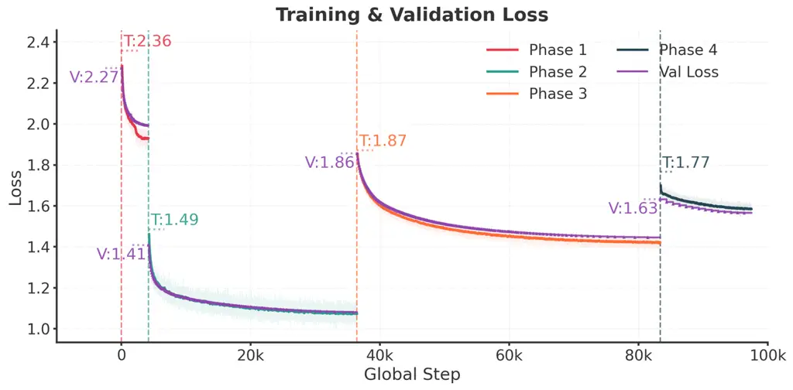

Figure 9: Qwen3-1.7B CPT Training and Validation Loss Across Four
Phases.

Figure 9 shows the training and validation loss curves across four
phases. Vertical dashed lines indicate phase transitions. The validation
loss (purple) consistently tracks training loss, indicating stable
learning without overfitting.

Qwen3-4B – Single-Phase CPT: The Qwen3-4B model was trained with a
single-phase CPT process of 153,508 steps. Thanks to higher parameter
capacity, the model exhibited smooth and stable convergence throughout
long-term training.

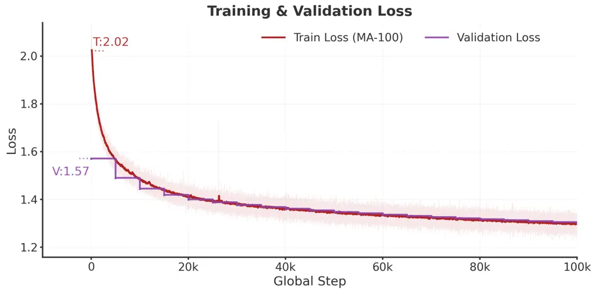

Figure 10: Qwen3-4B CPT Training and Validation Loss Curves.

As shown in Figure 10, training loss (blue) and validation loss (orange)
decreased over 153,508 steps. Training loss decreased from 2.022 to
1.273 (37.1% reduction), with minimum loss of 1.202 at step 116,651.
Validation loss decreased from 1.571 to 1.284 (18.5% reduction),
converging to final validation loss of 1.284. No instabilities or sudden
performance drops were observed during the training process.

Comparative Evaluation: The multi-phase CPT structure applied to the
Qwen3-1.7B model provided an effective strategy for increasing training
stability in small-scale models. The Qwen3-4B model, thanks to its high
capacity, showed stable training behavior even in a single-phase CPT
process. These observations indicate that the importance of gradual CPT
strategies increases as model scale decreases.

#### 4.4.2 Evaluation Methodology

Model performance was measured using the perplexity (PPL) metric on the
EuroHPC-Legal evaluation dataset \[38\]⁵⁵ 5
[huggingface.co/datasets/newmindai/EuroHPC-Legal](https://huggingface.co/datasets/newmindai/EuroHPC-Legal).
During evaluation, a context length of 512 tokens per example was used
for Qwen3-1.7B and 1024 tokens per example for Qwen3-4B, based on the
truth field content of the dataset.

Comparisons were conducted across two different model configurations.
First, the pre-CPT state of the Qwen3-1.7B base model was compared with
outputs from the four-phase CPT process (Phase-1, Phase-2, Phase-3,
Phase-4). This approach enables direct observation of the effect of
increasing CPT step count and curriculum structure on domain-specific
language modeling performance.

Additionally, single-phase CPT training was applied to the Qwen3-4B
model, and the results obtained were compared with the model’s pre-CPT
state. Thus, both the effects of different CPT strategies (multi-phase
vs. single-phase) and model scale (1.7B vs. 4B) on the Turkish legal
domain were evaluated together.

#### 4.4.3 Qwen3 CPT Perplexity Results

Table 17 shows the perplexity values for the Qwen3-1.7B model across
different legal subdomains between the base model and CPT phases.
Results show that PPL values decreased consistently and monotonically at
each stage of the CPT process.

| Domain      | Base  | P1   | P2   | P3   | P4   | Impr. |
| ----------- | ----- | ---- | ---- | ---- | ---- | ----- |
| CL          | 5.96  | 4.66 | 4.07 | 3.78 | 3.74 | 37.2% |
| CCML        | 9.90  | 7.11 | 5.97 | 5.58 | 5.53 | 44.2% |
| ENRL        | 9.77  | 7.39 | 6.15 | 5.81 | 5.80 | 40.7% |
| EnvL        | 10.40 | 7.34 | 5.89 | 5.52 | 5.56 | 46.6% |
| FL          | 9.98  | 7.12 | 5.70 | 5.30 | 5.35 | 46.4% |
| HL          | 4.93  | 4.09 | 3.67 | 3.40 | 3.35 | 32.1% |
| IPL         | 4.63  | 4.06 | 3.58 | 3.40 | 3.22 | 30.4% |
| LabL        | 4.78  | 3.53 | 3.20 | 2.88 | 2.76 | 42.4% |
| LUZL        | 9.11  | 7.01 | 5.62 | 5.17 | 5.16 | 43.4% |
| PDPL        | 8.36  | 6.62 | 5.23 | 4.73 | 4.71 | 43.7% |
| TL          | 7.29  | 5.20 | 4.57 | 4.09 | 3.98 | 45.4% |
| OVERALL^(†) | 9.22  | 6.93 | 5.66 | 5.26 | 5.24 | 43.1% |

CL: Competition Law, CCML: Corporate Capital Market Law, ENRL: Energy
and Natural Resources Law, EnvL: Environmental Law, FL: Fund Law, HL:
Health Law, IPL: Intellectual Property Law, LabL: Labor Law, LUZL: Land
Use and Zoning Law, PDPL: Personal Data Protection Law, TL: Tax Law.
^(†)Overall values are computed as token-weighted averages across all
legal subdomains.

Table 17: Qwen3-1.7B Perplexity Across CPT Phases

The phase-by-phase progression for Qwen3-1.7B reveals distinct
improvement patterns across legal subdomains. Domains with initially
higher perplexity values (CCML: 9.90, EnvL: 10.40, FL: 9.98) showed the
most substantial reductions, achieving 44.2%, 46.6%, and 46.4%
improvements respectively, indicating that CPT effectively addresses
domain-specific terminology and conceptual complexity. Conversely,
domains with lower initial perplexity (HL: 4.93, IPL: 4.63) showed more
modest but consistent improvements (32.1% and 30.4%), suggesting that
CPT provides incremental gains even in domains where the base model
already demonstrates reasonable performance. The largest single-phase
improvement occurred between Phase 1 and Phase 2, where overall
perplexity decreased from 6.93 to 5.66 (18.3% reduction), corresponding
to the introduction of legal content with domain-specific terminology.
Subsequent phases (P2$`\rightarrow`$P3 and P3$`\rightarrow`$P4) showed
diminishing returns, with Phase 4 achieving only marginal improvement
over Phase 3 (5.26 vs. 5.24), indicating convergence of the curriculum
learning strategy.

In parallel, Table 18 presents perplexity results for the Qwen3-4B model
between the base model and post-CPT state. Thanks to the larger model
scale, Qwen3-4B achieved lower absolute PPL values across all legal
subdomains and strongly benefited from the CPT process.

| Domain      | Base  | CPT   | Impr. |
| ----------- | ----- | ----- | ----- |
| CL          | 4.986 | 3.493 | 29.9% |
| CCML        | 8.189 | 5.140 | 37.2% |
| ENRL        | 8.159 | 5.388 | 34.0% |
| EnvL        | 8.601 | 5.107 | 40.6% |
| FL          | 8.277 | 4.897 | 40.8% |
| HL          | 4.155 | 3.205 | 22.9% |
| IPL         | 3.743 | 3.076 | 17.8% |
| LabL        | 3.926 | 2.702 | 31.2% |
| LUZL        | 7.559 | 4.818 | 36.3% |
| PDPL        | 6.873 | 4.451 | 35.2% |
| TL          | 6.111 | 3.796 | 37.9% |
| OVERALL^(†) | 7.649 | 4.884 | 36.2% |

Domain abbreviations same as Table 17. ^(†)Overall values are computed
as token-weighted averages across all legal subdomains.

Table 18: Qwen3-4B Perplexity Results

For Qwen3-4B, the single-phase CPT approach achieved comparable overall
improvement (36.2%) to the four-phase Qwen3-1.7B strategy (43.1%),
despite processing all training data in a single stage. This
demonstrates that larger model capacity can compensate for the absence
of curriculum structure, enabling effective domain adaptation through
direct exposure to mixed-complexity legal content. This finding
highlights a critical trade-off between training efficiency and model
scale, suggesting that practitioners can choose simpler training
protocols when computational resources permit larger architectures. The
4B model’s superior absolute perplexity values (4.884 vs. 5.24 for 1.7B
Phase-4) across all subdomains validate the parameter efficiency
hypothesis, where increased model scale provides better generalization
even with less structured training. These results provide compelling
evidence that architectural capacity fundamentally influences learning
dynamics, with larger models exhibiting enhanced robustness to training
protocol variations and demonstrating superior adaptation capabilities
across diverse legal subdomains.

Domain-specific analysis reveals that both models show strongest
improvements in regulatory and financial law domains (CCML, FL, EnvL),
where specialized terminology and normative structures require deeper
domain understanding, while intellectual property and health law domains
show more modest gains, potentially due to their more standardized
terminology or smaller corpus representation in the training data. These
domain-specific variations underscore the importance of corpus
composition and domain complexity in determining CPT effectiveness. When
results are evaluated together: For the Qwen3-1.7B model, PPL values
improved stably across all legal subdomains at each CPT phase; at the
end of Phase-4, the lowest perplexity values were reached, especially in
conceptually and terminologically intensive legal domains; the Qwen3-4B
model achieved high-rate PPL improvements even with single-phase CPT,
and model scale significantly increased domain-specific language
modeling performance; increasing CPT step count and model parameter
scale directly and positively contributed to language modeling capacity
in the Turkish legal domain, establishing clear guidelines for future
model development and resource allocation strategies across different
computational budgets.

Table 19 shows checkpoint progression for both models.

|                                  |                |          |
| -------------------------------- | -------------- | -------- |
| Model                            | Perplexity^(†) | Gain (%) |
| Mecellem-Qwen3-1.7B-TR (Ckpt. 1) | 6.93           | +24.9%   |
| Mecellem-Qwen3-1.7B-TR (Ckpt. 2) | 5.66           | +38.7%   |
| Mecellem-Qwen3-1.7B-TR (Ckpt. 3) | 5.26           | +43.0%   |
| Mecellem-Qwen3-1.7B-TR (Ckpt. 4) | 5.24           | +43.1%   |
| Qwen3-1.7B-Base                  | 9.22           | –        |
| Mecellem-Qwen3-4B-TR (Final)     | 4.88           | +36.2%   |
| Qwen3-4B-Base                    | 7.65           | –        |

^(†)Perplexity values are computed as token-weighted averages across all
legal subdomains.

Table 19: CPT Checkpoint Progression

#### 4.4.4 Additional Experiment: Turkish Quality Filtering Refinement

As a separate investigation independent of the main CPT training
pipeline, we conducted an additional experiment to evaluate the effect
of Turkish morphology-based quality filtering. This experiment used the
final checkpoints from the main training runs (Mecellem-Qwen3-1.7B-TR
Phase 4 and Mecellem-Qwen3-4B-TR ) as initialization and was not part of
the primary CPT procedure described in Section 3.

Additional training was performed on a refinement dataset filtered using
Turkish Quality Filtering criteria (suffix entropy $`>75\%`$, lemma
diversity $`>50\%`$) and only used data where the token count is above
502 tokens. The dataset consisted mainly of previously seen Turkish data
subjected to morphology-based filtering, with small amounts of
unfiltered multilingual and technical content retained to preserve
general capabilities. The goal was to assess whether post-hoc
morphological filtering could further improve performance beyond the
main CPT results.

Table 20 shows the composition of the refinement dataset, totaling 3.66B
tokens, of which 94.6% are filtered Turkish content.

| Source           | Tokens        | Percentage |
| ---------------- | ------------- | ---------- |
| Filtered Turkish | 3,464,365,893 | 94.6%      |
| English          | 72,917,544    | 2.0%       |
| Math             | 41,855,480    | 1.1%       |
| Python           | 47,165,175    | 1.3%       |
| Arabic           | 10,356,834    | 0.3%       |
| Chinese          | 9,512,075     | 0.3%       |
| Spanish          | 10,196,529    | 0.3%       |
| Russian          | 6,500,781     | 0.2%       |
| Total            | 3,662,870,311 | 100%       |

Table 20: Turkish Quality Filtering Refinement Dataset Composition

#### 4.4.5 Evaluating Decoder-Only Online Models with a Domain-Specific Armo Reward Model in Legal Tasks

Although decoder-only online language models demonstrate strong
surface-level fluency in legal text generation, their performance
remains difficult to assess reliably with respect to domain-specific
quality dimensions such as statutory compliance, case law grounding, and
depth of legal reasoning \[50\]. Widely adopted automatic metrics and
likelihood-based scores primarily capture linguistic coherence, but fail
to reflect the correctness, normative consistency, and evidentiary
grounding required in legal reasoning. Traditional evaluation approaches
often rely on perplexity or BLEU-like metrics that measure text
similarity rather than legal accuracy, leaving critical gaps in
assessing whether generated responses correctly cite relevant statutes,
accurately interpret legal precedents, or provide comprehensive legal
analysis. Moreover, legal text evaluation requires context-dependent
assessment where the importance of different quality dimensions varies
based on the type of legal question being addressed—for instance,
regulatory queries may prioritize statute accuracy while case law
questions may emphasize precedent citation quality. Consequently, there
is a clear need for a fine-grained, domain-aware benchmarking framework
capable of evaluating legal response quality beyond surface-level text
statistics, one that can adaptively weight evaluation criteria based on
the legal context and provide interpretable feedback across multiple
legally grounded dimensions.

For evaluation, we employ Muhakim, a domain-specific multi-objective
reward model trained for Turkish legal text assessment. Built upon a
Llama-3.1-based \[21, 23\] reward backbone and augmented with a
mixture-of-experts gating mechanism, the model produces fine-grained
quality scores across five legally grounded dimensions:

- 1.  Statute Reference: Accuracy of legal statute citations
- 2.  Legal Accuracy: Correctness of legal information
- 3.  Case Law Reference: Proper citation of legal precedents
- 4.  Linguistic Coherence: Language quality and fluency
- 5.  Depth Coverage: Comprehensiveness of the response

The model is trained using a combination of regression-based supervision
and preference learning, enabling stable and interpretable scoring
suitable for benchmarking decoder-only online models.

The reward model architecture employs a multi-objective framework where:
(i)Gating: Context-dependent importance weights assigned by the gating
network (MoE layer) based on the input prompt. The gating layer outputs
non-negative coefficients (summing to 1) that determine how much weight
each reward objective should receive. (ii)Rewards: Multi-objective
reward predictions from ArmoRM’s regression layer, representing model
performance on each objective. (iii)Score: Final preference score =
$`\Sigma(\text{gating}[i]\times\text{transformed\_rewards}[i])`$.
Critically, gating depends on the input prompt, while rewards depend on
the model output, enabling context-aware evaluation that adapts
importance weights based on the legal question while assessing response
quality. Further technical details on the prompt-conditioned gating and
response-conditioned reward mechanisms are provided in B. The Muhakim
reward model is publicly available.

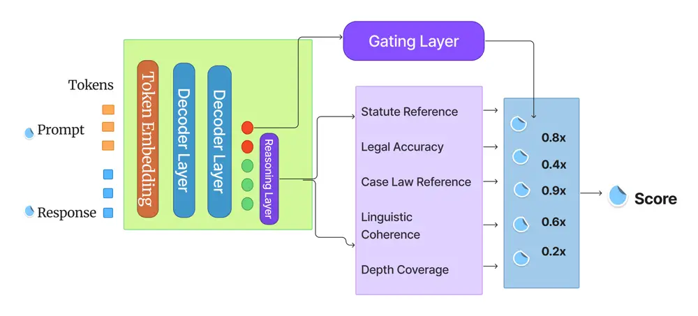

Figure 11: Muhakim Model Training Pipeline.

The ArmoRM-Turkish-Legal (Muhakim) reward model is built on the
Skywork-Reward-V2-Llama-3.1-8B backbone and is trained through a
multi-stage procedure tailored to the Turkish legal domain. This
domain-specific adaptation addresses critical limitations of
general-purpose reward models, which often fail to capture the nuanced
requirements of legal text evaluation, including normative consistency,
statutory accuracy, and precedent-based reasoning essential for reliable
legal AI assessment. The training pipeline consists of three components:
(i) multi-objective supervision that enables independent learning of
five legal quality dimensions, (ii) preference-based training of a
mixture-of-experts gating network to capture context-dependent
importance of these dimensions, and (iii) a debiasing stage designed to
mitigate length-related reward artifacts.\[44\] Figure 11 illustrates
the complete training pipeline. This training design allows the model to
produce stable, interpretable, and context-aware reward signals, making
it suitable for benchmarking decoder-only online language models in
legal tasks.

The benchmark is designed to comparatively evaluate the performance of
decoder-only online language models under varying contextual conditions
in legal text generation. This evaluation framework addresses a
fundamental challenge in legal AI: understanding how model performance
scales with available context, which directly impacts practical
deployment scenarios where reference documents may be partially
available or truncated due to token limits. For this purpose, we use the
newmindai/EuroHPC-Legal dataset, which consists of legal questions
(question) paired with reference texts (truth). The dataset contains 116
high-quality question-answer pairs. From each reference text, the first
5, 10, 20, 50, and 100 tokens are extracted to construct five distinct
context-length settings.

For each context length, the same question and partial reference context
are provided using identical prompt structures and token constraints to
ensure fair, controlled, and reproducible comparisons across model
pairs. This approach isolates domain adaptation effects by controlling
all variables except model training:

- 1.  Qwen3-1.7B-Base vs Mecellem-Qwen3-1.7B-TR
- 2.  Qwen3-4B-Base vs Mecellem-Qwen3-4B-TR

The generated responses are evaluated using the Muhakim reward model in
a conversational format, where the user message contains both the legal
question and partial reference text, while the assistant message
consists of the model-generated response, enabling context-aware
assessment of both linguistic quality and legal context alignment. For
each evaluation instance, the reward model produces an overall quality
score (Score), per-objective reward values (Rewards), and
context-dependent gating outputs (Gating) across five quality
dimensions: statutory grounding, legal accuracy and currency, case law
referencing quality, linguistic coherence, and analytical depth and
coverage.

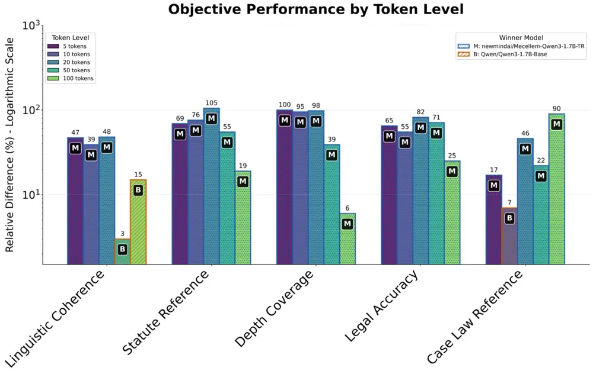

Figure 12: Benchmark Performance of 1.7B Decoder-Only Models Across
Context Lengths Using the Muhakim Reward Model.

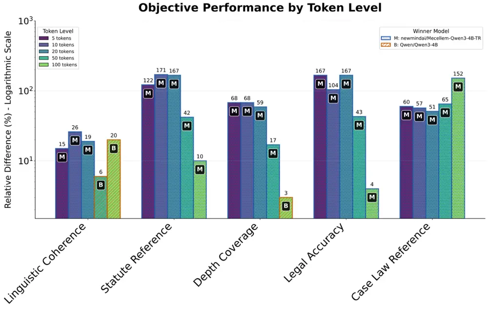

Figure 13: Benchmark Performance of 4B Decoder-Only Models Across
Context Lengths Using the Muhakim Reward Model.

We first analyze the benchmark results shown in Figure 12 for the
1.7B-scale decoder-only models under varying context-length constraints
(5, 10, 20, 50, and 100 tokens). Under short and medium context settings
(5–20 tokens), newmindai/Mecellem-Qwen3-1.7B-TR consistently outperforms
the corresponding base model across all five legal quality objectives.
Relative performance gains are most pronounced for depth of coverage,
statute reference usage, and legal accuracy, with improvements
frequently exceeding 100

As shown in Figure 13, we observe similar but more accentuated trends at
the 4B parameter scale. Under severely reduced context conditions (5–20
tokens), newmindai/Mecellem-Qwen3-4B-TR consistently outperforms the
corresponding base model across all evaluated objectives, demonstrating
the effectiveness of legal domain alignment when contextual information
is highly constrained. Relative performance differences are most
pronounced for legal accuracy, depth coverage, and statute reference
usage, with gains frequently exceeding 100

##### Rewards Comparison Analysis

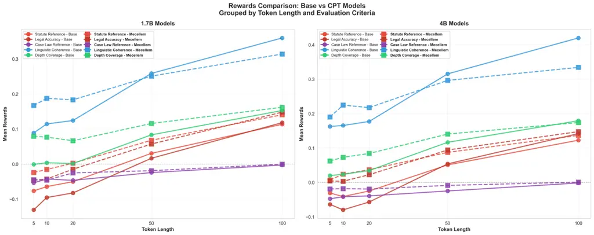

Figure 14: Rewards Comparison: Base vs CPT Models Across Token Lengths.

Figure 14 summarizes mean reward scores for Base and CPT (Mecellem)
models across token lengths for both the 1.7B and 4B scales. The figure
shows mean reward values for five evaluation dimensions (statute
reference, legal accuracy, case law reference, linguistic coherence,
depth coverage) at token lengths 5, 10, 20, 50, 100. Overall, CPT models
consistently outperform Base models and achieve higher mean rewards in
short and medium context settings, with the largest gains observed under
constrained contexts where Base model scores are near zero or negative.
As context length increases, performance gaps gradually narrow. For the
1.7B models, CPT variants maintain a consistent advantage across all
token lengths, whereas for the 4B models, convergence is observed at the
longest context setting, where the Base model slightly outperforms CPT.
Across both scales, mean reward scores generally increase with longer
token lengths, indicating improved performance with richer contextual
information.

#### 4.4.6 Mixed Precision Training Strategies

The NVIDIA NeMo framework provides multiple mixed precision training
strategies to optimize memory usage and accelerate training for large
language models. These strategies enable storing and processing model
parameters and computations in different numerical precision formats.
The MegatronMixedPrecision class in NeMo configures these precision
settings, offering predefined precision functions for common use cases.

#### Precision Strategy Options:

- 1.  BF16 Mixed Precision: Basic 16-bit brain floating-point precision mode
      (configured via bf16_mixed). Compatible with all GPUs, provides good
      numerical stability for gradient updates.
- 2.  FP16 Mixed Precision: Basic 16-bit floating-point precision mode
      (configured via fp16_mixed). Compatible with all GPUs, offers faster
      computation than BF16 but may have reduced numerical stability.
- 3.  BF16/FP16 with FP8 Hybrid: FP8 hybrid format using E4M3 for forward
      pass and E5M2 for backward pass, with delayed scaling recipe
      (configured via bf16_with_fp8_mixed or fp16_with_fp8_mixed). Optimizes
      scaling factors using amax history tracking to maintain training
      stability while reducing memory usage.
- 4.  BF16/FP16 with FP8 Current Scaling: FP8 hybrid format with tensorwise
      (per-tensor) scaling recipe (configured via
      bf16_with_fp8_current_scaling_mixed or
      fp16_with_fp8_current_scaling_mixed). Maintains first and last
      transformer layers in BF16/FP16 for gradient stability, providing a
      more conservative approach to FP8 adoption.

#### Ablation Study Methodology:

We conducted an ablation study comparing these mixed precision
strategies during Qwen3 CPT. All precision configurations were evaluated
by training Qwen3-4B for 1,000 steps under identical settings to ensure
a fair and controlled comparison. Table 21 presents training speed (step
time), speedup relative to the BF16 baseline, and training stability
metrics (first and final loss values).

| Method      | Step (s) | Speedup | First Loss | Final Loss |
| ----------- | -------- | ------- | ---------- | ---------- |
| FP16-FP8    | 0.467    | 20.5%   | 1.342      | 1.250      |
| FP16-FP8-CS | 0.4683   | 20.2%   | 1.336      | 1.246      |
| FP16        | 0.5001   | 12.5%   | 1.332      | 1.241      |
| BF16-FP8    | 0.5208   | 8.0%    | 1.338      | 1.095      |
| BF16-FP8-CS | 0.5378   | 4.6%    | 1.335      | 1.101      |
| BF16        | 0.5627   | Ref.    | 1.328      | 1.090      |

FP16: fp16_mixed, BF16: bf16_mixed, FP16-FP8: fp16_with_fp8_mixed
(delayed scaling), FP16-FP8-CS: fp16_with_fp8_current_scaling_mixed
(tensorwise scaling), BF16-FP8: bf16_with_fp8_mixed (delayed scaling),
BF16-FP8-CS: bf16_with_fp8_current_scaling_mixed (tensorwise scaling).

Table 21: Ablation Study: Mixed Precision Training Strategies

#### Key Findings:

Key findings from the ablation study:

Training Speed: FP16-based strategies with FP8 hybrid formats achieve
the highest speedup (20.5% and 20.2% faster than BF16 baseline),
reducing step time from 0.5627s to 0.467s. This represents a significant
acceleration for large-scale training workloads.

Training Stability: BF16-based strategies demonstrate superior training
stability, achieving lower final loss values (1.090–1.101) compared to
FP16-based strategies (1.241–1.250). BF16 achieves the lowest final loss
(1.090), indicating better numerical stability for gradient updates.

Precision Trade-offs: FP8 hybrid formats provide substantial speed
improvements but may introduce slight numerical instability, as
evidenced by higher final loss values. The delayed scaling (\*-FP8) and
tensorwise scaling (\*-FP8-CS) recipes show similar performance, with
delayed scaling achieving marginally better speedup.

Practical Recommendation: Based on the results, BF16-FP8 provides the
best balance between training efficiency and convergence quality.
Compared to the BF16 reference, it achieves an 8.0% faster step time
while maintaining a very similar final loss (1.095 vs. 1.090). This
makes it a strong candidate as the recommended default configuration for
large-scale and long-running CPT training setups.

### 4.5 Evaluation Results

To evaluate embedding model performance on Turkish legal retrieval
tasks, we compare our models against a wide range of baselines including
state-of-the-art embedding models, traditional BERT-based models, and
decoder-to-encoder converted models. Table 22 presents detailed
performance metrics across all evaluated models on the MTEB-Turkish
benchmark, including task-specific scores (Classification, Clustering,
Pair Classification, Retrieval, STS), legal domain scores (Legal Score,
Contracts, Regulation, Caselaw), model characteristics (Parameters,
Model Type), and correlation metrics.

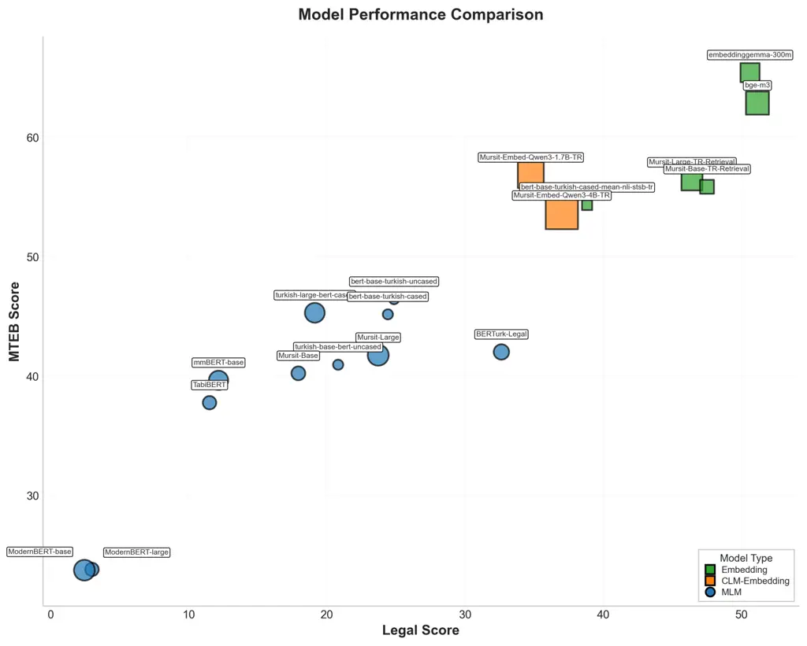

Figure 15: Model Performance Comparison: Legal Score vs. MTEB Score.

Table 22 presents results across three distinct model types: Embedding
models (specifically designed for retrieval tasks), CLM-Embedding models
(decoder-to-encoder converted), and MLM models (Masked Language Models).
While the standard MTEB framework typically focuses on
embedding-optimized models and provides limited coverage for MLM
architectures, we include MLM baselines to demonstrate baseline
performance on downstream tasks, enabling fair comparison of our
pre-trained models against traditional BERT-based approaches. Notably,
ModernBERT-base \[46\] and ModernBERT-large \[46\] are monolingual
English models pre-trained exclusively on English data, while all
evaluations are conducted on Turkish datasets, providing insight into
cross-lingual transfer capabilities and the importance of
language-specific pre-training.

EmbeddingGemma-300M \[8, 43\] (307M parameters), newmindai/bge-m3-stsb
(63.53 MTEB), and BAAI/bge-m3 (62.87 MTEB) achieve the highest absolute
MTEB scores, benefiting from multi-stage post-training strategies
optimized for embedding tasks. These models leverage embedding-specific
objectives and multi-phase training pipelines (RetroMAE, contrastive
learning, and unified fine-tuning) that better capture Turkish
morphological complexity. In contrast, our Mursit-Large-TR-Retrieval
(403M parameters) and Mursit-Base-TR-Retrieval (155M parameters) achieve
56.43 and 55.86 MTEB scores respectively. Despite the absolute score
gap, our models demonstrate competitive parameter efficiency:
Mursit-Base-TR-Retrieval uses less than half the parameters of
EmbeddingGemma-300M while achieving comparable performance.
Task-specific analysis reveals that retrieval and STS categories show
3–7 point differences between EmbeddingGemma-300M and Mursit models,
which becomes negligible when normalized by the 31–50% parameter
advantage of our models. Similarly, while BGE-M3 achieves highest
absolute scores in clustering and retrieval tasks, Mursit models produce
results within 2–5 points using significantly fewer parameters. These
findings demonstrate that Turkish embedding performance depends more on
language-specific continual pre-training, retrieval-focused objectives,
and task-data alignment than raw model scale alone, with our models
achieving competitive parameter-normalized performance compared to
larger multi-stage post-trained baselines.

| Model                            | MTEB  | Legal | Cls.  | Clus. | Pair  | Ret.  | STS   | Cont. | Reg.  | Case  | Params | Type   |
| -------------------------------- | ----- | ----- | ----- | ----- | ----- | ----- | ----- | ----- | ----- | ----- | ------ | ------ |
| embeddinggemma-300m              | 65.42 | 50.63 | 77.74 | 45.05 | 80.02 | 55.06 | 69.22 | 83.97 | 39.56 | 28.38 | 307M   | Emb.   |
| bge-m3                           | 62.87 | 51.16 | 75.35 | 35.86 | 78.88 | 54.42 | 69.83 | 86.08 | 38.09 | 29.30 | 567M   | Emb.   |
| Mursit-Embed-Qwen3-1.7B-TR^(∗)   | 56.84 | 34.76 | 68.46 | 42.22 | 59.67 | 50.10 | 63.77 | 70.22 | 17.94 | 16.11 | 1.7B   | CLM-E. |
| Mursit-Large-TR-Retrieval^(∗)    | 56.43 | 46.42 | 67.47 | 38.76 | 59.88 | 51.59 | 64.44 | 81.63 | 32.39 | 25.24 | 403M   | Emb.   |
| Mursit-Base-TR-Retrieval^(∗)     | 55.86 | 47.52 | 66.25 | 39.75 | 61.31 | 50.07 | 61.90 | 80.40 | 34.10 | 28.07 | 155M   | Emb.   |
| Mursit-Embed-Qwen3-4B-TR^(∗)     | 53.65 | 37.00 | 67.29 | 36.68 | 58.36 | 51.12 | 54.77 | 69.25 | 24.21 | 17.56 | 4B     | CLM-E. |
| bert-base-turkish-uncased        | 46.23 | 24.94 | 68.05 | 33.81 | 60.44 | 32.01 | 36.85 | 52.47 | 12.05 | 10.29 | 110M   | MLM    |
| turkish-large-bert-cased \[16\]  | 45.30 | 19.12 | 67.43 | 34.24 | 60.11 | 28.68 | 36.04 | 47.57 | 5.93  | 3.85  | 337M   | MLM    |
| bert-base-turkish-cased          | 45.17 | 24.41 | 66.39 | 35.28 | 60.05 | 30.52 | 33.62 | 54.03 | 10.13 | 9.07  | 110M   | MLM    |
| BERTurk-Legal \[29\]             | 42.02 | 32.63 | 60.61 | 26.24 | 59.51 | 25.80 | 37.94 | 61.40 | 15.51 | 20.99 | 184M   | MLM    |
| Mursit-Large^(∗)                 | 41.75 | 23.71 | 62.95 | 25.34 | 58.04 | 27.40 | 35.01 | 42.74 | 11.29 | 17.10 | 403M   | MLM    |
| turkish-base-bert-uncased \[16\] | 44.68 | 27.58 | 66.22 | 30.23 | 58.84 | 31.40 | 36.74 | 56.60 | 13.39 | 12.74 | 110M   | MLM    |
| Mursit-Base^(∗)                  | 40.23 | 17.93 | 59.78 | 25.48 | 58.65 | 20.82 | 36.45 | 36.00 | 7.40  | 10.40 | 155M   | MLM    |
| mmBERT-base \[25\]               | 39.65 | 12.15 | 61.84 | 26.77 | 59.25 | 15.83 | 34.56 | 34.45 | 1.33  | 0.68  | 306M   | MLM    |
| TabiBERT \[42\]                  | 37.77 | 11.50 | 59.63 | 25.75 | 58.19 | 14.96 | 30.32 | 32.02 | 1.86  | 0.63  | 148M   | MLM    |
| ModernBERT-base \[46\]           | 23.80 | 2.99  | 39.06 | 2.01  | 53.95 | 2.10  | 21.91 | 7.92  | 0.62  | 0.43  | 149M   | MLM    |
| ModernBERT-large \[46\]          | 23.74 | 2.44  | 39.44 | 3.90  | 53.73 | 1.80  | 19.85 | 6.12  | 0.62  | 0.59  | 394M   | MLM    |

Column abbreviations: MTEB = mean performance across task types; Legal =
weighted average of Contracts, Regulation, Caselaw; Classification =
accuracy on Turkish classification tasks; Clustering = V-measure on
clustering tasks; Pair Classification = average precision on pair
classification tasks like NLI; Retrieval = nDCG@10 on information
retrieval tasks; Semantic Textual Similarity = Spearman correlation;
Contracts = nDCG@10 on legal contract retrieval; Regulation = nDCG@10 on
regulatory text retrieval; Caselaw = nDCG@10 on case law retrieval;
Number of Parameters = number of model parameters; Model Type = model
type (Embedding, CLM-Embedding, Masked Language Model).

Table 22: Evaluation Results on MTEB-Turkish Benchmark

Figure 15 visualizes the relationship between Legal Score and MTEB Score
across all evaluated models, showing model performance trade-offs. The
scatter plot compares 18 models across three architecture types:
Embedding (green squares), CLM-Embedding (orange squares), and MLM (blue
circles), with bubble size representing model parameter count
(logarithmically scaled). The plot reveals distinct performance clusters
corresponding to model architectures: Embedding models (green squares)
dominate the top-right quadrant, achieving the highest scores on both
metrics, with embeddinggemma-300m (Legal: 50.63, MTEB: 65.42),
newmindai/bge-m3-stsb (Legal: 49.97, MTEB: 63.53), and BAAI/bge-m3
(Legal: 51.16, MTEB: 62.87) representing the state-of-the-art. Our
encoder-only models pre-trained from scratch (Mursit-Base-TR-Retrieval
and Mursit-Large-TR-Retrieval) cluster closely with these top
performers, indicating that domain-specific pre-training from scratch
combined with contrastive learning post-training achieves competitive
performance despite significantly fewer parameters. Notably,
Mursit-Base-TR-Retrieval (155M parameters) achieves superior Legal Score
(47.52) compared to Mursit-Large-TR-Retrieval (46.56), while maintaining
comparable MTEB Score (55.86 vs. 56.87), highlighting the parameter
efficiency of our base architecture.

CLM-Embedding models (orange squares) exhibit an interesting performance
pattern: while Mursit-Embed-Qwen3-1.7B-TR achieves competitive MTEB
Score (56.84), it shows substantial underperformance in Legal Score
(34.76), indicating that decoder-to-encoder conversion without extensive
multi-stage training struggles with domain-specific legal retrieval
tasks. This architectural limitation becomes particularly evident in
specialized domains where precise semantic understanding and normative
reasoning are critical for accurate retrieval performance. The larger
Mursit-Embed-Qwen3-4B-TR model shows even greater degradation (Legal:
37.00, MTEB: 53.65), suggesting that increased model capacity alone does
not compensate for the architectural mismatch between autoregressive
generation and bidirectional embedding tasks.

MLM models (blue circles) form a distinct cluster in the lower-left
quadrant, with most models achieving Legal Scores below 25 and MTEB
Scores below 45. For MLM models, embeddings are generated using standard
mean pooling over all token representations followed by L2
normalization. The pre-trained-only ModernBERT models (base \[25, 46\]
and large \[46\]), which are monolingual English models pre-trained
exclusively on English data, occupy the bottom-left corner (Legal:
2.44–2.99, MTEB: 23.74–23.80) when evaluated on Turkish datasets.
Baseline MLM models include Turkish BERT variants
(turkish-base-bert-uncased \[16\], turkish-large-bert-cased \[16\]),
BERTurk-Legal \[29\], mmBERT-base \[25\], and TabiBERT \[42\]. This
shows that pre-training alone without embedding-specific fine-tuning
yields minimal utility for retrieval tasks, and further highlights the
importance of language-specific pre-training, as monolingual English
models show limited cross-lingual transfer to Turkish. Our pre-trained
Mursit models (Mursit-Base and Mursit-Large) show substantial
improvement over ModernBERT baselines, validating the effectiveness of
Turkish-dominant pre-training, though they remain below post-trained
embedding models.

The visualization reveals a strong positive correlation between Legal
Score and MTEB Score, indicating that models performing well on general
Turkish tasks also excel in legal domain tasks. However, the performance
gap between model types is more pronounced in Legal Score than MTEB
Score, suggesting that legal domain adaptation requires specialized
training beyond general-purpose embedding optimization. The bubble
sizes, proportional to model parameters, show that parameter count alone
does not guarantee superior performance: our 155M
Mursit-Base-TR-Retrieval outperforms many larger models, including the
4B Mursit-Embed-Qwen3-4B-TR, emphasizing the importance of architecture
selection and training methodology over raw model scale. The evaluation
shows that our encoder-only models pre-trained from scratch achieve
competitive performance with strong parameter efficiency, ranking among
the top models on the Turkish retrieval leaderboard despitely fewer
parameters compared to larger baselines. Our Mursit-Base-TR-Retrieval
model (155M parameters) achieves 55.86 MTEB Score and 47.52 Legal Score,
outperforming many larger models including converted decoder
architectures. The decoder-to-encoder converted models
(Mursit-Embed-Qwen3-1.7B-TR and Mursit-Embed-Qwen3-4B-TR) demonstrate
the significant challenges of adapting autoregressive models for
embedding tasks without extensive multi-stage training infrastructure,
achieving 56.84 and 53.65 MTEB Scores respectively, with notable
underperformance in legal domain tasks compared to encoder-only
architectures, highlighting the fundamental architectural advantages of
purpose-built embedding models.

## 5 Discussion

Domain Adaptation Effectiveness: CPT on Turkish legal corpus
significantly improves performance across all tasks.
Mursit-Base-TR-Retrieval achieved 17.5% legal domain improvement over
checkpoint 2, while Mecellem-Qwen3-4B-TR demonstrated 36.2% perplexity
reduction.

Encoder Model Parameter Efficiency: Our low-parameter encoder models
demonstrate exceptional parameter efficiency compared to larger
baselines. Mursit-Base-TR-Retrieval (155M parameters) achieves 55.86
MTEB Score and 47.52 Legal Score, while Mursit-Large-TR-Retrieval (403M
parameters) achieves 56.43 MTEB Score and 46.42 Legal Score, ranking 2nd
and 1st respectively on the Turkish retrieval leaderboard. This
demonstrates the effectiveness of domain-specific pre-training from
scratch combined with contrastive learning post-training for Turkish
legal tasks. Our findings, consistent with prior observations for
low-resource and morphologically rich languages \[9, 18, 45\], indicate
that improvements in Masked Language Modeling (MLM) accuracy do not
always result in better performance on downstream tasks. While
increasing model parameters generally reduces MLM cross-entropy loss,
these improvements do not consistently lead to higher-quality
embeddings. This suggests that downstream utility depends more on data
quality, training convergence dynamics, and the alignment between
pre-training objectives and downstream task requirements than on
pre-training objective optimization alone, as evidenced by checkpoints
achieving better MLM scores but worse retrieval performance. For
Turkish, an agglutinative language with complex morphological systems,
the optimal checkpoint selection depends on the interplay between
morphological complexity, resource availability, and downstream task
characteristics, with intermediate checkpoints often outperforming those
with minimal MLM loss. Consequently, lower MLM loss is not a guaranteed
indicator of embedding effectiveness for morphologically rich languages
where linguistic complexity amplifies the divergence between
pre-training optimization and downstream utility.

Curriculum Learning Benefits: The four-phase curriculum strategy for
Qwen3-1.7B achieved comparable results to single-phase Qwen3-4B despite
2.4$`\times`$ fewer parameters, validating the importance of staged
training from general to specialized content.

False-Negative Filtering Critical: GISTEmbed with guide model
outperformed standard InfoNCE by 8.9% overall (15.9% legal improvement),
demonstrating the importance of preventing false-negative learning in
contrastive training.

Sequence Length Configuration: Ablation studies reveal that sequence
length optimization based solely on training data distribution leads to
significant performance degradation in specialized domains. Models
configured with seq_len=256 (matching MS MARCO-TR token distribution)
exhibited 8.5% degradation in legal domain performance compared to
seq_len=2048, with regulation retrieval showing 23.6% relative decrease.
These findings indicate that sequence length must accommodate target
evaluation corpus characteristics for domains requiring long-context
understanding.

Turkish Quality Filtering Impact: As a separate experimental
investigation (Section 4.4.4), we evaluated the impact of Turkish
morphology-based quality filtering (suffix entropy $`>75\%`$, lemma
diversity $`>50\%`$) applied as post-training refinement. This
experiment, conducted independently from the main CPT training pipeline,
revealed scale-dependent effects. Qwen3-1.7B showed improvement (5.243
$`\rightarrow`$ 5.212 perplexity, 0.6% reduction), while Qwen3-4B
exhibited slight degradation (4.884 $`\rightarrow`$ 4.935, 1.0%
increase). This suggests that smaller models benefit more from
aggressive morphological filtering due to limited capacity, while larger
models may require greater data diversity once convergence is reached.
These experimental results indicate that Turkish Quality Filtering
should be applied comprehensively during initial dataset preparation
rather than as a post-hoc refinement step.

Decoder-to-Encoder Conversion: The converted Qwen3 CPT models
underperform, with Mursit-Embed-Qwen3-4B-TR ranking 9th despite 4B
parameters. This demonstrates that decoder-to-encoder conversion
requires sophisticated training infrastructure (large-scale synthetic
data, multi-stage training, model merging) as described in \[39\], which
was unavailable in our implementation. The 155M Mursit-Base-TR-Retrieval
(Rank 2) outperforms the 4B Mursit-Embed-Qwen3-4B-TR (Rank 9) by 4.1% in
MTEB Score and 28.4% in Legal Score improvement, indicating that
encoder-only architectures pre-trained for embedding tasks are more
parameter-efficient than converted decoder models under resource
constraints.

## 6 Conclusion

This work demonstrates that effective Turkish legal language models can
be developed through two complementary strategies: encoder models
pre-trained from scratch with downstream-aware checkpoint selection, and
decoder models adapted through controlled continual pre-training. Our
key finding is that trainable MLM models serve as effective foundations
for embedding tasks when training quality is assessed through downstream
performance rather than pre-training loss alone. Our experimental
results, consistent with prior observations \[9, 18, 45\], demonstrate
that MLM loss does not fully correlate with downstream task performance
for morphologically rich and low-resource languages. The optimal
performance range varies based on language structure, resource
availability, and downstream task category. For Turkish, an
agglutinative language with complex morphological systems, intermediate
checkpoints achieve superior retrieval and classification performance
compared to checkpoints with minimal MLM loss, suggesting that
morphological complexity and domain-specific requirements create
distinct optimization landscapes. This finding emphasizes the importance
of direct downstream task evaluation rather than relying solely on
pre-training metrics, especially for low-resource languages where data
scarcity amplifies the divergence between pre-training objectives and
downstream utility.

For decoder models, systematic ablation studies of initialization
strategies and dataset compositions enable controlled domain adaptation
while preserving general capabilities. The resulting models achieve
competitive performance on Turkish legal retrieval benchmarks, with our
encoder models ranking among the top positions on the Turkish retrieval
leaderboard. These contributions advance the state of Turkish legal NLP
and provide practical tools for legal information retrieval
applications. Future work will explore advanced decoder-to-encoder
conversion techniques and develop practical RAG applications tailored
for Turkish legal professionals.

All models are released as open-source on HuggingFace under NewmindAI¹¹
1
[https://huggingface.co/collections/newmindai/mecellem-models](https://huggingface.co/collections/newmindai/mecellem-models).

## Funding

This work was supported by the EuroHPC Joint Undertaking with access to
the MareNostrum 5 supercomputer, hosted by Barcelona Supercomputing
Center (BSC), Spain. The funding sources had no involvement in the study
design, collection, analysis and interpretation of data, writing of the
report, or decision to submit the article for publication.

## Author Contributions

Author contributions using CRediT (Contributor Roles Taxonomy): Özgür
Uğur: Conceptualization, Methodology, Project administration, Writing -
Review & Editing; Mahmut Göksu: Methodology, Software, Writing -
Original Draft; Mahmut Çimen: Methodology, Data curation, Software,
Writing - Original Draft; Musa Yılmaz: Methodology, Software, Writing -
Original Draft; Alp Talha Demir: Validation, Software, Writing -
Original Draft; Esra Savirdi: Data curation, Methodology, Writing -
Original Draft; İclal Çetin: Data curation, Writing - Original Draft;
Ömer Can Sağbaş: Data curation, Writing - Original Draft; Rumeysa
Güllüce: Investigation, Writing - Original Draft.

## Data Availability

The datasets, models, code, and benchmarks used in this study are
publicly available as follows: Pre-trained and post-trained models are
available through the HuggingFace model collection¹¹ 1
[https://huggingface.co/collections/newmindai/mecellem-models](https://huggingface.co/collections/newmindai/mecellem-models).
Legal benchmark datasets used for evaluation (Contracts, Regulation,
Caselaw) are available through the HuggingFace collection²² 2
[https://huggingface.co/collections/newmindai/mleb-dataset](https://huggingface.co/collections/newmindai/mleb-dataset).
The complete model collection, training code, evaluation scripts, and
benchmark datasets including all datasets generated for benchmark
evaluation are available in the repository³³ 3
[https://github.com/newmindai/mecellem-models](https://github.com/newmindai/mecellem-models).
Legal corpus data sources include publicly available court decisions and
academic theses; specific datasets are described in Section 3.

## Acknowledgments

The numerical calculations reported in this paper were fully/partially
performed using the EuroHPC Joint Undertaking (EuroHPC JU) supercomputer
MareNostrum 5, hosted by the Barcelona Supercomputing Center (BSC).
Access to MareNostrum 5 was provided through a national access call
coordinated by the Scientific and Technological Research Council of
Turkey (TÜBİTAK). We gratefully acknowledge TÜBİTAK, BSC and the EuroHPC
JU for providing access to these resources and supporting this research.
The authors gratefully acknowledge the know-how provided by the MINERVA
Support for expert guidance and collaboration opportunities in HPC-AI
integration.

## References

- \[1\] J. Achiam, S. Adler, S. Agarwal, et al. (2023) GPT-4 technical
  report. arXiv preprint arXiv:2303.08774. External Links: 2303.08774
  Cited by: §1.
- \[2\] E. C. Acikgoz, M. Erdogan, and D. Yuret (2024) Bridging the
  bosphorus: advancing turkish large language models through strategies
  for low-resource language adaptation and benchmarking. arXiv preprint
  arXiv:2405.04685. External Links: 2405.04685 Cited by: §1.
- \[3\] AI Innovation Team (2023) The elephant in the room: catastrophic
  forgetting. Note: AI Innovation Team Blog Cited by: §2.6.
- \[4\] A. A. Akın and M. D. Akın (2007) Zemberek, an open source nlp
  framework for turkic languages. Structure 10 (2007), pp. 1–5. Cited
  by: §3.2.3.
- \[5\] M. A. Bayram, A. A. Fincan, A. S. Gümüş, S. Karakaş, B. Diri,
  and S. Yıldırım (2025) Tokenization standards for linguistic
  integrity: turkish as a benchmark. arXiv preprint arXiv:2502.07057.
  External Links: 2502.07057 Cited by: §3.3.3, §3.3.3.
- \[6\] U. Butler, A. Butler, and A. L. Malec (2025) The massive legal
  embedding benchmark (mleb). arXiv preprint arXiv:2510.19365. Note:
  Developed by Isaacus External Links: 2510.19365 Cited by: §2.1.
- \[7\] I. Chalkidis, M. Fergadiotis, P. Malakasiotis, N. Aletras,
  and I. Androutsopoulos (2020) LEGAL-bert: the muppets straight out of
  law school. arXiv preprint arXiv:2010.02559. External Links:
  2010.02559 Cited by: §1, §2.1.
- \[8\] J. Chen, S. Xiao, P. Zhang, K. Luo, D. Lian, and Z. Liu (2024)
  BGE m3-embedding: multi-lingual, multi-functionality,
  multi-granularity text embeddings through self-knowledge distillation.
  arXiv preprint arXiv:2402.03216. External Links: 2402.03216 Cited by:
  Appendix D, §3.3.4, §3.3.5, §3.4.9, §4.5, Table 14.
- \[9\] A. Conneau, K. Khandelwal, N. Goyal, V. Chaudhary, G. Wenzek, F.
  Guzmán, E. Grave, M. Ott, L. Zettlemoyer, and V. Stoyanov (2020)
  Unsupervised cross-lingual representation learning at scale. arXiv
  preprint arXiv:1911.02116. External Links: 1911.02116 Cited by: §4.1,
  §4.1, §5, §6.
- \[10\] J. Devlin, M. Chang, K. Lee, and K. Toutanova (2019) BERT:
  pre-training of deep bidirectional transformers for language
  understanding. In Proceedings of the 2019 Conference of the North
  American Chapter of the Association for Computational Linguistics:
  Human Language Technologies, Volume 1 (Long and Short Papers),
  pp. 4171–4186. Cited by: §4.2.
- \[11\] S. Diao, Y. Yang, Y. Fu, et al. (2025) CLIMB: clustering-based
  iterative data mixture bootstrapping for language model pre-training.
  arXiv preprint arXiv:2504.13161. External Links: 2504.13161 Cited by:
  §2.6.
- \[12\] G. Eryiğit (2014) ITU turkish nlp web service. In Proceedings
  of the Demonstrations at the 14th Conference of the European Chapter
  of the Association for Computational Linguistics (EACL 2014),
  Gothenburg, Sweden, pp. 1–4. Cited by: §3.3.3, §3.3.3.
- \[13\] J. Howard and S. Ruder (2018) Universal language model
  fine-tuning for text classification. arXiv preprint arXiv:1801.06146.
  External Links: 1801.06146 Cited by: §2.2.
- \[14\] HuggingFace (2024) FineWeb: a large-scale web dataset for
  language model training. Note: GitHub
  Repository[github.com/huggingface/datatrove](https://github.com/huggingface/datatrove)
  Cited by: §1, §3.2.3.
- \[15\] A. H. Kargaran, A. Imani, F. Yvon, and H. Schütze (2023)
  GlotLID: language identification for low-resource languages. arXiv
  preprint arXiv:2310.16248. External Links: 2310.16248 Cited by:
  Appendix E, §3.2.3.
- \[16\] H. T. Kesgin, M. K. Yuce, and M. F. Amasyali (2023) Developing
  and evaluating tiny to medium-sized turkish bert models. arXiv
  preprint arXiv:2307.14134. External Links: 2307.14134 Cited by: §4.2,
  §4.5, Table 13, Table 13, Table 22, Table 22.
- \[17\] J. Kirkpatrick, R. Pascanu, N. Rabinowitz, et al. (2017)
  Overcoming catastrophic forgetting in neural networks. Proceedings of
  the National Academy of Sciences 114 (13), pp. 3521–3526. Cited by:
  §2.5.
- \[18\] B. Lester, R. Al-Rfou, and N. Constant (2021) The power of
  scale for parameter-efficient prompt tuning. arXiv preprint
  arXiv:2104.08691. External Links: 2104.08691 Cited by: §4.1, §4.1, §5,
  §6.
- \[19\] R. Li, L. B. Allal, Y. Zi, N. Muennighoff, D. Kocetkov, C. Mou,
  and H. de Vries (2023) Starcoder: may the source be with you!. arXiv
  preprint arXiv:2305.06161. External Links: 2305.06161 Cited by:
  §3.2.4.
- \[20\] Y. Li, G. Yang, H. Liu, B. Wang, and C. Zhang (2025) Dots. ocr:
  multilingual document layout parsing in a single vision-language
  model. arXiv preprint arXiv:2512.02498. External Links: 2512.02498
  Cited by: §3.2.2, §3.2.2, §3.3.4.
- \[21\] C. Liu, L. Zeng, Y. Xiao, J. He, J. Liu, C. Wang, R. Yan, W.
  Shen, F. Zhang, J. Xu, Y. Liu, and Y. Zhou (2025) Skywork-reward-v2:
  scaling preference data curation via human-ai synergy. arXiv preprint
  arXiv:2507.01352. External Links: 2507.01352 Cited by: §4.4.5.
- \[22\] Y. Liu, M. Ott, N. Goyal, J. Du, M. Joshi, D. Chen, O. Levy, M.
  Lewis, L. Zettlemoyer, and V. Stoyanov (2019) RoBERTa: a robustly
  optimized bert pretraining approach. arXiv preprint arXiv:1907.11692.
  External Links: 1907.11692 Cited by: §4.2.
- \[23\] Llama Team and M. AI (2024) The llama 3 herd of models. arXiv
  preprint arXiv:2407.21783. External Links: 2407.21783 Cited by:
  §4.4.5.
- \[24\] R. K. Mahabadi, S. Satheesh, S. Prabhumoye, M. Patwary, M.
  Shoeybi, and B. Catanzaro (2025) Nemotron-cc-math: a 133
  billion-token-scale high quality math pretraining dataset. arXiv
  preprint arXiv:2508.15096. External Links: 2508.15096 Cited by:
  §3.2.4.
- \[25\] M. Marone, O. Weller, W. Fleshman, E. Yang, D. Lawrie, and B.
  Van Durme (2025) Mmbert: a modern multilingual encoder with annealed
  language learning. arXiv preprint arXiv:2509.06888. External Links:
  2509.06888 Cited by: §4.5, Table 22.
- \[26\] MinishLab (2024) SemHash: semantic hash-based deduplication for
  large language models. Note: GitHub
  Repository[github.com/MinishLab/semhash](https://github.com/MinishLab/semhash)
  Cited by: Appendix D, §1, §3.2.4, §3.3.4.
- \[27\] N. S. Nayak, K. Killamsetty, L. Han, A. Bhandwaldar, P.
  Chanda, K. Xu, H. Wang, A. Pareja, O. Silkin, M. Eyceoz, and A.
  Srivastava (2025) Sculpting subspaces: constrained full fine-tuning in
  llms for continual learning. arXiv preprint arXiv:2504.07097. External
  Links: 2504.07097 Cited by: §2.5.
- \[28\] NVIDIA Corporation (2024) NVIDIA nemo: a toolkit for building
  ai applications using neural modules. Note: Open-source toolkit for
  conversational AI and LLM training Cited by: §3.4.6, §3.4.8.
- \[29\] C. E. Öztürk, Ş. B. ÖzçelıK, and A. Koç (2023) A
  transformer-based prior legal case retrieval method. In 2023 31st
  Signal Processing and Communications Applications Conference (SIU),
  pp. 1–4. Cited by: §4.5, Table 13, Table 22.
- \[30\] K. Paster, M. Dos Santos, Z. Azerbayev, and J. Ba (2025)
  Openwebmath: an open dataset of high-quality mathematical web text
  (2023). arXiv preprint arXiv:2310.06786. External Links: 2310.06786
  Cited by: §3.2.4.
- \[31\] G. Penedo, H. Kydlíček, V. Sabolčec, B. Messmer, N.
  Foroutan, A. H. Kargaran, C. Raffel, M. Jaggi, L. Von Werra, and T.
  Wolf (2025) FineWeb2: one pipeline to scale them all–adapting
  pre-training data processing to every language. arXiv preprint
  arXiv:2506.20920. External Links: 2506.20920 Cited by: Appendix E,
  §3.2.1, §3.2.4, §3.3.4.
- \[32\] J. W. Rae, S. Borgeaud, T. Cai, K. Millican, J. Hoffmann, F.
  Song, J. Aslanides, S. Henderson, R. Ring, S. Young, et al. (2021)
  Scaling language models: methods, analysis & insights from training
  gopher. arXiv preprint arXiv:2112.11446. External Links: 2112.11446
  Cited by: Appendix E.
- \[33\] C. Raffel, N. Shazeer, A. Roberts, K. Lee, S. Narang, M.
  Matena, Y. Zhou, W. Li, and P. J. Liu (2020) Exploring the limits of
  transfer learning with a unified text-to-text transformer. Journal of
  Machine Learning Research 21, pp. 1–67. Cited by: Appendix E.
- \[34\] C. E. Shannon (1948) A mathematical theory of communication.
  Bell System Technical Journal 27 (3), pp. 379–423. Cited by: §3.2.3.
- \[35\] M. Shoeybi, M. Patwary, R. Puri, P. LeGresley, J. Casper,
  and B. Catanzaro (2020) Megatron-lm: training multi-billion parameter
  language models using model parallelism. arXiv preprint
  arXiv:1909.08053. External Links: 1909.08053 Cited by: §3.4.8.
- \[36\] A. V. Solatorio and O. Dupont (2024) GISTEmbed: guided
  in-sample selection of training negatives for text embedding
  fine-tuning. arXiv preprint arXiv:2402.16829. External Links:
  2402.16829 Cited by: §3.3.5.
- \[37\] Stefan Schweter (2024) Turkish bert/distilbert, electra,
  convbert and t5 models. Note: GitHub repository Cited by: §2.1.
- \[38\] N. M. A. Team (2025) Tailoring ai for turkish law:
  domain-specific fine-tuning of small language models for legal
  expertise. Procedia Computer Science 267, pp. 124–135. External Links:
  [Document](https://dx.doi.org/10.1016/j.procs.2025.08.239) Cited by:
  §2.1, §4.4.2.
- \[39\] Q. Team (2025) Qwen3 embedding: ultra-large multilingual
  embedding model. arXiv preprint arXiv:2506.05176. External Links:
  2506.05176 Cited by: §2.4, §3.4.9, §3.4.9, Table 14, §5.
- \[40\] The Mosaic ML Team (2021) Composer. Note:
  [github.com/mosaicml/composer](https://github.com/mosaicml/composer)
  Cited by: §3.3.4.
- \[41\] M. Turker, M. E. Ari, and A. Han (2024) VBART: the turkish llm.
  arXiv preprint arXiv:2403.01308. External Links: 2403.01308 Cited by:
  §2.1.
- \[42\] M. Türker, A. E. Kızıloğlu, O. Güngör, and S. Üsküdarlı (2025)
  TabiBERT: a large-scale modernbert foundation model and unified
  benchmarking framework for turkish. arXiv preprint arXiv:2512.23065.
  External Links: 2512.23065 Cited by: §4.2, §4.5, Table 13, Table 22.
- \[43\] H. S. Vera, S. Dua, B. Zhang, D. Salz, R. Mullins, S. R.
  Panyam, et al. (2025) Embeddinggemma: powerful and lightweight text
  representations. arXiv preprint arXiv:2509.20354. External Links:
  2509.20354 Cited by: §3.3.5, §4.5.
- \[44\] H. Wang, W. Xiong, T. Xie, H. Zhao, and T. Zhang (2024)
  Interpretable preferences via multi-objective reward modeling and
  mixture-of-experts. arXiv preprint arXiv:2406.12845. External Links:
  2406.12845 Cited by: §4.4.5.
- \[45\] L. Wang, N. Yang, X. Huang, et al. (2024) Improving text
  embeddings with large language models. arXiv preprint
  arXiv:2401.00368. External Links: 2401.00368 Cited by: §4.1, §4.1, §5,
  §6.
- \[46\] B. Warner, A. Chaffin, B. Clavié, O. Weller, O. Hallström, S.
  Taghadouini, A. Gallagher, R. Biswas, F. Ladhak, T. Aarsen, and G. T.
  Adams (2025) Smarter, better, faster, longer: a modern bidirectional
  encoder for fast, memory efficient, and long context finetuning and
  inference. In Proceedings of the 63rd Annual Meeting of the
  Association for Computational Linguistics (Volume 1: Long Papers),
  pp. 2526–2547. Cited by: §2.3, §3.3.2, §3.5.4, §4.2, §4.5, §4.5, Table
  22, Table 22.
- \[47\] J. Wei, Y. Tay, R. Bommasani, et al. (2022) Emergent abilities
  of large language models. arXiv preprint arXiv:2206.07682. External
  Links: 2206.07682 Cited by: §1.
- \[48\] A. Wettig, K. Lo, S. Min, et al. (2025) Organize the web:
  constructing domains enhances pre-training data curation. arXiv
  preprint arXiv:2502.10341. External Links: 2502.10341 Cited by: §2.6.
- \[49\] A. Yang, B. Yang, B. Hui, et al. (2024) Qwen technical report.
  arXiv preprint arXiv:2309.16609. External Links: 2309.16609 Cited by:
  §3.4.2.
- \[50\] H. Zhong, C. Xiao, C. Tu, T. Zhang, Z. Liu, and M. Sun (2020)
  How does nlp benefit legal system: a summary of legal artificial
  intelligence. arXiv preprint arXiv:2004.12158. External Links:
  2004.12158 Cited by: §1, §2.1, §4.4.5.

## Appendix A Results Reproduction

### A.1 MLM Benchmark Results

The MLM accuracy scores presented in Table 13 can be reproduced using
the repository⁶⁶ 6
[github.com/newmindai/mecellem-models/benchmark/mlm](https://github.com/newmindai/mecellem-models/benchmark/mlm),
which contains all necessary code, evaluation configurations, and
instructions for reproducing the MLM benchmark results across all
evaluated models on Turkish datasets using the 80-10-10 masking
strategy.

### A.2 Evaluation Results

The evaluation results presented in Table 22 can be reproduced using the
repository⁷⁷ 7
[github.com/newmindai/mecellem-models/benchmark/embedding_model](https://github.com/newmindai/mecellem-models/benchmark/embedding_model),
which contains all necessary code, evaluation configurations, and
instructions for reproducing the benchmark results across all 17 models
evaluated on the MTEB-Turkish benchmark.

### A.3 Post-Training Benchmark Results

This appendix presents detailed performance comparisons of post-trained
retrieval models across all evaluation tasks. All models were fine-tuned
using contrastive learning on the MS MARCO-TR dataset following the
methodology described in Section 4.3. The results demonstrate the
effectiveness of post-training for improving retrieval performance on
Turkish legal tasks.

Table 24 presents comprehensive performance metrics for post-trained
models, comparing our Mursit models against established monolingual
Turkish baselines and multilingual reference models. Our
Mursit-Base-TR-Retrieval achieves the highest Legal Score (47.52) among
all evaluated models, while Mursit-Large-TR-Retrieval achieves the
highest MTEB Score (56.43). The results show consistent improvements
across all task types, with strong performance in legal domain retrieval
tasks (Contracts, Regulation, Caselaw). Legal Score represents the
weighted average of Contracts, Regulation, and Caselaw scores. MTEB
Score is the mean performance across task types (Classification,
Clustering, Pair Classification, Retrieval, STS). Classification reports
accuracy on Turkish classification tasks, Clustering reports V-measure
on clustering tasks, Pair Classification reports average precision on
pair classification tasks like NLI, Retrieval reports nDCG@10 on
information retrieval tasks, and STS reports Spearman correlation on
semantic similarity tasks. Contracts, Regulation, and Caselaw report
nDCG@10 on their respective legal domain retrieval tasks. Figure 16
visualizes the relationship between Legal Score and MTEB Score for the
models presented in this table. The models presented in Table 24 and
Table 22 can be evaluated and trained using the repository⁸⁸ 8
[github.com/newmindai/mecellem-models/benchmark/embedding_model](https://github.com/newmindai/mecellem-models/benchmark/embedding_model)
and⁹⁹ 9
[github.com/newmindai/mecellem-models/training/post-training-retrieval](https://github.com/newmindai/mecellem-models/training/post-training-retrieval).

Beyond retrieval tasks, we also evaluated our models on non-retrieval
downstream tasks to assess their general language understanding
capabilities. Table 23 presents average performance across task types
(classification, named entity recognition, question answering, semantic
textual similarity, natural language inference, and part-of-speech
tagging) for TabiBERT, Mursit-Large, and Mursit-Base. Performance is
averaged across datasets within each task type. Overall represents the
mean across all task types. CLF (Classification) reports F1-macro
averaged across 6 datasets; NER (Named Entity Recognition) reports
F1-micro averaged across 2 datasets; QA (Question Answering) reports
F1-score averaged across 2 datasets; STS (Semantic Textual Similarity)
reports Pearson correlation on STS dataset; NLI (Natural Language
Inference) reports F1-macro on MedNLI dataset; POS (Part-of-Speech
Tagging) reports F1-micro averaged across 2 datasets. Hyperparameters
were tuned following the recommendations in the reference
implementation. Bold values indicate the highest score in each column.
Models are sorted by Overall score in descending order.

| Model        | Overall | CLF   | NER   | QA    | STS   | NLI   | POS   |
| ------------ | ------- | ----- | ----- | ----- | ----- | ----- | ----- |
| Mursit-Large | 0.818   | 0.748 | 0.848 | 0.685 | 0.862 | 0.843 | 0.921 |
| Mursit-Base  | 0.798   | 0.732 | 0.835 | 0.632 | 0.849 | 0.826 | 0.913 |
| TabiBERT     | 0.772   | 0.722 | 0.844 | 0.492 | 0.850 | 0.816 | 0.910 |

Table 23: Average Performance Across Task Types (Non-Retrieval Tasks)

The results demonstrate that our Mursit models achieve competitive or
superior performance compared to TabiBERT across all task types, with
Mursit-Large showing the strongest overall performance. Notably, Mursit
models maintain strong performance across diverse task types, indicating
robust language understanding capabilities beyond retrieval-specific
optimizations. All experiments are reproducible at the repository¹⁰¹⁰ 10
[github.com/newmindai/mecellem-models/benchmark/mlm](https://github.com/newmindai/mecellem-models/benchmark/mlm).

| Model                                                   | Legal | MTEB  | Cls.  | Clus. | Pair  | Ret.  | STS   | Cont. | Reg.  | Case  |
| ------------------------------------------------------- | ----- | ----- | ----- | ----- | ----- | ----- | ----- | ----- | ----- | ----- |
| Mursit-Base-TR-Retrieval^(∗) (NewmindAI)                | 47.52 | 55.86 | 66.25 | 39.75 | 61.31 | 50.07 | 61.90 | 80.40 | 34.10 | 28.07 |
| Mursit-Large-TR-Retrieval^(∗) (NewmindAI)               | 46.42 | 56.43 | 67.47 | 38.76 | 59.88 | 51.59 | 64.44 | 81.63 | 32.39 | 25.24 |
| bert-base-turkish-uncased-Retrieval^(∗) (dbmdz)         | 43.80 | 55.39 | 69.05 | 41.52 | 61.39 | 50.20 | 54.77 | 80.40 | 29.14 | 21.85 |
| berturk-legal-Retrieval (KocLab-Bilkent)                | 43.69 | 53.94 | 64.95 | 39.77 | 58.81 | 48.64 | 57.54 | 79.80 | 26.41 | 24.86 |
| turkish-base-bert-uncased-Retrieval^(∗) (YTU-CE-Cosmos) | 43.55 | 57.89 | 72.29 | 43.23 | 61.77 | 47.95 | 64.18 | 80.94 | 28.84 | 20.86 |
| bert-base-turkish-cased-Retrieval (dbmdz)               | 43.00 | 56.61 | 69.45 | 42.25 | 60.95 | 49.70 | 60.71 | 78.93 | 28.03 | 22.04 |
| mmbert-base-Retrieval (JHU-CLSP)                        | 41.71 | 54.48 | 65.16 | 33.24 | 61.51 | 48.93 | 63.56 | 76.19 | 27.76 | 21.19 |
| turkish-large-bert-cased-Retrieval (YTU-CE-Cosmos)      | 41.71 | 54.41 | 68.13 | 41.50 | 60.77 | 48.23 | 53.40 | 72.70 | 29.64 | 22.79 |
| tabibert-Retrieval (BOUN-TabiLab)                       | 38.54 | 52.52 | 65.36 | 36.30 | 60.10 | 47.68 | 53.17 | 73.65 | 24.30 | 17.68 |

Column abbreviations: Legal = Legal Score; MTEB = MTEB Score; Cls. =
Classification; Clus. = Clustering; Pair = Pair Classification; Ret. =
Retrieval; STS = Semantic Textual Similarity; Cont. = Contracts; Reg. =
Regulation; Case = Caselaw. Models are sorted by Legal Score in
descending order.

Table 24: Post-Trained Retrieval Models Performance Comparison

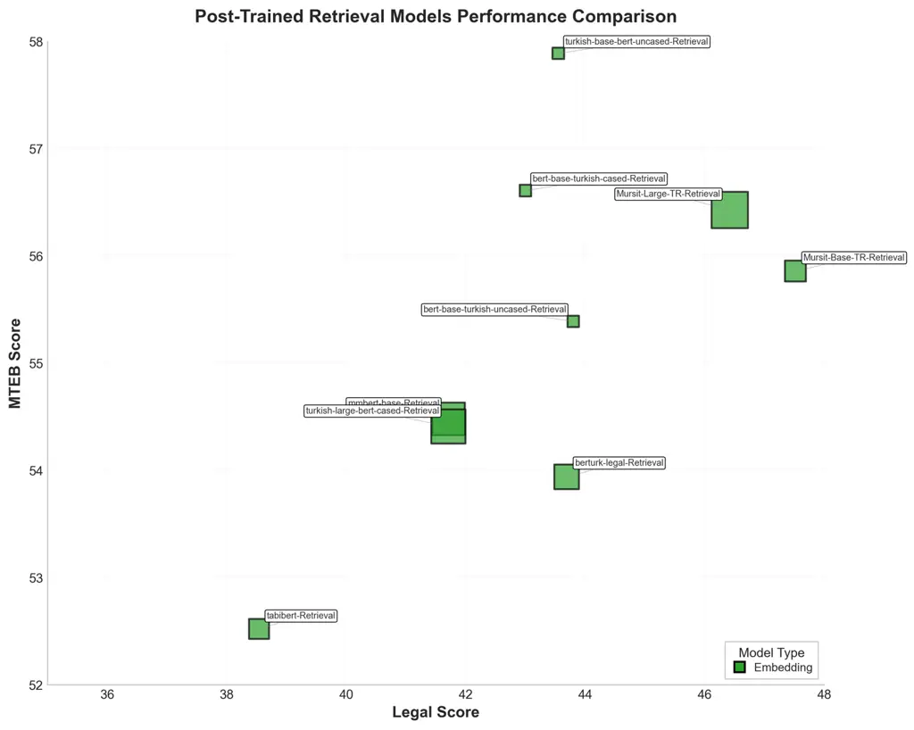

Figure 16: Post-Trained Retrieval Models Performance Comparison: Legal
Score vs. MTEB Score.

#### A.3.1 Production Deployment Efficiency

| Model                               | Legal | Ret.  | Max Seq Length | Params | Emb. Dim | Avg Time | Efficiency |
| ----------------------------------- | ----- | ----- | -------------- | ------ | -------- | -------- | ---------- |
| embeddinggemma-300m                 | 50.63 | 55.06 | 2,048          | 307M   | 768      | 1.41     | 100.00     |
| bge-m3                              | 51.16 | 54.42 | 8,194          | 567M   | 1,024    | 1.49     | 99.54      |
| newmindai/bge-m3-stsb               | 49.97 | 50.14 | 8,194          | 567M   | 1,024    | 1.37     | 94.38      |
| newmindai/Mursit-Base-TR-Retrieval  | 47.52 | 50.07 | 1,024          | 155M   | 768      | 1.17     | 92.36      |
| newmindai/Mursit-Large-TR-Retrieval | 46.42 | 51.59 | 2,048          | 403M   | 1,024    | 1.67     | 91.26      |
| bert-base-turkish-uncased-Retrieval | 43.80 | 50.20 | 512            | 110M   | 768      | 0.84     | 88.84      |
| bert-base-turkish-cased-Retrieval   | 43.00 | 49.70 | 512            | 110M   | 768      | 0.84     | 87.55      |
| berturk-legal-Retrieval             | 43.69 | 48.64 | 512            | 184M   | 768      | 0.72     | 87.21      |
| turkish-base-bert-uncased-Retrieval | 43.55 | 47.95 | 512            | 110M   | 768      | 1.16     | 86.31      |
| mmbert-base-Retrieval               | 41.71 | 48.93 | 8,192          | 306M   | 768      | 1.53     | 86.01      |

Column abbreviations: Legal = Legal Score; Ret. = Retrieval (nDCG@10);
Max Seq Length = Maximum Sequence Length; Params = Number of Parameters;
Emb. Dim = Embedding Dimension; Avg Time = Average Ingestion Time per
100 Points (s); Efficiency = Production Efficiency (normalized across 25
SOTA models).

Table 25: Production-Ready Evaluation: Embedding Model Efficiency for
Vector Database Deployment

To evaluate production deployment efficiency, we introduce a composite
Production Efficiency metric that balances retrieval performance, legal
domain specialization, and computational resource requirements. This
comprehensive framework addresses critical real-world deployment
challenges by systematically quantifying the complex interplay between
model accuracy, operational scalability, and infrastructure costs.
Higher scores indicate better trade-offs between performance and
deployment costs. The metric combines normalized scores with the
following weights: 40% for Retrieval performance, 40% for Legal domain
score, -5% penalty for Parameter count, -5% penalty for Average
Ingestion Time per 100 Points, +5% bonus for Maximum Sequence Length (if
\> 512) or -5% penalty (if $`\leq`$ 512), and +5% bonus for Embedding
Dimension (if \< 2048) or -5% penalty (if $`\geq`$ 2048). Normalization
is performed across 25 state-of-the-art embedding models to ensure fair
comparison and meaningful relative performance assessment.

We measure vector ingestion latency by recording the time required to
insert 100 vectors into a Qdrant database under production settings,
including INT8 scalar quantization (quantile=0.98), on-disk HNSW
indexing (m=16, ef_construct=100), and WAL-enabled persistence. All
ingestion experiments use a fixed batch size of 100 vectors, with
embedding inference time excluded to isolate database insertion
performance. This framework enables practitioners to make decisions when
selecting models for legal RAG systems, where accuracy and efficiency
impact scalability and cost-effectiveness. By quantifying trade-offs
between model performance and infrastructure requirements, the
Production Efficiency metric addresses a critical gap in embedding model
evaluation, providing insights for deployment scenarios.

Table 25 presents Production Efficiency scores for top-performing models
from Table 22. Scores are normalized across 25 state-of-the-art
embedding models to enable fair comparison. Our newmindai/bge-m3-stsb
(567M parameters) achieves a Production Efficiency score of 94.38,
ranking third overall. Our newmindai/Mursit-Base-TR-Retrieval (155M
parameters) achieves a score of 92.36, ranking fourth overall despite
using fewer parameters than the top-performing models
(embeddinggemma-300m: 307M, bge-m3: 567M). This shows that
domain-specific pre-training combined with efficient architecture design
enables practical deployment scenarios where computational resources are
constrained. Our newmindai/Mursit-Large-TR-Retrieval (403M parameters)
achieves a score of 91.26, ranking fifth. Maximum sequence length,
embedding dimension, and parameter count are critical factors that
directly and significantly influence overall system production
efficiency, with smaller models benefiting from reduced memory
requirements and faster indexing speeds.

## Appendix B Reward Model Architecture Details

The Muhakim reward model employs a multi-objective framework
distinguishing input and output-dependent components. The _gating
mechanism_ operates in a prompt-conditioned manner, adjusting priorities
based on legal domain or question type. This separation addresses a
limitation of fixed-weight evaluation systems, where the same importance
is assigned to all quality dimensions regardless of question
characteristics. It is implemented as a mixture-of-experts layer that
processes the prompt through a shared encoder and routes the
representation to expert networks specialized for legal types. The
networks learn to recognize patterns in legal prompts, such as
regulatory queries requiring accuracy versus case law emphasizing
citation quality. The MoE gating network outputs non-negative
coefficients that sum to unity, ensuring weights form a probability
distribution. The routing mechanism employs a top-k selection strategy
where only relevant experts contribute to the final gating weights,
reducing computational overhead compared to full expert activation while
maintaining evaluation quality. Conversely, _reward predictions_ operate
response-conditioned, evaluating text quality across each dimension
through five parallel regression heads. Each regression head processes
the response through the shared Llama-3.1 encoder to produce scalar
reward scores normalized via sigmoid transformation, ensuring reward
values remain bounded in the \[0,1\] interval and facilitating gradient
flow during training. The mathematical formulation combines gating
coefficients $`\alpha_{i}`$ (prompt-dependent) with reward scores
$`r_{i}`$ (response-dependent) as:
$`\text{score}=\sum_{i=1}^{5}\alpha_{i}(\text{prompt})\cdot r_{i}(\text{response})`$.
This design enables the model to weight quality dimensions based on
input context while maintaining interpretability through per-dimension
scores, allowing practitioners to understand which aspects of legal text
quality drive the final assessment.

The training pipeline consists of three stages ensuring stable,
interpretable, context-aware reward signals. First, _multi-objective
supervision_ enables learning of five legal quality dimensions through
labeled scores, allowing each head to specialize without interference.
This stage establishes baseline performance for each dimension
independently, providing a foundation for subsequent preference
learning. Second, _preference-based training_ of the MoE gating network
uses response pairs to learn importance weights, enabling the model to
adapt priorities based on context. This stage learns when different
quality dimensions should receive higher weights, such as prioritizing
statutory accuracy for regulatory questions versus case law citation
quality for precedent-based queries. Third, a _debiasing stage_
mitigates length-related artifacts, ensuring quality evaluation based on
content rather than response length, which is important for legal text
where concise and comprehensive responses may both be valid depending on
context.

## Appendix C Turkish Quality Filtering Threshold Selection

To determine optimal filtering thresholds for Turkish morphology-based
quality filters, we systematically evaluated threshold combinations for
suffix entropy and lemma diversity metrics across the corpus. This
evaluation is critical for Turkish, an agglutinative language where
morphological richness directly impacts model performance on downstream
tasks requiring precise linguistic understanding. The selected
configuration (SE $`\geq`$ 75%, LD $`\geq`$ 50%) balances morphological
variation requirements with sufficient token budget, retaining
approximately 3.48 billion tokens while enforcing higher morphological
diversity compared to less restrictive thresholds. This approach ensures
that training data captures the full spectrum of Turkish morphological
patterns, including complex nominal case constructions and verb
conjugations essential for legal domain applications, thereby improving
model generalization across diverse linguistic contexts. Table 26
presents the comprehensive results of this threshold selection process.

The threshold selection process reveals that more restrictive
configurations (SE $`\geq`$ 80%, LD $`\geq`$ 70%) result in excessive
data reduction (85-99%), significantly limiting corpus diversity and
potentially degrading model performance on rare morphological patterns.
Conversely, less restrictive thresholds (SE $`\geq`$ 50%, LD $`\geq`$
50%) retain more tokens but fail to enforce sufficient morphological
diversity, compromising the quality of linguistic representations. The
optimal configuration (SE $`\geq`$ 75%, LD $`\geq`$ 50%) achieves a
balanced trade-off, maintaining 31% of the original corpus while
ensuring comprehensive morphological coverage essential for robust
Turkish legal language modeling.

| SE (%) | LD (%) | DR (%) | RT            | Mean$`\pm`$STD  |
| ------ | ------ | ------ | ------------- | --------------- |
| 50     | 50     | 28.8%  | 8,301,450,232 | 586 $`\pm`$ 702 |
| 50     | 70     | 95.6%  | 337,745,214   | 635 $`\pm`$ 466 |
| 50     | 75     | 98.2%  | 78,401,681    | 525 $`\pm`$ 261 |
| 50     | 80     | 99.1%  | 17,703,932    | 326 $`\pm`$ 119 |
| 50     | 85     | 99.5%  | 5,224,718     | 177 $`\pm`$ 65  |
| 50     | 90     | 99.7%  | 1,791,945     | 45 $`\pm`$ 40   |
| 70     | 50     | 52.0%  | 5,511,412,625 | 542 $`\pm`$ 691 |
| 70     | 70     | 97.0%  | 221,509,571   | 594 $`\pm`$ 437 |
| 70     | 75     | 98.7%  | 45,029,331    | 462 $`\pm`$ 213 |
| 70     | 80     | 99.3%  | 8,571,350     | 230 $`\pm`$ 78  |
| 70     | 85     | 99.6%  | 2,921,785     | 96 $`\pm`$ 47   |
| 70     | 90     | 99.8%  | 1,290,702     | 22 $`\pm`$ 36   |
| 75     | 50     | 69.0%  | 3,476,853,258 | 506 $`\pm`$ 675 |
| 75     | 70     | 97.7%  | 148,219,275   | 554 $`\pm`$ 396 |
| 75     | 75     | 99.0%  | 30,395,603    | 414 $`\pm`$ 184 |
| 75     | 80     | 99.5%  | 6,218,802     | 192 $`\pm`$ 69  |
| 75     | 85     | 99.7%  | 2,284,263     | 75 $`\pm`$ 44   |
| 75     | 90     | 99.8%  | 1,068,025     | 21 $`\pm`$ 35   |
| 80     | 50     | 85.3%  | 1,559,029,748 | 475 $`\pm`$ 638 |
| 80     | 70     | 98.5%  | 73,866,169    | 486 $`\pm`$ 304 |
| 80     | 75     | 99.2%  | 16,917,511    | 332 $`\pm`$ 134 |
| 80     | 80     | 99.6%  | 4,266,928     | 144 $`\pm`$ 58  |
| 80     | 85     | 99.7%  | 1,762,443     | 54 $`\pm`$ 40   |
| 80     | 90     | 99.8%  | 879,816       | 19 $`\pm`$ 33   |
| 85     | 50     | 95.2%  | 434,347,440   | 468 $`\pm`$ 547 |
| 85     | 70     | 99.2%  | 24,891,788    | 357 $`\pm`$ 180 |
| 85     | 75     | 99.5%  | 7,378,437     | 206 $`\pm`$ 86  |
| 85     | 80     | 99.7%  | 2,605,621     | 91 $`\pm`$ 48   |
| 85     | 85     | 99.8%  | 1,210,163     | 49 $`\pm`$ 36   |
| 85     | 90     | 99.9%  | 645,765       | 18 $`\pm`$ 31   |
| 90     | 50     | 98.8%  | 62,193,294    | 417 $`\pm`$ 313 |
| 90     | 70     | 99.5%  | 6,308,954     | 200 $`\pm`$ 83  |
| 90     | 75     | 99.7%  | 2,975,307     | 105 $`\pm`$ 55  |
| 90     | 80     | 99.8%  | 1,407,302     | 32 $`\pm`$ 38   |
| 90     | 85     | 99.9%  | 731,717       | 20 $`\pm`$ 31   |
| 90     | 90     | 99.9%  | 421,114       | 16 $`\pm`$ 27   |

SE: Suffix Entropy Ratio; LD: Lemma Diversity Ratio; DR: Data Reduction;
RT: Remaining Tokens

Table 26: Data reduction and token-length statistics across suffix
entropy and lemma diversity cutoffs.

## Appendix D Data Preprocessing and Corpus Construction

The preprocessing pipeline prioritizes legal compliance, semantic
diversity, and training stability over raw corpus size, employing
conservative and fully reproducible transformations. All stages execute
in batch-parallel form on the MareNostrum 5 supercomputer using
GPU-accelerated cuDF workflows, achieving order-of-magnitude speedups
over CPU-based processing. Structurally invalid records are removed,
followed by exact deduplication and strict legal filtering. Documents
with unclear licensing were proactively excluded to ensure legal
compliance. Web data undergoes additional filtering via GPU-parallel
URL-based safety rules. OCR-induced noise, particularly scattered-text
artifacts, is addressed through a recovery-oriented normalization
pipeline using LLM-based reconstruction. To eliminate near-duplicate
legal templates, semantic deduplication is applied using dense document
embeddings generated by the BGE-M3 encoder \[8\] and filtered with
SemHash \[26\] at a cosine similarity threshold of 0.95. The final
pipeline—spanning cleaning, filtering, OCR normalization, exact and
semantic deduplication, and curriculum assignment—reduces the corpus
from 132.6M to 72.2M documents while preserving linguistically
meaningful content and ensuring a legally compliant, high-quality
dataset suitable for large-scale pretraining.

## Appendix E Decontamination Module

The decontamination module applies additional filtering stages to the
preprocessing pipeline described in Section D. It removes profanity,
filters low-quality content using C4 \[33\], FineWeb \[31\], and Gopher
\[15, 32\] filters, anonymizes sensitive personal information (emails,
phone numbers, URLs, national identifiers, financial numbers), filters
high-risk domains, normalizes OCR artifacts, and applies language
confidence filtering using GlotLID \[15\]. The module operates using
GPU-accelerated cuDF workflows with deterministic execution.
