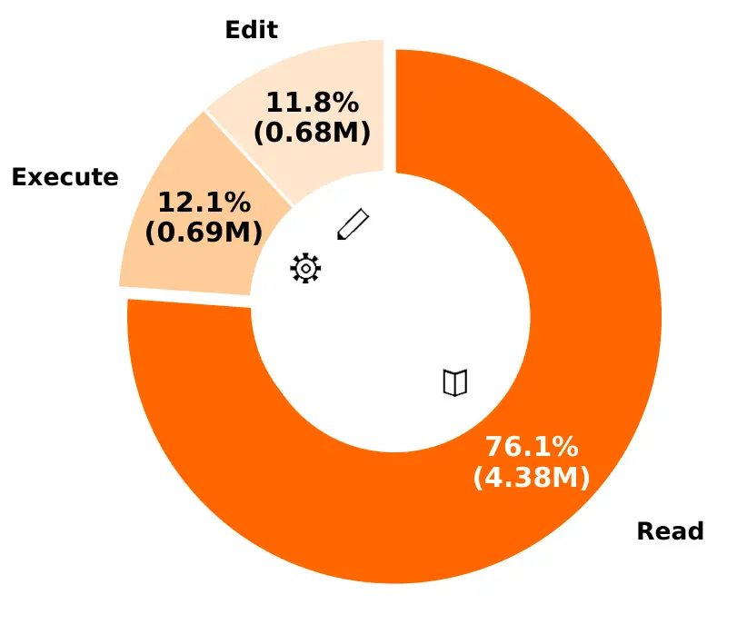
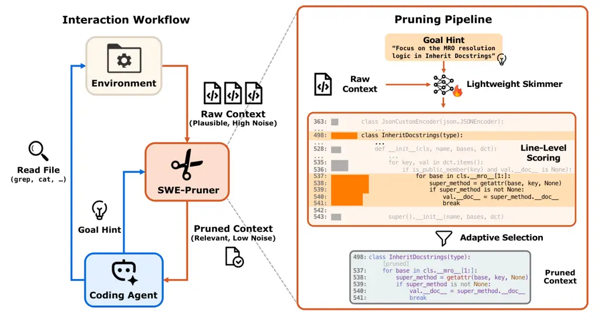
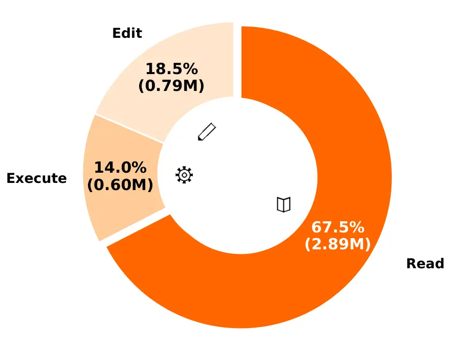
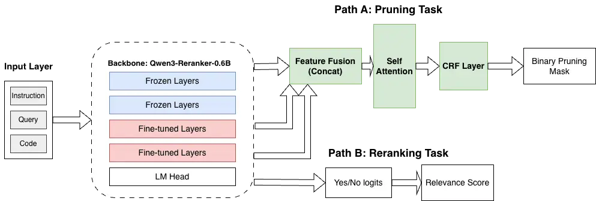

\checkdata

\[Project
Page\][https://github.com/Ayanami1314/swe-pruner](https://github.com/Ayanami1314/swe-pruner)

# SWE-Pruner: Self-Adaptive Context Pruning for Coding Agents

###### Abstract

LLM agents have demonstrated remarkable capabilities in software
development, but their performance is hampered by long interaction
contexts, which incur high API costs and latency. While various context
compression approaches such as LongLLMLingua have emerged to tackle this
challenge, they typically rely on fixed metrics such as PPL, ignoring
the task-specific nature of code understanding. As a result, they
frequently disrupt syntactic and logical structure and fail to retain
critical implementation details. In this paper, we propose SWE-Pruner, a
self-adaptive context pruning framework tailored for coding agents.
Drawing inspiration from how human programmers “selectively skim” source
code during development and debugging, SWE-Pruner performs task-aware
adaptive pruning for long contexts. Given the current task, the agent
formulates an explicit goal (e.g., “focus on error handling”) as a hint
to guide the pruning targets. A lightweight neural skimmer (0.6B
parameters) is trained to dynamically select relevant lines from the
surrounding context given the goal. Evaluations across four benchmarks
and multiple models validate SWE-Pruner’s effectiveness in various
scenarios, achieving 23-54% token reduction on agent tasks like
SWE-Bench Verified while even improving success rates, and up to
14.84$`\times`$ compression on single-turn tasks like LongCodeQA with
minimal performance impact.

¹¹footnotetext: Equal Contribution²²footnotetext: Corresponding author:
xiaodong.gu@sjtu.edu.cn

(a)

(b)

Figure 1: Efficiency analysis on SWE-Bench Verified. SWE-Pruner (orange)
achieves substantial reductions on Token Cost and Agent Rounds for the
base Mini SWE Agent (gray) for both Claude Sonnet 4.5 and GLM 4.6.

## 1 Introduction

Large Language Models (LLMs) have rapidly progressed in software
engineering tasks, from simple code understanding \[7, 33, 69, 20, 72\]
to interactive agents capable of navigating repositories, running tests,
and submitting patches end-to-end \[48, 8, 31, 66, 62\]. Recent coding
agents like Claude Code \[2\] and Gemini CLI \[15\] have augmented LLMs
with sophisticated toolchains including terminals, editors, and file
search, enabling multi-step reasoning over complex codebases.

Despite this progress, a critical bottleneck remains: the accumulation
of context length within the constrained window of LLMs. Navigating
real-world software repositories confronts agents with a massive
“Context Wall.” Although long-context models have emerged \[1, 52\],
blindly ingesting large volumes of code incurs prohibitive inference
costs \[22\] and introduces severe noise, leading to attention dilution
and hallucinations \[37, 32, 61, 60\].

Although context compression techniques offer a potential remedy,
existing approaches face critical limitations when applied to coding
agents. Prior work on context compression primarily targets natural
language \[22, 34, 23, 41\], leading to severe trade-offs when applied
to code \[46\]: token pruning methods compromise syntactic validity,
while abstractive techniques discard character-level information
critical for debugging \[22, 34\]. Beyond structural concerns, these
methods are fundamentally misaligned with coding agent requirements—they
operate with static compression ratios and task-agnostic criteria (e.g.,
perplexity), unable to dynamically prioritize context based on the
evolving goals of multi-turn agent interactions \[75, 67\].

To address these limitations, we introduce SWE-Pruner, a self-adaptive
pruning framework tailored for coding agents. Our key insight stems from
how both programmers and agents navigate large codebases: rather than
reading code line by line, they employ _goal-driven selective attention_
that programmers quickly scan to locate relevant sections based on their
goals (e.g., “find error handling logic”), while agents use tools like
grep or file search to coarsely retrieve targeted code regions including
excessive surrounding context. SWE-Pruner refines this process by
enabling agents to articulate explicit natural language goals alongside
retrieval actions. To capture the dynamic, task-specific objectives of
agent workflows, we train a lightweight 0.6B pruning model on 61K
synthetic data, enabling adaptive selection conditioned on given goals.
By operating at line-level granularity, our approach preserves syntactic
and structural integrity while achieving precise compression that
distills coarse retrieval results into focused, task-relevant context.

We evaluate SWE-Pruner across multi-turn agent tasks (SWE-Bench Verified
\[24\] and SWE-QA \[43\]) and single-turn long-context understanding
tasks (Long Code Completion \[17\] and Long Code QA \[45\]). Across
models and benchmarks, SWE-Pruner consistently delivers substantial
efficiency gains while maintaining or even improving task performance.
Beyond token savings (e.g., 39% reduction on SWE-Bench Verified with
Claude Sonnet 4.5, as illustrated in Figure 1), the focused context also
improves agent decision quality, reducing interaction rounds by up to
26% through more decisive reasoning and fewer redundant exploratory
actions.

In summary, we make the following contributions:

- •
  We propose a novel pruning framework for coding agents that performs
  task-aware, line-level pruning to alleviate the context wall problem.
- •
  We design a novel architecture with a lightweight backbone of only
  0.6B parameters for efficient inference with adaptive, task-dependent
  pruning.
- •
  Evaluations across various benchmarks demonstrate 23–54% token
  reduction on agent tasks and up to 14.8$`\times`$ compression on
  single-turn tasks with minimal performance impact.

## 2 Motivation



Figure 2: Token cost distribution over different tool calls for
Mini-SWE-Agent on SWE-Bench Verified with Claude Sonnet 4.5. Read
operations dominate token consumption at 76.1%, motivating the need for
context pruning mechanisms.



Figure 3: Overview of SWE-Pruner. Left: The Interaction Workflow
demonstrates how SWE-Pruner functions as a middleware between the Coding
Agent and the Environment. It intercepts the Raw Context from file
operations and delivers a Pruned Context to the agent. Right: The
Pruning Pipeline details the internal mechanism. Based on a specific
goal hint from the coding agent, the _neural skimmer_ processes the raw
context through line-level scoring and adaptive selection to deliver the
pruned context.

In practice, coding agents spend an excessive amount of their token
budget on repeatedly exploring the codebase \[40, 66\]. To quantify
this, we perform a preliminary analysis of the trajectories by a Mini
SWE Agent \[68\]. The agent is instantiated with Claude Sonnet 4.5 on
SWE-Bench Verified. We extract action types from the trajectories and
categorize them into three types: 1) _read_, which denotes file and
directory inspection operations such as cat, grep, and head; 2)
_execute_, which means running programs or scripts for testing, and 3)
_edit_, representing in-place modifications. We count the total tokens
consumed in each agent round. As shown in Figure 2, _read_-type
operations consume an overwhelming 76.1% of total tokens, significantly
exceeding _execute_ (12.1%) and _edit_ (11.8%) operations combined. This
issue is further exacerbated in multi-round agent interactions, where
code retrieved in earlier rounds persists in the context and accumulates
as the interaction progresses. Similar patterns are observed with other
backbone models like GLM-4.6 (Appendix A).

This empirical pattern reveals a critical opportunity for context
optimization. When navigating unfamiliar codebases, agents must
extensively explore through coarse-grained file operations that stream
entire files or blocks into the context. While this exploratory strategy
is necessary for understanding the codebase structure, it causes
substantial token costs and introduces redundant content that
accumulates across rounds. Addressing this challenge requires a context
pruning mechanism that is context-aware (capable of identifying relevant
information based on the agent’s current goal) and lightweight enough to
avoid introducing additional latency. These observations strongly
motivate SWE-Pruner, an lightweight pruning framework that enables more
efficient token allocation throughout the problem-solving trajectory.

## 3 Approach

### 3.1 Overview

We introduce SWE-Pruner, a framework that prunes long code contexts for
agents through task-aware, adaptive filtering. As illustrated in
Figure 3, SWE-Pruner operates as middleware between coding agents and
their environment. When an agent issues file-reading commands (e.g.,
grep, cat), the raw retrieved context—often thousands of lines—is
captured and filtered before reaching the agent. To guide this pruning,
the agent generates a Goal Hint describing its current information need
(e.g., “Focus on MRO resolution logic”). A lightweight neural skimmer is
trained to adaptively selects relevant lines from the raw context, while
preserving code structure. Only this pruned context (relevant and
low-noise) is returned to the agent.

The framework comprises three core components as introduced in the
following sections, respectively. First, the target agent is instructed
to provide a goal hint indicating the current information need
(Section 3.2). Next, a lightweight neural skimmer is designed to score
context tokens and aggregate relevant lines (Section 3.3). Finally, we
integrate the skimmer into real agentic systems with minimal
modifications (Section 3.4).

### 3.2 Goal Hint Generation

Central to our framework is the Goal Hint—a natural language description
of the agent’s current information need. Rather than relying on
keyword-based filtering, we instruct the agent to generate goal hints as
complete, self-contained questions (e.g., “How is authentication
handled?”) that capture the semantic intent of its current reasoning
step (detailed prompt in Appendix J). To enable agents to communicate
these goal hints to our pruning system, we augment standard file
manipulation tools (e.g., cat, grep) with an optional
context_focus_question parameter. When provided, this parameter passes
the goal hint to the skimmer, which then filters large outputs for
query-relevant content. When omitted, the skimmer is bypassed and full
outputs are returned, preserving backward compatibility. This
lightweight wrapper design (illustrated below) requires minimal
modifications to existing agent infrastructures, enabling seamless
integration without disrupting established workflows.

\# Original tool (unchanged)

def grep(file_path, pattern):

\# ... original grep implementation ...

return matches

\# New tool with pruner

def grep_with_pruner(file_path, pattern, context_focus_question=None):

\# Call original tool

raw_output = grep(file_path, pattern)

if context_focus_question:

\# Prune if hint provided

return prune(raw_output, context_focus_question)

return raw_output \# Bypass pruner otherwise

### 3.3 Lightweight Neural Skimmer

#### Model Architecture.

We formulate context pruning as a reranking problem: Given the agent
context $`C=\{x_{1},x_{2},...,x_{n}\}`$ where each $`x_{i}`$ represents
a token, and a query $`q`$ representing the agent’s current goal, the
model computes a relevance score $`s_{i}`$ for each token through a
neural scoring function:

```math
s_{i}=\mathcal{F}(q,x_{i}|C;\theta) \tag{1}
```

where $`\mathcal{F}`$ represents the scoring function parameterized by
$`\theta`$ that evaluates token $`x_{i}`$ in the context of both the
query $`q`$ and the full code context $`C`$.

To enable line-level pruning decisions, we aggregate token scores to the
line level. Let $`L=\{l_{1},...,l_{m}\}`$ denote the set of lines
obtained by splitting $`C`$, and let $`T_{j}`$ denote the set of tokens
in line $`l_{j}`$. The line-level relevance score $`\bar{s}_{j}`$ is
computed as the average of its constituent token scores:

```math
\bar{s}_{j}=\frac{1}{|T_{j}|}\sum_{t\in T_{j}}s_{t} \tag{2}
```

This averaging operation ensures that lines are evaluated based on their
overall relevance rather than being dominated by a few high-scoring
tokens, maintaining the semantic coherence necessary for code
comprehension.

We adopt the Qwen3-Reranker-0.6B \[76\] as our backbone due to its
efficiency and pre-trained knowledge of code structures. During
inference, a line $`l_{j}`$ is retained if its aggregated score
$`\bar{s}_{j}`$ exceeds a predefined threshold $`\tau`$. The model
processes retrieved chunks in parallel to minimize latency. Given its
lightweight architecture of 0.6B parameters, pruning overhead is
negligible compared to the token savings for downstream agent LLMs. See
Algorithm 1 for detailed inference steps.

#### Training Objective.

We train the pruning model by minimizing the conditional random field
negative log likelihood (CRF-NLL) \[79\]. Unlike mere binary cross
entropy, CRF explicitly models transition probabilities between
retain/prune states, enabling the model to learn line-level retention
decisions while capturing sequential dependencies.

Given the context representation
$`\mathbf{x}=\mathbf{x}_{1},\ldots,\mathbf{x}_{n}`$ and silver labels
$`\mathbf{y}`$, the pruning head minimizes the following loss function:

```math
\mathcal{L}_{\text{compress}}=\frac{1}{B}\sum_{i=1}^{B}\frac{\mathcal{L}_{\text{CRF-NLL}}(\mathbf{x}_{i},\mathbf{y}_{i})}{L_{i}} \tag{3}
```

where $`\mathbf{x}_{i}`$ denotes the learned feature representation for
each token; $`L_{i}`$ is the sequence-length normalization, which
prevents bias toward aggressive pruning in long contexts. We keep the
original reranking head in Qwen Reranker \[3\] to preserve
document-level relevance scoring capability. The reranking head
minimizes
$`\mathcal{L}_{\text{rerank}}=\text{MSE}(s_{\text{pred}},s_{\text{ref}})`$
between predicted and reference document-level relevance scores in
$`[0,1]`$. The final objective combines both heads with a balancing
weight $`\lambda`$:

```math
\mathcal{L}_{\text{total}}=(1-\lambda)\cdot\mathcal{L}_{\text{compress}}+\lambda\cdot\mathcal{L}_{\text{rerank}} \tag{4}
```

More details about the architecture, CRF formulations, and training
configurations are provided in Appendix B.

#### Constructing Training Data.

Training the neural skimmer requires data with line-level supervision
that preserves both relevance and code structure. Since such dataset is
unavailable, we construct a polyglot training corpus following a
teacher-student paradigm. We sample code snippets from GitHub¹¹ 1
[https://huggingface.co/datasets/nick007x/github-code-2025](https://huggingface.co/datasets/nick007x/github-code-2025),
a curated collection of high-quality repositories, and utilize a teacher
LLM (Qwen3-Coder-30B-A3B-Instruct \[54\]) to synthesize task-oriented
queries that target specific functional subsets of each snippet. This
process produces training quadruplets $`(q,C,M,S)`$, where $`M`$ is a
binary line-level mask indicating which lines to retain and $`S`$ is a
document-level relevance score.

To ensure generalization across diverse coding scenarios, we design
queries based on a taxonomy of nine distinct agentic tasks, such as Code
Debugging, Feature Addition, and Code Refactoring, covering common
information needs in real-world agentic workflows. We employ an
LLM-as-a-Judge filtering mechanism \[57, 18\] with
Qwen3-Next-80B-A3B-Thinking \[54\] to ensure annotation quality. This
rigorous filtering yields a final training corpus of 61,184 high-quality
samples with verified line-level annotations. Complete details on task
taxonomy, data statistics, and generation configurations are provided in
Appendix C.

### 3.4 Integration with Agentic Workflows

The trained skimmer is deployed in real coding agents to accomplish
specific tasks. Our framework flexibly adapts to different task
scenarios. For multi-turn agent tasks (e.g., SWE-Bench), agents
dynamically generate Goal Hints at each round based on their evolving
reasoning trace, enabling them to shift focus from high-level navigation
to detailed debugging as needed. For single-turn tasks with inherent
queries (e.g., code question answering), the task description serves as
the initial Goal Hint, though agents can refine it in subsequent
retrieval rounds. This flexibility allows agents to seamlessly
transition between broad exploration (no pruning) and focused
investigation (with pruning) as their information needs evolve.

## 4 Experiments

### 4.1 Benchmarks and Agents

We evaluate SWE-Pruner on four benchmarks spanning single-turn and
multi-turn scenarios. For single-turn tasks, we use Long Code Completion
\[17\] (500 Python examples with 5K+ token contexts) and Long Code QA
\[45\] (question answering on long code contexts up to 1M tokens),
evaluating under 4x and 8x compression constraints. For multi-turn agent
tasks, we use SWE-Bench Verified \[24\] (500 real-world GitHub issues
requiring patch generation) and SWE-QA \[43\] (repository-specific
question answering across three repositories). Specifically, we
integrate SWE-Pruner into Mini SWE Agent \[68\] for SWE-Bench Verified
and OpenHands \[53\] for SWE-QA, evaluating with Claude Sonnet 4.5 and
GLM-4.6 backbone models. Detailed benchmark descriptions, agent
configurations, and experimental settings are provided in Appendix D.

### 4.2 Baselines

We compare SWE-Pruner against representative methods for compressing
code context and environment observations. Full Context and No Context
establish upper and lower performance bounds. For compression baselines,
we evaluate LLMLingua-2 \[42\] and Selective-Context \[34\] which
perform token-level pruning based on perplexity and self-information
respectively, RAG which retrieves code chunks via embedding similarity
using UniXCoder \[16\], and LongCodeZip \[46\] which leverages program
structure for compression. For multi-turn agent tasks, we additionally
compare with LLM Summarize that generates abstractive summaries using
the backbone model. All baselines are configured to match 4x and 8x
compression constraints under identical experimental settings. We did
not compare with agent history compression methods \[71, 25\]. While
these methods effectively manage long-horizon agent interactions, they
tackle a different problem to ours. They aim at compressing agents’
prior interaction trajectories, while our method compresses agents’
observations like repository content, making them incomparable to our
approach.

### 4.3 Metrics

We evaluate both task performance and compression efficiency. Task
performance is measured through Edit Similarity (ES) and Exact Match
(EM) for code completion \[17\], Accuracy for question answering \[45\],
Resolve Rate on SWE-Bench Verified \[24\], and Average LLM-as-a-Judge
Score on SWE-QA \[43\]. Compression efficiency is quantified via
Compression Ratio
($`1/\tau=|C_{\text{original}}|/|C_{\text{compressed}}|`$), absolute
Token Consumption, interaction Rounds, and API Cost $`(\$)`$.

## 5 Results

### 5.1 Performance on Multi-Turn Tasks

|                                    |        |         |                      |                          |                          |
| ---------------------------------- | ------ | ------- | -------------------- | ------------------------ | ------------------------ |
| Agent                              | Rounds | Solved  | Success (%)          | Tokens (M)               | Cost (\$)                |
| Mini SWE Agent (Claude Sonnet 4.5) | 51.0   | 353/500 | 70.6                 | 0.911                    | 0.504                    |
| \+ SWE-Pruner                      | 41.7   | 360/500 | 72.0$`\uparrow`$1.4% | 0.701$`\downarrow`$23.1% | 0.369$`\downarrow`$26.8% |
| Mini SWE Agent (GLM 4.6)           | 49.3   | 277/500 | 55.4                 | 0.791                    | 0.055                    |
| \+ SWE-Pruner                      | 36.6   | 283/500 | 56.6$`\uparrow`$1.2% | 0.488$`\downarrow`$38.3% | 0.035$`\downarrow`$36.4% |

Table 1: Results on SWE-Bench Verified. SWE-Pruner reduces token
consumption by 23–38% while improving success rates by 1.2–1.4
percentage points.

|                   |                        |            |                          |
| ----------------- | ---------------------- | ---------- | ------------------------ |
| Method            | Avg Score              | Avg Rounds | Tokens (K)               |
| Streamlink        |                        |            |                          |
| Claude Sonnet 4.5 | 8.36                   | 23.4       | 611.2                    |
|    + SWE-Pruner   | 8.59 $`\uparrow`$0.23  | 23.9       | 557.1$`\downarrow`$8.9%  |
| GLM-4.6           | 8.56                   | 18.2       | 318.2                    |
|    + SWE-Pruner   | 8.56$`\uparrow`$0.00   | 25.0       | 145.1$`\downarrow`$54.4% |
| Reflex            |                        |            |                          |
| Claude Sonnet 4.5 | 8.68                   | 33.2       | 1081.6                   |
|    + SWE-Pruner   | 8.85 $`\uparrow`$0.17  | 32.4       | 866.8$`\downarrow`$19.9% |
| GLM-4.6           | 8.37                   | 26.1       | 142.3                    |
|    + SWE-Pruner   | 8.23$`\downarrow`$0.14 | 36.7       | 101.2$`\downarrow`$28.9% |
| Conan             |                        |            |                          |
| Claude Sonnet 4.5 | 8.70                   | 23.9       | 654.7                    |
|    + SWE-Pruner   | 8.84 $`\uparrow`$0.14  | 23.5       | 520.7$`\downarrow`$20.5% |
| GLM-4.6           | 8.58                   | 21.4       | 175.9                    |
|    + SWE-Pruner   | 8.45$`\downarrow`$0.13 | 27.7       | 116.6$`\downarrow`$33.7% |

Table 2: Results on SWE-QA across different repositories. SWE-Pruner
achieves 29–54% token reduction on Streamlink, Reflex, and Conan
repositories with minimal impact on task performance.

|                  |        |             |            |
| ---------------- | ------ | ----------- | ---------- |
| Method           | Rounds | Success (%) | Tokens (M) |
| Mini SWE Agent   | 52.3   | 62.0        | 0.972      |
| \+ LLMLingua2    | 42.1   | 54.0        | 0.856      |
| \+ RAG           | 40.2   | 50.0        | 0.771      |
| \+ LLM Summarize | 41.3   | 56.0        | 0.794      |
| \+ LongCodeZip   | 44.3   | 54.0        | 0.889      |
| + SWE-Pruner     | 41.1   | 64.0        | 0.670      |

Table 3: Comparison of context compression strategies on SWE-Bench.
SWE-Pruner achieves highest success rate with lowest token usage.

#### Evaluation across Diverse Tasks.

We integrate SWE-Pruner into the Mini SWE Agent \[68\] framework for
SWE-Bench Verified \[24\] and the OpenHands \[53\] framework for SWE-QA
\[43\], evaluating with different backbone models. On SWE-Bench
Verified, SWE-Pruner achieves substantial token reductions of 23–38%
across models while even improving success rates (by 1.2–1.4 percentage
points). Notably, interaction rounds decrease by 18–26%. By filtering
redundant information while preserving task-relevant code, SWE-Pruner
enables agents to locate issues more precisely and make more decisive
decisions, thereby reducing repeated reads of exploratory files and
completing tasks earlier. We conduct in-depth case studies in Appendix I
to illustrate these behavioral differences, showing how context pruning
transforms both failure-to-success scenarios (with 83.3% token
reduction) and successful trajectories (with 30.2% reduction in peak
prompt length). On SWE-QA, similar efficiency gains emerge with 29–54%
token reduction across repositories. Interestingly, we observe that
GLM-4.6 exhibits increased rounds (29–41% more) while Claude Sonnet 4.5
maintains similar round counts with minor variations (within 3%).
Through trajectory analysis, we find that after pruning, GLM tends to
explore more files before formulating answers, suggesting a more
conservative reasoning strategy when presented with focused context.
Nevertheless, the overall token consumption remains substantially lower,
demonstrating that SWE-Pruner maintains efficiency advantages regardless
of the agent’s exploration patterns. These model-agnostic efficiency
gains directly translate to proportional cost savings. Detailed analysis
is provided in Appendix E.

|                   |                      |       |      |               |       |      |               |       |               |       |
| ----------------- | -------------------- | ----- | ---- | ------------- | ----- | ---- | ------------- | ----- | ------------- | ----- |
| Methods           | Long Code Completion |       |      |               |       |      | Long Code QA  |       |               |       |
|                   | 4x constraint        |       |      | 8x constraint |       |      | 4x constraint |       | 8x constraint |       |
|                   | $`1/\tau`$           | ES    | EM   | $`1/\tau`$    | ES    | EM   | $`1/\tau`$    | Acc   | $`1/\tau`$    | Acc   |
| Full              | 1.0                  | 64.65 | 40.5 | 1.0           | 64.65 | 40.5 | 1.0           | 54.05 | 1.0           | 54.05 |
| No Context        | $`\infty`$           | 44.90 | 13.5 | $`\infty`$    | 44.90 | 13.5 | $`\infty`$    | 38.39 | $`\infty`$    | 38.39 |
| Selective-Context | 3.27                 | 52.48 | 22.0 | 7.49          | 48.67 | 17.0 | 3.69          | 55.36 | 7.32          | 51.79 |
| LLMLingua2        | 3.32                 | 49.47 | 15.5 | 7.89          | 44.74 | 13.0 | 3.57          | 55.36 | 7.68          | 51.33 |
| RAG               | 3.29                 | 58.97 | 30.5 | 6.60          | 55.82 | 29.0 | 3.06          | 58.04 | 5.87          | 55.86 |
| LongCodeZip       | 2.77                 | 57.77 | 28.0 | 7.85          | 56.08 | 27.5 | 3.98          | 52.25 | 7.39          | 54.95 |
| SWE-Pruner        | 5.56                 | 58.63 | 31.5 | 10.92         | 57.58 | 31.0 | 13.95         | 59.46 | 14.84         | 58.71 |

Table 4: Main results on Long Code Completion and Long Code QA tasks.
The table compares the performance and compression ratio ($`1/\tau`$)
under 4x and 8x constraints. SWE-Pruner demonstrates superior
effectiveness in maintaining high performance while achieving
significant context compression.

#### Comparison with Alternative Context Management Strategies.

To understand what design choices contribute to SWE-Pruner’s
effectiveness, we compare against three categories of baselines:
token-level compression (LLMLingua2), coarse-grained retrieval (RAG),
and generative summarization (LLM Summarize). Due to computational cost
considerations, we conduct this comparison on a random subset with 50
samples of SWE-Bench Verified following Xia et al. \[65\], Chen et al.
\[6\]. As shown in Table 3, our method achieves the best success rate
(64%), outperforming the vanilla agent baseline (62%) despite using 31%
fewer tokens. In contrast, LLMLingua2 and RAG degrade performance
substantially (to 54% and 50%), likely because token-level pruning
disrupts code syntax while coarse-grained retrieval misses fine-grained
implementation details. LLM Summarize achieves moderate performance
(56%) but incurs additional latency. These results validate our design
choice of line-level granularity with task-aware filtering, striking an
optimal balance between compression and information retention. The
effectiveness of SWE-Pruner is further validated by consistent
improvements on single-turn tasks (Table 4), where we observe similar
advantages across diverse compression constraints.

### 5.2 Performance on Single-Turn Tasks

While SWE-Pruner is designed for coding agents, its query-aware,
line-level pruning mechanism generalizes to single-turn tasks. We
evaluate on Long Code Completion and Long Code QA under 4x and 8x
compression constraints with Qwen2.5-Coder-7B-Instruct \[21\]. These
benchmarks require direct completion or question answering without
iterative exploration. Notably, SWE-Pruner achieves substantially higher
effective compression ratios than baselines configured at identical
compression targets. We also validate with Seed-Coder-8B-Instruct \[5\],
obtaining similar results (see Appendix G).

On Long Code Completion (Table 4), SWE-Pruner achieves up to 10.92x
effective compression under the 8x constraint while maintaining an Edit
Similarity (ES) score of 57.58 and an Exact Match (EM) rate of 31.0. As
compression constraints tighten, token-level methods (LLMLingua2,
Selective-Context) experience rapid performance
degradation—Selective-Context drops to 48.67 ES under 8x
constraint—whereas SWE-Pruner maintains stable performance through
line-level granularity that preserves syntactic structure. Under the 4x
constraint, SWE-Pruner achieves 5.56x compression with 58.63 ES and 31.5
EM, outperforming all baselines. On Long Code QA, the advantages become
even more pronounced. SWE-Pruner achieves 14.84x compression under 8x
constraint with 58.71% accuracy, substantially exceeding other
baselines. Under the 4x constraint, our method achieves 13.95x
compression while maintaining 59.46% accuracy, demonstrating that
task-aware line-level pruning excels at identifying relevant code
segments for question answering. This highlights the synergy between
query-aware filtering and line-level granularity, validating that our
approach generalizes effectively to single-turn code understanding
tasks.

### 5.3 Efficiency Impact

Beyond token reduction, a critical consideration for practical
deployment is the computational overhead introduced by the skimmer
itself. As shown in Figure 4, our approach maintains remarkably low and
stable first token latency across all sequence lengths, remaining below
100ms even at 8K tokens. In contrast, larger generative models exhibit
exponential latency growth, with Qwen3-32B exceeding 1200ms and
closed-source models incurring even more overhead. Since our skimmer
employs only a 0.6B encoder, its computational cost is negligible and
readily amortized by the reduced decoding cost from context compression.
This lightweight characteristic validates the practical viability of our
approach for real-world applications. Detailed latency measurements are
provided in Table 6.

Figure 4: First token latency comparison across different sequence
lengths. SWE-Pruner maintains consistently low latency below 100 ms.

## 6 Related Works

#### Prompt Compression

Prompt compression has been extensively studied for both natural
language and code. Token-level pruning methods such as LLMLingua \[22,
23\], Selective Context \[34\], and AttentionRAG \[12\], along with
embedding/retrieval-based approaches like RAG \[30, 10, 47\], XRAG
\[9\], and repo-level retrieval for code completion \[74, 27\], can
reduce prompt length on single-round tasks but often fail to preserve
syntactic structures essential for code correctness \[46\].
Code-specific methods including DietCode \[77\], SlimCode \[59\],
LongCodeZip \[46\], CodeOCR \[49\], and context inlining \[19, 73\]
address structural concerns but are primarily evaluated on single-round
proxy tasks (e.g., code search, completion) rather than multi-round
agentic workflows. Moreover, these approaches typically apply static,
content-only compression that lacks contextual awareness, leading to
fixed behaviors such as indiscriminately removing comments \[67\]
regardless of task requirements. In contrast, SWE-Pruner performs
line-level pruning with dynamic, query-conditioned thresholding that
adapts to the agent’s current task stage, enabling context-aware
compression validated on end-to-end benchmarks like SWE-Bench \[24\]
without repository-specific retraining.

#### Agent Context Management

Modern coding LLMs support context windows of 128k tokens or more \[1,
52\], yet they remain insufficient for large-scale codebases and suffer
from documented performance degradation on long contexts \[37, 26, 32\].
Agentic systems \[70, 63\] for software engineering \[68, 58, 64, 4, 44,
36, 13, 78\] face critical challenges in managing multi-turn interaction
contexts. In NLP domains, trajectory management approaches employ
LLM-based summarization when contexts overflow \[11, 2\], fixed-size
truncation \[14\], or simple observation masking \[35\]. For
long-horizon scenarios, recent frameworks such as SUPO \[39\] and
FoldGRPO \[51\] learn to manage history through reinforcement learning,
while others like COMPASS \[56\], ACON \[25\], AgentDiet \[66\], and
AgentFold \[71\] introduce hierarchical oversight or proactive folding
policies. These methods primarily optimize prior interaction histories,
whereas SWE-Pruner serves as lightweight middleware at the
agent–environment boundary to prune the environment’s observation (i.e.,
file content); it is thus orthogonal to and can be seamlessly combined
with such learned history managers.

## 7 Conclusion

Pruning long code context for agents requires both fine-grained,
structure-preserving compression and dynamic, task-aware filtering. Our
approach, SWE-Pruner, addresses these challenges through lightweight
binary classifiers trained on synthetically diversified code-question
pairs and an adaptive, query-conditioned thresholding mechanism. By
integrating seamlessly as middleware within agentic workflows,
SWE-Pruner reduces token usage by 23–38% on SWE-Bench while improving
success rates by 1.2–1.4 percentage points, achieves 29–54% reduction on
SWE-QA, and up to 14.84$`\times`$ compression on single-turn benchmarks.
These results demonstrate that line-level, context-aware pruning
effectively addresses context-window constraints across both agentic
workflows and general code understanding tasks while reducing costs and
improving efficiency.

## Limitations

We acknowledge several limitations. First, our implementation focuses on
Python repositories, though our approach does not rely on
Python-specific features and demonstrates effective generalization
across different codebases. Comprehensive multilingual support remains
future work. Second, we mitigate data leakage by selecting recently
collected repositories from SWE-QA that postdate our training data,
though continuous evaluation on newly released repositories remains
important. Finally, while our lightweight neural skimmer significantly
reduces token consumption, it introduces marginal latency overhead that
could be further optimized through distillation or early-exit
mechanisms.

## Acknowledgments

This paper is supported by the National Key Research and Development
Program of China (Grant No. 2023YFB4503802) and the Natural Science
Foundation of Shanghai (Grant No. 25ZR1401175).

## References

- \[1\] J. Achiam, S. Adler, S. Agarwal, L. Ahmad, I. Akkaya, F. L.
  Aleman, D. Almeida, J. Altenschmidt, S. Altman, S. Anadkat, et
  al. (2023) Gpt-4 technical report. arXiv preprint arXiv:2303.08774.
  Cited by: §1, §6.
- \[2\] Anthropic (2025) Claude code: built for developers. External
  Links: [Link](https://claude.com/product/claude-code) Cited by: §1,
  §6.
- \[3\] J. Bai, S. Bai, Y. Chu, Z. Cui, K. Dang, X. Deng, Y. Fan, W.
  Ge, Y. Han, F. Huang, et al. (2023) Qwen technical report. arXiv
  preprint arXiv:2309.16609. Cited by: Appendix C, §3.3.
- \[4\] I. Bouzenia, P. Devanbu, and M. Pradel (2024) RepairAgent: An
  Autonomous, LLM-Based Agent for Program Repair. External Links:
  2403.17134, [Link](https://doi.org/10.48550/arXiv.2403.17134) Cited
  by: §6.
- \[5\] ByteDance Seed, Y. Zhang, J. Su, Y. Sun, C. Xi, X. Xiao, S.
  Zheng, A. Zhang, K. Liu, D. Zan, T. Sun, J. Zhu, S. Xin, D. Huang, Y.
  Bai, L. Dong, C. Li, J. Chen, H. Zhou, Y. Huang, G. Ning, X. Song, J.
  Chen, S. Liu, K. Shen, L. Xiang, and Y. Wu (2025) Seed-Coder: let the
  code model curate data for itself. External Links: 2506.03524,
  [Link](https://arxiv.org/abs/2506.03524) Cited by: §5.2.
- \[6\] D. Chen, S. Lin, M. Zeng, D. Zan, J. Wang, A. Cheshkov, J.
  Sun, H. Yu, G. Dong, A. Aliev, et al. (2024) Coder: issue resolving
  with multi-agent and task graphs. arXiv preprint arXiv:2406.01304.
  Cited by: §5.1.
- \[7\] M. Chen, J. Tworek, H. Jun, Q. Yuan, H. P. D. O. Pinto, J.
  Kaplan, H. Edwards, Y. Burda, N. Joseph, G. Brockman, et al. (2021)
  Evaluating large language models trained on code. arXiv preprint
  arXiv:2107.03374. Cited by: §1.
- \[8\] S. Chen, S. Lin, X. Gu, Y. Shi, H. Lian, L. Yun, D. Chen, W.
  Sun, L. Cao, and Q. Wang (2025) SWE-exp: experience-driven software
  issue resolution. arXiv preprint arXiv:2507.23361. Cited by: §1.
- \[9\] X. Cheng, X. Wang, X. Zhang, T. Ge, S. Chen, F. Wei, H. Zhang,
  and D. Zhao (2024) xRAG: Extreme Context Compression for
  Retrieval-augmented Generation with One Token. Cited by: §6.
- \[10\] Z. Cheng, L. Lai, and Y. Liu (2026) Resolving the
  robustness-precision trade-off in financial rag through hybrid
  document-routed retrieval. External Links: 2603.26815 Cited by: §6.
- \[11\] Cursor (2025) Cursor – the ai code editor. External Links:
  [Link](https://cursor.com/) Cited by: §6.
- \[12\] Y. Fang, T. Sun, Y. Shi, and X. Gu (2025) Attentionrag:
  attention-guided context pruning in retrieval-augmented generation.
  arXiv preprint arXiv:2503.10720. Cited by: §6.
- \[13\] Y. Fang, T. Sun, Y. Shi, M. Wang, and X. Gu (2025)
  LastingBench: defend benchmarks against knowledge leakage. arXiv
  preprint arXiv:2506.21614. Cited by: §6.
- \[14\] P. Gao, Z. Tian, X. Meng, X. Wang, R. Hu, Y. Xiao, Y. Liu, Z.
  Zhang, J. Chen, C. Gao, et al. (2025) Trae agent: an llm-based agent
  for software engineering with test-time scaling. arXiv preprint
  arXiv:2507.23370. Cited by: §6.
- \[15\] Google (2025) Gemini cli: command-line ai assistant. External
  Links: [Link](https://geminicli.com/) Cited by: §1.
- \[16\] D. Guo, S. Lu, N. Duan, Y. Wang, M. Zhou, and J. Yin (2022)
  Unixcoder: unified cross-modal pre-training for code representation.
  arXiv preprint arXiv:2203.03850. Cited by: §D.3, §4.2.
- \[17\] D. Guo, C. Xu, N. Duan, J. Yin, and J. McAuley (2023)
  Longcoder: a long-range pre-trained language model for code
  completion. In International Conference on Machine Learning,
  pp. 12098–12107. Cited by: §D.2, §1, §4.1, §4.3.
- \[18\] J. He, J. Shi, T. Y. Zhuo, C. Treude, J. Sun, Z. Xing, X. Du,
  and D. Lo (2025) From code to courtroom: llms as the new software
  judges. arXiv preprint arXiv:2503.02246. Cited by: Appendix C, §3.3.
- \[19\] C. Hu, W. Zeng, Y. Shi, B. Shen, and X. Gu (2026) In line with
  context: repository-level code generation via context inlining. arXiv
  preprint arXiv:2601.00376. Cited by: §6.
- \[20\] M. Hu, J. Wang, W. Zhao, Q. Zeng, and L. Luo (2025)
  FlowMalTrans: unsupervised binary code translation for malware
  detection using flow-adapter architecture. arXiv preprint
  arXiv:2508.20212. Cited by: §1.
- \[21\] B. Hui, J. Yang, Z. Cui, J. Yang, D. Liu, L. Zhang, T. Liu, J.
  Zhang, B. Yu, K. Dang, et al. (2024) Qwen2. 5-coder technical report.
  arXiv preprint arXiv:2409.12186. Cited by: §5.2.
- \[22\] H. Jiang, Q. Wu, C. Lin, Y. Yang, and L. Qiu (2023) LLMLingua:
  compressing prompts for accelerated inference of large language
  models. In Proceedings of the 2023 Conference on Empirical Methods in
  Natural Language Processing, Cited by: §1, §1, §6.
- \[23\] H. Jiang, Q. Wu, X. Luo, D. Li, C. Lin, Y. Yang, and L.
  Qiu (2024) LongLLMLingua: accelerating and enhancing llms in long
  context scenarios via prompt compression. In Proceedings of the 62nd
  Annual Meeting of the Association for Computational Linguistics, Cited
  by: §1, §6.
- \[24\] C. E. Jimenez, J. Yang, A. Wettig, S. Yao, K. Pei, O. Press,
  and K. R. Narasimhan (2024) SWE-bench: can language models resolve
  real-world github issues?. In ICLR, Cited by: §D.2, §1, §4.1, §4.3,
  §5.1, §6.
- \[25\] M. Kang, W. Chen, D. Han, H. A. Inan, L. Wutschitz, Y. Chen, R.
  Sim, and S. Rajmohan (2025) ACON: optimizing context compression for
  long-horizon llm agents. arXiv preprint arXiv:2510.00615. Cited by:
  §4.2, §6.
- \[26\] P. Laban, H. Hayashi, Y. Zhou, and J. Neville (2025) LLMs Get
  Lost In Multi-Turn Conversation. External Links: 2505.06120,
  [Link](https://doi.org/10.48550/arXiv.2505.06120) Cited by: §6.
- \[27\] L. Lai, Z. Cheng, K. Cheng, and X. Qi (2026) Do transformers
  always win? an empirical study of semantic embeddings for short-text
  e-commerce reviews. External Links:
  [Document](https://dx.doi.org/10.21203/rs.3.rs-9163424/v1) Cited by:
  §6.
- \[28\] T. Lan, J. Li, Y. Wang, X. Liu, X. Su, and G. Gao (2025)
  F$`{}^{2}`$bench: an open-ended fairness evaluation benchmark for llms
  with factuality considerations. In Proceedings of the 2025 Conference
  on Empirical Methods in Natural Language Processing, pp. 2031–2046.
  Cited by: Appendix C.
- \[29\] T. Lan, X. Su, X. Liu, R. Wang, K. Chang, J. Li, and G.
  Gao (2025) McBE: a multi-task chinese bias evaluation benchmark for
  large language models. In Findings of the Association for
  Computational Linguistics: ACL 2025, pp. 6033–6056. Cited by: Appendix
  C.
- \[30\] P. Lewis, E. Perez, A. Piktus, F. Petroni, V. Karpukhin, N.
  Goyal, H. Küttler, M. Lewis, W. Yih, T. Rocktäschel, et al. (2020)
  Retrieval-augmented generation for knowledge-intensive nlp tasks.
  Advances in neural information processing systems 33, pp. 9459–9474.
  Cited by: §6.
- \[31\] H. Li, Y. Shi, S. Lin, X. Gu, H. Lian, X. Wang, Y. Jia, T.
  Huang, and Q. Wang (2025) Swe-debate: competitive multi-agent debate
  for software issue resolution. arXiv preprint arXiv:2507.23348. Cited
  by: §1.
- \[32\] J. Li, M. Wang, Z. Zheng, and M. Zhang (2023) Loogle: can
  long-context language models understand long contexts?. arXiv preprint
  arXiv:2311.04939. Cited by: §1, §6.
- \[33\] R. Li, L. B. Allal, Y. Zi, N. Muennighoff, D. Kocetkov, C.
  Mou, M. Marone, C. Akiki, J. Li, J. Chim, et al. (2023) Starcoder: may
  the source be with you!. arXiv preprint arXiv:2305.06161. Cited by:
  §1.
- \[34\] Y. Li, B. Dong, F. Guerin, and C. Lin (2023) Compressing
  context to enhance inference efficiency of large language models. In
  Proceedings of the 2023 Conference on Empirical Methods in Natural
  Language Processing, Cited by: §D.3, §1, §4.2, §6.
- \[35\] T. Lindenbauer, I. Slinko, L. Felder, E. Bogomolov, and Y.
  Zharov (2025) The Complexity Trap: Simple Observation Masking Is as
  Efficient as LLM Summarization for Agent Context Management. External
  Links: 2508.21433, [Link](https://doi.org/10.48550/arXiv.2508.21433)
  Cited by: §6.
- \[36\] J. Liu, K. Wang, Y. Chen, X. Peng, Z. Chen, L. Zhang, and Y.
  Lou (2024) Large Language Model-Based Agents for Software Engineering:
  A Survey. External Links: 2409.02977 Cited by: §6.
- \[37\] N. F. Liu, K. Lin, J. Hewitt, A. Paranjape, M. Bevilacqua, F.
  Petroni, and P. Liang (2023) Lost in the middle: how language models
  use long contexts. arXiv preprint arXiv:2307.03172. Cited by: §1, §6.
- \[38\] Y. Liu, D. Iter, Y. Xu, S. Wang, R. Xu, and C. Zhu (2023)
  G-eval: nlg evaluation using gpt-4 with better human alignment. In
  Proceedings of the 2023 Conference on Empirical Methods in Natural
  Language Processing, pp. 2511–2522. Cited by: Appendix C.
- \[39\] M. Lu, W. Sun, W. Du, Z. Ling, X. Yao, K. Liu, and J.
  Chen (2025) Scaling llm multi-turn rl with end-to-end
  summarization-based context management. arXiv preprint
  arXiv:2510.06727. Cited by: §6.
- \[40\] O. Majgaonkar, Z. Fei, X. Li, F. Sarro, and H. Ye (2025)
  Understanding code agent behaviour: an empirical study of success and
  failure trajectories. arXiv preprint arXiv:2511.00197. Cited by: §2.
- \[41\] J. Mu, X. Li, and N. Goodman (2023) Learning to compress
  prompts with gist tokens. Advances in Neural Information Processing
  Systems 36, pp. 19327–19352. Cited by: §1.
- \[42\] Z. Pan, Q. Wu, H. Jiang, M. Xia, X. Luo, J. Zhang, Q. Lin, V.
  Rühle, Y. Yang, C. Lin, et al. (2024) LLMLingua-2: data distillation
  for efficient and faithful task-agnostic prompt compression. In
  Findings of the Association for Computational Linguistics ACL 2024,
  pp. 963–981. Cited by: §D.3, §4.2.
- \[43\] W. Peng, Y. Shi, Y. Wang, X. Zhang, B. Shen, and X. Gu (2025)
  SWE-qa: can language models answer repository-level code questions?.
  arXiv preprint arXiv:2509.14635. Cited by: §D.2, §1, §4.1, §4.3, §5.1.
- \[44\] Y. Qin, S. Wang, Y. Lou, J. Dong, K. Wang, X. Li, and X.
  Mao (2024) Agentfl: scaling llm-based fault localization to
  project-level context. arXiv preprint arXiv:2403.16362. Cited by: §6.
- \[45\] S. Rando, L. Romani, A. Sampieri, L. Franco, J. Yang, Y.
  Kyuragi, F. Galasso, and T. Hashimoto (2025) LongCodeBench: evaluating
  coding llms at 1m context windows. arXiv preprint arXiv:2505.07897.
  Cited by: §D.2, §1, §4.1, §4.3.
- \[46\] Y. Shi, Y. Qian, H. Zhang, B. Shen, and X. Gu (2025)
  LongCodeZip: compress long context for code language models. arXiv
  preprint arXiv:2510.00446. Cited by: §D.3, §1, §4.2, §6.
- \[47\] Y. Shi, M. Sun, Z. Liu, M. Yang, Y. Fang, T. Sun, and X.
  Gu (2026) Reasoning in trees: improving retrieval-augmented generation
  for multi-hop question answering. arXiv preprint arXiv:2601.11255.
  Cited by: §6.
- \[48\] Y. Shi, S. Wang, C. Wan, and X. Gu (2024) From code to
  correctness: closing the last mile of code generation with
  hierarchical debugging. arXiv preprint arXiv:2410.01215. Cited by: §1.
- \[49\] Y. Shi, C. Xie, Z. Sun, Y. Chen, C. Zhang, L. Yun, C. Wan, H.
  Zhang, D. Lo, and X. Gu (2026) CodeOCR: on the effectiveness of vision
  language models in code understanding. arXiv preprint
  arXiv:2602.01785. Cited by: §6.
- \[50\] H. Song, H. Liu, L. Sha, H. Zhang, and X. Gu (2024)
  FineCodeEval: fine-grained code evaluation using llm as a judge. arXiv
  preprint arXiv:2406.12170. Cited by: Appendix C.
- \[51\] W. Sun, M. Lu, Z. Ling, K. Liu, X. Yao, Y. Yang, and J.
  Chen (2025) Scaling long-horizon llm agent via context-folding. arXiv
  preprint arXiv:2510.11967. Cited by: §6.
- \[52\] G. Team, P. Georgiev, V. I. Lei, R. Burnell, L. Bai, A.
  Gulati, G. Tanzer, D. Vincent, Z. Pan, S. Wang, et al. (2024) Gemini
  1.5: unlocking multimodal understanding across millions of tokens of
  context. arXiv preprint arXiv:2403.05530. Cited by: §1, §6.
- \[53\] O. Team (2024) OpenHands: an open platform for ai software
  developers as generalist agents. Note:
  [https://github.com/All-Hands-AI/OpenHands](https://github.com/All-Hands-AI/OpenHands)
  Cited by: §D.2, §4.1, §5.1.
- \[54\] Q. Team (2025) Qwen3 technical report. External Links:
  2505.09388, [Link](https://arxiv.org/abs/2505.09388) Cited by: §3.3,
  §3.3.
- \[55\] (2024) Tree-sitter. Note:
  [https://tree-sitter.github.io/tree-sitter/](https://tree-sitter.github.io/tree-sitter/)
  Cited by: Appendix H.
- \[56\] G. Wan, M. Ling, X. Ren, R. Han, S. Li, and Z. Zhang (2025)
  COMPASS: enhancing agent long-horizon reasoning with evolving context.
  arXiv preprint arXiv:2510.08790. Cited by: §6.
- \[57\] R. Wang, J. Guo, C. Gao, G. Fan, C. Y. Chong, and X. Xia (2025)
  Can llms replace human evaluators? an empirical study of
  llm-as-a-judge in software engineering. Proceedings of the ACM on
  Software Engineering 2 (ISSTA), pp. 1955–1977. Cited by: Appendix C,
  §3.3.
- \[58\] X. Wang, B. Li, Y. Song, F. F. Xu, X. Tang, M. Zhuge, J.
  Pan, Y. Song, B. Li, J. Singh, H. H. Tran, F. Li, R. Ma, M. Zheng, B.
  Qian, Y. Shao, N. Muennighoff, Y. Zhang, B. Hui, J. Lin, R.
  Brennan, H. Peng, H. Ji, and G. Neubig (2024) OpenHands: An Open
  Platform for AI Software Developers as Generalist Agents. External
  Links: 2407.16741 Cited by: §6.
- \[59\] Y. Wang, X. Li, T. N. Nguyen, S. Wang, C. Ni, and L.
  Ding (2024) Natural is the best: model-agnostic code simplification
  for pre-trained large language models. Proceedings of the ACM on
  Software Engineering 1 (FSE), pp. 586–608. Cited by: §6.
- \[60\] Y. Wang, Y. Wang, Z. Yue, H. Zeng, Y. Wang, I. Lourentzou, Z.
  Tu, X. Chu, and J. McAuley (2026) FASA: FREQUENCY-AWARE SPARSE
  ATTENTION. In The Fourteenth International Conference on Learning
  Representations, External Links:
  [Link](https://openreview.net/forum?id=FnSgecCEwg) Cited by: §1.
- \[61\] Y. Wang, F. Xiong, Y. Wang, L. Li, X. Chu, and D. D.
  Zeng (2025) Position bias mitigates position bias: mitigate position
  bias through inter-position knowledge distillation. In Proceedings of
  the 2025 Conference on Empirical Methods in Natural Language
  Processing, pp. 1495–1512. Cited by: §1.
- \[62\] Z. Wang, Y. Shi, M. Li, Z. Liu, J. M. Zhang, C. Wan, and X.
  Gu (2026) EffiSkill: agent skill based automated code efficiency
  optimization. arXiv preprint arXiv:2603.27850. Cited by: §1.
- \[63\] J. Wei, X. Wang, D. Schuurmans, M. Bosma, F. Xia, E. Chi, Q. V.
  Le, D. Zhou, et al. (2022) Chain-of-thought prompting elicits
  reasoning in large language models. Advances in neural information
  processing systems 35, pp. 24824–24837. Cited by: §6.
- \[64\] C. S. Xia, Y. Deng, S. Dunn, and L. Zhang (2024) Agentless:
  Demystifying LLM-based Software Engineering Agents. External Links:
  2407.01489 Cited by: §6.
- \[65\] C. S. Xia, Z. Wang, Y. Yang, Y. Wei, and L. Zhang (2025)
  Live-swe-agent: can software engineering agents self-evolve on the
  fly?. arXiv preprint arXiv:2511.13646. Cited by: §5.1.
- \[66\] Y. Xiao, P. Gao, C. Peng, and Y. Xiong (2025) Improving the
  efficiency of llm agent systems through trajectory reduction. arXiv
  preprint arXiv:2509.23586. Cited by: §1, §2, §6.
- \[67\] G. Yang, Y. Zhou, W. Cheng, X. Zhang, X. Chen, T. Y. Zhuo, K.
  Liu, X. Zhou, D. Lo, and T. Chen (2024) Less is More: DocString
  Compression in Code Generation. External Links: 2410.22793 Cited by:
  §1, §6.
- \[68\] J. Yang, C. E. Jimenez, A. Wettig, K. Lieret, S. Yao, K. R.
  Narasimhan, and O. Press (2024) SWE-agent: agent-computer interfaces
  enable automated software engineering. In The Thirty-eighth Annual
  Conference on Neural Information Processing Systems, External Links:
  [Link](https://arxiv.org/abs/2405.15793) Cited by: §D.2, §2, §4.1,
  §5.1, §6.
- \[69\] X. Yang, Z. Liu, C. Huang, J. Zhang, T. Zhang, Y. Zhang, and W.
  Lei (2025) ELABORATION: a comprehensive benchmark on human-llm
  competitive programming. arXiv preprint arXiv:2505.16667. Cited by:
  §1.
- \[70\] S. Yao, J. Zhao, D. Yu, N. Du, I. Shafran, K. R. Narasimhan,
  and Y. Cao (2023) ReAct: synergizing reasoning and acting in language
  models. In The Eleventh International Conference on Learning
  Representations, ICLR 2023, Cited by: §6.
- \[71\] R. Ye, Z. Zhang, K. Li, H. Yin, Z. Tao, Y. Zhao, L. Su, L.
  Zhang, Z. Qiao, X. Wang, P. Xie, F. Huang, S. Chen, J. Zhou, and Y.
  Jiang (2025) AgentFold: long-horizon web agents with proactive context
  management. arXiv preprint arXiv:2510.24699. Cited by: §4.2, §6.
- \[72\] W. Zeng, Y. Chai, H. Zhou, F. Meng, J. Zhou, and X. Gu (2026)
  Readability-robust code summarization via meta curriculum learning.
  arXiv preprint arXiv:2601.05485. Cited by: §1.
- \[73\] W. Zeng, Y. Wang, C. Hu, Y. Shi, C. Wan, H. Zhang, and X.
  Gu (2025) Pruning the unsurprising: efficient code reasoning via
  first-token surprisal. arXiv preprint arXiv:2508.05988. Cited by: §6.
- \[74\] F. Zhang, B. Chen, Y. Zhang, J. Keung, J. Liu, D. Zan, Y.
  Mao, J. Lou, and W. Chen (2023) RepoCoder: repository-level code
  completion through iterative retrieval and generation. In Proceedings
  of the 2023 Conference on Empirical Methods in Natural Language
  Processing, pp. 2471–2484. Cited by: §D.3, §6.
- \[75\] L. Zhang, Y. Li, J. Li, X. Xia, J. Yang, R. Luo, M. Wang, L.
  Chen, J. Liu, and M. Yang (2024) Hierarchical Context Pruning:
  Optimizing Real-World Code Completion with Repository-Level Pretrained
  Code LLMs. External Links: 2406.18294 Cited by: §1.
- \[76\] Y. Zhang, M. Li, D. Long, X. Zhang, H. Lin, B. Yang, P. Xie, A.
  Yang, D. Liu, J. Lin, F. Huang, and J. Zhou (2025) Qwen3 embedding:
  advancing text embedding and reranking through foundation models.
  arXiv preprint arXiv:2506.05176. Cited by: §3.3.
- \[77\] Z. Zhang, H. Zhang, B. Shen, and X. Gu (2022) Diet code is
  healthy: simplifying programs for pre-trained models of code. In
  Proceedings of the 30th ACM Joint European Software Engineering
  Conference and Symposium on the Foundations of Software Engineering,
  pp. 1073–1084. Cited by: §6.
- \[78\] J. Zhao, S. Xu, Z. Sun, F. Zhu, J. Ou, Y. Shi, C. Li, X. Zhang,
  and J. Xu (2026) DLLM-searcher: adapting diffusion large language
  model for search agents. arXiv preprint arXiv:2602.07035. Cited by:
  §6.
- \[79\] S. Zheng, S. Jayasumana, B. Romera-Paredes, V. Vineet, Z.
  Su, D. Du, C. Huang, and P. H. Torr (2015) Conditional random fields
  as recurrent neural networks. In Proceedings of the IEEE international
  conference on computer vision, pp. 1529–1537. Cited by: §3.3.

## Appendix A Empirical Results on GLM Model

In our main experiments, we demonstrated that Claude Sonnet 4.5
dedicates 76.1% of its token budget to read operations when solving
software engineering tasks on SWE-Bench Verified. To verify whether this
token consumption pattern generalizes across different model
architectures, we extend our analysis to GLM-4.6, an open-source large
language model with fundamentally different training methodology and
architecture. We conduct parallel analysis on GLM-4.6 agent trajectories
using the same experimental setup as in Section 3, categorizing token
usage into read, edit, and execute operations. The results reveal
consistent patterns that validate the model-agnostic nature of context
pruning needs in coding agents.



Figure 5: Token cost distribution over different tool calls for
Mini-SWE-Agent with GLM-4.6 on SWE-Bench Verified. Read operations
dominate token consumption at 67.5%, further validating the necessity of
context pruning mechanisms across different backbone models.

As illustrated in Figure 5, GLM-4.6 exhibits remarkably similar token
consumption patterns to Claude Sonnet 4.5. Read-type operations account
for 67.5% of total tokens (2.89M), demonstrating that the dominance of
codebase exploration remains consistent across different model
architectures. Edit and execute operations consume 18.5% (0.79M) and
14.0% (0.60M) respectively, with their relative proportions slightly
different from Claude Sonnet 4.5 but still maintaining read operations
as the overwhelming majority. This cross-model consistency strongly
reinforces our motivation for context pruning: regardless of the
underlying model architecture, training methodology, or parameter scale,
coding agents universally spend the majority of their token budget on
codebase exploration rather than reasoning or editing. These findings
establish that SWE-Pruner addresses a fundamental inefficiency inherent
to the agentic workflow itself, rather than model-specific behavior.

## Appendix B Model Architecture and Inference Details



Figure 6: SWE-Pruner Model Architecture. The model consists of a
lightweight reranker backbone with multi-layer feature fusion, followed
by dual heads for pruning and reranking. The pruning head employs a CRF
layer to model structured retention decisions, while the reranking head
produces document-level relevance scores.

### B.1 Model Architecture

The neural skimmer extends the Qwen3-Reranker-0.6B backbone with two
specialized heads: a CRF-based pruning head for line-level filtering and
a reranking head for document-level scoring. An overview of the
architecture is shown in Figure 6.

#### Multi-Layer Feature Fusion.

To capture representations at different semantic levels, we extract and
concatenate hidden states from three intermediate layers (layers 7, 14,
and 28) of the backbone. These fused features are processed through a
self-attention block followed by a multi-head attention layer (8 heads,
hidden size 256) to refine contextual representations.

#### CRF-Based Pruning Head.

The pruning head formulates line-level retention as a structured
sequence labeling problem using a Conditional Random Field. Let
$`\mathbf{x}`$ denote the input token sequence and $`\mathbf{y}`$ the
corresponding label sequence in space
$`\mathcal{Y}=\{\text{retain},\text{prune}\}`$. The CRF negative
log-likelihood is:

```math
\mathcal{L}_{\text{CRF-NLL}}(\mathbf{x},\mathbf{y})=\log Z(\mathbf{x})-\text{score}(\mathbf{x},\mathbf{y}) \tag{5}
```

where the score function combines emission and transition potentials:

```math
\text{score}(\mathbf{x},\mathbf{y})=\text{start}_{y_{1}}+\sum_{t=1}^{T}\text{emissions}_{t,y_{t}}+\sum_{t=2}^{T}\text{transitions}_{y_{t},y_{t-1}}+\text{end}_{y_{T}} \tag{6}
```

and the partition function normalizes over all possible label sequences:

```math
\log Z(\mathbf{x})=\log\sum_{\mathbf{y}^{\prime}\in\mathcal{Y}}\exp(\text{score}(\mathbf{x},\mathbf{y}^{\prime})) \tag{7}
```

Emissions $`\mathbf{E}_{t}=\text{MLP}(\mathbf{h}_{t})\in\mathbb{R}^{2}`$
represent local confidence for each token, while transitions
$`\mathbf{T}\in\mathbb{R}^{2\times 2}`$ capture dependencies between
adjacent decisions. This structured formulation encourages coherent
pruning patterns that respect syntactic boundaries.

#### Reranking Head.

The reranking head reuses the original language modeling head from
Qwen3-Reranker, producing a scalar relevance score for the entire
document via mean squared error against teacher-provided scores.

### B.2 Inference Strategy

During inference, the pruning head computes token-level scores through
forward propagation, which are then aggregated to line-level scores via
averaging (as detailed in Algorithm 1). The CRF layer applies Viterbi
decoding to find the optimal label sequence, ensuring structurally
coherent pruning decisions. Lines are retained if their average token
score exceeds the threshold $`\tau=0.5`$. The reranking head
simultaneously produces document-level scores, enabling the system to
perform both granular pruning and coarse-grained relevance assessment in
a single forward pass.

0:  Input text $`X=\{x_{1},x_{2},...,x_{n}\}`$, token-level scoring
model $`f(\cdot)`$, threshold $`\tau`$

0:  Set of kept lines $`L_{kept}`$

1:  $`L_{kept}=\emptyset`$

2:  Compute token scores $`S=\{s_{1},s_{2},...,s_{n}\}`$ where
$`s_{i}=f(x_{i})`$

3:  for each line $`l_{i}\in X`$ do

4:   Let $`T_{i}`$ be the set of tokens in line $`l_{i}`$

5:   Compute line score
$`\bar{s}_{i}=\frac{1}{|T_{i}|}\sum_{t\in T_{i}}s_{t}`$

6:   if $`\bar{s}_{i}>\tau`$ then

7:    $`L_{kept}\leftarrow L_{kept}\cup\{l_{i}\}`$

8:   end if

9:  end for

10:  return $`L_{kept}`$

Algorithm 1 Token Scoring and Line-level Aggregation

Algorithm 1 summarizes the complete scoring and aggregation pipeline.
The algorithm first computes token-level relevance scores for all input
tokens (Step 2), then iterates through each line to aggregate token
scores via averaging (Steps 4-7), and finally applies the
threshold-based retention criterion (Step 8) to produce the final set of
kept lines.

## Appendix C Training Dataset for the Neural Skimmer

#### Code Source and Preprocessing.

We construct our training dataset from code snippets sampled from the
GitHub Code 2025 dataset²² 2
[https://huggingface.co/datasets/nick007x/github-code-2025](https://huggingface.co/datasets/nick007x/github-code-2025),
a meticulously curated collection comprising over 1.5 million
repositories. This dataset employs a dual-perspective design that
balances proven quality with emerging innovation: it includes both
high-quality repositories (above 2 stars) representing established
patterns and practices, as well as newly-created 2025 repositories
capturing contemporary development trends. The dataset undergoes
extensive preprocessing to remove binary files, build artifacts,
configuration noise, and minified code, ensuring that only clean,
meaningful source code is retained. This rigorous curation provides us
with a diverse, polyglot code corpus spanning multiple programming
languages and coding paradigms, which is essential for training a
pruning model that generalizes across varied agentic scenarios.

#### Agentic Task Taxonomy.

To ensure the skimmer generalizes across diverse real-world coding
scenarios, we design a comprehensive taxonomy of nine distinct agentic
task types that reflect common information needs in software development
workflows. These tasks encompass both exploratory activities and focused
interventions. Code Summarization (code-summarize) targets high-level
understanding by requesting concise summaries of code functionality for
integration or review purposes. Code Refactoring (code-refactor) focuses
on improving code quality through readability, modularity, or structural
enhancements. Relevant Part Identification (find-relevant-part) and Code
Location (code-locate) address navigation needs by asking to identify
where specific features, bugs, or logic are implemented. Code
Optimization (code-optimize) requests efficiency improvements in terms
of performance, resource usage, or scalability. Code Explanation
(code-explain) seeks understanding of particular algorithms or design
choices without requiring full code walkthroughs. Code Debugging
(code-debug) targets actionable assistance for resolving specific
issues, exceptions, or edge cases. Feature Addition (feature-addition)
involves extending existing code with new capabilities while maintaining
integration with current logic. Finally, Code Completion
(code-completion) represents a unique scenario where the query itself is
a code snippet requiring contextual completion, simulating realistic
code intelligence workflows. This taxonomy ensures broad coverage of
task diversity while maintaining clear distinctions between query
intents. Detailed generation instructions for each task type are
provided in Table 5.

#### Data Generation Pipeline.

We synthesize queries and line-level labels for 200,000 sampled code
snippets from 195,370 files across 5,945 repositories. For each code
snippet $`C`$, we employ Qwen3-Coder-30B-A3B-Instruct \[3\] as the
teacher LLM to generate task-oriented queries and corresponding
line-level retention masks. Query generation employs a temperature of
0.7 and top-p sampling with $`p=0.9`$ to balance diversity and
coherence. To ensure representativeness, we randomly sample across all
nine task types, three snippet length levels (short, medium, long), and
three relevance levels (low, medium, high). Following initial
generation, we apply a rigorous quality control mechanism using
Qwen3-Next-80B-A3B-Thinking as an LLM-as-a-Judge filter \[57, 38, 50,
18, 28, 29\]. This judge model evaluates the reasoning quality,
annotation consistency, and task alignment of each sample, retaining
approximately 1/6 of candidates that meet high-quality standards. The
complete generation prompts and judge criteria are detailed in
Appendix J.

#### Dataset Statistics.

Following filtering and quality enhancement procedures, we obtain 61,184
training samples with verified line-level annotations. The resulting
dataset exhibits natural query length distributions with an average of
39.98 words and a median of 24.00 words per query, reflecting realistic
information needs in agentic workflows. The average character count per
query is 291.69, with a median of 169.00, indicating a balanced mix of
concise and detailed information requests. This final corpus provides
diverse, high-quality supervision for training the neural skimmer to
handle varied agentic coding scenarios.

|                    |                                                                                                                                                                                                                                                                                                                                                                                   |
| ------------------ | --------------------------------------------------------------------------------------------------------------------------------------------------------------------------------------------------------------------------------------------------------------------------------------------------------------------------------------------------------------------------------- |
| Task Type          | Instruction for Query Generation                                                                                                                                                                                                                                                                                                                                                  |
| code-summarize     | Summarize the main purpose or functionality of the code, but do not explain every line. Frame your query as a developer seeking a summary for integration or review.                                                                                                                                                                                                              |
| code-refactor      | Suggest a refactoring or improvement for the code. Your query should be practical, such as asking to improve readability, modularity, or performance.                                                                                                                                                                                                                             |
| find-relevant-part | Ask to locate or identify the part of the code that implements a specific feature or logic. Your query should be about finding where something is handled in the code.                                                                                                                                                                                                            |
| code-optimize      | Request an optimization for the (core logic maybe) code, such as improving efficiency, reducing resource usage, or enhancing scalability.                                                                                                                                                                                                                                         |
| code-locate        | Ask to pinpoint the location of a bug, feature, or important logic within the code.                                                                                                                                                                                                                                                                                               |
| code-explain       | Request an explanation for a particular logic, algorithm, or design choice in the code, but do not ask for a full code walkthrough.                                                                                                                                                                                                                                               |
| code-debug         | Ask for help debugging a specific issue, exception, or edge case in the code. Your query should be actionable and focused.                                                                                                                                                                                                                                                        |
| feature-addition   | Request to add a new feature or capability to the code, specifying what should be added and how it should interact with existing logic.                                                                                                                                                                                                                                           |
| code-completion    | This is a special query format. In code completion, the query should be CODE instead of text, which means you should image yourself as a developer write other code snippet(query) that can used the code given for completion. The completion will be the next line for query, but you should keep it in your mind and never write the completion in query. QUERY like a PUZZLE. |

Table 5: Agentic Tasks Taxonomy used for Query Synthesis

## Appendix D Experimental Details

This section provides comprehensive details about our experimental
setup, including training hyperparameters, benchmark specifications,
agent frameworks, and baseline configurations.

### D.1 Training Configuration

#### Training Hyperparameters.

We fine-tune the Qwen3-Reranker-0.6B backbone with a global batch size
of 128, obtained from a per-device batch size of 16 on 8 GPUs with
tensor parallelism. We use the AdamW optimizer with a learning rate of
$`3\times 10^{-5}`$ and weight decay of 0.01, training for 3 epochs with
a dropout rate of 0.4. The CRF-based pruning head fuses hidden states
from three intermediate transformer layers (layers 7, 14, and 28). Only
the last two transformer layers of the backbone are fine-tuned, along
with an additional feature fusion module consisting of a self-attention
block followed by multi-head attention (8 heads, hidden size 256) and a
CRF layer. The weight balancing parameter is set to $`\lambda=0.05`$.
Detailed architecture specifications are provided in Appendix B.

#### Inference Configuration.

The pruning threshold is set to $`\tau=0.5`$, tuned on a held-out
validation set. Agent tasks use a maximum of 250 interaction rounds. All
experiments employ Claude Sonnet 4.5 and GLM-4.6 APIs with temperature 0
for deterministic generation, averaged over three random seeds where
applicable.

### D.2 Benchmark and Agent Descriptions

We evaluate SWE-Pruner on both single-turn and multi-turn benchmarks
spanning diverse code intelligence tasks. For single-turn evaluation, we
use Long Code Completion \[17\], which evaluates code completion under
long contexts, and Long Code QA \[45\], which tests code comprehension
through question answering on contexts up to 1 million tokens drawn from
real-world GitHub issues and documentation across multiple languages and
project domains. For multi-turn agent benchmarks, we use SWE-Bench
Verified \[24\], which contains 500 GitHub issues from 12 Python
repositories where success is measured by automated test execution in
Docker containers and patches must pass all tests without regressions,
and SWE-QA \[43\], which evaluates repository-specific question
answering across three repositories (streamlink, reflex, conan) with
answers scored via LLM-as-a-judge across five dimensions: correctness,
completeness, relevance, clarity, and reasoning.

For agent frameworks, we integrate SWE-Pruner with two representative
systems. Mini SWE Agent \[68\] is a typical agent framework designed for
SWE-Bench that operates with three tool categories: file reading (cat,
grep), code editing (sed), and command execution. We integrate
SWE-Pruner as middleware intercepting file reading operations to apply
task-aware pruning. OpenHands \[53\], which we use following the SWE-QA
original paper, provides comprehensive tools including repository
exploration, version control, and debugging. Our integration with both
frameworks demonstrates that SWE-Pruner generalizes across agent
architectures as a modular component.

### D.3 Baseline Configurations

(a)

(b)

Figure 7: Comprehensive efficiency analysis on SWE-Bench Verified.
SWE-Pruner (orange) achieves substantial reductions compared to baseline
(gray). (a) With Claude Sonnet 4.5: 38.7% in prompt tokens, 40.8% in
completion tokens, 39.2% in total tokens, and 18.3% in agent rounds. (b)
With GLM 4.6: 44.2% in prompt tokens, 44.0% in completion tokens, 43.6%
in total tokens, and 34.6% in agent rounds.

All baseline methods are configured to match identical compression
constraints (4x and 8x) under the same experimental conditions. For
performance bounds, Full Context provides complete code context as an
upper bound, while No Context provides only task instructions as a lower
bound. For token-level compression baselines, Selective-Context \[34\]
computes self-information $`-\log P(x_{i}|\text{instruction})`$ and
removes low-information tokens, and LLMLingua-2 \[42\] uses a trained
token classifier (XLM-RoBERTa) to predict binary retention decisions.
Both operate at sub-word granularity without code-specific syntactic
constraints. For retrieval-based methods, RAG employs function-level
chunking with UniXCoder \[16, 74\] embeddings, retrieving top-k chunks
via cosine similarity. LongCodeZip \[46\] represents code-specific
compression that combines AST-based chunking with entropy-guided
compression, retaining high-entropy regions. Finally, LLM Summarize (for
multi-turn agent tasks only) generates abstractive summaries of code
files using the backbone model, trading summarization cost for reduced
downstream tokens.

## Appendix E Agent Rounds and Token Consumption Analysis

Table 1 shows the token consumption and interaction rounds for two
different backbone models: Claude Sonnet 4.5 and GLM 4.6. For Claude
Sonnet 4.5, SWE-Pruner reduces average tokens per instance from 0.911M
to 0.701M (23.1% reduction), while reducing average rounds from 51.0 to
41.7 (18.2% reduction). The GLM 4.6 model exhibits even more substantial
improvements, with token reduction from 0.791M to 0.488M (38.3%
reduction) and rounds reduction from 49.3 to 36.6 (25.7% reduction).

Figure 7 present the complete distribution shifts for both models,
revealing consistent patterns across prompt and completion tokens. GLM
4.6 exhibits 44.2% and 44.0% reductions respectively, while Claude
Sonnet 4.5 demonstrates 38.7% and 40.8% reductions. This symmetry
indicates that SWE-Pruner not only reduces input context but also
enables more focused agent responses, distinguishing it from naive
retrieval filtering which would primarily affect prompt tokens. The
variation in pruning effectiveness between models provides insights into
architectural differences: GLM 4.6’s more pronounced gains (34.6% round
reduction vs. Claude’s 18.3%) suggest greater susceptibility to context
noise, while Claude’s extensive context capabilities maintain reasonable
focus even unpruned. The reduction in agent rounds represents a
qualitative improvement—for GLM 4.6, the shift from 49.3 to 36.6 rounds
translates to faster task completion and reduced cumulative latency in
production environments where each round incurs API overhead and
rate-limiting delays.

## Appendix F Detailed Efficiency Analysis

|            |              |       |        |        |         |
| ---------- | ------------ | ----- | ------ | ------ | ------- |
| Model      | Input Length |       |        |        |         |
|            | 64           | 128   | 512    | 2048   | 8192    |
| Qwen3-0.6B | 26.18        | 26.31 | 32.00  | 29.64  | 76.73   |
| Qwen3-4B   | 64.75        | 97.24 | 104.93 | 99.10  | 241.97  |
| Qwen3-14B  | 97.17        | 78.11 | 143.65 | 129.97 | 529.45  |
| Qwen3-32B  | 73.99        | 55.46 | 84.01  | 274.22 | 1188.67 |
| SWE-Pruner | 44.70        | 43.91 | 42.05  | 49.05  | 102.00  |

Table 6: Average TTFT (ms) for different models and input lengths.
SWE-Pruner maintains consistently low latency across all sequence
lengths.

To complement the efficiency analysis in Section 5.3, we provide
detailed first token latency measurements across different models and
input lengths. Table 6 presents a comprehensive comparison demonstrating
how SWE-Pruner maintains stable and low latency across various sequence
lengths compared to larger generative models.

The latency analysis reveals critical insights for practical agent
deployments. At 8192 tokens, SWE-Pruner achieves 102.00ms TTFT—a
7.5$`\times`$ speedup compared to Qwen3-32B (1188.67ms) and
5.2$`\times`$ compared to Qwen3-14B (529.45ms)—while exhibiting
sublinear scaling (2.1$`\times`$ increase from 2048 to 8192 tokens vs.
Qwen3-32B’s 14.1$`\times`$). Crucially, in real-world deployments with
closed-source models like Claude Sonnet 4.5, API latency typically
ranges from 500ms to several seconds per request, making our pruning
overhead (40–50ms) less than 10% of typical roundtrip times. This
marginal cost is amortized many times over through 23–54% token
reductions (Table 1), yielding proportional savings in both inference
time and API costs. Combined with 18.3–25.7% reductions in interaction
rounds across models, the efficiency gains compound throughout
multi-turn agent trajectories, delivering substantial end-to-end
improvements despite the upfront pruning cost.

## Appendix G Single-Turn Tasks with SeedCoder

To validate the generalizability of our approach across different model
architectures, we conduct additional evaluations using
Seed-Coder-8B-Instruct on the Long Code Completion and Long Code QA
benchmarks. Results are presented in Table 7.

|                   |                      |       |      |               |       |      |               |       |               |       |
| ----------------- | -------------------- | ----- | ---- | ------------- | ----- | ---- | ------------- | ----- | ------------- | ----- |
| Methods           | Long Code Completion |       |      |               |       |      | Long Code QA  |       |               |       |
|                   | 4x constraint        |       |      | 8x constraint |       |      | 4x constraint |       | 8x constraint |       |
|                   | $`1/\tau`$           | ES    | EM   | $`1/\tau`$    | ES    | EM   | $`1/\tau`$    | Acc   | $`1/\tau`$    | Acc   |
| Full              | 1.0                  | 65.03 | 40.5 | 1.0           | 65.03 | 40.5 | 1.0           | 49.11 | 1.0           | 49.11 |
| No Context        | $`\infty`$           | 43.85 | 14.0 | $`\infty`$    | 43.85 | 14.0 | $`\infty`$    | 37.50 | $`\infty`$    | 37.50 |
| Selective-Context | 3.27                 | 53.68 | 24.5 | 7.49          | 49.89 | 17.5 | 2.71          | 51.33 | 6.69          | 46.43 |
| LLMLingua2        | 3.95                 | 48.09 | 15.0 | 7.89          | 45.53 | 13.5 | 3.70          | 43.36 | 5.46          | 39.82 |
| RAG               | 3.32                 | 58.21 | 31.0 | 6.78          | 56.97 | 28.5 | 3.44          | 53.98 | 6.65          | 53.57 |
| LongCodeZip       | 3.96                 | 56.72 | 25.5 | 6.53          | 54.91 | 23.0 | 3.29          | 51.33 | 7.49          | 50.91 |
| SWE-Pruner        | 4.22                 | 57.71 | 31.0 | 8.13          | 56.73 | 28.5 | 9.98          | 56.25 | 14.68         | 55.75 |

Table 7: Results on Long Code Completion and Long Code QA with
Seed-Coder-8B-Instruct. SWE-Pruner demonstrates consistent effectiveness
across different model architectures, achieving superior compression
while maintaining competitive task performance.

The results with Seed-Coder-8B-Instruct exhibit similar patterns to
those observed with Qwen2.5-Coder-7B-Instruct. On Long Code Completion,
SWE-Pruner achieves 8.13x compression under 8x constraint with 56.73 ES
and 28.5 EM, outperforming Selective-Context (7.49x/49.89 ES/17.5 EM)
and LongCodeZip (6.53x/54.91 ES/23.0 EM). On Long Code QA, the
advantages are particularly pronounced: under 8x constraint, our method
achieves 14.68x compression with 55.75% accuracy, substantially
exceeding all baselines including RAG (6.65x/53.57%) and LongCodeZip
(7.49x/50.91%). This cross-model consistency validates that the
effectiveness of task-aware, line-level pruning is not specific to a
particular model architecture but represents a generalizable approach to
context compression for code understanding tasks.

## Appendix H Syntactic Structure Preservation Analysis

Line-level pruning preserves syntactic structure better than token-level
compression. Our pruning strategy retains semantically relevant lines
with minimal syntactic context for code integrity, while token-level
methods disrupt AST structure through arbitrary token deletion. We
evaluate AST correctness using tree-sitter \[55\] on Long Code
Completion. Table 8 presents results.

|                           |                     |
| ------------------------- | ------------------- |
| Method                    | AST Correctness (%) |
| Baseline (No Compression) |                     |
| Full Context              | 98.5                |
| No Context                | 98.5                |
| Token-Level Compression   |                     |
| LLMLingua2                | 0.29                |
| Selective Context         | 12.4                |
| Random Token Pruner       | 49.6                |
| Line-Level Compression    |                     |
| Function RAG              | 92.3                |
|    + Random Line Pruner   | 78.2                |
|    + SWE-Pruner           | 87.3                |
| Structural Compression    |                     |
| LongCodeZip               | 89.3                |
|    + SWE-Pruner           | 76.8                |

Table 8: AST Correctness Rate after Compression. Line-level methods
maintain substantially higher syntactic validity compared to token-level
approaches.

Token-level methods (LLMLingua2, Selective Context) achieve near-zero
AST correctness (0.29%, 12.4%), while line-level approaches maintain
substantially higher validity. Our SWE-Pruner achieves 87.3% AST
correctness on Function RAG, outperforming random token pruning (49.6%)
and competitive with random line pruning (78.2%). This demonstrates that
structure-aware labeling successfully identifies safe removals while
preserving syntactic dependencies. Note that SWE-Pruner operates as a
second-stage pruner on top of Function RAG’s output, meaning any
additional compression inherently introduces some risk of removing
syntactically critical lines. The slight reduction from baseline
Function RAG (92.3%) to our method (87.3%) reflects this
compression-validity trade-off, where the 5% decrease enables
substantially higher compression ratios while maintaining practical code
validity for downstream tasks.

## Appendix I Case Study on SWE Bench

To complement the aggregate statistics from SWE-Bench experiments, we
conduct an in-depth case study comparing agent behaviors under two
configurations: a Baseline agent operating with full interaction
histories, and a Pruner-augmented agent that applies context pruning to
file observations. Both agents operate on the same set of software
engineering tasks from SWE-Bench, and we analyze their trajectories
through the lens of tool invocation patterns and token consumption. We
select two representative instances that illustrate distinct benefits of
context pruning: one where pruning enables task completion by preventing
resource exhaustion, and another where pruning achieves structural
efficiency gains even when both agents succeed.

### I.1 Case 1: High-Impact Scenario

The first case examines task django\_\_django-10554, which requires
fixing a missing deep copy in the Query.clone() method for the
combined_queries attribute. As shown in Table 9, the Baseline agent
exhausts its resource limits after 164 steps, accumulating over 7
million tokens with a maximum prompt length of 87,790 tokens. In
contrast, the Pruner-augmented agent completes the task successfully in
56 steps with 1.17 million tokens and a peak prompt length of 38,226
tokens. The token reduction reaches 83.3% in absolute terms,
demonstrating that context pruning can transform resource-bound failures
into successful completions.

|          |       |      |        |      |      |           |
| -------- | ----- | ---- | ------ | ---- | ---- | --------- |
| Setting  | Steps | Read | Search | Exec | Edit | Tokens    |
| Baseline | 164   | 59   | 39     | 1    | 25   | 7,001,934 |
| Pruner   | 56    | 20   | 10     | 0    | 11   | 1,170,160 |

Table 9: Comparison of agent behaviors on django\_\_django-10554.
Baseline exhausts limits while Pruner succeeds with 83.3% token
reduction.

Examining the trajectory reveals fundamental differences in exploration
strategy. The Baseline agent engages in extensive breadth-first file
reading, issuing commands such as find . -name "\*.py" \| grep union
followed by repeated segmented reads using sed -n ’x,y’ across numerous
files. This results in accumulation of redundant context from
tangentially related code. Meanwhile, the Pruner agent directly
navigates to the core file django/db/models/sql/query.py, reads it with
line numbers (cat -n), and identifies the relevant branch (if
self.combinator: ...) for modification. By filtering out irrelevant
sections during file reads, the pruner enables the agent to maintain a
focused working context, avoiding the context overflow that derails the
Baseline.

### I.2 Case 2: Structural Efficiency Gains

The second case analyzes task django\_\_django-11740, which requires
adding foreign key dependency tracking to the migration autodetector’s
AlterField operation. Unlike the previous case, both agents successfully
complete this task, but the Pruner achieves substantial efficiency
improvements as shown in Table 10. Although the Pruner agent takes 6
additional steps (48 versus 42), its token consumption is 6.0% lower and
its maximum prompt length is reduced by 30.2%. This illustrates that
pruning benefits extend beyond preventing failures to improving resource
efficiency in successful trajectories.

|          |       |      |        |      |      |         |
| -------- | ----- | ---- | ------ | ---- | ---- | ------- |
| Setting  | Steps | Read | Search | Exec | Edit | Tokens  |
| Baseline | 42    | 12   | 8      | 1    | 18   | 857,371 |
| Pruner   | 48    | 14   | 8      | 0    | 13   | 806,220 |

Table 10: Comparison on django\_\_django-11740. Both succeed, but Pruner
achieves 30.2% reduction in peak prompt length.

Analysis of the trajectories shows that both agents converge on the same
logical solution, modifying autodetector.py to adjust the
\_get_dependencies_for_foreign_key invocation. However, their reading
strategies differ qualitatively. The Baseline agent performs multiple
segmented reads of the target file and creates temporary validation
scripts (e.g., python /tmp/test_uuid_to_fk3.py) to verify understanding,
accumulating historical noise from these exploratory steps. The Pruner
agent reads the complete file with line numbers once, directly edits the
relevant section, and avoids auxiliary validation artifacts. This
behavioral shift reflects a transition from defensive exploration to
confident intervention, enabled by cleaner, more focused context at each
decision point.

#### Discussion

These cases illustrate two distinct modes of benefit from context
pruning. In the high-impact scenario, pruning prevents catastrophic
context overflow that leads to task abandonment, effectively converting
failures into successes. In the structural efficiency scenario, pruning
does not change task outcomes but significantly reduces the
computational burden and maximum context requirements, improving
operational cost-effectiveness. Both patterns support the hypothesis
that context pruning serves not merely as an engineering optimization
but as a cognitive strategy that enables more efficient problem-solving
behaviors. By reducing the volume of irrelevant information presented to
the agent at each step, pruning allows the underlying language model to
allocate more attention to task-critical signals, thereby improving both
decision quality and resource utilization.

## Appendix J Prompt Templates

This appendix presents the complete prompt templates used in our
experiments. We provide four key prompt templates that form the core of
our approach. First, the Silver Label Prompt is used to generate
training data by asking models to answer queries using provided code
context with explicit line citations. Second, the Mini SWE Agent with
Pruner Template defines the agent system for solving software
engineering tasks, which includes detailed instructions on response
format, context focus questions, workflow recommendations, and command
execution rules. Third, the SWE-QA Bash Tool Descriptions specify how
the bash execution tool works within the agent framework, particularly
highlighting the usage of context focus questions for filtering large
outputs. Finally, the Quality Evaluation Prompt provides the criteria
and procedure for assessing the quality of pruned code samples across
three dimensions: query quality, deletion relevance, and semantic
preservation.


