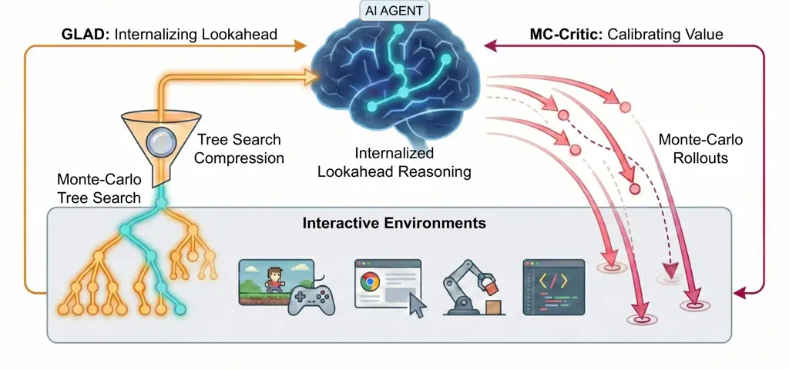
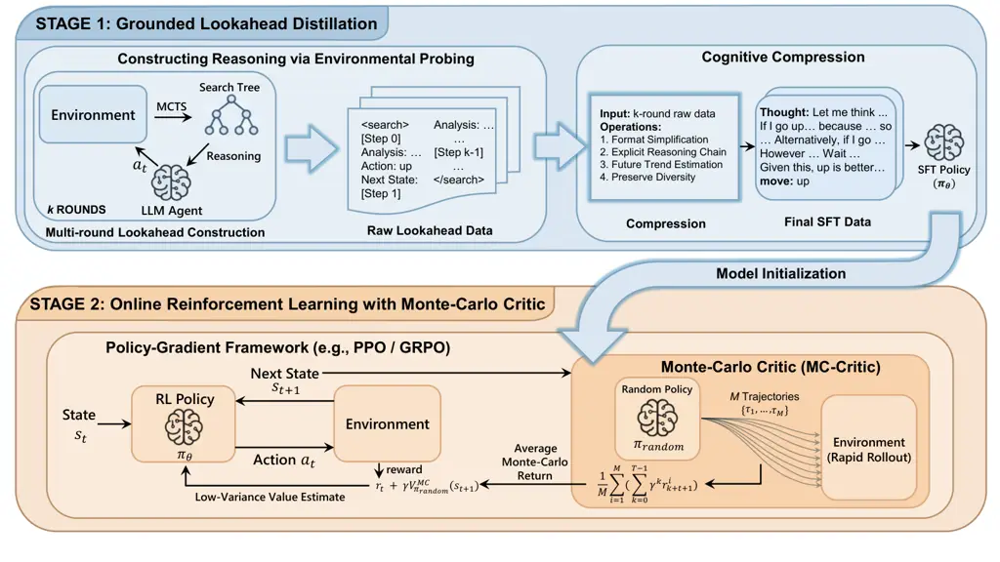

# ProAct: Agentic Lookahead in Interactive Environments

Yangbin Yu\*    Mingyu Yang\*    Junyou Li    Yiming Gao    Feiyu Liu   
Yijun Yang    Zichuan Lin Affiliation: Jiafei Lyu, Yicheng Liu, Zhicong
Lu, Deheng Ye, Jie Jiang$`\dagger`$ Affiliation: Tencent Hunyuan

###### Abstract

Existing Large Language Model (LLM) agents struggle in interactive
environments requiring long-horizon planning, primarily due to
compounding errors when simulating future states. To address this, we
propose ProAct, a framework that enables agents to internalize accurate
lookahead reasoning through a two-stage training paradigm. First, we
introduce Grounded LookAhead Distillation (GLAD), where the agent
undergoes supervised fine-tuning on trajectories derived from
environment-based search. By compressing complex search trees into
concise, causal reasoning chains, the agent learns the logic of
foresight without the computational overhead of inference-time search.
Second, to further refine decision accuracy, we propose the Monte-Carlo
Critic (MC-Critic), a plug-and-play auxiliary value estimator designed
to enhance policy-gradient algorithms like PPO and GRPO. By leveraging
lightweight environment rollouts to calibrate value estimates, MC-Critic
provides a low-variance signal that facilitates stable policy
optimization without relying on expensive model-based value
approximation. Experiments on both stochastic (e.g., 2048) and
deterministic (e.g., Sokoban) environments demonstrate that ProAct
significantly improves planning accuracy. Notably, a 4B parameter model
trained with ProAct outperforms all open-source baselines and rivals
state-of-the-art closed-source models, while demonstrating robust
generalization to unseen environments. The codes and models are
available at
[https://github.com/GreatX3/ProAct](https://github.com/GreatX3/ProAct).

>

^(†)^(†)footnotetext: \* Equal contribution.^(†)^(†)footnotetext:
$`\dagger`$ Corresponding Author. (Email:zeus@tencent.com)



Figure 1: Overview of ProAct. A two-stage paradigm to internalize
accurate lookahead reasoning for AI agents. GLAD distills complex MCTS
search trees into concise, causal reasoning chains via SFT. MC-Critic
leverages lightweight environment rollouts to provide low-variance value
estimates, stabilizing online RL training.

## 1 Introduction

Recent advancements in Large Language Models (LLMs) have enabled the
development of autonomous agents capable of performing complex tasks
 (Wang et al., 2024; Xi et al., 2025; Luo et al., 2025). Unlike static
question-answering, interactive environments require agents to make
sequential decisions where current actions significantly constrain
future possibilities. In such settings, human cognition typically relies
on System 2 processing  (Jaech et al., 2024; Li et al., 2025c; Guo et
al., 2025): rather than acting greedily on the current state, humans
perform mental lookahead—simulating potential future trajectories and
comparing outcomes before committing to an action.

However, replicating this lookahead capability in LLM agents remains a
fundamental challenge. While techniques like Chain-of-Thought  (Wei et
al., 2022; Yao et al., 2023) and ReAct  (Yao et al., 2022) have improved
reasoning, they suffer from a critical limitation in long-horizon tasks:
compounding simulation errors  (Lin et al., 2025). When an LLM agent
attempts to simulate future states, minor inaccuracies in predicting the
dynamics of the environment accumulate rapidly  (Lin et al., 2025; Luo
et al., 2025). Consequently, the reasoning process, though logically
sound in structure, diverges from reality, leading to delusional plans
and suboptimal decision-making. Simply increasing the depth of
ungrounded reasoning often further degrades performance due to context
drift and hallucination, while single-step reasoning fails to capture
long-term consequences.

To bridge this gap, we propose ProAct, a framework designed to
internalize accurate, multi-turn lookahead capabilities into LLM agents.
Our core insight is that while LLMs struggle to generate accurate
simulations zero-shot, they can effectively learn the pattern of correct
simulation if provided with grounded supervision. ProAct operates in two
stages as shown in Figure 1. First, during Supervised Fine-Tuning (SFT),
we employ Grounded LookAhead Distillation (GLAD). We utilize the
environment to perform Monte-Carlo Tree Search (MCTS), exploring
multiple future trajectories including both optimal paths and potential
dead-ends. Crucially, instead of training on the raw, expansive search
trees, we compress these trajectories into concise, high-quality
reasoning chains. By explicitly training on these compressed reasoning
chains, the model learns to predict the outcomes of candidate actions
and identify risks based on ground-truth environmental feedback, rather
than relying on hallucinated physics. Second, to further refine the
precision of this internalized model, we introduce a Reinforcement
Learning (RL) phase augmented by a Monte-Carlo Critic (MC-Critic).
Standard multi-turn RL methods  (Schulman et al., 2017; Shao et al.,
2024; Li et al., 2025a) for LLM agents often struggle with value
estimation in long-horizon tasks. Our MC-Critic leverages the
interactive nature of the environment to perform lightweight rollouts,
providing a suboptimal low-variance estimate of the value function. This
allows the model to align its internalized lookahead with the true
environmental dynamics efficiently.

To rigorously evaluate ProAct, we utilize long-horizon games (e.g.,
2048, Sokoban) as testbeds. These environments provide objective metrics
for reasoning capabilities, featuring both stochasticity and strict
deterministic dynamics. Experiments show that ProAct significantly
enhances multi-turn decision-making capabilities. Notably, a 4B
parameter model trained with our framework outperforms all open-source
baselines and achieves performance comparable to state-of-the-art
closed-source models, while exhibiting strong generalization to unseen
environment configurations.

Our contributions are summarized as follows:

1.  1.  We propose GLAD, a method to internalize environmental dynamics into
        LLM agents by compressing search-based trajectories into explicit
        reasoning chains, mitigating simulation hallucinations.
2.  2.  We introduce MC-Critic, a plug-and-play auxiliary value estimation
        method that leverages environment interaction to stabilize and
        accelerate multi-turn agentic RL training.
3.  3.  We demonstrate that a 4B parameter model trained with ProAct
        outperforms all open-source baselines and achieves performance
        comparable to state-of-the-art closed-source models. Furthermore,
        the model demonstrates strong generalization to unseen environments.

## 2 Related Work

Recent research in LLM agents has shifted from static, single-turn
problem solving to dynamic, multi-turn interactions in complex
environments. This paradigm shift necessitates advancements across three
critical dimensions: (1) Multi-Turn Agentic RL, which addresses the
stability and exploration challenges inherent in trajectory-level
optimization; (2) Reasoning and Search Distillation, where expensive
inference-time planning (System 2) is compressed into efficient policy
intuition (System 1); and (3) Value Estimation for Agentic RL, which
tackles the difficulty of attributing sparse rewards to specific
reasoning steps in long-horizon tasks. Our work synthesizes these
directions, proposing a unified framework that calibrates agent
reasoning via environment-based search and stabilizes policy updates
through Monte-Carlo value estimation.

##### Multi-Turn Agentic Reinforcement Learning

Training LLMs as agents requires moving beyond single-turn alignment to
trajectory-level optimization. Recent frameworks like AgentGym-RL  (Xi
et al., 2025) and RAGEN  (Wang et al., 2025c) have established the
foundations for this transition. AgentGym-RL  (Xi et al., 2025)
introduces ScalingInter-RL, a curriculum strategy that progressively
expands interaction horizons to prevent model collapse during
exploration. Similarly, RAGEN  (Wang et al., 2025c) identifies the “Echo
Trap" phenomenon in multi-turn RL where agents overfit to shallow
reasoning patterns and proposes StarPO to stabilize trajectory-level
updates. Other systems like SkyRL  (Cao et al., 2025) and DART  (Li et
al., 2025b) focus on the asynchronous execution efficiency of these
long-horizon rollouts. While these frameworks  (Wang et al., 2025a)
provide the infrastructure for agent training, our work focuses on the
quality of the internal reasoning process of agent. Unlike methods that
rely on implicit rewards or pure trial-and-error, we introduce an
environment-calibrated reasoning paradigm that actively mitigates the
cumulative errors inherent in long-horizon internal simulations.

##### Reasoning Distillation from System 2 to System 1

Enhancing agents with “System 2" capabilities is a central theme in
recent research. Methods like Tree of Thoughts  (Yao et al., 2023) and
RAP  (Hao et al., 2023) integrate explicit search algorithms (e.g., BFS,
MCTS) during inference to explore reasoning paths. However, the high
computational cost of inference-time search limits their scalability
 (Li et al., 2024; Yu et al., 2024). Consequently, research has pivoted
towards distillation: transferring the capabilities of expensive
planners into efficient “System 1" policies. Distilling Step-by-Step
 (Hsieh et al., 2023) and STaR  (Zelikman et al., 2022) demonstrate that
LLMs can bootstrap their own reasoning capabilities by fine-tuning on
self-generated rationales. Furthermore, VAGEN  (Wang et al., 2025b)
explicitly enforce the generation of internal “world models" (e.g.,
state estimation and dynamics simulation) to ground agent reasoning. Our
approach advances this direction by introducing Reasoning Compression.
Instead of simply cloning verbose search traces or explicit world model
states, we use MCTS to calibrate the agent’s thought process against
ground-truth environmental dynamics, and then compress this search tree
into a concise, natural language estimation of future trends. This
effectively distills the foresight of MCTS (System 2) into a
token-efficient policy (System 1) that maintains diversity and accuracy
without the overhead of explicit search tags.

##### Value Estimation in Agentic Reinforcement Learning

Accurate value estimation is critical for guiding exploration in
sparse-reward environments, yet it remains a bottleneck for RL agents.
Traditional neural critics  (Schulman et al., 2017) often suffer from
high bias and slow convergence in high-dimensional language spaces. To
address this, ArCHer  (Zhou et al., 2024) proposes a hierarchical
architecture that estimates value at the utterance level to improve
credit assignment over long horizons. SWEET-RL  (Zhou et al., 2025)
introduces an asymmetric critic with access to privileged training-time
information to provide dense step-level rewards. Turn-Level Reward
Design  (Li et al., 2025a) further explores granular feedback mechanisms
to extend algorithms like GRPO  (Shao et al., 2024) to multi-turn
settings. Diverging from these parametric approaches, our method
introduces a Monte-Carlo Critic. Instead of training a separate critic
network, we leverage low-cost Monte Carlo rollouts to estimate state
values dynamically. This provides a low-variance, environment-grounded
signal that significantly enhances the stability of policy gradient
methods (e.g., PPO  (Schulman et al., 2017), GRPO  (Shao et al., 2024)).

## 3 The ProAct Framework



Figure 2: The overall framework of ProAct which operates in two stages
to internalize lookahead reasoning capabilities. Stage 1: Grounded
Lookahead Distillation establishes the reasoning paradigm. It constructs
high-quality lookahead search trees via environmental probing (MCTS) and
distills these complex trajectories into compressed, explicit reasoning
chains. Stage 2: Online Reinforcement Learning with Monte-Carlo Critic
which refines the lookahead reasoning accuracy of agent using a
Policy-Gradient framework (e.g., PPO or GRPO). We introduce a
plug-and-play MC-Critic that provides low-variance value estimates by
aggregating discounted returns from $`M`$ parallel trajectories
generated by a lightweight random policy.

### 3.1 Overview

##### Formulation

We consider the problem of an LLM agent interacting with environments,
formalized as a Markov Decision Process (MDP) tuple
$`\mathcal{M}=\langle\mathcal{S},\mathcal{A},\mathcal{P},\mathcal{R},\gamma\rangle`$.
At each time step $`t`$, the agent observes a state
$`s_{t}\in\mathcal{S}`$, selects an action $`a_{t}\in\mathcal{A}`$,
receives a step-level reward $`r_{t}=\mathcal{R}(s_{t},a_{t})`$, and the
environment transitions to a new state
$`s_{t+1}\sim\mathcal{P}(\cdot|s_{t},a_{t})`$. The objective is to learn
a policy $`\pi_{\theta}`$ parameterized by $`\theta`$ that maximizes the
expected cumulative discounted return
$`J(\theta)=\mathbb{E}_{\tau\sim\pi_{\theta}}[\sum_{t=0}^{\infty}\gamma^{t}r_{t}]`$.

Unlike traditional reinforcement learning agents  (Silver et al., 2016;
Silver et al., 2017) that directly map states to actions, LLM agents
possess the capability to perform explicit reasoning before acting. We
formulate the policy of LLM agents as a joint distribution over a
reasoning chain $`z_{t}`$ and an action $`a_{t}`$:

```math
\pi_{\theta}(z_{t},a_{t}|s_{t})=\pi_{\theta}(z_{t}|s_{t})\cdot\pi_{\theta}(a_{t}|s_{t},z_{t}), \tag{1}
```

where $`z_{t}`$ represents a sequence of intermediate reasoning tokens
(e.g., state analysis, future prediction, sub-goal decomposition)
generated by the LLM. We represent the all output tokens as $`c_{t}`$,
i.e., $`c_{t}=\langle z_{t},a_{t}\rangle`$. This formulation decomposes
the decision-making process into two stages: deliberation
($`\pi_{\theta}(z|s)`$) and execution ($`\pi_{\theta}(a|s,z)`$).

##### Our Approach

In long-horizon interactive environments, optimal decision-making often
requires looking ahead multiple steps into the future. An LLM agent
attempts to emulate this by generating a reasoning chain $`z_{t}`$ that
implicitly models the environment’s transition dynamics. However, a
critical discrepancy arises between the agent’s internal world model and
the actual environment dynamics. If the agent generates a reasoning
chain based on a hallucinated transition
$`P_{model}(s^{\prime}|s,a)\neq\mathcal{P}(s^{\prime}|s,a)`$, the
resulting plan becomes invalid. As the lookahead depth increases, these
errors compound exponentially, a phenomenon we term simulation drift. To
address this, we propose ProAct, a framework that grounds the internal
reasoning of agent in external reality, as shown in Figure 2. We aim to
optimize $`\pi_{\theta}`$ such that the generated reasoning $`z_{t}`$
accurately reflects the true future value of actions without requiring
expensive searching at inference time. This is achieved through two
phases:

1.  1.  Grounded Lookahead Distillation: We supervise the deliberation
        policy $`\pi_{\theta}(z|s)`$ using compressed trajectories derived
        from a search algorithm (e.g., MCTS) interacting with the
        environment $`\mathcal{P}`$.
2.  2.  Monte-Carlo Critic: We further refine the agent using online
        reinforcement learning, where the value estimation is calibrated by
        a Monte-Carlo Critic that offers low-variance advantage estimation,
        ensuring stable RL training.

### 3.2 Grounded Lookahead Distillation

The intuition of GLAD is that long-horizon decision-making of
interactive environments relies on looking ahead, simulating potential
futures before committing to an action. However, LLM agents suffer from
simulation drift, where their internal world models diverge from reality
over long horizons. Instead of relying on the internal hallucinations of
agents, we propose to externalize the lookahead process during reasoning
data generation. We construct reasoning trajectories by allowing the
model to read real future outcomes provided by the environment, and then
compress this explicit search into an implicit intuition for future
trends.

#### 3.2.1 Constructing Reasoning via Environmental Probing

To generate high-quality supervision data, we design an iterative
interaction loop where the environment acts as an oracle to ground the
reasoning process of the model. This process consists of $`k`$ rounds of
deliberation for a single decision:

##### Step 1: Environment-Augmented Lookahead.

At each reasoning step $`t`$, rather than letting the model guess the
future, we explicitly probe the real environment. We execute a
Monte-Carlo Tree Search (MCTS) starting from the current state
$`s_{t}`$. We sample $`N`$ trajectories $`\{\tau_{1},...,\tau_{N}\}`$,
where each trajectory
$`\tau_{i}=(s_{t},a_{t}^{i},r_{t}^{i},s_{t+1}^{i},...)`$ extends for
$`T`$ steps. Crucially, we record both optimal and suboptimal/dead-end
paths. These trajectories serve as a “ground-truth future map."

##### Step 2: Trajectory-Aware Decision Making.

We feed the current state $`s_{t}`$ and the sampled raw trajectories
directly into the context of LLM agent. The model is prompted to analyze
and simulate these futures (e.g., “Trajectory A leads to a merge, while
Trajectory B leads to a gridlock"). Based on this unbiased environmental
feedback, the model outputs:

1.  1.  Analysis: A comparison and simulation of the potential futures.
2.  2.  Decision: The next action to take, or a special token \<BACKTRACK\>
        if the analysis reveals that the current branch is suboptimal
        compared to previous alternatives.

This “Probing-Decision-Reflection" loop allows the model to correct its
course if it identifies a bad state, effectively simulating a deep,
self-correcting thought process grounded in reality.

#### 3.2.2 Cognitive Compression

The raw interaction contexts from Phase 1 contain verbose search traces,
structural tags, and backtracking steps. Directly fine-tuning on this
data is inefficient and prone to overfitting. We introduce a compression
step to distill the explicit search into a concise reasoning chain that
estimates future trends.

We employ a teacher model (or the model itself) to synthesize the raw
contexts into a final reasoning path $`z`$, adhering to four strict
principles:

1.  1.  Format Simplification: We remove all structural artifacts. The
        reasoning is rewritten in natural language (e.g., “Let’s analyze the
        board…", “If I move up, the tiles will merge…") to align with the
        pre-trained distribution of LLM.
2.  2.  Explicit Reasoning Chains: Each step must follow a strict causal
        logic: Observation $`\to`$ Analysis $`\to`$ Conclusion. The analysis
        must explicitly link current actions to future states based on the
        rules of environment observed in Phase 1.
3.  3.  Future Trend Estimation: The compressed reasoning must not only
        explain the chosen action but also explain why other actions were
        rejected. For example, “Moving left is safe now but blocks a
        critical merge in the future." This forces the model to internalize
        the environmental dynamics and learn counterfactual reasoning.
4.  4.  Preserve Diversity: The reasoning $`z`$ must retain the “trade-off"
        analysis found in the search. Instead of dogmatically stating the
        answer, it should reflect the deliberation process (e.g., “Option A
        is good for score, but Option B provides better safety. Considering
        the long term, I choose B."), preserving the diversity of thought.

Finally, we perform Supervised Fine-Tuning (SFT) on the dataset
$`\mathcal{D}=\{(s,z_{compressed},a)\}`$, minimizing the standard
negative log-likelihood loss. This process effectively teaches the model
to hallucinate correct future trends without needing to perform
expensive search at inference time.

1: Input: Environment $`\mathcal{E}`$, Agent Policy $`\pi_{\theta}`$,
Random Sampler

2: Output: Dataset Buffer $`\mathcal{D}\leftarrow\emptyset`$

3: for episode $`e=1`$ to $`M`$ do

4:   Initialize state $`s_{0}`$, History $`H\leftarrow\emptyset`$

5:   $`t\leftarrow 0`$

6:   while not $`Done`$ do

7:
   $`\mathcal{T}_{\text{real}}\leftarrow\text{ProbeEnvironment}(s_{t},\text{depth}=d,\text{samples}=k)`$

8:
   $`\mathit{raw\_analysis},a_{t}\leftarrow\pi_{\theta}(\text{Prompt}(s_{t},\mathcal{T}_{\text{real}}))`$

9:    if $`a_{t}==\texttt{<BACKTRACK>}`$ then

10:      Revert $`s_{t}`$ to previous state $`s_{t-1}`$ (if applicable)

11:      Continue to next iteration

12:    else

13:      Execute action:
$`s_{t+1},r_{t}\leftarrow\mathcal{E}.\text{step}(a_{t})`$

14:      Store interaction:
$`H.\text{append}((s_{t},\mathcal{T}_{\text{real}},\mathit{raw\_analysis},a_{t}))`$

15:      $`t\leftarrow t+1`$

16:    end if

17:   end while

18:   for each step
$`(s_{t},\mathcal{T}_{\text{real}},\mathit{raw\_analysis},a_{t})`$ in
$`H`$ do

19:
   $`z_{\text{compressed}}\leftarrow\text{Compress}(s_{t},\mathcal{T}_{\text{real}},a_{t})`$

20:    Add to dataset:
$`\mathcal{D}\leftarrow\mathcal{D}\cup\{(s_{t},z_{\text{compressed}},a_{t})\}`$

21:   end for

22: end for

Algorithm 1 ProAct: Grounded Lookahead Distillation

### 3.3 Online Reinforcement Learning with Monte-Carlo Critic

Reinforcement Learning (RL) has recently become a prominent method for
empowering LLM agents  (Guo et al., 2025; Jaech et al., 2024). However,
despite its efficacy, applying RL to LLMs presents significant hurdles,
particularly regarding value function (i.e., critic network) estimation
in long-horizon scenarios. Formally, the state-value function
$`V_{\pi}(s_{t})`$ represents the expected cumulative reward an agent
obtains starting from state $`s_{t}`$ and following policy $`\pi`$.
Similarly, the action-value function $`Q_{\pi}(s_{t},a_{t})`$ denotes
the expected cumulative reward starting from state $`s_{t}`$, taking
action $`a_{t}`$, and thereafter following policy $`\pi`$. These two
value functions are defined as follows:

```math
\displaystyle V_{\pi}(s_{t}) \displaystyle=\mathbb{E}_{\tau\sim\pi}\left[\sum_{k=t}^{\infty}\gamma^{k-t}r_{k}\right], \tag{2}
```

```math
\displaystyle Q_{\pi}(s_{t},a_{t}) \displaystyle=\mathbb{E}_{s_{t+1}\sim\mathcal{P}(\cdot|s_{t},a_{t})}\left[r_{t}+\gamma V_{\pi}(s_{t+1})\right]. \tag{3}
```

In traditional deep RL, policy networks typically consist of simple
Multi-Layer Perceptrons (MLPs) with millions of parameters. This
lightweight architecture permits rapid environment interaction, allowing
agents to quickly collect millions of steps of interaction data for
training. This high sample throughput is crucial for training a critic
network that produces precise value estimates. As a result, traditional
deep RL has demonstrated superhuman performance across various domains
 (Silver et al., 2016; Vinyals et al., 2019; Berner et al., 2019; Ye et
al., 2020). In contrast, LLMs contain parameters on the scale of
billions, and rollouting a single step often entails the autoregressive
synthesis of hundreds or thousands of tokens. Consequently, the speed of
online interaction and sample generation is prohibitively slow. This
limitation leads to high variance in the value estimates produced by the
critic network, frequently resulting in training instability. To address
this challenge, we propose a Monte-Carlo Critic (MC-Critic) designed to
acquire low-variance value estimates in a rapid and cost-effective way.

#### 3.3.1 MC-Critic Formulation

Instead of training a parameterized critic network to approximate the
value $`V_{\pi_{\theta}}(s_{t})`$, MC-Critic is a parameter-free critic
that estimates value directly via Monte Carlo rollouts. Specifically,
given a state $`s_{t}`$, the LLM agent interacts with the environment
following the current policy $`\pi_{\theta}`$ to generate $`M`$
trajectories $`\{\tau_{1},\cdots,\tau_{M}\}`$, where each trajectory
$`\tau_{i}=\{s_{t},c_{t}^{i},r_{t}^{i},s_{t+1}^{i},c_{t+1}^{i},r_{t+1}^{i},\cdots,s_{t+T}^{i}\}`$
extends for a maximum of $`T`$ time steps. MC-Critic then calculates the
value of state $`s_{t}`$ as the average of the cumulative discounted
rewards over these $`M`$ trajectories, denoted as:

```math
\displaystyle V_{\pi_{\theta}}^{\text{MC}}(s_{t})=\frac{1}{M}\sum_{i=1}^{M}\sum_{k=0}^{T-1}\gamma^{k}r_{k+t}^{i}. \tag{4}
```

This approach yields an unbiased value estimator, where variance can be
reduced by increasing $`M`$. However, our empirical tests indicate that
a 4B parameter LLM requires 3–6 seconds to generate a single-step
reasoning chain and action. Consequently, utilizing the LLM to rollout
$`M`$ trajectories for estimating the value of a single state is
prohibitively expensive and time-consuming. To mitigate this inference
latency, we introduce a lightweight Monte Carlo rollout scheme that
employs a random policy $`\pi_{random}`$ as a surrogate for the LLM
policy $`\pi_{\theta}`$ to generate the $`M`$ trajectories. We then
derive the value estimate $`V_{\pi_{random}}^{\text{MC}}(s_{t})`$
following Eq. 4. Although $`V_{\pi_{random}}^{\text{MC}}(s_{t})`$ is
theoretically suboptimal compared to
$`V_{\pi_{\theta}}^{\text{MC}}(s_{t})`$, it offers a low-variance value
estimate very quickly and efficiently. For instance, in the game 2048,
the random policy can rollout over 1,000 trajectories in less than 3
seconds.

#### 3.3.2 Multi-Turn RL Optimization

MC-Critic serves as a plug-and-play auxiliary value estimator, which is
adaptable to any reinforcement learning algorithm requiring state value
estimation. Below, we detail the integration of MC-Critic with two
prevalent RL algorithms for LLMs: GRPO  (Shao et al., 2024) and PPO
 (Schulman et al., 2017), referring to the resulting variants as MC-GRPO
and MC-PPO.

##### MC-GRPO

The most straightforward way to extend GRPO to multi-turn scenarios is
Trajectory-Level GRPO  (Wang et al., 2025c) (hereinafter referred to as
Traj-GRPO). In Traj-GRPO, $`G`$ trajectories $`\{\tau_{i}\}_{i=1}^{G}`$
are generated starting from a shared initial state $`s_{0}`$. For each
trajectory
$`\tau_{i}=\{s_{0},c_{0}^{i},r_{0}^{i},s_{1}^{i},\cdots,s_{T_{i}}^{i}\}`$,
a trajectory-level reward $`R(\tau_{i})=\sum_{t=0}^{T_{i}-1}r_{t}^{i}`$
is computed, where $`T_{i}`$ represents the number of time steps in the
trajectory $`\tau_{i}`$. Subsequently, group normalization is applied to
these trajectory-level rewards to derive trajectory-level advantages:

```math
\displaystyle\hat{A}^{\text{Traj-GRPO}}_{i}=\frac{R(\tau_{i})-\text{mean}(\{R(\tau_{1}),\cdots,R(\tau_{G})\})}{\text{std}(\{R(\tau_{1}),\cdots,R(\tau_{G})\})}. \tag{5}
```

To simplify the loss formulation, let us define the probability ratio
$`\rho_{t,j}^{i}(\theta)`$ as:

```math
\displaystyle\rho_{t,j}^{i}(\theta)=\frac{\pi_{\theta}(c_{t,j}^{i}|s_{t}^{i},c_{t,<j}^{i})}{\pi_{\theta_{\text{old}}}(c_{t,j}^{i}|s_{t}^{i},c_{t,<j}^{i})}, \tag{6}
```

where $`c_{t,j}^{i}`$ is the $`j^{\text{th}}`$ token of $`c_{t}^{i}`$
and $`c_{t,<j}^{i}`$ are the tokens before $`c_{t,j}^{i}`$. The loss
function for Traj-GRPO is then defined as:

```math
\displaystyle\mathcal{L}^{\text{Traj-GRPO}}(\theta)=-\frac{1}{\sum_{i=1}^{G}\sum_{t=0}^{T_{i}-1}|c_{t}^{i}|}\sum_{i=1}^{G}\sum_{t=0}^{T_{i}-1}\sum_{j=1}^{|c_{t}^{i}|}\min\left[\rho_{t,j}^{i}(\theta)\hat{A}^{\text{Traj-GRPO}}_{i},\text{clip}\left(\rho_{t,j}^{i}(\theta),1-\epsilon,1+\epsilon\right)\hat{A}^{\text{Traj-GRPO}}_{i}\right], \tag{7}
```

which simply assigns the shared trajectory-level advantage
$`\hat{A}^{\text{Traj-GRPO}}_{i}`$ to all time steps outputs
$`c_{t}^{i}`$ within trajectory $`\tau_{i}`$, lacking discriminative
credit assignment for different time steps. This can easily lead to
model collapse  (Li et al., 2025a). Furthermore, it utilizes the
trajectory-level reward and does not involve estimating the value of
individual states, making it difficult to combine with MC-Critic.

To this end, we consider a step-level variant of GRPO for multi-turn
scenarios, termed Step-GRPO. It rollouts a group of single-step samples
instead of a group of trajectories. Specifically, we first rollout a
trajectory and store all visited states in a state pool, which functions
similarly to the question set in the math domain  (Shao et al., 2024).
During each training step, we randomly select a batch of states
$`\{s_{t_{u}}\}_{u=1}^{b}`$ from the state pool. For each state
$`s_{t_{u}}`$, we generate $`G`$ independent single-step samples
$`\{s_{t_{u}},c_{t_{u}}^{i},r_{t_{u}}^{i}\}_{i=1}^{G}`$. Then, we
compute the advantages for the single-step samples based on the
step-level rewards $`\{r_{t_{u}}^{i}\}_{i=1}^{G}`$:

```math
\displaystyle\hat{A}^{\text{Step-GRPO}}_{t_{u},i}=\frac{r_{t_{u}}^{i}-\text{mean}(\{r_{t_{u}}^{1},\cdots,r_{t_{u}}^{G}\})}{\text{std}(\{r_{t_{u}}^{1},\cdots,r_{t_{u}}^{G}\})}. \tag{8}
```

The loss function for Step-GRPO is as follows:

```math
\displaystyle\mathcal{L}^{\text{Step-GRPO}}(\theta)=-\frac{1}{\sum_{u=1}^{b}\sum_{i=1}^{G}|c_{t_{u}}^{i}|}\sum_{u=1}^{b}\sum_{i=1}^{G}\sum_{j=1}^{|c_{t_{u}}^{i}|}\min\left[\rho_{t_{u},j}^{i}(\theta)\hat{A}^{\text{Step-GRPO}}_{t_{u},i},\text{clip}\left(\rho_{t_{u},j}^{i}(\theta),1-\epsilon,1+\epsilon\right)\hat{A}^{\text{Step-GRPO}}_{t_{u},i}\right]. \tag{9}
```

Building upon Step-GRPO, we introduce MC-GRPO, which augments Step-GRPO
with the MC-Critic. The primary distinction lies in the substitution of
the immediate step-reward with an action-value function to compute the
advantage for the single-step sample
$`\{s_{t_{u}},c_{t_{u}}^{i},r_{t_{u}}^{i}\}`$. Specifically, the
action-value function for $`\{s_{t_{u}},c_{t_{u}}^{i},r_{t_{u}}^{i}\}`$
(i.e., $`\{s_{t_{u}},z_{t_{u}}^{i},a_{t_{u}}^{i},r_{t_{u}}^{i}\}`$) is
estimated via the MC-Critic as follows:

```math
\displaystyle Q_{\pi_{random}}^{\text{MC}}(s_{t_{u}},a_{t_{u}}^{i}) \displaystyle=\mathbb{E}_{s_{t_{u}+1}\sim\mathcal{P}(\cdot|s_{t_{u}},a_{t_{u}}^{i})}\left[r_{t_{u}}^{i}+\gamma V_{\pi_{random}}^{\text{MC}}(s_{t_{u}+1})\right]. \tag{10}
```

Subsequently, we apply group normalization to derive the advantage:

```math
\displaystyle\hat{A}^{\text{MC-GRPO-relative}}_{t_{u},i}=\frac{Q_{\pi_{random}}^{\text{MC}}(s_{t_{u}},a_{t_{u}}^{i})-\text{mean}(\{Q_{\pi_{random}}^{\text{MC}}(s_{t_{u}},a_{t_{u}}^{i})\}_{i=1}^{G})}{\text{std}(\{Q_{\pi_{random}}^{\text{MC}}(s_{t_{u}},a_{t_{u}}^{i})\}_{i=1}^{G})}. \tag{11}
```

In practice, we found that if the actions
$`\{a_{t_{u}}^{i}\}_{i=1}^{G}`$ selected within a group are identical,
their corresponding action-values are also identical. This results in an
advantage of zero for the entire group (i.e., zero policy gradients),
making it difficult to improve the policy for that state $`s_{t_{u}}`$.
Instead of the common practice of discarding these samples through
dynamic sampling  (Yu et al., 2025), we aim to leverage these group
samples to further enhance the policy. Specifically, when
$`\{a_{t_{u}}^{i}\}_{i=1}^{G}`$ are identical, we replace the
group-relative baseline with the average of action-values of all actions
in the action space $`\mathcal{A}`$ (i.e., an absolute baseline) to
compute the advantage:

```math
\displaystyle\hat{A}^{\text{MC-GRPO-absolute}}_{t_{u},i}=\frac{Q_{\pi_{random}}^{\text{MC}}(s_{t_{u}},a_{t_{u}}^{i})-\text{mean}(\{Q_{\pi_{random}}^{\text{MC}}(s_{t_{u}},a)\}_{a\in\mathcal{A}})}{\text{std}(\{Q_{\pi_{random}}^{\text{MC}}(s_{t_{u}},a)\}_{a\in\mathcal{A}})}. \tag{12}
```

The final advantage formulation for MC-GRPO is defined as:

```math
\hat{A}^{\text{MC-GRPO}}_{t_{u},i}=\begin{cases}\hat{A}^{\text{MC-GRPO-relative}}_{t_{u},i}&\text{if $\{a_{t_{u}}^{i}\}_{i=1}^{G}$ are not identical,}\\
\hat{A}^{\text{MC-GRPO-absolute}}_{t_{u},i}&\text{if $\{a_{t_{u}}^{i}\}_{i=1}^{G}$ are identical.}\end{cases}
```

This yields the loss function for MC-GRPO:

```math
\displaystyle\mathcal{L}^{\text{MC-GRPO}}(\theta)=-\frac{1}{\sum_{u=1}^{b}\sum_{i=1}^{G}|c_{t_{u}}^{i}|}\sum_{u=1}^{b}\sum_{i=1}^{G}\sum_{j=1}^{|c_{t_{u}}^{i}|}\min\left[\rho_{t_{u},j}^{i}(\theta)\hat{A}^{\text{MC-GRPO}}_{t_{u},i},\text{clip}\left(\rho_{t_{u},j}^{i}(\theta),1-\epsilon,1+\epsilon\right)\hat{A}^{\text{MC-GRPO}}_{t_{u},i}\right]. \tag{13}
```

The only difference between $`\mathcal{L}^{\text{MC-GRPO}}`$ and
$`\mathcal{L}^{\text{Step-GRPO}}`$ is in the calculation of the
advantage. By incorporating the MC-Critic, the LLM agent is incentivized
to prioritize long-term returns over immediate single-step gains,
thereby fostering multi-turn lookahead reasoning capabilities.

##### MC-PPO

Recent advancements have extended PPO to multi-turn scenarios, such as
VAGEN  (Wang et al., 2025b) and Turn-PPO  (Li et al., 2025a). These
methods typically concatenate the entire interaction history as context
before the agent makes a decision at each time step. However, in
multi-turn scenarios where a single trajectory contains hundreds of time
steps, this practice often causes the context length to exceed the
maximum token limit (e.g., 32,768 tokens). To address this, we adopt a
simplified context formulation where the LLM agent relies solely on the
current state for decision-making, discarding historical interaction
information. Building upon this setting, we propose Step-PPO, a PPO
variant tailored for multi-turn scenarios. Similar to Turn-PPO  (Li et
al., 2025a), Step-PPO employs a turn-level critic $`V_{\phi}`$ to
compute the turn-level GAE  (Schulman et al., 2015) advantage for policy
updates, where all tokens within a turn share the same turn-level
advantage. Specifically, we first rollout a trajectory
$`\tau=(s_{0},c_{0},r_{0},s_{1},c_{1},r_{1},\dots,s_{T})`$ and designate
the critic’s output at the final token of the response $`c_{t}`$ as the
turn-level value $`V_{\phi}(s_{t},c_{t})`$. We then calculate the
advantage for each turn using GAE:

```math
\delta_{t}^{\text{Step-PPO}}=r_{t}+\gamma V_{\phi}(s_{t+1},c_{t+1})-V_{\phi}(s_{t},c_{t}), \tag{14}
```

```math
\hat{A}_{t}^{\text{Step-PPO}}=\sum_{l=t}^{T-1}(\gamma\lambda)^{l-t}\delta_{l}^{\text{Step-PPO}}, \tag{15}
```

Subsequently, the policy loss for Step-PPO is defined as:

```math
\displaystyle\mathcal{L}^{\text{Step-PPO}}(\theta)=-\frac{1}{\sum_{t=0}^{T-1}|c_{t}|}\sum_{t=0}^{T-1}\sum_{j=1}^{|c_{t}|}\min\left[\rho_{t,j}(\theta)\hat{A}_{t}^{\text{Step-PPO}},\text{clip}\left(\rho_{t,j}(\theta),1-\epsilon,1+\epsilon\right)\hat{A}_{t}^{\text{Step-PPO}}\right], \tag{16}
```

and the value loss is given by:

```math
\displaystyle\mathcal{L}^{\text{Step-PPO}}(\phi)=\frac{1}{T}\sum_{t=0}^{T-1}\left(V_{\phi}(s_{t},c_{t})-R_{t}\right)^{2},\,\,\,\text{where}\,\,\,R_{t}=\hat{A}_{t}^{\text{Step-PPO}}+V_{\phi_{\text{old}}}(s_{t},c_{t}). \tag{17}
```

As previously discussed, the inherent sample inefficiency of LLMs
results in high variance in the values estimated by the trained critic
$`V_{\phi}`$. To mitigate this, we propose MC-PPO, which leverages the
MC-Critic to assist in estimating a turn-level value with reduced
variance. Concretely, we compute a weighted sum of the value
$`V_{\pi_{random}}^{\text{MC}}(s_{t})`$ estimated by the MC-Critic and
the value $`V_{\phi}(s_{t},c_{t})`$ output by the turn-level critic to
derive the step-level value for MC-PPO:

```math
V^{\text{MC-PPO}}(s_{t})=(1-\omega)V_{\phi}(s_{t},c_{t})+\omega V_{\pi_{random}}^{\text{MC}}(s_{t}), \tag{18}
```

where $`\omega\in[0,1]`$ represents the weight of the value estimated by
MC-Critic. We then use this new value to calculate the advantage and
update the policy and the critic, identical to the process in Step-PPO.

## 4 Experiments

We evaluate ProAct on two representative long-horizon decision-making
benchmarks: 2048, a stochastic environment that requires planning under
uncertainty and contains hundreds of turns in a single trajectory, and
Sokoban, a deterministic planning task with shorter turns per trajectory
but sparse rewards. These environments pose complementary challenges for
lookahead reasoning and error accumulation. To evaluate generalization
beyond the training distribution, we further test ProAct on multiple
environment variants.

### 4.1 Experimental Setup

#### 4.1.1 Environments

The LLM agent interacts with both environments through textual
observations and action descriptions. Environment states are serialized
into structured text following a consistent format across all methods.
Concrete examples are provided in Appendix A.1.

##### 2048.

A single-agent puzzle environment defined on a $`4\times 4`$ grid. At
each step, the agent selects one of four actions: up, down, left, or
right. After each move, a new tile is randomly spawned on an empty cell,
introducing stochasticity into the environment. Tiles with identical
values merge upon contact, producing a tile with their summed value. The
step-level reward is set as follows: if the output format is incorrect,
the agent receives a penalty of -10. If the output format is correct but
the parsed action is invalid (i.e., no tiles are moved), a penalty of -1
is given. Otherwise, the reward is equal to the sum of values of all new
merged tiles. The maximum time steps of a trajectory is set to $`1000`$.
A trajectory will terminate when the maximum time steps is exceeded or
when 10 consecutive invalid actions are performed. The objective is to
maximize the value of the highest tile obtained during a trajectory.

We consider several environment variants to evaluate generalization,
including changing the grid size from $`4\times 4`$ to $`3\times 3`$,
and modifying the minimum tile value from 2 to 3, which we refer to as 3072.

##### Sokoban.

A classical deterministic puzzle environment in which the agent must
push all boxes onto designated target locations. The agent can move
between empty cells using four directional actions: up, down, left, and
right. When adjacent to a box, the agent can execute a push action in a
given direction, where push is prefixed to the directional command
(e.g., push up, push down, push left, push right), provided that the
target cell is empty. The maximum time steps of a trajectory is set to
$`200`$. A trajectory terminates successfully when all boxes are placed
on their target positions. For the step-level reward, the agent receives
a penalty of $`-2`$ if it produces an invalid output, including failing
to follow the required output format or generating an invalid action.
Otherwise, it obtains a reward of $`+1`$ for each box pushed onto a
target location, a penalty of $`-1`$ for pushing a box off a target, and
a terminal reward of $`+10`$ for successfully completing the level.

To evaluate generalization, we consider three types of Sokoban variants:
(1) unseen levels that are not encountered during training, (2) action
space modifications where boxes are pushed directly using directional
actions, and (3) change the symbolic representation of the Sokoban map.

#### 4.1.2 Model

All experiments are conducted using Qwen3-4B-Instruct  (Yang et al., 2025) as the backbone language model. Unless otherwise specified, all
baselines and ablations share the same model architecture and parameter
count to ensure a fair comparison. The model is fine-tuned end-to-end
without freezing any parameters.

#### 4.1.3 Training Protocol

The training process of ProAct consists of two stages: SFT with GLAD,
followed by RL enhanced with MC-Critic.

##### GLAD.

In the first stage, we construct a supervised training dataset by
generating trajectories using search-based agents. To promote diversity,
2048 trajectories are initialized with different random seeds, while
Sokoban levels are procedurally generated. Each trajectory step is
stored as a training sample containing the textual environment state,
the distilled lookahead reasoning chain, and the resulting action. In
total, we collect 25K samples for 2048 and 8K samples for Sokoban to
form the SFT dataset.

##### MC-Critic.

While GLAD equips the model with grounded lookahead priors, it does not
directly optimize long-horizon returns. We therefore introduce MC-Critic
to further refine decision-making via RL. MC-Critic is integrated with
two standard RL algorithms, PPO and GRPO.

We conduct two groups of RL training with different initializations. In
the first setting, the policy is initialized from the SFT checkpoint and
further fine-tuned using RL on the same Sokoban levels (Base) used for
SFT evaluation. To assess generalization, we additionally evaluate the
resulting policy on a disjoint set of unseen Sokoban levels (Extra). In
the second setting, training starts from the original Qwen3-4B-Instruct
weights without SFT initialization. However, when training from the
original Qwen3-4B-Instruct weights without SFT initialization, we find
that Sokoban levels aligned with the SFT training and evaluation
difficulty are overly challenging under this initialization; therefore,
we adopt a set of simplified Sokoban levels that can be solved within 20
steps, and accordingly set the maximum time steps of a trajectory to
$`20`$. All SFT and RL experiments are implemented within the AReaL
framework  (Fu et al., 2025). Detailed training configurations are
provided in Appendix A.2.

#### 4.1.4 Evaluation

We evaluate agent performance using environment-specific scoring
metrics. In 2048, performance is measured by the cumulative score
obtained from tile merge operations, where each merge contributes the
value of the resulting tile. In Sokoban, performance is measured by the
average number of boxes successfully pushed onto target locations per
level. We use average boxes placed rather than binary success to provide
a smoother signal that reflects partial progress on harder levels. For
both environments, each setting is evaluated over multiple runs and the
mean score is reported. More details are provided in Appendix A.1.

We compare ProAct against a range of model baselines, including both
closed-source and open-source Instruct Models. The full list of
evaluated models is reported in Table 1. In addition, we evaluate
MC-Critic against standard RL algorithms, such as PPO and GRPO, to
verify its effectiveness. All models are evaluated under the same
environment interface, with the temperature fixed to 0.6.

For Sokoban, we use a fixed set of levels that do not appear in the SFT
training data as the base evaluation benchmark. To maintain consistency
between evaluation and reinforcement learning, these levels are also
used as the training environments in the subsequent RL phase.

### 4.2 Results

#### 4.2.1 GLAD

##### Supervised Training.

As shown in Table 1, our 4B GLAD-trained model consistently outperforms
all open-source baselines and several strong closed-source models.
Importantly, GLAD exhibits robustness to environment variations: for
2048, the model trained on the standard 4$`\times`$4 grid also achieves
consistent gains on reduced 3$`\times`$3 grids and on the 3072 variant;
for Sokoban, the model generalizes effectively both to the unseen levels
(Base) and to their variants with modified action spaces and symbolic
representations. These results indicate that the distilled lookahead
reasoning learned via GLAD enables substantial margin over baselines
both in-distribution and under challenging out-of-distribution
scenarios.

|                                              |              |                  |          |         |            |            |
| -------------------------------------------- | ------------ | ---------------- | -------- | ------- | ---------- | ---------- |
|                                              | 2048         |                  |          | Sokoban |            |            |
| Model                                        | 4$`\times`$4 | 3$`\times`$3^(∗) | 3072^(∗) | Base    | Action^(∗) | Symbol^(∗) |
| Closed-source Models                         |              |                  |          |         |            |            |
| GPT-5 (OpenAI, 2025)                         | 4040.0       | 1184.0           | 6962.0   | 1.89    | 1.83       | 1.94       |
| Claude-4.5-Sonnet (Anthropic, 2025)          | 166.7        | 109.3            | 120.0    | 1.06    | 0.78       | 1.33       |
| Doubao-Seed-1.6 (Bytedance Seed Team, 2025a) | 1877.3       | 300.0            | 2054.0   | 1.22    | 0.61       | 1.56       |
| Doubao-Seed-1.8 (Bytedance Seed Team, 2025b) | 4662.7       | 545.3            | 4210.0   | 1.80    | 1.44       | 2.00       |
| UITARS-1.5 (Qin et al., 2025)                | 2616.0       | 466.7            | 3920.0   | 0.44    | 0.44       | 0.39       |
| Open-source Models + Ours                    |              |                  |          |         |            |            |
| Qwen3-235B-A22B-Instruct                     | 634.7        | 274.7            | 2688.0   | 0.61    | 0.33       | 0.56       |
| Qwen3-30B-A3B-Instruct                       | 838.7        | 230.7            | 1740.0   | 0.44    | 0.39       | 0.50       |
| Qwen3-4B-Instruct (Base Model)               | 721.3        | 187.3            | 1603.0   | 0.39    | 0.44       | 0.56       |
| Base Model + GLAD                            | 3335.3       | 429.2            | 4565.7   | 0.72    | 0.52       | 0.67       |
| Base Model + GLAD + MC-Critic                | 4503.8       | 464.4            | 6013.7   | 0.94    | 0.62       | 0.70       |

Table 1: Performance comparison on 2048 and Sokoban under multiple
environment variants. For 2048, 4$`\times`$4 denotes the standard
$`4\times 4`$ grid setting, 3$`\times`$3 corresponds to a reduced
grid-size variant, and 3072 indicates a modified environment where the
minimum tile value is 3, resulting in a target tile of 3072 instead of 2048. For Sokoban, Base evaluates performance on newly generated levels
that do not appear in the SFT training data, Action modifies the action
space, and Symbol alters the symbolic representation of the map. Columns
marked with ^(∗) indicate evaluation on environment variants that are
not seen during SFT and RL training.

##### Case Study.

Figure 3 illustrates a qualitative comparison of the reasoning behaviors
of models before and after GLAD supervision on a representative 2048
task. The model is prompted to generate its output in two stages: an
intermediate analysis channel used to structure internal reasoning,
followed by a final action prediction in the form move: \<action\>.

Figure 3(a) shows the behavior of the base model. Although it is an
instruction-tuned model, its intermediate analysis exhibits
characteristics commonly associated with generic “thinking” paradigms,
including redundant waiting steps and unstable reasoning trajectories.
Moreover, the base model occasionally hallucinates board configurations
and transition outcomes, leading to incorrect or poorly justified action
choices despite appearing verbose in its reasoning process. In contrast,
Figure 3(b) presents the GLAD-supervised model. Its intermediate
analysis is noticeably more compact and accurate. The model correctly
describes the current board state in natural language, performs explicit
lookahead by simulating the outcomes of multiple candidate actions, and
systematically compares their consequences in terms of tile merging and
future potential. Based on this comparison, the model selects the
optimal action with a clear and consistent justification. The full
prompt and response is given in Appendix A.3.

Figure 3: Case Study of GLAD on 2048. (a) Base model (Qwen3-4B-Instruct)
and (b) GLAD-supervised model. Blue and red segments denote correct and
incorrect intermediate analysis, respectively.

#### 4.2.2 MC-Critic

We evaluate the effectiveness of MC-Critic in two complementary
reinforcement learning settings: (1) _RL fine-tuning on top of
GLAD-initialized models_, and (2) _training from scratch starting from
the base instruction-tuned model_. This design allows us to disentangle
the contribution of MC-Critic from that of GLAD supervision and to
assess whether MC-Critic alone can improve long-horizon optimization
stability. Besides, we analyze two important hyperparameters used in
MC-Critic and summarize the recipe of MC-Critic.

##### Train on GLAD-Initialized Models.

We first investigate MC-Critic as an RL refinement applied on top of
GLAD-initialized agents. Starting from the GLAD SFT checkpoint, we
fine-tune the model using PPO and GRPO, both with and without MC-Critic,
in order to isolate its contribution.

As shown in Figure 4, MC-Critic consistently improves performance on
both 2048 and Sokoban. Notably, the incorporation of MC-Critic benefits
both GRPO and PPO, leading to higher final scores. Moreover, as reported
in Table 2, these improvements are not limited to the training
distribution; performance gains consistently transfer to variant
environments.

Overall, these results demonstrate that, when initialized from a strong
GLAD prior, MC-Critic effectively exploits Monte-Carlo returns to
further refine long-horizon decision-making, while maintaining robust
generalization to out-of-distribution settings.

((a)) PPO on 2048

((b)) PPO on Sokoban

((c)) GRPO on 2048

((d)) GRPO on Sokoban

Figure 4: Comparison of baseline RL methods and MC-Critic when trained
from GLAD SFT checkpoints on 2048 and Sokoban. MC-PPO and MC-GRPO are
represented by “Step-PPO + MC-Critic" and “Step-GRPO + MC-Critic",
respectively.

|           |              |        |         |        |        |
| --------- | ------------ | ------ | ------- | ------ | ------ |
|           | 2048         |        | Sokoban |        |        |
| Method    | 3$`\times`$3 | 3072   | Extra   | Action | Symbol |
| Traj-GRPO | 459.0        | 5457.0 | 1.10    | 0.60   | 0.64   |
| Step-GRPO | 457.0        | 5820.3 | 1.00    | 0.56   | 0.63   |
| Step-PPO  | 487.3        | 6248.7 | 0.90    | 0.62   | 0.65   |
| MC-GRPO   | 464.4        | 6013.7 | 1.05    | 0.60   | 0.70   |
| MC-PPO    | 465.0        | 5818.1 | 1.18    | 0.62   | 0.68   |

Table 2: Performance of RL methods with and without MC-Critic on 2048
and Sokoban environment variants when trained from scratch.

##### Train From Scratch.

We next evaluate whether MC-Critic can enhance RL performance without
GLAD supervision, training all methods directly from the base
Qwen3-4B-Instruct model.

Figure 5 reports results on 2048 under the standard setting and Sokoban
on the training levels. Across both environments, MC-PPO achieves the
highest scores, confirming the effectiveness of integrating MC-Critic
into policy optimization. In 2048, MC-GRPO consistently outperforms
other GRPO-based variants, further supporting the benefits of our
approach. In Sokoban, MC-GRPO performs comparably to Traj-GRPO. This can
be attributed to the simplicity of the training Sokoban levels: most
levels are solved within a few steps, making entire trajectories
sufficient as single training samples, without incurring significant
variance. However, as trajectory length increases, reward variance
accumulates, destabilizing training for Traj-GRPO. This effect is
evident in 2048, where Traj-GRPO performance degrades, whereas MC-GRPO
remains stable and continues to improve, highlighting the robustness of
MC-Critic in long-horizon tasks.

To evaluate generalization, we further test all methods on various
environment variants. Table 3 shows that MC-Critic outperforms the
baseline methods on both 2048 and Sokoban variants, demonstrating its
superior robustness and generalization.

((a)) PPO on 2048

((b)) PPO on Sokoban

((c)) GRPO on 2048

((d)) GRPO on Sokoban

Figure 5: Comparison of baseline RL methods and MC-Critic when trained
from scratch on 2048 and Sokoban. MC-PPO and MC-GRPO are represented by
“Step-PPO + MC-Critic" and “Step-GRPO + MC-Critic", respectively.

|           |              |         |         |        |        |
| --------- | ------------ | ------- | ------- | ------ | ------ |
|           | 2048         |         | Sokoban |        |        |
| Method    | 3$`\times`$3 | 3072    | Extra   | Action | Symbol |
| Traj-GRPO | 202.0        | 1760.7  | 0.50    | 0.73   | 0.90   |
| Step-GRPO | 188.0        | 1792.9  | 0.25    | 0.53   | 0.86   |
| Step-PPO  | 202.7        | 1912.90 | 0.45    | 0.55   | 0.88   |
| MC-GRPO   | 194.2        | 1754.7  | 0.55    | 0.80   | 1.03   |
| MC-PPO    | 239.8        | 2229.1  | 0.53    | 0.96   | 0.98   |

Table 3: Performance of RL methods with and without MC-Critic on 2048
and Sokoban environment variants when trained from scratch.

##### Analysis.

Finally, we analyze the impact of two critical hyperparameters within
MC-Critic, as previously defined in Eq. 4: the number of trajectories,
denoted by $`M`$, and the maximum number of steps per trajectory,
denoted by $`T`$. We conduct analysis experiments employing MC-GRPO
(i.e., Step-GRPO augmented with MC-Critic). To isolate the effects of
varying $`M`$ and $`T`$, we perform an ablation study: we fix $`M=1000`$
while varying $`T\in\{0,10,100,1000\}`$ for 2048 and
$`T\in\{0,5,10,20\}`$ for Sokoban, and conversely, fix $`T=1000`$ for
2048 and $`T=20`$ for Sokoban while varying $`M\in\{0,10,100,1000\}`$.
We train MC-GRPO under each configuration, with the final results
summarized in Figure 6. It is worth noting that when $`M=0`$ or $`T=0`$,
the value term $`V_{\pi_{random}}^{\text{MC}}(s_{t_{u}+1})`$ in Eq. 10
becomes zero, resulting in
$`Q_{\pi_{random}}^{\text{MC}}(s_{t_{u}},a_{t_{u}}^{i})=r_{t_{u}}^{i}`$.
Consequently, MC-GRPO degenerates into Step-GRPO, the performance
observed at $`M=0`$ or $`T=0`$ therefore represents the baseline
performance of Step-GRPO.

We begin by analyzing the impact of $`M`$. On the 2048 environment,
MC-GRPO with $`M=10`$ performs worse than Step-GRPO. This is attributed
to the long horizon of the 2048 environment (which can involve hundreds
of turns per trajectory). Averaging Monte-Carlo returns from only 10
trajectories yields a value estimate $`V_{\pi_{random}}^{\text{MC}}`$
with high variance—significantly higher than the variance associated
with the immediate step-level rewards used in Step-GRPO. As we increase
$`M`$ to 100 and 1000, the variance of $`V_{\pi_{random}}^{\text{MC}}`$
decreases monotonically, leading to improved performance. Furthermore,
compared to using immediate step-level rewards in Step-GRPO,
$`V_{\pi_{random}}^{\text{MC}}`$ accounts for the subsequent impact of
current decisions across multiple turns, it facilitates the learning of
multi-turn lookahead reasoning. This results in a substantial
performance gain for MC-GRPO over Step-GRPO.

Conversely, on the Sokoban environment, a larger $`M`$ is not always
better. Performance at $`M=10`$ surpasses that at $`M=100`$ and
$`1000`$. We attribute this to the sparsity of rewards on Sokoban.
Random policy rollouts rarely succeed, yielding zero Monte-Carlo returns
for the majority of trajectories. Consequently, the positive Monte-Carlo
returns from successful trajectories are diluted when averaged over
$`M`$ trajectories. When $`M`$ is too large, the
$`Q_{\pi_{random}}^{\text{MC}}`$ values for different actions become
very close, obscuring the advantage of the optimal action. A smaller
$`M`$, while having higher variance, preserves the distinction between
$`Q_{\pi_{random}}^{\text{MC}}`$ values, helping the model distinguish
and learn the optimal policy.

Next, we analyze the impact of $`T`$. On the 2048 environment, as $`T`$
increases, the agent gains a longer horizon, and performance improves
effectively, saturating around $`T=100`$. Increasing $`T`$ further leads
to a slight decline in performance due to the increased variance of
single-trajectory Monte-Carlo returns. A similar trend is observed on
Sokoban, where performance at $`T=5`$ exceeds that at $`T=10`$ and
$`20`$. Since 5 steps are sufficient to solve most levels, further
increasing $`T`$ tends to increase the variance of Monte-Carlo returns,
thereby degrading performance.

The MC-Critic recipe can be summarized as follows: For environments with
dense rewards, $`M`$ should be set as large as possible, provided that
the interaction efficiency allows. For environments with sparse rewards,
$`M`$ should not be excessive, as a smaller $`M`$ may yield better
results. Additionally, $`T`$ should be set to the average number of
steps required for a successful trajectory and should not be overly
large.

\(a\) 2048

\(b\) Sokoban

Figure 6: The Performance of MC-GRPO with different number of
trajectories ($`M`$) and maximum time steps within a trajectory ($`T`$)
used in MC-Critic on the 2048 and Sokoban. When $`M=0`$ or $`T=0`$,
MC-GRPO degenerates into Step-GRPO.

## 5 Conclusion

In this work, we present ProAct, a comprehensive framework designed to
empower LLM agents with accurate lookahead capabilities and stable
policy optimization in long-horizon interactive environments. To address
the critical challenges of compounding simulation errors and
high-variance value estimation, ProAct introduces a two-stage training
paradigm. First, Grounded Lookahead Distillation (GLAD) effectively
bridges the gap between expensive inference-time search and efficient
policy intuition by distilling explicit MCTS trajectories into concise,
environment-grounded reasoning chains. Second, the Monte-Carlo Critic
(MC-Critic) provides a low-variance, plug-and-play value estimator that
significantly enhanced the stability of multi-turn agentic RL
algorithms. Empirical results on distinct benchmarks—stochastic (2048)
and deterministic (Sokoban)—demonstrate that a 4B parameter model
trained with ProAct not only outperforms existing open-source baselines
but also achieves strong generalization capabilities comparable to
state-of-the-art proprietary models.

## References

- Anthropic (2025) Anthropic Introducing claude sonnet 4.5. Cited by:
  Table 1.
- Berner et al. (2019) C. Berner, G. Brockman, B. Chan, V. Cheung, P.
  Dębiak, C. Dennison, D. Farhi, Q. Fischer, S. Hashme, C. Hesse, et al.
  Dota 2 with large scale deep reinforcement learning. arXiv preprint
  arXiv:1912.06680. Cited by: §3.3.
- Bytedance Seed Team (2025a) Bytedance Seed Team Seed1.6. External
  Links: [Link](https://seed.bytedance.com/en/seed1_6) Cited by: Table
  1.
- Bytedance Seed Team (2025b) Bytedance Seed Team Seed1.8. External
  Links: [Link](https://seed.bytedance.com/en/seed1_8) Cited by: Table
  1.
- Cao et al. (2025) S. Cao, D. Li, F. Zhao, S. Yuan, S. R. Hegde, C.
  Chen, C. Ruan, T. Griggs, S. Liu, E. Tang, et al. SkyRL-agent:
  efficient rl training for multi-turn llm agent. arXiv preprint
  arXiv:2511.16108. Cited by: §2.
- Fu et al. (2025) W. Fu, J. Gao, X. Shen, C. Zhu, Z. Mei, C. He, S.
  Xu, G. Wei, J. Mei, J. Wang, et al. AReaL: a large-scale asynchronous
  reinforcement learning system for language reasoning. arXiv preprint
  arXiv:2505.24298. Cited by: §4.1.3.
- Guo et al. (2025) D. Guo, D. Yang, H. Zhang, J. Song, R. Zhang, R.
  Xu, Q. Zhu, S. Ma, P. Wang, X. Bi, et al. Deepseek-r1: incentivizing
  reasoning capability in llms via reinforcement learning. arXiv
  preprint arXiv:2501.12948. Cited by: §1, §3.3.
- Hao et al. (2023) S. Hao, Y. Gu, H. Ma, J. Hong, Z. Wang, D. Wang,
  and Z. Hu Reasoning with language model is planning with world model.
  In Proceedings of the 2023 Conference on Empirical Methods in Natural
  Language Processing, pp. 8154–8173. Cited by: §2.
- Hsieh et al. (2023) C. Hsieh, C. Li, C. Yeh, H. Nakhost, Y. Fujii, A.
  Ratner, R. Krishna, C. Lee, and T. Pfister Distilling step-by-step!
  outperforming larger language models with less training data and
  smaller model sizes. In Findings of the Association for Computational
  Linguistics: ACL 2023, pp. 8003–8017. Cited by: §2.
- Jaech et al. (2024) A. Jaech, A. Kalai, A. Lerer, A. Richardson, A.
  El-Kishky, A. Low, A. Helyar, A. Madry, A. Beutel, A. Carney, et al.
  Openai o1 system card. arXiv preprint arXiv:2412.16720. Cited by: §1,
  §3.3.
- Li et al. (2025a) J. Li, P. Zhou, R. Meng, M. P. Vadera, L. Li, and Y.
  Li Turn-ppo: turn-level advantage estimation with ppo for improved
  multi-turn rl in agentic llms. arXiv preprint arXiv:2512.17008. Cited
  by: §1, §2, §3.3.2, §3.3.2.
- Li et al. (2024) J. Li, Q. Zhang, Y. Yu, Q. Fu, and D. Ye More agents
  is all you need. arXiv preprint arXiv:2402.05120. Cited by: §2.
- Li et al. (2025b) P. Li, Z. Hu, Z. Shang, J. Wu, Y. Liu, H. Liu, Z.
  Gao, C. Shi, B. Zhang, Z. Zhang, et al. Efficient multi-turn rl for
  gui agents via decoupled training and adaptive data curation. arXiv
  preprint arXiv:2509.23866. Cited by: §2.
- Li et al. (2025c) Z. Li, D. Zhang, M. Zhang, J. Zhang, Z. Liu, Y.
  Yao, H. Xu, J. Zheng, P. Wang, X. Chen, et al. From system 1 to system
  2: a survey of reasoning large language models. arXiv preprint
  arXiv:2502.17419. Cited by: §1.
- Lin et al. (2025) X. Lin, Y. Ning, J. Zhang, Y. Dong, Y. Liu, Y.
  Wu, X. Qi, N. Sun, Y. Shang, K. Wang, et al. LLM-based agents suffer
  from hallucinations: a survey of taxonomy, methods, and directions.
  arXiv preprint arXiv:2509.18970. Cited by: §1.
- Luo et al. (2025) J. Luo, W. Zhang, Y. Yuan, Y. Zhao, J. Yang, Y.
  Gu, B. Wu, B. Chen, Z. Qiao, Q. Long, et al. Large language model
  agent: a survey on methodology, applications and challenges. arXiv
  preprint arXiv:2503.21460. Cited by: §1, §1.
- OpenAI (2025) OpenAI Introducing gpt-5. Cited by: Table 1.
- Qin et al. (2025) Y. Qin, Y. Ye, J. Fang, H. Wang, S. Liang, S.
  Tian, J. Zhang, J. Li, Y. Li, S. Huang, et al. UI-tars: pioneering
  automated gui interaction with native agents. arXiv preprint
  arXiv:2501.12326. Cited by: Table 1.
- Schulman et al. (2015) J. Schulman, P. Moritz, S. Levine, M. Jordan,
  and P. Abbeel High-dimensional continuous control using generalized
  advantage estimation. arXiv preprint arXiv:1506.02438. Cited by:
  §3.3.2.
- Schulman et al. (2017) J. Schulman, F. Wolski, P. Dhariwal, A.
  Radford, and O. Klimov Proximal policy optimization algorithms. arXiv
  preprint arXiv:1707.06347. Cited by: §1, §2, §3.3.2.
- Shao et al. (2024) Z. Shao, P. Wang, Q. Zhu, R. Xu, J. Song, X. Bi, H.
  Zhang, M. Zhang, Y. Li, Y. Wu, et al. Deepseekmath: pushing the limits
  of mathematical reasoning in open language models. arXiv preprint
  arXiv:2402.03300. Cited by: §1, §2, §3.3.2, §3.3.2.
- Silver et al. (2016) D. Silver, A. Huang, C. J. Maddison, A. Guez, L.
  Sifre, G. Van Den Driessche, J. Schrittwieser, I. Antonoglou, V.
  Panneershelvam, M. Lanctot, et al. Mastering the game of go with deep
  neural networks and tree search. nature 529 (7587), pp. 484–489. Cited
  by: §3.1, §3.3.
- Silver et al. (2017) D. Silver, T. Hubert, J. Schrittwieser, I.
  Antonoglou, M. Lai, A. Guez, M. Lanctot, L. Sifre, D. Kumaran, T.
  Graepel, et al. Mastering chess and shogi by self-play with a general
  reinforcement learning algorithm. arXiv preprint arXiv:1712.01815.
  Cited by: §3.1.
- Vinyals et al. (2019) O. Vinyals, I. Babuschkin, W. M. Czarnecki, M.
  Mathieu, A. Dudzik, J. Chung, D. H. Choi, R. Powell, T. Ewalds, P.
  Georgiev, et al. Grandmaster level in starcraft ii using multi-agent
  reinforcement learning. nature 575 (7782), pp. 350–354. Cited by:
  §3.3.
- Wang et al. (2025a) H. Wang, H. Zou, H. Song, J. Feng, J. Fang, J.
  Lu, L. Liu, Q. Luo, S. Liang, S. Huang, et al. Ui-tars-2 technical
  report: advancing gui agent with multi-turn reinforcement learning.
  arXiv preprint arXiv:2509.02544. Cited by: §2.
- Wang et al. (2025b) K. Wang, P. Zhang, Z. Wang, Y. Gao, L. Li, Q.
  Wang, H. Chen, C. Wan, Y. Lu, Z. Yang, et al. Vagen: reinforcing world
  model reasoning for multi-turn vlm agents. arXiv preprint
  arXiv:2510.16907. Cited by: §2, §3.3.2.
- Wang et al. (2024) L. Wang, C. Ma, X. Feng, Z. Zhang, H. Yang, J.
  Zhang, Z. Chen, J. Tang, X. Chen, Y. Lin, et al. A survey on large
  language model based autonomous agents. Frontiers of Computer Science
  18 (6), pp. 186345. Cited by: §1.
- Wang et al. (2025c) Z. Wang, K. Wang, Q. Wang, P. Zhang, L. Li, Z.
  Yang, X. Jin, K. Yu, M. N. Nguyen, L. Liu, et al. Ragen: understanding
  self-evolution in llm agents via multi-turn reinforcement learning.
  arXiv preprint arXiv:2504.20073. Cited by: §2, §3.3.2.
- Wei et al. (2022) J. Wei, X. Wang, D. Schuurmans, M. Bosma, F. Xia, E.
  Chi, Q. V. Le, D. Zhou, et al. Chain-of-thought prompting elicits
  reasoning in large language models. Advances in neural information
  processing systems 35, pp. 24824–24837. Cited by: §1.
- Xi et al. (2025) Z. Xi, J. Huang, C. Liao, B. Huang, H. Guo, J.
  Liu, R. Zheng, J. Ye, J. Zhang, W. Chen, et al. Agentgym-rl: training
  llm agents for long-horizon decision making through multi-turn
  reinforcement learning. arXiv preprint arXiv:2509.08755. Cited by: §1,
  §2.
- Yang et al. (2025) A. Yang, A. Li, B. Yang, B. Zhang, B. Hui, B.
  Zheng, B. Yu, C. Gao, C. Huang, C. Lv, et al. Qwen3 technical report.
  arXiv preprint arXiv:2505.09388. Cited by: §4.1.2.
- Yao et al. (2023) S. Yao, D. Yu, J. Zhao, I. Shafran, T. Griffiths, Y.
  Cao, and K. Narasimhan Tree of thoughts: deliberate problem solving
  with large language models. Advances in neural information processing
  systems 36, pp. 11809–11822. Cited by: §1, §2.
- Yao et al. (2022) S. Yao, J. Zhao, D. Yu, N. Du, I. Shafran, K. R.
  Narasimhan, and Y. Cao React: synergizing reasoning and acting in
  language models. In The eleventh international conference on learning
  representations, Cited by: §1.
- Ye et al. (2020) D. Ye, G. Chen, W. Zhang, S. Chen, B. Yuan, B.
  Liu, J. Chen, Z. Liu, F. Qiu, H. Yu, et al. Towards playing full moba
  games with deep reinforcement learning. Advances in Neural Information
  Processing Systems 33, pp. 621–632. Cited by: §3.3.
- Yu et al. (2025) Q. Yu, Z. Zhang, R. Zhu, Y. Yuan, X. Zuo, Y. Yue, W.
  Dai, T. Fan, G. Liu, L. Liu, et al. Dapo: an open-source llm
  reinforcement learning system at scale. arXiv preprint
  arXiv:2503.14476. Cited by: §3.3.2.
- Yu et al. (2024) Y. Yu, Q. Zhang, J. Li, Q. Fu, and D. Ye Affordable
  generative agents. arXiv preprint arXiv:2402.02053. Cited by: §2.
- Zelikman et al. (2022) E. Zelikman, Y. Wu, J. Mu, and N. Goodman Star:
  bootstrapping reasoning with reasoning. Advances in Neural Information
  Processing Systems 35, pp. 15476–15488. Cited by: §2.
- Zhou et al. (2025) Y. Zhou, S. Jiang, Y. Tian, J. Weston, S.
  Levine, S. Sukhbaatar, and X. Li Sweet-rl: training multi-turn llm
  agents on collaborative reasoning tasks. arXiv preprint
  arXiv:2503.15478. Cited by: §2.
- Zhou et al. (2024) Y. Zhou, A. Zanette, J. Pan, S. Levine, and A.
  Kumar Archer: training language model agents via hierarchical
  multi-turn rl. arXiv preprint arXiv:2402.19446. Cited by: §2.

## Appendix A Appendix

### A.1 Environment and Evaluation Details

For both 2048 and Sokoban, the LLM agent interacts with the environment
exclusively through textual observations and textual action outputs. At
each step, the agent is required to produce responses in the following
structured format:

```ltx_verbatim
thought: <analysis and reasoning process>
action: <selected action>
```

During execution, the environment wrapper parses the action field from
the model output and applies it to the environment. If the output does
not follow the required format, or if the parsed action is invalid under
the current state, the step is treated as an invalid action and
penalized accordingly. An episode terminates when a terminal state is
reached or when the maximum trajectory length $`T`$ is exceeded.

##### 2048.

We adopt the standard 2048 game rules. The environment state is
serialized as a textual representation of the board, printed in a
list-like format with rows shown in order. Empty cells are denoted by ..
An example observation is shown below:

```ltx_verbatim
{’board’: ’[128 8 4 2][ 8 4 . .][ 4 . . .][ 2 . . 2]’}
```

At each step, the agent selects one of four actions: up, down, left, or
right. Whenever two tiles merge, the agent receives a step-level reward
equal to the value of the resulting tile (e.g., merging
$`2+2\rightarrow 4`$ yields a reward of $`4`$). During evaluation,
performance is measured by the cumulative merge score obtained when the
episode terminates. The same evaluation protocol is applied to all
environment variants, including the $`3\times 3`$ grid and the 3072
setting.

##### Sokoban.

In Sokoban, the environment presents a symbolic ASCII map to the agent,
where different characters represent walls, boxes, target locations, the
agent, and empty cells. Table 4 summarizes the symbol mappings for the
standard environment and the symbolic-variant setting. Below is an
example Sokoban observation from the SFT evaluation levels:

```ltx_verbatim
Current Sokoban board state:
#########
## *    #
### ?   #
######  #
######$ #
##### @##
#####   #
######  #
#### #  #
###     #
#########

Briefly analyze the board and provide your move decision.
```

The agent can move using four directional actions: up, down, left, and
right. When adjacent to a box, the agent may execute a push action by
prefixing the direction with push (e.g., push up). For evaluation, we
report the average number of boxes successfully pushed onto target
locations per level. This metric provides a smoother signal than binary
success, as the number of boxes per level varies from 1 to 5.

For RL training from scratch, we find that Sokoban levels used in SFT
training are overly challenging and lead to insufficient exploration. We
therefore construct a set of simplified Sokoban levels that can be
solved within 20 steps. Two example levels are shown below:

```ltx_verbatim
#####
#@  #
#$ $#
#? ?#
#####
```

```ltx_verbatim
#####
#@  #
# $ #
#  ?#
#####
```

Accordingly, the maximum trajectory length is set to $`T=20`$ for this
setting. These simplified levels are used only for RL training from
scratch; evaluation is still conducted on the original test
distributions unless otherwise specified.

| Semantic Meaning | Standard Symbol | Symbol Variant |
| ---------------- | --------------- | -------------- |
| Wall             | \#              | \#             |
| Floor            |                 | \_             |
| Target           | ?               | O              |
| Box on target    | \*              | $`\sqrt{}`$    |
| Box              | \$              | B              |
| Player           | @               | P              |
| Player on target | +               | +              |

Table 4: Symbol mappings used in the standard Sokoban environment and
the symbolic-variant environment.

For Sokoban evaluation, performance is measured by the average number of
boxes successfully placed onto target locations per level, averaged over
multiple independent runs. Each run is capped at a maximum of 200 steps,
after which the episode is terminated. To ensure stable scoring when a
run ends due to the step limit, we record the maximum number of boxes
placed on targets at any point during the episode, rather than the final
configuration. In addition, to reduce evaluation time, episodes are
terminated early when the environment is detected to be in a deadlock
state, where no further progress is possible.

### A.2 Training Config

In this section, we detail the training configurations used in SFT and
RL experiments, which are presented in Table 5- 7.

|                 |                     |                     |
| --------------- | ------------------- | ------------------- |
| Hyperparameter  | 2048                | Sokoban             |
| Learning Rate   | $`5\times 10^{-5}`$ | $`2\times 10^{-5}`$ |
| Batch Size      | 16                  | 16                  |
| Training Epochs | 4                   | 10                  |
| Optimizer       | Adam                | Adam                |

Table 5: Training configurations used in SFT experiments.

|                                               |                     |                     |
| --------------------------------------------- | ------------------- | ------------------- |
| Hyperparameter                                | 2048                | Sokoban             |
| Actor Learning Rate for PPO/GRPO              | $`1\times 10^{-6}`$ | $`1\times 10^{-6}`$ |
| Critic Learning Rate for PPO                  | $`1\times 10^{-5}`$ | $`1\times 10^{-5}`$ |
| Group Size in GRPO                            | 8                   | 8                   |
| Batch Size in PPO/GRPO                        | 32                  | 32                  |
| Optimizer                                     | Adam                | Adam                |
| Training Epochs Per Sample in GRPO            | 10                  | 1                   |
| Training Epochs Per Sample in PPO             | 1                   | 1                   |
| $`M`$ for MC-Critic                           | 1000                | 1000                |
| $`T`$ for MC-Critic                           | 1000                | 200                 |
| $`\gamma`$ for Calculating Monte-Carlo Return | 0.9                 | 1                   |
| $`\epsilon`$ for Ratio Clipping in PPO/GRPO   | 0.4                 | 0.4                 |

Table 6: Training configurations used in RL experiments with GLAD
supervision.

|                                               |                     |                     |
| --------------------------------------------- | ------------------- | ------------------- |
| Hyperparameter                                | 2048                | Sokoban             |
| Actor Learning Rate for PPO/GRPO              | $`1\times 10^{-6}`$ | $`1\times 10^{-6}`$ |
| Critic Learning Rate for PPO                  | $`1\times 10^{-5}`$ | $`1\times 10^{-5}`$ |
| Group Size in GRPO                            | 8                   | 4                   |
| Batch Size in PPO/GRPO                        | 16                  | 16                  |
| Optimizer                                     | Adam                | Adam                |
| Training Epochs Per Sample in GRPO            | 1                   | 1                   |
| Training Epochs Per Sample in PPO             | 1                   | 1                   |
| $`M`$ for MC-Critic                           | 1000                | 1000                |
| $`T`$ for MC-Critic                           | 1000                | 20                  |
| $`\gamma`$ for Calculating Monte-Carlo Return | 0.9                 | 1                   |
| $`\epsilon`$ for Ratio Clipping in PPO/GRPO   | 0.4                 | 0.4                 |

Table 7: Training configurations used in RL experiments without GLAD
supervision.

### A.3 Prompt Template and Example Outputs

This section presents the full prompt used in the case study, together
with two representative model outputs. The first example is generated by
the baseline model (Qwen3-4B-Instruct), while the second is produced by
the same model after supervised training with GLAD.


