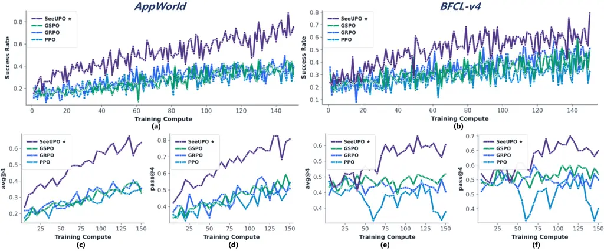
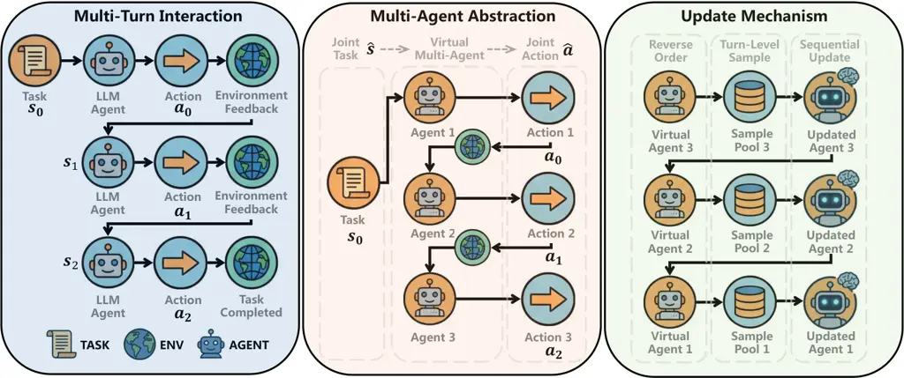
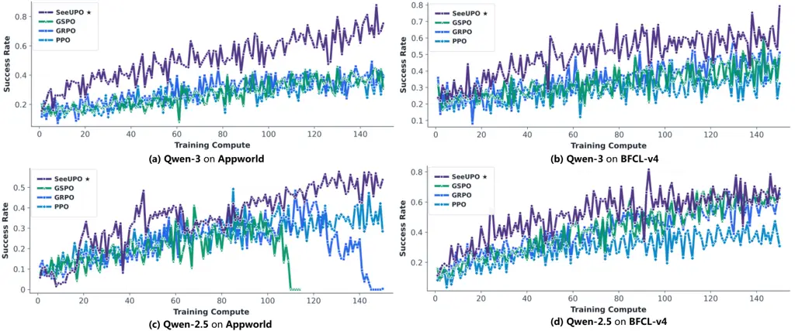
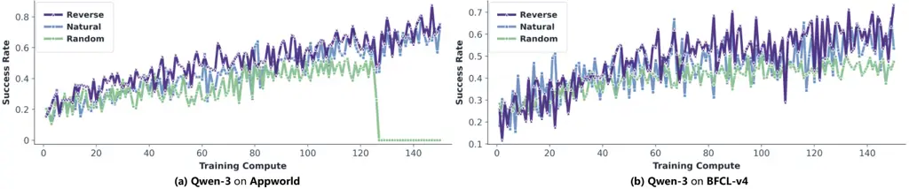

# SeeUPO: Sequence-Level Agentic-RL with Convergence Guarantees

Tianyi Hu    Qingxu Fu    Yanxi Chen    Zhaoyang Liu²²footnotemark: 2   
Bolin Ding²²footnotemark: 2 Affiliation: \[1em\] Tongyi
Lab![[Uncaptioned
image]](arxiv-2602-06554--c481fc11e332.figures/figure-1.webp), Alibaba
Group Affiliation: \[1em\] {wenju.hty, fuqingxu.fqx, chenyanxi.cyx,
jingmu.lzy, bolin.ding}@alibaba-inc.com

^(†)^(†)footnotetext: ^(†) Corresponding authors.




Figure 1: Performance comparison of training Qwen3-14B model on the
AppWorld and BFCL-v4 benchmarks. (a)-(b) show training curves, (c)-(f)
show test curves. SeeUPO algorithm demonstrates significantly stronger
training stability and optimal performance compared to other backbone RL
algorithms.

## 1 Introduction

The rapid advancement of large language models (LLMs) (Liu et al., 2024;
Yang et al., 2025a) has catalyzed the emergence of autonomous AI agents
capable of executing complex tasks through tool use and multi-turn
interactions with diverse environments. These AI systems have
demonstrated remarkable capabilities across a wide spectrum of
real-world applications, including web navigation (Liu et al., 2023),
software development (Trivedi et al., 2024), and interactive
tool-augmented environments (Patil et al., 2025). The significant
potential of agentic AI has motivated extensive research efforts, making
the development of robust, scalable training methods a key research
focus.

Within this landscape, reinforcement learning (RL) has emerged as the
predominant paradigm for training LLM-based agents through interaction
and feedback. A growing body of work has explored RL-driven agent
training across various dimensions: (interaction scope) from single-turn
task reasoning to multi-turn interactive planning (Chai et al., 2025;
Wang et al., 2025; Xi et al., 2025; Jiang et al., 2025); (capability
integration) from static capability modules to unified policy
optimization, where RL transforms planning, tool use, and memory into
interdependent, trainable policies (Qian et al., 2025; Yan et al.,
2025); (multimodal integration) from single-modal text generation to
embodied and multimodal perception (Qi et al., 2025; Feng et al., 2025;
Li et al., 2025); and (evolutionary mechanism) from heuristic-based
self-correction to internalized self-improvement, allowing agents to
iteratively refine knowledge and strategies through RL-driven
self-evolution (Wang et al., 2025; Guan et al., 2025; Zhai et al.,
2025).

Notably, while these methods span diverse research directions, they
converge on a common foundation: a small set of backbone RL algorithms
and their variants (Srivastava and Aggarwal, 2025). For instance,
Proximal Policy Optimization (PPO) (Schulman et al., 2017) serves as the
foundational algorithm for actor-critic RL (Ouyang et al., 2022), where
the canonical PPO implementation estimates advantage functions through
Generalized Advantage Estimation (GAE) (Schulman et al., 2016) and
critic networks, and updates policy networks via proximal policy
optimization. RLOO (Ahmadian et al., 2024) achieves a critic-free
advantage estimation approach by sampling multiple within-group
responses for the same query to compute group relative advantages, and
performs sequence-level policy updates via REINFORCE. Group Relative
Policy Optimization (GRPO) (Shao et al., 2024) combines the Group
Relative Advantage Estimation (GRAE) insight of RLOO with PPO-style
policy updates, becoming a representative algorithm that combines PPO
with critic-free approaches. Group Sequence Policy Optimization
(GSPO) (Zheng et al., 2025b) further refines GRPO with sequence-level
mechanisms, becoming a representative of sequence-level RL algorithms.

However, the theoretical soundness of these backbone algorithms in
agentic RL scenarios, particularly in multi-turn settings, remains an
open question (Zhang et al., 2026). To address this question, we
categorize mainstream backbone RL algorithms from the perspectives of
advantage estimation and policy update mechanisms, and analyze the
convergence properties of different combinations in both single-turn and
multi-turn scenarios. Specifically, we examine two types of advantage
estimation methods: Generalized Advantage Estimation (GAE)
(critic-dependent), and Group Relative Advantage Estimation (GRAE)
(critic-free). We also examine two types of policy update mechanisms:
REINFORCE (fully on-policy, based on Vanilla Policy Gradient), and
Proximal Policy Update (PPU)^(\*)^(\*) \* To avoid confusion, in this
paper we use PPO to refer to the complete algorithm in the
LLM-RL-Training domain, and PPU to specifically refer to the proximal
policy update method characterized by importance sampling and clipping
mechanisms. (partially on-policy, based on Importance Sampling
correction). We prove that the combination of GRAE and REINFORCE
converges to the globally optimal solution only under undiscounted
settings. We discover that the combination of GRAE and PPU breaks PPO’s
original monotonic improvement property in most cases, with convergence
guarantees only in contextual bandit scenarios. Through comprehensive
analysis, we find that mainstream backbone RL algorithms cannot
simultaneously enjoy both critic-free operation and good monotonic
improvement / convergence guarantees in multi-turn scenarios.

To address these limitations, we propose SeeUPO (Sequence-level
Sequential Update Policy Optimization), a novel algorithm that provides
convergence guarantees for multi-turn agentic RL while maintaining the
critic-free approach. SeeUPO models multi-turn interaction problems as
sequentially executed multi-agent bandit problems, where each turn is
abstracted as a virtual agent. The core mechanism of SeeUPO is
turn-by-turn sequential policy updates in reverse execution order
($`T\to T{-}1\to\cdots\to 1`$). This reverse-order sequential update
mechanism enables backward induction, where each turn optimizes against
the already-updated optimal policies of subsequent turns, thereby
achieving global optimality. We prove that SeeUPO inherits monotonic
improvement guarantees from the HAML framework (Zhong et al., 2024), and
further establish that the reverse update order guarantees convergence
to the globally optimal policy in multi-turn contextual bandit settings.
Through implicit turn-level credit assignment via advantage function
decomposition, SeeUPO correctly attributes each turn’s contribution to
the global return, achieving stable and theoretically sound training in
multi-turn scenarios.

We evaluate SeeUPO on two multi-turn agentic benchmarks,
AppWorld (Trivedi et al., 2024) and BFCL v4 (Patil et al., 2025),
demonstrating substantial improvements over existing backbone RL
algorithms. On Qwen3-14B, SeeUPO achieves 60.80% avg@4 and 72.85%
pass@4, with relative improvements ranging from 43.3% to 54.6% compared
to baseline methods. On Qwen2.5-14B, SeeUPO achieves 53.07% avg@4 and
63.59% pass@4, with relative improvements ranging from 24.1% to 41.9%
over baselines. SeeUPO maintains stable training without the
catastrophic failures observed in baseline methods. Additional
comparative experiments validate our theoretical insights: the reverse
update order achieves the best performance, confirming our proof that
backward induction enables convergence to global optimality; batch-level
normalization preserves the drift functional properties required for
monotonic improvement guarantees while providing numerical stability.

##### Contributions

Our main contributions are summarized as follows:

- •
  Theoretical Analysis of Backbone RL Algorithms. We provide a
  comprehensive convergence analysis of mainstream backbone RL
  algorithms by categorizing them along two dimensions: advantage
  estimation (GAE vs. GRAE) and policy update mechanisms (REINFORCE vs.
  PPU). We prove the convergence conditions and limitations of each
  combination in both single-turn and multi-turn scenarios, revealing a
  fundamental trade-off: existing algorithms cannot simultaneously
  achieve critic-free operation and convergence guarantees in multi-turn
  settings.
- •
  Novel Algorithm with Theoretical Guarantees. We propose SeeUPO, a
  sequence-level sequential update policy optimization algorithm that
  resolves the above trade-off. By modeling multi-turn interactions as
  sequentially-executed multi-agent bandit problems, SeeUPO inherits
  monotonic improvement guarantees and achieves convergence to global
  optimality through reverse-order sequential updates via backward
  induction.
- •
  Comprehensive Experimental Validation. We evaluate SeeUPO on two
  challenging multi-turn agentic benchmarks (AppWorld and BFCL v4),
  demonstrating substantial performance improvements (43.3%–54.6% on
  Qwen3-14B, 24.1%–41.9% on Qwen2.5-14B) and superior training stability
  compared to existing backbone RL algorithms.

##### Organization

The remainder of this paper is organized as follows. Section 2
introduces necessary preliminaries, including token / sequence-level RL
modeling, advantage estimation methods, policy update mechanisms, and
the convergence theory frameworks. Section 3 provides a systematic
convergence analysis of existing backbone RL algorithms, analyzing the
properties of different advantage estimation and policy update
combinations (Subsection 3.1) and summarizing the fundamental trade-off
between critic-free operation and convergence guarantees in multi-turn
scenarios (Subsection 3.2). Section 4 presents SeeUPO, including its
theoretical framework(Subsection 4.1) and practical implementation
details (Subsection 4.2). Section 5 reports experimental results.
Section 6 concludes this paper.

## 2 Preliminaries

### 2.1 Token-Level RL and Sequence-Level RL

From a modeling-level perspective, mainstream RL for LLMs can be roughly
categorized into two types: token-level and sequence-level. In
token-level RL, each token generation step corresponds to a timestep in
the MDP, where the state $`s_{t}`$ represents the concatenation of the
query and previous tokens, and the action $`a_{t}`$ is the next token to
be generated. In single-turn scenarios, the state transition is
deterministic: $`s_{t+1}=\text{concat}(s_{t},a_{t})`$. In multi-turn
interactive scenarios, the state transition becomes non-deterministic,
as token-level RL models interactions by incorporating turn transitions
and environmental feedback into the state through concatenation.

In sequence-level RL, each timestep corresponds to generating a complete
sequence (sentence or turn), where the state $`\bm{s}`$ represents the
environmental state and the action $`\bm{a}`$ is the complete response
sequence. Under this formulation, a single-turn task degenerates into a
contextual bandit model, while multi-turn tasks correspond to standard
MDPs with true environmental state transitions (Zheng et al., 2025a; Wei
et al., 2025). Sequence-level RL provides a more natural abstraction for
multi-turn interactions, as it directly models the environmental
dynamics and enables more straightforward credit assignment across
turns.

Throughout this paper, we use plain symbols (e.g., $`s`$, $`a`$) to
denote token-level elements and bold symbols (e.g., $`\bm{s}`$,
$`\bm{a}`$) to denote sequence-level elements. In discussions of
conventional RL methods, we use plain symbols.

### 2.2 GAE and GRAE

Advantage estimation is a key component of reinforcement learning. In
traditional RL, GAE (Schulman et al., 2016) estimates advantages using
temporal difference (TD) errors computed via a value function network
(critic). Specifically, for a trajectory segment, GAE computes the
advantage estimate as
$`\hat{A}^{\text{GAE}}(s_{t},a_{t})=\sum_{l=0}^{\infty}(\gamma\lambda)^{l}\delta_{t+l}`$,
where $`\delta_{t}=r_{t}+\gamma V_{\phi}(s_{t+1})-V_{\phi}(s_{t})`$ is
the TD error, $`V_{\phi}`$ is the value network, $`\gamma`$ is the
discount factor, and $`\lambda\in[0,1]`$ controls the bias-variance
trade-off. Typically, GAE trades off some unbiasedness for lower
estimation variance.

The computational cost of training a separate critic network in
LLM-targeted RL has motivated the development of critic-free advantage
estimation methods, with GRAE being a representative approach. Given a
query (initial state) $`s_{0}`$, GRAE samples $`N`$ independent
responses (trajectories) $`\{\tau^{(i)}\}_{i=1}^{N}`$ from the policy
$`\pi_{\theta}`$ and computes the group mean reward
$`\bar{R}=\frac{1}{N}\sum_{i=1}^{N}R^{(i)}`$, where $`R^{(i)}`$ denotes
the cumulative reward of trajectory $`\tau^{(i)}`$. For
$`(s_{t},a_{t})\in\tau^{(i)}`$, GRAE assigns the advantage estimate as:
$`\hat{A}^{\text{GRAE}}(s_{t},a_{t})=R^{(i)}-\bar{R}`$. For token-level
RL, GRAE further broadcasts the advantage to each token. We emphasize
that GRAE here represents a general (ideal) formulation, and different
practical RL algorithms may implement it differently. For instance,
algorithms such as GRPO and GSPO further divide by the group variance,
which has been shown to introduce bias (Hu et al., 2025), and we will
show that this practice breaks the monotonic improvement property. For
ease of discussion, we omit the leave-one-out operation in GRAE
formulations (Ahmadian et al., 2024).

### 2.3 REINFORCE and PPU

Policy update mechanisms are essential for translating advantage
estimates into policy improvements (Sutton et al., 1998). We discuss two
mainstream update mechanisms used in backbone RL algorithms, namely
REINFORCE and PPU. REINFORCE (Sutton et al., 1998) is a fully on-policy
algorithm that directly optimizes the expected return. The policy
gradient is estimated by sampling state-action pairs $`(s_{t},a_{t})`$
from the current policy $`\pi_{\theta}`$:

```math
\nabla_{\theta}J_{\text{REINFORCE}}(\theta)=\mathbb{E}_{(s_{t},a_{t})\sim\pi_{\theta}}\left[\nabla_{\theta}\log\pi_{\theta}(a_{t}|s_{t})\hat{A}(s_{t},a_{t})\right], \tag{1}
```

where $`\hat{A}(s_{t},a_{t})`$ is the estimated advantage. PPU typically
refers to the mechanism used in PPO (Schulman et al., 2017), which
allows for multiple updates per data batch (partially on-policy) by
constraining the policy shift. PPU maximizes a clipped surrogate
objective estimated over samples collected by an old policy
$`\pi_{\theta_{\text{old}}}`$:

```math
\nabla_{\theta}J_{\text{PPU}}(\theta)=\nabla_{\theta}\mathbb{E}_{(s_{t},a_{t})\sim\pi_{\theta_{\text{old}}}}\left[\min\left(r_{t}(\theta)\hat{A}_{t},\operatorname{clip}(r_{t}(\theta),1-\epsilon,1+\epsilon)\hat{A}_{t}\right)\right], \tag{2}
```

where $`\hat{A}_{t}`$ denotes $`\hat{A}(s_{t},a_{t})`$,
$`r_{t}(\theta)=\frac{\pi_{\theta}(a_{t}|s_{t})}{\pi_{\theta_{\text{old}}}(a_{t}|s_{t})}`$
is the importance sampling probability ratio and $`\epsilon`$ is the
clipping parameter.

### 2.4 Mirror Learning and Heterogeneous-Agent Mirror Learning

Convergence guarantees are crucial for ensuring training stability and
optimal policy discovery in reinforcement learning. Mirror
Learning (Grudzien et al., 2022) provides a unified theoretical
framework for analyzing the convergence properties of policy
optimization algorithms. The framework introduces key concepts: (1) the
drift function $`\mathfrak{D}_{\pi}(\bar{\pi}|s)`$, which quantifies the
update cost of a new policy relative to the old policy, (2) the
neighborhood operator $`\mathcal{N}`$, which defines the search space
for policy updates, and (3) the mirror operator, which combines the
advantage-related objective with the drift function to guide policy
updates. When the drift function and neighborhood operator satisfy
specific conditions, Mirror Learning guarantees monotonic policy
improvement and convergence to optimal policies. This framework has been
successfully applied to prove convergence guarantees for algorithms such
as GPI (Sutton et al., 1998) and PPO. We leverage this work to help
analyze the convergence properties of backbone RL algorithms used for
training LLMs.

Heterogeneous-Agent Mirror Learning (HAML) (Zhong et al., 2024) extends
Mirror Learning to multi-agent settings. The core insight is that by
decomposing the joint advantage function into conditional advantages and
performing sequential policy updates, policy improvements can be
coordinated across agents, avoiding conflicts that could arise from
simultaneous updates. Under HAML, algorithms guarantee monotonic
improvement of the joint return and convergence to Nash equilibrium. We
leverage HAML in our proposed SeeUPO algorithm to achieve convergence
guarantees in multi-turn scenarios.

For a comprehensive introduction to the Mirror Learning and HAML
framework, including detailed definitions and formal properties, we
refer readers to Appendix A.

## 3 Analysis

In this section, we provide a systematic convergence analysis of
mainstream backbone RL algorithms. We first present the algorithm
comparison table and key findings, then analyze two fundamental
components: advantage estimation methods (GAE and GRAE) and policy
update mechanisms (REINFORCE and PPU), followed by analyzing their
combined effects, and finally summarize the performance of existing
algorithms in single-turn and multi-turn scenarios.

Table 1 provides a systematic comparison of mainstream backbone
reinforcement learning algorithms used for language model training,
analyzing their core components, modeling levels, and convergence
properties. Our systematic analysis reveals a fundamental trade-off:
mainstream backbone RL algorithms struggle to simultaneously achieve
both critic-free operation and convergence guarantees in multi-turn
scenarios.

[TABLE]

Table 1: Systematic analysis of mainstream backbone RL algorithms for
language model training. The table compares algorithms based on their
advantage estimation methods, policy update mechanisms, modeling level,
and convergence guarantees in single-turn and multi-turn scenarios.
Detailed theoretical analysis is provided in the corresponding appendix
sections.

### 3.1 Advantage Estimation and Policy Update Analysis

We analyze two mainstream advantage estimation methods and their
combinations with policy update mechanisms. Detailed theoretical
analysis and proofs are provided in Appendix C–H.

GAE provides unbiased estimates under perfect value function
approximation, with bias bounded by
$`|\text{Bias}|\leq\frac{1+\gamma-2\gamma\lambda}{1-\gamma\lambda}\cdot\epsilon_{\max}`$
where $`\epsilon_{\max}`$ is the maximum value estimation error
(Appendix C). GRAE is biased but provides unbiased gradient estimates
under undiscounted ($`\gamma=1`$) settings; when the conditions are
violated, both the estimator and gradient become biased (Appendix D).

We analyze how different combinations affect convergence, summarized in
Table 1:

- •
  GRAE-REINFORCE (e.g., RLOO): Guarantees gradient unbiasedness,
  monotonic improvement, and convergence under undiscounted objective
  ($`\gamma=1`$) with bounded rewards in finite-horizon MDPs. REINFORCE
  can be viewed as an instance of Mirror Learning (Grudzien et al., 2022) with trivial drift ($`\mathfrak{D}\equiv 0`$) and trivial
  neighbourhood ($`\mathcal{N}=\Pi`$), which ensures the convergence
  guarantee (Appendix E).
- •
  GAE-PPU (e.g., PPO): Guarantees monotonic improvement and convergence
  to globally optimal policy under perfect value function approximation
  (Appendix F).
- •
  GRAE-PPU (e.g., GRPO, REINFORCE++ w/ Baseline (Hu et al., 2025),
  GSPO): Does not guarantee monotonic improvement or convergence in
  general, because GRAE’s structural bias
  $`\Delta(s_{t})=V(s_{t})-V(s_{0})`$ cannot be eliminated in PPU’s
  clipped objective (Appendix G). Exception: In Contextual Bandit
  settings (single-turn & sequence-level), GRAE becomes unbiased and
  GRAE-PPU converges; however, group-variance normalization (as in GSPO)
  breaks this guarantee (Appendix H).
- •
  GAE-REINFORCE (no existing algorithm instance): This combination is
  Pareto-dominated by existing alternatives. It retains GAE’s critic
  dependency while lacking PPU’s trust region constraints that bound
  policy updates. When value function approximation is imperfect, biased
  GAE estimates can be amplified through REINFORCE’s unbounded updates.
  In contrast, GAE-PPU achieves better sample efficiency with bounded
  updates, while GRAE-REINFORCE eliminates critic dependency entirely.

### 3.2 Summary: The Fundamental Trade-off

Based on the analysis above, we summarize the convergence properties. In
single-turn scenarios: RLOO converges under undiscounted settings; PPO
converges under perfect value function approximation; GSPO (without
group-variance normalization) converges in Contextual Bandit settings.

In multi-turn scenarios, our analysis reveals a fundamental trade-off:
mainstream backbone RL algorithms struggle to simultaneously achieve
both critic-free operation and convergence guarantees.

- •
  Critic-dependent methods (GAE-PPU): Require accurate token-level value
  function estimation, which becomes challenging in multi-turn scenarios
  due to non-stationary state transitions, with additional computational
  overhead from maintaining the critic network (Zhang et al., 2026).
- •
  Critic-free methods (GRAE-based): GRAE-PPU breaks monotonic
  improvement due to structural bias in PPU’s clipped objective.
  GRAE-REINFORCE requires undiscounted settings that are difficult to
  satisfy in multi-turn scenarios. Moreover, in sequence-level settings,
  GRAE becomes biased in multi-turn scenarios due to credit assignment
  problems and amplified structural bias
  $`\Delta(\bm{s}_{\bm{t}})=V(\bm{s}_{\bm{t}})-V(\bm{s}_{0})`$.

This fundamental limitation motivates a new algorithmic framework that
achieves both critic-free operation and convergence guarantees in
multi-turn scenarios, which we address in Section 4.

## 4 Method

To address this limitation, we propose a new algorithmic framework:
Sequence-level Sequential Update Policy Optimization (SeeUPO). The core
mechanism of SeeUPO is to model multi-turn interaction problems as
sequentially-executed multi-agent contextual bandit problems, where each
turn is abstracted as a virtual agent, and the order of turns
corresponds to the execution order among agents.


### 4.1 Theoretical Framework: Sequence-level Sequential Update Policy Optimization

##### Multi-Agent Modeling

SeeUPO abstracts multi-turn interaction tasks into sequentially-decision
multi-agent single-turn bandit problems, where each turn is mapped to a
virtual agent $`t\in\{1,2,\ldots,T\}`$ (as depicted in Figure 2). All
agents share a common global state $`\bm{s}_{0}\in\mathcal{S}_{S}`$ (the
initial task state). The sequence-level action
$`\bm{a}^{t}\in\mathcal{A}_{S}`$ of agent $`t`$ corresponds to the
complete response of the $`t`$-th turn. The joint action
$`\bm{a}^{1:T}=(\bm{a}^{1},\bm{a}^{2},\ldots,\bm{a}^{T})`$ denotes the
concatenation of all agents’ actions. Each agent $`t`$’s sequence-level
policy $`\bm{\pi}^{t}(\bm{a}^{t}|\bm{s}_{0},\bm{a}^{1:t-1})`$ takes as
input the global state $`\bm{s}_{0}`$ and the action history from
preceding agents $`\bm{a}^{1:t-1}`$. The state transition function is
implicitly modeled through sequentially executed policies: the evolution
of the interaction is determined by agent $`t`$’s action selected
according to policy $`\bm{\pi}^{t}(\cdot|\bm{s}_{0},\bm{a}^{1:t-1})`$.
We adopt a shared reward (Team-Reward) mechanism
$`r(\bm{s}_{0},\bm{a}^{1:T})`$, where the team reward equals the final
task reward or cumulative return across all turns, ensuring all agents
jointly optimize the global objective.



Figure 2: The core idea of SeeUPO is to abstract multi-turn interaction
tasks into sequentially-decision multi-agent single-turn tasks, and
adopt reverse-order sequential updates to achieve global optimality via
backward induction. The figure shows an example scenario with three
turns, from left to right showing the original task scenario, the
multi-agent modeling of the scenario, and the reverse update mechanism
based on MARL theory.

We emphasize that this multi-agent modeling only exhibits a
training-phase specificity and offers no inherent advantages for
execution optimization. This abstraction constitutes a methodological
shift in data treatment during the training phase, but does not
correspond to a functional mechanism for multi-agent coordination during
actual execution.

##### Policy Update

After modeling is completed, the optimization of Sequence-level policies
is transformed into optimizing the joint policy of a multi-agent
system.^(†)^(†) † Throughout this section, we use $`\bar{\pi}`$ to
denote a policy to be optimized, and $`\hat{\bm{\pi}}`$ to denote the
joint policy. SeeUPO adopts the sequential update mechanism from the
HAML framework (see Appendix A), with a crucial design choice: the
update order is set to the reverse of the execution order
($`T\to T{-}1\to\cdots\to 1`$). This reverse update order not only
resolves agent-level update conflicts by updating policies turn by turn,
but also enables backward induction to achieve global optimality (see
Theorem 2 in Appendix B).

At each iteration $`k`$, the algorithm updates each agent’s policy
sequentially following the reverse order of execution
($`T\to T{-}1\to\cdots\to 1`$). The policy update process consists of
three key components:

(1) Policy Update Rule. For turn $`t`$ in the reverse update order, by
substituting the HAML into the update rule, the policy update can be
expressed as:

```math
\hat{\pi}^{t}_{k+1}=\underset{\bar{\pi}^{t}\in{\color[rgb]{1,0.6484,0}\mathcal{U}^{t}_{\hat{\bm{\pi}}_{k}}(\hat{\pi}^{t}_{k})}}{\arg\max}\;\mathbb{E}_{\bm{s}_{0}\sim\beta_{\hat{\bm{\pi}}_{k}}}\Bigg[{\color[rgb]{0.2539,0.4102,0.8828}\mathbb{E}_{\bm{a}^{t+1:T}\sim\hat{\bm{\pi}}^{t+1:T}_{k+1},\bm{a}^{t}\sim\bar{\pi}^{t}}\left[A^{t}_{\hat{\bm{\pi}}_{k}}(\bm{s}_{0},\bm{a}^{t},\bm{a}^{t+1:T})\right]}-{\color[rgb]{1,0.4102,0.707}\mathfrak{D}^{t}_{\hat{\bm{\pi}}_{k}}(\bar{\pi}^{t}\mid\bm{s}_{0},\hat{\bm{\pi}}^{t+1:T}_{k+1})}\Bigg], \tag{3}
```

where $`\bm{s}_{0}`$ is the sequence-level joint state (i.e., the global
initial state), $`\hat{\bm{\pi}}_{k}`$ denotes the joint policy at
iteration $`k`$,
$`{\color[rgb]{1,0.6484,0}\mathcal{U}^{t}_{\hat{\bm{\pi}}_{k}}(\hat{\pi}^{t}_{k})}`$
is the neighborhood operator for turn $`t`$,
$`\beta_{\hat{\bm{\pi}}_{k}}`$ is the sampling state distribution,
$`{\color[rgb]{0.2539,0.4102,0.8828}\mathbb{E}_{\bm{a}^{t+1:T}\sim\hat{\bm{\pi}}^{t+1:T}_{k+1},\bm{a}^{t}\sim\bar{\pi}^{t}}\left[A^{t}_{\hat{\bm{\pi}}_{k}}\right]}`$
is the expectation of the local advantage function for turn $`t`$, and
$`{\color[rgb]{1,0.4102,0.707}\mathfrak{D}^{t}_{\hat{\bm{\pi}}_{k}}}`$
is the drift functional. Crucially, under the reverse update order, each
turn $`t`$ considers the already-updated policies
$`\hat{\bm{\pi}}^{t+1:T}_{k+1}`$ of subsequent turns, ensuring
coordination in the update process and enabling backward induction.

(2) Local Advantage Function Computation. To compute the expectation of
the local advantage function
$`{\color[rgb]{0.2539,0.4102,0.8828}\mathbb{E}_{\bm{a}^{t+1:T}\sim\hat{\bm{\pi}}^{t+1:T}_{k+1},\bm{a}^{t}\sim\bar{\pi}^{t}}\left[A^{t}_{\hat{\bm{\pi}}_{k}}\right]}`$,
SeeUPO leverages the global advantage function. Given the global
advantage function
$`{\color[rgb]{0.5,0,0.5}\hat{A}_{\hat{\bm{\pi}}_{k}}(\bm{s}_{0},\bm{a}^{1:T})}`$,
this expectation can be estimated:

```math
\displaystyle{\color[rgb]{0.2539,0.4102,0.8828}\mathbb{E}_{\bm{a}^{t+1:T}\sim\hat{\bm{\pi}}^{t+1:T}_{k+1},\bm{a}^{t}\sim\bar{\bm{\pi}}^{t}}\left[A^{t}_{\hat{\bm{\pi}}_{k}}(\bm{s}_{0},\bm{a}^{t},\bm{a}^{t+1:T})\right]}
```

```math
\displaystyle=\mathbb{E}_{\bm{a}^{1:T}\sim\hat{\bm{\pi}}_{k}}\left[\left(\frac{\bar{\bm{\pi}}^{t}(\bm{a}^{t}|\bm{s}_{0},\bm{a}^{1:t-1})}{\hat{\bm{\pi}}^{t}_{k}(\bm{a}^{t}|\bm{s}_{0},\bm{a}^{1:t-1})}-1\right)\cdot\frac{\hat{\bm{\pi}}^{t+1:T}_{k+1}(\bm{a}^{t+1:T}|\bm{s}_{0},\bm{a}^{1:t})}{\hat{\bm{\pi}}^{t+1:T}_{k}(\bm{a}^{t+1:T}|\bm{s}_{0},\bm{a}^{1:t})}\cdot{\color[rgb]{0.5,0,0.5}\hat{A}_{\hat{\bm{\pi}}_{k}}(\bm{s}_{0},\bm{a}^{1:T})}\right], \tag{4}
```

where the first term
$`\left(\frac{\bar{\bm{\pi}}^{t}(\bm{a}^{t}|\bm{s}_{0},\bm{a}^{1:t-1})}{\hat{\bm{\pi}}^{t}_{k}(\bm{a}^{t}|\bm{s}_{0},\bm{a}^{1:t-1})}-1\right)`$
involves the candidate policy $`\bar{\bm{\pi}}^{t}`$ (to be optimized)
and the current policy $`\hat{\bm{\pi}}^{t}_{k}`$, while the second
ratio
$`\frac{\hat{\bm{\pi}}^{t+1:T}_{k+1}(\bm{a}^{t+1:T}|\bm{s}_{0},\bm{a}^{1:t})}{\hat{\bm{\pi}}^{t+1:T}_{k}(\bm{a}^{t+1:T}|\bm{s}_{0},\bm{a}^{1:t})}`$
involves the already-updated joint policy of subsequent turns
$`\hat{\bm{\pi}}^{t+1:T}_{k+1}`$ and the previous policy
$`\hat{\bm{\pi}}^{t+1:T}_{k}`$. Note that the $`-1`$ term in the first
factor has zero gradient with respect to $`\bar{\bm{\pi}}^{t}`$ and can
be omitted in practical gradient computation. The computation of the
local advantage function effectively performs implicit credit assignment
across turns (Zhong et al., 2024), as it decomposes the global advantage
into turn-specific contributions by incorporating the importance
sampling ratios from subsequently updated turns.

(3) Global Advantage Function Computation. In the bandit setting, the
global advantage function
$`{\color[rgb]{0.5,0,0.5}\hat{A}_{\hat{\bm{\pi}}_{k}}(\bm{s}_{0},\bm{a}^{1:T})}`$
can be estimated directly from sampled rewards. Specifically, for a
given initial state $`\bm{s}_{0}`$ and sequence-level joint action
$`\bm{a}^{1:T}`$, the global advantage function degenerates to:

```math
{\color[rgb]{0.5,0,0.5}\hat{A}_{\hat{\bm{\pi}}_{k}}(\bm{s}_{0},\bm{a}^{1:T})}=r(\bm{s}_{0},\bm{a}^{1:T})-\mathbb{E}_{\bm{a}^{\prime 1:T}\sim\hat{\bm{\pi}}_{k}(\cdot|\bm{s}_{0})}[r(\bm{s}_{0},\bm{a}^{\prime 1:T})], \tag{5}
```

where $`r(\bm{s}_{0},\bm{a}^{1:T})`$ is the immediate reward and
$`\mathbb{E}_{\bm{a}^{\prime 1:T}\sim\hat{\bm{\pi}}_{k}(\cdot|\bm{s}_{0})}[r(\bm{s}_{0},\bm{a}^{\prime 1:T})]`$
is the expected reward under the current policy. This formulation
provides an unbiased estimate of the advantage function in the bandit
setting.

##### Theoretical Guarantees

SeeUPO inherits the monotonic improvement guarantee from the HAML
framework (Theorem 1 in Appendix A). Beyond this, we establish a
stronger result for the multi-turn contextual bandit setting: the
reverse update order guarantees convergence to the globally optimal
policy (Theorem 2 in Appendix B). The key insight is that, unlike
general cooperative games where random update orders are required for
Nash equilibrium convergence, the fixed sequential execution order in
our setting enable backward induction. Specifically, the reverse update
order ensures that when updating turn $`t`$, all subsequent turns
$`t+1,\ldots,T`$ have already been updated to their optimal policies
given their continuation values. This allows each turn to optimize
against the true optimal continuation value $`V^{*}`$, yielding global
optimality. The complete proof is provided in Appendix B.

### 4.2 Practical Methods


In this part, we present a concrete example of SeeUPO (Algorithm 1
presents the pseudocode). The practical implementation instantiates the
theoretical framework in two key aspects: (1) adopting a PPO-style
clipping mechanism to implement the mirror operator through
gradient-based updates, and (2) using GRAE for joint advantage
estimation. This approach essentially combines GRAE with HAPPO (Zhong et
al., 2024). We refer to this practical algorithm as SeeUPPO-GRAE, though
for convenience, we still refer to it as SeeUPO in the remainder of this
paper. We emphasize that SeeUPPO-GRAE is not the only instantiation of
SeeUPO—the theoretical framework admits various variants by substituting
different components, such as replacing the PPO-style clipping with
TRPO-style trust region constraints, or replacing GRAE with other
advantage estimators.

The algorithm operates iteratively, with each iteration comprising data
collection, advantage estimation, and sequential policy updates. SeeUPO
adopts a turn-oriented batch construction approach that separately
organizes samples from identical turns, as illustrated in Figure 3. This
approach enables sequential policy updates by maintaining turn-level
sample pools, in contrast to methods that construct batches using entire
trajectories or concatenated sliced turns. For tasks with fewer than the
maximum $`T`$ turns, placeholder samples (e.g., Sample 6 in the figure)
are introduced as no-op (null action) samples. Note that the figure
demonstrates batch construction patterns using the React +
Reasoning-Augmented Template paradigm (Zhai et al., 2025).

Figure 3: The batch construction approach of SeeUPO. Unlike methods that
construct batches using entire trajectories or by concatenating sliced
turns, SeeUPO implements a turn-oriented approach that separately
organizes samples from identical turns. This figure demonstrates the
divergent batch construction patterns between SeeUPO and the Vanilla
approach under two tasks with maximum three-turn interactions, via
React + Reasoning-Augmented Template paradigm (Zhai et al., 2025).

##### PPO-Style Policy Update

In our multi-turn RL setting, all turns share the same policy parameters
$`\bm{\theta}`$. We use $`\bm{\pi}_{\bm{\theta}^{t}_{k+1}}`$ to denote
the policy after updating turn $`t`$’s data in iteration $`k`$. For
notational clarity, we denote $`(\bm{s}_{0},\bm{a}^{1:T})`$ as a joint
trajectory sample, where $`\bm{s}_{0}`$ is the initial state (query) and
$`\bm{a}^{1:T}`$ is the sequence-level joint action as defined in
Section 4.1.

Specifically, for turn $`t`$ in the reverse update order
($`T\to T{-}1\to\cdots\to 1`$) at iteration $`k`$, the policy update is
performed to obtain $`\bm{\pi}_{\bm{\theta}^{t}_{k+1}}`$ by computing
the gradient of the policy parameters $`\bm{\theta}`$ with respect to
the following expectation:

```math
\nabla_{\bm{\theta}}\mathbb{E}_{(\bm{s}_{0},\bm{a}^{1:t-1},\bm{a}^{t})\sim\mathcal{D}_{t}}\left[\min\left(r^{t}(\bm{\theta})M^{t+1}(\bm{s}_{0},\bm{a}^{1:T}),\operatorname{clip}(r^{t}(\bm{\theta}),1\pm\epsilon)M^{t+1}(\bm{s}_{0},\bm{a}^{1:T})\right)\right], \tag{6}
```

where $`\mathcal{D}_{t}=\{(\bm{s}_{0},\bm{a}^{1:t-1},\bm{a}^{t})\}`$ is
the turn-specific sample pool constructed during data collection (see
Algorithm 1), containing samples organized by turn $`t`$. The
sequence-level importance sampling ratio
$`r^{t}(\bm{\theta})=\frac{\bm{\pi}_{\bm{\theta}}(\bm{a}^{t}|\bm{s}_{0},\bm{a}^{1:t-1})}{\bm{\pi}_{\bm{\theta}_{k}}(\bm{a}^{t}|\bm{s}_{0},\bm{a}^{1:t-1})}`$
for turn $`t`$ is computed in a manner similar to GSPO, where
$`\bm{a}^{t}`$ denotes the action at turn $`t`$ and
$`(\bm{s}_{0},\bm{a}^{1:t-1})`$ is the conditioning context (initial
state and previous actions). $`\epsilon`$ is the clipping parameter, and
$`M^{t+1}(\bm{s}_{0},\bm{a}^{1:T})`$ is a maintained quantity that
captures the sequential advantage information from subsequently updated
turns.

The quantity $`M^{t}(\bm{s}_{0},\bm{a}^{1:T})`$ is initialized and
updated sequentially to incorporate the importance sampling ratios from
previously updated turns. Specifically, we initialize:

```math
M^{T+1}(\bm{s}_{0},\bm{a}^{1:T})=\hat{A}_{\hat{\bm{\pi}}_{k}}(\bm{s}_{0},\bm{a}^{1:T}), \tag{7}
```

where $`\hat{A}_{\hat{\bm{\pi}}_{k}}(\bm{s}_{0},\bm{a}^{1:T})`$ is the
global advantage estimate (computed via GRAE as described below). After
updating turn $`t`$, $`M^{t}(\bm{s}_{0},\bm{a}^{1:T})`$ is computed
recursively:

```math
M^{t}(\bm{s}_{0},\bm{a}^{1:T})=\frac{\bm{\pi}_{\bm{\theta}^{t}_{k+1}}(\bm{a}^{t}|\bm{s}_{0},\bm{a}^{1:t-1})}{\bm{\pi}_{\bm{\theta}_{k}}(\bm{a}^{t}|\bm{s}_{0},\bm{a}^{1:t-1})}\cdot M^{t+1}(\bm{s}_{0},\bm{a}^{1:T}), \tag{8}
```

where $`\bm{\theta}^{t}_{k+1}`$ denotes the parameters after optimizing
turn $`t`$, and $`\bm{\theta}_{k}`$ denotes the parameters at the
beginning of iteration $`k`$ (i.e., the reference policy used for
sampling). Due to parameter sharing, this sequential update mechanism
ensures that $`M^{t}(\bm{s}_{0},\bm{a}^{1:T})`$ incorporates the
importance sampling ratios from all previously updated turns, matching
the expectation structure in Equation 4.

##### GRAE-based Advantage Estimation

In the bandit setting, the global advantage function
$`{\color[rgb]{0.5,0,0.5}\hat{A}_{\hat{\bm{\pi}}_{k}}(\bm{s}_{0},\bm{a}^{1:T})}`$
can be estimated directly from sampled rewards, as established in
Equation 5. For each initial state in the batch, SeeUPO samples $`G`$
different joint actions and collects the corresponding Team-Rewards. The
global advantage estimate is computed as:

```math
\hat{A}_{\hat{\bm{\pi}}_{k}}(\bm{s}_{0},\bm{a}^{1:T})=r(\bm{s}_{0},\bm{a}^{1:T})-\bar{r}(\bm{s}_{0}), \tag{9}
```

where $`\bar{r}(\bm{s}_{0})`$ is the mean reward over $`G`$ trajectories
sampled from the same initial state $`\bm{s}_{0}`$, serving as a Monte
Carlo estimator of
$`V_{\hat{\bm{\pi}}_{k}}(\bm{s}_{0})=\mathbb{E}_{\bm{a}^{1:T}\sim\hat{\bm{\pi}}_{k}(\cdot|\bm{s}_{0})}[r(\bm{s}_{0},\bm{a}^{1:T})]`$.
This approach provides an unbiased estimate of the advantage function in
the bandit setting, without requiring a separate critic (see Appendix H
for detailed analysis).

In practice, we apply batch-level normalization to the advantage
estimates for numerical stability. Specifically, we normalize all
advantage estimates in a batch as:
$`\tilde{A}=(\hat{A}-\mu_{\mathcal{B}})/\sigma_{\mathcal{B}}`$, where
$`\mu_{\mathcal{B}}`$ is the batch mean and $`\sigma_{\mathcal{B}}`$ is
the batch standard deviation. This normalization approach maintains
theoretical convergence guarantees while improving training stability:
since $`\mu_{\mathcal{B}}`$ and $`\sigma_{\mathcal{B}}`$ are constants
independent of the candidate policy, the argmax of the optimization
problem remains unchanged, leaving the drift functional completely
unaffected (see Appendix H.3.3 for detailed analysis). This is in
contrast to group normalization which applies state-dependent scaling
factors that can violate these properties (see Appendix H.3). Moreover,
experimental results in Section 5.3.2 demonstrate that batch-level
normalization performs comparably to group normalization and no
normalization, while preserving the theoretical convergence properties.

## 5 Experiments

In this section, we conduct a series of comprehensive experiments to
systematically evaluate the performance of our proposed SeeUPO
framework. We begin by detailing the experimental settings
(Section 5.1), followed by a presentation of the main results that
demonstrate the superior performance of SeeUPO compared to existing
selected backbone RL algorithms (Section 5.2). Finally, we perform
additional comparative experiments to investigate the impact of update
order and advantage normalization strategies on overall training
performance (Section 5.3).

### 5.1 Experimental Settings

#### 5.1.1 Benchmarks and Evaluations

We evaluate SeeUPO on two tool-augmented, agentic benchmarks:
AppWorld (Trivedi et al., 2024) and BFCL v4 (Patil et al., 2025). Both
benchmarks expose multi-step API/tool interactions under sparse terminal
rewards, making them ideal testbeds for evaluating multi-turn agent
training algorithms.

- •
  AppWorld: A controllable world of apps and people for benchmarking
  interactive coding agents. AppWorld exposes multi-step API
  interactions where agents must navigate complex application workflows
  to accomplish user-specified goals. The environment provides
  programmatic evaluation through task goal completion tests.
- •
  BFCL v4: The Berkeley Function Calling Leaderboard multi-turn
  benchmark. We use the _multi-turn_ split and follow the official
  evaluation protocol: at the end of each turn, an example is marked
  correct only if it simultaneously passes _state-based_ checks (final
  backend state matches ground truth on non-private attributes) and
  _response-based_ checks (subset-matched execution path);
  force-terminated runs are counted as incorrect.

For evaluation metrics, we report avg@4 (averaging task completion
scores over 4 independent rollouts per instance) and pass@4 (the success
rate when sampling 4 independent rollouts per instance). Trajectories
are truncated at a maximum of 10 steps to ensure computational
efficiency while maintaining sufficient horizon for multi-turn
interactions.

#### 5.1.2 Baselines and Backbone Models

Our experiments leverage two backbone models: Qwen2.5-14B-Instruct (Yang
et al., 2025b) and Qwen3-14B (Yang et al., 2025a). These models serve as
the agent’s policy network.

To rigorously evaluate the efficacy of our method, we compare against
three mainstream backbone RL algorithms for agent training:

- •
  PPO: A representative critic-dependent algorithm with theoretical
  convergence guarantees in multi-turn scenarios.
- •
  GRPO: A representative critic-free algorithm at the token level, which
  employs group-relative advantage estimation and PPO-style update
  mechanism.
- •
  GSPO: A representative critic-free algorithm at the sequence level,
  which extends GRPO with sequence-level mechanisms.

#### 5.1.3 Implementation Details

To ensure fair comparison, all baselines and our SeeUPO use the same
training configuration. We train our agent policies using SeeUPO as
described in Section 4. The general training configuration is as
follows:

Training hyperparameters: We use a learning rate of $`1\times 10^{-6}`$
for the actor network and a batch size of 32. The clipping parameter
$`\epsilon`$ in the PPO-style objective is all set to 0.2 for both lower
and upper bounds. The KL penalty coefficient is 0.002. We sample 8
rollouts per instance during training. We train for 75 epochs on
AppWorld and 50 epochs on BFCL v4. To ensure fairness, all algorithms
use the same number of samples, and samples are utilized the same number
of times within each update step. All experiments on both base models
adopt the React + Reasoning-Augmented Template paradigm (Zhai et al.,
2025).

SeeUPO-specific settings: For the sequential update mechanism, we use
reverse order for both AppWorld and BFCL v4 benchmarks, as our
subsequent experiments demonstrate that reverse order achieves the best
performance. The advantage estimation follows a group-relative approach
with batch-level normalization, where we normalize advantages by
subtracting the batch mean and dividing by the batch standard deviation.

Infrastructure: All experiments were conducted on clusters of NVIDIA H20
(96GB) GPUs, where each cluster consists of 8 GPUs. For computational
resource allocation, PPO uses 2 clusters (16 GPUs total), while GRPO,
GSPO, and SeeUPO each use 1 cluster (8 GPUs total). Our implementation
is built on PyTorch and leverages the veRL library^(‡)^(‡) ‡
[https://github.com/volcengine/verl](https://github.com/volcengine/verl)
for distributed training infrastructure. The agent-related
infrastructure is built upon AgentEvolver^(§)^(§) §
[https://github.com/modelscope/AgentEvolver](https://github.com/modelscope/AgentEvolver) (Zhai
et al., 2025).

### 5.2 Main Results

We conduct comprehensive experiments to evaluate the overall performance
of the proposed SeeUPO framework and compare it against selected
backbone RL algorithms. As shown in Table 2 and Figure 4, SeeUPO
demonstrates substantial performance improvements over existing backbone
RL algorithms across both benchmarks and models, with the training
dynamics revealing several critical insights into SeeUPO’s superior
performance and robustness.

| Model & Method | AppWorld        |                | BFCL v4        |                | Avg.           |                |
| -------------- | --------------- | -------------- | -------------- | -------------- | -------------- | -------------- |
|                | avg@4           | pass@4         | avg@4          | pass@4         | avg@4          | pass@4         |
| Qwen2.5-14B    | 4.825           | 7.018          | 25.50          | 35.75          | 15.16          | 21.39          |
| +PPO           | 40.79^(+24.7%)  | 57.89^(+21.2%) | 44.75^(+23.5%) | 56.00^(+1.8%)  | 42.77^(+24.1%) | 56.95^(+11.7%) |
| +GRPO          | 35.53^(+43.3%)  | 49.12^(+42.9%) | 46.25^(+19.5%) | 55.00^(+3.6%)  | 40.89^(+29.8%) | 52.06^(+22.1%) |
| +GSPO          | 24.12^(+111.0%) | 38.60^(+81.8%) | 50.75^(+8.9%)  | 56.00^(+1.8%)  | 37.44^(+41.9%) | 47.30^(+34.4%) |
| SeeUPO (ours)  | 50.88           | 70.18          | 55.25          | 57.00          | 53.07          | 63.59          |
| Qwen3-14B      | 20.18           | 35.09          | 40.25          | 47.00          | 30.22          | 41.05          |
| +PPO           | 35.09^(+81.2%)  | 54.39^(+48.4%) | 43.75^(+32.6%) | 52.00^(+25.0%) | 39.42^(+54.3%) | 53.20^(+36.9%) |
| +GRPO          | 40.35^(+57.6%)  | 57.89^(+39.4%) | 44.50^(+30.3%) | 53.00^(+22.6%) | 42.43^(+43.3%) | 55.45^(+31.4%) |
| +GSPO          | 32.89^(+93.4%)  | 52.63^(+53.3%) | 45.75^(+26.8%) | 55.00^(+18.2%) | 39.32^(+54.6%) | 53.82^(+35.4%) |
| SeeUPO (ours)  | 63.60           | 80.70          | 58.00          | 65.00          | 60.80          | 72.85          |

Table 2: Performance comparison on two benchmark environments. Columns
show avg@4 and pass@4 for each benchmark, plus their averages (Avg.).
All values are in percent (%). Bolded numbers highlight the best
results. Improvement percentages (shown as blue superscripts) indicate
SeeUPO’s relative improvement over each baseline.

#### 5.2.1 Performance and Training Dynamics Analysis



Figure 4: Training success rate comparison of SeeUPO and baselines.
Subplots (a)-(d) show results for Qwen-3 model on Appworld and BFCL, and
Qwen-2.5 model on Appworld and BFCL, respectively.

Training Stability: Across all four scenarios, SeeUPO maintains stable
training curves without catastrophic failures. In contrast, both GRPO
and GSPO exhibit significant performance collapse in the Qwen-2.5 +
AppWorld setting (subplot (c)). This catastrophic failure reflects a
fundamental limitation of existing critic-free methods in multi-turn
scenarios: they suffer from advantage estimation bias when applied to
multi-turn tasks, and lack monotonic improvement guarantees. In
contrast, SeeUPO addresses these issues through its
theoretically-grounded sequential update mechanism, which provides
monotonic improvement guarantees inherited from the HAML framework
(Theorem 1 in Appendix A) and enables implicit turn-level credit
assignment through advantage function decomposition.

Final Performance: The training curves consistently show SeeUPO
achieving the highest final success rates across all configurations. The
performance gaps are particularly pronounced in the Qwen-3 scenarios,
where SeeUPO maintains a clear 20-30 percentage point advantage in
pass@4 over baselines throughout training. As shown in Table 2, SeeUPO
achieves substantial improvements on Qwen3-14B, a model with built-in
reasoning capabilities, with avg@4 improvements ranging from 43.3% to
54.6% across different baselines. On the weaker Qwen2.5-14B model,
SeeUPO still demonstrates significant gains, with avg@4 improvements
ranging from 24.1% to 41.9%. These substantial gains validate that
training stability translates directly to superior generalization,
consistent with the theoretical guarantee that the reverse-order
sequential update mechanism enables convergence to globally optimal
policies through backward induction (Theorem 2 in Appendix B).

#### 5.2.2 Computational Efficiency Analysis

SeeUPO introduces additional computational overhead compared to baseline
methods due to its turn-oriented sequential update mechanism and
advantage correction term computation. Therefore, it is necessary to
analyze its computational efficiency. We evaluate two key efficiency
metrics: Training Step Time (time per training step) and Computational
Resources (number of H20 GPUs required). All experiments were conducted
on clusters of NVIDIA H20 (96GB) GPUs, with each cluster consisting of 8
GPUs. The efficiency results are presented in Table 3.

|               |                 |                 |                 |      |
| ------------- | --------------- | --------------- | --------------- | ---- |
| Method        | AppWorld (s)    | BFCL v4 (s)     | Avg. (s)        | GPUs |
| Qwen2.5-14B   |                 |                 |                 |      |
| PPO           | 3026.74^(×1.39) | 2602.88^(×1.38) | 2814.81^(×1.38) | 16   |
| GRPO          | 2377.59^(×1.76) | 2739.73^(×1.31) | 2558.66^(×1.52) | 8    |
| GSPO          | 2263.56^(×1.85) | 2466.14^(×1.46) | 2364.85^(×1.65) | 8    |
| SeeUPO (ours) | 4194.70         | 3595.08         | 3894.89         | 8    |
| Qwen3-14B     |                 |                 |                 |      |
| PPO           | 3002.29^(×1.82) | 2579.04^(×1.22) | 2790.67^(×1.54) | 16   |
| GRPO          | 2938.37^(×1.86) | 2667.63^(×1.18) | 2802.99^(×1.54) | 8    |
| GSPO          | 3066.94^(×1.78) | 2710.48^(×1.16) | 2888.71^(×1.49) | 8    |
| SeeUPO (ours) | 5462.35         | 3145.06         | 4303.71         | 8    |

Table 3: Computational efficiency comparison across methods. Columns
show Training Step Time (seconds per training step) for each benchmark
and GPUs (number of H20 GPUs required). Multiplier factors (shown as red
superscripts) indicate SeeUPO’s computation time relative to each
baseline method.

As shown in Table 3, SeeUPO demonstrates significantly superior
performance compared to other algorithms, but its turn-by-turn
sequential update mechanism inevitably incurs longer training time. We
find that this computational overhead is within an acceptable range:
with approximately 1.5$`\times`$ the training time, SeeUPO achieves
notably faster convergence speed and reaches final performance levels
far exceeding those of other algorithms. Moreover, in terms of
computational resource consumption, SeeUPO uses the same amount of
resources as the two critic-free algorithms (GRPO and GSPO), requiring
only 8 GPUs (1 cluster) compared to PPO’s 16 GPUs (2 clusters).

### 5.3 Additional Comparative Experiments

To investigate the impact of different design choices on overall
training performance, we conduct additional comparative experiments
focusing on two critical aspects of SeeUPO: the update order, which
corresponds to our novel sequential update mechanism that enables
backward induction for global optimality (Section 4.1), and the
normalization strategy, which corresponds to our bandit-based advantage
estimation mechanism (Section 4.2). All comparative experiments are
conducted using Qwen3-14B on both AppWorld and BFCL v4 benchmarks.

#### 5.3.1 Comparison on Update Order

The sequential update mechanism is a core component of SeeUPO
(Section 4.1). As discussed in Section 4.1, the reverse update order is
theoretically motivated by backward induction, which enables convergence
to globally optimal policies (Theorem 2 in Appendix B). However, the
specific order in which agents are updated may influence training
dynamics and final performance in practice. To empirically validate this
theoretical insight, we compare three update order strategies:

- •
  Natural order: Agents are updated in the natural execution order (turn
  1, turn 2, …, turn $`T`$).
- •
  Reverse order: Agents are updated in reverse execution order (turn
  $`T`$, turn $`T-1`$, …, turn 1) (our default setting).
- •
  Random order: Agents are updated in a randomly sampled permutation at
  each iteration.



Figure 5: Training dynamics comparison of different update order
strategies: (a) Qwen-3 evaluated on AppWorld and (b) Qwen-3 evaluated on
BFCL-v4.

| Update Order         | AppWorld |        | BFCL v4 |        | Avg.  |        |
| -------------------- | -------- | ------ | ------- | ------ | ----- | ------ |
|                      | avg@4    | pass@4 | avg@4   | pass@4 | avg@4 | pass@4 |
| Natural order        | 56.14    | 75.44  | 54.25   | 59.00  | 55.20 | 67.22  |
| Random order         | 33.33    | 45.61  | 51.25   | 61.00  | 42.29 | 53.31  |
| Reverse order (ours) | 63.60    | 80.70  | 58.00   | 65.00  | 60.80 | 72.85  |

Table 4: Comparison of update order strategies. Columns show avg@4 and
pass@4 for each benchmark, plus their averages (Avg.). All values are in
percent (%). The backbone model is Qwen3-14B. Bolded numbers highlight
the best results.

The results are presented in Table 4 and Figure 5. As expected, the
reverse order strategy achieves the best performance across both
benchmarks, confirming the theoretical insight that updating agents in
reverse execution order enables backward induction to achieve global
optimality. On AppWorld, reverse order achieves 63.60% avg@4 and 80.70%
pass@4, outperforming natural order (56.14% / 75.44%) and random order
(33.33% / 45.61%). On BFCL v4, reverse order achieves 58.00% avg@4 and
65.00% pass@4, outperforming natural order (54.25% / 59.00%) and random
order (51.25% / 61.00%). Natural order achieves competitive performance,
as it still maintains the monotonic improvement guarantee inherited from
the HAML framework. However, each update in natural order only achieves
local optimality at that moment, preventing direct optimization toward
the global optimum. In contrast, random order performs substantially
worse, particularly on AppWorld. Unlike natural and reverse orders,
which maintain fixed update logic that respects the sequential execution
structure, random order completely disrupts the logical chain inherent
to the execution sequence. While random update orders have been proven
effective in synchronous MARL settings (Zhong et al., 2024), they fail
in sequential multi-agent systems where the update order must be
strongly coupled with the execution order. Specifically, random ordering
breaks the backward induction mechanism by preventing the guarantee that
subsequent turns have been updated to their optimal policies when
updating an earlier turn, thereby destroying the logical dependency
structure required for global optimality.

#### 5.3.2 Comparison on Normalization

The advantage estimation in SeeUPO uses a group-relative approach. While
without any subsequent normalization is theoretically grounded,
different normalization strategies may impact training stability and
performance. We investigate three normalization variants:

- •
  No normalization: Use raw advantage estimates without any
  normalization, preserving drift function properties required for
  convergence guarantees.
- •
  Group-level normalization: Normalize advantages within each group of
  joint actions sampled from the same initial state, which violates
  convergence guarantees similar to GSPO.
- •
  Batch-level normalization: Normalize advantages by subtracting the
  batch mean and dividing by the batch standard deviation (our default
  setting), balancing theoretical correctness and empirical performance.

| Normalization                    | AppWorld |        | BFCL v4 |        | Avg.  |        |
| -------------------------------- | -------- | ------ | ------- | ------ | ----- | ------ |
|                                  | avg@4    | pass@4 | avg@4   | pass@4 | avg@4 | pass@4 |
| No normalization                 | 39.91    | 57.89  | 54.25   | 59.00  | 47.08 | 58.45  |
| Group-level normalization        | 62.35    | 79.21  | 58.20   | 61.00  | 60.28 | 70.10  |
| Batch-level normalization (ours) | 63.60    | 80.70  | 58.00   | 65.00  | 60.80 | 72.85  |

Table 5: Comparison of normalization strategies. Columns show avg@4 and
pass@4 for each benchmark, plus their averages (Avg.). All values are in
percent (%). The backbone model is Qwen3-14B. Bolded numbers highlight
the best results.

The results are presented in Table 5. No normalization is theoretically
grounded, as it preserves the drift function properties required for
convergence guarantees. However, it achieves the lowest empirical
performance (39.91% avg@4 and 57.89% pass@4 on AppWorld; 54.25% avg@4
and 59.00% pass@4 on BFCL v4), indicating that some form of
normalization is essential for numerical stability during training.
Group normalization achieves competitive test performance (62.35% avg@4
and 79.21% pass@4 on AppWorld; 58.20% avg@4 and 61.00% pass@4 on BFCL
v4) but violates convergence guarantees similar to GSPO. To balance
theoretical correctness and numerical stability, we use batch-level
normalization, which achieves the best overall performance (63.60% avg@4
and 80.70% pass@4 on AppWorld; 58.00% avg@4 and 65.00% pass@4 on BFCL
v4) while maintaining convergence properties. The group-relative mean
subtraction (used in our advantage estimation) provides sufficient
variance reduction, and batch normalization further stabilizes training
without breaking theoretical guarantees.

## 6 Conclusions

In this work, we provide a systematic theoretical analysis of mainstream
backbone RL algorithms for LLM training and propose SeeUPO, a novel
critic-free algorithm with convergence guarantees in multi-turn
scenarios. Specifically, we categorize existing algorithms along two
dimensions—advantage estimation (GAE vs. GRAE) and policy update
mechanisms (REINFORCE vs. PPU)—and analyze their convergence properties
in both single-turn and multi-turn scenarios. Our analysis reveals a
fundamental trade-off: mainstream algorithms cannot simultaneously
achieve both critic-free operation and convergence guarantees in
multi-turn settings. To address this limitation, we propose SeeUPO,
which models multi-turn interactions as sequentially-executed
multi-agent bandit problems and employs reverse-order sequential policy
updates. SeeUPO inherits monotonic improvement guarantees from the HAML
framework and achieves convergence to global optimality through backward
induction. Experimental results on AppWorld and BFCL v4 demonstrate
SeeUPO’s substantial improvements: relative gains of 43.3%–54.6% on
Qwen3-14B and 24.1%–41.9% on Qwen2.5-14B (averaged across benchmarks),
along with superior training stability that avoids the catastrophic
failures.

##### Limitations and Future Work

For limitations, the HAML framework theoretically requires heterogeneous
policies across agents, which in traditional RL corresponds to
non-shared network parameters. In the LLM context, we argue that the
sufficiently large parameter space provides ample representational
capacity for different turns or roles to develop functionally distinct
behaviors, making the policies non-homogeneous from a turn-level
perspective despite parameter sharing. This assumption becomes
increasingly justified with larger-scale architectures such as
Mixture-of-Experts (MoE) models, where different experts can specialize
for different turns. Future work could explore explicit turn-specific
parameterization to better satisfy the heterogeneity assumption.

What’s more, our discussion of token-level and sequence-level RL
modeling is grounded in the current mainstream paradigm of next-token
prediction for LLMs. While SeeUPO is designed within this framework, the
sequence-level RL approach is essentially a meta turn-level modeling and
optimization method. This approach may have potential applications in
alternative paradigms such as multi-token/sentence prediction (Barrault
et al., 2024) or rectified flow diffusion architectures (Zhang et al.,
2025), which could be explored in future research.

## References

- Ahmadian et al. (2024) A. Ahmadian, C. Cremer, M. Gallé, M. Fadaee, J.
  Kreutzer, O. Pietquin, A. Üstün, and S. Hooker Back to basics:
  revisiting reinforce style optimization for learning from human
  feedback in llms. arXiv preprint arXiv:2402.14740. Cited by: §1, §2.2,
  Table 1.
- Ausubel and Deneckere (1993) L. M. Ausubel and R. J. Deneckere A
  generalized theorem of the maximum. Economic Theory 3 (1), pp. 99–107.
  Cited by: Appendix B.
- Barrault et al. (2024) L. Barrault, P. Duquenne, M. Elbayad, A.
  Kozhevnikov, B. Alastruey, P. Andrews, M. Coria, G. Couairon, M. R.
  Costa-jussà, D. Dale, et al. Large concept models: language modeling
  in a sentence representation space. arXiv preprint arXiv:2412.08821.
  Cited by: §6.
- Chai et al. (2025) J. Chai, G. Yin, Z. Xu, C. Yue, Y. Jia, S. Xia, X.
  Wang, J. Jiang, X. Li, C. Dong, et al. Rlfactory: a plug-and-play
  reinforcement learning post-training framework for llm multi-turn
  tool-use. arXiv preprint arXiv:2509.06980. Cited by: §1.
- Feng et al. (2025) K. Feng, K. Gong, B. Li, Z. Guo, Y. Wang, T.
  Peng, J. Wu, X. Zhang, B. Wang, and X. Yue Video-r1: reinforcing video
  reasoning in mllms. arXiv preprint arXiv:2503.21776. Cited by: §1.
- Grudzien et al. (2022) J. Grudzien, C. A. S. De Witt, and J. Foerster
  Mirror learning: a unifying framework of policy optimisation. In
  International Conference on Machine Learning, pp. 7825–7844. Cited by:
  §A.1, item 1, Appendix B, Appendix B, Appendix B, §E.1, §E.2, Appendix
  E, §F.2, Appendix F, §G.2, Appendix G, §H.2, §H.3.2, §2.4, 1st item.
- Guan et al. (2025) X. Guan, L. L. Zhang, Y. Liu, N. Shang, Y. Sun, Y.
  Zhu, F. Yang, and M. Yang RStar-math: small llms can master math
  reasoning with self-evolved deep thinking. arXiv preprint
  arXiv:2501.04519. Cited by: §1.
- Hu et al. (2025) J. Hu, J. K. Liu, H. Xu, and W. Shen REINFORCE++:
  stabilizing critic-free policy optimization with global advantage
  normalization. arXiv preprint arXiv:2501.03262. Cited by: §H.3, §2.2,
  3rd item, Table 1.
- Jiang et al. (2025) D. R. Jiang, J. Bhandari, Y. Yang, R. Munos,
  and T. Lu Aligning llms toward multi-turn conversational outcomes
  using iterative ppo. arXiv preprint arXiv:2511.21638. Cited by: §1.
- Li et al. (2025) X. Li, Z. Yan, D. Meng, L. Dong, X. Zeng, Y. He, Y.
  Wang, Y. Qiao, Y. Wang, and L. Wang Videochat-r1: enhancing
  spatio-temporal perception via reinforcement fine-tuning. arXiv
  preprint arXiv:2504.06958. Cited by: §1.
- Liu et al. (2024) A. Liu, B. Feng, B. Xue, B. Wang, B. Wu, C. Lu, C.
  Zhao, C. Deng, C. Zhang, C. Ruan, et al. Deepseek-v3 technical report.
  arXiv preprint arXiv:2412.19437. Cited by: §1.
- Liu et al. (2023) X. Liu, H. Yu, H. Zhang, Y. Xu, X. Lei, H. Lai, Y.
  Gu, H. Ding, K. Men, K. Yang, S. Zhang, X. Deng, A. Zeng, Z. Du, C.
  Zhang, S. Shen, T. Zhang, Y. Su, H. Sun, M. Huang, Y. Dong, and J.
  Tang AgentBench: evaluating llms as agents. arXiv preprint
  arXiv:2308.03688. Cited by: §1.
- Ouyang et al. (2022) L. Ouyang, J. Wu, X. Jiang, D. Almeida, C.
  Wainwright, P. Mishkin, C. Zhang, S. Agarwal, K. Slama, A. Ray, et al.
  Training language models to follow instructions with human feedback.
  Advances in neural information processing systems 35, pp. 27730–27744.
  Cited by: §1.
- Patil et al. (2025) S. G. Patil, H. Mao, F. Yan, C. C. Ji, V.
  Suresh, I. Stoica, and J. E. Gonzalez The berkeley function calling
  leaderboard (bfcl): from tool use to agentic evaluation of large
  language models. In Forty-second International Conference on Machine
  Learning, Cited by: §1, §1, §5.1.1.
- Qi et al. (2025) Z. Qi, Z. Zhang, Y. Yu, J. Wang, and H. Zhao VLN-r1:
  vision-language navigation via reinforcement fine-tuning. arXiv
  preprint arXiv:2506.17221. Cited by: §1.
- Qian et al. (2025) C. Qian, E. C. Acikgoz, Q. He, H. Wang, X. Chen, D.
  Hakkani-Tür, G. Tur, and H. Ji Toolrl: reward is all tool learning
  needs. arXiv preprint arXiv:2504.13958. Cited by: §1.
- Schulman et al. (2016) J. Schulman, P. Moritz, S. Levine, M. I.
  Jordan, and P. Abbeel High-dimensional continuous control using
  generalized advantage estimation. arXiv preprint arXiv:1506.02438.
  Cited by: §1, §2.2.
- Schulman et al. (2017) J. Schulman, F. Wolski, P. Dhariwal, A.
  Radford, and O. Klimov Proximal policy optimization algorithms. arXiv
  preprint arXiv:1707.06347. Cited by: §1, §2.3, Table 1.
- Shao et al. (2024) Z. Shao, P. Wang, Q. Zhu, R. Xu, J. Song, X. Bi, H.
  Zhang, M. Zhang, Y. Li, Y. Wu, et al. Deepseekmath: pushing the limits
  of mathematical reasoning in open language models. arXiv preprint
  arXiv:2402.03300. Cited by: §1, Table 1.
- Srivastava and Aggarwal (2025) S. S. Srivastava and V. Aggarwal A
  technical survey of reinforcement learning techniques for large
  language models. arXiv preprint arXiv:2507.04136. Cited by: §1.
- Sutton et al. (1998) R. S. Sutton A. G. Barto et al. Reinforcement
  learning: an introduction. Vol. 1, MIT press Cambridge. Cited by:
  §A.1, §D.1, §E.1, §2.3, §2.4.
- Trivedi et al. (2024) H. Trivedi, T. Khot, M. Hartmann, R. Manku, V.
  Dong, E. Li, S. Gupta, A. Sabharwal, and N. Balasubramanian AppWorld:
  a controllable world of apps and people for benchmarking interactive
  coding agents. In Proceedings of the 62nd Annual Meeting of the
  Association for Computational Linguistics (Volume 1: Long Papers),
  pp. 16022–16076. External Links:
  [Document](https://dx.doi.org/10.18653/v1/2024.acl-long.850) Cited by:
  §1, §1, §5.1.1.
- Wang et al. (2025) Z. Wang, K. Wang, Q. Wang, P. Zhang, L. Li, Z.
  Yang, X. Jin, K. Yu, M. N. Nguyen, L. Liu, et al. Ragen: understanding
  self-evolution in llm agents via multi-turn reinforcement learning.
  arXiv preprint arXiv:2504.20073. Cited by: §1.
- Wei et al. (2025) Q. Wei, S. Zeng, C. Li, W. Brown, O. Frunza, W.
  Deng, A. Schneider, Y. Nevmyvaka, Y. K. Zhao, A. Garcia, et al.
  Reinforcing multi-turn reasoning in llm agents via turn-level reward
  design. arXiv preprint. Cited by: §2.1.
- Xi et al. (2025) Z. Xi, J. Huang, C. Liao, B. Huang, H. Guo, J.
  Liu, R. Zheng, J. Ye, J. Zhang, W. Chen, et al. Agentgym-rl: training
  llm agents for long-horizon decision making through multi-turn
  reinforcement learning. arXiv preprint arXiv:2509.08755. Cited by: §1.
- Yan et al. (2025) S. Yan, X. Yang, Z. Huang, E. Nie, Z. Ding, Z.
  Li, X. Ma, K. Kersting, J. Z. Pan, H. Schütze, et al. Memory-r1:
  enhancing large language model agents to manage and utilize memories
  via reinforcement learning. arXiv preprint arXiv:2508.19828. Cited by:
  §1.
- Yang et al. (2025a) A. Yang, A. Li, B. Yang, B. Zhang, B. Hui, B.
  Zheng, B. Yu, C. Gao, C. Huang, C. Lv, et al. Qwen3 technical report.
  arXiv preprint arXiv:2505.09388. Cited by: §1, §5.1.2.
- Yang et al. (2025b) A. Yang, B. Yang, B. Zhang, B. Hui, B. Zheng, B.
  Yu, C. Li, D. Liu, F. Huang, H. Wei, H. Lin, J. Yang, J. Tu, J.
  Zhang, J. Yang, J. Yang, J. Zhou, J. Lin, K. Dang, K. Lu, K. Bao, K.
  Yang, L. Yu, M. Li, M. Xue, P. Zhang, Q. Zhu, R. Men, R. Lin, T.
  Li, T. Tang, T. Xia, X. Ren, X. Ren, Y. Fan, Y. Su, Y. Zhang, Y.
  Wan, Y. Liu, Z. Cui, Z. Zhang, Z. Qiu, et al. Qwen2.5 technical
  report. arXiv preprint arXiv:2412.15115. Cited by: §5.1.2.
- Zhai et al. (2025) Y. Zhai, S. Tao, C. Chen, A. Zou, Z. Chen, Q.
  Fu, S. Mai, L. Yu, J. Deng, Z. Cao, et al. AgentEvolver: towards
  efficient self-evolving agent system. arXiv preprint arXiv:2511.10395.
  Cited by: §1, Figure 3, Figure 3, §4.2, §5.1.3, §5.1.3.
- Zhang et al. (2026) G. Zhang, H. Geng, X. Yu, Z. Yin, Z. Zhang, Z.
  Tan, H. Zhou, Z. Li, X. Xue, Y. Li, et al. The landscape of agentic
  reinforcement learning for llms: a survey. Transactions on Machine
  Learning Research. Cited by: §1, 1st item.
- Zhang et al. (2025) L. Zhang, L. Fang, C. Duan, M. He, L. Pan, P.
  Xiao, S. Huang, Y. Zhai, X. Hu, P. S. Yu, et al. A survey on parallel
  text generation: from parallel decoding to diffusion language models.
  arXiv preprint arXiv:2508.08712. Cited by: §6.
- Zheng et al. (2025a) C. Zheng, K. Dang, B. Yu, M. Li, H. Jiang, J.
  Lin, Y. Liu, H. Lin, C. Wu, F. Hu, et al. Stabilizing reinforcement
  learning with llms: formulation and practices. arXiv preprint
  arXiv:2512.01374. Cited by: §2.1.
- Zheng et al. (2025b) C. Zheng, S. Liu, M. Li, X. Chen, B. Yu, C.
  Gao, K. Dang, Y. Liu, R. Men, A. Yang, et al. Group sequence policy
  optimization. arXiv preprint arXiv:2507.18071. Cited by: §1, Table 1.
- Zhong et al. (2024) Y. Zhong, J. G. Kuba, X. Feng, S. Hu, J. Ji,
  and Y. Yang Heterogeneous-agent reinforcement learning. Journal of
  Machine Learning Research 25 (1-67), pp. 1. Cited by: §A.2, §A.2,
  §A.2, Appendix B, Appendix B, §1, §2.4, §4.1, §4.2, §5.3.1.

## Appendix A Mirror Learning and Multi-Agent Mirror Learning

This section provides a comprehensive introduction to the Mirror
Learning framework and its extension to multi-agent settings,
Heterogeneous-Agent Mirror Learning (HAML). These frameworks serve as
the theoretical foundation for analyzing the convergence properties of
various reinforcement learning algorithms discussed in this paper.

### A.1 Mirror Learning Framework

The Mirror Learning framework (Grudzien et al., 2022) provides a unified
theoretical foundation for analyzing the convergence of reinforcement
learning algorithms. It introduces three key concepts: drift-function,
neighbourhood operator, and mirror operator.

##### Drift Function

The drift-function is defined as a mapping
$`\mathfrak{D}:\Pi\times S\;\longrightarrow\;\bigl\{\mathfrak{D}_{\pi}(\,\cdot|s)\colon\mathcal{P}(A)\to\mathbb{R}\bigr\}`$,
which captures the update cost of the new policy relative to the old
policy, where $`\Pi`$ is the policy space.

##### Neighbourhood Operator

The neighbourhood operator is defined as
$`\mathcal{N}:\Pi\to\mathbb{P}(\Pi)`$, where $`\mathbb{P}(\Pi)`$ is the
power set of $`\Pi`$, reflecting the search space for optimizing the new
policy.

##### Mirror Operator

The mirror operator is a mapping applied to the value function under a
certain policy, expressed as:

```math
\left[\mathcal{M}_{\mathfrak{D}}^{\bar{\pi}}V_{\pi}\right](s)=\mathbb{E}_{a\sim\bar{\pi}}\left[A_{\pi}(s,a)\right]-\frac{\nu_{\pi}^{\bar{\pi}}(s)}{\beta_{\pi}(s)}\mathfrak{D}_{\pi}(\bar{\pi}|s), \tag{10}
```

where $`\pi`$ and $`\bar{\pi}`$ represent the old and new policies,
respectively, $`A_{\pi}(s,a)`$ denotes the advantage function, which can
equivalently be replaced by $`Q_{\pi}(s,a)`$. The term
$`\nu_{\pi}^{\bar{\pi}}(s)`$ is a functional that ensures continuity of
expectations between the two policies under the drift context, and
$`\beta_{\pi}(s)`$ represents the sampling state distribution. Lastly,
$`\mathfrak{D}_{\pi}(\bar{\pi}|s)`$ quantifies the drift-function of the
new policy relative to the old policy at state $`s`$.

##### Policy Update Rule.

The mirror learning framework establishes theoretical convergence
guarantees^(¶)^(¶) ¶ In this context, convergence refers to properties
such as a monotonic increase in the expected return and eventual
convergence to an optimal policy. for algorithms utilizing the mirror
operator. These guarantees are contingent upon both the drift-function
and the neighbourhood operator satisfying certain properties. The update
rule is formally defined as:

```math
\pi_{\text{new}}=\underset{\bar{\pi}\in\mathcal{N}(\pi_{\text{old}})}{\arg\max}\mathbb{E}_{s\sim\beta_{\pi}}\left[\left[\mathcal{M}^{\bar{\pi}}_{\mathfrak{D}}V_{\pi_{\text{old}}}\right](s)\right]. \tag{11}
```

##### Required Conditions for Convergence.

Specifically, the conditions that the drift-function must satisfy are:

1.  1.  _(Nonnegativity)_ For all $`s\in S`$, $`\pi`$ and
        $`\bar{\pi}\in\Pi`$,
        $`\mathfrak{D}_{\pi}(\bar{\pi}\mid s)\geq\mathfrak{D}_{\pi}(\pi\mid s)=0.`$
2.  2.  _(Zero gradient)_ For all $`s\in S`$, $`\pi`$ and
        $`\bar{\pi}\in\Pi`$,
        $`\nabla_{\bar{\pi}(\cdot\mid s)}\mathfrak{D}_{\pi}(\bar{\pi}\mid s)\bigl|_{\bar{\pi}=\pi}=0.`$
        (All its Gâteaux derivatives are zero).

The conditions that the neighbourhood operator must satisfy are:

1.  1.  (Continuity) $`\mathcal{N}`$ is a continuous map.
2.  2.  (Compactness) Every $`\mathcal{N}(\pi)`$ is a compact set.
3.  3.  (Closed ball) There exists a metric
        $`\chi:\Pi\times\Pi\to\mathbb{R}`$, such that for all $`\pi\in\Pi`$,
        there exists $`\zeta>0`$, such that
        $`\chi(\pi,\bar{\pi})\leqslant\zeta`$ implies
        $`\bar{\pi}\in\mathcal{N}(\pi)`$.

The mirror learning in Equation 11 represents a generalized form of
policy update, which is compatible with commonly used convergent
algorithms such as TRPO and PPU. It is worth noting that mirror learning
assumes an accurate estimation of the value function or advantage
function. This assumption is readily satisfied in classical
reinforcement learning (Sutton et al., 1998). However, this assumption
may be violated in some backbone RL algorithms used for training LLMs as
we show in the above sections.

### A.2 Heterogeneous-Agent Mirror Learning

Building upon the mirror learning framework, (Zhong et al., 2024)
propose the Heterogeneous-Agent Mirror Learning (HAML) framework to
address cooperative multi-agent reinforcement learning problems. HAML
extends the mirror learning paradigm to the multi-agent setting while
preserving theoretical guarantees of monotonic improvement and
convergence to Nash Equilibrium. In our work, we leverage this theory to
address convergence issues in multi-turn policy updates.

##### Multi-Agent Advantage Decomposition.

The key challenge in the multi-agent setting lies in coordinating policy
updates among multiple agents. HAML addresses this challenge by
virtually decomposing the joint advantage function into conditional
advantage functions for agent subsets (multi-agent advantage
decomposition lemma), and sequentially updating each agent’s policy
based on its contribution to the global advantage. Specifically, the
multi-agent advantage decomposition lemma states that for any agent
subset $`i_{1:m}`$:

```math
A^{i_{1:m}}_{\pi}(s,a^{i_{1:m}})=\sum_{j=1}^{m}A^{i_{j}}_{\pi}(s,a^{i_{1:j-1}},a^{i_{j}}), \tag{12}
```

where
$`A^{i_{j}}_{\pi}(s,a^{i_{1:j-1}},a^{i_{j}})=Q^{i_{1:j}}_{\pi}(s,a^{i_{1:j}})-Q^{i_{1:j-1}}_{\pi}(s,a^{i_{1:j-1}})`$
represents the multi-agent advantage function that evaluates the
contribution of agent $`i_{j}`$ given previous agents’ actions
$`a^{i_{1:j-1}}`$. Note that this advantage decomposition is performed
virtually rather than in actual execution; whether agents execute
actions sequentially or simultaneously does not affect the
decomposition.

##### Heterogeneous-Agent Drift Functional

Beyond the advantage decomposition, HAML extends other concepts from
mirror learning in a conditional manner. Correspondingly, HAML
introduces three key components: (1) The heterogeneous-agent drift
functional (HADF) for agent $`i\in\mathcal{N}`$ is defined as:

```math
\mathfrak{D}^{i}:\bm{\Pi}\times\bm{\Pi}\times\mathbb{P}(-i)\times\mathcal{S}\to\{\mathfrak{D}^{i}_{\pi}(\cdot|s,\bar{\pi}^{j_{1:m}}):\mathcal{P}(\mathcal{A}^{i})\to\mathbb{R}\}, \tag{13}
```

where $`\bm{\Pi}`$ denotes the joint policy space, $`\mathbb{P}(-i)`$ is
the power set of agents excluding $`i`$, and $`\mathcal{A}^{i}`$ is the
action space of agent $`i`$. The drift
$`\mathfrak{D}^{i}_{\pi}(\hat{\pi}^{i}|s,\bar{\pi}^{j_{1:m}})`$ captures
the update cost between $`\pi^{i}`$ and $`\hat{\pi}^{i}`$, given that
agents $`j_{1:m}`$ just updated to $`\bar{\pi}^{j_{1:m}}`$.

##### Neighbourhood Operator

\(2\) The neighbourhood operator
$`\mathcal{U}^{i}:\bm{\Pi}\times\Pi^{i}\to\mathbb{P}(\Pi^{i})`$ for
agent $`i`$ is defined such that $`\forall\pi^{i}\in\Pi^{i}`$,
$`\mathcal{U}^{i}_{\pi}(\pi^{i})`$ contains a closed ball, _i.e._, there
exists a state-wise monotonically non-decreasing metric
$`\chi:\Pi^{i}\times\Pi^{i}\to\mathbb{R}`$ such that
$`\forall\pi^{i}\in\Pi^{i}`$ there exists $`\delta^{i}>0`$ such that
$`\chi(\pi^{i},\bar{\pi}^{i})\leq\delta^{i}\implies\bar{\pi}^{i}\in\mathcal{U}^{i}_{\pi}(\pi^{i})`$.

##### Heterogeneous-Agent Mirror Operator

\(3\) The heterogeneous-agent mirror operator (HAMO) integrates the
multi-agent advantage function with the HADF:

```math
\left[\mathcal{M}^{(\hat{\pi}^{i})}_{\mathfrak{D}^{i},\bar{\pi}^{j_{1:m}}}A_{\pi}\right](s)\triangleq\mathbb{E}_{a^{j_{1:m}}\sim\bar{\pi}^{j_{1:m}},a^{i}\sim\hat{\pi}^{i}}\left[A^{i}_{\pi}(s,a^{j_{1:m}},a^{i})\right]-\mathfrak{D}^{i}_{\pi}(\hat{\pi}^{i}\mid s,\bar{\pi}^{j_{1:m}}), \tag{14}
```

where the expectation is taken over the joint action of agents
$`j_{1:m}`$ following their updated policies and agent $`i`$ following
the candidate policy $`\hat{\pi}^{i}`$.

##### HAML Update Rule.

The HAML update rule follows a sequential structure: at each iteration
$`k`$, a random permutation $`i_{1:n}`$ of agents is drawn, and each
agent $`i_{m}`$ updates by solving:

```math
\pi^{i_{m}}_{k+1}=\underset{\bar{\pi}^{i_{m}}\in\mathcal{U}^{i_{m}}_{\pi_{k}}(\pi^{i_{m}}_{k})}{\arg\max}\;\mathbb{E}_{s\sim\beta_{\pi_{k}}}\left[\left[\mathcal{M}^{(\bar{\pi}^{i_{m}})}_{\mathfrak{D}^{i_{m}},\pi^{i_{1:m-1}}_{k+1}}A_{\pi_{k}}\right](s)\right], \tag{15}
```

where $`\mathcal{U}^{i_{m}}_{\pi_{k}}(\pi^{i_{m}}_{k})`$ is the
neighbourhood operator for agent $`i_{m}`$, and $`\beta_{\pi_{k}}`$ is
the sampling distribution.

##### Required Conditions for HAML Convergence.

The HADF must satisfy analogous properties to the single-agent case:

1.  1.  _(Nonnegativity)_ For all $`s\in\mathcal{S}`$, joint policy
        $`\bm{\pi}\in\bm{\Pi}`$, agent $`i`$’s policies
        $`\pi^{i},\bar{\pi}^{i}\in\Pi^{i}`$, and joint policy
        $`\bar{\bm{\pi}}^{j_{1:m}}`$ of agents
        $`j_{1:m}\subseteq\mathcal{N}\setminus\{i\}`$:

    ```math
    \mathfrak{D}^{i}_{\bm{\pi}}(\bar{\pi}^{i}\mid s,\bar{\bm{\pi}}^{j_{1:m}})\geq\mathfrak{D}^{i}_{\bm{\pi}}(\pi^{i}\mid s,\bar{\bm{\pi}}^{j_{1:m}})=0. \tag{16}
    ```

2.  2.  _(Zero gradient)_ For all $`s\in\mathcal{S}`$, joint policy
        $`\bm{\pi}\in\bm{\Pi}`$, and joint policy
        $`\bar{\bm{\pi}}^{j_{1:m}}`$ of agents
        $`j_{1:m}\subseteq\mathcal{N}\setminus\{i\}`$, all Gâteaux
        derivatives vanish at the reference policy:

    ```math
    \nabla_{\bar{\pi}^{i}(\cdot\mid s)}\mathfrak{D}^{i}_{\bm{\pi}}(\bar{\pi}^{i}\mid s,\bar{\bm{\pi}}^{j_{1:m}})\Big|_{\bar{\pi}^{i}=\pi^{i}}=0. \tag{17}
    ```

The neighbourhood operator
$`\mathcal{U}^{i}:\bm{\Pi}\times\Pi^{i}\to\mathbb{P}(\Pi^{i})`$ must
satisfy: (i) _continuity_ as a set-valued map, (ii) _compactness_ of
$`\mathcal{U}^{i}_{\bm{\pi}}(\pi^{i})`$ for all $`\bm{\pi},\pi^{i}`$,
and (iii) the _closed ball property_: there exists a metric
$`\chi:\Pi^{i}\times\Pi^{i}\to\mathbb{R}`$ such that for all
$`\pi^{i}\in\Pi^{i}`$, there exists $`\delta^{i}>0`$ with
$`\chi(\pi^{i},\bar{\pi}^{i})\leq\delta^{i}\Rightarrow\bar{\pi}^{i}\in\mathcal{U}^{i}_{\bm{\pi}}(\pi^{i})`$.


##### Convergence Properties.

Under additional regularity conditions (continuity and compactness of
the neighbourhood operators, continuous dependence of the sampling
distribution on $`\bm{\pi}`$), the HAML framework (Zhong et al., 2024)
further establishes: (i) convergence of value functions
$`\lim_{k\to\infty}V_{\bm{\pi}_{k}}(s)`$, and (ii) when the update order
is randomly sampled at each iteration with every permutation having
positive probability, the limit points are Nash equilibria. This random
ordering requirement is crucial for the Nash equilibrium guarantee in
general cooperative games. However, in our multi-turn contextual bandit
setting, the problem structure is fundamentally different: the fixed
sequential execution order and the absence of state transitions enable
backward induction. This special structure allows us to establish a
result—convergence to global optimum under a fixed reverse update order,
without requiring random permutations (see Section B).

##### Assumption on Advantage Estimation.

HAML assumes accurate estimation of the joint advantage function
$`A_{\bm{\pi}}(s,\bm{a})`$. In contextual bandits, the advantage equals
the centered reward:
$`A_{\bm{\pi}}(\bm{s}_{0},\bm{a})=r(\bm{s}_{0},\bm{a})-V_{\bm{\pi}}(\bm{s}_{0})`$.
The group relative advantage estimator in our practical method provides
unbiased estimates by using the group mean reward as baseline,
eliminating the structural bias that arises in MDP settings (see
Section 3.1).

## Appendix B Global Optimality of SeeUPO

Building upon the HAML framework introduced in Section A, we now
establish the global optimality guarantee for SeeUPO. While HAML
provides monotonic improvement and convergence to Nash equilibria under
random update orders, the multi-turn contextual bandit structure of our
problem—with its fixed execution order and absence of state
transitions—enables a different result. This section proves that the
reverse update order guarantees convergence to the global optimum by
exploiting backward induction.

##### Motivation for the optimal continuation value.

To formalize backward induction in the multi-turn contextual bandit, we
introduce the optimal continuation value $`V^{*}`$. It converts the
remaining decision horizon into a single scalar value for each history,
which allows us to express the global optimal policy in a per-turn form
and to link the fixed-point condition in Step 2 to global optimality in
Steps 3–4.


###### Proof.

Step 1 (Value Convergence). By Theorem 1, the policy sequence satisfies
the monotonic improvement property:

```math
J(\hat{\bm{\pi}}_{k+1})\geq J(\hat{\bm{\pi}}_{k}),\quad\forall k\in\mathbb{N}. \tag{24}
```

Since the reward function is bounded by $`R_{\max}`$, we have
$`V_{\hat{\bm{\pi}}_{k}}(\bm{s}_{0})\leq R_{\max}`$ for all
$`\bm{s}_{0}`$ and $`k`$. The sequence
$`\{V_{\hat{\bm{\pi}}_{k}}(\bm{s}_{0})\}_{k=0}^{\infty}`$ is
monotonically non-decreasing and bounded above, hence converges:

```math
\exists\,V(\bm{s}_{0})\text{ such that }\lim_{k\to\infty}V_{\hat{\bm{\pi}}_{k}}(\bm{s}_{0})=V(\bm{s}_{0}),\quad\forall\bm{s}_{0}. \tag{25}
```

Step 2 (Characterization of Limit Points). By compactness of
$`\hat{\bm{\Pi}}`$ and the Bolzano-Weierstrass theorem, the policy
sequence $`\{\hat{\bm{\pi}}_{k}\}_{k=0}^{\infty}`$ has at least one
limit point $`\bar{\bm{\pi}}`$. We now characterize the properties of
such limit points by establishing that they satisfy a fixed-point
condition.

Consider a subsequence $`\{\hat{\bm{\pi}}_{k_{i}}\}_{i=1}^{\infty}`$
that converges to $`\bar{\bm{\pi}}`$. At each iteration $`k_{i}`$, under
the reverse update order, turn $`t`$ updates by solving the HAML
optimization problem:

```math
\hat{\pi}^{t}_{k_{i}+1}=\argmax_{\pi^{t}\in\mathcal{U}^{t}_{\hat{\bm{\pi}}_{k_{i}}}(\hat{\pi}^{t}_{k_{i}})}\mathbb{E}_{\bm{s}_{0}\sim\beta_{k_{i}}}\left[\mathcal{M}^{(\pi^{t})}_{\mathfrak{D}^{t},\hat{\bm{\pi}}^{t+1:T}_{k_{i}+1}}A_{\hat{\bm{\pi}}_{k_{i}}}(\bm{s}_{0})\right], \tag{26}
```

where $`\beta_{k_{i}}`$ is the sampling distribution over initial states
$`\bm{s}_{0}`$ at iteration $`k_{i}`$, and
$`\hat{\bm{\pi}}^{t+1:T}_{k_{i}+1}`$ are the already-updated subsequent
policies (from turns $`t+1`$ to $`T`$). We now apply Berge’s Maximum
Theorem (Ausubel and Deneckere, 1993) to establish convergence of the
optimization problem. The objective function in Equation 26 is
continuous in $`\hat{\bm{\pi}}_{k_{i}}`$ because:

1.  1.  The advantage function $`A_{\hat{\bm{\pi}}_{k_{i}}}(\bm{s}_{0})`$ is
        continuous in $`\hat{\bm{\pi}}_{k_{i}}`$ (Grudzien et al., 2022).
2.  2.  The drift functional $`\mathfrak{D}^{t}`$ is continuous by
        assumption.
3.  3.  The neighbourhood operator $`\mathcal{U}^{t}`$ is continuous and
        compact-valued by assumption.
4.  4.  The sampling distribution $`\beta_{k_{i}}`$ depends continuously on
        the policy.

Therefore, as $`i\to\infty`$, by Berge’s Maximum Theorem, the
optimization problem in Equation 26 converges to:

```math
\max_{\pi^{t}\in\mathcal{U}^{t}_{\bar{\bm{\pi}}}(\bar{\pi}^{t})}\mathbb{E}_{\bm{s}_{0}\sim\bar{\beta}}\left[\mathcal{M}^{(\pi^{t})}_{\mathfrak{D}^{t},\bar{\bm{\pi}}^{t+1:T}}A_{\bar{\bm{\pi}}}(\bm{s}_{0})\right], \tag{27}
```

where $`\bar{\beta}`$ is the limiting sampling distribution over initial
states. Furthermore, since $`\hat{\pi}^{t}_{k_{i}+1}`$ is a solution to
Equation 26 for all $`i`$, there exists a subsequence of
$`\{\hat{\pi}^{t}_{k_{i}+1}\}`$ that converges to some policy
$`\pi^{\prime}`$, which is a solution to the limiting problem in
Equation 27.

Claim: The limit policy $`\bar{\pi}^{t}`$ is a fixed point of the HAML
operator, i.e., the solution to the limiting problem satisfies
$`\pi^{\prime}=\bar{\pi}^{t}`$.

Proof of Claim. We prove this by contradiction, following the approach
of (Grudzien et al., 2022). For notational convenience, let
$`\bar{\bm{\pi}}_{t\leftarrow\pi^{\prime}}`$ denote the joint policy
obtained by replacing the turn-$`t`$ component of $`\bar{\bm{\pi}}`$
with $`\pi^{\prime}`$:

```math
\bar{\bm{\pi}}_{t\leftarrow\pi^{\prime}}\triangleq(\bar{\pi}^{1},\ldots,\bar{\pi}^{t-1},\pi^{\prime},\bar{\pi}^{t+1},\ldots,\bar{\pi}^{T}). \tag{28}
```

Suppose $`\pi^{\prime}\neq\bar{\pi}^{t}`$. Since $`\pi^{\prime}`$ solves
the limiting optimization problem in Equation 27 and the argmax is
unique on a compact set (otherwise we could take
$`\pi^{\prime}=\bar{\pi}^{t}`$), the objective value achieved by
$`\pi^{\prime}`$ must be strictly greater than that achieved by
$`\bar{\pi}^{t}`$:

```math
\mathbb{E}_{\bm{s}_{0}\sim\bar{\beta}}\left[\mathcal{M}^{(\pi^{\prime})}_{\mathfrak{D}^{t},\bar{\bm{\pi}}^{t+1:T}}A_{\bar{\bm{\pi}}}(\bm{s}_{0})\right]>\mathbb{E}_{\bm{s}_{0}\sim\bar{\beta}}\left[\mathcal{M}^{(\bar{\pi}^{t})}_{\mathfrak{D}^{t},\bar{\bm{\pi}}^{t+1:T}}A_{\bar{\bm{\pi}}}(\bm{s}_{0})\right]. \tag{29}
```

By the monotonic improvement property of HAML (Theorem 1), maximizing
the mirror operator guarantees policy improvement. Specifically, since
$`\pi^{\prime}`$ achieves a strictly higher mirror objective than
$`\bar{\pi}^{t}`$, there exists some $`\bm{s}_{0}`$ such that:

```math
V_{\bar{\bm{\pi}}_{t\leftarrow\pi^{\prime}}}(\bm{s}_{0})>V_{\bar{\bm{\pi}}}(\bm{s}_{0}), \tag{30}
```

where the global value function is
$`V_{\bm{\pi}}(\bm{s}_{0})=\mathbb{E}_{\bm{a}^{1:T}\sim\bm{\pi}}[r(\bm{s}_{0},\bm{a}^{1:T})]`$.

However, by Step 1,
$`V_{\bar{\bm{\pi}}}(\bm{s}_{0})=\lim_{i\to\infty}V_{\hat{\bm{\pi}}_{k_{i}}}(\bm{s}_{0})=V(\bm{s}_{0})`$.
Furthermore, since $`\pi^{\prime}`$ is the limit of the updated policies
$`\hat{\pi}^{t}_{k_{i}+1}`$ (from a further subsequence), and the value
sequence is monotonically non-decreasing and bounded, we have
$`V_{\bar{\bm{\pi}}_{t\leftarrow\pi^{\prime}}}(\bm{s}_{0})=\lim_{i\to\infty}V_{\hat{\bm{\pi}}_{k_{i}+1}}(\bm{s}_{0})=V(\bm{s}_{0})`$.
Hence
$`V_{\bar{\bm{\pi}}_{t\leftarrow\pi^{\prime}}}(\bm{s}_{0})=V_{\bar{\bm{\pi}}}(\bm{s}_{0})`$,
which contradicts Inequality 30. Therefore,
$`\pi^{\prime}=\bar{\pi}^{t}`$. $`\square`$

This establishes that at the limit point $`\bar{\bm{\pi}}`$, for each
turn $`t`$, the policy $`\bar{\pi}^{t}`$ satisfies the fixed-point
condition:

```math
\bar{\pi}^{t}=\argmax_{\pi^{t}\in\mathcal{U}^{t}_{\bar{\bm{\pi}}}(\bar{\pi}^{t})}\mathbb{E}_{\bm{s}_{0}\sim\bar{\beta}}\left[\mathcal{M}^{(\pi^{t})}_{\mathfrak{D}^{t},\bar{\bm{\pi}}^{t+1:T}}A_{\bar{\bm{\pi}}}(\bm{s}_{0})\right]. \tag{31}
```

This fixed-point condition reflects conditional optimality:
$`\bar{\pi}^{t}`$ maximizes the HAML mirror operator given the fixed
subsequent policies $`\bar{\bm{\pi}}^{t+1:T}`$. However, this does not
immediately imply global optimality (i.e.,
$`\bar{\bm{\pi}}=\bm{\pi}^{*}`$). The key insight is that reverse update
order combined with the contextual bandit structure enables us to
strengthen this conditional optimality to global optimality via backward
induction, which we establish in the following steps.

Step 3 (Turn $`T`$ Global Optimality via Dropping the Drift). We first
prove that the terminal turn achieves global optimality:
$`\bar{\pi}^{T}=\pi^{*,T}`$. By Step 2, for any history
$`(\bm{s}_{0},\bm{a}^{1:T-1})`$, the policy $`\bar{\pi}^{T}`$ satisfies
the fixed-point condition:

```math
\bar{\pi}^{T}=\argmax_{\pi^{T}\in\mathcal{U}^{T}}\left\{\mathbb{E}_{\bm{a}^{T}\sim\pi^{T}}\left[r(\bm{s}_{0},\bm{a}^{1:T-1},\bm{a}^{T})\right]-\mathfrak{D}^{T}_{\bar{\bm{\pi}}}(\pi^{T}\mid\bm{s}_{0})\right\}. \tag{32}
```

We now apply the dropping-the-drift argument (Grudzien et al., 2022) to
show that this fixed point is globally optimal. Suppose for
contradiction that there exists some history
$`(\bm{s}_{0}^{*},\bm{a}^{1:T-1}_{*})`$ and action $`\bm{a}^{T}_{*}`$
such that:

```math
r(\bm{s}_{0}^{*},\bm{a}^{1:T-1}_{*},\bm{a}^{T}_{*})>\mathbb{E}_{\bm{a}^{T}\sim\bar{\pi}^{T}}\left[r(\bm{s}_{0}^{*},\bm{a}^{1:T-1}_{*},\bm{a}^{T})\right]. \tag{33}
```

The expected reward
$`\mathbb{E}_{\bm{a}^{T}\sim\pi^{T}}[r(\bm{s}_{0}^{*},\bm{a}^{1:T-1}_{*},\bm{a}^{T})]`$
is an affine function of
$`\pi^{T}(\cdot|\bm{s}_{0}^{*},\bm{a}^{1:T-1}_{*})`$, since it can be
written as
$`\sum_{\bm{a}^{T}}\pi^{T}(\bm{a}^{T}|\cdot)\cdot r(\bm{s}_{0}^{*},\bm{a}^{1:T-1}_{*},\bm{a}^{T})`$.
Therefore, the Gâteaux derivative in the direction toward the Dirac
delta distribution $`\delta_{\bm{a}^{T}_{*}}`$ (which concentrates all
probability mass on $`\bm{a}^{T}_{*}`$) is strictly positive at
$`\bar{\pi}^{T}`$.

By the zero gradient property of the drift functional
$`\mathfrak{D}^{T}`$, at the limit point we have:

```math
\nabla_{\pi^{T}(\cdot|\bm{s}_{0}^{*},\bm{a}^{1:T-1}_{*})}\mathfrak{D}^{T}_{\bar{\bm{\pi}}}(\pi^{T}\mid\bm{s}_{0}^{*})\Big|_{\pi^{T}=\bar{\pi}^{T}}=0. \tag{34}
```

Therefore, the Gâteaux derivative of the complete HAML objective
(expected reward minus drift) in the direction toward
$`\delta_{\bm{a}^{T}_{*}}`$ is also strictly positive. By the closed
ball property of the neighbourhood operator $`\mathcal{U}^{T}`$ (Zhong
et al., 2024), we can construct a policy
$`\tilde{\pi}^{T}\in\mathcal{U}^{T}_{\bar{\bm{\pi}}}(\bar{\pi}^{T})`$ by
moving a small step from $`\bar{\pi}^{T}`$ toward
$`\delta_{\bm{a}^{T}_{*}}`$ at state
$`(\bm{s}_{0}^{*},\bm{a}^{1:T-1}_{*})`$, such that $`\tilde{\pi}^{T}`$
achieves a strictly higher objective value than $`\bar{\pi}^{T}`$. This
contradicts the fixed-point condition that $`\bar{\pi}^{T}`$ maximizes
the HAML objective.

Hence, the assumption in Equation 33 must be false. Therefore, for all
histories $`(\bm{s}_{0},\bm{a}^{1:T-1})`$:

```math
\bar{\pi}^{T}(\bm{s}_{0},\bm{a}^{1:T-1})=\argmax_{\bm{a}^{T}}r(\bm{s}_{0},\bm{a}^{1:T}), \tag{35}
```

which means $`\bar{\pi}^{T}=\pi^{*,T}`$ (the globally optimal policy for
turn $`T`$).

Step 4 (Backward Induction to Earlier Turns). We now use backward
induction to extend global optimality from turn $`T`$ to all earlier
turns.

_Base case:_ Step 3 establishes $`\bar{\pi}^{T}=\pi^{*,T}`$.

_Inductive hypothesis:_ Assume $`\bar{\pi}^{t+1:T}=\pi^{*,t+1:T}`$ for
some $`t\in\{1,\ldots,T-1\}`$.

_Inductive step:_ We prove $`\bar{\pi}^{t}=\pi^{*,t}`$. By the inductive
hypothesis, for any history $`(\bm{s}_{0},\bm{a}^{1:t})`$, the
continuation value under $`\bar{\bm{\pi}}^{t+1:T}`$ equals the optimal
continuation value:

```math
\mathbb{E}_{\bm{a}^{t+1:T}\sim\bar{\bm{\pi}}^{t+1:T}}\left[r(\bm{s}_{0},\bm{a}^{1:T})\right]=V^{*}(\bm{s}_{0},\bm{a}^{1:t}). \tag{36}
```

By Step 2, $`\bar{\pi}^{t}`$ satisfies the fixed-point condition for
turn $`t`$ given $`\bar{\bm{\pi}}^{t+1:T}`$. Substituting the above
equality, the HAML objective for turn $`t`$ becomes:

```math
\bar{\pi}^{t}=\argmax_{\pi^{t}\in\mathcal{U}^{t}}\left\{\mathbb{E}_{\bm{a}^{t}\sim\pi^{t}}\left[V^{*}(\bm{s}_{0},\bm{a}^{1:t})\right]-\mathfrak{D}^{t}_{\bar{\bm{\pi}}}(\pi^{t}\mid\bm{s}_{0})\right\}. \tag{37}
```

We now apply the dropping-the-drift argument (as in Step 3) to this
optimization problem. Suppose for contradiction that there exists
history $`(\bm{s}_{0}^{*},\bm{a}^{1:t-1}_{*})`$ and action
$`\bm{a}^{t}_{*}`$ such that:

```math
V^{*}(\bm{s}_{0}^{*},\bm{a}^{1:t-1}_{*},\bm{a}^{t}_{*})>\mathbb{E}_{\bm{a}^{t}\sim\bar{\pi}^{t}}\left[V^{*}(\bm{s}_{0}^{*},\bm{a}^{1:t-1}_{*},\bm{a}^{t})\right]. \tag{38}
```

By the same affinity argument, zero gradient property of
$`\mathfrak{D}^{t}`$, and closed ball property of $`\mathcal{U}^{t}`$,
we can construct $`\tilde{\pi}^{t}\in\mathcal{U}^{t}`$ achieving higher
objective value, contradicting the fixed-point condition. Therefore:

```math
\bar{\pi}^{t}(\bm{s}_{0},\bm{a}^{1:t-1})=\argmax_{\bm{a}^{t}}V^{*}(\bm{s}_{0},\bm{a}^{1:t})=\pi^{*,t}. \tag{39}
```

By backward induction from $`t=T`$ down to $`t=1`$, we conclude
$`\bar{\bm{\pi}}=\bm{\pi}^{*}`$.

Step 5 (Conclusion). Since any limit point $`\bar{\bm{\pi}}`$ of the
policy sequence satisfies $`\bar{\bm{\pi}}=\bm{\pi}^{*}`$:

```math
J(\bar{\bm{\pi}})=\mathbb{E}_{\bm{s}_{0}\sim d}\left[V_{\bar{\bm{\pi}}}(\bm{s}_{0})\right]=\mathbb{E}_{\bm{s}_{0}\sim d}[V^{*}(\bm{s}_{0})]=J^{*}=\max_{\hat{\bm{\pi}}\in\hat{\bm{\Pi}}}J(\hat{\bm{\pi}}). \tag{40}
```

Therefore, all limit points are globally optimal, completing the proof.
∎

##### Why non-reverse update orders lack a global-optimality guarantee.

Step 2 yields a fixed-point condition that is _conditional_ on the
subsequent policies $`\bar{\bm{\pi}}^{t+1:T}`$. Reverse order is special
because the backward-induction hypothesis ensures
$`\bar{\bm{\pi}}^{t+1:T}=\bm{\pi}^{*,t+1:T}`$, which makes the
continuation value equal to $`V^{*}`$ and allows the dropping-the-drift
argument to certify global optimality. Under any other fixed order
(e.g., forward order), the subsequent policies conditioned on during the
update are generally not optimal, so the fixed-point condition only
guarantees optimality with respect to the current continuation value
rather than $`V^{*}`$. Hence the proof does not extend to global
optimality for non-reverse orders, even though monotonic improvement may
still hold.

##### Summary: Convergence guarantee of SeeUPO.

Combining the results above with the advantage estimation analysis in
subsequent sections, we summarize the convergence guarantee of SeeUPO as
follows. Theorem 2 establishes global optimality under the assumption
that the advantage function is _accurately estimated_. In the contextual
bandit setting of SeeUPO, the Advantage Estimator provides _unbiased_
advantage estimates by using the mean reward as baseline (see
Section 3.1). This unbiasedness, combined with the reverse update order
and the multi-turn contextual bandit structure, ensures that SeeUPO
satisfies all conditions of Theorem 2, thereby guaranteeing convergence
to the global optimum.

For the practical instantiation SeeUPPO-GRAE (Section 4.2), we verify
that both components satisfy the required conditions. First, the SeeUPPO
component adopts PPU-style clipping for policy updates: as proven
in (Grudzien et al., 2022; Zhong et al., 2024), the clipping mechanism
corresponds to a valid drift functional (satisfying nonnegativity and
zero gradient properties) and the gradient-based update defines a valid
neighbourhood operator (satisfying continuity, compactness, and closed
ball properties). HAPPO (Zhong et al., 2024) has established that such
PPU-style sequential updates constitute a valid HAML instantiation.
Second, the GRAE component provides _unbiased_ advantage estimation in
the contextual bandit setting: since the advantage function degenerates
to
$`A_{\bm{\pi}}(\bm{s}_{0},\bm{a})=r(\bm{s}_{0},\bm{a})-\mathbb{E}_{\bm{a}^{\prime}}[r(\bm{s}_{0},\bm{a}^{\prime})]`$,
GRAE estimates this by using the group mean reward as baseline without
requiring value function approximation (see Section 3.1). Combining the
HAML-compliant SeeUPPO updates with the unbiased GRAE estimation,
SeeUPPO-GRAE satisfies all conditions of Theorem B, thereby guaranteeing
convergence to the global optimum.

## Appendix C Bias of GAE


This appendix establishes the bias bound of Generalized Advantage
Estimation (GAE). The main result (Theorem 3) shows that the bias of GAE
is bounded by
$`\frac{1+\gamma-2\gamma\lambda}{1-\gamma\lambda}\cdot\epsilon_{\max}`$,
where $`\epsilon_{\max}`$ is the maximum value function estimation
error. Consequently, under perfect value function approximation
($`\epsilon_{\max}=0`$), GAE provides unbiased advantage estimates. This
unbiasedness condition is crucial for the convergence guarantees of
GAE-based algorithms such as PPU, as analyzed in Section F.

###### Proof.

Step 1 (GAE Expectation with True Value Function). Define the TD error
using the true value function:
$`\delta_{t}^{V^{\pi}}\triangleq r_{t}+\gamma V^{\pi}(s_{t+1})-V^{\pi}(s_{t})`$.
For $`l=0`$, conditioning on $`(s_{t},a_{t})`$:

```math
\displaystyle\mathbb{E}[\delta_{t}^{V^{\pi}}\mid s_{t},a_{t}] \displaystyle=\mathbb{E}[r_{t}+\gamma V^{\pi}(s_{t+1})\mid s_{t},a_{t}]-V^{\pi}(s_{t})
```

```math
\displaystyle=Q^{\pi}(s_{t},a_{t})-V^{\pi}(s_{t})=A^{\pi}(s_{t},a_{t}), \tag{42}
```

where the second equality follows from the Bellman equation
$`Q^{\pi}(s,a)=\mathbb{E}[r+\gamma V^{\pi}(s^{\prime})\mid s,a]`$.

For $`l\geq 1`$, under on-policy sampling where
$`a_{t+l}\sim\pi(\cdot|s_{t+l})`$, applying the law of iterated
expectations:

```math
\mathbb{E}[\delta_{t+l}^{V^{\pi}}\mid s_{t},a_{t}]=\mathbb{E}_{s_{t+l}}\left[\mathbb{E}_{a_{t+l}\sim\pi}[A^{\pi}(s_{t+l},a_{t+l})\mid s_{t+l}]\mid s_{t},a_{t}\right]. \tag{43}
```

Since
$`\mathbb{E}_{a\sim\pi(\cdot|s)}[A^{\pi}(s,a)]=\mathbb{E}_{a\sim\pi}[Q^{\pi}(s,a)-V^{\pi}(s)]=V^{\pi}(s)-V^{\pi}(s)=0`$,
we have $`\mathbb{E}[\delta_{t+l}^{V^{\pi}}\mid s_{t},a_{t}]=0`$ for all
$`l\geq 1`$. Therefore:

```math
\mathbb{E}\left[\sum_{l=0}^{\infty}(\gamma\lambda)^{l}\delta_{t+l}^{V^{\pi}}\mid s_{t},a_{t}\right]=(\gamma\lambda)^{0}\cdot A^{\pi}(s_{t},a_{t})+\sum_{l=1}^{\infty}(\gamma\lambda)^{l}\cdot 0=A^{\pi}(s_{t},a_{t}). \tag{44}
```

Step 2 (Bias Computation). Substituting
$`V_{\phi}(s)=V^{\pi}(s)+\epsilon(s)`$ into the TD error definition:

```math
\displaystyle\delta_{t}^{V_{\phi}} \displaystyle=r_{t}+\gamma V_{\phi}(s_{t+1})-V_{\phi}(s_{t})
```

```math
\displaystyle=r_{t}+\gamma[V^{\pi}(s_{t+1})+\epsilon(s_{t+1})]-[V^{\pi}(s_{t})+\epsilon(s_{t})]
```

```math
\displaystyle=\underbrace{[r_{t}+\gamma V^{\pi}(s_{t+1})-V^{\pi}(s_{t})]}_{\delta_{t}^{V^{\pi}}}+\gamma\epsilon(s_{t+1})-\epsilon(s_{t}). \tag{45}
```

Substituting into the GAE definition and taking conditional expectation:

```math
\displaystyle\mathbb{E}[\hat{A}_{t}^{\textup{GAE}}\mid s_{t},a_{t}] \displaystyle=\mathbb{E}\left[\sum_{l=0}^{\infty}(\gamma\lambda)^{l}\delta_{t+l}^{V_{\phi}}\mid s_{t},a_{t}\right]
```

```math
\displaystyle=\mathbb{E}\left[\sum_{l=0}^{\infty}(\gamma\lambda)^{l}\delta_{t+l}^{V^{\pi}}\mid s_{t},a_{t}\right]+\sum_{l=0}^{\infty}(\gamma\lambda)^{l}\mathbb{E}[\gamma\epsilon(s_{t+l+1})-\epsilon(s_{t+l})\mid s_{t},a_{t}]. \tag{46}
```

By Equation 44, the first term equals $`A^{\pi}(s_{t},a_{t})`$. We
analyze the second term involving estimation errors:

```math
S\triangleq\sum_{l=0}^{\infty}(\gamma\lambda)^{l}\mathbb{E}[\gamma\epsilon(s_{t+l+1})-\epsilon(s_{t+l})\mid s_{t},a_{t}]. \tag{47}
```

Expanding this sum and regrouping by coefficients of each
$`\epsilon(s_{t+m})`$ term:

```math
\displaystyle S \displaystyle=\underbrace{-\epsilon(s_{t})}_{l=0}+\sum_{m=1}^{\infty}\left[(\gamma\lambda)^{m-1}\gamma-(\gamma\lambda)^{m}\right]\mathbb{E}[\epsilon(s_{t+m})\mid s_{t},a_{t}]
```

```math
\displaystyle=-\epsilon(s_{t})+\sum_{m=1}^{\infty}(\gamma\lambda)^{m-1}\gamma(1-\lambda)\mathbb{E}[\epsilon(s_{t+m})\mid s_{t},a_{t}]
```

```math
\displaystyle=-\epsilon(s_{t})+(1-\lambda)\sum_{m=1}^{\infty}\gamma^{m}\lambda^{m-1}\mathbb{E}[\epsilon(s_{t+m})\mid s_{t},a_{t}]. \tag{48}
```

Note that the coefficient for the $`m`$-th term is
$`\gamma^{m}\lambda^{m-1}(1-\lambda)`$, which is well-defined for all
$`\lambda\in[0,1)`$. For $`\lambda=0`$, the series reduces to the single
term $`\gamma\epsilon(s_{t+1})`$, consistent with GAE$`(\gamma,0)`$
being the one-step TD error.

Therefore, the bias is:

```math
\mathbb{E}[\hat{A}_{t}^{\textup{GAE}}\mid s_{t},a_{t}]-A^{\pi}(s_{t},a_{t})=-\epsilon(s_{t})+(1-\lambda)\sum_{m=1}^{\infty}\gamma^{m}\lambda^{m-1}\mathbb{E}[\epsilon(s_{t+m})\mid s_{t},a_{t}]. \tag{49}
```

Step 3 (Bound). Applying the triangle inequality and
$`|\epsilon(s)|\leq\epsilon_{\max}`$:

```math
\displaystyle|\textup{Bias}| \displaystyle\leq|\epsilon(s_{t})|+(1-\lambda)\sum_{m=1}^{\infty}\gamma^{m}\lambda^{m-1}|\mathbb{E}[\epsilon(s_{t+m})\mid s_{t},a_{t}]|
```

```math
\displaystyle\leq\epsilon_{\max}+\epsilon_{\max}(1-\lambda)\gamma\sum_{k=0}^{\infty}(\gamma\lambda)^{k}\quad(\text{let }k=m-1)
```

```math
\displaystyle=\epsilon_{\max}+\epsilon_{\max}\cdot\frac{\gamma(1-\lambda)}{1-\gamma\lambda}
```

```math
\displaystyle=\epsilon_{\max}\left(1+\frac{\gamma-\gamma\lambda}{1-\gamma\lambda}\right)=\frac{1+\gamma-2\gamma\lambda}{1-\gamma\lambda}\cdot\epsilon_{\max}. \tag{50}
```

∎

##### Discussion.

Equation 41 reveals several important properties of GAE bias:

1.  1.  Unbiasedness under perfect estimation. When the value function is
        perfectly estimated, i.e., $`\epsilon_{\max}=0`$, the bound becomes
        zero, implying that GAE provides unbiased advantage estimates. This
        is the key assumption underlying the convergence guarantees of
        GAE-based algorithms such as PPU.
2.  2.  Linear dependence on estimation error. The bias scales linearly with
        $`\epsilon_{\max}`$, indicating that reducing value function
        approximation error directly reduces advantage estimation bias.
3.  3.  Effect of $`\lambda`$. Define
        $`C(\gamma,\lambda)\triangleq\frac{1+\gamma-2\gamma\lambda}{1-\gamma\lambda}`$.
        As $`\lambda\to 1`$, $`C(\gamma,\lambda)\to 1`$, minimizing the bias
        amplification. As $`\lambda\to 0`$,
        $`C(\gamma,\lambda)\to 1+\gamma`$, increasing the bound. Thus,
        larger $`\lambda`$ values reduce bias sensitivity to value
        estimation errors.
4.  4.  Effect of $`\gamma`$. For fixed $`\lambda`$, larger $`\gamma`$
        generally increases $`C(\gamma,\lambda)`$, making long-horizon tasks
        more susceptible to bias from value estimation errors.

## Appendix D Bias of GRAE

This appendix provides detailed proofs for Theorem 4 regarding the bias
and gradient (un)biasedness of GRAE in general MDPs. The key messages
are:

- •
  The GRAE advantage estimator is structurally biased because it uses
  the group mean $`\bar{R}`$ (an $`s_{0}`$-level baseline) for all
  states.
- •
  The corresponding policy-gradient estimator is _unbiased_ under the
  undiscounted objective ($`\gamma=1`$) with total return.
- •
  When the objective uses discounting ($`\gamma<1`$), the GRAE gradient
  becomes biased.

The contextual bandit case is special (GRAE becomes unbiased) and is
analyzed separately in Section H.


### D.1 Baseline Invariance Lemma


###### Proof.

```math
\displaystyle\mathbb{E}_{a_{t}\sim\pi_{\theta}(\cdot\mid s_{t})}\left[\nabla_{\theta}\log\pi_{\theta}(a_{t}\mid s_{t})\cdot b(s_{t})\right] \displaystyle=b(s_{t})\sum_{a_{t}}\pi_{\theta}(a_{t}\mid s_{t})\cdot\frac{\nabla_{\theta}\pi_{\theta}(a_{t}\mid s_{t})}{\pi_{\theta}(a_{t}\mid s_{t})} \tag{52}
```

```math
\displaystyle=b(s_{t})\sum_{a_{t}}\nabla_{\theta}\pi_{\theta}(a_{t}\mid s_{t}) \tag{53}
```

```math
\displaystyle=b(s_{t})\cdot\nabla_{\theta}\underbrace{\sum_{a_{t}}\pi_{\theta}(a_{t}\mid s_{t})}_{=1} \tag{54}
```

```math
\displaystyle=0. \tag{55}
```

∎

### D.2 Proof of GRAE Bias and Gradient Unbiasedness

###### Proof.

Part 1: Bias of GRAE.

Consider a response $`\tau^{(j)}`$ containing state-action pair
$`(s_{t},a_{t})`$ with reward $`R^{(j)}`$. For this trajectory, taking
the conditional expectation over future trajectories given
$`(s_{t},a_{t})`$:

```math
\displaystyle\mathbb{E}_{\tau_{>t}\sim\pi_{\theta}}[\hat{A}_{\text{GRAE}}(s_{t},a_{t})\mid s_{t},a_{t}] \displaystyle=\mathbb{E}_{\tau_{>t}\sim\pi_{\theta}}[R^{(j)}\mid s_{t},a_{t}]-\bar{R} \tag{56}
```

```math
\displaystyle=Q(s_{t},a_{t})-\bar{R}. \tag{57}
```

Note that $`\bar{R}`$ is computed from other responses in the group and
is independent of the future actions in the current response given
$`s_{t}`$.

As $`N\to\infty`$, by the law of large numbers:

```math
\bar{R}\xrightarrow{p}\mathbb{E}_{\tau\sim\pi_{\theta}(\cdot\mid s_{0})}[R]=V(s_{0}), \tag{58}
```

where $`R`$ denotes the reward of a response starting from $`s_{0}`$.

Thus, in the large sample limit:

```math
\mathbb{E}_{\tau_{>t}\sim\pi_{\theta}}[\hat{A}_{\text{GRAE}}(s_{t},a_{t})\mid s_{t},a_{t}]\to Q(s_{t},a_{t})-V(s_{0}). \tag{59}
```

The bias is computed as:

```math
\displaystyle\text{Bias}(s_{t},a_{t}) \displaystyle=\mathbb{E}_{\tau_{>t}\sim\pi_{\theta}}[\hat{A}_{\text{GRAE}}\mid s_{t},a_{t}]-A_{\text{true}}(s_{t},a_{t}) \tag{60}
```

```math
\displaystyle=[Q(s_{t},a_{t})-V(s_{0})]-[Q(s_{t},a_{t})-V(s_{t})] \tag{61}
```

```math
\displaystyle=V(s_{t})-V(s_{0})=\Delta(s_{t}). \tag{62}
```

In general, $`V(s_{t})\neq V(s_{0})`$ since the value function evolves
as the trajectory unfolds. Therefore, $`\hat{A}_{\text{GRAE}}`$ is
biased.

Part 2: Unbiasedness of Policy Gradient.

For a response $`\tau^{(j)}`$ with reward $`R^{(j)}`$, define the
gradient estimators:

```math
\displaystyle g_{\text{true}} \displaystyle=\sum_{t=0}^{T}\nabla_{\theta}\log\pi_{\theta}(a_{t}\mid s_{t})\cdot(R^{(j)}-V(s_{t})), \tag{63}
```

```math
\displaystyle g_{\text{GRAE}} \displaystyle=\sum_{t=0}^{T}\nabla_{\theta}\log\pi_{\theta}(a_{t}\mid s_{t})\cdot(R^{(j)}-\bar{R}), \tag{64}
```

where the sum is over all state-action pairs $`(s_{t},a_{t})`$ in
response $`\tau^{(j)}`$, and all pairs share the same reward $`R^{(j)}`$
and group mean $`\bar{R}`$.

As $`N\to\infty`$, $`\bar{R}\to V(s_{0})`$. Their difference becomes:

```math
\displaystyle g_{\text{GRAE}}-g_{\text{true}} \displaystyle=\sum_{t=0}^{T}\nabla_{\theta}\log\pi_{\theta}(a_{t}\mid s_{t})\cdot(V(s_{t})-V(s_{0})). \tag{65}
```

The term $`V(s_{t})-V(s_{0})`$ depends on the state history
$`(s_{0},a_{0},\ldots,a_{t-1})`$ but not on the current action
$`a_{t}`$. Thus, it can be treated as $`b(s_{t})`$.

Taking expectations using the law of iterated expectations:

```math
\displaystyle\mathbb{E}_{\tau\sim\pi_{\theta}}[g_{\text{GRAE}}-g_{\text{true}}] \displaystyle=\sum_{t=0}^{T}\mathbb{E}_{s_{t}\sim\pi_{\theta}}\left[\mathbb{E}_{a_{t}\sim\pi_{\theta}(\cdot\mid s_{t})}\left[\nabla_{\theta}\log\pi_{\theta}(a_{t}\mid s_{t})\cdot(V(s_{t})-V(s_{0}))\right]\right] \tag{66}
```

```math
\displaystyle=\sum_{t=0}^{T}\mathbb{E}_{s_{t}\sim\pi_{\theta}}[0]\quad\text{(by Lemma 1)} \tag{67}
```

```math
\displaystyle=0. \tag{68}
```

Since
$`\mathbb{E}_{\tau\sim\pi_{\theta}}[g_{\text{true}}]=\nabla_{\theta}J(\theta)`$
by the policy gradient theorem, we conclude:

```math
\mathbb{E}_{\tau\sim\pi_{\theta}}[g_{\text{GRAE}}]=\nabla_{\theta}J(\theta). \tag{69}
```

∎

### D.3 Proof of GRAE Gradient Bias When $`\gamma\neq 1`$

As mentioned in the key messages at the beginning of this section, when
the objective uses discounting ($`\gamma<1`$), the GRAE gradient becomes
biased. This subsection provides a detailed analysis of why this bias
arises.

When the objective uses discount factor $`\gamma\in(0,1)`$, the GRAE
gradient estimator based on total return is biased in general. We now
provide a detailed analysis.

Let the discounted return from time $`t`$ be
$`G_{t}^{\gamma}=\sum_{k=0}^{T-t-1}\gamma^{k}r_{t+k+1}`$, and let
$`V_{\gamma}(s)=\mathbb{E}[G_{0}^{\gamma}\mid s_{0}=s]`$. The true
gradient estimator for the discounted objective is

```math
g_{\text{true}}=\sum_{t=0}^{T}\nabla_{\theta}\log\pi_{\theta}(a_{t}\mid s_{t})\cdot\left(G_{t}^{\gamma}-V_{\gamma}(s_{t})\right). \tag{70}
```

GRAE instead uses the total return $`R=\sum_{k=0}^{T-1}r_{k+1}`$ and the
group mean $`\bar{R}`$:

```math
g_{\text{GRAE}}=\sum_{t=0}^{T}\nabla_{\theta}\log\pi_{\theta}(a_{t}\mid s_{t})\cdot(R-\bar{R}). \tag{71}
```

In the large-sample limit, $`\bar{R}\to\mathbb{E}[R\mid s_{0}]`$. Their
difference is

```math
\displaystyle g_{\text{GRAE}}-g_{\text{true}} \displaystyle=\sum_{t=0}^{T}\nabla_{\theta}\log\pi_{\theta}(a_{t}\mid s_{t})\cdot\left(R-G_{t}^{\gamma}+V_{\gamma}(s_{t})-\mathbb{E}[R\mid s_{0}]\right). \tag{72}
```

By Lemma 1, the term $`V_{\gamma}(s_{t})-\mathbb{E}[R\mid s_{0}]`$ is a
baseline and vanishes in expectation. The remaining term can be expanded
as

```math
R-G_{t}^{\gamma}=\sum_{k=0}^{t-1}r_{k+1}+\sum_{k=1}^{T-t-1}(1-\gamma^{k})r_{t+k+1}. \tag{73}
```

The first sum depends only on the past and can be treated as a baseline
given $`s_{t}`$. The second sum depends on future rewards (and thus on
$`a_{t}`$) with positive coefficients $`(1-\gamma^{k})`$, so its
contribution to the expected gradient is nonzero in general. Hence
$`g_{\text{GRAE}}`$ is biased when $`\gamma\neq 1`$.

##### Discussion.

In multi-turn scenarios, GRAE faces additional challenges:

1.  1.  Credit assignment problems: Using group mean reward computed from
        initial state $`s_{0}`$ to estimate advantages for states $`s_{t}`$
        at later turns creates credit assignment issues.
2.  2.  Amplified structural bias: The structural bias
        $`|V(s_{t})-V(s_{0})|`$ grows with the number of turns.
3.  3.  Gradient bias: When $`\gamma<1`$ (which is the more common setting
        in practical MDPs), the gradient estimator becomes biased,
        compounding the problems above.

Therefore, in multi-turn settings, directly applying GRAE, especially in
token-level RL, is not suitable.

## Appendix E Detailed Proofs for GRAE-REINFORCE Convergence

This appendix provides detailed proofs for Theorem 5 regarding the
convergence of GRAE-REINFORCE. The key insight is that REINFORCE can be
viewed as an instance of the Mirror Learning framework (Grudzien et al.,
2022), specifically as a parameterized implementation of Generalized
Policy Iteration (GPI). Combined with the gradient unbiasedness of GRAE
under the undiscounted objective ($`\gamma=1`$, Theorem 4), we establish
the convergence guarantee.

### E.1 REINFORCE as an Instance of Mirror Learning

We first establish that REINFORCE fits within the Mirror Learning
framework. Recall from Section A that Mirror Learning requires: (1) a
drift function $`\mathfrak{D}`$, (2) a neighbourhood operator
$`\mathcal{N}`$, and (3) a sampling distribution $`\beta_{\pi}`$.


###### Proof.

By (Grudzien et al., 2022), when $`\mathfrak{D}\equiv 0`$ and
$`\mathcal{N}=\Pi`$, the Mirror Learning update reduces to GPI:

```math
\pi_{\text{new}}(\cdot|s)=\argmax_{\bar{\pi}(\cdot|s)\in\mathcal{P}(A)}\mathbb{E}_{a\sim\bar{\pi}}[Q_{\pi_{\text{old}}}(s,a)],\quad\forall s\in S. \tag{74}
```

REINFORCE is the parameterized, stochastic gradient implementation of
GPI. The policy gradient theorem (Sutton et al., 1998) shows that:

```math
\nabla_{\theta}J(\theta)=\mathbb{E}_{s\sim\rho_{\pi_{\theta}},a\sim\pi_{\theta}}\left[\nabla_{\theta}\log\pi_{\theta}(a|s)\cdot Q_{\pi_{\theta}}(s,a)\right], \tag{75}
```

which is exactly the gradient of the GPI objective weighted by the state
visitation distribution $`\rho_{\pi_{\theta}}`$. Hence, REINFORCE
approximately solves the GPI step via gradient ascent. ∎

### E.2 Convergence Theorem


###### Proof.

Step 1 (Gradient Unbiasedness). By Theorem 4, under $`\gamma=1`$, the
GRAE-based gradient estimator satisfies:

```math
\mathbb{E}_{\tau\sim\pi_{\theta}}[g_{\textup{GRAE}}]=\nabla_{\theta}J(\theta). \tag{76}
```

This follows from the baseline invariance property (Lemma 1): adding or
subtracting any state-dependent baseline from the return does not change
the expected gradient.

Step 2 (Monotonic Improvement and Convergence). By Lemma 2, REINFORCE is
an instance of Mirror Learning with trivial drift
$`\mathfrak{D}\equiv 0`$ and trivial neighbourhood $`\mathcal{N}=\Pi`$.
The trivial drift satisfies nonnegativity
($`\mathfrak{D}_{\pi}(\bar{\pi}|s)=0\geq 0`$) and zero gradient
($`\nabla_{\bar{\pi}}\mathfrak{D}_{\pi}(\bar{\pi}|s)|_{\bar{\pi}=\pi}=0`$).
By the Fundamental Theorem of Mirror Learning (Grudzien et al., 2022),
the policy sequence $`\{\pi_{k}\}_{k=0}^{\infty}`$ satisfies:

```math
J(\pi_{k+1})\geq J(\pi_{k}),\quad\forall k\in\mathbb{N}, \tag{77}
```

and

```math
\lim_{k\to\infty}J(\pi_{k})=J^{*}. \tag{78}
```

∎

## Appendix F Detailed Proofs for GAE-PPU Convergence

This appendix provides detailed proofs for Theorem 6 regarding the
convergence of GAE-PPU. The key insight is that PPU can be viewed as an
instance of the Mirror Learning framework (Grudzien et al., 2022) with a
non-trivial drift function derived from the clipping objective. Combined
with the unbiasedness of GAE under perfect value function approximation
(Theorem 3), we establish the convergence guarantee.

### F.1 PPU as an Instance of Mirror Learning

We first establish that PPU fits within the Mirror Learning framework.
Recall from Section A that Mirror Learning requires: (1) a drift
function $`\mathfrak{D}`$, (2) a neighbourhood operator $`\mathcal{N}`$,
and (3) a sampling distribution $`\beta_{\pi}`$.


###### Proof.

We derive the drift function by reformulating the PPU clipping
objective. Starting from the PPU update rule:

```math
\pi_{\text{new}}^{\text{PPU}}=\underset{\bar{\pi}\in\Pi}{\arg\max}\mathbb{E}_{s\sim\rho_{\pi},a\sim\pi}\left[\min\left(r(\bar{\pi})A_{\pi}(s,a),\operatorname{clip}(r(\bar{\pi}),1\pm\epsilon)A_{\pi}(s,a)\right)\right]. \tag{79}
```

The complete derivation proceeds as follows:

```math
\displaystyle\pi_{\text{new}}^{\text{PPU}} \displaystyle=\underset{\bar{\pi}\in\Pi}{\arg\max}\mathbb{E}_{s\sim\rho_{\pi},a\sim\pi}\left[\min\left(r(\bar{\pi})A_{\pi}(s,a),\operatorname{clip}(r(\bar{\pi}),1\pm\epsilon)A_{\pi}(s,a)\right)\right] \tag{80}
```

```math
\displaystyle=\underset{\bar{\pi}\in\Pi}{\arg\max}\mathbb{E}_{s\sim\rho_{\pi}}\left[\mathbb{E}_{a\sim\pi}\left[\min\left(r(\bar{\pi})A_{\pi}(s,a),\operatorname{clip}(r(\bar{\pi}),1\pm\epsilon)A_{\pi}(s,a)\right)\right]\right.
```

```math
\displaystyle\left.-\mathbb{E}_{a\sim\bar{\pi}}\left[A_{\pi}(s,a)\right]+\mathbb{E}_{a\sim\bar{\pi}}\left[A_{\pi}(s,a)\right]\right]
```

```math
\displaystyle=\underset{\bar{\pi}\in\Pi}{\arg\max}\mathbb{E}_{s\sim\rho_{\pi}}\left[\mathbb{E}_{a\sim\pi}\left[\min\left(r(\bar{\pi})A_{\pi}(s,a),\operatorname{clip}(r(\bar{\pi}),1\pm\epsilon)A_{\pi}(s,a)\right)\right]\right.
```

```math
\displaystyle\left.-\mathbb{E}_{a\sim\pi}\left[r(\bar{\pi})A_{\pi}(s,a)\right]+\mathbb{E}_{a\sim\bar{\pi}}\left[A_{\pi}(s,a)\right]\right]
```

```math
\displaystyle=\underset{\bar{\pi}\in\Pi}{\arg\max}\mathbb{E}_{s\sim\rho_{\pi}}\left[\mathbb{E}_{a\sim\bar{\pi}}\left[A_{\pi}(s,a)\right]-\left(\mathbb{E}_{a\sim\pi}\left[r(\bar{\pi})A_{\pi}(s,a)\right]\right.\right.
```

```math
\displaystyle\left.\left.-\mathbb{E}_{a\sim\pi}\left[\min\left(r(\bar{\pi})A_{\pi}(s,a),\operatorname{clip}(r(\bar{\pi}),1\pm\epsilon)A_{\pi}(s,a)\right)\right]\right)\right]
```

```math
\displaystyle=\underset{\bar{\pi}\in\Pi}{\arg\max}\mathbb{E}_{s\sim\rho_{\pi}}\left[\mathbb{E}_{a\sim\bar{\pi}}\left[A_{\pi}(s,a)\right]-\mathbb{E}_{a\sim\pi}\left(r(\bar{\pi})A_{\pi}(s,a)\right.\right.
```

```math
\displaystyle\left.\left.-\min\left(r(\bar{\pi})A_{\pi}(s,a),\operatorname{clip}(r(\bar{\pi}),1\pm\epsilon)A_{\pi}(s,a)\right)\right)\right]
```

```math
\displaystyle=\underset{\bar{\pi}\in\Pi}{\arg\max}\mathbb{E}_{s\sim\rho_{\pi}}\left[\mathbb{E}_{a\sim\bar{\pi}}\left[A_{\pi}(s,a)\right]-\mathbb{E}_{a\sim\pi}\left(\max\left(0,r(\bar{\pi})A_{\pi}(s,a)\right.\right.\right.
```

```math
\displaystyle\left.\left.\left.-\operatorname{clip}(r(\bar{\pi}),1\pm\epsilon)A_{\pi}(s,a)\right)\right)\right]
```

```math
\displaystyle=\underset{\bar{\pi}\in\Pi}{\arg\max}\mathbb{E}_{s\sim\rho_{\pi}}\left[\mathbb{E}_{a\sim\bar{\pi}}\left[A_{\pi}(s,a)\right]-\mathbb{E}_{a\sim\pi}\left(\max\left(0,\left[r(\bar{\pi})-\operatorname{clip}(r(\bar{\pi}),1\pm\epsilon)\right]A_{\pi}(s,a)\right)\right)\right]
```

```math
\displaystyle=\underset{\bar{\pi}\in\Pi}{\arg\max}\mathbb{E}_{s\sim\rho_{\pi}}\left[\mathbb{E}_{a\sim\bar{\pi}}\left[A_{\pi}(s,a)\right]-\mathbb{E}_{a\sim\pi}\left[\operatorname{ReLU}\left(\left[r(\bar{\pi})-\operatorname{clip}(r(\bar{\pi}),1\pm\epsilon)\right]A_{\pi}(s,a)\right)\right]\right].
```

Comparing with the Mirror Learning update (Equation 11), we identify the
drift function as:

```math
\mathfrak{D}_{\pi}^{\text{PPU}}(\bar{\pi}|s)=\mathbb{E}_{a\sim\pi}\left[\operatorname{ReLU}\left(\left[r(\bar{\pi})-\operatorname{clip}(r(\bar{\pi}),1\pm\epsilon)\right]A_{\pi}(s,a)\right)\right]. \tag{81}
```

We now verify that $`\mathfrak{D}_{\pi}^{\text{PPU}}`$ satisfies the
required properties:

Nonnegativity: Since $`\operatorname{ReLU}(x)=\max(0,x)\geq 0`$ for all
$`x\in\mathbb{R}`$:

```math
\mathfrak{D}_{\pi}^{\text{PPU}}(\bar{\pi}|s)=\mathbb{E}_{a\sim\pi}\left[\operatorname{ReLU}(\cdot)\right]\geq 0. \tag{82}
```

When $`\bar{\pi}=\pi`$, we have $`r(\bar{\pi})=1`$ and
$`\operatorname{clip}(1,1\pm\epsilon)=1`$, so:

```math
\mathfrak{D}_{\pi}^{\text{PPU}}(\pi|s)=\mathbb{E}_{a\sim\pi}\left[\operatorname{ReLU}(0)\right]=0. \tag{83}
```

Zero gradient: When $`\bar{\pi}=\pi`$, the argument of ReLU is zero:

```math
\left[r(\bar{\pi})-\operatorname{clip}(r(\bar{\pi}),1\pm\epsilon)\right]A_{\pi}(s,a)\Big|_{\bar{\pi}=\pi}=[1-1]A_{\pi}(s,a)=0. \tag{84}
```

Since $`\operatorname{ReLU}(0)=0`$ and the ReLU function has subgradient
$`0`$ at $`x=0`$:

```math
\nabla_{\bar{\pi}(\cdot|s)}\mathfrak{D}_{\pi}^{\text{PPU}}(\bar{\pi}|s)\big|_{\bar{\pi}=\pi}=0. \tag{85}
```

The trivial neighbourhood operator $`\mathcal{N}=\Pi`$ satisfies
continuity, compactness, and the closed ball property. Hence, PPU is a
valid instance of Mirror Learning. ∎

### F.2 Convergence Theorem


###### Proof.

Step 1 (Advantage Unbiasedness). By Theorem 3, the bias of GAE is
bounded by:

```math
|\text{Bias}(s_{t},a_{t};\lambda)|\leq\frac{1+\gamma-2\gamma\lambda}{1-\gamma\lambda}\cdot\epsilon_{\max}, \tag{86}
```

where $`\epsilon_{\max}=\max_{s}|V_{\phi}(s)-V^{\pi}(s)|`$. Under
perfect value function approximation ($`V_{\phi}=V^{\pi}`$), we have
$`\epsilon_{\max}=0`$, thus:

```math
\mathbb{E}[\hat{A}_{t}^{\textup{GAE}}\mid s_{t},a_{t}]=A^{\pi}(s_{t},a_{t}). \tag{87}
```

Step 2 (Monotonic Improvement and Convergence). By Lemma 3, PPU is an
instance of Mirror Learning with drift function
$`\mathfrak{D}_{\pi}^{\text{PPU}}`$ and trivial neighbourhood
$`\mathcal{N}=\Pi`$. The drift function satisfies nonnegativity
($`\mathfrak{D}_{\pi}^{\text{PPU}}(\bar{\pi}|s)\geq 0`$ with equality
when $`\bar{\pi}=\pi`$) and zero gradient
($`\nabla_{\bar{\pi}}\mathfrak{D}_{\pi}^{\text{PPU}}(\bar{\pi}|s)|_{\bar{\pi}=\pi}=0`$).
By the Fundamental Theorem of Mirror Learning (Grudzien et al., 2022),
the policy sequence $`\{\pi_{k}\}_{k=0}^{\infty}`$ satisfies:

```math
J(\pi_{k+1})\geq J(\pi_{k}),\quad\forall k\in\mathbb{N}, \tag{88}
```

and

```math
\lim_{k\to\infty}J(\pi_{k})=J^{*}. \tag{89}
```

∎

## Appendix G Detailed Proofs for GRAE-PPU Convergence Analysis

This appendix provides detailed proofs for Theorem 7 regarding the
failure of GRAE-PPU to guarantee convergence in general MDPs. The key
insight is that in MDPs (as opposed to contextual bandits), GRAE
introduces a structural bias that breaks the drift function properties
required by the Mirror Learning framework (Grudzien et al., 2022).

### G.1 GRAE-PPU in the Mirror Learning Framework

We first analyze how GRAE-PPU fits within the Mirror Learning framework,
and show that the structural bias in GRAE leads to a malformed drift
function.


###### Proof.

Consider a response $`\tau^{(j)}`$ containing state-action pair
$`(s_{t},a_{t})`$ with reward $`R^{(j)}`$. In the large sample limit
$`N\to\infty`$, we have $`\bar{R}\to V(s_{0})`$ by the law of large
numbers. The bias decomposes as:

```math
\displaystyle\Delta(s_{t},a_{t}) \displaystyle=\hat{A}_{\text{GRAE}}(s_{t},a_{t})-A_{\text{true}}(s_{t},a_{t}) \tag{91}
```

```math
\displaystyle=(R^{(j)}-V(s_{0}))-(Q(s_{t},a_{t})-V(s_{t})) \tag{92}
```

```math
\displaystyle=\underbrace{(R^{(j)}-Q(s_{t},a_{t}))}_{\epsilon_{t}}+\underbrace{(V(s_{t})-V(s_{0}))}_{B_{t}}. \tag{93}
```

The term $`\epsilon_{t}`$ satisfies
$`\mathbb{E}[\epsilon_{t}\mid s_{t},a_{t}]=0`$ by definition of $`Q`$,
and vanishes under averaging. However, $`B_{t}=V(s_{t})-V(s_{0})`$ is
deterministic given $`s_{t}`$ and independent of sample size. Thus:

```math
\lim_{N\to\infty}\mathbb{E}[\Delta\mid s_{t},a_{t}]=B_{t}\neq 0. \tag{94}
```

∎


###### Proof.

The GRAE-PPU objective substitutes the true advantage
$`A_{\text{true}}(s_{t},a_{t})`$ with the biased estimator
$`\hat{A}_{\text{GRAE}}(s_{t},a_{t})=A_{\text{true}}(s_{t},a_{t})+\Delta(s_{t})`$:

```math
\pi_{\text{new}}=\underset{\bar{\pi}\in\Pi}{\arg\max}\mathbb{E}_{s_{t}\sim\rho_{\pi},a_{t}\sim\pi}\left[\min\left(r(\bar{\pi})\hat{A}_{\text{GRAE}},\operatorname{clip}(r(\bar{\pi}),1\pm\epsilon)\hat{A}_{\text{GRAE}}\right)\right], \tag{96}
```

where $`r(\bar{\pi})=\frac{\bar{\pi}(a_{t}|s_{t})}{\pi(a_{t}|s_{t})}`$.
To derive the drift function, we must express this objective in the
Mirror Learning form:
$`\mathbb{E}_{a\sim\bar{\pi}}[A_{\text{true}}(s_{t},a)]-\mathfrak{D}(\bar{\pi}|s_{t})`$.
The key insight is that the Mirror Learning framework requires using the
_true_ advantage function $`A_{\text{true}}`$, not the biased estimate.

Following the derivation in Lemma 3, the GRAE-PPU clipped objective can
be rewritten as:

```math
\displaystyle\mathbb{E}_{a_{t}\sim\pi}\left[\min\left(r(\bar{\pi})\hat{A}_{\text{GRAE}},\operatorname{clip}(r(\bar{\pi}),1\pm\epsilon)\hat{A}_{\text{GRAE}}\right)\right] \tag{97}
```

```math
\displaystyle=\mathbb{E}_{a_{t}\sim\bar{\pi}}\left[\hat{A}_{\text{GRAE}}\right]-\mathbb{E}_{a_{t}\sim\pi}\left[\operatorname{ReLU}\left(\left[r(\bar{\pi})-\operatorname{clip}(r(\bar{\pi}),1\pm\epsilon)\right]\hat{A}_{\text{GRAE}}\right)\right].
```

Now we substitute
$`\hat{A}_{\text{GRAE}}=A_{\text{true}}+\Delta(s_{t})`$ and expand:

```math
\displaystyle\mathbb{E}_{a_{t}\sim\bar{\pi}}\left[A_{\text{true}}+\Delta(s_{t})\right]-\mathbb{E}_{a_{t}\sim\pi}\left[\operatorname{ReLU}\left(\left[r(\bar{\pi})-\operatorname{clip}(r(\bar{\pi}),1\pm\epsilon)\right](A_{\text{true}}+\Delta(s_{t}))\right)\right] \tag{98}
```

```math
\displaystyle=\mathbb{E}_{a_{t}\sim\bar{\pi}}\left[A_{\text{true}}\right]+\Delta(s_{t})-\mathbb{E}_{a_{t}\sim\pi}\left[\operatorname{ReLU}\left(\left[r(\bar{\pi})-\operatorname{clip}(r(\bar{\pi}),1\pm\epsilon)\right](A_{\text{true}}+\Delta(s_{t}))\right)\right],
```

where the second equality uses the fact that
$`\mathbb{E}_{a_{t}\sim\bar{\pi}}[\Delta(s_{t})]=\Delta(s_{t})`$ since
$`\Delta(s_{t})`$ is a constant with respect to $`a_{t}`$.

To express this in Mirror Learning form
$`\mathbb{E}_{a\sim\bar{\pi}}[A_{\text{true}}]-\mathfrak{D}(\bar{\pi}|s_{t})`$,
we identify the drift function as:

```math
\displaystyle\mathfrak{D}_{\pi}^{\text{GRAE-PPU}}(\bar{\pi}|s_{t}) \displaystyle=\mathbb{E}_{a_{t}\sim\pi}\left[\operatorname{ReLU}\left(\left[r(\bar{\pi})-\operatorname{clip}(r(\bar{\pi}),1\pm\epsilon)\right](A_{\text{true}}+\Delta(s_{t}))\right)\right]-\Delta(s_{t}). \tag{99}
```

∎

### G.2 Convergence Failure Theorem


###### Proof.

1. Violation of Zero at Origin:

Mirror Learning requires that
$`\mathfrak{D}_{\pi_{\text{old}}}^{\text{GRAE-PPU}}(\pi_{\text{old}}|s_{t})=0`$
for all states $`s_{t}`$. Substituting $`\bar{\pi}=\pi_{\text{old}}`$
into Equation 95, we have $`r(\pi_{\text{old}})=1`$ and
$`\operatorname{clip}(r(\pi_{\text{old}}),1\pm\epsilon)=1`$. The ReLU
term becomes:

```math
\operatorname{ReLU}\left((1-1)(A_{\text{true}}(s_{t},a_{t})+\Delta(s_{t}))\right)=\operatorname{ReLU}(0)=0. \tag{100}
```

Thus:

```math
\mathfrak{D}_{\pi_{\text{old}}}^{\text{GRAE-PPU}}(\pi_{\text{old}}|s_{t})=0-\Delta(s_{t})=-\Delta(s_{t}). \tag{101}
```

Since $`\Delta(s_{t})=V(s_{t})-V(s_{0})\neq 0`$ generally (by Lemma 4),
the drift function is non-zero at the origin, breaking the fundamental
distance metric property required by Mirror Learning.

2. Violation of Non-negativity:

Mirror Learning requires that
$`\mathfrak{D}_{\pi_{\text{old}}}^{\text{GRAE-PPU}}(\bar{\pi}|s_{t})\geq 0`$
for all states $`s_{t}`$, policies $`\pi_{\text{old}}`$, and
$`\bar{\pi}\in\Pi`$. However, consider a scenario where:

- •
  $`\Delta(s_{t})`$ is large and positive (e.g., when the current state
  value $`V(s_{t})`$ is much higher than the initial value
  $`V(s_{0})`$),
- •
  The policy $`\bar{\pi}`$ is close to $`\pi_{\text{old}}`$ (i.e.,
  $`r(\bar{\pi})\approx 1`$), making the ReLU term small or zero.

In this case,
$`\mathfrak{D}_{\pi_{\text{old}}}^{\text{GRAE-PPU}}(\bar{\pi}|s_{t})\approx-\Delta(s_{t})<0`$.

3. Failure of Monotonic Improvement:

The negative drift term fundamentally breaks the Mirror Learning
convergence proof. Recall that in the proof of monotonic improvement
(Lemma 3.3 in (Grudzien et al., 2022)), the key step establishes:

```math
V_{\bar{\pi}}(s)-V_{\pi_{\text{old}}}(s)\geq\gamma\inf_{s^{\prime}}[V_{\bar{\pi}}(s^{\prime})-V_{\pi_{\text{old}}}(s^{\prime})]+\frac{\nu(s)}{\beta(s)}\mathfrak{D}_{\pi_{\text{old}}}(\bar{\pi}|s). \tag{102}
```

Taking infimum over $`s`$ and rearranging yields:

```math
\inf_{s}[V_{\bar{\pi}}(s)-V_{\pi_{\text{old}}}(s)]\geq\frac{1}{1-\gamma}\inf_{s}\left[\frac{\nu(s)}{\beta(s)}\mathfrak{D}_{\pi_{\text{old}}}(\bar{\pi}|s)\right]. \tag{103}
```

When
$`\mathfrak{D}_{\pi_{\text{old}}}^{\text{GRAE-PPU}}(\bar{\pi}|s)\geq 0`$,
the right-hand side is non-negative, guaranteeing
$`V_{\bar{\pi}}(s)\geq V_{\pi_{\text{old}}}(s)`$ for all $`s`$. However,
when
$`\mathfrak{D}_{\pi_{\text{old}}}^{\text{GRAE-PPU}}(\bar{\pi}|s)<0`$,
the right-hand side becomes negative, and the proof can only establish
that the value difference is lower-bounded by some negative
quantity—this provides no guarantee that
$`V_{\bar{\pi}}(s)\geq V_{\pi_{\text{old}}}(s)`$. Thus, the violation of
drift nonnegativity causes the proof chain to break down entirely,
invalidating the monotonic improvement guarantee and potentially leading
to policy degradation.

4. Existence of Policy Degradation:

We now provide a concrete example demonstrating how GRAE-PPU can lead to
policy degradation. Consider a simple 2-state MDP where $`V(s_{0})=0`$
and $`V(s_{1})=10`$, yielding a structural bias
$`\Delta(s_{1})=V(s_{1})-V(s_{0})=10`$. In state $`s_{1}`$, suppose
there are two actions: $`a_{\text{good}}`$ with true advantage
$`A_{\text{true}}(s_{1},a_{\text{good}})=2`$ and $`a_{\text{bad}}`$ with
true advantage $`A_{\text{true}}(s_{1},a_{\text{bad}})=-5`$.

By Lemma 4, GRAE introduces a state-dependent bias
$`\Delta(s_{t})=V(s_{t})-V(s_{0})`$ that applies uniformly to all
actions at the same state. Therefore, the GRAE advantage estimates
become:

```math
\displaystyle\hat{A}_{\text{GRAE}}(s_{1},a_{\text{good}}) \displaystyle=A_{\text{true}}(s_{1},a_{\text{good}})+\Delta(s_{1})=2+10=12, \tag{104}
```

```math
\displaystyle\hat{A}_{\text{GRAE}}(s_{1},a_{\text{bad}}) \displaystyle=A_{\text{true}}(s_{1},a_{\text{bad}})+\Delta(s_{1})=-5+10=5. \tag{105}
```

Why standard policy gradients are unaffected. Before analyzing PPU, we
note an important subtlety: standard (vanilla) policy gradients are
_invariant_ to state-dependent baselines (Theorem D). For softmax
policies, the total gradient sums over all actions, and since
$`\sum_{a}\nabla_{\theta}\pi_{\theta}(a|s)=0`$, constant shifts in
advantages cancel out. Concretely, for the two-action case at $`s_{1}`$:

```math
\displaystyle g_{\text{true}} \displaystyle\propto\nabla\log\pi_{\text{good}}\cdot(2)+\nabla\log\pi_{\text{bad}}\cdot(-5), \tag{106}
```

```math
\displaystyle g_{\text{GRAE}} \displaystyle\propto\nabla\log\pi_{\text{good}}\cdot(12)+\nabla\log\pi_{\text{bad}}\cdot(5). \tag{107}
```

Using the fact that $`\nabla\log\pi_{\text{good}}`$ and
$`\nabla\log\pi_{\text{bad}}`$ point in roughly opposite directions for
binary actions, both gradients yield the same direction (favoring
$`a_{\text{good}}`$). Thus, GRAE does not cause degradation for vanilla
policy gradients.

Why PPU’s clipping breaks baseline invariance. However, the PPU clipped
objective is _non-linear_ with respect to the advantage estimate:

```math
L^{\text{CLIP}}(a)=\min\left(r(\theta)\hat{A},\text{clip}(r(\theta),1-\epsilon,1+\epsilon)\hat{A}\right), \tag{108}
```

where $`r(\theta)=\pi_{\theta}(a|s)/\pi_{\text{old}}(a|s)`$. This
non-linearity fundamentally breaks baseline invariance because the
clipping behavior depends on the _sign_ of $`\hat{A}`$. Let us analyze
the PPU objective for $`a_{\text{bad}}`$ under both scenarios with
$`\epsilon=0.2`$:

True scenario ($`A_{\text{true}}(s_{1},a_{\text{bad}})=-5`$):

```math
L^{\text{CLIP}}_{\text{true}}(a_{\text{bad}})=\min\left(-5r,\text{clip}(r,0.8,1.2)\cdot(-5)\right)=\begin{cases}-5r&\text{if }r\geq 0.8\\
-4&\text{if }r<0.8\end{cases} \tag{109}
```

Maximizing this objective pushes $`r\to 0.8`$ (the lower bound), i.e.,
_decreasing_ $`\pi(a_{\text{bad}})`$ by up to 20%.

GRAE scenario ($`\hat{A}_{\text{GRAE}}(s_{1},a_{\text{bad}})=+5`$):

```math
L^{\text{CLIP}}_{\text{GRAE}}(a_{\text{bad}})=\min\left(+5r,\text{clip}(r,0.8,1.2)\cdot(+5)\right)=\begin{cases}+6&\text{if }r>1.2\\
+5r&\text{if }r\leq 1.2\end{cases} \tag{110}
```

Maximizing this objective pushes $`r\to 1.2`$ (the upper bound), i.e.,
_increasing_ $`\pi(a_{\text{bad}})`$ by up to 20%.

The clipping directions are completely reversed. The true objective
wants to decrease $`\pi(a_{\text{bad}})`$ and clips at $`1-\epsilon`$;
the GRAE objective wants to increase $`\pi(a_{\text{bad}})`$ and clips
at $`1+\epsilon`$. Although GRAE preserves the relative ranking
($`\hat{A}_{\text{GRAE}}(a_{\text{good}})=12>5=\hat{A}_{\text{GRAE}}(a_{\text{bad}})`$),
the PPU update for $`a_{\text{bad}}`$ is fundamentally wrong:

1.  1.  Under true advantages: PPU allows $`\pi(a_{\text{bad}})`$ to
        decrease from $`\pi_{\text{old}}(a_{\text{bad}})`$ to
        $`0.8\cdot\pi_{\text{old}}(a_{\text{bad}})`$.
2.  2.  Under GRAE advantages: PPU allows $`\pi(a_{\text{bad}})`$ to
        _increase_ from $`\pi_{\text{old}}(a_{\text{bad}})`$ to
        $`1.2\cdot\pi_{\text{old}}(a_{\text{bad}})`$.

Consequently, after the PPU update, we have:

```math
\bar{\pi}(a_{\text{bad}}\mid s_{1})\approx 1.2\cdot\pi_{\text{old}}(a_{\text{bad}}\mid s_{1})>\pi_{\text{old}}(a_{\text{bad}}\mid s_{1}), \tag{111}
```

whereas the optimal update should yield
$`\bar{\pi}(a_{\text{bad}}\mid s_{1})\approx 0.8\cdot\pi_{\text{old}}(a_{\text{bad}}\mid s_{1})`$.
Since $`a_{\text{bad}}`$ has true negative advantage ($`-5`$),
increasing its probability degrades expected return:

```math
J(\bar{\pi})<J(\pi_{\text{old}}). \tag{112}
```

Therefore, GRAE-PPU violates the fundamental properties required for
Mirror Learning convergence guarantees—not because the gradient
direction is wrong (it is correct for vanilla PG), but because PPU’s
non-linear clipping mechanism cannot tolerate the sign flip in advantage
estimates, leading to trust region constraints being enforced in the
completely wrong direction. ∎

## Appendix H GRAE-PPU Convergence in Contextual Bandit Settings and Variance Normalization Issues

This appendix provides detailed proofs for Theorem 8 regarding GRAE
unbiasedness and convergence in Contextual Bandit settings, and
demonstrates why variance normalization operations (as used in GSPO)
break convergence guarantees. The key insight is that in Contextual
Bandits, the structural bias of GRAE vanishes because there is only one
state ($`s_{0}`$), making GRAE an unbiased estimator.

### H.1 GRAE-PPU as an Instance of Mirror Learning in Contextual Bandits

We first establish that GRAE-PPU fits within the Mirror Learning
framework when applied to Contextual Bandits.


###### Proof.

In the Contextual Bandit setting, GRAE estimates the advantage as:

```math
\hat{A}_{\text{GRAE}}(\bm{s},\bm{a})=\bm{r}(\bm{s},\bm{a})-\bar{R}, \tag{114}
```

where $`\bar{R}=\frac{1}{N}\sum_{i=1}^{N}\bm{r}(\bm{s},\bm{a}_{i})`$ is
the group mean reward for responses sampled from the same query
$`\bm{s}`$.

As $`N\to\infty`$, by the law of large numbers:

```math
\bar{R}\xrightarrow{p}\mathbb{E}_{\bm{a}\sim\bm{\pi}(\cdot|\bm{s})}[\bm{r}(\bm{s},\bm{a})]=V_{\bm{\pi}}^{\text{Bandit}}(\bm{s}). \tag{115}
```

The true state-action value function in the Contextual Bandit setting
is:

```math
Q_{\bm{\pi}}^{\text{Bandit}}(\bm{s},\bm{a})=\mathbb{E}[\bm{r}(\bm{s},\bm{a})\mid\bm{s},\bm{a}]=\bm{r}(\bm{s},\bm{a}), \tag{116}
```

since rewards are deterministic given the state-action pair. The true
value function is:

```math
V_{\bm{\pi}}^{\text{Bandit}}(\bm{s})=\mathbb{E}_{\bm{a}\sim\bm{\pi}(\cdot|\bm{s})}[Q_{\bm{\pi}}^{\text{Bandit}}(\bm{s},\bm{a})]=\mathbb{E}_{\bm{a}\sim\bm{\pi}(\cdot|\bm{s})}[\bm{r}(\bm{s},\bm{a})]. \tag{117}
```

The true advantage function is:

```math
A_{\bm{\pi}}^{\text{Bandit}}(\bm{s},\bm{a})=Q_{\bm{\pi}}^{\text{Bandit}}(\bm{s},\bm{a})-V_{\bm{\pi}}^{\text{Bandit}}(\bm{s})=\bm{r}(\bm{s},\bm{a})-V_{\bm{\pi}}^{\text{Bandit}}(\bm{s}). \tag{118}
```

Therefore:

```math
\displaystyle\mathbb{E}[\hat{A}_{\text{GRAE}}(\bm{s},\bm{a})\mid\bm{s},\bm{a}] \displaystyle=\bm{r}(\bm{s},\bm{a})-V_{\bm{\pi}}^{\text{Bandit}}(\bm{s}) \tag{119}
```

```math
\displaystyle=Q_{\bm{\pi}}^{\text{Bandit}}(\bm{s},\bm{a})-V_{\bm{\pi}}^{\text{Bandit}}(\bm{s}) \tag{120}
```

```math
\displaystyle=A_{\bm{\pi}}^{\text{Bandit}}(\bm{s},\bm{a}). \tag{121}
```

∎


###### Proof.

By Lemma 6, GRAE provides unbiased advantage estimates in the Contextual
Bandit setting. Therefore, we can substitute the true advantage function
$`A_{\bm{\pi}}^{\text{Bandit}}(\bm{s},\bm{a})`$ for
$`\hat{A}_{\text{GRAE}}(\bm{s},\bm{a})`$ in the GRAE-PPU objective:

```math
\bm{\pi}_{\text{new}}=\underset{\bar{\bm{\pi}}\in\bm{\Pi}}{\arg\max}\mathbb{E}_{\bm{s}\sim\rho_{\bm{\pi}},\bm{a}\sim\bm{\pi}}\left[\min\left(r(\bar{\bm{\pi}})A_{\bm{\pi}}^{\text{Bandit}}(\bm{s},\bm{a}),\operatorname{clip}(r(\bar{\bm{\pi}}),1\pm\epsilon)A_{\bm{\pi}}^{\text{Bandit}}(\bm{s},\bm{a})\right)\right], \tag{122}
```

where
$`r(\bar{\bm{\pi}})=\frac{\bar{\bm{\pi}}(\bm{a}|\bm{s})}{\bm{\pi}(\bm{a}|\bm{s})}`$.

Following the same derivation as in Lemma 3, the drift function is:

```math
\mathfrak{D}_{\bm{\pi}}^{\text{GRAE-PPU}}(\bar{\bm{\pi}}|\bm{s})=\mathbb{E}_{\bm{a}\sim\bm{\pi}}\left[\operatorname{ReLU}\left(\left[r(\bar{\bm{\pi}})-\operatorname{clip}(r(\bar{\bm{\pi}}),1\pm\epsilon)\right]A_{\bm{\pi}}^{\text{Bandit}}(\bm{s},\bm{a})\right)\right], \tag{123}
```

which is identical to the standard PPU drift function (Equation 81).
Since this drift function satisfies nonnegativity and zero gradient
properties (as established in Lemma 3), GRAE-PPU is a valid instance of
Mirror Learning in the Contextual Bandit setting. ∎

### H.2 Convergence Theorem


###### Proof.

Step 1 (Advantage Unbiasedness). By Lemma 6, GRAE provides unbiased
advantage estimates in the Contextual Bandit setting:

```math
\mathbb{E}[\hat{A}_{\text{GRAE}}(\bm{s},\bm{a})\mid\bm{s},\bm{a}]=A_{\bm{\pi}}^{\text{Bandit}}(\bm{s},\bm{a}). \tag{124}
```

Step 2 (Monotonic Improvement and Convergence). By Lemma 7, GRAE-PPU is
an instance of Mirror Learning with drift function identical to the
standard PPU drift function. The drift function satisfies nonnegativity
($`\mathfrak{D}_{\bm{\pi}}^{\text{GRAE-PPU}}(\bar{\bm{\pi}}|\bm{s})\geq 0`$
with equality when $`\bar{\bm{\pi}}=\bm{\pi}`$) and zero gradient
($`\nabla_{\bar{\bm{\pi}}}\mathfrak{D}_{\bm{\pi}}^{\text{GRAE-PPU}}(\bar{\bm{\pi}}|\bm{s})|_{\bar{\bm{\pi}}=\bm{\pi}}=0`$).
By the Fundamental Theorem of Mirror Learning (Grudzien et al., 2022),
the policy sequence $`\{\bm{\pi}_{k}\}_{k=0}^{\infty}`$ satisfies:

```math
J(\bm{\pi}_{k+1})\geq J(\bm{\pi}_{k}),\quad\forall k\in\mathbb{N}, \tag{125}
```

and

```math
\lim_{k\to\infty}J(\bm{\pi}_{k})=J^{*}. \tag{126}
```

∎

### H.3 Variance Normalization Breaking Convergence: The Case of GSPO

This subsection demonstrates why variance normalization operations, as
used in GSPO (and GRPO), break convergence guarantees. We use GSPO as a
concrete example to illustrate the fundamental issues with variance
normalization. It is worth noting that (Hu et al., 2025) has shown that
the original GRPO’s advantage estimation is biased when variance
normalization is applied.

#### H.3.1 GSPO Drift Function Derivation and Properties

In single-turn scenarios, GSPO applies variance normalization to the
advantage estimates. Specifically, GSPO’s advantage estimation can be
written as:

```math
A_{\bm{\pi}_{\text{old}}}^{\text{GSPO}}(\bm{s},\bm{a})=\frac{A_{\bm{\pi}}^{\text{Bandit}}(\bm{s},\bm{a})}{\delta(\bm{s})}, \tag{127}
```

where
$`A_{\bm{\pi}}^{\text{Bandit}}(\bm{s},\bm{a})=Q_{\bm{\pi}}^{\text{Bandit}}(\bm{s},\bm{a})-V_{\bm{\pi}}^{\text{Bandit}}(\bm{s})`$
is the true Bandit advantage function, and $`\delta(\bm{s})`$ is the
standard deviation of rewards within the group of responses sampled from
the same query $`\bm{s}`$.

The key observation is that $`\delta(\bm{s})`$ depends only on the state
$`\bm{s}`$ (the query) and not on the specific action $`\bm{a}`$, since
it is computed from the empirical distribution of rewards across all
responses to the same query. This state-dependent normalization factor
$`\delta(\bm{s})`$ plays a crucial role in the convergence analysis, as
we will demonstrate that variance normalization breaks convergence
guarantees unless $`\delta(\bm{s})\equiv 1`$ identically for all states.

Following the same derivation procedure as in Section F, we can identify
the drift function as:

```math
\mathfrak{D}_{\bm{\pi}_{\text{old}}}^{\text{GSPO}}(\bar{\bm{\pi}}|\bm{s})=\mathbb{E}_{\bm{a}\sim\bm{\pi}_{\text{old}}}\left[r(\bar{\bm{\pi}})A_{\bm{\pi}_{\text{old}}}^{\text{Bandit}}(\bm{s},\bm{a})-\min\left(r(\bar{\bm{\pi}})\frac{A_{\bm{\pi}_{\text{old}}}^{\text{Bandit}}(\bm{s},\bm{a})}{\delta(\bm{s})},\operatorname{clip}(r(\bar{\bm{\pi}}),1\pm\epsilon)\frac{A_{\bm{\pi}_{\text{old}}}^{\text{Bandit}}(\bm{s},\bm{a})}{\delta(\bm{s})}\right)\right]. \tag{128}
```


To prove this theorem, we establish two auxiliary lemmas and then
combine them. The proof proceeds in three steps: (1) establish Lemma 8
showing that $`\delta(\bm{s})\equiv 1`$ is necessary and sufficient for
nonnegativity, (2) establish Lemma 9 showing that
$`\delta(\bm{s})\equiv 1`$ implies zero gradient, and (3) combine these
lemmas to prove the main theorem.

Step (1): Nonnegativity Analysis.

To analyze the drift function, we define the integrand:

```math
g(A,r)=rA-\min\left(\frac{rA}{\delta(\bm{s})},\frac{\operatorname{clip}(r,1\pm\epsilon)A}{\delta(\bm{s})}\right), \tag{129}
```

where
$`r=r(\bar{\bm{\pi}})=\frac{\bar{\bm{\pi}}(\bm{a}|\bm{s})}{\bm{\pi}_{\text{old}}(\bm{a}|\bm{s})}>0`$,
and $`A=A_{\bm{\pi}_{\text{old}}}^{\text{Bandit}}(\bm{s},\bm{a})`$. The
drift function is
$`\mathfrak{D}_{\bm{\pi}_{\text{old}}}^{\text{GSPO}}(\bar{\bm{\pi}}|\bm{s})=\mathbb{E}_{\bm{a}\sim\bm{\pi}_{\text{old}}}[g(A,r)]`$.

We now state and prove the first auxiliary lemma.


###### Proof.

We analyze $`g(A,r)`$ by cases based on the sign of $`A`$ and the
relationship between $`r`$ and $`[1-\epsilon,1+\epsilon]`$.

Case 1: $`A\geq 0`$

For $`r\in[1-\epsilon,1+\epsilon]`$: $`g(A,r)=rA(1-1/\delta(\bm{s}))`$,
requiring $`\delta(\bm{s})\geq 1`$.

For $`r>1+\epsilon`$: $`g(A,r)=A(r-(1+\epsilon)/\delta(\bm{s}))`$. The
critical constraint comes from $`r\in[1-\epsilon,1+\epsilon]`$.

For $`r<1-\epsilon`$: $`g(A,r)=rA(1-1/\delta(\bm{s}))`$, requiring
$`\delta(\bm{s})\geq 1`$.

Case 2: $`A<0`$

For $`r\in[1-\epsilon,1+\epsilon]`$: $`g(A,r)=rA(1-1/\delta(\bm{s}))`$,
requiring $`\delta(\bm{s})\leq 1`$.

For $`r>1+\epsilon`$: $`g(A,r)=rA(1-1/\delta(\bm{s}))`$, requiring
$`\delta(\bm{s})\leq 1`$.

For $`r<1-\epsilon`$: $`g(A,r)=A(r-(1-\epsilon)/\delta(\bm{s}))`$. As
$`r\to(1-\epsilon)^{-}`$, this requires $`\delta(\bm{s})\leq 1`$.

Necessity: Case 1 requires $`\delta(\bm{s})\geq 1`$; Case 2 requires
$`\delta(\bm{s})\leq 1`$. Therefore, $`\delta(\bm{s})=1`$ is necessary.

Sufficiency: When $`\delta(\bm{s})=1`$, the drift function reduces to
the PPU form, which satisfies nonnegativity. ∎

Step (2): Zero Gradient Analysis.

We now state and prove the second auxiliary lemma.


###### Proof.

When $`\bar{\bm{\pi}}=\bm{\pi}_{\text{old}}`$, we have $`r=1`$. With
$`\delta(\bm{s})=1`$, the drift function becomes:

```math
\mathfrak{D}_{\bm{\pi}_{\text{old}}}^{\text{GSPO}}(\bm{\pi}_{\text{old}}|\bm{s})=\mathbb{E}_{\bm{a}\sim\bm{\pi}_{\text{old}}}\left[A_{\bm{\pi}_{\text{old}}}^{\text{Bandit}}(\bm{s},\bm{a})-A_{\bm{\pi}_{\text{old}}}^{\text{Bandit}}(\bm{s},\bm{a})\right]=0, \tag{130}
```

and the gradient is zero. ∎

Step (3): Combining the Lemmas.

We are now ready to prove the main theorem by combining the two lemmas.

###### Proof.

By Lemma 8, we have $`\delta(\bm{s})\equiv 1\Leftrightarrow`$
Nonnegativity. By Lemma 9, we have $`\delta(\bm{s})\equiv 1\Rightarrow`$
Zero Gradient.

Forward direction: $`\delta(\bm{s})\equiv 1\Rightarrow`$ (Nonnegativity
$`\land`$ Zero Gradient) follows directly from the two lemmas.

Backward direction: If both properties hold, then Nonnegativity holds in
particular. By Lemma 8, this implies $`\delta(\bm{s})\equiv 1`$.

Therefore, $`\delta(\bm{s})\equiv 1\Leftrightarrow`$ (Nonnegativity
$`\land`$ Zero Gradient). ∎

#### H.3.2 Why Variance Normalization Breaks Convergence

As established in Theorem 9, variance normalization breaks convergence
guarantees unless $`\delta(\bm{s})\equiv 1`$ identically for all states.
However, in practice, $`\delta(\bm{s})`$ is computed from empirical
reward distributions and varies across different queries based on their
reward distributions. This variation leads to violations of the
fundamental properties required for monotonic improvement guarantees.

The key issue is that when $`\delta(\bm{s})\neq 1`$, the drift function
can become negative for certain combinations of advantages and policy
ratios, violating the nonnegativity property required for Mirror
Learning convergence. Recall that in the proof of monotonic improvement
(Lemma 3.3 in (Grudzien et al., 2022)), the critical inequality is:

```math
\inf_{s}[V_{\bar{\pi}}(s)-V_{\pi_{\text{old}}}(s)]\geq\frac{1}{1-\gamma}\inf_{s}\left[\frac{\nu(s)}{\beta(s)}\mathfrak{D}_{\pi_{\text{old}}}(\bar{\pi}|s)\right]. \tag{131}
```

When $`\mathfrak{D}_{\pi_{\text{old}}}^{\text{GSPO}}(\bar{\pi}|s)<0`$,
the right-hand side becomes negative, and the proof can only establish
that the value difference is lower-bounded by some negative quantity.
This means the proof chain breaks down entirely—it no longer guarantees
that $`V_{\bar{\pi}}(s)\geq V_{\pi_{\text{old}}}(s)`$ for all states.
This demonstrates why variance normalization operations like those used
in GSPO fundamentally break the convergence guarantees provided by
Mirror Learning, even in the simplified Contextual Bandit setting.

#### H.3.3 Batch-Level Normalization Preserves Convergence

In contrast to group-level variance normalization (as used in GSPO),
batch-level normalization applies a single normalization to all
advantage estimates within a batch. We now show that batch-level
normalization preserves convergence guarantees because it does not
change the argmax of the optimization problem, and therefore the drift
functional remains completely unchanged.

Consider a batch
$`\mathcal{B}=\{(\bm{s}_{0}^{(i)},\bm{a}^{1:T,(i)},\hat{A}^{(i)})\}_{i=1}^{B}`$
of $`B`$ advantage estimates. Batch-level normalization computes
normalized advantages as:

```math
\tilde{A}^{(i)}=\frac{\hat{A}^{(i)}-\mu_{\mathcal{B}}}{\sigma_{\mathcal{B}}}, \tag{132}
```

where $`\mu_{\mathcal{B}}=\frac{1}{B}\sum_{j=1}^{B}\hat{A}^{(j)}`$ is
the batch mean and
$`\sigma_{\mathcal{B}}=\sqrt{\frac{1}{B}\sum_{j=1}^{B}(\hat{A}^{(j)}-\mu_{\mathcal{B}})^{2}}`$
is the batch standard deviation. During a single policy update iteration
$`k`$, the batch $`\mathcal{B}`$ is fixed and sampled from the current
policy $`\hat{\bm{\pi}}_{k}`$. Therefore, both $`\mu_{\mathcal{B}}`$ and
$`\sigma_{\mathcal{B}}`$ are deterministic constants that do not depend
on the candidate policy $`\bar{\bm{\pi}}`$ being optimized.

The PPU policy update with batch-normalized advantages solves:

```math
\bar{\bm{\pi}}=\argmax_{\bm{\pi}}\mathbb{E}_{(\bm{s},\bm{a})\sim\mathcal{B}}\left[\min\left(r(\bm{\pi})\tilde{A},\operatorname{clip}(r(\bm{\pi}),1\pm\epsilon)\tilde{A}\right)\right]. \tag{133}
```

Substituting the definition of $`\tilde{A}`$, the objective function
becomes $`\frac{1}{\sigma_{\mathcal{B}}}`$ times the original objective
minus a constant term
$`\frac{\mu_{\mathcal{B}}}{\sigma_{\mathcal{B}}}`$. Since the argmax is
invariant to both (i) adding/subtracting constants and (ii) multiplying
by positive constants, we have:

```math
\argmax_{\bm{\pi}}\mathbb{E}\left[\min\left(r(\bm{\pi})\tilde{A},\operatorname{clip}(r(\bm{\pi}))\tilde{A}\right)\right]=\argmax_{\bm{\pi}}\mathbb{E}\left[\min\left(r(\bm{\pi})\hat{A},\operatorname{clip}(r(\bm{\pi}))\hat{A}\right)\right]. \tag{134}
```

Therefore, batch-level normalization yields the same optimal policy as
no normalization, and the drift functional
$`\mathfrak{D}_{\pi}^{\text{PPU}}(\bar{\pi}|s)`$ remains completely
unchanged.

This conclusion extends straightforwardly to the multi-agent HAML
framework: since each agent’s sequential update also takes the form of
an argmax over an objective function, the same invariance properties
hold, and the heterogeneous-agent drift functional remains unchanged
under batch-level normalization.

The key distinction from group-level normalization (as in GSPO) is that
batch-level normalization applies constants ($`\mu_{\mathcal{B}}`$ and
$`\sigma_{\mathcal{B}}`$) that are identical for all samples in the
batch, whereas group-level normalization applies state-dependent factors
$`\delta(\bm{s})`$ that vary across queries, breaking the drift
functional properties as established in Theorem 9.
