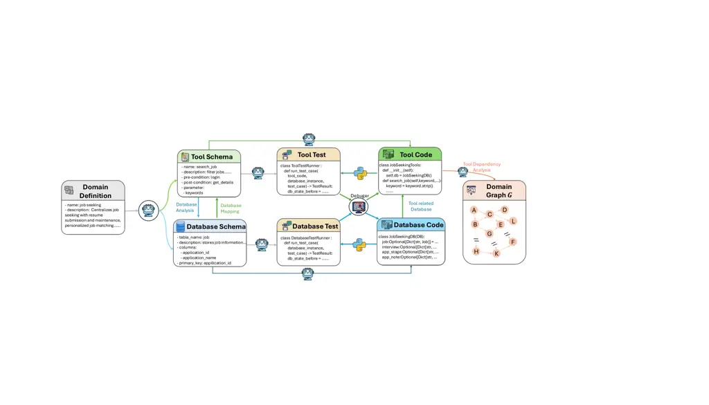
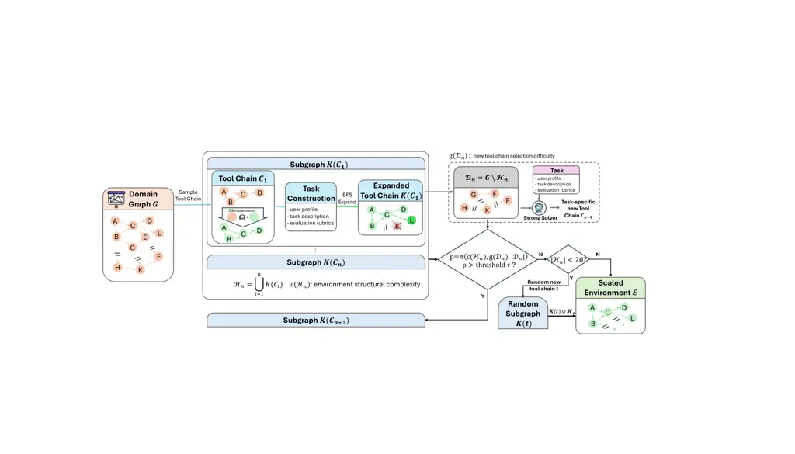
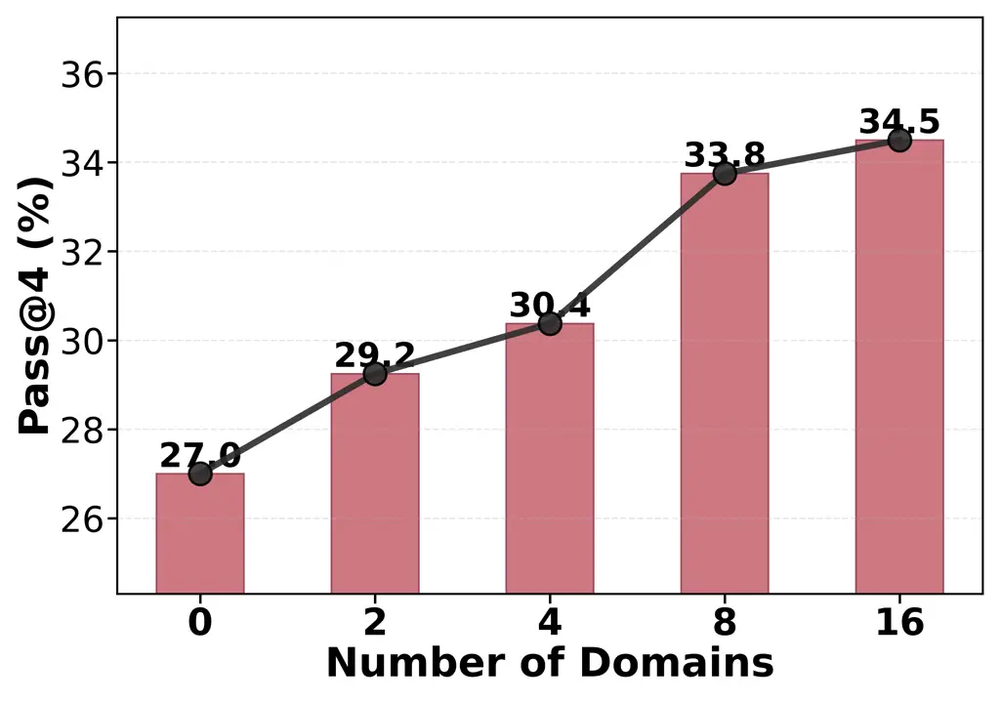
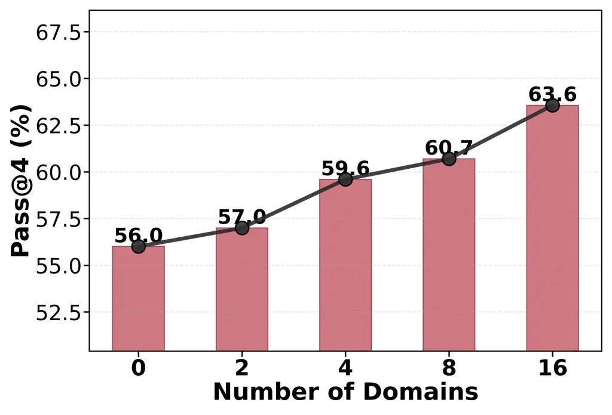
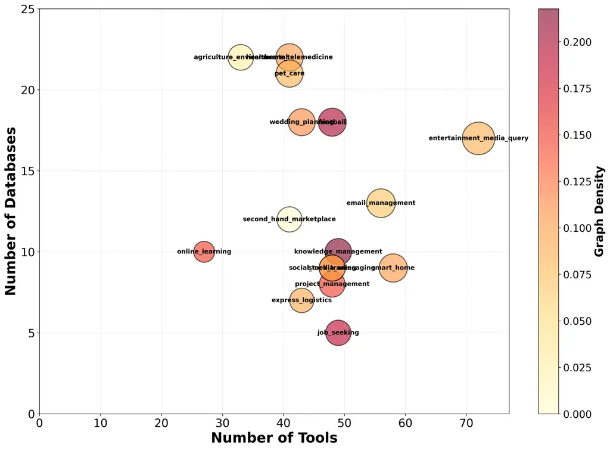

# ScaleEnv: Scaling Environment Synthesis from Scratch for Generalist Interactive Tool-Use Agent Training

Dunwei Tu Affiliation: National Key Laboratory for Novel Software
Technology, Nanjing University Affiliation: School of Artificial
Intelligence, Nanjing University, Nanjing, China    Hongyan Hao
Affiliation: Meituan, Beijing, China Correspondence to:
<haohongyan02@meituan.com>    Hansi Yang Affiliation: Meituan, Beijing,
China    Yihao Chen Affiliation: Institute of Computer Science and
Technology, Harbin Institute of Technology (Shenzhen), Shenzhen, China
   Yi-Kai Zhang Affiliation: National Key Laboratory for Novel Software
Technology, Nanjing University Affiliation: School of Artificial
Intelligence, Nanjing University, Nanjing, China    Zhikang Xia
Affiliation: Meituan, Beijing, China    Yu Yang Affiliation: Meituan,
Beijing, China    Yueqing Sun Affiliation: Meituan, Beijing, China   
Xingchen Liu Affiliation: School of Statistics, East China Normal
University, Shanghai, China    Furao Shen Affiliation: National Key
Laboratory for Novel Software Technology, Nanjing University
Affiliation: School of Artificial Intelligence, Nanjing University,
Nanjing, China    Qi Gu Affiliation: Meituan, Beijing, China
Correspondence to: <guqi03@meituan.com>    Hui Su Affiliation: Meituan,
Beijing, China    Xunliang Cai Affiliation: Meituan, Beijing, China

###### Abstract

Training generalist agents capable of adapting to diverse scenarios
requires interactive environments for self-exploration. However,
interactive environments remain critically scarce, and existing
synthesis methods suffer from significant limitations regarding
environmental diversity and scalability. To address these challenges, we
introduce ScaleEnv, a framework that constructs fully interactive
environments and verifiable tasks entirely from scratch. Specifically,
ScaleEnv ensures environment reliability through procedural testing, and
guarantees task completeness and solvability via tool dependency graph
expansion and executable action verification. By enabling agents to
learn through exploration within ScaleEnv, we demonstrate significant
performance improvements on unseen, multi-turn tool-use benchmarks such
as $`\tau^{2}`$-Bench and VitaBench, highlighting strong generalization
capabilities. Furthermore, we investigate the relationship between
increasing number of domains and model generalization performance,
providing empirical evidence that scaling environmental diversity is
critical for robust agent learning.

###### Keywords: 

Environment Scaling, Tool-Use Agent

^(†)^(†)affiliationnotice: Equal contribution†Work done during an
internship at Meituan

## 1 Introduction

The rapid evolution of Large Language Models (LLMs) has established a
foundation for Artificial General Intelligence (AGI), driven largely by
the success of Data Scaling and Model Parameter Scaling laws (Kaplan et
al., 2020; Grattafiori et al., 2024; OpenAI, 2025). However,
transforming these models from text generators into agents requires a
fundamental shift: agents must effectively interact with dynamic
environments and iteratively refine their actions based on environment
feedback (Yao et al., 2022). Achieving such capabilities calls for
training LLMs within dynamic environments, equipped with executable
tools to allow agents to interact and receive immediate feedback.
However, constructing environments that can be used for training LLM
agents presents two core challenges. The first is Realism: tools
synthesized directly by LLMs are often functionally unreliable, while
LLM-based simulators are prone to severe hallucinations (Liu et al.,
2024; Li et al., 2025). We argue that environments must be grounded in
verified, executable code rather than probabilistic text generation to
ensure robust feedback. The second challenge is Scalability: synthesis
cannot rely on finite external documentation or manual human
intervention (Cai et al., 2025).

To overcome these challenges, we introduce ScaleEnv, a framework
enabling the fully automated construction of high-fidelity, interactive
environments and verifiable tasks. ScaleEnv operates through two
synergistic phases that ensure both code-level rigor and real-world
complexity. In the first phase, the system builds the Domain Foundation
by leveraging LLMs to define tool and database schemas from simple
domain keywords. It employs a multi-agent architecture to generate
functional code for tools and databases, which is rigorously validated
via a Procedural Testing mechanism to guarantee error-free execution.
These components are then consolidated into a global Tool Dependency
Graph to map logical relationships. In the second phase, we focus on
Task Construction using a dependency-aware expansion strategy. By
sampling seed tool chains from the graph and dynamically introducing
associated database states and distractor data, the system “snowballs”
the environment state from linear paths into complex non-linear
subgraphs. This process ensures the synthesized environment supports
open-ended exploration and diverse solution paths, providing a
verifiable foundation for grounding natural language user intents.

ScaleEnv produces a complete training ecosystem comprising executable
toolkits, high-fidelity environment states, and verifiable user intents.
By training Qwen-3 models (Yang et al., 2025) via Zero RL on this
synthesized universe, we observe substantial performance boosts on
unseen Out-of-Distribution (OOD) benchmarks, including
$`\tau^{2}`$-Bench (Barres et al., 2025) and VitaBench (He et al.,
2025). Crucially, this evaluation is strictly OOD: the synthesized
training domains are entirely disjoint from the evaluation domains, and
the benchmarks present distinct data formats (e.g., policy-constrained
dialogues) not encountered during training. Furthermore, we empirically
characterize the impact of Environment Scaling on model generalization
performance, revealing a distinct curve that validates environmental
diversity as a critical determinant for robust generalization.

Our main contributions are as follows:

- •
  We propose ScaleEnv, a fully automated framework that synthesizes
  high-fidelity interactive environments from scratch. It establishes an
  large-grade pipeline for agentic data, circumventing the limitations
  of fixed environment and manual API integration.
- •
  We design a robust synthesis mechanism combining Procedural Testing
  and Graph Expansion. This approach ensures that generated environments
  possess rigorous code-level verifiability while maintaining the
  logical complexity required for deep reasoning.
- •
  We demonstrate that agents trained on ScaleEnv achieve significant
  zero-shot generalization on unseen benchmarks. Additionally, we
  provide empirical evidence for the Environment Scaling Curve,
  establishing a new paradigm for data-centric agent training.

## 2 Related Works

### 2.1 Tool Learning

The field of tool learning has evolved from SFT to autonomous
exploration. Early works (Schick et al., 2023; Qin et al., 2023; Liu et
al., 2024; Prabhakar et al., 2025) demonstrated that LLMs could master
function calls through static demonstrations. To reduce dependency on
expensive expert trajectories and enhance agents’ self-exploration
capabilities, frontier research has pivoted towards RL (Luo et al.,
2025; Jin et al., 2025; Lu et al., 2025). However, large-scale RL
exploration necessitates scalable interaction environments. This paper
aims to bridge this gap by synthesizing diverse and reliable
environments, enabling the training of highly generalizable tool-use
agents.

### 2.2 Environment Scaling

Constructing effective environments for agents requires considering
three critical dimensions: diversity, realism, and scalability. Existing
approaches fall into three categories. (1) Real-world environments.
(Fang et al., 2025; Xu et al., 2025; Yao et al., 2026) collect actual
tools or remote APIs. Although offering high realism, they are
constrained by limited domain availability and safety policies that
restrict action spaces. Consequently, the lack of diverse state-altering
tasks, combined with prohibitive latency and costs, creates a bottleneck
for scalable agent training. (2) LLM-simulated environments. (Liu et
al., 2024; Chen et al., 2025; Li et al., 2025; Team et al., 2025; Ye et
al., 2025) leverage large language models to generate tool responses and
execution results, offering significant advantages in scalability,
low-cost execution, and flexible domain definition. However, these
approaches often suffer from fundamental limitations in realism and
fidelity; specifically, they are prone to hallucinations (Kadavath et
al., 2022; Zhang et al., 2025) and frequently fail to maintain authentic
environment states. (3) Synthetic environments. While recent frameworks
like AutoForge (Cai et al., 2025) and EnvScaler (Song et al., 2026)
offer executable pipelines for environment synthesis, they face distinct
limitations: the former is constrained by the limited scalability of
document-based generation, while the latter struggles to construct
complex, user-interactive tasks. Furthermore, both approaches exhibit
inadequate consistency between the generated tasks and their
corresponding environmental states, undermining the reliability of the
resulting sandboxes. To address these defects, we introduce ScaleEnv,
which ensures coherence and execution reliability through
execution-based verification. By providing a high-fidelity sandbox,
ScaleEnv enables the robust and scalable reinforcement learning
necessary for complex reasoning tasks.



Figure 1: Overview of Executable Graph Construction. The pipeline
proceeds from left to right: (1) Schema Definition for tools and
databases; (2) Implementation validated via procedural testing; and (3)
Tool Dependency Graph Construction to model execution logic.

## 3 Preliminaries

To construct a task for agentic RL training, we first need a domain
foundation $`\mathcal{B}=\langle\Sigma,\mathbb{T}\rangle`$. It consists
of two parts: a set of databases $`\Sigma`$ and a set of executable
tools $`\mathbb{T}`$. $`\Sigma`$ defines the valid space of environment
state
$`\mathcal{S}^{env}_{valid}=\{s^{env}\mid s^{env}\models\Sigma\}`$,
while $`\mathbb{T}`$ contains all available functions or APIs in this
domain.

Following the domain foundation $`\mathcal{B}`$, we can construct an
environment $`\mathcal{E}=\langle s^{env}_{0},\mathbb{T}\rangle`$
consisting of a set of databases $`s^{env}_{0}`$ with values filled
following the database schema in $`\mathcal{B}`$ and executable tools
$`\mathbb{T}`$ inherited from $`\mathcal{B}`$. $`\mathcal{E}`$
represents the external world at the start of an episode, as
$`s^{env}_{0}`$ directly gives the initial hidden external environment
state.

Under a specific environment $`\mathcal{E}`$, a task
$`\psi=\langle\mathcal{E},u,P_{user}\rangle`$ then binds it to a
specific user with some hidden goals, denoted as $`u`$, as well as the
user profile $`P_{user}`$ that contains all necessary information about
the user (e.g., permissions, location, history). The interaction between
an LLM agent and the simulated user to accomplish this task can then be
formulated as as a Partially Observable Markov Decision Process (POMDP)
$`\mathcal{M}=\langle\mathcal{S},\mathcal{A},\mathcal{O},\mathcal{T},\mathcal{R}\rangle`$.
Each state $`s_{t}=(s_{t}^{env},h_{t},u)\in\mathcal{S}`$ consists of
three components: current environment state $`s_{t}^{env}`$, the
interaction history $`h_{t}`$ and the user intent $`u`$. The action
space $`\mathcal{A}=\mathcal{A}_{resp}\cup\mathcal{A}_{tool}`$ is
defined as the union of natural language responses space
$`\mathcal{A}_{resp}`$, and the space of tool execution commands
$`\mathcal{A}_{tool}`$ for tools in $`\mathbb{T}`$. Correspondingly, the
observation space
$`\mathcal{O}=\mathcal{O}_{resp}\cup\mathcal{O}_{tool}`$ comprises user
feedback space $`\mathcal{O}_{resp}`$ and tool execution results space
$`\mathcal{O}_{tool}`$. The state transition function
$`\mathcal{T}:\mathcal{S}\times\mathcal{A}\rightarrow\mathcal{S}\times\mathcal{O}`$
evolves the state based on the action type: an action
$`a_{t}\in\mathcal{A}_{tool}`$ triggers a deterministic update to both
the environment $`s_{t}^{env}`$ and the history $`h_{t}`$ with the
return value of tools, whereas an action $`a_{t}\in\mathcal{A}_{resp}`$
updates only the history $`h_{t}`$ with the simulated user’s reply,
leaving $`s_{t}^{env}`$ unchanged. Finally, suppose the interaction is
terminated at timestep $`T`$, the outcome reward signal is defined as
$`r=\mathcal{R}(s_{T}^{env},u)`$, which evaluates whether the final
environment state $`s_{T}^{env}`$ successfully satisfy the user intent
$`u`$.

## 4 Method

Motivated by the limitations of existing works that fail to synthesize
diverse and reliable environments for agentic RL training, we present
ScaleEnv, a unified framework designed to synthesize multi-turn,
interactive, and strictly verifiable environments, which can effectively
scale up agentic RL training along with their corresponding tasks. To
ensure modularity and extensibility, we decouple the environment and
task construction into two distinct phases: Executable Graph
Construction (Section 4.1) and Task Instantiation (Section 4.2). The
executable graph establishes the logical skeleton of a given domain.
Defined as a graph comprising a set of executable tools, it determines
the available action space and the dependency relationships within the
domain. Following the construction of executable graph, we can further
generate a diverse set of high-quality tasks for each domain.
Ultimately, these synthesized tasks serve as the foundation for scalable
agentic RL training.

### 4.1 Executable Graph Construction

#### 4.1.1 Tool & Database Schema Definition

To establish a robust interactive domain foundation, we introduce a
two-step synthesis pipeline. As shown in Figure 1, we first rigorously
define Tool & Database Schemas to formalize the domain’s operational
logic, and subsequently implement the corresponding Executable Code to
transform these abstract definitions into a functional, verifiable
sandbox.

##### Top-Down Tool Schema Synthesis.

Starting with a specific domain name (e.g., “Job Seeking”), we employ a
top-down synthesis approach by using an LLM to first conceptualize the
domain logic and generate the Tool Schema. This schema rigorously
defines the interface of the atomic tool set $`\mathbb{T}`$, including
precise functional descriptions, parameters, and logical
pre/post-conditions (e.g., submit_application logically necessitates a
preceding upload_resume).

##### Database Schema Derivation & Mapping.

With the tool schema synthesized, a Database Agent analyzes the tool
definitions to reverse-engineer the database structure necessary to
support the environment. For instance, the presence of a
submit*application tool implies the existence of an Application table
(and a reference Job table) in the environment database. Through
de-duplication and filtering, the agent derives a consolidated Database
Schema for $`\mathcal{S}^{env}*{valid}`$, defining table structures and
integrity constraints. We simultaneously establish a tool-database
mapping that explicitly identifies the specific tables associated with
each tool, laying the necessary groundwork for the subsequent code
implementation.

##### Reward Specification

While the LLM-as-a-judge paradigm is widely adopted to implement the
reward function $`\mathcal{R}`$, it often suffers from high
computational overhead and vulnerability to reward hacking (Gabor et
al., 2025; Pan et al., 2024). As such, we introduce a rule-based
evaluator that directly checks the agent’s final database state
$`s^{env}_{T}`$ against the ground-truth state $`s^{env}_{gt}`$. Note
that different types of data naturally require different criteria (
e.g., critical data like prices or quantities require exact match, while
text comments may only require fuzzy match), we categorize database
columns into three matching policies: (1) Exempt Fields: dynamically
generated IDs and optional columns that do not affect task success; (2)
Hard Constraints: critical data such as timestamps or quantities that
require strict character-level or numerical equality; and (3) Semantic
Alignment: descriptive text that only require fuzzy semantic matching.

#### 4.1.2 Tool & Database Schema Implementation

Given the synthesized tool and database schema, we then proceed to
implementing them through LLM-powered code generation. Since the
database defines the underlying state structure required for tool
execution, we prioritize generating and verifying the database code,
which then serves as the necessary prerequisite for the subsequent tool
implementation and verification.

Database Implementation & Verification. We first utilize an LLM to
translate the database schema into executable code. To ensure
reliability, we concurrently generate test scripts to validate the
database implementation against integrity constraints. Any execution
failures trigger another LLM agent that works as a debuger and
iteratively refines the code based on error tracebacks until all tests
pass, establishing a stable storage layer for the environment.

Tool Implementation via Procedural Testing. Note that generating valid
tool code is a non-trivial process involving intricate logic and
interactions across multiple databases, and direct generation is prone
to hallucination. As such, we propose a Procedural Testing mechanism.
Specifically, the Code Agent implements the tool logic, while a Test
Agent simultaneously synthesizes unit test cases and corresponding
matched database instances. We then execute the tool code on the matched
database instances and validate its correctness based on three distinct
outcomes:

- •
  Success: The execution completes without error, and the resulting
  state transitions strictly match the expected database states.
- •
  Anticipated Rejection: The tool correctly identifies and handles
  invalid inputs by raising the pre-defined exceptions as specified in
  the schema.
- •
  Unexpected Failure: Any other runtime errors or state inconsistencies
  indicate defects. In this case, the Debug Agent analyzes the error
  logs to iteratively rectify either the tool implementation or the
  database instance until the procedural test is satisfied.

#### 4.1.3 Tool Dependency Graph Construction

To facilitate the synthesis of semantically coherent multi-step tasks,
we further employ a Tool Dependency Agent to systematically evaluate
pairwise relationships between the verified tools. This analysis is
grounded in three key dimensions: data flow (parameter passing),
pre/post-conditions (logical prerequisites), and state dependencies
(shared database tables). Based on these criteria, the agent establishes
directed edges representing causal links, consolidating the atomic tools
into a unified Tool Dependency Graph $`{G}`$. This graph serves as the
basis for subsequent task instantiation.



Figure 2: Overall pipeline of Task Instantiation via Graph Expansion.
The process involves: (1) Seed Chain Sampling from the dependency graph;
(2) Task Initialization with verifiable execution; and (3) Controlled
Environment Expansion to scale complexity while maintaining solvability.

### 4.2 Task Instantiation via Graph Expansion

Building upon the tools and databases constructed in Section 4.1, we
instantiate diverse tasks for agentic RL training. The primary challenge
for task instantiation is to construct a high-fidelity environment
$`\mathcal{E}`$ capable of supporting the extensive trial-and-error in
RL. Unlike SFT where no trial-and-error mechanism exists, an RL
environment must satisfy two critical requirements:

- •
  Entity Consistency. The synthesized environment should be consistent
  across all database tables. An entity appearing in one table (e.g., a
  user_id in the Order table) must map correctly to corresponding
  entities in related tables (e.g., the User table).
- •
  Interaction Completeness. The environment must support execution
  fidelity across the entire feasible action space, not merely along the
  optimal trajectory. Formally, for any valid tool calling action
  $`a\in\mathcal{A}_{tool}`$ taken by the agent, the environment
  $`\mathcal{E}`$ must return a valid, semantically meaningful
  observation $`o_{tool}`$, ensuring that exploration is not
  artificially terminated due to missing database entries or
  implementation gaps.

To generate tasks with environments satisfy the two constraints above,
we propose a Graph Expansion strategy. As illustrated in Figure 2, this
process constructs complex environmental states via a two-stage
iterative procedure: seed tool chain sampling, which initializes a seed
subgraph $`K(C_{1})`$, followed by controlled environment expansion,
which expands the environment based on complexity metrics and scales via
a fallback mechanism.

#### 4.2.1 Task Initialization with Seed Tool Chain

Given the domain-specific tool dependency graph $`{G}`$, we initialize
the complete task construction process through three stages: (1)
executable seed tool chain sampling, (2) constraint-satisfying
environment instantiation and (3) grounded instruction synthesis.

##### Executable Seed Tool Chain Sampling.

We initiate the process by sampling a seed tool chain
$`C_{1}=(a_{1},a_{2},\dots,a_{k})`$, which serves as a valid reference
path to solve the task to be constructed. The tool chain is formulated
as an executable code, and generated by prompting an LLM with the tool
dependency graph $`{G}`$ and the relevant database schema. This setup
enables the joint modeling of tool sequences and their arguments,
preventing possible disconnection if parameter instantiation is treated
as an isolated step. Representing the tool chain as code also inherently
satisfies data flow constraints; the output of a preceding action
$`a_{i}`$ is programmatically propagated as the input to subsequent
actions $`a_{i+1}`$.

##### Initial State Construction with Distractor Injection.

Based on the generated tool chain $`C_{1}`$, we construct an initial
environment state $`s^{env}_{0}`$ that strictly supports its execution
while preserving Entity Consistency. We employ an LLM-based generation
pipeline to synthesize $`s^{env}_{0}`$ and validate it by executing
$`C_{1}`$ on it to ensure task feasibility. Furthermore, to encourage
robust reasoning, we populate the database tables within $`s^{env}_{0}`$
with additional records that act as distractors. The density of these
distractors is dynamically scaled according to the predefined task
complexity. While these distractors adhere to all schema constraints,
they remain functionally orthogonal to the ground-truth trajectory,
forcing the agent to acquire precise information filtering capabilities.

##### Instruction Synthesis.

Given the verified seed chain $`C_{1}`$ and environment state
$`s_{0}^{env}`$, we then employ an LLM to synthesize the user profile
$`P_{user}`$ and user instruction $`u`$. We ensure the generation of
$`u`$ to be strictly grounded in $`C_{1}`$ as the reference solution,
which prevents the introduction of external priors or hallucinations
unsupported by the underlying environment. The evaluation criteria
$`\mathcal{R}`$ is also directly derived from the final state
$`s_{gt}^{env}`$ after executing $`C_{1}`$, which ensures alignment
between the seed tool chain $`C_{1}`$ and reward $`\mathcal{R}`$ for
robust RL training.

#### 4.2.2 Controlled Environment Expansion

While the three-stage procedure in Section 4.2.1 ensures Entity
Consistency, restricting the agent to the minimal environment state
encourages overfitting, where the agent collapses into memorizing sparse
trajectories rather than learning generalized reasoning. To foster
robust RL training and ensure Interaction Completeness, we propose an
iterative environment refinement strategy. We first expand the initial
seed chain $`C_{1}`$ into a semantically dense subgraph
$`\mathcal{H}_{1}=K(C_{1})\subset{G}`$ and incrementally refine the
environment. Then we further try to construct more tool chains
$`C_{2},\dots,C_{n}`$ until we reach the capability ceiling of current
LLM, and repeat the expansion-refinement process of $`C_{1}`$ to these
newly constructed tool chains $`C_{2},\dots,C_{n}`$ for further
environment refinement.

##### Dependency-Aware Topological Expansion.

We first expand the initial tool chain $`{C}_{1}`$ into a local subgraph
$`\mathcal{H}_{1}=K(C_{1})\subset{G}`$ for environment refinement. A
naive stochastic injection of tools risks introducing dependency
dead-ends—nodes whose prerequisite inputs cannot be satisfied by the
current available tool output. We mitigate this via Dependency-Aware
BFS: starting with $`\mathcal{H}_{1}={C}_{1}`$, we iteratively traverse
$`{G}`$ and add a new tool node $`v\in G`$ to $`\mathcal{H}_{1}`$ if and
only if the input and output dependencies of $`v`$ can be fully
satisfiable by a tool subset of $`\mathcal{H}_{1}`$. Then for any newly
added tool node $`v`$, we further execute it with its argument derived
from $`\mathcal{H}_{1}`$ and refine the environment if any errors arise
from the execution.

##### LLM-Gated Chain Expansion.

Since the subgraph $`\mathcal{H}_{1}`$ is derived from the only seed
tool chain $`C_{1}`$, a natural idea is to extend similar procedure to
multiple tool chains $`C_{1},C_{2},\dots,C_{n}`$. Nevertheless, such
extension cannot be done forever as the new tool chain should only
contain tools not used in previous subgraphs
$`\mathcal{H}_{n}=\bigcup_{i=1}^{n}K(C_{i})`$, As such, letting
$`\mathcal{D}_{n}={G}\setminus\mathcal{H}_{n}`$ denote the set of
candidate tools available after iteration $`n`$, we determine whether to
inject a new seed chain $`{C}_{n+1}\subseteq\mathcal{D}_{n}`$ via a
parametric gating policy $`\pi`$. Instead of relying on brittle
heuristics, we employ a strong LLM to approximate a value function for
expansion, conditioning on the following metrics:

- •
  Structural Complexity ($`c(\mathcal{H}_{n})`$). To quantify the
  representational sufficiency of tools currently in
  $`\mathcal{H}_{n}`$, we introduce a complexity metric
  $`c(\mathcal{H}_{n})=\frac{|V_{\mathcal{H}_{n}}|+\lambda|E_{\mathcal{H}_{n}}|}{S_{\text{sat}}}`$,
  where $`V_{\mathcal{H}_{n}}`$ and $`E_{\mathcal{H}_{n}}`$ represent
  the number of nodes and edges in $`\mathcal{H}_{n}`$, $`\lambda=0.5`$
  weighs the complexity of dependencies, and $`S_{\text{sat}}=50`$ is
  the saturation constant. Intuitively, this score assesses whether
  $`\mathcal{H}_{n}`$ captures the necessary structural and semantic
  depth required to support complex environmental interactions.
- •
  Feasibility Score ($`g(\mathcal{D}_{n})`$). Complementary to the tool
  complexity, we also need to consider the feasibility of the task
  within the remaining tools in $`\mathcal{D}_{n}`$. Since ground truth
  labels for complex tool chains are often unavailable in open-ended
  environments, we rely on a powerful “Oracle” agent and define
  $`g(\mathcal{D}_{n})\in[0,1]`$ as the success rate of this oracle
  agent in identifying executable tool chains within
  $`\mathcal{D}_{n}`$. In our implementation, we instantiate use
  Qwen3-235B-A22B augmented with a best-of-$`k`$ search strategy
  ($`k=16`$ rollouts) to maximize the likelihood of discovering valid
  paths.

Along with the number of available tools $`|\mathcal{D}_{n}|`$, we
construct a prompt
$`\pi(|\mathcal{D}_{n}|,c(\mathcal{H}_{n}),g(\mathcal{D}_{n}))`$
instructing the LLM to balance the trade-off between diversity and
solvability. The model outputs a compatibility score $`p\in[0,1]`$. If
$`p\geq\tau`$, we sample a new chain $`{C}_{n+1}`$, expand it into its
dependency subgraph $`{K}(\mathcal{C}_{n+1})`$ following similar
procedure that obtains $`K(C_{1})`$ from $`C_{1}`$. We then also execute
tools in $`{K}(\mathcal{C}_{n+1})`$ and refine the environment if any
errors arise from the execution, before merging it into
$`\mathcal{H}_{n}`$ as
$`\mathcal{H}_{n+1}=\mathcal{H}_{n}\cup{K}(\mathcal{C}_{n+1})`$.

Finally, to ensure sufficient exploration space, we enforce a minimum
constraint $`|\mathcal{H}_{n}|\geq 20`$ for $`\mathcal{H}_{n}`$. If it
falls short, we randomly sample valid auxiliary chains and merge it into
$`\mathcal{H}_{n}`$ to satisfy this constraint. This strategy leverages
the semantic reasoning of LLMs to dynamically balance the environment
construction, producing high-fidelity tasks that support complex
reasoning while maintaining verifiable supervision signals.

|                      |                    |             |             |             |             |              |              |
| -------------------- | ------------------ | ----------- | ----------- | ----------- | ----------- | ------------ | ------------ |
| Model                | $`\tau^{2}`$-Bench |             |             | VitaBench   |             |              |              |
|                      | Retail             | Airline     | Telecom     | Cross       | Delivery    | Instore      | OTA          |
| Open-weights Models  |                    |             |             |             |             |              |              |
| GPT-OSS-120B-A5B     | 57.0               | 38.0        | 45.6        | 15.0        | 37.0        | 42.0         | 12.0         |
| Qwen3-235B-A22B-2507 | 71.9               | 58.6        | 47.3        | 14.5        | 45.0        | 32.0         | 15.8         |
| Kimi-K2-0905         | 70.6               | 56.5        | 65.8        | 11.5        | 32.5        | 30.0         | 18.8         |
| Seed-OSS-36B         | 68.4               | 52.0        | 41.2        | 6.1         | 26.0        | 39.0         | 7.0          |
| xLAM-2-32B-fc-r      | 55.3               | 52.0        | 16.7        | 4.0         | 26.0        | 17.0         | 10.0         |
| Main Results         |                    |             |             |             |             |              |              |
| Qwen3-8B             | 38.4               | 30.5        | 21.5        | 1.5         | 18.3        | 14.8         | 4.5          |
| Qwen3-SE-8B          | 50.9 (+12.5)       | 37.5 (+7.0) | 27.2 (+5.7) | 3.0 (+1.5)  | 26.3 (+8.0) | 23.8 (+9.0)  | 7.0 (+2.5)   |
| Qwen3-32B            | 59.5               | 48.0        | 27.2        | 5.3         | 27.0        | 22.5         | 4.5          |
| Qwen3-SE-32B         | 63.6 (+4.1)        | 48.0 (+0.0) | 30.9 (+3.7) | 10.8 (+5.5) | 31.3 (+4.3) | 34.5 (+12.0) | 12.5  (+8.0) |

Table 1: Zero-shot generalization performance. The Qwen3-SE model
series, trained with environments and tasks constructed from our
ScaleEnv consistently outperforms baselines across diverse domains.

## 5 Experiments

### 5.1 Experimental Setup

For the domain foundation and task synthesis phases, we utilized a
diverse suite of high-performance LLMs, including Deepseek-V3.2 (Liu et
al., 2025), GLM-4.7 (Zeng et al., 2025), GPT-5.1, and Qwen3-32B (Yang et
al., 2025), to instantiate various agent roles. Across the 16
synthesized domains, each environment comprises approximately 50 tools
and 5–20 database tables. Our model series, denoted as Qwen3-SE
(ScaleEnv), is trained from Qwen3 (Yang et al., 2025) using group
relative policy optimization (GRPO) (Shao et al., 2024) on our
synthesized domains and tasks. We use Qwen2.5-72B-Instruct (Qwen et al., 2025) as the user simulator to provide natural language feedback.
Regarding hyperparameters, the Qwen3-8B model was trained with a rollout
batch size of 1024, while the Qwen3-32B model utilized a rollout batch
size of 2048. Both models were trained for 48 steps with a learning rate
of $`10^{-6}`$. Detailed domain and task compositions are provided in
Appendix B.

| Model        | Cross | Delivery | Instore | OTA | Avg. |
| ------------ | ----- | -------- | ------- | --- | ---- |
| Qwen3-8B     | 6     | 43       | 44      | 15  | 27.0 |
| Qwen3-SE-8B  | 12    | 56       | 57      | 18  | 35.8 |
| Qwen3-32B    | 15    | 57       | 58      | 14  | 36.0 |
| Qwen3-SE-32B | 29    | 65       | 66      | 27  | 46.8 |

Table 2: Pass@4 on VitaBench which shows the model upper-bound
performance.

### 5.2 Main Results: Generalization to Unseen Domains

A critical question in agentic training is whether performance gains
stem from genuine reasoning capabilities or merely from overfitting to
the training distribution. To answer this question, we assess the
generalization capabilities of Qwen3-SE model series across three
dimensions using established benchmarks. (1) Reasoning Generalization:
We utilize the cross-domain subset of VitaBench (He et al., 2025), which
presents ambiguous user needs requiring proactive information retrieval
and complex multi-step planning, testing the transfer of reasoning
skills to challenging logical structures not seen during training. (2)
Domain Generalization: We evaluate the model performance across a wide
spectrum of functional areas, including the Airline, Retail, and Telecom
domains from $`\tau^{2}`$-Bench (Barres et al., 2025), and the Delivery,
In-store, and OTA domains from VitaBench. As visually evidenced by the
tool embedding distribution in Figure 4, these evaluation domains are
semantically distinct and spatially separated from our 16 synthesized
training domains, ensuring a rigorous Out-Of-Distribution (OOD)
evaluation. (3) Format Generalization: While ScaleEnv focuses on direct
user-tool interaction without explicit policy documents,
$`\tau^{2}`$-Bench requires agents to strictly adhere to lengthy textual
policies during dialogue. Success here demonstrates that our agents can
generalize their learned behavior to novel interaction formats and
constraints not explicitly present during training.

Reasoning Generalization. A critical challenge in agentic tasks is
interpreting ambiguous user needs that require multi-step reasoning and
proactive planning. We observe substantial gains on VitaBench, a
benchmark specifically designed to test these capabilities. For
instance, when a user states ”I am sick,” the agent must infer a latent
intent to ”recommend light food”. As shown in Table 1, Qwen3-SE-32B
achieves a remarkable improvement in the most challenging cross-domain
subset, doubling the performance of the base model. This indicates that
training on ScaleEnv’s verifiable environments enables the agent to
transfer high-level reasoning skills to diverse, logic-heavy scenarios.

Domain and Format Generalization. ScaleEnv demonstrates robust
transferability across entirely novel domains and interaction formats.
(1) Domain Adaptation: Despite the strict exclusion of test domains from
our training set, our method consistently boosts performance across all
7 evaluation domains. (2) Format Adaptation: Notably, $`\tau^{2}`$-Bench
requires agents to strictly adhere to lengthy textual policies. While
fundamentally differnet from ScaleEnv, the consistent gains on
$`\tau^{2}`$-Bench suggest that our agents have generalized the ability
to follow constraints and handle complex state transitions, even when
presented in a novel textual policy format.

Performance Upper Bound Analysis. Beyond improving average stability,
ScaleEnv significantly elevates the model’s capability ceiling on
complex tasks, as is illustrated by the Pass@4 score on VitaBench in
Table 2 that measures the probability of generating at least one correct
solution within four attempts. Notably, in the complex cross-domain
subset, our method nearly doubles the success potential. This confirms
that ScaleEnv does not merely teach the model to memorize simple
patterns, but fundamentally enhances its capacity to search for and
execute correct solutions in more difficult tasks.



(a) VitaBench



(b) $`\tau^{2}`$-Bench

Figure 3: Domain Scaling Analysis (Pass@4). Comparison of zero-shot
generalization as training domains scale from $`N=2`$ to $`16`$. $`N=0`$
denotes the base model. Performance improves monotonically across both
benchmarks.

### 5.3 Domain Scaling Analysis

To investigate how environment diversity drives generalization, we
evaluate models trained on $`N\in\{2,4,8,16\}`$ unique domains while
keeping the same number of 1024 tasks. As illustrated in Figure 3, we
observe a steady upward trend in zero-shot generalization as the number
of training domains increases. This consistent growth across disparate
benchmarks confirms that environmental richness is a decisive factor in
unlocking the model’s transfer capabilities. Furthermore, exposing
agents to a wider variety of tools and databases allow them to
internalize abstract, domain-agnostic reasoning strategies rather than
overfitting to specific templates. Notably, performance has not yet
fully plateaued at $`N=16`$, suggesting that further scaling of
environmental diversity remains a promising direction for data-centric
agent training.

### 5.4 Analysis Experiment

Ablation Study: Executability Verification. A core tenet of ScaleEnv is
the rigorous Execution-Based Verification (EV) of synthesized tasks. To
quantify its impact, we conducted an ablation study by training a model
on a dataset generated without this verification step (denoted as “w/o
EV”). In this setting, while the tool dependency graph was constructed,
the tools are never subjected to actual parameter-driven execution, and
the environment states are not iteratively patched to ensure
solvability.

As illustrated in Table 3, the removal of execution verification leads
to a consistent degradation in performance across all domains of
$`\tau^{2}`$-Bench. Without EV, the training data contains tool calls
that appear semantically plausible but fail during runtime due to
unsatisfied preconditions or mismatched database states (e.g.,
attempting to refund a non-existent order). Such noisy rollouts
introduce conflicting reward signals, preventing the policy from
learning precise, logic-grounded decision-making.

| Setting     | Retail | Airline | Telecom |
| ----------- | ------ | ------- | ------- |
| Qwen3-8B    | 38.4   | 30.5    | 21.5    |
| w/o EV      | 42.3   | 30.0    | 25.2    |
| Qwen3-SE-8B | 50.9   | 37.5    | 27.2    |

Table 3: Ablation of Executability Verification (Avg@4) on
$`\tau^{2}`$-Bench

| Reward Setting    | Avg@4 | Pass@4 | Passˆ4 |
| ----------------- | ----- | ------ | ------ |
| LLM-as-a-Judge    | 36.5  | 58.8   | 14.6   |
| Rule-Based (Ours) | 38.5  | 62.9   | 15.0   |

Table 4: Ablation of Reward Mechanisms. Results are averaged across
three $`\tau^{2}`$-Bench domains (Retail, Airline, Telecom).

| Setting           | Cross | Delivery | Instore | OTA | Avg. |
| ----------------- | ----- | -------- | ------- | --- | ---- |
| Qwen3-8B          | 1.5   | 18.3     | 14.8    | 4.5 | 9.8  |
| Set A (4 Domains) | 2.0   | 24.0     | 22.3    | 7.0 | 13.8 |
| Set B (4 Domains) | 2.0   | 25.5     | 18.3    | 7.5 | 13.3 |

Table 5: Domain Stability Analysis (Avg@4). Set A contains wedding
planning, knowledge management, job seeking and healthcare telemedicine.
Set B contains express logistics, job seeking, email management and pet
care.

Ablation Study: Reward Mechanism. To evaluate the impact of different
reward signals, we compare our deterministic rule-based evaluator
against the standard LLM-as-a-Judge paradigm. As shown in Table 4, our
rule-based approach yields superior performance across all metrics.
These results demonstrate that while LLM-based judges provide semantic
flexibility, they are often susceptible to reward hacking, where agents
optimize for linguistic alignment at the expense of logical correctness.
In contrast, our rule-based reward enforces rigorous, database-level
fidelity, providing a more objective and robust learning signal.
Furthermore, the rule-based approach minimizes computational overhead by
replacing expensive LLM inference with efficient rule-based
verification, facilitating stable large-scale RL exploration.

Domain Stability Analysis. A potential concern in procedural generation
is whether performance gains stem from specific ”lucky” domains or
general synthesis robustness. To investigate this, we conducted a
stability analysis by training the Qwen3-8B model on two distinct,
non-overlapping subsets of synthesized dommains, fixing the domain count
at 4 and task count at 1024. As reported in Table 5, both subsets
consistently outperform the baseline across all metrics on VitaBench.
This consistency demonstrates that EnvZero produces high-fidelity
environments reliably across diverse scenarios, ensuring that
generalization improvements are driven by the structural advantages of
our framework rather than artifacts of specific cherry-picked domains.

## 6 Conclusion

In this paper, we presented ScaleEnv, a framework to synthesize
high-fidelity interactive environments and verifiable tasks. By shifting
from static dataset interpolation to a complete generation pipeline,
ScaleEnv circumvents the inherent limitations of data scarcity. Our
extensive evaluations across multiple model scales demonstrate that
training on ScaleEnv-synthesized environments and tasks significantly
boosts the performance of baseline models on unseen benchmarks,
evidencing robust zero-shot generalization. Furthermore, we empirically
formulated an domain scaling curve, establishing that scaling
environmental diversity is more critical than task quantity for
cultivating generalist agent capabilities. These results confirm that
ScaleEnv provides a stable and scalable paradigm for data-centric
reinforcement learning, paving the way for the development of robust,
general-purpose autonomous agents.

## Impact Statement

This paper presents work whose goal is to advance the field of Machine
Learning, specifically by addressing the data scarcity bottleneck in
training generalist tool-use agents. Our proposed framework, ScaleEnv,
provides a safe, virtual sandbox for agents to learn complex tool-use
capabilities, thereby mitigating the risks of accidental harm associated
with training directly on real-world APIs.

However, we acknowledge the potential risks associated with the
generative nature of our method. Theoretically, ScaleEnv is
domain-agnostic and capable of synthesizing arbitrary interactive
environments. Without proper oversight, this capability could be misused
to construct environments that model harmful or unethical behaviors. We
strongly emphasize that the application of procedural environment
synthesis must adhere to strict ethical guidelines. Future research
should explore safety alignment mechanisms that prevent the synthesis of
malicious domains while maintaining the diversity required for robust
generalist training.

## References

- Barres et al. (2025) V. Barres, H. Dong, S. Ray, X. Si, and K.
  Narasimhan Tau2-bench: evaluating conversational agents in a
  dual-control environment. arXiv preprint arXiv:2506.07982. Cited by:
  §1, §5.2.
- Cai et al. (2025) S. Cai, R. Fang, J. Wu, B. Li, X. Wang, Y. Jiang, L.
  Su, L. Zhang, W. Yin, Z. Zhang, F. Feng, P. Xie, and X. Wang
  AutoForge: automated environment synthesis for agentic reinforcement
  learning. External Links: 2512.22857,
  [Link](https://arxiv.org/abs/2512.22857) Cited by: §1, §2.2.
- Chen et al. (2025) Z. Chen, Z. Zhao, K. Zhang, B. Liu, Q. Qi, Y.
  Wu, T. Kalluri, S. Cao, Y. Xiong, H. Tong, et al. Scaling agent
  learning via experience synthesis. arXiv preprint arXiv:2511.03773.
  Cited by: §2.2.
- Fang et al. (2025) R. Fang, S. Cai, B. Li, J. Wu, G. Li, W. Yin, X.
  Wang, X. Wang, L. Su, Z. Zhang, et al. Towards general agentic
  intelligence via environment scaling. arXiv preprint arXiv:2509.13311.
  Cited by: §2.2.
- Gabor et al. (2025) J. Gabor, J. Lynch, and J. Rosenfeld EvilGenie: a
  reward hacking benchmark. arXiv preprint arXiv:2511.21654. Cited by:
  §4.1.1.
- Grattafiori et al. (2024) A. Grattafiori, A. Dubey, A. Jauhri, A.
  Pandey, A. Kadian, A. Al-Dahle, A. Letman, A. Mathur, A. Schelten, A.
  Vaughan, et al. The llama 3 herd of models. arXiv preprint
  arXiv:2407.21783. Cited by: §1.
- He et al. (2025) W. He, Y. Sun, H. Hao, X. Hao, Z. Xia, Q. Gu, C.
  Han, D. Zhao, H. Su, K. Zhang, et al. VitaBench: benchmarking llm
  agents with versatile interactive tasks in real-world applications.
  arXiv preprint arXiv:2509.26490. Cited by: §1, §5.2.
- Jin et al. (2025) B. Jin, H. Zeng, Z. Yue, J. Yoon, S. Arik, D.
  Wang, H. Zamani, and J. Han Search-r1: training llms to reason and
  leverage search engines with reinforcement learning. arXiv preprint
  arXiv:2503.09516. Cited by: §2.1.
- Kadavath et al. (2022) S. Kadavath, T. Conerly, A. Askell, T.
  Henighan, D. Drain, E. Perez, N. Schiefer, Z. Hatfield-Dodds, N.
  DasSarma, E. Tran-Johnson, et al. Language models (mostly) know what
  they know. arXiv preprint arXiv:2207.05221. Cited by: §2.2.
- Kaplan et al. (2020) J. Kaplan, S. McCandlish, T. Henighan, T. B.
  Brown, B. Chess, R. Child, S. Gray, A. Radford, J. Wu, and D. Amodei
  Scaling laws for neural language models. arXiv preprint
  arXiv:2001.08361. Cited by: §1.
- Li et al. (2025) Y. Li, H. A. Inan, X. Yue, W. Chen, L. Wutschitz, J.
  Kulkarni, R. Poovendran, R. Sim, and S. Rajmohan Simulating
  environments with reasoning models for agent training. External Links:
  2511.01824, [Link](https://arxiv.org/abs/2511.01824) Cited by: §1,
  §2.2.
- Liu et al. (2025) A. Liu, A. Mei, B. Lin, B. Xue, B. Wang, B. Xu, B.
  Wu, B. Zhang, C. Lin, C. Dong, et al. Deepseek-v3. 2: pushing the
  frontier of open large language models. arXiv preprint
  arXiv:2512.02556. Cited by: §5.1.
- Liu et al. (2024) W. Liu, X. Huang, X. Zeng, X. Hao, S. Yu, D. Li, S.
  Wang, W. Gan, Z. Liu, Y. Yu, et al. Toolace: winning the points of llm
  function calling. arXiv preprint arXiv:2409.00920. Cited by: §1, §2.1,
  §2.2.
- Lu et al. (2025) F. Lu, Z. Zhong, S. Liu, C. Fu, and J. Jia ARPO:
  end-to-end policy optimization for gui agents with experience replay.
  arXiv preprint arXiv:2505.16282. Cited by: §2.1.
- Luo et al. (2025) M. Luo, N. Jain, J. Singh, S. Tan, A. Patel, Q.
  Wu, A. Ariyak, C. Cai, S. Z. Tarun Venkat, B. Athiwaratkun, M.
  Roongta, C. Zhang, L. E. Li, R. A. Popa, K. Sen, and I. Stoica
  DeepSWE: training a state-of-the-art coding agent from scratch by
  scaling rl. Note:
  https://pretty-radio-b75.notion.site/DeepSWE-Training-a-Fully-Open-sourced-State-of-the-Art-Coding-Agent-by-Scaling-RL-22281902c1468193aabbe9a8c59bbe33Notion
  Blog Cited by: §2.1.
- Maaten and Hinton (2008) L. v. d. Maaten and G. Hinton Visualizing
  data using t-sne. Journal of machine learning research 9 (Nov),
  pp. 2579–2605. Cited by: Figure 4, Figure 4.
- OpenAI (2025) OpenAI Introducing GPT-5-2. Note:
  [https://openai.com/index/introducing-gpt-5-2/](https://openai.com/index/introducing-gpt-5-2/)Accessed:
  February 28, 2025 Cited by: §1.
- Pan et al. (2024) A. Pan, E. Jones, M. Jagadeesan, and J. Steinhardt
  Feedback loops with language models drive in-context reward hacking.
  arXiv preprint arXiv:2402.06627. Cited by: §4.1.1.
- Prabhakar et al. (2025) A. Prabhakar, Z. Liu, M. Zhu, J. Zhang, T.
  Awalgaonkar, S. Wang, Z. Liu, H. Chen, T. Hoang, J. C. Niebles, et al.
  Apigen-mt: agentic pipeline for multi-turn data generation via
  simulated agent-human interplay. arXiv preprint arXiv:2504.03601.
  Cited by: §2.1.
- Qin et al. (2023) Y. Qin, S. Liang, Y. Ye, K. Zhu, L. Yan, Y. Lu, Y.
  Lin, X. Cong, X. Tang, B. Qian, et al. Toolllm: facilitating large
  language models to master 16000+ real-world apis. arXiv preprint
  arXiv:2307.16789. Cited by: §2.1.
- Qwen et al. (2025) Qwen, :, A. Yang, B. Yang, B. Zhang, B. Hui, B.
  Zheng, et al. Qwen2.5 technical report. External Links: 2412.15115,
  [Link](https://arxiv.org/abs/2412.15115) Cited by: §5.1.
- Schick et al. (2023) T. Schick, J. Dwivedi-Yu, R. Dessì, R.
  Raileanu, M. Lomeli, E. Hambro, L. Zettlemoyer, N. Cancedda, and T.
  Scialom Toolformer: language models can teach themselves to use tools.
  Advances in Neural Information Processing Systems 36, pp. 68539–68551.
  Cited by: §2.1.
- Shao et al. (2024) Z. Shao, P. Wang, Q. Zhu, R. Xu, J. Song, X. Bi, H.
  Zhang, M. Zhang, Y. Li, Y. Wu, et al. Deepseekmath: pushing the limits
  of mathematical reasoning in open language models. arXiv preprint
  arXiv:2402.03300. Cited by: Appendix C, §5.1.
- Song et al. (2026) X. Song, H. Chang, G. Dong, Y. Zhu, Z. Dou, and J.
  Wen EnvScaler: scaling tool-interactive environments for llm agent via
  programmatic synthesis. External Links: 2601.05808,
  [Link](https://arxiv.org/abs/2601.05808) Cited by: §2.2.
- Team et al. (2025) K. Team, Y. Bai, Y. Bao, G. Chen, J. Chen, N.
  Chen, R. Chen, Y. Chen, Y. Chen, Y. Chen, et al. Kimi k2: open agentic
  intelligence. arXiv preprint arXiv:2507.20534. Cited by: §2.2.
- Xu et al. (2025) Z. Xu, A. M. Soria, S. Tan, A. Roy, A. S. Agrawal, R.
  Poovendran, and R. Panda Toucan: synthesizing 1.5 m tool-agentic data
  from real-world mcp environments. arXiv preprint arXiv:2510.01179.
  Cited by: §2.2.
- Yang et al. (2025) A. Yang, A. Li, B. Yang, B. Zhang, B. Hui, B.
  Zheng, B. Yu, C. Gao, C. Huang, C. Lv, et al. Qwen3 technical report.
  arXiv preprint arXiv:2505.09388. Cited by: §1, §5.1.
- Yao et al. (2022) S. Yao, J. Zhao, D. Yu, N. Du, I. Shafran, K. R.
  Narasimhan, and Y. Cao React: synergizing reasoning and acting in
  language models. In The eleventh international conference on learning
  representations, Cited by: §1.
- Yao et al. (2026) Z. Yao, Z. Xu, Y. Guo, Z. Han, C. Yang, S. Zhang, W.
  Zhang, X. Zeng, and W. Liu ToolACE-mcp: generalizing history-aware
  routing from mcp tools to the agent web. arXiv preprint
  arXiv:2601.08276. Cited by: §2.2.
- Ye et al. (2025) J. Ye, C. Jiang, Z. Du, Y. Xu, X. Yao, Z. Xi, X.
  Fan, Q. Zhang, T. Gui, X. Huang, et al. Feedback-driven tool-use
  improvements in large language models via automated build
  environments. arXiv preprint arXiv:2508.08791. Cited by: §2.2.
- Zeng et al. (2025) A. Zeng, X. Lv, Q. Zheng, Z. Hou, B. Chen, C.
  Xie, C. Wang, D. Yin, H. Zeng, J. Zhang, et al. Glm-4.5: agentic,
  reasoning, and coding (arc) foundation models. arXiv preprint
  arXiv:2508.06471. Cited by: §5.1.
- Zhang et al. (2025) Y. Zhang, Y. Li, L. Cui, D. Cai, L. Liu, T. Fu, X.
  Huang, E. Zhao, Y. Zhang, Y. Chen, et al. Siren’s song in the ai
  ocean: a survey on hallucination in large language models.
  Computational Linguistics, pp. 1–46. Cited by: §2.2.

Figure 4: Visualization of Tool Embeddings across Domains. We use t-SNE
(Maaten and Hinton, 2008) to project the semantic embeddings of tools
from our 16 synthesized training domains (circles) and the evaluation
benchmarks (crosses and pluses). The clear spatial separation between
the training clusters and the $`\tau^{2}`$ / Vita domains empirically
demonstrates the OOD nature of our evaluation.

[TABLE]

Table 6: Tool Schema Example (Domain: Job Seeking). This table
illustrates a subset of the tool action schema automatically generated
by the meta-agent, detailing input requirements and output structures.

|                                                         |              |                                                              |
| ------------------------------------------------------- | ------------ | ------------------------------------------------------------ |
| Field Name                                              | Data Type    | Constraint / Description                                     |
| Table: Job_Application (Core application records)       |              |                                                              |
| application_id                                          | VARCHAR(10)  | Primary Key. Unique identifier.                              |
| applicant_name                                          | VARCHAR(100) | Full name of the applicant.                                  |
| job_title                                               | VARCHAR(200) | Title of the position applied for.                           |
| company_name                                            | VARCHAR(200) | Name of the hiring company.                                  |
| status                                                  | VARCHAR(50)  | Default: submitted. e.g., under_review, rejected.            |
| priority_level                                          | INTEGER      | Priority (1-5). Higher value indicates higher priority.      |
| salary_currency                                         | VARCHAR(10)  | Default: USD. Currency for expectations.                     |
| created_at                                              | DATETIME     | Record creation timestamp.                                   |
| Table: Application_Stage (Tracks hiring progression)    |              |                                                              |
| stage_id                                                | VARCHAR(10)  | Primary Key. Stage record identifier.                        |
| application_id                                          | VARCHAR(10)  | Foreign Key $`\rightarrow`$ job_application.application_id.  |
| stage_name                                              | VARCHAR(100) | e.g., phone_screening, technical_interview.                  |
| stage_date                                              | DATETIME     | Timestamp when the stage was reached.                        |
| stage_notes                                             | TEXT         | Optional notes regarding this stage.                         |
| Table: Interview_Schedule (Manages interview logistics) |              |                                                              |
| interview_id                                            | VARCHAR(10)  | Primary Key. Schedule identifier.                            |
| application_id                                          | VARCHAR(10)  | Foreign Key $`\rightarrow`$ job_application.application_id.  |
| interview_type                                          | VARCHAR(50)  | e.g., behavioral, system_design.                             |
| interview_date                                          | DATETIME     | Scheduled date and time.                                     |
| interviewer_name                                        | VARCHAR(100) | Name of the assigned interviewer.                            |
| Table: Interview_Feedback (Post-interview evaluation)   |              |                                                              |
| feedback_id                                             | VARCHAR(10)  | Primary Key. Feedback identifier.                            |
| interview_id                                            | VARCHAR(10)  | Foreign Key $`\rightarrow`$ interview_schedule.interview_id. |
| feedback_content                                        | TEXT         | Detailed notes or feedback content.                          |
| performance_rating                                      | INTEGER      | Self-assessment score (e.g., 1-5 scale).                     |

Table 7: Database Schema Example (Domain: Job Seeking). This table
illustrates a subset of the database schema automatically generated by
the database agent. It defines entity structures, data types, and
integrity constraints required to support the recruitment process
tracking.



Figure 5: Structural statistics of the 16 domains synthesized. The
x-axis and y-axis represent the number of tools and database tables,
respectively. The color intensity and bubble size indicate the Graph
Density of the Tool Dependency Graph, reflecting the complexity of
inter-tool causal relationships within each domain.

## Appendix A Tool Semantic Diversity and OOD Verification

To further investigate the structural diversity of the synthesized
“domain universe”, we visualize the semantic embeddings of all tools
across both training and evaluation domains. We utilize a pre-trained
encoder to extract tool descriptions’ embeddings and project them into a
2D space using t-SNE.

As illustrated in Figure 4, our 16 synthesized domains (represented by
colored circles) form widely distributed clusters, covering a broad
semantic spectrum from Smart Home to Healthcare Telemedicine. Crucially,
the evaluation domains from $`\tau^{2}`$-Bench and VitaBench
(represented by cross and plus markers) are situated in distinct
regions, exhibiting significant semantic separation from the training
clusters.

This visualization provides empirical evidence for the
Out-Of-Distribution (OOD) nature of our evaluation setup. It confirms
that the performance gains reported in Section 5 are not achieved
through simple memorization of tool templates or domain-specific logic
interpolation. Instead, the model must rely on the generalized reasoning
and tool-invocation strategies internalized from the diverse ScaleEnv
training environments to succeed in these semantically novel tasks.

## Appendix B Detailed Statistics of Synthesized Domains and Tasks

### B.1 Visualization

We provide a comprehensive visualization of the 16 synthesized domains
used in our training set. As illustrated in Figure 5, the domains
exhibit significant structural diversity across three dimensions:

- •
  Action Space Scale (X-axis): The number of executable tools per domain
  ranges from approximately 25 (e.g., Online Learning) to over 70 (e.g.,
  Entertainment Media Query), ensuring the agent learns to navigate
  varying sizes of action spaces.
- •
  State Space Complexity (Y-axis): The number of database tables ranges
  from 5 (e.g., Job Seeking) to 22 (e.g., Agriculture Environment),
  representing different levels of state-tracking difficulty.
- •
  Dependency Density (Color/Size): The color intensity represents the
  Graph Density of the Tool Dependency Graph. Domains like Job Seeking
  and Knowledge Management exhibit higher density (darker colors),
  indicating more complex inter-tool causal relationships, whereas
  others like Agriculture Environment are relatively sparser.

| Domain Name               | Number of Tasks |
| ------------------------- | --------------- |
| wedding_planning          | 512             |
| knowledge_management      | 512             |
| job_seeking               | 256             |
| healthcare_telemedicine   | 256             |
| pet_care                  | 128             |
| smart_home                | 128             |
| email_management          | 128             |
| football                  | 128             |
| second_hand_marketplace   | 64              |
| express_logistics         | 64              |
| social_media_messaging    | 64              |
| entertainment_media_query | 64              |
| online_learning           | 64              |
| stock_trading             | 64              |
| project_management        | 64              |
| agriculture_environmental | 64              |
| Total                     | 2560            |

Table 8: Number of Tasks by Domain

| Synthesis Stage                             | Prompt Tokens | Completion Tokens | Total Tokens  |
| ------------------------------------------- | ------------- | ----------------- | ------------- |
| Domain Foundation Construction (per domain) | $`\sim`$379k  | $`\sim`$167k      | $`\sim`$546k  |
| Task Generation (per task)                  | $`\sim`$74.6k | $`\sim`$18.6k     | $`\sim`$93.2k |

Table 9: Token Consumption Analysis. We report the average token usage
for synthesizing a single domain foundation (including schemas and
codes) and for generating a single verifiable task.

### B.2 Domain and Task Synthesis Cost

As detailed in Table 9, the synthesis of a complete domain environment
requires approximately 546k tokens, while generating a single verifiable
task consumes roughly 93.2k tokens.

## Appendix C Scalable RL in Hybrid Environments

To cultivate generalist agents, we construct a unified training universe
$`\mathbb{U}=\{(\mathcal{B}_{k},\psi_{j})\mid\psi_{j}\in\text{Tasks}(\mathcal{B}_{k})\}`$,
where each instance pairs a specific synthesized domain environment
$`\mathbb{B}_{k}`$ with a verifiable task $`\psi_{j}`$. We deploy an
LLM-based user simulator, initialized with intent $`\mathcal{U}`$ from
$`\psi_{j}`$, to generate natural language feedback
$`\mathcal{O}_{resp}`$, closing the multi-turn interaction loop.

Within this high-fidelity POMDP, we optimize the agent policy
$`\pi_{\theta}`$ using Group Relative Policy Optimization (GRPO) (Shao
et al., 2024). For each task query $`q\sim\mathbb{U}`$, we sample a
group of $`G`$ trajectories $`\{o_{1},\dots,o_{G}\}`$ from the old
policy $`\pi_{\theta_{old}}`$. Recognizing the multi-step nature of tool
use, we formulate the objective over time steps $`t`$ as:

```math
\displaystyle\mathcal{J}(\theta)=\mathbb{E}_{q\sim\mathbb{U}}\Bigg[\frac{1}{G}\sum_{i=1}^{G}\frac{1}{L_{i}}\sum_{t=1}^{L_{i}}\bigg(\min\left(\rho_{i,t}\hat{A}_{i},\text{clip}(\rho_{i,t},1-\epsilon,1+\epsilon)\hat{A}_{i}\right)-\beta\mathbb{D}_{KL}(\pi_{\theta}(\cdot|h_{i,t})||\pi_{ref}(\cdot|h_{i,t}))\bigg)\Bigg], \tag{1}
```

where $`L_{i}`$ is the trajectory length, and
$`\rho_{i,t}=\frac{\pi_{\theta}(a_{i,t}|h_{i,t})}{\pi_{\theta_{old}}(a_{i,t}|h_{i,t})}`$
denotes the step-wise importance sampling weight given history
$`h_{i,t}`$. Crucially, GRPO utilizes the group context to estimate the
advantage $`\hat{A}_{i}`$. By normalizing the trajectory reward
$`r_{i}`$ against the group statistics, we obtain a stable baseline
without a value network as:

```math
\hat{A}_{i}=\frac{r_{i}-\mu}{\sigma}, \tag{2}
```

where $`\mu`$ and $`\sigma`$ represent the mean and standard deviation
of the intra-group rewards $`\{r_{1},\dots,r_{G}\}`$.

## Appendix D Examples of Tool and Database

This section provides illustrative examples of the synthesized domain
foundations for the “Job Seeking” domain. Table 7 presents the
structured database schema, while Table 6 defines the functional tool
interfaces. The corresponding executable implementations for both the
database and the tools are provided in the subsequent listings.

@with_instance_key("application_id")

class JobApplication(BaseModel, ThreadSafeBase\["JobApplication"\]):

application_id: str = Field(..., description="Unique identifier for the
job application") \# primary key

applicant_name: str = Field(..., description="Full name of the job
applicant")

email: str = Field(..., description="Email address of the applicant")

phone: Optional\[str\] = Field(default=None, description="Phone number
of the applicant")

job_title: str = Field(..., description="Title of the job position being
applied for")

company_name: str = Field(..., description="Name of the company")

application_date: datetime = Field(..., description="Date and time when
the application was submitted")

status: str = Field(default="submitted", description="Current status of
the application (e.g., submitted, under_review, rejected, accepted,
withdrawn, archived)")

resume_content: Optional\[str\] = Field(default=None, description="Text
content of the resume")

resume_format: Optional\[str\] = Field(default=None, description="Format
of the resume document (e.g., pdf, docx)")

resume_uploaded_at: Optional\[datetime\] = Field(default=None,
description="Timestamp when the resume was uploaded")

cover_letter_content: Optional\[str\] = Field(default=None,
description="Text content of the cover letter")

cover_letter_uploaded_at: Optional\[datetime\] = Field(default=None,
description="Timestamp when the cover letter was uploaded")

deadline_date: Optional\[datetime\] = Field(default=None,
description="Follow-up or response deadline for the application")

deadline_type: Optional\[str\] = Field(default=None, description="Type
of deadline (e.g., follow_up, response)")

referral_source: Optional\[str\] = Field(default=None,
description="Source of the job referral (e.g., LinkedIn, Indeed,
employee referral)")

referral_person: Optional\[str\] = Field(default=None, description="Name
of person who referred the applicant")

priority_level: Optional\[int\] = Field(default=None,
description="Priority level of the application (1-5, where 5 is
highest)")

priority_reason: Optional\[str\] = Field(default=None,
description="Reason for the assigned priority level")

expected_salary_min: Optional\[float\] = Field(default=None,
description="Minimum expected salary")

expected_salary_max: Optional\[float\] = Field(default=None,
description="Maximum expected salary")

salary_currency: Optional\[str\] = Field(default="USD",
description="Currency for salary expectations (e.g., USD, EUR)")

created_at: datetime = Field(..., description="Timestamp when the record
was created")

updated_at: Optional\[datetime\] = Field(default=None,
description="Timestamp when the record was last updated")

@with_instance_key("note_id")

class ApplicationNote(BaseModel, ThreadSafeBase\["ApplicationNote"\]):

note_id: str = Field(default=..., description="Unique identifier for the
note")

application_id: str = Field(default=..., description="Reference to the
associated job application")

note_content: str = Field(default=..., description="Content of the note
or comment")

note_type: Optional\[str\] = Field(default=None, description="Type or
category of the note (e.g., follow_up, reminder, general)")

created_at: datetime = Field(default=..., description="Timestamp when
the note was created")

@with_instance_key("stage_id")

class ApplicationStage(BaseModel, ThreadSafeBase\["ApplicationStage"\]):

stage_id: str = Field(default=..., description="Unique identifier for
the stage record")

application_id: str = Field(default=..., description="Reference to the
associated job application")

stage_name: str = Field(default=..., description="Name of the
application stage (e.g., phone_screening, technical_interview,
final_interview)")

stage_date: datetime = Field(default=..., description="Date and time
when the stage was reached")

stage_notes: Optional\[str\] = Field(default=None,
description="Additional notes about the stage") \# stage_notes is
optional

@with_instance_key("interview_id")

class InterviewSchedule(BaseModel,
ThreadSafeBase\["InterviewSchedule"\]):

interview_id: str = Field(default=..., description="Unique identifier
for the interview schedule")

application_id: str = Field(default=..., description="Reference to the
associated job application")

interview_type: str = Field(default=..., description="Type of interview
(e.g., phone_screening, technical_interview, behavioral_interview)")

interview_date: datetime = Field(default=..., description="Scheduled
date and time of the interview")

interviewer_name: Optional\[str\] = Field(default=None,
description="Name of the interviewer")

interview_location: Optional\[str\] = Field(default=None,
description="Location or platform for the interview (e.g., Zoom, office
address)")

interview_duration_minutes: Optional\[int\] = Field(default=None,
description="Expected duration of the interview in minutes")

@with_instance_key("feedback_id")

class InterviewFeedback(BaseModel,
ThreadSafeBase\["InterviewFeedback"\]):

feedback_id: str = Field(default=..., description="Unique identifier for
the interview feedback")

interview_id: str = Field(default=..., description="Reference to the
associated interview")

feedback_content: str = Field(default=..., description="Content of the
feedback or notes")

performance_rating: Optional\[int\] = Field(default=None,
description="Self-assessment rating of interview performance (e.g., 1-5
scale)")

created_at: datetime = Field(default=..., description="Timestamp when
the feedback was created")

class JobSeekingDB(DB):

"""Database containing all job_seeking_Job_Application-related data"""

job_application: Optional\[Dict\[str, JobApplication\]\] = Field(

default=None,

description="Schema JobApplication"

)

application_note: Optional\[Dict\[str, ApplicationNote\]\] = Field(

default=None,

description="Schema ApplicationNote"

)

application_stage: Optional\[Dict\[str, ApplicationStage\]\] = Field(

default=None,

description="Schema ApplicationStage"

)

interview_schedule: Optional\[Dict\[str, InterviewSchedule\]\] = Field(

default=None,

description="Schema InterviewSchedule"

)

interview_feedback: Optional\[Dict\[str, InterviewFeedback\]\] = Field(

default=None,

description="Schema InterviewFeedback"

)

Listing 1: Python implementation for database code in job seeking
domain.

\# ==================== 1. delete_job_application ====================

def delete_job_application(self, application_id: str) -\> dict:

"""

Delete a job application from the system

Args:

application_id: Unique identifier of the application to delete

Returns:

Dictionary containing:

- application_id: Unique identifier of the deleted application

- deletion_status: Status of the deletion operation

- deleted_at: Timestamp when the application was deleted in yyyy-mm-dd
  HH:MM:SS format

Raises:

KeyError: If the application_id does not exist in the system

"""

\# Validate input parameter

if not application_id or not isinstance(application_id, str):

raise ValueError("application_id must be a non-empty string")

\# Access the database

db = self.db

\# Get the job_application table

job_application_table = getattr(db, ’job_application’, None)

\# Check if the table exists

if job_application_table is None:

raise KeyError(f"Application with ID ’{application_id}’ does not exist
in the system")

\# Check if the application exists in the table

if application_id not in job_application_table:

raise KeyError(f"Application with ID ’{application_id}’ does not exist
in the system")

\# Remove the application from the table

updated_table = {k: v for k, v in job_application_table.items() if k !=
application_id}

\# Update the database table with the new dictionary

setattr(db, ’job_application’, updated_table)

\# Generate deletion timestamp

deleted_at = datetime.now().strftime("%Y-%m-%d %H:%M:%S")

\# Return the deletion result

return {

’application_id’: application_id,

’deletion_status’: ’deleted’,

’deleted_at’: deleted_at

}

# \# ==================== 2. batch_update_application_status

def batch_update_application_status(self, application_ids: list,
new_status: str, updated_at: str) -\> dict:

"""

Update status for multiple applications at once

Args:

application_ids: List of application identifiers to update

new_status: New status to apply to all applications

updated_at: Timestamp of the batch update in yyyy-mm-dd HH:MM:SS format

Returns:

dict: Contains updated_count (number of successfully updated
applications)

and failed_updates (list of application IDs that failed to update)

Raises:

ValueError: If parameters are invalid or applications don’t exist

"""

\# Validate input parameters

if not application_ids:

raise ValueError("application_ids cannot be empty")

if not isinstance(application_ids, list):

raise ValueError("application_ids must be a list")

if not new_status or not isinstance(new_status, str):

raise ValueError("new_status must be a non-empty string")

if not updated_at or not isinstance(updated_at, str):

raise ValueError("updated_at must be a non-empty string")

\# Parse and validate the updated_at timestamp

try:

update_datetime = datetime.strptime(updated_at, "%Y-%m-%d %H:%M:%S")

formatted_updated_at = update_datetime.strftime("%Y-%m-%d %H:%M:%S")

except ValueError:

raise ValueError("updated_at must be in ’yyyy-mm-dd HH:MM:SS’ format")

\# Access the database

db = self.db

job_application_table = getattr(db, "job_application", None)

if job_application_table is None:

raise ValueError("job_application table not found in database")

\# Initialize tracking variables

updated_count = 0

failed_updates = \[\]

\# Process each application ID

for app_id in application_ids:

try:

\# Check if the application exists

if app_id not in job_application_table:

\# Application doesn’t exist, add to failed list

failed_updates.append(app_id)

continue

\# Retrieve the application record

application = job_application_table\[app_id\]

\# Update the status and updated_at timestamp (as string)

application.status = new_status

application.updated_at = formatted_updated_at

\# Save the updated application back to the database

job_application_table\[app_id\] = application

\# Increment successful update count

updated_count += 1

except Exception:

\# If any error occurs during update, add to failed list

failed_updates.append(app_id)

continue

\# Update the database table

setattr(db, "job_application", job_application_table)

\# Return the results

return {

"updated_count": updated_count,

"failed_updates": failed_updates

}

\# ==================== 3. archive_old_applications ====================

def archive_old_applications(self, cutoff_date: str, archive_status: str
= "archived") -\> dict:

"""

Archive applications older than a specified date by updating their
status.

Args:

cutoff_date: Date before which applications should be archived in
yyyy-mm-dd format

archive_status: Status to set for archived applications (default:
’archived’)

Returns:

dict: Contains ’archived_count’ (number of applications archived) and

’archived_application_ids’ (list of archived application IDs)

Raises:

ValueError: If cutoff_date format is invalid or if no job_application
table exists

"""

\# Validate cutoff_date format

try:

cutoff_datetime = datetime.strptime(cutoff_date, "%Y-%m-%d")

except ValueError as e:

raise ValueError(f"Invalid cutoff_date format. Expected yyyy-mm-dd, got:
{cutoff_date}") from e

\# Access the database

db = self.db

\# Get the job_application table

job_application_table = getattr(db, "job_application", None)

\# Validate that the table exists

if job_application_table is None:

raise ValueError("job_application table does not exist in the database")

\# Initialize tracking variables

archived_count = 0

archived_application_ids = \[\]

\# Iterate through all applications in the table

for application_id, application in job_application_table.items():

\# Check if application_date is before the cutoff_date

if application.application_date.date() \< cutoff_datetime.date():

\# Update the application status to archive_status

application.status = archive_status

\# Update the updated_at timestamp to current time

application.updated_at = datetime.now()

\# Track the archived application

archived_count += 1

archived_application_ids.append(application_id)

\# Write the updated table back to the database

setattr(db, "job_application", job_application_table)

\# Return the results

return {

"archived_count": archived_count,

"archived_application_ids": archived_application_ids

}

Listing 2: Part of Python implementation for tool code in job seeking
domain.

## Appendix E Agent-User Interaction Trajectory in ScaleEnv


