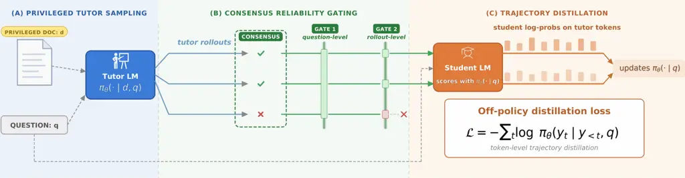
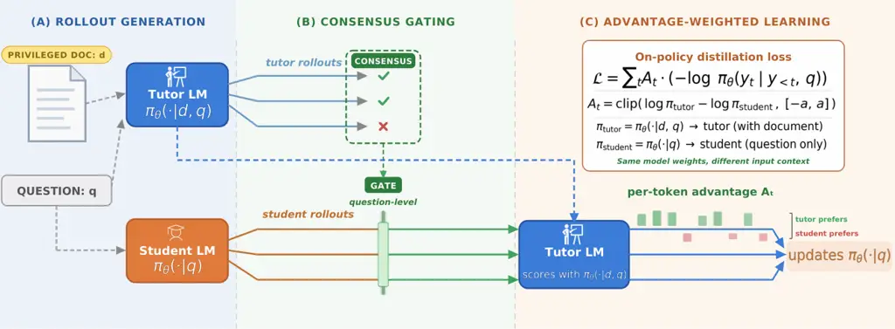

# GATES: Self-Distillation under Privileged Context with Consensus Gating

Alex Stein¹¹footnotemark: 1 Affiliation: University of Maryland, College
Park    Furong Huang Affiliation: University of Maryland, College Park
   Tom Goldstein Affiliation: University of Maryland, College Park

###### Abstract

We study self-distillation in settings where supervision is unreliable:
there are no ground truth labels, verifiable rewards, or external
graders to evaluate answers. We focus on document-grounded question
answering with asymmetric context, where a single model serves as both
tutor (with access to a relevant source document during training) and
student (answering from the question alone at test time). Rather than
assuming tutor correctness, we derive supervision online from tutor
consensus by sampling multiple document-grounded reasoning traces and
using agreement to gate learning. Conditioned on this reliability
signal, we distill knowledge through full tutor reasoning trajectories
(not just final answers), providing a dense and stable learning signal.
Empirically, this consensus-gated trajectory distillation substantially
improves transfer to the document-free student. Held-out in-domain
accuracy under asymmetric evaluation improves from 46.0% to 62.0%, and
average (maj@8) accuracy on public document-free math benchmarks
improves from 20.2% to 35.4%.

   

|     |
| --- |
|     |

Figure 1: Overview of GATES. A tutor model, given a privileged document
and question, generates multiple reasoning rollouts. A consensus gate
filters rollouts based on answer agreement, discarding trajectories with
minority answers. The surviving rollouts are used to train a student
model—which receives only the question—via distillation loss,
transferring the tutor’s privileged reasoning without requiring
ground-truth labels. The tutor and student share the same underlying
model, differing only in whether the privileged document is included in
the input context.

## 1 Introduction

Language model fine-tuning often relies on ground-truth labels,
verifiable rewards, or an external grader to evaluate answers (Cobbe et
al., 2021; Lightman et al., 2023; Uesato et al., 2022, e.g.,). In the
absence of such supervision, distillation is appealing because it
provides dense, token-level supervision and can transfer knowledge
through full reasoning trajectories, not just final answers (Zelikman et
al., 2022; Yuan et al., 2025; Singh et al., 2024). However, standard
distillation assumes an asymmetry between teacher and student, where a
larger or more capable teacher provides reliable supervision that the
student learns to imitate. In self-distillation, the teacher _is_ the
model itself, so naive self-distillation can reinforce systematic errors
or encourage degenerate shortcuts that are easy to imitate.

We study a setting in which a model can self-improve without any
verified labels or external grader. Consider a question generated from a
reference document; for example, a word problem derived from a passage
containing relevant facts or examples. A model prompted _with_ the
document can reason over the relevant evidence and is more likely to
answer correctly; the same model prompted _without_ the document must
rely on its own internalized knowledge and is less reliable. We call
these two roles the _tutor_ (with document) and the _student_ (without
document), but they are the same model with the same weights, differing
only in whether the document is included in the input. This asymmetry in
input context creates the imbalance that standard distillation obtains
from a larger or more capable teacher, making self-distillation
meaningful.

The tutor is not an oracle. Because its only advantage lies in its
ability to perform reasoning over the reference document, it remains
susceptible to errors. To avoid distilling from incorrect supervision,
we sample $`k`$ independent tutor responses during training and only
learn from questions where at least $`\tau`$ responses agree on the same
final answer. When this consensus is strong, we distill the full tutor
reasoning trajectories (not only final answers) into the document-free
student, providing dense token-level supervision. When consensus is
weak, the question is skipped entirely and contributes zero loss. Unlike
self-consistency (Wang et al., 2023), which selects answers at inference
time from a single context, our consensus signal gates _training_
updates across an asymmetric context gap—it decides _when_ to distill,
not _what_ to answer.

Empirically, our method (which we call GATES) substantially outperforms
all baselines. Held-out in-domain student accuracy improves from 46.0%
to 62.0%, and average maj@8 accuracy on public document-free math
benchmarks improves from 20.2% to 35.4% (§4.2; Figure 4). Naive
alternatives fail in this regime: answer-only supervised fine-tuning
catastrophically degrades student accuracy to 10–12%, and reward-only
optimization provides no meaningful improvement over the pretrained base
model (Figure 4a).

Our contributions are:

- •
  We formalize asymmetric-context self-distillation, a setting in which
  a single model serves as both tutor and student under different input
  contexts, enabling self-improvement without ground-truth labels,
  verifiable rewards, or an external grader.
- •
  We introduce GATES (Gated Asymmetric Trajectory Self-distillation),
  which uses agreement among multiple document-grounded tutor responses
  to gate which reasoning trajectories are distilled into the student.
- •
  We show empirically that consensus gating is the critical mechanism:
  GATES outperforms unfiltered trajectory distillation, answer-only
  fine-tuning, and outcome-based RL, and ablations confirm that removing
  the gate alone accounts for the performance gap (§4.3).

## 2 Related Work

##### Contextual and Asymmetric Distillation

Classical knowledge distillation transfers behavior from a teacher to a
student, typically in an off-policy fashion where the student is trained
on teacher-generated trajectories (Hinton et al., 2015; Gou et al.,
2021; Sun et al., 2019). Prior work has studied on-policy variants that
better match the student distribution and can improve stability (Agarwal
et al., 2024; Thinking Machines Lab, 2023). Our setting is also related
to learning with privileged information and weak-to-strong capability
transfer, where additional information may be available at training time
but not at test time (OpenAI, 2023). The notion of asymmetric
information at training and test time was formalized as _learning using
privileged information_ (LUPI) by Vapnik and Vashist (2009); our
tutor-student setup instantiates this framework with document access as
the privileged modality. We differ from standard distillation in two key
ways: (i) the tutor is not an external or reliably correct oracle, and
(ii) the tutor has access to privileged context unavailable to the
student. Rather than assuming correctness, we infer supervision
reliability online via consensus among multiple document-grounded tutor
rollouts. Document-grounded question answering is a well-studied setting
(Kwiatkowski et al., 2019; Yang et al., 2018); we use it not as an end
goal but as a testbed where asymmetric access to evidence arises
naturally.

##### Self-Training, Self-Distillation, and Consensus

Self-training and self-distillation approaches improve a model using its
own generations (He et al., 2020), but a recurring challenge is error
amplification, where naive self-training reinforces its own mistakes. A
common mitigation is to filter or refine pseudo-labels using
self-consistency and related signals (Madaan et al., 2023; Bai et al.,
2022). Majority voting and consensus-based filtering are
well-established reliability mechanisms in this literature; they have
been used for answer selection at inference time (Wang et al., 2023),
for filtering training data in self-improvement pipelines (Zelikman et
al., 2022), and for offline reinforcement learning on self-generated
data (Gulcehre et al., 2023). Our use of tutor consensus plays the same
role: it gates learning updates based on agreement among tutor rollouts.
The key difference is that our consensus signal is derived from tutor
agreement under asymmetric context rather than from verified correctness
labels and is used to gate dense trajectory-level distillation rather
than to filter correct-answer chains.

Preference-based self-improvement methods offer a related but distinct
approach, learning from internally generated comparisons (Rafailov et
al., 2024; Azar et al., 2023; Wu et al., 2024); these approaches assume
the model can generate meaningfully contrastive pairs, whereas our
method derives supervision from agreement rather than preference.

##### Concurrent Work on Self-Distillation

Several recent works, appearing concurrently with ours, apply
self-distillation to reasoning but under different supervision
assumptions. Some assume access to reliable correctness signals: Zhao et
al. (2026) stabilize on-policy RL by distilling improved trajectories
back into the policy, while Qu et al. (2026) use privileged information
to guide exploration with correctness feedback. Both methods rely on
verified correctness signals to determine which trajectories to learn
from; our setting removes this assumption entirely, using only
self-agreement under asymmetric context as the supervision signal.
Others target complementary settings: Shenfeld et al. (2026) treat
self-distillation as a regularization mechanism for continual learning,
and Hübotter et al. (2026) reinterpret RL itself as self-distillation,
relying on preference signals to define trajectory quality. Our work is
distinguished by the combination of asymmetric input context (the tutor
and student are the same model but receive different information) and
unreliable supervision, where tutor consensus is the sole mechanism for
deciding when distillation is trustworthy.

##### Self-Play and Question Generation

Self-play methods generate training data by adaptively constructing
tasks that challenge the learner, often using reinforcement learning
updates. This paradigm has a long history in game-playing agents, where
self-play alone (i.e., without human data) proved sufficient to achieve
superhuman performance (Silver et al., 2017; Silver et al., 2018).
Recent work has extended self-play and data-free training to language
model reasoning and curriculum construction (Liu et al., 2025; Kuba et
al., 2025; Zhao et al., 2025; Huang et al., 2026). In this work, most
experiments use a fixed challenger (offline question generation) in
order to isolate the learning dynamics of consensus-gated distillation.
We view adaptive challenger optimization as complementary rather than
competing, and present preliminary evidence in §5.

## 3 GATES: Gated Asymmetric Trajectory Self-Distillation

We now formalize the asymmetric-context setting and describe the gated
self-distillation training procedure. A single model $`\pi_{\theta}`$
operates as both tutor (conditioned on document $`d`$ and question
$`q`$) and student (conditioned on $`q`$ alone). We derive supervision
online from tutor consensus and distill full reasoning trajectories into
the document-free student.

### 3.1 Setting and Notation

Let $`\mathcal{C}`$ denote a corpus of documents, and let
$`d\in\mathcal{C}`$ be the document associated with a question $`q`$. We
use a fixed set of questions pregenerated from the corpus, without
verified answers during training. These questions can, in principle, be
generated adaptively online, as in self-play systems (Liu et al., 2025;
Kuba et al., 2025; Zhao et al., 2025; Huang et al., 2026), but our
method does not require adaptive question generation; in this work, we
use a _fixed challenger_ that pregenerates a dataset of
document–question pairs from $`\mathcal{C}`$ before training begins (we
pregenerate one question per document). Details on the entire question
generation procedure in §4.1.

The _student_ is the model evaluated at test time, and the _tutor_ is
the same model instance (sharing all parameters) queried with additional
context. The only difference between the two roles is their prompt: the
tutor is conditioned on $`(d,q)`$, while the student is conditioned on
$`q`$ alone. Because both roles share the same weights, any improvement
from training benefits the model as a whole; the student and tutor are
updated simultaneously during training, with no separate tutor model or
delayed copy. We assume that no verified answers are available during
training. Instead, learning is driven entirely by tutor sampling and a
consensus gate, which is described in the next section.

### 3.2 Consensus-Gated Training

The central mechanism of GATES is _consensus gating_: for each training
question, we sample $`k`$ independent tutor rollouts and extract a final
answer from each. We declare _strong consensus_ when at least $`\tau`$
of the $`k`$ rollouts agree on the same extracted answer $`a^{*}`$;
otherwise, the question is skipped entirely and contributes zero loss.
When consensus is strong, we treat the modal answer $`a^{*}`$ as a
pseudo-label (notably, $`a^{*}`$ is the most frequent tutor answer, not
a ground-truth label) and distill eligible tutor trajectories into the
document-free student.

Formally, each training step proceeds over a batch of $`n`$
document–question pairs $`(d_{i},q_{i})`$. For each question, we
generate $`k`$ tutor rollouts and $`k`$ student rollouts. We then:

1.  1.  Gate by consensus. Extract a final answer (the last `\boxed{...}`
        expression) from each tutor rollout and compute a question-level
        consensus gate $`g_{i}\in\{0,1\}`$, where $`g_{i}=1`$ if at least
        $`\tau`$ of $`k`$ tutor answers agree and $`g_{i}=0`$ otherwise.
2.  2.  Filter by eligibility. For each rollout $`j`$, compute a
        rollout-level eligibility indicator $`e_{i,j}\in\{0,1\}`$, where
        $`e_{i,j}=1`$ if the rollout’s extracted answer matches the
        consensus answer $`a^{*}_{i}`$ and the rollout passes
        document-leakage guardrails (keyword filtering for explicit document
        references; see Appendix A.4).
3.  3.  Update. Compute the training losses defined in §3.3 using only
        questions with $`g_{i}=1`$ and, for off-policy losses, only rollouts
        with $`e_{i,j}=1`$.

When $`g_{i}=0`$, the question contributes zero loss across all
objectives. This operationalizes our core idea: learning updates occur
only when supervision is inferred to be reliable, and learning is
performed at the token level rather than only on final answers.

##### On-policy vs. off-policy distillation

GATES supports two complementary modes of distillation. In _off-policy_
distillation, the student directly imitates eligible tutor-generated
trajectories (Figure 2). In _on-policy_ distillation, the student
generates its own trajectories, and the tutor scores each token by
computing log-probabilities under document context; the resulting
per-token advantage upweights tokens where the document-aware tutor
assigns higher probability than the student (Figure 3). Both modes are
gated by the same consensus mechanism. In practice, off-policy
trajectory-level distillation provides the primary performance gains,
while on-policy updates contribute modest additional improvement (§4.3).



Figure 2: Off-policy distillation in GATES. A single model
$`\pi_{\theta}`$ operates in two roles under asymmetric context: as a
_tutor_ conditioned on both the source document $`d`$ and question
$`q`$, and as a _student_ conditioned on $`q`$ alone. (A) The tutor
generates $`k`$ independent reasoning rollouts per question. (B) A
question-level consensus gate labels the question as _reliable_ if
sufficiently many rollouts agree on the same answer; a second,
rollout-level gate retains only trajectories that match the consensus.
(C) Eligible tutor trajectories provide dense token-level supervision to
the document-free student via trajectory distillation (Eq. 1).
Unreliable questions are skipped entirely, preventing self-reinforcement
collapse.

### 3.3 Training Objectives

We optimize the student policy $`\pi_{\theta}(\cdot\mid q)`$ using two
dense distillation losses, both gated by the consensus signal described
in §3.2. We write $`\pi_{T}(\cdot\mid d,q)`$ for the tutor distribution
and $`\pi_{\theta}(\cdot\mid q)`$ for the student distribution. To avoid
overloading $`T`$ (which denotes the tutor), we use $`L`$ for trajectory
length; $`L^{(T)}_{i,j}`$ and $`L^{(S)}_{i,j}`$ denote the number of
completion tokens in the $`j`$-th tutor and student rollout for question
$`i`$, respectively.

##### Off-policy distillation (tutor rollouts)

Let
$`y^{(T)}_{i,j}=\left(y^{(T)}_{i,j,1},\ldots,y^{(T)}_{i,j,L^{(T)}_{i,j}}\right)`$
denote the $`j`$-th tutor completion (the full reasoning trajectory
including the final answer) for question $`i`$. The off-policy
distillation loss (negative log-likelihood on tutor tokens) is

```math
\displaystyle\mathcal{L}_{\text{off}}(\theta) \displaystyle=-\frac{1}{\sum_{i,j}g_{i}\,e_{i,j}\,L^{(T)}_{i,j}}\sum_{i,j}g_{i}\,e_{i,j}\sum_{t=1}^{L^{(T)}_{i,j}}\ell^{(T)}_{i,j,t}(\theta), \tag{1}
```

```math
\displaystyle\qquad\ell^{(T)}_{i,j,t}(\theta) \displaystyle\coloneqq\log\pi_{\theta}\!\left(y^{(T)}_{i,j,t}\,\mid\,y^{(T)}_{i,j,<t},q_{i}\right).
```

Only tutor trajectories whose final extracted answer matches the
consensus and that pass the guardrails are included.



Figure 3: On-policy distillation in GATES. As in the off-policy variant
(Figure 2), a single model $`\pi_{\theta}`$ serves as both _tutor_ and
_student_ under asymmetric context. (A) Both roles generate $`k`$
rollouts in parallel: tutor rollouts establish consensus, while student
rollouts provide the on-policy training signal. (B) A question-level
consensus gate determines reliability; unlike the off-policy setting
there is no trajectory-level filter—when consensus is strong, all
student rollouts pass through. (C) The tutor scores each token of the
student’s own rollouts by computing log-probabilities under document
context. The per-token advantage
$`A_{t}=\mathrm{clip}(\log\pi_{\mathrm{tutor}}-\log\pi_{\mathrm{student}},\,[-a,a])`$
upweights tokens where the tutor assigns higher probability, encouraging
document-grounded reasoning while remaining on-policy (Eq. 3).
Unreliable questions contribute zero loss.

##### On-policy distillation (student rollouts)

On-policy distillation uses student-generated trajectories weighted by
an advantage-like signal. Let $`y^{(S)}`$ be a student completion
sampled from $`\pi_{\theta}(\cdot\mid q)`$. We compute:

```math
\displaystyle A_{t} \displaystyle=\text{clip}\Bigl(\log\pi_{T}\bigl(y^{(S)}_{t}\,\mid\,y^{(S)}_{<t},d,q\bigr) \tag{2}
```

```math
\displaystyle-\log\pi_{\theta}\bigl(y^{(S)}_{t}\,\mid\,y^{(S)}_{<t},q\bigr),\,[-a,a]\Bigr),
```

where $`a`$ is a clipping hyperparameter, and gradients do not flow
through $`A_{t}`$. The on-policy loss is:

```math
\displaystyle\mathcal{L}_{\text{on}}(\theta) \displaystyle=-\frac{1}{\sum_{i,j}g_{i}\,L^{(S)}_{i,j}}\sum_{i,j}g_{i}\sum_{t=1}^{L^{(S)}_{i,j}}A_{i,j,t}\,\ell^{(S)}_{i,j,t}(\theta), \tag{3}
```

```math
\displaystyle\qquad\ell^{(S)}_{i,j,t}(\theta) \displaystyle\coloneqq\log\pi_{\theta}\!\left(y^{(S)}_{i,j,t}\,\mid\,y^{(S)}_{i,j,<t},q_{i}\right).
```

This upweights tokens that the document-aware tutor assigns higher
likelihood than the student, encouraging document-grounded reasoning
while staying on-policy.

##### Total objective

The training objective combines both distillation losses:

```math
\mathcal{L}(\theta)=\lambda_{\text{off}}\,\mathcal{L}_{\text{off}}+\lambda_{\text{on}}\,\mathcal{L}_{\text{on}}. \tag{4}
```

This two-term objective can be extended with auxiliary losses. We define
a consensus-correctness reward ($`\mathcal{L}_{\text{cons}}`$) that
treats tutor agreement as a sparse binary REINFORCE signal; we ablate
this term in §4.3. We also apply a KL regularization term toward a
frozen reference policy to prevent drift from the base model. Both
auxiliary terms are formally defined in Appendix A.2.

## 4 Empirical Evaluation

### 4.1 Experimental Setup

##### Model and dataset

We use Qwen3-4B-Base as the underlying model for all experiments. We
construct a fixed-challenger dataset by prompting Qwen2.5-32B-Instruct
to generate questions from documents in the Nemotron-CC-Math
corpus (Mahabadi et al., 2025), following a procedure similar to
SPICE (Liu et al., 2025). For each candidate question, we generate
$`k{=}8`$ tutor rollouts with document context and require at least
$`5/8`$ tutor answers to agree; questions that fail this strict
consensus filter are dropped. Validity additionally requires producing a
parsable final answer (the last `\boxed{...}` expression) and satisfying
document-leakage guardrails (Appendix A.4). The resulting dataset
contains 551 training questions and 50 held-out evaluation questions
(Table 1). All experiments use this fixed challenger; adaptive curricula
are discussed in §5.

| Split         | \# Questions |
| ------------- | ------------ |
| Train         | 551          |
| Held-out eval | 50           |

Table 1: Dataset sizes for the fixed-challenger splits.

##### Training details

Unless otherwise noted, we use a batch size of $`n{=}32`$ questions per
step, $`k{=}8`$ tutor rollouts per question, and $`k{=}8`$ student
rollouts per question. We train for a single epoch over the training
split. The consensus gate requires $`\geq 4/8`$ agreeing tutor extracted
answers (§3.2). Both tutor and student are prompted to produce a
step-by-step solution terminating in a `\boxed{...}` answer; we extract
the last boxed expression for consensus and evaluation. All losses are
computed on completion tokens only (prompt tokens are masked), and
distillation losses are normalized by the total number of included
completion tokens after masking. Extracted answers are compared using
the math-verify library (OpenAI, 2024). For a complete set of
hyperparameters, see Appendix A.3.

##### Evaluation

We report accuracy under symbolic final-answer equivalence. For
in-domain evaluation, we measure student accuracy on the held-out split
(50 questions), and, where applicable, tutor accuracy on the same
questions with document access. For this evaluation only, correctness is
measured against an oracle answer produced by Qwen2.5-32B-Instruct using
a consensus over 8 rollouts (temperature $`{=}0.3`$, requiring
$`\geq 5/8`$ agreement); this oracle is used only for evaluation. For
out-of-domain evaluation, we report student accuracy on four public
document-free math benchmarks(MATH, AMC, Minerva, OlympiadBench) using
majority voting over 8 samples (maj@8). This metric is a natural fit for
GATES: consensus gating trains the model to learn only from
self-consistent trajectories, so an agreement-based decoding strategy
directly reflects the consistency the method optimizes for.

##### Baselines

We compare against four training signals that isolate the roles of dense
imitation and sparse correctness. Answer-Only SFT fine-tunes
Qwen3-4B-Base on question–answer pairs using the challenger-provided
extracted answer (the `\boxed{...}` expression only, not the full
reasoning trajectory) as the target. Answer-Only SFT (w/ doc) fine-tunes
on document–question–answer triplets using the tutor prompt, again
targeting only the extracted answer. Outcome RL trains the model with a
REINFORCE policy gradient using a binary correctness reward derived from
tutor consensus, plus KL regularization toward the pretrained reference;
no trajectory-level distillation is performed. This isolates the effect
of dense trajectory-level distillation from the underlying
self-generated supervision signal. Tutor-Trajectory SFT fine-tunes on
the full tutor reasoning trajectories (including chain-of-thought and
final answer) without consensus gating, training on all tutor rollouts
regardless of agreement. This isolates the contribution of the gating
mechanism by providing the same dense trajectory signal without
reliability filtering. This baseline exhibits a wide tutor–student gap:
high tutor accuracy but substantially lower student accuracy. Without
gating, the student internalizes reasoning patterns that implicitly
depend on document access; the tutor can recover from flawed
intermediate steps by re-reading the source, but the student cannot.
Consensus gating filters out these document-dependent trajectories,
ensuring the student learns only from reasoning that is self-sufficient.
See Appendix A.5 for further analysis of the tutor performance.

### 4.2 Main Results

We evaluate whether GATES improves a document-free student without
verified labels. Figure 4(b) reports held-out in-domain accuracy under
asymmetric evaluation, which directly reflects the supervision setting
we study. Figure 4(a) reports accuracy on public document-free math
benchmarks as a complementary stress test.

| Method                   | MATH | AMC  | Minerva | OlympiadBench | Avg. |
| ------------------------ | ---- | ---- | ------- | ------------- | ---- |
| GATES (ours)             | 65.6 | 26.5 | 21.7    | 27.7          | 35.4 |
| Tutor-Trajectory SFT     | 60.8 | 24.1 | 19.5    | 24.7          | 32.3 |
| Outcome RL               | 44.0 | 10.8 | 18.4    | 12.0          | 21.3 |
| Base Model               | 42.6 | 9.6  | 15.8    | 12.6          | 20.2 |
| Answer-Only SFT          | 35.6 | 8.4  | 13.2    | 7.7           | 16.2 |
| Answer-Only SFT (w/ doc) | 35.8 | 10.8 | 14.3    | 7.3           | 17.1 |

(a) Document-free math benchmarks (maj@8)

(b) In-domain asymmetric evaluation

Figure 4: Main results comparing GATES against baselines. (a) Accuracy
(%) on four document-free math benchmarks (maj@8 decoding). (b) Student
accuracy on the held-out asymmetric evaluation (50 questions, greedy
decoding). GATES yields the best student accuracy (62%), improving 16
percentage points over the pretrained base model. See Appendix A.5 for
tutor accuracy, greedy decoding, and coverage results.

On document-free benchmarks (Figure 4(a)), GATES outperforms all
baselines, improving average maj@8 accuracy from 20.2% (pretrained) to
35.4%. Tutor-Trajectory SFT, which trains on all tutor rollouts without
consensus gating, is the next strongest baseline (32.3%), but still
falls 3.1 percentage points short of GATES, confirming that reliability
filtering provides a meaningful benefit even when full reasoning
trajectories are available. Outcome RL and the pretrained base model
achieve comparable benchmark averages (21.3% and 20.2%, respectively),
indicating that sparse reward feedback alone provides no meaningful
improvement.

The held-out in-domain evaluation (Figure 4(b)) provides the strongest
evidence of effective transfer. GATES improves student accuracy from
46.0% to 62.0%, demonstrating effective transfer from document-grounded
supervision. Both Answer-Only SFT baselines catastrophically degrade
student accuracy (to 12.0% and 10.0%). This confirms that naive
fine-tuning on extracted answers alone (without full reasoning
trajectories) destroys reasoning capability and that consensus-gated
trajectory distillation is essential for stable learning. The tutor
outperforms the student by 34.3 percentage points on the filtered
training set (70.1% vs. 35.8%), confirming that document access provides
a substantial advantage that GATES successfully transfers.

### 4.3 Ablations

We ablate which components of the training objective are necessary for
reliable transfer. Figure 5(a) and Figure 5(b) report benchmark and
in-domain results across seven configurations that vary the loss weights
while holding all other hyperparameters fixed.

| Configuration      | $`\lambda_{\text{off}}`$ | $`\lambda_{\text{on}}`$ | $`\lambda_{\text{cons}}`$ | MATH | AMC  | Minerva | OBench | Avg. |
| ------------------ | ------------------------ | ----------------------- | ------------------------- | ---- | ---- | ------- | ------ | ---- |
| GATES (ours)       | 1.0                      | 0.1                     | 0.0                       | 65.6 | 26.5 | 21.7    | 27.7   | 35.4 |
| $`+`$ Oracle Loss  | 1.0                      | 0.1                     | 1.0                       | 64.2 | 27.7 | 23.5    | 27.4   | 35.7 |
| $`-`$ Gate         | 1.0                      | 0.1                     | 0.0                       | 59.2 | 21.7 | 18.4    | 25.0   | 31.1 |
| Oracle Only        | 0.0                      | 0.0                     | 1.0                       | 60.8 | 25.3 | 23.2    | 23.4   | 33.2 |
| All Losses         | 1.0                      | 1.0                     | 1.0                       | 61.0 | 20.5 | 21.7    | 25.8   | 32.2 |
| On-Policy Dominant | 0.1                      | 1.0                     | 1.0                       | 60.2 | 19.3 | 21.3    | 21.6   | 30.6 |
| On-Policy + Oracle | 0.0                      | 1.0                     | 1.0                       | 58.6 | 15.7 | 20.2    | 20.0   | 28.6 |
| Base Model         | –                        | –                       | –                         | 42.6 | 9.6  | 15.8    | 12.6   | 20.2 |

(a) Benchmark ablations (maj@8)

(b) In-domain ablations

Figure 5: Ablation results varying loss weights with
$`\lambda_{\text{KL}}=0.02`$ fixed throughout. (a) Accuracy (%) on
document-free math benchmarks (maj@8 decoding). _GATES (ours)_ is the
canonical configuration. $`-`$ Gate uses the same loss weights but
removes consensus gating, resulting in a $`4.3`$ pp benchmark drop
despite identical loss configuration. Adding oracle loss provides no
meaningful improvement (35.7 vs. 35.4), confirming that consensus gating
alone is sufficient without verified correctness labels. (b) Student
accuracy on the held-out asymmetric evaluation (greedy decoding).
Off-policy distillation remains the dominant contributor: configurations
without it show the largest drops in student accuracy. Tutor accuracy is
reported in Appendix A.5.

Off-policy distillation and consensus gating are the dominant
contributors to transfer. The canonical GATES configuration
($`\lambda_{\text{off}}{=}1.0`$, $`\lambda_{\text{on}}{=}0.1`$,
$`\lambda_{\text{cons}}{=}0.0`$) achieves the strongest student accuracy
(62.0%) and a benchmark average of 35.4%. Removing the consensus gate
while keeping the same loss weights ($`-`$ Gate) drops student accuracy
to 54.0% and benchmark average to 31.1%, isolating the contribution of
reliability filtering. Notably, $`-`$ Gate achieves nearly identical
results to Tutor-Trajectory SFT (31.1% vs. 32.3% benchmark average, both
54% student accuracy), confirming that consensus gating (rather than
other aspects of the training pipeline) is the active ingredient
distinguishing GATES from unfiltered trajectory distillation. Reversing
the off-policy and on-policy weights (On-Policy Dominant) drops student
accuracy to 48.0% and benchmark average to 30.6%, confirming that
trajectory-level imitation of tutor rollouts is the primary mechanism of
transfer. Removing off-policy distillation entirely (On-Policy + Oracle)
yields similar degradation.

Adding the consensus-correctness reward ($`\mathcal{L}_{\text{cons}}`$)
does not meaningfully change performance. The “+ Oracle Loss”
configuration achieves a comparable benchmark average (35.7% vs. 35.4%),
but reduces student accuracy (54.0% vs. 62.0%), suggesting that the
sparse correctness signal does not complement consensus-gated
distillation. The Oracle Only configuration (sparse reward with no
trajectory-level distillation) achieves moderate results (student 52.0%,
benchmark avg. 33.2%), confirming that dense trajectory imitation adds
meaningful value beyond sparse correctness feedback.

### 4.4 Summary and Discussion of Results

GATES produces the strongest student performance in our experiments,
both on held-out in-domain evaluation and on public math benchmarks.
Off-policy distillation from tutor rollouts is the primary driver of
transfer; on-policy updates provide modest additional improvement when
anchored by consensus-based reliability gating. Together, these results
establish the minimality of the GATES mechanism: the only component
required beyond standard off-policy self-distillation is consensus
gating. The oracle correctness reward is unnecessary (§4.3), the
explicit consistency loss adds no benefit
($`\lambda_{\text{cons}}{=}0`$), and no external teacher or reward model
is involved. Consensus gating alone provides sufficient reliability
modeling to make self-distillation under unreliable supervision
effective. Naive alternatives (supervised fine-tuning and outcome-based
reinforcement learning) fail to produce meaningful improvements,
underscoring the importance of dense trajectory-level supervision gated
by explicit reliability modeling.

After training, the student more consistently produces structured
solutions that terminate in a parsable final answer, even though it
never sees the document. The document-leakage guardrails (§3.2) are
essential for preventing the student from learning to reference evidence
it will not have at test time.

Additional evaluation under greedy decoding and coverage (pass@8) is
reported in Appendix A.5.

## 5 Discussion

### 5.1 Why the Method Works

Our method succeeds by explicitly separating two requirements that are
often conflated in self-training: _reliability_ (a signal that
correlates with correctness) and _learnability_ (a dense objective that
can be optimized stably). Asymmetric context creates a reliability gap:
because the tutor has access to the source document during training, it
can condition on evidence that the student will not see, inducing a
systematic tutor–student gap that makes distillation meaningful. We use
tutor agreement as a reliability test: if multiple document-grounded
rollouts converge to the same answer, we treat that instance as
trustworthy enough to learn from. On those trusted instances, we distill
the full trajectory, which provides the student with dense token-level
supervision and avoids the variance of sparse reward updates.
Empirically, GATES’s consensus-gated trajectory distillation is
sufficient: the sparse correctness reward
($`\mathcal{L}_{\text{cons}}`$) provides no additional benefit in our
setting, while dense imitation without consensus gating underperforms
(§4.3). Interestingly, adding the oracle correctness reward is neutral
on benchmarks but reduces in-domain student accuracy (54% vs. 62%). One
possible explanation is that the oracle reward upweights
correct-but-low-consensus trajectories that the gate would otherwise
filter, partially reintroducing document-dependent reasoning that the
student cannot replicate without the source.

### 5.2 Limitations

GATES relies on agreement among multiple tutor rollouts as a proxy for
correctness. If the tutor is insufficiently capable, biased, or produces
low-diversity reasoning traces, consensus may reflect shared errors
rather than reliable supervision. Relatedly, to avoid reinforcing
incorrect supervision, we discard all questions without sufficient tutor
agreement, which improves reliability but reduces the effective number
of training updates and may limit sample efficiency.

Our approach also assumes that final answers can be reliably extracted
and normalized. If answer extraction is noisy (or if tasks lack a
well-defined final answer), both consensus estimation and downstream
learning can degrade. Estimating tutor consensus further requires
multiple tutor rollouts per question, increasing training-time
computation relative to single-pass supervision.

Finally, we evaluate exclusively in document-grounded question
answering, where privileged document access provides a natural and
strong asymmetry. If the privileged context provides little additional
evidence beyond what is already implied by the question, or if the tutor
is not systematically more reliable than the student on the training
distribution, then there may be little useful signal to transfer.

### 5.3 Future Directions

Figure 6: Benchmark average accuracy (%) under fixed vs. adaptive
challenger training (maj@8 decoding). _Fixed, GATES_ and _Adaptive,
GATES_ use the canonical configuration
($`\lambda_{\text{off}}\!=\!1.0`$, $`\lambda_{\text{on}}\!=\!0.1`$,
$`\lambda_{\text{cons}}\!=\!0.0`$) with a static or adaptive challenger,
respectively. The remaining adaptive variants add the oracle loss
($`\lambda_{\text{cons}}\!=\!1.0`$) under different on/off-policy
weightings. SPICE uses an adaptive challenger by design and is included
for reference under a matched update budget.

##### Adaptive challengers

A natural extension of GATES is to generate questions on the fly using
an adaptive challenger, potentially improving coverage and curriculum
quality. Unlike the fixed challenger, which uses Qwen2.5-32B-Instruct to
pre-generate questions offline, adaptive training generates questions
from the model itself, making it a strictly harder setting with no
external question source. Preliminary experiments (Figure 6) suggest
that adaptive training can improve out-of-distribution benchmark
performance, with the best adaptive variant reaching 38.3% average
accuracy compared to 35.4% under the fixed challenger. Notably, the
configuration that performs best under adaptive training differs from
the canonical GATES setup: adding the oracle loss
($`\mathcal{L}_{\text{cons}}`$) appears to help when questions are
generated adaptively, possibly because harder or less familiar questions
increase the prevalence of confident but incorrect tutor agreement (the
primary failure mode of consensus gating), and the oracle loss provides
a direct corrective signal for exactly these cases. Without this
grounding, the adaptive GATES configuration reaches 29.8% (below the
fixed challenger (35.4%) but still well above the pretrained baseline
(20.2%)), suggesting that the optimal loss composition may depend on the
properties of the data generation process. All adaptive variants
outperform the SPICE baseline (21.6%) under a matched update budget,
indicating that consensus-gated distillation remains effective even
under non-stationary training distributions. We view adaptive challenger
optimization as a promising direction for fully self-contained
self-distillation, though further work is needed to develop evaluation
protocols and reliability mechanisms suited to non-stationary settings.

##### Scaling and broader task families

Scaling to larger models and more diverse document-grounded tasks is a
natural next step. The asymmetric-context setting extends naturally
beyond math to any domain where a privileged source document can inform
answer generation—including retrieval-augmented generation, tool-use
tasks, and agentic settings with privileged environmental state.
However, broader task families will require careful monitoring of
document leakage, answer extractability, and consensus calibration.
Understanding how consensus thresholds and rollout budgets should scale
with model capability remains an open question.

## 6 Conclusion

We studied self-distillation in a document-grounded question answering
setting without verified labels, verifiable rewards, or external
graders. Naive distillation is fragile in self-training because
agreement does not imply correctness. We first use tutor consensus to
decide when the model’s own supervision is trustworthy; conditioned on
those cases, trajectory-level distillation transfers document-grounded
reasoning into a document-free student. Consensus gating alone is
sufficient for reliable distillation; adding a sparse correctness reward
does not improve student transfer in our setting. Ablations confirm that
the gate is the active ingredient: removing it while keeping all other
losses yields performance comparable to unfiltered trajectory
distillation. Empirically, GATES improves held-out student accuracy from
46.0% to 62.0%, substantially outperforming answer-only fine-tuning and
outcome-based reinforcement learning.

## Acknowledgments

We thank Avi Schwarzschild for invaluable feedback, discussions, and
brainstorming throughout this project.

This work was supported by DARPA TIAMAT, the NSF TRAILS Institute
(2229885), Coefficient Giving, and Longview Philanthropy.

## References

- Agarwal et al. (2024) R. Agarwal, N. Vieillard, Y. Zhou, P.
  Stanczyk, S. Ramos, M. Geist, and O. Bachem On-policy distillation of
  language models: learning from self-generated mistakes. External
  Links: 2306.13649, [Link](https://arxiv.org/abs/2306.13649) Cited by:
  §2.
- Azar et al. (2023) M. G. Azar, M. Rowland, B. Piot, D. Guo, D.
  Calandriello, M. Valko, and R. Munos A general theoretical paradigm to
  understand learning from human preferences. External Links:
  2310.12036, [Link](https://arxiv.org/abs/2310.12036) Cited by: §2.
- Bai et al. (2022) Y. Bai, S. Kadavath, S. Kundu, A. Askell, J.
  Kernion, A. Jones, A. Chen, A. Goldie, A. Mirhoseini, C. McKinnon, C.
  Chen, C. Olsson, C. Olah, D. Hernandez, D. Drain, D. Ganguli, D.
  Li, E. Tran-Johnson, E. Perez, J. Kerr, J. Mueller, J. Ladish, J.
  Landau, K. Ndousse, K. Lukosuite, L. Lovitt, M. Sellitto, N.
  Elhage, N. Schiefer, N. Mercado, N. DasSarma, R. Lasenby, R.
  Larson, S. Ringer, S. Johnston, S. Kravec, S. E. Showk, S. Fort, T.
  Lanham, T. Telleen-Lawton, T. Conerly, T. Henighan, T. Hume, S. R.
  Bowman, Z. Hatfield-Dodds, B. Mann, D. Amodei, N. Joseph, S.
  McCandlish, T. Brown, and J. Kaplan Constitutional ai: harmlessness
  from ai feedback. External Links: 2212.08073,
  [Link](https://arxiv.org/abs/2212.08073) Cited by: §2.
- Cobbe et al. (2021) K. Cobbe, V. Kosaraju, M. Bavarian, M. Chen, H.
  Jun, L. Kaiser, M. Plappert, J. Tworek, J. Hilton, R. Nakano, C.
  Hesse, and J. Schulman Training verifiers to solve math word problems.
  External Links: 2110.14168, [Link](https://arxiv.org/abs/2110.14168)
  Cited by: §1.
- Gou et al. (2021) J. Gou, B. Yu, S. J. Maybank, and D. Tao Knowledge
  distillation: a survey. International Journal of Computer Vision 129
  (6), pp. 1789–1819. External Links: ISSN 1573-1405,
  [Link](http://dx.doi.org/10.1007/s11263-021-01453-z),
  [Document](https://dx.doi.org/10.1007/s11263-021-01453-z) Cited by:
  §2.
- Gulcehre et al. (2023) C. Gulcehre, T. L. Paine, S. Srinivasan, K.
  Konyushkova, L. Weerts, A. Sharma, A. Siddhant, A. Ahern, M. Wang, C.
  Gu, W. Macherey, A. Doucet, O. Firat, and N. de Freitas Reinforced
  self-training (rest) for language modeling. External Links:
  2308.08998, [Link](https://arxiv.org/abs/2308.08998) Cited by: §2.
- He et al. (2020) J. He, J. Gu, J. Shen, and M. Ranzato Revisiting
  self-training for neural sequence generation. In 8th International
  Conference on Learning Representations, ICLR 2020, Addis Ababa,
  Ethiopia, April 26-30, 2020, External Links:
  [Link](https://openreview.net/forum?id=SJgdnAVKDH) Cited by: §2.
- Hinton et al. (2015) G. Hinton, O. Vinyals, and J. Dean Distilling the
  knowledge in a neural network. External Links: 1503.02531,
  [Link](https://arxiv.org/abs/1503.02531) Cited by: §2.
- Huang et al. (2026) C. Huang, W. Yu, X. Wang, H. Zhang, Z. Li, R.
  Li, J. Huang, H. Mi, and D. Yu R-zero: self-evolving reasoning llm
  from zero data. External Links: 2508.05004,
  [Link](https://arxiv.org/abs/2508.05004) Cited by: §2, §3.1.
- Hübotter et al. (2026) J. Hübotter, F. Lübeck, L. Behric, A.
  Baumann, M. Bagatella, D. Marta, I. Hakimi, I. Shenfeld, T. K.
  Buening, C. Guestrin, and A. Krause Reinforcement learning via
  self-distillation. External Links: 2601.20802,
  [Link](https://arxiv.org/abs/2601.20802) Cited by: §2.
- Kuba et al. (2025) J. G. Kuba, M. Gu, Q. Ma, Y. Tian, V. Mohan, and J.
  Chen Language self-play for data-free training. External Links:
  2509.07414, [Link](https://arxiv.org/abs/2509.07414) Cited by: §2,
  §3.1.
- Kwiatkowski et al. (2019) T. Kwiatkowski, J. Palomaki, O. Redfield, M.
  Collins, A. Parikh, C. Alberti, D. Epstein, I. Polosukhin, J.
  Devlin, K. Lee, K. Toutanova, L. Jones, M. Kelcey, M. Chang, A. M.
  Dai, J. Uszkoreit, Q. Le, and S. Petrov Natural questions: a benchmark
  for question answering research. Transactions of the Association for
  Computational Linguistics 7, pp. 452–466. External Links:
  [Link](https://aclanthology.org/Q19-1026/),
  [Document](https://dx.doi.org/10.1162/tacl%5Fa%5F00276) Cited by: §2.
- Lightman et al. (2023) H. Lightman, V. Kosaraju, Y. Burda, H.
  Edwards, B. Baker, T. Lee, J. Leike, J. Schulman, I. Sutskever, and K.
  Cobbe Let’s verify step by step. External Links: 2305.20050,
  [Link](https://arxiv.org/abs/2305.20050) Cited by: §1.
- Liu et al. (2025) B. Liu, C. Jin, S. Kim, W. Yuan, W. Zhao, I.
  Kulikov, X. Li, S. Sukhbaatar, J. Lanchantin, and J. Weston SPICE:
  self-play in corpus environments improves reasoning. External Links:
  2510.24684, [Link](https://arxiv.org/abs/2510.24684) Cited by: §2,
  §3.1, §4.1.
- Madaan et al. (2023) A. Madaan, N. Tandon, P. Gupta, S. Hallinan, L.
  Gao, S. Wiegreffe, U. Alon, N. Dziri, S. Prabhumoye, Y. Yang, S.
  Gupta, B. P. Majumder, K. Hermann, S. Welleck, A. Yazdanbakhsh, and P.
  Clark Self-refine: iterative refinement with self-feedback. External
  Links: 2303.17651, [Link](https://arxiv.org/abs/2303.17651) Cited by:
  §2.
- Mahabadi et al. (2025) R. K. Mahabadi, S. Satheesh, S. Prabhumoye, M.
  Patwary, M. Shoeybi, and B. Catanzaro Nemotron-cc-math: a 133
  billion-token-scale high quality math pretraining dataset. External
  Links: 2508.15096, [Link](https://arxiv.org/abs/2508.15096) Cited by:
  §4.1.
- OpenAI (2023) OpenAI Weak-to-strong generalization: eliciting strong
  capabilities with weak supervision. Technical report OpenAI. External
  Links:
  [Link](https://cdn.openai.com/papers/weak-to-strong-generalization.pdf)
  Cited by: §2.
- OpenAI (2024) OpenAI Math-verify: a library for verifying mathematical
  answer equivalence. Note:
  [https://github.com/openai/math-verify](https://github.com/openai/math-verify)Software
  library Cited by: Table 7, §4.1.
- Qu et al. (2026) Y. Qu, A. Setlur, V. Smith, R. Salakhutdinov, and A.
  Kumar POPE: learning to reason on hard problems via privileged
  on-policy exploration. External Links: 2601.18779,
  [Link](https://arxiv.org/abs/2601.18779) Cited by: §2.
- Rafailov et al. (2024) R. Rafailov, A. Sharma, E. Mitchell, S.
  Ermon, C. D. Manning, and C. Finn Direct preference optimization: your
  language model is secretly a reward model. External Links: 2305.18290,
  [Link](https://arxiv.org/abs/2305.18290) Cited by: §2.
- Shenfeld et al. (2026) I. Shenfeld, M. Damani, J. Hübotter, and P.
  Agrawal Self-distillation enables continual learning. External Links:
  2601.19897, [Link](https://arxiv.org/abs/2601.19897) Cited by: §2.
- Silver et al. (2018) D. Silver, T. Hubert, J. Schrittwieser, I.
  Antonoglou, M. Lai, A. Guez, M. Lanctot, L. Sifre, D. Kumaran, T.
  Graepel, et al. A general reinforcement learning algorithm that
  masters chess, shogi, and go through self-play. Science 362 (6419),
  pp. 1140–1144. Cited by: §2.
- Silver et al. (2017) D. Silver, J. Schrittwieser, K. Simonyan, I.
  Antonoglou, A. Huang, A. Guez, T. Hubert, L. Baker, M. Lai, A. Bolton,
  et al. Mastering the game of go without human knowledge. Nature 550,
  pp. 354–359. Cited by: §2.
- Singh et al. (2024) A. Singh, J. D. Co-Reyes, R. Agarwal, A. Anand, P.
  Patil, X. Garcia, P. J. Liu, J. Harrison, J. Lee, K. Xu, A. Parisi, A.
  Kumar, A. Alemi, A. Rizkowsky, A. Nova, B. Adlam, B. Bohnet, G.
  Elsayed, H. Sedghi, I. Mordatch, I. Simpson, I. Gur, J. Snoek, J.
  Pennington, J. Hron, K. Kenealy, K. Swersky, K. Mahajan, L. Culp, L.
  Xiao, M. L. Bileschi, N. Constant, R. Novak, R. Liu, T. Warkentin, Y.
  Qian, Y. Bansal, E. Dyer, B. Neyshabur, J. Sohl-Dickstein, and N.
  Fiedel Beyond human data: scaling self-training for problem-solving
  with language models. External Links: 2312.06585,
  [Link](https://arxiv.org/abs/2312.06585) Cited by: §1.
- Sun et al. (2019) S. Sun, Y. Cheng, Z. Gan, and J. Liu Patient
  knowledge distillation for bert model compression. External Links:
  1908.09355, [Link](https://arxiv.org/abs/1908.09355) Cited by: §2.
- Thinking Machines Lab (2023) Thinking Machines Lab On-policy
  distillation (blog). Note:
  [https://thinkingmachines.ai/blog/on-policy-distillation/](https://thinkingmachines.ai/blog/on-policy-distillation/)
  Cited by: §2.
- Uesato et al. (2022) J. Uesato, N. Kushman, R. Kumar, F. Song, N.
  Siegel, L. Wang, A. Creswell, G. Irving, and I. Higgins Solving math
  word problems with process- and outcome-based feedback. External
  Links: 2211.14275, [Link](https://arxiv.org/abs/2211.14275) Cited by:
  §1.
- Vapnik and Vashist (2009) V. Vapnik and A. Vashist A new learning
  paradigm: learning using privileged information. Neural Networks 22
  (5), pp. 544–557. Note: Advances in Neural Networks Research:
  IJCNN2009 External Links: ISSN 0893-6080,
  [Document](https://dx.doi.org/https%3A//doi.org/10.1016/j.neunet.2009.06.042),
  [Link](https://www.sciencedirect.com/science/article/pii/S0893608009001130)
  Cited by: §2.
- Wang et al. (2023) X. Wang, J. Wei, D. Schuurmans, Q. Le, E. Chi, S.
  Narang, A. Chowdhery, and D. Zhou Self-consistency improves chain of
  thought reasoning in language models. External Links: 2203.11171,
  [Link](https://arxiv.org/abs/2203.11171) Cited by: §1, §2.
- Wu et al. (2024) Y. Wu, Z. Sun, H. Yuan, K. Ji, Y. Yang, and Q. Gu
  Self-play preference optimization for language model alignment.
  External Links: 2405.00675, [Link](https://arxiv.org/abs/2405.00675)
  Cited by: §2.
- Yang et al. (2018) Z. Yang, P. Qi, S. Zhang, Y. Bengio, W. W.
  Cohen, R. Salakhutdinov, and C. D. Manning HotpotQA: a dataset for
  diverse, explainable multi-hop question answering. External Links:
  1809.09600, [Link](https://arxiv.org/abs/1809.09600) Cited by: §2.
- Yuan et al. (2025) W. Yuan, R. Y. Pang, K. Cho, X. Li, S.
  Sukhbaatar, J. Xu, and J. Weston Self-rewarding language models.
  External Links: 2401.10020, [Link](https://arxiv.org/abs/2401.10020)
  Cited by: §1.
- Zelikman et al. (2022) E. Zelikman, Y. Wu, J. Mu, and N. D. Goodman
  STaR: bootstrapping reasoning with reasoning. External Links:
  2203.14465, [Link](https://arxiv.org/abs/2203.14465) Cited by: §1, §2.
- Zhao et al. (2025) A. Zhao, Y. Wu, Y. Yue, T. Wu, Q. Xu, Y. Yue, M.
  Lin, S. Wang, Q. Wu, Z. Zheng, and G. Huang Absolute zero: reinforced
  self-play reasoning with zero data. External Links: 2505.03335,
  [Link](https://arxiv.org/abs/2505.03335) Cited by: §2, §3.1.
- Zhao et al. (2026) S. Zhao, Z. Xie, M. Liu, J. Huang, G. Pang, F.
  Chen, and A. Grover Self-distilled reasoner: on-policy
  self-distillation for large language models. External Links:
  2601.18734, [Link](https://arxiv.org/abs/2601.18734) Cited by: §2.

## Appendix A Appendix

### A.1 Prompts

#### A.1.1 Student Prompt

Question:  
{question}

Solve this step by step.  
Show your work, then put your FINAL answer in \boxed{} at the very
end.  
Just answer directly.

Solution:

Figure 7: Student prompt used during training and evaluation. The
student does not have access to the document.

#### A.1.2 Tutor Prompt

Document:  
{document}

Question:  
{question}

Solve this step by step.  
Show your work, then put your FINAL answer in \boxed{} at the very
end.  
Do NOT mention the document, passage, or text. Just answer directly.

Solution:

Figure 8: Tutor prompt used during training. The tutor has access to the
document but is explicitly instructed not to mention it.

### A.2 Auxiliary Loss Terms

Section 3.3 formally introduces the primary loss terms used in the
optimization process. In addition to the two distillation loss terms, we
experimented with two other terms that can optionally be applied to the
total loss.

##### Consensus-correctness reward

When enabled, we include a REINFORCE-style objective using a binary
pseudo-correctness label $`r_{i,j}\in\{0,1\}`$ derived from tutor
consensus, where $`r_{i,j}=1`$ if rollout $`j`$’s extracted answer
matches the consensus for question $`i`$. Applied on tutor rollouts
under document context:

```math
\displaystyle\mathcal{L}_{\text{cons}}(\theta) \displaystyle=-\frac{1}{\sum_{i,j}g_{i}\,L^{(T)}_{i,j}}\sum_{i,j}g_{i}\,r_{i,j}\sum_{t=1}^{L^{(T)}_{i,j}}\tilde{\ell}^{(T)}_{i,j,t}(\theta), \tag{5}
```

```math
\displaystyle\qquad\tilde{\ell}^{(T)}_{i,j,t}(\theta) \displaystyle\coloneqq\log\pi_{\theta}\!\left(y^{(T)}_{i,j,t}\,\mid\,y^{(T)}_{i,j,<t},d_{i},q_{i}\right).
```

##### KL regularization

We optionally regularize the student toward a frozen reference policy
$`\pi_{\text{ref}}`$:

```math
\displaystyle\mathcal{L}_{\text{KL}}(\theta) \displaystyle=\beta\,\frac{1}{\sum_{i,j}g_{i}\,L^{(S)}_{i,j}}\sum_{i,j}g_{i}\sum_{t=1}^{L^{(S)}_{i,j}}D_{i,j,t}(\theta), \tag{6}
```

```math
\displaystyle\qquad D_{i,j,t}(\theta) \displaystyle\coloneqq\mathrm{KL}\bigl(\pi_{\theta}(\cdot\mid y^{(S)}_{i,j,<t},q_{i})\,\|\,\pi_{\text{ref}}(\cdot\mid y^{(S)}_{i,j,<t},q_{i})\bigr),
```

where $`\beta`$ is a tunable coefficient.

##### Total objective

The overall training objective is:

```math
\mathcal{L}(\theta)=\lambda_{\text{off}}\,\mathcal{L}_{\text{off}}+\lambda_{\text{on}}\,\mathcal{L}_{\text{on}}+\lambda_{\text{cons}}\,\mathcal{L}_{\text{cons}}+\lambda_{\text{KL}}\,\mathcal{L}_{\text{KL}} \tag{7}
```

where $`\mathcal{L}_{\text{cons}}`$ is disabled by default. The
coefficients $`\lambda_{\cdot}`$ trade off dense trajectory-level
learning ($`\mathcal{L}_{\text{off}}`$, $`\mathcal{L}_{\text{on}}`$)
against the optional sparse correctness reward
($`\mathcal{L}_{\text{cons}}`$) and stabilization
($`\mathcal{L}_{\text{KL}}`$), while all terms remain gated by tutor
consensus. We find empirically that the consensus-correctness reward
does not improve student transfer in our setting and can reduce student
accuracy; consensus-gated trajectory distillation alone provides
sufficient supervision (§4.3).

### A.3 Hyperparameters

|                                                           |                                              |
| --------------------------------------------------------- | -------------------------------------------- |
| Hyperparameter                                            | Value                                        |
| Batch size ($`n`$ questions/step)                         | 32                                           |
| Tutor rollouts per question ($`k`$)                       | 8                                            |
| Student rollouts per question ($`k`$)                     | 8                                            |
| Training temperature (tutor/student)                      | 0.5                                          |
| Training top-$`p`$ (tutor/student)                        | 1.0                                          |
| Training top-$`k`$ (tutor/student)                        | $`-1`$                                       |
| Max completion tokens (train rollouts)                    | 512                                          |
| Consensus gate (tutor agreement)                          | $`\geq 4/8`$                                 |
| Consensus criterion                                       | Extracted final-answer equivalence           |
| Consensus action                                          | Skip question (zero loss) if below threshold |
| Advantage clip ($`a`$)                                    | $`\pm 5`$                                    |
| Off-policy distillation weight ($`\lambda_{\text{off}}`$) | 1.0                                          |
| On-policy distillation weight ($`\lambda_{\text{on}}`$)   | 0.1                                          |
| Consensus reward weight ($`\lambda_{\text{cons}}`$)       | 0 or tuned per ablation                      |
| KL-to-reference weight ($`\lambda_{\text{KL}}`$)          | .02                                          |
| Optimizer                                                 | AdamW                                        |
| Learning rate                                             | $`1\times 10^{-6}`$                          |
| Weight decay                                              | 0.01                                         |
| Gradient clipping                                         | 1.0                                          |

Table 6: Training hyperparameters used unless otherwise specified.

| Hyperparameter                              | Value                            |
| ------------------------------------------- | -------------------------------- |
| Evaluation temperature (benchmarks, greedy) | 0                                |
| Evaluation temperature (benchmarks, maj@8)  | 0.6                              |
| Evaluation samples (maj@8 / pass@8)         | 8                                |
| Eval max completion tokens                  | 1024                             |
| Correctness model for in-domain eval        | Qwen2.5-32B-Instruct (consensus) |
| Correctness rollouts (in-domain eval)       | 8                                |
| Correctness temperature (in-domain eval)    | 0.3                              |
| Correctness min agreement (in-domain eval)  | $`\geq 5/8`$                     |
| Answer extraction                           | Final boxed answer               |
| Equivalence checking                        | math-verify \[OpenAI, 2024\]     |

Table 7: Evaluation hyperparameters used in this submission.

### A.4 Training Guardrails

We found the following implementation guardrails critical for stable
self-distillation under asymmetric context.

##### Tokenization and loss accounting

All losses (distillation, oracle/correctness terms, and any KL
regularization) are computed on _completion tokens only_, ensuring that
supervision is applied only to model-generated content. Prompt tokens
(document, question, and the Solution: prefix) are masked out of the
loss. We additionally enforce an exact boundary condition: prompts must
end with exactly Solution: (no trailing whitespace), so the completion
region is unambiguous.

##### Prompt isomorphism between tutor and student

Tutor and student prompts share the same structure and delimiter,
differing only by the presence of the document for the tutor. This
avoids distribution shift in how the model is trained to begin its
completion, isolating the effect of privileged context from
prompt-format artifacts.

##### Formatting, parsing, and rollout validity

We require each rollout to contain a parsable final answer (the last
`\boxed{...}`). Rollouts missing a boxed answer, suffering truncation
before the boxed answer, or failing extraction are treated as _invalid_
and receive zero weight in the corresponding loss.

##### Document leakage prevention

Because the student will not have document access at test time, we use a
two-stage document-mention filter: we drop questions that explicitly
reference the document (e.g., ”document”, ”passage”, ”text”), and we
exclude tutor trajectories that mention the document from distillation
targets. This prevents the student from learning document-dependent
templates that would be invalid at test time.

##### Loss interaction rules

We avoid contradictory gradients by applying each loss only where its
supervision signal is meaningful: (i) off-policy distillation uses only
eligible tutor rollouts; (ii) on-policy distillation uses only valid
student rollouts; (iii) optional oracle/correctness terms may treat
malformed outputs as negative examples.

##### Evaluation hygiene

We keep evaluation deterministic by using fixed eval IDs, fixed prompts,
and a fixed grading pipeline (answer extraction + equivalence checking).
We separately track validity rates (the fraction of rollouts producing a
boxed answer) in addition to accuracy, as malformed outputs are a common
failure mode in self-distillation.

### A.5 Additional Evaluation Results

We report supplementary evaluation results under greedy decoding and
coverage (pass@8) strategies across all four document-free math
benchmarks. These complement the maj@8 results in Figure 4(a).

##### Greedy decoding

Figure 9 reports accuracy under greedy decoding. Under this
single-sample metric, GATES and Tutor-Trajectory SFT achieve
near-identical average accuracy (40.0% vs. 40.3%), with Tutor-Trajectory
SFT slightly ahead on AMC and Minerva. The gap between these methods is
substantially larger under maj@8 decoding (Figure 4a), suggesting that
consensus gating improves the consistency of correct answers across
samples rather than peak single-sample performance.

Figure 9: Accuracy (%) under greedy decoding on document-free math
benchmarks. GATES and Tutor-Trajectory SFT achieve comparable greedy
performance, but GATES leads by 3.1 percentage points under maj@8
decoding (Figure 4a).

##### Coverage (pass@8)

Figure 10 reports pass@8, which measures whether at least one of the 8
sampled completions is correct. Gaps between methods narrow under this
metric, as expected—pass@8 reflects the model’s capability ceiling
rather than its typical-case accuracy. GATES still leads with an average
of 61.3%, compared to 60.6% for Tutor-Trajectory SFT, 55.2% for
Outcome RL, and 54.3% for the base model. The smaller margin here
indicates that much of the improvement from self-distillation comes from
making existing capabilities more reliably accessible, rather than
introducing entirely new problem-solving abilities.

Figure 10: Accuracy (%) under coverage (pass@8) on document-free math
benchmarks. Gaps between methods are smaller than under greedy or maj@8
decoding, consistent with pass@8 measuring an upper bound on model
capability.

### A.6 Tutor Accuracy and the Tutor–Student Gap

Figures 11 and 12 report both student and tutor accuracy on the held-out
asymmetric evaluation. The tutor–student gap reveals how effectively
each method transfers document-grounded reasoning to the document-free
student. Tutor-Trajectory SFT achieves the highest tutor accuracy of any
baseline (74%) but only 54% student accuracy, producing the widest
tutor–student gap in our experiments. Without consensus gating, the
student appears to internalize reasoning patterns that implicitly depend
on document access: the tutor can recover from flawed intermediate steps
by re-reading the source, but the student cannot. Consensus gating
filters out these document-dependent trajectories, ensuring the student
learns only from reasoning that is self-sufficient. GATES achieves both
the highest student accuracy (62%) and a narrower tutor–student gap (6
pp vs. 20 pp for Tutor-Trajectory SFT), indicating more effective
knowledge transfer. A similar pattern appears in the ablations:
$`-`$Gate achieves the highest tutor accuracy of any ablation (72%) but
only 54% student accuracy, mirroring Tutor-Trajectory SFT and confirming
that ungated training inflates tutor performance without improving
student transfer.

Figure 11: Student accuracy (solid) and tutor accuracy (hatched) on the
held-out asymmetric evaluation (50 questions, greedy decoding).
Tutor-Trajectory SFT achieves the highest tutor accuracy (74%) but
transfers poorly to the student (54%), illustrating that training on
unfiltered tutor rollouts inflates tutor performance without improving
student internalization. GATES yields the best student accuracy (62%)
with a narrower tutor–student gap, indicating more effective knowledge
transfer via consensus gating.

Figure 12: Ablation results: student accuracy (solid) and tutor accuracy
(hatched) on the held-out asymmetric evaluation (greedy decoding).
Off-policy distillation remains the dominant contributor to student
accuracy. Notably, $`-`$ Gate achieves the highest tutor accuracy (72%)
but only 54% student accuracy, mirroring the pattern observed with
Tutor-Trajectory SFT and confirming that ungated training inflates tutor
performance without improving student transfer.
