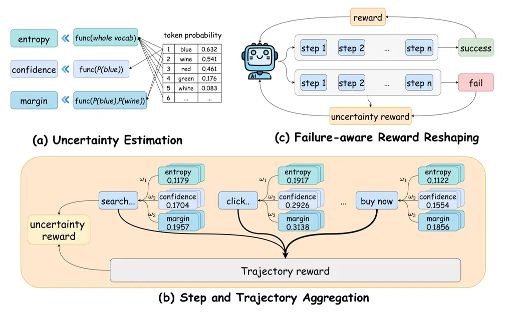
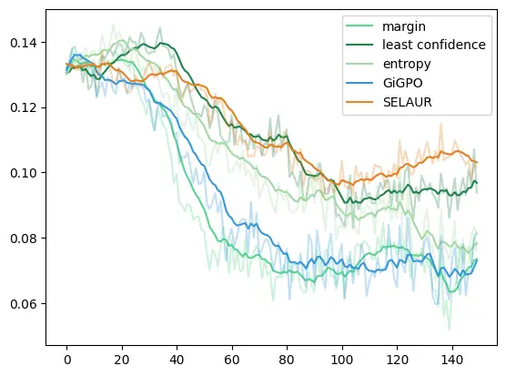
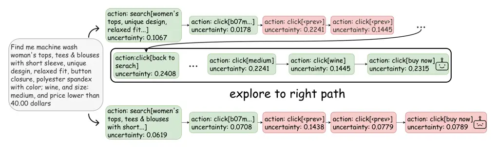

# SELAUR: Self Evolving LLM Agent via Uncertainty-aware Rewards

Dengjia Zhang Affiliation: Johns Hopkins University, Baltimore MD, USA
E-mail <%7Bdzhang98,kenton%7D@jhu.edu>    Xiaoou Liu
Affiliation: Arizona State University, Tempe AZ, USA
E-mail <%7Bxiaoouli,hua.wei%7D@asu.edu>    Lu Cheng
Affiliation: University of Illinois Chicago, Chicago IL, USA
E-mail <lucheng@uic.edu>    Yaqing Wang Affiliation: Purdue University,
West Lafayette IN, USA E-mail <wang5075@purdue.edu>    Kenton Murray
Affiliation: Johns Hopkins University, Baltimore MD, USA
E-mail <%7Bdzhang98,kenton%7D@jhu.edu>    Hua Wei Affiliation: Arizona
State University, Tempe AZ, USA E-mail <%7Bxiaoouli,hua.wei%7D@asu.edu>

###### Abstract

Large language models (LLMs) are increasingly deployed as multi-step
decision-making agents, where effective reward design is essential for
guiding learning. Although recent work explores various forms of reward
shaping and step-level credit assignment, a key signal remains largely
overlooked: the intrinsic uncertainty of LLMs. Uncertainty reflects
model confidence, reveals where exploration is needed, and offers
valuable learning cues even in failed trajectories. We introduce SELAUR:
Self Evolving LLM Agent via Uncertainty-aware Rewards, a reinforcement
learning framework that incorporates uncertainty directly into the
reward design. SELAUR integrates entropy-, least-confidence-, and
margin-based metrics into a combined token-level uncertainty estimate,
providing dense confidence-aligned supervision, and employs a
failure-aware reward reshaping mechanism that injects these uncertainty
signals into step- and trajectory-level rewards to improve exploration
efficiency and learning stability. Experiments on two benchmarks,
ALFWorld and WebShop, show that our method consistently improves success
rates over strong baselines. Ablation studies further demonstrate how
uncertainty signals enhance exploration and robustness.¹¹ 1 code is
available:
https://github.com/adoptedirelia/SELAUR-Self-Evolving-LLM-Agent-via-Uncertainty-aware-Rewards

###### Keywords: 

Uncertainty LLM Agent Reinforcement Learning

## 1 Introduction

Large language models (LLMs) have rapidly evolved from solving
single-turn question-answering tasks \[3, 30\] to functioning as
interactive agents capable of multi-step reasoning and
decision-making \[28\]. In these agentic settings, an LLM no longer
produces a single response but generates a sequence of actions and
intermediate decisions, forming a complete interaction trajectory. For
instance, in ALFWorld \[37\], the agent must interact with a simulated
environment through a series of actions to accomplish the final goal.
Reinforcement learning has become a common paradigm for optimizing such
agents. Conventional RL approaches typically assign rewards based solely
on the final outcome \[19\], which drives the agent to maximize success
but often overlooks the contribution of intermediate steps. Recent work
has introduced step-level credit assignment \[8\], where each decision
within a trajectory is evaluated according to its influence on the final
outcome. This fine-grained reward design allows the training process to
capture more nuanced learning signals and improves policy optimization
stability.

However, a major limitation of most existing approaches is the neglect
of the intrinsic uncertainty inherent in LLMs, even though such
uncertainty can provide valuable information for guiding learning.
Uncertainty plays a critical role in training interactive agents for two
main reasons. First, it serves as a natural measure of model confidence,
enabling the reward signal to reflect not only correctness but also
confidence in each decision. For example, in an information retrieval
scenario, an agent may sequentially query multiple databases before
reaching the correct result. If the model exhibits high uncertainty at a
particular step, this indicates an exploratory state where encouraging
alternative strategies is beneficial. Conversely, when the agent
displays low uncertainty at a step, the reward signal should reinforce
this reliable behavior to promote convergence. Second, incorporating
uncertainty allows agents to extract meaningful learning signals even
from failed trajectories \[59\]. Even if the final result is incorrect,
step-level uncertainty can reveal which decisions are uncertain or
promising, providing useful feedback for refinement in subsequent
updates.

In this work, we advance existing step-level reward mechanisms by
advancing  Self Evolving LLM Agent via Uncertainty-aware Rewards
(SELAUR). SELAUR integrates token-level uncertainty estimates into both
step-level and trajectory-level evaluations, ensuring that the agent
benefits from informative feedback across the entire learning process.
Specifically, we: (1) explore multiple token-level uncertainty metrics
(i.e., entropy, least confidence, and margin) and integrate them into a
unified uncertainty measure; (2) aggregate these signals into step- and
trajectory-level confidence estimations; and (3) incorporate these
uncertainty-aware signals into both step-level and trajectory-level
rewards. This design enables the agent to leverage uncertainty not only
to enhance exploration but also to extract value from failed
experiences, leading to more balanced and stable policy learning. We
evaluate our method on two well-established interactive benchmarks,
ALFWorld and WebShop \[51\]. The results show that by explicitly
modeling failure signals in the reward function, our failure-aware
reward reshaping method consistently improves task success rates
compared to strong reinforcement learning baselines. Our main
contributions are summarized as follows: (1) We introduce a unified
uncertainty framework that integrates multiple token-level uncertainty
measures, enabling a more accurate characterization of model confidence
and providing dense, informative supervision derived directly from these
confidence estimates. (2) We introduce a failure-aware reward reshaping
mechanism that integrates these uncertainty signals into both step- and
trajectory-level rewards, improving exploration efficiency and
stability. (3) We empirically demonstrate that incorporating information
from failed trajectories can provide valuable training signals.

## 2 Related Work

Uncertainty Quantification in LLMs. Uncertainty quantification (UQ) has
been extensively studied in machine learning as a means of estimating
prediction confidence \[43, 36, 7\]. In natural language processing,
token-level entropy and consistency-based measures \[9, 23\] have been
used for detecting unreliable outputs, improving robustness, and
enabling selective prediction. For LLMs, uncertainty estimation has
proven useful in tasks such as answer verification \[16\], selective
QA \[17\], hallucination detection \[24\], continual learning \[58\],
active RAG \[25\], LLMs self-improvement \[12\], and efficient reasoning
\[39\]. These studies underscore that uncertainty is a strong indicator
of reliability.

In RL and decision-making, uncertainty has further been leveraged to
drive exploration through mechanisms such as intrinsic motivation or
optimism under uncertainty \[55, 40, 20\]. However, few works have
explicitly integrated uncertainty signals into the training of LLM
agents \[42, 57, 49\]. Our approach bridges this gap by using
token-level uncertainty to shape both step- and trajectory-level
rewards, enabling agents to balance between exploiting confident
knowledge and exploring uncertain but potentially valuable strategies.

LLM Agents and Reinforcement Learning. Recent advancements have
transformed large language models (LLMs) from single-turn predictors
into general-purpose agents capable of multi-step reasoning, planning,
and tool use \[48, 46, 54\]. Benchmarks such as ALFWorld \[37\] and
WebShop \[51\] evaluate these abilities by requiring agents to execute
sequences of actions in interactive environments. To improve
performance, prior work has explored prompting techniques \[18\], tool
augmentation \[31, 34\], and trajectory optimization \[38\]. Methods
like chain-of-thought prompting \[47\] and planner–executor
frameworks \[11, 41\] enhance reasoning and task decomposition, yet they
often depend on supervised trajectories that may not generalize broadly.

Reinforcement learning (RL) provides a complementary approach for
training LLM agents toward complex objectives \[2, 4\]. While RLHF \[6,
27\] has proven effective for optimizing final outputs, outcome-based
rewards are typically sparse, offering limited guidance for intermediate
reasoning steps \[22, 53\]. Step-level credit assignment methods \[26,
15, 13\] address this by distributing rewards across individual
decisions, but they generally ignore model uncertainty. Recent agentic
RL frameworks such as ReAct \[52\], Voyager \[44\], and Reflexion\[35\]
demonstrate the benefits of process-level feedback, yet they still rely
heavily on explicit external or self-generated evaluations \[56, 29,
21\]. In contrast, our proposed SELAUR framework leverages
uncertainty-based intrinsic rewards as an internal learning signal. By
transforming low-confidence or failed reasoning steps into structured
feedback, SELAUR provides dense, informative supervision directly from
model confidence estimates. This enables LLM agents to improve policy
stability, recover from uncertain reasoning paths, and learn more
effectively without relying on external environment rewards or
reflection heuristics.

## 3 Method



Figure 1: Overview of our method, SELAUR. (a) Uncertainty Estimation: We
employ three approaches to estimate model uncertainty: entropy,
confidence, and margin, derived from token probability distributions.
(b) Step and Trajectory Aggregation: Throughout the model’s process, we
compute two types of rewards that contribute to the uncertainty reward.
At the step level, token-level uncertainties are aggregated. At the
trajectory level, step-level uncertainties are combined with varying
weights, where later steps receive higher weights in the overall
trajectory reward. (c) Failure-aware Reward Reshaping: For successful
cases, the model is trained with the standard reward. For failed cases,
we incorporate the uncertainty reward into the training loop to improve
learning robustness.

In this paper, we propose a novel reinforcement learning framework,
 Self Evolving LLM Agent via Uncertainty-aware Rewards (SELAUR),
designed for LLM agents.

As illustrated in Figure 1, SELAUR consists of three main modules: (1)
Uncertainty Estimation, (2) Step and Trajectory Aggregation, and (3)
Failure-aware Reward Shaping. This architecture ensures that failures
are not discarded but instead transformed into learning opportunities,
where uncertainty provides dense feedback about where the model
hesitated or was less confident.

### 3.1 Uncertainty Estimation

A core component of SELAUR is quantifying the uncertainty of model at
each decoding step. Since different uncertainty measures capture
distinct facets of predictive reliability, we combine three
complementary metrics into a unified token-level uncertainty to capture
uncertainty from multiple perspectives: global distributional spread
(entropy), local decision confidence (least confidence), and comparative
distinctiveness (margin).

#### Entropy.

Entropy \[14\] measures the dispersion of the probability distribution
over the vocabulary, reflecting how concentrated or spread out the
model’s belief is. A higher entropy indicates that the model distributes
probability mass across many tokens, whereas a lower entropy implies
strong confidence in a single token:
$`u^{\text{ent}}_{t,j}=\frac{-\sum_{c}p_{t,c}\log p_{t,c}}{\log|\mathcal{V}|}`$,
where $`p_{t,c}`$ is the predicted probability of token $`c`$ at step
$`t`$, and $`|\mathcal{V}|`$ denotes the vocabulary size.

#### Least confidence.

The least confidence measure \[5\] assesses uncertainty using only the
probability of the selected token. Lower predicted probability indicates
higher uncertainty and higher predicted probability brings higher
confidence: $`u^{\text{lc}}_{t,j}=1-p_{t,(1)}`$, where $`p_{t,j}`$ is
the probability of chosen token at step $`t`$.

#### Margin.

The margin-based uncertainty \[50\] captures uncertainty through the gap
between the top two token probabilities. Smaller margins reflect greater
ambiguity, whereas larger margins indicate stronger confidence:
$`u^{\text{mar}}_{t,j}=\sigma\!\left(\frac{1-(p_{t,(1)}-p_{t,(2)})}{s}\right)`$,
where $`p_{t,(1)}`$ and $`p_{t,(2)}`$ are the top-2 token probabilities,
$`s`$ is a scaling factor, and $`\sigma(\cdot)`$ is the sigmoid function
to normalize the score.

#### Aggregated Uncertainty.

The final token-level uncertainty integrates the three measures with
tunable weights:
$`u_{t,j}=w_{\text{ent}}u^{\text{ent}}_{t,j}+w_{\text{lc}}u^{\text{lc}}_{t,j}+w_{\text{mar}}u^{\text{mar}}_{t,j}.`$

This aggregation allows the framework to capture uncertainty from
multiple perspectives with overall distributional spread, decision
confidence, and distinctiveness.

### 3.2 Step and Trajectory Aggregation

Uncertainty at the token level provides granular feedback, but
reinforcement learning requires signals at the step or trajectory scale.
Therefore, we design the following hierarchical aggregation mechanisms
as reward signals.

#### Step-level aggregation.

At each step $`t`$, token uncertainties are aggregated by combining
average values: $`u^{\text{step}}_{t}=\frac{1}{j}\sum_{j}u_{t,j}.`$

#### Trajectory-level aggregation.

To capture overall uncertainty across a trajectory $`\tau`$, we adopt an
exponentially discounted aggregation, assigning greater weight to later
steps, which often determine final success:
$`U(\tau)=\frac{\sum_{t=1}^{T}\lambda^{T-t}u^{\text{step}}_{t}}{\sum_{t=1}^{T}\lambda^{T-t}},`$

where $`\lambda\in(0,1]`$ is the discount factor controlling the
temporal emphasis.

### 3.3 Failure-aware Reward Shaping

Standard RLVR formulations use binary outcome rewards
(success/failure) \[10\], which risks discarding useful gradient signals
from failed trajectories. SELAUR reshapes rewards by integrating
uncertainty into per-step feedback, thus transforming failures into
informative learning signals.

#### Step-wise shaping.

When a trajectory fails, each step reward is augmented by its normalized
uncertainty:

```math
\tilde{r}_{t}^{\text{step}}=\begin{cases}\mathbf{1}[\text{fail}]\cdot w_{t}\,\hat{u}^{\text{step}}_{t},&\text{if fail},\\
r_{t},&\text{otherwise},\end{cases} \tag{1}
```

where $`w_{t}`$ is a step-dependent weight and
$`\hat{u}^{\text{step}}_{t}`$ denotes the normalized step uncertainty.
In our settings, $`w_{t}`$ is set to 0.95 to keep failure rewards
informative but always smaller than the success rewards.

#### Trajectory-level shaping.

Similarly, the trajectory reward is modified as:

```math
\tilde{r}^{\text{traj}}=\begin{cases}U(\tau),&\text{if fail},\\
r,&\text{otherwise}.\end{cases} \tag{2}
```

This reward shaping mechanism converts failed experiences into dense and
meaningful signals, encouraging the agent to revisit uncertain reasoning
paths and refine its policy. In essence, SELAUR bridges the gap between
sparse, outcome-based rewards and dense, token-level learning signals by
aligning reward dynamics with model uncertainty.

## 4 Experiments

### 4.1 Experimental Setup

We evaluate our proposed method on two widely adopted interactive
benchmarks: ALFWorld, which emphasizes generalization in instruction
following, and WebShop, which focuses on goal-oriented decision-making
in realistic e-commerce environments. These benchmarks are complementary
in nature: ALFWorld requires compositional reasoning across diverse
household tasks, while WebShop challenges agents with open-ended product
selection conditioned on natural goals.

Experiments were conducted on NVIDIA A100 and H100 GPUs. For all
experiments, we set the learning rate to $`1\times 10^{-6}`$, the total
number of training steps to 150, and the rollout size to 8. Considering
the varying complexity of the tasks, we adapt the maximum interaction
steps for each environment: specifically, the limit is set to 50 for
ALFWorld and 15 for WebShop.

We compare our approach against several representative reinforcement
learning baselines, including PPO \[32\], RLOO \[1\], GRPO \[33\], and
GiGPO \[8\]. For evaluation, following the existing work \[45\], we
primarily report the task success rate, which directly measures whether
the agent successfully accomplishes the tasks. In addition, for the
WebShop benchmark, we include the task score, which quantifies the
alignment between user intent and the agent’s final product selection.

| Base Model   | Method       | AlfWorld |        |        |        |        |        |        | WebShop |        |
| ------------ | ------------ | -------- | ------ | ------ | ------ | ------ | ------ | ------ | ------- | ------ |
|              |              | Pick     | Look   | Clean  | Heat   | Cool   | Pick2  | All    | Score   | Succ.  |
| Qwen2.5-1.5B | prompting    | 0.1071   | 0.0000 | 0.0000 | 0.071  | 0.0000 | 0.0000 | 0.0312 | 0.2180  | 0.0429 |
|              | PPO          | 0.9142   | 0.3750 | 0.8333 | 0.8333 | 0.7368 | 0.7916 | 0.8046 | 0.7126  | 0.4921 |
|              | RLOO         | 0.9000   | 0.7000 | 0.9200 | 0.7142 | 0.6875 | 0.5000 | 0.7812 | 0.8022  | 0.6394 |
|              | GRPO         | 0.6756   | 0.5000 | 0.8000 | 0.9285 | 0.6190 | 0.5263 | 0.6796 | 0.8359  | 0.6718 |
|              | GiGPO        | 0.9143   | 0.7500 | 1.0000 | 0.8889 | 0.8421 | 0.7916 | 0.8828 | 0.8017  | 0.6757 |
|              | Ours(SELAUR) | 0.9143   | 0.6250 | 0.9583 | 1.0000 | 0.7894 | 0.8750 | 0.8906 | 0.8812  | 0.7656 |
| Qwen2.5-7B   | prompting    | 0.2800   | 0.2500 | 0.1200 | 0.0000 | 0.0370 | 0.0000 | 0.1171 | 0.0288  | 0.0039 |
|              | PPO          | 0.7241   | 0.7000 | 0.8800 | 0.4285 | 0.7500 | 0.6111 | 0.7109 | 0.8689  | 0.7187 |
|              | RLOO         | 1.0000   | 0.8000 | 1.0000 | 0.8571 | 0.6875 | 0.7778 | 0.8593 | 0.8768  | 0.7578 |
|              | GRPO         | 0.8275   | 0.8000 | 0.9200 | 0.5714 | 0.6875 | 0.6111 | 0.7500 | 0.8184  | 0.7578 |
|              | GiGPO        | 1.0000   | 1.0000 | 1.0000 | 0.9444 | 0.7894 | 0.9166 | 0.9453 | 0.8867  | 0.7929 |
|              | Ours(SELAUR) | 1.0000   | 1.0000 | 1.0000 | 1.0000 | 0.9259 | 0.9259 | 0.9687 | 0.8935  | 0.7968 |

Table 1: Main experimental results on ALFWorld and WebShop. For
ALFWorld, we report success rates (%) on individual tasks and their
overall average (All). For WebShop, we report both the task score and
success rate (%).Bold numbers mean the best performance, and italic
numbers mean the second-best. Overall, our method achieves the strongest
performance across both benchmarks.

### 4.2 Main Results

As shown in Table 1, the purely prompted agent performs poorly across
both benchmarks, indicating that instruction-following ability alone is
insufficient for complex interactive reasoning without
reinforcement-based adaptation. Among learning-based methods, PPO
achieves competitive performance, especially on the smaller 1.5B model,
but it suffers from lower efficiency because of its extra critic
network. RLOO and GRPO provide more balanced results, maintaining good
performance while being computationally more efficient. GiGPO, which
introduces step-level reward modeling, further improves overall outcomes
by enabling more fine-grained step reward throughout the trajectory.

Building upon these advances, our proposed method surpasses GiGPO by
integrating uncertainty estimation into the RL process. The inclusion of
diverse uncertainty measures allows the agent to better identify and
explore uncertain states, leading to more comprehensive policy
improvement across different learning stages. This uncertainty-aware
exploration encourages the model to actively refine its decision-making
process rather than overfitting to confident but suboptimal behaviors.
We provide a detailed qualitative discussion of this behavior in Section
4.4.

| Setting |                  |        | Task Score | Success Rate |
| ------- | ---------------- | ------ | ---------- | ------------ |
| entropy | least confidence | margin |            |              |
| ✗       | ✗                | ✗      | 0.8017     | 0.6757       |
| ✓       | ✗                | ✗      | 0.8504     | 0.7265       |
| ✗       | ✓                | ✗      | 0.8465     | 0.7226       |
| ✗       | ✗                | ✓      | 0.7834     | 0.6328       |
| ✓       | ✓                | ✗      | 0.8263     | 0.6953       |
| ✗       | ✓                | ✓      | 0.8589     | 0.6562       |
| ✓       | ✗                | ✓      | 0.8576     | 0.7187       |
| ✓       | ✓                | ✓      | 0.8812     | 0.7656       |

Table 2: Each row evaluates a specific combination of metrics: ✓
indicates the inclusion of an uncertainty metric in the selection
process, while ✗ denotes its exclusion. Results show that while
individual or pairwise metrics provide partial gains, the full
integration of Entropy, Least Confidence, and Margin (✓ across all)
yields the optimal performance in both Task Score and Success Rate.

### 4.3 Ablation Study

#### Effect of Different Uncertainty Measures.

We examine the impact of different uncertainty configurations on the
WebShop dataset. As shown in Table 2, using only one type of uncertainty
or a pairwise combination yields partial improvements but does not match
the performance of the full model. We note that when the method relies
solely on entropy-based uncertainty, it aligns with the recent approach
proposed in \[49\]. However, while entropy effectively captures the
overall "sharpness" of the policy distribution, it tends to overlook
nuanced ambiguities during decision-making.

In contrast, least confidence and margin metrics offer a more granular
perspective by focusing on the competitive relationship between the
top-ranked actions. The superior performance of the unified model
suggests that these measures are orthogonal and complementary: they
collectively identify diverse "zones of uncertainty" that a solitary
metric might fail to detect. These findings imply that different
uncertainty types play dominant roles at varying stages of the learning
process, fostering a more stable and robust exploration strategy through
their synergy.



Figure 2: Entropy change during training under different uncertainty
strategies. SELAUR maintains higher entropy throughout training,
indicating stronger exploration compared to other methods.

We further visualize the evolution of entropy during training across
different uncertainty configurations, as illustrated in Fig. 2. Compared
to other variants, SELAUR maintains a higher entropy level in the late
stage, suggesting that the combined approach promotes greater
uncertainty and facilitates broader exploration throughout the learning
process.

| Reward Method | AlfWorld | WebShop |
| ------------- | -------- | ------- |
| Baseline      | 0.8828   | 0.6757  |
| Negative      | 0.8516   | 0.7539  |
| Exponential   | 0.8750   | 0.7031  |
| Ours (SELAUR) | 0.8906   | 0.7656  |

Table 3: Comparison of different reward functions on WebShop and
AlfWorld. We report average of success rate(%) on AlfWorld and WebShop.
Our proposed SELAUR achieves the best performance, demonstrating a
better trade-off between exploration and exploitation.

#### Effect of Different Reward Functions

We also explore different ways of incorporating uncertainty into the
reward function, as summarized in Table 3. The Negative variant replaces
rewards in failure cases with negative values, aiming to penalize
uncertain or ineffective actions. The Exponential variant, on the other
hand, attenuates rewards for successful trajectories according to their
uncertainty level, encouraging the model to be more confident when
success is achieved. Formally, the exponential formulation is defined
as:

```math
\tilde{r}_{t}^{\text{step}}=\begin{cases}0,&\text{if fail},\\
r_{t}\cdot\exp(-\hat{u}^{\text{step}}_{t}),&\text{otherwise}.\end{cases} \tag{3}
```

Both variants underperform compared to our proposed method. For the
exponential approach, the excessive discounting of rewards likely
weakens the reinforcement of successful behaviors, hindering stable
policy learning. For the negative variant, the penalization of
uncertainty contradicts our objective of encouraging controlled
exploration, thereby limiting the model’s ability to adapt in uncertain
states. In contrast, our method formulation consistently achieves the
highest task score and success rate across both benchmarks, effectively
balancing exploration and exploitation throughout training.

### 4.4 Case Studies

To further understand the behavioral differences between GiGPO and
SELAUR, we select several representative qualitative trajectories from
the WebShop environment. When performing the same product search tasks,
our model not only achieves higher success rates but also exhibits more
efficient and coherent decision trajectories. As illustrated in
Figure 3, GiGPO often revisits similar intermediate actions repeatedly,
showing signs of uncertainty collapse and becoming trapped in local
exploration loops. In contrast, although our method may initially
encounter similar detours, its uncertainty-aware guidance allows it to
dynamically adjust exploration behavior according to confidence levels.
This mechanism helps the agent recognize and escape from unproductive
cycles after a few repetitions, ultimately steering it toward the
correct path.



Figure 3: Comparison of action traces in the WebShop environment. Top:
SELAUR leverages uncertainty to explore alternative paths rather than
being trapped in a single incorrect trajectory, eventually discovering
the correct solution. Bottom: GiGPO exhibits low uncertainty, leading to
repetitive and fixed behaviors.

## 5 Conclusion

In this work, we presented SELAUR, a reinforcement learning framework
that incorporates multi-type uncertainty signals into reward shaping to
more effectively exploit information from both successful and
unsuccessful trajectories. By estimating uncertainty at the token, step,
and trajectory levels, SELAUR enables principled reward modulation that
facilitates deeper exploration, mitigates entrapment in suboptimal
reasoning loops, and extracts supervisory signal from trajectories that
would otherwise provide limited learning value. Empirical results across
multiple benchmarks demonstrate consistent improvements over strong
baselines, indicating that uncertainty-aware reward shaping contributes
to more stable learning dynamics, higher task success rates, and
enhanced adaptability in complex interactive environments. Future
research will investigate the extension of SELAUR to vision-centric and
multimodal tasks, as well as evaluate its efficacy in domains
characterized by high-dimensional observations and more diverse forms of
uncertainty.

## Acknowledgments

The work was partially supported by NSF awards 2442477, 2312862,2533996,
NSF-Simons SkAI Institute, NIH R01AG091762, UIC IEHDSR seed funding. We
thank Amazon Research Awards, Cisco Research Awards, Google, and OpenAI
for providing us with API credits. The authors acknowledge Research
Computing at Arizona State University and Johns Hopkins University, NSF
ACCESS for providing computing resources. The views and conclusions in
this paper should not be interpreted as representing any funding
agencies.

## References

- \[1\] A. Ahmadian, C. Cremer, M. Gallé, M. Fadaee, J. Kreutzer, O.
  Pietquin, A. Üstün, and S. Hooker (2024) Back to basics: revisiting
  reinforce style optimization for learning from human feedback in llms.
  arXiv preprint arXiv:2402.14740. Cited by: §4.1.
- \[2\] M. S. Aissi, C. Romac, T. Carta, S. Lamprier, P. Oudeyer, O.
  Sigaud, L. Soulier, and N. Thome (2025) Reinforcement learning for
  aligning large language models agents with interactive environments:
  quantifying and mitigating prompt overfitting. In Findings of the
  Association for Computational Linguistics: NAACL 2025, pp. 7030–7046.
  Cited by: §2.
- \[3\] T. Brown, B. Mann, N. Ryder, M. Subbiah, J. D. Kaplan, P.
  Dhariwal, A. Neelakantan, P. Shyam, G. Sastry, A. Askell, et
  al. (2020) Language models are few-shot learners. NeurIPS 33,
  pp. 1877–1901. Cited by: §1.
- \[4\] T. Carta, C. Romac, T. Wolf, S. Lamprier, O. Sigaud, and P.
  Oudeyer (2023) Grounding large language models in interactive
  environments with online reinforcement learning. In ICML,
  pp. 3676–3713. Cited by: §2.
- \[5\] Y. Chen, S. Mani, and H. Xu (2012) Applying active learning to
  assertion classification of concepts in clinical text. Journal of
  biomedical informatics 45 (2), pp. 265–272. Cited by: §3.1.
- \[6\] P. F. Christiano, J. Leike, T. Brown, M. Martic, S. Legg, and D.
  Amodei (2017) Deep reinforcement learning from human preferences. In
  NeurIPS, Cited by: §2.
- \[7\] G. Chrysos, Y. Li, A. N. Angelopoulos, S. Bates, B. Plank,
  and M. E. Khan Quantify uncertainty and hallucination in foundation
  models: the next frontier in reliable ai. In ICLR 2025 Workshop
  Proposals, Cited by: §2.
- \[8\] L. Feng, Z. Xue, T. Liu, and B. An (2025) Group-in-group policy
  optimization for llm agent training. arXiv preprint arXiv:2505.10978.
  Cited by: §1, §4.1.
- \[9\] M. Fomicheva, S. Sun, E. Yankovskaya, F. Blain, V. Chaudhary, F.
  Guzmán, B. Haddow, R. Sennrich, and L. Specia (2020) Uncertainty
  estimation for quality estimation. In ACL, Cited by: §2.
- \[10\] D. Guo, D. Yang, H. Zhang, J. Song, R. Zhang, R. Xu, Q. Zhu, S.
  Ma, P. Wang, X. Bi, et al. (2025) Deepseek-r1: incentivizing reasoning
  capability in llms via reinforcement learning. arXiv preprint
  arXiv:2501.12948. Cited by: §3.3.
- \[11\] G. He, G. Demartini, and U. Gadiraju (2025) Plan-then-execute:
  an empirical study of user trust and team performance when using llm
  agents as a daily assistant. In CHI, pp. 1–22. Cited by: §2.
- \[12\] L. Huang, D. Li, H. Liu, and L. Cheng (2025) Beyond accuracy:
  the role of calibration in self-improving large language models. arXiv
  preprint arXiv:2504.02902. Cited by: §2.
- \[13\] W. Huang, P. Abbeel, D. Pathak, and I. Mordatch (2022) Inner
  monologue: embodied reasoning through planning with language models.
  In NeurIPS, Cited by: §2.
- \[14\] Y. Huang, Y. Liu, R. Thirukovalluru, A. Cohan, and B.
  Dhingra (2024) Calibrating long-form generations from large language
  models. arXiv preprint arXiv:2402.06544. Cited by: §3.1.
- \[15\] H. J. Jeon, S. Milli, and A. D. Dragan (2020) Reward-rational
  (implicit) choice: a unifying formalism for reward learning. In
  NeurIPS, Cited by: §2.
- \[16\] S. Kadavath and et al. (2022) Language models (mostly) know
  what they know. arXiv preprint arXiv:2207.05221. Cited by: §2.
- \[17\] A. Kamath, R. Jia, and P. Liang (2020) Selective question
  answering under domain shift. In ACL, Cited by: §2.
- \[18\] T. Kojima, S. S. Gu, M. Reid, Y. Matsuo, and Y. Iwasawa (2022)
  Large language models are zero-shot reasoners. NeurIPS 35,
  pp. 22199–22213. Cited by: §2.
- \[19\] M. Kwon, I. ElSayed-Aly, and L. Feng (2024) Adaptive reward
  design for reinforcement learning in complex robotic tasks. arXiv
  e-prints, pp. arXiv–2412. Cited by: §1.
- \[20\] J. Liu, Z. Wang, Y. Zheng, J. Hao, C. Bai, J. Ye, Z. Wang, H.
  Piao, and Y. Sun (2024) Ovd-explorer: optimism should not be the sole
  pursuit of exploration in noisy environments. In AAAI, Vol. 38,
  pp. 13954–13962. Cited by: §2.
- \[21\] Z. Liu, X. Bai, K. Chen, X. Chen, X. Li, Y. Xiang, J. Liu, H.
  Li, Y. Wang, L. Nie, et al. (2025) A survey on the feedback mechanism
  of llm-based ai agents. In IJCAI, pp. 10582–10592. Cited by: §2.
- \[22\] C. Lyu, S. Gao, Y. Gu, W. Zhang, J. Gao, K. Liu, Z. Wang, S.
  Li, Q. Zhao, H. Huang, et al. (2025) Exploring the limit of outcome
  reward for learning mathematical reasoning. arXiv preprint
  arXiv:2502.06781. Cited by: §2.
- \[23\] A. Malinin and M. Gales (2020) Uncertainty estimation and
  calibration in natural language processing. In ICLR Workshop on
  Uncertainty and Robustness in Deep Learning, Cited by: §2.
- \[24\] P. Manakul, A. Liusie, and M. J. Gales (2023) SelfCheckGPT:
  zero-resource black-box hallucination detection for generative large
  language models. In ACL, Cited by: §2.
- \[25\] D. Min, K. Zhang, T. Wu, and L. Cheng (2025) QuCo-rag:
  quantifying uncertainty from the pre-training corpus for dynamic
  retrieval-augmented generation. arXiv preprint arXiv:2512.19134. Cited
  by: §2.
- \[26\] A. Y. Ng, D. Harada, and S. J. Russell (1999) Policy invariance
  under reward transformations: theory and application to reward
  shaping. In ICML, Cited by: §2.
- \[27\] L. Ouyang, J. Wu, X. Jiang, D. Almeida, et al. (2022) Training
  language models to follow instructions with human feedback. NeurIPS.
  Cited by: §2.
- \[28\] A. Plaat, A. Wong, S. Verberne, J. Broekens, and N. Van
  Stein (2025) Multi-step reasoning with large language models, a
  survey. ACM Computing Surveys. Cited by: §1.
- \[29\] Z. Qi, X. Liu, I. L. Iong, H. Lai, X. Sun, J. Sun, X. Yang, Y.
  Yang, S. Yao, W. Xu, et al. WebRL: training llm web agents via
  self-evolving online curriculum reinforcement learning. In ICLR, Cited
  by: §2.
- \[30\] A. Roberts, C. Raffel, and N. Shazeer (2020) How much knowledge
  can you pack into the parameters of a language model?. In EMNLP,
  pp. 5418–5426. Cited by: §1.
- \[31\] T. Schick, J. Dwivedi-Yu, R. Dessì, R. Raileanu, M. Lomeli, E.
  Hambro, L. Zettlemoyer, N. Cancedda, and T. Scialom (2023) Toolformer:
  language models can teach themselves to use tools. NeurIPS 36,
  pp. 68539–68551. Cited by: §2.
- \[32\] J. Schulman, F. Wolski, P. Dhariwal, A. Radford, and O.
  Klimov (2017) Proximal policy optimization algorithms. arXiv preprint
  arXiv:1707.06347. Cited by: §4.1.
- \[33\] Z. Shao, P. Wang, Q. Zhu, R. Xu, J. Song, X. Bi, H. Zhang, M.
  Zhang, Y. Li, Y. Wu, et al. (2024) Deepseekmath: pushing the limits of
  mathematical reasoning in open language models. arXiv preprint
  arXiv:2402.03300. Cited by: §4.1.
- \[34\] C. Shen, Z. Chen, D. Luo, D. Xu, H. Chen, and J. Ni (2024)
  Exploring multi-modal integration with tool-augmented llm agents for
  precise causal discovery. arXiv preprint arXiv:2412.13667 1 (3). Cited
  by: §2.
- \[35\] N. Shinn, F. Cassano, A. Gopinath, K. Narasimhan, and S.
  Yao (2023) Reflexion: language agents with verbal reinforcement
  learning. NeurIPS 36, pp. 8634–8652. Cited by: §2.
- \[36\] O. Shorinwa, Z. Mei, J. Lidard, A. Z. Ren, and A.
  Majumdar (2025) A survey on uncertainty quantification of large
  language models: taxonomy, open research challenges, and future
  directions. ACM Computing Surveys. Cited by: §2.
- \[37\] M. Shridhar, X. Yuan, M. Côté, Y. Bisk, A. Trischler, and M.
  Hausknecht (2020) Alfworld: aligning text and embodied environments
  for interactive learning. arXiv preprint arXiv:2010.03768. Cited by:
  §1, §2.
- \[38\] Y. Song, D. Yin, X. Yue, J. Huang, S. Li, and B. Y. Lin (2024)
  Trial and error: exploration-based trajectory optimization of llm
  agents. In ACL, pp. 7584–7600. Cited by: §2.
- \[39\] J. Su, F. Lin, Z. Feng, H. Zheng, T. Wang, Z. Xiao, X. Zhao, Z.
  Liu, L. Cheng, and H. Wang (2025) Cp-router: an uncertainty-aware
  router between llm and lrm. arXiv preprint arXiv:2505.19970. Cited by:
  §2.
- \[40\] B. Sukhija, L. Treven, C. Sferrazza, F. Dorfler, P. Abbeel,
  and A. Krause (2025) Optimism via intrinsic rewards: scalable and
  principled exploration for model-based reinforcement learning. In 7th
  Robot Learning Workshop: Towards Robots with Human-Level Abilities,
  Cited by: §2.
- \[41\] S. Sun, Y. Liu, S. Wang, D. Iter, C. Zhu, and M. Iyyer (2024)
  Pearl: prompting large language models to plan and execute actions
  over long documents. In EACL, pp. 469–486. Cited by: §2.
- \[42\] M. Suri, P. Mathur, N. Lipka, F. Dernoncourt, R. A. Rossi,
  and D. Manocha (2025) Structured uncertainty guided clarification for
  llm agents. arXiv preprint arXiv:2511.08798. Cited by: §2.
- \[43\] P. J. van Leeuwen, J. C. Chiu, and C. K. Yang (2024)
  Uncertainty quantification for deep learning. arXiv preprint
  arXiv:2405.20550. Cited by: §2.
- \[44\] G. Wang, Y. Xie, Y. Jiang, A. Mandlekar, C. Xiao, Y. Zhu, L.
  Fan, and A. Anandkumar (2023) Voyager: an open-ended embodied agent
  with large language models. arXiv preprint arXiv:2305.16291. Cited by:
  §2.
- \[45\] H. Wang, A. Prasad, E. Stengel-Eskin, and M. Bansal (2024) Soft
  self-consistency improves language model agents. arXiv preprint
  arXiv:2402.13212. Cited by: §4.1.
- \[46\] L. Wang, C. Ma, X. Feng, Z. Zhang, H. Yang, J. Zhang, Z.
  Chen, J. Tang, X. Chen, Y. Lin, et al. (2024) A survey on large
  language model based autonomous agents. Frontiers of Computer Science
  18 (6), pp. 186345. Cited by: §2.
- \[47\] J. Wei, X. Wang, D. Schuurmans, M. Bosma, F. Xia, E. Chi, Q. V.
  Le, D. Zhou, et al. (2022) Chain-of-thought prompting elicits
  reasoning in large language models. NeurIPS 35, pp. 24824–24837. Cited
  by: §2.
- \[48\] Z. Xi, W. Chen, X. Guo, W. He, Y. Ding, B. Hong, M. Zhang, J.
  Wang, S. Jin, E. Zhou, et al. (2025) The rise and potential of large
  language model based agents: a survey. Science China Information
  Sciences 68 (2), pp. 121101. Cited by: §2.
- \[49\] C. Xie, R. Pan, X. Wu, Y. Zhang, J. Fu, T. Gao, and G.
  Zhou (2025) Unlocking exploration in rlvr: uncertainty-aware advantage
  shaping for deeper reasoning. arXiv preprint arXiv:2510.10649. Cited
  by: §2, §4.3.
- \[50\] Y. Yang, H. Yoo, and H. Lee (2024) Maqa: evaluating uncertainty
  quantification in llms regarding data uncertainty. arXiv preprint
  arXiv:2408.06816. Cited by: §3.1.
- \[51\] S. Yao, H. Chen, J. Yang, and K. Narasimhan (2022) Webshop:
  towards scalable real-world web interaction with grounded language
  agents. NeurIPS 35, pp. 20744–20757. Cited by: §1, §2.
- \[52\] S. Yao, J. Zhao, D. Yu, N. Du, I. Shafran, K. R. Narasimhan,
  and Y. Cao (2022) React: synergizing reasoning and acting in language
  models. In ICLR, Cited by: §2.
- \[53\] C. Ye, Z. Yu, Z. Zhang, H. Chen, N. Sadagopan, J. Huang, T.
  Zhang, and A. Beniwal (2025) Beyond correctness: harmonizing process
  and outcome rewards through rl training. arXiv preprint
  arXiv:2509.03403. Cited by: §2.
- \[54\] A. Yehudai, L. Eden, A. Li, G. Uziel, Y. Zhao, R. Bar-Haim, A.
  Cohan, and M. Shmueli-Scheuer (2025) Survey on evaluation of llm-based
  agents. arXiv preprint arXiv:2503.16416. Cited by: §2.
- \[55\] R. Yu, S. Wan, Y. Wang, C. Gao, L. Gan, Z. Zhang, and D.
  Zhan (2025) Reward models in deep reinforcement learning: a survey.
  arXiv preprint arXiv:2506.15421. Cited by: §2.
- \[56\] K. Zhang, Y. Zuo, B. He, Y. Sun, R. Liu, C. Jiang, Y. Fan, K.
  Tian, G. Jia, P. Li, et al. (2025) A survey of reinforcement learning
  for large reasoning models. arXiv preprint arXiv:2509.08827. Cited by:
  §2.
- \[57\] Q. Zhao, X. Zhao, Y. Liu, W. Cheng, Y. Sun, M. Oishi, T.
  Osaki, K. Matsuda, H. Yao, and H. Chen (2024) SAUP: situation
  awareness uncertainty propagation on llm agent. arXiv preprint
  arXiv:2412.01033. Cited by: §2.
- \[58\] X. Zhou and L. Cheng (2025) Robust uncertainty quantification
  for self-evolving large language models via continual domain
  pretraining. arXiv preprint arXiv:2510.22931. Cited by: §2.
- \[59\] X. Zhu, M. Xia, Z. Wei, W. Chen, D. Chen, and Y. Meng (2025)
  The surprising effectiveness of negative reinforcement in llm
  reasoning. arXiv preprint arXiv:2506.01347. Cited by: §1.
