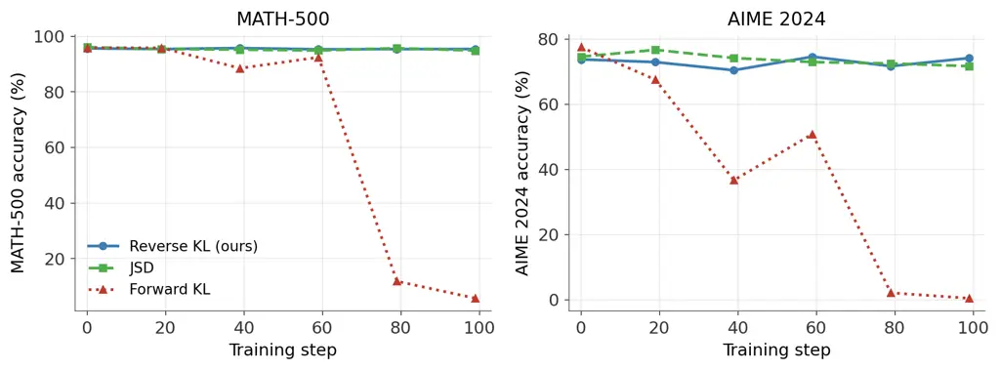
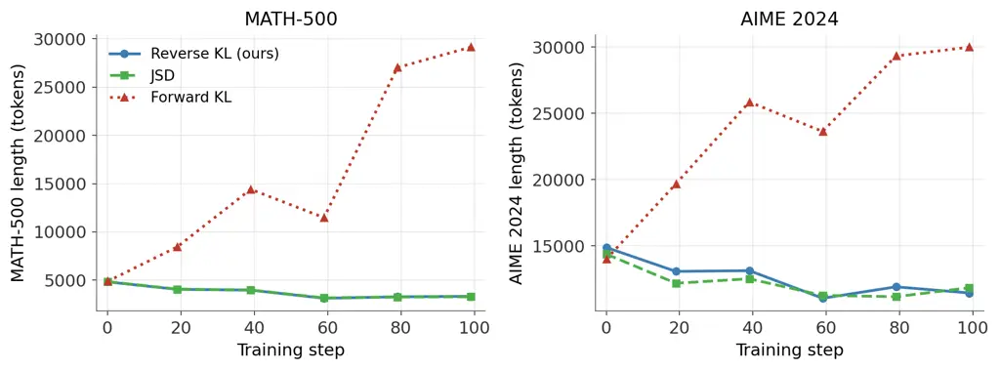

# CRISP: Compressed Reasoning via Iterative Self-Policy Distillation

Hejian Sang ^(†)^(†)thanks: Equal contribution.^(†)^(†)thanks:
Correspondence to hejian@alumni.iastate.edu
Email: [hejian@alumni.iastate.edu](mailto:)    Yuanda Xu¹¹footnotemark:
1 Email: [yuanda@math.princeton.edu](mailto:)    Zhengze
Zhou¹¹footnotemark: 1 Email: [zz433@cornell.edu](mailto:)    Ran
He¹¹footnotemark: 1 Email: [rh2528@columbia.edu](mailto:)    Zhipeng
Wang Email: [zhipeng.wang@alumni.rice.edu](mailto:)    Jiachen Sun
Email: [jiachens@umich.edu](mailto:)

###### Abstract

Reasoning models often generate far more tokens than a task requires,
which raises inference cost and can compound errors. We introduce CRISP
(Compressed Reasoning via Iterative Self-Policy Distillation), an
on-policy self-distillation method that teaches a model to reason more
concisely by distilling its own concise behavior back into itself. The
method uses a single idea: condition the same model on a “be concise”
instruction to obtain teacher logits, then minimize the per-token
reverse KL divergence between the student and this teacher on the
student’s own rollouts. It requires no ground-truth answers, no token
budgets, and no difficulty estimators. The reverse-KL objective is
naturally difficulty-adaptive: it compresses easy problems aggressively
while preserving the reasoning steps that hard problems require. On
Qwen3-14B, CRISP cuts reasoning length by up to 56% on MATH-500 and 38%
on the harder AIME 2024, while improving MATH-500 accuracy by up to 3.3
points over the base model and holding AIME 2024 accuracy within about
one point. This behavior generalizes across model sizes and families:
Qwen3-8B shows the same compression with accuracy preserved, and
DeepSeek-R1-Distill-Llama-8B improves accuracy on all five benchmarks
while shortening its responses. General capabilities are preserved
across all three models. Code is available at
[https://github.com/HJSang/OPSD_Reasoning_Compression](https://github.com/HJSang/OPSD_Reasoning_Compression).

Figure 1: Reasoning compression with preserved accuracy on Qwen3-14B.
Results across three math benchmarks of increasing difficulty under a
30K-token budget (mean@8). a, Average reasoning length: CRISP reduces
length by 56% on MATH-500, 38% on AIME 2024, and 32% on AIME 2025, with
the largest reduction on the easiest benchmark. b, Accuracy: CRISP
improves MATH-500 accuracy (93.0 to 96.3) and holds AIME 2024 within
about one point, with a modest drop on the hardest AIME 2025 under this
aggressive (uniform-instruction) setting.

## 1 Introduction

Large reasoning models generate long chains of intermediate reasoning
before producing an answer. Systems such as OpenAI o1 (Jaech et al.,
2024), Gemini 2.5 (Comanici et al., 2025), DeepSeek-R1 (Guo et al.,
2025), and Qwen3 (Yang et al., 2025) produce thousands of tokens of
deliberation, exploring alternatives, checking intermediate steps, and
verifying conclusions. This deliberation helps on hard problems, but the
models also produce long reasoning traces on easy inputs where a short
answer would suffice (Snell et al., 2024; Muennighoff et al., 2025). The
excess tokens raise inference cost and latency, and on some problems
they degrade accuracy by introducing errors in otherwise correct
solutions.

Several families of methods address this problem (Appendix B surveys
recent work), but each has a limitation. Reinforcement learning methods
add a length penalty to the reward, which requires ground-truth answers
and can reduce the model’s ability to explore (Aggarwal and Welleck,
2025; Wan et al., 2026; Liu et al., 2025). Supervised fine-tuning
methods train on externally curated short traces, which causes
distribution shift and forgetting (Huang et al., 2025; Shenfeld et al.,
2026). Most methods apply a uniform compression target rather than
adapting to problem difficulty. Prompting methods change behavior only
while the prompt is present and do not persist in the weights.

We propose CRISP (Compressed Reasoning via Iterative Self-Policy
Distillation), which avoids these limitations with a single mechanism:
instruct the model to be concise, then distill that behavior back into
the model so it persists without the instruction. Given a reasoning
model $`\pi_{\theta}`$, we define:

- •
  Teacher: $`\pi_{\theta}(\cdot\mid x,c)`$, the same model conditioned
  on a conciseness instruction $`c`$ (for example: “Solve concisely,
  avoid unnecessary steps”).
- •
  Student: $`\pi_{\theta}(\cdot\mid x)`$, the same model without the
  compression instruction.

Training generates student rollouts and minimizes the per-token reverse
KL divergence between student and teacher distributions. This on-policy
self-distillation approach requires no ground-truth answers, no reward
engineering, and no difficulty estimation. The compression signal
emerges naturally from the KL objective, adapting automatically to
problem difficulty.

|                                                                    |            |              |                      |                     |
| ------------------------------------------------------------------ | ---------- | ------------ | -------------------- | ------------------- |
| Method                                                             | On- policy | No GT needed | Difficulty- adaptive | Entropy- preserving |
| RL + length penalty (Aggarwal and Welleck, 2025; Wan et al., 2026) | ✓          | ✗            | ✗                    | ✗                   |
| SFT on compressed CoT (Huang et al., 2025)                         | ✗          | ✗            | ✗                    | ✓                   |
| OPCD (Ye et al., 2026)                                             | ✓          | ✗            | ✗                    | ✓                   |
| DLER (Liu et al., 2025)                                            | ✓          | ✗            | ✗                    | ✗                   |
| Prompting / pruning (Xu et al., 2025)                              | —          | ✓            | ✗                    | ✓                   |
| CRISP (ours)                                                       | ✓          | ✓            | ✓                    | ✓                   |

Table 1: Comparison of reasoning compression methods. CRISP uniquely
combines on-policy training, no dependence on ground-truth (GT) answers,
difficulty-adaptive compression, and entropy preservation (Appendix H).

Table 1 contrasts CRISP with representative methods from each paradigm.
CRISP is the only approach that satisfies all four desiderata.

##### Summary of results.

On Qwen3-8B and Qwen3-14B, CRISP reduces MATH-500 reasoning length by
32% to 57% while preserving accuracy, and it improves Qwen3-14B MATH-500
accuracy by up to 3.3 points (Table 2). Compression is
difficulty-adaptive: reductions are largest on the easier MATH-500 and
smaller on the harder AIME benchmarks, where accuracy stays within about
one point of the base model. The method readily adopts different concise
behaviors: different conciseness instructions all yield strong
compression with preserved accuracy, showing that the effect does not
depend on a single hand-tuned prompt. The method transfers across model
families: on DeepSeek-R1-Distill-Llama-8B it improves accuracy on all
five benchmarks while shortening responses. Although CRISP trains only
on math, out-of-domain accuracy on GPQA-Diamond and MMLU is preserved,
so compressing math reasoning does not degrade general capabilities.

## 2 Related Work

##### Reasoning compression via reinforcement learning.

The most direct approach: penalize length in the reward function.
L1 (Aggarwal and Welleck, 2025) caps token count during GRPO training.
DiPO (Wan et al., 2026) and DIET (Chen et al., 2025) estimate difficulty
from rollout pass rates and set per-problem length targets. Leash (Li
et al., 2025b) shapes rewards with sigmoid functions; DLER (Liu et al., 2025) adds curriculum learning. ThinkPrune (Hou et al., 2025)
continuously trains long-thinking LLMs using reinforcement learning (RL)
with an additional token-budget constraint while preserving answer
correctness. The catch: all of these require ground-truth answers. No
correct answer, no reward and no way to know if compression went too
far.  Xu et al. (2026) further notes that reinforcement learning can
induce overconfidence errors, thereby narrowing the model’s reasoning
boundary and reducing generation diversity.

##### Reasoning compression via supervised fine-tuning.

Another route: curate short reasoning traces, then train on them.
SEER (Huang et al., 2025) samples many solutions and keeps the shortest
correct ones. TokenSkip (Xia et al., 2025) learns which tokens to skip.
DAP/LiteCoT (Wu et al., 2025) distills from stronger models; S3-CoT (Du
et al., 2026) steers activations toward brevity. The problem is
distribution shift: the student trains on someone else’s reasoning and
forgets its own (Shenfeld et al., 2026).

##### Training-free compression.

The lightweight option: change the prompt or the decoder, not the
weights. Chain of Draft (Xu et al., 2025) asks for minimal drafts
instead of full reasoning. TrimR (Lin et al., 2025) prunes after the
fact. NoWait (Wang et al., 2025a) and FlowSteer (Li et al., 2026) steer
decoding toward conciseness. These methods are easy to deploy but
achieve limited compression, and the effect vanishes when you change the
prompt.

##### On-policy self-distillation.

The closest relatives of our work use the model as its own teacher.
OPSD (Zhao et al., 2026) gives the teacher the ground-truth answer,
achieving 4–8$`\times`$ efficiency over GRPO. SDPO (Hübotter et al., 2026) conditions on rich feedback for dense credit assignment.
SDFT (Shenfeld et al., 2026) shows that on-policy distillation
dramatically reduces forgetting compared to standard SFT, interpreting
it as inverse RL. OPCD (Ye et al., 2026) distills system-prompt
behaviors into weights. We contribute a new application: using a
_conciseness instruction_ as the privileged context, achieving
compression without any ground-truth supervision.

## 3 Method

### 3.1 Problem Formulation


Figure 2: Prompt example for student and teacher policies. Both policies
share the same model parameters but differ in conditioning context. The
teacher receives only a _conciseness instruction_ $`c`$ prepended to the
problem, here the uniform-compression instruction; no ground-truth
answers or reference solutions are provided. This is the key distinction
from prior self-distillation work (Shenfeld et al., 2026), where the
teacher receives the ground-truth solution as privileged information.
The student prompt is the original prompt from the DAPO-17K dataset.

Consider a reasoning model $`\pi_{\theta}`$ that, given input $`x`$,
generates a reasoning trace $`r`$ followed by an answer $`a`$, producing
output $`y=(r,a)`$. The reasoning trace typically appears within
\<think\>$`\ldots`$\</think\> delimiters. We aim to learn parameters
$`\theta^{*}`$ such that the model produces shorter reasoning traces
while maintaining accuracy.

Let $`c`$ denote a conciseness instruction (see Figure 2 for a concrete
example). Modern reasoning models can follow such instructions via
in-context learning, producing shorter reasoning traces when $`c`$ is
prepended to the input. We denote the conciseness-conditioned model as
$`\pi_{\theta}(\cdot\mid x,c)`$ (teacher) and the unconditional model as
$`\pi_{\theta}(\cdot\mid x)`$ (student). The teacher and student share
parameters $`\theta`$ but receive different inputs.

### 3.2 Training Objective

CRISP minimizes the per-token reverse KL divergence between the student
and a stop-gradient teacher on student-generated rollouts:

```math
\mathcal{L}(\theta)=\mathbb{E}_{x\sim\mathcal{D},\;y\sim\pi_{\theta}(\cdot\mid x)}\left[\sum_{t=1}^{|y|}D_{\mathrm{KL}}\Big(\pi_{\theta}(\cdot\mid x,y_{<t})\;\Big\|\;\pi_{\bar{\theta}}(\cdot\mid x,c,y_{<t})\Big)\right], \tag{1}
```

where $`\bar{\theta}`$ denotes the teacher weights, which are
periodically synchronized with the student (Section 3.3), and no
gradients flow through the teacher’s forward pass. The expectation over
$`y\sim\pi_{\theta}(\cdot\mid x)`$ makes training _on-policy_: the
student is optimized on its own generation distribution, which prevents
the distribution shift inherent in off-policy SFT.

##### Why reverse KL?

We use reverse KL,
$`D_{\mathrm{KL}}(\pi_{\theta}\|\pi_{\bar{\theta}})`$, rather than the
forward direction $`D_{\mathrm{KL}}(\pi_{\bar{\theta}}\|\pi_{\theta})`$,
and the choice is important in our iterative setting. Reverse KL weights
each gradient update by the student’s own distribution, so the student
only adjusts in token regions it actually generates. This is
mode-seeking: it removes tokens the concise teacher avoids while leaving
the reasoning steps the teacher still uses, and it keeps updates small
because the student already covers the teacher’s high-probability modes.
Forward KL instead weights updates by the teacher’s distribution,
decoupling the update magnitude from how far the student has drifted.
Since our teacher is a stale copy of the student rather than a fixed
external model, this is unstable in practice (Appendix G): on Qwen3-8B,
forward KL collapses within the first $`{\sim}100`$ steps, with accuracy
falling to near zero and response length diverging to the token budget,
whereas reverse KL trains stably.

### 3.3 Teacher Parameterization

A natural baseline is a _fully frozen_ teacher
($`\bar{\theta}=\theta_{0}`$) as in Zhao et al. (2026). While simple and
stable, the frozen teacher becomes an increasingly weak compression
target as the student improves: once the student has internalized the
initial conciseness signal, no further compression is possible because
the reference distribution no longer leads the student.

To address this, we adopt a _periodic teacher update_ strategy. The
teacher weights are synchronized with the current student weights every
$`M`$ training steps:

```math
\bar{\theta}\leftarrow\theta\quad\text{every }M\text{ steps}. \tag{2}
```

Each refresh creates a new, stronger compression target: the updated
teacher, when conditioned on the conciseness instruction $`c`$, produces
traces that are more concise than the previous teacher’s (since the
student, now serving as the new teacher, has already learned to
compress). This _progressive compression_ effect pushes the student to
continuously shorten its reasoning over the course of training, beyond
what a single frozen reference can achieve.

##### Difficulty-adaptive compression.

Compression adapts naturally to problem difficulty: for easy problems,
the concise teacher produces much shorter traces, creating strong KL
signal; for hard problems, even the teacher needs extensive reasoning,
yielding weak signal. We formalize this in Proposition 1 and verify it
empirically in Section 5.2.

### 3.4 Training Algorithm

The complete CRISP training procedure is given in Algorithm 1.

Input: Model $`\pi_{\theta}`$, dataset $`\mathcal{D}=\{x_{i}\}`$,
conciseness instruction $`c`$, learning rate $`\eta`$, teacher update
interval $`M`$

Output: Compressed reasoning model $`\pi_{\theta^{*}}`$

Initialize teacher: $`\bar{\theta}\leftarrow\theta_{0}`$;

for _each training step $`k=1,2,\ldots`$_ do

   if _$`k\bmod M=0`$_ then

      Update teacher: $`\bar{\theta}\leftarrow\theta`$ ; // periodic
refresh

   end if

   Sample batch $`\{x_{1},\ldots,x_{B}\}\sim\mathcal{D}`$;

   for _each $`x_{i}`$ in batch_ do

      Generate student rollout:
$`y_{i}\sim\pi_{\theta}(\cdot\mid x_{i})`$;

      for _each token position $`t=1,\ldots,|y_{i}|`$_ do

         Compute student logits:
$`q_{t}\leftarrow\pi_{\theta}(\cdot\mid x_{i},y_{i,<t})`$;

         Compute teacher logits:
$`p_{t}\leftarrow\pi_{\bar{\theta}}(\cdot\mid x_{i},c,y_{i,<t})`$ ; //
no grad

         Compute $`D_{\mathrm{KL}}(q_{t}\|p_{t})`$;

      end for

      $`\mathcal{L}_{i}\leftarrow\sum_{t}D_{\mathrm{KL}}(q_{t}\|p_{t})`$;

   end for

   Update student:
$`\theta\leftarrow\theta-\eta\nabla_{\theta}\frac{1}{B}\sum_{i}\mathcal{L}_{i}`$;

   ; // normalized by $`|y_{i}|`$ in practice

end for

return $`\pi_{\theta^{*}}`$;

Algorithm 1 CRISP: On-Policy Self-Distillation for Concise Reasoning

##### Computational cost and simplicity.

The entire training pipeline requires only standard supervised training
infrastructure: no reward models, no value functions, no advantage
estimation, and no multi-rollout sampling. Each training step requires
two forward passes per rollout token: one for the student (with
gradient) and one for the teacher (without gradient, and cacheable
within each $`M`$-step window). The periodic teacher refresh (Eq. 2) is
a simple weight copy with negligible cost. This simplicity yields
substantial efficiency gains over RL methods, which require multiple
rollouts per prompt, reward model inference, and complex optimization
(e.g., PPO clipping, GAE).

The per-token KL objective also does not require complete rollouts,
because it supplies a training signal at every position rather than only
at the final answer. Truncated rollouts therefore suffice: our ablation
(Section 5.3.5) shows that CRISP trains robustly across maximum rollout
lengths of 1K, 4K, 8K, and 30K tokens, with comparable compression and
accuracy. Short rollouts cut generation cost, the dominant expense in
on-policy training, without degrading the result. This is a further
advantage over outcome-reward RL, which needs full-length completions to
compute a terminal reward.

## 4 Theoretical Analysis

We now summarize key theoretical properties of CRISP that illuminate why
such a simple objective can produce strong compression without the
failure modes of length-penalized RL. In particular, we connect the
per-token loss to sequence-level KL, interpret the update as implicit
reward maximization, and analyze when compression preserves accuracy,
adapts to difficulty, and avoids catastrophic forgetting. Proof sketches
are provided inline; full proofs are deferred to Appendix A.

### 4.1 Training Loss as Sequence-Level KL

The first result connects the practical per-token training objective to
a standard information-theoretic quantity, enabling all subsequent
analysis.


###### Proof sketch.

By the autoregressive factorization
$`q(y\mid x)=\prod_{t}q(y_{t}\mid x,y_{<t})`$, the log-ratio
$`\log\frac{q(y\mid x)}{p(y\mid x)}`$ decomposes into
$`\sum_{t}\log\frac{q(y_{t}\mid x,y_{<t})}{p(y_{t}\mid x,y_{<t})}`$.
Taking expectations over $`y\sim q`$ yields the per-token KL sum, which
equals the sequence-level KL by definition. ∎

This identification underpins all subsequent results by letting us apply
standard information-theoretic tools (Pinsker’s inequality, the
data-processing inequality) to the per-token loss.

### 4.2 Implicit Reward Interpretation

Following the inverse RL framework of Shenfeld et al. (2026), we show
that CRISP implicitly maximizes a reward function that combines task
performance with a conciseness preference.

###### Theorem 1 (Implicit reward).

The CRISP objective (Eq. 1) is equivalent to maximizing the expected
implicit reward:

```math
r(y_{t},x)=\log\pi_{\bar{\theta}}(y_{t}\mid x,c,y_{<t})-\log\pi_{\theta}(y_{t}\mid x,y_{<t}). \tag{3}
```

###### Proof sketch.

Expanding the reverse KL:

```math
\displaystyle D_{\mathrm{KL}}\big(\pi_{\theta}(\cdot\mid x,y_{<t})\|\pi_{\bar{\theta}}(\cdot\mid x,c,y_{<t})\big) \displaystyle=\mathbb{E}_{y_{t}\sim\pi_{\theta}}\left[\log\frac{\pi_{\theta}(y_{t}\mid x,y_{<t})}{\pi_{\bar{\theta}}(y_{t}\mid x,c,y_{<t})}\right] \tag{4}
```

```math
\displaystyle=-\mathbb{E}_{y_{t}\sim\pi_{\theta}}\big[r(y_{t},x)\big]. \tag{5}
```

Since $`r(y_{t},x)=\log\pi_{\bar{\theta}}-\log\pi_{\theta}`$ naturally
decomposes into a teacher-favoring term $`\log\pi_{\bar{\theta}}`$ and
an entropy-like term $`-\log\pi_{\theta}`$, minimizing reverse KL can be
interpreted as maximizing an implicit, policy-dependent reward-shaping
objective. This is closely related to maximum-entropy RL, but not
identical to the standard setting with a fixed environment reward. ∎

###### Remark 1.

The implicit reward $`r(y_{t},x)`$ is positive when the concise teacher
assigns higher probability to token $`y_{t}`$ than the student does, and
negative otherwise. Thus, CRISP implicitly rewards concise reasoning
without any explicit length penalty. Within each $`M`$-step window, the
teacher weights $`\bar{\theta}`$ are fixed, serving as an implicit trust
region: the student can only move as far as the teacher’s concise
distribution allows, preventing unbounded policy drift. The periodic
refresh (Eq. 2) then shifts this trust region forward, enabling
progressive compression across windows.

### 4.3 Accuracy Preservation

A natural concern is whether compression degrades accuracy. The
following theorem shows that accuracy loss is bounded by two
interpretable quantities.


###### Proof sketch.

Apply Pinsker’s inequality to convert the KL bound
$`\epsilon_{\mathrm{KL}}`$ into a total variation bound
$`\sqrt{\epsilon_{\mathrm{KL}}/2}`$ between student and teacher
distributions. Total variation bounds the difference in probability of
any event, in particular the correctness event $`A(x)`$, so the
student’s accuracy is within $`\sqrt{\epsilon_{\mathrm{KL}}/2}`$ of the
teacher’s. Combining with the teacher quality assumption
$`\epsilon_{T}`$ via the triangle inequality yields the result. ∎

The bound decomposes accuracy loss into two independent, interpretable
terms: teacher quality ($`\epsilon_{T}`$) and distillation gap
($`\sqrt{\epsilon_{\mathrm{KL}}/2}`$). When the concise teacher is at
least as accurate as the base model ($`\epsilon_{T}\leq 0`$), the bound
becomes
$`\mathrm{Acc}(\pi_{\theta^{*}})\geq\mathrm{Acc}(\pi_{\bar{\theta}})+|\epsilon_{T}|-\sqrt{\epsilon_{\mathrm{KL}}/2}`$,
so accuracy is preserved, and improves whenever the teacher’s gain
exceeds the distillation gap. This matches Table 2: accuracy holds
within about a point on the already-strong Qwen3 models and improves
where the base model has headroom (e.g. DeepSeek-R1-Distill-Llama-8B).

### 4.4 Difficulty-Adaptive Compression

A key design question for any compression method is how to allocate
budget across problems of varying difficulty. We show that CRISP handles
this _automatically_: the compression signal is provably stronger on
easy problems.


###### Proof sketch.

Decompose the normalized KL into essential and compressible token
contributions:
$`S(x)=\rho(x)\cdot D_{\mathcal{E}}+(1-\rho(x))\cdot D_{\mathcal{C}}`$,
where $`\rho(x)`$ is the fraction of essential tokens, and
$`D_{\mathcal{E}},D_{\mathcal{C}}`$ are the category-level KL
divergences. Since compressible tokens carry strictly larger KL
($`D_{\mathcal{C}}>D_{\mathcal{E}}`$) and the essential fraction
$`\rho(x)`$ is non-decreasing in difficulty,
$`S(x)=D_{\mathcal{C}}-\rho(x)(D_{\mathcal{C}}-D_{\mathcal{E}})`$ is a
decreasing affine function of $`\rho(x)`$, hence non-increasing in
$`d(x)`$. ∎

This formalizes the empirical pattern (Table 2) that CRISP compresses
the easier MATH-500 more aggressively than the harder AIME benchmarks:
on Qwen3-14B, reductions are up to 56% on MATH-500 but only 32–38% on
AIME, without any explicit difficulty estimation.

### 4.5 Bounded Forgetting

A central advantage of on-policy self-distillation over off-policy SFT
is controlled divergence from the original model. We formalize this via
the _conciseness gap_.


###### Proof sketch.

Apply the triangle inequality for total variation:
$`d_{\mathrm{TV}}(\pi_{\theta^{*}},\pi_{\theta_{0}})\leq d_{\mathrm{TV}}(\pi_{\theta^{*}},\pi_{\theta_{0}}(\cdot\mid c))+d_{\mathrm{TV}}(\pi_{\theta_{0}}(\cdot\mid c),\pi_{\theta_{0}})`$.
The first term is bounded by $`\sqrt{\epsilon_{\mathrm{KL}}/2}`$ via
Pinsker’s inequality on the converged training loss; the second term is
the conciseness gap $`\gamma(x)`$ by definition. ∎

For hard problems where the conciseness instruction has little effect,
$`\gamma(x)\approx 0`$, so forgetting is minimal where it matters most.
This contrasts with off-policy SFT, whose forgetting depends on the full
distribution mismatch between teacher data and the base model, a gap
that can be arbitrarily large.

### 4.6 Compression Reduces Compounding Error

Finally, we provide a probabilistic model explaining the most striking
empirical finding: shorter reasoning traces can _improve_ accuracy
rather than degrade it.


###### Proof sketch.

Direct computation: the accuracy ratio
$`(1-p_{\mathrm{err}})^{\alpha L}/(1-p_{\mathrm{err}})^{L}=(1-p_{\mathrm{err}})^{-(1-\alpha)L}`$.
Using $`\ln(1-p)\leq-p`$ and $`e^{u}\geq 1+u`$, this is at least
$`1+(1-\alpha)L\cdot p_{\mathrm{err}}`$. On MATH-500 with
$`L\approx 4{,}139`$ and $`\alpha\approx 0.44`$ (Qwen3-14B, 30K budget;
Table 2), even $`p_{\mathrm{err}}=10^{-4}`$ gives a linear lower bound
of $`{\sim}23\%`$ relative accuracy improvement ($`{\sim}26\%`$ from the
exact exponential form). ∎

This provides a _lower_ bound on the accuracy benefit of compression: in
practice, reasoning errors are positively correlated (one incorrect step
causes subsequent steps to build on a false premise), amplifying the
gain beyond the independence assumption. Consistent with this,
compression improves accuracy where the base model has room to improve,
most clearly on DeepSeek-R1-Distill-Llama-8B (MATH-500
$`71.3{\to}82.1`$; Table 2), while preserving accuracy on the
already-strong Qwen3 models.

## 5 Experiments

### 5.1 Experimental Setting

##### Models and data.

We evaluate CRISP on Qwen3-8B and Qwen3-14B (Yang et al., 2025) and
DeepSeek-R1-Distill-Llama-8B (Guo et al., 2025), training on
$`{\sim}`$13,600 competition-level math problems from DAPO-Math-17k (Yu
et al., 2025) *without ground-truth answers*; only problem statements
are used to generate student rollouts. We train for 1 epoch with
learning rate $`1\times 10^{-6}`$, global batch size 32, periodic
teacher update (interval $`M{=}50`$; see ablation in Section 5.3.3), and
$`8\times`$ H200 GPUs. Although nominally a full epoch, the algorithm
converges quickly at around $`{\sim}`$100 steps. Each prompt generates a
single student rollout (temperature 1.0) with a maximum response length
of 8,192 tokens. Because CRISP optimizes a per-token KL objective rather
than an outcome-based reward, there is no need to generate complete
responses as in RL methods; partial rollouts already provide a useful
training signal. This phenomenon is also observed by Chen et al. (2025b)
in the context of knowledge distillation. Full training and
infrastructure details are in Appendix E.

##### Conciseness instructions.

The teacher is defined by the conciseness instruction $`c`$ prepended to
the problem. We use two instructions, shown below: the _uniform concise
prompt_ (v1), which asks for directness on every problem, and the
_difficulty-aware concise prompt_ (v2), which additionally instructs the
model not to over-compress hard problems. Both are prepended only to the
teacher; the student sees the plain problem.


##### Benchmarks.

CRISP is trained only on math prompts, so we separate evaluation into
in-domain and out-of-domain tasks. _In-domain_, we use three
mathematical reasoning benchmarks spanning a wide difficulty range:
MATH-500 (Hendrycks et al., 2021) (500 problems), AIME 2024 (30
problems), and AIME 2025 (30 problems). _Out-of-domain_, we use two
general-capability benchmarks that the model never trains on:
GPQA-Diamond (Rein et al., 2023) (graduate-level, Google-proof science
questions) and MMLU (Hendrycks et al., 2020) (massive multitask
knowledge). The out-of-domain benchmarks test whether compressing math
reasoning degrades general knowledge and scientific reasoning. We define
a _token budget_ as the maximum response length allowed during
inference, a practical lever for controlling serving cost, and report
results under a 30,000-token budget, which effectively eliminates
truncation and enables a fair accuracy comparison.

##### Scoring.

Unless otherwise noted, all math accuracies reported in this paper
(MATH-500, AIME 2024/2025) use the _dual-path_ scorer: a response is
correct if _either_ an extracted “Answer: $`X`$” line or a literal
“$`\backslash`$boxed{$`\cdot`$}” expression math-verifies against the
gold answer, building on the veRL math grading utility (Sheng et al.,
2025).¹¹ 1 Dual-path scoring:
[https://github.com/HJSang/CRISP_Reasoning_Compression/blob/main/workspace/src/rewards/dual_path_math_verify.py](https://github.com/HJSang/CRISP_Reasoning_Compression/blob/main/workspace/src/rewards/dual_path_math_verify.py),
built on veRL’s math_dapo grader:
[https://github.com/verl-project/verl/blob/main/verl/utils/reward_score/math_dapo.py](https://github.com/verl-project/verl/blob/main/verl/utils/reward_score/math_dapo.py).
This avoids undercounting models whose native answer format differs from
the boxed convention (Appendix D). GPQA-Diamond and MMLU are scored by
exact letter match on the multiple-choice answer.

### 5.2 Main Results

|                              |          |       |           |           |           |       |        |       |      |       |
| ---------------------------- | -------- | ----- | --------- | --------- | --------- | ----- | ------ | ----- | ---- | ----- |
|                              | MATH-500 |       | AIME 2024 |           | AIME 2025 |       | GPQA-D |       | MMLU |       |
| Method                       | Acc      | Red.  | Acc       | Red.      | Acc       | Red.  | Acc    | Red.  | Acc  | Red.  |
| Qwen3-8B                     |          |       |           |           |           |       |        |       |      |       |
| Base Model                   | 95.7     | —     | 76.2      | —         | 70.4      | —     | 61.5   | —     | 81.9 | —     |
| CRISP (v2)                   | 95.7     | 31.6% | 75.0      | 17.1%     | 65.8      | 17.5% | 58.3   | 17.2% | 81.2 | 22.4% |
| CRISP (v1)                   | 95.7     | 56.9% | 72.9      | 32.9%     | 58.8      | 28.4% | 58.5   | 36.2% | 80.9 | 44.7% |
| Qwen3-14B                    |          |       |           |           |           |       |        |       |      |       |
| Base Model                   | 93.0     | —     | 75.0      | —         | 69.2      | —     | 62.2   | —     | 85.1 | —     |
| CRISP (v2)                   | 95.2     | 34.7% | 75.0      | 19.7%     | 67.1      | 16.8% | 62.0   | 20.7% | 83.9 | 22.4% |
| CRISP (v1)                   | 96.3     | 56.3% | 73.8      | 37.5%     | 62.9      | 32.1% | 61.9   | 39.7% | 84.2 | 43.1% |
| DeepSeek-R1-Distill-Llama-8B |          |       |           |           |           |       |        |       |      |       |
| Base Model                   | 71.3     | —     | 33.3      | —         | 25.0      | —     | 47.0   | —     | 71.5 | —     |
| CRISP (v2)                   | 79.8     | 23.2% | 42.1      | $`-`$2.5% | 26.2      | 0.1%  | 46.7   | 7.0%  | 71.4 | 11.4% |
| CRISP (v1)                   | 82.1     | 31.6% | 39.2      | 6.3%      | 27.1      | 7.1%  | 48.3   | 10.2% | 71.7 | 17.6% |

Table 2: CRISP compresses reasoning while preserving accuracy (token
budget = 30K). For each benchmark we report accuracy (Acc, mean@8, %)
and token reduction relative to the base model (Red., %; “—” marks the
base reference, negative values indicate the response grew longer).
CRISP is trained with a periodic teacher update ($`M{=}50`$); v1 and v2
denote the uniform and difficulty-aware conciseness instructions
(Section 5.3.2). The first three benchmarks are in-domain; GPQA-Diamond
and MMLU are out-of-domain and verify that general capabilities are
preserved. Per-row response lengths and the inference-only “concise
prompt” baselines are in Appendix C, Table 5.

Table 2 presents our main results under the 30,000-token budget, which
eliminates response truncation for a fair accuracy comparison.²² 2 MMLU
is evaluated using the Language Model Evaluation Harness (Gao et al.,
2021):
[https://github.com/EleutherAI/lm-evaluation-harness](https://github.com/EleutherAI/lm-evaluation-harness).
The first three benchmarks (MATH-500, AIME 2024/2025) are in-domain, and
the last two (GPQA-Diamond, MMLU) are out-of-domain: CRISP trains only
on math, so the out-of-domain columns measure whether compression harms
general capabilities. We highlight four findings.

##### CRISP compresses reasoning while preserving accuracy.

Across all three models, CRISP substantially shortens reasoning traces
while keeping accuracy close to the base model, and it improves accuracy
where the base model has room. On the in-domain math benchmarks it
reduces length by up to 57% (MATH-500) with accuracy held within about
one point on MATH-500 and the AIME benchmarks. The accuracy effect
depends on base-model headroom: the already-strong Qwen3-8B and
Qwen3-14B (both above 93% on MATH-500) are preserved, with Qwen3-14B
gaining up to 3.3 points, while DeepSeek-R1-Distill-Llama-8B starts
lower and _improves_ on all five benchmarks, by up to 10.8 points on
MATH-500. The concise teacher removes redundant tokens that would
otherwise accumulate errors, so the accuracy benefit is largest where
the base model leaves the most room.

##### Compression naturally adapts to problem difficulty.

Prior RL methods estimate difficulty from rollout pass rates (Wan
et al., 2026; Chen et al., 2025) or train separate difficulty
classifiers; CRISP requires none of this, as difficulty adaptation
emerges from the KL objective. Using benchmarks as a difficulty proxy,
CRISP compresses the easier MATH-500 by 32% to 57% but the harder AIME
benchmarks by only 5% to 38%. The model compresses easy problems more
than hard ones with no explicit difficulty estimate, which follows from
the per-token KL signal (see §3.3).

##### Different conciseness instructions are readily adopted.

CRISP works with different concise behaviors rather than a single
hand-tuned prompt. The uniform instruction (v1) compresses more
aggressively (up to 57% on MATH-500) but drops more accuracy on the
hardest benchmark, AIME 2025 (e.g. $`-11.6`$ points on Qwen3-8B). The
difficulty-aware instruction (v2) compresses less (around 32% to 35% on
MATH-500) but protects hard problems, cutting the AIME 2025 drop to
$`-4.6`$ points on Qwen3-8B and $`-2.1`$ on Qwen3-14B. Both give strong
compression with preserved accuracy, so the wording of the instruction
trades compression against accuracy on hard problems without changing
the overall behavior.

##### General knowledge and capabilities are preserved.

Although CRISP trains only on math, out-of-domain accuracy is preserved:
on GPQA-Diamond and MMLU, every model stays within about one point of
its base accuracy, and DeepSeek even improves slightly. Compressing math
reasoning therefore does not degrade general knowledge or scientific
reasoning.

##### Qualitative examples.

Figure 3 shows two examples of CRISP compressing reasoning while
reaching the same correct answer as the base model, and honoring the two
conciseness instructions. In each case the base model, the
difficulty-aware teacher (v2), and the uniform teacher (v1) all answer
correctly, but v2 is much shorter than the base and v1 is shorter still,
illustrating that v2 keeps slightly more reasoning than v1 (more
examples in Appendix J).

Problem 1 (MATH-500): _Twelve $`1\times 1`$ squares form a $`3\times 4`$
rectangle; two shaded right triangles are drawn. What is the total
shaded area?_  (Correct answer: 10)


Problem 2 (AIME 2024): _On an $`8\times 8`$ grid, count length-16
lattice paths from the lower-left to the upper-right corner that change
direction exactly four times._  (Correct answer: 294)


Problem 3 (AIME 2025, format change): _Find $`m+n`$ where
$`\tfrac{m}{n}`$ (in lowest terms) is the sum of all $`k`$ for which
$`|25+20i-z|=5`$ and $`|z-4-k|=|z-3i-k|`$ has exactly one solution
$`z`$._  (Correct answer: 77)


Figure 3: CRISP compresses reasoning while preserving the correct
answer, and honors both conciseness instructions. On a MATH-500 problem
(top) and an AIME 2024 problem (middle), the base model, the
difficulty-aware teacher (v2), and the uniform teacher (v1) all reach
the correct answer, but the CRISP responses are far shorter; v1
compresses most while v2 keeps slightly more reasoning (e.g. explicitly
noting the triangles do not overlap, or spelling out the run-partition
argument), consistent with its instruction not to over-compress. Bottom:
an AIME 2025 format-change example, where the base model reports its
result only inside “$`\backslash`$boxed{$`\cdot`$}” with no “Answer:”
line (undercounted by a strict answer-format grader), while both CRISP
variants emit the requested “Answer:” line (Appendix D).

In addition to math reasoning tasks, we also show our method is very
effective in agentic task like Deep Planning (Zhang et al., 2026) in
Appendix I.

### 5.3 Ablation Study

#### 5.3.1 How Much Compression Is Too Much? A Sweet Spot

Compression increases steadily over training, but accuracy does not stay
flat forever. To locate the useful operating point, we track a single
Qwen3-8B run with the difficulty-aware teacher (v2, $`M{=}50`$) across a
full epoch (Figure 4).

Figure 4: A compression sweet spot (Qwen3-8B, v2 teacher, full epoch).
_Left:_ accuracy over training. _Right:_ MATH-500 compression factor
(base length / current length). Compression rises steadily with
training; accuracy is preserved up to about $`2\times`$ compression,
reached near step 220 (shaded band), and then declines, first on the
harder AIME 2024 and later on MATH-500. The step-99 checkpoint used
throughout the paper (dashed line) sits well inside this region at
$`{\sim}1.45\times`$ compression. Pushing compression beyond the sweet
spot trades accuracy for diminishing extra reduction.


As training proceeds, MATH-500 length falls from the base $`4{,}823`$
tokens toward $`{\sim}2{,}000`$ (a $`{\sim}2.4\times`$ reduction by the
end of the epoch), while MATH-500 accuracy holds near 95% until about
$`2\times`$ compression and then declines to $`{\sim}93\%`$. AIME 2024
is more sensitive: its accuracy is preserved ($`{\sim}70`$–$`74\%`$)
through the same region but erodes to $`{\sim}57\%`$ as compression is
pushed to the end of the epoch, with only a few additional points of
length reduction gained. The gain past $`2\times`$ is therefore small
and comes at a real accuracy cost, so we stop within the sweet spot: the
step-99 checkpoint used throughout this paper sits well inside this
region at $`{\sim}1.45\times`$ compression, on the conservative side of
the $`2\times`$ boundary, delivering strong compression with fully
preserved accuracy. This also motivates the periodic-refresh and
instruction ablations below, which control _how fast_ a run moves along
this curve.

#### 5.3.2 Which Conciseness Instruction Compresses Best?

The teacher’s behavior is shaped entirely by its conciseness instruction
$`c`$, making the wording of $`c`$ a central design choice. We compare
five instructions (Table 3), each expressing “be concise” through a
different mechanism: v1 gives a single uniform “be direct, avoid
elaboration” directive; our default v2 adds a difficulty-aware caveat to
protect hard problems; v3 names the text categories that are safe to cut
versus must-keep; v4 frames the audience as an expert; and v5 imposes a
terse numbered-list format. All variants are trained identically
(Qwen3-8B, full-vocab reverse-KL, $`M{=}50`$) and evaluated at step 99.


Table 3: Conciseness-instruction variants. Each teacher prompt $`c`$
expresses “be concise” through a different mechanism. The answer-format
suffix (“The last line…Answer:”) is identical across variants and
omitted here.

Figure 5: Conciseness-instruction ablation: accuracy–compression
trade-off (Qwen3-8B, step 99, 30K budget). Each point is one instruction
(v1–v5); axes are token reduction (%, vs. base) and accuracy change
($`\Delta`$Acc, pp vs. base mean@8) on a, MATH-500 and b, AIME 2024.
Upper-right is better (more compression, less accuracy loss). Base model
matches Table 2 (95.7% / 4,884 tok MATH-500; 76.2% / 14,229 tok AIME
2024).

Figure 5 reveals a clear accuracy–compression frontier across
instructions. The difficulty-aware v2 default best preserves accuracy
($`+0.0\%`$ on MATH-500, $`-1.6\%`$ on AIME 2024) but compresses least
(31.6% / 17.1%), because its explicit “do not over-compress on hard
problems” caveat protects deliberation. The uniform v1 instruction sits
further along the frontier: dropping that caveat nearly doubles MATH-500
compression to 57.4% (and AIME to 36.5%) for only a small accuracy cost
($`-0.1\%`$ / $`-2.7\%`$), showing that the difficulty-aware guardrail
trades substantial compression for a marginal accuracy gain. Pushing
harder still, the redundancy-targeted v3 reaches the highest MATH-500
compression (62.9%) but at a real accuracy cost ($`-1.3\%`$ MATH-500,
$`-5.4\%`$ AIME), as do v4 (expert-reader; strongest AIME compression at
40.2%) and v5 (terse format). Overall, no single instruction dominates:
v2 is the accuracy-safe default, v1 is the best choice when aggressive
compression matters, and the more prescriptive v3–v5 buy extra
compression only by giving up accuracy.

#### 5.3.3 How Sensitive Is Compression to the Teacher Update Interval?

The teacher update interval $`M`$ (Eq. 2) controls how frequently the
teacher weights are synchronized with the student. A larger $`M`$
provides a more stable distillation target but limits progressive
compression; a smaller $`M`$ pushes compression further but risks
instability when the teacher chases a rapidly-moving student. We sweep
$`M\in\{1,10,30,50,100\}`$ on Qwen3-8B (full-vocab reverse-KL, all else
fixed). Because we evaluate at step 99, $`M{=}100`$ never reaches its
first refresh and is therefore effectively a _frozen_ teacher. Figure 6
reports accuracy and token reduction at step 99.

Figure 6: Teacher update interval $`M`$ ablation (Qwen3-8B, step 99, 30K
budget). Accuracy (_left_) and token reduction (_right_) vs. $`M`$ on
MATH-500 and AIME 2024, with the base taken from Table 2. Smaller $`M`$
compresses more aggressively but, past a point, destabilizes training;
$`M{=}1`$ collapses (MATH-500 response length _grows_, hence negative
reduction). At a step-99 evaluation $`M{=}100`$ has not yet refreshed
and is effectively a frozen teacher. We use $`M{=}50`$ as the default
(dotted line).

Figure 6 reveals a clear compression–stability trade-off governed by
$`M`$:

$`M{=}1`$ collapses. Refreshing the teacher after every gradient step
creates a moving-target feedback loop in which the student chases a
teacher that is itself changing in response to the student. Training
then degenerates: MATH-500 accuracy falls to 60.8% (AIME 2024 to 6.7%),
MATH-500 response length grows rather than shrinks (negative reduction),
and AIME compression collapses to near zero. This mirrors the
instability reported by Shenfeld et al. (2026).

Small but non-trivial $`M`$ ($`10`$–$`30`$) compresses hardest.
$`M{=}10`$ removes 64% of MATH-500 tokens and 46% on AIME 2024, the most
aggressive compression in the sweep, but at a real accuracy cost (AIME
2024 drops to 49.6%). $`M{=}30`$ recovers most of that accuracy (67.9%)
while still compressing 52% and 29%.

The frozen teacher ($`M{=}100`$) preserves accuracy but compresses
least. Since $`M{=}100`$ never refreshes before step 99, it acts as a
single static concise teacher: accuracy stays high (95.1% MATH-500,
77.5% AIME 2024) but compression is only 18% and 11%. That every
refreshing schedule ($`M\leq 50`$) compresses more confirms that
periodic refresh, rather than a one-shot concise teacher, is what drives
progressive compression.

We adopt $`M{=}50`$ as the default: it sits at the knee of this
trade-off, retaining base-level accuracy on MATH-500 (95.7%) and AIME
2024 (75.0%) while still achieving substantial compression (31.6% /
17.1%).

#### 5.3.4 How Sensitive Is Compression to the Rollout Temperature?

CRISP generates student rollouts with sampling temperature $`\tau`$,
which controls the diversity of the trajectories the teacher then
scores. We sweep $`\tau\in\{0.3,0.6,1.0,1.5\}`$ with all else fixed
(Qwen3-8B, full-vocab reverse-KL, $`M{=}50`$, v2 instruction),
evaluating at step 99 (Figure 7).

Figure 7: Rollout temperature ablation (Qwen3-8B, step 99, 30K budget).
Accuracy change ($`\Delta`$Acc vs. base mean@8, _left_) and token
reduction (_right_) vs. the rollout temperature $`\tau`$ on MATH-500 and
AIME 2024. Base model identical to Table 2. The curves are nearly flat,
showing robustness across $`\tau`$; the default $`\tau{=}1.0`$ (dotted
line) is the best operating point.

CRISP is robust to rollout temperature. Across the full
$`\tau\in[0.3,1.5]`$ range, MATH-500 accuracy stays within $`0.7`$ pp of
the base model and compression varies by less than $`3`$ pp ($`30.8`$ to
$`33.3\%`$). The default $`\tau{=}1.0`$ is the best overall operating
point: it gives the smallest AIME accuracy drop ($`-1.6\%`$) at
compression comparable to the rest of the sweep ($`17.1\%`$). Moderate
sampling diversity exposes the teacher to a representative spread of
student trajectories, without the degenerate sampling that very high or
very low temperatures induce. We therefore keep $`\tau{=}1.0`$ as the
default.

#### 5.3.5 How Sensitive Is Compression to the Rollout Length?

Because CRISP optimizes a per-token KL objective rather than an outcome
reward, it does not require complete rollouts; partial trajectories
already supply a training signal (Section 5.1). We test how short the
training rollouts can be by capping the student response length during
training at $`\{1\text{k},4\text{k},8\text{k},30\text{k}\}`$ tokens, all
else fixed (Qwen3-8B, $`M{=}50`$, v2), and evaluating at step 99 under
the common 30K eval budget (Figure 8).

Figure 8: Training rollout-length ablation (Qwen3-8B, step 99, 30K eval
budget). Accuracy change ($`\Delta`$Acc vs. base mean@8, _left_) and
token reduction (_right_) vs. the maximum _training_ rollout length on
MATH-500 and AIME 2024; all variants are evaluated under the same 30K
budget. Base model identical to Table 2. Even a 1k-token cap trains
well; the $`8`$k default (dotted line) is the best operating point,
while the longest 30k cap is not better.

The result confirms that short training rollouts suffice. Even a
$`1`$k-token cap, roughly a fifth of the base model’s MATH-500 length,
recovers $`29.8\%`$ MATH-500 compression with no accuracy loss, which
validates the partial-rollout design. The $`8`$k default is the best
setting: it gives the strongest MATH-500 compression ($`31.6\%`$) and
the smallest AIME accuracy drop ($`-1.6\%`$), with AIME compression
($`17.1\%`$) on par with the $`4`$k cap. The longest cap ($`30`$k) is
not better; its AIME accuracy drops most ($`-6.5\%`$) while compressing
least ($`13.8\%`$), because unconstrained-length rollouts let the
student reinforce its own verbosity before the teacher signal takes
effect. This makes CRISP cheaper to train than outcome-reward RL, which
needs full-length completions to compute a terminal reward.

## 6 Limitations and Future Work

We discuss the scope of the current study and natural directions for
future work.

##### Instruction-following as an enabler.

CRISP depends on the base model’s ability to follow the conciseness
instruction, since the teacher signal comes entirely from that
instruction. Models that follow instructions well produce a clear
teacher distribution and compress reliably, as we observe across
Qwen3-8B, Qwen3-14B, and DeepSeek-R1-Distill-Llama-8B. Models with weak
instruction-following would provide a weaker teacher signal.
Characterizing the minimum instruction-following capability needed for
effective self-distillation is a direction for future work.

##### Progressive compression dynamics.

The periodic teacher update (Eq. 2) pushes compression beyond a frozen
teacher, and the method is robust across a range of moderate update
intervals ($`M\in\{30,50\}`$; Section 5.3.3). The compression signal on
harder benchmarks such as AIME is weaker because the teacher itself
requires more extensive reasoning. We view this as a feature of
difficulty-adaptive compression (Section 3.3) rather than a limitation.

##### Scope of evaluation.

This paper focuses on mathematical reasoning as a controlled testbed
where accuracy can be verified precisely. The design of CRISP is
domain-agnostic, since it requires only problem prompts and a
conciseness instruction, so it applies to other reasoning domains such
as code generation and scientific question answering where ground-truth
verification is unavailable. The main properties of CRISP (no
ground-truth requirement, difficulty adaptivity, and entropy
preservation) are structural and do not depend on the evaluation domain.
Extending the empirical evaluation to broader reasoning tasks is a
natural next step.

##### Teacher quality characterization.

Our experiments consistently show that the conciseness-conditioned
teacher improves accuracy (Table 2), and the theoretical analysis
(Theorem 2) provides formal bounds on accuracy preservation. A
finer-grained characterization of when and why conciseness instructions
improve versus degrade accuracy across different model families would
further strengthen the understanding of self-distillation dynamics.

## 7 Conclusion

We presented CRISP, an on-policy self-distillation method that
compresses reasoning by distilling a model’s own concise behavior back
into itself. The method uses a conciseness instruction to define a
teacher and minimizes per-token reverse KL to that teacher on the
student’s own rollouts, without ground-truth answers, token budgets, or
difficulty estimators. Across three model families, CRISP shortens
reasoning traces substantially while preserving accuracy, and it
improves accuracy when the base model has room to improve.

Two conclusions follow from these results. First, a large fraction of
the tokens that reasoning models produce are redundant, and removing
them preserves or improves accuracy rather than degrading it. Second,
models already contain a concise reasoning mode that a conciseness
instruction can elicit, and on-policy self-distillation can make that
mode the default without reducing entropy (Appendix H) or general
capability.

Because CRISP supervises only on a conciseness instruction and the
model’s own rollouts, it applies to domains where ground-truth answers
or reliable verifiers are unavailable, provided the model can follow the
instruction.

## References

- Aggarwal and Welleck \[2025\] P. Aggarwal and S. Welleck. L1:
  Controlling how long a reasoning model thinks with reinforcement
  learning. _arXiv preprint arXiv:2503.04697_, 2025.
- Xu et al. \[2026\] Y. Xu, H. Sang, Z. Zhou, R. He, and Z. Wang.
  Overconfident errors need stronger correction: Asymmetric confidence
  penalties for reinforcement learning. _arXiv preprint
  arXiv:2602.21420_, 2026.
- Zhang et al. \[2026\] Yinger Zhang, Shutong Jiang, Renhao Li, Jianhong
  Tu, Yang Su, Lianghao Deng, Xudong Guo, Chenxu Lv, and Junyang Lin.
  Deepplanning: Benchmarking long-horizon agentic planning with
  verifiable constraints. _arXiv preprint arXiv:2601.18137_, 2026.
- Hou et al. \[2025\] B. Hou, Y. Zhang, J. Ji, Y. Liu, K. Qian,
  J. Andreas, and S. Chang. Thinkprune: Pruning long chain-of-thought of
  llms via reinforcement learning. _arXiv preprint
  arXiv:2504.01296_, 2025.
- Chen et al. \[2025\] W. Chen, J. Yuan, T. Jin, N. Ding, H. Chen,
  Z. Liu, and M. Sun. The overthinker’s diet: Cutting token calories
  with difficulty-aware training. _arXiv preprint
  arXiv:2505.19217_, 2025.
- Chen et al. \[2025b\] W.-R. Chen, V. Kothapalli, A. Fatahibaarzi,
  H. Sang, S. Tang, Q. Song, Z. Wang, and M. Abdul-Mageed. Distilling
  the essence: Efficient reasoning distillation via sequence truncation.
  _arXiv preprint arXiv:2512.21002_, 2025b.
- Chen et al. \[2024\] X. Chen, J. Xu, T. Liang, Z. He, J. Pang, D. Yu,
  L. Song, Q. Liu, M. Zhou, Z. Zhang, et al. Do not think that much for
  2+ 3=? on the overthinking of o1-like llms. _arXiv preprint
  arXiv:2412.21187_, 2024.
- Comanici et al. \[2025\] G. Comanici, E. Bieber, M. Schaekermann,
  I. Pasupat, N. Sachdeva, I. Dhillon, M. Blistein, O. Ram, D. Zhang,
  E. Rosen, et al. Gemini 2.5: Pushing the frontier with advanced
  reasoning, multimodality, long context, and next generation agentic
  capabilities. _arXiv preprint arXiv:2507.06261_, 2025.
- Cui et al. \[2025\] G. Cui, Y. Zhang, J. Chen, L. Yuan, Z. Wang,
  Y. Zuo, H. Li, Y. Fan, H. Chen, W. Chen, et al. The entropy mechanism
  of reinforcement learning for reasoning language models. _arXiv
  preprint arXiv:2505.22617_, 2025.
- Du et al. \[2026\] Y. Du, S. Zhao, Y. Gao, D. Zhao, Q. Lin, M. Ma,
  J. Li, Y. Jiang, K. He, Q. Xu, et al. S3-cot: Self-sampled succinct
  reasoning enables efficient chain-of-thought llms. _arXiv preprint
  arXiv:2602.01982_, 2026.
- Gao et al. \[2021\] L. Gao, J. Tow, S. Biderman, S. Black, A. DiPofi,
  C. Foster, L. Golding, J. Hsu, K. McDonell, N. Muennighoff, et al. A
  framework for few-shot language model evaluation, 2021.
- Gu et al. \[2023\] Y. Gu, L. Dong, F. Wei, and M. Huang. Minillm:
  Knowledge distillation of large language models. In _arXiv preprint
  arXiv:2306.08543_, 2023.
- Guo et al. \[2025\] D. Guo, D. Yang, H. Zhang, J. Song, P. Wang,
  Q. Zhu, R. Xu, R. Zhang, S. Ma, X. Bi, et al. Deepseek-r1:
  Incentivizing reasoning capability in llms via reinforcement learning.
  _arXiv preprint arXiv:2501.12948_, 2025.
- Hendrycks et al. \[2020\] D. Hendrycks, C. Burns, S. Basart, A. Zou,
  M. Mazeika, D. Song, and J. Steinhardt. Measuring massive multitask
  language understanding. _arXiv preprint arXiv:2009.03300_, 2020.
- Hendrycks et al. \[2021\] D. Hendrycks, C. Burns, S. Kadavath,
  A. Arora, S. Basart, E. Tang, D. Song, and J. Steinhardt. Measuring
  mathematical problem solving with the math dataset. _arXiv preprint
  arXiv:2103.03874_, 2021.
- Huang et al. \[2025\] K. Huang, S. Liu, X. Hu, T. Xu, L. Bao, and
  X. Xia. Reasoning efficiently through adaptive chain-of-thought
  compression: A self-optimizing framework. _arXiv preprint
  arXiv:2509.14093_, 2025.
- Hübotter et al. \[2026\] J. Hübotter, F. Lübeck, L. Behric,
  A. Baumann, M. Bagatella, D. Marta, I. Hakimi, I. Shenfeld, T. K.
  Buening, C. Guestrin, et al. Reinforcement learning via
  self-distillation. _arXiv preprint arXiv:2601.20802_, 2026.
- Jaech et al. \[2024\] A. Jaech, A. Kalai, A. Lerer, A. Richardson,
  A. El-Kishky, A. Low, A. Helyar, A. Madry, A. Beutel, A. Carney,
  et al. Openai o1 system card. _arXiv preprint arXiv:2412.16720_, 2024.
- Li et al. \[2025a\] L. Li, J. Hao, J. K. Liu, Z. Zhou, Y. Miao,
  W. Pang, X. Tan, W. Chu, Z. Wang, S. Pan, et al. The choice of
  divergence: A neglected key to mitigating diversity collapse in
  reinforcement learning with verifiable reward. _arXiv preprint
  arXiv:2509.07430_, 2025a.
- Li et al. \[2025b\] Y. Li, L. Ma, J. Zhang, L. Tang, W. Zhang, and
  G. Luo. Leash: Adaptive length penalty and reward shaping for
  efficient large reasoning model. _arXiv preprint arXiv:2512.21540_,
  2025b.
- Li et al. \[2026\] Y. Li, B. Bergner, Y. Zhao, V. P. Patil, B. Chen,
  and C. Wang. Steering large reasoning models towards concise reasoning
  via flow matching. _arXiv preprint arXiv:2602.05539_, 2026.
- Lin et al. \[2025\] W. Lin, X. Li, Z. Yang, X. Fu, H.-L. Zhen,
  Y. Wang, X. Yu, W. Liu, X. Li, and M. Yuan. Trimr: Verifier-based
  training-free thinking compression for efficient test-time scaling.
  _arXiv preprint arXiv:2505.17155_, 2025.
- Liu et al. \[2025\] S. Liu, X. Dong, X. Lu, S. Diao, M. Liu, M. Chen,
  H. Yin, Y. Wang, K. Cheng, Y. Choi, et al. DLER: Doing length penalty
  right – incentivizing more intelligence per token via reinforcement
  learning. _arXiv preprint arXiv:2510.15110_, 2025.
- Muennighoff et al. \[2025\] N. Muennighoff, Z. Yang, W. Shi, X. L. Li,
  L. Fei-Fei, H. Hajishirzi, L. Zettlemoyer, P. Liang, E. Candès, and
  T. B. Hashimoto. s1: Simple test-time scaling. In _Proceedings of the
  2025 Conference on Empirical Methods in Natural Language Processing_,
  pages 20286–20332, 2025.
- Rein et al. \[2023\] D. Rein, B. L. Hou, A. C. Stickland, J. Petty,
  R. Y. Pang, J. Dirani, J. Michael, and S. R. Bowman. Gpqa: A
  graduate-level google-proof q&a benchmark. _arXiv preprint
  arXiv:2311.12022_, 2023.
- Shenfeld et al. \[2026\] I. Shenfeld, M. Damani, J. Hübotter, and
  P. Agrawal. Self-distillation enables continual learning. _arXiv
  preprint arXiv:2601.19897_, 2026.
- Sheng et al. \[2025\] G. Sheng, C. Zhang, Z. Ye, X. Wu, W. Zhang,
  R. Zhang, Y. Peng, H. Lin, and C. Wu. Hybridflow: A flexible and
  efficient rlhf framework. In _Proceedings of the Twentieth European
  Conference on Computer Systems_, pages 1279–1297, 2025.
- Snell et al. \[2024\] C. Snell, J. Lee, K. Xu, and A. Kumar. Scaling
  llm test-time compute optimally can be more effective than scaling
  model parameters. _arXiv preprint arXiv:2408.03314_, 2024.
- Wan et al. \[2026\] Q. Wan, Z. Xu, L. Wei, X. Shen, and J. Sun.
  Mitigating overthinking in large reasoning models via difficulty-aware
  reinforcement learning. _arXiv preprint arXiv:2601.21418_, 2026.
- Wang et al. \[2025a\] C. Wang, Y. Feng, D. Chen, Z. Chu, R. Krishna,
  and T. Zhou. Wait, we don’t need to" wait"! removing thinking tokens
  improves reasoning efficiency. _arXiv preprint arXiv:2506.08343_,
  2025a.
- Wang et al. \[2025b\] S. Wang, L. Yu, C. Gao, C. Zheng, S. Liu, R. Lu,
  K. Dang, X. Chen, J. Yang, Z. Zhang, et al. Beyond the 80/20 rule:
  High-entropy minority tokens drive effective reinforcement learning
  for llm reasoning. _arXiv preprint arXiv:2506.01939_, 2025b.
- Wu et al. \[2025\] Y. Wu, J. Shi, B. Wu, J. Zhang, X. Lin, N. Tang,
  and Y. Luo. Concise reasoning, big gains: Pruning long reasoning trace
  with difficulty-aware prompting. _arXiv preprint
  arXiv:2505.19716_, 2025.
- Xia et al. \[2025\] H. Xia, C. T. Leong, W. Wang, Y. Li, and W. Li.
  Tokenskip: Controllable chain-of-thought compression in llms.
  _Proceedings of the 2025 Conference on Empirical Methods in Natural
  Language Processing_, pages 3351–3363, 2025.
- Xu et al. \[2025\] S. Xu, W. Xie, L. Zhao, and P. He. Chain of draft:
  Thinking faster by writing less. _arXiv preprint
  arXiv:2502.18600_, 2025.
- Yang et al. \[2025\] A. Yang, A. Li, B. Yang, B. Zhang, B. Hui,
  B. Zheng, B. Yu, C. Gao, C. Huang, C. Lv, et al. Qwen3 technical
  report. _arXiv preprint arXiv:2505.09388_, 2025.
- Ye et al. \[2026\] T. Ye, L. Dong, X. Wu, S. Huang, and F. Wei.
  On-policy context distillation for language models. _arXiv preprint
  arXiv:2602.12275_, 2026.
- Yu et al. \[2025\] Q. Yu, Z. Zhang, R. Zhu, Y. Yuan, X. Zuo, Y. Yue,
  W. Dai, T. Fan, G. Liu, L. Liu, et al. Dapo: An open-source llm
  reinforcement learning system at scale. _arXiv preprint
  arXiv:2503.14476_, 2025.
- Zhao et al. \[2026\] S. Zhao, Z. Xie, M. Liu, J. Huang, G. Pang,
  F. Chen, and A. Grover. Self-distilled reasoner: On-policy
  self-distillation for large language models. _arXiv preprint
  arXiv:2601.18734_, 2026.
- Zheng et al. \[2024\] L. Zheng, L. Yin, Z. Xie, C. L. Sun, J. Huang,
  C. H. Yu, S. Cao, C. Kozyrakis, I. Stoica, J. E. Gonzalez, et al.
  Sglang: Efficient execution of structured language model programs.
  _Advances in neural information processing systems_,
  37:62557–62583, 2024.

## Appendix A Theoretical Analysis

We provide a formal analysis of CRISP’s key properties: the connection
between the per-token training loss and sequence-level divergence
(Section A.1), accuracy preservation guarantees (Section A.2),
formalization of difficulty-adaptive compression (Section A.3),
forgetting bounds relative to the base model (Section A.4), and a
probabilistic model of how compression reduces compounding errors
(Section A.5).

### A.1 Sequence-Level Divergence and the Training Objective

We first establish that the per-token CRISP objective (Eq. 1) is
equivalent to minimizing the sequence-level KL divergence between
student and teacher. This identification enables the application of
standard information-theoretic tools to the per-token loss.

###### Lemma 1 (Chain rule of KL for autoregressive models).

For autoregressive distributions
$`q(y\mid x)=\prod_{t=1}^{|y|}q(y_{t}\mid x,y_{<t})`$ and
$`p(y\mid x)=\prod_{t=1}^{|y|}p(y_{t}\mid x,y_{<t})`$ over the same
token vocabulary, the sequence-level KL divergence decomposes as:

```math
D_{\mathrm{KL}}\big(q(\cdot\mid x)\;\big\|\;p(\cdot\mid x)\big)=\mathbb{E}_{y\sim q}\left[\sum_{t=1}^{|y|}D_{\mathrm{KL}}\big(q(\cdot\mid x,y_{<t})\;\big\|\;p(\cdot\mid x,y_{<t})\big)\right]. \tag{8}
```

###### Proof.

By definition of KL divergence and the autoregressive factorization:

```math
\displaystyle D_{\mathrm{KL}}(q\|p) \displaystyle=\mathbb{E}_{y\sim q}\!\left[\log\frac{q(y\mid x)}{p(y\mid x)}\right]=\mathbb{E}_{y\sim q}\!\left[\sum_{t=1}^{|y|}\log\frac{q(y_{t}\mid x,y_{<t})}{p(y_{t}\mid x,y_{<t})}\right] \tag{9}
```

```math
\displaystyle=\mathbb{E}_{y\sim q}\!\left[\sum_{t=1}^{|y|}D_{\mathrm{KL}}\big(q(\cdot\mid x,y_{<t})\|p(\cdot\mid x,y_{<t})\big)\right], \tag{10}
```

where the second equality uses $`\log\prod_{t}=\sum_{t}\log`$, and the
last step recognizes each summand as a per-token KL divergence evaluated
at the sampled prefix $`y_{<t}`$. ∎

###### Corollary 1.

Identifying $`q=\pi_{\theta}(\cdot\mid x)`$ and
$`p=\pi_{\bar{\theta}}(\cdot\mid x,c)`$, the CRISP training loss (Eq. 1)
equals the expected sequence-level KL divergence:

```math
\mathcal{L}(\theta)=\mathbb{E}_{x\sim\mathcal{D}}\big[D_{\mathrm{KL}}\big(\pi_{\theta}(\cdot\mid x)\;\big\|\;\pi_{\bar{\theta}}(\cdot\mid x,c)\big)\big]. \tag{11}
```

### A.2 Accuracy Preservation under Compression

We show that if self-distillation converges (the training loss is small)
and the concise teacher preserves accuracy, then the student’s accuracy
is guaranteed to remain close to the base model’s.

###### Definition 1 (Accuracy).

For a problem distribution $`\mathcal{D}`$ with correct-answer sets
$`\{A(x)\}_{x\in\mathcal{D}}`$, the accuracy of policy $`\pi`$ is
$`\mathrm{Acc}(\pi)=\mathbb{E}_{x\sim\mathcal{D}}\big[\pi(A(x)\mid x)\big]`$,
where $`\pi(A(x)\mid x)=\sum_{y\in A(x)}\pi(y\mid x)`$.

###### Theorem 2 (Accuracy preservation).

Let $`\pi_{\theta^{*}}`$ denote the converged student with training loss
$`\mathcal{L}(\theta^{*})\leq\epsilon_{\mathrm{KL}}`$. Suppose the
concise teacher preserves accuracy relative to the base model:

```math
\mathrm{Acc}\big(\pi_{\bar{\theta}}(\cdot\mid\cdot,c)\big)\geq\mathrm{Acc}(\pi_{\bar{\theta}})-\epsilon_{T}. \tag{12}
```

Then the student satisfies:

```math
\mathrm{Acc}(\pi_{\theta^{*}})\geq\mathrm{Acc}(\pi_{\bar{\theta}})-\epsilon_{T}-\sqrt{\frac{\epsilon_{\mathrm{KL}}}{2}}. \tag{13}
```

###### Proof.

By Corollary 1, we have
$`\mathbb{E}_{x\sim\mathcal{D}}\big[D_{\mathrm{KL}}(\pi_{\theta^{*}}(\cdot\mid x)\|\pi_{\bar{\theta}}(\cdot\mid x,c))\big]\leq\epsilon_{\mathrm{KL}}`$.

Step 1: KL to total variation. For each problem $`x`$, Pinsker’s
inequality gives:

```math
d_{\mathrm{TV}}\big(\pi_{\theta^{*}}(\cdot\mid x),\;\pi_{\bar{\theta}}(\cdot\mid x,c)\big)\leq\sqrt{\tfrac{1}{2}\,D_{\mathrm{KL}}\big(\pi_{\theta^{*}}(\cdot\mid x)\|\pi_{\bar{\theta}}(\cdot\mid x,c)\big)}. \tag{14}
```

Taking expectations over $`x\sim\mathcal{D}`$ and applying Jensen’s
inequality (using concavity of $`\sqrt{\cdot}`$):

```math
\mathbb{E}_{x}\big[d_{\mathrm{TV}}\big(\pi_{\theta^{*}}(\cdot\mid x),\;\pi_{\bar{\theta}}(\cdot\mid x,c)\big)\big]\leq\sqrt{\tfrac{1}{2}\,\mathbb{E}_{x}\!\big[D_{\mathrm{KL}}\big(\pi_{\theta^{*}}(\cdot\mid x)\|\pi_{\bar{\theta}}(\cdot\mid x,c)\big)\big]}\leq\sqrt{\tfrac{\epsilon_{\mathrm{KL}}}{2}}. \tag{15}
```

Step 2: Total variation to accuracy. Since total variation bounds the
difference in probability of any event, in particular the correctness
event $`A(x)`$:

```math
\big|\pi_{\theta^{*}}(A(x)\mid x)-\pi_{\bar{\theta}}(A(x)\mid x,c)\big|\leq d_{\mathrm{TV}}\big(\pi_{\theta^{*}}(\cdot\mid x),\;\pi_{\bar{\theta}}(\cdot\mid x,c)\big). \tag{16}
```

Taking expectations over $`x\sim\mathcal{D}`$ and using
$`|\mathbb{E}[f]|\leq\mathbb{E}[|f|]`$:

```math
\big|\mathrm{Acc}(\pi_{\theta^{*}})-\mathrm{Acc}\big(\pi_{\bar{\theta}}(\cdot\mid\cdot,c)\big)\big|\leq\mathbb{E}_{x}\big[d_{\mathrm{TV}}\big(\pi_{\theta^{*}}(\cdot\mid x),\;\pi_{\bar{\theta}}(\cdot\mid x,c)\big)\big]\leq\sqrt{\tfrac{\epsilon_{\mathrm{KL}}}{2}}. \tag{17}
```

Step 3: Combine with teacher quality. From the assumption
$`\mathrm{Acc}(\pi_{\bar{\theta}}(\cdot\mid\cdot,c))\geq\mathrm{Acc}(\pi_{\bar{\theta}})-\epsilon_{T}`$:

```math
\displaystyle\mathrm{Acc}(\pi_{\theta^{*}}) \displaystyle\geq\mathrm{Acc}\big(\pi_{\bar{\theta}}(\cdot\mid\cdot,c)\big)-\sqrt{\tfrac{\epsilon_{\mathrm{KL}}}{2}}\geq\mathrm{Acc}(\pi_{\bar{\theta}})-\epsilon_{T}-\sqrt{\tfrac{\epsilon_{\mathrm{KL}}}{2}}.\qed \tag{18}
```

###### Remark 2 (When the bound is vacuous, and why that is informative).

Theorem 2 identifies two independent sources of potential accuracy loss:
the teacher accuracy gap $`\epsilon_{T}`$ and the student–teacher
divergence $`\sqrt{\epsilon_{\mathrm{KL}}/2}`$. In our experiments,
$`\epsilon_{T}`$ is consistently _negative_ (the concise teacher is more
accurate than the base model), making the bound vacuous in the
traditional sense. This is informative rather than a weakness: it
reveals why CRISP improves accuracy. The bound becomes
$`\mathrm{Acc}(\pi_{\theta^{*}})\geq\mathrm{Acc}(\pi_{\bar{\theta}})+|\epsilon_{T}|-\sqrt{\epsilon_{\mathrm{KL}}/2}`$,
so accuracy improves whenever the teacher’s accuracy gain exceeds the
distillation gap. The theorem is most useful in the regime of aggressive
compression where $`\epsilon_{T}`$ might turn positive; it then
quantifies the worst-case accuracy degradation.

### A.3 Difficulty-Adaptive Compression

We formalize the empirical observation (Table 2) that CRISP compresses
easy problems aggressively while preserving reasoning on hard problems.

###### Definition 2 (Essential and compressible tokens).

For problem $`x`$ and student rollout
$`y\sim\pi_{\theta}(\cdot\mid x)`$, classify each token position $`t`$
based on the implicit reward sign (Theorem 1):

```math
\displaystyle\mathcal{E}(x,y) \displaystyle=\big\{t:\pi_{\bar{\theta}}(y_{t}\mid x,c,y_{<t})\geq\pi_{\theta}(y_{t}\mid x,y_{<t})\big\} \displaystyle\text{(essential: }r(y_{t},x)\geq 0\text{)}, \tag{19}
```

```math
\displaystyle\mathcal{C}(x,y) \displaystyle=\big\{t:\pi_{\bar{\theta}}(y_{t}\mid x,c,y_{<t})<\pi_{\theta}(y_{t}\mid x,y_{<t})\big\} \displaystyle\text{(compressible: }r(y_{t},x)<0\text{)}. \tag{20}
```

###### Proposition 1 (Difficulty-adaptive compression signal).

Let $`d(x)\in[0,1]`$ denote problem difficulty, defined as the base
model’s failure rate $`d(x)=1-\pi_{\theta_{0}}(A(x)\mid x)`$. Assume:

- (A1)
  Essential fraction increases with difficulty: The expected fraction of
  essential tokens
  $`\rho(x)\coloneqq\mathbb{E}_{y}[|\mathcal{E}(x,y)|/|y|]`$ is
  non-decreasing in $`d(x)`$.
- (A2)
  Category-level KL is problem-independent: There exist constants
  $`D_{\mathcal{E}},D_{\mathcal{C}}>0`$ such that for all problems
  $`x`$:

  ```math
  \displaystyle\mathbb{E}\big[D_{\mathrm{KL}}\big(\pi_{\theta}(\cdot\mid x,y_{<t})\|\pi_{\bar{\theta}}(\cdot\mid x,c,y_{<t})\big)\,\big|\,t\in\mathcal{C}(x,y)\big] \displaystyle=D_{\mathcal{C}}, \tag{21}
  ```

  ```math
  \displaystyle\mathbb{E}\big[D_{\mathrm{KL}}\big(\pi_{\theta}(\cdot\mid x,y_{<t})\|\pi_{\bar{\theta}}(\cdot\mid x,c,y_{<t})\big)\,\big|\,t\in\mathcal{E}(x,y)\big] \displaystyle=D_{\mathcal{E}}. \tag{22}
  ```

- (A3)
  Compressible tokens carry strictly larger KL:
  $`D_{\mathcal{C}}>D_{\mathcal{E}}`$.

Then the expected normalized compression signal

```math
S(x)=\mathbb{E}_{y\sim\pi_{\theta}(\cdot\mid x)}\!\left[\frac{1}{|y|}\sum_{t=1}^{|y|}D_{\mathrm{KL}}\big(\pi_{\theta}(\cdot\mid x,y_{<t})\|\pi_{\bar{\theta}}(\cdot\mid x,c,y_{<t})\big)\right] \tag{23}
```

is non-increasing in $`d(x)`$.

###### Proof.

Decompose the normalized KL into essential and compressible
contributions. For a given rollout $`y`$:

```math
\frac{1}{|y|}\sum_{t}D_{\mathrm{KL}}(q_{t}\|p_{t})=\underbrace{\frac{|\mathcal{E}|}{|y|}\cdot\bar{D}_{\mathcal{E}}}_{\text{essential term}}+\underbrace{\frac{|\mathcal{C}|}{|y|}\cdot\bar{D}_{\mathcal{C}}}_{\text{compressible term}}, \tag{24}
```

where $`q_{t}=\pi_{\theta}(\cdot\mid x,y_{<t})`$,
$`p_{t}=\pi_{\bar{\theta}}(\cdot\mid x,c,y_{<t})`$, and
$`\bar{D}_{\mathcal{E}},\bar{D}_{\mathcal{C}}`$ denote the average
per-token KL on essential and compressible tokens in this rollout,
respectively. Taking expectations over $`y`$ and applying
assumption (A2):

```math
\displaystyle S(x) \displaystyle=\rho(x)\cdot D_{\mathcal{E}}+(1-\rho(x))\cdot D_{\mathcal{C}} \tag{25}
```

```math
\displaystyle=D_{\mathcal{C}}-\rho(x)\cdot(D_{\mathcal{C}}-D_{\mathcal{E}}). \tag{26}
```

By (A3), $`D_{\mathcal{C}}-D_{\mathcal{E}}>0`$, so $`S(x)`$ is a
strictly decreasing affine function of $`\rho(x)`$. Since $`\rho(x)`$ is
non-decreasing in $`d(x)`$ by (A1), $`S(x)`$ is non-increasing in
$`d(x)`$.

_Quantitatively_, for two problems with difficulties $`d_{1}<d_{2}`$
(hence $`\rho(x_{1})\leq\rho(x_{2})`$ by A1):

```math
S(x_{1})-S(x_{2})=\big(\rho(x_{2})-\rho(x_{1})\big)\cdot\big(D_{\mathcal{C}}-D_{\mathcal{E}}\big)\geq 0.\qed \tag{27}
```

###### Remark 3.

Assumption (A1), that harder problems have a larger fraction of
essential reasoning steps, is the core structural assumption. It is
empirically supported by the monotonic compression–difficulty
relationship in Table 2: on Qwen3-14B, MATH-500 (up to 56% compression)
is compressed more than the harder AIME benchmarks (32–38%).
Assumption (A2) posits that the average KL divergence on essential and
compressible tokens depends on token _category_ (essential vs.
compressible) rather than on the specific problem. This is a modeling
simplification; in practice, per-token KL values vary across problems,
and the proposition should be interpreted as holding for the
category-averaged quantities. Assumption (A3) states that compressible
tokens exhibit a larger vocabulary-level KL divergence than essential
tokens. Note that this does not follow directly from the per-token
reward sign: the essential/compressible classification (Definition 2) is
based on the probability of the _sampled_ token $`y_{t}`$, whereas the
KL divergence $`D_{\mathrm{KL}}(q_{t}\|p_{t})`$ is an expectation over
the _entire vocabulary_ at position $`t`$. Rather, (A3) is a structural
modeling assumption, motivated by the intuition that at positions where
the teacher concentrates mass differently from the student (compressible
positions), the full distributional divergence tends to be larger than
at positions where both distributions agree on the dominant token
(essential positions).

### A.4 Bounded Forgetting from the Base Model

A central advantage of on-policy self-distillation over off-policy SFT
is controlled divergence from the original model. We formalize this
through the _conciseness gap_.

###### Definition 3 (Conciseness gap).

The conciseness gap of the base model $`\pi_{\theta_{0}}`$ under
instruction $`c`$ on input $`x`$ is

```math
\gamma(x)=d_{\mathrm{TV}}\big(\pi_{\theta_{0}}(\cdot\mid x),\;\pi_{\theta_{0}}(\cdot\mid x,c)\big). \tag{28}
```

###### Proposition 2 (Bounded forgetting under on-policy self-distillation).

Consider the first teacher window where $`\bar{\theta}=\theta_{0}`$
(frozen teacher). If the converged CRISP loss satisfies
$`\mathcal{L}(\theta^{*})\leq\epsilon_{\mathrm{KL}}`$, then:

```math
\mathbb{E}_{x\sim\mathcal{D}}\big[d_{\mathrm{TV}}\big(\pi_{\theta^{*}}(\cdot\mid x),\;\pi_{\theta_{0}}(\cdot\mid x)\big)\big]\leq\sqrt{\frac{\epsilon_{\mathrm{KL}}}{2}}+\mathbb{E}_{x\sim\mathcal{D}}[\gamma(x)]. \tag{29}
```

For subsequent windows with periodic teacher update, the same bound
holds with $`\theta_{0}`$ replaced by the teacher weights
$`\bar{\theta}`$ at the start of that window. Moreover, $`\gamma(x)`$ is
difficulty-adaptive: for hard problems where the conciseness instruction
has little effect, $`\gamma(x)\approx 0`$, so forgetting is minimal.

###### Proof.

By the triangle inequality for total variation distance:

```math
d_{\mathrm{TV}}\big(\pi_{\theta^{*}}(\cdot\mid x),\;\pi_{\theta_{0}}(\cdot\mid x)\big)\leq\underbrace{d_{\mathrm{TV}}\big(\pi_{\theta^{*}}(\cdot\mid x),\;\pi_{\theta_{0}}(\cdot\mid x,c)\big)}_{\text{student--teacher gap}}+\underbrace{d_{\mathrm{TV}}\big(\pi_{\theta_{0}}(\cdot\mid x,c),\;\pi_{\theta_{0}}(\cdot\mid x)\big)}_{\gamma(x)}. \tag{30}
```

The student–teacher gap is bounded via Pinsker’s inequality. By
Corollary 1,
$`\mathbb{E}_{x}[D_{\mathrm{KL}}(\pi_{\theta^{*}}(\cdot\mid x)\|\pi_{\theta_{0}}(\cdot\mid x,c))]\leq\epsilon_{\mathrm{KL}}`$.
Applying Pinsker to each $`x`$ and Jensen’s inequality over
$`x\sim\mathcal{D}`$:

```math
\mathbb{E}_{x}\big[d_{\mathrm{TV}}\big(\pi_{\theta^{*}}(\cdot\mid x),\;\pi_{\theta_{0}}(\cdot\mid x,c)\big)\big]\leq\sqrt{\tfrac{\epsilon_{\mathrm{KL}}}{2}}. \tag{31}
```

Taking expectations on both sides of the triangle inequality
yields (29).

For the difficulty-adaptive claim: on hard problems, the conciseness
instruction cannot substantially alter the output distribution because
most reasoning steps are essential. Thus
$`\pi_{\theta_{0}}(\cdot\mid x,c)\approx\pi_{\theta_{0}}(\cdot\mid x)`$,
giving $`\gamma(x)\approx 0`$. ∎

###### Remark 4 (Comparison with off-policy SFT).

Standard off-policy SFT minimizes
$`-\mathbb{E}_{(x,y)\sim\mathcal{D}_{T}}[\log\pi_{\theta}(y\mid x)]`$ on
a fixed teacher dataset $`\mathcal{D}_{T}`$. The analogous forgetting
decomposition is:

```math
d_{\mathrm{TV}}\big(\pi_{\theta_{\mathrm{SFT}}}(\cdot\mid x),\;\pi_{\theta_{0}}(\cdot\mid x)\big)\leq d_{\mathrm{TV}}\big(\pi_{\theta_{\mathrm{SFT}}}(\cdot\mid x),\;\mathcal{D}_{T}(\cdot\mid x)\big)+d_{\mathrm{TV}}\big(\mathcal{D}_{T}(\cdot\mid x),\;\pi_{\theta_{0}}(\cdot\mid x)\big). \tag{32}
```

The second term measures the _distribution mismatch_ between the
teacher’s data and the base model’s outputs, which can be substantially
larger than the conciseness gap $`\gamma(x)`$, particularly when the
teacher generates qualitatively different reasoning styles. Crucially,
off-policy SFT drives $`\pi_{\theta_{\mathrm{SFT}}}`$ toward
$`\mathcal{D}_{T}`$ directly, while on-policy distillation generates
data from the student’s own evolving distribution, inherently limiting
divergence from the base model \[Shenfeld et al., 2026\].

### A.5 Compression Reduces Compounding Error

We provide a simple probabilistic model that explains the most striking
empirical finding: shorter reasoning traces can _improve_ accuracy
rather than degrade it.

###### Proposition 3 (Shorter traces reduce error accumulation).

Consider an autoregressive reasoning model where each token position
independently introduces a reasoning error (an incorrect intermediate
step that corrupts the final answer) with probability
$`p_{\mathrm{err}}\in(0,1)`$. For a trace of length $`L`$, the
probability of producing a correct answer is:

```math
\mathrm{Acc}(L)=(1-p_{\mathrm{err}})^{L}. \tag{33}
```

If compression reduces the trace from $`L`$ to $`\alpha L`$ tokens
($`\alpha\in(0,1)`$) without increasing the per-token error rate, the
accuracy ratio satisfies:

```math
\frac{\mathrm{Acc}(\alpha L)}{\mathrm{Acc}(L)}=(1-p_{\mathrm{err}})^{-(1-\alpha)L}\geq 1+(1-\alpha)L\cdot p_{\mathrm{err}}. \tag{34}
```

The accuracy improvement grows _exponentially_ in the number of removed
tokens $`(1-\alpha)L`$.

###### Proof.

Direct computation gives the exact ratio:

```math
\frac{\mathrm{Acc}(\alpha L)}{\mathrm{Acc}(L)}=\frac{(1-p_{\mathrm{err}})^{\alpha L}}{(1-p_{\mathrm{err}})^{L}}=(1-p_{\mathrm{err}})^{-(1-\alpha)L}. \tag{35}
```

Let $`m=(1-\alpha)L>0`$. Since $`\ln(1-p)\leq-p`$ for all $`p\in(0,1)`$
(which follows from the concavity of $`\ln`$ and the tangent line at
$`p=0`$), we have $`-\ln(1-p_\mathrm{err})\geq p_{\mathrm{err}}`$,
giving:

```math
(1-p_{\mathrm{err}})^{-m}=e^{-m\ln(1-p_\mathrm{err})}\geq e^{m\cdot p_{\mathrm{err}}}\geq 1+m\cdot p_{\mathrm{err}}, \tag{36}
```

where the final inequality is $`e^{u}\geq 1+u`$ for all $`u\geq 0`$. ∎

###### Remark 5 (Quantitative interpretation).

On MATH-500 (Qwen3-14B), the base model generates $`L\approx 4{,}139`$
tokens and CRISP compresses to $`\alpha\approx 0.44`$, removing
$`(1-\alpha)L\approx 2{,}330`$ tokens. Even with a modest per-token
error rate of $`p_{\mathrm{err}}=10^{-4}`$, the linear lower bound gives
an accuracy ratio $`\geq 1.23`$, a 23% relative improvement. The
exponential term
$`(1-p_{\mathrm{err}})^{-2330}\approx e^{0.23}\approx 1.26`$ provides
the tighter bound. On AIME benchmarks where $`L\approx 13{,}000`$
tokens, the same per-token error rate yields even larger potential gains
per token removed.

###### Remark 6 (Conservative nature of the independence assumption).

The independence assumption is conservative: in practice, reasoning
errors compound because one incorrect intermediate step causes
subsequent steps to build on a false premise, amplifying the error.
Under positively correlated errors, the benefit of removing error-prone
tokens exceeds the independent-error prediction, making Proposition 3 a
_lower bound_ on the improvement from compression. This is consistent
with the empirical accuracy gains where the base model has room to
improve (e.g., $`71.3{\to}82.1`$ on MATH-500 for
DeepSeek-R1-Distill-Llama-8B; Table 2), which exceed what the simple
independent-error model predicts.

## Appendix B Survey of Reasoning Compression Methods

Table 4 summarizes 13 reasoning compression methods along four axes.
This survey motivates the design of CRISP by revealing the pervasive
dependence on ground-truth answers and the rarity of difficulty-adaptive
methods.

|                |     |     |     |     |              |
| -------------- | --- | --- | --- | --- | ------------ |
| Method         | LP  | DD  | CA  | HB  | Approach     |
| L1             | ✓   |     | ✓   | ✓   | RL           |
| DiPO           | ✓   | ✓   | ✓   |     | RL           |
| DIET           | ✓   | ✓   | ✓   |     | RL           |
| DLER           | ✓   | ✓   | ✓   |     | RL           |
| Leash          | ✓   |     | ✓   |     | RL           |
| SEER           |     |     | ✓   |     | SFT          |
| TokenSkip      |     |     | ✓   | ✓   | SFT          |
| S3-CoT         |     |     |     |     | Steering     |
| DAP/LiteCoT    |     | ✓   | ✓   |     | SFT          |
| Chain of Draft |     |     |     |     | Prompt       |
| TrimR          |     |     |     |     | Inference    |
| NoWait         |     |     |     |     | Inference    |
| FlowSteer      |     |     |     |     | Inference    |
| CRISP (Ours)   |     | ✓   |     |     | Self-distill |

Table 4: Survey of 13 reasoning compression methods. LP = Length Penalty
in reward; DD = Difficulty-Dependent; CA = Correct Answer required; HB =
Hard Budget.

##### Comparability.

We do not tabulate the reported accuracy/token-reduction numbers of
these methods side by side, because they are not directly comparable:
with the sole exception of NoWait, no cited method uses any of our base
models (Qwen3-8B/14B, DeepSeek-R1-Distill-Llama-8B), and papers differ
in benchmark splits (full MATH vs. MATH-500, composite AIME sets,
MMLU-Pro vs. MMLU, non-Diamond GPQA) and evaluation protocols. NoWait is
the only baseline evaluated on a CRISP base model (Qwen3-8B); as
reported in its paper, it reduces tokens but loses accuracy on the hard
sets (AIME 2025 $`74.6{\to}60.0`$), whereas CRISP compresses while
preserving accuracy.

## Appendix C Full Main Results

Table 5 gives the complete version of Table 2: it adds the average
response length (Len) for every row and the inference-only “concise
prompt” baselines, where the conciseness instruction is prepended at
inference with no training. The concise-prompt rows show that prompting
alone already shortens responses, and that CRISP extends this
compression further while better preserving accuracy.

|                              |          |       |       |           |        |           |           |        |       |        |       |       |      |       |       |
| ---------------------------- | -------- | ----- | ----- | --------- | ------ | --------- | --------- | ------ | ----- | ------ | ----- | ----- | ---- | ----- | ----- |
|                              | MATH-500 |       |       | AIME 2024 |        |           | AIME 2025 |        |       | GPQA-D |       |       | MMLU |       |       |
| Method                       | Acc      | Len   | Red.  | Acc       | Len    | Red.      | Acc       | Len    | Red.  | Acc    | Len   | Red.  | Acc  | Len   | Red.  |
| Qwen3-8B                     |          |       |       |           |        |           |           |        |       |        |       |       |      |       |       |
| Base Model                   | 95.7     | 4,884 | —     | 76.2      | 14,229 | —         | 70.4      | 16,492 | —     | 61.5   | 7,921 | —     | 81.9 | 1,633 | —     |
| Concise prompt (v2)          | 94.2     | 3,833 | 21.5% | 74.6      | 12,837 | 9.8%      | 63.7      | 15,622 | 5.3%  | 59.5   | 5,490 | 30.7% | 82.8 | 1,195 | 26.8% |
| Concise prompt (v1)          | 95.6     | 2,983 | 38.9% | 74.2      | 11,352 | 20.2%     | 62.1      | 14,194 | 13.9% | 56.8   | 5,582 | 29.5% | 83.0 | 1,195 | 26.8% |
| CRISP (v2)                   | 95.7     | 3,339 | 31.6% | 75.0      | 11,799 | 17.1%     | 65.8      | 13,605 | 17.5% | 58.3   | 6,558 | 17.2% | 81.2 | 1,267 | 22.4% |
| CRISP (v1)                   | 95.7     | 2,107 | 56.9% | 72.9      | 9,549  | 32.9%     | 58.8      | 11,804 | 28.4% | 58.5   | 5,056 | 36.2% | 80.9 | 903   | 44.7% |
| Qwen3-14B                    |          |       |       |           |        |           |           |        |       |        |       |       |      |       |       |
| Base Model                   | 93.0     | 4,139 | —     | 75.0      | 13,222 | —         | 69.2      | 15,622 | —     | 62.2   | 6,185 | —     | 85.1 | 1,030 | —     |
| Concise prompt (v2)          | 94.3     | 3,077 | 25.7% | 73.3      | 11,509 | 13.0%     | 71.7      | 14,038 | 10.1% | 60.5   | 4,579 | 26.0% | 84.9 | 801   | 22.2% |
| Concise prompt (v1)          | 95.9     | 2,354 | 43.1% | 76.7      | 10,114 | 23.5%     | 66.2      | 12,478 | 20.1% | 60.6   | 4,569 | 26.1% | 84.9 | 805   | 21.8% |
| CRISP (v2)                   | 95.2     | 2,701 | 34.7% | 75.0      | 10,615 | 19.7%     | 67.1      | 12,990 | 16.8% | 62.0   | 4,905 | 20.7% | 83.9 | 799   | 22.4% |
| CRISP (v1)                   | 96.3     | 1,808 | 56.3% | 73.8      | 8,261  | 37.5%     | 62.9      | 10,611 | 32.1% | 61.9   | 3,727 | 39.7% | 84.2 | 586   | 43.1% |
| DeepSeek-R1-Distill-Llama-8B |          |       |       |           |        |           |           |        |       |        |       |       |      |       |       |
| Base Model                   | 71.3     | 3,313 | —     | 33.3      | 11,042 | —         | 25.0      | 11,983 | —     | 47.0   | 8,609 | —     | 71.5 | 1,923 | —     |
| Concise prompt (v2)          | 79.7     | 2,635 | 20.5% | 42.1      | 10,766 | 2.5%      | 28.8      | 11,522 | 3.8%  | 46.0   | 7,800 | 9.4%  | 73.9 | 1,746 | 9.2%  |
| Concise prompt (v1)          | 80.8     | 2,482 | 25.1% | 45.0      | 9,920  | 10.2%     | 29.2      | 10,803 | 9.8%  | 46.5   | 7,732 | 10.2% | 74.1 | 1,746 | 9.2%  |
| CRISP (v2)                   | 79.8     | 2,544 | 23.2% | 42.1      | 11,317 | $`-`$2.5% | 26.2      | 11,975 | 0.1%  | 46.7   | 8,006 | 7.0%  | 71.4 | 1,703 | 11.4% |
| CRISP (v1)                   | 82.1     | 2,267 | 31.6% | 39.2      | 10,351 | 6.3%      | 27.1      | 11,131 | 7.1%  | 48.3   | 7,731 | 10.2% | 71.7 | 1,585 | 17.6% |

Table 5: Full main results (token budget = 30K). Accuracy (Acc, mean@8,
%), average reasoning token length (Len), and token reduction relative
to the base model (Red., %; “—” marks the base reference). “Concise
prompt” uses the conciseness instruction at inference only (no
training); CRISP trains with periodic teacher update ($`M{=}50`$). v1
and v2 denote the uniform and difficulty-aware conciseness instructions.

## Appendix D Answer-Format Breakdown

Because a grader keyed to a single answer format can undercount
accuracy, we score every response three ways (Table 6): _answer-only_
(an extracted “Answer: $`X`$” line), _boxed-only_ (a literal
“$`\backslash`$boxed{$`\cdot`$}”), and _dual_ (correct under either; the
scorer used throughout, Section 5.1). The base model splits correct
answers across both formats (MATH-500: 57.7% answer-only, 54.5%
boxed-only, 93.0% dual), so no single-format grader captures its
accuracy. After CRISP the model consolidates onto the “Answer:” format:
answer-only accuracy rises to 92.8% while boxed-only drops to 10.0%, yet
dual accuracy still improves to 95.2%. Compression thus removes the
redundant post-\</think\> boxed restatement rather than correctness. The
single-format columns sum to more than dual because some responses are
correct in both formats; the dual scorer counts this overlap once, i.e.
$`\text{dual}=\text{answer-only}+\text{boxed-only}-\text{both}`$. This
overlap shrinks from 19.2% (base) to 7.5% (CRISP) on MATH-500 as the
formats become disjoint, which explains why a boxed-only grader
understates accuracy for models that answer in the “Answer:” format.

|            |           |             |            |      |
| ---------- | --------- | ----------- | ---------- | ---- |
| Model      | Benchmark | Answer-only | Boxed-only | Dual |
| Base Model | MATH-500  | 57.7        | 54.5       | 93.0 |
|            | AIME 2024 | 20.8        | 70.8       | 75.0 |
|            | AIME 2025 | 17.5        | 65.8       | 69.2 |
| CRISP      | MATH-500  | 92.8        | 10.0       | 95.2 |
|            | AIME 2024 | 49.2        | 36.7       | 75.0 |
|            | AIME 2025 | 37.5        | 34.6       | 67.1 |

Table 6: Answer-format breakdown of accuracy (Qwen3-14B, 30K budget,
mean@8 %). Each response is scored three ways: answer-only (“Answer:
$`X`$”), boxed-only (“$`\backslash`$boxed{$`\cdot`$}”), and dual
(either). CRISP consolidates correct answers onto the “Answer:” format,
so answer-only accuracy rises sharply while boxed-only drops, without
losing dual accuracy. The dual column matches Table 2.

## Appendix E Training and Implementation Details

##### Technical setup.

All experiments are conducted on a single node equipped with eight
NVIDIA H200 GPUs. Our implementation is built on top of the verl
library Sheng et al. \[2025\], which provides a HybridEngine for
efficient actor–rollout–reference model co-location. We use PyTorch
Fully Sharded Data Parallel (FSDP) for distributed training with
parameter and optimizer offloading to CPU, and SGLang Zheng et al.
\[2024\] for batched rollout generation. Sequence parallelism (Ulysses,
degree 4) is enabled during training to handle long sequences
efficiently, while tensor parallelism (degree 2) is used for inference.
Mixed-precision training is performed in bfloat16, and gradient
checkpointing is enabled to reduce peak memory usage.

##### Training data.

Our training data is derived from DAPO-Math-17k Yu et al. \[2025\], a
deduplicated set of $`{\sim}17{,}000`$ competition-level math problems.
We randomly split the dataset into 80% training ($`{\sim}13{,}600`$
prompts) and 20% validation ($`{\sim}3{,}400`$ prompts) with a fixed
seed for reproducibility across all configurations. For each problem, we
construct a _student prompt_ (the original question) and a _teacher
prompt_ (the question prepended with a conciseness instruction).

##### Training procedure.

At each training step, the student model generates a response from the
student prompt via SGLang sampling (temperature 1.0, top-$`p`$ 1.0). We
then perform a single gradient update minimizing the reverse KL
divergence between student and teacher logit distributions over the
student’s own generated tokens. All student rollouts are used for
training regardless of correctness; no filtering is applied. Both
teacher and student forward passes are performed for each micro-batch
with chunked logit processing (chunk size 256 tokens) to bound peak GPU
memory; teacher logits are progressively freed after each chunk.

##### Hyperparameters.

Table 7 summarizes the full configuration, which is shared across all
models and instruction variants.

|                                 |                                                                         |
| ------------------------------- | ----------------------------------------------------------------------- |
| Parameter                       | Value                                                                   |
| General                         |                                                                         |
| Models                          | Qwen3-8B, Qwen3-14B, DeepSeek-R1-Distill-Llama-8B                       |
| Loss function                   | Reverse KL: $`\mathrm{KL}(\pi_{\text{student}}\|\pi_{\text{teacher}})`$ |
| Teacher                         | Periodic update ($`M{=}50`$ steps)                                      |
| Data                            |                                                                         |
| Training prompts                | $`{\sim}`$13,600 (from DAPO-Math-17k)                                   |
| Validation prompts              | $`{\sim}`$3,400                                                         |
| Max prompt length               | 1,024 tokens                                                            |
| Max response length             | 8,192 tokens (training)                                                 |
| Generation (student rollout)    |                                                                         |
| Inference engine                | SGLang                                                                  |
| Temperature                     | 1.0                                                                     |
| Top-$`p`$                       | 1.0                                                                     |
| Rollouts per prompt             | 1                                                                       |
| Max generation tokens           | 9,216                                                                   |
| Evaluation                      |                                                                         |
| Temperature                     | 0.6                                                                     |
| Top-$`p`$                       | 0.95                                                                    |
| Top-$`k`$                       | 20                                                                      |
| Rollouts per prompt             | 8                                                                       |
| Max generation tokens           | 30,000                                                                  |
| Eval frequency                  | Every 20 steps                                                          |
| Training                        |                                                                         |
| Optimizer                       | AdamW                                                                   |
| Learning rate                   | $`1\times 10^{-6}`$ (constant)                                          |
| Weight decay                    | 0.01                                                                    |
| Gradient clipping               | 1.0 (max norm)                                                          |
| Global batch size               | 32                                                                      |
| Micro-batch size per GPU        | 2                                                                       |
| Epochs                          | 1                                                                       |
| Precision                       | bfloat16                                                                |
| Infrastructure                  |                                                                         |
| GPUs                            | $`8\times`$ NVIDIA H200                                                 |
| Tensor parallelism (inference)  | 2                                                                       |
| Sequence parallelism (training) | Ulysses, degree 4                                                       |
| FSDP parameter offload          | Enabled                                                                 |
| FSDP optimizer offload          | Enabled                                                                 |
| Gradient checkpointing          | Enabled                                                                 |

Table 7: Hyperparameters for CRISP. The same configuration is used
across all models and instruction variants.

##### Evaluation.

We evaluate every 20 steps on three held-out math benchmarks:
MATH-500 Hendrycks et al. \[2021\], AIME 2024, and AIME 2025. For each
benchmark, we generate 8 responses per problem with temperature 0.6,
top-$`p=0.95`$, and top-$`k=20`$, and report mean accuracy (fraction of
correct samples averaged over problems) and average response token
count. Correctness is determined by extracting the final answer and
comparing against the ground truth using the symbolic and numeric
equivalence checker from the verl library \[Sheng et al., 2025\].³³ 3
[https://github.com/verl-project/verl/blob/main/verl/utils/reward_score/math_dapo.py](https://github.com/verl-project/verl/blob/main/verl/utils/reward_score/math_dapo.py)

## Appendix F Alternative Teacher Parameterizations

The main paper uses a _periodic teacher update_
($`\bar{\theta}\leftarrow\theta`$ every $`M`$ steps) that balances
progressive compression with training stability. Here we discuss the
design space of teacher parameterizations, from the most conservative to
the most aggressive. An empirical comparison across update intervals
$`M\in\{1,10,30,50,100\}`$ is provided in Section 5.3.3.

##### Frozen teacher ($`M=\infty`$).

The simplest variant fixes $`\bar{\theta}=\theta_{0}`$ for the entire
training run. This provides a stable, non-shifting compression target
and allows teacher prefill to be pre-computed once. However, the frozen
teacher becomes an increasingly weak compression oracle as the student
improves, limiting the maximum achievable compression.

##### Periodic teacher (our default, $`M{=}50`$).

Setting a finite update interval $`M`$ (Algorithm 1) enables progressive
compression: after each refresh, the updated teacher, having already
internalized compression from the previous round, produces even more
concise traces under instruction $`c`$, providing a stronger compression
signal. The discrete refresh avoids continuous co-adaptation while still
allowing compression to deepen over training. Our ablation
(Section 5.3.3) shows that $`M\in\{30,50\}`$ form a stable plateau,
retaining base-level accuracy while still compressing substantially,
confirming robustness to the exact interval within this range.

##### EMA teacher.

The teacher parameters are an exponential moving average of the student,
updated after each gradient step:

```math
\bar{\theta}\leftarrow\alpha\bar{\theta}+(1-\alpha)\theta,\quad\alpha\in[0.99,0.999]. \tag{37}
```

This provides a smooth, continuous version of progressive compression.
With moderate decay ($`\alpha=0.995`$), it can yield additional
compression beyond the frozen teacher but requires careful monitoring
for collapse.

##### Stop-gradient concurrent teacher ($`M{=}1`$).

The teacher uses the _same_ parameters $`\theta`$ as the student, with
stop-gradient during the backward pass. This provides the most
aggressive progressive compression but carries the highest risk of
_progressive compression collapse_: as the student becomes more concise,
the teacher also becomes more concise, creating a positive feedback loop
that can drive output length toward degenerate short sequences. Our
ablation confirms this prediction: $`M{=}1`$ causes training collapse,
with accuracy falling sharply and response length growing rather than
shrinking (Figure 6), consistent with the moving-target instability
identified by Shenfeld et al. \[2026\].

## Appendix G Effect of KL Divergence Direction in CRISP

### G.1 Background and Motivation

The CRISP distillation loss aligns the live student $`p_{S}`$ with the
teacher $`p_{T}`$, a periodically frozen snapshot of the student itself.
A natural question is which direction of KL divergence to use:

- •
  Reverse KL (our choice):
  $`\mathrm{KL}(p_{S}\|p_{T})=\sum_{v}p_{S}(v)\bigl[\log p_{S}(v)-\log p_{T}(v)\bigr]`$.
  The gradient w.r.t. student parameters is weighted by the _student’s
  own_ distribution $`p_{S}(v)`$: the student updates only in regions
  where it currently generates, providing built-in self-regularization
  against abrupt distribution shifts.
- •
  Forward KL (baseline):
  $`\mathrm{KL}(p_{T}\|p_{S})=\sum_{v}p_{T}(v)\bigl[\log p_{T}(v)-\log p_{S}(v)\bigr]`$.
  The gradient is weighted by the _teacher’s_ distribution $`p_{T}(v)`$,
  fully decoupled from the student’s current state.
- •
  Jensen–Shannon divergence (JSD): the symmetric mixture
  $`\tfrac{1}{2}\mathrm{KL}(p_{S}\|m)+\tfrac{1}{2}\mathrm{KL}(p_{T}\|m)`$
  with $`m=\tfrac{1}{2}(p_{S}+p_{T})`$. It interpolates between the two
  directions, so its gradient is partly student-weighted and partly
  teacher-weighted.

Forward KL is often used in offline distillation, where the teacher is a
fixed external model whose distribution is a reliable target to match.
In CRISP the teacher is instead a stale copy of the student, refreshed
every $`M`$ steps. We argue that this makes forward KL ill-suited for
CRISP: because its gradient is weighted by $`p_{T}`$ rather than
$`p_{S}`$, an update can move probability mass into regions the current
student never visits, with a magnitude independent of how far the
student has drifted from the teacher.

### G.2 Experimental Setup

We compare three divergences on Qwen3-8B: reverse KL, forward KL, and
their symmetric combination, the Jensen–Shannon divergence (JSD). All
three use the full-vocab setup of Table 2 with the teacher refreshed
every 50 steps, and differ only in the divergence. We track validation
accuracy (mean@8) and mean response length on MATH-500 and AIME 2024
every 20 steps.

### G.3 Results

Reverse KL and JSD train stably and hold near-base accuracy with strong
compression, whereas forward KL collapses (Table 8): its accuracy falls
to single digits and its response length saturates the 30K-token budget.
JSD compresses slightly less than reverse KL, so we adopt reverse KL as
the default.

|                   |          |        |           |        |
| ----------------- | -------- | ------ | --------- | ------ |
|                   | MATH-500 |        | AIME 2024 |        |
| Divergence        | Acc      | Len    | Acc       | Len    |
| Reverse KL (ours) | 95.7     | 3,339  | 75.0      | 11,799 |
| JSD               | 94.8     | 3,281  | 71.7      | 11,856 |
| Forward KL        | 5.7      | 29,135 | 0.4       | 30,000 |

Table 8: Divergence direction ablation (Qwen3-8B, step 99, 30K budget).
Accuracy (mean@8, %) and average response length (tokens) on MATH-500
and AIME 2024. Forward KL collapses to degenerate maximum-length
generation.



Figure 9: Validation accuracy versus training step on Qwen3-8B for
reverse KL (blue), JSD (green), and forward KL (red), on a, MATH-500 and
b, AIME 2024. Reverse KL and JSD hold near-base accuracy; forward KL
collapses to near zero within the first $`{\sim}100`$ steps.



Figure 10: Mean response length versus training step on Qwen3-8B for the
same three divergences, on a, MATH-500 and b, AIME 2024. Reverse KL and
JSD compress responses smoothly, whereas forward KL diverges to the
30K-token cap (degenerate maximum-length generation).

The two failure modes are coupled. Figure 9 shows the accuracy collapse
over the first 100 steps: reverse KL and JSD stay near base accuracy,
while forward KL tracks them briefly and then falls to single digits on
MATH-500 and to near zero on AIME 2024 by step 100. Figure 10 shows the
cause: forward KL does not compress but instead drives response length
up toward the 30K-token budget on both benchmarks, so the policy
degenerates into maximum-length generation, whereas reverse KL and JSD
shorten responses smoothly over the same interval.

### G.4 Mechanism

The contrast follows from the gradient. Under forward KL,
$`\nabla_{\log p_{S}}\,\mathrm{KL}(p_{T}\|p_{S})=-p_{T}(v)`$, so updates
are weighted by the teacher’s distribution regardless of the student’s
current state. When the teacher is a stale copy of the student, these
updates repeatedly push mass into regions the current student does not
cover, and the drift compounds until the policy runs to maximum length.
Under reverse KL,
$`\nabla_{\theta}\,\mathrm{KL}(p_{S}\|p_{T})=\mathbb{E}_{v\sim p_{S}}\!\left[\nabla_{\theta}\log p_{S}(v)\,\big(\log p_{S}(v)-\log p_{T}(v)+1\big)\right]`$,
so updates are weighted by the student’s own distribution $`p_{S}`$.
Because the student already covers the teacher’s high-probability modes,
each refresh requires only a small adjustment, which keeps training
stable. JSD inherits enough of this student-weighted gradient to remain
stable, but its forward-KL component makes it compress slightly less
than pure reverse KL. We therefore use reverse KL for all CRISP
experiments.

## Appendix H Entropy Preservation During Training

A recurring failure mode of length-penalized RL is _entropy collapse_:
as the policy is pushed toward shorter outputs it also becomes
overconfident, its next-token distribution sharpens, and generation
diversity is lost \[Cui et al., 2025, Wang et al., 2025b, Xu et al.,
2026\]. Because CRISP also shortens reasoning, a natural concern is
whether it induces the same collapse. It does not.

We track the student’s policy entropy directly during training: at every
step we compute the mean full-vocab per-token Shannon entropy of the
student’s next-token distribution, averaged over the response tokens of
the on-policy rollout (computed with a tensor-parallel entropy reduction
over the sharded vocabulary; this is a logging-only quantity and does
not enter the loss). Figure 11 plots this entropy over the first 99
training steps for Qwen3-8B and Qwen3-14B under the default recipe (v2
teacher, $`M{=}50`$, reverse KL).

Figure 11: CRISP preserves policy entropy while compressing reasoning.
Mean full-vocab per-token student entropy over training for Qwen3-8B
(solid) and Qwen3-14B (dashed); dotted lines mark each model’s step-0
(base) entropy. Entropy fluctuates within a narrow band around its
starting value and shows no downward trend over the run, so the
compression gains in Table 2 do not come at the cost of a collapsed,
overconfident policy.

For both models the entropy stays within a narrow band around its
base-model value for the entire run: Qwen3-8B moves from $`0.33`$ at
step 0 to $`0.29`$ at step 99 (range $`{\sim}0.27`$–$`0.34`$), and
Qwen3-14B from $`0.33`$ to $`0.32`$ (range $`{\sim}0.28`$–$`0.34`$).
There is no monotone decline toward zero. This is consistent with the
mode-seeking reverse-KL analysis (Appendix G) and the bounded-forgetting
result (Proposition 2): because the teacher is the model’s own concise
mode rather than an external overconfident target, distilling into it
removes redundant tokens without sharpening the retained distribution.
CRISP therefore compresses reasoning _without_ the entropy collapse that
length-penalized RL is prone to.

## Appendix I Deep Planning Agentic Task

Beyond mathematical reasoning, we evaluate whether our compressed models
retain their capability on complex, multi-step agentic tasks that
require tool calling, constraint satisfaction, and long-horizon
planning. We use the DeepPlanning benchmark \[Zhang et al., 2026\],
which evaluates LLM agents across two domains:

##### Travel Planning.

The agent is given a natural-language travel request (e.g., “Plan a
3-day trip to Beijing for two people with a \$2,000 budget”) and must
produce a complete itinerary by issuing tool calls to query flights,
trains, hotels, restaurants, and attractions. The benchmark contains 240
test cases (120 Chinese + 120 English). Evaluation checks both _hard
constraints_ (budget, dates, party size) and _commonsense constraints_
(route consistency, business hours, activity diversity) across eight
dimensions. We report the composite score, a weighted average of
commonsense and personalization scores.

##### Shopping Planning.

The agent must fulfill a multi-item shopping request (e.g., “Find
running shoes under \$100, a matching sports watch, and apply any
available coupons”) by navigating a simulated e-commerce environment
with tools for product search, filtering, cart management, and coupon
application. The benchmark contains 150 test cases across three
difficulty levels. We report the match rate, the fraction of expected
products correctly placed in the cart.

##### Setup.

We evaluate Qwen3-14B checkpoints from our training (teacher update
frequency $`M{=}40`$, reverse KL loss) on 100 travel planning samples,
evaluating every 10 steps. Each checkpoint is served via vLLM and paired
with the DeepPlanning function-calling agent, which iteratively invokes
the LLM and executes tool calls until a final plan is produced (up to
400 LLM calls per case). We run the base model (step 0) 10 times to
establish a variance estimate.

##### Results.

Figure 12 shows the trade-off between response length and planning
quality. CRISP training progressively compresses average LLM response
tokens: shopping tokens decrease from 12.5k (base) to 6.2k (step 120), a
51% reduction; travel tokens decrease from 5.3k to 3.1k, a 42%
reduction. Despite this substantial compression, planning accuracy
remains largely preserved: shopping match rate stays within the baseline
variance through step 70 (25.8% vs. 24.2% base), and travel composite
score is stable across all checkpoints (17.0–19.1% vs. 17.7% base). This
demonstrates that our reasoning compression method transfers beyond
mathematical reasoning to multi-step agentic planning, reducing token
consumption without degrading the model’s ability to orchestrate complex
tool-calling sequences.

Figure 12: Mean response length on training set travel planning and
validation set shopping planning. _Shopping match rate_ measures the
fraction of ground-truth products correctly placed in the agent’s cart
(higher is better). _Travel composite score_ is the average of a
commonsense score (route consistency, time feasibility, business hours,
etc., across 8 dimensions) and a personalization score (satisfaction of
user-specified hard constraints such as budget, dates, and party size),
averaged over Chinese and English test sets (higher is better).

## Appendix J Answer-Format Consolidation: Qualitative Examples

The prompt asks for a final line of the form “Answer: $`X`$”, but the
base Qwen3 models often ignore this and instead present the final result
only inside a “$`\backslash`$boxed{$`\cdot`$}” expression after
\</think\>, following their post-training convention. A strict
“Answer:”-format grader scores such responses as wrong even when the
boxed value is correct (Appendix D). CRISP removes this failure mode:
the compressed models consolidate onto the requested “Answer:” format.
The two examples below show the base model ending with a boxed value and
no “Answer:” line, while both CRISP variants (v1 and v2) emit the
“Answer:” line, in addition to being much shorter.

Problem 1 (MATH-500, intermediate algebra): _Let $`a,b,c`$ be real with
$`|ax^{2}+bx+c|\leq 1`$ for all $`0\leq x\leq 1`$. Find the largest
possible value of $`|a|+|b|+|c|`$._  (Correct answer: 17)


Problem 2 (AIME 2024, geometry): _Tetrahedron $`ABCD`$ has
$`AB{=}CD{=}\sqrt{41}`$, $`AC{=}BD{=}\sqrt{80}`$,
$`BC{=}AD{=}\sqrt{89}`$. The equal face-distance from the interior point
can be written $`\tfrac{m\sqrt{n}}{p}`$; find $`m{+}n{+}p`$._  (Correct
answer: 104)


Figure 13: CRISP consolidates onto the requested “Answer:” format. On a
MATH-500 problem (top) and an AIME 2024 problem (bottom), the base
Qwen3-8B model presents its final result only inside
“$`\backslash`$boxed{$`\cdot`$}” with no “Answer:” line, which a strict
answer-format grader scores as wrong even though the boxed value is
correct. Both CRISP variants (v1 uniform, v2 difficulty-aware) emit the
requested “Answer:” line and are also substantially shorter. This is the
mechanism behind the answer-only/boxed-only shift in Appendix D.
