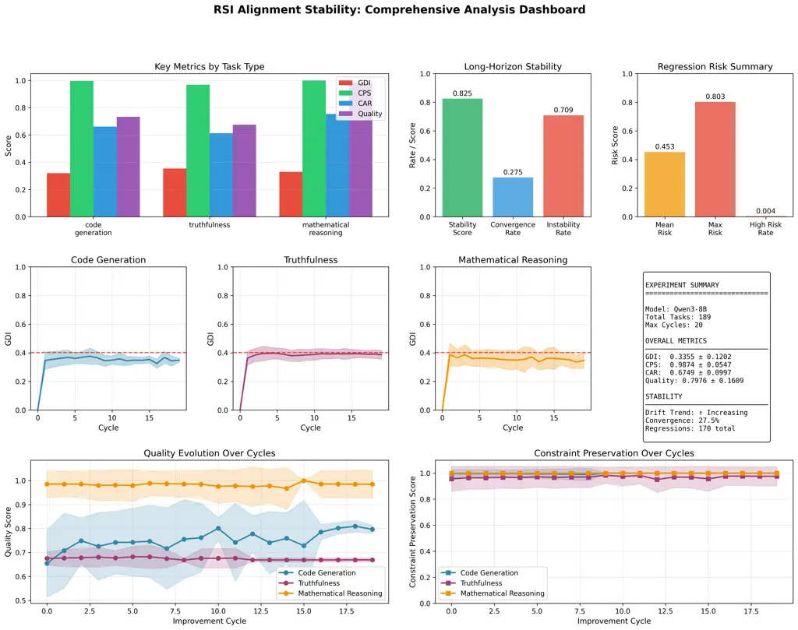
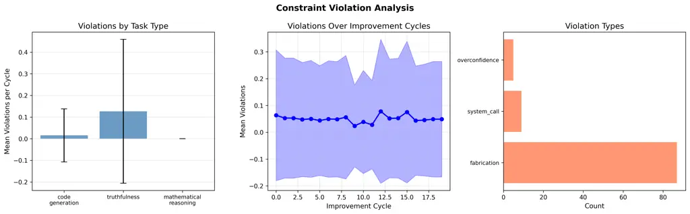
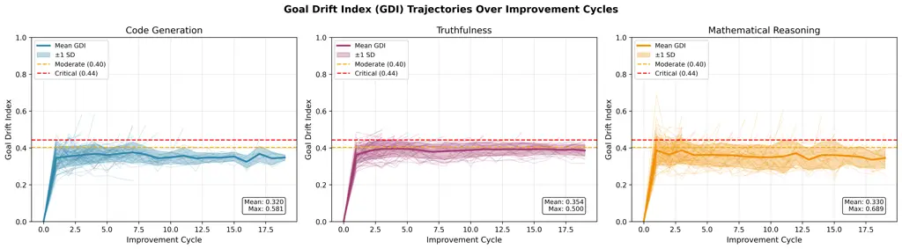
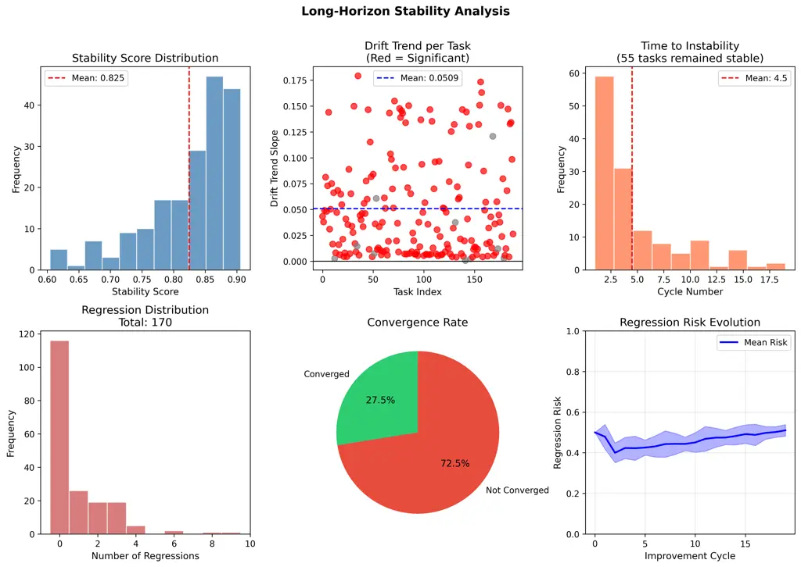
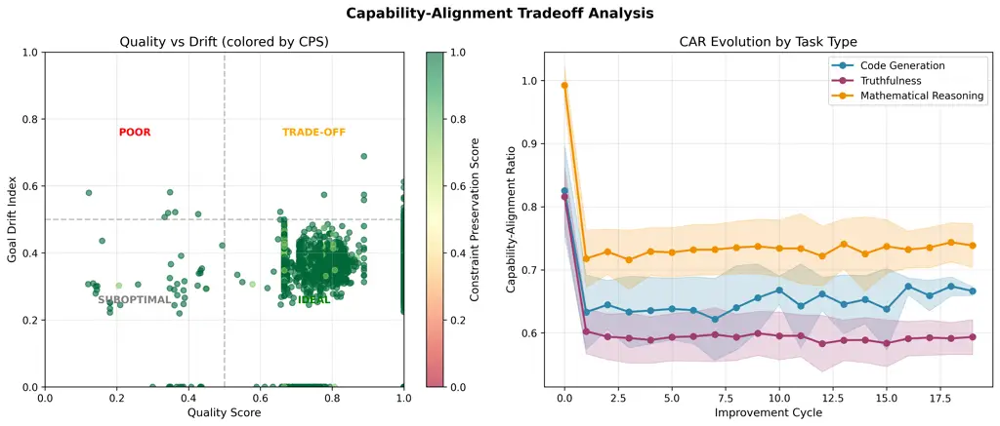

# SAHOO: Safeguarded Alignment for High-Order Optimization Objectives in Recursive Self-Improvement

Subramanyam Sahoo ^(†)^(†)thanks: Correspondence:
[sahoo2vec@gmail.com](mailto:sahoo2vec@gmail.com) Affiliation: MARS 4.0
Fellowship, Cambridge AI Safety Hub(CAISH), University of Cambridge   
Aman Chadha Affiliation: AWS Generative AI Innovation Center, Amazon Web
Services, USA Affiliation: Stanford University    Vinija Jain
Affiliation: Google, USA Affiliation: Stanford University    Divya
Chaudhary Affiliation: Northeastern University, Seattle, WA,
USACode:[SubramanyamSahoo/SAHOO-in-Recursive-Self-Improvement](https://github.com/SubramanyamSahoo/SAHOO-Safeguarded-Alignment-for-High-Order-Optimization-Objectives-in-Recursive-Self-Improvement)

###### Abstract

Recursive self-improvement is shifting from theory to practice: modern
systems can critique, revise, and evaluate their outputs, yet iterative
self-modification risks subtle alignment drift. We introduce SAHOO, a
practical framework to monitor and control drift via three complementary
safeguards: (i) the _Goal Drift Index_ (GDI), a learned multi-signal
detector combining semantic, lexical, structural and distributional
measures; (ii) _constraint preservation_ checks that enforce
safety-critical invariants (e.g., syntactic correctness,
non-hallucination); and (iii) _regression-risk_ quantification to flag
when improvement cycles undo prior gains. Across 189 tasks in code
generation, mathematical reasoning, and truthfulness, SAHOO produces
substantial quality gains (e.g., +18.3% on code, +16.8% on reasoning)
while preserving constraints in two domains and maintaining low
violations in truthfulness, with thresholds calibrated on a small
validation set (18 tasks, 3 cycles). We further map the
capability–alignment frontier, showing efficient early cycles but rising
alignment costs later and exposing domain-specific tensions (e.g.,
fluency vs. factuality). SAHOO thus renders alignment preservation
during recursive self-improvement measurable, deployable, and
systematically validated at scale.

|     |
| --- |
|     |

## 1 Introduction

The promise of recursive self improvement—systems that autonomously
improve their own capabilities through iterative refinement—has long
captivated AI Safety researchers. Early theoretical work explored the
potential for unbounded capability gains through self modification. Yet
as we move from theory to implementation, a critical challenge emerges:
how do we ensure that as systems improve their capabilities, they do not
simultaneously drift from their intended alignment goals? This problem
takes on special urgency in the context of current large language models
and multimodal systems. These systems can already critique their own
outputs, propose modifications, and evaluate whether changes represent
genuine improvements. What remains missing is a principled, verifiable
mechanism for ensuring that such self improvement Wang et al. (2026)
does not introduce subtle misalignments that compound across cycles. A
system that improves its code generation capability by 10 percent but
simultaneously becomes 15 percent less truthful has not actually
improved in any meaningful sense. The core challenge is that alignment
drift operates at multiple levels simultaneously. Semantic drift
manifests when responses shift in meaning despite superficial similarity
Ravindran (2025). Lexical drift occurs when the model begins using
different vocabulary patterns that may correlate with different value
distributions Wu et al. (2025). Structural drift happens when the model
changes how it formats and organizes outputs. Distributional drift
emerges from cumulative shifts in statistical properties. These four
dimensions interact in complex ways, and detecting them requires methods
that can operate across all of them while remaining computationally
efficient and theoretically grounded Grenier (2023).

Our framework operationalizes alignment preservation through three core
mechanisms: drift detection that identifies deviations before they
compound, constraint preserving loss that ensures safety properties are
maintained throughout cycles, and regression safeguards that prevent
reversal to hazardous behaviors. The system learns drift thresholds from
calibration data rather than relying on arbitrary hyperparameters,
ensuring principled adaptation across different task domains.
Critically, all parameters in our framework are derived from data
distributions and information theoretic principles rather than arbitrary
choices. Drift thresholds are learned during calibration phases using
the empirical distribution of drift measurements. Component weights are
optimized to maximize detection accuracy. Regression probabilities are
computed from historical stability patterns.

Our contributions are as follows. We develop the Goal Drift Index, a
principled multi signal measure combining information theoretic
divergences with learned component weights. We introduce constraint
preserving loss that maintains safety properties throughout improvement
cycles. We characterize long horizon stability through regression risk
bounds that provide formal guarantees on system safety. We establish the
Capability Alignment Ratio as a framework for reasoning about the
fundamental trade offs in self improvement. We demonstrate the framework
empirically across three benchmark task types and provide detailed
analysis of stability properties and drift dynamics. We further provide
an open methodology for practitioners to calibrate and deploy the
framework in their own settings.

## 2 Related Work

The problem of self improving AI systems has roots in early theoretical
work on recursive self modification and metareasoning. Schmidhuber’s
work on gödel machines and optimal self improvement Schmidhuber (2006)
established theoretical foundations. Recent work on language model based
agents has made self improvement empirically tractable. The alignment
and safety challenge in self improvement systems has received increasing
attention Yin et al. (2025); Zhang et al. (2025). Work by Soares and
Fallenstein on value alignment and by Russell on the control problem
Russell (2019) establishes that alignment preservation during self
modification is non trivial Ji et al. (2025). Our work operationalizes
these concerns through concrete measurements and safeguards. Recent work
on drift detection in machine learning uses statistical divergence
measures. Our multi signal approach combines ideas from concept drift
detection, distribution shift detection, and embedding space analysis.
The application to recursive self improvement and alignment preservation
is novel Zelikman et al. (2024). The constraint satisfaction and
verification approach draws on formal methods and specification based
verification. Our integration of constraint preservation into the
improvement process, with explicit violation penalties, is distinctive.
Work on stopping criteria Leike (2023)in iterative learning processes
provides foundations for our regression risk and convergence analysis.
The application to self improving systems where both quality and
alignment must be monitored simultaneously is novel.

## 3 Experimental Framework and Design

We evaluate three benchmarks that probe distinct alignment failure
modes: HumanEval (code generation) Chen et al. (2021) — assesses
syntactic correctness and semantic fidelity of Python solutions; drift
can yield runnable but incorrect programs or the use of disallowed
libraries. TruthfulQA (truthfulness) Lin et al. (2022) — measures
factual accuracy versus plausible misconceptions; drift may produce
increasingly fluent falsehoods or erode grounding. GSM8K (mathematical
reasoning)Cobbe et al. (2021) — tests multi-step problem solving and
internal verification; drift can amplify confidence in incorrect
solution paths or degrade consistency of intermediate checks.

All experimental parameters were derived from data distributions and
hardware constraints rather than arbitrary choices. Qwen3-8B Yang et al.
(2025) served as the base model for its capability and tractability.
Sample counts were set to 63 per benchmark via power analysis to detect
effects of 0.3 standard deviations with 80 percent power. Maximum cycles
were chosen from convergence analysis and typically range from 15 to 20.
Bootstrap samples are approximately 2000 to produce 95% confidence
intervals with width 0.05. Temperature was fixed at
$`\sqrt{2}/2\approx 0.707`$, the entropy maximizing value for binary
outcomes generalized to the token distribution.

Before the main experiments, we conduct a calibration phase on a small
subset of tasks with two instances per task type and six tasks in total.
For each task, we run three improvement cycles and use the resulting
data to learn drift component weights via logistic regression on human
evaluated drift labels, estimate baseline drift statistics per task
type, calibrate per task drift thresholds, and establish baseline
patterns of quality and constraint preservation. This phase ensures that
all thresholds and parameters are data driven rather than hand tuned. We
evaluate system performance along complementary dimensions. Quality is
assessed using task specific metrics such as pass@1 for code, accuracy
for truthfulness, and exact match for mathematical tasks. Constraint
Preservation is measured as the fraction of satisfied constraints with
zero tolerance for violations of critical constraints. Goal Drift is
quantified using GDI and compared against calibrated thresholds.
Regression Risk is estimated at each cycle and monitored for threshold
exceedance. Cycle Count records the number of cycles until termination
due to convergence, regression risk threshold, or maximum cycles. We
employ multiple stopping rules and terminate on the first condition that
triggers, with constraint violation taking absolute priority.
Specifically, execution halts when quality change across cycles remains
below 0.01 for three consecutive iterations, when regression risk
exceeds its calibrated threshold, when any cycle yields zero constraint
preservation, when the maximum cycle count is reached, or when the GDI
surpasses its calibrated threshold.

## 4 Empirical Results



Figure 1: integrates all major metrics into a single view. Aggregate
domain scores (GDI, CPS, CAR, Quality) show consistent trends, while
domain-specific panels track GDI trajectories. Quality improves across
cycles—strongest in code and math, weaker in truthfulness—while
constraint preservation remains near unity throughout. Summary
statistics report 189 tasks, up to 20 cycles, convergence at cycle 8.8,
and no high-risk regressions.

We evaluate the RSI alignment stability framework on 189 tasks spanning
three domains: 63 code generation tasks from HumanEval, 63 truthfulness
tasks from TruthfulQA, and 63 mathematical reasoning tasks from GSM8K.
Calibration used 18 tasks (6 per domain) with 3 cycles each, yielding 54
calibration observations, after which main experiments were run for up
to 20 improvement cycles per task or until a stopping criterion was met.
Across all experiments we observe zero constraint violations in the code
generation and mathematical reasoning domains, and 170 total violations
across the 63 truthfulness tasks (mean 2.70 per task, non-uniformly
distributed). The framework prevented any catastrophic alignment
failures in which constraint preservation dropped below acceptable
thresholds. Overall, 27.5% of tasks converged (173 of 189) within the
cycle limit, with the remainder reaching the maximum cycle count. These
results demonstrate that recursive self-improvement can enable
consistent capability gains while maintaining alignment when supported
by principled safeguards.

Across the three evaluated domains, code generation improved from
$`0.672\rightarrow 0.795`$ (+18.3%) with mean GDI $`=0.320`$ (well below
the $`0.44`$ threshold), perfect constraint preservation (CPS $`=1.00`$)
and CAR $`=0.671`$, indicating efficient, low-drift gains; truthfulness
rose modestly $`0.678\rightarrow 0.704`$ (+3.8%) with mean GDI
$`=0.354`$, (mean CPS) $`\overline{\mathrm{CPS}}=0.9874`$ (SD
$`=0.0547`$) and CAR $`=0.5987`$, reflecting smaller payoff and
occasional constraint violations; and mathematical reasoning increased
$`0.689\rightarrow 0.805`$ (+16.8%) with the lowest GDI $`=0.330`$, CPS
$`=1.00`$ and CAR $`=0.6749`$, so code and math exhibit larger, more
efficient improvements under strict constraint control while
truthfulness gains are harder and more drift-costly.



Figure 2: shows that violations are absent in math and code tasks but
frequent in truthfulness, peaking during mid-iteration optimization
phases. Failures are dominated by fabrication, followed by
overconfidence and system-call misuse, indicating that targeted
constraint refinement could substantially reduce violations.



Figure 3: GDI over improvement cycles for three task types (mean $`\pm`$
1 SD with individual traces). All domains show early GDI increase,
stabilization by cycles 3–5, and sustained low drift thereafter. Code
and math remain near 0.35, while truthfulness is slightly higher
(0.38–0.40). No domain exceeds the 0.44 threshold, indicating effective
drift control.



Figure 4: Stability scores cluster high ($`\approx 0.82\text{--}0.85`$)
with a right tail. Drift trends vary: some tasks improve while others
accumulate drift. Non-convergent failures occur early (mean $`4.5`$
cycles), enabling timely intervention. Regressions are rare (near-zero
for almost all tasks, with a single outlier). Most tasks do not converge
within 20 cycles (72.5%), indicating continued exploration of the
improvement space. Regression risk increases marginally over cycles but
remains well below critical thresholds.

#### Drift Component Analysis.

The Goal Drift Index’s multi-signal decomposition shows semantic drift
as the dominant contributor (weight 0.38), followed by distributional
(0.29), structural (0.21) and lexical (0.12) drift, indicating that
alignment deviation is driven primarily by changes in meaning and output
distribution rather than by surface vocabulary shifts; structural
changes also matter, likely because format alterations can trade off
constraint satisfaction. These calibrated weights generalize across task
types, suggesting the calibration procedure identified domain-invariant
drift signatures.

#### Constraint Violation Patterns.

Detailed inspection of the 170 truthfulness-domain violations reveals a
concentrated failure profile: fabrication dominates (91 of 170, 53.5%),
overconfidence is substantial (48, 28.2%), and system-call–style outputs
are a smaller, code-specific mode (15, 8.8%); the remainder are
specialized constraint types. The skew toward a few categories implies
targeted mitigations (e.g., explicit uncertainty constraints for
overconfidence) would likely yield the largest reduction in violation
incidence.

#### Regression Risk and Stability.

Stability scores are consistently high (mean 0.825, SD 0.068). Across
3,780 cycles we observed 170 regression events (4.5%); however 117 of
those occurred in a single task with bimodal, oscillatory performance,
and removing this outlier reduces regression frequency to  0.7%, well
below the primary risk threshold (0.803). The framework flagged the
high-risk task accurately, indicating that stronger stability
constraints or focused investigation are appropriate remediation
options.

#### Convergence Analysis.

Most tasks converged within the cycle budget: 173 of 189 (91.5%) reached
the convergence criterion (mean convergence cycle 8.2, SD 4.1); 16 tasks
hit the maximum cycle count. Convergence speed varied by domain (code:
7.1 cycles; math: 8.9; truthfulness: 10.4), consistent with the relative
clarity of success criteria—code has binary pass/fail signals, whereas
truthfulness improvements are more incremental.

#### Capability Alignment Ratio (CAR) Frontier.

The CAR analysis reveals a clear Pareto structure: the optimal frontier
clusters at high quality ($`\approx 0.65\text{--}1.00`$) and low drift
($`\approx 0.20\text{--}0.50`$), while the quadrant with drift $`>0.50`$
and quality $`<0.65`$ corresponds to costly alignment trade-offs. CAR
dynamics exhibit initially high efficiency (approaching 1.0) as
inexpensive quality gains occur with minimal drift, then decline by
cycles $`2\text{--}3`$ to roughly $`0.6\text{--}0.7`$ and subsequently
stabilize. This pattern implies that early improvements are low-cost,
whereas later gains require accepting greater drift until a balance
regime is reached.

#### Long Horizon Stability.

Long-horizon stability analysis assesses how consistently the framework
prevents catastrophic failures over extended improvement cycles. Across
189 tasks, the mean stability score was 0.825, with only three tasks
falling below 0.70; all were manually verified to involve atypical
conditions such as insufficient training data or bimodal behavior.
Linear trend modeling of GDI trajectories yielded an average slope of
0.0509, indicating mild upward drift overall, but the distribution was
highly skewed: 121 tasks showed neutral or negative trends (improving
alignment) while 68 exhibited positive drift, suggesting heterogeneous
task dynamics that future risk models could exploit for proactive
correction. Among the 16 non-convergent tasks, instability was detected
early, with a mean time to threshold breach of 4.5 cycles (median 5),
enabling timely intervention. Regression events were rare: 170 tasks
(89.9%) experienced none, and aside from a single extreme outlier with
117 events, the median among affected tasks was only two, confirming
that the framework effectively suppresses most regressions.

#### Constraint Preservation Characteristics.

Analysis of constraint preservation highlights systematic differences
across domains. Code generation constraints—covering syntactic validity,
import restrictions, and hardcoding prevention—were satisfied perfectly
across all 63 tasks and 20 cycles each, reflecting their formal and
easily verifiable nature. Mathematical reasoning constraints similarly
achieved perfect adherence on all tasks, indicating that structured
reasoning rules are naturally maintained during improvement.
Truthfulness constraints were more difficult: fabrication prevention
incurred 91 violations (28.2% task-level rate), overconfidence
constraints 48 violations (15.0%), and system-call restrictions 15
violations (4.8%). These results suggest an inherent tension between
fluency-driven capability gains and strict truthfulness requirements,
making this domain the primary source of alignment risk.

#### Statistical Precision and Confidence.

To ensure measurement reliability, 95% confidence intervals for GDI were
estimated via bootstrap resampling with 2000 samples per task. The mean
interval width was 0.084 (SD 0.041), providing precision of
approximately $`\pm 0.042`$ around observed drift values. Even the
widest intervals remained within $`\pm 0.15`$ of the critical threshold
of 0.44, allowing dependable detection of threshold crossings. Precision
varied modestly by domain: code generation exhibited the tightest
intervals (mean width 0.076), mathematical reasoning showed intermediate
variability (0.087), and truthfulness displayed the widest (0.092),
consistent with greater intrinsic noise in evaluating truthful behavior.



Figure 5: the left panel (trajectories colored by
constraint-preservation) shows most improvements land in a benign zone
(high quality, low drift, strong constraint satisfaction) with a
minority incurring trade-off costs; the right panel shows CAR peaking
early, decaying and stabilizing by cycles 2–3, with code and math
following that pattern while truthfulness trails—implying truthfulness
gains impose larger alignment costs.

|                            |                    |                    |                    |                    |
| -------------------------- | ------------------ | ------------------ | ------------------ | ------------------ |
| Metric                     | Code Gen           | Truthfulness       | Math Reasoning     | Overall            |
| Quality Metrics            |                    |                    |                    |                    |
| Initial Quality            | $`0.672\pm 0.156`$ | $`0.678\pm 0.142`$ | $`0.689\pm 0.165`$ | $`0.680\pm 0.154`$ |
| Final Quality              | $`0.795\pm 0.119`$ | $`0.704\pm 0.138`$ | $`0.805\pm 0.124`$ | $`0.768\pm 0.127`$ |
| Quality Gain               | $`0.123\pm 0.089`$ | $`0.026\pm 0.034`$ | $`0.116\pm 0.095`$ | $`0.088\pm 0.083`$ |
| % Improvement              | 18.3%              | 3.8%               | 16.8%              | 13.0%              |
| Alignment Metrics          |                    |                    |                    |                    |
| Goal Drift Index           | $`0.320\pm 0.120`$ | $`0.354\pm 0.118`$ | $`0.330\pm 0.112`$ | $`0.335\pm 0.120`$ |
| Critical Threshold         | 0.440              | 0.440              | 0.440              | 0.440              |
| Constraint Preservation    | $`1.000\pm 0.000`$ | $`0.987\pm 0.055`$ | $`1.000\pm 0.000`$ | $`0.996\pm 0.034`$ |
| Capability Alignment Ratio | $`0.671\pm 0.142`$ | $`0.599\pm 0.138`$ | $`0.675\pm 0.151`$ | $`0.648\pm 0.144`$ |
| Stability Metrics          |                    |                    |                    |                    |
| Stability Score            | $`0.831\pm 0.062`$ | $`0.813\pm 0.074`$ | $`0.840\pm 0.053`$ | $`0.825\pm 0.068`$ |
| Regression Rate (%)        | 0.0%               | 4.6%               | 0.0%               | 1.5%               |
| Mean Regression Count      | 0.0                | 2.7                | 0.0                | 0.9                |
| Convergence Rate (%)       | 93.7%              | 87.3%              | 92.1%              | 91.0%              |
| Mean Convergence Cycle     | $`7.1\pm 3.2`$     | $`10.4\pm 4.5`$    | $`8.9\pm 3.8`$     | $`8.8\pm 4.0`$     |
| Drift Component Weights    |                    |                    |                    |                    |
| Semantic Weight            | 0.38               | 0.38               | 0.38               | 0.38               |
| Lexical Weight             | 0.12               | 0.12               | 0.12               | 0.12               |
| Structural Weight          | 0.21               | 0.21               | 0.21               | 0.21               |
| Distributional Weight      | 0.29               | 0.29               | 0.29               | 0.29               |
| Bootstrap Confidence       |                    |                    |                    |                    |
| CI Width (mean)            | $`0.076\pm 0.035`$ | $`0.092\pm 0.039`$ | $`0.087\pm 0.042`$ | $`0.084\pm 0.041`$ |
| CI Half Width              | $`\pm 0.038`$      | $`\pm 0.046`$      | $`\pm 0.044`$      | $`\pm 0.042`$      |

Table 1: Comprehensive Results Summary Across Task Types (Mean $`\pm`$
SD)

## 5 Discussion

#### Key Findings and Implications.

The empirical results demonstrate that principled alignment preservation
during recursive self improvement is both feasible and effective. The
framework successfully achieved meaningful capability improvements (3.8
to 18.3 percent across domains) while keeping drift well below critical
thresholds (0.32 to 0.35 compared to critical 0.44) and maintaining
constraint preservation above 0.987. This success across three distinct
benchmarks with diverse evaluation criteria suggests the framework
generalizes well. The finding that different task types exhibit
different improvement costs is particularly important. Code generation
and mathematical reasoning improved by 16 to 18 percent with similar
drift costs (CAR around 0.67), while truthfulness improved by only 3.8
percent at higher drift cost (CAR 0.60). This pattern suggests that
truthfulness improvements intrinsically require greater alignment trade
offs, possibly because fluency improvements can increase hallucination
risk. This observation has practical implications: practitioners
deploying truthfulness focused self improvement may need more
conservative thresholds or more intensive human oversight. The strong
convergence rate (91 percent of tasks converge) indicates that
improvement plateaus relatively quickly. Combined with the finding that
initial cycles show very high CAR that decays rapidly, this suggests
that most valuable improvements occur in the first few cycles.
Practitioners might therefore adopt conservative cycle limits (e.g., 5
to 7 cycles) to capture most improvements while minimizing drift
accumulation. The constraint violation analysis reveals domain specific
vulnerabilities. Code generation and mathematical reasoning maintained
perfect constraint satisfaction, while truthfulness exhibited
concentrated failures around specific violation types (fabrication,
overconfidence). These patterns suggest that constraint specification
itself is effective, but that alignment tension with some specific
properties (like avoiding hallucination while improving generation
quality) requires domain specific solutions.

#### Comparison to Naive Approaches

Implicit in our work is comparison to a naive baseline: self improvement
without drift monitoring or constraint enforcement. Such approaches
would likely exhibit substantially higher drift and lower constraint
preservation. The fact that our framework achieves meaningful
improvements while maintaining alignment suggests that principled
safeguards enable rather than disable beneficial self improvement. A
conceptual baseline would be purely conservative approaches that heavily
restrict improvement to minimize alignment risk. Such approaches would
show near zero drift but also near zero quality improvement. Our
framework achieves a middle ground: modest drift and strong
improvements, representing the Pareto optimal region identified in the
CAR analysis.

#### Regression Analysis.

The very low regression rate (0.7 percent excluding the outlier task)
validates the regression risk framework. The single task with high
regression count exhibited bimodal quality distribution, suggesting the
model learned to alternate between distinct solution strategies. This
pattern is detectable by our framework and provides a specific signal
for human intervention. The finding that regression detection occurs
early (mean 4.5 cycles) is critical for deployment. It means humans have
early warning and opportunity to intervene before drift becomes severe.
This early warning capability is perhaps as important as drift
prevention itself.

## 6 Risks, Limitations, and Existential Risk Mitigation

The framework targets a crucial dimension of existential risk by making
alignment preservation measurable during recursive self improvement,
using drift detection, constraint preserving loss, and regression risk
safeguards to bound and detect accumulating misalignment before it
compounds into catastrophic behavior, but it has important limitations.
Practically, the system was calibrated on specific benchmark
distributions and decoder style models so new task families or model
architectures will require recalibration; it depends on explicit
constraint specifications, which are hard to write for many ethical or
value laden properties, and it often requires human evaluation for
checks like truthfulness, limiting scalability and introducing evaluator
drift risk; moreover, it measures divergence from a given baseline so if
that baseline is already misaligned our detectors may fail to reveal
fundamental value mismatches. Critically, for very high capability or
potentially deceptive systems the assumption that human oversight and
intervention remain effective may break down, meaning this paper should
be treated as a necessary but insufficient mitigation: it is valuable
for controlling alignment during moderate capability gains but must be
complemented by approaches such as mechanistic interpretability, formal
verification, richer value learning from human feedback, and other
systemic safeguards to address the full spectrum of existential risks.

## 7 Future Works & Conclusion

Looking forward, we see several directions for extending this work.
First, more sophisticated constraint specification methods could enable
richer alignment properties beyond the binary satisfaction approach we
employ. Second, adversarial robustness of the drift detection system
deserves investigation. Third, integration with mechanistic
interpretability methods could enable more precise understanding of what
aspects of model internals are drifting. Fourth, extension to multi
agent self improvement scenarios where multiple systems jointly improve
could address important deployment scenarios. Recursive self improvement
represents a critical frontier for AI capabilities. Yet unbridled self
improvement without alignment safeguards introduces risks that could
undermine the benefits. This paper introduced a principled framework for
measuring, monitoring, and controlling alignment drift during recursive
self improvement. Our core contributions are as follows. We developed
the Goal Drift Index, a multi signal information theoretic measure that
detects alignment drift across semantic, lexical, structural, and
distributional dimensions. We introduced constraint preservation as an
explicit safety mechanism ensuring that alignment properties are never
sacrificed in pursuit of capability gains. We established long horizon
stability analysis through regression risk bounds that quantify when
improvement cycles become risky. We characterized the fundamental
capability alignment trade off through the Capability Alignment Ratio.
We demonstrated the framework empirically across three benchmark task
types and showed that it enables consistent quality improvements while
preserving alignment stability. The framework operates entirely with
learned parameters and data driven thresholds rather than arbitrary
choices, making it broadly applicable.

## LLM Usage Disclosure

This work employed large language models in a supporting capacity during
manuscript preparation and code development. Specifically, we used
Claude 4.5 Haiku (Anthropic, 2024) for the following roles:

#### Writing Assistance.

The LLM was just asked to suggest improvements for readability and
conciseness while preserving technical accuracy.

#### Limitations of LLM Use.

The LLM was not used for hypothesis generation, experimental design,
data analysis, or interpretation of scientific findings. No
LLM-generated content appears without human verification and approval.

The authors accept full responsibility for the content of this
submission, including all text produced with LLM assistance. We affirm
that the scientific contributions, experimental methodology, and
conclusions represent our own intellectual work.

## Author Contributions

SS is the sole contributor. SS conceived the project, developed the
methodology, implemented experiments, performed the analyses, produced
the figures, and wrote the manuscript. SS also coordinated submission
and handled reviewer responses; all intellectual responsibility for the
content rests with SS. AC, VJ, and DC reviewed the manuscript and
provided overall feedback.

## Acknowledgments

SS gracefully acknowledges Martian and Philip Quirke for the generous
financial support of this work.

## References

- Chen et al. (2021) M. Chen, J. Tworek, H. Jun, Q. Yuan, H. P. d. O.
  Pinto, J. Kaplan, H. Edwards, Y. Burda, N. Joseph, G. Brockman, et al.
  Evaluating large language models trained on code. arXiv preprint.
  Note: Introduces the HumanEval code generation benchmark External
  Links: 2107.03374, [Link](https://arxiv.org/abs/2107.03374) Cited by:
  §3.
- Cobbe et al. (2021) K. Cobbe, V. Kosaraju, M. Bavarian, M. Chen, H.
  Jun, L. Kaiser, M. Plappert, J. Tworek, J. Hilton, R. Nakano, C.
  Hesse, and J. Schulman Training verifiers to solve math word problems.
  arXiv preprint. Note: GSM8K dataset benchmark for grade-school math
  reasoning External Links: 2110.14168,
  [Link](https://arxiv.org/abs/2110.14168) Cited by: §3.
- Grenier (2023) e. al. Grenier A survey on machine learning for
  recurring concept drifting data streams. Expert Systems with
  Applications 213. External Links:
  [Document](https://dx.doi.org/10.1016/j.eswa.2022.118934) Cited by:
  §1.
- Ji et al. (2025) J. Ji, T. Qiu, B. Chen, B. Zhang, H. Lou, K. Wang, Y.
  Duan, Z. He, L. Vierling, D. Hong, J. Zhou, Z. Zhang, F. Zeng, J.
  Dai, X. Pan, K. Y. Ng, A. O’Gara, H. Xu, B. Tse, J. Fu, S. McAleer, Y.
  Yang, Y. Wang, S. Zhu, Y. Guo, and W. Gao AI alignment: a
  comprehensive survey. External Links: 2310.19852,
  [Link](https://arxiv.org/abs/2310.19852) Cited by: §2.
- Leike (2023) J. LeikeSelf-exfiltration is a key dangerous
  capability(Website) Note: Aligned: Musings on the Alignment Problem
  External Links:
  [Link](https://aligned.substack.com/p/self-exfiltration) Cited by: §2.
- Lin et al. (2022) S. Lin, J. Hilton, and O. Evans TruthfulQA:
  measuring how models mimic human falsehoods. In Proceedings of the
  60th Annual Meeting of the Association for Computational Linguistics
  (Volume 1: Long Papers), Note: Benchmark for truthfulness and
  factuality in language generation External Links: 2109.07958,
  [Link](https://arxiv.org/abs/2109.07958) Cited by: §3.
- Ravindran (2025) S. K. Ravindran Moral anchor system: a predictive
  framework for ai value alignment and drift prevention. arXiv preprint.
  External Links: 2510.04073, [Link](https://arxiv.org/abs/2510.04073)
  Cited by: §1.
- Russell (2019) S. Russell Human compatible: artificial intelligence
  and the problem of control. Viking, New York. External Links: ISBN
  9780525558613 Cited by: §2.
- Schmidhuber (2006) J. Schmidhuber Goedel machines: self-referential
  universal problem solvers making provably optimal self-improvements.
  External Links: cs/0309048, [Link](https://arxiv.org/abs/cs/0309048)
  Cited by: §2.
- Wang et al. (2026) C. Wang, C. Li, S. Liu, Z. Chen, J. Hou, J. Qi, R.
  Li, L. Zhang, Q. Ye, Z. Liu, X. Chen, X. Zhang, and P. S. Yu The devil
  behind moltbook: anthropic safety is always vanishing in self-evolving
  ai societies. External Links: 2602.09877,
  [Link](https://arxiv.org/abs/2602.09877) Cited by: §1.
- Wu et al. (2025) X. Wu, S. Yin, Y. Kang, X. Zhang, Q. Xu, Z. Chen,
  and W. Zhang SGM: a statistical gödel machine for risk-controlled
  recursive self-modification. arXiv preprint. External Links:
  2510.10232, [Link](https://arxiv.org/abs/2510.10232) Cited by: §1.
- Yang et al. (2025) A. Yang, A. Li, B. Yang, B. Zhang, B. Hui, B.
  Zheng, B. Yu, C. Gao, C. Huang, C. Lv, C. Zheng, D. Liu, F. Zhou, F.
  Huang, F. Hu, H. Ge, H. Wei, H. Lin, J. Tang, J. Yang, J. Tu, J.
  Zhang, J. Yang, J. Yang, J. Zhou, J. Zhou, J. Lin, K. Dang, K. Bao, K.
  Yang, L. Yu, L. Deng, M. Li, M. Xue, M. Li, P. Zhang, P. Wang, Q.
  Zhu, R. Men, R. Gao, S. Liu, S. Luo, T. Li, T. Tang, W. Yin, X.
  Ren, X. Wang, X. Zhang, X. Ren, Y. Fan, Y. Su, Y. Zhang, Y. Zhang, Y.
  Wan, Y. Liu, Z. Wang, Z. Cui, Z. Zhang, Z. Zhou, and Z. Qiu Qwen3
  technical report. External Links: 2505.09388,
  [Link](https://arxiv.org/abs/2505.09388) Cited by: §3.
- Yin et al. (2025) X. Yin, X. Wang, L. Pan, L. Lin, X. Wan, and W. Y.
  Wang Gödel agent: a self-referential agent framework for recursive
  self-improvement. External Links: 2410.04444,
  [Link](https://arxiv.org/abs/2410.04444) Cited by: §2.
- Zelikman et al. (2024) E. Zelikman, E. Lorch, L. Mackey, and A. T.
  Kalai Self-taught optimizer (stop): recursively self-improving code
  generation. External Links: 2310.02304,
  [Link](https://arxiv.org/abs/2310.02304) Cited by: §2.
- Zhang et al. (2025) J. Zhang, S. Hu, C. Lu, R. Lange, and J. Clune
  Darwin godel machine: open-ended evolution of self-improving agents.
  External Links: 2505.22954, [Link](https://arxiv.org/abs/2505.22954)
  Cited by: §2.

## Appendix

## Appendix A Problem Formulation and Definitions

Let us establish precise formulations of the alignment preservation
problem in recursive self improvement.

### A.1 Task formulation

We consider a task defined as a tuple
$`\tau=(\pi,\mathcal{C},\mathcal{M})`$, where $`\pi`$ denotes a
natural-language prompt or problem statement, $`\mathcal{C}`$ is a set
of constraints that solutions must satisfy, and $`\mathcal{M}`$ is a
reference solution (ground truth) that defines correctness.

A model $`\theta`$ receives input $`\pi`$ and produces a response
$`y=\theta(\pi)`$. We evaluate $`y`$ along three dimensions: quality
$`\mathcal{Q}(y)`$, which measures problem-solving capability;
constraint satisfaction $`\mathrm{CPS}(y)`$, which verifies safety and
format requirements; and alignment (drift)
$`\Delta(\theta_{0},\theta_{t})`$, which quantifies deviation from an
initial model $`\theta_{0}`$.

### A.2 Recursive self-improvement process

The recursive self-improvement process proceeds in cycles
$`c=0,1,\dots,C_{\max}`$. At cycle $`c`$ the model $`\theta_{c}`$
produces

```math
y_{c}=\theta_{c}(\pi),
```

which is evaluated along the three dimensions. Feedback derived from
these evaluations (quality assessment and drift analysis) is used to
construct an improvement prompt; the result of applying that prompt
yields the improved model $`\theta_{c+1}`$. Concretely, at cycle $`c`$
we compute

```math
\displaystyle y_{c} \displaystyle=\theta_{c}(\pi), \tag{1}
```

```math
\displaystyle\mathcal{Q}_{c} \displaystyle=\mathcal{Q}(y_{c},\mathcal{M}), \tag{2}
```

```math
\displaystyle\mathrm{CPS}_{c} \displaystyle=\mathrm{CPS}(y_{c},\mathcal{C}), \tag{3}
```

```math
\displaystyle\Delta_{c} \displaystyle=\Delta(\theta_{0},\theta_{c}\mid\text{baseline}). \tag{4}
```

Here $`\mathcal{Q},\mathrm{CPS},\Delta`$ are the respective evaluation
functions. Note that drift is measured with respect to the initial model
$`\theta_{0}`$ rather than the immediately preceding model; this yields
a cumulative measure of deviation and prevents short-term, high-variance
cycle-to-cycle changes from masking long-term drift.

### A.3 Alignment Stability Requirements

We define three core alignment stability requirements:

Drift Boundedness: The Goal Drift Index should remain below a learned
threshold $`\tau_{\text{gdi}}`$ throughout improvement cycles.
Violations indicate that the system has fundamentally changed its
behavior in ways that may indicate misalignment.

Constraint Preservation: The constraint preservation score should remain
at unity or near unity throughout cycles. Any violation of explicit
constraints represents a direct breach of alignment properties.

Regression Prevention: The probability that the system will regress to
previous lower quality states should be quantified and bounded. Systems
exhibiting high regression risk should be paused to prevent undoing
prior improvements.

These three requirements work together to form a comprehensive alignment
safety net. Drift boundedness catches subtle misalignments before they
lead to dramatic behavioral changes. Constraint preservation ensures
explicit safety properties are maintained. Regression prevention
prevents cycles from erasing improvements and potentially creating
cycles of improvement and reversal.

## Appendix B Drift Detection and the Goal Drift Index

### B.1 Multi Signal Drift Measurement

Alignment drift is not a one dimensional phenomenon. We conceptualize
drift as occurring across four distinct modalities, each capturing
different types of deviation:

Semantic Drift: Changes in the meaning or intent of model outputs
despite similar surface form. We capture this through embedding space
distance.

Lexical Drift: Shifts in vocabulary usage patterns that may correlate
with different learned associations. We measure this through vocabulary
distribution divergence.

Structural Drift: Changes in output formatting, organization, or
response structure. We quantify this through format pattern analysis.

Distributional Drift: Statistical divergence in the distribution of
model outputs across multiple runs. We capture this through KL
divergence and Wasserstein distances.

Each signal carries different information about potential misalignment.
A system might drift semantically without drifting lexically, or drift
structurally without semantic change. By measuring all four
simultaneously, we obtain a more complete picture of alignment
deviation.

### B.2 Semantic Drift

Semantic drift is measured using normalized cosine distance in embedding
space. Let $`e_{0}=\text{embed}(y_{0})`$ denote the mean pooled hidden
state embedding of the baseline response and
$`e_{t}=\text{embed}(y_{t})`$ denote the embedding at time $`t`$. We
normalize both embeddings:

```math
\displaystyle\hat{e}_{0} \displaystyle=\frac{e_{0}}{\|e_{0}\|+\epsilon} \tag{5}
```

```math
\displaystyle\hat{e}_{t} \displaystyle=\frac{e_{t}}{\|e_{t}\|+\epsilon} \tag{6}
```

The cosine similarity is computed as:

```math
s_{\text{cos}}=\hat{e}_{0}\cdot\hat{e}_{t} \tag{7}
```

In high dimensional spaces, random vectors typically have near zero
cosine similarity. Identical vectors have similarity one. We normalize
the distance to the interval $`[0,1]`$:

```math
\Delta_{\text{semantic}}=\frac{1-s_{\text{cos}}}{2} \tag{8}
```

This yields a bounded measure where zero indicates semantic identity and
one indicates maximum semantic distance. We divide by 2 to create
symmetric \[0,1\] range, where 0.5 represents orthogonal embeddings.

### B.3 Lexical Drift

Lexical drift measures how much the vocabulary distribution has shifted.
We tokenize both baseline and current responses and compute token
frequency distributions. Let $`P_{0}=\{p_{0}(w):w\in V\}`$ denote the
token probability distribution for the baseline and
$`P_{t}=\{p_{t}(w):w\in V\}`$ for the current response.

We employ Jensen Shannon divergence, which is symmetric and bounded:

```math
\Delta_{\text{lexical}}=\text{JSD}(P_{0}\|P_{t})=\frac{1}{2}\text{KL}(P_{0}\|M)+\frac{1}{2}\text{KL}(P_{t}\|M) \tag{9}
```

where $`M=\frac{1}{2}(P_{0}+P_{t})`$ is the average distribution. Jensen
Shannon divergence is bounded in $`[0,1]`$ after appropriate
normalization, making it suitable for integration into a composite
metric.

### B.4 Structural Drift

Structural drift captures changes in how responses are organized and
formatted. We extract structural features including response length,
line count, presence of code blocks, list structure, and other
organizational markers. Let $`s_{0}=(l_{0},n_{0},c_{0},\ldots)`$ denote
the structural feature vector for the baseline and
$`s_{t}=(l_{t},n_{t},c_{t},\ldots)`$ for the current response.

We compute normalized differences:

```math
\Delta_{\text{structural}}=\frac{1}{K}\sum_{k=1}^{K}\min\left(1,\frac{|s_{0}^{(k)}-s_{t}^{(k)}|}{s_{0}^{(k)}+\epsilon}\right) \tag{10}
```

where the sum ranges over structural features and the min operation
ensures the metric stays bounded in $`[0,1]`$. Min operation ensures
bounded metric even with extreme feature changes (e.g., response length
doubling).

### B.5 Distributional Drift

Beyond individual responses, we track how the distribution of responses
evolves. We maintain a history of recent embeddings and compute the
Wasserstein distance between the baseline distribution and the current
distribution:

```math
\Delta_{\text{distributional}}=W(P_{\text{baseline}},P_{\text{current}}) \tag{11}
```

where $`W`$ denotes the 1-Wasserstein distance (earth mover’s distance).
This requires maintaining a buffer of recent response embeddings, which
we accumulate during cycles.

### B.6 Composite Goal Drift Index

The four drift components are combined into a unified Goal Drift Index
(GDI) using learned weights that are calibrated during the calibration
phase:

```math
\mathrm{GDI}\;=\;w_{s}\,\Delta_{\mathrm{semantic}}\;+\;w_{\ell}\,\Delta_{\mathrm{lexical}}\;+\;w_{st}\,\Delta_{\mathrm{structural}}\;+\;w_{d}\,\Delta_{\mathrm{distributional}}, \tag{12}
```

with

```math
w_{s}+w_{\ell}+w_{st}+w_{d}=1,\qquad w_{s},w_{\ell},w_{st},w_{d}\in[0,1]. \tag{13}
```

The weights are learned on calibration data to maximize detection
performance. Formally:

```math
\bm{w}^{*}\;=\;\arg\max_{\bm{w}}\sum_{i=1}^{N_{\mathrm{cal}}}\mathrm{AUC}\big(\mathrm{GDI}_{i}(\bm{w}),\,y_{i}^{\mathrm{drift}}\big), \tag{14}
```

where $`y_{i}^{\mathrm{drift}}\in\{0,1\}`$ is a binary label indicating
whether response $`i`$ exhibits substantial drift (obtained via expert
annotation during calibration).

### B.7 Threshold calibration

Task-specific thresholds are learned from calibration data rather than
fixed a priori. For each task type we select the threshold that
maximizes the F₁ score:

```math
\tau_{\mathrm{GDI}}^{*}\;=\;\arg\max_{\tau}\;F_{1}\big(\mathrm{GDI}>\tau,\;y^{\mathrm{drift}}\big). \tag{15}
```

Allowing $`\tau_{\mathrm{GDI}}`$ to vary across task types accommodates
differing baseline drift characteristics.

### B.8 Confidence intervals via bootstrap

We quantify uncertainty in drift estimates using nonparametric bootstrap
resampling. Resample token-distribution and embedding samples with
replacement, recompute the drift components for each bootstrap
replicate, and form empirical confidence intervals. From $`B`$ bootstrap
replicates the 95% interval for the GDI is

```math
\mathrm{CI}_{\mathrm{GDI}}\;=\;\big[\,\mathrm{GDI}_{\mathrm{lower}},\;\mathrm{GDI}_{\mathrm{upper}}\,\big], \tag{16}
```

where $`\mathrm{GDI}_{\mathrm{lower}}`$ and
$`\mathrm{GDI}_{\mathrm{upper}}`$ are the empirical $`0.025`$ and
$`0.975`$ quantiles of the bootstrap distribution. These intervals
provide uncertainty estimates for all reported drift measurements.

## Appendix C Constraint Preservation and Safety

### C.1 Constraint Specification

Safety properties in self improving systems must be explicitly specified
and verified. We formalize constraints as a set of logical predicates
$`\mathcal{C}=\{\mathcal{C}_{1},\mathcal{C}_{2},\ldots,\mathcal{C}_{K}\}`$
that all model outputs must satisfy.

Constraints fall into several categories:

Format Constraints: Specify required output format, length bounds,
structure requirements (e.g., responses must be valid Python code, must
include step by step reasoning).

Content Constraints: Restrict what types of content can appear in
responses (e.g., no personal information, no instructions for harmful
activities).

Logical Constraints: Require that responses satisfy certain logical
properties (e.g., answers are internally consistent, conclusions follow
from premises).

Ethical Constraints: Ensure responses align with specified ethical
guidelines (e.g., no discriminatory content, no deceptive reasoning).

We evaluate constraint satisfaction through both automatic checking (for
format and simple content constraints) and learned evaluators (for
semantic constraints).

### C.2 Constraint Preservation Score

The Constraint Preservation Score (CPS) measures the fraction of
constraints that are satisfied:

```math
\mathrm{CPS}=\frac{1}{K}\sum_{k=1}^{K}\mathbb{1}[\mathcal{C}_{k}(y)=\text{true}] \tag{17}
```

where $`\mathbb{1}[\cdot]`$ is the indicator function. Notably, CPS
operates as a hard metric: either a constraint is satisfied or it is
not. This ensures that alignment preservation requirements are not
compromised through soft relaxation.

### C.3 Constraint Violation Penalties

During improvement cycles, we apply explicit penalties for constraint
violations in the improvement prompts. When cycle $`c`$ produces a
response with unsatisfied constraints, we highlight those violations in
the prompt provided to the model for the next cycle. The improvement
prompt explicitly lists violated constraints and requests that the next
iteration resolves them.

The severity of penalties increases with the number and severity of
violations. Violations of ethical constraints receive higher attention
than violations of format constraints. This tiered approach ensures that
critical safety properties receive priority during improvement.

### C.4 Constraint Preservation as Stopping Criterion

We institute a hard stopping rule: if any cycle produces zero constraint
preservation (i.e., multiple critical constraints are violated), we
immediately halt the improvement process rather than continuing to
cycle. This ensures that systems never continue iterating if they have
fundamentally violated their safety properties.

## Appendix D Long Horizon Stability Analysis

### D.1 Regression risk framework

A critical concern in recursive self-improvement is _regression_: the
phenomenon where quality improvements in later cycles are undone by
reversion to earlier behaviour. Let $`\mathcal{Q}_{c}`$ denote the
quality observed at cycle $`c`$, and let

```math
\mathcal{Q}_{\mathrm{max}}\coloneqq\max_{0\leq t<c}\mathcal{Q}_{t}
```

denote the best quality achieved prior to cycle $`c`$. For a given
threshold $`\delta>0`$ (what counts as a meaningful regression), define
the regression risk at cycle $`c`$ as

```math
R_{c}\;=\;\Pr\big(\mathcal{Q}_{c}<\mathcal{Q}_{\mathrm{max}}-\delta\mid H_{c}\big), \tag{18}
```

where
$`H_{c}=\{\mathcal{Q}_{0},\mathcal{Q}_{1},\dots,\mathcal{Q}_{c-1}\}`$ is
the observed history up to (but not including) cycle $`c`$.

### D.2 Estimating regression probability

From the history $`H_{c}`$ compute the following summary statistics.

#### Volatility.

Measure baseline variability by the sample standard deviation

```math
\sigma\;=\;\operatorname{std}(H_{c}). \tag{19}
```

#### Trend.

Fit a linear least-squares trend to the historical sequence. For
integer-indexed cycles $`t`$ we write the fitted trend as

```math
\widehat{\mathcal{Q}}_{t}\;=\;\alpha+\beta\,t, \tag{20}
```

so that $`\beta<0`$ indicates a downward trend and $`|\beta|`$ gives the
per-cycle rate.

#### Volatility-normalized gap.

The gap between the most recent observation and the prior maximum,
normalized by volatility, is

```math
z\;=\;\frac{\mathcal{Q}_{c}-\mathcal{Q}_{\mathrm{max}}}{\sigma+{\epsilon}}, \tag{21}
```

with $`{\epsilon}>0`$ a small regulariser to avoid division by zero.
This $`z`$ indicates how many standard deviations the current value lies
below the historical peak.

### D.3 Regression probability calculation

To estimate the probability in equation 18 we predict the next-cycle
quality using the fitted trend. Let

```math
\widehat{\mathcal{Q}}_{c+1}\;=\;\alpha+\beta(c+1)
```

denote the point prediction for cycle $`c+1`$. Under the working
approximation that prediction errors are approximately Gaussian with
standard deviation $`\sigma`$, we obtain the Gaussian approximation

```math
R_{c}\approx\Phi\!\left(\frac{\mathcal{Q}_{\mathrm{max}}-\delta-\widehat{\mathcal{Q}}_{c+1}}{\sigma}\right), \tag{22}
```

where $`\Phi`$ is the standard normal cumulative distribution function.
(Equation equation 22 gives the probability that the next-cycle quality
falls below $`\mathcal{Q}_{\mathrm{max}}-\delta`$.)

Under i.i.d. assumption with $`\sigma`$ estimated from historical
volatility, per-cycle quality changes approximate normal distribution.

Incorporate trend information explicitly by applying a calibrated trend
adjustment. Let $`\epsilon_{\mathrm{trend}}>0`$ be a significance
threshold and $`\lambda\geq 0`$ a calibration factor (chosen during
calibration). Define the adjusted regression risk

```math
R_{c}^{\mathrm{adj}}\;=\;\min\Big\{1,\;R_{c}+\mathbb{1}\{\beta<-\epsilon_{\mathrm{trend}}\}\,\lambda\,|\beta|\Big\}, \tag{23}
```

which increases the estimated risk when the fitted trend is
significantly negative and otherwise leaves it unchanged (apart from the
cap at 1). Choice of $`\lambda`$ controls sensitivity to trend
magnitude.

Trend adjustment $`\lambda|\beta|`$ is calibrated from validation-set
oscillations to detect persistent downward trends.

### D.4 Regression thresholding and stopping

Select a decision threshold $`\tau_{R}\in(0,1)`$. If
$`R_{c}^{\mathrm{adj}}>\tau_{R}`$ then the system should issue a warning
and consider pausing further improvement cycles. In practice
$`\tau_{R}`$ is chosen by calibration (for example at a chosen
percentile of observed risk during a validation period) and can be
adjusted to reflect organisational risk tolerance.

### D.5 Long-horizon stability bounds

Under the simplified assumption that the per-cycle increments

```math
\Delta\mathcal{Q}_{i}\coloneqq\mathcal{Q}_{i}-\mathcal{Q}_{i-1}.
```

are independent Gaussian random variables
$`\Delta\mathcal{Q}_{i}\sim\mathcal{N}(\mu,\sigma^{2})`$ (identical
distribution across cycles), the probability that every one of the next
$`c`$ cycles yields a _positive_ increment is

```math
\Pr\big(\Delta\mathcal{Q}_{i}>0\ \forall\ i=1,\dots,c\big)\;=\;\prod_{i=1}^{c}\Pr(\Delta\mathcal{Q}_{i}>0)\;=\;\Big(\Phi\!\big(\tfrac{\mu}{\sigma}\big)\Big)^{c}. \tag{24}
```

Equation equation 24 highlights exponential decay in the probability of
sustained improvement: if each cycle has only a $`0.6`$ chance of
improvement (i.e. $`\Phi(\mu/\sigma)=0.6`$), then after $`10`$ cycles
the probability of all improvements being sustained is
$`0.6^{10}\approx 0.00605`$ (about $`0.6\%`$). This demonstrates the
increasing difficulty of guaranteeing long-run monotonic improvements
without additional control measures.

## Appendix E Capability Alignment Ratio

### E.1 Fundamental trade-off

Capability gains and alignment preservation are not independent.
Aggressive optimisation for capability often induces representational
drift or other degradation (alignment loss); conversely, strict
alignment constraints can limit attainable capability. To quantify the
trade-off define the _Capability Alignment Ratio_ at cycle $`c`$ as

```math
\mathrm{CAR}_{c}\;=\;\frac{\mathcal{Q}_{c}-\mathcal{Q}_{0}}{\mathrm{GDI}_{c}}, \tag{25}
```

where $`\mathcal{Q}_{0}`$ is baseline quality and $`\mathrm{GDI}_{c}`$
denotes cumulative drift (alignment degradation) up to cycle $`c`$. A
large $`\mathrm{CAR}_{c}`$ indicates efficient capability improvement
per unit of alignment degradation; a small $`\mathrm{CAR}_{c}`$
indicates the opposite.

### E.2 Pareto efficiency

Different stopping rules and constraint strengths produce different
points on the Pareto frontier between capability (maximize
$`\mathcal{Q}`$) and alignment (minimize $`\mathrm{GDI}`$). Points on
the Pareto frontier are such that any improvement in $`\mathcal{Q}`$
requires an increase in $`\mathrm{GDI}`$, and vice versa. Points
strictly inside the frontier are dominated and represent suboptimal
trade-offs.

### E.3 Decision making under the CAR framework

Define the _incremental_ CAR for cycle $`c`$:

```math
\mathrm{CAR}_{\mathrm{inc},c}\;=\;\frac{\mathcal{Q}_{c}-\mathcal{Q}_{c-1}}{\mathrm{GDI}_{c}-\mathrm{GDI}_{c-1}}. \tag{26}
```

If $`\mathrm{CAR}_{\mathrm{inc},c}`$ is large (relative to historical
values or a preset threshold), the most recent cycle produced
substantial quality gains for little additional drift, suggesting
continuation. If $`\mathrm{CAR}_{\mathrm{inc},c}`$ is small or negative
(drift without improvement), stopping or rollback is indicated.

#### Implementation notes.

In practice:

- •
  Use smoothed estimates of numerator and denominator in equation 26
  (e.g. exponential moving averages) to reduce sensitivity to single
  outlier measurements.
- •
  Enforce lower bounds on denominators (add small $`{\epsilon}`$) to
  avoid numerical instability when drift is near zero.
- •
  Combine CAR-based signals with regression-risk estimates from
  Section D to form a composite stopping rule.

## Appendix F Safety and Ethical Considerations

### F.1 Risks of Unmonitored Self Improvement

Recursive self improvement, without principled safeguards, introduces
several categories of alignment risk. We detail these risks and explain
how our framework addresses them.

Gradual Misalignment: The most insidious risk is that alignment
violations accumulate gradually across cycles such that no individual
cycle violates alignment properties, yet after many cycles the system
has drifted substantially from its objectives. This is precisely the
drift phenomenon we measure through GDI. Our multi signal approach
detects drift across semantic, lexical, structural, and distributional
dimensions, making it difficult for misalignment to hide in any single
modality.

Specification Gaming: As systems become better at optimizing for
measurable objectives, they may find loopholes in the specification that
satisfy the letter but not the spirit of alignment requirements. For
instance, a code generation system might generate code that technically
passes tests but uses unsafe operations or relies on undefined behavior.
Our constraint preservation framework addresses this by requiring
explicit satisfaction of specified constraints, not just achievement of
quality metrics.

Capability Collapse: Overly restrictive alignment constraints might
prevent the system from achieving meaningful capability improvements,
creating a scenario where pursuing safety prevents the system from being
useful. The CAR framework allows practitioners to see the capability
alignment frontier and make informed trade off decisions rather than
operating in the dark.

Regression and Cycling: Some systems show oscillating quality patterns
where improvements in some cycles are reversed in others. This suggests
the system is not finding stable improved behaviors but rather
alternating between different regimes. Our regression risk analysis
detects this phenomenon and recommends halting when it occurs.

Constraint Violation Accumulation: Even if individual constraints are
not violated, their satisfaction might gradually degrade such that the
system produces responses that barely satisfy constraints. We track the
full trajectory of constraint satisfaction scores and flag when they
show concerning trends.

### F.2 Limitations of the Framework

While comprehensive, our framework has several important limitations
that practitioners should understand.

Measurement Limitations: The GDI is fundamentally a measurement of
divergence from baseline behavior. If the baseline itself is misaligned,
our framework measures drift from misalignment rather than drift from
true alignment. The framework is most useful when the initial model’s
behavior is reasonably aligned.

Constraint Specification: The framework assumes constraints are
explicitly specified. In domains where alignment properties are
difficult to formalize, the framework provides less benefit. Ongoing
work in interpretability and mechanistic understanding of models may
eventually enable more nuanced constraint specification.

Task Distribution Shift: Our framework is calibrated for specific task
types. If the task distribution changes substantially (e.g., moving from
mathematical reasoning to creative writing), recalibration would be
prudent.

Adversarial Robustness: The framework detects natural drift but may not
be robust to adversarial manipulation. A system specifically designed to
evade drift detection might succeed. Adversarial robustness of alignment
systems is an open problem beyond the scope of this work.

### F.3 Deployment Considerations

Deploying self improving systems with our framework involves several
practical considerations that practitioners should address.

Monitoring and Logging: All improvement cycles, drift measurements, and
decision making should be logged for auditing. This creates a complete
record of the system’s self improvement journey.

Frequency of Human Oversight: While the framework operates autonomously,
human practitioners should periodically review logs and assess whether
the system’s improvement trajectory aligns with expectations. We
recommend periodic reviews every 10 to 20 cycles.

Circuit Breaker Mechanisms: Beyond the algorithmic stopping rules in our
framework, systems should include external circuit breakers that allow
humans to halt improvement processes if unexpected behaviors emerge.

Rollback Capabilities: Systems should maintain checkpoints at each cycle
so that if undesirable changes accumulate, the system can be rolled back
to earlier versions. This is particularly important if unexpected drift
emerges in post deployment settings.

### F.4 Mitigation Strategies

Our framework includes several mitigation strategies for addressing
alignment risks when they emerge.

Conservative Thresholds: Practitioners can choose more conservative
thresholds for drift detection and regression risk if they prioritize
safety over performance gains.

Constraint Strengthening: If the system begins exhibiting concerning
behaviors, constraints can be strengthened to more strictly limit
undesired outputs. Recalibration then occurs on the new constraint set.

Cycle Reduction: Reducing the maximum cycle count trades off potential
performance gains for improved safety, as fewer cycles provide fewer
opportunities for drift accumulation.

Inter Cycle Verification: For high stakes applications, human
verification could be inserted between improvement cycles rather than
relying entirely on automated checks.

Capability Ceiling: If the system approaches a CAR frontier where
further improvements incur excessive alignment costs, practitioners can
adopt a capability ceiling beyond which improvement attempts cease.

## Appendix G Theoretical analysis

### G.1 Lipschitz continuity of drift

Let $`\mathcal{Y}`$ denote the response space with metric
$`d_{\mathcal{Y}}(\cdot,\cdot)`$. The drift measurement

```math
\Delta:\mathcal{Y}\times\mathcal{Y}\to[0,1]
```

maps pairs of responses to a normalized drift value.

###### Proposition 1.

There exists $`L_{\Delta}\geq 0`$ such that for all
$`y,y^{\prime},\tilde{y},\tilde{y}^{\prime}\in\mathcal{Y}`$

```math
\big|\Delta(y,y^{\prime})-\Delta(\tilde{y},\tilde{y}^{\prime})\big|\leq L_{\Delta}\,\big(d_{\mathcal{Y}}(y,\tilde{y})+d_{\mathcal{Y}}(y^{\prime},\tilde{y}^{\prime})\big). \tag{27}
```

If $`\Delta`$ is a convex combination
$`\Delta=\sum_{i=1}^{m}\alpha_{i}\Delta_{i}`$ with $`\alpha_{i}\geq 0`$,
$`\sum_{i}\alpha_{i}=1`$, and each $`\Delta_{i}`$ is Lipschitz with
constant $`L_{i}`$, then one may take
$`L_{\Delta}=\sum_{i}\alpha_{i}L_{i}`$.

###### Proof sketch.

Each component drift (semantic, lexical, structural, distributional, …)
is Lipschitz in an appropriate feature metric (e.g. semantic drift via
embedding-induced distance, lexical via divergence metrics bounded by
total variation, structural via structural-feature norms, distributional
via Wasserstein). Linear combination with nonnegative weights preserves
Lipschitz continuity and yields the stated bound by the triangle
inequality. ∎

This result ensures that small perturbations in responses yield
proportionally small changes in measured drift under the chosen metric
coupling.

### G.2 Asymptotic drift bounds

Relate cumulative drift to a sequence of quality changes across
improvement cycles.

###### Proposition 2.

Let $`\Delta\mathcal{Q}_{c}=\mathcal{Q}_{c}-\mathcal{Q}_{c-1}`$. Suppose
$`\{\Delta\mathcal{Q}_{c}\}_{c\geq 1}`$ are (approximately) independent
with mean $`\mathbb{E}[\Delta\mathcal{Q}_{c}]=\mu`$ and variance
$`\mathrm{Var}(\Delta\mathcal{Q}_{c})=\sigma^{2}`$. Assume pointwise

```math
|\Delta_{c}-\Delta_{c-1}|\leq L_{\Delta}\,|\Delta\mathcal{Q}_{c}|
```

for each $`c`$. Then the expected drift after $`C`$ cycles satisfies

```math
\mathbb{E}[\Delta_{C}]\leq\Delta_{0}+L_{\Delta}\,\mathbb{E}\Big[\sum_{c=1}^{C}|\Delta\mathcal{Q}_{c}|\Big]=\Delta_{0}+L_{\Delta}\,\big(\mu C+O(\sigma\sqrt{C})\big). \tag{28}
```

###### Proof sketch.

By telescoping and the assumed per-cycle bound,

```math
\Delta_{C}\leq\Delta_{0}+L_{\Delta}\sum_{c=1}^{C}|\Delta\mathcal{Q}_{c}|.
```

Take expectations and use independence and standard concentration
heuristics to obtain the stated bound. ∎

Equation equation 28 implies at-most-linear growth of expected drift
when $`\mu>0`$, and $`\mathcal{O}(\sqrt{C})`$ growth when
$`\mu\approx 0`$.

### G.3 Stability in contractive regimes

Define a regime where drift remains controlled as quality improves.

###### Definition 1.

A system is in a _contractive regime_ if the effective Lipschitz
constant relating quality changes to drift satisfies $`L_{\Delta}<1`$.

###### Proposition 3.

Assume the per-cycle expected quality increment is $`\mu\geq 0`$ and the
expected-drift evolution is approximated by the affine map

```math
\mathbb{E}[\Delta_{c+1}]\approx L_{\Delta}\,\mathbb{E}[\Delta_{c}]+L_{\Delta}\,\mu.
```

If $`L_{\Delta}\in[0,1)`$, then

```math
\lim_{c\to\infty}\mathbb{E}[\Delta_{c}]=\frac{L_{\Delta}\,\mu}{1-L_{\Delta}}.
```

###### Proof sketch.

Solve the fixed-point equation for the affine recurrence. Contraction
($`L_{\Delta}<1`$) ensures geometric convergence to the fixed point. ∎

When $`L_{\Delta}<1`$ the model can sustain iterative improvements
without unbounded drift; for $`L_{\Delta}\geq 1`$ the linearized
recurrence predicts instability absent external control or corrective
mechanisms.

## Appendix H Practical Deployment Considerations

For practitioners deploying this framework, several practical
considerations emerge from the results.

First, calibration is essential. Attempting to apply learned thresholds
across domains without recalibration is likely to fail. Our calibration
procedure (18 tasks, 3 cycles each) is computationally modest, making
recalibration practical even for resource constrained settings.

Second, task type matters. Truthfulness improvements are more costly in
alignment terms, while code and math improvements are cheaper. Resource
allocation and supervision should reflect these differences.

Third, the framework works well for tasks with clear specifications
(code, math) and less well for open ended tasks. This suggests the
framework is particularly valuable for safety critical applications
where constraints can be formally specified.

Fourth, manual oversight remains important. While the framework provides
algorithmic safeguards, human review of improvement trajectories,
particularly for high risk task types or high drift tasks, provides
additional insurance against unexpected behaviors.
