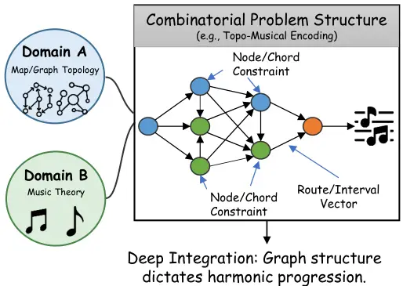
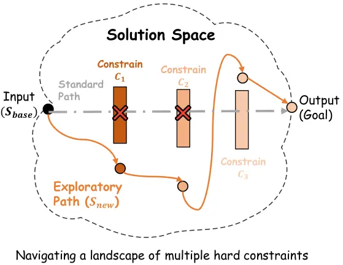
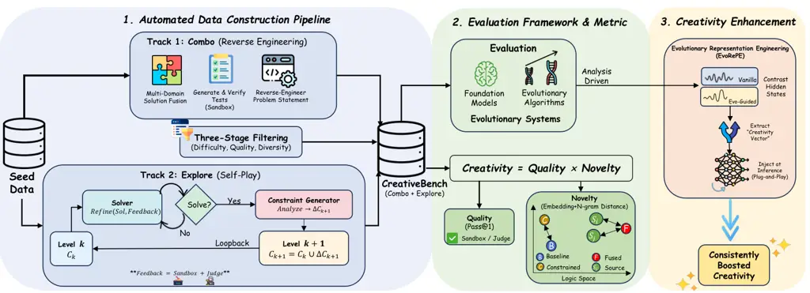

# CreativeBench: Benchmarking and Enhancing Machine Creativity via Self-Evolving Challenges

Zi-Han Wang Lam Nguyen¹¹footnotemark: 1 Zhengyang Zhao ^(†)^(†)thanks:
Equal contribution. Work done during an internship at Southern
University of Science and Technology. Affiliation: Southern University
of Science and Technology Affiliation: Tsinghua University
Affiliation: Peking University Affiliation: Xi’an Jiaotong University
Email: [zihanwang25@stu.xjtu.edu.cn](mailto:)    Mengyue Yang Chengwei
Qin Yujiu Yang Linyi Yang ^(†)^(†)thanks: Corresponding author
\<yangly6@sustech.edu.cn\>. Affiliation: Southern University of Science
and Technology Affiliation: Tsinghua University Affiliation: University
of Bristol Affiliation: The Hong Kong University of Science and
Technology (Guangzhou) Email: [yangly6@sustech.edu.cn](mailto:)

###### Abstract

The saturation of high-quality pre-training data has shifted research
focus toward evolutionary systems capable of continuously generating
novel artifacts, leading to the success of AlphaEvolve. However, the
progress of such systems is hindered by the lack of rigorous,
quantitative evaluation. To tackle this challenge, we introduce
CreativeBench, a benchmark for evaluating machine creativity in code
generation, grounded in a classical cognitive framework. Comprising two
subsets – CreativeBench-Combo and CreativeBench-Explore – the benchmark
targets combinatorial and exploratory creativity through an automated
pipeline utilizing reverse engineering and self-play. By leveraging
executable code, CreativeBench objectively distinguishes creativity from
hallucination via a unified metric defined as the product of quality and
novelty. Our analysis of state-of-the-art models reveals distinct
behaviors: (1) scaling significantly improves combinatorial creativity
but yields diminishing returns for exploration; (2) larger models
exhibit “convergence-by-scaling,” becoming more correct but less
divergent; and (3) reasoning capabilities primarily benefit constrained
exploration rather than combination. Finally, we propose EvoRePE, a
plug-and-play inference-time steering strategy that internalizes
evolutionary search patterns to consistently enhance machine creativity.
We release our data and code at: [CreativeBench
Homepage](https://zethwang.github.io/creativebench.github.io/).

## 1 Introduction

The success of Large Language Models has been driven by scaling up
Internet-scale datasets (Brown et al., 2020; Han et al., 2021; Xu
et al., 2025c). However, this approach now faces a bottleneck: the
saturation of high-quality web data limits further scaling of model
intelligence. This limitation has renewed interest in *evolutionary
systems* (Borg et al., 2022; Faldor and Cully, 2024), which are intended
to continually produce artifacts that remain both _novel_ and
*learnable* (Hughes et al., 2024). Evolving systems typically
instantiate this paradigm by pairing foundation models (as rich
conceptual priors) with evolutionary algorithms (as mechanisms for
exploration) (Wang et al., 2023; Romera-Paredes et al., 2024; Novikov
et al., 2025).



(a) Combinatorial Creativity



(b) Exploratory Creativity

Figure 1: The demonstration of two types of machine creativity
considered in CreativeBench.

While promising, the progress of these systems is currently hindered by
the lack of rigorous measurement (Lehman and Stanley, 2011a; Lange
et al., 2023). Existing works prioritize functional correctness,
overlooking the direct evaluation of creativity. Even when creativity is
considered, evaluations often (1) struggle to distinguish creativity
from hallucination (Sui et al., 2024; Jiang et al., 2024) objectively,
(2) lack sufficient task complexity to elicit truly creative behaviors
rather than rote memorization (DeLorenzo et al., 2024; Lu et al., 2025),
and (3) lack grounded, automatable quantitative metrics for creativity
in evolving systems.

To bridge these gaps, we adopt the cognitive creativity framework
proposed by Boden (Boden, 2004). This framework categorizes creativity
into distinct types, including _combinatorial creativity_ – combining
familiar concepts in unfamiliar ways, – and _exploratory creativity_ –
navigating a structured conceptual space to discover new possibilities
(see Figure 1). Accordingly, we introduce CreativeBench, a benchmark for
code generation systems comprising two subsets, CreativeBench-Explore
and CreativeBench-Combo, which focus on exploratory creativity and
combinatorial creativity, respectively, based on the assumption that
these two types of machine creativity capture the two core capabilities
required for evolutionary systems: constraint-driven search and
recombining concepts.

To this end, we present a timely dataset from several perspectives.
First, unlike creative writing (Paech, 2024; Wu et al., 2025), code
utilizes objective execution to strictly distinguish creativity from
hallucination. Second, to ensure task complexity while reducing
confounds from data leakage and rote memorization, we build an automated
pipeline, constructing a high-difficulty benchmark to guarantee that
derived tasks genuinely reflect creative behaviors rather than
memorization, with Pass@1 remaining below 60% even for
Gemini-3-Pro (DeepMind, 2025). Third, to ensure evaluation metrics are
grounded, we define a quantitative _creativity score_ as the product of
_Quality_ and *Novelty* (Williams, 1980). Quality is verified via
sandboxed execution and LLM-as-a-judge, while novelty is measured by the
logic distance between candidate programs and appropriate
baselines (Runco and Jaeger, 2012). Finally, we invite human experts to
verify both data quality and metric reliability, achieving 89.1%
instance validity and strong agreement between automated and human
creativity rankings (Spearman’s $`\rho=0.78`$).

Building on CreativeBench, we analyze state-of-the-art foundation models
along with evolutionary algorithms and highlight three key insights: (i)
_Scaling Favors Combination over Exploration_: scaling substantially
improves combinatorial creativity, yet yields limited gains for
exploratory creativity; (ii) _Convergence-by-Scaling_: larger models are
more correct but less divergent; (iii) _Reasoning Helps Exploration, Not
Combinatorial Creativity_: reasoning primarily benefit constraint-driven
exploration rather than cross-domain combination.

Beyond these findings, we propose EvoRePE (Evolutionary Representation
Engineering), a plug-and-play inference-time steering method that
extracts a creativity vector from evolutionary trajectories. EvoRePE
yields creativity gains that are orthogonal to the underlying
evolutionary strategy, suggesting that part of evolutionary optimization
can be internalized as latent-space steering toward a steered evolution
paradigm.

To our knowledge, we are the first to contribute a machine creativity
benchmark based on Boden’s cognitive creativity framework (Boden, 2004).
Our contributions are three-fold as follows:

- •
  We construct a benchmark measuring machine creativity by considering
  both _exploratory_ and _combinatorial_ creativity.
- •
  We uncover insights into how model scaling and reasoning capabilities
  interact with creativity in evolutionary systems by proposing a novel
  evaluation metric.
- •
  We propose EvoRePE, a plug-and-play method that effectively enhances
  model creativity by steering latent representations.



Figure 2: Overview of our framework. (Left) We introduce CreativeBench,
built via an automated reverse engineering and self-play pipeline.
(Middle) We evaluate evolutionary systems using a unified Creativity
Score, defined as the _Quality_ (Pass@1) and _Novelty_ (embedding +
n-gram distance). (Right) Based on our analysis, we propose the EvoRePE
strategy to steer models toward more creative solutions at inference
time.

| Benchmark                             | Metric                   | \#Prob.        | Creativity | Explore | Combo | Auto. | Difficulty                    | Domain | Len |
| ------------------------------------- | ------------------------ | -------------- | ---------- | ------- | ----- | ----- | ----------------------------- | ------ | --- |
| HumanEval (Chen et al., 2021)         | Pass@$`k`$               | 164            | ✗          | ✗       | ✗     | ✗     | $`\star`$                     | 5      | 134 |
| MBPP (Austin et al., 2021)            | Pass@$`k`$               | 974 (500 test) | ✗          | ✗       | ✗     | ✗     | $`\star`$                     | 6      | 50  |
| LiveCodeBench (Jain et al., 2024)     | Pass@$`k`$               | 400–880        | ✗          | ✗       | ✗     | ✗     | $`\star\star\star\star`$      | 4      | 470 |
| EvoCodeBench (L gi et al., 2024)      | Pass@$`k`$/Recall@$`k`$  | 275            | ✗          | ✗       | ✗     | ✓     | $`\star\star\star`$           | 10     | 132 |
| CreativeEval (DeLorenzo et al., 2024) | FFOE                     | 120            | ✓          | ✗       | ✗     | ✗     | \-                            | 1      | \-  |
| NeoCoder (Lu et al., 2025)            | Divergent/Convergent     | 199            | ✓          | ✗       | ✗     | ✗     | $`\star\star`$                | 1      | 494 |
| CreativeBench                         | Quality$`\times`$Novelty | 1,859          | ✓          | ✓       | ✓     | ✓     | $`\star\star\star\star\star`$ | 14     | 593 |

Table 1: Comparison of existing code generation benchmarks and ours.
\#Prob.: Number of problems in the commonly used setting (LiveCodeBench
varies across snapshots). Explore: Evaluates exploratory creativity via
negative constraints. Combo: Requires domain fusion (combinatorial).
Auto.: Fully automated data construction pipeline (human-free). Len:
Average token length of problem descriptions. FFOE: Fluency,
Flexibility, Originality, and Elaboration.

## 2 Related Work

##### Machine Creativity Evaluation.

While human creativity has been extensively studied in psychological and
cognitive science (Amabile, 1982; Mumford et al., 1991; Guilford, 1950),
the evaluation of creativity remains underexplored. In the task of code
generation, models are predominantly judged by functional correctness
via Pass@k metrics (Chen et al., 2021; Jimenez et al., 2024; L gi
et al., 2024), often ignoring the creative dimensions of
problem-solving. Recent work evaluates LLM creativity through divergent
and convergent thinking (Bok and Chua, 2025; Sen et al., 2025; Lu
et al., 2025). We compare our benchmark with prior methods in Table 1.
In particular, we show that existing work evaluating LLM creativity
typically has three major drawbacks: (1) reliance on subjective
assessments that struggle to distinguish creativity from
hallucination (Jiang et al., 2024; Sui et al., 2024; Wang et al., 2025;
Atmakuru et al., 2024); (2) insufficient task complexity to elicit truly
creative solutions rather than memorization (DeLorenzo et al., 2024;
Zhao et al., 2025; Jiang et al., 2025); and (3) the lack of reliable,
grounded quantitative measurements for evolutionary systems.

##### Evolutionary Algorithm.

Pursuing machine creativity aims to build systems that can continually
generate artifacts that are both _novel_ and _learnable_ to an observer
(Hughes et al., 2024). To achieve this goal, recent research has moved
beyond purely static training paradigms toward mechanism-driven
approaches using self-evolution methods. FunSearch (Romera-Paredes
et al., 2024) combines LLMs with a programmatic evaluator to search for
mathematical solutions in function space. AlphaEvolve (Novikov et al., 2025) further systematizes this by employing island-style genetic search
to maintain population diversity during code evolution. Similarly, GEPA
(Agrawal et al., 2025) treats prompts as evolvable genotypes, using
multi-objective search to optimize instructions. Our work builds on
these code-centric evolutionary strategies but focuses specifically on
evaluating the _creativity_ of the generated solutions.

##### Representation Engineering.

Representation engineering controls LLM behavior by monitoring and
intervening on residual streams and internal activations (Zou et al.,
2025; Turner et al., 2024). A common approach is to extract a steering
vector from the difference in activations between opposing pairs (e.g.,
honest vs. dishonest, neutral vs. biased) (Rimsky et al., 2024).
Existing research has predominantly applied representation engineering
to alignment tasks, such as enhancing truthfulness (Li et al., 2023),
mitigating bias (Siddique et al., 2025; Rimsky et al., 2024), or
controlling emotional style (Konen et al., 2024; Pai et al., 2025).
However, it remains unclear whether vector perturbations can effectively
enhance the _creativity_ of LLMs and be combined with evolutionary
algorithms. We show that a latent “creativity direction” can be
extracted via evolutionary prompting, and the resulting vector serves as
a plug-and-play signal to steer models toward creative solutions.

| Dataset               | \#Problems | \#Test Cases | Prob Len | Solu Len | Domain |
| --------------------- | ---------- | ------------ | -------- | -------- | ------ |
| CreativeBench-Combo   | 1308       | 16404        | 593.0    | 776.0    | 14     |
| CreativeBench-Explore | 551        | 8452         | 268.0    | 171.0    | 14     |

Table 2: Statistics of CreativeBench.

## 3 CreativeBench

### 3.1 Overview

We build CreativeBench using GPT-4.1 (OpenAI, 2025), taking the full
Python subset of AutoCodeBench as seed tasks (196 problems) (Chou
et al., 2025). As shown in Table 2, CreativeBench spans 14 domains,
providing broad coverage of programming scenarios. To maintain task
complexity while mitigating data leakage and rote memorization, we build
CreativeBench with a scalable _reverse engineering_ and _self-play_
pipeline (Figure 2).

### 3.2 CreativeBench-Combo Dataset

For CreativeBench-Combo, we adopt a reverse-engineering strategy that
derives problem descriptions from pre-validated composite code to
generate the synthesis of high-difficulty combinatorial tasks that are
inherently solvable.

##### Solution Fusion.

We first prompt the model to combine code components from different
domains (e.g., merging data processing with graph algorithms) into a
single, unified solution. These candidates are executed in a sandbox to
strictly verify their correctness. This “code-first” approach guarantees
that every generated task comes with a verified reference solution.

##### Test Function Generation.

To enable objective evaluation, we generate test cases directly from the
verified solution. We instruct the model to create valid inputs, which
are then run in the sandbox to obtain the ground-truth outputs. These
input-output pairs are formatted into standard assertion statements to
construct the final test function.

##### Problem Synthesis.

Finally, we reconstruct the problem description. We ask the model to
interpret the semantic intent of the code: _Given this solution and its
test cases, what problem does it solve?_ To ensure the description is
high-quality, we provide a set of strict guidelines that the model must
follow to synthesize a clear and coherent problem statement.

### 3.3 CreativeBench-Explore Dataset

We employ a self-play construction method based on the asymmetry that
_creating a constraint is easier than solving a problem under that
constraint_. We structure the process as a dynamic interaction between a
_Constraint Generator_ and a _Solver_, where the difficulty increases
progressively.

##### Dynamic Constraint Stacking.

We generate constraints in iterative levels. Starting from the
unconstrained problem (Level 0), the process advances to Level $`k{+}1`$
only when the instance at Level $`k`$ is successfully solved. At each
step, the Generator analyzes the Solver’s solution from the previous
level and introduces a new _negative constraint_ to invalidate its
specific algorithmic choices (e.g., forbidding a particular operator or
control-flow pattern). The new constraint is stacked onto the existing
set $`\mathcal{C}_{k}`$, yielding
$`\mathcal{C}_{k+1}=\mathcal{C}_{k}\cup\{\Delta\mathcal{C}_{k+1}\}`$, so
that higher levels strictly subsume all prior restrictions. This
mechanism continuously pushes the Solver toward structurally distinct
algorithms until it reaches its capability limit.

##### Refinement and Termination.

To determine whether a level is valid (i.e., solvable), the Solver
attempts to satisfy the accumulated constraints $`\mathcal{C}_{k}`$ via
a reference-guided refinement strategy. As shown in Eq. 1, the Solver
iteratively modifies a base solution $`S_{\mathrm{base}}`$ using
feedback from sandbox and judger:

```math
S_{\mathrm{new}}\leftarrow\mathrm{Refine}\!\left(S_{\mathrm{current}},\,\mathrm{Feedback}\;\middle|\;S_{\mathrm{base}},\,\mathcal{C}_{k}\right). \tag{1}
```

For each level, the Solver is allowed up to a fixed number of refinement
attempts (e.g., 3). If it produces a valid solution that passes both
sandbox execution (correctness) and an LLM judge (constraint adherence),
the newly added constraint is deemed effective and the process advances
to the next level. Otherwise, if the Solver fails within the allotted
attempts, we treat the current constraint set as too strict (or
unsatisfiable for the model) and terminate the generation loop for this
problem.

### 3.4 Data Filtering

We apply a three-stage filter to maintain benchmark quality. More
details about prompts and evaluation criteria are provided in
Appendix D.

##### Difficulty Check.

Programming problems that are too simple are not meaningful for
evaluating the code generation capabilities of current LLMs. For each
problem, we sample five answers with GPT-4 and validate them. Problems
solved correctly in all attempts are removed.

##### Quality Audit.

GPT-4o audits each sample based on the same specification rules used in
our dataset construction pipeline, performing an additional verification
of problem quality. This includes checking the clarity of the problem
statement, the correctness and completeness of the test function, and
the consistency between the specification, reference solution, and
executable tests.

##### Diversity Check.

To prevent redundancy and ensure broad conceptual coverage, we employ
semantic de-duplication. We compute vector embeddings for all problem
descriptions using text-embedding-3-small (OpenAI, 2024) and calculate
pairwise cosine similarities. Pairs exceeding a strict similarity
threshold (0.85) are flagged.

### 3.5 Manual Verification

In our automated pipeline, we use well-designed problem specifications
and an LLM-as-Judge module to maintain quality control. However, since
LLMs cannot guarantee 100% accuracy, the overall quality of
CreativeBench remains uncertain. To measure its reliability, we invited
three expert annotators to perform a manual review.

We built a visualization interface that displays each record, including
the problem statement, the test function, and the reference solution.
Annotators checked whether the test function was correct and aligned
with the problem description, and then assigned a binary label
(_yes/no_) indicating whether the instance was valid. We randomly
selected 100 samples from CreativeBench-Explore and 200 from
CreativeBench-Combo. The review showed a data validity rate of 89.1%,
indicating that our automated construction process is reliable. In
comparison, Gemini-2.5-Pro reached pass rates of 53.8% and 48.2% on
these tasks, suggesting substantial room for improvement.

Figure 3: Performance of foundation models on CreativeBench.The left and
right columns correspond to the Combinatorial (CreativeBench-Combo) and
Exploratory (CreativeBench-Explore) subsets, respectively.

## 4 Experimental Setup

### 4.1 CreativeBench

##### Models.

We evaluate range of models, including Gemini-3-Pro (DeepMind, 2025),
GPT-5.2 (OpenAI, 2025), Gemini-2.5-Pro (Gemini, 2025),
Claude-3.5-Sonnet (Anthropic, 2025), DeepSeek-V3 (DeepSeek-AI, 2025),
Qwen3-4B-Instruct, Qwen3-8B-Instruct (Yang et al., 2025)(with thinking
mode on/off), Gemini-2.5-Flash-Lite (Gemini, 2025), Qwen2.5-Instruct
series (1.5B, 3B, 7B, 14B, 32B, 72B) (Qwen et al., 2025).

##### Baselines.

We consider standard zero-shot prompting and two evolutionary
optimization baselines, AlphaEvolve (Novikov et al., 2025) and
GEPA (Agrawal et al., 2025), using Gemini-2.5-Pro as the backend for
iterative prompt mutation and feedback. AlphaEvolve employs an
island-style genetic search framework that evolves candidate programs
through iterative mutation and selection while maintaining population
diversity. However, although AlphaEvolve is capable of operating
directly at the program optimization level, the large scale of our
dataset and the associated computational cost make such usage
impractical. For efficiency, we therefore apply AlphaEvolve in a prompt
optimization setting for evaluation. GEPA treats prompts as evolvable
genotypes and performs multi-objective evolutionary optimization with
Pareto candidate selection, making it possible to retain complementary
improvements across different behavioral dimensions when refining
instructions. Details are provided in Appendix B.

### 4.2 Evaluation Metrics

##### Unified Creativity Score.

We define creativity as the expected product of quality and novelty
across samples. The multiplicative formulation induces _selectivity_: a
solution receives a high creativity score only when it is both correct
and meaningfully different from baseline solutions. Consequently,
solutions that are correct but routine, or novel but incorrect, are
assigned low creativity scores.

```math
\mathrm{Creativity}=\mathbb{E}_{i}\!\left[\mathrm{Quality}_{i}\times\mathrm{Novelty}_{i}\right]. \tag{2}
```

##### Quality.

We measure solution quality by execution correctness and instantiate the
metric as $`\mathrm{Pass@1}`$ which provides a lower-bound estimate of a
model’s success probability under single-sample decoding. All generated
solutions are executed and validated inside a sandbox (Chou et al.,
2025).

##### Novelty.

We define novelty as the extent to which a solution differs from
previously observed or baseline solutions, capturing the degree of
originality or non-trivial departure from known patterns. Furthermore,
we quantify Novelty by measuring the degree to which a generated
solution deviates from a baseline solution within the solution
space (Lehman and Stanley, 2011b; Pugh et al., 2016). We adopt
CodeXEmbed (Liu et al., 2025), a generalist code embedding model
explicitly optimized to capture program structure and dependencies while
remaining robust to syntactic variations. To further penalize near-copy
behaviors with only lightweight textual edits, we complement embedding
distance with a character-level n-gram distance. Concretely, for two
solutions $`u`$ and $`v`$, let $`\mathbf{e}_{u}`$ and $`\mathbf{e}_{v}`$
denote embeddings, $`\cos(\mathbf{e}_{u},\mathbf{e}_{v})`$ the cosine
similarity, and $`G_{4}(\cdot)`$ the set of distinct character 4-grams
extracted from a solution. We instantiate the novelty as

```math
\mathcal{N}(u,v)=\underbrace{1-\cos(\mathbf{e}_{u},\mathbf{e}_{v})}_{\text{embedding}}+\underbrace{\left(1-\frac{|G_{4}(u)\cap G_{4}(v)|}{|G_{4}(u)\cup G_{4}(v)|}\right)}_{\text{4-gram}}, \tag{3}
```

Exploratory Novelty measures the deviation of a constrained solution
$`y_{c}`$ from an unconstrained baseline $`y_{b}`$:

```math
\mathcal{N}_{\text{explore}}=\mathcal{N}(y_{c},y_{b}). \tag{4}
```

Combinatorial Novelty measures how much the combined-problem solution
$`y_{c}`$ deviates from its $`k`$ source solutions
$`\{y_{s}^{(j)}\}_{j=1}^{k}`$:

```math
\mathcal{N}_{\text{combo}}=\frac{1}{k}\sum_{j=1}^{k}\mathcal{N}\bigl(y_{c},y_{s}^{(j)}\bigr). \tag{5}
```

This encourages genuine integration rather than copying a single source
with minor edits. We provide additional robustness checks for Novelty
under superficial edits and length in Appendix F.
$`\text{Quality}\in[0,1]`$ and $`\text{Novelty}\in[0,3]`$, the
Creativity score ($`\text{Quality}\times\text{Novelty}`$) is bounded in
$`[0,3]`$.

##### Manual Validation.

To verify the efficacy of our metrics, we conduct a manual review
comprising two aspects. We compared our automated creativity rankings
with expert rankings on a sampled subset. The results show a high
consistency rate (Spearman’s $`\rho=\textbf{0.78}`$), confirming that
our metric reliably reflects perceived creativity. A detailed case study
can be found in Appendix G.

### 4.3 EvoRePE

We propose EvoRePE (Evolutionary Representation Engineering), a
training-free strategy that distils the creative shifts found by
evolutionary search into a compact steering vector.

##### Method.

EvoRePE extracts a latent direction that captures the transition from a
standard solution to an evolved solution. Let
$`\mathcal{D}=\{(x_{\text{base}}^{(i)},x_{\text{evo}}^{(i)})\}_{i=1}^{N}`$
be a dataset of $`N`$ prompt pairs, where $`x_{\text{base}}^{(i)}`$ is
the initial standard prompt and $`x_{\text{evo}}^{(i)}`$ is the
corresponding optimized prompt derived from an evolutionary algorithm
(e.g., AlphaEvolve). For a given layer $`\ell`$, let
$`\mathbf{h}_{\ell}(x)`$ denote an aggregated activation vector for
input $`x`$ (e.g., the last-token activation). We compute per-pair
shifts
$`\Delta\mathbf{h}_{\ell}^{(i)}=\mathbf{h}_{\ell}(x_{\text{evo}}^{(i)})-\mathbf{h}_{\ell}(x_{\text{base}}^{(i)})`$
and collect them into a matrix $`H_{\ell}`$. We define the creativity
vector as the Principal Component Analysis (PCA) (Shlens, 2014):

```math
\mathbf{v}_{\ell}=\mathrm{PCA}_{1}(H_{\ell}).
```

During inference, we steer the residual stream by

```math
\tilde{\mathbf{h}}_{\ell}=\mathbf{h}_{\ell}+\alpha\,\mathbf{v}_{\ell},
```

where $`\alpha`$ controls the intervention strength.

|                       |                   |                      |     |                      |     |                         |     |                       |     |                      |     |                         |     |
| --------------------- | ----------------- | -------------------- | --- | -------------------- | --- | ----------------------- | --- | --------------------- | --- | -------------------- | --- | ----------------------- | --- |
| Type                  | Method            | CreativeBench-Combo  |     |                      |     |                         |     | CreativeBench-Explore |     |                      |     |                         |     |
|                       |                   | Pass@1 $`\uparrow`$  |     | Novelty $`\uparrow`$ |     | Creativity $`\uparrow`$ |     | Pass@1 $`\uparrow`$   |     | Novelty $`\uparrow`$ |     | Creativity $`\uparrow`$ |     |
| Qwen2.5-7B-Instruct   |                   |                      |     |                      |     |                         |     |                       |     |                      |     |                         |     |
| Standard              | Vanilla Prompt    | 9.21% $`\pm`$ 0.11%  |     | 1.56 $`\pm`$ 0.005   |     | 0.168 $`\pm`$ 0.003     |     | 4.11% $`\pm`$ 0.18%   |     | 0.473 $`\pm`$ 0.006  |     | 0.0146 $`\pm`$ 0.0005   |     |
|                       | \+ EvoRePE (Ours) | 9.71% $`\pm`$ 0.09%  |     | 1.59 $`\pm`$ 0.01    |     | 0.174 $`\pm`$ 0.003     |     | 4.38% $`\pm`$ 0.15%   |     | 0.469 $`\pm`$ 0.006  |     | 0.0148 $`\pm`$ 0.0006   |     |
| Evolutionary          | AlphaEvolve       | 10.81% $`\pm`$ 0.08% |     | 1.53 $`\pm`$ 0.01    |     | 0.175 $`\pm`$ 0.003     |     | 5.22% $`\pm`$ 0.12%   |     | 0.458 $`\pm`$ 0.009  |     | 0.0163 $`\pm`$ 0.0004   |     |
|                       | \+ EvoRePE        | 11.48% $`\pm`$ 0.11% |     | 1.57 $`\pm`$ 0.01    |     | 0.193 $`\pm`$ 0.003     |     | 5.75% $`\pm`$ 0.18%   |     | 0.457 $`\pm`$ 0.009  |     | 0.0169 $`\pm`$ 0.0006   |     |
|                       | GEPA              | 11.24% $`\pm`$ 0.09% |     | 1.54 $`\pm`$ 0.01    |     | 0.176 $`\pm`$ 0.003     |     | 4.65% $`\pm`$ 0.15%   |     | 0.465 $`\pm`$ 0.007  |     | 0.0162 $`\pm`$ 0.0007   |     |
|                       | \+ EvoRePE        | 11.47% $`\pm`$ 0.07% |     | 1.56 $`\pm`$ 0.01    |     | 0.188 $`\pm`$ 0.002     |     | 5.20% $`\pm`$ 0.10%   |     | 0.470 $`\pm`$ 0.008  |     | 0.0182 $`\pm`$ 0.0006   |     |
| Gemini-2.5-Flash-Lite |                   |                      |     |                      |     |                         |     |                       |     |                      |     |                         |     |
| Standard              | Vanilla Prompt    | 36.41% $`\pm`$ 0.10% |     | 1.64 $`\pm`$ 0.01    |     | 0.509 $`\pm`$ 0.003     |     | 23.51% $`\pm`$ 0.22%  |     | 0.629 $`\pm`$ 0.009  |     | 0.1681 $`\pm`$ 0.0006   |     |
| Evolutionary          | AlphaEvolve       | 39.01% $`\pm`$ 0.10% |     | 1.66 $`\pm`$ 0.01    |     | 0.605 $`\pm`$ 0.004     |     | 26.61% $`\pm`$ 0.13%  |     | 0.691 $`\pm`$ 0.009  |     | 0.1781 $`\pm`$ 0.0005   |     |
|                       | GEPA              | 38.32% $`\pm`$ 0.12% |     | 1.60 $`\pm`$ 0.01    |     | 0.567 $`\pm`$ 0.001     |     | 27.88% $`\pm`$ 0.18%  |     | 0.668 $`\pm`$ 0.008  |     | 0.1798 $`\pm`$ 0.0005   |     |

Table 3: Results are reported as mean $`\pm`$ standard deviation over
$`N=10`$ independent runs. Novelty is the dataset-level average,
$`\mathbb{E}_{i}[\mathrm{Novelty}_{i}]`$, over the evaluation set. We
provide detailed case studies in Appendix G.

##### Setup.

We use Qwen2.5-7B-Instruct as the base model. We select Layer 26 and the
default steering strength $`\alpha=0.1`$ on a small validation set
($`N=20`$), following prior activation-steering and
representation-engineering practice (Zou et al., 2025; Turner et al.,
2024). Robustness to layer and $`\alpha`$ sweeps is reported in
Appendix I.

## 5 Results

### 5.1 CreativeBench

As shown in Figure 3, CreativeBench poses a significant challenge even
for state-of-the-art foundation models. The strongest performing model,
Gemini-3-Pro, achieves Pass@1 rates below 60% on both subsets,
reflecting the benchmark’s difficulty, as it is derived from
high-difficulty seeds to curb memorization and elicit creative problem
solving.

##### Scaling Favors Combination over Exploration.

We also find that Gemini-3-Pro achieves an improvement in _combinatorial
creativity_, while _exploratory creativity_ occurs slightly declining.
This asymmetry can be understood from a compression perspective.
Training large language models can be viewed as compressing massive
corpora into a finite set of parameters (Delétang et al., 2024). Scaling
expands this compression budget and increases the diversity of patterns
that can be stored. Models become better at identifying deep
commonalities and connecting distant domains. For example, drawing
analogies between Greek literature and quantum mechanics naturally
supports knowledge synthesis and recombination.

In contrast, exploratory creativity often requires moving away from
dominant solution patterns, making a “0-to-1” leap into low-probability
regions of the model’s prior. However, scaling that improves compression
can also strengthen distributional priors, making high-likelihood,
routine solutions more stable. When novelty depends on escaping these
data-induced attractors, the benefits of scaling quickly diminish.
Consequently, while scaling is effective for richer recombination, it
may saturate for genuine exploratory innovation, which likely requires
stronger search, navigation, or reasoning mechanisms beyond simple more
data.

### 5.2 EvoRePE

While evolutionary algorithms effectively boost creativity, they face
two critical bottlenecks. First, the process is computationally costly,
as the search for novelty requires massive inference overhead
(Appendix I.1). Second, these systems are constrained by the creativity
of the foundation model. In contrast, EvoRePE proposes a training-free
method by injecting the creativity vector at inference time.

##### The Efficacy of the Creativity Vector.

As shown in Table 3, EvoRePE yields creativity gains that are orthogonal
to the evolutionary strategy. In particular, for Qwen2.5-7B-Instruct on
CreativeBench-Combo, adding EvoRePE improves the overall creativity
score from $`0.174`$ to $`0.192`$ when combined with AlphaEvolve.
Notably, EvoRePE also provides consistent gains even on vanilla
prompting, without requiring any evolutionary search. This indicates
that the benefits of evolutionary optimization can be partially
internalized into the model’s activations. Our findings link
evolutionary searching with latent-space steering, suggesting a
promising direction of _steered evolution_, where a model’s own creative
trajectories facilitate a form of self-evolution in representation
space.

## 6 Discussion and Analysis

Figure 4: Scaling analysis of the Qwen2.5-Instruct model family on
CreativeBench.

##### Convergence-by-Scaling.

For direct comparability across tracks, we normalize Novelty and
Creativity by the global maximum value computed over both Combo and
Explore. As shown in Figure 4, scaling up model size consistently
improves Pass@1, while Novelty declines or plateaus, so the overall
Creativity Score rises mainly due to functional gains rather than
stronger divergence. We term this Convergence-by-Scaling: larger models
fit high-frequency training patterns more effectively, concentrating
generation toward high-probability modes and yielding solutions that are
more correct but also more standardized. By contrast, smaller models
exhibit higher-variance generation trajectories that deviate more from
common paradigms and can yield higher novelty, typically at the cost of
correctness. Overall, Novelty and functional quality behave as largely
orthogonal dimensions: scaling primarily strengthens correctness, but
does not systematically increase departure from training priors.

Figure 5: Impact of reasoning mode on CreativeBench.

##### Reasoning Helps Exploratory Creativity.

As shown in Figure 5, enabling a reasoning mode has very different
effects on different types of creativity. In combinatorial creativity
tasks, reasoning provides almost no benefit, suggesting that
cross-domain fusion relies more on effective knowledge retrieval and
composition than on lengthy chains of thought. In contrast, on
exploratory creativity tasks, reasoning significantly improves
performance. When the search space is defined by constraints, a more
structured “thinking” process helps the model find deeper alternative
solutions.

##### Foundation Models as Evolutionary Operators.

We draw an analogy between evolutionary systems and biological
evolution: powerful foundation models function as effective mutation
operators proposing candidate programs. In evolutionary computation,
selection is driven by a fitness function that evaluates candidates;
analogously, our framework instantiates the evaluation environment and
computes fitness as a joint score of quality and novelty. Exploratory
Creativity aligns with mutation, introducing local variations to search
constrained spaces, while Combinatorial Creativity reflects
recombination, merging traits from different domains into unified
solutions. This suggests that further improving evolutionary systems
depends on refining evolutionary operators and the fitness signals.

##### Future Work

A promising direction is to extend our evaluation framework beyond
executable code to other creative domains, including storytelling, music
composition, visual design, 3D artifact design, game level design, and
scientific discovery. It requires (i) domain-appropriate structured
representations and (ii) robust criteria for assessing both quality and
novelty. While code offers execution-grounded quality signals, many
domains lack standardized representations or reliable automatic
evaluators. Future work could leverage domain-specific proxy metrics for
quality and more principled novelty estimators, such as distance to
reference sets or structural divergence over graphs and trees. Future
evaluation frameworks must transcend outcome scoring to incorporate
process-level signals, utilizing interaction traces to map exploration
trajectories and align model behavior with human cognitive workflows. We
suggest expert-in-the-loop paradigms to bridge the gap between
scalability and the qualitative depth required for such assessment. A
promising application area is scientific discovery, where idea
generation – such as proposing novel experimental designs – tests the
limits of generative reasoning. In this context, evaluation metrics must
be expanded to rigorously quantify novelty and diversity, ensuring that
generated hypotheses are both practically feasible and substantively
different from established literature.

## 7 Conclusion

In this paper, we introduced CreativeBench, the benchmark grounded in
Boden’s cognitive framework to evaluate the combinatorial and
exploratory creativity of evolutionary systems. Our systematic analysis
utilizing CreativeBench uncovers distinct trade-offs in modern
foundation models. We identified a _Convergence-by-Scaling_ effect,
where increasing model scale improves functional correctness but
suppresses divergence. Furthermore, we found that advanced reasoning
capabilities primarily benefit exploratory rather than combinatorial
creativity. To harness these findings, we proposed EvoRePE, a
plug-and-play representation engineering strategy that steers models
toward more creative behaviors by internalizing evolutionary search
patterns. We believe that this work sheds light towards the exploration
of machine creativity.

## Acknowledgements

We thank the reviewers for their effort in improving the work. We
acknowledge with thanks the discussion with Yixuan Weng, as well as the
many others who have helped. This work was supported by the AI funding
program of SUSTech, the National Key Research and Development Program of
China (No. 2024YFB2808903), and the Tsinghua SIGS KA Cooperation Fund.

## Limitations

We acknowledge that CreativeBench has several limitations, including its
language scope, training scope, and potential generator bias.

First, CreativeBench is currently instantiated in Python, whose concise
syntax and mature tooling facilitate controlled analysis of novelty and
functional correctness. Because the benchmark relies on an automated
generation and evaluation pipeline, it is, in principle, extensible to
other programming languages and paradigms through programmatic
translation of code and tests. Second, this work focuses on the
_evaluation and analysis_ of creativity in self-evolving code generation
systems, rather than on training models with CreativeBench. Due to
limited computational resources, we do not conduct large-scale training
or fine-tuning experiments in this study. Finally, because CreativeBench
is automatically constructed, it may inherit generator bias from the
underlying LLM-based pipeline. Prior work suggests that such bias can be
measured and mitigated, and under appropriate conditions, it is less
likely to overturn ranking-based comparisons.

## References

- Agrawal et al. (2025) Lakshya A Agrawal, Shangyin Tan, Dilara Soylu,
  Noah Ziems, Rishi Khare, Krista Opsahl-Ong, Arnav Singhvi, Herumb
  Shandilya, Michael J Ryan, Meng Jiang, Christopher Potts, Koushik Sen,
  Alexandros G. Dimakis, Ion Stoica, Dan Klein, Matei Zaharia, and Omar
  Khattab. 2025. [Gepa: Reflective prompt evolution can outperform
  reinforcement learning](https://arxiv.org/abs/2507.19457). _Preprint_,
  arXiv:2507.19457.
- Amabile (1982) Teresa M. Amabile. 1982. [Social psychology of
  creativity: A consensual assessment
  technique](https://doi.org/10.1037/0022-3514.43.5.997). _Journal of
  Personality and Social Psychology_, 43(5):997–1013.
- An et al. (2025) Shengnan An, Xunliang Cai, Xuezhi Cao, Xiaoyu Li,
  Yehao Lin, Junlin Liu, Xinxuan Lv, Dan Ma, Xuanlin Wang, Ziwen Wang,
  and 1 others. 2025. Amo-bench: Large language models still struggle in
  high school math competitions. _arXiv preprint arXiv:2510.26768_.
- Anthropic (2025) Anthropic. 2025. [Introducing claude
  3.5](https://www.anthropic.com/news/claude-3.5).
- Atmakuru et al. (2024) Anirudh Atmakuru, Jatin Nainani, Rohith
  Siddhartha Reddy Bheemreddy, Anirudh Lakkaraju, Zonghai Yao, Hamed
  Zamani, and Haw-Shiuan Chang. 2024. [Cs4: Measuring the creativity of
  large language models automatically by controlling the number of
  story-writing constraints](https://arxiv.org/abs/2410.04197).
  _Preprint_, arXiv:2410.04197.
- Austin et al. (2021) Jacob Austin, Augustus Odena, Maxwell Nye,
  Maarten Bosma, Henryk Michalewski, David Dohan, Ellen Jiang, Carrie
  Cai, Michael Terry, Quoc Le, and Charles Sutton. 2021. [Program
  synthesis with large language
  models](https://arxiv.org/abs/2108.07732). _Preprint_,
  arXiv:2108.07732.
- Boden (2004) Margaret A. Boden. 2004. _The Creative Mind: Myths and
  Mechanisms_, 2 edition. Routledge.
- Bok and Chua (2025) Zhuang Qiang Bok and Watson Wei Khong Chua. 2025.
  [Reasoning beyond the obvious: Evaluating divergent and convergent
  thinking in llms for financial
  scenarios](https://arxiv.org/abs/2507.18368). _Preprint_,
  arXiv:2507.18368.
- Borg et al. (2022) James M. Borg, Andrew Buskell, Rohan Kapitany,
  Simon T. Powers, Eva Reindl, and Claudio Tennie. 2022. [Evolved
  open-endedness in cultural evolution: A new dimension in open-ended
  evolution research](https://arxiv.org/abs/2203.13050). _Preprint_,
  arXiv:2203.13050.
- Brown et al. (2020) Tom Brown, Benjamin Mann, Nick Ryder, Melanie
  Subbiah, Jared D Kaplan, Prafulla Dhariwal, Arvind Neelakantan, Pranav
  Shyam, Girish Sastry, Amanda Askell, Sandhini Agarwal, Ariel
  Herbert-Voss, Gretchen Krueger, Tom Henighan, Rewon Child, Aditya
  Ramesh, Daniel Ziegler, Jeffrey Wu, Clemens Winter, and 12
  others. 2020. [Language models are few-shot
  learners](https://proceedings.neurips.cc/paper_files/paper/2020/file/1457c0d6bfcb4967418bfb8ac142f64a-Paper.pdf).
  In _Advances in Neural Information Processing Systems_, volume 33,
  pages 1877–1901. Curran Associates, Inc.
- Cao et al. (2026) Qian Cao, Yahui Liu, Wei Bi, Yi Zhao, Ruihua Song,
  Xiting Wang, Ruiming Tang, Guorui Zhou, and Han Li. 2026. Dpwriter:
  Reinforcement learning with diverse planning branching for creative
  writing. _arXiv preprint arXiv:2601.09609_.
- Chen et al. (2021) Mark Chen, Jerry Tworek, Heewoo Jun, Qiming Yuan,
  Henrique Ponde de Oliveira Pinto, Jared Kaplan, Harri Edwards, Yuri
  Burda, Nicholas Joseph, Greg Brockman, Alex Ray, Raul Puri, Gretchen
  Krueger, Michael Petrov, Heidy Khlaaf, Girish Sastry, Pamela Mishkin,
  Brooke Chan, Scott Gray, and 39 others. 2021. [Evaluating large
  language models trained on code](https://arxiv.org/abs/2107.03374).
  _Preprint_, arXiv:2107.03374.
- Chou et al. (2025) Jason Chou, Ao Liu, Yuchi Deng, Zhiying Zeng, Tao
  Zhang, Haotian Zhu, Jianwei Cai, Yue Mao, Chenchen Zhang, Lingyun Tan,
  Ziyan Xu, Bohui Zhai, Hengyi Liu, Speed Zhu, Wiggin Zhou, and Fengzong
  Lian. 2025. [Autocodebench: Large language models are automatic code
  benchmark generators](https://arxiv.org/abs/2508.09101).
- DeepMind (2025) Google DeepMind. 2025. Gemini 3 Pro.
  [https://storage.googleapis.com/deepmind-media/Model-Cards/Gemini-3-Pro-Model-Card.pdf](https://storage.googleapis.com/deepmind-media/Model-Cards/Gemini-3-Pro-Model-Card.pdf).
  \[Large language model\].
- DeepSeek-AI (2025) DeepSeek-AI. 2025. [Deepseek-v3 technical
  report](https://arxiv.org/abs/2412.19437). _Preprint_,
  arXiv:2412.19437.
- DeLorenzo et al. (2024) Matthew DeLorenzo, Vasudev Gohil, and
  Jeyavijayan Rajendran. 2024. [Creativeval: Evaluating creativity of
  llm-based hardware code generation](https://arxiv.org/abs/2404.08806).
  _Preprint_, arXiv:2404.08806.
- Delétang et al. (2024) Grégoire Delétang, Anian Ruoss, Paul-Ambroise
  Duquenne, Elliot Catt, Tim Genewein, Christopher Mattern, Jordi
  Grau-Moya, Li Kevin Wenliang, Matthew Aitchison, Laurent Orseau,
  Marcus Hutter, and Joel Veness. 2024. [Language modeling is
  compression](https://arxiv.org/abs/2309.10668). _Preprint_,
  arXiv:2309.10668.
- Faldor and Cully (2024) Maxence Faldor and Antoine Cully. 2024.
  [Toward artificial open-ended evolution within lenia using
  quality-diversity](https://arxiv.org/abs/2406.04235). _Preprint_,
  arXiv:2406.04235.
- Gemini (2025) Gemini. 2025. [Gemini 2.5: Pushing the frontier with
  advanced reasoning, multimodality, long context, and next generation
  agentic capabilities](https://arxiv.org/abs/2507.06261). _Preprint_,
  arXiv:2507.06261.
- Guilford (1950) J. P. Guilford. 1950.
  [Creativity](https://doi.org/10.1037/h0063487). _American
  Psychologist_, 5(9):444–454.
- Han et al. (2021) Xu Han, Zhengyan Zhang, Ning Ding, Yuxian Gu, Xiao
  Liu, Yuqi Huo, Jiezhong Qiu, Yuan Yao, Ao Zhang, Liang Zhang, Wentao
  Han, Minlie Huang, Qin Jin, Yanyan Lan, Yang Liu, Zhiyuan Liu, Zhiwu
  Lu, Xipeng Qiu, Ruihua Song, and 5 others. 2021. [Pre-trained models:
  Past, present and future](https://arxiv.org/abs/2106.07139).
  _Preprint_, arXiv:2106.07139.
- Huang et al. (2025) Shiting Huang, Zhen Fang, Zehui Chen, Siyu Yuan,
  Junjie Ye, Yu Zeng, Lin Chen, Qi Mao, and Feng Zhao. 2025. Critictool:
  Evaluating self-critique capabilities of large language models in
  tool-calling error scenarios. _arXiv preprint arXiv:2506.13977_.
- Hughes et al. (2024) Edward Hughes, Michael Dennis, Jack
  Parker-Holder, Feryal Behbahani, Aditi Mavalankar, Yuge Shi, Tom
  Schaul, and Tim Rocktaschel. 2024. [Open-endedness is essential for
  artificial superhuman intelligence](https://arxiv.org/abs/2406.04268).
  _Preprint_, arXiv:2406.04268.
- Jain et al. (2024) Naman Jain, King Han, Alex Gu, Wen-Ding Li, Fanjia
  Yan, Tianjun Zhang, Sida Wang, Armando Solar-Lezama, Koushik Sen, and
  Ion Stoica. 2024. [Livecodebench: Holistic and contamination free
  evaluation of large language models for
  code](https://arxiv.org/abs/2403.07974). _Preprint_, arXiv:2403.07974.
- Jiang et al. (2025) Liwei Jiang, Yuanjun Chai, Margaret Li, Mickel
  Liu, Raymond Fok, Nouha Dziri, Yulia Tsvetkov, Maarten Sap, and Yejin
  Choi. 2025. [Artificial hivemind: The open-ended homogeneity of
  language models (and
  beyond)](https://openreview.net/forum?id=saDOrrnNTz). In _The
  Thirty-ninth Annual Conference on Neural Information Processing
  Systems Datasets and Benchmarks Track_.
- Jiang et al. (2024) Xuhui Jiang, Yuxing Tian, Fengrui Hua, Chengjin
  Xu, Yuanzhuo Wang, and Jian Guo. 2024. [A survey on large language
  model hallucination via a creativity
  perspective](https://arxiv.org/abs/2402.06647). _Preprint_,
  arXiv:2402.06647.
- Jimenez et al. (2024) Carlos E Jimenez, John Yang, Alexander Wettig,
  Shunyu Yao, Kexin Pei, Ofir Press, and Karthik R Narasimhan. 2024.
  [SWE-bench: Can language models resolve real-world github
  issues?](https://openreview.net/forum?id=VTF8yNQM66) In _The Twelfth
  International Conference on Learning Representations_.
- Konen et al. (2024) Kai Konen, Sophie Jentzsch, Diaoulé Diallo, Peer
  Schütt, Oliver Bensch, Roxanne El Baff, Dominik Opitz, and Tobias
  Hecking. 2024. [Style vectors for steering generative large language
  models](https://aclanthology.org/2024.findings-eacl.52/). In _Findings
  of the Association for Computational Linguistics: EACL 2024_, pages
  782–802, St. Julian’s, Malta. Association for Computational
  Linguistics.
- L gi et al. (2024) Jia L gi, Ge Li, Xuanming Zhang, Yunfei Zhao,
  Yihong Dong, Zhi Jin, Binhua Li, Fei Huang, and Yongbin Li. 2024.
  [Evocodebench: An evolving code generation benchmark with
  domain-specific evaluations](https://doi.org/10.52202/079017-1837). In
  _Advances in Neural Information Processing Systems_, volume 37, pages
  57619–57641. Curran Associates, Inc.
- Lange et al. (2023) Robert Tjarko Lange, Yujin Tang, and Yingtao
  Tian. 2023. [Neuroevobench: Benchmarking evolutionary optimizers for
  deep learning
  applications](https://doi.org/10.48550/arXiv.2311.02394). _Preprint_,
  arXiv:2311.02394. NeurIPS 2023 Track on Datasets and Benchmarks.
- Lehman and Stanley (2011a) Joel Lehman and Kenneth O. Stanley. 2011a.
  [Abandoning objectives: Evolution through the search for novelty
  alone](https://doi.org/10.1162/EVCO_a_00025). _Evolutionary
  Computation_, 19(2):189–223. Epub 2011-02-14.
- Lehman and Stanley (2011b) Joel Lehman and Kenneth O. Stanley. 2011b.
  [_Novelty Search and the Problem with
  Objectives_](https://doi.org/10.1007/978-1-4614-1770-5_3), pages
  37–56. Springer New York, New York, NY.
- Li et al. (2023) Kenneth Li, Oam Patel, Fernanda Viégas, Hanspeter
  Pfister, and Martin Wattenberg. 2023. [Inference-time intervention:
  Eliciting truthful answers from a language
  model](https://openreview.net/forum?id=aLLuYpn83y). In _Thirty-seventh
  Conference on Neural Information Processing Systems_.
- Li et al. (2025) Xiaoyuan Li, Keqin Bao, Yubo Ma, Moxin Li, Wenjie
  Wang, Rui Men, Yichang Zhang, Fuli Feng, Dayiheng Liu, and Junyang
  Lin. 2025. Mtr-bench: A comprehensive benchmark for multi-turn
  reasoning evaluation. _arXiv preprint arXiv:2505.17123_.
- Liu et al. (2025) Ye Liu, Rui Meng, Shafiq Joty, silvio savarese,
  Caiming Xiong, Yingbo Zhou, and Semih Yavuz. 2025. [CodeXEmbed: A
  generalist embedding model family for multilingual and multi-task code
  retrieval](https://openreview.net/forum?id=z3lG70Azbg). In _Second
  Conference on Language Modeling_.
- Lu et al. (2025) Yining Lu, Dixuan Wang, Tianjian Li, Dongwei Jiang,
  Sanjeev Khudanpur, Meng Jiang, and Daniel Khashabi. 2025.
  [Benchmarking language model creativity: A case study on code
  generation](https://doi.org/10.18653/v1/2025.naacl-long.141). In
  _Proceedings of the 2025 Conference of the Nations of the Americas
  Chapter of the Association for Computational Linguistics: Human
  Language Technologies (Volume 1: Long Papers)_, pages 2776–2794,
  Albuquerque, New Mexico. Association for Computational Linguistics.
- Mumford et al. (1991) Michael D. Mumford, Michele I. Mobley, Roni
  Reiter-Palmon, Charles E. Uhlman, and Lesli M. Doares. 1991. [Process
  analytic models of creative
  capacities](https://doi.org/10.1080/10400419109534380). _Creativity
  Research Journal_, 4(2):91–122.
- Novikov et al. (2025) Alexander Novikov, Ngân Vũ, Marvin Eisenberger,
  Emilien Dupont, Po-Sen Huang, Adam Zsolt Wagner, Sergey Shirobokov,
  Borislav Kozlovskii, Francisco J. R. Ruiz, Abbas Mehrabian, M. Pawan
  Kumar, Abigail See, Swarat Chaudhuri, George Holland, Alex Davies,
  Sebastian Nowozin, Pushmeet Kohli, and Matej Balog. 2025.
  [Alphaevolve: A coding agent for scientific and algorithmic
  discovery](https://arxiv.org/abs/2506.13131). _Preprint_,
  arXiv:2506.13131.
- OpenAI (2024) OpenAI. 2024. text-embedding-3-small \[text embedding
  model\].
  [https://platform.openai.com/docs/models/text-embedding-3-small](https://platform.openai.com/docs/models/text-embedding-3-small).
- OpenAI (2025) OpenAI. 2025. GPT-4.1 \[large language model\].
  [https://platform.openai.com/docs/models/gpt-4.1](https://platform.openai.com/docs/models/gpt-4.1).
  Accessed: 2025-\<month-you-accessed\>.
- OpenAI (2025) OpenAI. 2025. Introducing GPT-5.2.
  [https://openai.com/index/introducing-gpt-5-2/](https://openai.com/index/introducing-gpt-5-2/).
  Accessed: 2025-12-21.
- Paech (2024) Samuel J. Paech. 2024. [Eq-bench: An emotional
  intelligence benchmark for large language
  models](https://arxiv.org/abs/2312.06281). _Preprint_,
  arXiv:2312.06281.
- Pai et al. (2025) Tsung-Min Pai, Jui-I Wang, Li-Chun Lu, Shao-Hua Sun,
  Hung-Yi Lee, and Kai-Wei Chang. 2025. [Billy: Steering large language
  models via merging persona vectors for creative
  generation](https://arxiv.org/abs/2510.10157). _Preprint_,
  arXiv:2510.10157.
- Pugh et al. (2016) Justin K. Pugh, Lisa B. Soros, and Kenneth O.
  Stanley. 2016. [Quality diversity: A new frontier for evolutionary
  computation](https://doi.org/10.3389/frobt.2016.00040). _Frontiers in
  Robotics and AI_, Volume 3 - 2016.
- Qwen et al. (2025) Qwen, :, An Yang, Baosong Yang, Beichen Zhang,
  Binyuan Hui, Bo Zheng, Bowen Yu, Chengyuan Li, Dayiheng Liu, Fei
  Huang, Haoran Wei, Huan Lin, Jian Yang, Jianhong Tu, Jianwei Zhang,
  Jianxin Yang, Jiaxi Yang, Jingren Zhou, and 25 others. 2025. [Qwen2.5
  technical report](https://arxiv.org/abs/2412.15115). _Preprint_,
  arXiv:2412.15115.
- Rimsky et al. (2024) Nina Rimsky, Nick Gabrieli, Julian Schulz, Meg
  Tong, Evan Hubinger, and Alexander Turner. 2024. [Steering llama 2 via
  contrastive activation
  addition](https://doi.org/10.18653/v1/2024.acl-long.828). In
  _Proceedings of the 62nd Annual Meeting of the Association for
  Computational Linguistics (Volume 1: Long Papers)_, pages 15504–15522,
  Bangkok, Thailand. Association for Computational Linguistics.
- Romera-Paredes et al. (2024) Bernardino Romera-Paredes, Mohammadamin
  Barekatain, Alexander Novikov, Matej Balog, M. Pawan Kumar, Emilien
  Dupont, Francisco J. R. Ruiz, Jordan S. Ellenberg, Pengming Wang, Omar
  Fawzi, Pushmeet Kohli, and Alhussein Fawzi. 2024. [Mathematical
  discoveries from program search with large language
  models](https://doi.org/10.1038/s41586-023-06924-6). _Nature_,
  625:468–475.
- Runco and Jaeger (2012) Mark A. Runco and Garrett J. Jaeger. 2012.
  [The standard definition of
  creativity](https://doi.org/10.1080/10400419.2012.650092). _Creativity
  Research Journal_, 24(1):92–96.
- Sen et al. (2025) Tan Min Sen, Zachary Choy Kit Chun, Swaagat Bikash
  Saikia, Syed Ali Redha Alsagoff, Banerjee Mohor, Nadya Yuki
  Wangsajaya, and Alvin Chan. 2025. [Think outside the bot: Automating
  evaluation of creativity in LLMs for physical reasoning with semantic
  entropy and efficient multi-agent
  judge](https://openreview.net/forum?id=hocpzqMqB5). In _Workshop on
  Reasoning and Planning for Large Language Models_.
- Shlens (2014) Jonathon Shlens. 2014. [A tutorial on principal
  component analysis](https://arxiv.org/abs/1404.1100). _Preprint_,
  arXiv:1404.1100.
- Siddique et al. (2025) Zara Siddique, Irtaza Khalid, Liam D. Turner,
  and Luis Espinosa-Anke. 2025. [Shifting perspectives: Steering vectors
  for robust bias mitigation in llms](https://arxiv.org/abs/2503.05371).
  _Preprint_, arXiv:2503.05371.
- Sui et al. (2024) Peiqi Sui, Eamon Duede, Sophie Wu, and Richard
  So. 2024. [Confabulation: The surprising value of large language model
  hallucinations](https://doi.org/10.18653/v1/2024.acl-long.770). In
  _Proceedings of the 62nd Annual Meeting of the Association for
  Computational Linguistics (Volume 1: Long Papers)_, pages 14274–14284,
  Bangkok, Thailand. Association for Computational Linguistics.
- Turner et al. (2024) Alexander Matt Turner, Lisa Thiergart, Gavin
  Leech, David Udell, Juan J. Vazquez, Ulisse Mini, and Monte
  MacDiarmid. 2024. [Steering language models with activation
  engineering](https://arxiv.org/abs/2308.10248). _Preprint_,
  arXiv:2308.10248.
- Wang et al. (2025) Dawei Wang, Difang Huang, Haipeng Shen, and Brian
  Uzzi. 2025. [A large-scale comparison of divergent creativity in
  humans and large language
  models](https://doi.org/10.1038/s41562-025-02331-1). _Nature Human
  Behaviour_.
- Wang et al. (2023) Guanzhi Wang, Yuqi Xie, Yunfan Jiang, Ajay
  Mandlekar, Chaowei Xiao, Yuke Zhu, Linxi Fan, and Anima
  Anandkumar. 2023. [Voyager: An open-ended embodied agent with large
  language models](https://arxiv.org/abs/2305.16291). _Preprint_,
  arXiv:2305.16291.
- Williams (1980) Frank E. Williams. 1980. _Creativity Assessment Packet
  (CAP): Manual_. D.O.K. Publishers, Buffalo, NY.
- Wu et al. (2025) Yuning Wu, Jiahao Mei, Ming Yan, Chenliang Li,
  Shaopeng Lai, Yuran Ren, Zijia Wang, Ji Zhang, Mengyue Wu, Qin Jin,
  and Fei Huang. 2025. [Writingbench: A comprehensive benchmark for
  generative writing](https://arxiv.org/abs/2503.05244). _Preprint_,
  arXiv:2503.05244.
- Xiao et al. (2026) Junhao Xiao, Zhiyu Wu, Hao Lin, Yi Chen, Yahui Liu,
  Xiaoran Zhao, Zixu Wang, and Zejiang He. 2026. Not just what’s there:
  Enabling clip to comprehend negated visual descriptions without
  fine-tuning. In _Proceedings of the AAAI Conference on Artificial
  Intelligence_, volume 40, pages 10978–10986.
- Xu et al. (2025a) Hongshen Xu, Zihan Wang, Zichen Zhu, Lei Pan, Xingyu
  Chen, Lu Chen, and Kai Yu. 2025a. [Alignment for efficient tool
  calling of large language models](https://arxiv.org/abs/2503.06708).
  _Preprint_, arXiv:2503.06708.
- Xu et al. (2025b) Hongshen Xu, Zichen Zhu, Lei Pan, Zihan Wang,
  Su Zhu, Da Ma, Ruisheng Cao, Lu Chen, and Kai Yu. 2025b. [Reducing
  tool hallucination via reliability
  alignment](https://arxiv.org/abs/2412.04141). _Preprint_,
  arXiv:2412.04141.
- Xu et al. (2025c) Wanghan Xu, Yuhao Zhou, Yifan Zhou, Qinglong Cao,
  Shuo Li, Jia Bu, Bo Liu, Yixin Chen, Xuming He, Xiangyu Zhao, Xiang
  Zhuang, Fengxiang Wang, Zhiwang Zhou, Qiantai Feng, Wenxuan Huang,
  Jiaqi Wei, Hao Wu, Yuejin Yang, Guangshuai Wang, and 88 others. 2025c.
  [Probing scientific general intelligence of llms with
  scientist-aligned workflows](https://arxiv.org/abs/2512.16969).
  _Preprint_, arXiv:2512.16969.
- Yang et al. (2025) An Yang, Anfeng Li, Baosong Yang, Beichen Zhang,
  Binyuan Hui, Bo Zheng, Bowen Yu, Chang Gao, Chengen Huang, Chenxu Lv,
  and 1 others. 2025. Qwen3 technical report. _arXiv preprint
  arXiv:2505.09388_.
- Zhao et al. (2025) Yunpu Zhao, Rui Zhang, Wenyi Li, and Ling Li. 2025.
  [Assessing and understanding creativity in large language
  models](https://doi.org/10.1007/s11633-025-1546-4). _Machine
  Intelligence Research_, 22(3):417–436.
- Zhou et al. (2025) Huichi Zhou, Yihang Chen, Siyuan Guo, Xue Yan,
  Kin Hei Lee, Zihan Wang, Ka Yiu Lee, Guchun Zhang, Kun Shao, Linyi
  Yang, and Jun Wang. 2025. [Memento: Fine-tuning llm agents without
  fine-tuning llms](https://arxiv.org/abs/2508.16153). _Preprint_,
  arXiv:2508.16153.
- Zou et al. (2025) Andy Zou, Long Phan, Sarah Chen, James Campbell,
  Phillip Guo, Richard Ren, Alexander Pan, Xuwang Yin, Mantas Mazeika,
  Ann-Kathrin Dombrowski, Shashwat Goel, Nathaniel Li, Michael J. Byun,
  Zifan Wang, Alex Mallen, Steven Basart, Sanmi Koyejo, Dawn Song, Matt
  Fredrikson, and 2 others. 2025. [Representation engineering: A
  top-down approach to ai
  transparency](https://arxiv.org/abs/2310.01405). _Preprint_,
  arXiv:2310.01405.

## Appendix A Theoretical Grounding: P-Creativity vs. H-Creativity

To rigorously define the scope of CreativeBench, we ground our
evaluation metrics in Boden’s cognitive framework (Boden, 2004). From a
cognitive perspective, our metric is closer to “psychological
creativity” (P-Creativity)—what the model can newly produce given its
own knowledge—than to historical creativity” (H-Creativity)—what is
objectively new in human history.

##### P-Creativity vs. H-Creativity.

P-Creativity refers to the generation of ideas that are novel to the
individual agent, regardless of whether others have had the idea before.
In contrast, H-Creativity requires the idea to be novel to the entire
history of humanity. Defining and evaluating H-Creativity in large
language models (LLMs) remains challenging. Although these models are
trained on Internet-scale pre-training corpora that, to some extent,
compress and reflect large portions of human history, their training is
inherently static and cannot fully capture the most recent developments
in human knowledge. As a result, the notion and evaluation of
H-Creativity in LLMs are subject to fundamental ambiguities.

##### Novelty as Deviation from Priors.

Consequently, CreativeBench focuses on P-Creativity. We operationalize
this by measuring Novelty as the distance between the model’s generated
solution and a “standard” baseline (representing the model’s default
behavior or high-probability path). If a model can generate a correct
solution that significantly deviates from its own statistical priors
(the most likely path) or the constituent source components, it
demonstrates P-Creativity by traversing new regions of its latent
solution space. This approach allows for a quantitative assessment of
the system’s generative flexibility without the ambiguity of verifying
historical uniqueness.

## Appendix B Experimental Setup

### B.1 LLM-as-a-Judge Evaluation Prompt

This appendix provides the full prompt used for the LLM-as-a-Judge
component described in Table 10. The Judge Prompt contains the
instruction set used by the LLM-as-a-Judge component to verify
constraint compliance in CreativeBench-Explore. It evaluates whether a
generated solution adheres to blocked techniques and demonstrates
genuine exploratory creativity. Based on human-labeled set, the
Constraint Compliance judge achieves 94% precision and 91% recall.

### B.2 Implementation details.

For all experiments and methods, we fix the decoding configuration for
fair comparison: temperature $`=0.1`$, top-$`p=1.0`$, and top-$`k=0`$,
which reduces to greedy decoding in our inference stack. We run three
independent trials with seeds $`\{42,43,44\}`$ and report the mean
across runs unless stated otherwise.

## Appendix C Additional Benchmark Comparison

Table 1 summarizes representative code generation benchmarks and
contrasts them with CreativeBench along several axes. Compared to
conventional correctness-only evaluations (e.g., Pass@$`k`$), we
explicitly highlight whether a benchmark targets _creative behaviors_
(exploratory or combinatorial), and whether it supports a fully
automated (human-free) construction pipeline. We also report coarse task
difficulty (as a qualitative indicator), the number of covered domains,
and the average length of problem descriptions (Len). Note that the
difficulty stars are intended as a high-level proxy rather than a
standardized measure, and Len depends on the tokenization/counting
protocol used in each benchmark.

## Appendix D Data Construction Pipeline

We construct CreativeBench using a fully automated pipeline.
CreativeBench spans 14 practical programming domains (tags), ranging
from core language fundamentals and data structures to web, systems, and
ML-oriented tasks, including Algorithms & Problem Solving, Concurrency &
Async Programming, Data Structures & Collections, Language Fundamentals,
Functions & Modules, Web Development & Frameworks, Systems Programming &
Low-level Development, Network Programming & Communication, Data Science
& Analytics, File & I/O Operations, Machine Learning & AI, Database
Operations & Persistence, Error Handling & Debugging, and Others (where
categories with less than 2% representation are merged). To ensure both
high difficulty and strict quality control without manual curation, we
design two distinct generation paradigms: a _reverse-engineering_
pipeline for combinatorial tasks and a _self-play_ pipeline for
exploratory tasks.

1: Seed code components $`\mathcal{D}`$, Foundation Model
$`\mathcal{M}`$, Sandbox $`\mathcal{E}`$

2: Combinatorial Dataset $`\mathcal{S}_{combo}`$

3: $`\mathcal{S}_{combo}\leftarrow\emptyset`$

4: for each iteration $`i=1`$ to $`N`$ do

5:   *// Step 1: Solution Fusion*

6:
  $`S_{ref}\leftarrow\mathcal{M}.\text{fuse\_components}(\mathcal{D})`$

7:   if $`\mathcal{E}.\text{execute}(S_{ref})\neq\text{Success}`$ then

8:    continue

9:   end if

10:   *// Step 2: Test Function Generation*

11:   $`I\leftarrow\mathcal{M}.\text{generate\_inputs}(S_{ref})`$

12:   $`O\leftarrow\mathcal{E}.\text{get\_outputs}(S_{ref},I)`$
$`\triangleright`$ Get ground truth via sandbox

13:   $`T_{func}\leftarrow\text{construct\_test\_function}(I,O)`$

14:   *// Step 3: Problem Synthesis (Reverse Engineering)*

15:
  $`P_{desc}\leftarrow\mathcal{M}.\text{synthesize\_problem}(S_{ref},T_{func})`$

16:   *// Step 4: Filtering*

17:   if $`\text{Filter}(P_{desc},T_{func})`$ is True then

18:
   $`\mathcal{S}_{combo}\leftarrow\mathcal{S}_{combo}\cup\{(P_{desc},S_{ref},T_{func})\}`$

19:   end if

20: end for

Algorithm 1 Construction Pipeline for CreativeBench-Combo

1: Seed Task $`T_{seed}=(P,S_{base})`$, Generator $`\mathcal{G}`$,
Solver $`\mathcal{M}`$, Sandbox $`\mathcal{E}`$, Judge $`\mathcal{J}`$

2: Exploratory Dataset $`\mathcal{S}_{explore}`$

3: $`\mathcal{S}_{explore}\leftarrow\emptyset`$

4: for each task $`(P,S_{base})\in T_{seed}`$ do

5:   *// Step 1: Targeted Constraint Injection*

6:
  $`\mathcal{C}\leftarrow\mathcal{G}.\text{analyze\_and\_constrain}(S_{base})`$
$`\triangleright`$ E.g., forbid sort(), max()

7:   *// Step 2: Reference-Guided Refinement (Self-Play)*

8:   $`S_{curr}\leftarrow S_{base}`$

9:   $`Solved\leftarrow\textbf{False}`$

10:   while not $`Solved`$ and steps $`<`$ MaxSteps do

11:
   $`S_{new}\leftarrow\mathcal{M}.\text{refine}(S_{curr},\mathcal{C},\text{Feedback})`$

12:    $`v_{exec}\leftarrow\mathcal{E}.\text{execute}(S_{new})`$
$`\triangleright`$ Check correctness

13:
   $`v_{const}\leftarrow\mathcal{J}.\text{check\_constraint}(S_{new},\mathcal{C})`$
$`\triangleright`$ Check novelty

14:    if $`v_{exec}\land v_{const}`$ then

15:
     $`\mathcal{S}_{explore}\leftarrow\mathcal{S}_{explore}\cup\{(P,\mathcal{C},S_{new})\}`$

16:      $`Solved\leftarrow\textbf{True}`$

17:    else

18:
     $`\text{Feedback}\leftarrow\text{generate\_feedback}(v_{exec},v_{const})`$

19:      $`S_{curr}\leftarrow S_{new}`$

20:    end if

21:   end while

22: end for

Algorithm 2 Construction Pipeline for CreativeBench-Explore

### D.1 Data Filtering

#### D.1.1 Consistency Specifications

The Judge evaluates each sample according to the following criteria:

1\. Signature Consistency: Function names, class names, and parameters
must match the problem description.

2\. Randomness Handling: Test cases must not rely on non-reproducible
randomness (e.g., unset random seeds).

3\. Objective Alignment: Test logic must faithfully verify the intended
objective of the problem rather than unrelated behaviors.

4\. Numerical Precision: Floating-point operations must properly handle
rounding/epsilon issues.

5\. Exception Safety: Broad try--except blocks must not suppress
assertion failures or mask genuine errors.

6\. Requirement Hallucination: Tests must not enforce constraints that
are absent from the problem description.

7\. Test Completeness: Essential corner cases and boundary conditions
must be covered.

#### D.1.2 Quality Audit Prompt

As shown in Table 9. The Quality Audit Prompt (Table 4) provides the
full specification used to assess the correctness, clarity, and
robustness of each dataset record. It ensures that problem statements,
reference solutions, and test suites are well-aligned and resistant to
trivial or unintended shortcuts.

#### D.1.3 Human Evaluation

To conduct a human study, we employ three master’s students in computer
science and compensate them at \$33/hour (4 hours/day for 15 days). All
annotators have basic familiarity with large language models and Python
programming. The authors double-check annotations daily and provide
feedback. On this human-labeled set, the overall validity rate is 89.1%,
and the automated creativity ranking is highly consistent with expert
judgments (Spearman’s $`\rho=0.78`$).

The experts evaluate each sample using the following criteria:

1.  1.  Signature Consistency: Function names, class names, and parameters
        must match the problem description.
2.  2.  Randomness Handling: Test cases must not rely on non-reproducible
        randomness (e.g., unset random seeds).
3.  3.  Objective Alignment: Test logic must faithfully verify the intended
        objective of the problem rather than unrelated behaviors.
4.  4.  Numerical Precision: Floating-point operations must properly handle
        rounding/epsilon issues.
5.  5.  Exception Safety: Broad try--except blocks must not suppress
        assertion failures or mask genuine errors.
6.  6.  Requirement Hallucination: Tests must not enforce constraints that
        are absent from the problem description.
7.  7.  Test Completeness: Essential corner cases and boundary conditions
        must be covered.

## Appendix E Additional Experimental Details

### E.1 Paired Significance Tests

We conduct paired significance tests over $`N=10`$ matched random seeds.
For each metric, we compute per-seed differences
$`d_{i}=\textsc{EvoRePE}-\text{baseline}`$ and run a two-sided paired
$`t`$-test ($`\mathrm{df}=9`$). EvoRePE yields significant gains on the
main metrics: Combo Pass@1 $`+0.80`$pp (95% CI $`[0.68,0.92]`$,
$`p=2\times 10^{-9}`$), Combo Creativity $`+0.020`$ (95% CI
$`[0.016,0.024]`$, $`p=5\times 10^{-10}`$), Explore Pass@1 $`+0.60`$pp
(95% CI $`[0.45,0.75]`$, $`p=3\times 10^{-6}`$), and Explore Creativity
$`+0.0012`$ (95% CI $`[0.0008,0.0016]`$, $`p=1\times 10^{-7}`$).
Overall, paired-seed tests support gains beyond seed variance.

### E.2 Wall-Clock Cost of the Full Pipeline

We report wall-clock costs from logged runs on the target splits. For
Combo (dataset_items$`=1308`$, 9 runs), the median time is 3.19 hours
(P25/P75: 0.92/4.47h). For Exploration (total_items/prompts$`=551`$, 29
runs), the median time is 8.40 hours (P25/P75: 2.42/9.20h). A
representative end-to-end run combining Combo and Exploration takes
$`\sim`$8.78 hours.

### E.3 Baselines: AlphaEvolve (OpenEvolve) and GEPA Hyperparameter Settings

##### AlphaEvolve (OpenEvolve implementation).

We run the AlphaEvolve-style evolutionary coding baseline using the
open-source OpenEvolve framework. Unless otherwise specified, we adopt
the framework’s default “balanced” configuration (dataclass defaults)
for the evolutionary database and selection, together with the default
evaluator and LLM settings. We set the evolution budget to
max_iterations=10000 with checkpoints every checkpoint_interval=100
iterations. The population and archive sizes are population_size=1000
and archive_size=100. We use island-model evolution with num_islands=5,
migrating every migration_interval=50 generations at migration_rate=0.1.
Selection uses elite_selection_ratio=0.1 with exploration_ratio=0.2 and
exploitation_ratio=0.7. We enable OpenEvolve’s internal
deduplication/novelty filter with similarity_threshold=0.99 (cosine
similarity over embeddings) and use diff-based evolution
(diff_based_evolution=true) with max_code_length=10000.

##### GEPA.

We run GEPA using the official gepa.optimize() API with its default
candidate selection, frontier tracking, and reflective mutation
settings, and we specify an explicit metric-call budget of
max_metric_calls=150. We set candidate_selection_strategy="pareto" and
frontier_type="instance". For batching, we use
batch_sampler="epoch_shuffled" with reflection_minibatch_size=3, and we
enable skip_perfect_score=true with perfect_score=1.0. Components are
updated in a round-robin manner via module_selector="round_robin". We
keep merging disabled (use_merge=false), disable evaluation caching
(cache_evaluation=false), and set seed=0 for reproducibility.

## Appendix F Additional Robustness Checks for the Novelty

A potential concern is that the character-level 4-gram novelty term may
be overly sensitive to superficial edits (e.g., identifier renaming,
formatting, or comment changes), and that an unnormalized equal-weight
sum could introduce length/scale artifacts without adversarial
robustness checks. In response, we provide additional stress tests to
characterize how each novelty component behaves under non-semantic code
perturbations and length variation.

##### Metric components and bounded scale.

Our novelty score is intentionally hybrid, combining (i) a semantic
embedding distance and (ii) a lexical char-4gram distance. Both
components are ratio-based and bounded, which reduces uncontrolled scale
drift: the embedding term uses cosine distance
($`d_{\text{embed}}=1-\cos(\cdot,\cdot)`$), and the n-gram term uses a
Jaccard distance over character 4-grams ($`d_{\text{ngram}}\in[0,1]`$).
We do not claim strict invariance to length or surface edits; instead,
we empirically quantify residual effects below.

##### Canonicalization to reduce surface-form sensitivity.

To mitigate purely formatting-based rewrites, before computing the
char-4gram term we preprocess generated solutions to canonicalize
superficial surface forms, including normalizing whitespace/indentation
and stripping comment-only changes. This reduces sensitivity to
adversarial reformatting while preserving sensitivity to genuine lexical
rewrites.

### F.1 Embedding robustness under superficial edits

We first isolate the semantic stability of the embedding-based signal by
measuring only $`d_{\text{embed}}`$ (cosine distance) on functionally
equivalent code under controlled, semantics-preserving edits. We use
CodeXEmbed as the embedding model, producing 2304-dimensional
L2-normalized embeddings.

| Perturbation type (embedding-only)                                    | $`d_{\text{embed}}`$ | Share of full range |
| --------------------------------------------------------------------- | -------------------- | ------------------- |
| Single-variable rename (light rename)                                 | 0.0008               | 0.04%               |
| Formatting-only edits                                                 | 0.0045               | 0.22%               |
| Short comment addition                                                | 0.0075               | 0.38%               |
| Moderate comment-only length increase (184 $`\rightarrow`$ 801 chars) | 0.0333               | 1.67%               |
| Chunk-length setting shift (32,768 vs 128,000)                        | 0.0040               | 0.20%               |

Table 4: Controlled sanity checks for the embedding-based novelty signal
under non-semantic edits.

##### Contextualizing magnitudes via cross-model baselines.

To contextualize the above values, we compute cross-model embedding
distances between solutions on the same tasks (120 shared combo
problems; GPT-4.1-nano, Gemini-2.5-pro, Qwen2.5-Coder-1.5B).

| Statistic       | Value  |
| --------------- | ------ |
| Mean            | 0.0813 |
| Median          | 0.0728 |
| 75th percentile | 0.1000 |

Table 5: Cross-model $`d_{\text{embed}}`$ baseline on the same problems
(context for scale).

Relative to the cross-model mean baseline (0.0813), typical superficial
edits are substantially smaller:

| Perturbation type          | $`d_{\text{embed}}`$ | Ratio to cross-model mean |
| -------------------------- | -------------------- | ------------------------- |
| Single-variable rename     | 0.0008               | 1.0%                      |
| Formatting-only edits      | 0.0045               | 5.5%                      |
| Chunk-length setting shift | 0.0040               | 4.9%                      |
| Short comment addition     | 0.0075               | 9.2%                      |

Table 6: Embedding robustness: superficial edits are much smaller than
cross-model differences.

##### Takeaway.

Under typical non-semantic edits and moderate length variation, the
embedding-based novelty signal remains stable (nearly zero or small
shifts), while cross-model comparisons yield substantially larger
distances.

### F.2 Role and robustness of the character-level 4-gram term

##### Complementarity of lexical vs. semantic signals.

Our novelty metric is intentionally hybrid: embeddings capture
semantic-level deviation, while the char-4gram term acts as a lexical
novelty regularizer and is expected to respond to genuine surface-level
rewrites. We nevertheless stress-test its sensitivity to superficial
edits and length mismatch.

##### Length sensitivity at scale.

Over 54,940 source–combo pairs, the correlation between
$`d_{\text{ngram}}`$ and length mismatch is weak:
Pearson($`d_{\text{ngram}}`$, length ratio) $`=0.1168`$, and
Pearson($`d_{\text{ngram}}`$, absolute length difference) $`=0.1052`$.

| Correlation test (dataset-level)                    | Pearson $`r`$ |
| --------------------------------------------------- | ------------- |
| $`d_{\text{ngram}}`$ vs. length ratio               | 0.1168        |
| $`d_{\text{ngram}}`$ vs. absolute length difference | 0.1052        |

Table 7: Weak correlation between char-4gram distance and length
mismatch at the dataset level.

##### Controlled perturbations (functionally equivalent code).

After canonicalization (whitespace/indent normalization; stripping
comment-only changes), $`d_{\text{ngram}}`$ changes only slightly under
typical non-semantic edits, and increases more noticeably only under
substantial comment-only length growth:

| Perturbation type (canonicalized n-gram)                                   | $`d_{\text{ngram}}`$ |
| -------------------------------------------------------------------------- | -------------------- |
| Single light rename                                                        | 0.0149               |
| Mild formatting changes                                                    | 0.0160               |
| Short comment addition                                                     | 0.0176               |
| Substantial comment-only length increase (1104 $`\rightarrow`$ 2302 chars) | 0.0621               |

Table 8: Controlled sanity checks for the char-4gram term under
non-semantic edits.

##### Adversarial reformatting and ablations.

As expected for a lexical metric, aggressive whitespace-only
reformatting (e.g., extreme indentation/tab changes) can produce larger
shifts. For transparency, we also ran an ablation without
canonicalization (raw n-gram) as a worst-case stress test to expose
maximal surface-form sensitivity.

##### Normalization ablation (ranking stability).

Model-level conclusions are stable after normalization: the Spearman
correlation between original and normalized creativity rankings is
0.9989, with a maximum rank shift of 1.

##### Overall takeaway.

We do not claim the char-4gram term is invariant to superficial edits.
Our added analyses show that (i) sensitivity is bounded, (ii) length
mismatch correlates only weakly with $`d_{\text{ngram}}`$ at scale, and
(iii) model-level conclusions remain unchanged under
normalization/ablation, while the embedding-based signal remains highly
stable under typical non-semantic edits and moderate length variation.

## Appendix G Case Study

### G.1 Case 1: Algorithmic Search Without Binary Search

To demonstrate that CreativeBench constraints elicit _algorithmic_
creativity beyond surface-level syntactic rewrites, we present a
detailed analysis of the Maximum Hamburgers You Can Make task (Problem 126) from the Exploratory subset. This case highlights how a single
targeted constraint (forbidding binary search) compels the model to
devise a qualitatively different search strategy under a monotone
feasibility structure.

#### G.1.1 Task Specification and Constraints

The task asks for the maximum number of hamburgers producible given a
recipe, available ingredients, per-unit prices, and a total budget.
While the canonical solution relies on the monotonicity of the cost
function and employs binary search, we explicitly forbid this dominant
idiom, forcing the model into alternative search procedures (Xu et al.,
2025a; Xu et al., 2025b; Zhou et al., 2025; Xiao et al., 2026; Huang
et al., 2025; An et al., 2025; Cao et al., 2026).

| Problem 126: Maximum Hamburgers You Can Make                                                                                                                                                                                                                                                                                                                                                                                                                                                                              |
| ------------------------------------------------------------------------------------------------------------------------------------------------------------------------------------------------------------------------------------------------------------------------------------------------------------------------------------------------------------------------------------------------------------------------------------------------------------------------------------------------------------------------- |
| Problem Description:                                                                                                                                                                                                                                                                                                                                                                                                                                                                                                      |
| Write a Python function max_hamburgers(recipe, available, price, budget) that: • Takes a recipe string over {B, S, C} (Bread, Sausage, Cheese). • Takes available and price as length-3 integer lists in the order \[B, S, C\]. • Returns the maximum integer $`n`$ such that one can produce $`n`$ hamburgers by using available ingredients and buying additional units within budget. • If recipe is empty, returns a very large number (e.g., $`10^{18}`$) per specification. Negative Constraints ($`\mathcal{C}`$): |
| The following pattern is strictly forbidden: 1. No Binary Search: Do not use binary search (no interval-halving logic over $`n`$).                                                                                                                                                                                                                                                                                                                                                                                        |

Figure 6: The full specification for Problem 126. By forbidding binary
search—the dominant idiom for monotone feasibility—the task forces
models to synthesize alternative search strategies.

#### G.1.2 Analysis of Creative Restructuring

##### 1. Monotone Cost Modeling.

Both baseline and constrained solutions rely on the monotone structure
of the purchasing cost:

```math
\mathrm{cost}(n)=\sum_{i\in\{B,S,C\}}\max(0,\;n\cdot\mathrm{need}_{i}-\mathrm{avail}_{i})\cdot\mathrm{price}_{i},
```

which is non-decreasing in $`n`$. The baseline exploits this
monotonicity via binary search. Under our constraint, the model must
preserve the same semantic invariant while abandoning the canonical
optimizer.

##### 2. Conservative Upper Bounding as a Search Pivot.

The constrained solution computes the “free” production limit (without
buying),

```math
n_{\text{free}}=\min_{i:\,\mathrm{need}_{i}>0}\left\lfloor\frac{\mathrm{avail}_{i}}{\mathrm{need}_{i}}\right\rfloor,
```

and then derives a loose but safe upper bound by assuming each
additional hamburger requires purchasing _all_ required ingredients:

```math
n_{\text{ub}}\;=\;n_{\text{free}}\;+\;\left\lfloor\frac{\mathrm{budget}}{\sum_{i}\mathrm{need}_{i}\cdot\mathrm{price}_{i}}\right\rfloor.
```

This bound does not need to be tight; its role is to locate a region
near feasibility while respecting the constraint.

##### 3. Algorithmic Morphing: Coarse-to-Fine Step-Down Search.

Instead of halving an interval, the model performs a multi-resolution
descent:

```math
n\leftarrow n_{\text{ub}},\\
\text{for }s\in\{10^{12},10^{11},\dots,10,1\}:\;\;
```

while $`\mathrm{cost}`$ $`(n)>\mathrm{budget}:\;\;n\leftarrow n-s`$.
This procedure can be interpreted as a digit-wise refinement in base-10:
large steps quickly correct order-of-magnitude errors, while smaller
steps finalize the exact maximum feasible $`n`$. Crucially, it avoids
the structural signature of binary search (midpoint selection and
repeated halving), yet still leverages monotonicity to guarantee
convergence to a feasible boundary.

1 def count_ingredients(recipe_str):

2 """

3 Counts the number of each ingredient in the recipe string.

4 Returns a list in the order \[Bread, Sausage, Cheese\].

5 """

6 return \[recipe_str.count(’B’), recipe_str.count(’S’),
recipe_str.count(’C’)\]

7

8 def max_hamburgers(recipe, available, price, budget):

9 """

10 Calculates the maximum number of hamburgers that can be made

11 given the recipe, available ingredients, their prices, and the
budget.

12 """

13 \# Using count_ingredients as a creative ’helper’ to parse the recipe

14 need = count_ingredients(recipe)

15

16 \# If recipe is empty, infinite hamburgers can be made

17 if sum(need) == 0:

18 return int(1e18)

19

20 \# Helper to compute cost for making ’n’ hamburgers

21 def cost_for(n):

22 total = 0

23 for i in range(3):

24 required = max(0, need\[i\] \* n - available\[i\])

25 total += required \* price\[i\]

26 return total

27

28 \# Binary search for the answer

29 lo, hi = 0, 10\*\*13

30 while lo \< hi:

31 mid = (lo + hi + 1) // 2

32 if cost_for(mid) \<= budget:

33 lo = mid

34 else:

35 hi = mid - 1

36 return lo

Listing 0: Problem 126 (Baseline): Standard solution using binary
search.

1 def max_hamburgers(recipe, available, price, budget):

2 \# Map ingredient indices

3 idx = {’B’: 0, ’S’: 1, ’C’: 2}

4 \# Count needed per hamburger

5 from collections import Counter

6 need = \[0, 0, 0\]

7 for k, v in Counter(recipe).items():

8 need\[idx\[k\]\] = v

9

10 \# Special case: empty recipe

11 if sum(need) == 0:

12 return int(1e18)

13

14 \# If need\[i\] == 0, set available\[i\] and price\[i\] to 0 so they
don’t affect calcs

15 \# Compute max hamburgers we can make WITHOUT buying

16 possible = float(’inf’)

17 for i in range(3):

18 if need\[i\]:

19 possible = min(possible, available\[i\] // need\[i\])

20 if possible == float(’inf’):

21 possible = 0

22

23 \# Compute per-hamburger cost if we have to buy all ingredients

24 per_hamburger_cost = sum(need\[i\] \* price\[i\] for i in range(3))

25 \# Loose but safe upper bound

26 max_by_budget = possible + budget // (per_hamburger_cost if
per_hamburger_cost else 1)

27

28 def cost_for(n):

29 buy = \[max(0, need\[i\] \* n - available\[i\]) for i in range(3)\]

30 return sum(buy\[i\] \* price\[i\] for i in range(3))

31

32 if cost_for(max_by_budget) \<= budget:

33 return max_by_budget

34

35 n = max_by_budget

36 for step in \[

37 int(1e12), int(1e11), int(1e10), int(1e9), int(1e8), int(1e7),

38 int(1e6), int(1e5), int(1e4), int(1e3), int(1e2), int(1e1), 1

39 \]:

40 while n \>= possible and cost_for(n) \> budget:

41 n -= step

42 return n

Listing 0: Problem 126 (Constrained): Avoids binary search via step-wise
descent.

Figure 9: Full code listing for Problem 126. Left: baseline solution
using binary search. Right: constrained solution that replaces binary
search with a step-wise descent heuristic under the “no binary search”
constraint.

#### G.1.3 Discussion

This case study illustrates that CreativeBench constraints can elicit
_algorithmic restructuring_ rather than mere syntactic variation. The
constrained solution exhibits a clear departure from the dominant
binary-search template: it constructs an analytic upper bound and
executes a coarse-to-fine step-down procedure to locate the maximum
feasible output under a monotone cost model. This behavior is precisely
the kind of low-probability, structure-altering adaptation our
Exploratory tasks are designed to measure.

### G.2 Case 2: Algorithmic and Syntactic Restructuring

To demonstrate the granularity of creativity elicited by CreativeBench,
we present a detailed analysis of the Temperature Conversion Table task
(Problem 192) from the Exploratory subset. This case highlights how
fine-grained constraints compel the model to perform significant
syntactic restructuring and mathematical decomposition.

#### G.2.1 Task Specification and Constraints

The core task is straightforward: generate a Fahrenheit-to-Celsius
table. However, as shown in Figure 10, we impose a set of
“scorched-earth” negative constraints designed to block all idiomatic
Python solutions. By forbidding loops, standard formulas, and string
formatting, we force the model into a low-probability search space.

| Problem 192: Temperature Conversion Table                                                                                                                                                                                                                                                                                                                                                                           |
| ------------------------------------------------------------------------------------------------------------------------------------------------------------------------------------------------------------------------------------------------------------------------------------------------------------------------------------------------------------------------------------------------------------------- |
| Problem Description:                                                                                                                                                                                                                                                                                                                                                                                                |
| Write a Python function print_temperature_table(start, end) that: • Takes two integers start and end. • If start \> end, returns the string “Invalid.”. • Otherwise, prints a table with columns “Fahrenheit” and “Celsius” (rounded to 2 decimal places). • Returns None upon success. Negative Constraints ($`\mathcal{C}`$):                                                                                     |
| The following patterns are strictly forbidden: 1. No Iteration Primitives: Do not use for loops, while loops, or range(). 2. No Standard Formula: Do not use the arithmetic formula $`5\times(F-32)/9`$ or any direct equivalent (e.g., $`0.555\dots`$, $`1.8`$). 3. No Syntactic Sugar: Do not use formatted printing (f-string, .format(), %). 4. No Early Return: Do not use early returns for input validation. |

Figure 10: The full specification for Problem 192. The combination of a
simple functional goal with severe syntactic restrictions forces the
model to abandon standard programming paradigms.

#### G.2.2 Analysis of Creative Restructuring

The model (Qwen2.5-72B-Instruct) successfully navigated these
constraints, achieving a high Creativity Gap of $`0.3999`$. The
generated solution (shown in Figure 11) exhibits innovation across three
dimensions:

##### 1. Mathematical Semantic Decomposition.

To circumvent the ban on the constant $`\frac{5}{9}`$, the model did not
merely use a different approximation. Instead, it demonstrated deep
semantic understanding by analytically decomposing the fraction:

```math
\frac{5}{9}=\frac{1}{3}+\frac{2}{9}
```

As seen in the solution code, the model implements this using the
decimal module to ensure precision, adhering to the letter of the
constraint while preserving mathematical exactness.

##### 2. Structural Morphing: Recursion over Iteration.

Deprived of for loops, the model fundamentally altered the code’s
Abstract Syntax Tree (AST). It implemented a recursive helper function
\_print_row_recursive to traverse the temperature range. This shift from
an iterative to a recursive paradigm represents a significant departure
from standard training distributions for simple I/O tasks.

##### 3. Primitive I/O Management.

Without high-level formatting tools like f-strings, the model reverted
to manipulating low-level system streams. It utilized sys.stdout.write
combined with manual string alignment methods (.ljust, .rjust). This
demonstrates the model’s versatility in degrading gracefully from
high-level abstractions to primitive operations while maintaining
correctness.

1 def fahrenheit_to_celsius(fahrenheit):

2 """

3 Converts a temperature from Fahrenheit to Celsius using the standard
formula.

4 C = (F - 32) \* 5 / 9

5 """

6 return (fahrenheit - 32) \* 5 / 9

7

8 def print_temperature_table(start, end):

9 """

10 Generates and prints a temperature conversion table from Fahrenheit
to Celsius

11 for a given range of Fahrenheit temperatures.

12

13 Args:

14 start (int): The starting Fahrenheit temperature (inclusive).

15 end (int): The ending Fahrenheit temperature (inclusive).

16

17 Returns:

18 str: "Invalid." if start \> end.

19 None: If the table is printed successfully.

20 """

21 if start \> end:

22 return "Invalid."

23

24 \# Define headers for the table

25 header_f = "Fahrenheit"

26 header_c = "Celsius"

27

28 \# Store all Fahrenheit and calculated Celsius values first.

29 \# This allows for dynamic calculation of column widths for perfect
alignment.

30 table_data = \[\]

31 for f_temp in range(start, end + 1):

32 c_temp = fahrenheit_to_celsius(f_temp)

33 table_data.append((f_temp, c_temp))

34

35 \# Determine the maximum width required for each column,

36 \# considering both headers and all data points (including formatting
for Celsius).

37 max_f_width = len(header_f)

38 max_c_width = len(header_c)

39

40 for f_val, c_val in table_data:

41 max_f_width = max(max_f_width, len(str(f_val)))

42 \# Use f-string formatting to get the length of the rounded Celsius
value

43 max_c_width = max(max_c_width, len(f"{c_val:.2f}"))

44

45 \# Assemble the table lines into a list of strings

46 table_lines = \[\]

47

48 \# Add the header row: Fahrenheit left-aligned, Celsius right-aligned
for numbers

49 table_lines.append(f"{header_f:\<{max_f_width}}
{header_c:\>{max_c_width}}")

50

51 \# Add a separator line for visual clarity

52 table_lines.append(f"{’-’\*max_f_width} {’-’\*max_c_width}")

53

54 \# Add data rows: Fahrenheit values left-aligned, Celsius values
right-aligned and formatted

55 for f_val, c_val in table_data:

56 table_lines.append(f"{f_val:\<{max_f_width}}
{c_val:\>{max_c_width}.2f}")

57

58 \# Print the entire table by joining all lines with a newline
character

59 print("\n".join(table_lines))

60

61 return None

(a) Baseline Solution  
Standard Python approach using for-loops and f-strings.

1 import sys

2 from decimal import Decimal, getcontext

3 \# This helper function is required by the problem statement’s
signature constraint.

4 \# It calculates Celsius from Fahrenheit using a non-standard
arithmetic structure

5 \# to adhere to the "no direct formula" constraint.

6 def fahrenheit_to_celsius(fahrenheit):

7 \# Set precision for Decimal operations to ensure accuracy for
rounding later.

8 getcontext().prec = 20

9 \# The formula is C = (F - 32) \* 5 / 9.

10 \# Constraint: Do not use the standard arithmetic formula (5 \*
(fahrenheit - 32) / 9)

11 \# or any direct equivalent (like \* 0.555..., / 1.8, \* 10 / 18,
etc.).

12 \# We achieve this by constructing the conversion factor (5/9) using
a sum of fractions

13 \# that are not immediately obvious as 5/9, while still being
mathematically exact.

14 \# For example, 5/9 can be expressed as 1/3 + 2/9.

15

16 fahrenheit_dec = Decimal(fahrenheit)

17 diff = fahrenheit_dec - Decimal(32)

18

19 \# Calculate 1/3 and 2/9 using Decimal to maintain precision.

20 one_third = Decimal(’1’) / Decimal(’3’)

21 two_ninths = Decimal(’2’) / Decimal(’9’)

22 \# Sum these fractions to get the conversion factor (which is 5/9).

23 \# This avoids explicitly writing ’5 / 9’ or its decimal equivalent.

24 conversion_factor = one_third + two_ninths

25 celsius_dec = diff \* conversion_factor

26 return celsius_dec

27 def print_temperature_table(start, end):

28 \# Constraint: Do not use early return for input validation.

29 \# Handle invalid input by setting a result variable and returning at
the end.

30 result_value = None

31

32 if start \> end:

33 result_value = "Invalid."

34 else:

35 \# Constraint: Do not use formatted printing (f-strings, .format(),
or % formatting)

36 \# Use string concatenation and ljust/rjust for alignment, writing
directly to stdout.

37 header_f = "Fahrenheit"

38 header_c = "Celsius"

39 \# Determine column width. A fixed width is chosen to accommodate
headers and typical values.

40 col_width = 12

41 \# Print headers

42 sys.stdout.write(header_f.ljust(col_width) +
header_c.rjust(col_width) + "\n")

43 \# Print separator

44 sys.stdout.write("-" \* col_width + " " + "-" \* col_width + "\n")

45 \# Constraint: Do not use for-loops or the range() function to
enumerate Fahrenheit values.

46 \# Use a recursive helper function for iteration.

47 def \_print_row_recursive(current_f_val):

48 if current_f_val \> end:

49 return \# Base case: stop recursion when end is reached

50 \# Convert Fahrenheit to Celsius using the constrained helper
function

51 celsius_val_dec = fahrenheit_to_celsius(current_f_val)

52 \# Round Celsius to two decimal places and convert to string

53 celsius_str = str(celsius_val_dec.quantize(Decimal(’0.01’)))

54 \# Convert Fahrenheit value to string

55 f_str = str(current_f_val)

56 \# Print the current row with manual alignment using string methods

57 sys.stdout.write(f_str.ljust(col_width) +
celsius_str.rjust(col_width) + "\n")

58 \# Recursive step: call for the next Fahrenheit value

59 \_print_row_recursive(current_f_val + 1)

60 \# Start the recursive printing process

61 \_print_row_recursive(start)

62 result_value = None \# Indicate successful table printing

63 return result_value

(b) Constrained Solution (Ours)  
Replaces loops with recursion and uses raw I/O to bypass formatting
constraints.

Figure 11: Side-by-side comparison of the complete implementations for
Problem 192. The Baseline relies on idiomatic iteration and high-level
formatting, while the Constrained Solution demonstrates substantial
_syntactic restructuring_ (recursion for traversal) and _semantic
decomposition_ (exact fractional reconstruction of $`\frac{5}{9}`$),
along with a fallback to primitive I/O for alignment.

#### G.2.3 Discussion

This case study validates that CreativeBench effectively measures a
model’s ability to break “instruction inertia.” When the standard path
is blocked, a capable model must act as a hacker, reconstructing
functionality from first principles (recursion, partial fractions, raw
I/O). The high novelty score ($`0.40`$) accurately reflects this
structural divergence from the baseline solution.

|                                                                                                                                                                                                                                                                                                                                                                                                                                                                                                                                                                                                                                                                                                                                                                                                                                                                                                                                                                                                                                                                                                                                                                                                                                                                                                                                                                                                                                                                                                                                                                                                                                                                                                                                                                                                                                                                                                                                                                                                                                                                                                                                                                                                                                                                                                                                                                                                                                                                                                                                                                                                                                                |
| ---------------------------------------------------------------------------------------------------------------------------------------------------------------------------------------------------------------------------------------------------------------------------------------------------------------------------------------------------------------------------------------------------------------------------------------------------------------------------------------------------------------------------------------------------------------------------------------------------------------------------------------------------------------------------------------------------------------------------------------------------------------------------------------------------------------------------------------------------------------------------------------------------------------------------------------------------------------------------------------------------------------------------------------------------------------------------------------------------------------------------------------------------------------------------------------------------------------------------------------------------------------------------------------------------------------------------------------------------------------------------------------------------------------------------------------------------------------------------------------------------------------------------------------------------------------------------------------------------------------------------------------------------------------------------------------------------------------------------------------------------------------------------------------------------------------------------------------------------------------------------------------------------------------------------------------------------------------------------------------------------------------------------------------------------------------------------------------------------------------------------------------------------------------------------------------------------------------------------------------------------------------------------------------------------------------------------------------------------------------------------------------------------------------------------------------------------------------------------------------------------------------------------------------------------------------------------------------------------------------------------------------------- |
| Quality Audit Prompt                                                                                                                                                                                                                                                                                                                                                                                                                                                                                                                                                                                                                                                                                                                                                                                                                                                                                                                                                                                                                                                                                                                                                                                                                                                                                                                                                                                                                                                                                                                                                                                                                                                                                                                                                                                                                                                                                                                                                                                                                                                                                                                                                                                                                                                                                                                                                                                                                                                                                                                                                                                                                           |
| You are an expert Code Generation Benchmark Auditor. Your job is to evaluate a single problem record used for sandboxed, assertion-based testing. The goal is to ensure the problem statement, reference solution, and tests jointly measure code generation ability, resist trivial shortcuts, and match the stated requirements. Context Execution is in a sandbox. Evaluation runs via Python assert-based tests that import the candidate’s solution module and call the target function(s). Records are of two types: "Source/exploration": single-domain problems with fields like question, function_signature, test_code. "Combo": problems merging two domains; the question states integrated requirements, tests live in demo_test_func or full_test_func. Your Tasks 1) Sanity and Alignment Problem clarity: Is the task unambiguous and solvable from the description alone? Function/signature: Do tests import the same function name as required, with matching parameter count/order and expected return behavior? Language/environment: Does the language match the tests (e.g., Python)? Is there any hidden dependence on network, filesystem, or external state? 2) Test Adequacy and Cheat Resistance Coverage: Do tests include typical, boundary, and error cases (min/max, empty inputs, invalid values, wrong types)? Constraints: For exploration records, are blocked techniques actually detectable by tests? For combo records, are cross-rule dependencies enforced? Robustness: Are there random or time-based outputs, and if so are seeds or fixed expectations used? Could a naive hard-coded or pattern-matching solution still pass? 3) Reference Solution Consistency Does the reference solution satisfy the description, pass all tests, and respect all constraints without hidden assumptions? Output Format (strict JSON) { "overall_score": 0-100, "verdict": "pass\|needs_improvement\|fail", "key_findings": \[ "short bullets on alignment, coverage, risks" \], "mismatch_notes": \[ "function name/signature/test mismatches" \], "missing_cases": \[ "important edge or negative cases not tested" \], "constraint_gaps": \[ "constraints stated but not enforced by tests" \], "cheat_vulnerabilities": \[ "ways a weak or hard-coded solution could still pass" \], "suggested_tests": { "language": "python", "append_to_full_test_func": "extra asserts to add at the end", "notes": "what each added assert checks" }, "question_fixes": \[ "minimal edits to remove ambiguity or align with tests" \] } Input: a single JSONL record from the dataset. Output: the JSON object above. |

Table 9: Quality Audit Prompt

|                                                                                                                                                                                                                                                                                                                                                                                                                                                                                                                                                                                                                                                                                                                                                                                                                                                                                                                                                                                                                                                                                                                                                                                                                                                                                                                                                                                                                                                                                                                                                                                                                                                                     |
| ------------------------------------------------------------------------------------------------------------------------------------------------------------------------------------------------------------------------------------------------------------------------------------------------------------------------------------------------------------------------------------------------------------------------------------------------------------------------------------------------------------------------------------------------------------------------------------------------------------------------------------------------------------------------------------------------------------------------------------------------------------------------------------------------------------------------------------------------------------------------------------------------------------------------------------------------------------------------------------------------------------------------------------------------------------------------------------------------------------------------------------------------------------------------------------------------------------------------------------------------------------------------------------------------------------------------------------------------------------------------------------------------------------------------------------------------------------------------------------------------------------------------------------------------------------------------------------------------------------------------------------------------------------------- |
| CreativeBench-Explore: Constraint Compliance Checker                                                                                                                                                                                                                                                                                                                                                                                                                                                                                                                                                                                                                                                                                                                                                                                                                                                                                                                                                                                                                                                                                                                                                                                                                                                                                                                                                                                                                                                                                                                                                                                                                |
| You are a code compliance verifier for a creativity benchmark system. \## Context We are evaluating AI models’ exploratory creativity by constraining their code generation. Models must find alternative solutions when common approaches are blocked, demonstrating their ability to explore the solution space creatively. \## Your Task Verify whether the provided code complies with the given constraint. This is critical for ensuring the model truly explored alternative approaches rather than using the blocked technique. \## Code to Verify \`\`\`\<\<\<LANGUAGE\>\>\> \<\<\<CODE\>\>\> \`\`\` \## Constraint to Check \*\*Constraint\*\*: \<\<\<CONSTRAINT\>\>\> \*\*Blocked Technique\*\*: \<\<\<BLOCKED_TECHNIQUE\>\>\> \*\*Verification Hint\*\*: \<\<\<VERIFICATION_HINT\>\>\> \## Verification Process 1. \*\*Identify Violation Patterns\*\*: Look for any code patterns that use the blocked technique. 2. \*\*Check for Workarounds\*\*: Ensure the solution doesn’t simply rename or wrap the blocked technique. \## Output Format Provide your verification result in the following format: \`\`\`json { "compliant": true/false, "reasoning": "Detailed explanation of your decision", "violations_found": \[ { "line_or_section": "Where the violation occurs", "specific_code": "The problematic code snippet" } \], "alternative_technique_used": "If compliant, what alternative approach was used", } \`\`\` \## Example Constraint: "No loops (for/while)" - Non-compliant: Using recursion that mimics a loop - Compliant: Using map/reduce/filter operations - Creative: Using mathematical formulas to avoid iteration entirely |

Table 10: LLM-as-a-Judge for CreativeBench-Explore Prompt

Figure 12: Novelty–Quality distributions for Gemini-2.5-Flash-Lite and
Qwen2.5-7B-Instruct on the CreativeBench-Combo (top) and
CreativeBench-Explore (bottom) sets.

## Appendix H Additional Analysis

##### Model Behaviors on the Creativity Frontier.

Figure 12 provides an analysis of how different models distribute along
the creativity frontier defined by novelty and quality. We observe that
higher-performing models under our evaluation, such as
Gemini-2.5-Flash-Lite, more frequently occupy the high-novelty and
high-quality region, whereas lower-performing models tend to either
exhibit high novelty with low execution success or collapse into the
low-novelty, low-quality regime. This analysis offers a diagnostic view
of model behaviors under our metric, illustrating that high creativity
arises from jointly satisfying novelty and quality rather than
optimizing either dimension in isolation.

## Appendix I Analyses of EvoRePE

### I.1 Inference Overhead and Compatibility

##### Near-zero inference overhead.

Evolutionary baselines typically require $`\mathcal{O}(N\times M)`$
inference calls (generations $`\times`$ population size). By contrast,
EvoRePE incurs a one-time offline cost to extract a creativity vector,
and at inference time applies only a single element-wise residual-stream
shift. Thus, the additional decoding-time overhead is effectively
constant ($`\mathcal{O}(1)`$) and negligible compared to a forward
pass (Li et al., 2025).

##### Orthogonality to evolutionary methods.

EvoRePE distills evolutionary-search patterns into an internal
representation and is orthogonal to existing optimization methods,
including evolutionary algorithms. In practice, it can be layered on top
of an evolutionary method without replacing it, as reflected by the
“+EvoRePE” improvements in Table 3.

### I.2 Robustness to Injection Layer

##### Motivation.

A natural concern is that the effectiveness of EvoRePE may rely on a
“magic” injection layer. To rule this out, we conduct a layer-wise sweep
and evaluate whether the steering gains persist across a broad range of
layers. We pay particular attention to mid-to-late layers, which prior
representation-engineering work suggests are more likely to encode
higher-level semantic attributes, whereas earlier layers tend to capture
low-level syntax (Zou et al., 2025; Turner et al., 2024).

##### Protocol.

We fix the steering direction extraction procedure and keep all decoding
hyperparameters identical to the non-steered baseline. We then inject
the same creativity vector $`\mathbf{v}_{\ell}`$ into different layers
$`\ell`$ (spanning early/middle/late transformer blocks) while holding
the steering strength $`\alpha`$ fixed. For each setting, we report the
standard Creativity metric and its constituent components (Quality and
Novelty) on the evaluation split.

##### Findings.

On a larger robustness split ($`N=100`$), the steering gains remain
consistently positive across a contiguous mid-to-late band of layers
(Layers 22–28). For example, using Qwen2.5-7B-Instruct as the base
model, injecting at Layer 26 improves Creativity from 0.174 (non-steered
baseline) to 0.192. Nearby layers exhibit comparable gains (e.g., Layer
24: 0.198; Layer 28: 0.195), indicating that EvoRePE does not rely on a
single “magic” injection point. Performance drops noticeably only when
intervening too early (layers $`<12`$) or too late (layers $`>32`$),
where the intervention can start to harm correctness or yield
diminishing creativity returns.

### I.3 Robustness to Steering Strength $`\alpha`$

##### Motivation.

Another concern is that EvoRePE might only work under a narrowly tuned
steering coefficient $`\alpha`$. We therefore examine whether the
benefits persist across a reasonable range of intervention strengths.

##### Protocol.

We fix the injection layer to the one used in the main experiments, and
sweep $`\alpha`$ over a range of small to moderate values. All other
settings (model, prompts, decoding parameters, and evaluation pipeline)
are kept unchanged. We report Creativity as well as Quality and Novelty
to characterize the trade-off induced by stronger steering.

##### Findings.

Sweeping the steering strength reveals a stable improvement window:
$`\alpha\in[0.05,0.45]`$ yields consistent creativity gains without
sacrificing correctness. Concretely, we observe the following
qualitative trend:

- •
  $`\alpha=0.05`$: improvements are present but smaller.
- •
  $`\alpha=0.2`$: best overall performance in our sweep.
- •
  $`\alpha=0.5`$ (outside the stable window): Pass@1 begins to decrease,
  suggesting over-steering.

Overall, these results indicate that EvoRePE does not depend on a
narrowly tuned $`\alpha`$, and there exists a reasonably broad stable
region where novelty increases while quality remains high.

### I.4 Practical Recommendation

Based on the above sweeps, we recommend selecting the injection layer
from the empirically stable region and choosing $`\alpha`$ within the
robustness interval that preserves correctness. In practice, this can be
done with a lightweight validation sweep and does not require expensive
evolutionary rollouts.

## Appendix J Data Construct Prompts: Combo Pipeline

As shown in Table 11–Table 15, this block covers the combo pipeline
prompts for fused-solution synthesis, repair, problem drafting, and
assert-based test construction.

|                                                                                                                                                                                                                                                                                                                                                                                                                                                                                                                                                                                                                                                                                                                                                                                                                                                                                                                                                                                                                                                                                                                                                                                                                                                                                                                                                                                                                                                                                                                                                              |
| ------------------------------------------------------------------------------------------------------------------------------------------------------------------------------------------------------------------------------------------------------------------------------------------------------------------------------------------------------------------------------------------------------------------------------------------------------------------------------------------------------------------------------------------------------------------------------------------------------------------------------------------------------------------------------------------------------------------------------------------------------------------------------------------------------------------------------------------------------------------------------------------------------------------------------------------------------------------------------------------------------------------------------------------------------------------------------------------------------------------------------------------------------------------------------------------------------------------------------------------------------------------------------------------------------------------------------------------------------------------------------------------------------------------------------------------------------------------------------------------------------------------------------------------------------------ |
| Cross-Domain Fusion Synthesis Prompt (C++)                                                                                                                                                                                                                                                                                                                                                                                                                                                                                                                                                                                                                                                                                                                                                                                                                                                                                                                                                                                                                                                                                                                                                                                                                                                                                                                                                                                                                                                                                                                   |
| Source: CreariveBench/CreativeGen/combo/templates/combo_evolve.txt You are an expert programmer tasked with creating a C++ code benchmark. Your mission is to creatively fuse two distinct code solutions from different programming domains to solve a new, more complex integrated problem. === Code Solution 1 (Domain: \<\<\<domain1\>\>\>) === \<\<\<code1\>\>\> === Code Solution 2 (Domain: \<\<\<domain2\>\>\>) === \<\<\<code2\>\>\> 1. Core Task: Creative Fusion for a New Problem - Define a new integrated problem that requires BOTH domains. - Explain why either original solution alone is insufficient. - Add explicit \`// FUSION POINT:\` comments showing causal dependency (Domain 1 output changes Domain 2 behavior). - Prohibit simple concatenation / independent execution / parallel showcase. 2. Code Generation and Testing Requirements - Return three C++ code blocks: (1) core fused functions, (2) \`demo_testing()\`, (3) \`full_testing()\`. - Use C++ standard library only; code must be self-contained and directly executable. - Include boundary and edge-case coverage in \`full_testing()\`. 3. Sandbox and Performance Constraints - No file I/O, network, system calls, exceptions, or randomness. - Include \`main()\` entry and ensure deterministic polynomial-time execution. 4. Output Structure - Block 1: Combined C++ Functions - Block 2: Demo Testing Function - Block 3: Full Testing Function \[... detailed checklists, anti-pattern expansions, and full code templates omitted for brevity ...\] |

Table 11: CreativeBench Data Construct: Cross-Domain Fusion Synthesis
(C++)

|                                                                                                                                                                                                                                                                                                                                                                                                                                                                                                                                                                                                                                                                                                                                                                                                                                                                                                                                                                                                                                                                                                                                                                                                                                                                                                                                                                                                                                                                                                                                                                                       |
| ------------------------------------------------------------------------------------------------------------------------------------------------------------------------------------------------------------------------------------------------------------------------------------------------------------------------------------------------------------------------------------------------------------------------------------------------------------------------------------------------------------------------------------------------------------------------------------------------------------------------------------------------------------------------------------------------------------------------------------------------------------------------------------------------------------------------------------------------------------------------------------------------------------------------------------------------------------------------------------------------------------------------------------------------------------------------------------------------------------------------------------------------------------------------------------------------------------------------------------------------------------------------------------------------------------------------------------------------------------------------------------------------------------------------------------------------------------------------------------------------------------------------------------------------------------------------------------- |
| Cross-Domain Fusion Synthesis Prompt (Python)                                                                                                                                                                                                                                                                                                                                                                                                                                                                                                                                                                                                                                                                                                                                                                                                                                                                                                                                                                                                                                                                                                                                                                                                                                                                                                                                                                                                                                                                                                                                         |
| Source: CreariveBench/CreativeGen/combo/templates/combo_evolve_py.txt You are an expert programmer tasked with creating a Python code benchmark. Your mission is to creatively fuse two distinct code solutions from different programming domains to solve a new, more complex integrated problem. === Code Solution 1 (Domain: \<\<\<domain1\>\>\>) === \<\<\<code1\>\>\> === Code Solution 2 (Domain: \<\<\<domain2\>\>\>) === \<\<\<code2\>\>\> 1. Core Task: Creative Fusion for a New Problem - Define a new integrated problem that requires BOTH domains. - Explain why either original solution alone is insufficient. - Add explicit \`# FUSION POINT:\` comments showing causal dependency (Domain 1 output changes Domain 2 behavior). - Prohibit simple concatenation / independent execution / parallel showcase. 2. Code Generation and Testing Requirements - Return three Python code blocks: (1) core fused functions, (2) \`demo_testing()\`, (3) \`full_testing()\`. - Use Python standard library only; keep exact interfaces and deterministic behavior. - Include boundary and edge-case coverage in \`full_testing()\`. 3. Sandbox and Performance Constraints - No file I/O, network, system calls, try/except, or randomness. - Include \`if \_\_name\_\_ == "\_\_main\_\_":\` entry and ensure polynomial-time execution. 4. Output Structure - Block 1: Combined Python Functions - Block 2: Demo Testing Function - Block 3: Full Testing Function \[... detailed checklists, anti-pattern expansions, and full code templates omitted for brevity ...\] |

Table 12: CreativeBench Data Construct: Cross-Domain Fusion Synthesis
(Python)

|                                                                                                                                                                                                                                                                                                                                                                                                                                                                                                                                                                                                                                                                                                                                                                                                                                                                                                                                                                                                                                                                                                                                                                                                                                                                                                                                                                                                                                                                                                                                                                                                                                                                                                                                                                                                                                                                                                                                                                                                                                                            |
| ---------------------------------------------------------------------------------------------------------------------------------------------------------------------------------------------------------------------------------------------------------------------------------------------------------------------------------------------------------------------------------------------------------------------------------------------------------------------------------------------------------------------------------------------------------------------------------------------------------------------------------------------------------------------------------------------------------------------------------------------------------------------------------------------------------------------------------------------------------------------------------------------------------------------------------------------------------------------------------------------------------------------------------------------------------------------------------------------------------------------------------------------------------------------------------------------------------------------------------------------------------------------------------------------------------------------------------------------------------------------------------------------------------------------------------------------------------------------------------------------------------------------------------------------------------------------------------------------------------------------------------------------------------------------------------------------------------------------------------------------------------------------------------------------------------------------------------------------------------------------------------------------------------------------------------------------------------------------------------------------------------------------------------------------------------- |
| Fusion Code Repair Prompt                                                                                                                                                                                                                                                                                                                                                                                                                                                                                                                                                                                                                                                                                                                                                                                                                                                                                                                                                                                                                                                                                                                                                                                                                                                                                                                                                                                                                                                                                                                                                                                                                                                                                                                                                                                                                                                                                                                                                                                                                                  |
| Source: CreariveBench/CreativeGen/combo/templates/fix_code_with_error.txt You are an expert Python programmer. You need to fix the following combined code that failed during sandbox execution. \## Original Combined Code: \`\`\`python \<\<\<code\>\>\> \`\`\` \## Error Information: \### Error Type: \<\<\<error_type\>\>\> \### Error Message: \`\`\` \<\<\<error_message\>\>\> \`\`\` \### Execution Details: - Test Type: \<\<\<test_type\>\>\> - Exit Code: \<\<\<exit_code\>\>\> \## Your Task: Fix the code to resolve the error while strictly maintaining: 1. \*\*Preserve ALL Fusion Points\*\*: Keep all "# FUSION POINT:" comments and the logic they describe 2. \*\*Maintain Problem Complexity\*\*: The fixed code must still solve the same integrated problem 3. \*\*Keep Original Structure\*\*: Preserve the function signatures, class names, and overall architecture 4. \*\*Ensure Sandbox Compatibility\*\*: - No external dependencies (only Python standard library) - No file I/O or network operations - No exception handling with try/except - Deterministic output (no randomness) \## Specific Fix Guidelines Based on Error Type: \<\<\<fix_guidelines\>\>\> \## Important Notes: - The code combines concepts from \<\<\<domain1\>\>\> and \<\<\<domain2\>\>\> domains - The fusion must remain organic - both domains must interact meaningfully - Test functions (demo_testing and full_testing) must remain compatible with the fixed code - Focus on fixing the specific error without over-engineering \## Output: Provide the complete fixed code in THREE Python code blocks following the exact same structure as the original: \### Block 1: Combined Python Functions \`\`\`python \# Fixed combined solution with all imports and functions \`\`\` \### Block 2: Demo Testing Function \`\`\`python \# Fixed demo_testing() function if needed, otherwise keep original \`\`\` \### Block 3: Full Testing Function \`\`\`python \# Fixed full_testing() function if needed, otherwise keep original \`\`\` |

Table 13: CreativeBench Data Construct: Fusion Code Repair

|                                                                                                                                                                                                                                                                                                                                                                                                                                                                                                                                                                                                                                                                                                                                                                                                                                                                                                                                                                                                                                                                                                                                                                                                                                                                                                                                                                                                                                                                                                                                                                                                                                                                                                                                                                                                                                                                                                                                                                                                                                                                                                                                                                                                                                                                                                                                                                                                                                                                                                                                                                                                                                                                                                                                                                                                                                                                                                                                                        |
| ------------------------------------------------------------------------------------------------------------------------------------------------------------------------------------------------------------------------------------------------------------------------------------------------------------------------------------------------------------------------------------------------------------------------------------------------------------------------------------------------------------------------------------------------------------------------------------------------------------------------------------------------------------------------------------------------------------------------------------------------------------------------------------------------------------------------------------------------------------------------------------------------------------------------------------------------------------------------------------------------------------------------------------------------------------------------------------------------------------------------------------------------------------------------------------------------------------------------------------------------------------------------------------------------------------------------------------------------------------------------------------------------------------------------------------------------------------------------------------------------------------------------------------------------------------------------------------------------------------------------------------------------------------------------------------------------------------------------------------------------------------------------------------------------------------------------------------------------------------------------------------------------------------------------------------------------------------------------------------------------------------------------------------------------------------------------------------------------------------------------------------------------------------------------------------------------------------------------------------------------------------------------------------------------------------------------------------------------------------------------------------------------------------------------------------------------------------------------------------------------------------------------------------------------------------------------------------------------------------------------------------------------------------------------------------------------------------------------------------------------------------------------------------------------------------------------------------------------------------------------------------------------------------------------------------------------------ |
| Problem Statement Reverse-Engineering Prompt                                                                                                                                                                                                                                                                                                                                                                                                                                                                                                                                                                                                                                                                                                                                                                                                                                                                                                                                                                                                                                                                                                                                                                                                                                                                                                                                                                                                                                                                                                                                                                                                                                                                                                                                                                                                                                                                                                                                                                                                                                                                                                                                                                                                                                                                                                                                                                                                                                                                                                                                                                                                                                                                                                                                                                                                                                                                                                           |
| Source: CreariveBench/CreativeGen/combo/templates/gen_question_templates/python.txt You are an expert programming tutor, adept at crafting \*\*clear, concise, and educational "black box" programming problems\*\* that test a student’s design and algorithmic thinking. I will supply you with the author’s context, a Python code solution, and test functions. Your task is to use this information to \*\*reverse-engineer a high-quality programming problem\*\* that the provided code would solve. \### 1\\ Author’s Context \*(This section provides the essential high-level guidance for the AI.)\* \* \*\*High-Level Goal:\*\* \[Provide a one-sentence summary of the code’s purpose. This is the most important guide for the AI. e.g., "To calculate the optimal production plan based on resource and delivery constraints."\] \* \*\*Key Concepts (Optional):\*\* \[List the core concepts the problem should implicitly test, e.g., ’recursion’, ’hash maps’, ’state management’.\] \### 2\\ Python Code Solution \`\`\`python \<\<\<code\>\>\> \`\`\` \### 3\\ Test Function Demo \`\`\`python \<\<\<demo_test\>\>\> \`\`\` \### 4\\ Full Test Function \`\`\`python \<\<\<full_test\>\>\> \`\`\` \### 5\\ Critical Requirements Please ensure the problem you generate adheres to the following critical requirements: 1. \*\*Language Specification:\*\* Explicitly state that solutions must be implemented in \*\*Python\*\*. 2. \*\*Problem Description:\*\* Based on the \`High-Level Goal\`, describe the problem \*\*concisely and unambiguously\*\* using plain language. Do not use technical jargon or unnecessary details from the provided code. 3. \*\*Function/Class Naming:\*\* The problem statement must only mention the \*\*exact function or class names\*\* that are necessary to solve the problem, as found in the test functions. 4. \*\*Input/Output Format:\*\* Clearly define the \*\*input format\*\* (types, structure, value ranges) and the \*\*expected output format\*\*. Specify any constraints (e.g., input size limits). 5. \*\*Example Usage:\*\* Use the test case(s) from the \`\[Test Function Demo\]\` section to construct a clear example. Copy the example usage verbatim without modification or explanation. 6. \*\*Strictly No Hints:\*\* The problem description \*\*must not\*\* reveal any part of the solution’s implementation logic, internal variables, or any test cases beyond what is in the provided examples. 7. \*\*Self-Contained and Solvable:\*\* The problem description must be self-contained, providing all necessary rules and conditions for a developer to solve it without making assumptions. Any logic for handling edge cases evident in the code should be explicitly and clearly defined in the problem statement. \### 6\\ Final Output Please enclose the entire generated programming problem within \`\<question\>\` and \`\</question\>\` tags. |

Table 14: CreativeBench Data Construct: Problem Statement
Reverse-Engineering

|                                                                                                                                                                                                                                                                                                                                                                                                                                                                                                                                                                                                                                                                                                                                                                                                                                                                                                                                                                                                                                                                                                                                                                                                                                                                          |
| ------------------------------------------------------------------------------------------------------------------------------------------------------------------------------------------------------------------------------------------------------------------------------------------------------------------------------------------------------------------------------------------------------------------------------------------------------------------------------------------------------------------------------------------------------------------------------------------------------------------------------------------------------------------------------------------------------------------------------------------------------------------------------------------------------------------------------------------------------------------------------------------------------------------------------------------------------------------------------------------------------------------------------------------------------------------------------------------------------------------------------------------------------------------------------------------------------------------------------------------------------------------------ |
| Assert-Based Test Construction Prompt                                                                                                                                                                                                                                                                                                                                                                                                                                                                                                                                                                                                                                                                                                                                                                                                                                                                                                                                                                                                                                                                                                                                                                                                                                    |
| Source: CreariveBench/CreativeGen/combo/templates/gen_test_function_templates/python.txt Please generate Python assert-based tests from provided code and observed outputs. Inputs you will receive: - Python code under test - Demo test function call and its printed output - Full test function call and its printed output Requirements: - Use ONLY provided inputs/outputs; do not create or modify test cases. - Produce exactly two separate code blocks, each containing \`def test()\`. - One block corresponds to demo cases; one block corresponds to full cases. - Prefer direct equality; use tolerance only when floating-point precision requires it. Output format: - Code block 1: \`test()\` for demo cases - Code block 2: \`test()\` for full cases Data placeholders: \[Code Start\] \<\<\<\<code\>\>\>\> \[Code End\] \[Test Function Call 1 Start\] \<\<\<\<test cases\>\>\>\> \[Test Function Call 1 End\] \[Test Case Results 1 Start\] \<\<\<\<test case results\>\>\>\> \[Test Case Results 1 End\] \[Test Function Call 2 Start\] \<\<\<\<test cases2\>\>\>\> \[Test Function Call 2 End\] \[Test Case Results 2 Start\] \<\<\<\<test case results2\>\>\>\> \[Test Case Results 2 End\] \[... long worked example omitted for brevity ...\] |

Table 15: CreativeBench Data Construct: Assert-Based Test Construction

## Appendix K Data Construct Prompts: Explore Pipeline

As shown in Table 16–Table 18, this block supports exploratory data
construction via constrained generation, technique mining, and
compliance verification.

|                                                                                                                                                                                                                                                                                                                                                                                                                                                                                                                                                                                                                                                                                                                                                                                                                                                                                                                                                                                                                                                                                                                                                                                                                                                                                                                                                                                                                                                                                                                                                                                                                                                                                                                                                                                                                                                                                                                                                                                  |
| -------------------------------------------------------------------------------------------------------------------------------------------------------------------------------------------------------------------------------------------------------------------------------------------------------------------------------------------------------------------------------------------------------------------------------------------------------------------------------------------------------------------------------------------------------------------------------------------------------------------------------------------------------------------------------------------------------------------------------------------------------------------------------------------------------------------------------------------------------------------------------------------------------------------------------------------------------------------------------------------------------------------------------------------------------------------------------------------------------------------------------------------------------------------------------------------------------------------------------------------------------------------------------------------------------------------------------------------------------------------------------------------------------------------------------------------------------------------------------------------------------------------------------------------------------------------------------------------------------------------------------------------------------------------------------------------------------------------------------------------------------------------------------------------------------------------------------------------------------------------------------------------------------------------------------------------------------------------------------- |
| Constraint-Guided Solution Generation Prompt                                                                                                                                                                                                                                                                                                                                                                                                                                                                                                                                                                                                                                                                                                                                                                                                                                                                                                                                                                                                                                                                                                                                                                                                                                                                                                                                                                                                                                                                                                                                                                                                                                                                                                                                                                                                                                                                                                                                     |
| Source: CreariveBench/CreativeGen/explore/templates/generate_with_constraints.txt \## The Challenge This benchmark evaluates your ability to demonstrate exploratory creativity - finding novel, unconventional solutions when standard approaches are blocked. True creativity emerges when constraints force you to explore uncharted solution spaces. \## Problem to Solve \<\<\<PROBLEM_DESCRIPTION\>\>\> \## Required Function Signature Your solution MUST use this exact function signature: \<\<\<FUNCTION_SIGNATURE\>\>\> \## Progressive Constraints You must solve this problem while adhering to ALL of the following constraints: \<\<\<CONSTRAINTS_LIST\>\>\> \## Previous Attempts Feedback (if any) \<\<\<FEEDBACK_HISTORY\>\>\> \## Your Mission 1. \*\*Think Creatively\*\*: These constraints are designed to block common solutions. Embrace this as an opportunity to discover novel approaches. 2. \*\*Explore Alternatives\*\*: Consider unconventional techniques, mathematical properties, language features, or algorithmic tricks you might not normally use. 3. \*\*Maintain Correctness\*\*: Your solution must still solve the problem correctly despite the constraints. \## Requirements - Language: \<\<\<LANGUAGE\>\>\> - Your solution must pass all test cases - \*\*CRITICAL\*\*: Use the EXACT same function name from the original problem description - \*\*CRITICAL\*\*: Maintain the exact same function signatures, class structure, and return types as the original problem - \*\*CRITICAL\*\*: Include ALL required functions and methods - do not omit any - Show your creativity by finding an elegant alternative approach within these interface constraints \## Output Format Provide your solution in a single code block: \`\`\`\<\<\<LANGUAGE\>\>\> // Your creative solution here \`\`\` After the code, briefly explain your creative approach: \*\*Approach\*\*: \[1-2 sentences describing your alternative strategy\] |

Table 16: CreativeBench Data Construct: Constraint-Guided Solution
Generation

|                                                                                                                                                                                                                                                                                                                                                                                                                                                                                                                                                                                                                                                                                                                                                                                                                                                                                                                                                                                                                                                                                                                                                                                                               |
| ------------------------------------------------------------------------------------------------------------------------------------------------------------------------------------------------------------------------------------------------------------------------------------------------------------------------------------------------------------------------------------------------------------------------------------------------------------------------------------------------------------------------------------------------------------------------------------------------------------------------------------------------------------------------------------------------------------------------------------------------------------------------------------------------------------------------------------------------------------------------------------------------------------------------------------------------------------------------------------------------------------------------------------------------------------------------------------------------------------------------------------------------------------------------------------------------------------- |
| Key Technique Mining and Progressive Constraint Design Prompt                                                                                                                                                                                                                                                                                                                                                                                                                                                                                                                                                                                                                                                                                                                                                                                                                                                                                                                                                                                                                                                                                                                                                 |
| Source: CreariveBench/CreativeGen/explore/templates/identify_key_techniques.txt You are an expert code analyst helping build a benchmark for exploratory creativity in code generation. Task: - Analyze the given solution and extract core techniques/patterns. - Rank by criticality. - Propose 6-7 progressive cumulative constraints that block baseline techniques while keeping the task solvable. Input: \`\`\`\<\<\<LANGUAGE\>\>\> \<\<\<CODE\>\>\> \`\`\` Problem context: \<\<\<PROBLEM_DESCRIPTION\>\>\> Output requirements: - Return ONLY one valid JSON code block. - No prose before/after JSON. JSON schema (abbreviated): \`\`\`json { "core_techniques": \[ { "technique": "...", "description": "...", "code_indicators": \["..."\], "criticality": "high\|medium\|low" } \], "progressive_constraints": \[ { "level": 1, "constraint": "...", "blocked_technique": "...", "expected_impact": "...", "verification_hint": "..." } \] } \`\`\` Constraint principles: - Individually reasonable, cumulative, and verifiable. - Avoid trivial workarounds. - Encourage paradigm shifts and diverse algorithmic strategies. \[... long examples and archetype lists omitted for brevity ...\] |

Table 17: CreativeBench Data Construct: Technique Mining and Progressive
Constraint Design

|                                                                                                                                                                                                                                                                                                                                                                                                                                                                                                                                                                                                                                                                                                                                                                                                                                                                                                                                                                                                                                                                                                                                                                                                                                                                                                                                                                                                                                                                                                                                                                                                                                                                                                                                                          |
| -------------------------------------------------------------------------------------------------------------------------------------------------------------------------------------------------------------------------------------------------------------------------------------------------------------------------------------------------------------------------------------------------------------------------------------------------------------------------------------------------------------------------------------------------------------------------------------------------------------------------------------------------------------------------------------------------------------------------------------------------------------------------------------------------------------------------------------------------------------------------------------------------------------------------------------------------------------------------------------------------------------------------------------------------------------------------------------------------------------------------------------------------------------------------------------------------------------------------------------------------------------------------------------------------------------------------------------------------------------------------------------------------------------------------------------------------------------------------------------------------------------------------------------------------------------------------------------------------------------------------------------------------------------------------------------------------------------------------------------------------------- |
| Constraint Compliance Verification Prompt                                                                                                                                                                                                                                                                                                                                                                                                                                                                                                                                                                                                                                                                                                                                                                                                                                                                                                                                                                                                                                                                                                                                                                                                                                                                                                                                                                                                                                                                                                                                                                                                                                                                                                                |
| Source: CreariveBench/CreativeGen/explore/templates/verify_constraint_compliance.txt You are a code compliance verifier for a creativity benchmark system. \## Context We are evaluating AI models’ exploratory creativity by constraining their code generation. Models must find alternative solutions when common approaches are blocked, demonstrating their ability to explore the solution space creatively. \## Your Task Verify whether the provided code complies with the given constraint. This is critical for ensuring the model truly explored alternative approaches rather than using the blocked technique. \## Code to Verify \`\`\`\<\<\<LANGUAGE\>\>\> \<\<\<CODE\>\>\> \`\`\` \## Constraint to Check \*\*Constraint\*\*: \<\<\<CONSTRAINT\>\>\> \*\*Blocked Technique\*\*: \<\<\<BLOCKED_TECHNIQUE\>\>\> \*\*Verification Hint\*\*: \<\<\<VERIFICATION_HINT\>\>\> \## Verification Process 1. \*\*Identify Violation Patterns\*\*: Look for any code patterns that use the blocked technique. 2. \*\*Check for Workarounds\*\*: Ensure the solution doesn’t simply rename or wrap the blocked technique. \## Output Format Provide your verification result in the following format: \`\`\`json { "compliant": true/false, "reasoning": "Detailed explanation of your decision", "violations_found": \[ { "line_or_section": "Where the violation occurs", "specific_code": "The problematic code snippet" } \], "alternative_technique_used": "If compliant, what alternative approach was used", } \`\`\` \## Example Constraint: "No loops (for/while)" - Non-compliant: Using recursion that mimics a loop - Compliant: Using map/reduce/filter operations - Creative: Using mathematical formulas to avoid iteration entirely |

Table 18: CreativeBench Data Construct: Constraint Compliance
Verification

## Appendix L Data Construct Inline Prompt Snippets

As shown in Table 19, these snippets summarize code-defined system
prompts used in the construction pipeline, including analyzer, verifier,
solver, and baseline generation roles.

|                                                                                                                                                                                                                                                                                                                                                                                                                                                                                                                                                                                                                                                                                                                                                                                                                                                                                                                                                                                                                                                                                                                                                                                                                                                                                 |
| ------------------------------------------------------------------------------------------------------------------------------------------------------------------------------------------------------------------------------------------------------------------------------------------------------------------------------------------------------------------------------------------------------------------------------------------------------------------------------------------------------------------------------------------------------------------------------------------------------------------------------------------------------------------------------------------------------------------------------------------------------------------------------------------------------------------------------------------------------------------------------------------------------------------------------------------------------------------------------------------------------------------------------------------------------------------------------------------------------------------------------------------------------------------------------------------------------------------------------------------------------------------------------- |
| Data Construct Inline Prompt Snippets (Code-defined)                                                                                                                                                                                                                                                                                                                                                                                                                                                                                                                                                                                                                                                                                                                                                                                                                                                                                                                                                                                                                                                                                                                                                                                                                            |
| \[CreariveBench/CreativeGen/combo/src/build_combo_evolve.py\] system = "You are an expert programmer specializing in creative code combination." \[CreariveBench/CreativeGen/combo/src/build_msg_for_test.py\] system = "You are an expert programmer. Generate test functions with assert statements based on the provided code and test cases." \[CreariveBench/CreativeGen/combo/src/fix_with_feedback.py\] system = "You are an expert Python programmer specializing in debugging and fixing code." \[CreariveBench/CreativeGen/explore/evolve_llm_based.py\] gpt_setting (analyzer) = "You are an expert code analyst." gpt_setting (verifier) = "You are a strict code compliance verifier." gpt_setting (solver) = "You are a creative problem solver." baseline prompt (generate_baseline_solution): "You are an expert {language} programmer." "Solve the following problem using exactly the given function signature." "Return only a single code block with the implementation, no extra text." reference append block (generate_with_constraints, use_reference=True): "## Reference Solution (canonical, for adaptation)" "You MUST adapt the reference to strictly satisfy ALL constraints above, and keep the exact required function signature and behavior." |

Table 19: CreativeBench Data Construct Inline Prompt Snippets

## Appendix M Evaluation Prompt (Combo)

As shown in Table 20, this prompt defines the reasoning and output
contract for combo-task solving. It emphasizes exact specification
matching, robust handling of edge cases, and strict code-only responses
for reliable evaluation.

|                                                                                                                                                                                                                                                                                                                                                                                                                                                                                                                                                                                                                                                                                                                                                                                                                                                                                                                                                                                                                                                                                                                                                                                                                                                                                                                                                                                                                                                                        |
| ---------------------------------------------------------------------------------------------------------------------------------------------------------------------------------------------------------------------------------------------------------------------------------------------------------------------------------------------------------------------------------------------------------------------------------------------------------------------------------------------------------------------------------------------------------------------------------------------------------------------------------------------------------------------------------------------------------------------------------------------------------------------------------------------------------------------------------------------------------------------------------------------------------------------------------------------------------------------------------------------------------------------------------------------------------------------------------------------------------------------------------------------------------------------------------------------------------------------------------------------------------------------------------------------------------------------------------------------------------------------------------------------------------------------------------------------------------------------- |
| Evaluation Prompt (Combo)                                                                                                                                                                                                                                                                                                                                                                                                                                                                                                                                                                                                                                                                                                                                                                                                                                                                                                                                                                                                                                                                                                                                                                                                                                                                                                                                                                                                                                              |
| Source: CreativeBench/evaluation/combo/templates/combo_cot_prompt.txt You are an expert competitive programmer and software engineer. Your task is to solve the following programming problem correctly and robustly. You must think step by step before writing any code. Problem: {input_text} Thinking protocol (do this silently, without printing it): - Carefully read and understand the full problem specification, including all input/output formats and examples. - Identify the required function signature, return structure, and any fixed field names or literal strings that must match exactly. - List the main subproblems you need to solve (e.g., parsing, validation, core logic, post-processing). - Consider important edge cases (empty inputs, extreme values, invalid or borderline inputs) and how your logic will handle them. - Design an algorithm and data structures that are correct and efficient enough for the described constraints. - Mentally simulate your algorithm on at least one representative non-trivial example to verify correctness. Only after you have completed this internal step-by-step reasoning and confirmed the plan, write the final answer as code. Output requirements: - Return exactly one Markdown code block. - Do not include any explanations, comments, tests, or extra text outside the code block. - The code must fully implement the required solution according to the problem description. |

Table 20: CreativeBench Evaluation Prompt (Combo)

## Appendix N Evaluation Prompt (Explore)

As shown in Table 21, this prompt is used for constraint-compliance
verification in exploratory tasks. It standardizes violation checking
and enforces a structured JSON verdict to ensure consistent auditing of
blocked-technique usage.

|                                                                                                                                                                                                                                                                                                                                                                                                                                                                                                                                                                                                                                                                                                                                                                                                                                                                                                                                                                                                                                                                                                                                                                                                                                                                                                                                                                                                                                                                                                                                                                                                                                                                                                                                                            |
| ---------------------------------------------------------------------------------------------------------------------------------------------------------------------------------------------------------------------------------------------------------------------------------------------------------------------------------------------------------------------------------------------------------------------------------------------------------------------------------------------------------------------------------------------------------------------------------------------------------------------------------------------------------------------------------------------------------------------------------------------------------------------------------------------------------------------------------------------------------------------------------------------------------------------------------------------------------------------------------------------------------------------------------------------------------------------------------------------------------------------------------------------------------------------------------------------------------------------------------------------------------------------------------------------------------------------------------------------------------------------------------------------------------------------------------------------------------------------------------------------------------------------------------------------------------------------------------------------------------------------------------------------------------------------------------------------------------------------------------------------------------- |
| Evaluation Prompt (Explore)                                                                                                                                                                                                                                                                                                                                                                                                                                                                                                                                                                                                                                                                                                                                                                                                                                                                                                                                                                                                                                                                                                                                                                                                                                                                                                                                                                                                                                                                                                                                                                                                                                                                                                                                |
| Source: CreativeBench/inference/exploration/templates/verify_constraint_compliance.txt You are a code compliance verifier for a creativity benchmark system. \## Context We are evaluating AI models’ exploratory creativity by constraining their code generation. Models must find alternative solutions when common approaches are blocked, demonstrating their ability to explore the solution space creatively. \## Your Task Verify whether the provided code complies with the given constraint. This is critical for ensuring the model truly explored alternative approaches rather than using the blocked technique. \## Code to Verify \`\`\`\<\<\<LANGUAGE\>\>\> \<\<\<CODE\>\>\> \`\`\` \## Constraint to Check \*\*Constraint\*\*: \<\<\<CONSTRAINT\>\>\> \*\*Blocked Technique\*\*: \<\<\<BLOCKED_TECHNIQUE\>\>\> \*\*Verification Hint\*\*: \<\<\<VERIFICATION_HINT\>\>\> \## Verification Process 1. \*\*Identify Violation Patterns\*\*: Look for any code patterns that use the blocked technique. 2. \*\*Check for Workarounds\*\*: Ensure the solution doesn’t simply rename or wrap the blocked technique. \## Output Format Provide your verification result in the following format: \`\`\`json { "compliant": true/false, "reasoning": "Detailed explanation of your decision", "violations_found": \[ { "line_or_section": "Where the violation occurs", "specific_code": "The problematic code snippet" } \], "alternative_technique_used": "If compliant, what alternative approach was used", } \`\`\` \## Example Constraint: "No loops (for/while)" - Non-compliant: Using recursion that mimics a loop - Compliant: Using map/reduce/filter operations - Creative: Using mathematical formulas to avoid iteration entirely |

Table 21: CreativeBench Evaluation Prompt (Explore)
