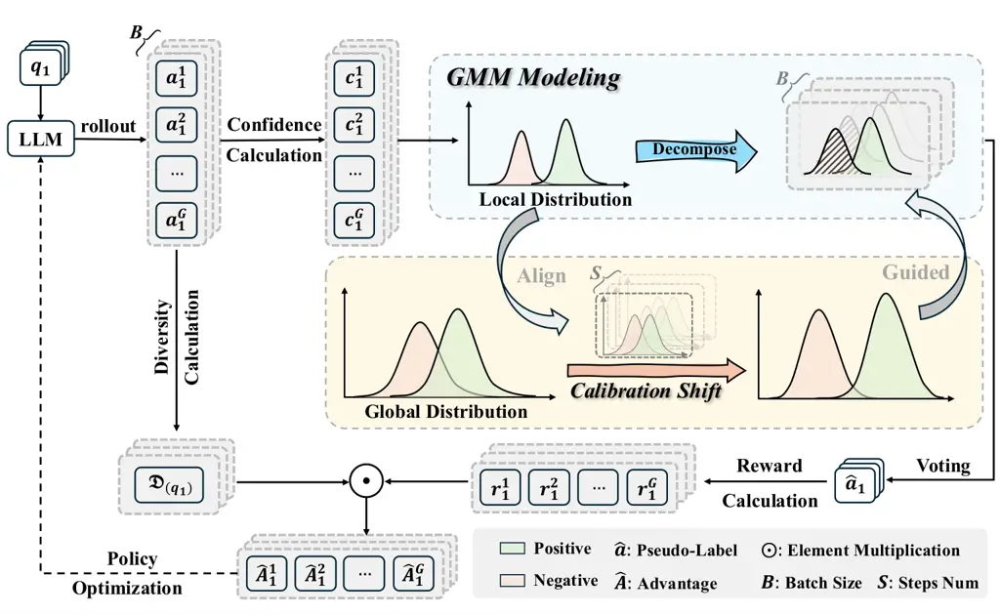

# From the Inside Out: Progressive Distribution Refinement for Confidence Calibration

Xizhong Yang ^(†)^(†)thanks: Work done during an internship at Kuaishou
Technology. Affiliation: Southeast University    Yinan Xia
Affiliation: Kuaishou Technology    Huiming Wang ^(†)^(†)thanks:
Corresponding author: Huiming Wang, Mofei Song. Affiliation: SUTD   
Mofei Song Affiliation: huiming_wang@mymail.sutd.edu.sg
Affiliation: songmf@seu.edu.cn

###### Abstract

Leveraging the model’s internal information as the self-reward signal in
Reinforcement Learning (RL) has received extensive attention due to its
label-free nature. While prior works have made significant progress in
applying the Test-Time Scaling (TTS) strategies to RL, the discrepancy
in internal information between test and training remains inadequately
addressed. Moreover, Test-Time Training based on voting-based TTS
strategies often suffers from reward hacking problems. To address these
issues, we propose DistriTTRL, which leverages the distribution prior of
the model’s confidence during RL to progressively optimize the reward
signal, rather than relying solely on single-query rollouts.
Additionally, we mitigate the phenomenon of consistent reward hacking
caused by the voting-based TTS strategies through diversity-targeted
penalties. Benefiting from this training mechanism where model
capability and self-reward signals complement each other, and the
mitigation of reward hacking, DistriTTRL has achieved significant
performance improvements across multiple models and benchmarks. Code
available at
[https://github.com/yxizhong/DistriTTRL](https://github.com/yxizhong/DistriTTRL).

|     |
| --- |
|     |

## 1 Introduction

The development of techniques such as Chain-of-Thought (Wei et al., 2022) and Reinforcement Learning (RL) has significantly contributed to
the performance improvement of Large Reasoning Models (LRMs) (Guo et
al., 2025; Jaech et al., 2024). Inspired by Reinforcement Learning with
Verifiable Rewards (RLVR) (Guo et al., 2025), an increasing number of
works choose to scale up computational and data resources for training
in verifiable scenarios, such as mathematics and coding. Nevertheless,
unpredictable test environments largely limit the practical performance
of models, a phenomenon that is particularly pronounced in the complex
and variable application scenarios of LRMs. To address the insufficient
generalization caused by LRMs’ heavy reliance on human supervision, many
current works turn to Test-Time Training (TTT) (Akyürek et al., 2024;
Behrouz et al., 2024) on unlabeled test-time data to achieve model
adaptation (Silver and Sutton, 2025).

Current works that improve LRMs’ reasoning capabilities through TTT
primarily focus on how to provide valuable immediate rewards to models
under label-free conditions. For instance, TTRL (Zuo et al., 2025)
employs a voting-based Test-Time Scaling (TTS) strategy, Majority
Voting (Wang et al., 2022), which selects the most likely correct answer
based on commonalities from multiple sampled results of a single
question as the pseudo-label for that question at training stage, and
further utilizes it to compute rewards. SCOPE (Wang et al., 2025)
further uses the model’s internal confidence to assist the voting
process, improving TTT effectiveness by mitigating confirmation bias and
sparse rewards. However, applying TTS strategies (Lightman et al., 2023;
Rakhsha et al., 2025) designed for fixed-parameter models at test-time
to the training process may reduce their effectiveness.

We believe one reason is that limited computational resources constrain
the number of samples per query. Although TTRL mitigates this through
downsampling, it still hinders voting accuracy. More importantly,
dynamically updated parameters during training cause continuous changes
in the model’s internal information (such as confidence and sampling
distribution (Yue et al., 2025)), preventing rollouts sampled at
different steps from being mutually utilized. Additionally, updatable
parameters allow the model to learn inherent hacking information in TTS
strategies during training, such as consistency.



Figure 1: Overview of DistriTTRL. During the pseudo-label estimation
process at each step, we first calibrate the Global Confidence
Distribution from previous steps using the Local Confidence Distribution
of all queries in the current step, then guide the distribution of
specific queries in the current step with the calibrated distribution
prior. Additionally, we computes diversity from each query’s rollouts
and adjusts the advantage accordingly.

Motivated by these, we propose DistriTTRL, which improves the accuracy
of RL rewards by progressively constructing distributions of rollouts
information at different steps, and designs diversity-targeted penalties
to mitigate the consistency reward hacking problem introduced by TTS
strategies in TTT. Specifically, following DistriVoting (Yang et al.,
2026), we weight answers using the model’s internal confidence during
the voting process and leverage distribution priors for confidence
calibration. Building upon this, to improve the stability of confidence
distribution prior information by increasing the number of samples, we
dynamically record all rollouts at each step, progressively constructing
an increasingly refined confidence distribution. Furthermore, since
parameter updates between different steps cause distribution shifts, we
perform shift correction on the confidence of each previous step based
on the current step’s distribution during construction. After obtaining
pseudo-labels for each query through voting, we compute rewards
similarly to other RLVR works. Differently, we subsequently evaluate the
diversity of each query through the number of predicted answer classes
in its rollouts and normalize this diversity metric within a training
batch, which is then used as a penalty weight for the advantage of each
query in the batch.

In the experimental phase, we validate our approach using multiple
models including Qwen2.5/Qwen3-Series (Yang et al., 2025), and
DeepSeek-Series (Guo et al., 2025) across different benchmarks including
AIME (AIME, 2025), AMC (LI et al., 2024), MATH-500 (Hendrycks et al.,
2021), and GPQA-D (Rein et al., 2023). The results consistently
demonstrate the effectiveness of DistriTTRL. Moreover, by analyzing the
majority ratio (i.e., the frequency proportion of the voted answer among
all rollout answers) of voting results for each query during training,
we can confirm that our designed diversity-targeted penalty effectively
mitigates consistency reward hacking.

## 2 Related Work

### 2.1 Test-time Training

Test-Time Training (Liu et al., 2021b) has emerged as a focus of recent
research in the context of generative tasks (Shocher et al., 2018; Bau
et al., 2020). By leveraging self-supervised learning (SSL) (Liu et al.,
2021a), this emerging paradigm enables models to cope with
distributional shifts without requiring additional labeled data. Recent
work (Zuo et al., 2025; Zhang et al., 2025) on large language
models (Guo et al., 2025; Yang et al., 2025) has begun to leverage
test-time training during the reinforcement learning stage, enabling
models to learn from unlabeled data without relying on costly manual
annotations. However, they rely on voting-based TTS strategies for
test-time training, which often leads to reward hacking due to
misaligned incentives in the reinforcement learning process.

### 2.2 Intrinsic Information of LLMs

Intrinsic information denotes the model’s internal confidence signals
derived from next-token distribution statistics, has recently been
leveraged to assess the quality of reasoning traces (Geng et al., 2024;
Fadeeva et al., 2024; Tao et al., 2024). Owing to its label-free nature,
intrinsic information has been applied in training to extend RLVR
methods (Li et al., 2025; Zuo et al., 2025) without relying on costly
manually labeled data, and during inference to optimize multi-candidate
responses through serial, parallel, and tree-based search. Several
methods have been proposed to quantify intrinsic information: Average
Log-Probability (Fu et al., 2025) and Perplexity (Horgan, 1995) capture
sentence-level confidence, while Entropy (Rényi, 1961) and
Self-Certainty (Kang et al., 2025) measure distribution-level confidence
across multiple candidates.

## 3 Preliminaries

### 3.1 Confidence of Trajectory

Prior work shows that LLM’s token distributions $`\mathbf{P}_{i}(j)`$
can reveal uncertainty and trajectory quality. Following DeepConf (Fu et
al., 2025), we compute confidence via token negative log-probabilities
to assess quality during and after inference. For a single trajectory
containing $`N`$ tokens output by the model, we define the trajectory
confidence as:

```math
C_{\text{traj}}=-\frac{1}{N_{G}\times k}\sum_{i\in G}\sum_{j=1}^{k}\log\mathbf{P}_{i}(j), \tag{1}
```

where $`N_{G},k\in\mathbb{N}^{+}`$ and
$`\mathbf{P}\in\mathbb{R}^{N\times N_{v}}`$. Here, $`G`$ represents the
subset of tokens among the $`N`$ generated tokens that are used to
compute the final trajectory-level confidence, which typically
corresponds to the last tail step containing the answer. $`N_{G}`$
denotes the number of tokens in $`G`$, and $`k`$ denotes the number of
top-$`k`$ probabilities from the token logits that participate in
computing token-level confidence.

### 3.2 Distribution of Confidence

For each query’s $`G`$ rollouts, we compute trajectory-level confidence
scores $`\mathcal{C}`$ via Equation 1. Inspired by previous work on
confidence distribution (Kang et al., 2025), we further model it as
Gaussian Mixture Models (GMM) with two components, where the positive
distribution $`\mathcal{N}(\mu_{\text{pos}},\sigma_{\text{pos}}^{2})`$
with a higher mean $`\mu_{\text{pos}}`$, and the negative distribution
$`\mathcal{N}(\mu_{\text{neg}},\sigma_{\text{neg}}^{2})`$ with a lower
mean $`\mu_{\text{neg}}`$:

```math
X_{\text{pos}}\sim\mathcal{N}(\mu_{\text{pos}},\sigma_{\text{pos}}^{2}),\quad X_{\text{neg}}\sim\mathcal{N}(\mu_{\text{neg}},\sigma_{\text{neg}}^{2}). \tag{2}
```

### 3.3 Distribution Shift During the Training Process

Unlike the Test-Time Scaling task where model parameters are fixed, the
confidence distribution obtained at different stages of model training
varies with model parameter updates, and this variation significantly
affects the auxiliary calibration role of the global distribution prior
on the current step. To analyze this variation, we record and visualize
the model’s confidence at different steps, as shown in Figure 2. As
training progresses, the confidence distribution gradually shifts
rightward, with the degree of shift progressively decreasing to zero at
approximately step 100.

Figure 2: Confidence distribution shift across training steps. Trained
on AMC using Qwen3-8B with 32 samples per question. Each distribution
aggregates 15 consecutive steps.

Inspired by this phenomenon, during the progressive construction of the
confidence distribution in the training phase, we primarily use the
current step’s distribution to perform shift correction on the global
confidence, which is detailed in §4.2.1.

### 3.4 Consistency Reward Hacking During TTT Caused by Voting Strategy

Most existing work on improving reasoning capabilities during the test
phase primarily uses consensus-based voting mechanisms to address the
lack of reward signals. However, applying scaling strategies based on
fixed-parameter models to the training phase with dynamically updated
parameters naturally introduces consistency reward hacking from voting
strategies. Although TTRL (Zuo et al., 2025) refers to this phenomenon
as Lucky Hit in their paper and considers it evidence of effective
negative supervision signals, we argue that this is a major cause of
rapid model convergence and limited training effectiveness.
Specifically, the model tends to output consistent answers (whether
correct or not) to obtain higher reward scores, which constrains the
role of correctness reward.

Figure 3: Trend of majority ratio (left) and accuracy (right, average of 16) during the TTT process of training Qwen2.5-7B on AIME2024. GT
denotes direct supervision with ground truth, while Voting denotes using
Majority Voting for pseudo-label estimation.

To demonstrate the existence and impact of this phenomenon, we track the
majority ratio during training, defined as the frequency of the selected
pseudo-label among all rollouts:

```math
r_{\text{maj}}=\frac{n_{\text{maj}}}{N} \tag{3}
```

where $`n_{\text{maj}}`$ is the count of the most frequent answer and
$`N`$ is the total number of rollouts per question.

As shown in the Figure 3, the majority ratio for pseudo-label training
increases significantly faster than that of ground truth supervision as
training progresses. However, this enhanced consistency does not
translate into improved accuracy. Instead, after the ratio rapidly
reaches its upper limit, the accuracy also begins to converge (around
step 125). This phenomenon indicates that the consistency voting-based
TTT approach, when estimating pseudo-labels, favors consistent incorrect
answers rather than remaining faithful to correct answers.

## 4 Methodology

### 4.1 Confidence Distribution Modeling

Based on §3.2, we model the unlabeled rollouts using GMM, approximating
their bimodal distribution (positive and negative reasoning paths) with
two Gaussian components:

```math
p(x)=\pi_{1}\mathcal{N}(x|\mu_{1},\sigma_{1}^{2})+\pi_{2}\mathcal{N}(x|\mu_{2},\sigma_{2}^{2}), \tag{4}
```

where $`\pi_{1},\pi_{2}`$ are mixing weights satisfying
$`\pi_{1}+\pi_{2}=1`$ and $`\pi_{1},\pi_{2}>0`$, and each component
$`\mathcal{N}(x|\mu_{i},\sigma_{i}^{2})`$ for $`i\in\{1,2\}`$ follows a
normal distribution:

```math
\mathcal{N}(x|\mu_{i},\sigma_{i}^{2})=\frac{1}{\sqrt{2\pi\sigma_{i}^{2}}}\exp\left(-\frac{(x-\mu_{i})^{2}}{2\sigma_{i}^{2}}\right). \tag{5}
```

The mixture distribution form as follow, where $`\mu_{1},\mu_{2}`$ and
$`\sigma_{1}^{2},\sigma_{2}^{2}`$ are the means and variances of the two
distributions:

```math
p(x)=\pi_{1}\frac{1}{\sqrt{2\pi\sigma_{1}^{2}}}\exp\left(-\frac{(x-\mu_{1})^{2}}{2\sigma_{1}^{2}}\right)+\pi_{2}\frac{1}{\sqrt{2\pi\sigma_{2}^{2}}}\exp\left(-\frac{(x-\mu_{2})^{2}}{2\sigma_{2}^{2}}\right). \tag{6}
```

### 4.2 Progressively Pseudo-Label Estimation

#### 4.2.1 Distribution Construction

During the training process, we maintain a global variable
$`\mathcal{C}\in\mathbb{R}^{S\times B\times G}`$ to record the
confidence of each rollout, where $`S`$, $`B`$, and $`G`$ denote the
number of training steps, the number of queries in each batch, and the
number of samples per query, respectively. Note that, for simplicity, we
assume that each step uses only one batch for gradient update.

For pseudo-label estimation of a specific query $`q_{i}`$ at the current
step $`k\in[1,\dots,S]`$, we first model the distribution using the
confidences $`\mathcal{C}_{k,\cdot,\cdot}\in\mathbb{R}^{B\times G}`$ of
all queries at step $`k`$ according to the GMM in Equation 6. We then
partition the samples into positive and negative subsets based on the
fitted Gaussian components:

```math
X_{\text{pos}}^{k}\sim\mathcal{N}\left(\mu_{\text{pos}}^{k},{(\sigma_{\text{pos}}^{k})}^{2}\right),\quad X_{\text{neg}}^{k}\sim\mathcal{N}\left(\mu_{\text{neg}}^{k},{(\sigma_{\text{neg}}^{k})}^{2}\right), \tag{7}
```

where $`\mu_{\text{pos}}^{k}=\max(\mu_{1}^{k},\mu_{2}^{k})`$ and
$`\mu_{\text{neg}}^{k}=\min(\mu_{1}^{k},\mu_{2}^{k})`$ correspond to the
means of the high-confidence (positive) and low-confidence (negative)
components, respectively.

To leverage historical rollouts while accounting for distribution shift
caused by policy updates, we apply a shift correction to the confidence
values from previous steps. Specifically, for each previous step
$`s<k`$, we fit GMMs to all queries’ confidences
$`\mathcal{C}_{s,\cdot,\cdot}`$ to get more reliable distribution, and
then obtain the corresponding positive and negative component means
$`\mu_{\text{pos}}^{s}`$ and $`\mu_{\text{neg}}^{s}`$. We then compute
the shift offsets:

```math
\Delta_{s\to k}=\frac{\mu_{\text{pos}}^{k}+\mu_{\text{neg}}^{k}}{2}-\frac{\mu_{\text{pos}}^{s}+\mu_{\text{neg}}^{s}}{2}. \tag{8}
```

The corrected confidence from step $`s`$ are then:

```math
\tilde{\mathcal{C}}_{s,\cdot,\cdot}=\mathcal{C}_{s,\cdot,\cdot}+\Delta_{s\to k} \tag{9}
```

Finally, for each query $`q_{i}`$ at step $`k`$, we construct the
aggregated confidence distribution by combining the current step’s
confidences with the shift-corrected historical confidences:

```math
\mathcal{C}_{\text{agg}}^{k}=\left\{\mathcal{C}_{k,\cdot,\cdot}\right\}\cup\left\{\tilde{\mathcal{C}}_{s,\cdot,\cdot}:s\in[1,k-1]\right\}, \tag{10}
```

which provides a more stable and data-rich prior for pseudo-label
estimation at step $`k`$. This aggregated confidences
$`\mathcal{C}_{\text{agg}}^{k}`$ is then used for the voting process.

#### 4.2.2 Pseudo-Label Estimation

After obtaining the aggregated confidence distribution
$`\mathcal{C}_{\text{agg}}^{k}`$ at step $`k`$, we refer to
DistriVoting (Yang et al., 2026) and repeat the operations of Equation 6
and Equation 7, but replace $`\mathcal{C}_{k,\cdot,\cdot}`$ with
$`\mathcal{C}_{\text{agg}}^{k}`$, thereby obtaining the global positive
and negative distributions:

```math
\tilde{X}_{\text{pos}}^{k}\sim\mathcal{N}\left(\tilde{\mu}_{\text{pos}}^{k},{(\tilde{\sigma}_{\text{pos}}^{k})}^{2}\right),\quad\tilde{X}_{\text{neg}}^{k}\sim\mathcal{N}\left(\tilde{\mu}_{\text{neg}}^{k},{(\tilde{\sigma}_{\text{neg}}^{k})}^{2}\right). \tag{11}
```

For each query $`q_{i}`$ at step $`k`$, we then partition its samples
into positive and negative subsets based on these global distributions.
Specifically, for each sample $`j\in[1,G]`$ of query $`q_{i}`$, we
assign it to the positive or negative subset according to:

```math
\mathcal{C}_{k,i,j}\in\begin{cases}X_{\text{pos}}^{k,i},&\text{if }p(\mathcal{C}_{k,i,j}\mid\tilde{X}_{\text{pos}}^{k})>p(\mathcal{C}_{k,i,j}\mid\tilde{X}_{\text{neg}}^{k})\\
X_{\text{neg}}^{k,i},&\text{otherwise}\end{cases} \tag{12}
```

where $`p(\mathcal{C}_{k,i,j}\mid\tilde{X}_{\text{pos}}^{k})`$ and
$`p(\mathcal{C}_{k,i,j}\mid\tilde{X}_{\text{neg}}^{k})`$ denote the
likelihood of confidence $`\mathcal{C}_{k,i,j}`$ under the positive and
negative Gaussian distributions, respectively. This yields
query-specific positive and negative sample sets
$`X_{\text{pos}}^{k,i}`$ and $`X_{\text{neg}}^{k,i}`$ for pseudo-label
assignment.

Following DistriVoting, we treat $`X_{\text{pos}}^{k,i}`$ as
high-potential correct samples and $`X_{\text{neg}}^{k,i}`$ as
low-potential samples to be filtered out. To further mitigate the
overlap between the two distributions, we first vote on the negative
subset with their corresponding trajectories
$`\mathcal{V}_{\text{neg}}^{k,i}=\{o_{k,i,j}\mid\mathcal{C}_{k,i,j}\in X_{\text{neg}}^{k,i}\}`$
to identify the most likely incorrect answer:

```math
A_{\text{neg}}^{k,i}=f_{\text{vote}}(\mathcal{V}_{\text{neg}}^{k,i},-X_{\text{neg}}^{k,i}), \tag{13}
```

where $`f_{\text{vote}}`$ can be any voting methods, we simply use the
majority voting here. We then remove false positive samples from
$`X_{\text{pos}}^{k,i}`$ whose trajectories produce
$`A_{\text{neg}}^{k,i}`$:

```math
\hat{X}_{\text{pos}}^{k,i}=\{c\mid c\in X_{\text{pos}}^{k,i},\text{answer}(o_{c})\neq A_{\text{neg}}^{k,i}\}, \tag{14}
```

and obtain the filtered trajectories
$`\hat{\mathcal{V}}_{\text{pos}}^{k,i}=\{o_{k,i,j}\mid\mathcal{C}_{k,i,j}\in\hat{X}_{\text{pos}}^{k,i}\}`$.
Finally, we vote on the filtered positive subset to obtain the
pseudo-label:

```math
A_{\text{final}}^{k,i}=f_{\text{vote}}(\hat{\mathcal{V}}_{\text{pos}}^{k,i},\hat{X}_{\text{pos}}^{k,i}). \tag{15}
```

Trajectories producing $`A_{\text{final}}^{k,i}`$ are assigned positive
labels for policy optimization.

### 4.3 Diversity-Targeted Penalties in GRPO

#### 4.3.1 Diversity Estimation

Given a training batch $`\mathcal{B}=\{q_{1},q_{2},\dots,q_{B}\}`$ of
prompts, we sample $`G`$ candidate outputs for each query $`q_{i}`$ from
the old policy:

```math
o_{i,j}\sim\pi_{\theta_{\text{old}}}(\cdot\mid q_{i}),\quad j=1,\dots,G. \tag{16}
```

We measure the _answer diversity_ for each query as the number of unique
outputs:

```math
D(q_{i})=\left|\left\{o_{i,j}:j=1,\dots,G\right\}_{\text{unique}}\right|, \tag{17}
```

where $`|\cdot|_{\text{unique}}`$ denotes the cardinality of the set of
distinct elements. Higher $`D(q_{i})`$ indicates greater model diversity
about query $`q_{i}`$.

To obtain batch-normalized uncertainty weights, we apply a softmax
transformation over the diversity scores:

```math
\tilde{\mathcal{D}}(q_{i})=\frac{\exp(D(q_{i}))}{\sum_{k=1}^{B}\exp(D(q_{k}))}. \tag{18}
```

We then introduce a penalty mechanism to down-weight queries with
extremely low diversity, which may indicate premature convergence or
mode collapse. Specifically, we define the final diversity weight as:

```math
\mathcal{D}(q_{i})=\begin{cases}\tilde{\mathcal{D}}(q_{i}),&\text{if }D(q_{i})\leq\tau\cdot G\\
1,&\text{otherwise}\end{cases} \tag{19}
```

where $`\tau\in(0,1)`$ is a threshold hyperparameter (we use
$`\tau=0.1`$ in our experiments). Queries with diversity above the
threshold receive a neutral weight of $`1`$, preserving the original
GRPO learning dynamics, while low-diversity queries receive reduced
weights proportional to their relative diversity within the batch.

#### 4.3.2 Diversity-Targeted Advantage Calculation

For each sampled output $`o_{i,j}`$, we obtain a reward score
$`R_{i,j}`$ from the reward function. Following GRPO, we compute the
normalized advantage within each query’s sample group:

```math
\hat{A}_{i,j}=\frac{R_{i,j}-\frac{1}{G}\sum_{k=1}^{G}R_{i,j}}{\sqrt{\frac{1}{G}\sum_{k=1}^{G}\left(R_{i,j}-\bar{R}_{i}\right)^{2}}}, \tag{20}
```

where $`\bar{R}_{i}=\frac{1}{G}\sum_{k=1}^{G}R_{i,k}`$. When the
standard deviation is zero, we set $`\hat{A}_{i,j}=0`$.

We then apply the diversity weighting to obtain the final advantage:

```math
\hat{A}_{i,j}^{\prime}=\hat{A}_{i,j}\cdot\mathcal{D}(q_{i}). \tag{21}
```

Note that all tokens $`t`$ in output $`o_{i,j}`$ share the same weighted
advantage: $`\hat{A}_{i,j,t}^{\prime}=\hat{A}_{i,j}^{\prime}`$.

#### 4.3.3 The GRPO Objective

Let $`r_{i,j,t}(\theta)`$ denote the probability ratio at token position
$`t`$:

```math
r_{i,j,t}(\theta)=\frac{\pi_{\theta}(o_{i,j,t}\mid q_{i},o_{i,j,<t})}{\pi_{\theta_{\text{old}}}(o_{i,j,t}\mid q_{i},o_{i,j,<t})}. \tag{22}
```

The GRPO objective is then defined as:

```math
\displaystyle\mathcal{J}_{\text{GRPO}}(\theta)=\mathbb{E}_{q_{i}\sim P(Q)}\mathbb{E}_{\{o_{i,j}\}_{j=1}^{G}\sim\pi_{\theta_{\text{old}}}} \displaystyle\Bigg[\frac{1}{G}\sum_{j=1}^{G}\frac{1}{|o_{i,j}|}\sum_{t=1}^{|o_{i,j}|}\Bigg(\min\Big(r_{i,j,t}(\theta)\cdot\hat{A}_{i,j}\cdot{\color[rgb]{1,0,0}\mathcal{D}(q_{i})},
```

```math
\displaystyle\text{clip}\big(r_{i,j,t}(\theta),1-\epsilon,1+\epsilon\big)\cdot\hat{A}_{i,j}\cdot{\color[rgb]{1,0,0}\mathcal{D}(q_{i})}\Big)-\beta\cdot\widehat{D}_{\mathrm{KL}}^{(i,j,t)}\Bigg)\Bigg], \tag{23}
```

where $`\epsilon`$ is the PPO clipping parameter, $`\beta`$ is the KL
regularization coefficient, and $`\widehat{D}_{\mathrm{KL}}^{(i,j,t)}`$
is the per-token KL divergence estimator.

## 5 Experiments

### 5.1 Implementation Details

Regarding the implementation details of our methods, we primarily follow
the codebase of TTRL, using AIME2024, AMC and MATH-500 as training and
test sets, with GRPO as the base RL algorithm. For the temperature in
the sampling process, we set it to 1.0 for Qwen2.5-Math and LRMs such as
Qwen3-8B, and 0.6 for all others. For max response length, we set it to
32K for LRMs and 3K for other non-reasoning models. Additionally, we
continue the rollout downsampling operation from TTRL, where we sample
64 trajectories and select 32 for gradient updates. All experiments were
conducted on NVIDIA H-Series GPU. Complete pseudo code is provided in
Appendix §A.

### 5.2 Main Results

| Model                 | Method         | AIME2024       | AMC            | MATH-500       | Avg.           |
| --------------------- | -------------- | -------------- | -------------- | -------------- | -------------- |
| Qwen2.5-7B-Base       | Base Model     | 7.50           | 33.06          | 59.11          | 33.22          |
|                       | TTRL           | 22.08          | 52.26          | 80.38          | 51.57          |
|                       | TTRL-GT        | 62.71          | 82.61          | 90.75          | 78.69          |
|                       | TTRL-WSC       | 23.07$`+`$0.99 | 54.07$`+`$1.81 | 80.30$`-`$0.08 | 52.48$`+`$0.91 |
|                       | DistriTTRL-WSC | 22.08$`+`$0.00 | 57.23$`+`$4.97 | 80.67$`+`$0.29 | 53.33$`+`$1.76 |
|                       | DistriTTRL-GMM | 23.54$`+`$1.46 | 56.48$`+`$4.22 | 81.46$`+`$1.08 | 53.83$`+`$2.26 |
| Qwen2.5-Math-7B       | Base Model     | 10.63          | 32.38          | 47.10          | 30.04          |
|                       | TTRL           | 25.83          | 56.18          | 81.51          | 54.51          |
|                       | TTRL-GT        | 41.04          | 58.43          | 84.05          | 61.17          |
|                       | TTRL-WSC       | 29.79$`+`$3.96 | 58.28$`+`$2.10 | 83.39$`+`$1.88 | 57.15$`+`$2.64 |
|                       | DistriTTRL-WSC | 34.58$`+`$8.75 | 57.68$`+`$1.50 | 81.49$`-`$0.02 | 57.92$`+`$3.41 |
|                       | DistriTTRL-GMM | 33.33$`+`$7.50 | 61.37$`+`$5.19 | 81.83$`+`$0.32 | 58.84$`+`$4.33 |
| Qwen2.5-Math-1.5B     | Base Model     | 7.08           | 28.09          | 31.41          | 22.19          |
|                       | TTRL           | 14.14          | 44.38          | 72.19          | 43.57          |
|                       | TTRL-GT        | 17.94          | 47.85          | 73.45          | 46.41          |
|                       | TTRL-WSC       | 14.28$`+`$0.14 | 44.78$`+`$0.40 | 72.21$`+`$0.02 | 43.76$`+`$0.19 |
|                       | DistriTTRL-WSC | 14.12$`-`$0.02 | 44.99$`+`$0.61 | 72.49$`+`$0.30 | 43.87$`+`$0.30 |
|                       | DistriTTRL-GMM | 14.55$`+`$0.41 | 45.37$`+`$0.99 | 72.31$`+`$0.12 | 44.08$`+`$0.51 |
| Llama-3.1-8B-Instruct | Base Model     | 4.79           | 20.93          | 48.23          | 24.65          |
|                       | TTRL           | 7.92           | 30.27          | 58.43          | 32.21          |
|                       | TTRL-GT        | 21.25          | 37.65          | 75.43          | 44.78          |
|                       | TTRL-WSC       | 12.08$`+`$4.16 | 29.59$`-`$0.68 | 55.28$`-`$3.15 | 32.32$`+`$0.11 |
|                       | DistriTTRL-WSC | 10.00$`+`$2.08 | 28.84$`-`$1.43 | 60.93$`+`$2.50 | 33.26$`+`$1.05 |
|                       | DistriTTRL-GMM | 10.21$`+`$2.29 | 30.87$`+`$0.60 | 58.96$`+`$0.53 | 33.35$`+`$1.14 |
| Qwen3-8B              | Base Model     | 1.46           | 15.44          | 50.13          | 22.34          |
|                       | TTRL           | 33.00          | 65.95          | 87.25          | 62.07          |
|                       | TTRL-GT        | 34.07          | 67.87          | 87.58          | 63.17          |
|                       | TTRL-WSC       | 34.55$`+`$1.55 | 68.80$`+`$2.85 | 86.13$`-`$1.12 | 63.16$`+`$1.09 |
|                       | DistriTTRL-WSC | 37.61$`+`$4.61 | 66.57$`+`$0.62 | 86.18$`-`$1.07 | 63.45$`+`$1.38 |
|                       | DistriTTRL-GMM | 33.44$`+`$0.44 | 70.31$`+`$4.36 | 87.21$`-`$0.04 | 63.65$`+`$1.58 |

Table 1: Main Results of DistriTTRL across benchmarks (16 repeats). -GT
denotes using ground truth directly as labels to measure the upper bound
of the method. -WSC denotes using Weighted Self-Consistency (Weighted
Majority Voting) as the voting method, while -GMM denotes using
DistriVoting as the voting method. Bold and underline respectively
indicate the optimal and suboptimal results excluding GT.

In the experimental section, we evaluate DistriTTRL’s performance across
different benchmarks and models, analyzing: (1) the direct impact of
training-time confidence on TTT (TTRL vs. TTRL-WSC), (2) the effect of
diversity-targeted penalty applied to the advantage function (TTRL-WSC
vs. DistriTTRL-WSC), and (3) the effectiveness of leveraging confidence
distribution priors for pseudo-label estimation in DistriTTRL
(DistriTTRL-WSC vs. DistriTTRL-GMM). As shown in Table 1, our proposed
DistriTTRL-GMM consistently outperforms baselines across five models
(including Qwen2.5-7B-Base) and three benchmarks (including AIME2024),
achieving improvements of $`0.51\sim 4.33`$.

Specifically, the difference between TTRL-WSC and TTRL
($`0.19\sim 2.64`$) validates the effectiveness of incorporating
confidence scores in DistriTTRL, demonstrating that leveraging
model-internal confidence during training provides more reliable signals
for policy optimization compared to uniform weighting. The gap between
DistriTTRL-WSC and TTRL-WSC ($`0.11\sim 0.96`$) reflects the direct
contribution of diversity-targeted penalty, which mitigates consistency
reward hacking by encouraging exploration of diverse reasoning paths
rather than converging to repetitive solutions. Additionally, the
performance gain of DistriTTRL-GMM over DistriTTRL-WSC
($`0.2\sim 0.92`$) demonstrates the advantage of calibrating confidence
with distribution priors, where dynamically modeling the confidence
distribution and applying shift correction enables more accurate
pseudo-label estimation by accounting for the evolving confidence
landscape throughout training.

## 6 Analysis

### 6.1 Diversity-Targeted Penalty Mitigates Consistency Reward Hacking

To further analyze the effectiveness of DistriTTRL in addressing
consistency reward hacking, beyond the accuracy reported in the main
results, we examine the trend of majority ratio defined in Equation 3
during training, following the same analysis approach as in §3.4.

Figure 4: Effect of diversity-targeted penalty in DistriTTRL on
mitigating consistency reward hacking, training Qwen2.5-7B on AIME2024.

As shown in the Figure 4, DistriTTRL’s majority ratio curve rises more
slowly and converges to a significantly lower value than TTRL (which
directly uses test-time scaling strategy), better aligning with the
ground truth training scenario. By mitigating consistency reward
hacking, DistriTTRL extends effective training steps and achieves higher
performance gains.

### 6.2 Effect of Voting Budget on Pseudo-Label Quality

A key motivation for DistriTTRL stems from the observation that limited
computational resources during training restrict the sampling budget per
query in scaling voting strategies, thereby compromising the accuracy of
pseudo-labels obtained through voting. This motivates the design of a
mechanism that dynamically leverages rollouts across different steps
during training. To validate this motivation, in this section we examine
how the accuracy of various parallel voting strategies varies under
different sampling budgets.

Figure 5: Impact of voting budget on the accuracy of different TTS
strategies, evaluated on AIME2024 using DeepSeek-R1-8B (64 repeats).
Complete results provided in  Appendix §B.

As shown in the Figure 5, accuracy for all TTS strategies (SC (Wang et
al., 2022), WSC (Li et al., 2022), MoB (Rakhsha et al., 2025),
BoN (Lightman et al., 2023), DistriVoting (Yang et al., 2026), and
DeepConf (Fu et al., 2025)) increases with budget from 8 to 256,
confirming a positive correlation between voting accuracy and budget.
This validates DistriTTRL’s design rationale of scaling voting
information by leveraging rollouts across training steps.

## 7 Conclusion

This paper proposes DistriTTRL, a method that fully leverages the
model’s internal confidence for Test-Time Training (TTT). We first
analyze the pitfalls of directly adapting scaling voting strategies for
pseudo-label computation in current reasoning TTT works, namely the
limited voting budget and the sensitivity of learnable parameters to
consistency hacking during training. Building upon a voting strategy
that calibrates confidence using distribution priors, DistriTTRL
dynamically constructs and progressively refines the confidence
distribution during training, and at each step, applies shift correction
to the global distribution from previous steps using the local
distribution of the current step. Furthermore, leveraging the rollouts
for each query, we evaluate query-level diversity and design a
diversity-targeted penalty that is weighted into the original advantage.
Through extensive experiments and analysis, we demonstrate the
effectiveness of DistriTTRL for reasoning TTT.

## References

- AIME (2025) AIME AIME problems and solutions. External Links:
  [Link](https://artofproblemsolving.com/wiki/index.php/AIME_Problems_and_Solutions)
  Cited by: Appendix B, §1.
- Akyürek et al. (2024) E. Akyürek, M. Damani, A. Zweiger, L. Qiu, H.
  Guo, J. Pari, Y. Kim, and J. Andreas The surprising effectiveness of
  test-time training for few-shot learning. arXiv preprint
  arXiv:2411.07279. Cited by: §1.
- Balunović et al. (2025) M. Balunović, J. Dekoninck, I. Petrov, N.
  Jovanović, and M. Vechev MathArena: evaluating llms on uncontaminated
  math competitions. SRI Lab, ETH Zurich. External Links:
  [Link](https://matharena.ai/) Cited by: Appendix B.
- Bau et al. (2020) D. Bau, H. Strobelt, W. Peebles, J. Wulff, B.
  Zhou, J. Zhu, and A. Torralba Semantic photo manipulation with a
  generative image prior. arXiv preprint arXiv:2005.07727. Cited by:
  §2.1.
- Behrouz et al. (2024) A. Behrouz, P. Zhong, and V. Mirrokni Titans:
  learning to memorize at test time. arXiv preprint arXiv:2501.00663.
  Cited by: §1.
- Fadeeva et al. (2024) E. Fadeeva, A. Rubashevskii, A. Shelmanov, S.
  Petrakov, H. Li, H. Mubarak, E. Tsymbalov, G. Kuzmin, A. Panchenko, T.
  Baldwin, et al. Fact-checking the output of large language models via
  token-level uncertainty quantification. In Findings of the Association
  for Computational Linguistics: ACL 2024, pp. 9367–9385. Cited by:
  §2.2.
- Fu et al. (2025) Y. Fu, X. Wang, Y. Tian, and J. Zhao Deep think with
  confidence. arXiv preprint arXiv:2508.15260. Cited by: §2.2, §3.1,
  §6.2.
- Geng et al. (2024) J. Geng, F. Cai, Y. Wang, H. Koeppl, P. Nakov,
  and I. Gurevych A survey of confidence estimation and calibration in
  large language models. In Proceedings of the 2024 Conference of the
  North American Chapter of the Association for Computational
  Linguistics: Human Language Technologies (Volume 1: Long Papers),
  pp. 6577–6595. Cited by: §2.2.
- Guo et al. (2025) D. Guo, D. Yang, H. Zhang, J. Song, R. Zhang, R.
  Xu, Q. Zhu, S. Ma, P. Wang, X. Bi, et al. Deepseek-r1: incentivizing
  reasoning capability in llms via reinforcement learning. arXiv
  preprint arXiv:2501.12948. Cited by: §1, §1, §2.1.
- Hendrycks et al. (2021) D. Hendrycks, C. Burns, S. Kadavath, A.
  Arora, S. Basart, E. Tang, D. Song, and J. Steinhardt Measuring
  mathematical problem solving with the math dataset. arXiv preprint
  arXiv:2103.03874. Cited by: §1.
- Horgan (1995) J. Horgan From complexity to perplexity. Scientific
  American. Cited by: §2.2.
- Jaech et al. (2024) A. Jaech, A. Kalai, A. Lerer, A. Richardson, A.
  El-Kishky, A. Low, A. Helyar, A. Madry, A. Beutel, A. Carney, et al.
  Openai o1 system card. arXiv preprint arXiv:2412.16720. Cited by: §1.
- Kang et al. (2025) Z. Kang, X. Zhao, and D. Song Scalable best-of-n
  selection for large language models via self-certainty, 2025. URL
  https://arxiv. org/abs/2502.18581. Cited by: §2.2, §3.2.
- LI et al. (2024) J. LI, E. Beeching, L. Tunstall, B. Lipkin, R.
  Soletskyi, S. C. Huang, K. Rasul, L. Yu, A. Jiang, Z. Shen, Z. Qin, B.
  Dong, L. Zhou, Y. Fleureau, G. Lample, and S. Polu NuminaMath. Cited
  by: §1.
- Li et al. (2025) Y. Li, T. Xu, Y. Yu, X. Zhang, X. Chen, Z. Ling, N.
  Chao, L. Yuan, and Z. Zhou Generalist reward models: found inside
  large language models. arXiv preprint arXiv:2506.23235. Cited by:
  §2.2.
- Li et al. (2022) Y. Li, Z. Lin, S. Zhang, Q. Fu, B. Chen, J. Lou,
  and W. Chen Making large language models better reasoners with
  step-aware verifier. arXiv preprint arXiv:2206.02336. Cited by: §6.2.
- Lightman et al. (2023) H. Lightman, V. Kosaraju, Y. Burda, H.
  Edwards, B. Baker, T. Lee, J. Leike, J. Schulman, I. Sutskever, and K.
  Cobbe Let’s verify step by step. In The Twelfth International
  Conference on Learning Representations, Cited by: §1, §6.2.
- Liu et al. (2021a) X. Liu, F. Zhang, Z. Hou, L. Mian, Z. Wang, J.
  Zhang, and J. Tang Self-supervised learning: generative or
  contrastive. IEEE transactions on knowledge and data engineering 35
  (1), pp. 857–876. Cited by: §2.1.
- Liu et al. (2021b) Y. Liu, P. Kothari, B. Van Delft, B.
  Bellot-Gurlet, T. Mordan, and A. Alahi Ttt++: when does
  self-supervised test-time training fail or thrive?. Advances in Neural
  Information Processing Systems 34, pp. 21808–21820. Cited by: §2.1.
- Rakhsha et al. (2025) A. Rakhsha, K. Madan, T. Zhang, A. Farahmand,
  and A. Khasahmadi Majority of the bests: improving best-of-n via
  bootstrapping. arXiv preprint arXiv:2511.18630. Cited by: §1, §6.2.
- Rein et al. (2023) D. Rein, B. L. Hou, A. C. Stickland, J.
  Petty, R. Y. Pang, J. Dirani, J. Michael, and S. R. Bowman GPQA: a
  graduate-level google-proof q&a benchmark. arXiv preprint
  arXiv:2311.12022. Cited by: Appendix B, §1.
- Rényi (1961) A. Rényi On measures of entropy and information. In
  Proceedings of the fourth Berkeley symposium on mathematical
  statistics and probability, volume 1: contributions to the theory of
  statistics, Cited by: §2.2.
- Shocher et al. (2018) A. Shocher, N. Cohen, and M. Irani “Zero-shot”
  super-resolution using deep internal learning. In Proceedings of the
  IEEE conference on computer vision and pattern recognition,
  pp. 3118–3126. Cited by: §2.1.
- Silver and Sutton (2025) D. Silver and R. S. Sutton Welcome to the era
  of experience. Google AI 1, pp. 11. Cited by: §1.
- Tao et al. (2024) S. Tao, L. Yao, H. Ding, Y. Xie, Q. Cao, F. Sun, J.
  Gao, H. Shen, and B. Ding When to trust llms: aligning confidence with
  response quality. In Findings of the Association for Computational
  Linguistics: ACL 2024, pp. 5984–5996. Cited by: §2.2.
- Wang et al. (2025) W. Wang, Y. Wang, K. Chen, and H. Huang Beyond
  majority voting: towards fine-grained and more reliable reward signal
  for test-time reinforcement learning. arXiv preprint arXiv:2512.15146.
  Cited by: §1.
- Wang et al. (2022) X. Wang, J. Wei, D. Schuurmans, Q. Le, E. Chi, S.
  Narang, A. Chowdhery, and D. Zhou Self-consistency improves chain of
  thought reasoning in language models. arXiv preprint arXiv:2203.11171.
  Cited by: §1, §6.2.
- Wei et al. (2022) J. Wei, X. Wang, D. Schuurmans, M. Bosma, F. Xia, E.
  Chi, Q. V. Le, D. Zhou, et al. Chain-of-thought prompting elicits
  reasoning in large language models. Advances in neural information
  processing systems. Cited by: §1.
- Yang et al. (2025) A. Yang, A. Li, B. Yang, B. Zhang, B. Hui, B.
  Zheng, B. Yu, C. Gao, C. Huang, C. Lv, et al. Qwen3 technical report.
  arXiv preprint arXiv:2505.09388. Cited by: §1, §2.1.
- Yang et al. (2026) X. Yang, H. Zhang, H. Wang, and M. Song Believe
  your model: distribution-guided confidence calibration. arXiv preprint
  arXiv:2603.03872. Cited by: §1, §4.2.2, §6.2.
- Yue et al. (2025) Y. Yue, Z. Chen, R. Lu, A. Zhao, Z. Wang, S. Song,
  and G. Huang Does reinforcement learning really incentivize reasoning
  capacity in llms beyond the base model?. arXiv preprint
  arXiv:2504.13837. Cited by: §1.
- Zhang et al. (2025) Q. Zhang, H. Wu, C. Zhang, P. Zhao, and Y. Bian
  Right question is already half the answer: fully unsupervised llm
  reasoning incentivization. arXiv preprint arXiv:2504.05812. Cited by:
  §2.1.
- Zuo et al. (2025) Y. Zuo, K. Zhang, L. Sheng, S. Qu, G. Cui, X.
  Zhu, H. Li, Y. Zhang, X. Long, E. Hua, et al. Ttrl: test-time
  reinforcement learning. arXiv preprint arXiv:2504.16084. Cited by: §1,
  §2.1, §2.2, §3.4.

## Appendix A Pseudo Code

1: Training queries $`\mathcal{Q}`$, initial policy
$`\pi_{\theta_{0}}`$, reward model $`R`$, total steps $`S`$

2: Batch size $`B`$, samples per query $`G`$, diversity threshold
$`\tau`$

3: Initialize confidence storage
$`\mathcal{C}\in\mathbb{R}^{S\times B\times G}`$

4: for step $`k=1`$ to $`S`$ do

5:   Sample batch $`\mathcal{B}_{k}=\{q_{1},\ldots,q_{B}\}`$ from
$`\mathcal{Q}`$

6:   for each query $`q_{i}\in\mathcal{B}_{k}`$ do

7:    Sample $`G`$ rollouts:
$`\{o_{k,i,j}\}_{j=1}^{G}\sim\pi_{\theta_{k-1}}(\cdot\mid q_{i})`$

8:    Compute rewards: $`R_{k,i,j}=R(q_{i},o_{k,i,j})`$ for
$`j=1,\ldots,G`$

9:    Compute confidences: $`\mathcal{C}_{k,i,j}`$ for $`j=1,\ldots,G`$

10:   end for

11:   $`\mathcal{C}_{\text{agg}}^{k}\leftarrow`$
ConstructAggregatedDistribution($`\mathcal{C}`$, $`k`$)
$`\triangleright`$ Algorithm 2

12:   for each query $`q_{i}\in\mathcal{B}_{k}`$ do

13:    $`A_{\text{final}}^{k,i}\leftarrow`$
EstimatePseudoLabel($`q_{i}`$, $`\mathcal{C}_{\text{agg}}^{k}`$, $`k`$)
$`\triangleright`$ Algorithm 3

14:    $`\mathcal{D}(q_{i})\leftarrow`$
ComputeDiversityWeight($`\{o_{k,i,j}\}_{j=1}^{G}`$, $`\tau`$)
$`\triangleright`$ Algorithm 4

15:   end for

16:   Update policy: $`\theta_{k}\leftarrow`$
GRPOUpdate($`\theta_{k-1}`$, $`\mathcal{B}_{k}`$,
$`\{A_{\text{final}}^{k,i}\}`$, $`\{\mathcal{D}(q_{i})\}`$)

17: end for

18: return $`\pi_{\theta_{S}}`$

Algorithm 1 DistriTTRL Training Framework

1: function ConstructAggregatedDistribution($`\mathcal{C}`$, $`k`$)

2:   Fit GMM on $`\mathcal{C}_{k,\cdot,\cdot}`$ via Equation 7 to obtain
$`\mu_{\text{pos}}^{k},\mu_{\text{neg}}^{k}`$

3:   Initialize
$`\mathcal{C}_{\text{agg}}^{k}\leftarrow\{\mathcal{C}_{k,\cdot,\cdot}\}`$

4:   for each previous step $`s=1`$ to $`k-1`$ do

5:    Fit GMM on $`\mathcal{C}_{s,\cdot,\cdot}`$ to obtain
$`\mu_{\text{pos}}^{s},\mu_{\text{neg}}^{s}`$

6:    Compute shift offset $`\Delta_{s\to k}`$ via Equation 8

7:    Apply correction to get $`\tilde{\mathcal{C}}_{s,\cdot,\cdot}`$
via Equation 9

8:
   $`\mathcal{C}_{\text{agg}}^{k}\leftarrow\mathcal{C}_{\text{agg}}^{k}\cup\{\tilde{\mathcal{C}}_{s,\cdot,\cdot}\}`$

9:   end for

10:   return $`\mathcal{C}_{\text{agg}}^{k}`$ as defined in Equation 10

11: end function

Algorithm 2 Construct Aggregated Confidence Distribution

1: function EstimatePseudoLabel($`q_{i}`$,
$`\mathcal{C}_{\text{agg}}^{k}`$, $`k`$)

2:   Fit GMM on $`\mathcal{C}_{\text{agg}}^{k}`$ to obtain global
distributions via Equation 11

3:   Initialize $`X_{\text{pos}}^{k,i}\leftarrow\emptyset`$,
$`X_{\text{neg}}^{k,i}\leftarrow\emptyset`$

4:   for each sample $`j=1`$ to $`G`$ do

5:    Assign $`\mathcal{C}_{k,i,j}`$ to $`X_{\text{pos}}^{k,i}`$ or
$`X_{\text{neg}}^{k,i}`$ via Equation 12

6:   end for

7:   Obtain $`\mathcal{V}_{\text{neg}}^{k,i}`$ and vote for
$`A_{\text{neg}}^{k,i}`$ via Equation 13

8:   Filter false positives to get $`\hat{X}_{\text{pos}}^{k,i}`$ via
Equation 14

9:   Obtain $`\hat{\mathcal{V}}_{\text{pos}}^{k,i}`$ and vote for
$`A_{\text{final}}^{k,i}`$ via Equation 15

10:   return $`A_{\text{final}}^{k,i}`$

11: end function

Algorithm 3 Estimate Pseudo-Label via Progressive Voting

1: function ComputeDiversityWeight($`\{o_{i,j}\}_{j=1}^{G}`$, $`\tau`$)

2:   Compute answer diversity:
$`D(q_{i})\leftarrow|\{o_{i,j}\}_{j=1}^{G}|_{\text{unique}}`$

3:   Compute batch-normalized weight:
$`\tilde{\mathcal{D}}(q_{i})\leftarrow\frac{\exp(D(q_{i}))}{\sum_{k=1}^{B}\exp(D(q_{k}))}`$

4:   if $`D(q_{i})\leq\tau\cdot G`$ then

5:    return $`\tilde{\mathcal{D}}(q_{i})`$ $`\triangleright`$ Apply
penalty for low diversity

6:   else

7:    return $`1`$ $`\triangleright`$ Neutral weight for sufficient
diversity

8:   end if

9: end function

Algorithm 4 Compute Diversity-Targeted Weight

## Appendix B Additional Results on Voting Accuracy-Budget Correlation

In §6.2 of the main paper, we demonstrated the positive correlation
between voting accuracy and sampling budget on AIME2024. To further
validate the generalizability of this observation, we conduct the same
analysis across four additional benchmarks: HMMT2025,
BRUMO2025 (Balunović et al., 2025), AIME2025 (AIME, 2025), and
GPQA-D (Rein et al., 2023). All experiments follow the same setup as in
the main paper, using DeepSeek-R1-8B (DeepSeek-R1-0528-Qwen3-8B) and
averaging over 64 repetitions.

(a) HMMT2025

(b) AIME2025

(c) GPQA-D

(d) BRUMO2025

Figure 6: Impact of sampling budget on the accuracy of different
test-time scaling strategies across four additional benchmarks
(DeepSeek-R1-8B, averaged over 64 runs).

As illustrated in Figure 6, the positive correlation between voting
accuracy and sampling budget consistently holds across all four
benchmarks, spanning mathematical reasoning (HMMT2025, AIME2025,
BRUMO2025) and scientific reasoning (GPQA-D). This validates that
DistriTTRL’s design rationale generalizes well across diverse reasoning
domains. Detailed experimental results are provided in  Table 2.

| Budget | Method       | HMMT2025 | GPQA-D | AIME2024 | AIME2025 | BRUMO2025 |
| ------ | ------------ | -------- | ------ | -------- | -------- | --------- |
| 8      | MoB          | 69.48    | 67.22  | 88.39    | 80.83    | 89.27     |
|        | BoN          | 69.69    | 66.26  | 87.60    | 78.75    | 88.33     |
|        | SC           | 71.82    | 66.88  | 89.32    | 80.57    | 89.95     |
|        | WSC          | 72.03    | 67.04  | 88.96    | 80.36    | 90.31     |
|        | DeepConf     | 71.09    | 67.37  | 89.06    | 80.52    | 90.31     |
|        | DistriVoting | 72.71    | 66.94  | 89.27    | 81.20    | 90.05     |
| 16     | MoB          | 72.29    | 68.16  | 89.69    | 81.73    | 91.72     |
|        | BoN          | 69.95    | 67.44  | 88.65    | 80.16    | 90.73     |
|        | SC           | 75.05    | 68.21  | 90.89    | 82.60    | 92.24     |
|        | WSC          | 75.21    | 68.37  | 90.99    | 83.33    | 92.45     |
|        | DeepConf     | 72.55    | 67.86  | 89.48    | 81.25    | 91.77     |
|        | DistriVoting | 74.58    | 68.35  | 91.09    | 82.97    | 92.40     |
| 32     | MoB          | 72.29    | 68.25  | 90.77    | 82.50    | 92.92     |
|        | BoN          | 71.56    | 67.76  | 89.17    | 80.84    | 90.78     |
|        | SC           | 78.44    | 68.71  | 91.88    | 84.11    | 93.28     |
|        | WSC          | 79.01    | 68.96  | 91.88    | 84.32    | 93.65     |
|        | DeepConf     | 74.01    | 68.49  | 89.69    | 81.51    | 93.07     |
|        | DistriVoting | 79.43    | 68.69  | 92.34    | 83.80    | 93.59     |
| 64     | MoB          | 77.60    | 69.07  | 91.51    | 83.14    | 93.18     |
|        | BoN          | 71.82    | 67.83  | 90.16    | 81.23    | 92.40     |
|        | SC           | 80.42    | 68.86  | 92.86    | 85.52    | 93.59     |
|        | WSC          | 80.94    | 69.00  | 93.07    | 85.68    | 93.54     |
|        | DeepConf     | 74.48    | 68.63  | 90.64    | 81.98    | 93.28     |
|        | DistriVoting | 80.94    | 69.14  | 92.97    | 85.21    | 93.75     |
| 128    | MoB          | 76.98    | 69.70  | 91.95    | 84.53    | 93.33     |
|        | BoN          | 72.05    | 67.91  | 90.52    | 81.34    | 92.44     |
|        | SC           | 82.40    | 69.40  | 93.18    | 86.35    | 93.59     |
|        | WSC          | 83.23    | 69.36  | 93.28    | 86.56    | 93.70     |
|        | DeepConf     | 73.80    | 68.78  | 91.00    | 82.55    | 93.33     |
|        | DistriVoting | 82.55    | 69.82  | 93.13    | 85.52    | 93.70     |
| 256    | MoB          | 80.00    | 70.35  | 93.28    | 84.92    | 93.33     |
|        | BoN          | 72.24    | 68.21  | 90.68    | 82.28    | 92.71     |
|        | SC           | 83.65    | 69.67  | 93.33    | 86.88    | 93.44     |
|        | WSC          | 83.65    | 69.59  | 93.33    | 86.82    | 93.74     |
|        | DeepConf     | 73.96    | 68.99  | 91.79    | 83.65    | 93.33     |
|        | DistriVoting | 83.91    | 70.21  | 93.33    | 86.77    | 94.43     |

Table 2: Complete voting accuracy comparison results of different
test-time scaling strategies under varying sampling budgets across 5
benchmarks using DeepSeek-R1-8B, averaged over 64 repetitions.
