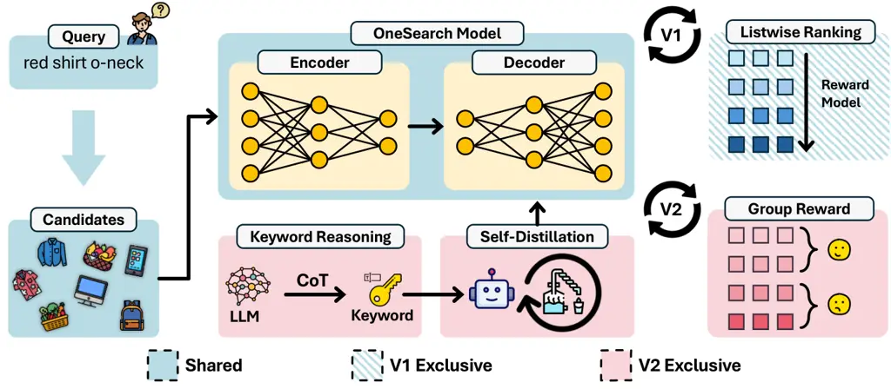
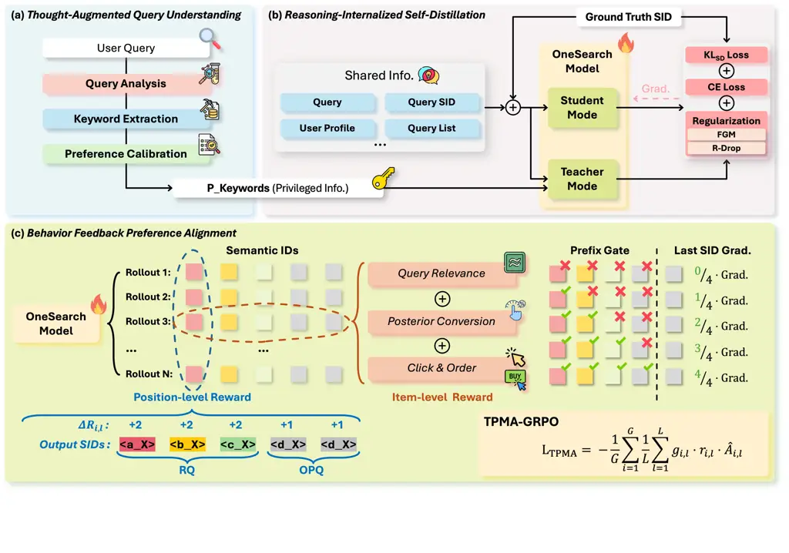
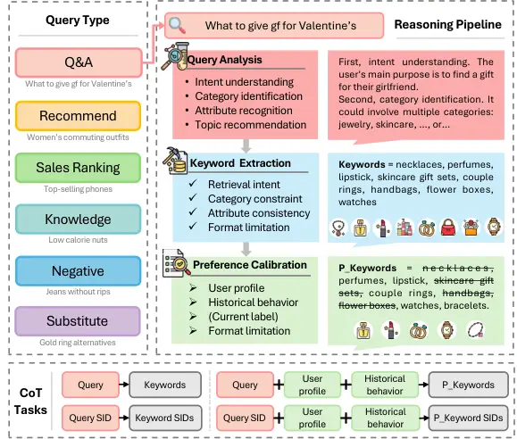
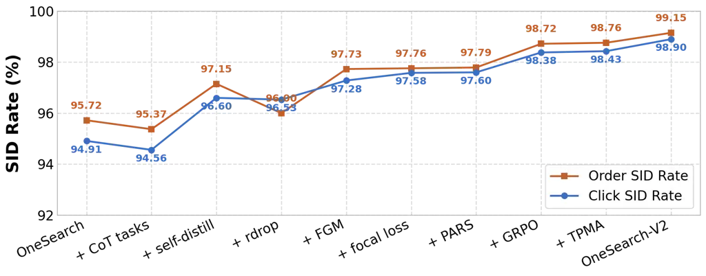
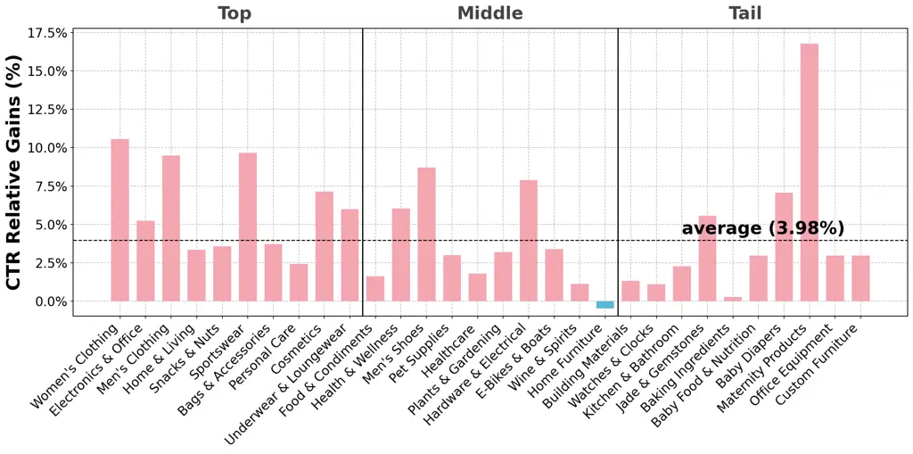
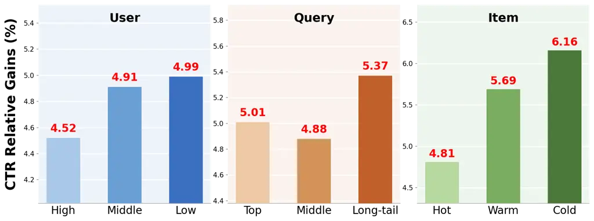

# OneSearch-V2: The Latent Reasoning Enhanced Self-distillation Generative Search FrameworkThanks: $`\dagger`$ Corresponding author. Homepage: [https://benchen4395.github.io/](https://benchen4395.github.io/)Thanks: \* Equal Contribution.

Ben Chen^(∗†), Siyuan Wang^(∗), Yufei Ma^(∗), Zihan Liang^(∗), Xuxin
Zhang, Yue Lv, Ying Yang, Huangyu Dai, Lingtao Mao, Tong Zhao, Zhipeng
Qian, Xinyu Sun, Zhixin Zhai, Yang Zhao, Bochao Liu, Jingshan Lv, Xiao
Liang, Hui Kong, Jing Chen, Han Li, Chenyi Lei^(†), Wenwu Ou, Kun Gai
Affiliation: Kuaishou Technology, Beijing, China, Contact: {benchen4395,
leichenyi}@gmail.com

###### Abstract.

Generative Retrieval (GR) has emerged as a promising paradigm for modern
search systems. Compared to multi-stage cascaded architecture, it offers
advantages such as end-to-end joint optimization and high computational
efficiency. OneSearch, as a representative industrial-scale deployed
generative search framework, has brought significant commercial and
operational benefits. However, its inadequate understanding of complex
queries, inefficient exploitation of latent user intents, and
overfitting to narrow historical preferences have limited its further
performance improvement. To address these challenges, we propose
OneSearch-V2, a latent reasoning enhanced self-distillation generative
search framework. It contains three key innovations: (1) a
thought-augmented complex query understanding module, which enables deep
query understanding and overcomes the shallow semantic matching
limitations of direct inference; (2) a reasoning-internalized
self-distillation training pipeline, which uncovers users’ potential yet
precise e-commerce intentions beyond log-fitting through implicit
in-context learning; (3) a behavior preference alignment optimization
system, which mitigates reward hacking arising from the single
conversion metric, and addresses personal preference via direct user
feedback. Extensive offline evaluations demonstrate OneSearch-V2’s
strong query recognition and user profiling capabilities. Online A/B
tests further validate its business effectiveness, yielding +3.98% item
CTR, +2.07% buyer volume, and +2.11% order volume. Manual evaluation
further confirms gains in search experience quality, with +1.37% in page
good rate and +1.65% in query-item relevance. More importantly,
OneSearch-V2 effectively mitigates common search system issues such as
information bubbles and long-tail sparsity, without incurring additional
inference costs or serving latency. Key codes are available at
[https://github.com/benchen4395/onesearch-family](https://github.com/benchen4395/onesearch-family).

###### Keywords: 

Latent Reasoning, Self-distillation, Keyword-based CoT, Beyond Logs,
Preference Alignment, Behavior feedback



Figure 1. OneSearch-V2 vs. V1. OneSearch-V2 extends the generative
search framework with thought-augmented query understanding,
reasoning-internalized self-distillation, and behavior feedback
preference alignment.

## 1. Introduction

Leveraging extensive world knowledge and powerful language modeling
capabilities, large language models (LLMs) are profoundly reshaping
search and recommendation systems. Compared to directly applying or
distilling LLMs into smaller models for isolated modules such as recall,
relevance, and ranking (Zhai et al., 2024; Zhu et al., 2025; Dong et
al., 2026; Tang et al., 2025), a more promising research frontier lies
in employing end-to-end generative retrieval to replace the traditional
multi-stage cascading architecture, as exemplified by OneRec for video
recommendation (Deng et al., 2025; Zhou et al., 2025), OneSug for query
suggestion (Guo et al., 2025), OneLoc for local life services (Wei et
al., 2025), and MTGR for advertisement (Han et al., 2025). For
e-commerce search, which requires jointly considering query-item
relevance and user-item collaborative preference, the representative
generative model is OneSearch (Chen et al., 2025). It enables direct
optimization of the final objective, achieving superior business
performance with substantially lower computational overhead.

However, as user preferences grow increasingly diverse and search
queries become more complex, we identify three key limitations that
constrain the performance of OneSearch:

1\) Insufficient understanding of complex queries. Typical search
queries consist of 2–3 short keywords, yet many do not specify concrete
item targets. For instance, “indoor fitness equipment” may reasonably
correspond to treadmills or dumbbells, but not mountain bikes.
Furthermore, long-tail queries frequently exhibit significant lexical
disparity from target items, such as negation-type queries (e.g.,
“relieve fatigue, no supplements”) and question-type queries (e.g.,
“what swimming essentials?”). These complex queries demand stronger
semantic understanding and reasoning capabilities. However, OneSearch
takes the raw query as input and generates target items in a single
forward pass under strict latency constraints. Although it incorporates
category-level supervision during training (SFT Stage 1), the model
still lacks the capacity for deep comprehension of these ambiguous
queries.

2\) Insufficient personalized intent reasoning over user context. Beyond
query-level understanding, effective e-commerce search further requires
reasoning over user-specific context—yet OneSearch’s periodic updates
rely heavily on historical co-occurrence patterns and log-fitting
objectives, inevitably resulting in shallow matching that fails to
uncover the true user intent. For example, given a user allergic to
certain flowers searching for “seasonal fresh flowers,” the model should
first reason about the current season, identify which varieties are in
bloom, and proactively avoid allergenic species—even if such items
historically exhibit strong conversion under the same query. While LLMs
can excel at such personalized intent reasoning through explicit
chain-of-thought (CoT), the substantially increased token generation
renders test-time computation prohibitively expensive for online
deployment.

3\) Fragile reward system with distributional bias. The multi-stage,
periodically updated preference reward system prevents OneSearch from
adapting in a timely manner to newly emerging queries and user intents.
Furthermore, the reward model, primarily trained on historical user
behavior logs, is susceptible to inefficient sampling and potential
reward hacking. These issues collectively cause OneSearch to overfit
narrow historical preferences, reinforcing the long-tail distributional
bias inherent in the search system.

To bridge these gaps, we introduce OneSearch-V2 a novel generative
search framework enhanced by latent reasoning and self-distillation,
shown in Fig. 1. It comprises three key contributions:

1\) Thought-augmented query understanding module. We employ LLMs to
generate explicit CoT reasoning for each query-user pair, and construct
compact keyword-based CoTs that maximize information density while
emphasizing critical content (cf. (Tang et al., 2025)). These
$`\langle`$query, user, CoTs$`\rangle`$ tuples serve as a semantic
alignment corpus during training, enabling OneSearch to learn complex
and personalized query interpretation. Moreover, the keyword-based CoTs
can be directly injected into the model input as supplementary signals
at inference time, yielding significant improvements for long-tail and
ambiguous queries. They further serve as privileged teacher-side input
for the latter self-distillation pipeline.

2\) Reasoning-internalized self-distillation training pipeline. We
propose a self-distillation training mechanism to endow the generative
model with latent reasoning capabilities, while avoiding the need for
additional trainable parameters or special tokens as in existing latent
reasoning methods (Shen et al., 2025; Hao et al., 2025; Zhang et al.,
2026). Instead, the reasoning ability is encoded into the model weights
and internalized as intuition. To mitigate the representation
instability caused by the information asymmetry between teacher and
student in self-distillation, we jointly apply R-Drop for prediction
consistency regularization and FGM for adversarial input robustness,
with a unified forward pass design that reduces computational overhead.

3\) Behavior feedback preference alignment optimization system. We
replace the previous hybrid ranking framework, which relies on a
separately trained reward model, with a direct user interaction feedback
optimization system. It leverages query-item relevance and user behavior
signals as composite rewards, achieving an explicit trade-off between
semantic matching and business conversion. We further introduce the SID
overlap rate as an auxiliary reward for format validity and hierarchical
content constraints. This design enables OneSearch-V2 to flexibly adjust
reward composition according to various objectives, while also
supporting streaming updates to handle newly emerging queries and
intents in a timely manner.

We conduct rigorous offline evaluations demonstrating that newer V2
achieves substantially higher recall and ranking performance than V1
across diverse complex e-commerce intents. Extensive online A/B tests on
the Kuaishou mall search platform further confirm significant
improvements: OneSearch-V2 achieves +3.98% in item CTR, +1.17% in PV
CTR, +2.90% in buyer volume, and +2.11% in order volume, and a critical
+3.45% in GMV. Manual evaluations additionally reveal +1.37% page good
rate and +1.65% query-item relevance, indicating meaningful gains in
search experience quality. More importantly, OneSearch-V2 can be
deployed without incurring additional inference cost or serving latency,
while effectively mitigating information bubbles and long-tail sparsity
without requiring a separate reward model. The codes and data case are
publicly available at
[https://github.com/benchen4395/onesearch-family](https://github.com/benchen4395/onesearch-family);
we hope that open-sourcing this work will contribute to future
advancements in generative retrieval.



Figure 2. The Overall Framework of OneSearch V2. It contains (a) a
thought-augmented complex query understanding module, (b) a
reasoning-internalized self-distillation training pipeline, and (c) a
behavior preference alignment optimization system. OneSearch-V2
effectively mitigates common search system issues such as information
bubbles and long-tail sparsity, without incurring additional inference
costs or serving latency.

## 2. Related Works

### 2.1. Generative Retrieval and Recommendation

Generative retrieval and recommendation reframe item retrieval as a
sequence generation problem, where a model directly produces discrete
Semantic IDs (SIDs) of items in an autoregressive manner. TIGER (Rajput
et al., 2023) is the seminal work in this line: it employs a Residual
Quantized Variational Autoencoder (RQ-VAE) to compress item content
embeddings into hierarchical discrete token sequences, and trains a
Transformer-based encoder-decoder to autoregressively predict the next
item’s SID given a user’s interaction history, elegantly unifying
semantic content knowledge with collaborative signals through a shared
quantized vocabulary. By contrast, IDGenRec (Tan et al., 2024)
represents items by a _textual_ ID generator natively in the LLM
vocabulary, bridging the semantic gap between generative models and item
ID spaces, and further enabling stronger cross-domain transfer.

As these generative models scale to billion-parameter LLMs, their
inference capabilities are greatly enhanced, but inference latency also
becomes a critical bottleneck in deployment. Lin et al. (Lin et al., 2025) addressed this by adapting speculative decoding to LLM-based
generative recommenders, where a lightweight draft model proposes
candidate SID sequences that the large target model verifies in
parallel, yielding significant speedup with negligible quality loss.
EARN (Yang et al., 2025b) further proposed inserting compact register
tokens into the input sequence to cache repetitive intermediate
computations across decoding steps, reducing inference latency for
deployment-scale systems. Most recently, R²ec (You et al., 2025)
introduced the first unified architecture that intrinsically integrates
a reasoning chain into the generative recommendation loop: by optimizing
both reasoning and recommend head, it achieves substantial gains on
diverse scenarios with competitive inference efficiency. These advances
collectively motivate the core question of our work: how to equip
generative search models with reasoning capabilities while keeping
inference cost practical for online deployment.

### 2.2. Latent Reasoning and Self-Distillation

Explicit chain-of-thought (CoT) reasoning has proven effective in
enhancing LLM performance on complex tasks (Wei et al., 2022; Yao et
al., 2023; Shao et al., 2024a), yet the increased token generation
incurs prohibitive latency for online deployment. To circumvent this
cost, latent reasoning methods internalize reasoning into continuous
hidden representations without explicit verbalization. Coconut (Hao et
al., 2025) replaces textual reasoning steps with continuous thought
vectors in the latent space. CODI (Shen et al., 2025) compresses
explicit CoT into continuous thought vectors through single-stage
self-distillation with L1 hidden-state alignment. Latent-R3 (Zhang et
al., 2026) further applies reinforcement learning over continuous latent
representations. While these methods avoid explicit CoT at inference
time, they typically require architectural modifications such as
additional token embeddings, projection layers, or specialized decoding,
which complicate deployment.

A closely related line of work achieves reasoning internalization
through information-asymmetric self-distillation, where the same model
serves as both teacher and student, with the asymmetry arising from
different input contexts rather than distinct parameter sets.
SDFT (Shenfeld et al., 2026) constructs this asymmetry through
in-context learning: the teacher observes few-shot demonstrations while
the student sees only the raw query, and alignment is performed via
reverse KL divergence. OPSD (Zhao et al., 2026) applies a similar
paradigm to mathematical reasoning with reference-solution-augmented
teachers and token-level JSD alignment. SDPO (Hübotter et al., 2026)
further extends this to RL settings, using environment feedback as
privileged teacher information to construct dense per-token advantages
from the teacher-student logit gap. These methods share a common
insight: rich supervision can be extracted from the logit discrepancy
between information-advantaged and information-deprived views of the
same model, without any external teacher. Our work extends this paradigm
to generative retrieval for e-commerce search, where the output space
shifts from natural language to discrete SID sequences and the
information asymmetry is constructed through keyword-based CoTs derived
from query understanding.

### 2.3. Preference Alignment for GRs

Reinforcement learning (RL) has been extensively explored to align
generative retrieval and recommendation models with complex user
preferences. OneRec (Deng et al., 2025) introduces Early Clipped GRPO
(ECPO) to optimize a personalized Preference Score derived from a
separately trained multi-objective reward model. To mitigate the
instability and reward hacking issues associated with reward models,
OneRec-V2 (Zhou et al., 2025) leverages Gradient-Bounded Policy
Optimization (GBPO) directly on real-world user feedback signals, such
as duration-aware watch time. Similarly, OneSug (Guo et al., 2025)
adopts a reward-weighted ranking strategy based on fine-grained
behavior-level weights.

Despite these advancements, existing RL methods share two critical
limitations. First, methods relying on separately trained reward models
are susceptible to sampling bias and reward hacking, as these models
tend to overfit to a narrow subset of historical logs that only
approximate global behavior distributions. Second, GRPO and its variants
(e.g., ECPO, GBPO) assign a uniform, sequence-level advantage to every
token within a generated SID sequence. However, SID generation follows a
strict hierarchical causal structure, progressing from coarse-grained
categories to fine-grained item attributes. Under this structure, a
correct prefix followed by error suffixes has fundamentally different
implications from entirely incorrect tokens. Uniform advantage
assignment conflates these distinct positional contributions, weakening
the learning signal for fine-grained token generation. Our work
addresses both limitations: we replace the separate reward model with
direct behavior feedback and introduce a token-position marginal
advantage mechanism that respects the hierarchical nature of SID
sequences.

## 3. Methodology

In this section, we detail OneSearch-V2, the latent reasoning enhanced
self-distillation generative search framework. First, we explore whether
multimodal or unimodal SID tokenization is more suitable for e-commerce
generative retrieval in § 3.1. We then introduce the thought-augmented
query understanding module in § 3.2, and elaborate on the
reasoning-internalized self-distillation training pipeline in § 3.3.
Finally, in § 3.4, we propose the behavior feedback preference alignment
optimization system, which directly adopts user interaction feedback to
replace multiple reward models for personalized ranking. The overall
framework is shown in Fig. 2.

### 3.1. Multimodal or Unimodal SID Tokenization?

Semantic IDs (SIDs) have emerged as a cornerstone for GR systems due to
their efficient and hierarchical semantic representation. Extensive
research has investigated efficient SID tokenization (Li et al., ; Jia
et al., 2025), which can be broadly categorized into two types: unimodal
and multimodal. Here we explore which encoding paradigm is more suitable
for e-commerce generative search.

Unlike recommendation systems, search engines must address the critical
challenge of aligning queries and items within a unified tokenization to
ensure robust semantic constraints. This necessitates careful handling
of the representational disparity between unimodal queries and
multimodal item contents, as items are characterized by extensive
textual descriptions, multiple images showing different perspectives,
and even explanatory videos. OneSearch-V1 addresses this by transforming
multimodal information into a unimodal representation. Specifically, it
employs Qwen-VL (Bai et al., 2023) to extract core keywords from diverse
sources, thereby constructing a unified textual representation.
Alternative approaches adopt direct multimodal mapping, either by
feeding all sources simultaneously into the model or by encoding
individual modalities separately before concatenation. However, these
methods face inherent limitations: multiple images may display mutually
exclusive attributes (e.g., a dress available in different colors), and
the abundance of redundant attributes may introduce extra bias (e.g.,
number and position of T-shirt buttons). Consequently, core attributes
risk being obscured in the multimodal encoding process.

To comprehensively compare the effectiveness of multimodal versus
unimodal tokenization, we conducted experiments across multiple model
configurations, including: a) Unimodal encoding utilizing text
descriptions only, b) Multimodal encoding, containing unified encoding
(joint processing) and separate encoding with subsequent concatenation,
as well as c) Keyword hierarchical quantization in OneSearch. For
experimental simplicity, we collected about 5M online clicked \<query,
item\> pairs, and restricted the item input to only the title and two
primary pictures. All embeddings were subsequently tokenized using the
unified RQ-OPQ framework. The results are depicted in Table 1.

|        |           |      |       |        |        |        |
| ------ | --------- | ---- | ----- | ------ | ------ | ------ |
| Type   | Model^(∗) | Size | CUR   | ICR    | Recall | MRR    |
| uni-   | bge-base  | 109M | 4.54% | 96.88% | 0.2445 | 0.1013 |
|        | qwen3     | 0.6B | 5.11% | 97.56% | 0.2468 | 0.1025 |
| multi- | uniecs    | 200M | 4.54% | 94.62% | 0.2368 | 0.1007 |
|        | bge-vl    | 149M | 4.23% | 94.46% | 0.2364 | 0.1009 |
|        | qwen3-vl  | 2B   | 4.86% | 95.27% | 0.2389 | 0.1012 |
|        | CLIP      | 188M | 4.03% | 94.16% | 0.2358 | 0.1003 |
| KHQE   | bge+kw.   | 109M | 5.11% | 99.50% | 0.2542 | 0.1085 |

^(∗)Bge-base and bge-vl are from (Xiao et al., 2024), qwen3 and qwen3-vl
from (Yang et al., 2025a; Bai et al., 2025), uniecs is the cross-modal
retrieval model (Liang et al., 2025), and CLIP is from (Ilharco et al.,
2021).

Table 1. Comparison of unimodal, multimodal, and KHQE tokenization
approaches. Recall@10 and MRR@10 are evaluated on click data.

Unimodal approaches significantly outperform multimodal counterparts at
comparable scales—even the smaller bge-base surpasses the larger
Qwen3-VL. This gap stems from cross-modal representational discrepancies
and redundant attributes that constrain multimodal encoding
effectiveness. The separate-then-concatenate strategy performs worst,
further confirming these challenges. KHQE achieves optimal results,
demonstrating superior core attribute extraction and hierarchical
representation. More importantly, its smaller size allows real-time
processing of input queries, striking a favorable balance between
performance and efficiency. Meanwhile, these findings underscore that
developing discriminative encodings for e-commerce search should
highlight two critical factors: mitigating cross-modal disparities and
enhancing salient information.

### 3.2. Thought-Augmented Query Understanding

E-commerce search engines handle massive volumes of queries exhibiting
complex and heterogeneous user intents on a daily basis, including: (1)
head queries characterized by highly-divergent and underspecified intent
(e.g., “indoor fitness equipment”); and (2) tail queries that encompass
diverse types (see Fig. 3), imposing intricate semantic constraints. On
the Kuaishou Mall platform, these complex queries constitute about
one-third of total page views (PV) yet account for merely 8% of
conversions, indicating a disproportionately low conversion rate. While
OneSearch-V1 (Chen et al., 2025) partially alleviates the semantic
discrepancy between complex queries and candidate items through aligned
and enhanced representations, it remains fundamentally constrained by
the inherent difficulties at both ends of the query frequency
distribution, as evidenced by an inverted-U pattern of CTR gains: lower
for head and tail queries, while higher for torso. The bottlenecks are
fundamentally different: for head queries, the abundant co-occurrence
patterns in interaction logs induce a broad candidate space, confronting
the model with a “which to retrieve” dilemma; for tail queries, the
diverse and heterogeneous query formulations make intent understanding
and item matching substantially harder, and the scarcity of behavioral
signals further compounds this challenge, leaving the model in a “what
can be retrieved” dilemma.



Figure 3. Three-step keyword-based CoT extraction pipeline for diverse
complex query types, along with the corresponding CoT tasks.

The emergence of explicit chain-of-thought (CoT) reasoning has enabled
LLMs to achieve transparent and verifiable reasoning pathways for a wide
range of complex tasks (Besta et al., 2024; Shao et al., 2024a; Wei et
al., 2022; Yao et al., 2023). This advancement has inspired us to
leverage CoT to address the query semantic dilemma. However, full and
unconstrained CoT reasoning, which prioritizes mimicking human
expression patterns, typically produces excessively lengthy outputs that
small-scale models cannot efficiently generate. The heterogeneous nature
between item SIDs and textual CoTs further obstructs straightforward
inference. Moreover, e-commerce systems often require focusing solely on
key terms aligned with query intent rather than comprehensive reasoning
chains. These limitations motivate us to consider how to implement
semantically-enhanced reasoning more efficiently.

Here we propose a thought-augmented query understanding schema. We first
employ LLMs to generate precise CoTs governed by four progressive
constraints, and then extract keyword sets of elevated information
density, subject to intent, category, and attribute consistency. Unlike
a recent work on reasoning-then-embedding dense retrieval (Tang et al.,
2025), our method demonstrates superior capability in extracting high
e-commerce intent queries, excluding queries with non-intent and
provides more explicit predictions regarding latent attribute
preferences. These extracted keywords serve as supplementary semantic
signals during training to enhance query intent recognition and user
preference calibration.

#### 3.2.1. Keyword-based CoT

This paradigm circumvents the excessive computational overhead incurred
by lengthy CoTs during inference, which confer merely marginal
information utility. As shown in Fig. 3, we formulate a three-step
reasoning pipeline, with detailed prompt templates provided in
Appendix B:

1.  1.  Query Analysis. We formulate an analysis scheme comprising four
        components. (i) Intent understanding, which identifies the primary
        retrieval target (i.e., merchandise, shop, or live-stream
        anchor); (ii) category identification, which performs hierarchical
        category matching from coarse to fine granularity; (iii) attribute
        recognition, which extracts the attribute type and its corresponding
        value from the query; and (iv) topic recommendation, which
        speculates potential candidate topics satisfying the user’s need.
2.  2.  Keyword Extraction. For queries with merchandise retrieval intent,
        we extract keywords from the full analysis, subject to constraints
        on intent, category, and attribute consistency. The extracted
        keywords are subsequently refined through synonym merging and
        redundant word removal, and finally ranked in descending order of
        item popularity. For queries with other intent types, which are
        handled by dedicated matching engines, the pipeline terminates
        directly.
3.  3.  Preference Calibration. Leveraging the user profile and historical
        behavioral signals, such as previously entered queries and
        interacted item sequences, the LLM perceives user preferences and
        filters or augments the extracted keyword set to better align with
        individual interests. During training, the items interacted within
        the current session are further injected as signals, thereby
        ensuring that keywords associated with ground-truth items are either
        preserved or explicitly introduced into the set.

#### 3.2.2. Training Paradigm Refinement

The resulting $`\langle`$query, keywords$`\rangle`$ tuples from Step 2
and $`\langle`$query, user, keywords$`\rangle`$ tuples from Step 3
collectively constitute the training corpus. We then incorporate four
CoT tasks (shown in Fig. 3) into the SFT Stage 1 (Semantic Alignment
Procedure) of OneSearch-V1. As shown in Table 2,3,4, these tasks
($`\backslash`$+ CoT tasks) guide the model to acquire richer query
knowledge beyond historical logs and explore preference-aware item
topics, thereby instructing the model to engage in more complex and
personalized reasoning.

During online deployment, the entire keyword-based CoT generation
process for each distinct query is performed asynchronously and then
used for streaming training and near-line inference. For the same query
or $`\langle`$query, user$`\rangle`$ pair, cached, already computed
content can be reused directly. This minimizes computational overhead
and does not impact online inference latency.

|           |                                                                  |                                                         |                      |                      |
| --------- | ---------------------------------------------------------------- | ------------------------------------------------------- | -------------------- | -------------------- |
| Procedure | SFT Stage 1                                                      | SFT Stage 2                                             | SFT Stage 3          | RL Stage             |
| Objective | Semantic alignment                                               | $`\langle\text{$q$, $i$}\rangle\ co\text{-}occurrence`$ | User personalization | Preference Alignment |
| Component | $`\begin{array}[]{c}\text{query/item}\leftrightarrow\text{SID}\\ |

\text{query/item}\mapsto\text{category}\\
\text{SID}\mapsto\text{category}\\
\text{{CoT}}\ \text{{tasks}}\end{array}`$ | $`\begin{array}[]{c}\text{query}\leftrightarrow\text{item}\\
\text{$SID_{q}$}\leftrightarrow\text{$SID_{i}$}\\
\end{array}`$ | $`\begin{bmatrix}uid\ \&\ q\\
{SID}_{q}\ \&\ Seq_{q}\\
\text{$Seq_{short}$}\ \&\ \text{$Seq_{long}^{emb}$ }\\
\text{$keywords$}\ \text{({RAG})}\end{bmatrix}\mapsto{SID}_{q}`$ | $`\begin{bmatrix}\text{user \& query}\\
\text{seq. feat.}\\
\text{$item_{clk/order}$}\\
\text{$item\_{rollout}$}\end{bmatrix}\mapsto\text{Rank Score}`$ |
| | | | | |

Table 2. The overall training procedure of OneSearch-V2. It contains a
three-stage supervised fine-tuning schema for semantic alignment,
co-occurrence synchronization, and user personalization modeling,
followed by a direct behavior feedback preference alignment for
personalized preference learning.

| Model                     | Order (7229) |        | Click (30k) |        |
| ------------------------- | ------------ | ------ | ----------- | ------ |
|                           | HR@n         | MRR@n  | HR@n        | MRR@n  |
| baseline                  | 0.2046       | 0.0985 | 0.2231      | 0.0728 |
| $`\backslash`$+ CoT tasks | 0.2094       | 0.1008 | 0.2266      | 0.0731 |
| \+ direct CoT             | 0.0898       | 0.0189 | 0.1013      | 0.0146 |
| \+ RAG                    | 0.2139       | 0.1011 | 0.2327      | 0.0743 |

Table 3. Results of CoT task augmentation and keyword injection as
information gains, where $`n=10`$.

| Model                     | Head   |        | Tail   |        |
| ------------------------- | ------ | ------ | ------ | ------ |
|                           | HR@n   | MRR@n  | HR@n   | MRR@n  |
| baseline                  | 0.2362 | 0.0817 | 0.1952 | 0.0733 |
| $`\backslash`$+ CoT tasks | 0.2419 | 0.0829 | 0.1963 | 0.0734 |
| \+ direct CoT             | 0.1116 | 0.0180 | 0.0809 | 0.0120 |
| \+ RAG                    | 0.2438 | 0.0845 | 0.1973 | 0.0779 |

Table 4. Ablation study of CoT task augmentation on head and tail query
types, where $`n=10`$.

### 3.3. Reasoning-Internalized Self-Distillation

An intuitive approach would be to train OneSearch to first generate
reasoning keywords, followed by candidate SIDs. However, the
representational heterogeneity between discrete SIDs and textual
keywords poses a severe challenge for small-scale generative models. As
demonstrated in Table 3-4, explicit CoT reasoning (+ direct CoT)
substantially degrades OneSearch’s performance, yielding results even
significantly inferior to even the baseline. Instead, we leverage these
keywords as supplementary information for queries at the input layer, as
shown in Fig. 2. Notably, this input-augmented method (+ RAG) further
enhances the model’s retrieval and ranking effectiveness.

However, obtaining these CoTs at inference time incurs non-trivial
latency overhead, as it requires an additional call to the
thought-augmented query understanding module per request, which is
prohibitive under the strict latency constraints of online e-commerce
search. Moreover, the limited coverage of keyword-based CoTs may also
restrict the model to inferring only items explicitly covered by the
keyword set. For example, when a user searches for "hotel essentials,"
if the keywords are limited to towels, toothbrushes, and razors,
OneSearch might fail to recommend disposable slippers. These challenges
raise a fundamental question: can we retain or even further enhance the
performance gains of reasoning without bearing its inference cost?

We address this by proposing a reasoning-internalized self-distillation
mechanism that transfers the explicit reasoning capability into the
model’s parameters, effectively converting deliberate, keyword-guided
CoTs into fast, intuition-like inference. Unlike prior latent reasoning
approaches that introduce additional trainable tokens (Hao et al., 2025)
or continuous thought vectors (Shen et al., 2025; Zhang et al., 2026)
into the decoding process, our method requires no architectural
modification, no extra parameters, and no additional inference tokens.
The reasoning ability is encoded entirely into the existing model
weights through a carefully designed distillation pipeline.

#### 3.3.1. Self-Distillation Formulation

Our self-distillation operates on the principle of information
asymmetry: the teacher observes strictly richer input than the student,
while the student is trained to match the teacher’s output distribution
despite this informational disadvantage. Crucially, the teacher and
student share the same model weights, eliminating the need for a
separate teacher network and halving the memory footprint compared to
conventional knowledge distillation.

Concretely, let $`\mathcal{M}_{\theta}`$ denote the generative model
parameterized by $`\theta`$. For a given training sample, the teacher
receives the full input prompt augmented with keyword-based CoTs from
§3.2.1:

```math
x^{(T)}=(\text{uid},\,q,\,\text{SID}_{q},\,\text{Seq}_{q},\,\text{Seq}_{\text{short}},\,\text{Seq}_{\text{long}}^{\text{emb}},\,\textbf{kw}), \tag{1}
```

where kw denotes the personalized keyword-based CoTs. The student
receives the same prompt without the keyword augmentation:

```math
x^{(S)}=(\text{uid},\,q,\,\text{SID}_{q},\,\text{Seq}_{q},\,\text{Seq}_{\text{short}},\,\text{Seq}_{\text{long}}^{\text{emb}}). \tag{2}
```

Both the teacher and the student produce output logits over the target
label sequence $`y=(y_{1},\dots,y_{L})`$:

```math
z^{(T)}=\mathcal{M}_{\theta}(y\mid x^{(T)}),\quad z^{(S)}=\mathcal{M}_{\theta}(y\mid x^{(S)}). \tag{3}
```

Since $`\theta`$ is shared, the difference between $`z^{(T)}`$ and
$`z^{(S)}`$ arises solely from the presence or absence of keyword
information in the input. The distillation objective encourages the
student to close this gap:

```math
\mathcal{L}_{\text{KL}}=\frac{1}{|\mathcal{V}|}\sum_{t\in\mathcal{V}}\text{KL}\!\Big(\text{softmax}\!\big(z_{t}^{(T)}/\tau\big)\;\Big\|\;\text{softmax}\!\big(z_{t}^{(S)}/\tau\big)\Big)\cdot\tau^{2}, \tag{4}
```

where $`\mathcal{V}=\{t:y_{t}\neq-100\}`$ is the set of valid
(non-padding) token positions, and $`\tau`$ is the distillation
temperature. The teacher’s logits are detached from the computational
graph so that the KL gradient updates only the student’s forward path.
During training, the teacher forward pass is executed under
torch.no_grad(), and only the student path accumulates gradients.

The base training objective for the student combines the standard
cross-entropy loss with the distillation signal:

```math
\mathcal{L}_{\text{base}}=\mathcal{L}_{\text{CE}}(z^{(S)},y)+\alpha_{\text{KL}}\cdot\mathcal{L}_{\text{KL}}, \tag{5}
```

where $`\alpha_{\text{KL}}`$ controls the relative strength of the
distillation signal.

#### 3.3.2. Mitigating Representation Instability

The information asymmetry between teacher and student introduces a
fundamental challenge: the student must produce equally confident
predictions from strictly less informative inputs. This forces the
model’s loss surface to become sharper in the neighborhood of
keyword-absent inputs, as small perturbations in the embedding space can
cause disproportionately large changes in the output distribution. We
identify two complementary failure modes and address each with a
targeted regularization technique.

##### Prediction Consistency via R-Drop.

When the student lacks keyword guidance, its internal representations
for semantically ambiguous queries become sensitive to stochastic
perturbations from dropout. Two forward passes of the same input through
the student may yield inconsistent output distributions, indicating that
the model has not robustly internalized the query semantics. To enforce
prediction stability, we apply R-Drop regularization (liang et al.,
2021), which performs two forward passes $`z_{1}^{(S)}`$,
$`z_{2}^{(S)}`$ with independent dropout masks and minimizes their
divergence:

```math
\mathcal{L}_{\text{R-Drop}}=\frac{1}{2}\Big[\text{KL}(P_{1}\|P_{2})+\text{KL}(P_{2}\|P_{1})\Big], \tag{6}
```

where $`P_{k}=\text{softmax}(z_{k}^{(S)})`$ for $`k\in\{1,2\}`$, and the
KL terms are masked to valid token positions. This symmetric penalty
discourages the model from relying on fragile internal pathways that are
sensitive to dropout noise.

##### Input Robustness via Adversarial Perturbation.

Complementary to R-Drop’s output-space regularization, we apply Fast
Gradient Method (FGM) (Miyato et al., 2021) to regularize the input
embedding space. After the first backward pass, FGM perturbs the shared
embedding layer along its gradient direction:

```math
r_{\text{adv}}=\epsilon\cdot\frac{\nabla_{e}\mathcal{L}_{\text{base}}}{\|\nabla_{e}\mathcal{L}_{\text{base}}\|_{2}}, \tag{7}
```

where $`e`$ denotes the embedding parameters, $`\epsilon`$ controls the
perturbation magnitude, and
$`\mathcal{L}_{\text{base}}=\mathcal{L}_{\text{CE}}+\alpha_{\text{KL}}\cdot\mathcal{L}_{\text{KL}}+\alpha_{\text{R}}\cdot\mathcal{L}_{\text{R-Drop}}`$.
A second forward–backward pass on the perturbed embeddings
$`e+r_{\text{adv}}`$ yields $`\mathcal{L}_{\text{adv}}`$, whose
gradients are accumulated before restoring $`e`$. This smooths the loss
landscape around each input, preventing sharp decision boundaries in
regions where neighboring embeddings may correspond to semantically
distinct queries.

#### 3.3.3. Total Optimization Objective

Combining all components, the student objective is:

```math
\mathcal{L}_{\text{SDFT}}=\mathcal{L}_{\text{CE}}+\alpha_{\text{KL}}\cdot\mathcal{L}_{\text{KL}}+\alpha_{\text{R}}\cdot\mathcal{L}_{\text{R-Drop}}+\mathcal{L}_{\text{adv}}, \tag{8}
```

where $`\mathcal{L}_{\text{adv}}`$ denotes the cross-entropy and
weighted distillation losses on the perturbed input (reusing
$`\alpha_{\text{KL}}`$). We further replace standard cross-entropy with
focal loss (Lin et al., 2018) to mitigate the long-tail class imbalance
in the SID vocabulary.

### 3.4. Behavior Feedback Preference Alignment

OneSearch-V1 adopts a hybrid ranking framework in which a separately
trained reward model (RM) guides the generative model in learning user
preferences. Although effective, this design inherits the pathologies of
potential sampling bias that also plague reward-model-based
reinforcement learning  (Deng et al., 2025; Zhou et al., 2025): RM
training restricts sampling to a small subset of users that can only
approximate global behavior distributions. It contributes to the
potential information bubbles and long-tail sparsity, similar to
traditional MCA. OneRec-V2 (Zhou et al., 2025) mitigates these issues by
replacing proxy rewards with real user feedback signals and introducing
Gradient-Bounded Policy Optimization for stable ratio clipping.

In e-commerce search, however, the feedback landscape differs
fundamentally from short-video recommendation: (a) Unlike short-video
platforms that typically present one video at a time, e-commerce search
results display multiple items simultaneously. Moreover, user-item
interactions (clicks, adding to cart, purchasing) follow a hierarchical
progression: users typically click first, followed by subsequent actions
such as adding to cart or purchasing. This contrasts sharply with video
platforms where multiple interaction behaviors (like, follow, forward,
dislike, comment, profile entry, etc.) can occur concurrently.
Consequently, different behavioral signals in search contexts exhibit
more distinct user preference patterns; (b) Users place greater emphasis
on the strong relevance constraint between intention and the exposed
item. Therefore, query-item relevance must be jointly optimized
alongside conversion metrics, creating a composite reward surface that
balances both relevance estimation and click probability estimation.
Meanwhile, the generated output is a discrete SID sequence ($`L{=}5`$
tokens) with strict hierarchical semantics (coarse→fine), where each
token carries qualitatively different information. Simultaneously, for
similar products with same semantics, search systems should emphasize
the differentiation of unique features to provide more precise
recommendations. Furthermore, Standard GRPO (Shao et al., 2024b) assigns
the same sequence-level advantage to every token, ignoring this causal
structure and leading to imprecise credit assignment.

Motivated by these observations, OneSearch-V2 replaces the separately
trained RM with a direct behavior feedback preference alignment system
that (1) constructs composite rewards from real user interactions,
(2) introduces a token-position marginal advantage (TPMA) mechanism for
position-aware credit assignment, and (3) supports streaming updates to
handle newly emerging queries and flexible business interventions in a
timely manner.

#### 3.4.1. Composite Reward Design

We adopt GRPO as the basic optimization framework. For each rollout
$`o_{i}`$ (a generated SID sequence of $`L`$ tokens), we compute a
scalar reward $`R_{i}`$ that aggregates three complementary signals,
reflecting both semantic matching quality and business conversion value.

##### Relevance Reward ($`R_{\mathrm{Rel}}`$).

We leverage the existing relevance system to categorize each generated
item into four tiers: 3-Excellent, 2-Related, 1-Mismatch and
0-Irrelevant. The higher level means that \<query, item\> pairs are more
relevant.

##### Posterior Conversion Reward ($`R_{\mathrm{CTR}}`$).

We utilize the calibrated posterior CTR (adaptive-weighted reward signal
designed in OneSearch-v1) as a dense feedback signal. To prevent
dominance of high-CTR items that may lack true relevance, the score is
clipped to a bounded range (0, 1):

##### Click and Order Score ($`R_{\mathrm{C\&O}}`$).

We directly reward SIDs that correspond to items the user has clicked or
purchased:

```math
R_{\mathrm{C\&O}}(o_{i})=\begin{cases}V_{o},&\text{if }o_{i}\in\mathcal{S}_{\mathrm{order}},\\
V_{c},&\text{if }o_{i}\in\mathcal{S}_{\mathrm{click}}-\mathcal{S}_{\mathrm{order}},\\
0,&\text{otherwise},\end{cases} \tag{9}
```

where $`\mathcal{S}_{\mathrm{order}}`$ and
$`\mathcal{S}_{\mathrm{click}}`$ denote the sets of SIDs associated with
the purchased and clicked items. $`v_{o}`$ and $`v_{c}`$ are the
constant reward values. This hierarchy encodes the intuition that
purchases reflect stronger preference signals than clicks.

The final composite item-level reward combines them as:

```math
R_{\mathrm{item}}(o_{i})=R_{\mathrm{C\&O}}(o_{i})+R_{\mathrm{CTR}}(o_{i})+R_{\mathrm{FR}}(o_{i}), \tag{10}
```

This additive design avoids the sparsity problem of rewards and make a
well balance of relevance and conversion constrains.

#### 3.4.2. Standard GRPO Baseline

Group Relative Policy Optimization (GRPO) has become the dominant RL
paradigm for generative retrieval systems (Deng et al., 2025; Zhou et
al., 2025; Liu et al., 2025), owing to its elimination of the critic
network via within-group advantage normalization. For each input prompt
$`x_{u}`$, the current policy $`\pi_{\theta}`$ generates $`G`$ rollouts
$`\{o_{i}\}_{i=1}^{G}`$. The sequence-level advantage is computed as:

```math
\hat{A}_{i}=\frac{R_{i}-\mathrm{mean}_{j\in[G]}(R_{j})}{\mathrm{std}_{j\in[G]}(R_{j})+\delta}, \tag{11}
```

where $`\delta`$ is a constant for numerical stability. The GRPO loss
is:

```math
\mathcal{L}_{\mathrm{GRPO}}=-\frac{1}{G}\sum_{i=1}^{G}\frac{1}{|o_{i}|}\sum_{t=1}^{|o_{i}|}\min\!\Bigl(r_{i,t}\,\hat{A}_{i},\;\mathrm{clip}(r_{i,t},\,1{-}\varepsilon,\,1{+}\varepsilon)\,\hat{A}_{i}\Bigr), \tag{12}
```

where
$`r_{i,t}=\pi_{\theta}(o_{i,t}\mid x_{u},o_{i,<t})\,/\,\pi_{\theta_{\mathrm{old}}}(o_{i,t}\mid x_{u},o_{i,<t})`$
is the per-token importance ratio.

In the standard formulation, every token position in rollout $`o_{i}`$
receives the _same_ advantage $`\hat{A}_{i}`$. However, SID generation
exhibits a strict _hierarchical causal structure_: the first token
encodes the coarsest category, while subsequent tokens progressively
refine to finer-grained attributes. A correct first token with an
incorrect second token has fundamentally different implications from the
reverse. Assigning uniform credit across positions conflates these
distinct contributions and weakens the learning signal, particularly for
the later, finer-grained tokens.

#### 3.4.3. Token-Position Marginal Advantage

To address the credit assignment limitation, we propose TPMA-GRPO, which
decomposes the sequence-level reward into position-level marginal
contributions and gates gradient flow based on prefix correctness.

##### Prefix Reward.

For each rollout $`o_{i}`$ generating $`L`$ SID tokens, we define the
prefix reward at position $`l`$ as the maximum cumulative match against
any ground-truth target SID:

```math
R_{i,l}=\max_{t\in\mathcal{T}}\sum_{k=1}^{l}~[o_{i}^{k}=t^{k}]\cdot\Delta R_{i,l},\quad l=1,\dots,L, \tag{13}
```

where
$`\mathcal{T}=\mathcal{S}_{\mathrm{click}}\cup\mathcal{S}_{\mathrm{order}}`$
is the union of ground-truth SID sets. $`o^{k}_{i}`$ and $`t^{k}`$
indicate the k-th token in rollout $`o_{i}`$ and target SID $`t_{i}`$.
This metric evaluates whether the model’s generation progressively
converges toward a valid target at each hierarchical level, while
$`\Delta R_{i,l}`$ is marginal contribution at position $`l`$ with:

```math
\Delta R_{i,l}=[l<3]\cdot 2+[3\leq l<L]\cdot 1,\quad R_{i,0}\triangleq 0. \tag{14}
```

The factor of 2 indicates the contribution of the former shared and
hierarchical feature encoding (position $`l<3`$) should be given more
attention, compared to the latter unique feature quantization (position
$`3\leq l<L`$). As the GR model should prioritize generating items that
conform to the semantic content of the query. 0 indicates either a
mismatch or that no additional match was gained.

Compared to standard GRPO, we first construct the position-level
advantage for each $`l`$, which normalizes marginal contributions
independently across the $`G`$ rollouts within one group:

```math
\hat{A}_{i,l}=\frac{\Delta R_{i,l}-\mathrm{mean}_{j\in[G]}(\Delta R_{j,l})}{\mathrm{std}_{j\in[G]}(\Delta R_{j,l})+\delta}. \tag{15}
```

This ensures that position $`l`$’s advantage is computed solely against
the same position of other rollouts. Thus, each token is held
responsible only for its own positional contribution, providing precise
credit assignment across the coarse-to-fine hierarchy.

##### Prefix Gate.

A critical insight is that gradient signals for latter positions are
meaningful only when the prefix is correct. For example, if the former
is wrong, optimizing the latter within that erroneous branch is
counterproductive. Here we introduce a prefix gate $`g_{i,l}`$ that
modulates gradient magnitude based on prefix accuracy:

```math
g_{i,l}=[l=1]\cdot 1+[l\geq 2]\cdot\frac{R_{i,l-1}}{l-1} \tag{16}
```

where $`g_{i,l}\in[0,1]`$. When the prefix is perfectly matched
($`R_{i,l-1}=l{-}1`$), the gate is fully open ($`g=1`$); when the prefix
is entirely incorrect ($`R_{i,l-1}=0`$), the gate closes ($`g=0`$),
effectively suppressing gradients for downstream tokens. This mechanism
naturally enables a hierarchical curriculum: the model first learns to
generate correct coarse-level tokens before being trained on
fine-grained ones.

##### Combined Advantage.

To incorporate the richer conversion information from the item-level
reward $`R_{\mathrm{item}}`$ (Eq. 10), we first compute a
group-normalized advantage:

```math
\hat{A}_{i}^{\mathrm{item}}=\frac{R_{\mathrm{item}}(o_{i})-\mathrm{mean}_{j\in[G]}(R_{\mathrm{item}}(o_{j}))}{\mathrm{std}_{j\in[G]}(R_{\mathrm{item}}(o_{j}))+\delta}, \tag{17}
```

and combine it with the position-level one as the final advantage:

```math
\hat{A}_{i,l}^{\mathrm{final}}=\hat{A}_{i,l}+w_{\mathrm{item}}\cdot\hat{A}_{i}^{\mathrm{item}}, \tag{18}
```

where $`w_{\mathrm{seq}}`$ controls the trade-off between structural
prefix matching and business-oriented conversion signals. This design
allows the model to simultaneously learn _what_ to generate (via TPMA)
and _how valuable_ the generation is (via the item-level reward).

##### TPMA-GRPO Loss.

The final loss function integrates the combined advantage, prefix gate,
and per-token importance ratio:

```math
\mathcal{L}_{\mathrm{TPMA}}=-\frac{1}{G}\sum_{i=1}^{G}\frac{1}{L}\sum_{l=1}^{L}g_{i,l}\cdot r_{i,l}\cdot\hat{A}_{i,l}^{\mathrm{final}}, \tag{19}
```

where
$`r_{i,l}=\pi_{\theta}(o_{i,l}\mid x_{u},o_{i,<l})/\pi_{\theta_{\mathrm{old}}}(o_{i,l}\mid x_{u},o_{i,<l})`$
is the token-level importance ratio. Note that we deliberately omit the
clipping operation in GRPO. The prefix gate already provides a natural
regularization mechanism: when $`g_{i,l}\to 0`$, the effective gradient
for position $`l`$ vanishes regardless of the ratio magnitude,
preventing the gradient explosion issue. This is analogous in spirit to
GBPO proposed in OneRec-V2 (Zhou et al., 2025), but achieves better
stability through flexible structural gating rather than explicit
truncation. Additional SFT is also introduced to ensure the model remain
stable.

## 4. Experiment

To more thoroughly assess the effectiveness of OneSearch-V2, in this
section we conduct comprehensive offline and online A/B evaluations.
Moreover, extensive ablation experiments are performed to prove the
feasibility of each innovations.

Dataset and Baseline. We collected the highly reliable user interactive
pairs from Kuaishou’s mall search platform in the past three months as
the training data, and the logs from last day as the testing set. Since
the V1 model has been fully deployed, all models in the offline
experiments were trained using the same raw pretrained model. While for
online A/B experiments, we chose the latest online OneSearch V1 as the
baseline, the testing V2 is trained with the same data compared to
serving version.

Evaluation Metrics To verify the recall and ranking performance, here we
still adopt HitRate and Mean Reciprocal Ranking (MRR) as the evaluation
metrics, which are widely used in search and recommendation systems. All
values presented for each value were the average values for all
testings.

|                              |              |        |             |        |
| ---------------------------- | ------------ | ------ | ----------- | ------ |
| Method                       | Order (7229) |        | Click (30k) |        |
|                              | HR@10        | MRR@10 | HR@10       | MRR@10 |
| OneSearch                    | 0.2046       | 0.0985 | 0.2231      | 0.0728 |
| $`\backslash`$+ CoT tasks    | 0.2094       | 0.1008 | 0.2266      | 0.0731 |
| $`\backslash`$+ self-distill | 0.2163       | 0.1017 | 0.2398      | 0.0757 |
| $`\backslash`$+ rdrop        | 0.2168       | 0.1045 | 0.2398      | 0.0760 |
| $`\backslash`$+ FGM          | 0.2180       | 0.1047 | 0.2422      | 0.0766 |
| $`\backslash`$+ focal loss   | 0.2214       | 0.1048 | 0.2471      | 0.0788 |
| + PARS                       | 0.2221       | 0.1067 | 0.2538      | 0.0809 |
| + GRPO                       | 0.2248       | 0.1106 | 0.2481      | 0.0798 |
| + TPMA                       | 0.2265       | 0.1136 | 0.2498      | 0.0815 |
| OneSearch-V2                 | 0.2314       | 0.1151 | 0.2568      | 0.0833 |

Table 5. Performance comparison of the proposed innovations with
OneSearch on the industry dataset. The "$`\backslash`$+ " means "the
former model add new task", and "+" means "the sft model add new task
only". The best results are in bold, and sub-optimal results are
underlined in each column.



Figure 4. The sid rate of the proposed innovations with OneSearch on the
industry dataset.

Implementation Details We adopt encoder-decoder model Bart-B (Lewis et
al., 2019), decoder-only models GPT-2 (Brown et al., 2020) and
Qwen3-0.6B (Yang et al., 2025a) as the base pre-trained models for the
testings, in order to verify whether these innovations are applicable to
different model structures. We used Qwen3-32B  (Yang et al., 2025a) to
generate and extract the keyword-based CoT. The beam search size is set
to 512 here to strike a balance between generation quality and latency.
The batch size for SFT and DPO and GRPO is set to 512, 2048, 256,
respectively, with the latter being smaller because the list-wise DPO
training takes more samples as inputs. For the reasoning-internalized
self-distillation (SFT Stage 3), we adopt the self-mode where the
teacher and student share identical weights. The distillation
temperature $`\tau`$ is set to 1.0, with the KL divergence weight
$`\alpha_{\text{KL}}=0.1`$ and the R-Drop coefficient
$`\alpha_{\text{R}}=0.5`$. For FGM adversarial training, the
perturbation magnitude $`\epsilon`$ is set to 0.6. The focal loss
parameters are set to $`\alpha=2`$ and $`\gamma=3`$. Some parameters
will be discussed in the following ablation study. $`V_{o}`$ and
$`V_{c}`$ are set as 3, 4 for TPMA-GRPO. The multi-stage supervised
training is conducted each, RL system is streaming training, and the
keyword-base CoT generation with user interaction data is updated as
close to the stream as possible.

### 4.1. Offline Performance

We selected 30,000 page views (PVs) with valid interactions from user
search logs as the testing dataset, which contains 30,000 click
behaviors and 7,229 order behaviors. For each PV, we extracted the top
10 generated items to ensure a fair comparison across different methods.
As shown in Table 5, the first part of our experiments aims to verify
the validity of thought-augmented query understanding and
reasoning-internalized self-distillation. We observe that the
keyword-based CoT mechanism effectively addresses the semantic ambiguity
inherent in queries. Subsequently, self-distillation further enhances
the reasoning capability of OneSearch by converting deliberate, explicit
CoT into inherent parameters.

The introduction of R-Drop and adversarial perturbation is also
demonstrated to construct more consistent and robust predictions for
each query, while the additional focal loss alleviates the extreme item
class imbalance problem. Ultimately, the combinatorially optimized model
achieves substantially higher recall performance (22.14% vs. 20.46% for
order) and comparable ranking performance (10.48% vs. 9.85%), with an
average improvement of 2.04% in HR@10 and 0.62% in MRR@10, compared to
the baseline.

The second part of our experiments validates whether direct behavior
feedback preference alignment can better meet diverse user needs without
requiring a separate reward model. The adaptive reward system "+PARS"
from the original OneSearch serves as our baseline. We sequentially
evaluated the standard GRPO, as well as our proposed Token-Position
Marginal Advantage (TPMA) mechanism. The results demonstrate that the
composite reward design and the position- and item-level combined
alignment formulation achieve optimal performance compared to the other
methods.

Notably, listwise DPO (Sun et al., 2026) and GRPO (Shao et al., 2024b)
focus on complementary aspects of the optimization objective: DPO aims
to refine the model’s fitting of user preferences using authentic user
behavioral data, while GRPO emphasizes guiding the model to generate
samples that better align with reward signals through group relative
optimization across multiple samples. Thus in online deployment, we
first employ listwise DPO to learn the fundamental user interactive
preference from real search logs, followed by TPMA to balance multiple
reward objectives and enhance the model’s generalization. The final
version "OneSearch-V2" achieves significantly superior recall and
ranking performance compared to all baseline methods. More importantly,
by eliminating the dependency on separate reward models and enhancing
the reasoning understanding for query content and user intent, our
approach further ensures that the model can achieve healthy optimization
beyond the limitations of historical logs, thereby improving both
relevance and personalization in e-commerce search scenarios.

We also testing the valid SID rate for each method, which represents the
proportion of valid items successfully converted among N generated SIDs.
As illustrated in Fig. 4, nearly every optimization contributes to
improvements in SID rate. The final OneSearch-V2, incorporating all
proposed innovations, achieves optimal results (98.90% for click, and
99.15% for order), maintaining semantic coherence while generating
diverse and relevant item candidates.

### 4.2. Ablation Study

To better examine the superiority of the proposed innovations, we
evaluated that 1) the impact of query’s CoT task augmentation on head
and tail query, 2) the effectiveness of each part of
reasoning-internalized self-distillation, and 3) Self-distillation
versus alternative reasoning internalization strategies.

1\) The impact of query’s CoT task augmentation on head and tail
queries. As shown in Table 4, the introduction of four CoT tasks into
the semantic alignment procedure ($`\backslash`$+ CoT tasks) yields
consistent performance improvements for both head and tail query types.
However, explicit CoT reasoning—wherein GR model first generates
explicit CoT context before producing numerical Semantic IDs
(SIDs)—significantly degrades query understanding capabilities; This
finding aligns with recent studies demonstrating that explicit reasoning
steps during training can adversely impact model generalization
ability (Yao et al., 2026).

Incorporating keyword-based CoTs as information gain for query (+ direct
CoT) at the input layer does indeed enhance overall generation
performance. Nevertheless, the unbearable latency introduced by this
approach renders it impractical for industrial deployment.

2\) The effectiveness of each component in reasoning internalized
self-distillation. We isolate the contribution of each regularization
technique by training it jointly with two configurations: the baseline
(without self-distillation) and the self-distillation model. As shown in
Table 6, each technique improves the baseline independently, and
self-distillation itself contributes the most substantial single
improvement (+1.17% order HR@10, +1.67% click HR@10), confirming that
internalizing keyword-guided reasoning is the primary performance
driver.

| Method          | Order (7229) |        | Click (30k) |        |
| --------------- | ------------ | ------ | ----------- | ------ |
|                 | HR@10        | MRR@10 | HR@10       | MRR@10 |
| Baseline        | 0.2046       | 0.0985 | 0.2231      | 0.0728 |
|    + R-Drop     | 0.2124       | 0.1020 | 0.2292      | 0.0733 |
|    + FGM        | 0.2109       | 0.1011 | 0.2279      | 0.0732 |
|    + Focal Loss | 0.2074       | 0.1010 | 0.2237      | 0.0723 |
| Self-Distill    | 0.2163       | 0.1017 | 0.2398      | 0.0757 |
|    + R-Drop     | 0.2168       | 0.1045 | 0.2398      | 0.0760 |
|    + FGM        | 0.2168       | 0.1050 | 0.2380      | 0.0757 |
|    + Focal Loss | 0.2161       | 0.1042 | 0.2385      | 0.0753 |

Table 6. Ablation study of reasoning-internalized self-distillation.
Upper block: each technique added to the baseline; lower block: each
added to the self-distillation model.

When applied on top of self-distillation, R-Drop, FGM, and focal loss
each yield relatively modest individual gains. However, combining all
three produces a notably larger improvement (22.14% order HR@10 and
10.48% MRR@10), exceeding the sum of their individual contributions.
This observation suggests that the representation instability caused by
information asymmetry between teacher and student models manifests
across multiple dimensions: fragile input representations, volatile
prediction outputs, and imbalanced category distributions. The
synergistic effectiveness of these complementary regularization
strategies indicates that they address distinct aspects of this
multi-faceted instability problem. We will explore this phenomenon in
greater depth in future research.

3\) Self-distillation versus alternative reasoning internalization
strategies. To verify that self-distillation genuinely internalizes
reasoning rather than merely relying on keyword input, we compare three
configurations in Table 7: Base (S), trained and evaluated without
keywords; Base (T), trained and evaluated with keywords; and the
self-distilled model evaluated on both sides. The self-distillation
model Self-Distill (S) consistently outperforms Base (T) across all
metrics, despite never observing keywords at inference time, confirming
that the reasoning capability is encoded into the model weights.

Notably, before self-distillation, Base (T) outperforms Base (S) due to
the additional keyword information; While Self-Distill (S) slightly
surpasses Self-Distill (T). We speculate that because in self-mode
distillation, the teacher and student share the same parameters, while
gradients are driven entirely by the student’s loss, which includes a KL
constraint that encourages accurate prediction from truncated inputs. As
a result, the optimization favors robustness under information-deficient
conditions, enabling the student to generalize beyond the
keyword-augmented teacher and achieve the best performance even without
access to explicit reasoning.

| Method           | Order (7229) |        | Click (30k) |        |
| ---------------- | ------------ | ------ | ----------- | ------ |
|                  | HR@10        | MRR@10 | HR@10       | MRR@10 |
| Base (S)^(†)     | 0.2094       | 0.1008 | 0.2266      | 0.0731 |
| Base (T)^(‡)     | 0.2139       | 0.1011 | 0.2327      | 0.0743 |
| Self-Distill (T) | 0.2155       | 0.1015 | 0.2397      | 0.0756 |
| Self-Distill (S) | 0.2163       | 0.1017 | 0.2398      | 0.0757 |

^(†)Student model trained and evaluated without keyword augmentation.  
^(‡)Teacher model trained and evaluated with keyword-augmented data.

Table 7. Self-distillation model vs. separately trained teacher and
student. “(T)” and “(S)” denote evaluation on teacher-side and
student-side test data, respectively.

We further compare against alternative internalization strategies in
Table 8. These include: (i) special-token distillation (Touvron et al.,
2021), where dedicated tokens are appended to the student input to
indicate the distillation context; (ii) CODI-style hidden-state
alignment (Shen et al., 2025) with continuous thought vectors and L1
loss at the distillation token; (iii) EMA-mode (Shenfeld et al., 2026),
where teacher weights are an exponential moving average of the student;
and (iv) joint-mode (Zhang et al., 2017), where the teacher is
co-trained with the student. Our approach (self-mode) achieves the best
performance across all metrics. Both the latent-token and alternative
teacher-update strategies fall short, suggesting that fully shared
weights with input-level asymmetry is the most effective paradigm for
our generative search setting.

|                    |              |        |             |        |
| ------------------ | ------------ | ------ | ----------- | ------ |
| Method             | Order (7229) |        | Click (30k) |        |
|                    | HR@10        | MRR@10 | HR@10       | MRR@10 |
| Baseline           | 0.2094       | 0.1008 | 0.2266      | 0.0731 |
| (i) Special-token  | 0.2092       | 0.0999 | 0.2335      | 0.0739 |
| (ii) Latent + CODI | 0.2105       | 0.0985 | 0.2269      | 0.0714 |
| (iii) EMA-mode     | 0.2097       | 0.1009 | 0.2317      | 0.0746 |
| (iv) Joint-mode    | 0.2156       | 0.1016 | 0.2348      | 0.0748 |
| Self-mode (ours)   | 0.2163       | 0.1017 | 0.2398      | 0.0757 |

Table 8. Comparison of alternative reasoning internalization strategies.
“Self-mode” denotes our approach where teacher and student share
identical weights.

### 4.3. Online A/B Testing

To verify OneSearch-V2’s impacts in the real online system, we compared
it with the serving OneSearch-V1 in KuaiShou’s mall search platform
through rigorous online A/B tests. All models adopt the same deployment
paradigm, means that they all take the raw query entered as input and
output item candidates directly. Multiple items for the same query are
generated through beam search, where an item with a higher score would
be displayed firstly.

Here we trained three versions of the OneSearch-V2 model successively.
OneSearch-V2_RAG refers to the V1 model with additional CoT tasks in
semantic alignment procedure (SFT Stage 1), and OneSearch-V2_Reason
further transforms User personalization learning (Stage 3) from
traditional fine-tuning to self-distillation. While the final
OneSearch-V2 includes all three innovations.

As shown in Table 9, all three variants of OneSearch-V2 demonstrate
statistically significant improvements (P-value \< 0.05) across all five
key business metrics compared to the baseline OneSearch-V1 system.
OneSearch-V2_RAG yields consistent improvements, with Item CTR
increasing by +0.52%, PV CTR by +0.77%, Buyer volume by +1.04%, and
Order volume by +1.07%. These results validate that thought-augmented
query understanding effectively enhances the model’s capability to
capture query semantics and user intent. The incorporation of
reasoning-internalized self-distillation further amplifies performance
gains. This demonstrates that self-distillation effectively internalizes
the reasoning capabilities from the teacher model, enabling more
accurate personalized predictions.

The final OneSearch-V2 model, which integrates all proposed innovations
including the composite reward based position- and item-level combined
alignment system, achieves the most pronounced improvements across all
metrics. Specifically, it delivers +3.98% improvement in Item CTR,
+1.17% in PV CTR, +2.90% in PV CVR, +2.07% in Buyer volume, and +2.11%
in Order volume. These results represent substantial conversion
improvements and validate the effectiveness of our unified framework
that combines thought-augmented understanding, self-distillation, and
preference alignment, compare to an extra reward model.

| Method              | Item CTR | PV CTR | PV CVR | Buyer  | Order  |
| ------------------- | -------- | ------ | ------ | ------ | ------ |
| OneSearch-V2_RAG    | +0.52%   | +0.77% | +0.63% | +1.04% | +1.07% |
| OneSearch-V2_Reason | +2.59%   | +1.42% | +2.21% | +1.50% | +1.57% |
| OneSearch-V2        | +3.98%   | +1.17% | +2.90% | +2.07% | +2.11% |

Table 9. Online results for A/B testing. The bold fonts means that the
statistical significance (P-value) is smaller than 0.05.

We further analyzed the impact of OneSearch-V2 on the item CTR among
different industries. As illustrated in Fig. 5, we calculated the CTR
relative gains across the top / middle / tail 10 industries
respectively. Remarkably, almost all industries experienced increases,
with an average gain of 3.98%. These results were statistically
significant, with P\<0.05. Another interesting finding is that the
improvements were more pronounced in categories within extensive head
but ambiguous queries existing, such as Clothing, Shoes, Cosmetics, and
Hardware & Electrical, demonstrating the more accurate semantic
understanding and personalized predictions of the newer model.

Last but not least, to ascertain the actual impacts on the online search
experience, we conducted similar manual evaluations as OneSearch-V1. We
randomly selected 200 queries and extracted 3,200 query-item pairs from
identical exposure positions. We set three metrics as 1) page good rate, 2) item quality, and 3) query-item relevance. The outcomes of these
assessments are presented in Table 10. We can see that
OneSearch-V2_Reason get the overall improvement for these metrics, and
OneSearch-V2 achieves substantial increases in page good rate by 1.37%,
item quality by 0.55%, and query item relevance by 1.65%. The direct
preference alignment can further enhances the relevance of model
generation.

| Metric    | Page Good Rate | Item Quality | Q-I Relevance |
| --------- | -------------- | ------------ | ------------- |
| V2_Reason | +1.12%         | +0.28%       | +1.01%        |
| V2_Full   | +1.37%         | +0.55%       | +1.65%        |

Table 10. Manual evaluation results for online experience.

### 4.4. Further Analysis



Figure 5. Relative gains in item CTR across the top/mid/tail 10 product
categories ranked by page views, aggregated across multiple A/B
experiment runs.

In this section, we mainly discuss four questions about the online
deployment of the resoning enhanced OneSearch-V2 and provide our
investigations to facilitate further research.

1\) What are the main aspects of online gains for OneSearch-V2? For
query frequency, we divided all queries into three categories: top
queries (daily PV number larger than 1,000), middle queries (larger than
100 and less than 1,000), and long-tail queries (less than 100). For
user level, we determined low-U, middle-U, and high-U based on a
comprehensive analysis of user search frequency, the number of items
clicked and purchased, and overall spending. For item popularity, we
defined cold items as those published within the last seven days with no
interaction behavior, and hot items as the top 10% of best-selling items
in each leaf category.

As illustrated in the Fig. 6, OneSearch-V2 demonstrates consistent and
substantial CTR improvements across all user segments, query frequency
categories, and item popularity levels, validating the robustness and
generalizability of our proposed framework. Specifically, Examining the
user dimension reveals particularly encouraging results for challenging
user segments. And the query frequency dimension exhibits a similar
trend, with long-tail queries achieving the most pronounced improvement
of 5.37%, followed by high-frequency queries at 5.01%, and
middle-frequency queries at 4.88%. This demonstrates that CoT-enhanced
semantic alignment particularly excels at handling ambiguous or rare
queries where traditional systems struggle due to insufficient
reasoning.



Figure 6. The CTR relative gains for various user/query/items in the
most recent A/B experiment.

While the item popularity analysis reveals that cold items benefit most
significantly, with a remarkable 6.16% CTR improvement, substantially
outperforming warm items at 5.69% and hot items at 4.81%. This finding
is particularly valuable for e-commerce platforms, as effectively
surfacing newly published items directly impacts merchant satisfaction
and platform ecosystem health.

2\) Why Self-Distillation Outperforms Latent Token Approaches? As shown
in Table 8, latent token and hidden-state alignment strategies
consistently underperform our self-distillation approach. Since
CODI-style hidden-state alignment (method ii) represents the strongest
latent-token baseline, we conducted further experiments on it using the
BART backbone, as reported in Table 11. We identify two probable causes
from the experimental results.

|                   |              |        |             |        |
| ----------------- | ------------ | ------ | ----------- | ------ |
| Method            | Order (7229) |        | Click (30k) |        |
|                   | HR@10        | MRR@10 | HR@10       | MRR@10 |
| Baseline          | 0.2094       | 0.1008 | 0.2266      | 0.0731 |
| Self-Distill (KL) | 0.2163       | 0.1017 | 0.2398      | 0.0757 |
| CODI              | 0.2105       | 0.0985 | 0.2269      | 0.0714 |
| CODI + Proj       | 0.2092       | 0.0998 | 0.2270      | 0.0717 |
| CODI + Proj + SD  | 0.2084       | 0.1002 | 0.2230      | 0.0720 |

Table 11. Analysis of CODI-style configurations. “+Proj” adds a
projection layer; “+SD” combines logit-level KL distillation.

##### Supervision granularity.

Our self-distillation provides a position-wise learning signal: at every
SID token position, the student receives the teacher’s full output
distribution, which directly reflects how keyword information shifts the
likelihoods of candidate codes. CODI-style alignment, by contrast,
supervises only a single distillation token via L1 regression of hidden
activations (Shen et al., 2025); the remaining SID positions receive no
explicit reasoning guidance. As shown in Table 11, adding a projection
layer does not close this gap, suggesting that the limitation stems from
the supervision form itself rather than model capacity.

##### Loss incompatibility.

When we combine CODI’s L1 with our logit-level KL distillation (CODI +
Proj + SD in Table 11), performance drops below either objective alone.
A plausible explanation is that the two losses impose competing
constraints: L1 pulls the hidden activations toward the teacher’s
layer-wise geometry, while KL shapes the output distribution. The
representation that best satisfies one need not best serve the other.
Our KL-only formulation sidesteps this tension, allowing the model to
freely organize its internal representations around the prediction
objective.

3\) Does TPMA can realize the flexible adjust for optimization
objective? How to conduct real-time intervention and adaptive training
for dynamic optimization objectives remains a long-standing challenge
for generative retrieval system. Here we conducted preliminary
explorations in response to specific industrial requirements. During the
3.18 Global Shopping Festival on the Kuaishou Platform, emerging
merchants required additional traffic support to enhance their
visibility and competitiveness. we implemented a targeted intervention
strategy within the OneSearch-V2 framework. Specifically, for items from
emerging merchants retrieved within the same query, we assigned higher
relevance reward ($`R_{rel}^{new}=R_{rel}^{ori}+1`$). As a result,
corresponding items achieved the significantly higher positions.
Furthermore, higher item poster CTR values will generally result in
higher rankings. This flexibility represents a significant practical
advantage for industrial deployment, where business objectives
frequently evolve in response to market dynamics, promotional campaigns,
and strategic priorities.

4\) What will guide further optimization for the newer OneSearch? Future
developments should be driven by three core principles: business
requirements, scenario diversity, and user-centric needs. We identify
several promising directions that warrant further investigation. 1) For
long-tail queries with limited historical interactions, We should design
more effective beyond-logs training strategies to address the
insufficient sample problem. 2) E-commerce platforms increasingly
feature diverse content modalities, including videos, live streams, and
traditional item listings. A fundamental challenge is how to construct a
unified SID tokenization scheme that can effectively represent
heterogeneous content types while preserving their unique
characteristics and cross-modal relationships. 3) The evolution toward
agentic search systems represents another promising frontier. This
paradigm shift requires innovations in efficient online learning
mechanisms that can update model behavior in real-time without
compromising system latency or stability.

## 5. Conclusion

This paper presents OneSearch-V2, an reasoning enhanced generative
search framework addressing critical limitations in complex query
understanding, personalized reasoning, and adaptive preference
alignment. Through thought-augmented query understanding,
reasoning-internalized self-distillation, and direct behavior feedback
optimization, V2 achieves substantial improvements while maintaining
deployment efficiency. Rigorous online A/B tests also demonstrate
significant conversation gains, particularly for challenging queries
with ambiguous semantics. The framework delivers particularly pronounced
gains for challenging segments including long-tail queries, low-activity
users, and cold items.

## References

- Bai et al. (2023) J. Bai, S. Bai, S. Yang, S. Wang, S. Tan, P.
  Wang, J. Lin, C. Zhou, and J. Zhou Qwen-vl: a frontier large
  vision-language model with versatile abilities. arXiv preprint
  arXiv:2308.12966. Cited by: §3.1.
- Bai et al. (2025) S. Bai, Y. Cai, R. Chen, K. Chen, X. Chen, Z.
  Cheng, L. Deng, W. Ding, C. Gao, C. Ge, W. Ge, Z. Guo, Q. Huang, and
  et al. Qwen3-vl technical report. arXiv preprint arXiv:2511.21631.
  Cited by: Table 1.
- Besta et al. (2024) M. Besta, N. Blach, A. Kubicek, R. Gerstenberger,
  et al. Graph of thoughts: solving elaborate problems with large
  language models. Proceedings of the AAAI Conference on Artificial
  Intelligence 38 (16), pp. 17682–17690. External Links:
  [Link](https://ojs.aaai.org/index.php/AAAI/article/view/29720),
  [Document](https://dx.doi.org/10.1609/aaai.v38i16.29720) Cited by:
  §3.2.
- Brown et al. (2020) T. B. Brown, B. Mann, N. Ryder, M. Subbiah, J.
  Kaplan, P. Dhariwal, A. Neelakantan, P. Shyam, G. Sastry, and A. A. et
  al. Language models are few-shot learners.
  https://arxiv.org/abs/2005.14165. External Links: 2005.14165 Cited by:
  Appendix A, §4.
- Chen et al. (2025) B. Chen, X. Guo, S. Wang, Z. Liang, Y. Lv, Y.
  Ma, X. Xiao, and et al. OneSearch: a preliminary exploration of the
  unified end-to-end generative framework for e-commerce search.
  External Links: 2509.03236, [Link](https://arxiv.org/abs/2509.03236)
  Cited by: §1, §3.2.
- Deng et al. (2025) J. Deng, S. Wang, K. Cai, L. Ren, Q. Hu, W.
  Ding, Q. Luo, and G. Zhou OneRec: unifying retrieve and rank with
  generative recommender and iterative preference alignment. External
  Links: 2502.18965, [Link](https://arxiv.org/abs/2502.18965) Cited by:
  §1, §2.3, §3.4.2, §3.4.
- Dong et al. (2026) C. Dong, S. Yao, P. Jiao, J. Yang, Y. Jin, Z.
  Huang, X. Zhou, D. Ou, H. Tang, and B. Zheng TaoSR1: the thinking
  model for e-commerce relevance search. arXiv preprint
  arXiv:2508.12365. Cited by: §1.
- Guo et al. (2025) X. Guo, B. Chen, S. Wang, Y. Yang, C. Lei, and et al
  OneSug: the unified end-to-end generative framework for e-commerce
  query suggestion. CoRR abs/2506.06913. External Links:
  [Link](https://doi.org/10.48550/arXiv.2506.06913),
  [Document](https://dx.doi.org/10.48550/ARXIV.2506.06913), 2506.06913
  Cited by: §1, §2.3.
- Han et al. (2025) R. Han, B. Yin, S. Chen, H. Jiang, F. Jiang, X.
  Li, C. Ma, M. Huang, X. Li, C. Jing, Y. Han, M. Zhou, L. Yu, C. Liu,
  and W. Lin MTGR: industrial-scale generative recommendation framework
  in meituan. In Proceedings of the 34th ACM International Conference on
  Information and Knowledge Management, CIKM ’25, pp. 5731–5738. Cited
  by: §1.
- Hao et al. (2025) S. Hao, S. Sukhbaatar, D. Su, X. Li, Z. Hu, J. E.
  Weston, and Y. Tian Training large language models to reason in a
  continuous latent space. In Second Conference on Language Modeling,
  Cited by: §1, §2.2, §3.3.
- Hübotter et al. (2026) J. Hübotter, F. Lübeck, L. Behric, A.
  Baumann, M. Bagatella, D. Marta, I. Hakimi, I. Shenfeld, T. K.
  Buening, C. Guestrin, and A. Krause Reinforcement learning via
  self-distillation. arXiv preprint arXiv:2601.20802. Cited by: §2.2.
- Ilharco et al. (2021) OpenCLIP Note: If you use this software, please
  cite it as below. External Links:
  [Document](https://dx.doi.org/10.5281/zenodo.5143773),
  [Link](https://doi.org/10.5281/zenodo.5143773) Cited by: Table 1.
- Jia et al. (2025) J. Jia, J. Gao, B. Xue, J. Wang, Q. Cai, Q. Chen, X.
  Zhao, P. Jiang, and K. Gai From principles to applications: a
  comprehensive survey of discrete tokenizers in generation,
  comprehension, recommendation, and information retrieval. arXiv
  preprint arXiv:2502.12448. Cited by: §3.1.
- Lewis et al. (2019) M. Lewis, Y. Liu, N. Goyal, M. Ghazvininejad, A.
  Mohamed, O. Levy, V. Stoyanov, and L. Zettlemoyer BART: denoising
  sequence-to-sequence pre-training for natural language generation,
  translation, and comprehension. arXiv preprint arXiv:1910.13461. Cited
  by: §4.
- \[15\] X. Li, B. Chen, J. She, S. Cao, Y. Wang, Q. Jia, H. He, Z.
  Zhou, Z. Liu, and et al. A survey of generative recommendation from a
  tri-decoupled perspective: tokenization, architecture, and
  optimization. Preprints. Cited by: §3.1.
- liang et al. (2021) x. liang, L. Wu, J. Li, Y. Wang, Q. Meng, T.
  Qin, W. Chen, M. Zhang, and T. Liu R-drop: regularized dropout for
  neural networks. In Advances in Neural Information Processing Systems,
  pp. 10890–10905. Cited by: §3.3.2.
- Liang et al. (2025) Z. Liang, Y. Ma, Z. Qian, H. Dai, Z. Wang, B.
  Chen, C. Lei, Y. Ding, and H. Li UniECS: unified multimodal e-commerce
  search framework with gated cross-modal fusion. CIKM ’25, New York,
  NY, USA, pp. 1788–1797. External Links:
  [Link](https://doi.org/10.1145/3746252.3761170),
  [Document](https://dx.doi.org/10.1145/3746252.3761170) Cited by: Table
  1.
- Lin et al. (2018) T. Lin, P. Goyal, R. Girshick, K. He, and P. Dollár
  Focal loss for dense object detection. arXiv preprint
  arXiv:1708.02002. External Links: 1708.02002 Cited by: §3.3.3.
- Lin et al. (2025) X. Lin, C. Yang, W. Wang, Y. Li, C. Du, F. Feng, S.
  Ng, and T. Chua Efficient inference for large language model-based
  generative recommendation. In ICLR, Cited by: §2.1.
- Liu et al. (2025) Z. Liu, S. Wang, X. Wang, R. Zhang, J. Deng, H.
  Bao, J. Zhang, W. Li, P. Zheng, X. Wu, Y. Hu, Q. Hu, X. Luo, L.
  Ren, Z. Zhang, Q. Wang, K. Cai, Y. Wu, H. Cheng, Z. Cheng, L. Ren, H.
  Wang, Y. Su, R. Tang, K. Gai, and G. Zhou OneRec-think: in-text
  reasoning for generative recommendation. arXiv preprint
  arXiv:2510.11639. External Links: 2510.11639 Cited by: §3.4.2.
- Miyato et al. (2021) T. Miyato, A. M. Dai, and I. Goodfellow
  Adversarial training methods for semi-supervised text classification.
  arXiv preprint arXiv:1605.07725. External Links: 1605.07725 Cited by:
  §3.3.2.
- Rajput et al. (2023) S. Rajput, N. Mehta, A. Singh, R. Hulikal
  Keshavan, T. Vu, and et al. Recommender systems with generative
  retrieval. In Advances in Neural Information Processing Systems, A.
  Oh, T. Naumann, A. Globerson, K. Saenko, M. Hardt, and S. Levine
  (Eds.), Vol. 36, pp. 10299–10315. External Links:
  [Link](https://proceedings.neurips.cc/paper_files/paper/2023/file/20dcab0f14046a5c6b02b61da9f13229-Paper-Conference.pdf)
  Cited by: §2.1.
- Shao et al. (2024a) Z. Shao, P. Wang, Q. Zhu, R. Xu, J. Song, X.
  Bi, H. Zhang, M. Zhang, Y. K. Li, Y. Wu, and D. Guo DeepSeekMath:
  pushing the limits of mathematical reasoning in open language models.
  External Links: 2402.03300, [Link](https://arxiv.org/abs/2402.03300)
  Cited by: §2.2, §3.2.
- Shao et al. (2024b) Z. Shao, P. Wang, Q. Zhu, R. Xu, J. Song, X.
  Bi, H. Zhang, M. Zhang, Y. K. Li, Y. Wu, and D. Guo DeepSeekMath:
  pushing the limits of mathematical reasoning in open language models.
  arXiv preprint arXiv:2402.03300. External Links: 2402.03300 Cited by:
  §3.4, §4.1.
- Shen et al. (2025) Z. Shen, H. Yan, L. Zhang, Z. Hu, Y. Du, and Y. He
  CODI: compressing chain-of-thought into continuous space via
  self-distillation. arXiv preprint arXiv:2502.21074. Cited by: §1,
  §2.2, §3.3, §4.2, §4.4.
- Shenfeld et al. (2026) I. Shenfeld, M. Damani, J. Hübotter, and P.
  Agrawal Self-distillation enables continual learning. arXiv preprint
  arXiv:2601.19897. Cited by: §2.2, §4.2.
- Sun et al. (2026) Y. Sun, X. Wang, Z. Li, Y. Ding, T. Ling, J.
  Chen, T. Yu, Z. Yuan, and J. Zhao Listwise direct preference
  optimization with multi-dimensional preference mixing. arXiv preprint
  arXiv:2506.19780. External Links: 2506.19780 Cited by: §4.1.
- Tan et al. (2024) J. Tan, S. Xu, W. Hua, Y. Ge, Z. Li, and Y. Zhang
  IDGenRec: llm-recsys alignment with textual id learning. In
  Proceedings of the 47th International ACM SIGIR Conference on Research
  and Development in Information Retrieval, SIGIR ’24, New York, NY,
  USA, pp. 355–364. External Links: ISBN 9798400704314,
  [Link](https://doi.org/10.1145/3626772.3657821),
  [Document](https://dx.doi.org/10.1145/3626772.3657821) Cited by: §2.1.
- Tang et al. (2025) J. Tang, D. Li, T. Wen, F. Lv, D. Ou, and L. Xu
  Large reasoning embedding models: towards next-generation dense
  retrieval paradigm. arXiv preprint arXiv:2510.14321. Cited by: §1, §1,
  §3.2.
- Touvron et al. (2021) H. Touvron, M. Cord, M. Douze, F. Massa, A.
  Sablayrolles, and H. Jégou Training data-efficient image transformers
  & distillation through attention. https://arxiv.org/abs/2012.12877.
  External Links: 2012.12877 Cited by: §4.2.
- Wei et al. (2022) J. Wei, X. Wang, D. Schuurmans, M. Bosma, b. ichter,
  and et al. Chain-of-thought prompting elicits reasoning in large
  language models. In Advances in Neural Information Processing
  Systems, S. Koyejo, S. Mohamed, A. Agarwal, D. Belgrave, K. Cho,
  and A. Oh (Eds.), Vol. 35, pp. 24824–24837. External Links:
  [Link](https://proceedings.neurips.cc/paper_files/paper/2022/file/9d5609613524ecf4f15af0f7b31abca4-Paper-Conference.pdf)
  Cited by: §2.2, §3.2.
- Wei et al. (2025) Z. Wei, K. Cai, J. She, J. Chen, M. Chen, and et al.
  OneLoc: geo-aware generative recommender systems for local life
  service. External Links: 2508.14646,
  [Link](https://arxiv.org/abs/2508.14646) Cited by: §1.
- Xiao et al. (2024) S. Xiao, Z. Liu, P. Zhang, N. Muennighoff, D. Lian,
  and J. Nie C-pack: packed resources for general chinese embeddings. In
  Proceedings of the 47th International ACM SIGIR Conference on Research
  and Development in Information Retrieval, SIGIR ’24, pp. 641–649.
  Cited by: Table 1.
- Yang et al. (2025a) A. Yang, A. Li, B. Yang, B. Zhang, B. Hui, B.
  Zheng, B. Yu, C. Gao, C. Huang, C. Lv, et al. Qwen3 technical report.
  arXiv preprint arXiv:2505.09388. Cited by: Appendix A, Table 1, §4.
- Yang et al. (2025b) C. Yang, X. Lin, W. Wang, Y. Li, T. Sun, X. Han,
  and T. Chua EARN: efficient inference acceleration for llm-based
  generative recommendation by register tokens. In Proceedings of the
  31st ACM SIGKDD Conference on Knowledge Discovery and Data Mining V.2,
  KDD ’25, New York, NY, USA, pp. 3483–3494. External Links: ISBN
  9798400714542, [Link](https://doi.org/10.1145/3711896.3736919),
  [Document](https://dx.doi.org/10.1145/3711896.3736919) Cited by: §2.1.
- Yao et al. (2023) S. Yao, D. Yu, J. Zhao, I. Shafran, T. Griffiths, Y.
  Cao, and K. Narasimhan Tree of thoughts: deliberate problem solving
  with large language models. In Advances in Neural Information
  Processing Systems, A. Oh, T. Naumann, A. Globerson, K. Saenko, M.
  Hardt, and S. Levine (Eds.), Vol. 36, pp. 11809–11822. External Links:
  [Link](https://proceedings.neurips.cc/paper_files/paper/2023/file/271db9922b8d1f4dd7aaef84ed5ac703-Paper-Conference.pdf)
  Cited by: §2.2, §3.2.
- Yao et al. (2026) X. Yao, R. Ren, Y. Liao, L. Ding, and Y. Liu
  Compositional generalization from learned skills via cot training: a
  theoretical and structural analysis for reasoning. arXiv preprint
  arXiv:2502.04667. External Links: 2502.04667 Cited by: §4.2.
- You et al. (2025) R. You, Y. Li, X. Lin, X. Zhang, W. Wang, W. Li,
  and L. Nie R$`{}^{2}`$ec: towards large recommender models with
  reasoning. In NeurIPS, Cited by: §2.1.
- Zhai et al. (2024) J. Zhai, L. Liao, X. Liu, Y. Wang, R. Li, and et
  al. Actions speak louder than words: trillion-parameter sequential
  transducers for generative recommendations. External Links:
  2402.17152, [Link](https://arxiv.org/abs/2402.17152) Cited by: §1.
- Zhang et al. (2026) Y. Zhang, W. Xu, X. Zhao, W. Wang, F. Feng, X. He,
  and T. Chua Reinforced latent reasoning for LLM-based recommendation.
  In The Fourteenth International Conference on Learning
  Representations, Cited by: §1, §2.2, §3.3.
- Zhang et al. (2017) Y. Zhang, T. Xiang, T. M. Hospedales, and H. Lu
  Deep mutual learning. https://arxiv.org/abs/1706.00384. External
  Links: 1706.00384 Cited by: §4.2.
- Zhao et al. (2026) S. Zhao, Z. Xie, M. Liu, J. Huang, G. Pang, F.
  Chen, and A. Grover Self-distilled reasoner: on-policy
  self-distillation for large language models. arXiv preprint
  arXiv:2601.18734. Cited by: §2.2.
- Zhou et al. (2025) G. Zhou, H. Hu, H. Cheng, H. Wang, J. Deng, J.
  Zhang, K. Cai, L. Ren, L. Ren, L. Yu, P. Zheng, Q. Luo, and et al.
  OneRec-v2 technical report. External Links: 2508.20900,
  [Link](https://arxiv.org/abs/2508.20900) Cited by: §1, §2.3, §3.4.2,
  §3.4.3, §3.4.
- Zhu et al. (2025) J. Zhu, Z. Fan, X. Zhu, Y. Jiang, and et al.
  RankMixer: scaling up ranking models in industrial recommenders.
  External Links: 2507.15551, [Link](https://arxiv.org/abs/2507.15551)
  Cited by: §1.

## Appendix A Cross-Architecture Generalization

To verify that the proposed innovations generalize across different
model architectures, we conduct experiments on both GPT-2 (Brown et al., 2020) and Qwen3-0.6B (Yang et al., 2025a) (decoder-only) in addition to
the BART-B (encoder-decoder) backbone used in the main paper. All models
are trained on the same 5M sample dataset under comparable settings.

### A.1. Overall Self-Distillation Effectiveness

Table 12 and Table 13 report the incremental results on GPT-2 and
Qwen3-0.6B. Both architectures exhibit the same cumulative pattern as
BART-B (Table 5), confirming the broad effectiveness of the proposed
framework.

| Method                       | Order (7229) |        | Click (30k) |        |
| ---------------------------- | ------------ | ------ | ----------- | ------ |
|                              | HR@10        | MRR@10 | HR@10       | MRR@10 |
| Baseline                     | 0.2088       | 0.0993 | 0.2270      | 0.0733 |
| $`\backslash`$+ self-distill | 0.2128       | 0.1011 | 0.2325      | 0.0734 |
| $`\backslash`$+ R-Drop       | 0.2168       | 0.1012 | 0.2380      | 0.0755 |
| $`\backslash`$+ FGM          | 0.2195       | 0.1030 | 0.2430      | 0.0775 |
| $`\backslash`$+ focal loss   | 0.2230       | 0.1050 | 0.2520      | 0.0802 |

Table 12. Cumulative performance of reasoning-internalized
self-distillation on GPT-2.

| Method                       | Order (7229) |        | Click (30k) |        |
| ---------------------------- | ------------ | ------ | ----------- | ------ |
|                              | HR@10        | MRR@10 | HR@10       | MRR@10 |
| Baseline                     | 0.2195       | 0.1012 | 0.2503      | 0.0769 |
| $`\backslash`$+ self-distill | 0.2266       | 0.1060 | 0.2568      | 0.0794 |
| $`\backslash`$+ R-Drop       | 0.2275       | 0.1070 | 0.2625      | 0.0800 |
| $`\backslash`$+ FGM          | 0.2295       | 0.1082 | 0.2629      | 0.0809 |
| $`\backslash`$+ focal loss   | 0.2310       | 0.1089 | 0.2632      | 0.0815 |

Table 13. Cumulative performance of reasoning-internalized
self-distillation on Qwen3-0.6B.

### A.2. Self-Distillation Verification

Table 14 and Table 15 follow the same protocol as Table 7. On both GPT-2
and Qwen3-0.6B, Self-Distill (S) outperforms Base (T) without observing
keywords at inference, confirming architecture-agnostic reasoning
internalization.

| Method           | Order (7229) |        | Click (30k) |        |
| ---------------- | ------------ | ------ | ----------- | ------ |
|                  | HR@10        | MRR@10 | HR@10       | MRR@10 |
| Base (S)^(†)     | 0.2088       | 0.0993 | 0.2270      | 0.0733 |
| Base (T)^(‡)     | 0.2115       | 0.1098 | 0.2298      | 0.0732 |
| Self-Distill (T) | 0.2098       | 0.1002 | 0.2306      | 0.0729 |
| Self-Distill (S) | 0.2128       | 0.1011 | 0.2325      | 0.0734 |

^(†)Student model trained and evaluated without keyword augmentation.  
^(‡)Teacher model trained and evaluated with keyword-augmented data.

Table 14. Self-distillation verification on GPT-2. “(S)” and “(T)”
denote student-side and teacher-side evaluation.

| Method           | Order (7229) |        | Click (30k) |        |
| ---------------- | ------------ | ------ | ----------- | ------ |
|                  | HR@10        | MRR@10 | HR@10       | MRR@10 |
| Base (S)^(†)     | 0.2195       | 0.1012 | 0.2503      | 0.0769 |
| Base (T)^(‡)     | 0.2232       | 0.1035 | 0.2550      | 0.0785 |
| Self-Distill (T) | 0.2241       | 0.1042 | 0.2533      | 0.0780 |
| Self-Distill (S) | 0.2266       | 0.1060 | 0.2568      | 0.0794 |

^(†)Student model trained and evaluated without keyword augmentation.  
^(‡)Teacher model trained and evaluated with keyword-augmented data.

Table 15. Self-distillation verification on Qwen3-0.6B. “(S)” and “(T)”
denote student-side and teacher-side evaluation.

## Appendix B Prompt Templates for the Reasoning Pipeline

Table 16 presents the complete set of prompt templates designed for the
reasoning pipeline, covering three core modules: query analysis, keyword
extraction, and preference calibration. Each module consists of a
system-level role definition and a structured task prompt, collectively
enabling the understanding and condensation of complex queries. It’s
worthy to note that this pipeline only applies to queries with complex
intent. For other head queries, the keywords are matched by the AC
automaton without introducing noise or inaccurate information during
reasoning.

[TABLE]

Table 16. Prompt Templates for the Three-step Reasoning Pipeline
