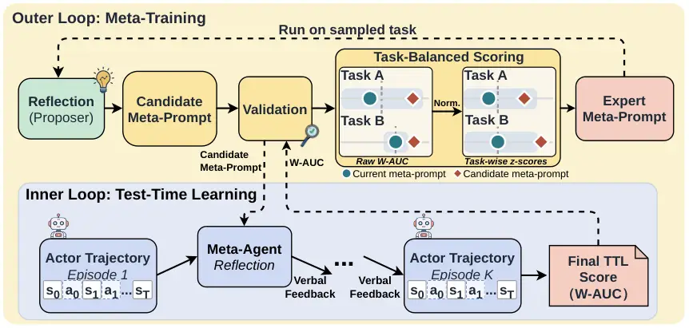

# Meta-TTL: Meta-Learning Self-Improvement Policies for Language Agents

Zhanzhi Lou Affiliation: National University of Singapore
Email: [hui.chen@nus.edu.sg](mailto:)    Hui Chen Affiliation: National
University of Singapore Email: [dcsbhk@nus.edu.sg](mailto:)    Yibo Li
Affiliation: National University of Singapore    Qian Wang
Affiliation: National University of Singapore    Bryan Hooi
Affiliation: National University of Singapore

###### Abstract

Test-Time Learning (TTL) enables language agents to iteratively refine
their performance through repeated interactions with the environment at
inference time. At the core of TTL is a self-improvement policy that
updates the actor policy based on experience from previous episodes,
thereby improving future behavior. Existing methods rely on hand-crafted
self-improvement policies rather than optimizing them for downstream
improvement. We argue that optimal self-improvement policies should be
learned from task environments, not hand-engineered based on human
intuition. To achieve this, we introduce Meta-TTL, a framework that
formulates the discovery of effective self-improvement policies as a
bi-level optimization problem. Within this framework, the inner loop
executes the standard TTL process, measuring how effectively a candidate
self-improvement policy helps an agent correct errors across sequential
episodes. Guided by the agent’s performance, the outer loop performs
reflective meta-training across diverse training tasks, using a balanced
improvement score (BIS) to balance task contributions during candidate
selection. We evaluate Meta-TTL on Jericho, WebArena-Lite, and
$`\tau^{2}`$-bench across both in-distribution (ID) and
out-of-distribution (OOD) settings. Meta-TTL consistently outperforms
existing baselines, improving TTL over the strongest baseline by up to
23% on ID tasks and 27% on OOD tasks. These results suggest that the
optimized self-improvement policy encodes transferable meta-strategies
that generalize beyond the training task distribution. Code is available
at
[https://github.com/zzzlou/meta-ttl](https://github.com/zzzlou/meta-ttl).

|     |
| --- |
|     |

## 1 Introduction

Figure 1: Self-improvement policies determine how the agent uses
experience up to episode $`k`$ to update the actor before episode
$`k+1`$. Existing methods use a hand-crafted self-improvement policy,
whereas Meta-TTL learns it offline across tasks and applies it at test
time.

Large Language Model (LLM) agents have demonstrated strong zero-shot
capabilities across a wide range of tasks. In practice, however, agents
deployed in novel environments often struggle to adapt on the fly (Gao
et al., 2026; Fang et al., 2025). Consider a human player encountering
an unfamiliar video game: they fail, diagnose what went wrong, adjust
their strategy, and try again, often improving with each iteration. This
capacity for Test-Time Learning (TTL), the ability to accumulate
experience over repeated interactions and achieve progressively better
performance (Wu et al., 2024; He et al., 2025; Wei et al., 2025),
remains limited in current LLM agents. Without parameter updates or
ground-truth supervision, they often treat every episode as an
independent zero-shot trial, repeating the same errors regardless of how
many attempts they are given (Jiang et al., 2026a).

At the core of TTL is a _self-improvement policy_ that updates the actor
policy based on accumulated experience. Unlike the actor policy, which
determines the agent’s behavior within an episode, the self-improvement
policy determines how the actor policy evolves across episodes. However,
most existing methods, such as Reflexion (Shinn et al., 2023), perform
self-improvement by relying purely on the pretrained capabilities of the
underlying LLM. Fundamentally, the self-improvement policy serves as a
learning algorithm: it maps past experience to future behavioral
improvement. Such capabilities require dedicated optimization (Thrun and
Pratt, 1998; Minsky, 1995) that general-purpose language modeling does
not provide (Radford et al., 2019; Li et al., 2024; Brown et al., 2020).

In this work, we take the view that effective test-time self-improvement
is itself a learnable capability rather than a byproduct of a
general-purpose LLM (Liu and van der Schaar, 2025). Instead of
hand-engineering the agent’s cross-episode self-improvement policy, we
seek to learn it from task environments by optimizing it for downstream
improvement at test time.

To this end, we propose Meta-TTL, a framework that treats learning to
perform TTL effectively as a meta-learning problem: given a distribution
of training tasks, we formulate the discovery of effective
self-improvement policies as a bi-level optimization. Concretely, this
bi-level structure consists of an inner TTL loop and an outer
meta-training loop. In the inner loop, an LLM agent interacts with the
environment over a series of episodes and adapts based on prior
attempts, measuring how well a candidate self-improvement policy
$`\phi`$ helps the agent improve across episodes. In the outer loop, we
optimize $`\phi`$ over a distribution of training tasks through
reflective meta-training: we iteratively refine candidate policies,
evaluate them through the inner loop, and retain those that produce
stronger TTL performance. At test time, the learned self-improvement
policy is frozen and applied to unseen tasks.

A key distinction from prior work lies in what is being optimized
(Figure 1). Existing TTL methods treat the self-improvement policy (how
the actor policy is updated between episodes) as a hand-designed
component, and focus on improving the actor’s behavior within a single
task session through ad-hoc verbal feedback (Shinn et al., 2023; Madaan
et al., 2023) or memory accumulation (Packer et al., 2024; Xu et al.,
2025). We instead treat the self-improvement policy itself as the object
of optimization: Meta-TTL learns how an agent should improve across
episodes from a distribution of training tasks, and deploys the
resulting self-improvement policy at test time.

Our contributions are as follows:

- •
  We formulate learning an effective self-improvement policy for TTL as
  a meta-learning problem, providing a principled framework for
  optimizing how agents improve themselves across episodes.
- •
  We propose Meta-TTL, which learns a self-improvement policy across a
  distribution of training tasks through reflective meta-training and
  deploys it on unseen tasks. The learned policy is instantiated as a
  natural-language meta-prompt.
- •
  We evaluate Meta-TTL on three language-based sequential
  decision-making benchmarks. Meta-TTL achieves the highest average
  W-AUC on every benchmark in both ID and OOD settings, improving over
  the strongest baseline by 10–23% on ID tasks and 5–27% on OOD tasks.

## 2 Related Work

#### Test-Time Learning

Test-Time Learning (TTL) improves agents after deployment by learning
from their own experience (Jiang et al., 2026a). Gradient-based methods
update model weights at test time via fine-tuning (Akyürek et al., 2025;
Acikgoz et al., 2025; Zweiger et al., 2025; Ye et al., 2026) or
reinforcement learning (Zuo et al., 2025; Yuksekgonul et al., 2026).
Weight-frozen methods instead adapt through external state. Some
accumulate experience through verbal reflection (Shinn et al., 2023;
Madaan et al., 2023), memory (Wang et al., 2024; Wei et al., 2025;
Chhikara et al., 2025; Suzgun et al., 2025; Zhou et al., 2025; Xu et
al., 2025), or insights and rules distilled from experience (Zhao et
al., 2024; Majumder et al., 2023; Chen et al., 2026a; Zhang et al.,
2025). Others search over prompts using LLM proposals (Zhou et al.,
2023; Yang et al., 2024), evolutionary search (Fernando et al., 2023;
Guo et al., 2025; Ye et al., 2024), or natural-language feedback
(Yuksekgonul et al., 2024; Gupta et al., 2024; Zhang et al., 2026). This
line of work has been further extended to compound AI systems and
scientific discovery (Agrawal et al., 2026; Novikov et al., 2025; Liu et
al., 2026) and to evolving the entire agent configuration (He et al.,
2025). In all of these methods, however, the goal is to _improve
task-specific behavior_ under a hand-crafted self-improvement policy,
whereas Meta-TTL aims to _learn the self-improvement policy itself_ from
a distribution of training tasks.

#### Meta-Learning

Meta-learning seeks to extract transferable knowledge from a task
distribution so that a learner can adapt efficiently to new tasks (Thrun
and Pratt, 1998; Hospedales et al., 2021). In the context of LLMs,
in-context learning (Dong et al., 2024) has been viewed as a form of
black-box meta-learning, where adaptation arises through context
conditioning rather than weight updates (Brown et al., 2020; Dherin et
al., 2025). Earlier work such as STaR (Zelikman et al., 2022) and SCoRe
(Kumar et al., 2024) explicitly optimizes self-improvement through
self-generated rationales or RL-based self-correction, but does not
learn cross-episode self-improvement policies for sequential
environments. Several concurrent works train self-improvement
capabilities via RL: LAMER (Jiang et al., 2026b) meta-trains exploration
strategies, MR-Search (Xiao et al., 2026) learns cross-episode
self-reflection, and LSE (Chen et al., 2026b) trains a prompt-editing
policy with a single-step objective. All three require fine-tuning model
weights via policy gradients. In contrast, our framework operates
entirely in prompt space through gradient-free search, yielding an
interpretable text artifact.

## 3 Methodology

We present Meta-TTL, a bi-level framework for learning a
self-improvement policy for test-time learning in language agents. As
shown in Figure 2, Meta-TTL couples an inner TTL loop with an outer
meta-training loop. The inner loop adapts the actor across episodes by
rewriting its system prompt, while the outer loop improves the
meta-prompt by proposing candidates from rollouts and retaining the
candidate only if it improves on validation tasks.



Figure 2: Overview of Meta-TTL. Outer loop (meta-training): A proposer
reflects on a TTL session generated by the current expert meta-prompt to
propose a candidate meta-prompt. The candidate is evaluated across
validation tasks and replaces the expert if its balanced improvement
score (BIS) is positive. Inner loop (test-time learning): Given a
meta-prompt, the meta-agent generates verbal feedback from the actor’s
trajectories to rewrite its system prompt between episodes. The
resulting TTL session is scored using W-AUC.

### 3.1 Test-Time Learning Formulation

We model each task instance $`g`$ as a finite-horizon Partially
Observable Markov Decision Process (POMDP),

```math
\mathcal{M}_{g}=(\mathcal{S},\mathcal{A},\mathcal{T},\Omega,\mathcal{R},H),
```

where $`\mathcal{S}`$ is the latent state space, $`\mathcal{A}`$ is the
action space, $`\mathcal{T}`$ is the transition kernel, $`\Omega`$ is
the observation space, $`\mathcal{R}`$ is the task-specific reward
function, and $`H`$ is the episode horizon. Here, $`g`$ denotes a single
task instance, such as one Jericho game or one WebArena task.

A TTL session on task $`g`$ consists of $`K`$ consecutive episodes,
denoted by $`\xi_{g}=(\tau_{1},\tau_{2},\dots,\tau_{K})`$. After each
episode, the environment resets to its initial state, so improvement
across the session must come from adaptation in the agent rather than
from environmental state continuity. We score a session using Weighted
Area Under the Learning Curve (W-AUC): To distinguish improving from
declining performance that uniform averaging would treat equally, we
assign greater weight to later episodes. We adopt linear weights,
$`w_{k}=k`$, motivated by the approximately linear accumulation of
experience available to the meta-agent:

```math
\text{W-AUC}(\xi_{g})=\frac{\sum_{k=1}^{K}w_{k}\cdot J(\tau_{k})}{\sum_{k=1}^{K}w_{k}\cdot J_{\max}(g)},\quad w_{k}=k \tag{1}
```

where $`\tau_{k}`$ is the trajectory of episode $`k`$, $`J(\tau_{k})`$
is its reward, and $`J_{\max}(g)`$ is the maximum achievable return for
task $`g`$.

### 3.2 Learnable Self-Improvement Policies

In a TTL session, two distinct policies interact. The actor policy
$`\pi`$ determines behavior within a single episode, selecting actions
given the current observation. The self-improvement policy $`f`$
operates at a higher level: after each episode, it observes the
accumulated experience and produces an updated actor policy for the next
attempt. That is,

```math
\pi_{k+1}=f(\pi_{k},\mathcal{H}_{k}), \tag{2}
```

where $`\mathcal{H}_{k}=\{\tau_{1},\dots,\tau_{k}\}`$ is the trajectory
history up to episode $`k`$. Existing TTL methods typically hand-design
$`f`$ (e.g., a fixed reflection prompt, carefully designed memory
system). Our goal is to learn $`f`$ from a distribution of training
tasks.

In general, an LLM-based actor policy is jointly determined by its
weights $`\theta`$ and its prompt $`c`$. The self-improvement policy can
therefore operate along two axes: modifying $`\theta`$ (gradient-based
adaptation) or modifying $`c`$ (prompt-based adaptation). We focus on
the prompt-based instantiation, where $`\theta`$ is frozen and all
behavioral change is mediated through system prompt rewriting. This
avoids gradient computation at test time and makes adaptation
lightweight.

Actor. A frozen LLM $`\pi_{\theta}`$ interacts with the environment. We
designate its system prompt $`\rho`$ as the modifiable component of the
context: in episode $`k`$, the actor executes
$`\tau_{k}\sim\pi_{\theta}(\cdot\mid\rho_{k})`$. Since $`\theta`$ is
fixed, updating $`\rho`$ is the sole mechanism for changing the actor’s
behavior across episodes.

Meta-Agent. We instantiate the self-improvement policy $`f`$ as a
separate LLM governed by a meta-prompt $`\phi`$. After episode $`k`$,
the meta-agent observes the trajectory history $`\mathcal{H}_{k}`$ and
generates the updated system prompt:

```math
\rho_{k+1}\sim f_{\phi}(\cdot\mid\rho_{k},\mathcal{H}_{k}) \tag{3}
```

The meta-prompt $`\phi`$ serves as the self-improvement policy: it
determines what aspects of past experience the meta-agent attends to,
how it diagnoses failures, and what form of guidance it produces. The
learnable component is therefore $`\phi`$. Rather than hand-crafting it
or relying on fixed heuristics, we optimize it through meta-training
(§3.3).

### 3.3 Reflective Meta-Training

The goal of meta-training is to find a meta-prompt $`\phi^{*}`$ that
maximizes expected TTL performance on the training tasks:

```math
\displaystyle\phi^{*}=\operatorname*{argmax}_{\phi}\mathbb{E}_{g\sim\mathcal{D}_{\text{train}}}\left[\text{W-AUC}(\xi_{g}^{\phi})\right]. \tag{4}
```

where $`\xi_{g}^{\phi}`$ denotes the TTL session on task $`g`$ run with
meta-prompt $`\phi`$.

#### Overview

As shown in the outer loop of Figure 2, meta-training maintains a single
expert meta-prompt $`\phi^{\star}`$, initialized from the seed
meta-prompt $`\phi_{0}`$. At each iteration, we sample a task from the
train set and run it using $`\phi^{\star}`$ to produce a full TTL
session. A reflection module then reflects on the resulting TTL session
to propose a revised meta-prompt candidate $`\tilde{\phi}`$, which is
compared against the current expert meta-prompt over the validation set.
The candidate replaces $`\phi^{\star}`$ if its balanced improvement
score (defined below) is positive.

Two-Stage Reflection. Given a TTL session $`\xi_{g}`$ generated under
the current meta-prompt $`\phi^{\star}`$, the first stage extracts
task-specific facts $`F_{g}`$ from the session trajectory. In the second
stage, the reflection model uses these facts alongside $`\xi_{g}`$ and
$`\phi^{\star}`$ to identify issues in the meta-agent’s self-improvement
strategy and produce a revised meta-prompt $`\tilde{\phi}`$.

Validation. Each proposed meta-prompt is evaluated on a set of
validation tasks by running TTL sessions using a meta agent, whose
guiding-behavior is governed by the meta-prompt. For every validation
task $`h\in\mathcal{D}_{\mathrm{val}}`$, the corresponding validation
score of a meta-prompt candidate $`\phi`$ is:

```math
\displaystyle s_{h}^{\phi} \displaystyle=\mathrm{W\text{-}AUC}(\xi_{h}^{\phi}) \tag{5}
```

Task-Balanced Scoring and Selection. Although W-AUC normalizes each
task’s returns by its maximum achievable reward, some tasks can still be
intrinsically easier to improve than others. A change in meta-prompt may
thus produce a much larger W-AUC difference on these tasks, giving them
disproportionate influence if scores are directly averaged across tasks.
To mitigate this imbalance, we define a balanced improvement score (BIS)
by normalizing each task’s W-AUC against its score history
$`\mathcal{H}_{h,t}`$ and averaging the candidate’s normalized gains
over the current expert across tasks:

```math
\displaystyle z_{h,t}^{\phi} \displaystyle=\frac{s_{h}^{\phi}-\mu(\mathcal{H}_{h,t})}{\sigma(\mathcal{H}_{h,t})}, \tag{6}
```

```math
\displaystyle\mathrm{BIS}_{t}(\tilde{\phi},\phi^{\star}) \displaystyle=\frac{1}{|\mathcal{D}_{\mathrm{val}}|}\sum_{h\in\mathcal{D}_{\mathrm{val}}}\left(z_{h,t}^{\tilde{\phi}}-z_{h,t}^{\phi^{\star}}\right). \tag{7}
```

Both meta-prompts are normalized using the same history of scores. The
candidate $`\tilde{\phi}`$ replaces the current expert $`\phi^{\star}`$
only if $`\mathrm{BIS}_{t}(\tilde{\phi},\phi^{\star})>0`$. More details
can be found in Appendix C

### 3.4 Evaluation

After offline meta-training, we freeze the learned meta-prompt
$`\phi^{\star}`$ and evaluate it on in-distribution (ID) and
out-of-distribution (OOD) tasks. ID and OOD are defined relative to
meta-training: ID tasks come from domains used during meta-training,
whereas OOD tasks come from held-out domains. For WebArena-Lite and
$`\tau^{2}`$-bench, ID evaluation uses held-out task instances within
the seen domains. For Jericho, where each game is a single task, ID
evaluation uses the meta-training games. Within each evaluation task,
the meta-agent uses the fixed $`\phi^{\star}`$ to update the actor’s
prompt between episodes.

## 4 Experiments

### 4.1 Experimental Setup

Benchmarks. We evaluate Meta-TTL on three benchmarks: Jericho
(Hausknecht et al., 2020), a suite of interactive fiction games;
WebArena-Lite (Zhou et al., 2024), a web-navigation benchmark; and
$`\tau^{2}`$-bench (Barres et al., 2025), a realistic customer-service
benchmark involving conversational tool use. For Jericho, Detective,
Zork 1, and Temple are used for meta-training and ID evaluation, while
Balances, Library, and Zork 3 are held out for OOD evaluation. For
WebArena-Lite, Shopping, GitLab, and Map are ID domains, whose tasks are
split into training, validation, and evaluation sets; Reddit and
Shopping Admin are OOD domains. For $`\tau^{2}`$-bench, Airline and
Retail are ID domains, and Telecom is OOD. Each TTL session contains six
episodes on Jericho and three on WebArena-Lite and $`\tau^{2}`$-bench.

Models and Baselines. All main experiments use a frozen Gemini-3-Flash
actor. We compare against Static as a non-learning baseline; Reflexion
(Shinn et al., 2023), a Memory Agent (He et al., 2025) that retains
cross-episode histories, and AWM (Wang et al., 2024) as reflection- and
memory-based methods; and TextGrad (Yuksekgonul et al., 2024), EvoPrompt
(Guo et al., 2025), and EvoTest (He et al., 2025) as prompt- and
configuration-optimization methods. Methods that use a separate LLM to
update the actor between episodes (the _adaptation LLM_, corresponding
to the meta-agent in Meta-TTL) use GPT-5, the same model as Meta-TTL’s
meta-agent. We also include a Naive meta-agent that shares the same
architecture and models of Meta-TTL but uses an unoptimized
self-improvement policy. We report two metrics for each TTL session:
Average Score, the mean score across episodes, and W-AUC (Eq. 1).
Results with additional model backbones are reported in Appendix D.

|                                             |                         |         |        |            |                    |         |        |           |
| ------------------------------------------- | ----------------------- | ------- | ------ | ---------- | ------------------ | ------- | ------ | --------- |
| Method                                      | Avg. Score $`\uparrow`$ |         |        |            | W-AUC $`\uparrow`$ |         |        |           |
| ID                                          | Detective               | Zork 1  | Temple | Avg.       | Detective          | Zork 1  | Temple | Avg.      |
| Non-Learning Baseline                       |                         |         |        |            |                    |         |        |           |
| Static                                      | 122.00                  | 39.83   | 5.00   | 55.61      | 0.328              | 0.114   | 0.143  | 0.195     |
| Reflection- & Memory-Based Methods          |                         |         |        |            |                    |         |        |           |
| Reflexion                                   | 101.33                  | 41.47   | 4.03   | 48.94      | 0.288              | 0.120   | 0.113  | 0.173     |
| Memory Agent                                | 102.00                  | 44.57   | 5.00   | 50.52      | 0.268              | 0.132   | 0.143  | 0.181     |
| AWM                                         | 148.33                  | 44.93   | 5.80   | 66.36      | 0.441              | 0.132   | 0.172  | 0.249     |
| Prompt & Configuration Optimization Methods |                         |         |        |            |                    |         |        |           |
| TextGrad                                    | 88.67                   | 40.40   | 5.27   | 44.78      | 0.218              | 0.108   | 0.140  | 0.156     |
| EvoPrompt                                   | 108.33                  | 45.27   | 5.77   | 53.12      | 0.299              | 0.128   | 0.161  | 0.196     |
| EvoTest                                     | 205.33                  | 48.03   | 7.03   | 86.80      | 0.628              | 0.139   | 0.202  | 0.323     |
| Naive Meta-Agent                            | 114.00                  | 44.30   | 6.73   | 55.01      | 0.327              | 0.129   | 0.189  | 0.215     |
| Meta-TTL                                    | 252.67                  | 50.33   | 8.23   | 103.74+20% | 0.790              | 0.150   | 0.248  | 0.396+23% |
| OOD                                         | Balances                | Library | Zork 3 | Avg.       | Balances           | Library | Zork 3 | Avg.      |
| Non-Learning Baseline                       |                         |         |        |            |                    |         |        |           |
| Static                                      | 7.33                    | 5.50    | 2.50   | 5.11       | 0.142              | 0.184   | 0.356  | 0.228     |
| Reflection- & Memory-Based Methods          |                         |         |        |            |                    |         |        |           |
| Reflexion                                   | 7.17                    | 8.13    | 1.97   | 5.76       | 0.141              | 0.313   | 0.268  | 0.241     |
| Memory Agent                                | 8.50                    | 7.47    | 1.77   | 5.91       | 0.172              | 0.283   | 0.219  | 0.224     |
| AWM                                         | 8.50                    | 8.87    | 2.67   | 6.68       | 0.170              | 0.329   | 0.381  | 0.293     |
| Prompt & Configuration Optimization Methods |                         |         |        |            |                    |         |        |           |
| TextGrad                                    | 8.67                    | 10.87   | 1.83   | 7.12       | 0.164              | 0.347   | 0.244  | 0.252     |
| EvoPrompt                                   | 9.33                    | 12.17   | 2.47   | 7.99       | 0.184              | 0.396   | 0.351  | 0.310     |
| EvoTest                                     | 9.67                    | 10.30   | 2.87   | 7.61       | 0.197              | 0.355   | 0.423  | 0.325     |
| Naive Meta-Agent                            | 10.00                   | 11.97   | 1.73   | 7.90       | 0.200              | 0.409   | 0.248  | 0.286     |
| Meta-TTL                                    | 13.67                   | 15.30   | 2.87   | 10.61+33%  | 0.292              | 0.522   | 0.427  | 0.414+27% |

Table 1: Jericho Results. Top: ID games used for meta-training; bottom:
OOD games unseen during meta-training. All methods use a frozen
Gemini-3-Flash actor. Methods requiring a separate adaptation LLM use
GPT-5. Each result is averaged over five repeated runs. Best results are
in bold and second-best results are underlined. Green subscripts show
the relative improvement of Meta-TTL’s average over the strongest
baseline.

|                                             |                         |                |          |          |                    |                |          |           |
| ------------------------------------------- | ----------------------- | -------------- | -------- | -------- | ------------------ | -------------- | -------- | --------- |
| Method                                      | Avg. Score $`\uparrow`$ |                |          |          | W-AUC $`\uparrow`$ |                |          |           |
| ID                                          | GitLab                  | Map            | Shopping | Avg.     | GitLab             | Map            | Shopping | Avg.      |
| Non-Learning Baseline                       |                         |                |          |          |                    |                |          |           |
| Static                                      | 0.811                   | 0.322          | 0.533    | 0.556    | 0.817              | 0.328          | 0.544    | 0.563     |
| Reflection- & Memory-Based Methods          |                         |                |          |          |                    |                |          |           |
| Reflexion                                   | 0.822                   | 0.344          | 0.511    | 0.559    | 0.856              | 0.356          | 0.528    | 0.580     |
| Memory Agent                                | 0.822                   | 0.378          | 0.611    | 0.604    | 0.828              | 0.383          | 0.644    | 0.619     |
| AWM                                         | 0.867                   | 0.333          | 0.433    | 0.544    | 0.883              | 0.344          | 0.444    | 0.557     |
| Prompt & Configuration Optimization Methods |                         |                |          |          |                    |                |          |           |
| TextGrad                                    | 0.800                   | 0.356          | 0.567    | 0.574    | 0.800              | 0.378          | 0.589    | 0.589     |
| EvoPrompt                                   | 0.833                   | 0.311          | 0.522    | 0.556    | 0.844              | 0.317          | 0.550    | 0.570     |
| EvoTest                                     | 0.867                   | 0.378          | 0.522    | 0.589    | 0.867              | 0.394          | 0.539    | 0.600     |
| Naive Meta-Agent                            | 0.778                   | 0.356          | 0.500    | 0.545    | 0.806              | 0.383          | 0.511    | 0.567     |
| Meta-TTL                                    | 0.878                   | 0.444          | 0.644    | 0.656+9% | 0.883              | 0.483          | 0.711    | 0.693+12% |
| OOD                                         | Reddit                  | Shopping Admin |          | Avg.     | Reddit             | Shopping Admin |          | Avg.      |
| Non-Learning Baseline                       |                         |                |          |          |                    |                |          |           |
| Static                                      | 0.655                   | 0.716          |          | 0.685    | 0.664              | 0.724          |          | 0.694     |
| Reflection- & Memory-Based Methods          |                         |                |          |          |                    |                |          |           |
| Reflexion                                   | 0.678                   | 0.733          |          | 0.706    | 0.684              | 0.744          |          | 0.714     |
| Memory Agent                                | 0.643                   | 0.738          |          | 0.691    | 0.646              | 0.742          |          | 0.694     |
| AWM                                         | 0.696                   | 0.720          |          | 0.708    | 0.705              | 0.731          |          | 0.718     |
| Prompt & Configuration Optimization Methods |                         |                |          |          |                    |                |          |           |
| TextGrad                                    | 0.702                   | 0.729          |          | 0.715    | 0.719              | 0.737          |          | 0.728     |
| EvoPrompt                                   | 0.684                   | 0.738          |          | 0.711    | 0.684              | 0.742          |          | 0.713     |
| EvoTest                                     | 0.678                   | 0.733          |          | 0.706    | 0.690              | 0.749          |          | 0.719     |
| Naive Meta-Agent                            | 0.708                   | 0.702          |          | 0.705    | 0.719              | 0.724          |          | 0.722     |
| Meta-TTL                                    | 0.754                   | 0.747          |          | 0.751+5% | 0.772              | 0.760          |          | 0.766+5%  |

Table 2: WebArena-Lite Results. Top: ID domains used for meta-training;
bottom: OOD domains unseen during meta-training. All methods use a
frozen Gemini-3-Flash actor. Methods requiring a separate adaptation LLM
use GPT-5. Each result is averaged over three repeated runs. Best
results are in bold and second-best results are underlined. Green
subscripts show the relative improvement of Meta-TTL’s average over the
strongest baseline.

### 4.2 Main Results

Figure 3: Per-episode normalized score on Jericho, averaged over ID and
OOD games. Meta-TTL shows the largest improvement over the session.
Shading denotes the standard error over five runs.

Meta-TTL consistently improves test-time learning across all three
benchmarks. Under matched model backbones, Meta-TTL achieves the highest
average W-AUC on the ID tasks of all three benchmarks (Tables 1, 2,
and 3), improving over the strongest baseline by 23% on Jericho, 12% on
WebArena-Lite, and over 10% on both the Airline and Retail domains of
$`\tau^{2}`$-bench. These gains show that the benefit of Meta-TTL
extends beyond text games to web navigation and conversational tool-use.
The learned self-improvement policy also generalizes to
out-of-distribution tasks, achieving the highest W-AUC on OOD games and
domains, including unseen websites in WebArena-Lite and the Telecom
domain of $`\tau^{2}`$-bench (Tables 1, 2, and 3). As shown in Figure 3,
Meta-TTL’s advantage on Jericho grows over the session, with the largest
improvement across episodes on both ID and OOD games. Together, these
results indicate that Meta-TTL’s meta-learned self-improvement policy
achieves better test-time learning performance than hand-designed
heuristic methods, and that it transfers beyond the training tasks. We
analyze what the learned policies encode and why they help in
Section 4.4.

|                                             |                         |        |               |                    |           |               |
| ------------------------------------------- | ----------------------- | ------ | ------------- | ------------------ | --------- | ------------- |
|                                             | Avg. Score $`\uparrow`$ |        |               | W-AUC $`\uparrow`$ |           |               |
| Method                                      | Airline                 | Retail | Telecom (OOD) | Airline            | Retail    | Telecom (OOD) |
| Non-Learning Baseline                       |                         |        |               |                    |           |               |
| Static                                      | 0.400                   | 0.450  | 0.281         | 0.450              | 0.425     | 0.272         |
| Reflection- & Memory-Based Methods          |                         |        |               |                    |           |               |
| Reflexion                                   | 0.567                   | 0.633  | 0.517         | 0.617              | 0.600     | 0.525         |
| Memory Agent                                | 0.500                   | 0.617  | 0.350         | 0.483              | 0.633     | 0.392         |
| AWM                                         | 0.467                   | 0.567  | 0.450         | 0.483              | 0.542     | 0.467         |
| Prompt & Configuration Optimization Methods |                         |        |               |                    |           |               |
| TextGrad                                    | 0.600                   | 0.567  | 0.354         | 0.650              | 0.608     | 0.365         |
| EvoPrompt                                   | 0.467                   | 0.550  | 0.278         | 0.483              | 0.550     | 0.269         |
| EvoTest                                     | 0.567                   | 0.583  | 0.370         | 0.567              | 0.617     | 0.417         |
| Naive Meta-Agent                            | 0.600                   | 0.533  | 0.400         | 0.633              | 0.558     | 0.433         |
| Meta-TTL                                    | 0.667                   | 0.633  | 0.533         | 0.717+10%          | 0.700+11% | 0.583+11%     |

Table 3: $`\tau^{2}`$-bench Results. ID results on Airline and Retail,
and OOD results on Telecom with the meta-prompt frozen. All methods use
a frozen Gemini-3-Flash actor. Methods requiring a separate adaptation
LLM use GPT-5. Best results are in bold and second-best results are
underlined. Green subscripts show the relative W-AUC improvement of
Meta-TTL over the strongest baseline.

| Method      | ID        |        |        |       | OOD      |         |        |       |
| ----------- | --------- | ------ | ------ | ----- | -------- | ------- | ------ | ----- |
|             | Detective | Zork 1 | Temple | Avg.  | Balances | Library | Zork 3 | Avg.  |
| Static      | 0.162     | 0.019  | 0.071  | 0.084 | 0.114    | 0.000   | 0.167  | 0.094 |
| Online GRPO | 0.139     | 0.014  | 0.200  | 0.118 | 0.147    | 0.194   | 0.000  | 0.114 |
| Online SFT  | 0.185     | 0.005  | 0.157  | 0.116 | 0.098    | 0.083   | 0.095  | 0.092 |
| SFT+MAML    | 0.185     | 0.038  | 0.143  | 0.122 | 0.065    | 0.000   | 0.405  | 0.157 |
| Meta-TTL    | 0.259     | 0.074  | 0.214  | 0.182 | 0.131    | 0.233   | 0.238  | 0.201 |

Table 4: Parameter-updating comparison on Jericho (W-AUC). Online SFT,
Online GRPO, and SFT+MAML update a single Qwen3-8B actor. Meta-TTL uses
a Qwen3-8B actor with a separate Qwen3-8B meta-agent that runs the
learned meta-policy from the main experiment.

#### Meta-TTL outperforms parameter-based TTL methods.

We compare Meta-TTL with Online SFT, Online GRPO (Shao et al., 2024; He
et al., 2025), and SFT+MAML (Finn et al., 2017; Nichol et al., 2018) on
Jericho. All methods use a Qwen3-8B LLM backbone (see Appendix E for
details). As shown in Table 4, Meta-TTL achieves the highest average
W-AUC in both ID and OOD settings and improves consistently over the
static actor on all six games. The parameter-updating methods yield
smaller average gains and are unstable across games, suggesting that
they struggle to learn reliably from only a few sparse-reward episodes.

### 4.3 Ablation Study

#### Reflective meta-training matches RL-based training with far fewer rollouts.

We provide a comparison between training the same Qwen3-4B meta-agent by
GRPO (Shao et al., 2024) and by Meta-TTL’s outer-loop, both using a
shared frozen Gemini-3-Flash actor. GRPO updates the meta-agent’s
weights, whereas our reflective meta-training updates its meta-prompt.
As shown in Table 5, the Meta-TTL outer loop matches or exceeds GRPO on
both ID and OOD averages while using far fewer rollouts (350 vs. 1,920).
Moreover, Meta-TTL’s outer loop is gradient-free and produces a readable
meta-prompt rather than model weights.

#### Meta-TTL’s outer loop outperforms GEPA.

We also compare with GEPA (Agrawal et al., 2026), a widely used
reflective prompt optimizer that maintains a Pareto frontier of
candidates across validation tasks. As shown in Table 5, GEPA performs
well on some ID games but transfers less effectively to OOD games. A
plausible explanation is that GEPA’s candidate-selection mechanism
preserves prompts specialized to individual tasks, which is not well
aligned with the meta-learning objective of finding a single
self-improvement policy that generalizes. This is also consistent with
our finding that the prompts produced by GEPA contain substantial
task-specific facts and solutions, which can benefit seen tasks but are
less useful on unseen ones. Full meta-prompts can be found in
Appendix A.

| Meta-Agent Training  | ID        |        |        |       | OOD      |         |        |       |
| -------------------- | --------- | ------ | ------ | ----- | -------- | ------- | ------ | ----- |
|                      | Detective | Zork 1 | Temple | Avg.  | Balances | Library | Zork 3 | Avg.  |
| Base (untrained)     | 0.198     | 0.110  | 0.129  | 0.146 | 0.105    | 0.217   | 0.181  | 0.168 |
| RL outer loop (GRPO) | 0.219     | 0.117  | 0.114  | 0.150 | 0.121    | 0.172   | 0.229  | 0.174 |
| GEPA outer loop      | 0.218     | 0.085  | 0.154  | 0.152 | 0.124    | 0.252   | 0.219  | 0.198 |
| Meta-TTL outer loop  | 0.235     | 0.127  | 0.129  | 0.164 | 0.150    | 0.300   | 0.247  | 0.232 |

Table 5: Comparison with RL-based meta-training on Jericho (W-AUC). All
rows share the same Gemini-3-Flash actor and Qwen3-4B meta-agent,
trained with 350 rollouts (Meta-TTL) vs. 1,920 (GRPO).

### 4.4 Analysis


Figure 4: Excerpts from the optimized meta-prompts, one per learned
strategy (full prompts in Appendix A).

#### Emergent self-improvement strategies.

Examining the meta-prompts learned by Meta-TTL (Figure 4), we find that
they share several recurring strategies. These include (i) meta-level
credit assignment: attributing a failure either to the actor not
following the guidance or to the guidance itself being wrong; (ii)
verified knowledge retention: retaining verified findings together with
the conditions under which they hold; (iii) bounded exploration:
preserving the best verified behavior while exploring only through small
changes. Collectively, these strategies describe how to learn from
previous attempts rather than how to solve any particular task,
suggesting that they operate at the meta level and target the TTL
process itself. Appendix B provides case studies of how these strategies
lead to improvement at test time.

#### Efficiency analysis.

_Test time._ As shown in Table 6, Meta-TTL’s test-time latency is
comparable to existing prompt-optimization baselines. It uses five
adaptation LLM calls per six-episode Jericho session, with total LLM
calls and token usage within the range of these baselines.
_Meta-training._ Meta-training incurs a one-time offline cost that
requires no GPU training. Across the three benchmarks, meta-training
runs for 12–15 iterations with 205–350 TTL sessions and about \$30–70 in
API cost per benchmark, depending on the benchmark and model backbone.
The learned meta-prompt is then applied to all test tasks without
further training.

| Method       | Wall-clock (s)     | Total LLM calls | Adaptation LLM calls | Tokens |
| ------------ | ------------------ | --------------- | -------------------- | ------ |
| Static       | $`593.2\pm 61.3`$  | 231.0           | 0                    | 196k   |
| Reflexion    | $`594.3\pm 69.6`$  | 218.0           | 0                    | 270k   |
| Memory Agent | $`710.1\pm 30.1`$  | 262.0           | 12                   | 311k   |
| AWM          | $`840.1\pm 27.2`$  | 255.7           | 5                    | 334k   |
| TextGrad     | $`1205.5\pm 7.9`$  | 264.0           | 30                   | 384k   |
| EvoPrompt    | $`1266.5\pm 29.4`$ | 447.0           | 5                    | 448k   |
| EvoTest      | $`759.1\pm 68.1`$  | 254.0           | 5                    | 181k   |
| Meta-TTL     | $`860.9\pm 66.2`$  | 204.0           | 5                    | 364k   |

Table 6: Inference efficiency comparison. Latency and LLM usage for
six-episode TTL sessions on Jericho. Numbers are averages over 3 runs.

## 5 Conclusion

This paper introduces Meta-TTL, a bi-level framework that learns
self-improvement policies for test-time learning in language agents
through reflective meta-training across tasks. We find that the learned
self-improvement policy consistently outperforms hand-crafted and
unoptimized baselines on Jericho, WebArena-Lite, and $`\tau^{2}`$-bench,
with gains extending to out-of-distribution tasks. These results suggest
that how agents self-improve from experience is itself a learnable
ability, and that test-time learning may benefit from meta-learning the
self-improvement procedure.

## References

- Acikgoz et al. (2025) E. C. Acikgoz, C. Qian, H. Ji, D. Hakkani-Tür,
  and G. Tur Self-improving llm agents at test-time. External Links:
  2510.07841, [Link](https://arxiv.org/abs/2510.07841) Cited by: §2.
- Agrawal et al. (2026) L. A. Agrawal, S. Tan, D. Soylu, N. Ziems, R.
  Khare, K. Opsahl-Ong, A. Singhvi, H. Shandilya, M. J. Ryan, M.
  Jiang, C. Potts, K. Sen, A. Dimakis, I. Stoica, D. Klein, M. Zaharia,
  and O. Khattab GEPA: reflective prompt evolution can outperform
  reinforcement learning. In The Fourteenth International Conference on
  Learning Representations, External Links:
  [Link](https://openreview.net/forum?id=RQm2KQTM5r) Cited by: §2, §4.3.
- Akyürek et al. (2025) E. Akyürek, M. Damani, A. Zweiger, L. Qiu, H.
  Guo, J. Pari, Y. Kim, and J. Andreas The surprising effectiveness of
  test-time training for few-shot learning. In Forty-second
  International Conference on Machine Learning, External Links:
  [Link](https://openreview.net/forum?id=asgBo3FNdg) Cited by: §2.
- Barres et al. (2025) V. Barres, H. Dong, S. Ray, X. Si, and K.
  Narasimhan $`\tau^{2}`$-Bench: evaluating conversational agents in a
  dual-control environment. External Links: 2506.07982,
  [Link](https://arxiv.org/abs/2506.07982) Cited by: §4.1.
- Brown et al. (2020) T. B. Brown, B. Mann, N. Ryder, M. Subbiah, J.
  Kaplan, P. Dhariwal, A. Neelakantan, P. Shyam, G. Sastry, A.
  Askell, S. Agarwal, A. Herbert-Voss, G. Krueger, T. Henighan, R.
  Child, A. Ramesh, D. M. Ziegler, J. Wu, C. Winter, C. Hesse, M.
  Chen, E. Sigler, M. Litwin, S. Gray, B. Chess, J. Clark, C. Berner, S.
  McCandlish, A. Radford, I. Sutskever, and D. Amodei Language models
  are few-shot learners. External Links: 2005.14165,
  [Link](https://arxiv.org/abs/2005.14165) Cited by: §1, §2.
- Chen et al. (2026a) A. Chen, Z. Liu, J. Zhang, A. Prabhakar, Z.
  Liu, S. Heinecke, S. Savarese, V. Zhong, and C. Xiong Grounded
  test-time adaptation for LLM agents. In The Fourteenth International
  Conference on Learning Representations, External Links:
  [Link](https://openreview.net/forum?id=OH4PE0TDo0) Cited by: §2.
- Chen et al. (2026b) X. Chen, C. Xu, Y. Wang, B. Liu, Z. Yao, and Y. He
  Learning to self-evolve. External Links: 2603.18620,
  [Link](https://arxiv.org/abs/2603.18620) Cited by: §2.
- Chhikara et al. (2025) P. Chhikara, D. Khant, S. Aryan, T. Singh,
  and D. Yadav Mem0: building production-ready ai agents with scalable
  long-term memory. External Links: 2504.19413,
  [Link](https://arxiv.org/abs/2504.19413) Cited by: §2.
- Dherin et al. (2025) B. Dherin, M. Munn, H. Mazzawi, M. Wunder, and J.
  Gonzalvo Learning without training: the implicit dynamics of
  in-context learning. External Links: 2507.16003,
  [Link](https://arxiv.org/abs/2507.16003) Cited by: §2.
- Dong et al. (2024) Q. Dong, L. Li, D. Dai, C. Zheng, J. Ma, R. Li, H.
  Xia, J. Xu, Z. Wu, T. Liu, B. Chang, X. Sun, L. Li, and Z. Sui A
  survey on in-context learning. External Links: 2301.00234,
  [Link](https://arxiv.org/abs/2301.00234) Cited by: §2.
- Fang et al. (2025) J. Fang, Y. Peng, X. Zhang, Y. Wang, X. Yi, G.
  Zhang, Y. Xu, B. Wu, S. Liu, Z. Li, Z. Ren, N. Aletras, X. Wang, H.
  Zhou, and Z. Meng A comprehensive survey of self-evolving ai agents: a
  new paradigm bridging foundation models and lifelong agentic systems.
  External Links: 2508.07407, [Link](https://arxiv.org/abs/2508.07407)
  Cited by: §1.
- Fernando et al. (2023) C. Fernando, D. Banarse, H. Michalewski, S.
  Osindero, and T. Rocktäschel Promptbreeder: self-referential
  self-improvement via prompt evolution. External Links: 2309.16797,
  [Link](https://arxiv.org/abs/2309.16797) Cited by: §2.
- Finn et al. (2017) C. Finn, P. Abbeel, and S. Levine Model-agnostic
  meta-learning for fast adaptation of deep networks. External Links:
  1703.03400, [Link](https://arxiv.org/abs/1703.03400) Cited by:
  Appendix E, §4.2.
- Gao et al. (2026) H. Gao, J. Geng, W. Hua, M. Hu, X. Juan, H. Liu, S.
  Liu, J. Qiu, X. Qi, Y. Wu, H. Wang, H. Xiao, Y. Zhou, S. Zhang, J.
  Zhang, J. Xiang, Y. Fang, Q. Zhao, D. Liu, Q. Ren, C. Qian, Z.
  Wang, M. Hu, H. Wang, Q. Wu, H. Ji, and M. Wang A survey of
  self-evolving agents: what, when, how, and where to evolve on the path
  to artificial super intelligence. External Links: 2507.21046,
  [Link](https://arxiv.org/abs/2507.21046) Cited by: §1.
- Guo et al. (2025) Q. Guo, R. Wang, J. Guo, B. Li, K. Song, X. Tan, G.
  Liu, J. Bian, and Y. Yang EvoPrompt: connecting llms with evolutionary
  algorithms yields powerful prompt optimizers. External Links:
  2309.08532, [Link](https://arxiv.org/abs/2309.08532) Cited by: §2,
  §4.1.
- Gupta et al. (2024) P. Gupta, S. Kirtania, A. Singha, S. Gulwani, A.
  Radhakrishna, S. Shi, and G. Soares MetaReflection: learning
  instructions for language agents using past reflections. External
  Links: 2405.13009, [Link](https://arxiv.org/abs/2405.13009) Cited by:
  §2.
- Hausknecht et al. (2020) M. Hausknecht, P. Ammanabrolu, M. Côté,
  and X. Yuan Interactive fiction games: a colossal adventure. External
  Links: 1909.05398, [Link](https://arxiv.org/abs/1909.05398) Cited by:
  §4.1.
- He et al. (2025) Y. He, J. Liu, Y. Liu, Y. Li, T. Cao, Z. Hu, X. Xu,
  and B. Hooi EvoTest: evolutionary test-time learning for
  self-improving agentic systems. External Links: 2510.13220,
  [Link](https://arxiv.org/abs/2510.13220) Cited by: §1, §2, §4.1, §4.2.
- Hospedales et al. (2021) T. Hospedales, A. Antoniou, P. Micaelli,
  and A. Storkey Meta-learning in neural networks: a survey. IEEE
  transactions on pattern analysis and machine intelligence 44 (9),
  pp. 5149–5169. Cited by: §2.
- Hu et al. (2021) E. J. Hu, Y. Shen, P. Wallis, Z. Allen-Zhu, Y. Li, S.
  Wang, L. Wang, and W. Chen LoRA: low-rank adaptation of large language
  models. External Links: 2106.09685,
  [Link](https://arxiv.org/abs/2106.09685) Cited by: Appendix E.
- Jiang et al. (2026a) P. Jiang, J. Lin, Z. Shi, Z. Wang, L. He, Y.
  Wu, M. Zhong, P. Song, Q. Zhang, H. Wang, X. Xu, H. Xu, P. Han, D.
  Zhang, J. Sun, C. Yang, K. Qian, T. Wang, C. Hu, M. Li, Q. Li, H.
  Peng, S. Wang, J. Shang, C. Zhang, J. You, L. Liu, P. Lu, Y. Zhang, H.
  Ji, Y. Choi, D. Song, J. Sun, and J. Han Adaptation of agentic ai: a
  survey of post-training, memory, and skills. External Links:
  2512.16301, [Link](https://arxiv.org/abs/2512.16301) Cited by: §1, §2.
- Jiang et al. (2026b) Y. Jiang, L. Jiang, D. Teney, M. Moor, and M.
  Brbic Meta-rl induces exploration in language agents. External Links:
  2512.16848, [Link](https://arxiv.org/abs/2512.16848) Cited by: §2.
- Kumar et al. (2024) A. Kumar, V. Zhuang, R. Agarwal, Y. Su, J. D.
  Co-Reyes, A. Singh, K. Baumli, S. Iqbal, C. Bishop, R. Roelofs, et al.
  Training language models to self-correct via reinforcement learning.
  In The Thirteenth International Conference on Learning
  Representations, Cited by: §2.
- Li et al. (2024) Y. Li, C. Yang, and A. Ettinger When hindsight is not
  20/20: testing limits on reflective thinking in large language models.
  External Links: 2404.09129, [Link](https://arxiv.org/abs/2404.09129)
  Cited by: §1.
- Liu et al. (2026) S. Liu, S. Agarwal, M. Maheswaran, M. Cemri, Z.
  Li, Q. Mang, A. Naren, E. Boneh, A. Cheng, M. Z. Pan, A. Du, K.
  Keutzer, A. Cheung, A. G. Dimakis, K. Sen, M. Zaharia, and I. Stoica
  EvoX: meta-evolution for automated discovery. External Links:
  2602.23413, [Link](https://arxiv.org/abs/2602.23413) Cited by: §2.
- Liu and van der Schaar (2025) T. Liu and M. van der Schaar Position:
  truly self-improving agents require intrinsic metacognitive learning.
  In Forty-second International Conference on Machine Learning Position
  Paper Track, External Links:
  [Link](https://openreview.net/forum?id=4KhDd0Ozqe) Cited by: §1.
- Madaan et al. (2023) A. Madaan, N. Tandon, P. Gupta, S. Hallinan, L.
  Gao, S. Wiegreffe, U. Alon, N. Dziri, S. Prabhumoye, Y. Yang, S.
  Gupta, B. P. Majumder, K. Hermann, S. Welleck, A. Yazdanbakhsh, and P.
  Clark Self-refine: iterative refinement with self-feedback. External
  Links: 2303.17651, [Link](https://arxiv.org/abs/2303.17651) Cited by:
  §1, §2.
- Majumder et al. (2023) B. P. Majumder, B. D. Mishra, P. Jansen, O.
  Tafjord, N. Tandon, L. Zhang, C. Callison-Burch, and P. Clark CLIN: a
  continually learning language agent for rapid task adaptation and
  generalization. External Links: 2310.10134,
  [Link](https://arxiv.org/abs/2310.10134) Cited by: §2.
- Minsky (1995) M. Minsky Steps toward artificial intelligence. In
  Computation & Intelligence: Collected Readings, pp. 47–90. External
  Links: ISBN 0262621010 Cited by: §1.
- Nichol et al. (2018) A. Nichol, J. Achiam, and J. Schulman On
  first-order meta-learning algorithms. External Links: 1803.02999,
  [Link](https://arxiv.org/abs/1803.02999) Cited by: Appendix E, §4.2.
- Novikov et al. (2025) A. Novikov, N. Vũ, M. Eisenberger, E. Dupont, P.
  Huang, A. Z. Wagner, S. Shirobokov, B. Kozlovskii, F. J. R. Ruiz, A.
  Mehrabian, M. P. Kumar, A. See, S. Chaudhuri, G. Holland, A.
  Davies, S. Nowozin, P. Kohli, and M. Balog AlphaEvolve: a coding agent
  for scientific and algorithmic discovery. External Links: 2506.13131,
  [Link](https://arxiv.org/abs/2506.13131) Cited by: §2.
- Packer et al. (2024) C. Packer, S. Wooders, K. Lin, V. Fang, S. G.
  Patil, I. Stoica, and J. E. Gonzalez MemGPT: towards llms as operating
  systems. External Links: 2310.08560,
  [Link](https://arxiv.org/abs/2310.08560) Cited by: §1.
- Radford et al. (2019) A. Radford, J. Wu, R. Child, D. Luan, D.
  Amodei, I. Sutskever, et al. Language models are unsupervised
  multitask learners. OpenAI blog 1 (8), pp. 9. Cited by: §1.
- Shao et al. (2024) Z. Shao, P. Wang, Q. Zhu, R. Xu, J. Song, X. Bi, H.
  Zhang, M. Zhang, Y. K. Li, Y. Wu, and D. Guo DeepSeekMath: pushing the
  limits of mathematical reasoning in open language models. External
  Links: 2402.03300, [Link](https://arxiv.org/abs/2402.03300) Cited by:
  Appendix E, §4.2, §4.3.
- Shinn et al. (2023) N. Shinn, F. Cassano, E. Berman, A. Gopinath, K.
  Narasimhan, and S. Yao Reflexion: language agents with verbal
  reinforcement learning. External Links: 2303.11366,
  [Link](https://arxiv.org/abs/2303.11366) Cited by: §1, §1, §2, §4.1.
- Suzgun et al. (2025) M. Suzgun, M. Yuksekgonul, F. Bianchi, D.
  Jurafsky, and J. Zou Dynamic cheatsheet: test-time learning with
  adaptive memory. External Links: 2504.07952,
  [Link](https://arxiv.org/abs/2504.07952) Cited by: §2.
- Thrun and Pratt (1998) S. Thrun and L. Pratt Learning to learn:
  introduction and overview. In Learning to learn, pp. 3–17. Cited by:
  §1, §2.
- Wang et al. (2024) Z. Z. Wang, J. Mao, D. Fried, and G. Neubig Agent
  workflow memory. External Links: 2409.07429,
  [Link](https://arxiv.org/abs/2409.07429) Cited by: §2, §4.1.
- Wei et al. (2025) T. Wei, N. Sachdeva, B. Coleman, Z. He, Y. Bei, X.
  Ning, M. Ai, Y. Li, J. He, E. H. Chi, C. Wang, S. Chen, F. Pereira, W.
  Kang, and D. Z. Cheng Evo-memory: benchmarking llm agent test-time
  learning with self-evolving memory. External Links: 2511.20857,
  [Link](https://arxiv.org/abs/2511.20857) Cited by: §1, §2.
- Wu et al. (2024) C. Wu, Z. R. Tam, C. Lin, Y. Chen, and H. Lee
  StreamBench: towards benchmarking continuous improvement of language
  agents. External Links: 2406.08747,
  [Link](https://arxiv.org/abs/2406.08747) Cited by: §1.
- Xiao et al. (2026) T. Xiao, Y. Yuan, H. Ivison, H. Zhu, F. Brahman, N.
  Lambert, P. Dasigi, N. A. Smith, and H. Hajishirzi Meta-reinforcement
  learning with self-reflection for agentic search. External Links:
  2603.11327, [Link](https://arxiv.org/abs/2603.11327) Cited by: §2.
- Xu et al. (2025) W. Xu, Z. Liang, K. Mei, H. Gao, J. Tan, and Y. Zhang
  A-mem: agentic memory for llm agents. External Links: 2502.12110,
  [Link](https://arxiv.org/abs/2502.12110) Cited by: §1, §2.
- Yang et al. (2024) C. Yang, X. Wang, Y. Lu, H. Liu, Q. V. Le, D. Zhou,
  and X. Chen Large language models as optimizers. External Links:
  2309.03409, [Link](https://arxiv.org/abs/2309.03409) Cited by: §2.
- Ye et al. (2024) H. Ye, J. Wang, Z. Cao, F. Berto, C. Hua, H. Kim, J.
  Park, and G. Song ReEvo: large language models as hyper-heuristics
  with reflective evolution. External Links: 2402.01145,
  [Link](https://arxiv.org/abs/2402.01145) Cited by: §2.
- Ye et al. (2026) T. Ye, L. Dong, Q. Dong, X. Wu, S. Huang, and F. Wei
  Online experiential learning for language models. External Links:
  2603.16856, [Link](https://arxiv.org/abs/2603.16856) Cited by: §2.
- Yuksekgonul et al. (2024) M. Yuksekgonul, F. Bianchi, J. Boen, S.
  Liu, Z. Huang, C. Guestrin, and J. Zou TextGrad: automatic
  "differentiation" via text. External Links: 2406.07496,
  [Link](https://arxiv.org/abs/2406.07496) Cited by: §2, §4.1.
- Yuksekgonul et al. (2026) M. Yuksekgonul, D. Koceja, X. Li, F.
  Bianchi, J. McCaleb, X. Wang, J. Kautz, Y. Choi, J. Zou, C. Guestrin,
  and Y. Sun Learning to discover at test time. External Links:
  2601.16175, [Link](https://arxiv.org/abs/2601.16175) Cited by: §2.
- Zelikman et al. (2022) E. Zelikman, Y. Wu, J. Mu, and N. Goodman STar:
  bootstrapping reasoning with reasoning. In Advances in Neural
  Information Processing Systems, A. H. Oh, A. Agarwal, D. Belgrave,
  and K. Cho (Eds.), External Links:
  [Link](https://openreview.net/forum?id=_3ELRdg2sgI) Cited by: §2.
- Zhang et al. (2025) K. Zhang, X. Chen, B. Liu, T. Xue, Z. Liao, Z.
  Liu, X. Wang, Y. Ning, Z. Chen, X. Fu, J. Xie, Y. Sun, B. Gou, Q.
  Qi, Z. Meng, J. Yang, N. Zhang, X. Li, A. Shah, D. Huynh, H. Li, Z.
  Yang, S. Cao, L. Jang, S. Zhou, J. Zhu, H. Sun, J. Weston, Y. Su,
  and Y. Wu Agent learning via early experience. External Links:
  2510.08558, [Link](https://arxiv.org/abs/2510.08558) Cited by: §2.
- Zhang et al. (2026) Q. Zhang, C. Hu, S. Upasani, B. Ma, F. Hong, V.
  Kamanuru, J. Rainton, C. Wu, M. Ji, H. Li, U. Thakker, J. Zou, and K.
  Olukotun Agentic context engineering: evolving contexts for
  self-improving language models. External Links: 2510.04618,
  [Link](https://arxiv.org/abs/2510.04618) Cited by: §2.
- Zhao et al. (2024) A. Zhao, D. Huang, Q. Xu, M. Lin, Y. Liu, and G.
  Huang ExpeL: llm agents are experiential learners. External Links:
  2308.10144, [Link](https://arxiv.org/abs/2308.10144) Cited by: §2.
- Zhou et al. (2025) H. Zhou, Y. Chen, S. Guo, X. Yan, K. H. Lee, Z.
  Wang, K. Y. Lee, G. Zhang, K. Shao, L. Yang, and J. Wang Memento:
  fine-tuning llm agents without fine-tuning llms. External Links:
  2508.16153, [Link](https://arxiv.org/abs/2508.16153) Cited by: §2.
- Zhou et al. (2024) S. Zhou, F. F. Xu, H. Zhu, X. Zhou, R. Lo, A.
  Sridhar, X. Cheng, T. Ou, Y. Bisk, D. Fried, U. Alon, and G. Neubig
  WebArena: a realistic web environment for building autonomous agents.
  External Links: 2307.13854, [Link](https://arxiv.org/abs/2307.13854)
  Cited by: §4.1.
- Zhou et al. (2023) Y. Zhou, A. I. Muresanu, Z. Han, K. Paster, S.
  Pitis, H. Chan, and J. Ba Large language models are human-level prompt
  engineers. External Links: 2211.01910,
  [Link](https://arxiv.org/abs/2211.01910) Cited by: §2.
- Zuo et al. (2025) Y. Zuo, K. Zhang, L. Sheng, S. Qu, G. Cui, X.
  Zhu, H. Li, Y. Zhang, X. Long, E. Hua, B. Qi, Y. Sun, Z. Ma, L.
  Yuan, N. Ding, and B. Zhou TTRL: test-time reinforcement learning. In
  The Thirty-ninth Annual Conference on Neural Information Processing
  Systems, External Links:
  [Link](https://openreview.net/forum?id=VuVhgEiu20) Cited by: §2.
- Zweiger et al. (2025) A. Zweiger, J. Pari, H. Guo, Y. Kim, and P.
  Agrawal Self-adapting language models. In The Thirty-ninth Annual
  Conference on Neural Information Processing Systems, External Links:
  [Link](https://openreview.net/forum?id=JsNUE84Hxi) Cited by: §2.

## Appendix A Optimized Meta-Prompts

The complete optimized meta-prompts for Jericho, WebArena-Lite, and
$`\tau^{2}`$-bench used in the main experiments are shown below.

### A.1 Jericho Meta-Prompt


### A.2 WebArena-Lite Meta-Prompt


### A.3 $`\tau^{2}`$-bench Meta-Prompt


### A.4 GEPA Meta-Prompt (Jericho)


## Appendix B Case Studies

This section walks through three TTL sessions, one per benchmark, each
run with the optimized meta-prompt (Appendix A). For each session, we
show what the meta-agent wrote between episodes and how the actor’s
behavior changed as a result. We also point out where the three
strategies from Section 4.4 appear: meta-level credit assignment,
verified knowledge retention, and bounded exploration.

#### Setup.

In a TTL session, the actor attempts the same task over several
episodes, and the environment is reset at the start of each episode.
Within an episode, the actor acts based only on its system prompt and
current observation. After each episode, the meta-agent, following the
meta-prompt, reads the history of previous episodes and writes new
guidance for the actor. This guidance becomes the actor’s entire system
prompt for the next episode, so it is the only information carried from
one episode to the next. Text in quotation marks is copied exactly from
the environment, the meta-agent’s output, or the meta-prompt.

### B.1 Jericho: Balances (OOD)

#### Task.

Jericho games are text adventures: the actor types short commands (e.g.,
take cube), the game replies with text, and some actions earn points.
Each episode allows at most 50 steps, and the session has 6 episodes.
Balances is an OOD game, never seen during meta-training. The player
gains spells by copying scrolls into a spell book, and must memorize a
spell with learn before each use. Here, the guidance is a numbered list
of commands for the actor to type from the start of the game.

|         |     |     |     |     |     |     |
| ------- | --- | --- | --- | --- | --- | --- |
| Episode | 1   | 2   | 3   | 4   | 5   | 6   |
| Score   | 10  | 15  | 15  | 15  | 20  | 25  |

#### After episode 1.

Starting from a generic prompt, the actor earned 5 points twice (examine
furniture and examine oats) and then wandered. The new command list (1)
starts with these two commands; (2) keeps a rule confirmed by the game,
“Learn a spell before casting it”; and (3) asks the actor to try one
idea whose outcome is not yet known, to check a guess: the actor had
copied the spell bozbar, which “causes an animal to sprout wings”, so
cast it on a nearby horse and ride it, trying mount horse if ride horse
is not accepted. In episode 2, the horse flew the actor across a chasm
to a cave, earning 5 more points.

#### Episodes 2–4: the scales.

In the cave, taking coins off a pair of scales traps the actor inside
(“something bars your way … you were trying to steal its coins!”). The
meta-agent’s first guess, adding the actor’s silver coin to the left
side, failed in episode 3. Its second guess was to cast the spell urbzig
on the scales, which the guidance presented as something to try rather
than a known solution; the game rejected it in episode 4. Since the
actor had followed the guidance exactly, the meta-agent concluded that
the guess itself was wrong and dropped it, instead of suggesting
different wording:

> “Urbzig is not for the scales. Its description (‘turn a dangerous
> object into a harmless one’) clearly matches the hissing snake at the
> chasm, not the scales.”

It then worked out the answer from the contents of the scales recorded
in the history: copying the scroll on the left side had made that side
lighter, and adding the silver coin had made it too heavy, so the silver
coin should _replace_ the bronze coin. Because every command list still
began with the commands that earned the first 15 points, the two wrong
guesses cost no points.

#### Episodes 5–6.

Replacing the coin worked (“the scales come into balance”). The actor
then cast urbzig on the snake (“the snake is replaced by a clump of
daffodils”) and took the cube it guarded (score 20). The next guidance
kept both findings together with where they apply, and suggested one
more thing to try, with a backup plan in case it failed:

> “A bounded, low-risk test is to cast Bozbar on the tortoise, mount it,
> and attempt to go up at the temple. If that fails quickly, shift to …
> the footpath north from Cave Mouth.”

The tortoise flew away instead, but left behind a scroll worth 5 points
(score 25), and the actor then moved on to the footpath as planned.

#### Strategies shown.

- •
  Bounded exploration. Each command list repeats the commands known to
  earn points before adding one new thing to try, so a failed attempt
  never costs points already earned.
- •
  Verified knowledge retention. Guesses were given to the actor as
  things to try, not as facts. Only findings confirmed by the game were
  kept, each with the situation it applies to.
- •
  Meta-level credit assignment. In episode 4, the actor followed the
  guidance and it still failed, so the meta-agent attributed the failure
  to the guidance and replaced the idea instead of repeating it.

### B.2 WebArena-Lite: Task 78 (ID, Shopping)

#### Task.

The actor answers questions on a shopping website by clicking and
typing, with at most 10 actions per episode and 3 episodes per session.
After each episode, the meta-agent learns only whether the answer was
correct, plus a short reason. The task is:

> “How much did I spend on shopping at One Stop Market on November 2022?
> They gave me a 20% discount on the total amount for orders exceeding
> \$200 in cash.”

The actor must add up all November 2022 orders, taking 20% off any cash
order over \$200. The three episodes failed, failed, and passed.

#### Episode 1: only one order counted.

The actor found the order list but answered with the discounted amount
of a single order (\$174.54), leaving out two other November orders
shown on the same page. The meta-agent identified the cause:

> “they stopped after inspecting a single order … while the task asks
> for total spending in November 2022.”

The new guidance told the actor to collect every November order before
answering. It also copied in the facts already seen: the list is sorted
newest first, all November orders fit on the first page at 50 orders per
page, the three amounts, and only one order exceeds \$200.

#### Episode 2: no answer sent.

Several clicks reported a timeout error even though the page had
changed, so the actor repeated the same steps and ran out of actions
before answering. The meta-agent made two changes: treat a timed-out
click as successful if the page changed, and, since all numbers were
already known, write out the calculation
($`218.17\times 0.8+133.07+51.94=359.55`$) and submit right after one
check.

#### Episode 3: pass.

The actor checked the order and sent “\$359.55” using 5 actions.

#### Strategies shown.

- •
  Meta-level credit assignment. The two failures had different causes
  (missing orders, then no answer sent), and the meta-agent fixed each
  one directly instead of giving general advice.
- •
  Verified knowledge retention. Facts seen on the page were carried
  forward, so the actor did not search again after failed episodes. The
  meta-prompt states: “A failed final result does not erase verified
  intermediate evidence.”

### B.3 $`\tau^{2}`$-bench: Airline Task 32 (ID)

#### Task.

The actor is an airline customer-service agent. It chats with a
simulated user and, following the airline’s policy, uses tools to look
up and change bookings. An episode scores 1 only if (a) the database
ends in the correct state and (b) the user was told the required
information; otherwise it scores 0. The simulated user can end the
conversation at any time, and the session has 3 episodes. Here, the user
wants to move a basic economy booking to the nonstop flight HAT041.
Since basic economy cannot be changed, this takes two changes: an
upgrade to economy, then the flight change. The three episodes scored 0,
1, and 1.

#### Episode 1: an approved change was never made.

After the upgrade, the user said:

> “Please go ahead and switch us to flight HAT041. You can put the
> refund back onto my credit card ending in 1777.”

Instead of making the change, the actor asked “Do you wish to proceed
with this change?” The user said yes and ended the conversation, so the
change was never made and check (a) failed. The meta-agent traced the
failure to this point:

> “The agent asked for redundant confirmation after the user had already
> given complete authorization and all required inputs.”

It also noted that the previous guidance never covered this situation,
so the failure came from missing guidance rather than the actor ignoring
it. It added one rule and kept the upgrade steps unchanged: once the
user has clearly approved a specific change that the policy allows, make
it right away instead of asking again.

#### Episodes 2–3: the rule works.

The actor made the change as its next action, and both checks passed.
Before keeping the rule, the meta-agent checked that the actor had
actually followed it and that check (a) now passed. It then removed only
two things: an unsupported promise that the refund would arrive “in 5 to
7 business days”, and an unneeded lookup of the airport list. Episode 3
passed again.

#### Strategies shown.

- •
  Meta-level credit assignment. Before adding the rule, the meta-agent
  checked whether the previous guidance covered the failure; before
  keeping it, it checked that the actor followed it and that it helped.
  The meta-prompt states: “Credit guidance only when the behavior
  occurred and the relevant result improved.”
- •
  Verified knowledge retention. Behavior confirmed by the checks was
  kept unchanged, and only unsupported or unneeded parts were removed.

Note that the policy requires the user’s explicit approval before any
change, and here the user had already given it. The learned rule is to
not ask twice, not to skip approval.

## Appendix C Algorithm descriptions

1: Meta-prompt $`\phi`$; task $`g`$; initial actor prompt $`\rho_{1}`$;
episode budget $`K`$

2: for $`k=1,\ldots,K`$ do

3:   $`\tau_{k}\leftarrow\textsc{RunActor}(g,\rho_{k})`$

4:   if $`k<K`$ then

5:
   $`\rho_{k+1}\leftarrow\textsc{Adapt}(\phi,\{\tau_{1},\ldots,\tau_{k}\})`$

6:   end if

7: end for

8: return $`\xi_{g}^{\phi}\leftarrow(\tau_{1},\ldots,\tau_{K})`$

Algorithm 1 RunTTL$`(\phi,g)`$

1: Seed meta-prompt $`\phi_{0}`$; training tasks
$`\mathcal{D}_{\mathrm{train}}`$; validation tasks
$`\mathcal{D}_{\mathrm{val}}`$; iteration budget $`T`$; acceptance
margin $`\delta`$; episode-0 baseline results

2: $`\phi^{\star}\leftarrow\phi_{0}`$

3: Initialize per-validation-task score histories
$`\mathcal{H}=\{\mathcal{H}_{h}=\emptyset:h\in\mathcal{D}_{\mathrm{val}}\}`$

4: for $`t=1,\ldots,T`$ do

5:   Sample $`g\sim\mathcal{D}_{\mathrm{train}}`$

6:   $`\xi_{g}\leftarrow\textsc{RunTTL}(\phi^{\star},g)`$
$`\triangleright`$ run the current expert on one proposal task

7:   $`F_{g}\leftarrow\textsc{ExtractFacts}(\phi^{\star},\xi_{g})`$
$`\triangleright`$ attribute task-specific facts from the complete TTL
session

8:
  $`\tilde{\phi}\leftarrow\textsc{Propose}(\phi^{\star},\xi_{g},F_{g})`$
$`\triangleright`$ reflect on the adaptation failure and propose a
task-agnostic strategy

9:   $`\mathcal{V}_{t}\leftarrow\emptyset`$

10:   for $`h\in\mathcal{D}_{\mathrm{val}}`$ do

11:    $`\xi_{h}^{\star}\leftarrow\textsc{RunTTL}(\phi^{\star},h)`$

12:    $`\tilde{\xi}_{h}\leftarrow\textsc{RunTTL}(\tilde{\phi},h)`$
$`\triangleright`$ global validation of current and proposed
meta-prompts

13:    $`s_{h}^{\star}\leftarrow\text{W-AUC}(\xi_{h}^{\star})`$

14:    $`\tilde{s}_{h}\leftarrow\text{W-AUC}(\tilde{\xi}_{h})`$
$`\triangleright`$ calculate the W-AUC scores of the resulting TTL
sessions

15:    $`\mathcal{V}_{t}\leftarrow\mathcal{V}_{t}\cup\{h\}`$

16:   end for

17:   for $`h\in\mathcal{V}_{t}`$ do

18:
   $`(z_{h}^{\star},\tilde{z}_{h})\leftarrow\textsc{Normalize}(s_{h}^{\star},\tilde{s}_{h};\mathcal{H}_{h})`$
$`\triangleright`$ normalize both scores against the same per-task pool

19:   end for

20:
  $`\bar{z}^{\star}\leftarrow\frac{1}{|\mathcal{V}_{t}|}\sum_{h\in\mathcal{V}_{t}}z_{h}^{\star}`$

21:
  $`\bar{\tilde{z}}\leftarrow\frac{1}{|\mathcal{V}_{t}|}\sum_{h\in\mathcal{V}_{t}}\tilde{z}_{h}`$
$`\triangleright`$ calculate the average normalized score for both
meta-prompts

22:   for $`h\in\mathcal{V}_{t}`$ do

23:
   $`\mathcal{H}_{h}\leftarrow\mathcal{H}_{h}\cup\{s_{h}^{\star},\tilde{s}_{h}\}`$

24:   end for

25:   if $`\bar{\tilde{z}}>\bar{z}^{\star}`$ then

26:    $`\phi^{\star}\leftarrow\tilde{\phi}`$ $`\triangleright`$ replace
the current expert

27:   end if

28: end for

29: return $`\phi^{\star}`$

Algorithm 2 Reflective Meta-Learning of the Self-Improvement Policy

## Appendix D Evaluation with Different Model Backbones

To show the generality of our framework across different model
backbones, we provide additional results on Jericho and WebArena-Lite
with GLM-5.3-Flash as the meta-agent. The meta-prompt used for
evaluation is independently meta-trained with this backbone. Baselines
that use an LM to update the actor’s context also use GLM-5.3-Flash, and
the actor remains Gemini-3-Flash. Tables 7 and 8 report average score
and W-AUC, each averaged over the ID or OOD tasks. Meta-TTL achieves the
best result in every column on both benchmarks, consistent with the main
results.

Below is an excerpt from the meta-prompt learned with GLM-5.3-Flash on
Jericho:

> “Determine whether the last strategy failed because its hypothesis was
> poor, its execution was infeasible, the actor did not comply, or the
> post-script policy was too vague.”
>
> “Distinguish internally: Verified facts: directly demonstrated by
> observations or action results. … Hypotheses: plausible but untested.
> Never present a hypothesis as fact or as the unique solution.”
>
> “Select one primary experiment for the next episode. Add at most one
> simple fallback, triggered by a specific observable failure of the
> primary plan.”

These instructions align with the identified three common strategies
discussed in Section 4.4: meta-level credit assignment, verified
knowledge retention, and bounded exploration. Similar strategies emerge
with a different meta-agent backbone, suggesting that they are not
specific to GPT-5.

|                  | ID         |       | OOD        |       |
| ---------------- | ---------- | ----- | ---------- | ----- |
| Method           | Avg. Score | W-AUC | Avg. Score | W-AUC |
| Naive Meta-Agent | 0.213      | 0.215 | 0.274      | 0.274 |
| AWM              | 0.232      | 0.246 | 0.325      | 0.320 |
| EvoTest          | 0.285      | 0.295 | 0.334      | 0.323 |
| Meta-TTL         | 0.327      | 0.379 | 0.343      | 0.371 |

Table 7: Results on Jericho with a GLM-5.3-Flash meta-agent. All methods
use a frozen Gemini-3-Flash actor. Each value is averaged over the ID or
OOD games. Best results are in bold and second-best results are
underlined.

|                  | ID         |       | OOD        |       |
| ---------------- | ---------- | ----- | ---------- | ----- |
| Method           | Avg. Score | W-AUC | Avg. Score | W-AUC |
| Naive Meta-Agent | 0.589      | 0.622 | 0.746      | 0.767 |
| AWM              | 0.611      | 0.644 | 0.722      | 0.731 |
| EvoTest          | 0.600      | 0.628 | 0.728      | 0.735 |
| Meta-TTL         | 0.700      | 0.750 | 0.806      | 0.820 |

Table 8: Results on WebArena-Lite with a GLM-5.3-Flash meta-agent. All
methods use a frozen Gemini-3-Flash actor. Each value is averaged over
the ID or OOD domains. Best results are in bold and second-best results
are underlined.

## Appendix E Implementation Details of Parameter-Based TTL Methods

#### Setup.

All methods use Qwen3-8B as the actor backbone, TTL sessions of $`K=3`$
episodes, and each episode is contains at most 30 actor steps. We
compare Meta-TTL with three parameter-based TTL methods, which update
the actor’s weights between episodes. For Meta-TTL, the meta-agent also
uses Qwen3-8B, matching the actor backbone, and runs the meta-prompt
learned in our main experiments.

#### Online SFT.

After each episode, we convert the trajectory into a dataset of (state,
action) pairs, and the actor is fine-tuned on this dataset with a
standard supervised fine-tuning objective before the next episode. To
avoid imitating harmful behavior, we filter the dataset prior to
finetuning: we keep only (i) episodes whose score is at least the best
score seen so far on that game, and, within each kept episode, (ii)
state-action pairs followed by non-zero future reward. Each update runs
one epoch over the filtered data (batch size 1, one gradient step per
sample) with a learning rate of $`1\times 10^{-5}`$.

#### Online GRPO.

We update the model between each episode during one TTL session. After
each episode, the trajectory and its rewards are used to compute a GRPO
policy gradient (Shao et al., 2024), and the actor’s weights are updated
before the next episode. Each update uses a group size of 8 and a
learning rate of $`1\times 10^{-6}`$.

#### SFT+MAML.

This baseline meta-learns an initialization for Online SFT. On the ID
games, a first-order MAML outer loop, implemented with Reptile (Finn et
al., 2017; Nichol et al., 2018), learns the initialization
$`\theta_{0}`$ of a LoRA adapter (Hu et al., 2021) for the Online SFT
inner loop. At test time, the actor starts from $`\theta_{0}`$ and
adapts with Online SFT. The LoRA adapter trained using 15 meta-steps on
2xH200 GPUs, and the 8B base model is kept frozen. We use first-order
Reptile to avoid the heavy computational cost of second-order MAML,
which requires computing second-order gradients through the inner loop
of an 8B model.
