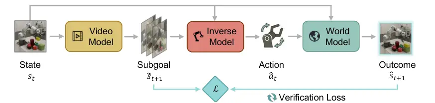
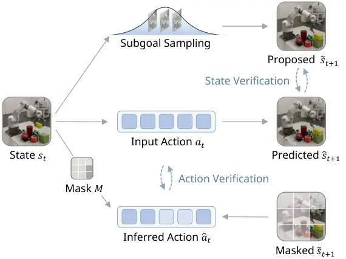
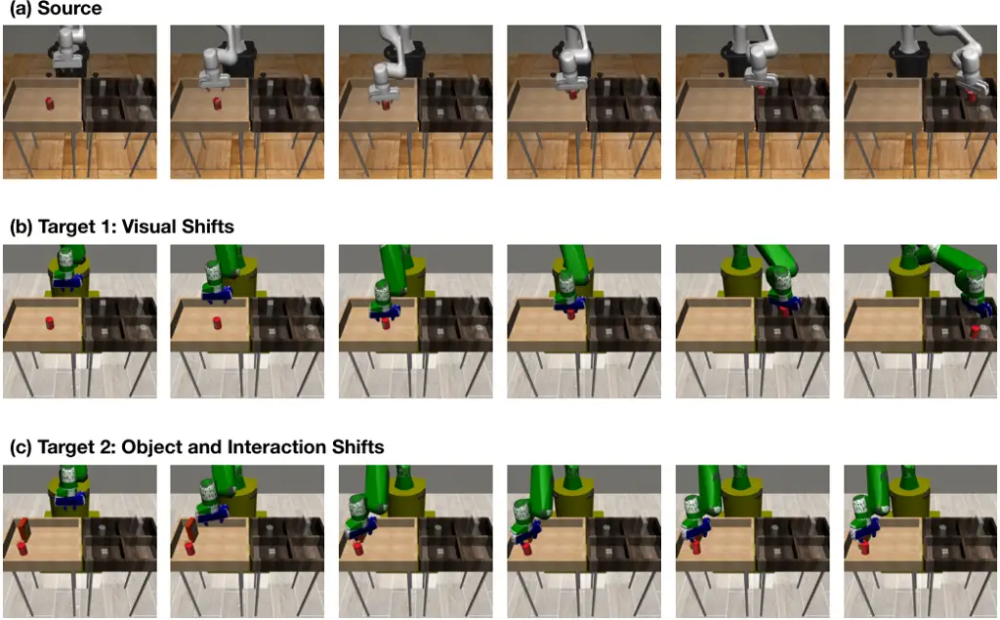
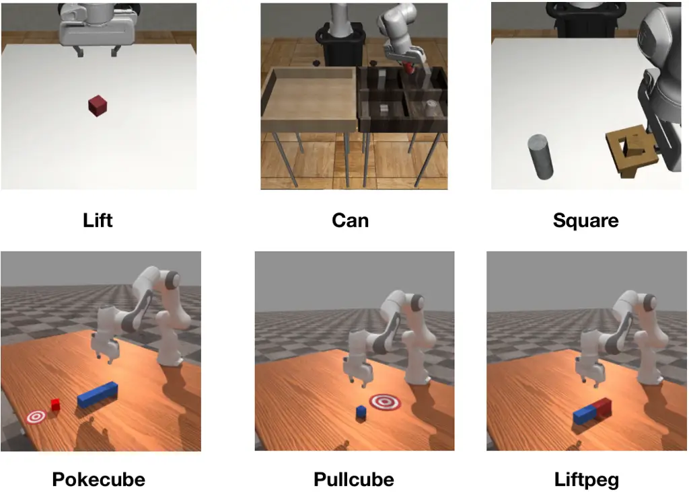
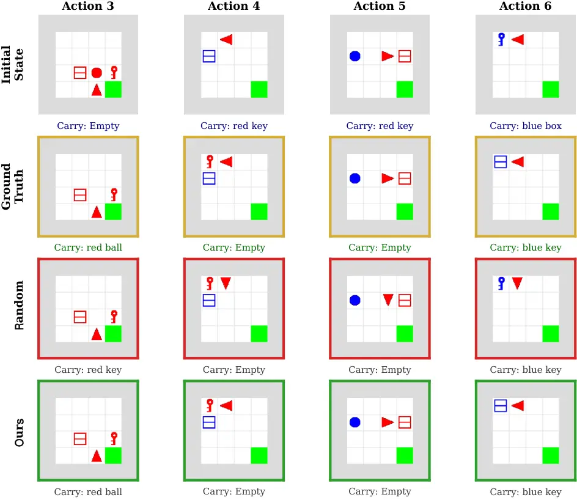
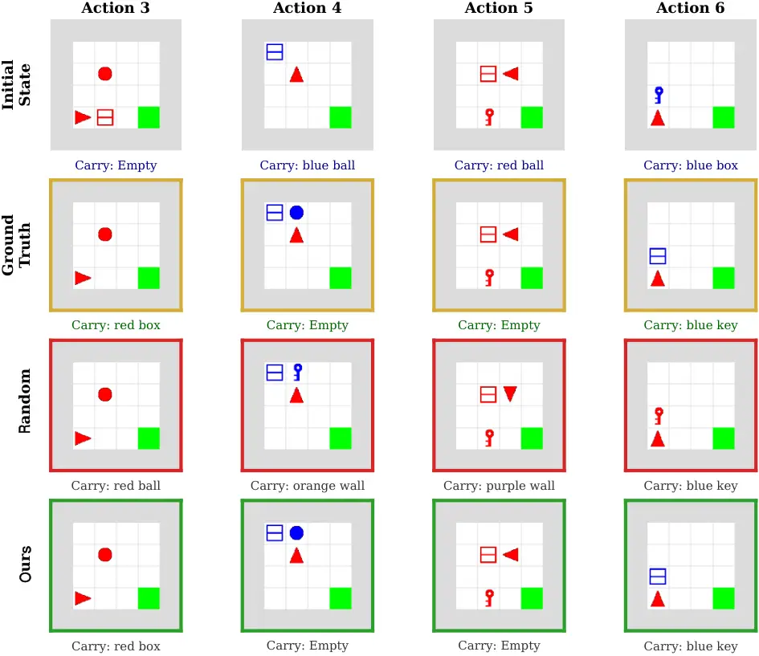
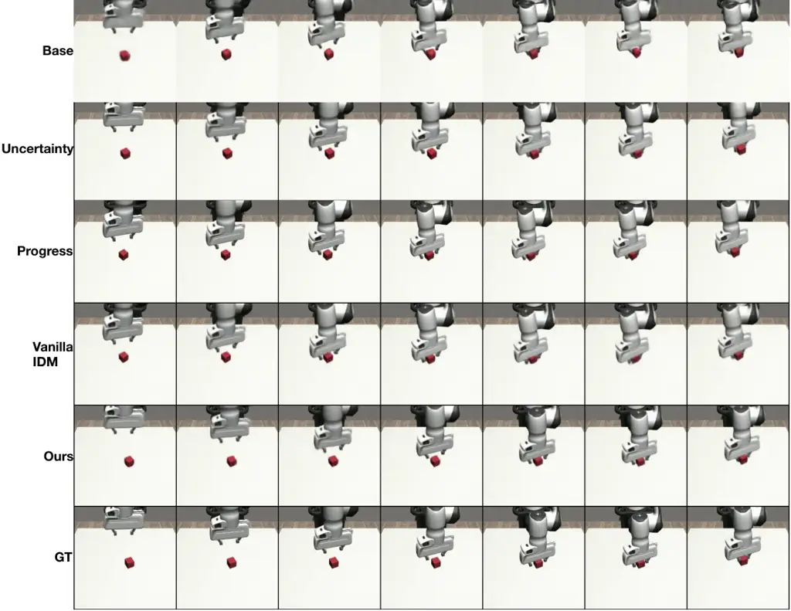
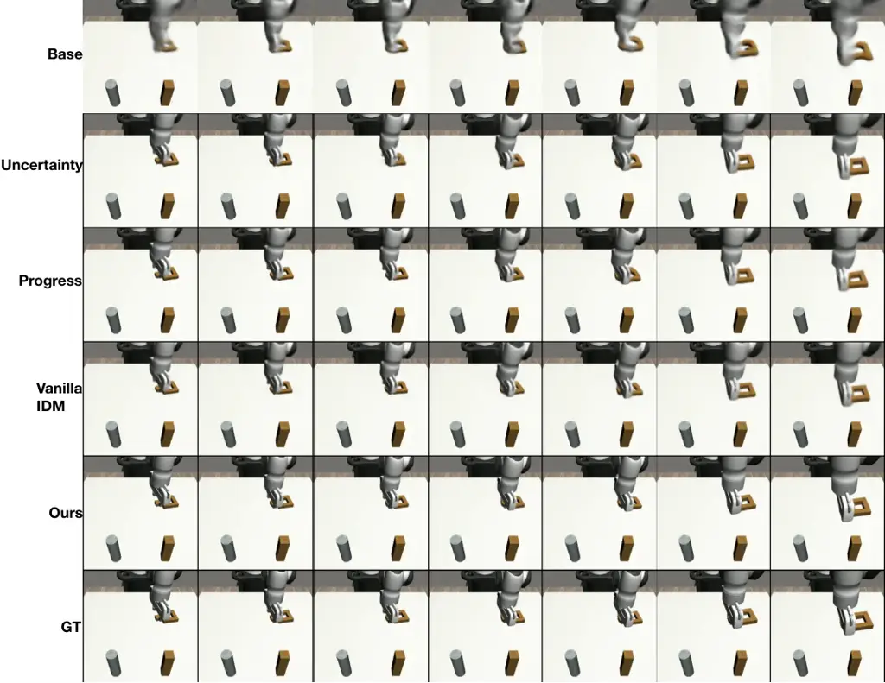

# World Action Verifier: Self-Improving World Models via Forward-Inverse Asymmetry

Yuejiang Liu, Fan Feng, Lingjing Kong, Weifeng Lu , Jinzhou Tang^(‡),
Kun Zhang^(§), Kevin Murphy^(¶), Chelsea Finn^(†), Yilun Du^(∥)
^(†)Stanford University    ^(‡)UC San Diego    ^(§)Carnegie Mellon
University     
^(¶)Google DeepMind    ^(∥)Harvard University ^(†)^(†)thanks: Equal
contribution. Website:
[world-action-verifier.github.io](https://world-action-verifier.github.io)

August 24, 2026

###### Abstract

General-purpose world models promise scalable policy evaluation,
optimization, and planning, yet achieving the required level of
robustness remains challenging. Unlike policy learning which primarily
focuses on optimal actions, a world model needs to be reliable over a
vast space of suboptimal actions, which are often underrepresented in
action-labeled robot interactions. To address this challenge, we propose
World Action Verifier (WAV), a framework that enables world models to
identify their own prediction errors and self-improve. The key idea is
to decompose action-conditioned state prediction into two independently
verifiable factors: state plausibility and action reachability. We show
that verifying these factors is significantly more tractable than direct
forward prediction due to two underlying asymmetries: the broader
availability of action-free data and the lower dimensionality of
action-relevant features. Leveraging these asymmetries, we augment a
world model with (i) a diverse subgoal generator obtained from video
corpora and (ii) a sparse inverse model that infers actions from a
subset of state features. By enforcing cycle consistency among proposed
subgoals, inferred actions, and forward rollouts, WAV provides an
effective verification mechanism in under-explored regimes, where
existing methods often fail. Across nine tasks spanning MiniGrid,
RoboMimic, and ManiSkill, our method achieves 2$`\times`$ higher sample
efficiency while improving downstream policy performance by over 22%.

## 1 Introduction

World models—action-conditioned forward dynamics models that predict
future states given specific actions or action chunks—have come to play
an increasingly important role in robot learning \[37, 120, 4, 109, 137,
52\]. Recent works have shown that, when trained on action-labeled robot
interactions alongside action-free internet videos \[97, 51, 126\],
world models have the potential to not only generate controllable future
dynamics but also enable scalable policy evaluation \[93, 108, 140,
67\], policy optimization \[40, 123, 124, 34\], and test-time
planning \[39, 41, 53, 138, 92\].

Despite remarkable progress, building a general-purpose world model that
is robust enough for various downstream applications remains difficult.
A central challenge is _action following_: predicting future states that
faithfully reflect the effects of the given actions \[101\]. Unlike
policy learning, which primarily focuses on modeling optimal actions, a
world model must be reliable across a much broader action distribution,
including suboptimal, exploratory, and even random actions encountered
during policy learning or evaluation \[63, 135, 53\]. However,
collecting robot interactions covering diverse actions is often slow,
expensive, and sometimes even unsafe. Given a limited budget of robot
data, deciding which specific interactions to collect remains a pressing
challenge.

Previous work has sought to address this through two main approaches.
One line of work relies on on-policy exploration, i.e., gathering data
by rolling out the policies of interest \[53, 35, 75\]. While effective
for the considered policies, the learned model often degrades sharply
beyond predefined policy sets, compromising its generality. Another line
of work focuses on info-max exploration, actively seeking interactions
that maximize information gain \[90, 100, 57\]. A common proxy for
information gain is the prediction error of the world model, estimated
before collecting the corresponding transition–a process we refer to as
_world model verification_. This verification process, however, often
suffers from a practical challenge: existing methods tend to be reliable
in well-explored regions where additional data are largely redundant,
but unreliable in under-explored regions where verification is
critically needed. After all, the interactions that are most informative
for exploration are precisely those where the least prior information
exists for verification. This tension raises a central question:

_How can we reliably verify the predictions of a world model in
under-explored regimes?_

To this end, we propose World Action Verifier (WAV), a framework that
enables world models to verify their own predictions and self-improve
through an asymmetric forward-inverse cycle. The core idea is to
decompose action-conditioned forward predictions into two complementary
factors: _state plausibility_, i.e., whether a predicted state is
visually realistic, and _action reachability_, i.e., whether the
predicted transition is physically achievable under the given actions.
This decomposition not only allows each factor to be verified
separately, but also admits two crucial asymmetries: (i) the broader
availability of action-free data: state plausibility can be verified
using internet videos without action labels, which are far more abundant
than the action-labeled robot interactions used to train the world
model, and (ii) lower dimensionality of action-relevant features: action
reachability can be verified based on a compact subset of state features
relevant to the actions, which are much lower-dimensional than the full
state the world model must predict.

Motivated by these asymmetries, we augment a world model with two
additional components: a diverse subgoal generator obtained from video
corpora, and a sparse inverse model trained to infer actions from a
learned subset of state features. Together, these components induce a
goal-oriented self-improvement cycle: the subgoal generator proposes
plausible future states, the inverse model infers actions that could
reach them, and the forward world model rolls out those actions to test
whether the predicted states are consistent with the proposed
subgoals (Figure 1). Theoretically, we show that verification via a
sparse inverse process is easier than dense forward generation,
particularly in high-dimensional stochastic environments. Empirically,
we evaluate WAV on nine tasks spanning MiniGrid \[19\],
RoboMimic \[141\], and ManiSkill \[85\]. Compared to existing methods,
WAV improves the sample efficiency of world models by $`2\times`$ and
boosts downstream policy performance by more than 22%. Our results
suggest that the asymmetries between forward and inverse dynamics offer
a promising ingredient for building self-improving world models.



Figure 1: Overview of World Action Verifier, a framework that enables
action-conditioned world models to verify their predictions and
self-improve from an asymmetric forward-inverse cycle: (i) a diverse
subgoal generator proposes plausible future states, (ii) a sparse
inverse model infers actions from a relevant subset of state features,
and (iii) a world model rolls forward and verifies consistency between
its predicted state and the proposed state.

## 2 Method: World Action Verifier for Self-Improving World Models

World models excel when grounded in action-labeled interaction data, yet
collecting such data at scale is often prohibitively expensive. In this
section, we present World Action Verifier (WAV), a self-improving
framework that enables a world model to verify its own predictions and
prioritize informative exploration. We first formalize the verification
problem in a semi-supervised setting (Sec. 2.1), then decompose it into
two more tractable subproblems (Sec. 2.2), and finally couple them into
a goal-oriented exploration procedure for self-improvement (Sec. 2.3).

### 2.1 Preliminary: Semi-Supervised Verification of World Models

We consider a world model $`f_{\theta}`$ as an action-conditioned
forward dynamics model, $`\hat{s}^{t+1}=f_{\theta}(s^{t},a^{t}),`$ where
$`s^{t}`$ and $`a^{t}`$ are the state and action, or action chunk, at
time $`t`$, and $`\hat{s}^{t+1}`$ is the predicted successor state.
Following recent training recipes \[51, 31\], we study a semi-supervised
setting with two data sources: a small action-labeled robot interaction
dataset $`\mathcal{D}_{\mathrm{act}}=\{(s^{t},a^{t},s^{t+1})\}`$ and a
large action-free video dataset
$`\mathcal{D}_{\mathrm{vid}}=\{(s^{t},s^{t+1},\ldots)\}.`$ Typically,
$`\mathcal{D}_{\mathrm{vid}}`$ spans a much broader range of state
transitions than $`\mathcal{D}_{\mathrm{act}}`$.

Our goal is to improve $`f_{\theta}`$ not only on the narrow action
distribution represented in $`\mathcal{D}_{\mathrm{act}}`$, but also on
the broader transition support reflected in
$`\mathcal{D}_{\mathrm{vid}}`$. However, the lack of action labels in
online videos poses a key challenge for _action following_: rather than
faithfully grounding predictions in the conditioning action, existing
world models often hallucinate future states that may look visually
plausible but are physically misaligned with the given action \[101,
82\]. A natural remedy is to collect additional action-labeled robot
interactions \[53, 35, 75\]. Yet, since large-scale robot interaction
data are costly to collect, a critical question arises: _which specific
interactions should be prioritized to improve the world model most
effectively?_

Intuitively, transitions that the model can already predict accurately
yield little new knowledge. Instead, the data budget should be steered
toward transitions that are likely to induce large prediction errors.
More formally, for a transition $`(s^{t},a^{t},s^{t+1})`$, we define the
true prediction error as

```math
\varepsilon(s^{t},a^{t};s^{t+1}):=\ell\!\left(f_{\theta}(s^{t},a^{t}),s^{t+1}\right), \tag{1}
```

where $`\ell(\cdot,\cdot)`$ is a discrepancy measure in the state space.
Since the true successor state $`s^{t+1}`$ cannot be observed prior to
execution, we aim to construct a _verifier_
$`\hat{\varepsilon}(s^{t},a^{t},\hat{s}^{t+1})`$ that estimates this
error. From an exploration standpoint, the verifier need not be
perfectly calibrated, but it should preserve the relative ranking of
prediction errors across candidate actions \[46, 98\]. That is, given
two candidate actions $`a_{i}^{t}`$ and $`a_{j}^{t}`$, with predicted
successor states $`\hat{s}_{i}^{t+1}=f_{\theta}(s^{t},a_{i}^{t})`$ and
$`\hat{s}_{j}^{t+1}=f_{\theta}(s^{t},a_{j}^{t})`$, an effective verifier
for exploration should satisfy

```math
\varepsilon(s^{t},a_{i}^{t};s_{i}^{t+1})<\varepsilon(s^{t},a_{j}^{t};s_{j}^{t+1})\;\Longrightarrow\;\hat{\varepsilon}(s^{t},a_{i}^{t},\hat{s}_{i}^{t+1})<\hat{\varepsilon}(s^{t},a_{j}^{t},\hat{s}_{j}^{t+1}). \tag{2}
```

### 2.2 Two Complementary Factors of Verification

A common approach to verifying forward predictions in Equation 2 is to
leverage the internal knowledge of the world model itself, e.g.,
extracting epistemic uncertainty from a single model \[90\] or measuring
disagreement across multiple models \[100, 57\]. However, such
verification methods often inherit the blind spots of the learned world
model: they provide relatively reliable error estimates in well-explored
regimes where the current world model is already accurate, but become
much less reliable in under-explored regimes where accurate verification
is most critical.

To overcome this issue, we take a different perspective: rather than
directly verifying the overall correctness of a forward prediction, we
decompose it into sub-conditions that are easier to verify. More
specifically, motivated by the Bayes decomposition,

```math
p(s^{t+1}\mid s^{t},a^{t})=\frac{p(a^{t}\mid s^{t},s^{t+1})\,p(s^{t+1}\mid s^{t})}{p(a^{t}\mid s^{t})}\;\propto\;\underbrace{p(s^{t+1}\mid s^{t})}_{\text{state}}\,\underbrace{p(a^{t}\mid s^{t},s^{t+1})}_{\text{action}}, \tag{3}
```

we view a correct action-conditioned forward prediction as satisfying
two complementary criteria:

- •
  State Plausibility: whether the predicted next state is plausible
  under the environment dynamics.
- •
  Action Reachability: whether the transition from $`s^{t}`$ to
  $`s^{t+1}`$ is consistent with the given action.

From this view, a correct prediction should both lie on the manifold of
plausible futures and be reachable under the specified action.
Crucially, each condition admits a verification strategy that is more
tractable than predicting high-dimensional forward dynamics, which we
will describe next.

State verification via distribution asymmetry. One common failure mode
of high-dimensional forward prediction is poor visual plausibility. For
example, a world model post-trained on limited robot interaction data
may partially forget the general dynamics learned from video
pretraining, resulting in blurry or inconsistent rollouts \[133\]. To
detect such errors, we build a state verifier from the first factor
in Equation 3, namely a state transition prior
$`g_{\phi}(s^{t+1}\mid s^{t})`$. Since this prior does not condition on
actions, it can be trained not only on action-labeled robot interactions
$`\mathcal{D}_{\mathrm{act}}`$, but also on the much larger action-free
video dataset $`\mathcal{D}_{\mathrm{vid}}`$. Moreover, as the
prediction error of a world model often compounds over longer horizons,
we instantiate $`s^{t+1}`$ as a future subgoal reached after an action
chunk rather than as the immediate next frame. After training,
$`g_{\phi}`$ allows us to sample a diverse set of $`K`$ plausible future
subgoals for state verification,

```math
\{\tilde{s}^{t+1}_{k}\}_{k=1}^{K}\sim g_{\phi}(\cdot\mid s^{t}). \tag{4}
```

Action verification via dimensionality asymmetry. State plausibility
alone does not imply correct forward prediction: for downstream policy
use, predicted transitions must also be reachable under the specified
action. To assess this condition, we build another verifier from the
second factor in Equation 3, namely an inverse dynamics model
$`h_{\psi}(a^{t}\mid s^{t},s^{t+1})`$ that infers which action could
connect a current state to a future state. While the inverse model
$`h_{\psi}`$ is action-dependent and cannot leverage more training data
than the forward world model, it benefits from a lower effective
dimensionality in both its outputs and its relevant inputs. For
instance, in visually complex scenes, an action typically affects only
one object at a time rather than the entire scene. Inspired by the
observation that models attending to a compact set of causally relevant
features often generalize better \[76, 117\], we explicitly impose a
learnable sparsity mask $`M`$ in the inverse dynamics model:

```math
\hat{a}^{t}=h_{\psi}\!\left(M\odot s^{t},\;M\odot s^{t+1}\right). \tag{5}
```

As illustrated in Figure 2, the subgoal generator $`g_{\phi}`$ and
inverse model $`h_{\psi}`$ provide two complementary components for
verification: the former checks whether a candidate future is plausible,
while the latter checks whether it is reachable through an inferred
action.



Figure 2: Decomposing model verification into state plausibility and
action reachability.

 

 

\# f: world model, h: inverse model

\# s: current state, g: subgoal generator

\# D: current data, K: number of candidates

for each exploration iteration:

s_g = v.sample(s, K) \# subgoals

a = h.inverse(s, s_g) \# actions

s_p = f.predict(s, a) \# outcomes

scores = dist(s_g, s_p) \# disagreement

idx = argmax(scores) \# max surprise

s_n = env.step(a\[idx\])

D.append((s, a\[idx\], s_n))

f.update(D), h.update(D)

 

Algorithm 1 WAV-Guided Exploration.

### 2.3 Goal-Oriented Exploration

Given the two verification criteria above, we next couple them into a
verification-driven exploration algorithm. A straightforward design is
action-oriented exploration: sample candidate actions, roll out the
forward world model $`f_{\theta}`$, and then use the inverse model
$`h_{\psi}`$ to check whether the generated state transitions recover
the original actions \[127\]. However, this ordering can be brittle in
practice. Among the three components, the forward world model
$`f_{\theta}`$ is often the least reliable when action-labeled data are
scarce. As such, errors introduced by the initial forward rollout can
produce off-manifold states, on which the subsequent inverse model also
becomes unreliable.

We therefore pursue a goal-oriented alternative that places the forward
world model as the final step in the verification cycle. At each time
step $`t`$, we first sample plausible subgoals from the transition
prior, infer actions that could reach those subgoals, and only then
verify whether the action-conditioned world model can realize them:

```math
s^{t}\xrightarrow{\mathmakebox[2.0em][c]{\,g_{\phi}\,}}\tilde{s}_{1:K}^{t+1}\xrightarrow{\mathmakebox[2.0em][c]{\,h_{\psi}\,}}\hat{a}_{1:K}^{t}\xrightarrow{\mathmakebox[2.0em][c]{\,f_{\theta}\,}}\hat{s}_{1:K}^{t+1}\xrightarrow{\mathmakebox[2.0em][c]{\,\ell\,}}\hat{\varepsilon}_{1:K}\xrightarrow{\mathmakebox[2.0em][c]{\,\max\,}}a^{\star}. \tag{6}
```

For each candidate subgoal $`\tilde{s}_{k}^{t+1}`$, we measure how far
the forward rollout $`\hat{s}_{k}^{t+1}`$ deviates from it. In practice,
this discrepancy $`\ell`$ can be computed in the discrete state space, a
continuous representation space, or a diffusion noise space, depending
on the parameterization of the world model.

As summarized in Algorithm 1, we execute $`a^{\star}`$ associated with
the largest discrepancy at each time step, add the resulting transition
to $`\mathcal{D}_{\mathrm{act}}`$, and iteratively update both the
forward world model and the inverse dynamics model. By verifying
multiple candidate rollouts in parallel before acting, our method
reduces unnecessary real-world interaction and thereby effectively
trades scalable computation for improved data efficiency.

## 3 Theory: When Does Inverse Verification Outperform Forward Prediction?

Our method in Sec. 2 rests on a central premise: verifying actions
through inverse dynamics can be substantially easier than predicting
full future states with a forward world model. In this section, we
provide a minimal theoretical analysis characterizing the conditions
under which this forward–inverse asymmetry becomes most pronounced.

To isolate the key factors, we consider a linear–Gaussian setting with
the observed state $`s\in\mathbb{R}^{d_{s}}`$ and action
$`a\in\mathbb{R}^{d_{a}}`$. Assume one-step dynamics

```math
s^{\prime}=As+Ba+\xi,\qquad\xi\sim\mathcal{N}(0,\sigma_{s}^{2}\mathbf{I}_{d_{s}}), \tag{7}
```

where $`\sigma_{s}`$ captures transition stochasticity. We further
assume that the action is recoverable from a low-dimensional
action-relevant slice $`z:=Ms\in\mathbb{R}^{d_{z}}`$ with
$`d_{z}\ll d_{s}`$:

```math
a=h(z,z^{\prime})+\eta,\qquad h(z,z^{\prime}):=H\begin{bmatrix}z\\
z^{\prime}\end{bmatrix},\qquad\eta\sim\mathcal{N}(0,\sigma_{a}^{2}\mathbf{I}_{d_{a}}), \tag{8}
```

where $`z^{\prime}:=Ms^{\prime}`$ and $`\sigma_{a}`$ measures
irreducible ambiguity in recovering the action from $`(z,z^{\prime})`$.

We compare a dense forward model $`f_{\theta}`$ trained on
$`[s;a]\in\mathbb{R}^{d_{s}+d_{a}}`$ against a sparse inverse model
$`h_{\psi}`$ trained on $`[z;z^{\prime}]\in\mathbb{R}^{2d_{z}}`$, both
fit by ordinary least squares (OLS) on $`n`$ transitions from
$`\mathcal{D}_{\mathrm{act}}`$. To compare them in the same units, we
evaluate in state space:

```math
\mathcal{E}_{F}:=\frac{1}{d_{s}}\mathbb{E}\!\left[\|f_{\theta}(s,a)-f(s,a)\|_{2}^{2}\right],\quad\mathcal{E}_{I}:=\frac{1}{d_{s}}\mathbb{E}\!\left[\|f(s,h_{\psi}(z,z^{\prime}))-f(s,h(z,z^{\prime}))\|_{2}^{2}\right], \tag{9}
```

where $`f(s,a)`$ denotes the true dynamics. Since inverse errors enter
the state prediction through the action channel, we define
$`\lambda:=\|B\|_{\mathrm{op}}`$ as the worst-case amplification from
action error to state error.

###### Proposition 3.1 (Informal).

Under the stylized setup above, if both models are fit by OLS on $`n`$
labeled transitions, then

```math
\frac{\mathbb{E}[\mathcal{E}_{F}]}{\mathbb{E}[\mathcal{E}_{I}]}\;\geq\;\underbrace{\Bigl(\frac{d_{s}+d_{a}}{2d_{z}}\cdot\frac{d_{s}}{d_{a}}\Bigr)}_{\text{dimensionality}}\cdot\underbrace{\Bigl(\frac{\sigma_{s}}{\lambda\,\sigma_{a}}\Bigr)^{2}}_{\text{stochasticity}}\cdot\underbrace{\Bigl(\frac{n-2d_{z}-1}{n-(d_{s}+d_{a})-1}\Bigr)}_{\text{sample size}}, \tag{10}
```

provided $`n>d_{s}+d_{a}+1`$ and $`n>2d_{z}+1`$. The exact statement and
proof are in Appendix F.2.

Interpretation. The ratio in (10) factorizes into three terms. (1)
_Dimensionality_: the forward model must estimate a map from
$`d_{s}+d_{a}`$ inputs, whereas the sparse inverse uses only $`2d_{z}`$.
(2) _Stochasticity_: forward prediction suffers from environment noise
$`\sigma_{s}`$, while inverse verification suffers only from
action-recovery ambiguity $`\sigma_{a}`$ (scaled by $`\lambda`$). (3)
_Sample size_: when $`n`$ is only modestly larger than $`d_{s}+d_{a}`$,
the forward estimator is far less stable. In practice, WAV helps most
when (i) the verifier needs only a small agent-centric subset while the
world model predicts a large scene (_large $`d_{s}/d_{z}`$_); (ii)
uncontrolled dynamics inflate $`\sigma_{s}`$ while the action imprint
stays clean (_large $`\sigma_{s}/\sigma_{a}`$_); and (iii)
action-labeled data are limited (_small $`n`$_). We validate each factor
empirically in Sec. 4.1.1: varying the data budget isolates the
sample-size term, increasing the number of objects raises the effective
state dimension $`d_{s}`$, and adding noisy floors inflates
$`\sigma_{s}`$ while leaving $`\sigma_{a}`$ unchanged.

## 4 Experiments

In this section, we evaluate the central claims of WAV. We begin by
validating whether inverse verification, especially with sparsity, is
more robust and easier to learn than action-conditioned forward
prediction under limited data and distribution shift. We then examine
whether WAV can effectively improve world model learning through
self-improvement, and finally, whether the resulting gains translate
into better downstream policy learning and enhance out-of-distribution
generalization. Concretely, we study the following research questions:

- •
  RQ1: Is learning an inverse dynamics model easier than learning a
  forward world model?
- •
  RQ2: Do sparse IDMs generalize better than vanilla IDMs to unseen
  objects or interactions?
- •
  RQ3: How effective is forward–inverse asymmetry for self-improving the
  world model?
- •
  RQ4: Does this self-improvement translate into improved downstream
  policy learning?
- •
  RQ5: Can the learned world model adapt to out-of-distribution robotic
  manipulation settings with limited target-domain data under novel
  visual setups, objects, and interactions?

Baselines. We compare our method (Sec. 2) against the following
exploration strategies:

- •
  Random: randomly samples candidate interactions, serving as a
  lower-bound exploration strategy.
- •
  Uncertainty: select candidates with the highest predictive
  uncertainty \[100\].
- •
  Progress: selects candidates with the largest learning progress,
  measured by the disagreement between two consecutive world models
  during training \[57\].
- •
  Vanilla IDM: our method without the sparsity mask $`M`$ in Equation 5.
- •
  Oracle: selects candidates with the largest world-model prediction
  loss computed using ground-truth successor states, serving as an upper
  bound.

Figure 3: Robustness verification of WAV on MiniGrid. (Left) Sample
efficiency comparison between Sparse IDM and the World Model with six
objects. (Mid) Robustness to increasing state complexity. (Right)
Robustness to growing environment stochasticity.

### 4.1 Experiments in Synthetic MiniGrid

Dataset. We collect 50k interaction sequences from three custom MiniGrid
tasks: Key Delivery, Ball Delivery, and Object Matching, using a
deterministic policy for each task. Half of the sequences are used to
train the action-free subgoal generator as a video prior. The remaining
data form an exploration pool, consisting of an action-labeled seed set
of 200 sequences and an unlabeled candidate set of 20k sequences for
acquisition. To enable controlled evaluation, we construct additional
random-play datasets by varying object counts and environmental
stochasticity. Specifically, we vary the number of objects to study
generalization under increasing scene complexity, and introduce noisy
floor tiles whose colors change after each action to simulate stochastic
observations. Data samples from these noisy environments are used
exclusively for robustness evaluation. Additional details are provided
in Appendix E.2.

#### 4.1.1 Robustness of World Action Verification

To test whether WAV is a reliable verifier, we compare forward world
models and inverse dynamics models under controlled distribution shifts,
addressing RQ1 and RQ2.

Setup. We vary the amount of labeled training data
$`\{400,800,1200,1600,2000\}`$ collected in environments with $`6`$
objects, and evaluate on test transitions in environments with
$`\{6,8,10,12,14\}`$ objects. In addition, to examine robustness against
observation noise, we construct training datasets in $`6`$-object
environments with $`\{0,1,2,3,4\}`$ noisy floors. For direct comparison,
we convert inverse model predictions into next state predictions: for
each test pair, the IDM predicts an action, which we then execute in the
simulator to obtain the induced next state. We report the same dynamics
accuracy defined in Appendix E.2.3 for both the world model and the
IDM-induced transition.

Results. For RQ1, Figure 3 empirically validates the three factors
identified in Proposition 3.1, each isolated by a separate controlled
variable. Figure 3 (Left) isolates the _sample-size_ factor: across data
regimes, action inference using IDMs consistently outperforms learning
action-conditioned world models, with the performance gap being most
pronounced in the low-data regime, consistent with the diverging
finite-sample term in (10) when $`n`$ is only modestly larger than
$`d_{s}+d_{a}`$. Figure 3 (Mid) isolates the _dimensionality_ factor:
increasing the number of objects raises the effective state dimension
$`d_{s}`$ while leaving the action-relevant subset $`d_{z}`$ unchanged.
The WM’s performance degrades rapidly as state complexity increases,
whereas the IDM remains stable, consistent with the growing ratio
$`(d_{s}+d_{a})/2d_{z}`$ in the dimensionality term. Figure 3 (Right)
isolates the _stochasticity_ factor: noisy floor tiles inflate
observation noise $`\sigma_{s}`$ while the action imprint on the
agent-centric features remains clean ($`\sigma_{a}`$ unchanged). The WM
exhibits clear sensitivity to the induced observation noise, whereas the
IDM maintains largely invariant performance, consistent with the
$`(\sigma_{s}/\lambda\sigma_{a})^{2}`$ ratio in the stochasticity term.
These results confirm the predicted advantage of sparse inverse
verification across all three factors, providing empirical justification
for using the IDM as a reliable verifier of the world model.

For RQ2, Figure 4 (Left) reveals a pronounced divergence in
out-of-distribution generalization when data is limited. The vanilla IDM
struggles on toggle and swap, whereas the sparse IDM maintains strong
performance, showing that enforcing sparsity promotes more robust action
inference.

  

Figure 4: Evaluation of world model learning with WAV on MiniGrid.
(Left) Prediction accuracy of Sparse IDM and Vanilla IDM. (Mid)
Comparison of different exploration methods. (Right) Robustness of
action following across different methods. Results are averaged across 5
seeds.

#### 4.1.2 Effectiveness of World Model Learning

Building on the above justifications, we now evaluate RQ3 by examining
whether the proposed framework improves world model learning quality.

Setup. We first train a base model on 200 uniformly sampled labeled
transitions, followed by three exploration rounds where each strategy
acquires a budget of 100 transitions. We report the prediction error
averaged over five random seeds, focusing on the second round where
differences are most pronounced for clearer comparison. To further
assess whether the learned models capture action-dependent dynamics, we
additionally evaluate an Action Following Score (defined in
Appendix E.2.3), using the models obtained from the same active learning
round.

Results. Figure 4 (Mid) shows that our method and the Oracle achieve the
best performance in terms of prediction error. Consistently, Figure 4
(Right) demonstrates that our method also attains the highest Action
Following Score, indicating superior modeling of action-dependent
dynamics. We attribute this advantage to the structural imbalance of the
dataset, where complex interaction actions are sparse relative to simple
movement. The Random strategy fails to sample these critical sparse
events with sufficient frequency. The Progress method struggles with
sample redundancy; it tends to over-prioritize transitions where the
model is already competent, yielding negligible marginal information
gain. Similarly, the Uncertainty baseline suffers from a slow warm-up,
leading to suboptimal performance in the early stages of exploration. In
contrast, our method prioritizes transitions with high disagreement
between the video prior and world model predictions, naturally favoring
sparse interaction actions under the same data budget. Moreover, the
improved Action Following Score suggests that the learned model better
preserves distinctions between different actions, rather than collapsing
them into similar predictions. Qualitative results are given in
Appendix E.2.5.

### 4.2 Experiments on Simulated Robot Manipulations

Datasets & Setups. We consider a set of challenging robotic manipulation
tasks from two evaluation suites: RoboMimic \[141\] (Lift, Can, Square)
and ManiSkill \[85\] (PullCube, PokeCube, LiftPeg). For both suites, we
curate training data using expert demonstrations in a two-stage process.
We first pretrain diffusion policies \[20\] for different numbers of
training steps, yielding a diverse collection of behavior trajectories
with varying levels of optimality. Based on these trajectories, we
partition the data into two subsets: (1) the warm-up dataset, which
includes the expert demonstrations together with on-policy trajectories
collected from the best-performing diffusion policy checkpoint trained
on those demonstrations; (2) the exploration dataset, which consists of
trajectories generated by imperfect diffusion policy checkpoints,
capturing diverse exploratory behaviors.

Figure 5: World-model learning on RoboMimic and ManiSkill. We report
32-frame prediction error (MSE) as the number of training trajectories
increases over 3 seeds.

Model Choices. For the world model, we adopt Dreamer-v3 \[41\], which
learns a latent recurrent state-space model (RSSM). For sparse IDM, we
employ the model backbones from CLAM \[68\] and further impose sparsity
on this latent action space. Details are given in Appendix E.4.

#### 4.2.1 Effectiveness for World-Model Learning

To address RQ3, we first evaluate whether WAV improves world-model
learning under different data budgets in simulated robotic manipulation
tasks.

Setup. We warm-start each world model using {200, 400, 600, 800, 1000}
trajectories (each containing approximately 200 episodic samples) and
then fine-tune it for another 200 epochs with the self-improving loop.
We report the average observation MSE over 32 predicted frames after 2
exploration rounds, averaged over 3 seeds.

Results. Figure 5 shows the predictions of the world-model across
different data budgets. Results under the 200-sample budget, together
with standard errors, are reported in Appendix Table 1. WAV consistently
outperforms all baselines, with especially large gains in the low-data
regime. Sparse inverse dynamics models also consistently outperform
dense variants on object manipulation tasks, supporting our hypothesis
that sparsity improves inverse verification under limited data. The full
downstream policy evaluation in Appendix A.3 and Figure 7 follow the
same trend: world models improved by WAV support stronger
imagination-based policy refinement than baseline world models,
suggesting that the prediction gains correspond to more useful latent
dynamics for control.

#### 4.2.2 OOD Adaptation and Downstream Policy Learning

To address RQ4 and RQ5, we evaluate whether WAV improves adaptation to
out-of-distribution robotic manipulation settings and whether it
supports better downstream policy refinement.

Setup. We use RoboMimic Can as the base environment and construct two
OOD variants (visualized in Appendix Figure 8). The first introduces
visual shifts, changing nuisance factors such as background and
embodiment color while keeping the task dynamics unchanged. The second
introduces object and interaction shifts, increasing task complexity
with multiple objects and demonstrations of mixed optimality. These
demonstrations are collected from diffusion policy checkpoints trained
for different numbers of steps, producing expert-like, medium-quality,
and suboptimal behaviors.

For each OOD variant, we start from the world model trained on the
original RoboMimic Can data and adapt it using only 200 target-domain
trajectories. We evaluate both world-model quality, measured by MSE on
held-out OOD trajectories (with $`256\times 256`$ resolutions), and
downstream policy performance, measured by reward after
imagination-based policy refinement under the SAILOR-based
protocol \[53\].

Figure 6: OOD adaptation results on RoboMimic. We evaluate world-model
adaptation (normalized prediction error and downstream reward) under
visual shifts and objects/interaction shifts. Error bars denote the
standard error over 3 seeds.

Results. Figure 6 shows that WAV achieves stronger OOD adaptation than
the baselines under both types of shift. Under visual shifts, where the
dynamics are unchanged, but nuisance appearance factors vary, WAV better
preserves action-conditioned dynamics after adaptation and achieves
lower prediction error with the same 200 target trajectories. The
corresponding reward results show that this improvement is not only a
prediction-level gain: policies refined with WAV-adapted world models
also achieve stronger downstream performance. Full in-distribution
reward results across all environments are provided in Appendix A.3 and
Figure 7.

The gains become larger under object and interaction shifts, where
multiple objects and mixed-optimality demonstrations introduce diverse
contacts, ambiguous interactions, and under-explored transition regions.
In this setting, heuristic acquisition strategies may either
overemphasize visually novel but less informative transitions or miss
rare interaction-rich cases that are critical for learning accurate
dynamics. By focusing adaptation on transitions that are difficult for
the current world model but still action-reachable, WAV provides a more
data-efficient mechanism for adapting world models to under-explored
target regions. Overall, the combined improvements in MSE and reward
suggest that WAV learns OOD dynamics that are not only more predictive,
but also more useful for downstream imagination-based policy refinement,
achieving an approximately $`22\%`$ improvement on novel environments
with new objects and interactions.

## 5 Related Work

Exploration for World Models. Exploration for world models asks which
interactions most improve a learned dynamics model. Classical
coverage-based objectives use counts or density surrogates \[7, 88, 13,
36\], while model-based variants estimate value through uncertainty or
disagreement \[46, 103, 100\], learning progress \[33, 1, 57\],
prediction error and curiosity \[90, 38, 106, 27\], or goal discovery
with learned world models \[83, 48, 136, 74\]. These signals are useful
but often come from the current action-conditioned world model, making
them unreliable in under-explored regimes where verification is most
needed. Related work also exploits unlabeled prior data for optimistic
exploration \[96, 65\], unsupervised skill discovery \[118, 116\], and
mutual-information objectives \[29, 136\], but typically aims to learn
exploration behaviors. We instead verify informative transitions through
plausible future states and sparse inverse-dynamics reachability to
directly enhance action-conditioned world models.

World Action Models. World action models (WAMs) have recently made
substantial progress in policy learning by jointly leveraging
action-free internet video and action-labeled robot data. One line
jointly predicts future video and actions within a unified model,
allowing large-scale action-free data to improve representations without
changing the downstream policy interface \[15, 97, 51, 139, 66, 9,
119\]. A second line performs visual planning or foresight generation
and conditions action prediction on future frames, shifting more of the
planning burden into semantic image or video space while keeping
low-level control at the action level \[28, 10, 17, 54, 113, 49, 79, 14,
126, 125, 64, 129\]. Our method is formally closer to the second family:
like these approaches, it combines future-state generation with inverse
action prediction. The difference is that we use this structure not as a
policy model, but to expose an accuracy advantage of inverse
verification over world models and to repurpose a WAM-like pipeline as a
verifier for action-conditioned world models.

## 6 Conclusion

In this work, we identified an essential asymmetry between forward and
inverse dynamics: inferring which action caused a plausible transition
can be substantially easier than predicting its full outcome. Building
on this insight, we introduced World Action Verifier, a self-improving
framework that exploits cycle consistency among a diverse subgoal
generator, a sparse inverse model, and a forward world model to gather
informative interactions. Across MiniGrid, RoboMimic, and ManiSkill, our
method enables $`2\times`$ greater sample efficiency in exploration and
improves downstream policy performance by 22%.

## Acknowledgement

We thank the members of the IRIS Lab for valuable feedback and
discussions. We also thank Xiangcheng Zhang for help with the simulation
setup. This work was supported in part by the Robotics and AI Institute,
DARPA, ONR, CIFAR, SNSF, Schmidt Science, NSF, NIH, and the AI Institute
for Societal Decision Making.

## References

- \[1\] Joshua Achiam and Shankar Sastry. Surprise-based intrinsic
  motivation for deep reinforcement learning, 2017. URL
  [https://arxiv.org/abs/1703.01732](https://arxiv.org/abs/1703.01732).
- \[2\] Christopher Agia, Rohan Sinha, Jingyun Yang, Rika Antonova,
  Marco Pavone, Haruki Nishimura, Masha Itkina, and Jeannette Bohg.
  Cupid: Curating data your robot loves with influence functions. _arXiv
  preprint arXiv:2506.19121_, 2025.
- \[3\] Pulkit Agrawal, Ashvin V Nair, Pieter Abbeel, Jitendra Malik,
  and Sergey Levine. Learning to poke by poking: Experiential learning
  of intuitive physics. _Advances in neural information processing
  systems_, 29, 2016.
- \[4\] Mido Assran, Adrien Bardes, David Fan, Quentin Garrido, Russell
  Howes, Matthew Muckley, Ammar Rizvi, Claire Roberts, Koustuv Sinha,
  Artem Zholus, et al. V-jepa 2: Self-supervised video models enable
  understanding, prediction and planning. _arXiv preprint
  arXiv:2506.09985_, 2025.
- \[5\] Yuntao Bai, Saurav Kadavath, Sandipan Kundu, Amanda Askell,
  Jackson Kernion, Andy Jones, Anna Chen, Anna Goldie, Azalia
  Mirhoseini, Cameron McKinnon, et al. Constitutional ai: Harmlessness
  from ai feedback. _arXiv preprint arXiv:2212.08073_, 2022.
- \[6\] Bowen Baker, Ilge Akkaya, Peter Zhokov, Joost Huizinga, Jie
  Tang, Adrien Ecoffet, Brandon Houghton, Raul Sampedro, and Jeff Clune.
  Video pretraining (vpt): Learning to act by watching unlabeled online
  videos. _Advances in Neural Information Processing Systems_,
  35:24639–24654, 2022.
- \[7\] Marc G. Bellemare, Sriram Srinivasan, Georg Ostrovski, Tom
  Schaul, David Saxton, and Remi Munos. Unifying count-based exploration
  and intrinsic motivation, 2016. URL
  [https://arxiv.org/abs/1606.01868](https://arxiv.org/abs/1606.01868).
- \[8\] Gedas Bertasius, Heng Wang, and Lorenzo Torresani. Is space-time
  attention all you need for video understanding? In _International
  Conference on Machine Learning_, volume 2, page 4, 2021.
- \[9\] Hongzhe Bi, Hengkai Tan, Shenghao Xie, Zeyuan Wang, Shuhe Huang,
  Haitian Liu, Ruowen Zhao, Yao Feng, Chendong Xiang, Yinze Rong, et al.
  Motus: A unified latent action world model. _arXiv preprint
  arXiv:2512.13030_, 2025.
- \[10\] Kevin Black, Mitsuhiko Nakamoto, Pranav Atreya, Homer Rich
  Walke, Chelsea Finn, Aviral Kumar, and Sergey Levine. Zero-shot
  robotic manipulation with pre-trained image-editing diffusion models.
  In _The Twelfth International Conference on Learning
  Representations_, 2023.
- \[11\] Qingwen Bu, Jisong Cai, Li Chen, Xiuqi Cui, Yan Ding, Siyuan
  Feng, Shenyuan Gao, Xindong He, Xuan Hu, Xu Huang, et al. Agibot world
  colosseo: A large-scale manipulation platform for scalable and
  intelligent embodied systems. _arXiv preprint arXiv:2503.06669_, 2025.
- \[12\] Jacob Buckman, Danijar Hafner, George Tucker, Eugene Brevdo,
  and Honglak Lee. Sample-efficient reinforcement learning with
  stochastic ensemble value expansion. _Advances in neural information
  processing systems_, 31, 2018.
- \[13\] Yuri Burda, Harrison Edwards, Amos Storkey, and Oleg Klimov.
  Exploration by random network distillation, 2018. URL
  [https://arxiv.org/abs/1810.12894](https://arxiv.org/abs/1810.12894).
- \[14\] Junhao Cai, Zetao Cai, Jiafei Cao, Yilun Chen, Zeyu He, Lei
  Jiang, Hang Li, Hengjie Li, Yang Li, Yufei Liu, et al. Internvla-a1:
  Unifying understanding, generation and action for robotic
  manipulation. _arXiv preprint arXiv:2601.02456_, 2026.
- \[15\] Chi-Lam Cheang, Guangzeng Chen, Ya Jing, Tao Kong, Hang Li,
  Yifeng Li, Yuxiao Liu, Hongtao Wu, Jiafeng Xu, Yichu Yang, et al.
  Gr-2: A generative video-language-action model with web-scale
  knowledge for robot manipulation. _arXiv preprint
  arXiv:2410.06158_, 2024.
- \[16\] Annie S Chen, Alec M Lessing, Yuejiang Liu, and Chelsea Finn.
  Curating demonstrations using online experience. _arXiv preprint
  arXiv:2503.03707_, 2025a.
- \[17\] Boyuan Chen, Tianyuan Zhang, Haoran Geng, Kiwhan Song, Caiyi
  Zhang, Peihao Li, William T Freeman, Jitendra Malik, Pieter Abbeel,
  Russ Tedrake, et al. Large video planner enables generalizable robot
  control. _arXiv preprint arXiv:2512.15840_, 2025b.
- \[18\] Xiaoyu Chen, Junliang Guo, Tianyu He, Chuheng Zhang, Pushi
  Zhang, Derek Cathera Yang, Li Zhao, and Jiang Bian. IGOR: Image-GOal
  representations are the atomic building blocks for next-level
  generalization in embodied AI, 2025c. URL
  [https://openreview.net/forum?id=bpdIZTIVq8](https://openreview.net/forum?id=bpdIZTIVq8).
- \[19\] Maxime Chevalier-Boisvert, Bolun Dai, Mark Towers, Rodrigo
  Perez-Vicente, Lucas Willems, Salem Lahlou, Suman Pal, Pablo Samuel
  Castro, and Jordan Terry. Minigrid & miniworld: Modular & customizable
  reinforcement learning environments for goal-oriented tasks. _Advances
  in Neural Information Processing Systems_, 36:73383–73394, 2023.
- \[20\] Cheng Chi, Zhenjia Xu, Siyuan Feng, Eric Cousineau, Yilun Du,
  Benjamin Burchfiel, Russ Tedrake, and Shuran Song. Diffusion policy:
  Visuomotor policy learning via action diffusion. _The International
  Journal of Robotics Research_, 44(10-11):1684–1704, 2025a.
- \[21\] Xiaowei Chi, Peidong Jia, Chun-Kai Fan, Xiaozhu Ju, Weishi Mi,
  Kevin Zhang, Zhiyuan Qin, Wanxin Tian, Kuangzhi Ge, Hao Li, et al.
  Wow: Towards a world omniscient world model through embodied
  interaction. _arXiv preprint arXiv:2509.22642_, 2025b.
- \[22\] Kurtland Chua, Roberto Calandra, Rowan McAllister, and Sergey
  Levine. Deep reinforcement learning in a handful of trials using
  probabilistic dynamics models. _Advances in neural information
  processing systems_, 31, 2018.
- \[23\] Karl Cobbe, Vineet Kosaraju, Mohammad Bavarian, Mark Chen,
  Heewoo Jun, Lukasz Kaiser, Matthias Plappert, Jerry Tworek, Jacob
  Hilton, Reiichiro Nakano, et al. Training verifiers to solve math word
  problems. _arXiv preprint arXiv:2110.14168_, 2021.
- \[24\] William Jay Conover. _Practical nonparametric statistics_. john
  wiley & sons, 1999.
- \[25\] Yinpei Dai, Hongze Fu, Jayjun Lee, Yuejiang Liu, Haoran Zhang,
  Jianing Yang, Chelsea Finn, Nima Fazeli, and Joyce Chai. Robomme:
  Benchmarking and understanding memory for robotic generalist policies.
  _arXiv preprint arXiv:2603.04639_, 2026.
- \[26\] Marc Peter Deisenroth and Carl Edward Rasmussen. PILCO: A
  model-based and data-efficient approach to policy search. In Lise
  Getoor and Tobias Scheffer, editors, _Proceedings of the 28th
  International Conference on Machine Learning, ICML 2011, Bellevue,
  Washington, USA, June 28 - July 2, 2011_, pages 465–472.
  Omnipress, 2011. URL
  [https://icml.cc/2011/papers/323_icmlpaper.pdf](https://icml.cc/2011/papers/323_icmlpaper.pdf).
- \[27\] Yilun Du, Chuang Gan, and Phillip Isola. Curious representation
  learning for embodied intelligence. In _Proceedings of the IEEE/CVF
  International Conference on Computer Vision_, pages 10408–10417, 2021.
- \[28\] Yilun Du, Sherry Yang, Bo Dai, Hanjun Dai, Ofir Nachum, Josh
  Tenenbaum, Dale Schuurmans, and Pieter Abbeel. Learning universal
  policies via text-guided video generation. _Advances in neural
  information processing systems_, 36:9156–9172, 2023.
- \[29\] Benjamin Eysenbach, Abhishek Gupta, Julian Ibarz, and Sergey
  Levine. Diversity is all you need: Learning skills without a reward
  function. _arXiv preprint arXiv:1802.06070_, 2018.
- \[30\] Yunhai Feng, Nicklas Hansen, Ziyan Xiong, Chandramouli
  Rajagopalan, and Xiaolong Wang. Finetuning offline world models in the
  real world. _arXiv preprint arXiv:2310.16029_, 2023.
- \[31\] Shenyuan Gao, William Liang, Kaiyuan Zheng, Ayaan Malik,
  Seonghyeon Ye, Sihyun Yu, Wei-Cheng Tseng, Yuzhu Dong, Kaichun Mo,
  Chen-Hsuan Lin, et al. Dreamdojo: A generalist robot world model from
  large-scale human videos. _arXiv preprint arXiv:2602.06949_, 2026.
- \[32\] Quentin Garrido, Mahmoud Assran, Nicolas Ballas, Adrien Bardes,
  Laurent Najman, and Yann LeCun. Learning and leveraging world models
  in visual representation learning. _arXiv preprint
  arXiv:2403.00504_, 2024.
- \[33\] Alex Graves, Marc G. Bellemare, Jacob Menick, Remi Munos, and
  Koray Kavukcuoglu. Automated curriculum learning for neural
  networks, 2017. URL
  [https://arxiv.org/abs/1704.03003](https://arxiv.org/abs/1704.03003).
- \[34\] Yanjiang Guo, Lucy Xiaoyang Shi, Jianyu Chen, and Chelsea Finn.
  Ctrl-world: A controllable generative world model for robot
  manipulation, 2025. URL
  [https://arxiv.org/abs/2510.10125](https://arxiv.org/abs/2510.10125).
- \[35\] Yanjiang Guo, Tony Lee, Lucy Xiaoyang Shi, Jianyu Chen, Percy
  Liang, and Chelsea Finn. Vlaw: Iterative co-improvement of
  vision-language-action policy and world model. _arXiv preprint
  arXiv:2602.12063_, 2026.
- \[36\] Anthony GX-Chen, Kenneth Marino, and Rob Fergus. Efficient
  exploration and discriminative world model learning with an
  object-centric abstraction, 2025. URL
  [https://arxiv.org/abs/2408.11816](https://arxiv.org/abs/2408.11816).
- \[37\] David Ha and Jürgen Schmidhuber. Recurrent world models
  facilitate policy evolution. _Advances in neural information
  processing systems_, 31, 2018.
- \[38\] Nick Haber, Damian Mrowca, Li Fei-Fei, and Daniel L. K. Yamins.
  Learning to play with intrinsically-motivated self-aware agents, 2018.
  URL
  [https://arxiv.org/abs/1802.07442](https://arxiv.org/abs/1802.07442).
- \[39\] Danijar Hafner, Timothy Lillicrap, Jimmy Ba, and Mohammad
  Norouzi. Dream to control: Learning behaviors by latent imagination.
  _arXiv preprint arXiv:1912.01603_, 2019a.
- \[40\] Danijar Hafner, Timothy Lillicrap, Ian Fischer, Ruben Villegas,
  David Ha, Honglak Lee, and James Davidson. Learning latent dynamics
  for planning from pixels. In _International conference on machine
  learning_, pages 2555–2565. PMLR, 2019b.
- \[41\] Danijar Hafner, Jurgis Pasukonis, Jimmy Ba, and Timothy
  Lillicrap. Mastering diverse domains through world models. _arXiv
  preprint arXiv:2301.04104_, 2023.
- \[42\] Danijar Hafner, Wilson Yan, and Timothy Lillicrap. Training
  agents inside of scalable world models. _arXiv preprint
  arXiv:2509.24527_, 2025.
- \[43\] Nicklas Hansen, Hao Su, and Xiaolong Wang. Td-mpc2: Scalable,
  robust world models for continuous control. _arXiv preprint
  arXiv:2310.16828_, 2023.
- \[44\] Nicklas A Hansen, Hao Su, and Xiaolong Wang. Temporal
  difference learning for model predictive control. In _International
  Conference on Machine Learning_, pages 8387–8406. PMLR, 2022.
- \[45\] Joey Hejna, Suvir Mirchandani, Ashwin Balakrishna, Annie Xie,
  Ayzaan Wahid, Jonathan Tompson, Pannag Sanketi, Dhruv Shah, Coline
  Devin, and Dorsa Sadigh. Robot data curation with mutual information
  estimators. _arXiv preprint arXiv:2502.08623_, 2025.
- \[46\] Rein Houthooft, Xi Chen, Yan Duan, John Schulman, Filip De
  Turck, and Pieter Abbeel. Vime: Variational information maximizing
  exploration, 2017. URL
  [https://arxiv.org/abs/1605.09674](https://arxiv.org/abs/1605.09674).
- \[47\] Daniel Hsu, Sham M Kakade, and Tong Zhang. Random design
  analysis of ridge regression. _Foundations of Computational
  Mathematics_, 14(3):569–600, 2014.
- \[48\] Edward S Hu, Richard Chang, Oleh Rybkin, and Dinesh Jayaraman.
  Planning goals for exploration. _arXiv preprint
  arXiv:2303.13002_, 2023.
- \[49\] Yucheng Hu, Yanjiang Guo, Pengchao Wang, Xiaoyu Chen, Yen-Jen
  Wang, Jianke Zhang, Koushil Sreenath, Chaochao Lu, and Jianyu Chen.
  Video prediction policy: A generalist robot policy with predictive
  visual representations. In _International Conference on Machine
  Learning_, pages 24328–24346. PMLR, 2025.
- \[50\] Chengsong Huang, Wenhao Yu, Xiaoyang Wang, Hongming Zhang,
  Zongxia Li, Ruosen Li, Jiaxin Huang, Haitao Mi, and Dong Yu. R-zero:
  Self-evolving reasoning llm from zero data. _arXiv preprint
  arXiv:2508.05004_, 2025a.
- \[51\] Siqiao Huang, Jialong Wu, Qixing Zhou, Shangchen Miao, and
  Mingsheng Long. Vid2world: Crafting video diffusion models to
  interactive world models. _arXiv preprint arXiv:2505.14357_, 2025b.
- \[52\] Wenlong Huang, Yu-Wei Chao, Arsalan Mousavian, Ming-Yu Liu,
  Dieter Fox, Kaichun Mo, and Li Fei-Fei. Pointworld: Scaling 3d world
  models for in-the-wild robotic manipulation, 2026. URL
  [https://arxiv.org/abs/2601.03782](https://arxiv.org/abs/2601.03782).
- \[53\] Arnav Kumar Jain, Vibhakar Mohta, Subin Kim, Atiksh Bhardwaj,
  Juntao Ren, Yunhai Feng, Sanjiban Choudhury, and Gokul Swamy. A smooth
  sea never made a skilled sailor: Robust imitation via learning to
  search, 2025. URL
  [https://arxiv.org/abs/2506.05294](https://arxiv.org/abs/2506.05294).
- \[54\] Joel Jang, Seonghyeon Ye, Zongyu Lin, Jiannan Xiang, Johan
  Bjorck, Yu Fang, Fengyuan Hu, Spencer Huang, Kaushil Kundalia,
  Yen-Chen Lin, et al. Dreamgen: Unlocking generalization in robot
  learning through video world models. _arXiv preprint
  arXiv:2505.12705_, 2025.
- \[55\] Michael Janner, Justin Fu, Marvin Zhang, and Sergey Levine.
  When to trust your model: Model-based policy optimization. _Advances
  in neural information processing systems_, 32, 2019.
- \[56\] Maurice G Kendall. A new measure of rank correlation.
  _Biometrika_, 30(1-2):81–93, 1938.
- \[57\] Kuno Kim, Megumi Sano, Julian De Freitas, Nick Haber, and
  Daniel Yamins. Active world model learning with progress
  curiosity, 2020. URL
  [https://arxiv.org/abs/2007.07853](https://arxiv.org/abs/2007.07853).
- \[58\] Victor Kolev, Rafael Rafailov, Kyle Hatch, Jiajun Wu, and
  Chelsea Finn. Efficient imitation learning with conservative world
  models. In _6th Annual Learning for Dynamics & Control Conference_,
  pages 1777–1790. PMLR, 2024.
- \[59\] Jacky Kwok, Christopher Agia, Rohan Sinha, Matt Foutter, Shulu
  Li, Ion Stoica, Azalia Mirhoseini, and Marco Pavone. Robomonkey:
  Scaling test-time sampling and verification for vision-language-action
  models. _arXiv preprint arXiv:2506.17811_, 2025.
- \[60\] Jacky Kwok, Xilun Zhang, Mengdi Xu, Yuejiang Liu, Azalia
  Mirhoseini, Chelsea Finn, and Marco Pavone. Scaling verification can
  be more effective than scaling policy learning for
  vision-language-action alignment. _arXiv preprint
  arXiv:2602.12281_, 2026.
- \[61\] Sébastien Lachapelle. On the identifiability of latent action
  policies. _arXiv preprint arXiv:2510.01337_, 2025.
- \[62\] Sébastien Lachapelle, Pau Rodríguez López, Yash Sharma, Katie
  Everett, Rémi Le Priol, Alexandre Lacoste, and Simon Lacoste-Julien.
  Nonparametric partial disentanglement via mechanism sparsity: Sparse
  actions, interventions and sparse temporal dependencies. _arXiv
  preprint arXiv:2401.04890_, 2024.
- \[63\] Yann LeCun. A path towards autonomous machine intelligence
  version 0.9. 2, 2022-06-27. _Open Review_, 62(1):1–62, 2022.
- \[64\] Lin Li, Qihang Zhang, Yiming Luo, Shuai Yang, Ruilin Wang, Fei
  Han, Mingrui Yu, Zelin Gao, Nan Xue, Xing Zhu, et al. Causal world
  modeling for robot control. _arXiv preprint arXiv:2601.21998_, 2026.
- \[65\] Qiyang Li, Jason Zhang, Dibya Ghosh, Amy Zhang, and Sergey
  Levine. Accelerating exploration with unlabeled prior data. _Advances
  in Neural Information Processing Systems_, 36:67434–67458, 2023.
- \[66\] Shuang Li, Yihuai Gao, Dorsa Sadigh, and Shuran Song. Unified
  video action model. _arXiv preprint arXiv:2503.00200_, 2025a.
- \[67\] Yaxuan Li, Yichen Zhu, Junjie Wen, Chaomin Shen, and Yi Xu.
  Worldeval: World model as real-world robot policies evaluator, 2025b.
  URL
  [https://arxiv.org/abs/2505.19017](https://arxiv.org/abs/2505.19017).
- \[68\] Anthony Liang, Pavel Czempin, Matthew Hong, Yutai Zhou, Erdem
  Biyik, and Stephen Tu. Clam: Continuous latent action models for robot
  learning from unlabeled demonstrations. _arXiv preprint
  arXiv:2505.04999_, 2025.
- \[69\] Shalev Lifshitz, Sheila A McIlraith, and Yilun Du. Multi-agent
  verification: Scaling test-time compute with multiple verifiers.
  _arXiv preprint arXiv:2502.20379_, 2025.
- \[70\] Junhong Lin, Xinyue Zeng, Jie Zhu, Song Wang, Julian Shun, Jun
  Wu, and Dawei Zhou. Plan and budget: Effective and efficient test-time
  scaling on reasoning large language models. In _The Fourteenth
  International Conference on Learning Representations_, 2026. URL
  [https://openreview.net/forum?id=ctspw4CqbS](https://openreview.net/forum?id=ctspw4CqbS).
- \[71\] Bo Liu, Yifeng Zhu, Chongkai Gao, Yihao Feng, Qiang Liu, Yuke
  Zhu, and Peter Stone. Libero: Benchmarking knowledge transfer for
  lifelong robot learning, 2023a. URL
  [https://arxiv.org/abs/2306.03310](https://arxiv.org/abs/2306.03310).
- \[72\] Bo Liu, Leon Guertler, Simon Yu, Zichen Liu, Penghui Qi, Daniel
  Balcells, Mickel Liu, Cheston Tan, Weiyan Shi, Min Lin, et al. Spiral:
  Self-play on zero-sum games incentivizes reasoning via multi-agent
  multi-turn reinforcement learning. _arXiv preprint arXiv:2506.24119_,
  2025a.
- \[73\] Bo Liu, Chuanyang Jin, Seungone Kim, Weizhe Yuan, Wenting Zhao,
  Ilia Kulikov, Xian Li, Sainbayar Sukhbaatar, Jack Lanchantin, and
  Jason Weston. Spice: Self-play in corpus environments improves
  reasoning. _arXiv preprint arXiv:2510.24684_, 2025b.
- \[74\] Grace Liu, Michael Tang, and Benjamin Eysenbach. A single goal
  is all you need: Skills and exploration emerge from contrastive rl
  without rewards, demonstrations, or subgoals. _arXiv preprint
  arXiv:2408.05804_, 2024.
- \[75\] Xiaokang Liu, Zechen Bai, Hai Ci, Kevin Yuchen Ma, and
  Mike Zheng Shou. World-vla-loop: Closed-loop learning of video world
  model and vla policy. _arXiv preprint arXiv:2602.06508_, 2026.
- \[76\] Yuejiang Liu, Alexandre Alahi, Chris Russell, Max Horn, Dominik
  Zietlow, Bernhard Schölkopf, and Francesco Locatello. Causal triplet:
  An open challenge for intervention-centric causal representation
  learning. In _Conference on Causal Learning and Reasoning_, pages
  553–573. PMLR, 2023b.
- \[77\] Yuejiang Liu, Jubayer Ibn Hamid, Annie Xie, Yoonho Lee, Max Du,
  and Chelsea Finn. Bidirectional decoding: Improving action chunking
  via guided test-time sampling. _International Conference on Learning
  Representations (ICLR)_, 2025c. URL
  [https://arxiv.org/abs/2408.17355](https://arxiv.org/abs/2408.17355).
- \[78\] Calvin Luo, Zilai Zeng, Mingxi Jia, Yilun Du, and Chen Sun.
  Self-adapting improvement loops for robotic learning. _arXiv preprint
  arXiv:2506.06658_, 2025.
- \[79\] Qi Lv, Weijie Kong, Hao Li, Jia Zeng, Zherui Qiu, Delin Qu,
  Haoming Song, Qizhi Chen, Xiang Deng, and Jiangmiao Pang. F1: A
  vision-language-action model bridging understanding and generation to
  actions. _arXiv preprint arXiv:2509.06951_, 2025.
- \[80\] Aman Madaan, Niket Tandon, Prakhar Gupta, Skyler Hallinan, Luyu
  Gao, Sarah Wiegreffe, Uri Alon, Nouha Dziri, Shrimai Prabhumoye,
  Yiming Yang, et al. Self-refine: Iterative refinement with
  self-feedback. _Advances in Neural Information Processing Systems_,
  36:46534–46594, 2023.
- \[81\] Lucas Maes, Quentin Le Lidec, Damien Scieur, Yann LeCun, and
  Randall Balestriero. Leworldmodel: Stable end-to-end joint-embedding
  predictive architecture from pixels. _arXiv preprint
  arXiv:2603.19312_, 2026.
- \[82\] Zhiting Mei, Tenny Yin, Ola Shorinwa, Apurva Badithela, Zhonghe
  Zheng, Joseph Bruno, Madison Bland, Lihan Zha, Asher Hancock,
  Jaime Fernández Fisac, et al. Video generation models in
  robotics-applications, research challenges, future directions. _arXiv
  preprint arXiv:2601.07823_, 2026.
- \[83\] Russell Mendonca, Oleh Rybkin, Kostas Daniilidis, Danijar
  Hafner, and Deepak Pathak. Discovering and achieving goals via world
  models. _Advances in Neural Information Processing Systems_,
  34:24379–24391, 2021.
- \[84\] Jaouad Mourtada. Exact minimax risk for linear least squares,
  and the lower tail of sample covariance matrices. _The Annals of
  Statistics_, 50(4):2157–2178, 2022.
- \[85\] Tongzhou Mu, Zhan Ling, Fanbo Xiang, Derek Cathera Yang,
  Xuanlin Li, Stone Tao, Zhiao Huang, Zhiwei Jia, and Hao Su. Maniskill:
  Generalizable manipulation skill benchmark with large-scale
  demonstrations. In _Thirty-fifth Conference on Neural Information
  Processing Systems Datasets and Benchmarks Track_, 2021.
- \[86\] Mitsuhiko Nakamoto, Oier Mees, Aviral Kumar, and Sergey Levine.
  Steering your generalists: Improving robotic foundation models via
  value guidance. _arXiv preprint arXiv:2410.13816_, 2024.
- \[87\] Soroush Nasiriany, Abhiram Maddukuri, Lance Zhang, Adeet
  Parikh, Aaron Lo, Abhishek Joshi, Ajay Mandlekar, and Yuke Zhu.
  Robocasa: Large-scale simulation of everyday tasks for generalist
  robots. _arXiv preprint arXiv:2406.02523_, 2024.
- \[88\] Georg Ostrovski, Marc G. Bellemare, Aaron van den Oord, and
  Remi Munos. Count-based exploration with neural density models, 2017.
  URL
  [https://arxiv.org/abs/1703.01310](https://arxiv.org/abs/1703.01310).
- \[89\] Long Ouyang, Jeffrey Wu, Xu Jiang, Diogo Almeida, Carroll
  Wainwright, Pamela Mishkin, Chong Zhang, Sandhini Agarwal, Katarina
  Slama, Alex Ray, et al. Training language models to follow
  instructions with human feedback. _Advances in neural information
  processing systems_, 35:27730–27744, 2022.
- \[90\] Deepak Pathak, Pulkit Agrawal, Alexei A. Efros, and Trevor
  Darrell. Curiosity-driven exploration by self-supervised
  prediction, 2017. URL
  [https://arxiv.org/abs/1705.05363](https://arxiv.org/abs/1705.05363).
- \[91\] Ethan Perez, Florian Strub, Harm de Vries, Vincent Dumoulin,
  and Aaron Courville. Film: Visual reasoning with a general
  conditioning layer, 2017. URL
  [https://arxiv.org/abs/1709.07871](https://arxiv.org/abs/1709.07871).
- \[92\] Han Qi, Haocheng Yin, Aris Zhu, Yilun Du, and Heng Yang.
  Strengthening generative robot policies through predictive world
  modeling. _arXiv preprint arXiv:2502.00622_, 2025.
- \[93\] Julian Quevedo, Ansh Kumar Sharma, Yixiang Sun, Varad
  Suryavanshi, Percy Liang, and Sherry Yang. Worldgym: World model as an
  environment for policy evaluation, 2025. URL
  [https://arxiv.org/abs/2506.00613](https://arxiv.org/abs/2506.00613).
- \[94\] Rafael Rafailov, Kyle Beltran Hatch, Victor Kolev, John D
  Martin, Mariano Phielipp, and Chelsea Finn. Moto: Offline pre-training
  to online fine-tuning for model-based robot learning. In _Conference
  on Robot Learning_, pages 3654–3671. PMLR, 2023a.
- \[95\] Rafael Rafailov, Archit Sharma, Eric Mitchell, Christopher D
  Manning, Stefano Ermon, and Chelsea Finn. Direct preference
  optimization: Your language model is secretly a reward model. In
  _Thirty-seventh Conference on Neural Information Processing Systems_,
  2023b. URL
  [https://openreview.net/forum?id=HPuSIXJaa9](https://openreview.net/forum?id=HPuSIXJaa9).
- \[96\] Tabish Rashid, Bei Peng, Wendelin Boehmer, and Shimon Whiteson.
  Optimistic exploration even with a pessimistic initialisation. In
  _International Conference on Learning Representations_, 2020. URL
  [https://openreview.net/forum?id=r1xGP6VYwH](https://openreview.net/forum?id=r1xGP6VYwH).
- \[97\] Marc Rigter, Tarun Gupta, Agrin Hilmkil, and Chao Ma. Avid:
  Adapting video diffusion models to world models. In _Reinforcement
  Learning Conference_, 2025.
- \[98\] Adhi Saravanan, Rik Knowles, Gavin Kerrigan, and Tom Rainforth.
  Diffbed: Scaling bayesian experimental design to high-dimensions. In
  _The Fourteenth International Conference on Learning
  Representations_, 2026.
- \[99\] Julian Schrittwieser, Ioannis Antonoglou, Thomas Hubert, Karen
  Simonyan, Laurent Sifre, Simon Schmitt, Arthur Guez, Edward Lockhart,
  Demis Hassabis, Thore Graepel, et al. Mastering atari, go, chess and
  shogi by planning with a learned model. _Nature_,
  588(7839):604–609, 2020.
- \[100\] Ramanan Sekar, Oleh Rybkin, Kostas Daniilidis, Pieter Abbeel,
  Danijar Hafner, and Deepak Pathak. Planning to explore via
  self-supervised world models. In _International conference on machine
  learning_, pages 8583–8592. PMLR, 2020.
- \[101\] Yu Shang, Zhuohang Li, Yiding Ma, Weikang Su, Xin Jin, Ziyou
  Wang, Lei Jin, Xin Zhang, Yinzhou Tang, Haisheng Su, et al.
  Worldarena: A unified benchmark for evaluating perception and
  functional utility of embodied world models. _arXiv preprint
  arXiv:2602.08971_, 2026.
- \[102\] Noah Shinn, Federico Cassano, Ashwin Gopinath, Karthik
  Narasimhan, and Shunyu Yao. Reflexion: Language agents with verbal
  reinforcement learning. _Advances in Neural Information Processing
  Systems_, 36:8634–8652, 2023.
- \[103\] Pranav Shyam, Wojciech Jaśkowski, and Faustino Gomez.
  Model-based active exploration, 2019. URL
  [https://arxiv.org/abs/1810.12162](https://arxiv.org/abs/1810.12162).
- \[104\] David Silver, Julian Schrittwieser, Karen Simonyan, Ioannis
  Antonoglou, Aja Huang, Arthur Guez, Thomas Hubert, Lucas Baker,
  Matthew Lai, Adrian Bolton, et al. Mastering the game of go without
  human knowledge. _nature_, 550(7676):354–359, 2017.
- \[105\] Charles Spearman. The proof and measurement of association
  between two things. 1961.
- \[106\] Bradly C. Stadie, Sergey Levine, and Pieter Abbeel.
  Incentivizing exploration in reinforcement learning with deep
  predictive models, 2015. URL
  [https://arxiv.org/abs/1507.00814](https://arxiv.org/abs/1507.00814).
- \[107\] Richard S. Sutton. Integrated architectures for learning,
  planning, and reacting based on approximating dynamic programming. In
  Bruce W. Porter and Raymond J. Mooney, editors, _Machine Learning,
  Proceedings of the Seventh International Conference on Machine
  Learning, Austin, Texas, USA, June 21-23, 1990_, pages 216–224. Morgan
  Kaufmann, 1990. doi: 10.1016/B978-1-55860-141-3.50030-4. URL
  [https://doi.org/10.1016/b978-1-55860-141-3.50030-4](https://doi.org/10.1016/b978-1-55860-141-3.50030-4).
- \[108\] Gemini Robotics Team, Krzysztof Choromanski, Coline Devin,
  Yilun Du, Debidatta Dwibedi, Ruiqi Gao, Abhishek Jindal, Thomas Kipf,
  Sean Kirmani, Isabel Leal, Fangchen Liu, Anirudha Majumdar, Andrew
  Marmon, Carolina Parada, Yulia Rubanova, Dhruv Shah, Vikas Sindhwani,
  Jie Tan, Fei Xia, Ted Xiao, Sherry Yang, Wenhao Yu, and Allan Zhou.
  Evaluating gemini robotics policies in a veo world simulator, 2026.
  URL
  [https://arxiv.org/abs/2512.10675](https://arxiv.org/abs/2512.10675).
- \[109\] PAN Team, Jiannan Xiang, Yi Gu, Zihan Liu, Zeyu Feng, Qiyue
  Gao, Yiyan Hu, Benhao Huang, Guangyi Liu, Yichi Yang, Kun Zhou, Davit
  Abrahamyan, Arif Ahmad, Ganesh Bannur, Junrong Chen, Kimi Chen,
  Mingkai Deng, Ruobing Han, Xinqi Huang, Haoqiang Kang, Zheqi Liu, Enze
  Ma, Hector Ren, Yashowardhan Shinde, Rohan Shingre, Ramsundar
  Tanikella, Kaiming Tao, Dequan Yang, Xinle Yu, Cong Zeng, Binglin
  Zhou, Zhengzhong Liu, Zhiting Hu, and Eric P. Xing. Pan: A world model
  for general, interactable, and long-horizon world simulation, 2025.
  URL
  [https://arxiv.org/abs/2511.09057](https://arxiv.org/abs/2511.09057).
- \[110\] Yang Tian, Sizhe Yang, Jia Zeng, Ping Wang, Dahua Lin, Hao
  Dong, and Jiangmiao Pang. Predictive inverse dynamics models are
  scalable learners for robotic manipulation. In _The Thirteenth
  International Conference on Learning Representations_, 2025. URL
  [https://openreview.net/forum?id=meRCKuUpmc](https://openreview.net/forum?id=meRCKuUpmc).
- \[111\] Faraz Torabi, Garrett Warnell, and Peter Stone. Behavioral
  cloning from observation. In _Proceedings of the Twenty-Seventh
  International Joint Conference on Artificial Intelligence_, pages
  4950–4957. International Joint Conferences on Artificial Intelligence
  Organization, 2018.
- \[112\] Aaron van den Oord, Oriol Vinyals, and Koray Kavukcuoglu.
  Neural discrete representation learning, 2018. URL
  [https://arxiv.org/abs/1711.00937](https://arxiv.org/abs/1711.00937).
- \[113\] An Dinh Vuong, Tuan Van Vo, Abdullah Sohail, Haoran Ding,
  Liang Ma, Xiaodan Liang, Anqing Duan, Ivan Laptev, and Ian Reid.
  World2act: Latent action post-training via skill-compositional world
  models. _arXiv preprint arXiv:2603.10422_, 2026.
- \[114\] Pinzheng Wang, Juntao Li, Zecheng Tang, Haijia Gui, et al.
  Improving rationality in the reasoning process of language models
  through self-playing game. _arXiv preprint arXiv:2506.22920_, 2025a.
- \[115\] Yizhong Wang, Yeganeh Kordi, Swaroop Mishra, Alisa Liu, Noah A
  Smith, Daniel Khashabi, and Hannaneh Hajishirzi. Self-instruct:
  Aligning language models with self-generated instructions. In
  _Proceedings of the 61st annual meeting of the association for
  computational linguistics (volume 1: long papers)_, pages
  13484–13508, 2023.
- \[116\] Zizhao Wang, Jiaheng Hu, Caleb Chuck, Stephen Chen, Roberto
  Martín-Martín, Amy Zhang, Scott Niekum, and Peter Stone. Skild:
  Unsupervised skill discovery guided by factor interactions. _Advances
  in Neural Information Processing Systems_, 37:77748–77776, 2024.
- \[117\] Zizhao Wang, Kaixin Wang, Li Zhao, Peter Stone, and Jiang
  Bian. Dyn-o: Building structured world models with object-centric
  representations. _arXiv preprint arXiv:2507.03298_, 2025b.
- \[118\] Max Wilcoxson, Qiyang Li, Kevin Frans, and Sergey Levine.
  Leveraging skills from unlabeled prior data for efficient online
  exploration. _arXiv preprint arXiv:2410.18076_, 2024.
- \[119\] Jialong Wu, Shaofeng Yin, Ningya Feng, Xu He, Dong Li, Jianye
  Hao, and Mingsheng Long. ivideogpt: Interactive videogpts are scalable
  world models. _Advances in Neural Information Processing Systems_,
  37:68082–68119, 2024.
- \[120\] Philipp Wu, Alejandro Escontrela, Danijar Hafner, Ken
  Goldberg, and Pieter Abbeel. Daydreamer: World models for physical
  robot learning, 2022. URL
  [https://arxiv.org/abs/2206.14176](https://arxiv.org/abs/2206.14176).
- \[121\] Chao Yang, Xiaojian Ma, Wenbing Huang, Fuchun Sun, Huaping
  Liu, Junzhou Huang, and Chuang Gan. Imitation learning from
  observations by minimizing inverse dynamics disagreement. _Advances in
  neural information processing systems_, 32, 2019.
- \[122\] Chenxu Yang, Qingyi Si, Yongjie Duan, Zheliang Zhu, Chenyu
  Zhu, Qiaowei Li, Minghui Chen, Zheng Lin, and Weiping Wang. Dynamic
  early exit in reasoning models. In _The Fourteenth International
  Conference on Learning Representations_, 2026. URL
  [https://openreview.net/forum?id=NpU7ZXafRi](https://openreview.net/forum?id=NpU7ZXafRi).
- \[123\] Mengjiao Yang, Yilun Du, Kamyar Ghasemipour, Jonathan Tompson,
  Dale Schuurmans, and Pieter Abbeel. Learning interactive real-world
  simulators. _arXiv preprint arXiv:2310.06114_, 1(2):6, 2023.
- \[124\] Sherry Yang, Yilun Du, Kamyar Ghasemipour, Jonathan Tompson,
  Leslie Kaelbling, Dale Schuurmans, and Pieter Abbeel. Learning
  interactive real-world simulators, 2024. URL
  [https://arxiv.org/abs/2310.06114](https://arxiv.org/abs/2310.06114).
- \[125\] Angen Ye, Boyuan Wang, Chaojun Ni, Guan Huang, Guosheng Zhao,
  Hao Li, Hengtao Li, Jie Li, Jindi Lv, Jingyu Liu, et al.
  Gigaworld-policy: An efficient action-centered world–action model.
  _arXiv preprint arXiv:2603.17240_, 2026a.
- \[126\] Seonghyeon Ye, Yunhao Ge, Kaiyuan Zheng, Shenyuan Gao, Sihyun
  Yu, George Kurian, Suneel Indupuru, You Liang Tan, Chuning Zhu,
  Jiannan Xiang, et al. World action models are zero-shot policies.
  _arXiv preprint arXiv:2602.15922_, 2026b.
- \[127\] Yang Ye, Tianyu He, Shuo Yang, and Jiang Bian. Reinforcement
  learning with inverse rewards for world model post-training. _arXiv
  preprint arXiv:2509.23958_, 2025.
- \[128\] Tianhe Yu, Aviral Kumar, Rafael Rafailov, Aravind Rajeswaran,
  Sergey Levine, and Chelsea Finn. Combo: Conservative offline
  model-based policy optimization. _Advances in neural information
  processing systems_, 34:28954–28967, 2021.
- \[129\] Tianyuan Yuan, Zibin Dong, Yicheng Liu, and Hang Zhao.
  Fast-wam: Do world action models need test-time future imagination?
  _arXiv preprint arXiv:2603.16666_, 2026.
- \[130\] Eric Zelikman, Yuhuai Wu, Jesse Mu, and Noah Goodman. Star:
  Bootstrapping reasoning with reasoning. _Advances in Neural
  Information Processing Systems_, 35:15476–15488, 2022.
- \[131\] Hangfan Zhang, Siyuan Xu, Zhimeng Guo, Huaisheng Zhu, Shicheng
  Liu, Xinrun Wang, Qiaosheng Zhang, Yang Chen, Peng Ye, Lei Bai, et al.
  The path of self-evolving large language models: Achieving
  data-efficient learning via intrinsic feedback. _arXiv preprint
  arXiv:2510.02752_, 2025a.
- \[132\] Lunjun Zhang, Arian Hosseini, Hritik Bansal, Mehran Kazemi,
  Aviral Kumar, and Rishabh Agarwal. Generative verifiers: Reward
  modeling as next-token prediction. _arXiv preprint arXiv:2408.15240_,
  2024a.
- \[133\] Qin Zhang, Peiyu Jing, Hong-Xing Yu, Fangqiang Ding, Fan Nie,
  Weimin Wang, Yilun Du, James Zou, Jiajun Wu, and Bing Shuai.
  Physion-eval: Evaluating physical realism in generated video via human
  reasoning. _arXiv preprint arXiv:2603.19607_, 2026.
- \[134\] Xiangcheng Zhang, Haowei Lin, Haotian Ye, James Zou, Jianzhu
  Ma, Yitao Liang, and Yilun Du. Inference-time scaling of diffusion
  models through classical search. _arXiv preprint arXiv:2505.23614_,
  2025b.
- \[135\] Zhilong Zhang, Ruifeng Chen, Junyin Ye, Yihao Sun, Pengyuan
  Wang, Jingcheng Pang, Kaiyuan Li, Tianshuo Liu, Haoxin Lin, Yang Yu,
  et al. Whale: Towards generalizable and scalable world models for
  embodied decision-making. _arXiv preprint arXiv:2411.05619_, 2024b.
- \[136\] Chongyi Zheng, Jens Tuyls, Joanne Peng, and Benjamin
  Eysenbach. Can a misl fly? analysis and ingredients for mutual
  information skill learning. _arXiv preprint arXiv:2412.08021_, 2024.
- \[137\] Ruijie Zheng, Jing Wang, Scott Reed, Johan Bjorck, Yu Fang,
  Fengyuan Hu, Joel Jang, Kaushil Kundalia, Zongyu Lin, Loic Magne,
  Avnish Narayan, You Liang Tan, Guanzhi Wang, Qi Wang, Jiannan Xiang,
  Yinzhen Xu, Seonghyeon Ye, Jan Kautz, Furong Huang, Yuke Zhu, and
  Linxi Fan. Flare: Robot learning with implicit world modeling, 2025.
  URL
  [https://arxiv.org/abs/2505.15659](https://arxiv.org/abs/2505.15659).
- \[138\] Gaoyue Zhou, Hengkai Pan, Yann LeCun, and Lerrel Pinto.
  Dino-wm: World models on pre-trained visual features enable zero-shot
  planning, 2025. URL
  [https://arxiv.org/abs/2411.04983](https://arxiv.org/abs/2411.04983).
- \[139\] Chuning Zhu, Raymond Yu, Siyuan Feng, Benjamin Burchfiel,
  Paarth Shah, and Abhishek Gupta. Unified world models: Coupling video
  and action diffusion for pretraining on large robotic datasets. _arXiv
  preprint arXiv:2504.02792_, 2025a.
- \[140\] Fangqi Zhu, Hongtao Wu, Song Guo, Yuxiao Liu, Chilam Cheang,
  and Tao Kong. Irasim: A fine-grained world model for robot
  manipulation, 2025b. URL
  [https://arxiv.org/abs/2406.14540](https://arxiv.org/abs/2406.14540).
- \[141\] Yuke Zhu, Josiah Wong, Ajay Mandlekar, Roberto Martín-Martín,
  Abhishek Joshi, Soroush Nasiriany, and Yifeng Zhu. robosuite: A
  modular simulation framework and benchmark for robot learning. _arXiv
  preprint arXiv:2009.12293_, 2020.
- \[142\] Łukasz Kaiser, Mohammad Babaeizadeh, Piotr Miłos, Błażej
  Osiński, Roy H Campbell, Konrad Czechowski, Dumitru Erhan, Chelsea
  Finn, Piotr Kozakowski, Sergey Levine, Afroz Mohiuddin, Ryan Sepassi,
  George Tucker, and Henryk Michalewski. Model based reinforcement
  learning for atari. In _International Conference on Learning
  Representations_, 2020. URL
  [https://openreview.net/forum?id=S1xCPJHtDB](https://openreview.net/forum?id=S1xCPJHtDB).

## Appendix Contents

## Appendix A Additional Experiments

### A.1 Robustness of World Action Verification

Setup. To evaluate the robustness of WAV, similar to the evaluation in
MiniGrid, we compute the Spearman’s rank correlation coefficient \[105\]
between the data selection scores of each method and those of the Oracle
method. We use 100 samples that are held out from the world model
training data.

Results. As shown in Figure 9, our verification scores more faithfully
reflect the true (oracle) difficulty ranking of samples, verifying the
robustness of WAV.

### A.2 Full Results on World Model Prediction

Table 1 reports the prediction error under the 200-sample budget. Ours
consistently achieves the lowest error among all non-Oracle methods
across the six tasks, suggesting that inverse-verification-based data
selection provides a more effective adaptation signal than uncertainty-,
progress-, or novelty-based acquisition. The improvement is especially
clear when compared with non-IDM baselines, where Ours is significantly
better across all tasks under a Wilcoxon signed-rank test \[24\] at the
$`5\%`$ level. Compared with Vanilla IDM, Ours also further reduces
prediction error, indicating that the verifier is not only useful as an
inverse-dynamics filter, but also helps select transitions that are more
informative for action-conditioned world-model adaptation.

| Method      | Can                       | Lift                      | Square                    | PokeCube                  | PullCube                  | LiftPeg                   |
| ----------- | ------------------------- | ------------------------- | ------------------------- | ------------------------- | ------------------------- | ------------------------- |
| RND         | $`26.5\pm 0.7`$           | $`23.3\pm 0.8`$           | $`39.7\pm 0.8`$           | $`30.1\pm 0.9`$           | $`24.6\pm 0.8`$           | $`23.4\pm 0.7`$           |
| Uncertainty | $`22.9\pm 0.6`$           | $`20.7\pm 0.6`$           | $`33.0\pm 0.7`$           | $`25.2\pm 0.7`$           | $`19.9\pm 0.5`$           | $`19.4\pm 0.6`$           |
| Progress    | $`22.0\pm 0.6`$           | $`19.6\pm 0.6`$           | $`35.1\pm 0.7`$           | $`27.3\pm 0.7`$           | $`21.1\pm 0.6`$           | $`20.5\pm 0.8`$           |
| Vanilla IDM | $`20.2\pm 0.2`$           | $`18.3\pm 0.5`$           | $`29.8\pm 0.7`$           | $`23.4\pm 0.6`$           | $`18.2\pm 0.5`$           | $`17.5\pm 0.5`$           |
| Ours        | $`18.2\pm 0.5^{\dagger}`$ | $`16.4\pm 0.4^{\dagger}`$ | $`26.0\pm 0.3^{\dagger}`$ | $`22.4\pm 0.5^{\dagger}`$ | $`17.1\pm 0.4^{\dagger}`$ | $`16.8\pm 0.5^{\dagger}`$ |

Table 1: World model prediction error with 200 training samples. Results
are reported as mean $`\pm`$ standard error. The best non-Oracle result
for each task is highlighted in light yellow. ^(†) indicates that the
best non-Oracle method is likely significantly better than the
second-best non-Oracle/non-IDM method at the 5% level.

### A.3 Full Results on Policy Learning

We provide the full downstream policy learning results in Figure 7. For
each learned world model, we refine the same base diffusion policy
through imagination-based search following the SAILOR protocol \[53\],
and report the resulting task reward after fine-tuning with a fixed data
budget of 1,000 trajectories. Across RoboMimic and ManiSkill tasks,
policies refined with WAV-based world models achieve higher rewards than
those refined with baseline world models, and are second only to the
oracle model that uses privileged ground-truth actions for sample
selection. The improvement is most pronounced on tasks with ambiguous or
contact-rich dynamics, such as Can, Square, and PokeCube, where accurate
action-conditioned latent dynamics are important for effective
imagination-based policy refinement. In contrast, simpler tasks such as
Lift show smaller gaps across methods, suggesting that downstream policy
gains are most sensitive to world-model quality when the task requires
resolving more complex object interactions.

Figure 7: Downstream policy performance on RoboMimic and ManiSkill using
learned world models. Error bars denote the standard error over 3 seeds.

### A.4 OOD Setups

We construct two out-of-distribution variants (A visualization on
RoboMimic Can task: Figure 8). The first variant introduces visual
appearance shifts by changing nuisance rendering factors, including the
background and embodiment color, while keeping the underlying task
dynamics unchanged. The second variant introduces object and interaction
shifts by adding multiple objects and collecting demonstrations from
diffusion policy checkpoints with different training progress, resulting
in a mixture of expert-like, medium-quality, and suboptimal behaviors.
For each OOD variant, we initialize from the world model trained on the
original Can environment and adapt it using only 200 target-domain
trajectories. We evaluate both 32-step next-observation prediction error
on held-out OOD trajectories and downstream reward after
imagination-based policy refinement under the same SAILOR-style protocol
used in the in-distribution robotic experiments.



Figure 8: Visualization of the OOD adaptation settings. Starting from
the original RoboMimic Can environment, we construct two categories of
target-domain shifts. The first introduces visual shifts, including
modified backgrounds and embodiment colors, while preserving the same
task dynamics. The second introduces more challenging object and
interaction shifts, including scenes with multiple objects and
demonstrations collected from policies with different levels of
optimality. These settings test whether the learned world model can
adapt to both visual nuisance changes and harder dynamics-relevant
distribution shifts with limited target-domain data.

Figure 9: Robustness verification of WAV on Robomimic and ManiSkill.
Correlation with Oracle ranking. We evaluate how well each method orders
informative samples by computing Spearman rank correlations between the
method’s assigned scores and Oracle scores on RoboMimic and ManiSkill
environments. Higher correlation indicates closer agreement with the
Oracle’s ranking.

## Appendix B Additional Related Work

##### World Models for Robotics.

Model-based reinforcement learning (MBRL) learns predictive environment
dynamics for planning and policy improvement. Early approaches focused
on probabilistic, data-efficient control \[107, 26\], while modern deep
MBRL combines expressive dynamics models with planning and imagined
rollouts in off-policy learning \[22, 55\]. By reasoning over predicted
futures, these methods can be highly sample-efficient and effective for
control. However, they are often tied to specific tasks or policy
distributions, which limits their robustness under distribution shifts.
To mitigate this, prior work has explored model ensembles \[12, 55\],
conservative optimization \[128, 58\], and online fine-tuning
initialized from offline priors \[94, 30\]. Nevertheless, these
approaches still remain limited in their scalability to high-dimensional
perception, diverse interaction regimes, and broad generalization.

More recently, general-purpose world models that learn predictive
representations from large and diverse sequential data have been
developed. One line of work focuses on latent world models, which learn
compact action-conditioned dynamics from high-dimensional observations
and perform prediction, imagination, and control in a learned latent
space \[37, 40, 142, 39, 41, 138, 32, 81\]. A second line is more
planning- and control-centric, with objectives that are directly for
decision making and policy improvement \[99, 44, 43\]. A third line
studies pixel-based world models trained on large-scale robotics or even
internet video data \[119, 97, 17\], either by combining video
generation with inverse dynamics models \[21\] or by directly learning
action-conditioned dynamics \[34, 42, 31\], with the goal of producing
visually realistic yet controllable futures. A key advantage of these
models is that they can leverage internet-scale data and increasingly
scalable model sizes to acquire broad predictive priors. Despite their
strong generative capacity, these models still face important challenges
in physical consistency and action following \[101, 82\], especially
when deployed for robotics control. Our work addresses this through
targeted exploration, which actively collects informative interactions
with verification to improve the robustness of action-conditioned world
models.

##### Inverse Dynamics on Videos.

A common strategy for leveraging action-free observations is to infer
actions from state transitions. Existing work uses inverse dynamics in
different roles in world model and policy learning. As _policies_, IDMs
convert predicted or planned future observations into executable
actions, as in visual-planning and foresight-based systems \[28, 10, 18,
110, 49, 79, 78, 14, 126\]. As _regularizers_, inverse objectives have
long been used to shape self-supervised representations and dynamics
features \[3, 90\]. As _labelers_, inverse models can impute missing
actions from state-only or video demonstrations \[111, 121, 6, 54\]. As
_verifiers_, they can test whether a transition is action-consistent;
conceptually, our approach is closest to this line and to RLIR \[127\].
However, our verifier differs in two key ways: it uses a reverse cycle
anchored on plausible future states, and it checks reachability with a
sparse action-relevant inverse model rather than dense full-state
generation.

##### Self-improvement via verification.

A parallel line of work studies self-improvement loops driven by
internally generated feedback, especially in language models and
self-play agents. In alignment, solver-verifier pipelines optimize
policies against learned feedback signals \[89, 5, 95\]; explicit
verifiers have also been used to filter and rerank candidate solutions
in domains like math reasoning \[23, 132\]. Complementary approaches
bootstrap supervision by generating candidate solutions and selectively
adding verified/high-quality outputs back into training \[130, 115\], as
well as test-time self-critique and refinement loops \[80, 102\].
Finally, self-play provides a principled mechanism to create
increasingly challenging data and feedback \[104, 50, 131, 72, 73,
114\]. Our work shares the idea of using a verifiable internal signal to
turn novel experience into training data. While self-improvement is
well-studied for language models, _few works explore it for world
models_, where verification is harder due to continuous dynamics and
absent symbolic ground truth. WAV addresses this gap with a video-prior
subgoal generator and sparse inverse-dynamics cycle consistency as a
reachability verifier.

## Appendix C Additional Theoretical Analysis

In this section, we analyze the exact conditions under which the sparse
inverse verifier can generalize beyond the limited training distribution
of labeled transitions. To analyze this, we model the observed state
$`s^{t}`$ as arising from a latent vector
$`\mathbf{z}^{t}=(\mathbf{z}_{1}^{t},\dots,\mathbf{z}_{k}^{t})`$. The
learned mask $`M`$ in (5) selects an action-relevant block
$`\mathcal{S}`$ of this latent space; intuitively, $`\mathcal{S}`$
captures agent-centric variables (e.g., proprioception or end-effector
motion) and is largely insulated from the rest of the scene. The sparse
inverse model $`h_{\psi}`$ from Sec. 2 thus operates on
$`(\mathbf{z}_{\mathcal{S}}^{t},\mathbf{z}_{\mathcal{S}}^{t+1})`$; we
write the verifier as
$`\hat{\mathbf{a}}^{t}=h_{\psi}(\hat{\mathbf{z}}^{t}_{\mathcal{S}},\hat{\mathbf{z}}^{t+1}_{\mathcal{S}})`$,
where $`\hat{\mathbf{z}}^{t}`$ denotes the encoder’s latent estimate of
$`\mathbf{z}^{t}`$.

Let $`P_{\text{seed}}`$ denote the distribution induced by
$`\mathcal{D}_{\mathrm{act}}`$; we call a state–action pair
_out-of-support_ (OOS) when
$`(\mathbf{z}^{t},\mathbf{a}^{t})\notin\supp(P_{\text{seed}})`$. The key
structural condition is the presence of a _generation–verification gap_:
the full pair $`(\mathbf{z}^{t},\mathbf{a}^{t})`$ may be OOS, while the
restricted pair $`(\mathbf{z}^{t}_{\mathcal{S}},\mathbf{a}^{t})`$
remains on support. This captures the regime in which scene-level
consequences are novel, but the agent-side motion that encodes the
action is still familiar.

###### Proposition C.1 (Informal).

Assume there exists an identifiable verification subset $`\mathcal{S}`$
such that: (i) $`\mathbf{z}_{\mathcal{S}}^{t+1}`$ depends only on
$`(\mathbf{z}_{\mathcal{S}}^{t},\mathbf{a}^{t})`$ and not on the rest of
the scene; (ii) $`(\mathbf{z}_{\mathcal{S}}^{t},\mathbf{a}^{t})`$ stays
on-support even when $`(\mathbf{z}^{t},\mathbf{a}^{t})`$ is OOS; and
(iii) the action is identifiable from the subset transition
$`(\mathbf{z}_{\mathcal{S}}^{t},\mathbf{z}_{\mathcal{S}}^{t+1})`$. Then
an inverse model trained on the seed data can recover the correct action
from
$`(\hat{\mathbf{z}}_{\mathcal{S}}^{t},\hat{\mathbf{z}}_{\mathcal{S}}^{t+1})`$
on such compositional OOS transitions. Consequently, the forward–inverse
mismatch used by WAV localizes forward-model error rather than
action-label ambiguity.

Interpretation. Proposition C.1 guarantees that the sparse inverse model
$`h_{\psi}`$ produces correct pseudo-labels whenever the agent’s own
motion pattern (e.g., joint-angle trajectories) was seen during
training, even if the full scene transition is novel. This is a strictly
weaker requirement than asking the _full_ transition to be on-support,
which is what a dense forward model or a full-observation inverse model
would need. The direct consequence for the self-improving cycle in
Sec. 2.3 is that the discrepancy $`\ell(\tilde{s}^{t+1},\hat{s}^{t+1})`$
between the subgoal and the forward rollout reflects genuine world-model
error rather than action-label noise, so each exploration round adds
trustworthy data that expands the world model’s effective coverage.
Appendix F.1 formalizes this claim and shows how the verification subset
$`\mathcal{S}`$ can be identified from observations.

## Appendix D Additional Discussions

Although our primary focus is verification-guided exploration for
acquiring new interactions, the proposed WAV may also be useful in other
settings that benefit from robust error estimation, such as test-time
scaling \[86, 77, 59\] and offline data curation \[45, 16, 2\].
Nevertheless, the current instantiation of our method requires three
inference passes, making it computationally more expensive than prior
exploration methods. Improving its efficiency through shared
intermediate representations \[139, 66\] or adaptive computation
mechanisms \[122, 134, 70\] is an important direction for enabling more
affordable real-time deployment.

More broadly, our results suggest that the forward–inverse asymmetry may
be especially pronounced in high-dimensional, uncertain environments.
However, fully self-improving world models in such complex settings
remain elusive. Unlike language models, which can already improve from
purely synthetic data on some reasoning tasks, our method still relies
critically on additional environment feedback to correct
action-conditioned prediction errors. Reducing this reliance will likely
require substantially stronger verification mechanisms \[69, 60\],
likely scaffolding on more capable pretrained models. Extending our
World Action Verifier to incorporate richer generative priors \[17, 31\]
and more expressive inverse models \[110, 126\] in longer-horizon
embodied tasks \[71, 87, 11, 25\] can be promising directions for future
work.

## Appendix E Additional Implementation Details

### E.1 Compute Resource

For the MiniGrid experiments, we utilized $`1\times`$ NVIDIA RTX 4090
GPU, with each full experimental run requiring approximately $`2`$ to
$`3`$ GPU hours. This duration encompasses world model training,
verifier training and active learning iterations. For the robotic
manipulation experiments, we used either $`6\times`$ NVIDIA L40S GPUs or
$`3\times`$ NVIDIA H100 GPUs across all experiments. On average, WAV
required approximately 40 GPU hours per robotic environment, while the
baselines required approximately 36 GPU hours under comparable settings.
These include world-model training, verifier training, and downstream
imagination-based policy refinement.

### E.2 MiniGrid Setting

We conduct experiments in the MiniGrid simulation environment, using
EmptyEnv with three object types: key, ball, and box, each of which can
be either red or blue. The agent has seven discrete actions: turn left,
turn right, move forward, pick up, drop, toggle, and swap. The behavior
of the toggle action is object-dependent: for keys and balls, it
switches the object’s color; for boxes, it acts as an exchange
mechanism, swapping the item currently held by the agent with the item
inside the box (or placing the held item inside if the box is empty).
The swap action is not part of the original EmptyEnv. We define it as
exchanging the object in front of the agent with the object it is
carrying. Based on this setup, we designed three tasks in EmptyEnv, the
details of which can be found in  Sec. E.2.1.

#### E.2.1 Task Definitions

To evaluate the agent’s ability to handle long-horizon dependencies and
compositional logic, we design three complex tasks in the MiniGrid
environment. Each task requires the agent to manipulate objects (Key,
Ball, Box) based on their attributes (Red, Blue).

- •
  Task 1: Key Delivery. The agent must: (1) locate a key, (2) change its
  color to match the target box, (3) place the key inside the box, (4)
  swap the box with a ball, (5) adjust the ball’s color to match the
  box, and (6) reach the goal.
- •
  Task 2: Ball Delivery. This is a structural mirror of Task 1 but swaps
  the roles of the key and the ball. The agent must place the ball
  inside the box before manipulating the key and reaching the goal.
- •
  Task 3: Object Matching. The agent must: (1) identify the reference
  color of the box, (2) locate the key and ball, (3) synchronize the
  key’s color with the box, (4) synchronize the ball’s color with the
  box, (5) place both the key and the ball around the box, and (6) reach
  the goal.

#### E.2.2 Dataset Composition.

Random Play Dataset. We construct random play datasets based on the
EmptyEnv, where objects can be freely placed. To study state complexity,
we vary the number of objects $`\{6,8,10,12,14\}`$ and collect
trajectories using random policies, resulting in environments with
increasingly complex object configurations. In this setting, only the
environment with 6 objects is used to construct both the training and
test sets, while environments with higher object counts are used
exclusively for testing, enabling controlled evaluation of
generalization to more complex scenes.

To study environmental stochasticity, we vary the number of noisy floor
tiles $`\{0,1,2,3,4\}`$, whose colors change randomly at every step. For
each noise level, we collect trajectories with random policies and
construct both training and test sets, allowing us to evaluate
robustness under different levels of environmental noise.

Exploration Pool. We collect a total of 56,273 transitions across the
three tasks defined in Sec. E.2.1, covering diverse
state–action–next-state tuples. More than half of the collected data
(28,000 transitions) is used as an unlabeled pre-training set to train
the video model without action annotations. The remaining 28,273
transitions form the exploration pool, from which different acquisition
strategies iteratively select informative samples. We additionally
construct an action-balanced test set of 10,368 transitions for
evaluation.

Compositional OOD Generalization. To evaluate compositional
out-of-distribution generalization, we partition action–object–color
combinations as summarized in Table 3. During training, models are
exposed only to a restricted subset of combinations (e.g., _pick up blue
keys_), while evaluation is conducted on held-out compositions involving
unseen combinations (e.g., _pick up blue balls_). This setup tests
whether the model can generalize compositionally beyond observed
training distributions.

| Category                   | Count (Transitions) |
| -------------------------- | ------------------- |
| Total Collected            | 66,641              |
| Unlabeled Pre-training Set | 28,000              |
| Exploration Pool           | 28,273              |
| Test Set (Action-balanced) | 10,368              |

Table 2: Statistics of the collected dataset for exploration. The data
is split into an unlabeled pre-training set for learning the video
model, an exploration pool for sample acquisition, and an
action-balanced test set for evaluation.

| Action $`\backslash`$ Object | red key    | blue key       | red ball       | blue ball  |
| ---------------------------- | ---------- | -------------- | -------------- | ---------- |
| Pick up                      | $`\times`$ | $`\checkmark`$ | $`\times`$     | $`\star`$  |
| Drop                         | $`\star`$  | $`\times`$     | $`\checkmark`$ | $`\times`$ |
| Toggle                       | $`\star`$  | $`\checkmark`$ | $`\checkmark`$ | $`\star`$  |
| Swap (box for …)             | $`\star`$  | $`\times`$     | $`\checkmark`$ | $`\times`$ |

Table 3: Action–object composition coverage in the training and OOS test
sets. $`\checkmark`$ denotes compositions seen during training,
$`\star`$ denotes OOS-only compositions evaluated at test time, and
$`\times`$ denotes combinations absent from both sets.

#### E.2.3 Evaluation Metrics.

##### Prediction Accuracy.

We first report Dynamics Accuracy, which measures prediction accuracy
only over elements that undergo temporal changes, including both visual
grid cells and internal agent attributes (e.g., carried status), while
masking out invariant background regions. By focusing on these dynamic
components, Dynamics Accuracy mitigates metric inflation caused by
static background dominance and better reflects the model’s ability to
capture action-driven dynamics.

In exploration experiments, we further evaluate all methods using the
world model’s next-state prediction loss on the held-out test set. We
utilize prediction loss in this context because it provides a more
sensitive signal of training stability and convergence behavior during
exploration, whereas Dynamics Accuracy is better suited for interpreting
final predictive performance.

##### Ranking Quality.

To assess the quality of data selection, we compute the rank correlation
between method-assigned scores and Oracle scores using Spearman’s rank
correlation coefficient ($`\rho`$) \[105\] and Kendall’s rank
correlation coefficient ($`\tau`$) \[56\]. Given a set of samples with
scores $`\{s_{i}\}`$ and corresponding Oracle scores $`\{o_{i}\}`$, the
Spearman correlation is defined as

```math
\rho=1-\frac{6\sum_{i}(r_{i}-q_{i})^{2}}{n(n^{2}-1)}, \tag{11}
```

where $`r_{i}`$ and $`q_{i}`$ denote the ranks of $`s_{i}`$ and
$`o_{i}`$, respectively.

Kendall’s $`\tau`$ measures the consistency of pairwise orderings:

```math
\tau=\frac{N_{c}-N_{d}}{\frac{1}{2}n(n-1)}, \tag{12}
```

where $`N_{c}`$ and $`N_{d}`$ are the numbers of concordant and
discordant pairs. Higher values indicate stronger agreement with the
Oracle ranking.

##### Action Following Score.

In addition to prediction accuracy and ranking quality, we evaluate
whether the learned world model can capture action-dependent dynamics.
To this end, we introduce the Action Following Score (AFS), which
measures how well the model preserves distinctions between different
actions in its predicted future states.

Given an initial state $`s_{0}`$ sampled from the test set and a set of
candidate actions $`\{a_{i}\}_{i=1}^{N}`$, we obtain predicted next
states $`\hat{s}_{i}=f_{\theta}(s_{0},a_{i})`$ from the learned world
model, and corresponding ground-truth next states $`s_{i}`$ from the
simulator. We define a difference function
$`\mathrm{Diff}(\cdot,\cdot)`$ that counts the number of grid cells with
different values between two states. The Action Following Score is then
defined as

```math
\text{AFS}(s_{0})=\frac{\sum_{i<j}\mathrm{Diff}(\hat{s}_{i},\hat{s}_{j})}{\sum_{i<j}\mathrm{Diff}(s_{i},s_{j})}. \tag{13}
```

We report the final score by averaging $`\text{AFS}(s_{0})`$ over
initial states sampled from the test set.

Intuitively, the denominator measures the true diversity induced by
different actions, while the numerator reflects how much of this
diversity is preserved by the model. A higher AFS indicates that the
model produces more distinguishable predictions across actions,
suggesting stronger action-conditioned modeling.

#### E.2.4 Models in MiniGrid

World Model. We employ a physics-aligned architecture that preserves
spatial structure via coordinate-aware convolutions. The model
incorporates a supervised vector-quantized bottleneck \[112\], which
explicitly maps latent codes to discrete actions and conditions a
residual dynamics engine through Feature-wise Linear Modulation
(FiLM) \[91\], promoting object persistence and physical consistency.

Inverse Dynamics Models (IDM). To verify the robustness of sparse IDM,
we compare two IDMs on the OOD test set:

- •
  Vanilla IDM: Takes the entire observation frame and the agent’s
  proprioceptive state as input.
- •
  Sparse IDM: Built upon the vanilla IDM by applying a learnable feature
  mask to the input, which selectively filters out irrelevant
  information and yields a sparse representation. The mask is learned
  automatically during training, encouraging the model to focus on the
  most informative local features.

Architecturally, both variants share a convolutional encoder that
extracts spatial features from observations, followed by a projection
layer that integrates object-centric attributes. Action prediction is
performed by jointly reasoning over embeddings of consecutive frames,
augmented with explicit geometric cues including relative position and
direction changes.

#### E.2.5 Exploration Methods in MiniGrid

The Oracle strategy used in Sec. 4 selects samples with the highest
prediction loss, corresponding to the hardest transitions under the
current world model. To better understand the role of sample difficulty
during exploration, we further introduce two oracle variants:

- •
  Oracle-Easy: selects samples with the lowest prediction loss,
  corresponding to the easiest transitions.
- •
  Oracle-Uniform: partitions samples into disjoint prediction-loss
  intervals and selects high-loss samples within each interval, ensuring
  balanced coverage across different difficulty levels.

To analyze the behavior of different exploration strategies, we
visualize the distribution of prediction errors—measured by the world
model’s prediction loss—over the samples selected by each method
(Figure 11). This analysis reveals how different selection criteria bias
the collected data toward specific difficulty regimes and provides
insight into their impact on world model learning.

Qualitative Results. Figure 13 presents a qualitative comparison of
world model predictions across interactive actions. While most methods
perform similarly on simple motion-dominated transitions, clear
differences arise for interaction-centric actions such as Toggle and
Swap. In these cases, models trained with actively selected data more
accurately capture interaction-induced state changes, whereas Random
exhibit a strong bias toward predicting frequent but uninformative
movement actions (e.g., Turn), highlighting the benefit of informative
data selection under distribution shift.

Figure 10: Verification score vs. ground-truth error. Our method
exhibits a strong monotonic alignment with true error, whereas baselines
show scattered distributions and frequent misranking.

Verification Score vs. Ground Truth Error. As shown in Figure 10, our
method exhibits a strong monotonic relationship between verification
score and true error, with samples distributed closely along the
diagonal. This indicates that the proposed verification mechanism
provides a faithful estimate of sample difficulty, assigning higher
scores to transitions that are indeed harder for the world model.

In contrast, baseline methods such as Uncertainty and Progress display
significantly weaker alignment, with scattered distributions and
frequent misranking of samples. In particular, they tend to assign high
scores to samples with relatively low true error or fail to consistently
identify high-error transitions.

These observations are consistent with the quantitative results reported
in Figure 4 (Mid), where our method achieves the highest Spearman and
Kendall correlations. Together, the results further validate that our
verification scores accurately capture the underlying difficulty of
transitions, leading to more effective data selection.

Figure 11: The distribution of world model’s prediction error on the
data selected by different exploration methods in MiniGrid.



Figure 12: Visual description of all tasks used from RoboMimic (Row 1)
and Maniskill (Row 2).

### E.3 Robotic Domains Setting

The experiments are conducted on simulated robotic manipulation tasks
from Robomimic \[141\] (Lift, Can, Square) and ManiSkill \[85\]
(PullCube, PokeCube, LiftPeg). Figure 12 provides a visualization of
these tasks. For each task, the agent observes RGB images from both a
wrist-mounted camera and a front-facing camera. In addition,
proprioceptive observations are provided, including the end-effector
position and orientation, as well as the gripper position. The action
space is a 7-dimensional continuous vector in $`[-1,1]`$, including the
control changes in the end-effector position and orientation, and the
opening and closing states of the gripper.

#### E.3.1 Additional Details on Setups.

Dataset Collection. For both benchmarks, we train 10 diffusion policy
models to collect a diverse set of trajectories, resulting in a total of
1500 samples per task. We follow the default horizon settings of each
environment: 100 steps for Lift, 200 for Can and Square, 50 for
PullCube, 100 for PokeCube, and 150 for LiftPeg. We use nine of these
checkpoints to construct the exploration dataset, and reserve the
remaining checkpoint as a validation set for evaluating world model
learning quality.

Reward Evaluation. We follow the reward formulation of SAILOR \[53\].
Specifically, we train a reward model (using the same architecture and
hyperparameters as in SAILOR) to score the latent states of our world
model based on how expert-like they are. The reward model is trained as
a discriminator between latent embeddings from expert rollouts and
learner rollouts, using a moment-matching objective with a gradient
penalty.

#### E.3.2 Details on World Models.

We adopt an action-conditioned world model based on Dreamer-V3 \[41\].
Visual observations are encoded using a convolutional encoder with
stride-2 convolutions, and proprioceptive states are embedded with a
5-layer MLP. Based on empirical performance, image and state inputs are
processed by separate encoders. For decoding, image observations are
reconstructed using a transposed-convolutional decoder with stride-2
upsampling, and proprioceptive states are reconstructed via a 5-layer
MLP.

The latent state $`z_{t}`$ comprises a deterministic recurrent component
$`h_{t}`$ and a stochastic component $`s_{t}`$. The deterministic state
is modeled by a GRU with a 512-dimensional hidden state and is updated
using the previous latent state $`z_{t-1}`$ and action $`a_{t-1}`$. The
resulting recurrent state is then used by the dynamics model to
parameterize the distribution of the stochastic latent variable
$`s_{t}`$. The number of dimensions of stochastic representation is
$`1024`$. The number of the rollout horizon is $`32`$. Other training
hyperparameters are given in Table 4.

|                           |                     |
| ------------------------- | ------------------- |
| World Model               |                     |
| Replay capacity           | $`1\times 10^{5}`$  |
| Batch size                | 16                  |
| Batch length              | 32                  |
| Optimizer                 | Adam                |
| Reconstruction loss scale | 1.0                 |
| Learning rate             | $`1\times 10^{-4}`$ |

Table 4: World model training hyperparameters.

### E.4 Details on Inverse Dynamic Models.

We adopt the inverse dynamics modeling framework from CLAM \[68\] as our
base IDM architecture. Given consecutive observations
$`(o_{t},o_{t+1})`$, a latent inverse dynamics model infers a continuous
latent action $`z_{t}=f_{\phi}(o_{t},o_{t+1})`$ that captures the
underlying transition. This latent action is then used to condition a
latent forward dynamics model, $`g_{\psi}(o_{t+1}\mid o_{t},z_{t})`$,
which predicts the next observation $`\hat{o}_{t+1}`$. An action decoder
$`p_{\omega}(a_{t}\mid z_{t})`$ maps the latent action back to the
environment action space. The IDM, FDM, and action decoder are jointly
trained using a combination of reconstruction and action prediction
losses over both labeled and unlabeled trajectories. Compared to CLAM,
we encourage sparsity in the latent action space by applying an
$`\ell_{1}`$ regularization term to the inferred latent actions
$`z_{t}`$. encouraging the model to discover structured and
task-relevant factors.

For visual observations, following CLAM, we adopt a space-time
Transformer \[8\] for encoders. Each $`256\times 256\times 3`$ RGB image
is first partitioned into non-overlapping $`16\times 16`$ patches,
yielding 16 visual tokens per frame, which are projected into a shared
hidden space via a linear embedding layer. The encoder is composed of
the stacked ST attention layers. In the decoder, each ST block performs
cross-attention between visual tokens and the latent action
representations produced by the encoder. Other hyperparameters are given
in Table 5.

|                              |                      |
| ---------------------------- | -------------------- |
| Hyperparameter               | Value                |
| Num updates                  | 500,000              |
| Train action decoder every   | 2                    |
| Action decoder batch size    | 128                  |
| Action decoder loss weight   | 1                    |
| Action decoder hidden dim    | \[1024, 1024, 1024\] |
| Action decoder embedding dim | 512                  |
| Reconstruction loss weight   | 1                    |
| Sparsity loss weight         | 0.1                  |
| Latent action dim            | 16                   |
| Context len                  | 2                    |
| Embedding dim                | 128                  |

Table 5: Hyperparameters for inverse dynamics and action decoding.

#### E.4.1 Visualization

Fig. 15–16 visualize open-loop rollouts on Robomimic-Lift and
Robomimic-Square. Overall, the base model exhibits poor visual
predictions, with noticeable degradation in both rendering quality and
dynamical consistency. Incorporating uncertainty- and progress-aware
exploration substantially improves visual fidelity with more samples,
producing sharper and more coherent renderings over time. In contrast,
the vanilla IDM improves the accuracy of the underlying dynamics,
indicating that inverse dynamics supervision helps recover
action-relevant transitions. However, over long horizons, particularly
in the final one to two frames, noticeable discrepancies remain, such as
misaligned gripper orientations and inaccurate object occlusions. Our
sparse IDMs further mitigate these long-horizon errors, yielding more
stable dynamics and better-preserved fine-grained details in the
predicted rollouts.

## Appendix F Additional Theoretical Derivation

### F.1 Detailed Derivation for Appendix C

This appendix provides a compact, self-contained proof of the
self-improvement guarantee stated in Appendix C. The key idea is that,
under a _generation–verification gap_, the full transition
$`(\mathbf{z}^{t},\mathbf{a}^{t})\mapsto\mathbf{z}^{t+1}`$ may be
out-of-support, while a small _verification subset_ of latent variables
remains on-support and is sufficient to recover the action. WAV uses
this subset to _verify_ (infer) missing action labels on OOS
transitions, thereby expanding its action-labeled support.

#### F.1.1 Time-Lagged Latent Causal Model (TLCM)

We consider a _time-lagged latent causal model_ (TLCM) with $`k`$ latent
blocks
$`\mathbf{z}^{t}:=(\mathbf{z}_{1}^{t},\dots,\mathbf{z}_{k}^{t})`$,
actions $`\mathbf{a}^{t}`$, and observations $`\mathbf{x}^{t}`$. For
clarity, we present the (deterministic) Markovian case used in our
analysis:

```math
\displaystyle\mathbf{z}^{t+1} \displaystyle=g(\mathbf{z}^{t},\mathbf{a}^{t}), \tag{14}
```

```math
\displaystyle\mathbf{x}^{t} \displaystyle=\varphi(\mathbf{z}^{t}), \tag{15}
```

where $`\varphi`$ is a diffeomorphism onto its image (so
$`\varphi^{-1}`$ is well-defined on observed states). The induced causal
graph over $`(\mathbf{z}^{t},\mathbf{a}^{t},\mathbf{z}^{t+1})`$
factorizes as

```math
p(\mathbf{z}^{t+1}\mid\mathbf{z}^{t},\mathbf{a}^{t})\;=\;\prod_{i=1}^{k}p(\mathbf{z}_{i}^{t+1}\mid\mathrm{Pa}(\mathbf{z}_{i}^{t+1})). \tag{16}
```

#### F.1.2 Support, compositional OOS, and the verification subset

Let
$`\mathcal{D}_{\mathrm{act}}\subset\{(\mathbf{x}^{t},\mathbf{a}^{t},\mathbf{x}^{t+1})\}`$
be the action-labeled seed dataset inducing a seed distribution
$`P_{\text{seed}}(\mathbf{z}^{t},\mathbf{a}^{t},\mathbf{z}^{t+1})`$.
Write

```math
S_{\text{seed}}\;:=\;\supp\big(P_{\text{seed}}(\mathbf{z}^{t},\mathbf{a}^{t})\big)
```

for the on-support set of state–action pairs.

###### Definition F.1 (On-support vs. out-of-support (OOS)).

A state–action pair $`(\mathbf{z}^{t},\mathbf{a}^{t})`$ is _on-support_
if it lies in $`S_{\text{seed}}`$ and is _out-of-support_ (OOS)
otherwise. For any index set $`\mathcal{U}\subseteq\{1,\dots,k\}`$ we
also define the marginal support

```math
S^{\mathcal{U}}_{\text{seed}}\;:=\;\supp\big(P_{\text{seed}}(\mathbf{z}_{\mathcal{U}}^{t},\mathbf{a}^{t})\big),
```

and say $`(\mathbf{z}_{\mathcal{U}}^{t},\mathbf{a}^{t})`$ is on-support
if it lies in $`S^{\mathcal{U}}_{\text{seed}}`$.

###### Definition F.2 (Compositional OOS transition).

A transition $`(\mathbf{z}^{t},\mathbf{a}^{t},\mathbf{z}^{t+1})`$ is
_compositional OOS_ (w.r.t. $`P_{\text{seed}}`$) if
$`(\mathbf{z}^{t},\mathbf{a}^{t})\notin S_{\text{seed}}`$ but there
exists a subset of variables $`\mathcal{U}`$ such that
$`(\mathbf{z}_{\mathcal{U}}^{t},\mathbf{a}^{t})\in S^{\mathcal{U}}_{\text{seed}}`$.
Intuitively, novelty comes from an unseen _combination_ of factors,
while at least one subset transition remains within the training
support.

We now formalize which subset can serve as a verifier.

###### Definition F.3 (Source (insulated) set).

Let $`\mathcal{S}_{\mathrm{src}}\subseteq\{1,\dots,k\}`$ be a set of
latent blocks that is _causally insulated_ from its complement in the
TLCM graph:

```math
\forall i\in\mathcal{S}_{\mathrm{src}},\qquad\mathrm{Pa}(\mathbf{z}_{i}^{t+1})\;\subseteq\;\{\mathbf{z}_{j}^{t}:j\in\mathcal{S}_{\mathrm{src}}\}\,\cup\,\{\mathbf{a}^{t}\}.
```

Equivalently, there are no directed edges from
$`\mathbf{z}_{\setminus\mathcal{S}_{\mathrm{src}}}^{t}`$ into
$`\mathbf{z}_{\mathcal{S}_{\mathrm{src}}}^{t+1}`$.

###### Definition F.4 (Verification subset).

Let
$`\mathcal{S}_{\mathrm{act}}:=\{i:\mathbf{a}^{t}\in\mathrm{Pa}(\mathbf{z}_{i}^{t+1})\}`$
denote the _action-influenced_ latent blocks. We define the
_verification subset_ as

```math
\mathcal{S}\;:=\;\mathcal{S}_{\mathrm{src}}\cap\mathcal{S}_{\mathrm{act}}.
```

The subset we require to remain on-support for verification is the
_intersection_ of (i) source/insulated variables and (ii)
action-influenced variables.

###### Assumption F.5 (Generation–verification gap (information asymmetry)).

There exists a verification subset $`\mathcal{S}`$ such that for every
(potentially OOS) transition
$`(\mathbf{z}^{t},\mathbf{a}^{t},\mathbf{z}^{t+1})`$ we wish to label,
the restricted state–action pair remains on-support:

```math
(\mathbf{z}_{\mathcal{S}}^{t},\mathbf{a}^{t})\in S^{\mathcal{S}}_{\text{seed}},
```

even though $`(\mathbf{z}^{t},\mathbf{a}^{t})`$ may lie outside
$`S_{\text{seed}}`$.

#### F.1.3 Two identifiability ingredients from prior work

Our proof uses (i) identifiability of the latent blocks (up to
permutation / element-wise transforms) and (ii) identifiability of the
action from on-support subset transitions.

###### Condition F.6 (Identifiable latent blocks via mechanism sparsity).

This condition is adapted from Proposition 7 (together with
Assumption 5) of Lachapelle et al. \[62\]. Consider a TLCM whose
observation model is a diffeomorphism (so $`\varphi`$ is invertible on
its image) and whose transition model is Markov with respect to a sparse
dependency graph between $`(\mathbf{z}^{t},\mathbf{a}^{t})`$ and
$`\mathbf{z}^{t+1}`$ (as in Equation 16). Assume we learn a second TLCM
$`(\hat{\varphi},\hat{g},\hat{G})`$ that is
$`(\mathbf{z},\mathbf{a})`$-consistent with the ground-truth model in
the sense of Lachapelle et al. \[62\] and that the ground-truth graph
satisfies their _graphical criterion_ (Assumption 5). Then the learned
latent variables are identifiable up to a permutation and element-wise
invertible transformations (“complete disentanglement”), so we can treat
the learned blocks as the true blocks up to a fixed relabeling.

###### Condition F.7 (Identifiable action from subset transitions).

This condition is adapted from Theorem 1 of Lachapelle \[61\] by
substituting $`\mathbf{x}\equiv\mathbf{z}_{\mathcal{S}}^{t}`$ and
$`\mathbf{x}^{\prime}\equiv\mathbf{z}_{\mathcal{S}}^{t+1}`$. Let
$`\mathcal{S}`$ be a fixed verification subset and define the subset
dynamics
$`g_{\mathcal{S}}(\mathbf{z}_{\mathcal{S}}^{t},\mathbf{a}^{t}):=[g(\mathbf{z}^{t},\mathbf{a}^{t})]_{\mathcal{S}}`$
(well-defined whenever
$`\mathcal{S}\subseteq\mathcal{S}_{\mathrm{src}}`$). Assume the
following hold on $`S^{\mathcal{S}}_{\text{seed}}`$:

1.  1.  Continuity: for each action value $`\mathbf{a}`$, the map
        $`\mathbf{z}_{\mathcal{S}}^{t}\mapsto g_{\mathcal{S}}(\mathbf{z}_{\mathcal{S}}^{t},\mathbf{a})`$
        is continuous;
2.  2.  Injectivity: for every $`\mathbf{z}_{\mathcal{S}}^{t}`$,
        $`g_{\mathcal{S}}(\mathbf{z}_{\mathcal{S}}^{t},\mathbf{a}_{1})=g_{\mathcal{S}}(\mathbf{z}_{\mathcal{S}}^{t},\mathbf{a}_{2})`$
        implies $`\mathbf{a}_{1}=\mathbf{a}_{2}`$;
3.  3.  Connected conditional support: for each $`\mathbf{a}`$ in the action
        support,
        $`\supp\big(P_{\text{seed}}(\mathbf{z}_{\mathcal{S}}^{t}\mid\mathbf{a})\big)`$
        is connected;
4.  4.  Support overlap: for any $`\mathbf{a}_{1},\mathbf{a}_{2}`$ in the
        action support,
        $`\supp\big(P_{\text{seed}}(\mathbf{z}_{\mathcal{S}}^{t}\mid\mathbf{a}_{1})\big)\cap\supp\big(P_{\text{seed}}(\mathbf{z}_{\mathcal{S}}^{t}\mid\mathbf{a}_{2})\big)\neq\varnothing`$.

Then the action is identifiable from the subset transition
$`(\mathbf{z}_{\mathcal{S}}^{t},\mathbf{z}_{\mathcal{S}}^{t+1})`$ up to
a fixed relabeling: there exists an injective map $`v`$ (independent of
$`\mathbf{z}_{\mathcal{S}}^{t}`$) such that any solution of the
latent-action reconstruction problem in Lachapelle \[61\] recovers
$`v(\mathbf{a})`$ deterministically from
$`(\mathbf{z}_{\mathcal{S}}^{t},\mathbf{z}_{\mathcal{S}}^{t+1})`$. In
particular, when the learned action alphabet matches the true discrete
action set, this corresponds to a permutation of action labels.

#### F.1.4 Verified self-improvement

We now state and prove the main appendix result.

###### Theorem F.8 (Identifiability of Self-Improvement).

Let
$`\mathcal{D}_{\mathrm{act}}\subset\{(\mathbf{x}^{t},\mathbf{a}^{t},\mathbf{x}^{t+1})\}`$
be action-labeled transitions sampled from $`P_{\text{seed}}`$, and let
$`(\mathbf{x}^{*,t},\mathbf{x}^{*,t+1})`$ be an additional unlabeled
transition sampled from some test distribution $`p_{test}`$. Let
$`(\mathbf{z}^{*,t},\mathbf{a}^{*},\mathbf{z}^{*,t+1})`$ denote the
corresponding latent transition in the TLCM, i.e.
$`\mathbf{z}^{*,t+1}=g(\mathbf{z}^{*,t},\mathbf{a}^{*})`$ and
$`\mathbf{x}^{*,t+1}=\varphi(\mathbf{z}^{*,t+1})`$. Assume:

1.  1.  Latent blocks are identified up to a fixed permutation /
        element-wise transform (Condition F.6);
2.  2.  Generation–verification gap holds for the verification subset
        $`\mathcal{S}`$ (Assumption F.5);
3.  3.  Action is identifiable from subset transitions on
        $`S^{\mathcal{S}}_{\text{seed}}`$ (Condition F.7).

Let
$`h_{\psi}:(\mathbf{z}_{\mathcal{S}}^{t},\mathbf{z}_{\mathcal{S}}^{t+1})\mapsto\mathbf{a}^{t}`$
be an inverse dynamics model trained on the on-support subset
transitions in $`\mathcal{D}_{\mathrm{act}}`$. Then the missing action
label for the unlabeled transition is uniquely determined by
$`(\mathbf{z}_{\mathcal{S}}^{*,t},\mathbf{z}_{\mathcal{S}}^{*,t+1})`$,
and

```math
\hat{\mathbf{a}}^{*}\;:=\;h_{\psi}(\mathbf{z}_{\mathcal{S}}^{*,t},\mathbf{z}_{\mathcal{S}}^{*,t+1})
```

recovers the true action (up to the fixed label relabeling in
Condition F.7; with labeled data this relabeling is resolved so that
$`\hat{\mathbf{a}}^{*}=\mathbf{a}^{*}`$). Consequently, the tuple
$`(\mathbf{x}^{*,t},\hat{\mathbf{a}}^{*},\mathbf{x}^{*,t+1})`$ is
correctly labeled while it may satisfy
$`(\mathbf{z}^{*,t},\mathbf{a}^{*})\notin S_{\text{seed}}`$, i.e. it can
expand the action-labeled support.

###### Proof.

By Condition F.6 (a restatement of Lachapelle et al. \[62, Prop. 7\] in
our notation), the learned representation can be aligned with the
ground-truth latent blocks up to a fixed permutation and element-wise
invertible transforms. This alignment preserves the block structure and
(up to a fixed relabeling) the parent/child relations in the TLCM graph,
so the verification subset
$`\mathcal{S}=\mathcal{S}_{\mathrm{src}}\cap\mathcal{S}_{\mathrm{act}}`$
is well-defined and accessible from observations via the learned
encoder.

By Assumption F.5, the subset state–action pair
$`(\mathbf{z}_{\mathcal{S}}^{*,t},\mathbf{a}^{*})`$ lies in the
on-support set $`S^{\mathcal{S}}_{\text{seed}}`$, even if the full pair
$`(\mathbf{z}^{*,t},\mathbf{a}^{*})`$ is OOS. Therefore, the on-support
subset transitions contained in $`\mathcal{D}_{\mathrm{act}}`$ are
sufficient to train an inverse model $`h_{\psi}`$ for
$`g_{\mathcal{S}}`$.

Finally, by Condition F.7 (adapted from Lachapelle \[61, Thm. 1\] with
$`\mathbf{x}\equiv\mathbf{z}_{\mathcal{S}}^{t}`$ and
$`\mathbf{x}^{\prime}\equiv\mathbf{z}_{\mathcal{S}}^{t+1}`$), the action
is identifiable from the subset transition
$`(\mathbf{z}_{\mathcal{S}}^{t},\mathbf{z}_{\mathcal{S}}^{t+1})`$ up to
a fixed relabeling. Hence applying $`h_{\psi}`$ to the on-support subset
transition
$`(\mathbf{z}_{\mathcal{S}}^{*,t},\mathbf{z}_{\mathcal{S}}^{*,t+1})`$
recovers the correct action label (after resolving the fixed relabeling
using the labeled actions in $`\mathcal{D}_{\mathrm{act}}`$). This
yields the correctly labeled tuple
$`(\mathbf{x}^{*,t},\hat{\mathbf{a}}^{*},\mathbf{x}^{*,t+1})`$, which
can lie outside the original support $`S_{\text{seed}}`$ and thus
expands the action-labeled coverage. ∎

#### F.1.5 Implications of the generation–verification gap

We now interpret Theorem F.8 and Assumption F.5 through a practical
lens, identifying when WAV is most beneficial, when it degrades, and
when it fails.

##### How large is the gap?

WAV separates _verification_ (recovering the missing action) from
_generation_ (predicting the full next state). Verification only uses
the subset transition on $`\mathbf{z}_{\mathcal{S}}`$, while generation
must model the full $`\mathbf{z}`$. As a rule of thumb, WAV becomes most
attractive when $`\dim(\mathbf{z}_{\mathcal{S}})\ll\dim(\mathbf{z})`$:
the inverse model stays simple and stable even as the world model faces
increasingly many OOS compositions.

##### Condition 1: fixed verifier, growing scene (maximum benefit).

If $`\mathbf{z}_{\mathcal{S}}`$ is agent-centric and fixed-dimensional
(e.g., proprioception) while the rest of the scene grows in complexity
(more objects, tools, contacts), then action recovery continues to rely
on the same low-dimensional signal while the world model must
extrapolate over a much larger state space. In this regime, the benefit
of WAV grows with scene complexity. _Example (warehouse robot)._ A 7-DoF
manipulator arm has $`\dim(\mathbf{z}_{\mathcal{S}})=7`$ (joint
angles/velocities). In a warehouse with many objects, the world model
must predict the state of each object (and their interactions), so
$`\dim(\mathbf{z})`$ grows with scene complexity. As scene complexity
grows, predicting the full next state requires accounting for many
interacting factors beyond the agent’s direct control, which increases
the difficulty of accurate forward prediction. In many control settings,
however, the most useful signal is the action-imprinted change. This
motivates focusing the inverse model on an agent-centric subset
$`\mathbf{z}_{\mathcal{S}}`$, where action recovery can remain stable as
the rest of the scene grows, yielding a practical forward–inverse gap
that we exploit for self-improvement.

##### Condition 2: compositional OOS with preserved source-set (strong benefit).

WAV succeeds when OOS novelty is concentrated in
$`\mathbf{z}_{\setminus\mathcal{S}}`$ while the verifying subset behaves
as it did in training. Concretely, even when the full pair
$`(\mathbf{z}^{t},\mathbf{a}^{t})\notin S_{\text{seed}}`$, the subset
transition on $`\mathbf{z}_{\mathcal{S}}`$ remains on-support, so an
inverse model trained on $`\mathcal{D}_{\mathrm{act}}`$ can still
recover $`\mathbf{a}^{t}`$ reliably. _Example (tool–object contact)._
Training contains “move knife in free space” and “touch apple with
hand,” but not “slice apple with knife.” At test time, the full
transition is OOS (contact dynamics are novel), yet the arm motion
$`\mathbf{z}_{\mathcal{S}}`$ follows familiar trajectories. The inverse
model can still recover the action, enabling the world model to learn
the novel contact outcome.

##### Stochastic extension.

For the remaining discussion we consider a stochastic generalization of
the TLCM where
$`\mathbf{z}^{t+1}=g(\mathbf{z}^{t},\mathbf{a}^{t},\bm{\epsilon}^{t})`$
with exogenous noise $`\bm{\epsilon}^{t}`$; Theorem F.8 holds in the
deterministic special case $`\bm{\epsilon}^{t}=\mathbf{0}`$.

##### Condition 3: weak injectivity / action aliasing (degradation).

Condition F.7 (2) requires the mapping
$`\mathbf{a}\mapsto g_{\mathcal{S}}(\mathbf{z}_{\mathcal{S}}^{t},\mathbf{a},\bm{\epsilon})`$
to be injective. When different actions produce indistinguishable (or
nearly indistinguishable) subset transitions, recovered actions become
ambiguous:

```math
\displaystyle\exists\,\mathbf{a}\neq\mathbf{a}^{\prime}\;\text{s.t.}\;g_{\mathcal{S}}(\mathbf{z}_{\mathcal{S}}^{t},\mathbf{a},\bm{\epsilon})\approx g_{\mathcal{S}}(\mathbf{z}_{\mathcal{S}}^{t},\mathbf{a}^{\prime},\bm{\epsilon}). \tag{17}
```

_Example (underactuation / latency)._ In a soft gripper, different motor
commands may produce nearly identical proprioceptive changes due to
compliance. Similarly, unmodeled communication delays can smear the
action’s effect across timesteps, violating injectivity. In such cases,
pseudo-labels drift and self-improvement degrades.

##### Condition 4: back-action from OOS into the verifier (failure).

The verifying subset must remain insulated from OOS components (the
_source set_ property of Definition 3). WAV fails when OOS variables
feed back into the verifier so that $`\mathbf{z}_{\mathcal{S}}`$ itself
goes out-of-support. One way to view the failure mode is that the
verifier dynamics no longer depend only on
$`(\mathbf{z}_{\mathcal{S}}^{t},\mathbf{a}^{t})`$, but also on
$`\mathbf{z}_{\setminus\mathcal{S}}^{t}`$:

```math
\displaystyle\mathbf{z}_{\mathcal{S}}^{t+1}=g_{\mathcal{S}}(\mathbf{z}_{\mathcal{S}}^{t},\mathbf{a}^{t},\mathbf{z}_{\setminus\mathcal{S}}^{t},\bm{\epsilon}^{t}). \tag{18}
```

_Example (compliant contact)._ When a robot arm makes stiff contact with
a deformable object, contact forces feed back into joint-level torques
and velocities. The “verifying” proprioceptive dynamics now depend on
the OOS object state, breaking the source-set assumption and causing
action recovery to fail.

##### Summary.

WAV is most effective when (i) the verifying subset is small and
fixed-dimensional relative to the full state, (ii) OOS novelty is
confined to non-verifying blocks while $`\mathbf{z}_{\mathcal{S}}`$
stays on-support, and (iii) the action imprint on
$`\mathbf{z}_{\mathcal{S}}`$ is strong (high injectivity). It degrades
under action aliasing and fails when OOS dynamics causally influence the
verifier.

### F.2 Detailed Derivation for Sec. 3

This appendix provides the exact derivation behind Sec. 3. The purpose
of the analysis is to isolate the statistical asymmetry exploited by
WAV: predicting the full next state can be substantially harder than
verifying the action from a low-dimensional action-relevant slice.

##### Setup.

Let $`s\in\mathbb{R}^{d_{s}}`$ be the state, $`a\in\mathbb{R}^{d_{a}}`$
the action, and suppose the one-step dynamics are linear with additive
Gaussian noise:

```math
s^{\prime}=As+Ba+\xi,\qquad\xi\sim\mathcal{N}(0,\sigma_{s}^{2}\mathbf{I}_{d_{s}}). \tag{19}
```

Assume also that there exists an action-relevant slice
$`z=Ms\in\mathbb{R}^{d_{z}}`$, with $`d_{z}\mathbf{l}d_{s}`$, from which
the action can be linearly recovered up to irreducible ambiguity:

```math
a=H\begin{bmatrix}z\\
z^{\prime}\end{bmatrix}+\eta,\qquad z^{\prime}=Ms^{\prime},\qquad\eta\sim\mathcal{N}(0,\sigma_{a}^{2}\mathbf{I}_{d_{a}}). \tag{20}
```

We compare a dense forward regressor $`\hat{f}`$ trained on

```math
x_{F}:=\begin{bmatrix}s\\
a\end{bmatrix}\in\mathbb{R}^{d_{s}+d_{a}}
```

and a sparse inverse regressor $`\hat{h}`$ trained on

```math
x_{I}:=\begin{bmatrix}z\\
z^{\prime}\end{bmatrix}\in\mathbb{R}^{2d_{z}}.
```

For analytic tractability, we assume both feature vectors have been
whitened:

```math
x_{F}\sim\mathcal{N}(0,\mathbf{I}_{d_{s}+d_{a}}),\qquad x_{I}\sim\mathcal{N}(0,\mathbf{I}_{2d_{z}}), \tag{21}
```

and both models are fit by ordinary least squares on $`n`$ i.i.d.
labeled transitions. (The whitening assumption simplifies the algebra;
for general covariance $`\Sigma`$ the excess risk scales with
$`\mathrm{tr}(\Sigma^{-1})`$—see, e.g., Hsu et al. \[47\]—and the
qualitative three-factor decomposition is preserved.)

As in the main text, we compare both models in the state space:

```math
\displaystyle\mathcal{E}_{F} \displaystyle:=\frac{1}{d_{s}}\,\mathbb{E}\!\left[\|\hat{f}(s,a)-f^{\star}(s,a)\|_{2}^{2}\right], \tag{22}
```

```math
\displaystyle\mathcal{E}_{I} \displaystyle:=\frac{1}{d_{s}}\,\mathbb{E}\!\left[\|f^{\star}(s,\hat{h}(z,z^{\prime}))-f^{\star}(s,h(z,z^{\prime}))\|_{2}^{2}\right]. \tag{23}
```

###### Lemma F.9 (OLS excess risk under isotropic Gaussian covariates).

Consider scalar regression

```math
y=\langle w^{\star},x\rangle+\epsilon,\qquad x\sim\mathcal{N}(0,\mathbf{I}_{D}),\qquad\epsilon\sim\mathcal{N}(0,\nu^{2}),
```

with $`n>D+1`$. If $`\hat{w}`$ is the OLS estimator fit on $`n`$ i.i.d.
samples, then its expected excess risk is

```math
\mathbb{E}\!\left[(\langle\hat{w}-w^{\star},x\rangle)^{2}\right]=\nu^{2}\,\frac{D}{n-D-1}. \tag{24}
```

This is a classical exact expression for well-specified linear
regression with isotropic Gaussian design; see, e.g., Hsu et al. \[47\],
Mourtada \[84\].

###### Proposition F.10 (Exact forward–inverse gap in the linear–Gaussian model).

Under the setup above, let $`\lambda:=\|B\|_{\mathrm{op}}`$. If
$`n>d_{s}+d_{a}+1`$ and $`n>2d_{z}+1`$, then

```math
\displaystyle\mathbb{E}[\mathcal{E}_{F}] \displaystyle=\sigma_{s}^{2}\,\frac{d_{s}+d_{a}}{n-(d_{s}+d_{a})-1}, \tag{25}
```

```math
\displaystyle\mathbb{E}[\mathcal{E}_{I}] \displaystyle\leq\lambda^{2}\,\frac{d_{a}}{d_{s}}\,\sigma_{a}^{2}\,\frac{2d_{z}}{n-2d_{z}-1}. \tag{26}
```

Consequently, the error ratio satisfies

```math
\Gamma(n):=\frac{\mathbb{E}[\mathcal{E}_{F}]}{\mathbb{E}[\mathcal{E}_{I}]}\;\geq\;\Bigl(\frac{d_{s}+d_{a}}{2d_{z}}\cdot\frac{d_{s}}{d_{a}}\Bigr)\cdot\Bigl(\frac{\sigma_{s}}{\lambda\,\sigma_{a}}\Bigr)^{2}\cdot\Bigl(\frac{n-2d_{z}-1}{n-(d_{s}+d_{a})-1}\Bigr). \tag{27}
```

###### Proof.

We apply Lemma F.9 separately to the forward and inverse regressions.

##### Forward model.

Each coordinate of $`s^{\prime}`$ in (19) is a scalar linear regression
on the feature vector $`x_{F}\in\mathbb{R}^{d_{s}+d_{a}}`$ with noise
variance $`\sigma_{s}^{2}`$. Therefore,

```math
\mathbb{E}\!\left[(\hat{f}_{j}(s,a)-f^{\star}_{j}(s,a))^{2}\right]=\sigma_{s}^{2}\,\frac{d_{s}+d_{a}}{n-(d_{s}+d_{a})-1}
```

for each state coordinate $`j\in\{1,\dots,d_{s}\}`$. Averaging over the
$`d_{s}`$ coordinates yields

```math
\mathbb{E}[\mathcal{E}_{F}]=\sigma_{s}^{2}\,\frac{d_{s}+d_{a}}{n-(d_{s}+d_{a})-1},
```

which is exactly (25).

##### Inverse model in action space.

Similarly, each coordinate of $`a`$ in (20) is a scalar linear
regression on $`x_{I}\in\mathbb{R}^{2d_{z}}`$ with noise variance
$`\sigma_{a}^{2}`$. Hence

```math
\mathbb{E}\!\left[(\hat{h}_{k}(z,z^{\prime})-h_{k}(z,z^{\prime}))^{2}\right]=\sigma_{a}^{2}\,\frac{2d_{z}}{n-2d_{z}-1}
```

for each action coordinate $`k\in\{1,\dots,d_{a}\}`$. Summing across the
$`d_{a}`$ coordinates gives

```math
\mathbb{E}\!\left[\|\hat{h}(z,z^{\prime})-h(z,z^{\prime})\|_{2}^{2}\right]=d_{a}\,\sigma_{a}^{2}\,\frac{2d_{z}}{n-2d_{z}-1}. \tag{28}
```

##### Mapping inverse error back to state space.

Because the true dynamics $`f^{\star}`$ are linear in the action,

```math
f^{\star}(s,\hat{h}(z,z^{\prime}))-f^{\star}(s,h(z,z^{\prime}))=B\bigl(\hat{h}(z,z^{\prime})-h(z,z^{\prime})\bigr).
```

Therefore,

```math
\displaystyle\mathcal{E}_{I} \displaystyle=\frac{1}{d_{s}}\,\mathbb{E}\!\left[\left\|B\bigl(\hat{h}(z,z^{\prime})-h(z,z^{\prime})\bigr)\right\|_{2}^{2}\right] \tag{29}
```

```math
\displaystyle\leq\frac{\|B\|_{\mathrm{op}}^{2}}{d_{s}}\,\mathbb{E}\!\left[\|\hat{h}(z,z^{\prime})-h(z,z^{\prime})\|_{2}^{2}\right] \tag{30}
```

```math
\displaystyle=\lambda^{2}\,\frac{d_{a}}{d_{s}}\,\sigma_{a}^{2}\,\frac{2d_{z}}{n-2d_{z}-1}, \tag{31}
```

which proves (26) after taking expectations and using (28).

Finally, dividing (25) by (26) yields (27). ∎

##### Reading the bound.

The ratio in (27) cleanly factorizes into three interpretable pieces.
The first term is a _dimensionality advantage_: the forward model must
estimate a map from $`d_{s}+d_{a}`$ inputs, whereas the sparse inverse
model only uses $`2d_{z}`$ inputs. The second term is a _stochasticity
advantage_: forward prediction suffers from environment noise
$`\sigma_{s}`$, while inverse verification only suffers from the
ambiguity of recovering the action from the selected slice, measured by
$`\sigma_{a}`$, after accounting for the state-space gain $`\lambda`$.
The third term is a _sample-size advantage_: when $`n`$ is only modestly
larger than the dense forward dimension, the forward estimator is
statistically much less stable.

##### Scope of the stylized model.

This analysis is intentionally minimal. It does not claim that real
robotic dynamics are linear or globally Gaussian. Instead, it isolates a
statistical regime that matches the intuition behind WAV: if a
low-dimensional subset preserves the action imprint while the full scene
is high-dimensional, noisy, and sparsely labeled, then sparse inverse
verification can be substantially more reliable than dense forward
prediction.



Figure 13: Qualitative comparison of world-model rollouts under diverse
interaction actions (Part I–II). Gold borders denote ground-truth next
observations; green and red borders indicate correct and incorrect
predictions, respectively. Across both task sets, our method better
preserves action-dependent state changes—notably for structured
interactions such as Toggle and Swap—than exploration-based baselines.



Figure 14: (Continued.) Task Set B. The Random baseline frequently
collapses to predicting the most common primitive motions (e.g., Turn),
failing to model interaction-induced state changes (e.g., Toggle). In
contrast, models trained with data selected by our method capture these
state transitions.



Figure 15: Qualitative comparison of world model predictions across
different methods on Robomimic Lift.



Figure 16: Qualitative comparison of world model predictions across
different methods on Robomimic Square.

## Appendix G Broader Impact

WAV aims to improve the data efficiency and reliability of world-model
learning for embodied agents. Potential benefits include reducing the
amount of costly robot interaction needed for model improvement and
making learned simulators more useful for policy evaluation. Potential
risks include over-reliance on imperfect learned world models in
safety-sensitive robotics settings, especially when verifier assumptions
fail under domain shift. Any real-world deployment should therefore
include task-specific validation, monitoring, and human oversight.
