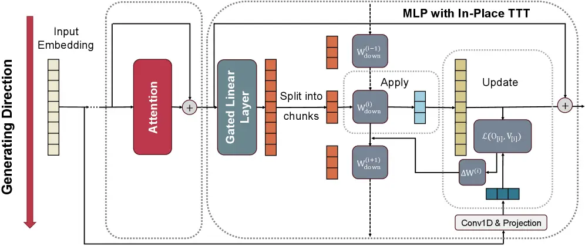
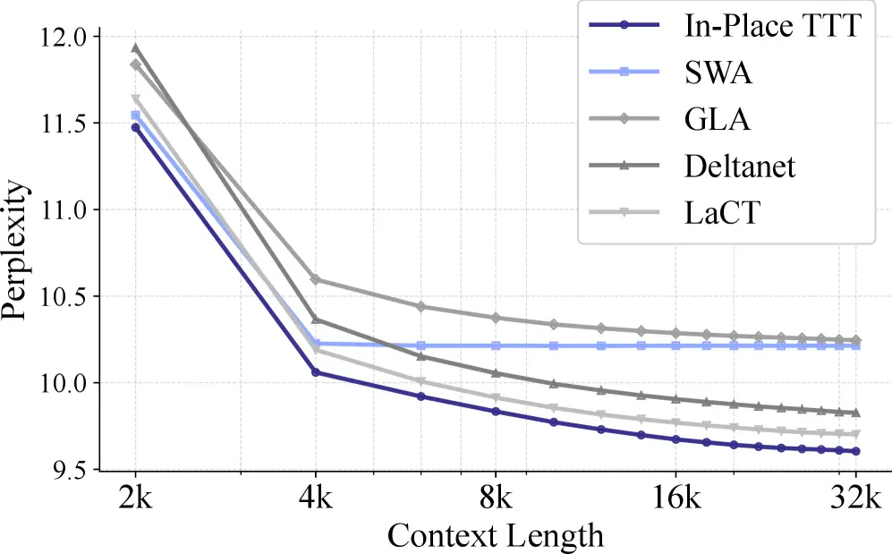
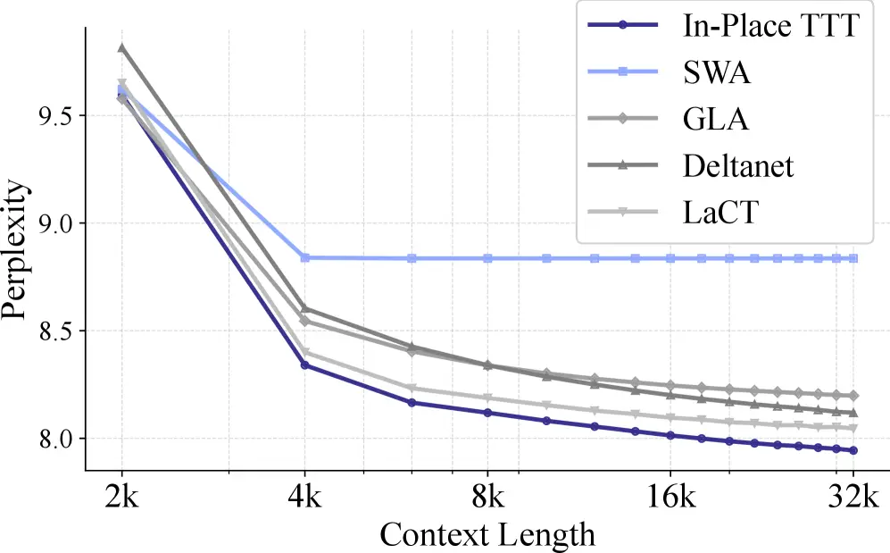
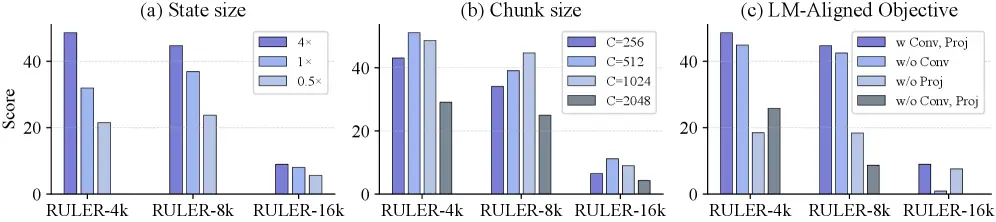
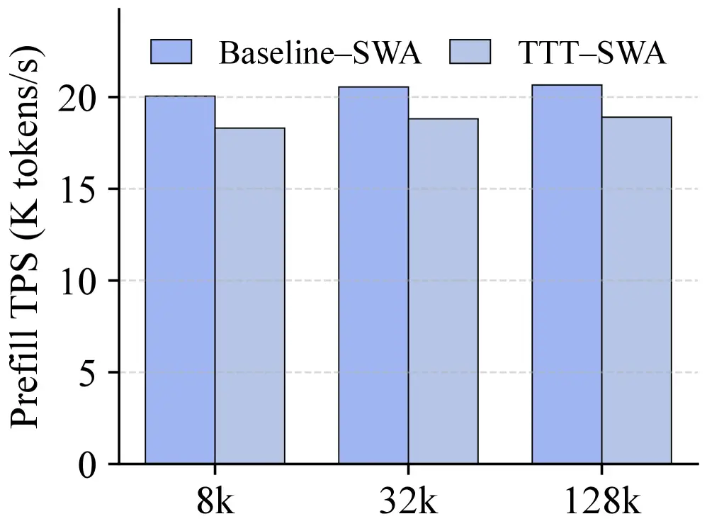
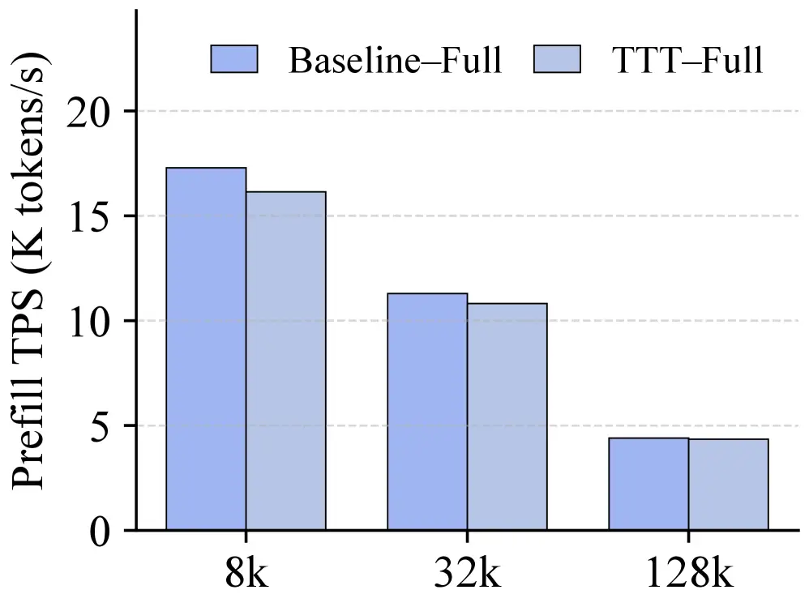
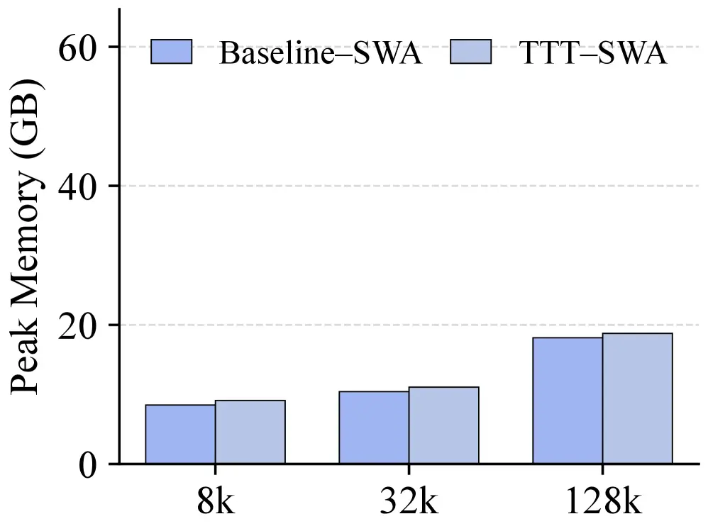
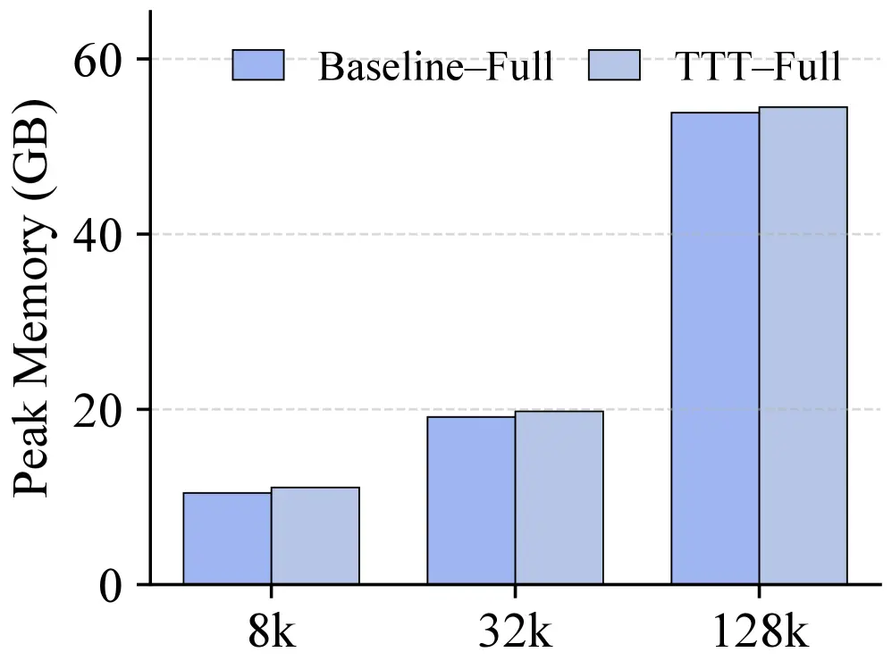

1\]ByteDance Seed 2\]Peking University \contribution\[⋆\]Equal
Contribution \contribution\[†\]Corresponding authors

# In-Place Test-Time Training

Guhao Feng    Shengjie Luo    Kai Hua    Ge Zhang    Di He    Wenhao
Huang    Tianle Cai \[ \[
[dihe@pku.edu.cn](2604.06169v1/mailto:dihe@pku.edu.cn)
[huang.wenhao@bytedance.com](2604.06169v1/mailto:huang.wenhao@bytedance.com)

(April 7, 2026)

###### Abstract

The static “train then deploy" paradigm fundamentally limits Large
Language Models (LLMs) from dynamically adapting their weights in
response to continuous streams of new information inherent in real-world
tasks. Test-Time Training (TTT) offers a compelling alternative by
updating a subset of model parameters (fast weights) at inference time,
yet its potential in the current LLM ecosystem is hindered by critical
barriers including architectural incompatibility, computational
inefficiency and misaligned fast weight objectives for language
modeling. In this work, we introduce In-Place Test-Time Training
(In-Place TTT), a framework that seamlessly endows LLMs with Test-Time
Training ability. In-Place TTT treats the final projection matrix of the
ubiquitous MLP blocks as its adaptable fast weights, enabling a
“drop-in" enhancement for LLMs without costly retraining from scratch.
Furthermore, we replace TTT’s generic reconstruction objective with a
tailored, theoretically-grounded objective explicitly aligned with the
Next-Token-Prediction task governing autoregressive language modeling.
This principled objective, combined with an efficient chunk-wise update
mechanism, results in a highly scalable algorithm compatible with
context parallelism. Extensive experiments validate our framework’s
effectiveness: as an in-place enhancement, it enables a 4B-parameter
model to achieve superior performance on tasks with contexts up to 128k,
and when pretrained from scratch, it consistently outperforms
competitive TTT-related approaches. Ablation study results further
provide deeper insights on our design choices. Collectively, our results
establish In-Place TTT as a promising step towards a paradigm of
continual learning in LLMs.

\correspondence

Di He at and Wenhao Huang at
\checkdata\[Code\][https://github.com/ByteDance-Seed/In-Place-TTT](https://github.com/ByteDance-Seed/In-Place-TTT)

## 1 Introduction

Large Language Models (LLMs) have demonstrated remarkable capabilities
across a range of complex tasks \[8, 11, 51, 39\]. This success is
largely built on a static “train then deploy" paradigm, where a model
first acquires knowledge from massive corpora and then kept fixed during
inference. Yet this design imposes a fundamental limitation: once
deployed, the model’s weights cannot be updated, preventing dynamic
adaptation to the specific context provided by streaming input tokens.
Consequently, at test time, the model is constrained in its ability to
process and reason over long-horizon, evolving tasks \[9, 45\], and to
continuously learn from unbounded streams of experience like humans
\[44\].

In-context learning \[8, 56\] offers a way to mitigate this problem via
maintaining all past input tokens in the context. However, its
effectiveness is tethered to the model’s context window, restricted by
the quadratic complexity of the de facto attention mechanism \[52\].
This bottleneck has spurred a line of research into architectural
solutions aimed at efficiently extending the context window \[6, 42, 10,
17\]. Differently, Test-Time Training (TTT) has emerged as a new
paradigm \[47, 53, 48, 3, 63\]. Instead of merely making a static model
more efficient, TTT enables the model to dynamically update the
parameters and adapt to any specific context, directly targeting the
aforementioned limitation. Specifically, TTT introduces a small subset
of model parameters, called fast weights \[43\], which can be updated on
the fly for each new input. By minimizing a self-supervised
reconstruction objective, these fast weights compress and internalize
contextual information, functioning as an expressive, online evolving
state.

Despite its conceptual appeal, unleashing TTT’s potential within the
current LLM ecosystem is hindered by critical barriers: (i) Existing TTT
methods often rely on specialized layers beyond standard Transformer
blocks, which usually demand costly pretraining from scratch to achieve
satisfactory performance. \[47, 53, 67, 48\]; (ii) the canonical TTT
mechanism is inherently sequential \[47, 48\]. While existing works
explore chunk-wise acceleration \[49, 3, 30, 63\], TTT’s role as the
primary token mixer forces a reliance on small chunks to maintain
performance, thereby bottlenecking the massive parallelism required to
saturate modern accelerators; and (iii) the prevalent use of a generic
reconstruction objective for TTT’s fast weights updating is not
explicitly tailored for the causal, Next-Token Prediction task that
governs autoregressive LMs, potentially hindering their ultimate
performance.

To bridge this gap, we introduce In-Place Test-Time Training (In-Place
TTT), a framework designed to seamlessly endow LLMs with Test-Time
Training capabilities by directly addressing the aforementioned
barriers. Our core insight is to repurpose existing MLP blocks with an
in-place design rather than introducing a new, specialized layer
(tackling barrier i). Specifically, In-Place TTT treats the final
projection matrix of MLP blocks as their fast weights, updating it
in-place during inference. This “drop-in" design requires no
modifications to the model’s architecture, preserving the integrity of
pre-trained weights and enabling on-the-fly adaptation without costly
retraining from scratch.

To tackle the computational inefficiency and objective misalignment, we
further design a bespoke adaptation mechanism for language modeling.
Following previous works \[49, 3, 30, 67, 63\], we replace the
inefficient per-token updates with a scalable chunk-wise update rule
(tackling barrier ii). Furthermore, our in-place design operates
complementarily to the attention mechanism. This synergy obviates the
need for small chunks required by standalone TTT layers, thereby
ensuring high throughput on modern accelerators. Concurrently, we move
beyond the generic reconstruction targets of prior work \[48, 67\] and
introduce a novel objective explicitly aligned with the Next-Token
Prediction (NTP) goal (tackling barrier iii). Grounded in a rigorous
theoretical analysis, we show this NTP-aligned objective encourages the
fast weights to store predictively useful information for autoregressive
language modeling, leading to a highly effective and scalable algorithm.

Grounded in these principled design choices, our In-Place TTT provides a
practical and effective framework for enhancing LLMs with dynamic,
continual adaptation. We conduct extensive experiments on language
modeling tasks of various compute scales, using them as a practical
proxy to probe the model’s potential on long-horizon, evolving tasks.
Through relatively cheap continual training, our In-Place TTT enables
Qwen3-4B-Base to achieve superior performance on tasks with contexts up
to 128k. Furthermore, we compare In-Place TTT with competitive
TTT-related methods by conducting pretraining from scratch on up to
32k-length corpora, validating the architectural merit of our framework.
Finally, ablation studies on state size, chunk size, and fast weight
objectives provide deeper insights, confirming the critical role of each
design choice. Collectively, our results establish In-Place TTT as a
promising step towards a paradigm of continual learning in LLMs.

## 2 Preliminary: Test-Time Training

This section introduces _Test-Time Training (TTT)_, a paradigm that
enables models to adapt dynamically to new data at inference time \[47,
48, 67\]. We will first elaborate on the TTT mechanism and then discuss
the key desiderata for successfully applying TTT to LLMs, which directly
motivates our framework.

The TTT mechanism. At its core, the TTT mechanism leverages _fast
weights_ \[2, 43\], denoted by $`\mathbf{W}`$. These weights constitute
a small neural network
$`f_{\mathbf{W}}(\cdot):\mathbb{R}^{d}\to\mathbb{R}^{d}`$, which is
rapidly updated at test time. Unlike standard model weights that are
frozen after training, the fast weights $`\mathbf{W}`$ act as a dynamic
memory, continuously storing and retrieving contextual information from
the sequence.

To process an input sequence $`\mathbf{x}=[x_{1},x_{2},\dots,x_{N}]`$,
each token $`x_{i}\in\mathbb{R}^{d}`$ is typically projected to derive
the necessary inputs for the TTT operations, such as a _query_
($`q_{i}`$), a _key_ ($`k_{i}`$), and a _value_ ($`v_{i}`$). The TTT
mechanism then operates through two core, sequential operations:

1.  1.  Update Operation: The fast weights $`\mathbf{W}`$ are updated to
        associate a key $`k_{i}`$ with its corresponding value $`v_{i}`$.
        This is framed as a single optimization step that minimizes a loss
        function $`\mathcal{L}(\cdot,\cdot)`$ (e.g., Mean Squared Error),
        which measures the discrepancy in this association. Intuitively,
        this step encodes the information from the $`(k_{i},v_{i})`$ pair
        into the neural memory $`f_{\mathbf{W}}`$. Given a learning rate
        $`\eta`$, the update rule is:

    ```math
    \mathbf{W}_{i}\leftarrow\mathbf{W}_{i-1}-\eta\nabla_{\mathbf{W}}\mathcal{L}\big(f_{\mathbf{W}_{i-1}}(k_{i}),v_{i}\big).
    ```

2.  2.  Apply Operation: The newly updated network $`f_{\mathbf{W}}`$, now
        parameterized by $`\mathbf{W}_{i}`$, is used to process a query
        $`q_{i}`$, i.e., $`o_{i}=f_{\mathbf{W}_{i}}(q_{i})`$. This output
        $`o_{i}`$ is enriched with the contextual information from preceding
        key-value pairs, as that information is now encoded in
        $`\mathbf{W}_{i}`$.

While this two-step formulation describes the high-level mechanism of
TTT, the specific implementation details can vary significantly. Indeed,
numerous recent studies have investigated a rich design space, exploring
different loss functions, more sophisticated optimizers, and alternative
neural memory parameterizations to improve performance and efficiency
\[54, 3, 5, 32\]. These design choices critically influence how
effectively the fast weights can store, retrieve, and forget sequential
information, positioning the TTT mechanism for different data modalities
and tasks.

Desiderata for TTT within the LLM ecosystem. Despite its promise as a
paradigm for dynamic adaptation, unleashing TTT’s potential within the
LLM ecosystem requires addressing several critical challenges. For TTT
to be a viable and effective component, it must satisfy the following
desiderata:

- •
  Architectural Compatibility. We call an architecture compatible with
  LLM if it can warm start from a pretrained checkpoint. However,
  current TTT mechanisms are often developed as standalone recurrent
  layers designed to replace attention, rather than complement it \[47,
  53, 67, 48, 29\]. This necessitates costly pretraining from scratch,
  creating a significant barrier to adoption for the massive,
  billion-parameter models that dominate the LLM ecosystem. Therefore, a
  key desideratum is a “drop-in" design that requires no fundamental
  architectural modifications.
- •
  Computational Efficiency. The mechanism must be efficient on modern
  parallel accelerators. The canonical per-token update rule of TTT is
  inherently sequential and, as a result, severely bottlenecks the
  parallel processing capabilities of GPUs and TPUs \[47, 48, 3\]. This
  operational inefficiency makes fine-grained updates impractical for
  high-throughput language modeling. Consequently, an efficient TTT
  implementation must move beyond per-token schemes and ensure
  scalability, for instance by adopting chunk-wise update mechanisms
  \[36, 49, 3, 30\].
- •
  Tailored Learning Objective for Language Modeling. The predominant
  self-supervised objective in TTT is reconstruction, where the model
  learns to associate ($`k_{i}`$,$`v_{i}`$) pairs, and $`v_{i}`$ is
  typically derived from the input token $`x_{i}`$ itself \[47, 48, 67,
  53, 29\]. While this generic objective enables the TTT mechanism to
  store information, its direct relevance to the ultimate goal of
  language modeling—predicting the next token—is not guaranteed. The
  choice of the target value $`v`$ remains a critical, yet
  underexplored, design decision that may be suboptimal for capturing
  the complex causal dependencies required for LLMs.

## 3 In-Place Test-Time Training

To satisfy the desiderata outlined in section˜2, we introduce In-Place
Test-Time Training (In-Place TTT), a framework designed to unlock TTT
capabilities for LLMs. We first present our overall framework, which
resolves architectural incompatibility via an in-place design that
repurposes existing MLP blocks, while ensuring computational efficiency
with a chunk-wise update mechanism (section˜3.1). We then detail our
novel LM-aligned objective, which is explicitly designed for LLMs by
aligning with the Next-Token Prediction (NTP) goal (section˜3.2).
Following this, we provide a theoretical analysis of our objective’s
superior properties (section˜3.3) and conclude with practical
implementation details (section˜3.4).

### 3.1 Overall Framework

Repurposing MLP Blocks for In-Place Adaptation. Previous TTT research
has largely positioned it as a potential solution to replace the
attention mechanism. However, these prior studies were typically
conducted at moderate scales, a regime vastly different from that of
modern, billion-parameter LLMs. Consequently, replacing the core
attention mechanism—whose learned properties are critical to an LLM’s
capabilities—is a high-risk architectural modification. Moreover,
introducing any new, randomly-initialized layer also creates a conflict
with the billions of trained parameters of LLMs, necessitating costly
and often impractical retraining to resolve this imbalance.

Our core insight is to sidestep these challenges entirely. Instead of
replacing or adding components, we repurpose a ubiquitous module–the
Multi-Layer Perceptron (MLP) block–to also serve as the fast weights.
Recalling the TTT formulations in section˜2, there exist no constraints
on the choice of fast weights, i.e., any parameters can serve as fast
weights updated via the TTT mechanism. In particular, the MLP blocks in
Transformers can also be viewed as a form of key-value memory \[22\],
functioning as a “slow weights" for the vast, general knowledge acquired
during pre-training. It is therefore a natural extension to leverage
this same component to also function as the adaptive "fast weights",
dynamically internalizing transient, in-context information at inference
time.

Formally, we adapt the widely used gated MLP architecture \[24, 57\].
Given the hidden representation $`\mathbf{H}`$, the gated MLP computes
its output representation
$`\mathbf{O}=\left(\phi(\mathbf{H}\mathbf{W}_{\mathrm{gate}}^{\top})\odot(\mathbf{H}\mathbf{W}_{\mathrm{up}}^{\top})\right)\mathbf{W}_{\mathrm{down}}^{\top}`$.
In our framework, we treat the input projections
$`\mathbf{W}_{\mathrm{up}}`$ and $`\mathbf{W}_{\mathrm{gate}}`$ as
frozen slow weights, while repurposing the final projection matrix,
$`\mathbf{W}_{\mathrm{down}}`$, as the adaptable fast weights. By
exclusively updating $`\mathbf{W}_{\mathrm{down}}`$ in-place, we
preserve the model’s architectural integrity, transforming TTT from a
disruptive restructuring into a lightweight, “drop-in" enhancement for
LLMs.

Efficient Adaptation with Chunk-Wise Updates. Beyond architectural
compatibility, our in-place design also unlocks significant
computational efficiencies. Conventional TTT methods, by aiming to
replace the attention mechanism, were bound to inefficient per-token
updates to enforce strict causality and perform fine-grained token
mixing. Chunk-wise updating approaches have been explored by recent
works to achieve acceleration \[36, 49, 3, 30\]. Our framework also
follows to sidestep the trade-off entirely. Since we only adapt the MLP
blocks and leave the attention layers intact, we are liberated from the
per-token constraint, enabling a far more efficient chunk-wise update
strategy which further bypasses the small chunk constraints (our
ablation study results (Section 4.3) also verify that our framework is
naturally well-suited for chunk-wise—and specifically large
chunk-wise—updates, achieving optimal performance with chunk sizes of
512 to 1024).

The process operates as follows. Given the intermediate activations
$`\mathbf{Z}=\phi(\mathbf{H}\mathbf{W}_{\mathrm{gate}}^{\top})\odot(\mathbf{H}\mathbf{W}_{\mathrm{up}}^{\top})\in\mathbb{R}^{n\times d_{\mathrm{ff}}}`$
and corresponding value targets and outputs
$`\mathbf{V},\mathbf{O}\in\mathbb{R}^{n\times d_{\mathrm{model}}}`$, we
partition them into $`k`$ non-overlapping chunks of size $`C`$, denoted
$`\mathbf{\square}_{[i]}=\mathbf{\square}_{iC+1:(i+1)C}\in\mathbb{R}^{C\times d^{\prime}}`$
for $`\square\in\{\mathbf{Z},\mathbf{V},\mathbf{O}\},i\in[k]`$ and
$`d^{\prime}`$ being their corresponding dimension. Let
$`\mathbf{W}_{\mathrm{down}}^{(i)}`$ be the fast weights state before
processing chunk $`i`$ and
$`\mathbf{W}_{\mathrm{down}}^{(0)}=\mathbf{W}_{\mathrm{down}}`$. For
each chunk $`i\in[k]`$, we perform two sequential operations:

1.  1.  Apply Operation: The current state of the fast weights
        $`\mathbf{W}_{\mathrm{down}}^{(i)}`$ are used to process chunk
        $`\mathbf{\mathbf{Z}}_{[i]}`$, i.e.,
        $`\mathbf{O}_{[i]}=\mathbf{Z}_{[i]}(\mathbf{W}_{\mathrm{down}}^{(i)})^{\top}`$.
2.  2.  Update Operation: The fast weight
        $`\mathbf{W}_{\mathrm{down}}^{(i)}`$ are updated using
        $`\mathbf{Z}_{[i]}`$ as keys and $`\mathbf{V}_{[i]}`$ as values,
        which is performed via one gradient descent step with a loss
        function $`\mathcal{L}`$ and a learning rate $`\eta`$:
        $`\mathbf{W}_{\mathrm{down}}^{(i+1)}=\mathbf{W}_{\mathrm{down}}^{(i)}-\eta\nabla_{\mathbf{W}}\mathcal{L}\left(\mathbf{Z}_{[i]}(\mathbf{W}_{\mathrm{down}}^{(i)})^{\top},\textbf{V}_{[i]}\right).`$

This chunk-wise update strategy is designed for modern hardware, similar
to prior attempts \[36, 49, 3, 30\]. Moreover, due to our in-place MLP
adaptation, we can use a large chunk size $`C`$ to process large blocks
of tokens at once, thereby highly leveraging parallelism and utilizing
the computational power of GPUs or TPUs.

### 3.2 LM-Aligned Objective

With the efficient, in-place adaptation framework established, the
performance of In-Place TTT now hinges on the design of its learning
objective. In this subsection, we introduce our Language
Modeling-Aligned objective, which is explicitly tailored for LLMs.

Prior TTT approaches typically use a reconstruction target, e.g.,
$`\mathcal{L}\big(f_{\mathbf{W}}(k),v\big)`$ where both $`k`$ and $`v`$
are linear projection outputs of the same input token $`x`$ \[47, 48,
67\], which encourages the model to simply memorize the current token’s
representation. We argue that this is suboptimal for language modeling
tasks. Instead, we propose to align the objective with the Next-Token
Prediction (NTP) goal governing LLMs.

To achieve this, we specify the target $`v`$ to include future token
information. Formally, we derive our target
$`\hat{\mathbf{V}}=\operatorname{Conv1D}(\mathbf{X}_{0})\mathbf{W}_{\mathrm{target}}`$,
where $`\mathbf{X}_{0}\in\mathbb{R}^{n\times d_{\mathrm{model}}}`$
denotes the token embedding, $`\operatorname{Conv1D}(\cdot)`$ is the 1D
Convolution operator and
$`\mathbf{W}_{\mathrm{target}}\in\mathbb{R}^{d_{\mathrm{model}}\times d_{\mathrm{model}}}`$
is a trainable projection matrix. Under this formulation, the amount of
future token information can be controlled in our target
$`\hat{\mathbf{V}}`$, e.g., the Next-Token target can be achieved by
parameterizing $`\mathbf{W}_{\mathrm{target}}`$ as an identity
transformation and assigning $`\operatorname{Conv1D}(\cdot)`$’s kernel
weights to be 1 for the next token and 0 for other tokens.

With this aligned target, we use the widely used similarity measure to
instantiate our loss function for simplicity, i.e.,
$`\mathcal{L}(\cdot,\cdot)=-\langle\cdot,\cdot\rangle_{F}`$. Under this
loss function, the gradient with respect to the fast weights in our
chunk-wise mechanism can be directly derived:

```math
\mathbf{W}_{\mathrm{down}}^{(i)}=\mathbf{W}_{\mathrm{down}}^{(i-1)}+\eta\hat{\mathbf{V}}_{[i]}^{\top}\mathbf{Z}_{[i]}. \tag{1}
```

### 3.3 Theoretical Analysis

Intuitively, our LM-Aligned objective explicitly encourages the fast
weights to compress predictively useful information for future tokens,
thereby enhancing the model’s capacity for dynamic adaptation. In this
subsection, we formalize this intuition by theoretically analyzing the
benefits of our objective. We ground our analysis within the canonical
induction head setting \[38, 19\], a mechanism understood to be critical
for in-context learning in LLMs.

Setup. Consider an input sequence where a key-value pair,
$`(x_{t^{*}},x_{t^{*}+1})=(k^{*},v^{*})`$, appears at an arbitrary
position $`t^{*}`$. Subsequently, at a query position $`n>t^{*}`$, the
key $`k^{*}`$ reappears, such that $`x_{n}=k^{*}`$. The model must then
correctly predict the associated value, $`x_{n+1}=v^{*}`$.

Without loss of generality, we analyze a single Transformer block
enhanced by our In-Place TTT. Let
$`\mathbf{Z}_{t}\in\mathbb{R}^{d_{\mathrm{ff}}}`$ be the intermediate
activation of token $`x_{t}`$ and
$`\mathbf{E}_{w}\in\mathbb{R}^{d_{\mathrm{model}}}`$ be the token
embedding for $`x_{w}`$. In our framework, the fast weights update from
prior context chunks is
$`\Delta\mathbf{W}_{\mathrm{down}}=\eta\sum_{t\in\text{prior chunks}}{\mathbf{V}}_{t}\mathbf{Z}_{t}^{\top}`$.
This update then change the output logit at the query position $`n`$ by
$`\Delta\boldsymbol{\ell}_{n}[w]=\mathbf{E}_{w}^{\top}\Delta\mathbf{W}_{\mathrm{down}}\mathbf{Z}_{n}`$.
We compare two choices for the TTT target $`\mathbf{V}_{t}`$:

- •
  Reconstruction Target:
  $`\mathbf{V}_{t}^{\mathrm{rec}}=\mathbf{E}_{x_{t}}`$, the embedding of
  the current token.
- •
  LM-Aligned Target:
  $`\mathbf{V}_{t}^{\mathrm{LM}}=\mathbf{E}_{x_{t+1}}`$, the embedding
  of the next token.

Assumptions. Our analysis rests on two mild assumptions about the
properties of the embeddings and intermediate activations, which are
standard in theoretical analyses of Transformers:

1.  1.  Approximate Orthogonality of Embeddings: For any two distinct tokens
        $`w_{i},w_{j}\in\mathcal{V}`$, their embeddings are nearly
        orthogonal:
        $`|\mathbf{e}_{w_{i}}^{\top}\mathbf{e}_{w_{j}}|\leq\epsilon`$ for a
        small constant $`\epsilon>0`$. Additionally, embeddings have a
        non-trivial magnitude:
        $`\|\mathbf{e}_{w_{i}}\|^{2}\geq c_{\text{norm}}^{2}>0`$ for some
        constant $`c_{\text{norm}}`$.
2.  2.  Key-Query Alignment: The intermediate activations $`\mathbf{Z}_{n}`$
        for the query token $`x_{n}=k^{*}`$ is aligned with
        $`\mathbf{Z}_{t^{*}}`$ of its corresponding key token
        $`x_{t^{*}}=k^{*}`$:
        $`\mathbb{E}[\mathbf{z}_{t^{*}}^{\top}\mathbf{z}_{n}]=c_{\text{align}}>0`$.
        For other positions $`t\neq t^{*}`$, the tokens are unrelated to the
        query, i.e,
        $`\mathbb{E}\!\left[(\mathbf{V}_{t}\mathbf{Z}_{t}^{\top})\,\mathbf{Z}_{n}\right]=\mathbf{0}.`$

With this setup, we present our main theoretical result:

###### Theorem 1 (Logit-wise Effect of LM-Aligned Target v.s. Reconstruction Target).

Under the specified setup and assumptions, for a learning rate
$`\lambda_{\text{lr}}>0`$, the expected change in logits
$`\Delta\boldsymbol{\ell}_{n}`$ after one update step using the
LM-Aligned target satisfies:

```math
\displaystyle\text{{(Correct logit increases)}}\quad\mathbb{E}\left[\Delta\boldsymbol{\ell}_{n}[v^{*}]\right] \displaystyle\geq\lambda_{\text{lr}}\cdot c_{\text{norm}}^{2}\cdot c_{\text{align}}, \tag{2}
```

```math
\displaystyle\text{{(Other logits almost unchanged)}}\quad\left|\mathbb{E}\left[\Delta\boldsymbol{\ell}_{n}[w]\right]\right| \displaystyle\leq\lambda_{\text{lr}}\cdot\epsilon\cdot c_{\text{align}},\quad\forall w\neq v^{*}. \tag{3}
```

In contrast, for the reconstruction target, the expected change in
logits is negligible for the correct token:
$`|\mathbb{E}\left[\Delta\boldsymbol{\ell}_{n}[v^{*}]\right]|\leq\lambda_{\text{lr}}\cdot\epsilon\cdot c_{\text{align}}.`$

The proof is provided in Appendix 7. In theorem˜1, the LM-Aligned target
is guaranteed in expectation to increase the logit of the correct next
token $`v^{*}`$ and keep that of other tokens approximately unchanged,
directly aiding the model’s prediction task. In contrast, the
reconstruction target provides no such predictive benefit, failing to
increase the logit of the correct token. In practice, our implementation
extends this principle from a single next token to a learned, localized
combination of future tokens, which also aligns with recent promising
results of Multi-Token Prediction in advanced LLMs \[37\] as an
effective extension of the NTP objective. This allows our In-Place TTT
to capture a richer predictive signal, thereby compressing useful
contextual information more effectively than simple reconstruction.



Figure 1: The overall framework of our In-Place Test-Time Training. The
module operates sequentially on input chunks. For each chunk, the
current fast weights are first applied to the intermediate activations
$`\mathbf{Z}`$ to produce the output. Then, these weights are updated
using the activations $`\mathbf{Z}`$ and a value $`\mathbf{V}`$ derived
from the token embeddings. This "apply-then-update" cycle allows the
model to dynamically adapt to incoming context in a strictly causal
manner.

### 3.4 Implementation Details

Combining aforementioned designs, figure˜1 illustrates our In-Place TTT
framework. Here we further elaborate on practical implementation
details, which are engineered for high efficiency and scalability on
modern hardware. In particular, our approach is fully compatible with
Context Parallelism (CP), relying on a parallel scan algorithm to
process sequence chunks simultaneously while preserving the strict
causal semantics of an auto-regressive update. Additional discussions
are further presented.

Efficient Implementation with Context Parallelism. The associative
nature of our update rule in equation˜1 makes In-Place TTT amenable to a
context-parallel implementation, which partitions a sequence along its
length and processes the chunks simultaneously. The process unfolds into
three stages: (i) for all chunks $`i\in\{1,\dots,T\}`$, we compute the
intermediate activations $`\mathbf{Z}_{[i]}`$ and the fast weight update
$`\Delta\mathbf{W}_{\mathrm{down}}^{(i)}=(\hat{\mathbf{V}}_{[i]})^{\top}\mathbf{Z}_{[i]}`$
in parallel; (ii) a single prefix sum over
$`[...,\Delta\mathbf{W}_{\mathrm{down}}^{(i)},\Delta\mathbf{W}_{\mathrm{down}}^{(i+1)},...]`$
is conducted to compute the aggregated updates for each chunk:
$`\Delta\mathbf{S}_{i}=\sum_{j=1}^{i-1}\Delta\mathbf{W}_{j}`$, which can
be highly efficient on modern accelerators; (iii) the effective fast
weights for each chunk,
$`\mathbf{W}_{\mathrm{down}}^{(i-1)}=\mathbf{W}_{\mathrm{down}}^{(0)}+\eta\Delta\mathbf{S}_{i}`$,
and the corresponding output,
$`\mathbf{O}_{[i]}=\mathbf{Z}_{[i]}(W_{\mathrm{down}}^{(i-1)})^{\top}`$,
are computed in parallel.

Causality and Boundary Handling. To ensure that the update delta for
chunk $`i`$ itself contains no future information, we apply causal
padding to the 1D convolution when generating the value. This isolates
each delta calculation to its respective chunk, making the parallel scan
mathematically equivalent to a sequential update. Moreover, at document
boundaries, the fast weights are reset to their pre-trained state to
prevent context leakage across independent sequences. The final context
parallel algorithm is presented in algorithm˜1 in Appendix 8.

Discussion. In summary, our implementation of In-Place TTT
synergistically combines a simple, computationally efficient update rule
with a parallel scan algorithm. This design choice makes our method not
only fast and scalable but also mathematically equivalent to a strictly
causal sequential process, thanks to careful boundary and padding
management. The resulting module is CP-native, fully causal, and can be
seamlessly integrated as a drop-in replacement for the MLP block in
standard Transformer architectures. Lastly, it is also noteworthy that
the core principles of our framework are orthogonal to the specific
choice of loss functions and its optimizer, which have been widely
studied in the broader TTT literature, an exploration we leave as a
promising direction for future work.

## 4 Experiments

In this section, we conduct a series of experiments to empirically
validate the effectiveness of our In-Place TTT framework. Specifically,
we aim to answer the following research questions:

- •
  Q1: How effectively can In-Place TTT enhance pre-trained LLMs in a
  “drop-in" manner?
- •
  Q2: When trained from scratch, how does In-Place TTT compare against
  prior TTT approaches?
- •
  Q3: What are the effects of key design choices in our In-Place TTT
  framework?

Using language modeling tasks of various scales as a practical proxy, we
answer each question with carefully designed experiments in the
following sub-sections. Due to space limits, we present detailed
descriptions of experimental settings in Appendix 9.

|                            |                      |          |          |          |          |          |               |
| -------------------------- | -------------------- | -------- | -------- | -------- | -------- | -------- | ------------- |
|                            | In-Domain Evaluation |          |          |          |          |          | Extrapolation |
| Model                      | 4k                   | 8k       | 16k      | 32k      | 64k      | 128k     | 256k          |
| Mistral-7B \[31\]          | $`93.6`$             | $`91.2`$ | $`87.2`$ | $`75.4`$ | $`49.0`$ | $`13.8`$ | \-            |
| GLM3-6B \[23\]             | $`87.8`$             | $`83.4`$ | $`78.6`$ | $`69.9`$ | $`56.0`$ | $`42.0`$ | \-            |
| Phi3-medium-14B \[1\]      | $`93.3`$             | $`93.2`$ | $`91.1`$ | $`86.8`$ | $`78.6`$ | $`46.1`$ | \-            |
| Llama3-8B \[41\]           | $`92.8`$             | $`90.3`$ | $`85.7`$ | $`79.9`$ | $`76.3`$ | $`69.5`$ | \-            |
| Qwen3-4B (Instruct) \[57\] | $`95.1`$             | $`93.6`$ | $`91.0`$ | $`87.8`$ | $`77.8`$ | $`66.0`$ | \-            |
| Baseline                   | $`96.6`$             | $`94.1`$ | $`92.1`$ | $`88.7`$ | $`74.3`$ | $`74.8`$ | $`41.7`$      |
| In-Place TTT               | $`96.1`$             | $`95.6`$ | $`92.7`$ | $`89.3`$ | $`78.7`$ | $`77.0`$ | $`43.9`$      |

Table 1: Evaluation results on RULER \[28\]. Average accuracy (%) is
reported, with the best results in bold.

### 4.1 In-Place TTT as a Drop-in Enhancement for Pre-trained LLMs

To validate In-Place TTT as a “drop-in” enhancement for existing,
pre-trained LLMs, we start with the competitive open-sourced
Qwen3-4B-Base model. Its original context window is 32k, thereby we can
simulate the long-horizon, evolving tasks requiring Test-Time Training
capabilities by language modeling tasks of varying context lengths. In
particular, we compare the performance of (1) Qwen3-4B-Base (Baseline);
(2) Qwen3-4B-Base + In-Place TTT (In-Place TTT). Both models undergo the
exact same continual training curriculum, ensuring a fair comparison
where our In-Place TTT is the only variable.

Training and Evaluation. The continual training curriculum is divided
into two stages: an initial phase of $`\sim`$20B tokens with 32k context
length, followed by a second phase of $`\sim`$15B tokens with 128k
context length. The detailed descriptions of training dataset can be
found in Appendix 9.1. To effectively manage these long sequences, we
adapt the model’s Rotary Position Embeddings using YaRN \[42\]. We
evaluate the long-context performance of both models on the RULER
benchmark \[28\] using the popular OpenCompass framework \[13\], with
context lengths ranging from 4k to 256k. The 256k setting specifically
measures the models’ ability to extrapolate beyond the 128k context
length limit. Detailed descriptions of training details can be found in
Appendix 9.2.

Results and Discussion. The results, summarized in table˜1, demonstrate
that In-Place TTT significantly boosts the long-context proficiency of
the pre-trained model. In particular, a clear trend can be easily seen
from the results: while both models are competitive at short contexts,
Qwen3-4B-Base enhanced by our In-Place TTT establishes a consistent and
widening advantage as the sequence length increases. It achieves
substantial gains at the 64k and 128k context lengths. Crucially, this
advantage is maintained when extrapolating to a 256k context,
demonstrating superior generalization. These findings confirm that
In-Place TTT can be seamlessly integrated into a pre-trained LLM to
boost its long-context proficiency. The model’s strong performance at
and beyond the context length validates our method as a practical and
powerful tool for extending the capabilities of existing LLMs.

Extension to More Models. To verify the generality of our approach, we
further apply In-Place TTT as a drop-in enhancement to two additional
models: LLaMA-3.1-8B \[24\] and Qwen3-14B-Base \[57\], following the
same continual training protocol. As shown in Table 2, In-Place TTT
consistently improves the RULER scores across all context lengths on
both models. The gains are particularly pronounced at longer contexts,
e.g., +2.1 at 64k for LLaMA-3.1-8B and +2.7 at 64k for Qwen3-14B-Base.
Moreover, the improvement is maintained when combined with YaRN \[42\]
for position extrapolation, confirming that our method is orthogonal to
RoPE extension techniques. These results, spanning different model
families and scales (4B–14B), reinforce that In-Place TTT is a broadly
applicable drop-in enhancement for pre-trained LLMs.

| Base Model   | Method       | 4k   | 8k   | 16k  | 32k  | 64k  | 64k+YaRN |
| ------------ | ------------ | ---- | ---- | ---- | ---- | ---- | -------- |
| LLaMA-3.1-8B | Baseline     | 93.9 | 92.1 | 92.5 | 91.1 | 81.6 | –        |
|              | In-Place TTT | 94.4 | 93.0 | 93.3 | 91.7 | 83.7 | –        |
| Qwen3-14B    | Baseline     | 96.8 | 95.0 | 94.6 | 90.7 | 67.9 | 81.3     |
|              | In-Place TTT | 97.2 | 95.7 | 95.2 | 91.2 | 70.6 | 82.5     |

Table 2: Extension of In-Place TTT to LLaMA-3.1-8B and Qwen3-14B-Base on
the RULER benchmark. We report the average accuracy (%) with the best
results in bold.

### 4.2 Pre-training from Scratch: A Comparative Analysis



\(a\) Sliding Window Perplexity of 500M Model



\(b\) Sliding Window Perplexity of 1.5B Model

Figure 2: Sliding Window Perplexity at varying context lengths on the
Pile dataset for 500M (left) and 1.5B (right) parameter models. Our
In-Place TTT consistently achieves lower perplexity than all competitive
baselines.

|                    |            | Common Sense Reasoning |           |           |           |           | Long-Context Evaluation |           |           |
| ------------------ | ---------- | ---------------------- | --------- | --------- | --------- | --------- | ----------------------- | --------- | --------- |
| Model Architecture |            | HellaSwag              | ARC-E     | ARC-C     | MMLU      | PIQA      | RULER-4k                | RULER-8k  | RULER-16k |
| Baselines          | Full Attn. | $`55.67`$              | $`64.52`$ | $`33.19`$ | $`36.43`$ | $`72.63`$ | $`45.77`$               | $`38.09`$ | $`6.58`$  |
|                    | SWA        | $`54.92`$              | $`64.18`$ | $`32.85`$ | $`36.06`$ | $`72.58`$ | $`14.77`$               | $`9.91`$  | $`5.07`$  |
| I.P. TTT           | Full Attn. | $`55.85`$              | $`64.98`$ | $`32.34`$ | $`37.42`$ | $`73.29`$ | $`49.98`$               | $`43.82`$ | $`19.99`$ |
|                    | SWA        | $`55.24`$              | $`64.60`$ | $`33.70`$ | $`36.48`$ | $`72.03`$ | $`28.33`$               | $`26.80`$ | $`7.57`$  |

Table 3: Evaluation results of 4B models on common sense reasoning and
long-context evaluation benchmarks. Best performance is in bold. “SWA”
is Sliding-Window Attention, “Full Attn.” is Full Attention, and “I.P.
TTT” is our In-Place TTT.

Having demonstrated In-Place TTT’s effectiveness as a “drop-in” module,
we further evaluate its performance and scalability when integrated into
models pre-trained from scratch. Our analysis proceeds in two stages: we
first establish its language modeling capabilities at the 500M and 1.5B
scales, and then assess its scalability and impact on a larger 4B model.

Experimental Setup. Firstly, we benchmark our In-Place TTT against prior
TTT-related approaches and efficient attention methods based on
TogetherAI \[50\] at 500M and 1.5B parameter scales. Various competitive
baselines are compared: (1) standard Transformer with sliding window
attention (SWA) \[10, 6\] (2) Gated Linear Attention (GLA) \[60\]; (3)
DeltaNet \[43, 62, 59\] (4) Large Chunk Test-Time Training (LaCT)
\[67\]. For a fair comparison, both In-Place TTT and LaCT are built upon
an SWA backbone. All models are trained on sequences with a 32k context
length.

Building on these results, we further scale up to 4B-parameter models to
evaluate scalability of our In-Place TTT approach. In particular, we
compare Transformers with Full Attention and Transformers with SWA
against their counterparts enhanced by our In-Place TTT. These models
are trained for 120B tokens with an 8k context length. Detailed
descriptions of datasets, model configurations, and training procedures
are available in sections˜9.1, 9.3 and 9.2.

Evaluation. For the 500M and 1.5B models, we evaluate their long-context
utilization using Sliding Window Perplexity on a validation set
comprised of Pile \[20\] and Proof-Pile-2 \[40\]. This metric measures
perplexity on a fixed final block of tokens when extending the preceding
context, where a decreasing perplexity trend indicates effective context
usage. For the 4B models, we conduct a broader evaluation on a suite of
downstream tasks, including common sense reasoning benchmarks (HellaSwag
\[66\], ARC \[12\], MMLU \[27, 26\], PIQA \[7\]) and the long-context
RULER benchmark \[28\].

Results and Discussion. In Figure 2, we plot the sliding window
perplexity against context length for 500M/1.5B model. It can be easily
seen that our In-Place TTT consistently achieves lower validation
perplexity than all competitive baselines, with its performance steadily
improving up to the full 32k context. This sustained improvement
suggests its core mechanism successfully compresses and utilizes
information from incoming context.

Moreover, the results in Table 3 further show that 4B-parameter
Transformers with both Full Attention and SWA are consistently improved
across most common sense reasoning tasks. Furthermore, models with our
In-Place TTT yield superior performance on the long-context evaluation,
e.g., RULER-16k score is improved from 6.58 to 19.99 for the Transformer
with Full Attention and RULER-8k score is boosted from 9.91 to 26.80 for
the SWA model. These substantial gains, particularly across models of
various scales, establish our In-Place TTT as a highly effective and
scalable approach.

### 4.3 Ablation Studies: On the Impact of Key Design Choices

Lastly, we conduct a series of ablation studies on RULER with a
1.7B-parameter model, providing deeper insights into our design choices.
Detailed settings are presented in Appendix 9.3 and 9.2.

Impact of State Size. We first investigate how performance scales with
the fast weights size, which can be controlled by varying the number of
TTT-enabled layers. Figure 3 (a) shows a clear trend that the
performance of our In-Place TTT consistently improves along with the
state size scaling. This confirms that larger fast weights allow the
model to more effectively adapt to contextual information, which further
supports our repurposing approach leveraging the large amount of MLP
states.

Impact of Chunk Size. The chunk size $`C`$ in section˜3.1 controls both
the granularity of fast weights updating and parallelism, exposing a
tradeoff between efficiency and performance. By varying the chunk size,
Figure 3 (b) shows that both $`C=512`$ and $`C=1024`$ competitively
achieve better performance compared to other choices, while $`C=1024`$
has better efficiency.

Impact of LM-Aligned Objective. Next, we delve deep into our tailored
LM-Aligned objective in section˜3.2, where the target is defined as
$`\hat{\mathbf{V}}=\operatorname{Conv1D}(\mathbf{X}_{0})\mathbf{W}_{\mathrm{target}}`$.
In particular, the $`\operatorname{Conv1D}`$ operator is used to yield
targets containing future token information, and the
$`\mathbf{W}_{\mathrm{target}}`$ is a projection transformation. In
Figure 3 (c), we comprehensively ablate combinations of these
components. The result shows that both of them are necessary for
performance guarantee, while $`\operatorname{Conv1D}`$ plays an
essential role on long context and $`\mathbf{W}_{\mathrm{target}}`$ is
crucial on short context. These results align with our theoretical
analysis in section˜3.3, strongly supporting our motivation to derive a
tailored objective for language modeling.

Efficiency Impact of In-Place TTT. We further study the computational
overhead introduced by our In-Place TTT. In figure˜4, we compare both
prefill throughput and memory consumptions of with and without our
In-Place TTT. The results indeed verify the efficiency of our practical
implementations.



Figure 3: Ablation studies on the key design choices of the In-Place TTT
framework, evaluated on the RULER benchmark with a 1.7B parameter model.
The plots illustrate the impact of: (a) State size, showing that
performance improves as the state size scales; (b) Chunk size,
demonstrating a performance trade-off where intermediate sizes (e.g.,
512, 1024) are optimal; and (c) The LM-Aligned Value objective,
confirming that both the convolution (w Conv) and the projection (w
Proj) are crucial.



\(a\) Throughput (SWA)



\(b\) Throughput (Full)



\(c\) Memory (SWA)



\(d\) Memory (Full)

Figure 4: Efficiency analysis of In-Place TTT. Both prefill throughput
(a, b) and peak memory (c, d) metrics are presented for 4B models with
Sliding-Window Attention (SWA) and Full Attention at various context
lengths. Our In-Place TTT introduces negligible overhead in practical
scenarios.

## 5 Related Work

Test-Time Training (TTT). Test-Time Training (TTT) is a paradigm that
enables a model to adapt dynamically in response to continuous streams
of data at inference by updating a small subset of its parameters, known
as fast weights \[2\]. Initially demonstrating success in computer
vision \[47, 53\], TTT has since been extended to numerous other
modalities—including language \[48\], video \[15\], and audio
\[18\]—underscoring its broad applicability. Research in this area has
largely focused on two avenues for improving TTT’s effectiveness: the
design of more sophisticated test-time optimizers \[4\] and the
formulation of novel, self-supervised online learning objectives \[3,
32\]. However, the computational efficiency of TTT remained a critical
bottleneck due to its inherently sequential, per-token update process.
The chunk wise Test-Time Training framework was the first to directly
address this challenge by introducing a chunk-wise update mechanism to
better leverage parallel hardware \[3, 30, 67, 49, 63, 36\]. Despite
these advances, TTT’s function as the primary token mixer necessitates
reliance on small chunks to preserve performance—this in turn creates a
bottleneck that limits the massive parallelism needed to fully utilize
modern accelerators. Furthermore, prior work has not addressed how to
seamlessly integrate TTT into large, pre-trained models, nor developed
learning objectives specifically tailored for the autoregressive nature
of LLMs, which are gaps our work directly addresses.

Efficient Long-Context Architectures. A parallel line of research seeks
to extend the effective context window of LLMs by mitigating the
quadratic complexity of the standard attention mechanism. Major
approaches include: 1) Sparse attention methods, which restrict the
range of token-to-token interactions via fixed patterns like sliding or
strided windows \[10, 6, 65\]; 2) Linear-time variants, which
approximate the attention mechanism or replace it with efficient
recurrent or gated formulations, such as linear attention \[33, 43\]
Gated Linear Attention (GLA) \[58\]; and 3) State-Space Models (SSMs),
which compress sequence history into a compact latent state, enabling
processing with linear complexity \[17, 16\]. Recently, the delta rule
has emerged as a popular design choice for linear attention and SSMs,
enabling better experessivity and highly parallelizable implementations
\[61\]. These architectural advances are complementary to our framework.
While they focus on efficiently processing long contexts, TTT provides a
mechanism for online adaptation to the information within that context.
Our In-Place TTT can be also naturally integrated with these efficient
backbones, as they also have MLP blocks. And we leave these as the
future work.

Memory Design and Augmentation. A related domain of research involves
augmenting neural architectures with explicit memory modules to enhance
their reasoning and contextual understanding capabilities. These
approaches can be broadly distinguished by their function: some are
designed to store persistent, task-agnostic knowledge in an external
memory bank, while others focus on capturing transient, data-dependent
information from the immediate context \[34, 25, 35, 55, 64\]. The
latter, contextual memories, have been implemented using various
mechanisms, including recurrent state transitions, attention-based
context aggregation in Transformers \[14\], and rapid, gradient-based
updates to fast weights \[61\]. Test-Time Training (TTT) represents a
powerful instance of this latter category, which conceptually extends
the notion of a hidden state found in Recurrent Neural Networks (RNNs).
Rather than compressing contextual history into a fixed-size activation
vector, TTT designates a subset of the model’s own parameters—the fast
weights—to function as a high-capacity, dynamic memory \[2, 43\]. These
weights are updated on the fly at inference time, allowing the model to
continuously internalize evolving contextual information and thereby
function as an expressive, online evolving state.

## 6 Conclusion

We introduced In-Place Test-Time Training, a practical framework that
resolves the critical barriers of TTT for LLMs. Principled design
choices are proposed including an in-place mechanism that repurposes
existing MLP blocks, an efficient chunk-wise update rule, and a
theoretically-grounded objective aligned with language modeling.
Extensive experiments validate that our approach not only serves as a
powerful “drop-in" enhancement for pre-trained LLMs but also outperforms
strong baselines when trained from scratch. By providing a scalable
solution for on-the-fly adaptation, our work makes a promising step
towards a new paradigm of more dynamic, continual learning for LLMs.

## References

- Abdin et al. \[2024\] Marah Abdin, Jyoti Aneja, Hany Awadalla, Ahmed
  Awadallah, Ammar Ahmad Awan, Nguyen Bach, Amit Bahree, Arash
  Bakhtiari, Jianmin Bao, Harkirat Behl, Alon Benhaim, Misha Bilenko,
  Johan Bjorck, Sébastien Bubeck, Martin Cai, et al. Phi-3 technical
  report: A highly capable language model locally on your phone, 2024.
  URL
  [https://arxiv.org/abs/2404.14219](https://arxiv.org/abs/2404.14219).
- Ba et al. \[2016\] Jimmy Lei Ba, Geoffrey E. Hinton, Volodymyr Mnih,
  Joel Z. Leibo, and Catalin Ionescu. Using fast weights to attend to
  the recent past. In _Advances in Neural Information Processing
  Systems_, 2016. URL
  [https://arxiv.org/abs/1610.06258](https://arxiv.org/abs/1610.06258).
- Behrouz et al. \[2024\] Ali Behrouz, Peilin Zhong, and Vahab Mirrokni.
  Titans: Learning to memorize at test time. _arXiv preprint
  arXiv:2501.00663_, 2024.
- Behrouz et al. \[2025a\] Ali Behrouz, Meisam Razaviyayn, Peilin Zhong,
  and Vahab Mirrokni. It’s all connected: A journey through test-time
  memorization, attentional bias, retention, and online optimization,
  2025a. URL
  [https://arxiv.org/abs/2504.13173](https://arxiv.org/abs/2504.13173).
- Behrouz et al. \[2025b\] Ali Behrouz, Meisam Razaviyayn, Peilin Zhong,
  and Vahab Mirrokni. It’s all connected: A journey through test-time
  memorization, attentional bias, retention, and online optimization.
  _arXiv preprint arXiv:2504.13173_, 2025b.
- Beltagy et al. \[2020\] Iz Beltagy, Matthew E. Peters, and Arman
  Cohan. Longformer: The long-document transformer. _arXiv preprint
  arXiv:2004.05150_, 2020. URL
  [https://arxiv.org/abs/2004.05150](https://arxiv.org/abs/2004.05150).
- Bisk et al. \[2019\] Yonatan Bisk, Rowan Zellers, Ronan Le Bras,
  Jianfeng Gao, and Yejin Choi. Piqa: Reasoning about physical
  commonsense in natural language, 2019. URL
  [https://arxiv.org/abs/1911.11641](https://arxiv.org/abs/1911.11641).
- Brown et al. \[2020\] Tom Brown, Benjamin Mann, Nick Ryder, Melanie
  Subbiah, Jared D Kaplan, Prafulla Dhariwal, Arvind Neelakantan, Pranav
  Shyam, Girish Sastry, Amanda Askell, et al. Language models are
  few-shot learners. _Advances in neural information processing
  systems_, 33:1877–1901, 2020.
- Chan et al. \[2024\] Jun Shern Chan, Neil Chowdhury, Oliver Jaffe,
  James Aung, Dane Sherburn, Evan Mays, Giulio Starace, Kevin Liu, Leon
  Maksin, Tejal Patwardhan, et al. Mle-bench: Evaluating machine
  learning agents on machine learning engineering. _arXiv preprint
  arXiv:2410.07095_, 2024.
- Child et al. \[2019\] Rewon Child, Scott Gray, Alec Radford, and Ilya
  Sutskever. Generating long sequences with sparse transformers. _arXiv
  preprint arXiv:1904.10509_, 2019.
- Chowdhery and et al. \[2022\] Aakanksha Chowdhery and et al. Palm:
  Scaling language modeling with pathways. _arXiv preprint
  arXiv:2204.02311_, 2022. URL
  [https://arxiv.org/abs/2204.02311](https://arxiv.org/abs/2204.02311).
- Clark et al. \[2018\] Peter Clark, Isaac Cowhey, Oren Etzioni, Tushar
  Khot, Ashish Sabharwal, Carissa Schoenick, and Oyvind Tafjord. Think
  you have solved question answering? try arc, the ai2 reasoning
  challenge. _arXiv:1803.05457v1_, 2018.
- Contributors \[2023\] OpenCompass Contributors. Opencompass: A
  universal evaluation platform for foundation models.
  [https://github.com/open-compass/opencompass](https://github.com/open-compass/opencompass), 2023.
- Dai et al. \[2019\] Zihang Dai, Zhilin Yang, Yiming Yang, Jaime
  Carbonell, Quoc V. Le, and Ruslan Salakhutdinov. Transformer-XL:
  Attentive language models beyond a fixed-length context. In
  _Proceedings of the 57th Annual Meeting of the Association for
  Computational Linguistics_, pages 2978–2988. Association for
  Computational Linguistics, 2019. URL
  [https://aclanthology.org/P19-1285/](https://aclanthology.org/P19-1285/).
- Dalal et al. \[2025\] Karan Dalal, Daniel Koceja, Jiarui Xu, Yue Zhao,
  Shihao Han, Ka Chun Cheung, Jan Kautz, Yejin Choi, Yu Sun, and
  Xiaolong Wang. One-minute video generation with test-time training. In
  _Proceedings of the Computer Vision and Pattern Recognition
  Conference_, pages 17702–17711, 2025.
- Dao and Gu \[2024\] Tri Dao and Albert Gu. Transformers are ssms:
  Generalized models and efficient algorithms through structured state
  space duality, 2024. URL
  [https://arxiv.org/abs/2405.21060](https://arxiv.org/abs/2405.21060).
- Dao et al. \[2023\] Tri Dao, Albert Gu, et al. Hungry Hungry Hippos:
  Towards language modeling with state space models. _arXiv preprint
  arXiv:2312.00752_, 2023.
- Dumpala et al. \[2023\] Sri Harsha Dumpala, Chandramouli Sastry, and
  Sageev Oore. Test-time training for speech, 2023. URL
  [https://arxiv.org/abs/2309.10930](https://arxiv.org/abs/2309.10930).
- Elhage et al. \[2021\] Nelson Elhage, Neel Nanda, Catherine Olsson,
  Tom Brown, and et al. A mathematical framework for transformer
  circuits. Transformer Circuits Thread, 2021. URL
  [https://transformer-circuits.pub/2021/framework/index.html](https://transformer-circuits.pub/2021/framework/index.html).
- Gao et al. \[2020\] Leo Gao, Stella Biderman, Sid Black, Laurence
  Golding, Travis Hoppe, Charles Foster, Jason Phang, Horace He, Anish
  Thite, Noa Nabeshima, Shawn Presser, and Connor Leahy. The pile: An
  800gb dataset of diverse text for language modeling. _arXiv preprint
  arXiv:2101.00027_, 2020. URL
  [https://arxiv.org/abs/2101.00027](https://arxiv.org/abs/2101.00027).
- Gao et al. \[2024\] Leo Gao, Jonathan Tow, Baber Abbasi, Stella
  Biderman, Sid Black, Anthony DiPofi, Charles Foster, Laurence Golding,
  Jeffrey Hsu, Alain Le Noac’h, Haonan Li, Kyle McDonell, Niklas
  Muennighoff, Chris Ociepa, Jason Phang, Laria Reynolds, Hailey
  Schoelkopf, Aviya Skowron, Lintang Sutawika, Eric Tang, Anish Thite,
  Ben Wang, Kevin Wang, and Andy Zou. The language model evaluation
  harness, 07 2024. URL
  [https://zenodo.org/records/12608602](https://zenodo.org/records/12608602).
- Geva et al. \[2020\] Mor Geva, Roei Schuster, Jonathan Berant, and
  Omer Levy. Transformer feed-forward layers are key-value memories.
  _arXiv preprint arXiv:2012.14913_, 2020.
- GLM \[2024\] Team GLM. Chatglm: A family of large language models from
  glm-130b to glm-4 all tools, 2024. URL
  [https://arxiv.org/abs/2406.12793](https://arxiv.org/abs/2406.12793).
- Grattafiori et al. \[2024\] Aaron Grattafiori, Abhimanyu Dubey,
  Abhinav Jauhri, Abhinav Pandey, Abhishek Kadian, Ahmad Al-Dahle,
  Aiesha Letman, Akhil Mathur, Alan Schelten, Alex Vaughan, et al. The
  llama 3 herd of models. _arXiv preprint arXiv:2407.21783_, 2024.
- Guu et al. \[2020\] Kelvin Guu, Kenton Lee, Zora Tung, Panupong
  Pasupat, and Ming-Wei Chang. Realm: Retrieval-augmented language model
  pre-training. In _ICML_, 2020.
- Hendrycks et al. \[2021a\] Dan Hendrycks, Collin Burns, Steven Basart,
  Andrew Critch, Jerry Li, Dawn Song, and Jacob Steinhardt. Aligning ai
  with shared human values. _Proceedings of the International Conference
  on Learning Representations (ICLR)_, 2021a.
- Hendrycks et al. \[2021b\] Dan Hendrycks, Collin Burns, Steven Basart,
  Andy Zou, Mantas Mazeika, Dawn Song, and Jacob Steinhardt. Measuring
  massive multitask language understanding. In _International Conference
  on Learning Representations_, 2021b. URL
  [https://arxiv.org/abs/2009.03300](https://arxiv.org/abs/2009.03300).
- Hsieh et al. \[2024\] Cheng-Ping Hsieh, Simeng Sun, Samuel Kriman,
  Shantanu Acharya, Dima Rekesh, Fei Jia, Yang Zhang, and Boris
  Ginsburg. RULER: What’s the real context size of your long-context
  language models? _arXiv preprint arXiv:2404.06654_, 2024. URL
  [https://arxiv.org/abs/2404.06654](https://arxiv.org/abs/2404.06654).
- Hu et al. \[2025\] Jinwu Hu, Zhitian Zhang, Guohao Chen, Xutao Wen,
  Chao Shuai, Wei Luo, Bin Xiao, Yuanqing Li, and Mingkui Tan. Test-time
  learning for large language models. _arXiv preprint
  arXiv:2505.20633_, 2025. URL
  [https://arxiv.org/abs/2505.20633](https://arxiv.org/abs/2505.20633).
  Accepted at ICML 2025.
- Irie and Gershman \[2025\] Kazuki Irie and Samuel J. Gershman. Fast
  weight programming and linear transformers: from machine learning to
  neurobiology, 2025. URL
  [https://arxiv.org/abs/2508.08435](https://arxiv.org/abs/2508.08435).
- Jiang et al. \[2023\] Albert Q. Jiang, Alexandre Sablayrolles, Arthur
  Mensch, Chris Bamford, Devendra Singh Chaplot, Diego de las Casas,
  Florian Bressand, Gianna Lengyel, Guillaume Lample, Lucile Saulnier,
  Lélio Renard Lavaud, Marie-Anne Lachaux, Pierre Stock, Teven Le Scao,
  Thibaut Lavril, Thomas Wang, Timothée Lacroix, and William El Sayed.
  Mistral 7b, 2023. URL
  [https://arxiv.org/abs/2310.06825](https://arxiv.org/abs/2310.06825).
- Karami and Mirrokni \[2025\] Mahdi Karami and Vahab Mirrokni. Lattice:
  Learning to efficiently compress the memory. _arXiv preprint
  arXiv:2504.05646_, 2025.
- Katharopoulos et al. \[2020\] Angelos Katharopoulos, Apoorv Vyas,
  Nikolaos Pappas, and François Fleuret. Transformers are rnns: Fast
  autoregressive transformers with linear attention. In _Proceedings of
  the 37th International Conference on Machine Learning_, Proceedings of
  Machine Learning Research. PMLR, 2020. URL
  [https://arxiv.org/abs/2006.16236](https://arxiv.org/abs/2006.16236).
- Khandelwal et al. \[2020\] Urvashi Khandelwal, Omer Levy, Dan
  Jurafsky, Luke Zettlemoyer, and Mike Lewis. Generalization through
  memorization: Nearest neighbor language models. In _ICLR_, 2020.
- Lewis et al. \[2020\] Patrick Lewis, Ethan Perez, Aleksandra Piktus,
  et al. Retrieval-augmented generation for knowledge-intensive nlp
  tasks. In _NeurIPS_, 2020.
- Li et al. \[2025\] Zeman Li, Ali Behrouz, Yuan Deng, Peilin Zhong,
  Praneeth Kacham, Mahdi Karami, Meisam Razaviyayn, and Vahab Mirrokni.
  Tnt: Improving chunkwise training for test-time memorization. _arXiv
  preprint arXiv:2511.07343_, 2025.
- Liu et al. \[2024\] Aixin Liu, Bei Feng, Bing Xue, Bingxuan Wang,
  Bochao Wu, Chengda Lu, Chenggang Zhao, Chengqi Deng, Chenyu Zhang,
  Chong Ruan, et al. Deepseek-v3 technical report. _arXiv preprint
  arXiv:2412.19437_, 2024.
- Olsson et al. \[2022\] Catherine Olsson, Nelson Elhage, Neel Nanda,
  Nicholas Joseph, Nova DasSarma, Tom Henighan, Ben Mann, Amanda Askell,
  Yuntao Bai, Anna Chen, Tom Conerly, Dawn Drain, Deep Ganguli, Zac
  Hatfield-Dodds, Danny Hernandez, Scott Johnston, Andy Jones, Jackson
  Kernion, Liane Lovitt, Kamal Ndousse, Dario Amodei, Tom Brown, Jack
  Clark, Jared Kaplan, Sam McCandlish, and Chris Olah. In-context
  learning and induction heads. _arXiv preprint arXiv:2209.11895_, 2022.
  URL
  [https://arxiv.org/abs/2209.11895](https://arxiv.org/abs/2209.11895).
- OpenAI \[2024\] OpenAI. Gpt-4 technical report. _arXiv preprint
  arXiv:2303.08774_, 2024.
- Paster et al. \[2023\] Keiran Paster, Marco Dos Santos, Zhangir
  Azerbayev, and Jimmy Ba. Openwebmath: An open dataset of high-quality
  mathematical web text, 2023.
- Pekelis et al. \[2024\] Leonid Pekelis, Michael Feil, Forrest Moret,
  Mark Huang, and Tiffany Peng. Llama 3 gradient: A series of long
  context models, 2024. URL
  [https://gradient.ai/blog/scaling-rotational-embeddings-for-long-context-language-models](https://gradient.ai/blog/scaling-rotational-embeddings-for-long-context-language-models).
- Peng et al. \[2023\] Bowen Peng, Jeffrey Quesnelle, Honglu Fan, and
  Enrico Shippole. Yarn: Efficient context window extension of large
  language models. _arXiv preprint arXiv:2309.00071_, 2023.
- Schlag et al. \[2021\] Imanol Schlag, Kazuki Irie, and Jürgen
  Schmidhuber. Linear transformers are secretly fast weight programmers.
  In _International Conference on Machine Learning_, pages 9355–9366.
  PMLR, 2021.
- Silver and Sutton \[2025\] David Silver and Richard S Sutton. Welcome
  to the era of experience. _Google AI_, 1, 2025.
- Starace et al. \[2025\] Giulio Starace, Oliver Jaffe, Dane Sherburn,
  James Aung, Jun Shern Chan, Leon Maksin, Rachel Dias, Evan Mays,
  Benjamin Kinsella, Wyatt Thompson, et al. Paperbench: Evaluating ai’s
  ability to replicate ai research. _arXiv preprint
  arXiv:2504.01848_, 2025.
- Su et al. \[2023\] Jianlin Su, Yu Lu, Shengfeng Pan, Ahmed Murtadha,
  Bo Wen, and Yunfeng Liu. Roformer: Enhanced transformer with rotary
  position embedding, 2023.
- Sun et al. \[2020\] Yu Sun, Xiaolong Wang, Zhuang Liu, John Miller,
  Alexei A. Efros, and Moritz Hardt. Test-time training with
  self-supervision for generalization under distribution shifts. In
  _Proceedings of the 37th International Conference on Machine
  Learning_, volume 119 of _Proceedings of Machine Learning Research_,
  pages 9229–9248. PMLR, 2020. URL
  [https://proceedings.mlr.press/v119/sun20b.html](https://proceedings.mlr.press/v119/sun20b.html).
- Sun et al. \[2024\] Yu Sun, Xinhao Li, Karan Dalal, Jiarui Xu, Arjun
  Vikram, Genghan Zhang, Yann Dubois, Xinlei Chen, Xiaolong Wang, Sanmi
  Koyejo, Tatsunori Hashimoto, and Carlos Guestrin. Learning to (learn
  at test time): Rnns with expressive hidden states. _arXiv preprint
  arXiv:2407.04620_, 2024. URL
  [https://arxiv.org/abs/2407.04620](https://arxiv.org/abs/2407.04620).
- Sun et al. \[2023\] Yutao Sun, Li Dong, Shaohan Huang, Shuming Ma,
  Yuqing Xia, Jilong Xue, Jianyong Wang, and Furu Wei. Retentive
  network: A successor to transformer for large language models. _arXiv
  preprint arXiv:2307.08621_, 2023.
- TogetherAI \[2024\] TogetherAI. Long data collections database, 2024.
- Touvron et al. \[2023\] Hugo Touvron, Théo Lavril, Gautier Izacard,
  Xavier Martinet, Marie-Anne Lachaux, Timothée Lacroix, Baptiste
  Rozière, Naman Goyal, Eric Hambro, Faisal Azhar, and et al. Llama:
  Open and efficient foundation language models. _arXiv preprint
  arXiv:2302.13971_, 2023.
- Vaswani et al. \[2017\] Ashish Vaswani, Noam Shazeer, Niki Parmar,
  Jakob Uszkoreit, Llion Jones, Aidan N. Gomez, Lukasz Kaiser, and Illia
  Polosukhin. Attention is all you need. In _Advances in Neural
  Information Processing Systems (NeurIPS)_, 2017.
- Wang et al. \[2021\] Dequan Wang, Evan Shelhamer, Shaoteng Liu, Bruno
  Olshausen, and Trevor Darrell. Tent: Fully test-time adaptation by
  entropy minimization. In _ICLR_, 2021.
- Wang et al. \[2025\] Ke Alexander Wang, Jiaxin Shi, and Emily B Fox.
  Test-time regression: a unifying framework for designing sequence
  models with associative memory. _arXiv preprint
  arXiv:2501.12352_, 2025.
- Wang et al. \[2024\] Yu Wang, Yifan Gao, Xiusi Chen, Haoming Jiang,
  Shiyang Li, Jingfeng Yang, Qingyu Yin, Zheng Li, Xian Li, Bing Yin,
  Jingbo Shang, and Julian McAuley. Memoryllm: Towards self-updatable
  large language models, 2024. URL
  [https://arxiv.org/abs/2402.04624](https://arxiv.org/abs/2402.04624).
- Wei et al. \[2023\] Jason Wei, Xuezhi Wang, Dale Schuurmans, Maarten
  Bosma, Brian Ichter, Fei Xia, Ed Chi, Quoc Le, and Denny Zhou.
  Chain-of-thought prompting elicits reasoning in large language
  models, 2023. URL
  [https://arxiv.org/abs/2201.11903](https://arxiv.org/abs/2201.11903).
- Yang et al. \[2025\] An Yang, Anfeng Li, Baosong Yang, Beichen Zhang,
  Binyuan Hui, Bo Zheng, Bowen Yu, Chang Gao, Chengen Huang, Chenxu Lv,
  et al. Qwen3 technical report. _arXiv preprint
  arXiv:2505.09388_, 2025.
- Yang et al. \[2023\] Songlin Yang, Bailin Wang, Yikang Shen, Rameswar
  Panda, and Yoon Kim. Gated linear attention transformers with
  hardware-efficient training. _arXiv preprint arXiv:2312.06635_, 2023.
  URL
  [https://arxiv.org/abs/2312.06635](https://arxiv.org/abs/2312.06635).
- Yang et al. \[2024a\] Songlin Yang, Jan Kautz, and Ali Hatamizadeh.
  Gated delta networks: Improving mamba2 with delta rule. _arXiv
  preprint arXiv:2412.06464_, 2024a.
- Yang et al. \[2024b\] Songlin Yang, Bailin Wang, Yikang Shen, Rameswar
  Panda, and Yoon Kim. Gated linear attention transformers with
  hardware-efficient training. In _International Conference on Machine
  Learning_, pages 56501–56523. PMLR, 2024b.
- Yang et al. \[2024c\] Songlin Yang, Bailin Wang, Yu Zhang, Yikang
  Shen, and Yoon Kim. Parallelizing linear transformers with the delta
  rule over sequence length. _arXiv preprint arXiv:2406.06484_, 2024c.
  URL
  [https://arxiv.org/abs/2406.06484](https://arxiv.org/abs/2406.06484).
- Yang et al. \[2024d\] Songlin Yang, Bailin Wang, Yu Zhang, Yikang
  Shen, and Yoon Kim. Parallelizing linear transformers with the delta
  rule over sequence length. In _The Thirty-eighth Annual Conference on
  Neural Information Processing Systems_, 2024d.
- Yau et al. \[2025\] Morris Yau, Sharut Gupta, Valerie Engelmayer,
  Kazuki Irie, Stefanie Jegelka, and Jacob Andreas. Sequential-parallel
  duality in prefix scannable models, 2025. URL
  [https://arxiv.org/abs/2506.10918](https://arxiv.org/abs/2506.10918).
- Yu et al. \[2025\] Hongli Yu, Tinghong Chen, Jiangtao Feng, Jiangjie
  Chen, Weinan Dai, Qiying Yu, Ya-Qin Zhang, Wei-Ying Ma, Jingjing Liu,
  Mingxuan Wang, and Hao Zhou. Memagent: Reshaping long-context llm with
  multi-conv rl-based memory agent, 2025. URL
  [https://arxiv.org/abs/2507.02259](https://arxiv.org/abs/2507.02259).
- Yuan et al. \[2025\] Jingyang Yuan, Huazuo Gao, Damai Dai, Junyu Luo,
  Liang Zhao, Zhengyan Zhang, Zhenda Xie, Y. X. Wei, Lean Wang, Zhiping
  Xiao, Yuqing Wang, Chong Ruan, Ming Zhang, Wenfeng Liang, and Wangding
  Zeng. Native sparse attention: Hardware-aligned and natively trainable
  sparse attention, 2025. URL
  [https://arxiv.org/abs/2502.11089](https://arxiv.org/abs/2502.11089).
- Zellers et al. \[2019\] Rowan Zellers, Ari Holtzman, Yonatan Bisk, Ali
  Farhadi, and Yejin Choi. Hellaswag: Can a machine really finish your
  sentence? In _Proceedings of the 57th Annual Meeting of the
  Association for Computational Linguistics_, pages 4791–4800, 2019. URL
  [https://arxiv.org/abs/1905.07830](https://arxiv.org/abs/1905.07830).
- Zhang et al. \[2025\] Tianyuan Zhang, Sai Bi, Yicong Hong, Kai Zhang,
  Fujun Luan, Songlin Yang, Kalyan Sunkavalli, William T. Freeman, and
  Hao Tan. Test-time training done right. _arXiv preprint
  arXiv:2505.23884_, 2025. URL
  [https://arxiv.org/abs/2505.23884](https://arxiv.org/abs/2505.23884).

\beginappendix

## 7 Proof of theorem˜1

For completeness, we first restate the theorem with the precise bounds
derived from the assumptions.

###### Theorem 1 (Logit-wise Effect of LM-Aligned Target v.s. Reconstruction Target (Restated)).

Under the specified setting and assumptions, for a learning rate
$`\lambda_{\text{lr}}>0`$, the expected change in logits
$`\Delta\boldsymbol{\ell}_{n}`$ after one update step using the
NTP-aligned target satisfies:

```math
\displaystyle\text{{(Correct logit increases)}}\quad\mathbb{E}\left[\Delta\boldsymbol{\ell}_{n}[v^{*}]\right] \displaystyle\geq\lambda_{\text{lr}}\cdot c_{\text{norm}}^{2}\cdot c_{\text{align}}, \tag{4}
```

```math
\displaystyle\text{{(Other logits almost unchanged)}}\quad\left|\mathbb{E}\left[\Delta\boldsymbol{\ell}_{n}[w]\right]\right| \displaystyle\leq\lambda_{\text{lr}}\cdot\epsilon\cdot c_{\text{align}},\quad\forall w\neq v^{*}. \tag{5}
```

In contrast, for the reconstruction target, the expected change in
logits is negligible for the correct token:

```math
|\mathbb{E}\left[\Delta\boldsymbol{\ell}_{n}[v^{*}]\right]|\leq\lambda_{\text{lr}}\cdot\epsilon\cdot c_{\text{align}}. \tag{6}
```

###### Proof.

We begin from the setup defined in section˜3.3. The change to the fast
weights $`\mathbf{W}_{\mathrm{down}}`$ from all prior context tokens is
given by
$`\Delta\mathbf{W}_{\mathrm{down}}=\lambda_{\text{lr}}\sum_{t\in\text{prior}}\mathbf{v}_{t}\mathbf{z}_{t}^{\top}`$,
where we use $`\lambda_{\text{lr}}`$ to denote the learning rate
$`\eta`$ for consistency with the theorem statement. The resulting
change in the logit for an arbitrary token $`w`$ at the query position
$`n`$ is:

```math
\Delta\boldsymbol{\ell}_{n}[w]=\mathbf{e}_{w}^{\top}(\Delta\mathbf{W}_{\mathrm{down}})\mathbf{z}_{n}=\lambda_{\text{lr}}\sum_{t\in\text{prior}}\mathbf{e}_{w}^{\top}(\mathbf{v}_{t}\mathbf{z}_{t}^{\top})\mathbf{z}_{n}. \tag{7}
```

Since $`\mathbf{e}_{w}^{\top}\mathbf{v}_{t}`$ and
$`\mathbf{z}_{t}^{\top}\mathbf{z}_{n}`$ are scalars, we can rearrange
the terms to get:

```math
\Delta\boldsymbol{\ell}_{n}[w]=\lambda_{\text{lr}}\sum_{t\in\text{prior}}(\mathbf{e}_{w}^{\top}\mathbf{v}_{t})(\mathbf{z}_{t}^{\top}\mathbf{z}_{n}). \tag{8}
```

To analyze the expected change, we take the expectation over the
representations. Applying the linearity of expectation, we have:

```math
\mathbb{E}[\Delta\boldsymbol{\ell}_{n}[w]]=\lambda_{\text{lr}}\sum_{t\in\text{prior}}\mathbb{E}[(\mathbf{e}_{w}^{\top}\mathbf{v}_{t})(\mathbf{z}_{t}^{\top}\mathbf{z}_{n})]. \tag{9}
```

Per our setup, the target vectors $`\mathbf{v}_{t}`$ (e.g.,
$`\mathbf{e}_{x_{t}}`$ or $`\mathbf{e}_{x_{t+1}}`$) are treated as
determined. Thus, we can factor them out of the expectation:

```math
\mathbb{E}[\Delta\boldsymbol{\ell}_{n}[w]]=\lambda_{\text{lr}}\sum_{t\in\text{prior}}\mathbf{e}_{w}^{\top}\mathbb{E}[\mathbf{v}_{t}\mathbf{z}_{t}^{\top}\mathbf{z}_{n}]. \tag{10}
```

Now, we invoke Assumption 2. It states that for the unique key position
$`t^{*}`$, we have
$`\mathbb{E}[\mathbf{z}_{t^{*}}^{\top}\mathbf{z}_{n}]=c_{\text{align}}`$,
and for all other prior positions $`t\neq t^{*}`$, the updates provide
no information gain, which implies
$`\mathbb{E}[\mathbf{v}_{t}\mathbf{z}_{t}^{\top}\mathbf{z}_{n}]=\mathbf{0}`$.
This simplifies the summation to a single term corresponding to the
key-value pair $`(k^{*},v^{*})`$ at position $`t^{*}`$:

```math
\mathbb{E}\left[\Delta\boldsymbol{\ell}_{n}[w]\right]=\lambda_{\text{lr}}\cdot\mathbb{E}\left[(\mathbf{e}_{w}^{\top}\mathbf{v}_{t^{*}})\cdot(\mathbf{z}_{t^{*}}^{\top}\mathbf{z}_{n})\right]. \tag{11}
```

We now analyze this simplified expression for the two target choices.

Case 1: NTP-Aligned Target
($`\mathbf{v}_{t^{*}}=\mathbf{e}_{x_{t^{*}+1}}`$)

First, we consider the logit of the correct token, $`w=v^{*}`$.
Substituting the target and the token into equation˜11 yields:

```math
\mathbb{E}\left[\Delta\boldsymbol{\ell}_{n}[v^{*}]\right]=\lambda_{\text{lr}}\cdot\mathbb{E}\left[(\mathbf{e}_{v^{*}}^{\top}\mathbf{e}_{v^{*}})\cdot(\mathbf{z}_{t^{*}}^{\top}\mathbf{z}_{n})\right]. \tag{12}
```

By Assumption 1, token embeddings have a non-trivial magnitude,
$`\|\mathbf{e}_{v^{*}}\|^{2}\geq c_{\text{norm}}^{2}`$. This gives us
the lower bound in equation˜4:

```math
\mathbb{E}\left[\Delta\boldsymbol{\ell}_{n}[v^{*}]\right]\geq\lambda_{\text{lr}}\cdot c_{\text{align}}\cdot c_{\text{norm}}^{2}. \tag{13}
```

Next, for any incorrect token $`w\neq v^{*}`$, the expected change is
$`\mathbb{E}\left[\Delta\boldsymbol{\ell}_{n}[w]\right]=\mathbb{E}\left[(\mathbf{e}_{w}^{\top}\mathbf{e}_{v^{*}})\cdot(\mathbf{z}_{t^{*}}^{\top}\mathbf{z}_{n})\right]`$.
Taking the absolute value and applying Assumption 1, which states that
distinct embeddings are nearly orthogonal
($`|\mathbf{e}_{w}^{\top}\mathbf{e}_{v^{*}}|\leq\epsilon`$), we obtain
the bound in equation˜5:

```math
\left|\mathbb{E}\left[\Delta\boldsymbol{\ell}_{n}[w]\right]\right|\leq\lambda_{\text{lr}}\cdot c_{\text{align}}\cdot\epsilon. \tag{14}
```

Case 2: Reconstruction Target
($`\mathbf{v}_{t^{*}}=\mathbf{e}_{x_{t^{*}}}`$)

Here, we analyze the effect on the correct logit $`w=v^{*}`$. The
expected change is:

```math
\mathbb{E}\left[\Delta\boldsymbol{\ell}_{n}[v^{*}]\right]=\mathbb{E}\left[(\mathbf{e}_{k^{*}}^{\top}\mathbf{e}_{v^{*}})\cdot(\mathbf{z}_{t^{*}}^{\top}\mathbf{z}_{n})\right]. \tag{15}
```

In an induction task, the key $`k^{*}`$ is distinct from the value
$`v^{*}`$. We again invoke Assumption 1 for these distinct tokens.
Taking the absolute value gives the bound in equation˜6:

```math
\left|\mathbb{E}\left[\Delta\boldsymbol{\ell}_{n}[v^{*}]\right]\right|\leq\lambda_{\text{lr}}\cdot c_{\text{align}}\cdot\epsilon. \tag{16}
```

This confirms that the reconstruction target has a negligible expected
effect on the logit of the correct answer $`v^{*}`$.

The results from these two cases establish the claims in theorem˜1,
providing a clear theoretical basis for the superiority of the
NTP-aligned objective in the context of in-context learning. This
completes the proof. ∎

## 8 Context Parallel Algorithm for In-Place TTT

For more clarity, we list the pseudocode of the context parallel
implementation of our In-Place TTT here in algorithm˜1.

1:Pre-trained weights $`\theta`$ (incl.
$`W_{\mathrm{up}},W_{\mathrm{gate}},W_{\mathrm{down}}^{(0)}`$); Conv1D
kernel $`K`$; projection $`W_{\text{target}}`$; learning rate $`\eta`$.

2:Input: Sequence chunks $`\{X^{(i)}\}_{i=1}^{T}`$. $`\triangleright`$
Sequence partitioned for Context Parallelism (CP).

3:for all $`i\in\{1,\dots,T\}`$ in parallel do $`\triangleright`$ Step
1: Compute update deltas.

4:  $`H_{i}\leftarrow\mathrm{AttentionBlock}(X^{(i)};\theta)`$
$`\triangleright`$ Standard attention, no changes required.

5:  $`U_{i},G_{i}\leftarrow H_{i}W_{\mathrm{up}}^{\top},H_{i}W_{\mathrm{gate}}^{\top}`$

6:  $`Z_{i}\leftarrow\phi(G_{i})\odot U_{i}`$

7:  $`V_{i}\leftarrow\mathrm{Conv1D}_{K}(X_{0}^{(i)})W_{\text{target}}`$
$`\triangleright`$ Compute NTP-aligned target with causal padding.

8:  $`\Delta W_{i}\leftarrow V_{i}^{\top}Z_{i}`$ $`\triangleright`$
Compute gradient for the fast weight update.

9:end for

10:$`\{S_{i}\}_{i=1}^{T}\leftarrow\textsc{Cumsum}(\{\Delta W_{i}\}_{i=1}^{T})`$
$`\triangleright`$ Step 2: Aggregate deltas associatively.

11:for all $`i\in\{1,\dots,T\}`$ in parallel do $`\triangleright`$ Step
3: Apply updates and compute outputs.

12:  $`W_{\mathrm{down}}^{(i-1)}\leftarrow W_{\mathrm{down}}^{(0)}+\eta S_{i}`$
$`\triangleright`$ Effective weight for chunk $`i`$ uses updates from
chunks $`<i`$.

13:  $`O_{i}\leftarrow Z_{i}(W_{\mathrm{down}}^{(i-1)})^{\top}`$

14:end for

15:At document boundaries: Reset fast weights to
$`W_{\mathrm{down}}^{(0)}`$.

Algorithm 1 In-Place TTT with Context Parallelism (Single Layer)

## 9 Experiment Details

This appendix provides all details of the experimental settings,
datasets, model configurations, and training hyperparameters used for
the results presented in Section 4. The following subsections detail the
setups for our three primary sets of experiments: the continual
pre-training of Qwen3-4B-Base, the from-scratch pre-training of models
at multiple scales (500M, 1.5B, and 4B), and the targeted ablation
studies. Our goal is to provide sufficient detail to ensure the
reproducibility of our findings.

### 9.1 Details of Datasets

For the large scale pretraining, continual pretraining, and ablation
study, we use the dataset collected by ourselves, we give the details of
these datasets as follows.

From Scratch Pretraining Dataset. The pretraining dataset mainly
includes general English and Chinese text, along with high knowledge- or
reasoning-density data, code, mathematics data, and multilingual text,
forming a balanced mixture of linguistic diversity, knowledge and
reasoning-rich content, programming material, and mathematical
reasoning.

Continual Pretraining Dataset. The continual pretraining dataset is
designed to enhance long-context modeling: its short-document portion
follows a distribution similar to Pretrain Data, while the long-document
portion combines natural data such as books and repository-level code
with synthetic data including retrieval-augmented and long-context-QA
style constructions, ensuring both consistency with pretraining and
coverage of challenging long-context scenarios. The data is organized
into subsets with maximum sequence lengths of 32k and 128k for our
two-stage training curriculum.

### 9.2 Details of Training and Evaluation

Training Details. All models are trained on Nvidia H800 GPUs, with the
detailed training hyperparameters listed in Tables 4 through 6.

|                     |            |            |
| ------------------- | ---------- | ---------- |
| Hyperparameter      | 500M Model | 1.5B Model |
| Optimizer           | AdamW      | AdamW      |
| Learning Rate       | 5e-4       | 3e-4       |
| Batch Size          | 2M tokens  | 4M tokens  |
| Weight Decay        | 0.1        | 0.1        |
| Gradient Clipping   | 1.0        | 1.0        |
| Warmup Steps        | 1024       | 1024       |
| Sequence Length     | 32,768     | 32,768     |
| Tokens Trained      | 20B        | 60B        |
| Sliding Window Size | 2,048      | 4,096      |

Table 4: Training hyperparameters for 500M and 1.5B models.

| Hyperparameter                                                                  | value     |
| ------------------------------------------------------------------------------- | --------- |
| Optimizer                                                                       | AdamW     |
| Learning Rate                                                                   | 3e-4      |
| Batch Size                                                                      | 8M tokens |
| Weight Decay                                                                    | 0.1       |
| Gradient Clipping                                                               | 1.0       |
| Warm-up Tokens¹¹1We use both batch size warm-up and learning rate warm-up here. | 1.6B      |
| Sequence Length                                                                 | 8,192     |
| Tokens Trained                                                                  | 120B      |

Table 5: Training hyperparameters for 1.7B models and 4B models
pretraining

|                 |                       |                        |
| --------------- | --------------------- | ---------------------- |
| Hyperparameter  | Stage 1 (32k Context) | Stage 2 (128k Context) |
| Base Model      | Qwen3-4B-Base         | Qwen3-4B-Base          |
| Optimizer       | AdamW                 | AdamW                  |
| Learning Rate   | 5e-6                  | 5e-6                   |
| Weight Decay    | 0.1                   | 0.1                    |
| Sequence Length | 32,768                | 131,072                |
| Tokens Trained  | $`\sim`$20B           | $`\sim`$15B            |
| RoPE Extension  | None                  | YaRN                   |
| Conv Size       | 5                     | 5                      |

Table 6: Hyperparameters for two-stage continual pre-training.

|                 |              |                |
| --------------- | ------------ | -------------- |
| Hyperparameter  | LLaMA-3.1-8B | Qwen3-14B-Base |
| Optimizer       | AdamW        | AdamW          |
| Learning Rate   | 5e-6         | 5e-6           |
| Weight Decay    | 0.1          | 0.1            |
| Sequence Length | 32,768       | 32,768         |
| Tokens Trained  | $`\sim`$20B  | $`\sim`$20B    |
| RoPE Extension  | None         | None           |
| Conv Size       | 5            | 5              |

Table 7: Hyperparameters for continual pre-training of LLaMA-3.1-8B and
Qwen3-14B-Base.

Evaluation Details. We employ the evaluation framework
lm-evaluation-harness \[21\] to evaluate the models on the common sense
reasoning benchmarks and employ the evaluation framework opencompass
\[13\] to evaluate the models on the long context benchmarks. All
evaluation are conducted on Nvidia H800 GPUs.

In the evaluation of our continual pretrained Qwen3-4B model, we apply a
clipping mechanism at inference time to ensure stable fast-weight
updates. Specifically, if the Frobenius norm of an update delta
$`\|\Delta\mathbf{W}_{\text{down}}^{(i)}\|_{F}`$ exceeds a predefined
threshold $`\tau`$, the delta matrix is rescaled to have norm $`\tau`$
before being applied, i.e.,
$`\Delta\mathbf{W}_{\text{down}}^{(i)}\leftarrow\tau\cdot\Delta\mathbf{W}_{\text{down}}^{(i)}/\|\Delta\mathbf{W}_{\text{down}}^{(i)}\|_{F}`$.
This prevents the accumulated updates from growing unboundedly as the
sequence length increases, thereby maintaining numerical stability for
long-context inference. For all reported evaluations of the Qwen3-4B
model, this threshold was set to $`\tau=1\text{e-5}`$.

To evaluate the efficiency of our In-Place TTT, we evaluate the prefill
throughput and peak memory for sequence length ranging from 8k to 128k.
We run the inference for our continual pretrained checkpoints based on
Qwen3-4B-Base model. For the setting of sliding window, we set change
the attention mechanism of these pretrained checkpoints to sliding
window of 1024 tokens manually. We run the inference on Nvidia H800 GPUs
with batch size of 1.

### 9.3 Details of Model Configuration

This section details the architectural configurations of the models used
in our experiments. All models are decoder-only Transformer
architectures featuring standard components, including SwiGLU
activations and Rotary Position Embeddings (RoPE) \[46\]. The key
architectural parameters for all models trained from scratch are
summarized in Table 8.

|                                     |        |        |
| ----------------------------------- | ------ | ------ |
| Parameter                           | 500M   | 1.5B   |
| Parameters (Approx.)                | 500M   | 1.5B   |
| Hidden Size ($`d_{\text{model}}`$)  | 1024   | 2048   |
| Num Layers                          | 24     | 24     |
| Num Attention Heads                 | 8      | 16     |
| FFN Hidden Size ($`d_{\text{ff}}`$) | 3072   | 6144   |
| Window Size                         | 2048   | 4096   |
| Vocabulary Size                     | 32,000 | 32,000 |
| Rope Base                           | 1e6    | 1e6    |

Table 8: Model architectural configurations for 500M and 1.5B Model.

The models trained from scratch employ different attention mechanisms
based on their experimental purpose. The 500M, 1.5B utilize
sliding-window attention and we list the model configuration in table˜8.
The 4B-scale experiments and ablation study evaluate two variants: one
with full attention and another with sliding-window attention. The
backbone architectures for the 4B models and 1.7B models are identical
to the Qwen3-4B-Base model and the Qwen3-1.7B-Base model.

For the continual pre-training experiments described in section˜4.1, we
start directly from publicly available pre-trained models—Qwen3-4B-Base
\[57\], LLaMA-3.1-8B \[24\], and Qwen3-14B-Base \[57\]—inheriting their
architectures without modification. In experiments featuring our method,
the In-Place TTT module is integrated into the MLP blocks and applied to
every sixth layer. For the ablation studies, this frequency is varied as
described in the main paper. The training hyperparameters for
Qwen3-4B-Base are listed in table˜6, and those for LLaMA-3.1-8B and
Qwen3-14B-Base are listed in table˜7.

Initialization of In-Place TTT Modules. When integrating In-Place TTT
into a pre-trained model for continual training, careful initialization
is essential to preserve the model’s pre-trained capabilities at the
start of training. Specifically, we initialize the newly introduced TTT
components—the Conv1D operator and the projection matrix
$`\mathbf{W}_{\text{target}}`$—such that the TTT update
$`\Delta\mathbf{W}_{\text{down}}`$ is negligible at initialization,
ensuring the model begins from its original pre-trained behavior.
Concretely, the depthwise Conv1D (kernel size 5, causal padding, no
bias) is zero-initialized, so the target $`\hat{\mathbf{V}}`$ is zero at
initialization. The projection matrix
$`\mathbf{W}_{\text{target}}\in\mathbb{R}^{d_{\text{model}}\times d_{\text{model}}}`$
is initialized as a sparse diagonal matrix, where all off-diagonal
entries are zero and the diagonal entries are drawn from
$`\mathcal{N}(0,\sigma^{2})`$ with $`\sigma`$ being the model’s standard
initializer range. This near-zero initialization of both components
guarantees that the initial fast-weight update
$`\eta\hat{\mathbf{V}}_{[i]}^{\top}\mathbf{Z}_{[i]}\approx\mathbf{0}`$,
and consequently the effective $`\mathbf{W}_{\text{down}}`$ remains
identical to its pre-trained value. As training progresses, the Conv1D
and projection gradually learn to produce meaningful NTP-aligned
targets, allowing the TTT mechanism to smoothly emerge without
disrupting the pre-trained model.

## 10 Usage of LLMs

During the preparation of this manuscript, LLMs was used to check
grammar and improve readability. All authors have reviewed, edited, and
take full responsibility for the paper’s final version.
