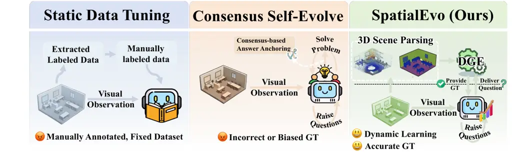
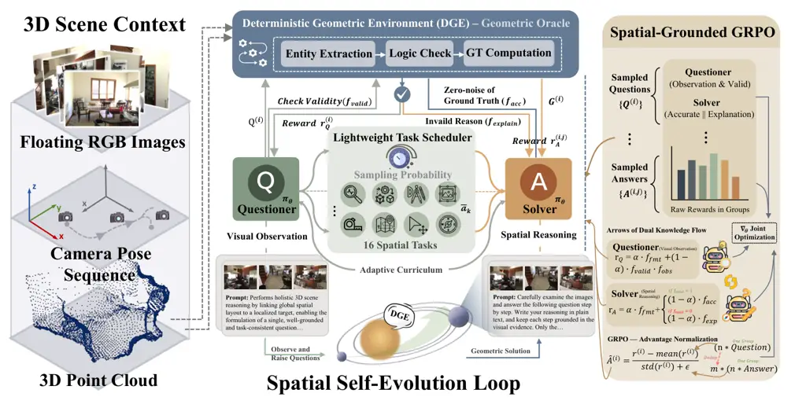
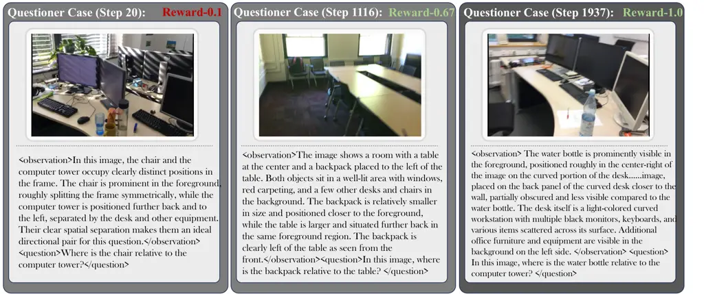
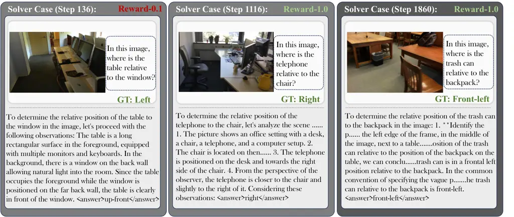

\setauthorfootnote

$`*`$ Equal Contribution  $`{\dagger}`$ Corresponding Author
\reportnumber

# SpatialEvo: Self-Evolving Spatial Intelligence via Deterministic Geometric Environments

Dingming Li^(1,∗), Yingxiu Zhao^(2,∗), Xinrui Cheng¹, Kangheng Lin²,  
Hongbo Peng², Hongxing Li¹, Zixuan Wang¹, Yuhong Dai²,  
Haodong Li², Jia Wang², Yukang Shi², Liang Zhao², Jianjian Sun², Zheng
Ge²,  
Xiangyu Zhang², Weiming Lu¹, Jun Xiao¹, Yueting Zhuang¹, Yongliang
Shen^(1,†) ¹ Zhejiang University  ² StepFun

 

 [GitHub](https://github.com/ZJU-REAL/SpatialEvo)  

 [Hugging Face](https://huggingface.co/lidingm/SpatialEvo-3B)

###### Abstract

Spatial reasoning over three-dimensional scenes is a core capability for
embodied intelligence, yet continuous model improvement remains
bottlenecked by the cost of geometric annotation. The self-evolving
paradigm offers a promising path, but its reliance on model consensus to
construct pseudo-labels causes training to reinforce rather than correct
the model’s own geometric errors. We identify a property unique to 3D
spatial reasoning that circumvents this limitation: ground truth is a
deterministic consequence of the underlying geometry, computable exactly
from point clouds and camera poses without any model involvement.
Building on this insight, we present SpatialEvo, a self-evolving
framework for 3D spatial reasoning, centered on the Deterministic
Geometric Environment (DGE). The DGE formalizes 16 spatial reasoning
task categories under explicit geometric validation rules and converts
unannotated 3D scenes into zero-noise interactive oracles, replacing
model consensus with objective physical feedback. A single
shared-parameter policy co-evolves across questioner and solver roles
under DGE constraints: the questioner generates physically valid spatial
questions grounded in scene observations, while the solver derives
precise answers against DGE-verified ground truth. A task-adaptive
scheduler endogenously concentrates training on the model’s weakest
categories, producing a dynamic curriculum without manual design.
Experiments across nine benchmarks demonstrate that SpatialEvo achieves
the highest average score at both 3B and 7B scales, with consistent
gains on spatial reasoning benchmarks and no degradation on general
visual understanding.

## 1 Introduction

Spatial reasoning requires models to form persistent perception and
understanding of complex three-dimensional scenes, serving as a core
capability for embodied intelligence, robot navigation, and scene
question answering (Chen et al., 2024a; Cheng et al., 2024; Li et al.,
2025d; Ma et al., 2024b). Yet how to continuously drive model iteration
at scale and overcome the bottleneck of data acquisition remains an open
challenge, one that existing approaches address primarily through
large-scale annotated datasets pairing multi-view images with geometric
question-answer pairs (Chen et al., 2024a; Song et al., 2025).

These efforts have yielded meaningful progress, yet they share a common
structural weakness: the training distribution is fixed at dataset
creation time. A static corpus cannot respond to where a model is weak
today, cannot generate harder examples as the model grows stronger (Wang
et al., 2025c; Tian et al., 2025), and cannot scale without proportional
investment in human annotation (Zheng et al., 2026; Lyu et al., 2024).
This raises a fundamental question: how can a model continuously improve
its spatial reasoning without depending on an ever-growing supply of
labeled data?

The self-evolving paradigm offers a principled answer. By actively
distilling training signals from raw visual inputs through iterative
self-play, self-evolving models can progressively internalize reasoning
paradigms (He et al., 2025; Deng et al., 2024; Li et al., 2025e) and
continuously update their training distribution alongside their own
capability, providing a natural dynamic curriculum without manual
curation (Liu et al., 2024; Zhao et al., 2025). Yet existing
self-evolving methods share a critical limitation: because ground truth
cannot be read off the environment directly, the training signal must be
constructed by aggregating the model’s own predictions through majority
voting or self-consistency(Tao et al., 2024; Wu et al., 2024; Shi et
al., 2025a; Wang et al., 2025a; He et al., 2025). This introduces a
systematic bias: the pseudo-labels inherit the model’s own prediction
errors, and gradient updates anchored to such labels risk reinforcing
rather than correcting the model’s existing errors rather than
correcting them.

We observe that 3D spatial reasoning possesses a distinctive property
that circumvents this limitation entirely. Unlike natural language or
general vision tasks, the ground truth for a spatial question is a
deterministic consequence of the underlying geometry (Luo et al., 2025;
Ma et al., 2025; Xu et al., 2025; Cheng et al., 2024). Given a dense
point cloud, calibrated camera poses, and a well-formed geometric
question, the correct answer can be computed exactly and
programmatically, with no appeal to any model’s judgment.

A question about absolute distance reduces to a nearest-point
computation on object bounding boxes; a question about relative camera
orientation reduces to an arithmetic operation on rotation matrices
(Mayer et al., 2025; Zhou et al., 2025). The model consensus that other
domains rely on as a noisy proxy is therefore unnecessary (Song et al.,
2025; Cai et al., 2025a): the physical world itself serves as an exact
and impartial judge. Every unannotated 3D indoor scene is, in principle,
an inexhaustible source of noise-free supervision (Liu et al., 2025a;
Cheng et al., 2024), waiting to be converted into a training signal.



Figure 1: Comparison of three training paradigms. Static Data Tuning
relies on manually annotated fixed datasets. Consensus Self-Evolve
eliminates manual annotation but introduces biased ground truth via
model voting. SpatialEvo (Ours) leverages the DGE to compute exact
ground truth from 3D scene assets, enabling zero-noise dynamic
curriculum learning.

To this end, we propose SpatialEvo, the first framework to introduce the
self-evolving paradigm into 3D spatial reasoning. Its core contribution
is the Deterministic Geometric Environment (DGE), which designs an
atomic geometric verification rule set covering 16 spatial reasoning
task categories, programmatically computes exact ground truth from 3D
point clouds and camera pose sequences, and transforms 3D scene assets
into zero-noise online reward judges (Cheng et al., 2024). Building on
this, the GRPO (Shao et al., 2024) framework drives a single VLM to
co-evolve between questioner and solver roles (He et al., 2025; Li et
al., 2026): the questioner perceives the overall scene layout and
generates physically valid spatial questions, while the solver
internalizes spatial reasoning paradigms through explicit geometric
derivation under DGE constraints. This division naturally aligns with
the two cognitive levels of spatial reasoning, namely holistic
environment perception and local geometric solving. A task scheduler
dynamically regulates the sampling distribution based on historical
accuracy, yielding adaptive curriculum learning (Shi et al., 2025b).

Extensive experiments across nine benchmarks show that SpatialEvo
achieves the highest average score at both 3B and 7B scales, with
consistent gains on spatial reasoning benchmarks and no degradation on
general visual understanding. Ablation studies confirm that replacing
DGE ground truth with majority-vote pseudo-labels produces the single
largest performance drop, directly validating the role of deterministic
physical feedback.

In summary, our contributions are:

- •
  We propose SpatialEvo, a self-evolving framework for 3D spatial
  reasoning centered on a deterministic geometric environment,
  integrating VLM self-play with programmatic physical verification to
  replace model consensus with objective environmental feedback for
  noise-free continuous evolution.
- •
  We design an automated geometric verification pipeline that decouples
  3D spatial reasoning into executable atomic verification rules
  spanning 16 task categories, transforming unannotated 3D scene
  datasets into an online-interactive, zero-noise ground truth judge
  engine.
- •
  We introduce a spatially grounded policy co-evolution mechanism where
  a single model simultaneously occupies questioner and solver roles
  under DGE constraints, with adaptive task scheduling driving
  curriculum self-emergence, validated through extensive experiments.

## 2 Related Works

##### Spatial Reasoning in Vision-Language Models

Early work sought to enhance the spatial perception of VLMs through
multi-view image fusion or depth information injection (Chen et al.,
2024a; Cheng et al., 2024; Ma et al., 2024a). More recent approaches
have proceeded along two parallel tracks: data construction and
reasoning-oriented training. Methods such as SpatialVLM (Chen et al.,
2024a), SpatialBot (Cai et al., 2025a), and SpatialLadder (Li et al.,
2025b) achieve notable gains by fine-tuning on large-scale spatial
annotation datasets (Cai et al., 2025b; Ouyang et al., 2025), while
other efforts explore programmatic synthesis or bird’s-eye-view
augmentation to reduce annotation costs (Yang et al., 2025b). However,
the datasets produced by these approaches are static by nature, fixed at
generation time and thus insensitive to the model’s dynamically shifting
weaknesses during training, which fundamentally limits training
efficiency.

##### Self-Evolution of Vision-Language Models

Self-evolution has emerged as a prominent research direction in the LLM
community (Deng et al., 2025; Li et al., 2025f; Zhai et al., 2024; Tao
et al., 2024) and has progressively extended to VLMs (Liu et al., 2024;
Deng et al., 2024). Notably, the spatial reasoning domain is
particularly well-suited for self-evolution, as its visual inputs
inherently carry physical information enabling deterministic ground
truth computation, naturally circumventing reliance on model consensus.
VisPlay (He et al., 2025), EvolMM (Thawakar et al., 2025), and V-Zero
(Wang et al., 2026) advance multimodal self-play but remain constrained
by static image corpora; Vision-Zero (Wang et al., 2025b) and MM-Zero
(Li et al., 2026) achieve continual improvement via verifiable rewards
or zero-data rendering. Critically, all rely on model consensus as a
reward proxy, introducing systematic bias where precise physical
grounding is required. SpatialEvo is the first to bring self-evolution
to 3D spatial reasoning, replacing model-derived judgment with
deterministic geometric computation.

## 3 Methodology



Figure 2: Overview of SpatialEvo. The DGE computes zero-noise ground
truth directly from 3D point clouds and camera pose sequences, enabling
the Spatial Self-Evolution Loop to jointly optimize a single VLM as both
Questioner and Solver via Spatial-Grounded GRPO.

### 3.1 Preliminaries

##### Problem Formulation.

We formulate spatial reasoning as a visual question-answering process
grounded in multi-view RGB imagery. Given a 3D indoor scene
$`\mathcal{S}`$ whose underlying assets comprise dense point clouds,
semantic annotations, and camera pose sequences, the observable input to
the policy model is restricted to the corresponding set of RGB image
frames $`\mathcal{I}=\{I_{1},I_{2},\ldots,I_{T}\}`$. Our objective is to
learn a single vision-language policy model $`\pi_{\theta}`$ endowed
with two complementary capabilities: as a questioner, generating
spatially meaningful reasoning questions $`Q`$ from visual observations;
and as a solver, predicting precise answers $`A`$ given an image context
and a question description.

The task space $`\mathcal{T}`$ encompasses 16 core spatial reasoning
tasks, organized into three categories by observational granularity.
Multi-image scene-level tasks (6 tasks)—object counting, object size,
absolute distance, relative distance, relative direction, and room size
estimation—require the model to integrate global 3D layout information
across multiple frames (Yang et al., 2025a). Single-image tasks (3
tasks)—single-view relative direction, camera-to-object distance
(Distance Cam-Obj), and inter-object depth ordering (Depth Order
Obj-Obj)—assess the model’s understanding of single-frame perspective
geometry. Dual-image tasks (7 tasks)—inter-camera relative position
(Position Cam-Cam), camera-to-object position (Position Cam-Obj),
camera-to-region position (Position Cam-Reg), camera motion estimation
(Yang et al., 2025c), visibility comparison, inter-camera elevation
(Elevation Cam-Cam), and attribute measurement—focus on geometrically
consistent inference across viewpoints. The complete definitions and
verification rules for all 16 task categories are provided in Appendix
B.1.

Collectively, these tasks span three semantic dimensions: metric
measurement, topological spatial relations, and camera pose reasoning.
For instance, computing the relative orientation between two cameras
requires resolving the rotational component between their extrinsic
matrices, while inferring inter-object depth ordering requires aligning
perspective projection with the scene point cloud. A defining
characteristic shared by all tasks is that their answers can be computed
programmatically and exactly from the scene’s underlying geometric
assets, providing a natural foundation for automatic ground-truth
generation and, in turn, for noise-free reinforcement learning signals.

##### Framework Overview.

As illustrated in Figure 2, the SpatialEvo framework consists of two
core components: the Deterministic Geometric Environment (DGE) and
Spatial-Grounded Policy Co-Evolution. The DGE takes 3D point clouds and
camera pose sequences as underlying scene assets, applies task-specific
geometric verification rules to validate candidate questions, and
programmatically computes exact ground-truth for verified questions,
serving as a noise-free physical feedback judge. Policy co-evolution is
built on the GRPO algorithm, where a single policy model
$`\pi_{\theta}`$ switches between Questioner and Solver via
role-conditioned prompting: the Questioner perceives the global 3D scene
layout to generate spatially valid and reasoning-worthy questions, while
the Solver focuses on precise geometric inference under the hard
constraints of DGE-verified ground truth, with rewards anchored directly
to physical computation results. A lightweight task scheduler
dynamically adjusts the task sampling distribution based on the Solver’s
historical performance, driving the emergence of an adaptive curriculum
without any human intervention.

### 3.2 Deterministic Geometric Environment

The Deterministic Geometric Environment (DGE) constitutes the physical
feedback core of the SpatialEvo framework, serving as the Geometric
Oracle within the self-evolution loop. Its fundamental function is to
map natural language questions generated by the policy model onto the
underlying 3D scene assets for objective verification, replacing
unreliable model judgment with programmatic geometric computation to
supply reinforcement learning with zero-noise supervisory signals. The
DGE operates through two tightly coupled submodules: a task-specific
geometric validation rule set and an automated verification pipeline.
Owing to a rich library of spatial numerical computation tools, the DGE
is designed for extensibility: supporting a new task requires only the
specification of the corresponding rule set and validation logic.

#### 3.2.1 Task-Specific Geometric Validation Rule Sets

For each of the 16 spatial reasoning task categories, the DGE
pre-defines a geometric verification rule set that decouples complex
spatial intuition into executable atomic criteria, rendering abstract
geometric reasoning problems mathematically decidable. Each rule set
constrains question validity along three dimensions: premise consistency
requires that all scene entities referenced in a question (e.g., frame
indices, object categories, or spatial regions) exist in the underlying
assets and can be uniquely localized; Inferential solvability requires
that the geometric premises of a question are unambiguously computable:
for instance, metric tasks must ensure that the reference object’s point
cloud density meets a minimum precision threshold, while orientation
tasks must ensure sufficient viewpoint disparity between the two frames
to constitute a meaningful spatial relationship; geometric degeneracy
filtering discards physically unstable, highly ambiguous, or
low-training-value edge cases. Note that numerical tolerances for
continuous-valued tasks are not part of the validity rules but are
defined separately at the reward stage; see Appendix B.1 for this
distinction.

Taking camera orientation tasks as an example, the rule set requires the
Questioner to specify valid frame index pairs; the DGE then computes the
relative rotation matrix and translation vector between the two poses to
determine whether they constitute an answerable spatial relationship,
mapping the result to a discrete directional label. For object size or
room metric tasks, the DGE directly performs bounding box fitting or
plane normal estimation on the scene point cloud to obtain precise
metric values. For depth ordering tasks, the DGE projects the scene
point cloud onto the corresponding camera image plane and derives the
ground-truth ordering by comparing the median depth of target objects.
This rule-based structured decomposition strategy ensures that the
verification logic across all task categories carries unambiguous
mathematical semantics. Complete rule definitions and verification logic
for all task categories are provided in Appendix B.1.

#### 3.2.2 Automated Verification Pipeline

Driven by the validation rule sets, the DGE instantiates a fully
automated, end-to-end pipeline spanning question parsing to ground-truth
synthesis, converting existing 3D scene datasets such as ScanNet (Dai et
al., 2017) and ScanNet++ (Yeshwanth et al., 2023) into interactive,
deterministic ground-truth judging engines. The pipeline executes in
three stages.

##### Stage 1: Entity Parsing.

Since questions generated by the Questioner are in free-form natural
language, the DGE invokes a lightweight LLM to perform structured entity
extraction over the question text, identifying core semantic elements
such as frame indices, object categories, and spatial relationship
descriptions, and normalizing them into structured representations
directly consumable by the backend geometric computation module. The
prompt design is detailed in Appendix B.2.

##### Stage 2: Legality Verification.

The DGE validates the extracted entities against the rule set
corresponding to the current task category, checking premise consistency
and reasoning chain validity in sequence. If a question references a
non-existent scene entity or its geometric premises violate physical
constraints, such as an invalid frame index or a reference object whose
point cloud is too sparse, the DGE triggers a truncation mechanism and
returns a negative reward to the questioner, suppressing the propagation
of hallucinated questions at the data generation stage and thereby
preserving the overall signal-to-noise ratio of the training signal.

##### Stage 3: Ground-Truth Synthesis.

For questions that pass legality verification, the DGE invokes its
geometric toolkit to perform precise numerical computation in the global
coordinate frame. Core operators include rigid-body coordinate
transformation, point cloud bounding-box fitting and topological
analysis, depth-map perspective projection, and planar normal
estimation, collectively covering the full computational requirements of
all 16 task categories across the metric, topological, and orientation
semantic dimensions. The pipeline outputs not only ground-truth answers
with guaranteed precision but also intermediate geometric states
recorded during inference, such as keypoint coordinates and camera
trajectory segments, providing interpretable intermediate
representations for subsequent qualitative analysis and error
attribution.

This paradigm of replacing black-box model prediction with programmatic
physical computation eliminates reward noise from the self-evolution
process, ensuring that every gradient update of the policy model is
anchored to objective physical laws.

### 3.3 Spatial-Grounded Policy Co-Evolution

Within the SpatialEvo framework, the co-evolution of the questioner and
the solver serves as the primary driver of spatial intelligence
advancement. This section details the spatial-grounded policy
co-evolution mechanism, covering the self-play architecture, task
scheduling design, reward function formulation, and the GRPO training
procedure.

#### 3.3.1 Spatial Self-Play Mechanism

SpatialEvo employs a single policy model $`\pi_{\theta}`$ that
alternates between the questioner and solver roles via role-conditioned
prompting. Parameter sharing confers a dual advantage: gradients
acquired by the solver through geometric derivation directly improve the
questioner’s visual-spatial perception, while the geometric intuitions
developed by the questioner during boundary exploration in turn deepen
the solver’s reasoning capacity, establishing a virtuous cycle of mutual
knowledge reinforcement between the two roles (He et al., 2025; Li et
al., 2026).

In this mechanism, the task scheduler first infers the feasible task set
$`\mathcal{T}_{s}^{\text{feasible}}`$ from the asset characteristics of
the current scene, then samples a task type according to the solver’s
historical effective accuracy and assigns it to the questioner. The
questioner perceives the holistic 3D layout of the scene from multi-view
RGB images and generates a physically valid spatial reasoning question
for the designated task type. The DGE immediately performs legality
verification on the generated question and computes the geometric ground
truth. The model then switches to the solver role and independently
derives an answer under the hard constraint of the deterministic ground
truth. This design encourages the model to actively probe the boundaries
of its own spatial cognition during the question-generation phase, while
correcting geometric hallucinations against the absolute ground truth
supplied by the environment during the answering phase, forming a
continuous self-reinforcement loop within the policy space.

#### 3.3.2 Task-Adaptive Scheduling

To realize curriculum learning without manual intervention, SpatialEvo
introduces a lightweight task scheduler that dynamically modulates the
task sampling distribution. The scheduler first infers the physically
realizable feasible task set
$`\mathcal{T}_{s}^{\text{feasible}}\subseteq\mathcal{T}`$ for the
current scene. It then maintains, for each task category $`k`$, a
cumulative score $`S_{k}`$ and a sample count $`N_{k}`$, and estimates
the historical effective accuracy $`\bar{a}_{k}`$ via pseudo-observation
smoothing to mitigate estimation instability caused by sparse samples in
the early stages of training. The sampling weight $`w_{k}`$ is
negatively correlated with $`\bar{a}_{k}`$, and a minimum exploration
weight $`\delta`$ is introduced to prevent task categories that have
been thoroughly mastered from being entirely excluded from the sampling
pool. This mechanism automatically concentrates training resources on
the solver’s current cognitive weak spots; as accuracy levels shift
across task categories, the training focus migrates accordingly, giving
rise to a fully adaptive curriculum driven endogenously by model
performance, without any manually prescribed difficulty sequence. The
detailed implementation and derivation of the scheduler are provided in
Appendix C.1.

#### 3.3.3 Questioner Reward Design

The Questioner’s optimization objective focuses on generating a
physically valid, visually grounded question of high quality for a given
task category. The Questioner reward comprises two components: format
compliance and substantive quality, with $`\alpha=0.1`$:

```math
r_{Q}=\alpha\,f_{\text{fmt}}+(1-\alpha)\,f_{\text{valid}}\cdot f_{\text{obs}}.
```

Here $`f_{\text{fmt}}`$ measures whether the output conforms to
predefined structural constraints; $`f_{\text{valid}}`$ is the geometric
validity score from DGE verification; and $`f_{\text{obs}}`$ is a visual
observation quality score that assesses whether the Questioner has
sufficiently leveraged the global spatial information present in the
multi-view images. $`f_{\text{obs}}`$ is evaluated by a lightweight LLM
judge without relying on a powerful VLM, which scores only the
Questioner’s textual observation description, examining whether it
exhibits a natural perceptual hierarchy from global scene to local
target and provides adequate visual grounding for the generated
question; scoring criteria are detailed in Appendix C.2. The coupled
term $`f_{\text{valid}}\cdot f_{\text{obs}}`$ carries a critical gating
semantics: a positive signal is contributed only when a question
satisfies both geometric validity and sufficient visual observation
simultaneously, preventing the model from generating “superficially
valid” questions that conform to format but lack genuine spatial
understanding. Severe structural errors additionally trigger hard
penalties in the implementation, which are omitted here for brevity.

#### 3.3.4 Solver Reward Design

The Solver receives reward signals from all candidate questions passed
by the Questioner, with both valid and invalid questions serving as
effective learning signal. For valid questions, $`f_{\text{acc}}`$ is
anchored directly to the geometric ground truth produced by the DGE. For
invalid questions, the DGE outputs a specific invalidation reason
alongside its rejection, and the Solver is required to explicitly
analyze and explain this reason in light of the task type, question
generation rules, and visual observations; explanation quality is scored
by a lightweight LLM judge that evaluates whether the model accurately
identifies the core failure cause and correctly attributes it to task
rules or scene constraints. Detailed evaluation functions for each task
category and explanation scoring criteria are provided in Appendix C.3.
Format compliance is incorporated into the Solver reward via
$`f_{\text{fmt}}`$ to enforce adherence to predefined structural
requirements. The unified Solver reward is thus written as, with
$`\alpha=0.1`$:

```math
r_{A}=\begin{cases}\alpha\,f_{\text{fmt}}+(1-\alpha)\,f_{\text{acc}},&\text{if }Q\text{ is valid},\\[4.0pt]
\alpha\,f_{\text{fmt}}+(1-\alpha)\,f_{\text{explain}},&\text{if }Q\text{ is invalid},\end{cases}
```

where $`f_{\text{fmt}}`$ measures adherence to the expected output
format, $`f_{\text{acc}}`$ measures agreement with DGE ground truth, and
$`f_{\text{explain}}`$ measures the quality of the explanation for the
invalidation reason. This design ensures that invalid questions also
serve as meaningful learning signal, further deepening the model’s
understanding of spatial task rules and geometric constraints. As with
the Questioner, severe formatting errors trigger additional hard
penalties in the implementation, which are omitted in favor of the
weighted main form presented here.

#### 3.3.5 GRPO Training Procedure

We adopt the GRPO algorithm to drive the co-evolution of the questioner
and solver. For each training scene, the scheduler samples a task type
and directs the questioner to generate $`n`$ candidate questions
$`\{Q^{(i)}\}_{i=1}^{n}`$. The DGE performs legality verification on
each $`Q^{(i)}`$; for questions that pass, it computes the geometric
ground truth $`G^{(i)}`$ and assigns questioner reward $`r_{Q}^{(i)}`$;
for questions that fail, it returns a specific invalidity reason. The
$`n`$ candidate questions form a single GRPO group for the questioner,
within which advantage values are computed independently based on
$`\{r_{Q}^{(i)}\}_{i=1}^{n}`$.

The $`n`$ candidate questions are then deduplicated semantically to
yield $`m`$ ($`m\leq n`$) unique questions $`\{Q^{(i)}\}_{i=1}^{m}`$,
which are passed to the solver. For each unique question $`Q^{(i)}`$,
the solver independently samples $`n`$ candidate answers
$`\{A^{(i,j)}\}_{j=1}^{n}`$ and computes the solver reward
$`r_{A}^{(i,j)}`$ against $`G^{(i)}`$; for invalid questions, the solver
generates an explanation based on the invalidity reason returned by the
DGE, with the reward assigned by the LLM judge. The solver forms $`m`$
independent GRPO groups, one per unique question, with advantage values
computed independently within each group from the nn n candidate
answers.

Advantage values are computed independently within their respective
groups to eliminate reward-scale bias introduced by inherent difficulty
variation across scenes:

```math
\hat{A}^{(i)}=\frac{r^{(i)}-\operatorname{mean}\!\left(\{r^{(i)}\}\right)}{\operatorname{std}\!\left(\{r^{(i)}\}\right)+\epsilon} \tag{1}
```

The questioner and solver share a single set of model parameters, and
gradients from both sides are applied jointly at each training step.

## 4 Experiments

### 4.1 Experimental Setup

##### Environment and Data Configuration.

We construct the DGE from the training splits of ScanNet (Dai et al.,
2017), ScanNet++ (Yeshwanth et al., 2023), and ARKitScenes (Baruch et
al., 2021), comprising approximately 4K source scenes in total. The DGE
derives noise-free geometric supervision from dense reconstructions and
multi-view streams, while requiring only standard RGB images as model
input. Dataset and scene statistics are reported in Appendix D. We apply
SpatialEvo to both Qwen2.5-VL-3B-Instruct (Bai et al., 2025) and
Qwen2.5-VL-7B-Instruct (Bai et al., 2025) as backbone models.

##### Training Protocol.

SpatialEvo trains entirely via online reinforcement learning using the
GRPO framework, without any supervised fine-tuning stage. The Questioner
and Solver share a single policy model and continuously interact with
the DGE, enabling self-evolving spatial intelligence through
deterministic geometric feedback. Full training details are provided in
Appendix C.

##### Baselines.

We compare against methods spanning the key training paradigms discussed
in Section 1. SpatialLadder (Li et al., 2025b), SpaceR-SFT (Ouyang et
al., 2025), and ViLaSR (Wu et al., 2025) represent static data tuning or
RL-based training with either curated annotations or fixed reward
functions, without access to deterministic geometric feedback.
Spatial-SSRL (Liu et al., 2025b) adopts a self-supervised RL paradigm
that derives training signals directly from RGB images, probing whether
annotation-free generalization can match geometry-grounded
self-evolution.

##### Evaluation Benchmarks.

We evaluate across nine benchmarks covering spatial reasoning and
general visual understanding. VSI-Bench (Yang et al., 2025a) is the
primary metric, assessing quantitative multi-view spatial reasoning
including object size, distance, and relative orientation, evaluated at
32 frames. EmbSpatial (Du et al., 2024) and ViewSpatial (Li et al.,
2025a) target embodied spatial understanding and perspective-dependent
reasoning. RealWorldQA (Zhang et al., 2024) tests spatial comprehension
in open real-world scenes. V-STAR (Cheng et al., 2025) benchmarks video
spatio-temporal reasoning. SpatialViz (Wang et al., ) evaluates spatial
visualization and object transformation reasoning. STARE (Li et al.,
2025c) assesses multi-step visual simulation across geometric
transformations and real-world spatial tasks. CoreCognition probes (Li
et al., 2024) core cognitive knowledge spanning both spatial and general
perceptual reasoning. MMStar (Chen et al., 2024b) verifies that spatial
training does not degrade general visual capabilities. All benchmarks
follow their original evaluation protocols unless otherwise noted.

### 4.2 Main Results

|                                  |               |               |        |             |            |               |        |        |             |            |
| -------------------------------- | ------------- | ------------- | ------ | ----------- | ---------- | ------------- | ------ | ------ | ----------- | ---------- |
| Benchmark                        | Qwen2.5-VL-3B |               |        |             |            | Qwen2.5-VL-7B |        |        |             |            |
|                                  | Baseline      | SpatialLadder | SpaceR | SpatialSSRL | SpatialEvo | Baseline      | VILASR | SpaceR | SpatialSSRL | SpatialEvo |
| VSI-Bench (Yang et al., 2025a)   | 28.1          | 45.7          | 36.0   | 28.0        | 39.2       | 31.1          | 45.4   | 36.8   | 33.7        | 46.1       |
| RealWorldQA (Zhang et al., 2024) | 63.4          | 57.1          | 61.4   | 65.4        | 66.5       | 69.5          | 57.9   | 64.7   | 69.9        | 66.7       |
| EmbSpatial (Du et al., 2024)     | 55.9          | 57.6          | 55.6   | 59.8        | 61.2       | 63.6          | 47.8   | 60.3   | 69.3        | 66.0       |
| SpatialViz (Wang et al., )       | 24.2          | 28.6          | 31.9   | 25.9        | 25.4       | 27.0          | 29.8   | 30.9   | 28.4        | 28.6       |
| STARE (Li et al., 2025c)         | 33.1          | 26.4          | 36.8   | 36.8        | 36.9       | 41.8          | 21.4   | 36.2   | 43.3        | 41.3       |
| CoreCognition (Li et al., 2024)  | 56.8          | 58.3          | 29.1   | 57.6        | 57.4       | 59.6          | 56.4   | 56.4   | 60.2        | 60.2       |
| ViewSpatial (Li et al., 2025a)   | 36.2          | 43.0          | 35.9   | 38.4        | 42.3       | 36.4          | 32.3   | 35.1   | 37.5        | 43.2       |
| V-STAR (Cheng et al., 2025)      | 74.9          | 36.7          | 75.4   | 77.0        | 75.4       | 78.5          | 35.6   | 73.8   | 79.1        | 78.0       |
| MMStar (Chen et al., 2024b)      | 54.6          | 45.8          | 44.9   | 56.5        | 55.2       | 61.6          | 60.8   | 54.9   | 63.5        | 62.5       |
| AVG                              | 47.5          | 44.4          | 45.2   | 49.5        | 51.1       | 52.1          | 43.0   | 49.9   | 53.9        | 54.7       |

Table 1: Main Results. Nine benchmarks spanning spatial reasoning and
general visual understanding. Shaded columns indicate SpatialEvo (ours).
Bold denotes the best result per benchmark under each backbone.

Table 1 reports results across nine benchmarks for both Qwen2.5-VL-3B
and Qwen2.5-VL-7B backbones. SpatialEvo achieves the highest average
score under both settings, reaching 51.1 (3B) and 54.7 (7B),
outperforming all baselines by a consistent margin across both model
scales.

##### Core Spatial Reasoning.

SpatialEvo yields substantial improvements on VSI-Bench, EmbSpatial, and
ViewSpatial, which directly correspond to the multi-view scene-level and
perspective-dependent task categories covered by our DGE. On VSI-Bench,
SpatialEvo achieves 39.2 (3B) and 46.1 (7B), surpassing all baselines
including SpatialLadder (45.4) and SpaceR (36.8) under the 7B setting.
Consistent gains are similarly observed on EmbSpatial and ViewSpatial,
confirming that DGE-driven self-evolution effectively internalizes both
embodied and perspective-dependent spatial reasoning and transfers well
to held-out benchmarks.

##### General Capability Retention.

SpatialEvo maintains competitive performance on MMStar and RealWorldQA,
demonstrating that spatial specialization does not degrade general
visual understanding. On MMStar, SpatialEvo scores 55.2 (3B) and 62.5
(7B), remaining close to the untuned baseline while annotation-dependent
methods such as SpatialLadder (45.8) and ViLaSR (60.8) fall noticeably
below. On RealWorldQA, SpatialEvo achieves 66.5 (3B) and 66.7 (7B),
outperforming both the baseline and all spatial-specialized competitors
under the 3B setting. Spatial-SSRL also retains general capabilities
reasonably well; however, its overall average remains below SpatialEvo
in both settings, indicating that annotation-free generalization alone
is insufficient to match geometry-grounded self-evolution.

##### Baseline Degradation Analysis.

The degradation patterns among baselines further contextualize
SpatialEvo’s advantage. SpatialLadder and ViLaSR collapse on V-STAR to
approximately 36, far below the baseline of 74.9 (3B) and 78.5 (7B),
indicating that their training pipelines introduce distributional shifts
that impair spatio-temporal reasoning. SpaceR similarly drops to 29.1 on
CoreCognition (3B, baseline 56.8), suggesting that fixed reward
functions tailored to specific spatial tasks can suppress broader
cognitive capabilities. SpatialEvo achieves the most favorable balance
between spatial specialization and general capability preservation
across all evaluated configurations.

### 4.3 Ablation Studies

|                        |           |             |            |            |       |               |             |        |        |      |                    |
| ---------------------- | --------- | ----------- | ---------- | ---------- | ----- | ------------- | ----------- | ------ | ------ | ---- | ------------------ |
| Variant                | VSI-Bench | RealWorldQA | EmbSpatial | SpatialViz | STARE | CoreCognition | ViewSpatial | V-STAR | MMStar | Avg  | $`\Delta`$Avg      |
| SpatialEvo (Ours)      | 46.1      | 66.7        | 66.0       | 28.6       | 41.3  | 60.2          | 43.2        | 78.0   | 62.5   | 54.7 | –                  |
| Architecture Design    |           |             |            |            |       |               |             |        |        |      |                    |
| w/o Questioner         | 40.2      | 67.1        | 65.7       | 27.7       | 39.0  | 60.5          | 40.4        | 77.0   | 59.9   | 53.1 | $`\downarrow`$ 1.6 |
| w/o Solver             | 36.6      | 70.2        | 61.8       | 26.1       | 39.8  | 58.5          | 34.5        | 75.4   | 60.5   | 51.5 | $`\downarrow`$ 3.2 |
| w/o Physical Grounding | 18.8      | 68.5        | 63.5       | 23.4       | 39.7  | 59.7          | 35.4        | 77.0   | 60.6   | 49.6 | $`\downarrow`$ 5.1 |
| w/o Adaptive Scheduler | 43.4      | 68.5        | 68.0       | 27.5       | 39.5  | 60.3          | 43.2        | 77.0   | 62.4   | 54.4 | $`\downarrow`$ 0.3 |
| Questioner Reward      |           |             |            |            |       |               |             |        |        |      |                    |
| w/o Validity Reward    | 41.2      | 69.7        | 64.3       | 29.3       | 39.2  | 60.7          | 41.3        | 76.4   | 62.6   | 53.9 | $`\downarrow`$ 0.8 |
| w/o Observation Reward | 43.6      | 69.2        | 68.1       | 28.0       | 41.1  | 59.1          | 41.8        | 78.5   | 61.0   | 54.5 | $`\downarrow`$ 0.2 |
| Solver Reward          |           |             |            |            |       |               |             |        |        |      |                    |
| w/o Explanation Reward | 42.9      | 65.1        | 65.9       | 30.8       | 39.5  | 59.9          | 40.9        | 81.7   | 62.3   | 54.3 | $`\downarrow`$ 0.4 |

Table 2: Ablation study on SpatialEvo (Qwen2.5-VL-7B). $`\Delta`$Avg
denotes performance drop relative to the full model. Bold denotes the
best Avg.

To systematically validate the contribution of each core component in
SpatialEvo, we conduct ablation experiments across three design
dimensions; results are summarized in Table 2.

##### Architectural Design.

Removing the Questioner (w/o Questioner) degrades average performance to
53.1, with notable drops on VSI-Bench (40.2) and ViewSpatial (40.4), as
online self-play is replaced by offline data. Removing the Solver (w/o
Solver) produces a larger drop to 51.5, with VSI-Bench declining sharply
to 36.6, confirming that online geometric derivation is essential for
internalizing spatial reasoning. Replacing DGE ground truth with
majority-voting pseudo-GT (w/o Physical Grounding) yields the largest
degradation, with the average collapsing to 49.6 and VSI-Bench
plummeting to 18.8; the majority-voting mechanism consolidates
systematic prediction bias into pseudo-ground-truth, fundamentally
corrupting the training signal for geometry-intensive tasks. Additional
details are in Appendix D.3. Removing the adaptive task scheduler (w/o
Adaptive Scheduler) results in a marginal drop to 54.4, confirming that
accuracy-driven dynamic allocation outperforms uniform random sampling.

##### Questioner Reward.

Removing the geometric validity reward (w/o Validity Reward) degrades
performance to 53.9, with VSI-Bench declining to 41.2, as the proportion
of physically invalid questions generated by the Questioner increases
substantially, reducing the volume of valid questions passed to the
Solver and degrading overall training signal quality. Removing the
visual observation reward (w/o Observation Reward) leads to a smaller
but consistent drop to 54.5, as the Questioner bypasses holistic scene
perception and generates questions without sufficient visual grounding,
resulting in shallower reasoning depth in the Solver.

##### Solver Reward.

Removing the explanation reward for invalid questions (w/o Explanation
Reward) causes performance to decline to 54.3. The effect is most
visible on spatially complex benchmarks such as VSI-Bench (42.9 vs.
46.1) and ViewSpatial (40.9 vs. 43.2), as the geometric constraint
information carried by invalid questions is entirely discarded,
depriving the Solver of the opportunity to learn task rules from the
Questioner’s errors and validating the design choice of converting
invalid questions into effective learning signal.

## 5 Analysis and Discussion

### 5.1 Online Evolution vs. Static Learning

To evaluate the practical gains of online self-evolution over static
data training, we conduct a controlled comparison along two dimensions:
reinforcement learning and supervised fine-tuning. We adopt
Qwen2.5-VL-3B as the backbone throughout. To align with the data sources
of SpatialLadder (26K) and SpaceR (151K), SpatialEvo is restricted to
ScanNet scene assets with six core task categories: object counting,
object size, room size, absolute distance, relative distance, and
relative direction. It is worth noting that SpatialLadder and SpaceR
additionally include the Appearance Order task, giving them broader task
coverage than the SpatialEvo configuration used here. SpatialSSRL (81K)
is included in the SFT comparison not for task coverage alignment, but
to assess whether its self-supervised training signal generalizes
sufficiently to VSI-Bench’s spatial task categories.

For the RL comparison, we select SpatialLadder as the reference given
its closest task coverage to our configuration, using identical GRPO
training settings. For the SFT comparison, samples produced offline
during SpatialEvo’s online training are curated for supervised
fine-tuning, compared against SFT on the three static datasets.
SpatialEvo’s online training is continued until the number of recorded
unique QA pairs reaches approximately 20K. Full training and data
details are provided in Appendix C.

Results are shown in Table 3. Despite operating under a narrower task
scope, SpatialEvo surpasses the SpatialLadder RL baseline and
outperforms all static dataset SFT counterparts, achieving the highest
average of 46.3 and 43.9 respectively. This outcome reveals the core
advantage of online self-evolution: the training distribution of a
static dataset is frozen at generation time, whereas SpatialEvo
continuously aligns the distribution of training samples to the solver’s
current cognitive frontier through real-time interaction between the
Questioner and the DGE, realizing adaptive hard-sample mining that
static datasets cannot replicate.

|          |                            |                    |            |           |           |                          |           |            |             |      |
| -------- | -------------------------- | ------------------ | ---------- | --------- | --------- | ------------------------ | --------- | ---------- | ----------- | ---- |
| Paradigm | Method                     | Numerical Question |            |           |           | Multiple-Choice Question |           |            |             | Avg. |
|          |                            | Obj. Count         | Abs. Dist. | Obj. Size | Room Size | Rel. Dist.               | Rel. Dir. | Route Plan | Appr. Order |      |
|          | Qwen2.5-VL-3B (Base)       | 33.5               | 21.1       | 17.9      | 22.6      | 32.8                     | 42.7      | 29.9       | 21.0        | 28.0 |
| RL       | w/ SpatialLadder RL        | 62.8               | 29.8       | 59.2      | 27.8      | 38.9                     | 44.2      | 33.5       | 24.9        | 40.1 |
|          | SpatialEvo (Online RL)     | 65.2               | 35.1       | 61.3      | 51.4      | 46.2                     | 44.3      | 29.9       | 26.5        | 46.3 |
| SFT      | w/ SpatialLadder Data      | 63.0               | 31.9       | 61.2      | 43.0      | 43.0                     | 43.6      | 32.5       | 31.7        | 43.7 |
|          | w/ SpaceR Data             | 28.3               | 25.9       | 36.3      | 34.9      | 35.1                     | 46.8      | 35.1       | 43.4        | 36.3 |
|          | w/ SpatialSSRL Data        | 35.6               | 24.6       | 15.4      | 21.8      | 34.1                     | 39.2      | 28.9       | 23.5        | 28.1 |
|          | w/ SpatialEvo Offline Data | 62.6               | 28.9       | 60.0      | 49.1      | 40.3                     | 45.7      | 31.4       | 25.9        | 43.9 |

Table 3: Comparison of online self-evolution and static learning
paradigms on VSIBench. SpatialEvo outperforms static RL and SFT
baselines across both training paradigms.

### 5.2 Curriculum Emergence Analysis

Figure 3: Training dynamics of SpatialEvo. Questioner rewards stabilize
as valid question generation is learned (Left); Solver accuracy improves
while the invalid ratio declines (Middle); the Adaptive Scheduler
up-weights harder categories (Rel. Dir., Rel. Dist.) and down-weights
easier ones (Right).

|                                   |                    |            |           |           |                          |           |            |             |      |
| --------------------------------- | ------------------ | ---------- | --------- | --------- | ------------------------ | --------- | ---------- | ----------- | ---- |
| Method                            | Numerical Question |            |           |           | Multiple-Choice Question |           |            |             | Avg. |
|                                   | Obj. Count         | Abs. Dist. | Obj. Size | Room Size | Rel. Dist.               | Rel. Dir. | Route Plan | Appr. Order |      |
| Qwen2.5-VL-7B (Base)              | 30.7               | 10.2       | 37.14     | 43.40     | 37.2                     | 37.1      | 32.0       | 27.8        | 31.1 |
| SpatialEvo                        |                    |            |           |           |                          |           |            |             |      |
|    Iter 1                         | 60.6               | 28.9       | 60.3      | 42.5      | 42.7                     | 44.4      | 32.0       | 30.7        | 44.2 |
|    Iter 2                         | 63.3               | 28.9       | 62.5      | 33.3      | 43.4                     | 43.8      | 30.9       | 36.7        | 45.0 |
|    Iter 3                         | 65.0               | 26.9       | 63.4      | 47.3      | 43.0                     | 43.4      | 28.9       | 32.9        | 45.1 |
|    Iter 4                         | 62.5               | 32.8       | 61.6      | 35.7      | 45.1                     | 43.9      | 27.3       | 40.1        | 46.1 |
| SpatialEvo w/o Adaptive Scheduler |                    |            |           |           |                          |           |            |             |      |
|    Iter 1                         | 55.9               | 22.4       | 61.6      | 51.8      | 44.5                     | 43.8      | 33.0       | 36.3        | 44.2 |
|    Iter 2                         | 62.1               | 28.6       | 62.0      | 44.0      | 41.0                     | 43.3      | 28.9       | 34.3        | 44.5 |
|    Iter 3                         | 57.8               | 29.3       | 61.6      | 35.8      | 42.3                     | 43.4      | 32.5       | 31.9        | 43.7 |
|    Iter 4                         | 60.2               | 30.6       | 58.7      | 39.1      | 40.1                     | 43.5      | 28.4       | 32.2        | 43.4 |

Table 4: Effect of the Adaptive Scheduler across iterative
self-evolution on VSI-Bench subtasks. Both groups are initialized from
the same base model and trained for four iterations; the only difference
is whether the Adaptive Scheduler is enabled.

##### Effect of the Adaptive Scheduler across iterations.

Table 4 compares SpatialEvo with and without the Adaptive Scheduler
across four iterative self-evolution rounds on VSI-Bench. Without the
scheduler, the model performs comparably in early iterations (44.2 at
Iter 1, 44.5 at Iter 2) but subsequently stagnates and declines,
reaching only 43.4 at Iter 4, as uniform task sampling fails to
concentrate training resources on categories where the model remains
weak. In contrast, the full SpatialEvo with the Adaptive Scheduler
exhibits monotonically increasing average performance across all four
iterations (44.2 $`\to`$ 45.0 $`\to`$ 45.1 $`\to`$ 46.1), with
particularly strong late-stage gains on Abs. Dist. (32.8), Rel. Dist.
(45.1), and Appr. Order (40.1) at Iter 4, categories that receive
increasing sampling weight as the scheduler identifies them as
persistent weak spots.

##### Reward trajectories and curriculum emergence.

As shown in Figure 3, both Questioner and Solver rewards improve
steadily throughout training. The Validity Reward rises rapidly and
stabilizes near 1.0, indicating that the Questioner quickly learns to
generate physically valid questions; the Accuracy Reward of the Solver
increases consistently while the Invalid Ratio declines, confirming
progressive internalization of geometric reasoning. The Scene-Task
Curriculum Dynamics plot reveals how this improvement is shaped:
sampling rates diverge from the uniform share (16.7%) as training
progresses, with harder categories such as Rel. Dir. (21.8%) and Rel.
Dist. (18.7%) being up-weighted and easier categories such as Room Area
(12.5%) and Obj. Size (13.4%) being down-weighted. This endogenously
emergent curriculum, driven entirely by historical accuracy without
manual design, explains the sustained performance improvement observed
in Table 4.

## 6 Conclusions

We present SpatialEvo, the first framework to introduce the
self-evolving paradigm into 3D spatial reasoning. Unlike conventional
self-evolving methods that rely on model voting to construct
pseudo-labels, SpatialEvo exploits the unique property of spatial
reasoning that visual inputs inherently carry physical information such
as 3D point clouds and camera poses, enabling programmatic computation
of exact ground truth. This transforms unannotated 3D scene assets into
zero-noise reward judges, replacing model consensus with deterministic
physical feedback. A single policy model co-evolves as Questioner and
Solver under DGE constraints, with a task scheduler enabling adaptive
curriculum self-emergence. Experiments validate significant gains across
multiple spatial reasoning benchmarks.

We hope the physically grounded self-evolution paradigm explored by
SpatialEvo can serve as a reference for broader embodied intelligence
research. When self-exploration is rooted in a verifiable physical
environment, the continual emergence of spatial reasoning capability is
driven endogenously by the model’s interaction with the objective world,
rather than costly human annotation.

## References

- Agarwal et al. (2025) S. Agarwal, L. Ahmad, J. Ai, S. Altman, A.
  Applebaum, E. Arbus, R. K. Arora, Y. Bai, B. Baker, H. Bao, et al.
  Gpt-oss-120b & gpt-oss-20b model card. arXiv preprint
  arXiv:2508.10925. Cited by: §C.2.3, §D.1.2.
- Bai et al. (2025) S. Bai, K. Chen, X. Liu, J. Wang, W. Ge, S. Song, K.
  Dang, P. Wang, S. Wang, J. Tang, H. Zhong, Y. Zhu, M. Yang, Z. Li, J.
  Wan, P. Wang, W. Ding, Z. Fu, Y. Xu, J. Ye, X. Zhang, T. Xie, Z.
  Cheng, H. Zhang, Z. Yang, H. Xu, and J. Lin Qwen2.5-vl technical
  report. External Links: 2502.13923,
  [Link](https://arxiv.org/abs/2502.13923) Cited by: §4.1.
- Baruch et al. (2021) G. Baruch, Z. Chen, A. Dehghan, T. Dimry, Y.
  Feigin, P. Fu, T. Gebauer, B. Joffe, D. Kurz, A. Schwartz, et al.
  Arkitscenes: a diverse real-world dataset for 3d indoor scene
  understanding using mobile rgb-d data. arXiv preprint
  arXiv:2111.08897. Cited by: §4.1.
- Cai et al. (2025a) W. Cai, I. Ponomarenko, J. Yuan, X. Li, W. Yang, H.
  Dong, and B. Zhao Spatialbot: precise spatial understanding with
  vision language models. In 2025 IEEE International Conference on
  Robotics and Automation (ICRA), pp. 9490–9498. Cited by: §1, §2.
- Cai et al. (2025b) Z. Cai, R. Wang, C. Gu, F. Pu, J. Xu, Y. Wang, W.
  Yin, Z. Yang, C. Wei, Q. Sun, et al. Scaling spatial intelligence with
  multimodal foundation models. arXiv preprint arXiv:2511.13719. Cited
  by: §2.
- Chen et al. (2024a) B. Chen, Z. Xu, S. Kirmani, B. Ichter, D.
  Sadigh, L. Guibas, and F. Xia Spatialvlm: endowing vision-language
  models with spatial reasoning capabilities. In Proceedings of the
  IEEE/CVF Conference on Computer Vision and Pattern Recognition,
  pp. 14455–14465. Cited by: §C.1.2, §1, §2.
- Chen et al. (2024b) L. Chen, J. Li, X. Dong, P. Zhang, Y. Zang, Z.
  Chen, H. Duan, J. Wang, Y. Qiao, D. Lin, et al. Are we on the right
  way for evaluating large vision-language models?. Advances in Neural
  Information Processing Systems 37, pp. 27056–27087. Cited by: §4.1,
  Table 1.
- Chen et al. (2025) X. Chen, J. Lu, M. Kim, D. Zhang, J. Tang, A.
  Piché, N. Gontier, Y. Bengio, and E. Kamalloo Self-evolving curriculum
  for llm reasoning. arXiv preprint arXiv:2505.14970. Cited by: §C.1.2.
- Cheng et al. (2024) A. Cheng, H. Yin, Y. Fu, Q. Guo, R. Yang, J.
  Kautz, X. Wang, and S. Liu Spatialrgpt: grounded spatial reasoning in
  vision-language models. Advances in Neural Information Processing
  Systems 37, pp. 135062–135093. Cited by: §1, §1, §1, §1, §2.
- Cheng et al. (2025) Z. Cheng, J. Hu, Z. Liu, C. Si, W. Li, and S. Gong
  V-star: benchmarking video-llms on video spatio-temporal reasoning.
  arXiv preprint arXiv:2503.11495. Cited by: §4.1, Table 1.
- Dai et al. (2017) A. Dai, A. X. Chang, M. Savva, M. Halber, T.
  Funkhouser, and M. Nießner Scannet: richly-annotated 3d
  reconstructions of indoor scenes. In Proceedings of the IEEE
  conference on computer vision and pattern recognition, pp. 5828–5839.
  Cited by: §3.2.2, §4.1.
- Deng et al. (2025) S. Deng, K. Wang, T. Yang, H. Singh, and Y. Tian
  Self-improvement in multimodal large language models: a survey. In
  Findings of the Association for Computational Linguistics: EMNLP 2025,
  pp. 1987–2006. Cited by: §2.
- Deng et al. (2024) Y. Deng, P. Lu, F. Yin, Z. Hu, S. Shen, Q. Gu, J.
  Zou, K. Chang, and W. Wang Enhancing large vision language models with
  self-training on image comprehension. Advances in Neural Information
  Processing Systems 37, pp. 131369–131397. Cited by: §1, §2.
- Du et al. (2024) M. Du, B. Wu, Z. Li, X. Huang, and Z. Wei
  Embspatial-bench: benchmarking spatial understanding for embodied
  tasks with large vision-language models. In Proceedings of the 62nd
  Annual Meeting of the Association for Computational Linguistics
  (Volume 2: Short Papers), pp. 346–355. Cited by: §4.1, Table 1.
- He et al. (2025) Y. He, C. Huang, Z. Li, J. Huang, and Y. Yang
  Visplay: self-evolving vision-language models from images. arXiv
  preprint arXiv:2511.15661. Cited by: §1, §1, §2, §3.3.1.
- Li et al. (2025a) D. Li, H. Li, Z. Wang, Y. Yan, H. Zhang, S. Chen, G.
  Hou, S. Jiang, W. Zhang, Y. Shen, et al. Viewspatial-bench: evaluating
  multi-perspective spatial localization in vision-language models.
  arXiv preprint arXiv:2505.21500. Cited by: §4.1, Table 1.
- Li et al. (2025b) H. Li, D. Li, Z. Wang, Y. Yan, H. Wu, W. Zhang, Y.
  Shen, W. Lu, J. Xiao, and Y. Zhuang Spatialladder: progressive
  training for spatial reasoning in vision-language models. arXiv
  preprint arXiv:2510.08531. Cited by: §C.3.2, §2, §4.1.
- Li et al. (2025c) L. Li, M. Bigverdi, J. Gu, Z. Ma, Y. Yang, Z. Li, Y.
  Choi, and R. Krishna Unfolding spatial cognition: evaluating
  multimodal models on visual simulations. arXiv preprint
  arXiv:2506.04633. Cited by: §4.1, Table 1.
- Li et al. (2024) Y. Li, Q. Gao, T. Zhao, B. Wang, H. Sun, H.
  Lyu, R. D. Hawkins, N. Vasconcelos, T. Golan, D. Luo, et al. Core
  knowledge deficits in multi-modal language models. arXiv preprint
  arXiv:2410.10855. Cited by: §4.1, Table 1.
- Li et al. (2025d) Z. Li, H. Yu, Y. Ding, Y. Li, Y. He, and N. Akhtar
  Embodied intelligence for 3d understanding: a survey on 3d scene
  question answering. Information Fusion, pp. 103624. Cited by: §1.
- Li et al. (2025e) Z. Li, Y. Zhao, J. Zhang, S. Wang, Y. Yao, R.
  Zhao, J. Song, B. Zheng, and Z. Wei Mixture-of-visual-thoughts:
  exploring context-adaptive reasoning mode selection for general visual
  reasoning. arXiv preprint arXiv:2509.22746. Cited by: §1.
- Li et al. (2026) Z. Li, H. Du, C. Huang, X. Wu, L. Yu, Y. He, J.
  Xie, X. Wu, Z. Liu, J. Zhang, et al. Mm-zero: self-evolving
  multi-model vision language models from zero data. arXiv preprint
  arXiv:2603.09206. Cited by: §1, §2, §3.3.1.
- Li et al. (2025f) Z. Li, W. Yu, C. Huang, R. Liu, Z. Liang, F. Liu, J.
  Che, D. Yu, J. Boyd-Graber, H. Mi, et al. Self-rewarding
  vision-language model via reasoning decomposition. arXiv preprint
  arXiv:2508.19652. Cited by: §2.
- Liu et al. (2024) W. Liu, J. Li, X. Zhang, F. Zhou, Y. Cheng, and J.
  He Diving into self-evolving training for multimodal reasoning. arXiv
  preprint arXiv:2412.17451. Cited by: §1, §2.
- Liu et al. (2025a) Y. Liu, M. Ma, X. Yu, P. Ding, H. Zhao, M. Sun, S.
  Huang, and D. Wang Ssr: enhancing depth perception in vision-language
  models via rationale-guided spatial reasoning. arXiv preprint
  arXiv:2505.12448. Cited by: §1.
- Liu et al. (2025b) Y. Liu, B. Zhang, Y. Zang, Y. Cao, L. Xing, X.
  Dong, H. Duan, D. Lin, and J. Wang Spatial-ssrl: enhancing spatial
  understanding via self-supervised reinforcement learning. arXiv
  preprint arXiv:2510.27606. Cited by: §4.1.
- Luo et al. (2025) S. Luo, Z. Zhu, Y. Yuan, Y. Yang, L. Shan, and Y. Wu
  Geogrambench: benchmarking the geometric program reasoning in modern
  llms. arXiv preprint arXiv:2505.17653. Cited by: §1.
- Lyu et al. (2024) R. Lyu, J. Lin, T. Wang, S. Yang, X. Mao, Y.
  Chen, R. Xu, H. Huang, C. Zhu, D. Lin, et al. Mmscan: a multi-modal 3d
  scene dataset with hierarchical grounded language annotations.
  Advances in Neural Information Processing Systems 37, pp. 50898–50924.
  Cited by: §1.
- Ma et al. (2024a) C. Ma, K. Lu, T. Cheng, N. Trigoni, and A. Markham
  Spatialpin: enhancing spatial reasoning capabilities of
  vision-language models through prompting and interacting 3d priors.
  Advances in neural information processing systems 37, pp. 68803–68832.
  Cited by: §2.
- Ma et al. (2025) W. Ma, H. Chen, G. Zhang, Y. Chou, J. Chen, C. de
  Melo, and A. Yuille 3dsrbench: a comprehensive 3d spatial reasoning
  benchmark. In Proceedings of the IEEE/CVF International Conference on
  Computer Vision, pp. 6924–6934. Cited by: §1.
- Ma et al. (2024b) X. Ma, B. Smart, Y. Bhalgat, S. Chen, X. Li, J.
  Ding, J. Gu, D. Z. Chen, S. Peng, J. Bian, et al. When llms step into
  the 3d world: a survey and meta-analysis of 3d tasks via multi-modal
  large language models. arXiv preprint arXiv:2405.10255. Cited by: §1.
- Mayer et al. (2025) J. Mayer, M. Ballout, S. Jassim, F. N. Nezami,
  and E. Bruni IVISPAR—an interactive visual-spatial reasoning benchmark
  for vlms. In Proceedings of the 2025 Conference on Empirical Methods
  in Natural Language Processing, pp. 26745–26769. Cited by: §1.
- Ouyang et al. (2025) K. Ouyang, Y. Liu, H. Wu, Y. Liu, H. Zhou, J.
  Zhou, F. Meng, and X. Sun Spacer: reinforcing mllms in video spatial
  reasoning. arXiv preprint arXiv:2504.01805. Cited by: §2, §4.1.
- Shao et al. (2024) Z. Shao, P. Wang, Q. Zhu, R. Xu, J. Song, X. Bi, H.
  Zhang, M. Zhang, Y. Li, Y. Wu, et al. Deepseekmath: pushing the limits
  of mathematical reasoning in open language models. arXiv preprint
  arXiv:2402.03300. Cited by: §1.
- Shi et al. (2025a) H. Shi, Z. Xu, H. Wang, W. Qin, W. Wang, Y.
  Wang, Z. Wang, S. Ebrahimi, and H. Wang Continual learning of large
  language models: a comprehensive survey. ACM Computing Surveys 58 (5),
  pp. 1–42. Cited by: §1.
- Shi et al. (2025b) T. Shi, Y. Wu, L. Song, T. Zhou, and J. Zhao
  Efficient reinforcement finetuning via adaptive curriculum learning.
  arXiv preprint arXiv:2504.05520. Cited by: §1.
- Song et al. (2025) C. H. Song, V. Blukis, J. Tremblay, S. Tyree, Y.
  Su, and S. Birchfield Robospatial: teaching spatial understanding to
  2d and 3d vision-language models for robotics. In Proceedings of the
  Computer Vision and Pattern Recognition Conference, pp. 15768–15780.
  Cited by: §1, §1.
- Tao et al. (2024) Z. Tao, T. Lin, X. Chen, H. Li, Y. Wu, Y. Li, Z.
  Jin, F. Huang, D. Tao, and J. Zhou A survey on self-evolution of large
  language models. arXiv preprint arXiv:2404.14387. Cited by: §1, §2.
- Thawakar et al. (2025) O. Thawakar, S. Venkatraman, R. Thawkar, A.
  Shaker, H. Cholakkal, R. M. Anwer, S. Khan, and F. Khan Evolmm:
  self-evolving large multimodal models with continuous rewards. arXiv
  preprint arXiv:2511.16672. Cited by: §2.
- Tian et al. (2025) K. Tian, J. Mao, Y. Zhang, J. Jiang, Y. Zhou,
  and Z. Tu Nuscenes-spatialqa: a spatial understanding and reasoning
  benchmark for vision-language models in autonomous driving. In
  Proceedings of the IEEE/CVF International Conference on Computer
  Vision, pp. 4567–4576. Cited by: §1.
- Wang et al. (2026) H. Wang, Y. Yang, J. Hu, M. Zhu, and W. Chen
  V-zero: self-improving multimodal reasoning with zero annotation.
  arXiv preprint arXiv:2601.10094. Cited by: §2.
- Wang et al. (2025a) P. Wang, M. Wang, Z. Ma, X. Yang, S. Feng, D.
  Wang, Y. Zhang, and K. Song Language models as continuous
  self-evolving data engineers. In Proceedings of the 2025 Conference on
  Empirical Methods in Natural Language Processing, pp. 18108–18127.
  Cited by: §1.
- Wang et al. (2025b) Q. Wang, B. Liu, T. Zhou, J. Shi, Y. Lin, Y.
  Chen, H. H. Li, K. Wan, and W. Zhao Vision-zero: scalable vlm
  self-improvement via strategic gamified self-play. arXiv preprint
  arXiv:2509.25541. Cited by: §2.
- \[44\] S. Wang, M. Pei, L. Sun, C. Deng, Y. Li, K. Shao, Z. Tian, H.
  Zhang, and J. Wang SpatialViz-bench: a cognitively-grounded benchmark
  for diagnosing spatial visualization in mllms. In The Fourteenth
  International Conference on Learning Representations, Cited by: §4.1,
  Table 1.
- Wang et al. (2025c) X. Wang, W. Ma, T. Zhang, C. M. de Melo, J. Chen,
  and A. Yuille Spatial457: a diagnostic benchmark for 6d spatial
  reasoning of large mutimodal models. In Proceedings of the Computer
  Vision and Pattern Recognition Conference, pp. 24669–24679. Cited by:
  §1.
- Wu et al. (2025) J. Wu, J. Guan, K. Feng, Q. Liu, S. Wu, L. Wang, W.
  Wu, and T. Tan Reinforcing spatial reasoning in vision-language models
  with interwoven thinking and visual drawing. arXiv preprint
  arXiv:2506.09965. Cited by: §4.1.
- Wu et al. (2024) T. Wu, L. Luo, Y. Li, S. Pan, T. Vu, and G. Haffari
  Continual learning for large language models: a survey. arXiv preprint
  arXiv:2402.01364. Cited by: §1.
- Xu et al. (2025) P. Xu, S. Wang, Y. Zhu, J. Li, and Y. Zhang
  Spatialbench: benchmarking multimodal large language models for
  spatial cognition. arXiv preprint arXiv:2511.21471. Cited by: §1.
- Yang et al. (2025a) J. Yang, S. Yang, A. W. Gupta, R. Han, L. Fei-Fei,
  and S. Xie Thinking in space: how multimodal large language models
  see, remember, and recall spaces. In Proceedings of the Computer
  Vision and Pattern Recognition Conference, pp. 10632–10643. Cited by:
  §3.1, §4.1, Table 1.
- Yang et al. (2025b) R. Yang, Z. Zhu, Y. Li, J. Huang, S. Yan, S.
  Zhou, Z. Liu, X. Li, S. Li, W. Wang, et al. Visual spatial tuning.
  arXiv preprint arXiv:2511.05491. Cited by: §2.
- Yang et al. (2025c) S. Yang, R. Xu, Y. Xie, S. Yang, M. Li, J. Lin, C.
  Zhu, X. Chen, H. Duan, X. Yue, et al. Mmsi-bench: a benchmark for
  multi-image spatial intelligence. arXiv preprint arXiv:2505.23764.
  Cited by: §3.1.
- Yeshwanth et al. (2023) C. Yeshwanth, Y. Liu, M. Nießner, and A. Dai
  Scannet++: a high-fidelity dataset of 3d indoor scenes. In Proceedings
  of the IEEE/CVF International Conference on Computer Vision,
  pp. 12–22. Cited by: §3.2.2, §4.1.
- Zhai et al. (2024) Y. Zhai, H. Bai, Z. Lin, J. Pan, S. Tong, Y.
  Zhou, A. Suhr, S. Xie, Y. LeCun, Y. Ma, et al. Fine-tuning large
  vision-language models as decision-making agents via reinforcement
  learning. Advances in neural information processing systems 37,
  pp. 110935–110971. Cited by: §2.
- Zhang et al. (2024) Y. Zhang, H. Zhang, H. Tian, C. Fu, S. Zhang, J.
  Wu, F. Li, K. Wang, Q. Wen, Z. Zhang, et al. Mme-realworld: could your
  multimodal llm challenge high-resolution real-world scenarios that are
  difficult for humans?. arXiv preprint arXiv:2408.13257. Cited by:
  §4.1, Table 1.
- Zhao et al. (2025) A. Zhao, Y. Wu, Y. Yue, T. Wu, Q. Xu, M. Lin, S.
  Wang, Q. Wu, Z. Zheng, and G. Huang Absolute zero: reinforced
  self-play reasoning with zero data. arXiv preprint arXiv:2505.03335.
  Cited by: §1.
- Zheng et al. (2026) Y. Zheng, R. An, X. Lin, Y. Liu, S. Yang, H.
  Zhang, H. Li, Q. Zhang, R. Zhang, G. Li, et al. PEARL: personalized
  streaming video understanding model. arXiv preprint arXiv:2603.20422.
  Cited by: §1.
- Zhou et al. (2025) S. Zhou, A. Vilesov, X. He, Z. Wan, S. Zhang, A.
  Nagachandra, D. Chang, D. Chen, X. E. Wang, and A. Kadambi Vlm4d:
  towards spatiotemporal awareness in vision language models. In
  Proceedings of the IEEE/CVF international conference on computer
  vision, pp. 8600–8612. Cited by: §1.

## Appendix A Limitations

Although SpatialEvo demonstrates substantial improvements in spatial
reasoning, several limitations merit explicit discussion.

##### Dependency on high-fidelity 3D assets.

The framework’s core reliance on the Deterministic Geometric Environment
(DGE) confines its applicability to scenes equipped with complete 3D
assets. Specifically, SpatialEvo requires high-quality indoor point
cloud reconstructions, calibrated camera pose parameters, and
comprehensive scene coverage, which currently restricts its use to
static indoor environments such as those in the ScanNet dataset family.
In outdoor or dynamic settings, geometric consistency is difficult to
guarantee due to sparse point clouds, complex scale variation, or moving
objects, thereby undermining the reliability of ground-truth
computation.

##### Sensitivity to entity parsing quality.

The question parsing stage of the DGE pipeline relies on a language
model to extract structured entities from free-form natural language.
When questions contain ambiguous references or underspecified targets,
parsing errors may arise and propagate into subsequent verification and
computation stages, introducing a source of noise that deterministic
geometric reasoning alone cannot fully mitigate.

##### Sensitivity to point cloud quality.

The DGE’s geometric ground-truth computation is inherently sensitive to
the fidelity of the underlying point clouds. Reconstruction artifacts,
point sparsity, and occlusions can degrade the precision of geometric
operators such as bounding box fitting and depth estimation, leading to
approximation errors in continuous-valued tasks (e.g., absolute distance
and object size estimation). Although relative-error tolerance bands are
introduced at the reward stage to partially absorb reconstruction noise,
their effectiveness remains fundamentally bounded by the quality of the
underlying data.

These limitations largely stem from the reliance on explicit 3D
representations. Future work may explore reducing dependence on point
clouds via alternative or implicit spatial representations, as well as
on-demand geometry construction, to improve scalability and
generalization.

## Appendix B Implementation Details of the DGE

This appendix provides a more granular formalization of the methodology
introduced in Section 3.2, with the aim of enabling full reproducibility
of the DGE’s decision logic, task scheduling mechanism, and reward
definitions. We proceed as follows: complete task-specific validity
rules (Appendix B.1), and the automated verification pipeline and entity
extraction prompts (Appendix B.2).

### B.1 Complete Task-Specific Validation Rules

#### B.1.1 Unified Validation Decomposition

For any question $`Q`$, task type $`t`$, and scene context $`x`$, the
DGE acceptance condition is expressed as

```math
\mathrm{Valid}(Q,t,x)=\mathbb{I}\!\left[\mathcal{C}_{\mathrm{mode}}\wedge\mathcal{C}_{\mathrm{extract}}\wedge\mathcal{C}_{\mathrm{pool}}\wedge\mathcal{C}_{\mathrm{schema}}\wedge\mathcal{C}_{\mathrm{solver}}\right], \tag{2}
```

where the five conditions are defined as follows.
$`\mathcal{C}_{\mathrm{mode}}`$ requires that the input modality be
consistent with the task type, i.e., the input contract for scene-level,
single-image, or image-pair inputs is satisfied.
$`\mathcal{C}_{\mathrm{extract}}`$ requires that structured entity
extraction succeed with all task-required fields populated.
$`\mathcal{C}_{\mathrm{pool}}`$ requires that all extracted labels fall
within the grounded candidate pool that is both observable for the
current sample and permitted by the task definition.
$`\mathcal{C}_{\mathrm{schema}}`$ requires that task-level structural
constraints be satisfied, including non-empty candidate lists, no
repetition across distinct roles, and the query target not appearing
within its own candidate set. $`\mathcal{C}_{\mathrm{solver}}`$ requires
that the downstream deterministic geometry operator be executable,
meaning all required metadata, camera parameters, object anchors, or
detection results are available.

For conciseness, we define the following grounded label pools:

```math
\mathcal{U}_{\mathrm{scene}}=\{\ell\mid n_{\mathrm{scene}}(\ell)=1\},\qquad\mathcal{C}_{\mathrm{scene}}=\{\ell\mid n_{\mathrm{scene}}(\ell)\geq 2\}, \tag{3}
```

where $`n_{\mathrm{scene}}(\ell)`$ is the instance count of scene-level
object label $`\ell`$. For single-image and image-pair tasks, we define
over the per-frame visible object set:

```math
\mathcal{U}_{f}(v_{\min})=\{\ell\mid n_{f}(\ell;\,v_{\min})=1\}, \tag{4}
```

where $`n_{f}(\ell;\,v_{\min})`$ denotes the number of visible instances
of label $`\ell`$ in frame $`f`$ under visibility threshold
$`v_{\min}`$. All frame-level visibility checks satisfy
$`v_{\min}\geq 0.1`$; when a specific tool supplies a stricter
threshold, the larger value is applied.

In addition to the task-specific rules tabulated below, the DGE
uniformly enforces three categories of structural constraints: (i)
same-label constraints, wherein measurement pairs or reference-target
pairs must not refer to the same object; (ii) distinct-field-group
constraints, wherein entities assigned to different roles in multi-role
orientation tasks must be mutually distinct; and (iii) list constraints,
wherein candidate lists must be non-empty, deduplicated, and must not
contain the query target itself.

#### B.1.2 Comprehensive Task Introduction and Validation Rules

Validation rules and detailed descriptions for scene-level spatial
reasoning tasks are provided in a unified manner. Each task is
characterized by its semantic objective, representative question form,
grounding scope, and core validity constraints to ensure well-posedness,
while the deterministic solver specifies how ground-truth answers are
computed within the DGE framework for consistent and verifiable
evaluation. Detailed definitions and examples are summarized in Tables
5, 6, and 7.

Task Description Example Question Grounding Pool Core Constraints
Deterministic Solver Object Counting Count the number of instances of an
object category in the scene “How many windows are there in this room?”
$`\mathcal{C}_{\mathrm{scene}}`$ Target category must be countable and
scene-wide Count instances of the label Object Size Estimate the longest
geometric dimension of a unique target “What is the longest edge of this
television in centimeters?” $`\mathcal{U}_{\mathrm{scene}}`$ Target must
be unique Read the longest bounding box edge Absolute Distance Measure
the metric distance between the nearest points of two objects “What is
the straight-line distance between the fireplace and the TV at their
nearest points, in meters?” $`\mathcal{U}_{\mathrm{scene}}`$ Both
targets unique and distinct Compute nearest-point distance Relative
Distance Identify the candidate closest to the anchor among a candidate
set “Among the chair, coat rack, and table, which is closest to the bed
at nearest points?” $`\mathcal{U}_{\mathrm{scene}}`$ Anchor unique;
candidate set valid Return nearest object label Relative Direction
Standing at one object and facing another, determine the direction of a
third “If I stand near the toilet and face the sink, in which direction
is the bathtub relative to me?” $`\mathcal{U}_{\mathrm{scene}}`$ All
three roles unique and mutually distinct Output quadrant direction label
Room Size Estimation Estimate the overall floor area of the room
“Approximately how many square meters is this room?” N/A Scene-level
area metadata required Read room area from metadata

Table 5: Validation rules and detailed descriptions for scene-level
spatial reasoning tasks.

Task Description Example Question Grounding Pool Core Constraints
Deterministic Solver Single-View Relative Direction Determine the
direction of a target relative to a reference object within a single
frame “In this image, in which direction is the sink relative to the
washing machine?” $`\mathcal{U}_{f}(v_{\min})`$ Both targets uniquely
visible and distinct Output relative direction Camera-Object Distance
Estimate the distance from the camera to the target object “In this
image, what is the distance from the camera to the bed in meters?”
$`\mathcal{U}_{f}(v_{\min})`$ Target uniquely visible Compute
camera-to-object distance Depth Ordering Compare which of two objects is
closer to the camera “Which is closer to the camera, the chair or the
trash can?” $`\mathcal{U}_{f}(v_{\min})`$ Both targets uniquely visible
with valid depth Return nearer object or same

Table 6: Validation rules and detailed descriptions for single-image
tasks.

Task Description Example Question Grounding Pool Core Constraints
Deterministic Solver Inter-Camera Relative Position Determine the
relative position of Image 2’s camera in Image 1’s camera coordinate
frame “When you took Image 1, where is Image 2’s camera relative to
you?” N/A Both frame poses parseable Output camera relative direction
Inter-Camera Elevation Determine the vertical relationship between two
camera viewpoints “Compared to Image 2’s camera, is Image 1’s camera
higher or lower?” N/A Both frame poses parseable Output higher/lower
Visibility Comparison Compare target visibility across two images “For
the cabinet, which image shows it more clearly, Image 1 or Image 2?”
Pair-visible object pool Target grounded without ambiguity Return
image1/image2/same/neither Camera-Object Position Determine the
direction of a target object relative to the reference camera “When I
took Image 1, in which direction is the table relative to me?” Ref-frame
unique object pool Target uniquely grounded in reference image Output
camera-centric direction Camera-Region Position Determine the direction
of a region anchor relative to the reference camera “When you took Image
1, in which direction is the dining area relative to you?” Ref-frame
region anchor pool Region phrase resolvable to an anchor Output
camera-centric direction Camera Motion Estimation Determine the dominant
motion direction of the camera between two frames “Based on this image
sequence, in which direction is the camera turning?” N/A Both frame
poses and trajectory parseable Output dominant motion direction
Attribute Measurement Compare the longest dimension of two objects
“Which has the larger longest edge, the laptop or the oven?” Pair
non-ambiguous object pool Both targets distinct and uniquely bindable
Return the label of the larger object

Table 7: Validation rules and detailed descriptions for image-pair
tasks.

#### B.1.3 Remarks on Degeneracy Filtering

It is important to distinguish between the DGE’s question validity
judgment and the numerical tolerance applied during the Questioner
reward stage. The former determines whether a question is
deterministically solvable; the latter determines whether the model’s
response is sufficiently close to the DGE-computed ground truth.
Accordingly, for continuous-valued tasks such as absolute distance,
object size, and room size estimation, the DGE always outputs an exact
geometric ground truth, while the relative error thresholds used at
evaluation are defined separately in Appendix C.2.2.

Several degenerate question types are additionally suppressed by design.
In object counting, categories with zero instances are excluded from the
candidate pool; categories with exactly one instance yield questions of
diminished discriminative value and are assigned a reduced validity
weight rather than being fully rejected. For inter-camera elevation,
degenerate same-level frame pairs are not actively sampled during
training to avoid allocating budget to examples with negligible vertical
discrimination. For depth ordering and visibility comparison, same
outcomes are retained but down-weighted in the Questioner reward,
preventing the curriculum from over-concentrating on geometrically
trivial edge cases.

### B.2 Automated Verification Pipeline and Extraction Prompts

#### B.2.1 End-to-End Verification Pipeline

Given input $`(Q,t,x)`$, the automated verification pipeline executes
the following sequential stages.

Stage 1: Task normalization and input contract checking. The noisy task
name is parsed to a canonical task type, and the input is verified to
satisfy the modality contract—scene-level, single-image, or
image-pair—required by the current task.

Stage 2: Context injection. Scene metadata, frame metadata, camera
poses, and visible object statistics are automatically populated from
the scene identifier, image paths, and frame identifiers associated with
the current sample.

Stage 3: Structured extraction. For tasks requiring language parsing, a
lightweight language model extracts objects, candidate sets, region
phrases, or image indices according to a task-specific schema. The
extracted output is a structured parameter vector indexed to the task’s
expected fields. If certain fields remain null after extraction, a
heuristic fallback attempts to resolve them from the grounded candidate
set before proceeding.

Stage 4: Canonicalization and sanitization. The extracted parameter
vector undergoes lowercasing, label normalization against the scene’s
grounded object pool, candidate pool constraint enforcement, and
heuristic completion. Region phrases additionally pass through an
ontology-based anchor resolution step.

Stage 5: Rule-based rejection. If any extracted field is empty, any
label falls outside the permitted grounded pool, roles conflict, or
candidate lists are structurally invalid, the DGE immediately returns a
rejection decision together with a task-specific invalidity reason,
without invoking any downstream geometric operator.

Stage 6: Deterministic rubric execution. For questions passing all prior
checks, the DGE invokes the geometry operators prescribed by the task’s
rubric in sequence and synthesizes the final ground-truth answer. The
pipeline additionally records intermediate geometric states—including
key point coordinates, relative pose matrices, and depth projections—to
support downstream qualitative analysis and error attribution.

#### B.2.2 Prompted Entity Extraction

Rather than relying on a single free-form parser, the DGE specifies an
explicit extraction schema for each task and instructs the extraction
model to output only the structured fields. Scene-level and single-image
tasks share the following common prompt prefix. And image-pair tasks use
a more camera-relation-oriented prefix.


Each task appends its own schema specification on top of this prefix.
Some representative templates are provided below.


For image-pair spatial questions, we separate camera reference parsing
from semantic entity extraction. The observer image index is first
inferred from the question (e.g., “when taking Image 1”) and stored as a
camera-reference variable. Conditioned on this, the extraction module
only identifies the queried object or region, reducing ambiguity and
yielding simpler, more robust prompts across diverse camera-centered
questions.


Not all tasks require LLM-based extraction. Room size estimation,
inter-camera relative position, inter-camera elevation, and camera
motion estimation are fully determined by scene or camera pose
parameters and therefore skip the extraction stage entirely.

#### B.2.3 Questioner Prompt Templates Used in Round 1

The Questioner in Round 1 employs three task-conditioned prompt
templates corresponding to scene-level, single-image, and image-pair
input modes. Curly-brace placeholders denote runtime-populated content.
The three templates share the same structural organization but differ in
their grounding scope: the scene-level template mandates whole-scene
evidence; the single-image template restricts all grounding to the
current frame’s visible content; and the image-pair template emphasizes
cross-frame comparison and requires explicit Image 1 or Image 2
references when the task focuses on a specific viewpoint.


#### B.2.4 Candidate-Pool Sanitization and Heuristic Fallback

Before passing extracted results to the solver, two normalization layers
are applied. The first is lexical sanitization, which includes case
normalization, compact matching for compound labels (e.g., mapping
nightstand to night stand), phrase-level matching, and word-level
mapping after stopword removal. The second is pool-aware sanitization:
if an extracted label does not appear in the grounded pool for the
current sample, the system first attempts to remap it to the nearest
canonical label; if this fails, the field is set to null within the
heuristic candidate set, triggering downstream rejection.

For camera-region position tasks, the DGE maintains a region-object
ontology. When a question supplies an abstract region phrase such as
sleeping area, the system does not immediately reject the question; it
instead retains the phrase and resolves it to a spatially grounded
anchor object via the ontology, the available anchor candidate list,
and, when necessary, an auxiliary language model call. The question is
rejected only if this resolution ultimately fails.

#### B.2.5 Unified Response Object

Once a question passes the full pipeline, the DGE returns a unified
structured response object containing at minimum: a validity flag, a
deterministic supervision signal, structured parsing results, and a
failure summary including the error code, failure stage, and validation
result. For invalid questions, the system additionally constructs a
diagnostic summary used by the explanation judge in Round 2. This
unified interface enables the DGE to simultaneously fulfill two
responsibilities: providing noise-free geometric ground truth for valid
questions, and providing task-semantically interpretable rejection
evidence for invalid ones.

## Appendix C Algorithmic Details of Spatial-Grounded Policy Co-Evolution

This appendix provides a detailed algorithmic exposition of the
Spatial-Grounded Policy Co-Evolution mechanism introduced in Section
3.3, with the aim of ensuring full reproducibility of the co-evolution
training procedure. We proceed as follows: the task-adaptive scheduling
formulation (Appendix C.1), and detailed reward specifications for both
the Questioner and the Solver (Appendices C.2 and C.3).

### C.1 Task-Adaptive Scheduling

#### C.1.1 Feasible-Task Inference

The feasible task set $`\mathcal{T}^{\mathrm{feasible}}_{s}`$ is not
manually specified but is inferred online from the DGE environment
summary $`\Sigma_{s}`$ of the current sample:

```math
\mathcal{T}^{\mathrm{feasible}}_{s}=\{k\in\mathcal{T}\mid\phi_{k}(\Sigma_{s})=1\}, \tag{5}
```

where $`\phi_{k}`$ is the feasibility predicate for task $`k`$. For
scene-level tasks: object counting is feasible if at least one
non-unique label exists; absolute distance requires at least two unique
labels; object size requires at least one; room size estimation is
always feasible; relative distance requires at least four unique labels;
and relative direction requires at least three. For single-image tasks:
single-view relative direction and depth ordering each require at least
two uniquely visible objects; camera-object distance requires at least
one. For image-pair tasks: inter-camera relative position and camera
motion estimation are feasible whenever both frame poses are available;
inter-camera elevation is feasible only when the height difference is
non-degenerate; visibility comparison is feasible if the pair visibility
pool is non-empty; camera-object position requires at least one uniquely
visible label in the reference frame; camera-region position requires at
least one resolvable region anchor; and attribute measurement requires
at least two labels in the pair’s non-ambiguous object pool.

#### C.1.2 Scheduler-Adjusted Historical Accuracy

The scheduler maintains three statistics for each task $`k`$: historical
sample count $`N_{k}`$, cumulative raw accuracy $`S_{k}`$, and a
calibrated accuracy sum $`S_{k}^{\mathrm{sched}}`$ used specifically for
scheduling (Chen et al., 2025). The calibrated accuracy applies
task-specific difficulty normalization:

```math
a_{k}^{\mathrm{sched}}=\mathrm{clip}\!\left(\frac{a_{k}}{\tau_{k}},\,0,\,1\right),\qquad\tau_{k}=\begin{cases}0.50,&k\in\mathcal{T}_{\mathrm{num}},\\
1.00,&\text{otherwise,}\end{cases} \tag{6}
```

where $`\mathcal{T}_{\mathrm{num}}`$ denotes the set of all
numeric-output tasks. Setting $`\tau_{k}=0.5`$ for numeric tasks
reflects the fact that their accuracy is a smooth continuous metric
rather than a hard exact-match score (Chen et al., 2024a); a calibrated
value exceeding $`0.5`$ thus serves as a natural indicator of adequate
mastery.

#### C.1.3 Task Sampling from Smoothed Accuracy

The smoothed accuracy $`\bar{a}_{k}`$ is computed with a pseudo-count
prior to mitigate estimation instability during early training:

```math
\bar{a}_{k}=\frac{S_{k}^{\mathrm{sched}}+a_{0}n_{0}}{N_{k}+n_{0}},\qquad a_{0}=0.35,\quad n_{0}=2.0. \tag{7}
```

Task sampling weights are then computed as
$`w_{k}=\max(\delta,\,1-\bar{a}_{k})`$ with $`\delta=0.05`$, assigning
higher weight to tasks with lower historical accuracy while ensuring
well-mastered tasks are not entirely excluded. The final sampling
probability within the feasible task set is

```math
p_{k}=\frac{w_{k}}{\displaystyle\sum_{j\in\mathcal{T}^{\mathrm{feasible}}_{s}}w_{j}},\qquad k\in\mathcal{T}^{\mathrm{feasible}}_{s}. \tag{8}
```

#### C.1.4 Deduplication-Aware Statistics

As noted in Section 3.3.5 Round 1 samples multiple candidate questions
per visual context. Before entering Round 2, an intra-context
deduplication step is applied; deduplication operates strictly within
each source context and does not merge questions across distinct scene
samples.

Each candidate question is assigned a semantic signature determined
jointly by its canonical task type and the structured parameters
extracted by the DGE, rather than by the raw question string. Fields
such as object pairs, candidate sets, and image references are
normalized before signature construction, including lowercasing,
canonical image index mapping, and sorting of unordered object pairs.
For tasks with explicit image roles such as inter-camera relative
position and camera-object position, reference and target image roles
are encoded in the signature. Exactly one representative question per
unique semantic signature is retained for Round 2. To preserve
curriculum consistency despite deduplication, each retained
representative carries a duplicate weight equal to its signature’s
frequency in the original rollout; the scheduler statistics
$`(N_{k},S_{k},S_{k}^{\mathrm{sched}})`$ are updated using this weight
rather than the deduplicated question count. If a retained question is
later judged invalid before answer evaluation, its scheduler-facing
accuracy is set to zero, while its duplicate weight is still counted in
the effective statistics.

### C.2 Questioner-Side Reward

#### C.2.1 Final Reward Form

The Questioner reward in the full implementation takes the form

```math
r_{Q}=\begin{cases}-1,&\text{if a severe structural failure occurs},\\
0.1\,f_{\mathrm{fmt}}+0.9\,f_{\mathrm{valid}}\,f_{\mathrm{obs}},&\text{otherwise,}\end{cases} \tag{9}
```

where $`f_{\mathrm{fmt}}`$ measures adherence to the expected
observation-question template, $`f_{\mathrm{valid}}`$ reflects the DGE’s
geometric validity and non-degeneracy assessment, and
$`f_{\mathrm{obs}}`$ is assigned by a lightweight text judge assessing
the quality of reasoning in the observation description.

#### C.2.2 Validity Factor

$`f_{\mathrm{valid}}`$ functions first as a binary gate: the DGE
rejection yields $`f_{\mathrm{valid}}=0`$; a standard valid question
yields $`f_{\mathrm{valid}}=1`$. Task-specific downward adjustments are
applied to questions that are valid yet carry limited discriminative
value. In object counting, a true count of zero renders the question
invalid; a count of exactly one is assigned $`f_{\mathrm{valid}}=0.5`$.
In depth ordering, a same outcome yields $`f_{\mathrm{valid}}=0.5`$. In
inter-camera elevation, a same-level outcome is assigned
$`f_{\mathrm{valid}}=0`$. In visibility comparison, outcomes of same or
neither are assigned $`f_{\mathrm{valid}}=0.5`$. This design suppresses
the Questioner from repeatedly sampling edge-case questions that, while
formally valid, offer limited geometric learning signal.

#### C.2.3 Observation-Based Judgment

Observation quality is scored by a GPT-OSS-120B (Agarwal et al., 2025)
text judge that assesses whether the observation constitutes a
high-quality visual-to-question transition rather than re-evaluating
question correctness. The verbatim prompt is provided below.


The judge is invoked only when the question is valid, the format is
correct, and the observation is non-empty without inner-tag
contamination. To prevent the coupled reward from collapsing due to an
excessively conservative judge score, a minimal lower bound is imposed:
$`f_{\mathrm{obs}}=\max(0.1,\,f_{\mathrm{obs}}^{\mathrm{judge}})`$. For
cases with no observation, an invalid question, or a format violation,
$`f_{\mathrm{obs}}`$ is set to $`0`$ directly.

#### C.2.4 Representative High- and Low-Score Observations

We provide two illustrative examples consistent with the scoring
criteria, using abstract object names to avoid overlap with main-paper
case studies.


The high-score example first describes the pair-level global structure,
then narrows to the task-relevant local target, and transitions
naturally to a camera-relative direction question. The low-score example
provides neither a global description nor a justification for target
selection, and is essentially a restatement of the target label.

### C.3 Solver-Side Reward

#### C.3.1 Round 2 Format and Reward Decomposition

For valid questions, the Solver receives the following prompt:


For invalid questions, the Solver generates a structured explanation of
the invalidity reason:


The Solver reward in Round 2 is

```math
r_{A}=\begin{cases}-1,&\text{if }Q\text{ is valid and the response has a hard format failure},\\
0.1\,f_{\mathrm{fmt}}+0.9\,f_{\mathrm{acc}},&\text{if }Q\text{ is valid},\\
0.1\,f_{\mathrm{fmt}}+0.9\,f_{\mathrm{explain}},&\text{if }Q\text{ is invalid,}\end{cases} \tag{10}
```

where $`f_{\mathrm{fmt}}\in\{-1,0,1\}`$ equals $`1`$ if exactly one
\<answer\> tag is present with no other XML/HTML-style tags, $`0`$ if
the tag is absent, and $`-1`$ if multiple tags or other XML/HTML-style
tags appear. A hard format failure on a valid question triggers an
overall penalty of $`-1`$; for invalid-question explanations, the format
score enters the reward linearly without this hard penalty.

#### C.3.2 Accuracy Scoring for All 16 Tasks

Rather than approximating ground truth via majority-vote consensus, the
implementation scores each sample directly against the deterministic
ground truth produced by the DGE. For continuous-valued tasks, accuracy
is computed via a relative-error threshold grid (Li et al., 2025b):

```math
d_{\mathrm{rel}}(\hat{y},y)=\frac{|\hat{y}-y|}{\max(y,\varepsilon)},\quad A_{\mathrm{rel}}(\hat{y},y)=\frac{1}{|\mathcal{C}_{\mathrm{rel}}|}\sum_{c\in\mathcal{C}_{\mathrm{rel}}}\mathbb{I}\!\left[d_{\mathrm{rel}}(\hat{y},y)\leq 1-c\right],\quad\mathcal{C}_{\mathrm{rel}}=\operatorname{LinSpace}(0.50,\,0.95,\,11), \tag{11}
```

with $`\varepsilon=10^{-9}`$. This constructs 11 equally-spaced
confidence points mapped into tolerance thresholds ranging from coarse
to strict. Object size, absolute distance, room size estimation, and
camera-object distance all use $`A_{\mathrm{rel}}`$ as
$`f_{\mathrm{acc}}`$.

Object counting uses a piecewise absolute-error reward: exact match
scores $`1.0`$; error $`\leq 1`$ scores $`0.3`$; error $`\leq 2`$ scores
$`0.1`$; all other cases score $`0`$. Relative distance is evaluated by
exact label match. Relative direction first normalizes direction aliases
and decomposes compound directions into set form, then applies set
consistency comparison. Single-view relative direction uses
direction-set matching with partial-credit rules for subset matches.
Depth ordering is a three-class task (object 1, object 2, or same)
evaluated by exact match after label normalization. Inter-camera
relative position, camera-object position, and camera-region position
apply camera-centric direction-set matching; camera motion estimation
uses the same rule, mapping clockwise/counterclockwise to right/left in
the normalization step. Inter-camera elevation, visibility comparison,
and attribute measurement are all evaluated by exact match after label
normalization.

#### C.3.3 Invalid-Question Explanation Scoring

When the DGE rejects a question, the system converts the structured
rejection evidence into an explanation-based training signal rather than
discarding the sample. Explanation quality is scored with
$`f_{\mathrm{explain}}\in\{1.0,\,0.6,\,0.3,\,0.0\}`$, where a score of
$`1.0`$ requires correctly identifying the DGE’s primary invalidity
reason and grounding it in task rules, the object pool, extraction
failure, non-unique reference, or a validation constraint; $`0.6`$
indicates the main failure is mostly captured but an important detail is
missing; $`0.3`$ applies when only part of the problem is identified;
and $`0.0`$ penalizes contradictions or complete failure to explain the
invalidity.

The judge receives the model’s explanation alongside authoritative DGE
diagnostic signals including the final invalid reason, error code,
failure stage, extraction field resolution status, and validation
issues, assessing whether the explanation faithfully reflects the DGE’s
structured conclusions. The verbatim prompt is as follows.


The key property of this mechanism is that the training signal for
invalid questions is anchored to the DGE’s structured rejection evidence
rather than to inter-model consensus. Even geometrically unsolvable
samples therefore provide valuable supervision: they teach the model
which questions should not be asked, why, and how to correctly attribute
the failure to the appropriate geometric or task constraint.

## Appendix D Implementation and Experimental Details

This appendix supplements Section 4 with complete implementation details
covering the two-stage training configuration, the composition of SFT
and RL data, and the experimental scope of the ablation and analysis
studies.

### D.1 Training Configuration

#### D.1.1 Backbone Model and Training Configuration

Unless otherwise specified, the main experiments evaluate both
Qwen2.5-VL-7B-Instruct and Qwen2.5-VL-3B-Instruct as backbone models,
while all other experiments default to Qwen2.5-VL-7B-Instruct.

The default training paradigm of SpatialEvo is online GRPO reinforcement
learning, applied directly without an SFT warm-start. The paradigm
comparison in Table 3 additionally includes an SFT baseline for
reference; its hyperparameters are reported in Table 9 and remain
unchanged from the configuration described therein. The complete
hyperparameter configurations for both stages are reported in Tables 9
and 9.

|                             |                     |
| --------------------------- | ------------------- |
| Hyperparameter              | Value               |
| global_batch_size           | 96                  |
| gradient_accumulation_steps | 6                   |
| micro_batch_size            | 1                   |
| bf16                        | true                |
| data_seed                   | 42                  |
| gradient_checkpointing      | true                |
| attn_implementation         | flash_attn          |
| lr_scheduler_type           | cosine              |
| warmup_ratio                | 0.1                 |
| learning_rate               | $`2\times 10^{-5}`$ |
| num_train_epochs            | 1                   |
| max_pixels                  | 802,816             |
| min_pixels                  | 3,136               |
| sequence_parallel           | true                |
| tensor_parallel_size        | 2                   |

Table 8: Hyperparameters for the offline SFT warm-start stage.

|                             |                     |
| --------------------------- | ------------------- |
| Hyperparameter              | Value               |
| num_generations             | 4                   |
| per_device_train_batch_size | 1                   |
| gradient_accumulation_steps | 4                   |
| bf16                        | true                |
| data_seed                   | 42                  |
| gradient_checkpointing      | true                |
| attn_implementation         | flash_attn          |
| num_train_epochs            | 4                   |
| actor_learning_rate         | $`1\times 10^{-6}`$ |
| KL coefficient ($`\beta`$)  | $`10^{-2}`$         |
| temperature                 | 1.0                 |
| top-$`p`$                   | 1.0                 |
| max_pixels                  | 150,528             |
| min_pixels                  | 100,352             |
| tensor_parallel_size        | 2                   |

Table 9: Hyperparameters for the online GRPO reinforcement learning
stage.

The RL stage is implemented using the EasyR1 framework and runs on 1
node $`\times`$ 8 H800 (80 GB) GPUs with a two-round architecture: Round
1 handles Questioner-side question generation and Round 2 handles
Solver-side answer generation. With $`n_{\mathrm{rollout}}=4`$
maintained across both rounds, each source context yields at most
$`4\times 4=16`$ candidate question-answer rollout chains in the ideal
upper bound without deduplication. The SFT baseline is implemented using
the MS-Swift framework and trained on 4 nodes $`\times`$ 8 H800 (80 GB)
GPUs with sequence parallelism and tensor model parallelism (size
$`=2`$) under a full-shard training configuration.

#### D.1.2 Auxiliary Language Models

All auxiliary language model calls within the framework—DGE entity and
region extraction (Appendix B.2), Round 1 observation quality judging
(Appendix C.2), and Round 2 invalid-question explanation judging
(Appendix C.3)—are unified to a single GPT-OSS-120B (Agarwal et al., 2025) text backend. All auxiliary calls are pure text-only operations
and introduce no additional vision backbone. This unification controls
system complexity, avoids uncertainty from additional visual modules,
and ensures all judges and parsers share the same language prior,
reducing system-level heterogeneity.

### D.2 Online RL Data Composition

Online RL operates over a pre-filtered multi-source visual context pool
rather than sampling directly from raw video streams. The pool contains
scene-level multi-frame, image-pair, and single-image contexts drawn
from the training splits of ScanNet, ScanNet++, and ARKitScenes.
Crucially, the policy model receives raw image contexts as input; both
question and answer generation are performed online during training.

Quality filtering ensures that scene-level contexts have sufficiently
high grounded visible object counts and low zero-visibility ratios;
image-pair contexts contain at least three shared visible objects across
frames and at least five per frame; and single-image contexts include at
least six visible objects. During training, for each video we sample a
limited number of contexts per modality (no more than three), preventing
excessive data redundancy while maintaining diverse and informative
visual inputs. After this process, the final context pool contains 4,365
contexts, with the composition shown in Table 10. The online RL context
pool is balanced by modality in proportion to the number of supported
task types, yielding an approximate 6:7:3 ratio for scene-level,
image-pair, and single-image inputs.

|                |         |           |             |       |
| -------------- | ------- | --------- | ----------- | ----- |
| Input Modality | ScanNet | ScanNet++ | ARKitScenes | Total |
| Scene-level    | 846     | 171       | 620         | 1,637 |
| Image-pair     | 884     | 298       | 728         | 1,910 |
| Single-image   | 281     | 97        | 440         | 818   |
| Total          | 2,011   | 566       | 1,788       | 4,365 |

Table 10: Composition of the online RL context pool by modality and data
source.

### D.3 Ablation and Analysis Experiment Details

##### Majority-Vote Pseudo-Label Ablation

Unless otherwise specified, all ablation experiments share exactly the
same training configuration as the main method; the sole variable is the
source of Round 2 supervision.

In the w/o Physical Grounding ablation, we replace DGE-derived ground
truth with pseudo labels obtained by voting over the model’s own sampled
responses. Following Round 1 deduplication, all Round 2 responses per
question are aggregated using task-appropriate strategies: majority vote
for discrete and direction-based tasks, integer-rounded plurality for
counting, and the median of the largest tolerance-clustered group for
continuous values. For invalid-question cases, free-form explanations
are mapped to canonical failure labels and the plurality is used. If no
consensus is reachable, the pseudo label is left empty and the content
reward is set to zero.

The Round 2 reward retains the same format–content decomposition as the
main method, with the content term computed against these vote-based
pseudo labels instead of geometric ground truth. This ablation thereby
isolates the contribution of physically grounded supervision.

##### Reproduced baselines.

To ensure a fair comparison with static-dataset methods in Section 5.1,
we reproduce SpatialLadder under a unified training framework,
fine-tuned from the same Qwen2.5-VL-3B backbone on the official 26K
corpus under identical SFT settings, with all remaining hyperparameters
following our configuration. For SpaceR and Spatial-SSRL, we directly
evaluate their publicly released checkpoints based on Qwen2.5-VL-3B
without further reproduction. For the GRPO comparison, we train on the
SpatialLadder dataset with a rollout multiplicity of 8 to match the
original paper, while all remaining hyperparameters follow our method as
reported in Table 9.

##### SpatialEvo controlled configuration.

In Section 5.1, SpatialEvo is restricted to the training split of the
ScanNet dataset, comprising 992 scenes, and six task categories: object
counting, object size, room size estimation, absolute distance, relative
distance, and relative direction. All RL hyperparameters (except for the
number of training epochs) follow Table 9, with the number of epochs
determined dynamically based on data generation. Online RL training runs
until approximately 20K non-redundant question-answer pairs have been
generated—corresponding to roughly 12 training epochs—which can be
tracked using the method described in Section C.1.4. The SFT comparison
uses an offline corpus collected from the same online training
trajectory, organized into multiple-choice (MCQ) or numerical (NQ)
format, consistent with other datasets.

## Appendix E Supplementary Qualitative Cases



Figure 4: Evolution of the Questioner across training steps on the
single-view relative direction task. Observations become increasingly
detailed and spatially grounded, with generated questions more tightly
coupled to visual evidence.



Figure 5: Evolution of the Questioner across training steps on the
single-view relative direction task. Observations become increasingly
detailed and spatially grounded, with generated questions more tightly
coupled to visual evidence.

We present qualitative cases illustrating the evolution of the
Questioner and Solver throughout training, using the single-view
relative direction task as a representative example.

##### Questioner Evolution.

As shown in Figure 4, the Questioner’s output quality improves markedly
across training steps. At Step 20 (Reward 0.1), the observation is brief
and superficial, providing only coarse positional descriptions without
meaningful spatial grounding; the generated question is thus weakly
supported by the visual evidence. By Step 1116 (Reward 0.67), the
observation becomes more structured, describing object sizes,
foreground-background relationships, and relative positions with greater
precision. At Step 1937 (Reward 1.0), the observation is detailed and
spatially grounded, accurately localizing target objects within the
scene and explicitly establishing the geometric relationship that
motivates the question. This progression demonstrates that the
Questioner progressively internalizes holistic scene perception and
learns to generate questions that are tightly coupled to visual
evidence.

##### Solver Evolution.

As shown in Figure 5, the Solver’s reasoning process undergoes a
parallel improvement. At Step 136 (Reward 0.1), the Solver produces a
brief, unstructured description and arrives at an incorrect answer,
failing to establish a coherent geometric reasoning chain. At Step 1116
(Reward 1.0), the reasoning becomes multi-step and logically structured,
explicitly identifying object positions, inferring spatial
relationships, and deriving the correct answer through sequential
analysis. At Step 1860 (Reward 1.0), the Solver adopts a clearly
enumerated reasoning format, decomposing the spatial inference problem
into explicit sub-steps and arriving at a precise answer with consistent
geometric justification. These cases collectively demonstrate that
DGE-grounded self-evolution drives the internalization of structured
spatial reasoning paradigms in both roles.
